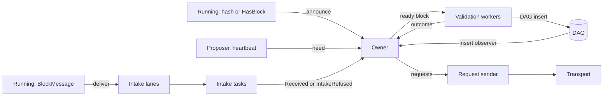

# Block ingest

Block ingest takes a block from its arrival until the block is in the DAG. A block arrives as a peer's push, as a reply to a request, or from the local block store. The code is in `casper/src/rust/blocks/ingest/`.

## One owner

One task, the owner, keeps every record of what the node holds and what it needs. No other component keeps a copy of these records. The owner never waits on the network or on validation.

| Component | File | Role |
|---|---|---|
| `IngestState` | `ingest_state.rs` | The owner's state machine. It handles one input at a time and returns effects. It does no I/O. |
| `DependencyTracker` | `dependency_tracker.rs` | Held blocks, the blocks each one waits on, the ready set in height order, and the validation-failure ledger. |
| `FetchScheduler` | `fetch_scheduler.rs` | Needed blocks and state roots, the peers known to hold each block, and the re-request pacing. |
| `PeerReputation` | `peer_reputation.rs` | Strikes per peer and the list of ignored peers. |
| `IngestView` | `ingest_view.rs` | Read-only answers for other tasks. Each record writes its own entries. |
| Intake | `intake_worker.rs` | Checks a block and stores it. It runs outside the owner. |
| Validation | `validation_worker.rs` | Validates a block or admits settled history. It also announces the block hash to peers. |
| `BlockIngest` | `block_ingest.rs` | Starts the tasks and gives producers an `IngestHandle`. |
| `IngestStep` | `ingest_step.rs` | Stage timing for storage, validation setup and validation. |

The node supervises the ingest tasks as one critical task. If one of them stops, the node shuts down.

## Flow

1. `Running` gives a block to an intake lane. It does not wait. If the lane is full, the node drops the block. The node asks for a needed block again later.
2. An intake task checks interest, sender authorization, format and signature. It then stores the block. An authorized block goes to the block store. A block with unknown authorization goes to the pending area.
3. The owner classifies the block. A block with all dependencies in the DAG is ready. Other blocks wait, and each missing dependency becomes a need.
4. The owner gives ready blocks to the validation workers, lowest height first. It dispatches only when a worker is free.
5. The DAG reports each insert to the owner. The owner then releases the blocks that waited on the inserted block.

A dependency is satisfied when it is in the DAG or recorded as an equivocation.

## Intake lanes

Intake reads three bounded lanes, in this order:

| Lane | Capacity | Content |
|---|---:|---|
| Awaited | 512 | Blocks that the node asked for |
| Local | 256 | Blocks that the owner reads from the block store for a need |
| Unsolicited | 1,024 | All other pushed blocks |

Four intake tasks share the lanes. Intake sends its reports to the owner and waits for room. A lost report would leave a stored body with no owner record.

## Needs and requests

A need exists while a held block waits on it. A need also exists when the proposer or the heartbeat asks for a block, or when a peer announces a block. A need leaves when its last waiter leaves.

- The owner first looks for a needed block in the local block store.
- Next, it asks a peer that announced the block. Without such a peer, it asks the first four connected peers in turn and then broadcasts a `HasBlockRequest`.
- At most 256 requests are outstanding. Needs that trusted blocks cite go first, then the lowest height.
- Re-requests start at 500 ms. The interval grows until the 32nd attempt and then stays at 4 s. Pacing never ends a need.
- A peer that announces a needed block is asked next, also if the node asked it before.
- At most 4,096 needs that no held block cites are kept. Announced-only needs leave first.

A need ends early only when waiting cannot help. A block that is too large for the pending area ends its need. A state root ends its need when the state requester exhausts its budget. The blocks that waited on it then leave.

A separate task sends the requests. Its queue holds 1,024 requests. When the queue is full, the request is dropped and the pacing sends it again later.

## Pending area

The pending area holds blocks with unknown sender authorization. It has these limits: 8,192 blocks, 256 MiB, and 2,048 blocks for each sender.

- A requested block is refused only at these limits.
- Any other block is refused above 90 percent of a limit. The top 10 percent is kept for requested blocks.
- The area never evicts. The owner decides what leaves.

The owner evicts in two passes. The proactive pass runs on each tick and after each pending block arrives. It evicts only unsolicited blocks, down to 90 percent of each limit. The reactive pass runs when the area refuses a requested block because it is full. It evicts unsolicited blocks first. It evicts requested blocks only when no unsolicited block is left. Untrusted blocks leave before trusted blocks, and higher blocks leave first.

An evicted block that others wait on becomes a need again. It keeps the peer that pushed it.

## Bounds

| Bound | Value |
|---|---:|
| Held blocks with a body on disk | 65,536 |
| Validation failures before the block is dropped | 32 |
| Quarantine after the failure limit | 120 s |
| Settled-history admissions for the node's lifetime | 512 |
| Block-hash announces in flight | 128 |
| Judged blocks between `malloc_trim(0)` calls (Linux, glibc) | 64 |

Validation width is the number of CPU cores minus two, with a minimum of three.

## Peer reputation

The owner strikes a peer when an unsolicited block from that peer fails one of these checks:

- the sender has no stake in the main parent
- the block format or signature is not valid
- validation finds an invalid sender

A requested block never causes a strike. The 16th strike in 10 minutes makes the node ignore the peer's block traffic for one hour. `Running` still accepts a block or a `HasBlock` that the node waits for. Each table tracks at most 1,024 peers.

## Startup

The owner starts empty. The pending area also starts empty, because it is not persisted. At startup the node asks peers for their fork-choice tips. The tips arrive as announcements. The node then resolves their ancestors from the block store first and from peers next.

## Metrics

The names that monitoring rules read keep their earlier source labels:

- `f1r3fly.casper.block-processor`: `block.validation.time`, `block.processing.stage.validation-setup.time`, `block.processing.stage.storage.time`, `block.size`, `block.validation.success`, `block.validation.failed`
- `f1r3fly.casper.block-retriever`: `block.requests.total`, `block.requests.retries`, `block.download.end-to-end-time`

Block ingest adds gauges and counters with the source `f1r3fly.casper.block-ingest`:

- `block.ingest.held` and `block.ingest.disk-entries`
- `block.ingest.needs`, `block.ingest.uncited-needs` and `block.ingest.root-needs`
- `block.ingest.validating` and `block.ingest.inserts-pending`
- `block.ingest.lane-drops` and `block.ingest.outbound-drops`
- `block.ingest.peer-reputation.strikes`, `block.ingest.peer-reputation.ignored-peers` and `block.ingest.peer-reputation.dropped-messages`

## Tests

- `ingest_state_tests.rs` tests each transition. Property tests check convergence under any delivery order, drops, duplicates and restarts.
- `node/tests/block_queue_livelock.rs` runs a node with real ingest tasks and stubbed execution. It checks that blocks that wait on missing ancestors never stop the node from admitting other blocks.
- `casper/tests/blocks/block_ingest_spec.rs` checks that ingest continues while every outbound send is stuck.
- Casper integration tests run ingest inline through `casper/tests/helper/inline_ingest.rs`.

[← Back to Casper docs](./README.md)
