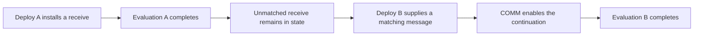

# Execution and Resource Authorization

## Scope and authority

This document explains blocks, validator workloads, execution completion, concurrency, and resource authorization for Casper readers. It does not introduce protocol rules or activate a proposal.

The [decision ledger](./design/decision-ledger/README.md#22-ratification-record-of-2026-09-16) controls the recorded Casper decisions. Its Decision sections supersede historical comparison sections.

The ledger compares PR #216 at `3980ed402`. This document does not establish the current pull-request head or implementation status.

Execution and accounting are reusable platform functions. Casper supplies the block, replay, and finalization context. Accounting authority version 8 is independent of Casper protocol 7, as [D-01](./design/decision-ledger/01-protocol-version-authority.md) records.

## Units of work

| Term | Meaning | Not equivalent to |
|---|---|---|
| Block | A signed consensus artifact with parents, justifications, deploy results, and state commitments. | A CPU task or an application lifetime. |
| Deploy | Signed input submitted for admission and execution. | A block or all future activity of an installed contract. |
| Execution attempt | One runtime evaluation of a deploy against a selected state and execution budget. | Successful application completion or finalization. |
| Validator workload | The proposal, replay, validation, merge, and finalization work that one validator performs. | An exclusive portion of execution assigned across validators. |
| Atomic COMM | A tuple-space communication that matches sends and receives and enables a continuation. | A block, deploy, CPU instruction, or fixed elapsed-time unit. |

The [Casper glossary](./GLOSSARY.md#block) defines consensus terms. The [platform glossary](../Glossary.md#execution-attempt) defines shared execution and accounting terms.

A proposer executes selected deploys and records results in a block. Receiving validators replay the block's deploys and check the state commitment.

Validators can propose different blocks concurrently. Their validation work overlaps because each validator checks received blocks, rather than trusting another validator's execution alone.

A multi-parent merge reconciles selected histories. It does not authorize unrelated execution orders or remove replay obligations.

## Completion boundaries

Use a named completion boundary instead of an unqualified statement that work runs to completion.

| Boundary | Meaning | What it does not establish |
|---|---|---|
| Evaluation completion | The evaluation returns after its active reduction work finishes, or reports an execution error. | Every stored continuation has fired. |
| Block validation completion | Replay and the required validity checks return a classification. | Consensus finality. |
| Finalization | Casper accepts a finality result under its safety and state-containment rules. | Completion of every application represented in the state. |
| Application completion | The application reaches its explicitly defined result or acknowledgment. | A result implied only by evaluation return. |

A successful evaluation can leave data and unmatched receives in RSpace. Those receives are stored continuations, not host threads waiting indefinitely for a message.

A later deploy can provide a matching message and enable a stored continuation. The application can therefore span several execution attempts and blocks.

The diagram shows execution boundaries, not finalization timing or funding attribution. Those rules require separate validation and accounting contracts.

In the current reducer, `DebruijnInterpreter::inj` awaits the initial evaluation and drains deferred continuation tasks. Evaluation completion does not require removal of unmatched receives.

A run-to-completion description applies only to that bounded evaluation scope. It does not prohibit cooperative yields or concurrent branches, and does not promise successful termination.

Errors and resource exhaustion remain possible. The [cost model](../rholang/13-cost-model.md) defines the existing phlogiston exhaustion behavior.

## Concurrency levels

Concurrency permits work to overlap. Parallelism executes work simultaneously when runtime scheduling and available hardware permit it.

| Level | Current description or recorded decision | Required distinction |
|---|---|---|
| Between validators | Validators can propose and validate concurrently. | Replicated validation is not exclusive workload partitioning. |
| Between local block replays | The runtime manager permits bounded overlapping replay work. | Separate replay runtimes do not imply parallel deploy execution within one runtime. |
| Between deploys in one block | The current play and replay paths await user deploys sequentially. | A new deploy begins after the preceding execution attempt returns. |
| Within one execution attempt | Rholang parallel composition can schedule concurrent branches and enabled continuations. | `P \| Q` does not promise linear CPU scaling. |
| Between finalization evaluations | [D-05](./design/decision-ledger/05-finalization-publication.md) keeps single-flight as the default. Parallel evaluation remains conditional. | Evaluation overlap is distinct from publication order. |

The play path can stop after an executed prefix when its proposal budget expires. It defers remaining deploys instead of publishing partially evaluated deploy bodies.

The replay path checks the deploy sequence carried by the block. The recorded event log constrains communication choices, and replay checks the resulting state.

Local scheduling must preserve the applicable replay and accounting contract. A model for intra-deploy reduction does not authorize parallel execution of separate deploys.

D-05 requires publication-order, restart, and equivalence tests before parallel finalization evaluation is used. It also requires atomic publication and stale-result refusal.

The optional ledger architecture must not expose a torn block, state root, and effect tuple. More workers do not relax that condition.

## Accounting versus resource protection

Resource authorization determines which authenticated authority can fund an operation under the applicable accounting rules. Cost accounting records charges and settlement under those rules.

Neither function selects CPU workers, removes dependencies, or establishes finality. Physical resource protection requires separate operation bounds and host controls.

| Concern | Existing contract or recorded proposal | Limit of the claim |
|---|---|---|
| Existing deploy budget | The client signs `phloLimit` and `phloPrice`. Prepayment, refund, and exhaustion apply. | A phlogiston limit is not a direct memory or elapsed-time limit. |
| Historical PR #216 accounting | Signature-indexed supply authorizes atomic COMM costs. The proposal uses reservations and settlement. | A COMM count alone does not bound the work inside each operation. |
| Physical execution cost | Interpreter operations, native calls, storage, replay, and scheduling consume physical resources. | Economic authorization does not establish bounded physical execution. |
| Node protection | Admission bounds, replay permits, and operational resource controls constrain different resource uses. | A host timeout or resource breach is not a successful execution result. |

[D-12](./design/decision-ledger/12-deploy-cost-limits.md#decision-2026-09-16) rejects removal of `phloLimit` and `phloPrice`. Their signed fields, prepayment, refund, exhaustion, minimum-price validation, and APIs remain required by that decision.

Token accounting can add a F1R3FLY Improvement Proposal (FIP)-approved validity layer. It cannot replace either field under D-12. Multi-wallet funding requires a separate normative mapping.

The historical token proposal is not the current deploy contract. Its token-per-COMM rule supplies no fixed CPU-time, memory, or elapsed-time bound per COMM.

A resource-bound claim must identify the operations covered and their bounds. It must distinguish execution, replay, storage, and concurrency costs from funding authority.

Stored continuations also require explicit funding attribution when later messages enable them. This document does not choose a payer or resolve D-12's funding-authority questions.

## Source map and review requirements

| Subject | Source |
|---|---|
| Sequential play and proposal budget | [`RuntimeOps::play_deploys_for_state`](../../casper/src/rust/rholang/runtime.rs) |
| Sequential replay and checkpoint | [`ReplayRuntimeOps::replay_deploys`](../../casper/src/rust/rholang/replay_runtime.rs) |
| Parallel branches and evaluation completion | [`DebruijnInterpreter::eval_inner` and `inj`](../../rholang/src/rust/interpreter/reduce.rs) |
| Bounded local replay concurrency | [`ReplayLock` and its tests](../../casper/src/rust/util/rholang/runtime_manager.rs) |
| Proposal, validation, and finalization | [Consensus Protocol](./CONSENSUS_PROTOCOL.md) |
| Finalization concurrency conditions | [D-05](./design/decision-ledger/05-finalization-publication.md#decision-2026-09-16) |
| Cost fields and accounting conditions | [D-12](./design/decision-ledger/12-deploy-cost-limits.md#decision-2026-09-16) |
| Historical PR #216 comparison | [CbC and formal-verification reconciliation](./design/cost-accounting-cbc-fv-reconciliation.md) |

For an execution or accounting change, record the exact node revision, configuration, accounting authority, and protocol version. Identify the concurrency level and completion boundary.

Compare replay outcomes, state commitments, and settlement with the applicable reference path. Retain failure and exhaustion cases, not only successful workloads.

State physical work bounds separately from economic bounds. Do not infer protocol activation, workload partitioning, or application completion from a passing concurrency test.
