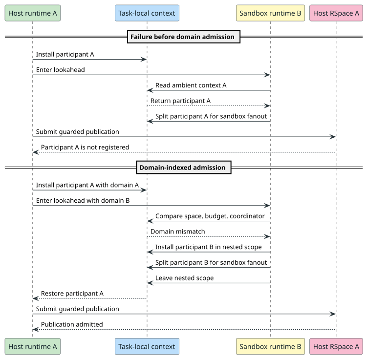

# Reduction domain leak during Regex lookahead

## Result and scope

The public Regex route previously panicked when a guarded publication used an unregistered reduction participant. Domain-indexed admission removes that panic. The route then exposed a separate metered-matcher omission in MeTTaIL. With both boundaries repaired, the public integration test passes: its mixed lookahead has 25 successes and no failures.

This report concerns the participant failure. It does not treat the later matcher failure as a consequence of the same cause. MeTTaIL's `docs/architecture/metered-matcher-wrapper-postmortem.md` analyzes that separate failure.



## Verified causal sequence

1. The host runtime entered a reduction session and registered participant A.
2. The lookahead service created a sandbox with a separate in-memory RSpace and runtime.
3. The old root entry reused any ambient task-local context. It did not compare the sandbox runtime with the host runtime.
4. The sandbox evaluated parallel terms. Its fanout called `split` on participant A and removed A from the host session.
5. The host publisher resumed and submitted another guarded produce. The host session rejected A because A was no longer registered.

A caller-location trace identified `eval_inner` fanout as the removal site. The earlier theory that a continuation split caused this occurrence was incomplete. The continuation fork repair remains useful, but it did not resolve this observed removal.

The host and sandbox can have the same deploy ID. A deploy ID therefore cannot identify a reduction runtime. The verified identity consists of the execution space, runtime budget, and reduction coordinator.

## Why the defect escaped earlier checks

The entry API used task-local presence as proof of session ownership. Task-local scope only proves that a context is active. It does not prove that the context belongs to the runtime making the request.

Earlier scheduler tests exercised participant lifecycle within one runtime. They did not combine a fresh sandbox runtime, inner fanout, and a later host publication. The public Regex route exposed that missing composition test.

The first panic reported an unregistered participant, but not the site that removed it. The caller-location trace supplied the missing causal link. Later mutex-poison panics were consequences of the first panic.

The original code also lacked a negative admission test. It tested an active context, but it did not test a context from another runtime with the same deploy ID.

## Repair and invariants

The root entry now reuses a session only when all three runtime identities match. A foreign runtime enters a new scoped session. A flat ancestor frame vector preserves the prior context and permits same-domain re-entry without recursive context ownership.

The scheduled execution adapters check the owning budget and coordinator before they submit an operation. Direct RSpace adapters apply the same check before they read the ambient budget. An explicit nested host-work policy cannot silently replace the active policy.

The admission rule is:

```text
If the requested space, budget, and coordinator match an active frame,
  enter that frame and retain its participant and host-work policy.
Otherwise,
  create a new session and restore the previous frame on exit.
```

The [Rocq model](../../../../formal/rocq/node_authority/theories/ReductionDomainIsolation.v) proves domain separation, explicit host-policy rejection, scope restoration, and foreign-roster preservation. The [focused regression](../../../../rholang/src/rust/interpreter/deterministic_reduction.rs) uses equal deploy IDs in two runtimes. It checks A→B→A→B re-entry, B fanout, and A's later guarded publication.

> **Changed by the merge of `feature/cost-accounted-rho` (DR-131, plan step 1.8).**
> DR-131 removes host work. The merge removes the host-work budget of the reducer, so a frame no longer carries a host-work policy.
> `root_with_observation` reuses an active frame when `matches_domain` accepts the space, the runtime budget and the coordinator (`rholang/src/rust/interpreter/deterministic_reduction.rs`).
> The frame then keeps its participant only.
> The Rocq model changed in the same way. It keeps domain separation, scope restoration and foreign-roster preservation.
> Its two host-policy theorems, `same_domain_host_mismatch_rejects` and `distinct_explicit_host_work_cannot_reuse`, stay in the file as comments.
> The merge removes the tests `same_domain_reentry_inherits_its_host_work_policy` and `same_domain_reentry_rejects_a_distinct_host_work_policy`, because they check only the host-work policy.
> The sentence about a nested host-work policy and the host-work part of the admission rule describe the code before DR-131.

The model represents each opaque Rust identity with a distinct natural-number token. It proves the admission rule, not Rust pointer equality or Tokio scheduling. The Rust regression checks those refinement points.

## Prevention and remaining audit

Every task-local context read must state which runtime owns the requested operation. New runtime entry points must test a foreign active context and a same-domain re-entry. Tests must use equal deploy IDs for distinct runtimes so that a deploy-ID shortcut cannot pass.

The minimum regression combines four events in one test: enter runtime A, enter runtime B, split B, and submit another operation in A. Each event is necessary to expose this defect. The test must also check that B did not receive A's host-work policy.

The formal admission model makes the ownership check explicit. A scoped entry can reuse a frame only when the space, budget, and coordinator identities match. A different runtime gets a new session even when its deploy ID matches.

The source audit classified the remaining parent-retiring `split` sites in `eval_inner`, parallel dispatch, and signed-term evaluation. Each site transfers work to detached children and returns. No second parent submission is proven at those sites. A focused test must check that control-flow property before the audit can close.

The follow-up audit confirmed three further defects. In a nested A→B run with equal deploy IDs, an error produced by reducer A was recorded in B's failure ledger. A primitive operation owned by A charged B's host-work budget; with A's limit at zero and B's limit high, the A operation incorrectly succeeded. Substitution owned by A also charged B's host-work budget and incorrectly succeeded. All three tests failed before repair and passed afterward.

Failure recording now requires the owning domain at its call site. A detached task records against the explicit session it already carries. Reducer operations use one domain-indexed context selector for participant splits and host-work access. Substitution receives the selected host-work budget as an explicit argument; its general engine no longer reads the ambient context. The unused public ambient host-work reservation helper was removed so a future caller cannot accidentally restore that hidden dependency. This prevents an inner ambient runtime from supplying either the failure ledger or the host-work budget for an outer reducer. The [Rocq model](../../../../formal/rocq/node_authority/theories/ReductionDomainIsolation.v) additionally proves that a failure or accepted host charge cannot modify a foreign domain's ledger, and that an over-limit owner rejects the charge. Its host-work model represents one metering dimension at a time; the Rust tests check identity selection and actual budget rejection.

> **Changed by the merge of `feature/cost-accounted-rho` (DR-131, plan step 1.8).**
> No reducer has a host-work budget now, so no domain can charge host work to a foreign domain.
> The Rocq model keeps the host-charge model and its two theorems only as comments: `host_charge_cannot_touch_foreign_domain` and `owner_over_limit_rejects_without_charging_foreign_host`.
> The failure-ledger theorems stay, and the test `nested_failure_is_recorded_by_its_reducer_not_the_ambient_runtime` still checks failure ownership.
> The merge removes the tests `nested_host_work_charges_its_reducer_not_the_ambient_runtime` and `nested_substitution_charges_its_reducer_not_the_ambient_runtime`, because they check only metering.
> Each host-work sentence in this section describes the code before DR-131.

The economic-failure test file was present but not included in the `rholang` test target. The first attempt to run the new regression therefore reported zero tests. After the module was included, two old calls no longer matched the current reducer API, and one test still assumed that parallel child errors appear in the reduction session rather than the completion drive. The test harness was updated to use the reducer's stored `ExecutionSpace`, which is essential because converting its underlying RSpace afresh creates a different wrapper identity. Ten economic-failure tests now run and pass.

This is a concrete prevention lesson: a named test file is not coverage unless the build target includes it and the test runner reports a nonzero test count. A test for runtime ownership must enter the exact execution-space wrapper held by the reducer, use distinct runtimes with equal deploy IDs, and assert both the owner's result and the foreign runtime's non-interference.

The public Regex regression has a second test-selection risk. The test is compiled only with the optional `mettail-frontend` feature. The default-feature `node` CI matrix does not enable that feature. A local default-feature command exited successfully but ran zero matching tests. The public gate must enable `mettail-frontend` and report one executed test. A dedicated CI gate for that feature is tracked separately.

The operation-order task-local also needs a domain-boundary test. Native accounting checks session bytes, and two runtimes can share a deploy ID. No cross-runtime native-accounting failure is proven. The test must establish whether an operation from one runtime can reach an observer owned by another.

The substitution candidate was confirmed by a red regression and repaired by explicit budget passing. Two boundaries remain audit candidates, not established cross-runtime failures. Native accounting reads the operation-order task-local and checks its deploy session, which does not alone distinguish runtimes with equal deploy IDs. The scheduled RSpace adapters select a context by budget and coordinator, while the complete root-domain identity also includes the execution space; normal constructors appear to create a distinct coordinator for each runtime, but the general adapter contract still needs an explicit same-pair/different-space test. The audit must not change consensus-sensitive accounting based only on a matching source pattern.

A separate interface-completeness census found a confirmed reachable omission in the runtime RSpace adapter chain. Casper's prepaid-receipt reader calls `get_data_cold_decode_metered` through the reducer's `ChargingRSpace` and `DeterministicRSpace`. Both adapters forwarded ordinary `get_data_metered` but inherited the cold-read method's fail-closed default. Both now forward the cold read to the underlying space; a focused test constructs the full two-adapter chain. This is the same *trait-default omission pattern* as the MeTTaIL matcher failure, but it does not share the reduction-domain root cause.

The public Regex route passes its mixed-lookahead assertion. The public test is the end-to-end regression; the narrower reduction-domain test guards the A→B→A→B participant lifecycle. The economic-failure tests guard failure-ledger, primitive host-work, and substitution host-work ownership. The remaining audit candidates above are not known failures and must be tested independently before any consensus-sensitive repair.

## Verification boundary

After the ownership changes, the economic-failure group passes all ten tests, the deterministic-reduction group passes all 29 tests, and the standalone substitution group passes all 24 tests. The Rocq ownership model compiles with a 512 MiB memory limit. The affected standalone substitution test targets compile.

These focused results do not constitute a clean full-suite result. An attempted full `rholang --lib` run reported failures in native-accounting tests and then aborted in a 256 KiB-stack reducer-depth test; that depth test also aborts when run alone. Neither result establishes that the ownership repair caused those failures. They require separate root-cause work before a full-suite pass can be claimed.

An all-test-target compile initially exposed three output-value test helpers that omitted the new `RestingComm` event variant. The helpers now include its ordered produces, using copy-on-write for mutable logs. The all-test-target compile passes; the three affected test targets pass 6/6, 3/3, and 1/1 tests respectively. The feature-enabled public Regex rerun passes 1/1 test against the final edits. It reports 25 mixed-lookahead successes and completes the Regex observations.
