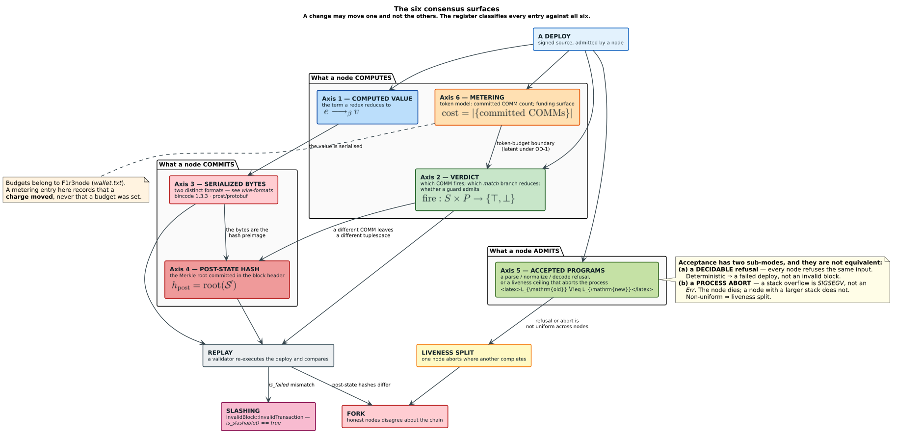
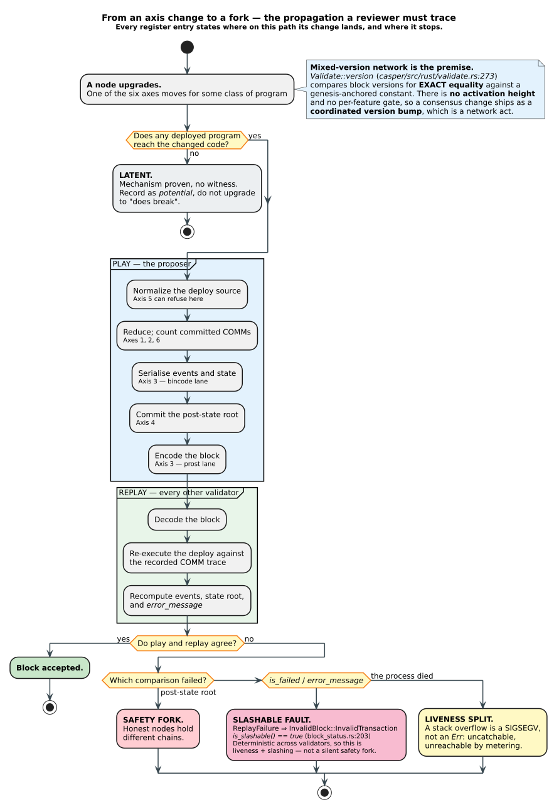
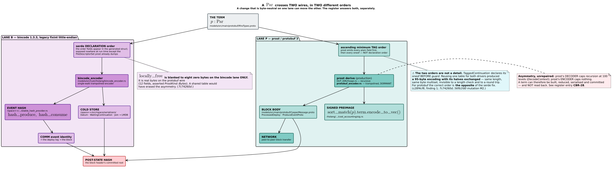

# The Consensus-Change Register

### A classification and risk report on the consensus-changing data-model, wire-format, and acceptance changes of the `rho-native-semantics-review` campaign

| | |
|---|---|
| **Document class** | Engineering report — classification and risk analysis. **LIVING**: amended, never closed. |
| **Register anchor** | `7293d57c` (`f1r3node-rust-mettail`, branch `feature/mettail`) — the point at which the consensus surfaces were last reviewed as a set; the original derivation range was `7293d57c..dc383ed1` (78 consensus-path commits), extended by later landings named per entry. |
| **Inclusion criterion** | **May-change-consensus only** (owner ruling, 2026-08-03): data-model, wire-format, acceptance, ruled-semantic, and token-model metering changes. Bug fixes, optimizations, and equivalence-proven stack-safe conversions are retired to [Appendix B.1](#b1-retired-register-entries). |
| **Companion surface** | `mettail-rust`, branch `feature/rho-native-set-automata`. |
| **Companion reports** | the [stack-safety report](../design/stack-safety/stack-safety-report-2026-07-29.md) and the [PathMap report](../design/pathmap/pathmap-report-2026-08-03.md), which carry the equivalence evidence this register's retirements cite. |
| **Audience** | F1r3node consensus reviewers deciding whether to accept the fork risk of a coordinated protocol-version bump. |
| **Date** | 2026-07-29, re-scoped to the final criterion 2026-08-03, revised through 2026-09-18 |
| **Maintenance** | [§7](#7-maintenance). Adding an entry is filling the form in [Appendix A](#appendix-a--the-entry-template). |

---

## Notation and abbreviations

★ **Read this table first if any short form below is unfamiliar.** Conceptual definitions —
*consensus-breaking*, *post-state hash*, *verdict*, *fork*, *Lane B* / *Lane P* — are given in full
in [§2](#2-background-and-definitions), which every axis table refers back to.

| Short form | Expansion | Where it matters here |
|---|---|---|
| **CBR** | *Consensus-Breaking Record* — the identifier prefix of every entry. `CBR-0NN` numbers a Surface-N entry; `CBR-LNN` a Surface-L one. Retired identifiers keep resolving via [Appendix B.1](#b1-retired-register-entries). | [§4](#4-the-register) |
| **SHA** | *Secure Hash Algorithm*; used throughout as the customary shorthand for a git commit object name. | the `Commit(s)` cell of every entry |
| **AST** | *abstract syntax tree* | the normalizer entries |
| **LTL** | *linear temporal logic* — the property language parsed by the retired SS-G22 component. | retired **CBR-023** evidence |
| **REPL** | *read-evaluate-print loop* — the interactive observation surface closed by SS-G21. | retired **CBR-023** evidence |
| **LMDB** | *Lightning Memory-Mapped Database* — the cold store's backing key-value store. | [§2.5](#25-the-two-wire-formats) |
| **URI** | *uniform resource identifier* — here a `rho:id:…` registry URI. | **CBR-030** |
| **PDA** | *pushdown automaton* — the explicit heap-backed machine used by generated stack-safe traversals. | **CBR-044** |
| **SCC** | *strongly connected component* — a maximal dependency-graph region whose members are mutually reachable. | retired **CBR-023** evidence |
| **EPM1** | *EPathMap format, version 1* — the versioned homogeneous PathMap trie snapshot used by both codecs. | **CBR-044** |
| **RPB1** | *resident ParBag key format, version 1* — the first internal encoding of canonical ParBag trie keys. | retired **CBR-055** evidence |
| **RPB2** | *resident ParBag key format, version 2* — the dormant ACT/key format. | retired **CBR-055** evidence |
| **RPB3** | *resident ParBag key format, version 3* — the current score/body key format. | retired **CBR-055** evidence |
| **RMP** | *Rholang Match Path* — the family name for versioned, derived structural paths used only by candidate matching indexes. | **CBR-053** |
| **RMP1** | *Rholang Match Path format version 1* — the self-delimiting structural token stream used by generated matcher queries. | **CBR-053** |
| **RMP2** | *Rholang Match Path format version 2* — the semantic ParBag-record successor whose resident and canonical-protobuf-region producers share one generated event grammar. | **CBR-053** |
| **RCI2** | *Rholang Channel Image, version 2* — the shadow logical channel-identity format. | **CBR-053** |
| **CLI** | *command-line interface* — the noninteractive user observation surface paired with the REPL. | retired **CBR-023** evidence |
| **WAL** | *write-ahead log* — the transaction journal planned for differential PathMap-DAG persistence. | consensus-neutral RSpace history continuations |
| **CRC** | *cyclic redundancy check* — a physical corruption detector, not a cryptographic identity. | CBR-053 persistence continuations |
| **CRC32C** | the 32-bit cyclic redundancy check using the Castagnoli polynomial. | CBR-053 persistence continuations |
| **CAS** | *compare-and-swap* — conditional publication that advances authority only from the exact expected base. | CBR-053 persistence continuations |
| **TRIE** | not an acronym — typographic emphasis for the prefix-compressed trie that is the EPathMap representation. | **CBR-041** |
| **D3 / DR-9 / OD-1 / OD-3** | the token cost model's design-record identifiers (`docs/theory/cost-accounting-impl/d3-replace-phlo-with-tokens.md`). | [§2.2](#22-language-and-runtime-vocabulary), [§3.3](#33-how-each-axis-value-was-established) |
| **COMM** | the Rho-calculus synchronisation of a produce with a consume; realized by a committed RSpace rendezvous. | [§2.2](#22-language-and-runtime-vocabulary) |
| **D3 `BillableKind::Comm`** | one billable event emitted for each evaluated `Send` or `Receive` prefix; the token model's consensus cost unit. Despite the enum name, it is not a count of matched COMM/RSpace rendezvous. | [§2.2](#22-language-and-runtime-vocabulary) |
| **RSpace rendezvous** | one committed matching of resting or incoming produces and consumes in the tuplespace; the runtime realization of semantic COMM and a counter tracked independently from D3 prefix events. | [§2.2](#22-language-and-runtime-vocabulary) |
| **FFI** | *foreign function interface* | §6.3 |
| **CI** | *continuous integration* | §6.3 |
| **FIPS** | *Foreign-language Interoperability Problem Statement* — the design-document series governing MeTTaIL's foreign-language terms (⚠ not the U.S. Federal Information Processing Standards). | **CBR-L07** authority |
| **E2E** | *end-to-end* | entry evidence blocks |
| **BLAKE2 / Blake2b256** | the BLAKE2 cryptographic hash family; `Blake2b256` is the event-hash and post-state instance. | [§2.3](#23-consensus-vocabulary) |
| **IEEESTD** | not an abbreviation — a path component of IEEE's DOI namespace, reproduced verbatim so the DOI resolves. | [References](#references) |
| **RSS** | *resident set size* — the capped physical-memory footprint of the measured runs. | entry evidence blocks |
| **TSV** | *tab-separated values* — the durable measurement files the evidence links. | **CBR-044** |
| **DFA** | *deterministic finite automaton* | **CBR-L14** lexer account |
| **KAT** | *Kleene algebra with tests* | retired **CBR-L18** decision-procedure evidence |
| **GLL** | *generalized LL parsing* — a generalized top-down parsing algorithm | retired **CBR-023** SS-G45 evidence |
| **GSS** | *graph-structured stack* — the shared caller-stack graph used by GLL parsing | retired **CBR-023** SS-G44/SS-G45 evidence |
| **SPPF** | *shared packed parse forest* — the compact graph of ambiguous parse results | retired **CBR-023** SS-G44 evidence |
| **DFS** | *depth-first search* | retired **CBR-023** SS-G45 exact-fallback evidence |
| **RAII** | *resource acquisition is initialisation* — the scope-tied resource idiom named in one exemption row. | [Appendix B.2](#b2-the-original-commit-level-exemptions) |

⚠ **This document also uses ALL-CAPS as emphasis inside verbatim quotations of commit messages**;
such tokens (appearing in [Appendix B](#appendix-b--the-exemption-table)'s quoted commit subjects
and retired-row headlines) are ordinary English words set in capitals for stress, not acronyms. They are
enumerated so a reader does not search for an expansion that does not exist:

| Token | It is simply the word | Where |
|---|---|---|
| **UNSPELLABLE** | *unspellable* | this section; B.2 quoted subjects |
| **NEIGHBOURS** | *neighbours* | B.2 quoted subjects |
| **POSITIONALLY** | *positionally* | entry evidence quotations |
| **DISCHARGEABLE** | *dischargeable* | entry evidence quotations |
| **SUBTRACTIVELY** | *subtractively* | entry evidence quotations |
| **REGRESSIVELY** | *regressively* | **CBR-L08** acceptance cell |
| **UNREPAIRED** | *unrepaired* | the retired CBR-028 row's headline |

★ The closed vocabularies that *are* meaningful in capitals are defined in
[§2](#2-background-and-definitions): the axis verdicts `MOVES` / `NO` / `N/A`
([§4.2](#42-entry-template)), the directions ([§2.6](#26-direction-of-change)), the evidence grades
([§2.7](#27-evidence-grade--and-the-word-potentially)), the provenance tags **DERIVED** /
**MEASURED** / **CITED** / **UNVERIFIED** ([§2.8](#28-provenance-tags)), and the retirement and
exemption reasons ([§3.2](#32-inclusion-and-exclusion-criteria)).

---

## Abstract

The `rho-native-semantics-review` campaign landed 111 commits on the F1r3node consensus
implementation and a parallel body of work on MeTTaIL's second implementation of Rholang. This
report derives, from the git record, the subset of that work which **may actually change
consensus** — the inclusion criterion the owner fixed on 2026-08-03: data-model, wire-format,
acceptance, and ruled-semantic changes qualify; **bug fixes and optimizations are not
consensus-breaking for this register's purpose**, and stack-safe conversions proven equivalent to
their recursive counterparts definitely are not. Each qualifying change is classified against six
independent axes: computed value, verdict, serialized bytes (per lane), post-state hash, accepted
programs, and metering under the token cost model.

**Result: 27 entries** — 18 on the F1r3node node, 9 on MeTTaIL's Rholang; **26 landed, 1 in
flight**. The core is the EPathMap data-model lineage (CBR-011/012/013 — the trie ruling's stages —
and CBR-041/042/043 culminating in **CBR-044**, the EPM1 wire transition, on which six of the seven
axes move), the three PathMap 0.3.4 corrections to set difference and restriction (CBR-077/078/079),
one wire-schema addition (CBR-014), four ruled semantic/acceptance changes (CBR-002,
CBR-027 with its genesis partner CBR-030, CBR-037), the additive method surface (CBR-024/025), and
the Surface-L acceptance set (L07, L08 in flight, L10, L11, L14, L15), binder-shift fusion
(L20), slotted/indexed matcher-network transition (L23), and certified persistent-root production
route (L24). **The metering axis was re-derived
under the D3 token model** (consensus cost = evaluated `Send`/`Receive` prefix events; per-op prices
are diagnostics): **CBR-L20, CBR-L23, and CBR-L24 move that prefix-event schedule**; the
register's one historical `UNVERIFIED` cell resolved in the same derivation. **69 further changes
were examined and retired** with typed reasons — 50 bug fixes, 10
measured-neutral optimizations, 5 equivalence-proven conversions, 3 dormant additions or removals, and the
formerly-open wire-asymmetry hazard, closed against CBR-044 — each a one-line row in
[Appendix B.1](#b1-retired-register-entries) whose full historical body remains in git history.
21 commit-level exemptions from the original sweep are retained in
[Appendix B.2](#b2-the-original-commit-level-exemptions) as the negative results that make the
criterion checkable.

**The headline risk is not any single entry; it is their conjunction.** `Validate::version`
(`casper/src/rust/validate.rs:273`) compares block versions for **exact equality** against a
genesis-anchored constant. There is no activation-height machinery and no per-feature gate, so these
changes cannot be rolled out independently: they ship together, as one coordinated protocol-version
bump, or not at all. The owner has ruled the network **pre-production**, which is what licenses the
landed entries to sit unactivated; the bump itself belongs to F1r3node.

---

## 1. Introduction

### 1.1 The problem

A blockchain node is a deterministic function from a block and a pre-state to a post-state.
Consensus is the agreement of independent implementations, or independent builds of one
implementation, on that function. A change that moves the function's *observable* output for some
input can split the network — and the splits are not all of one kind: a refusal every validator
reaches identically is a detectable, slashable fault, while a silently different computed value is a
safety fork in which two honest nodes hold divergent, individually plausible histories.

This register carries the campaign's changes that **may actually change consensus** — deliberate
data-model, wire-format, acceptance, and ruled semantic transitions. Its criterion is the owner's
2026-08-03 ruling (§3.2): repairs that make a wrong answer right, optimizations measured to move
nothing, and stack-safe conversions with machine-checked equivalence evidence are *not* carried as
entries, because they do not represent consensus decisions a reviewer must weigh — they are retired
with typed reasons so the account stays checkable.

### 1.2 Contributions

1. A **six-axis classification** of consensus visibility (§2.4), separating properties a single
   phrase like "consensus-breaking" conflates, with the propagation between axes made explicit and
   the metering axis defined under the current token cost model.
2. An explicit account of the **two wire formats** a `Par` crosses (§2.5), including the field-order
   asymmetry that produced a measured, round-trip-invisible defect class.
3. A **derived** register (§3, §4): 27 entries, each with all six axes answered, a stated blast
   radius, a direction, an evidence grade, and — where one exists — the owner ruling that authorised
   it, quoted verbatim with its date.
4. The **negative results**: 70 retired entries with typed reasons (Appendix B.1) and 21 commit-level
   exemptions (Appendix B.2), which are what make the inclusion criterion checkable rather than
   merely asserted.

---

## 2. Background and definitions

A reviewer may not share this campaign's vocabulary. Every term and acronym used later is defined here
first.

### 2.1 The two implementations under discussion

| Surface | Repository / branch | Role |
|---|---|---|
| **N** — the node | `f1r3node-rust-mettail`, `feature/mettail` | **The** consensus implementation. Scala support is dropped; no Scala artifact is normative and none is cited in this report. A change here moves live consensus. |
| **L** — the language | `mettail-rust`, `feature/rho-native-set-automata` | A **second** implementation of Rholang (`languages/src/rholang.rs`), hosted in the MeTTaIL/PraTTaIL language workbench and intended to become Rholang 1.4. It does not run consensus today. A divergence here is a **future** fork, not a present one — but it is exactly the kind of divergence that is cheap to fix now and catastrophic to discover after adoption. |

The register carries both, with the surface as a column, because the standard the campaign works to is
that MeTTaIL's Rholang must be a **superset** of upstream Rholang: it must accept everything upstream
accepts and compute the same value, with divergence permitted only where upstream has a bug, and only
by explicit ruling.

### 2.2 Language and runtime vocabulary

- **Rholang** — the reflective, higher-order, concurrent process language the node executes, descended
  from the asynchronous polyadic $`\pi`$-calculus [Milner1992] by way of the reflective
  $`\rho`$-calculus [Meredith2005].
- **Deploy** — a signed unit of work: a source string with its signature and metadata, submitted to a
  node, *normalized* to a term, and reduced.
- **`Par`** — the term type. A Rholang process is a parallel composition of sends, receives, `new`
  bindings, `match`es, bundles, connectives, expressions and unforgeable names; `Par` is the protobuf
  message carrying all of them.
- **Redex** — a *reducible expression*: a subterm to which an operational rule applies.
- **Tuplespace / RSpace** — the shared, content-addressed store of resting *data* (produces) and resting
  *continuations* (consumes).
- **COMM event** — the synchronisation of a produce with a consume on the same channel, firing the
  consume's continuation. *Which* COMM fires, and with *which* data, is the central nondeterminism a
  consensus protocol must pin down.
- **Guard** (`where` clause) — a boolean side-condition on a receive or a `match` case, deciding whether
  a candidate COMM or branch is admissible.
- **Normalization** — the compile step from source to `Par`: de Bruijn indexing of binders,
  free-variable numbering, and the canonical sort. Free-variable numbering is consensus-visible: a
  mis-threaded normalizer emits a plausible term with wrong indices and **fails silently**.
- **Substitution** — replacing a bound variable by its value inside a term. ★ Its *result* is what gets
  serialized, and therefore what gets **signed**.
- **Spatial matching** — the relation deciding whether a pattern matches a target, and with what
  bindings. It decides COMM firing (via `Matcher::get`) and `match` branch selection.
- **`FreeMap`** — the matcher's accumulator: a map from a pattern's free-variable *level* to the term
  bound at it. Its final contents become the continuation's environment.
- **Token cost (D3)** — the consensus unit of computational cost. Under the token model
  (`docs/theory/cost-accounting-impl/d3-replace-phlo-with-tokens.md`, DR-9/OD-3; merged at
  `eec6e323`), **consensus consumed cost is the count of evaluated communication prefixes, exactly
  one token for each `Send` or `Receive`** — `reconcile_lane` tallies 1 per reconciled
  `BillableKind::Comm` and 0 for every other kind
  (`rholang/src/rust/interpreter/accounting/mod.rs`, the `reconcile_lane` comment block). Per-op
  weights (`Primitive`/`Reduction`/`Substitution`) survive only as **diagnostics** in the event
  log/digest; `phlo_limit`/`phlo_price` are deleted from the wire; funding is the per-signature
  token supply via the acceptance gate; accepted user deploys run unmetered-for-liveness (OD-1).
  "Phlogiston" survives only as the historical name of the renewable resource. **Metering** in
  this register means the token-model surface: the D3 communication-prefix count and the
  funding/settlement machinery. This counter is deliberately distinct from committed RSpace
  rendezvous: §5.23 of the stack-safety report contains an exact 20-prefix/seven-rendezvous witness.
- **PathMap / `EPathMap`** — a trie-shaped Rholang collection; `EPathMap` is its `ExprInstance` arm.
  **`EZipper`** is a cursor into one.

### 2.3 Consensus vocabulary

- **Play** — the proposer's execution of a deploy while building a block.
- **Replay** — every other validator's re-execution of the same deploy against the block's recorded COMM
  trace, comparing the outcome.
- **Post-state hash**, written $`h_{\mathrm{post}}`$ — the Merkle root of the tuplespace *after* the
  block's deploys have run, committed in the block header. Two nodes computing different
  $`h_{\mathrm{post}}`$ for the same block hold different chains.
- **Fork** — used strictly here to mean a *safety* fork: honest nodes disagree about the canonical
  chain, and neither block is detectably invalid.
- **Slashable fault** — a replay disagreement that every honest validator reaches *identically*,
  producing `InvalidBlock::InvalidTransaction`, for which `is_slashable()`
  (`casper/src/rust/block_status.rs:183`) answers true. This is liveness-plus-penalty, **not** a silent
  safety fork. ⚠ It is not benign: the proposer skips checkpoint validation on its own block, so it
  alone keeps a block everyone else slashes it for. **CITED** (`80f5e5d3`).
- **Liveness split** — one node aborts the *process* where another completes. In Rust a stack overflow
  is a `SIGSEGV` on the guard page, **not** an `Err`: it is uncatchable, unreachable by metering
  (Casper installs `Cost::unsafe_max()` deliberately, for liveness), and its threshold depends on the
  thread's stack size. Two nodes with different stack budgets therefore disagree about whether a deploy
  is *executable at all*.
- **Coordinated version bump** — the only rollout mechanism available. `Validate::version`
  (`casper/src/rust/validate.rs:273`) is exact equality against a genesis-anchored constant. **DERIVED**
  (read at `casper/src/rust/validate.rs`, `pub fn version(b: &BlockMessage, version: i64) -> bool`).

### 2.4 Consensus-breaking, defined — and the six axes

> **Definition.** A change is **consensus-breaking** if there exists a deploy $`d`$ and a reachable
> pre-state $`S`$ such that a node running the new code and a node running the old code, both honest
> and both given $`(d, S)`$, disagree on at least one of: the value computed, the COMM or branch
> verdict taken, the bytes serialized on either wire, the post-state hash, whether $`d`$ is admitted
> at all, or the token cost charged.

Write $`M_{\mathrm{old}}`$ and $`M_{\mathrm{new}}`$ for the two nodes' observable behaviour — so
$`M(d, S)`$ is everything the node exhibits when it runs deploy $`d`$ against pre-state $`S`$ — and
write $`\pi_i`$ for the projection onto axis $`i`$:

```math
\mathsf{Breaking}
\;\;\equiv\;\;
\exists\, d,\; S,\; i \in \{1,\dots,6\}
\;:\;
\pi_i\!\bigl(M_{\mathrm{old}}(d, S)\bigr)
\;\neq\;
\pi_i\!\bigl(M_{\mathrm{new}}(d, S)\bigr)
```

Two consequences a reviewer should hold onto.

1. **The definition is existential.** One witnessing deploy suffices. "The suite is green" is therefore
   never a proof of non-breakage; it is evidence about a corpus, and each entry records *which* corpus.
2. **Repair and regression satisfy the same predicate.** A change making a wrong answer right is
   consensus-breaking in exactly the technical sense of one making a right answer wrong. The two are
   separated by the **Direction** field (§2.6), not by the definition.

#### Figure 1 — the six consensus surfaces and the fault each produces



*Source: [`figures/consensus-axes.puml`](figures/consensus-axes.puml).*

| # | Axis | The question it answers | Canonical failure |
|---|---|---|---|
| 1 | **Computed value** | What term does a redex reduce to? | Two nodes put different data on a channel. |
| 2 | **Verdict** | Which COMM fires? Which `match` branch reduces? Does a guard admit? | Two nodes take different control-flow paths from identical state. |
| 3 | **Serialized bytes** | What bytes represent this term — on Lane B, and on Lane P? | Event hashes differ; a block encodes differently; the signed preimage moves. |
| 4 | **Post-state hash** | What root is committed? | Replay's $`h_{\mathrm{post}}`$ differs from the block's $`\Rightarrow`$ **safety fork**. |
| 5 | **Accepted programs** | Is this deploy admitted at all? | A *decidable* refusal $`\Rightarrow`$ a failed deploy; a *process abort* $`\Rightarrow`$ a liveness split. |
| 6 | **Metering** | Does the D3 `Send`/`Receive` prefix-event count, or the funding/settlement surface, move? | A token-budget boundary fires on one node and not another — which would turn into an Axis-2 divergence. |

⚠ **Axis 6 under the token model — the attribution rule, defined here so no entry re-derives it.**
M records a movement of the *reconciled D3 communication-prefix count for executions whose verdict trace is otherwise
unchanged*, or of the funding/settlement surface. A divergence that flows through a changed value
or verdict (a deploy that now fails evaluates different prefixes) is filed on axes 1–2, never double-
counted on M. Per-op prices are diagnostics and cannot move M. Budgets belong to F1r3node
(`wallet.txt`); no entry introduces a metering surface. ⚠ Under OD-1 accepted user deploys run
unmetered-for-liveness, so the metering-to-verdict composition edge below is **latent**: it can fire
only for budgeted (system/gate) execution, not for an accepted user deploy.

**How the axes compose.** The dependency has a direction:

```math
\text{value} \;\longrightarrow\; \text{bytes} \;\longrightarrow\; \text{hash}
\qquad
\text{verdict} \;\longrightarrow\; \text{hash}
\qquad
\text{metering} \;\longrightarrow\; \text{verdict}
```

But the converse fails in both interesting directions, which is precisely why the axes must be answered
separately rather than summarised:

- **Bytes can move with no value moving.** `7dcff96f` (**CBR-014**) appends four zero bytes to a bincode
  `EZipper` record while every previously-representable zipper computes the identical value, and while
  the *protobuf* encoding of that same zipper is byte-identical.
- **A verdict can move with no value moving, and a value with no verdict.** **CBR-011** moves the
  identity relation (verdict) of path maps while every computed value stays fixed; the register's
  retired history carries the converse (retired entries CBR-005/CBR-007,
  [Appendix B.1](#b1-retired-register-entries)).

#### Figure 3 — from an axis change to a fork



*Source: [`figures/divergence-flow.puml`](figures/divergence-flow.puml).*

### 2.5 The two wire formats

⚠ **A `Par` is serialized by two independent codecs, in two different field orders.** Conflating them is
the commonest way to mis-review a change in this area, so both are answered separately in every axis
table.

| | **Lane B — bincode** | **Lane P — prost** |
|---|---|---|
| Format | bincode 1.3.3, default config (legacy fixint, little-endian) | protobuf 3 |
| Field order | **serde declaration order** — the order fields appear in the generated struct | **ascending minimum tag**; prost emits every plain field first, then every `oneof` |
| Where that order is recorded | nowhere at run time; recovered from the `FileDescriptorSet` prost already dumps | the `.proto` tag numbers |
| Reaches | the **cold store** (LMDB, `rspace++/src/rspace/serializers/`) and the **event hash** (`rspace++/src/rspace/hashing/stable_hash_provider.rs`) | the **block body** (`CasperMessage.proto`) and the **signed preimage**, `sort_match(p).term.encode_to_vec()` (`rholang/.../cost_accounting/sig.rs`) |
| `locally_free` | blanked to eight zero bytes | real `bytes` — 12 fields, asserted `ProtobufKind::Bytes` |
| Depth policy | symmetric: both directions unbounded | historically **asymmetric** (the stock decoder capped recursion at 100 levels while the encoder capped nothing); **symmetric at the anchor** — the generated decode PDA reads without a recursion budget (**CBR-044**) |

#### Figure 2 — the two wire formats



*Source: [`figures/wire-formats.puml`](figures/wire-formats.puml).*

The hazard the figure encodes, stated once so no entry restates it:

> ⚠⚠ `TaggedContinuation` declares its `oneof` **before** `guard`. A generator reusing one field-order
> table for both drivers produces, for protobuf, **a 95-byte encoding with its halves exchanged** —
> identical length, identical byte multiset, invisible to a length check *and to a round trip*. For
> protobuf the correct order is *the opposite* of the correct serde order.
> **MEASURED** (`c28f4cf6`, finding 1; `7c74260d`; reproduced permanently as generator mutation M2 in
> `56fb1fd0` — difference at byte 0, both encodings 1140 bytes, same byte multiset, halves exchanged).

This is why **round-trip is not the codec obligation**: a codec that encodes differently from its
predecessor but decodes its own output round-trips perfectly *and forks*. The obligation is
**differential byte identity against a retained, undriftable oracle** — the compiler-generated derive,
which is kept compiled for exactly that purpose.

The historical asymmetry in the last table row was recorded as open hazard CBR-028 and is **closed
against [CBR-044](#cbr-044)** — the retired row is [Appendix B.1](#b1-retired-register-entries).

### 2.6 Direction of change

| Direction | Meaning |
|---|---|
| **REGRESSIVE** | A previously-succeeding thing now fails. ★ Reviewers weigh this most heavily. |
| **PERMISSIVE** | A previously-failing thing now succeeds. |
| **CORRECTIVE** | A previously-*wrong* answer is now right: the program succeeded before and succeeds now, but the answer moved. |
| **NEUTRAL** | No observable behaviour moves. The entry exists because the change sits on a consensus path and its neutrality is a **measured claim**, not an assumption. |
| **DIVERGENT** | A deliberate, ruled departure from the reference implementation. |
| **CONVERGENT** | ★ A previously-recorded **DIVERGENT** departure is *withdrawn*: the two implementations now agree where they did not. A distinct direction, not a spelling of CORRECTIVE, because the axis movement is measured against *the other implementation* rather than against this one's own prior answer. (The vocabulary's one historical instance is a since-retired Surface-L float entry, [Appendix B.1](#b1-retired-register-entries).) |

### 2.7 Evidence grade — and the word "potentially"

The user's requirement is that a divergence *reachable in principle but unwitnessed* be labelled as such:
neither upgraded to "does break" nor dismissed as "does not". That is what this column carries, and it
is the report's central evidentiary distinction.

| Grade | Meaning | Example |
|---|---|---|
| **WITNESSED** | A concrete program, term, or byte string is known that exhibits the divergence. | **CBR-044** — pinned byte goldens move with the EPM1 transition. |
| **MECHANISM-ONLY** | The mechanism is proven and the path is reachable by an ordinary deploy, but no witnessing program has been exhibited. | **CBR-013** — the bulk-reader collapse's recursive canonicality, proven at the mechanism. |
| **LATENT** | The mechanism exists, but reaching it needs a capability an ordinary deploy lacks, or a structural argument shows the path is not walked. | **CBR-L14** — the byte-literal surface lands ahead of any chain that could run it. |
| **DORMANT** | The changed code has no caller at all, established **mechanically**, not by intention. | the retired prost-encoder row ([Appendix B.1](#b1-retired-register-entries)). |
| **NEUTRALITY-MEASURED** | The claim is that *nothing* moves, and that claim is itself the measurement. | the retired event-hash-encoder row ([Appendix B.1](#b1-retired-register-entries)). |
| **UNVERIFIED** | Not established. An honest gap; every occurrence is counted in §6.4. |  |

### 2.8 Provenance tags

Every factual claim in this report carries one of:

| Tag | Meaning |
|---|---|
| **DERIVED** | Established here by static analysis: reading the diff, the type, the call graph, or the `.proto`. |
| **MEASURED** | Established by running something: a test that went RED then green, a byte diff, a bisected stack ceiling, a benchmark. |
| **CITED** | Quoted from a commit message or an owner ruling. The underlying work was performed by the cited author; this report reproduces rather than re-derives it. |
| **UNVERIFIED** | Named, not established. |

⚠ The distinction between **MEASURED** and **CITED** matters for this report specifically: the campaign's
commit messages carry unusually detailed measurements, and this register did **not** re-run them. Where a
number appears, its tag says whether this author observed it or is quoting the commit that did.

---

## 3. Method

### 3.1 How the change set was derived

The candidate list supplied to this report was treated as a set of hypotheses, not as a census. The set
below was derived independently and then reconciled against it.

**Step 1 — fix the range.** The register anchor is `7293d57c`, the merge point at which the previous
consensus cluster was consolidated and reviewed. Everything after it is unreviewed. **MEASURED**:
`git rev-list --count 7293d57c..HEAD` = **109** at `8853f839`, and **111** at `dc383ed1` after
**CBR-007** landed mid-authoring — see §6.1(4).

**Step 2 — define the consensus-critical path set** $`\mathcal{P}`$. A path is consensus-critical if
code under it can move any of the six axes:

```text
models/src/                      the term type, the codecs, the sorter, the path-map integration
models/src/main/protobuf/        the wire schema itself
models/codegen/, models/build.rs the GENERATOR that emits the bincode/protobuf tables and PDAs
rholang/src/rust/interpreter/    the normalizer, the reducer, the matcher, substitution, the printer
rho-pure-eval/src/               the GUARD EVALUATOR — decides `where` verdicts
rspace++/src/                    the tuplespace, the event hashes, the cold store
casper/src/                      block admission, replay comparison, validation
shared/src/                      the printer's Audience and the shared error surfaces
```

⚠ ★ **This path set is itself a corrected artefact, and the correction is a result.** The first version
omitted `rho-pure-eval/src/` — the component that **decides guard verdicts**. Two entries live there
(`eaa44c2f` in **CBR-002**, `a3fd6fe4` in **CBR-023**) and were found only because the entry set was
assembled from commit *messages* as well as from paths. A reviewer should read §3.4(1) with that in
mind: the class is not hypothetical, it fired on this very sweep.

**Step 3 — enumerate.** `git log 7293d57c..HEAD -- <paths>` over that set yields **76** commits at
`8853f839`, **78** at `dc383ed1`. **MEASURED.**

**Step 4 — read every one.** Each commit's full message and file list was read. This campaign's commit
messages state consensus visibility explicitly and in detail, which makes them primary evidence; where a
message asserts neutrality, the assertion was checked against the diff's file list and, where the claim
was byte identity, against the named golden or differential test.

**Step 5 — classify.** Each commit is either an **entry** (it moves at least one axis for at least one
program) or an **exemption** (it does not), and every exemption carries a typed reason and the evidence
discharging it. The partition is exact and is reproduced in [Appendix B](#appendix-b--the-exemption-table).

**Step 6 — sweep the companion surface.** `mettail-rust`'s campaign window holds **236** commits, of
which **149** touch `languages/src`, `rholang-runtime/src`, `macros/src` or `ast/src`. ⚠ **This sweep is
a targeted selection, not an exact partition**: the twelve Surface-L entries were found by semantic
keyword search and by reading the campaign ledger, and the remaining 133 commits are neither entries nor
explicit exemptions. This asymmetry is a stated limitation — see §6.5 — and closing it is the first
extension §7's gate should be given.

**Step 7 — capture what had not landed.** Four changes were in flight when the sweep began; at this
revision one remains: the kv element-category gate (**CBR-L08**). The checked-arithmetic repair
landed (**CBR-027**), the `attempt_opt` combinator landed and was later retired as a bug fix, and
the open wire-asymmetry hazard (formerly CBR-028) is closed against **CBR-044**.

**Step 8 — re-scope to may-change-consensus (2026-08-03).** The owner ruled that **bug fixes and
optimizations are not consensus-breaking for this register's purpose**, and that stack-safe
conversions proven equivalent to their recursive counterparts definitely do not change consensus —
while **data-model, wire-format, and deliberate semantic changes** (the EPathMap representation and
EPM1 being the named exemplar) are what this register exists to carry. Every entry was re-classified
under that criterion; the 46 that no longer qualified at re-scope—and later classified findings
through CBR-074—are retired to typed rows in
[Appendix B.1](#b1-retired-register-entries), and their full bodies remain in git history at the
pre-refactor revision.

### 3.2 Inclusion and exclusion criteria

A change is a **register entry** if and only if it *may actually change consensus*: it moves an
axis of §2.4 for some deploy and reachable pre-state, **and** it is not excluded by the owner's
2026-08-03 ruling. The ruling excludes, categorically: **bug fixes** (a wrong answer made right —
even though such a change satisfies §2.4's predicate, it is not treated as consensus-breaking
here), **optimizations** (no observable movement, measured), and **equivalence-proven stack-safe
conversions**. What remains is deliberate consensus content: data-model and wire-format
transitions, acceptance-set changes (new or removed syntax and refusals), ruled semantic changes,
and metering-surface changes under the token model.

**Algorithm 1 (CLASSIFY-CHANGE).** The decision procedure, in literate form; each fragment names
the judgement it encodes.

```pseudocode
⟨Classify one landed change⟩ ≡
    ⟨Does any §2.4 axis move for some deploy and pre-state?⟩
    ⟨If not: exempt with a commit-level reason⟩            ── the §3.2 enum below
    ⟨If it moves only as a repair or an optimization:
      retire with a typed reason⟩                          ── B.1; ruling 2026-08-03
    ⟨Otherwise: full entry⟩                                ── Appendix A form, six axes,
                                                           ── direction, grade, authority

⟨If it moves only as a repair or an optimization: retire with a typed reason⟩ ≡
    BUG_FIX_RULED_NONCONSENSUS      ── a wrong answer became right; cite the ruling
    OPTIMIZATION_MEASURED_NEUTRAL   ── performance work, movement measured absent
    EQUIVALENCE_PROVEN              ── stack-safe conversion with an oracle-backed
                                    ── equivalence (bytes, verdicts, charges)
    DORMANT                         ── no caller, established mechanically
    CLOSED_BY_CBR-044               ── a recorded hazard mooted by the EPM1 transition
    ── A retired row keeps its FORMER ID forever: identifiers are never reused,
    ── and every historical citation must keep resolving (Appendix B.1).
```

The original commit-level partition (steps 1–5) additionally admits, on the entry side:

- corrections (a wrong answer becomes right) on equal footing with regressions;
- **liveness** changes, because a node that aborts where another completes is not agreeing;
- **additive** surface (a new method, a new field) — because acceptance is an axis: a program that
  previously failed to normalize now runs.

**Excluded**, with the reason recorded rather than the commit silently dropped:

| Exclusion reason | Meaning |
|---|---|
| `TESTS_ONLY` | Touches only `tests/`, fixtures, or `#[cfg(test)]` code. |
| `DOCS_ONLY` | Touches only comments, documentation, or audit records. |
| `HYGIENE` | Imports, formatting, lints, clippy, `-D warnings`, dead-code deletion with no live caller. |
| `BYTE_NEUTRAL_MEASURED` | Restructures a consensus path with byte identity asserted by a named golden or differential. |
| `CHARGE_NEUTRAL_MEASURED` | Moves work on a metered path with charge count, order and value asserted unchanged. |
| `VERDICT_NEUTRAL_MEASURED` | ★ Restructures a **verdict-deciding** path with the verdict relation asserted unchanged by a named differential. Added 2026-07-29 for `383a8b56`, which moves `rho-pure-eval`'s evaluator — the component that decides `where` verdicts — onto a shared trampoline. *Byte* identity is not the claim that matters there; *verdict* identity is, and collapsing the two would have made the exemption say something it could not support. ⚠ Adding a variant is a code change in the gate's `CLOSED_REASONS` and is therefore reviewed, which is the property [§7.2](#7-maintenance) clause 4 exists to have. |
| `DEP_BUMP_BYTE_NEUTRAL` | ★ A dependency-version change with a named differential showing published bytes unmoved. Reserved by [§7.5](#7-maintenance) extension 2 and now spellable, because `Cargo.lock` is inside the derived path set; **CBR-L06** proves a `prost` or `thiserror` bump alone can move published bytes. No commit carries it yet. |
| `DORMANT` | Adds code with no caller, established mechanically. |
| `INFRA` | Build, CI, or tooling. |
| `SUPERSEDED` | Wholly subsumed by a later commit that is itself an entry. |

### 3.3 How each axis value was established

| Axis | Primary method |
|---|---|
| 1 · computed value | **DERIVED** from the diff: does the changed expression produce a different term for some input? |
| 2 · verdict | **DERIVED** from the call graph: does the changed code reach `Matcher::get` / `check_commit` / `eval_match`? |
| 3 · bytes | **DERIVED** from which codec the change sits in (§2.5), then **CITED** from the golden or differential test the commit names. |
| 4 · post-state hash | **DERIVED**: an Axis-1 or Axis-2 move on a path reaching `produce`/`consume` implies an Axis-4 move. |
| 5 · acceptance | **DERIVED** from the refusal or ceiling introduced or removed. |
| 6 · metering | **DERIVED under the token model (§2.2)**: does the change alter the evaluated `Send`/`Receive` prefix count for an execution whose verdict trace is otherwise unchanged, or touch the funding/settlement surface? Per-op `reserve_*` sites and RSpace-rendezvous counters are separate diagnostics and do not define this axis. Every kept entry's M cell was re-derived under this rule on 2026-08-03 and the terminology was corrected on 2026-08-10. |

### 3.4 ★ False-negative risk of this method — the classes this sweep would miss

A method that cannot state what it would miss is not a method. Five classes:

1. **A consensus-visible change outside $`\mathcal{P}`$.** The path set is a hypothesis about where
   consensus lives. A change in `comm/`, `node/`, `block-storage/`, `crypto/`, or a **dependency
   version bump in `Cargo.toml`** could move bytes or verdicts and would not be enumerated. ⚠ This is
   not hypothetical: **CBR-L06** exists precisely because a derived `Debug` implementation reaches
   published bytes, so *a `prost` or `thiserror` version bump alone* is a consensus change under this
   report's own definition — and no path in $`\mathcal{P}`$ would show it. The PathMap 0.2.2 → 0.3.4
   bump is such a change: a differential corpus found it, not this sweep, and it is registered as
   [CBR-077](#cbr-077) to [CBR-079](#cbr-079).
2. **A change whose commit message asserts neutrality falsely.** Step 4 checks assertions against the
   diff's file list and the named tests, but it does not re-run the goldens. A commit that claims byte
   identity, names a test, and is wrong would pass this sweep. Mitigation: every such claim is tagged
   **CITED**, never **MEASURED**, so a reviewer can see exactly which claims rest on the author's
   measurement rather than this report's.
3. **An emergent divergence with no single owning commit.** Two individually byte-neutral changes can
   compose into a non-neutral one — for instance a reordering in one commit and a sort-stability change
   in another. A per-commit sweep cannot see it. Mitigation: none. Named as a gap.
4. **Generated code.** `models/build.rs` emits the wire tables into `OUT_DIR`. A change to the
   *generator* is in $`\mathcal{P}`$, but a change to `prost-build`, to `rustc`'s derive expansion, or
   to the descriptor pass is not. ⚠ This class has a measured near-miss: emitting any
   `cargo:rerun-if-changed` switches cargo to watching only those paths, which left a **stale table in
   `OUT_DIR` while the build reported success** — a silent, byte-visible divergence between the
   generator in the tree and the table in the binary. **CITED** (`903cefb3`).
5. **Uncommitted work.** Both trees had substantial uncommitted changes while this report was written,
   and several agents were editing concurrently. In-flight entries describe **intended** behaviour
   verified against a working tree that has since moved.

---

## 4. The register

### 4.1 Summary — the register at a glance

Scan this table; read only the bodies you need.

**Axis cells** — **V**alue · **T** verdict · **B** bytes on Lane B (bincode) · **P** bytes on Lane P
(prost) · **H** post-state hash · **A** acceptance · **M** metering.
`●` moves · `○` does not move · `·` N/A · `?` UNVERIFIED.

**Surface** — `N` = F1r3node (the consensus implementation) · `L` = MeTTaIL's Rholang (a divergence here
is a *future* fork, not a present one).

**Grade** — the evidentiary column of §2.7: `W` WITNESSED · `M` MECHANISM-ONLY · `L` LATENT ·
`D` DORMANT · `NM` NEUTRALITY-MEASURED · `?` UNVERIFIED.

| ID | S | Headline | Commit(s) | V | T | B | P | H | A | M | Direction | Grade |
|---|---|---|---|---|---|---|---|---|---|---|---|---|
| [CBR-002](#cbr-002) | N | An undecidable `where` guard is **refused**, not silently false | `6ab1c78b`, `eaa44c2f` | · | ○ | ○ | ○ | ○ | ● | · | REGRESSIVE | **W** |
| [CBR-011](#cbr-011) | N | A pathmap's identity stops depending on insertion order | `478102a4` | ○ | ● | ○ | ○ | ● | ○ | ○ | CORRECTIVE | **W** |
| [CBR-012](#cbr-012) | N | The shadow `Vec` deleted — non-ground pathmap order follows the trie | `9994a75b` | ○ | ● | ● | ● | ● | ○ | ○ | CORRECTIVE | **W** |
| [CBR-013](#cbr-013) | N | The two bulk trie readers collapse to the key walk | `c705776c` | ● | ● | ○ | ○ | ○ | ○ | ○ | CORRECTIVE | **M** |
| [CBR-014](#cbr-014) | N | `EZipper.cursor_kind` — a **new proto field**; four bytes on Lane B | `7dcff96f` | ● | ● | ● | ○ | ● | ○ | ○ | CORRECTIVE | **W** |
| [CBR-024](#cbr-024) | N | `last` joins the method table | `2fee67fa` | · | · | · | · | · | ● | · | PERMISSIVE | **W** |
| [CBR-025](#cbr-025) | N | Trie enumeration: `getPath` / `toNextLeaf` / `leafCount` | `98d2422d` | · | · | · | · | · | ● | · | PERMISSIVE | **W** |
| [CBR-027](#cbr-027) | N | GInt `+` and `-` stop wrapping on overflow | `6ff46f8a` ⚠, `fd5474ab` | ● | ● | ● | ● | ● | ○ | ○ | REGRESSIVE | **W** |
| [CBR-030](#cbr-030) | N | `NonNegativeNumber.rho`'s overflow guard becomes **total** — the genesis term moves | `e3a4494b`, `719f2432` | ● | ● | ● | ● | ● | ○ | ○ | CORRECTIVE | **W** |
| [CBR-037](#cbr-037) | N | The `EPathMap` tag-8 trie-key **reader** becomes total — the writer was unlimited by requirement | `063974c5` | ○ | ● | ○ | ○ | ○ | ● | ○ | PERMISSIVE | **W** |
| [CBR-041](#cbr-041) | N | An `EPathMap` serializes on the prost wire as the TRIE — its own byte array `U(m)` at field 8 — for every map; the tag-1 list arm is deleted | `1b576c90` | ○ | ● | ○ | ● | ● | ○ | ○ | CORRECTIVE | **W** |
| [CBR-042](#cbr-042) | N | …and on the **bincode** wire too — `U(m)` verbatim and contiguous, then the values (FORM ②), so the reader never decodes a trie key | `3a32cf07` | ○ | ○ | ● | ○ | ● | ○ | ○ | CORRECTIVE | **W** |
| [CBR-043](#cbr-043) | N | …but of **the entries that surface WRITES**. FORM ② keyed lf-blanked values by the *unblanked* entries, putting an entry's `locally_free` on the event hash | `8cf0b770` | ○ | ○ | ● | ○ | ● | ○ | ○ | CORRECTIVE | **W** |
| [CBR-044](#cbr-044) | N | EPathMap becomes a homogeneous PathMap set/map and both codecs carry one versioned EPM1 trie snapshot; generated protobuf PDAs remove the read ceiling | `26876b65` | ● | ● | ● | ● | ● | ● | ○ | CORRECTIVE | **W** |
| [CBR-053](#cbr-053) | N | Retained PathMap indexes and synchronized datum-first/receive-first/inner-AC query products skip candidates that cannot match a compiled counterpart | `a89cbc294`, `f149cef2b`, `ea8c39f92`, `564dac0b4`, `0b601ce67`, `f43858ec2`, `b6b53d1b3`, `e1a587c9f`, `5a56376b4`, `697db373b`, `250e96c80`, `2d91c4394`, `bbe91b90f`, `3a70ddc58`, `ad5d37a59`, `26b72b096`, `0d7a6a3f8`, `1560f4371`, `46aaa6472`, `8e4938ec6`, `cd01ea721`, `21ece399d`, `0f9beb5f0`, `87679597d`, `9a746f2bf`, `514659e2b`, `27557c374`, `ad395c357`, `61accc170`, `92240a452`, `03685f4c7`, `4f022ad9b`, `6ef40fc37`; this checkpoint; benchmarks `7bc5c6994`, `7b3254573`, `48e6f7d3c`; pgmcp work items/experiments 224, 225, 226, 229, 233, 248, 5984, 5985, 5990 | ○ | ○ | ○ | ○ | ○ | ○ | ○ | NEUTRAL | **NM** |
| [CBR-077](#cbr-077) | N | Set difference keeps a member when the right operand holds only a longer key through it — PathMap 0.3.4's `subtract` | this checkpoint (PathMap `=0.3.4`) | ● | ● | ● | ● | ● | ● | ○ | CORRECTIVE | **W** |
| [CBR-078](#cbr-078) | N | Prefix restriction keeps a member whose exact key the selector holds beside a longer one — PathMap 0.3.4's `restrict` | this checkpoint (PathMap `=0.3.4`) | ● | ● | ● | ● | ● | ○ | ○ | CORRECTIVE | **W** |
| [CBR-079](#cbr-079) | N | A set difference no longer leaves a removed member's location as a value-free path — PathMap 0.3.4 prunes it | this checkpoint (PathMap `=0.3.4`) | ● | ● | ● | ● | ● | ○ | ○ | CORRECTIVE | **W** |
| [CBR-L07](#cbr-l07) | L | `List.last()` in MeTTaIL's Rholang | `bbceb6d9`, `6e543c01` | · | · | · | · | · | ● | · | PERMISSIVE | **W** |
| [CBR-L08](#cbr-l08) | L | The kv element-category gate — a Name in a kv slot is refused, not silently dropped | *in flight* | ● | ● | ● | ● | ● | ● | ○ | REGRESSIVE | **W** |
| [CBR-L10](#cbr-l10) | L | A pathmap's entries come from a projection, not a field | `832d510f` | ○ | ● | ● | ● | ● | ○ | ○ | CORRECTIVE | **W** |
| [CBR-L11](#cbr-l11) | L | The `UInt32` acceptor is narrowed to canonical spellings (the cluster's deliberate acceptance decision; its round-trip bug fixes are retired) | `4aa64cb6` | · | ○ | ○ | ○ | ○ | ● | · | REGRESSIVE | **W** |
| [CBR-L14](#cbr-l14) | L | `Bytes` becomes a real byte sequence with a real surface — `![Vec<u8>]` plus the `b"deadbeef"` literal | `713e0364`, `5a9efa00`, `93155150`, `3aea562f` | ● | ● | ● | ● | ● | ● | ○ | CORRECTIVE | **L** |
| [CBR-L15](#cbr-l15) | L | One generic method-call constructor replaces 47 grammar-owned method names; reducer dispatch becomes the only method semantics | `438e3a3d` | ● | ● | ● | ● | ● | ● | ○ | CORRECTIVE | **W** |
| [CBR-L20](#cbr-l20) | L | Binder-depth shift chains fuse into one fixed-size native-PDA call; the result is equivalent but emitted bytes and D3 prefix metering move | `c95d9e73` | ○ | ○ | ● | ● | ● | ○ | ● | CORRECTIVE | **W** |
| [CBR-L23](#cbr-l23) | L | Alpha-equivalent matcher states share dense slot interfaces and positional channels use one exact indexed arena | `c63c6ca8` | ○ | ○ | ● | ● | ● | ○ | ● | CORRECTIVE | **W** |
| [CBR-L24](#cbr-l24) | L | Generated identity-beta root spines select the certified finite-route persistent R3 driver; the general quiescence PDA remains the fallback | `57239207` | ○ | ○ | ● | ● | ● | ○ | ● | CORRECTIVE | **W** |

**Totals — 27 entries**: **18 on Surface N, 9 on Surface L**; **26 landed, 1 in flight**
(**CBR-L08**); no open verification hazards. By evidence grade: **24 WITNESSED**, 1
MECHANISM-ONLY (**CBR-013**), 1 LATENT (**CBR-L14**), and 1 NEUTRALITY-MEASURED (**CBR-053**).
By direction: **18 CORRECTIVE, 4 PERMISSIVE, 4 REGRESSIVE, 1 NEUTRAL**. Axis cells reading
`UNVERIFIED`: **0**. The register's historical CBR-L07 metering `?` remains resolved under the token
model (§3.3). The 70 retired entries are
[Appendix B.1](#b1-retired-register-entries); 27 + 70 = 97 historical identifiers, none reused.

### 4.2 Entry template

Every entry below follows the fixed form specified in [Appendix A](#appendix-a--the-entry-template):
a header table, then **(a) the issue**, **(b) how it (potentially) breaks consensus** — the full axis
table, the concrete disagreement, the blast radius, and the chain-history question — then **(c) why the
change was necessary or correct**, and finally the evidence. Axis cells use the closed vocabulary
`MOVES` / `NO` / `N/A`.

---

## 4.3 Surface N — the F1r3node consensus implementation
---

### CBR-002

**An undecidable `where` guard is refused at compile time, not silently answered `false`.**

| | |
|---|---|
| Commit(s) | `6ab1c78b` (the refusal), `eaa44c2f` (the derived undecidable class) |
| Status | LANDED |
| Direction | REGRESSIVE |
| Evidence grade | WITNESSED |
| Files | `rholang/src/rust/interpreter/guard.rs` (new), `.../compiler/normalizer/processes/p_input_normalizer.rs`, `p_match_normalizer.rs`, `.../matcher/match.rs`, `.../reduce.rs`, `.../errors.rs` |

#### (a) The issue

`rho-pure-eval` — the guard evaluator — answers `UnsupportedExpression` for six `ExprInstance` arms it
cannot evaluate. The guard site mapped that answer to `false`, which is also what a guard that *was*
evaluated and *was refuted* returns. So "the decider reached no verdict" and "the predicate does not
hold" were **one observation**, and a `where` clause using `.nth()`, `%%`, `++`, `--`, a path map or a
zipper silently admitted nothing, forever, with no diagnostic.

#### (b) How it (potentially) breaks consensus

| Axis | Verdict |
|---|---|
| 1 · computed value | N/A — no value is computed differently; the deploy no longer runs. |
| 2 · verdict | NO — *"No program that admitted a COMM before admits a different one now; the refused set and the fired set are disjoint."* **CITED**. |
| 3 · bytes (Lane B) | NO |
| 3 · bytes (Lane P) | NO |
| 4 · post-state hash | NO for programs that still run; the refused programs produce no state at all. |
| 5 · accepted programs | **MOVES** — this is the entry. A program that previously normalized, ran, and admitted nothing now **fails**. |
| 6 · metering | N/A — the refusal precedes any charge. |

**The disagreement.** A deploy whose `where` guard mentions `x.nth(0) == 1` normalizes and runs on an
old node (admitting nothing, forever) and is **rejected** by a new node. Because the refusal is a pure
function of the guard *term* — same answer on every node, no rollback, no dependence on which data
happened to be resting — every honest new node refuses identically. Mixed-version, that is a
`ReplayStatusMismatch` on `is_failed`, hence `InvalidBlock::InvalidTransaction`, hence **slashable**.
It is not a silent safety fork.

**Blast radius.** Any deploy whose `for … where` or `match … where` guard contains `EMethodBody`,
`EPercentPercentBody`, `EPlusPlusBody`, `EMinusMinusBody`, `EPathmapBody` or `EZipperBody`. Reachable by
an ordinary deploy: **yes**. ★ `EMatchesBody` is deliberately **not** in the refused class — both guard
sites inject `SpatialMatcherOracle`, so `matches` guards stay compilable (see **CBR-003**), and a test
pins that they do.

**Could live chain state have been produced under the old behaviour?** ⚠ **Not settleable from inside
the repository, and the answer matters more here than elsewhere**, because this direction is
REGRESSIVE: a deploy that used to be *accepted-and-inert* becomes *rejected*. The settling query: scan
every historical `ProcessedDeploy.deploy.data.term` for a `Receive.condition` or `MatchCase.condition`
whose term contains any of the six refused arms. If the count is zero, the change is
acceptance-neutral on the existing chain. **UNVERIFIED** here.

#### (c) Why the change was necessary or correct

**What breaks if we do not change it.** The failure mode is the worst one a distributed system has: a
receive that rests forever, a node that exits 0, and **no diagnostic produced anywhere**. A deployer
cannot distinguish "my guard is false" from "your node cannot evaluate my guard". The prior campaign
already ruled that an abstention indistinguishable from a verdict *is itself the defect*.

**Why refuse rather than decide more.** Teaching `rho-pure-eval` the missing methods would remove the
problem rather than report it, and it was rejected on a ground that is **not effort**: guard evaluation
is **unmetered**. `check_commit` holds no cost handle and runs $`\prod_j |\mathrm{pool}_j|`$ times per
consume. Arithmetic is safe under that ($`\Theta(1)`$ per node, node count fixed by the source), but
`nth` / `slice` / `union` / `toByteArray` are $`\Theta(|\mathrm{data}|)`$ in **attacker-supplied
run-time data**. Implementing them would turn a silent guard into an unmetered denial-of-service
surface. It would also only *move* the subset boundary — the silence returns for whatever is still left
out — so the refusal is needed anyway. **CITED**.

**Why compile time rather than raising inside the matcher.** A guard decides whether a COMM fires, so
raising from `check_commit` puts a new failure path through `consume`/`produce` in **both** the play and
the replay space, where the comm-event sequence must be reproduced exactly, from a partially-mutated
space. The compile-time refusal is a pure function of the guard term: no rollback, no dependence on
resting data. It is also the only option that does not change `Match::check_commit`'s signature — a
trait implemented outside this workspace. **CITED**.

**Why two layers.** The refusal is applied at *compile* (`p_input_normalizer`, `p_match_normalizer`) and
at *reduce* (`eval_receive`, `eval_match`). The reduce layer is not belt-and-braces: embedders build
`Receive.condition` directly and hand the `Par` to `Reduce`, and for them the compile layer does not
exist.

**The boundary is drawn and pinned.** Decider gaps (the answer does not exist on this node) are refused;
**data-dependent failures** (`UnboundVariable`, `OperatorTypeMismatch`, `DivisionByZero`,
`ArithmeticOverflow`, `NotASingleValue`, `MissingExprInstance`) are **not** — `x / y` is fine until `y`
is 0, so no compile-time gate can decide them, and their COMM verdict is unchanged.
`a_data_dependent_failure_is_not_refused_at_compile_time` pins the boundary so it cannot be read as an
oversight. **CITED**.

**Authority.** No owner ruling on this specific change. The commit records the version obligation
explicitly: *"`Validate::version` … is exact equality against the genesis-anchored version — no
per-feature gate, no height-conditioned switch — so this ships as a coordinated version bump, as
`ca84d535` did. It is NOT behind a default-off flag: a dormant flag is unshipped work."* **CITED**.

#### Evidence

- The undecidable class is **derived from the evaluator's own arms** — an exhaustive `ExprInstance`
  match with no catch-all, in both places, so a new variant fails to compile rather than falling
  silently into the permissive branch. **DERIVED** (`eaa44c2f`).
- `the_refusal_fires_before_any_matcher_is_consulted` **measures** that the refusal precedes
  `check_commit`, with a live control proving the counter moves for a decidable guard — so it holds for
  every `Match` implementation, including embedder-supplied ones. **MEASURED**.
- `the_refusal_message_depends_on_nothing_but_the_guard` pins that the message is a pure function of the
  guard term (clause label + fixed per-variant phrase + the method's own name). This matters because the
  message is a candidate for the replay-compared `error_message` path (see **CBR-016**). **MEASURED**.

---

### CBR-011

**A pathmap's identity stops depending on the order its entries were written in.**

| | |
|---|---|
| Commit(s) | `478102a4` |
| Status | LANDED |
| Direction | CORRECTIVE |
| Evidence grade | WITNESSED |
| Files | `models/src/rust/pathmap_crate_type_mapper.rs`, `models/src/rust/rhoapi_ext.rs` |

#### (a) The issue

`EPathMap`'s `PartialEq`, `Hash` and `Ord` read the `ps` **`Vec`** — i.e. the order a producer happened
to write entries in — while `encode_raw` emitted a ground map as proto field 8, the **trie's own key
stream**, and `serialize` emitted both through the same trie. **The wire and the comparators already
disagreed.** Two producers could build one map, agree byte-for-byte on the consensus encoding *and* on
the event hash, and still fail to recognise each other's value in a `HashSet`.

#### (b) How it (potentially) breaks consensus

| Axis | Verdict |
|---|---|
| 1 · computed value | NO — no value changes; the *equivalence class* changes. |
| 2 · verdict | **MOVES** — `==`, set membership, and pattern equality on path maps. |
| 3 · bytes (Lane B) | NO — *"Every committed golden is unchanged"*. **CITED**. |
| 3 · bytes (Lane P) | NO — same. |
| 4 · post-state hash | **MOVES** — a `HashSet`/`Map` keyed by a path map now dedups where it did not. |
| 5 · accepted programs | NO |
| 6 · metering | NO |

**The disagreement.** Two path maps with the same entries in different insertion order compare unequal
on an old node and equal on a new one. A `match` on `{| 1, 2 |}` against a target built as `{| 2, 1 |}`
takes a different branch.

**Blast radius.** Any program comparing, matching, or set-inserting path maps. Reachable by an ordinary
deploy: **yes**.

**Could live chain state have been produced under the old behaviour?** ⚠ Not settleable from inside the
repository. Settling query: replay history under an instrumented build counting `EPathMap::eq` calls
whose two operands have equal entry *sets* and unequal `ps` order. **UNVERIFIED**.

#### (c) Why the change was necessary or correct

**What breaks if we do not change it.** A set whose identity depends on insertion order is an artifact of
storing a set in a `Vec`, not a decision anyone made. Two honest producers of the same map disagree
about whether they built the same thing.

**★ This commit imposes no canonicity; it removes a competitor.** The trie's children are indexed **by
byte**, so a read-zipper walk over it *is* byte-lexicographic by construction. Nothing selects that
order and nothing could select a different one. The `Vec`'s insertion order was a *second* order
shadowing it, and the comparators were the last readers of it. They now read $`U(m)`$, the field-8
path stream the wire has used all along. **CITED**.

**What is deliberately left alone, and why.** `Ord` was **not** moved: *"moving it moves sort orders,
which IS consensus-visible, and it collides with the [pre-existing `Ord`-includes-`locally_free`] wart.
It is a separate ruling with a separate cost."* **CITED**. ⚠ This is a disclosed *incompleteness*, not a
completed repair.

⚠ **A landmine named rather than removed.** `PathMap::hash` and `PathMap::merkleize` are **not used and
must never be**: `pathmap-0.2.2/src/lib.rs:15-21` selects gxhash (AES intrinsics) normally and *"a simple
XOR hasher"* on `riscv64`/miri, so both are **architecture-dependent** and would make consensus identity
depend on the machine that computed it. Neither has a call site; the note exists so the first one is a
deliberate act rather than an accident. **CITED**.

**Authority.** ★ Owner ruling, **2026-07-28**, relayed verbatim in the campaign ledger:
*"`EPathMap` must be a trie map. Not a list of values, not a list of key-value pairs, not an `EMap`."*
**CITED**. This entry is stage S1 of that ruling; **CBR-012** and **CBR-013** are S2 and S3.

#### Evidence

- **Exhaustive** over all $`2^9 = 512`$ subsets of the nine-element codec alphabet (both arms, both
  colliding arities, the nesting and sign edges), each in three constructions — forward, reversed,
  duplicated. Deterministic: no seed, no regressions file. Four legs (`==`, `Hash`, serde bytes, prost
  bytes) must all agree. **MEASURED**.
- Two anti-vacuity legs: 511 adjacent subsets must be **separated** by all four, and the bare element `1`
  must stay distinct from its singleton list `[1]` (`03 02` versus `03 02 00`). **MEASURED**.
- Goldens unchanged: `protobuf_goldens_epathmap_fixtures`, `serde_bincode_goldens_epathmap_fixtures`,
  `serde_json_goldens_epathmap_fixtures`, `event_hash_goldens_produce`, `event_hash_goldens_consume`.
  **CITED**.

---

### CBR-012

**The shadow `Vec` is deleted — a non-ground pathmap's wire, serde preimage and sort score follow the trie.**

| | |
|---|---|
| Commit(s) | `9994a75b` |
| Status | LANDED |
| Direction | CORRECTIVE |
| Evidence grade | WITNESSED |
| Files | `models/src/main/protobuf/RhoTypes.proto`, `models/src/rust/rhoapi_ext.rs`, `models/src/rust/rholang/bincode_schema.rs`, `bincode_encoder.rs`, `sorter/sort_combine.rs`, `models/src/rust/spliced_event_bytes.rs`, `models/src/rust/canonical_path.rs`, `rholang/src/rust/interpreter/reduce.rs` (and five more) |

#### (a) The issue

**CBR-011** made the comparators read the trie. This deletes the `Vec` itself, so there is no second
order left to read. With it go the canonicalisation fork (four consumers each carrying an "if this map is
ground, read the entries off a trie instead" branch), the `ps_make_mut` bypass and its `debug_assert`
policing, the cached-bytes validity checks, and a raw-pointer arena in `bincode_encoder` that existed only
because a ground map's canonical `ps` was *constructed* at serialize time.

#### (b) How it (potentially) breaks consensus

| Axis | Verdict |
|---|---|
| 1 · computed value | NO |
| 2 · verdict | **MOVES** — `Ord` moves for non-ground maps, hence sorted-container order. |
| 3 · bytes (Lane B) | **MOVES** — for **non-ground** maps only. |
| 3 · bytes (Lane P) | **MOVES** — for **non-ground** maps only. |
| 4 · post-state hash | **MOVES** — event-hash preimages follow. |
| 5 · accepted programs | NO |
| 6 · metering | NO |

★ **The population boundary, quoted exactly**, because it is the whole review proposition:

> *"GROUND maps do not move. They already encoded as proto field 8 (`U(m)`), and their serde preimage was
> already `ground_canonical_ps`. Both were already deduplicated and order-insensitive.
> NON-GROUND maps move. Their only encoding is tag 1, `repeated Par`, written in `ps` order, so
> re-ordering `ps` re-orders the wire: prost bytes, serde bytes, event-hash preimages and
> sorted-container order all follow. `Ord` moves for the same reason."* **CITED** (`9994a75b`).

**The disagreement.** A non-ground path map (one containing a connective or a free variable — i.e. any
path map used as a *pattern*) built by two producers in different orders now encodes identically; against
an old node it encodes differently, and the event hash follows. Safety fork.

**Blast radius.** Every program constructing or matching a **non-ground** path map. Reachable by an
ordinary deploy: **yes**.

**Could live chain state have been produced under the old behaviour?** ⚠ Not settleable from inside the
repository. Settling query: scan historical `ProduceEventProto`/`ConsumeEventProto` preimages for an
`EPathMap` with `connective_used = true` or a non-empty `remainder`. **UNVERIFIED**.

#### (c) Why the change was necessary or correct

**What breaks if we do not change it.** The wire and the comparators disagree, permanently, and the
disagreement is invisible: both are individually self-consistent.

**Why deletion rather than a canonicalizer.** *"The projection IS that trie read, for every map, so all
four collapse to one expression. A separate canonicalizer could now only be the identity, which is why it
is deleted rather than kept as a no-op."* **CITED**.

⚠ **A limit, stated so it is not over-claimed.** *"Non-ground canonical identity is SYNTACTIC — byte-lex
over the entries' escape-arm encodings — and NOT semantic. Two non-ground entries can be different terms
that match the same things, and no representation collapses those, because pattern equivalence is
undecidable in general. The gain is order-insensitivity and deduplication, which is real."* **CITED**.

**Authority.** Same owner ruling as **CBR-011** (2026-07-28). The commit records: *"⚠ THE VERSION
CONSTANT IS DELIBERATELY NOT TOUCHED … Bumping it is a network-coordination act that belongs to
F1r3node, not a code act … The code is live either way; there is no feature flag, no cargo feature, no
env var and no dual path anywhere in this change."* **CITED**.

#### Evidence

- A measured finding that **contradicted the plan** is recorded in the commit rather than smoothed over:
  `decode_trie_path` **is partial** on `encode_trie_path`'s image. **MEASURED** — and it is the reason
  **CBR-028** exists.
- `bincode_encoder_space` measures the consequence of deleting the arena: a ground map's steady-state encode
  allocates **zero** bytes, down from one allocation. **MEASURED**.

---

### CBR-013

**The two bulk trie readers collapse to one, and the survivor reads the KEYS.**

| | |
|---|---|
| Commit(s) | `c705776c` |
| Status | LANDED |
| Direction | CORRECTIVE |
| Evidence grade | MECHANISM-ONLY |
| Files | `models/src/rust/pathmap_crate_type_mapper.rs`, `models/src/rust/pathmap_integration.rs` |

#### (a) The issue

Two bulk readers existed: one produced every `EPathMap` the reducer hands back to a program, the other
produced the serde / event-hash preimage. They agreed **only while**
$`\forall (k,v).\; \mathrm{encode\_trie\_path}(v) = k`$ — so the tree carried an invariant, a
`debug_assert`, a divergence type and a renderer whose whole job was to keep two answers to one question
in agreement. That invariant had already been violated twice.

#### (b) How it (potentially) breaks consensus

| Axis | Verdict |
|---|---|
| 1 · computed value | **MOVES** — only for a map holding a **root-key** entry, which the value reader kept and the key reader skips. |
| 2 · verdict | **MOVES** — same population. |
| 3 · bytes (Lane B) | NO — *"Every committed golden is unchanged: prost, bincode, serde-JSON, the produce/consume EVENT HASHES, the sorter canonical forms, and the Par byte goldens."* **CITED**. |
| 3 · bytes (Lane P) | NO — same. |
| 4 · post-state hash | NO — same. |
| 5 · accepted programs | NO |
| 6 · metering | NO |

**The disagreement.** `PathMap::iter()` **yields** a value at the empty (root) key while `to_next_val()`
**skips** it. A map holding a root value would be reported by the old value-side reader and dropped by
the new key-side one. ★ That population is empty in practice — `encode_trie_path` never emits an empty
key — which is why the grade is MECHANISM-ONLY rather than WITNESSED. Also: *"$`\mathtt{decode} \circ \mathtt{encode}`$ is the
codec's canonical fixed point, so an entry read through its key comes back recursively canonical, nested
maps included. The value side reproduced whatever order its producer used."* **CITED**.

**Blast radius.** Maps containing a root-key entry (unreachable via `encode_trie_path`) and nested maps
whose inner ordering was producer-dependent. Reachable by an ordinary deploy: **the nested-canonicity
half, yes**; the root-key half, no.

**Could live chain state have been produced under the old behaviour?** The goldens are unchanged, so
**no bytes** differ; the residual question is whether a nested map's *reported* contents differ. Settling
query: as **CBR-012**. **UNVERIFIED**.

#### (c) Why the change was necessary or correct

**What breaks if we do not change it.** Two answers to one question, kept in agreement by an assertion —
which is exactly the shape that had already produced two live defects. ★ *"The reducer's answer and the
event-hash preimage are now ONE TRAVERSAL rather than two that must be kept in agreement."* **CITED**.

**★ An honest weakening is recorded rather than hidden.** The differential test
`the_two_trie_readers_agree_on_every_subset` was **renamed** to
`the_bulk_converter_is_the_key_walk_on_every_subset`, *"because that is now weaker as a differential and
saying so is better than letting the name promise a check it no longer performs."* **CITED**. Every stale
statement of the old two-reader story was corrected in place.

**Authority.** Same owner ruling as **CBR-011**; this is stage S3. The commit states: *"No re-encoding,
so no consensus version bump is needed and none is made."* **CITED**.

#### Evidence

- 3618 passed / 37 skipped, workspace — **identical to `478102a4`**. **CITED**.

---

### CBR-014

**`EZipper.cursor_kind` — a new protobuf field; four bytes appended on Lane B.**

| | |
|---|---|
| Commit(s) | `7dcff96f` |
| Status | LANDED |
| Direction | CORRECTIVE |
| Evidence grade | WITNESSED |
| Files | `models/src/main/protobuf/RhoTypes.proto`, `models/src/lib.rs`, `models/src/rust/pathmap_integration.rs`, `pathmap_zipper.rs`, `canonical_path.rs`, `spliced_event_bytes.rs`, `sorter/expr_sort_matcher.rs`, `rholang/src/rust/interpreter/reduce.rs`, `fused_pathmap_chain.rs` |

#### (a) The issue

`EZipper.current_path` stores per-element segments but not the split/bare discriminator (see
**CBR-010**), so a cursor's identity was **lossy**. `cursor_kind` (a `uint32`) makes it explicit, with
four values — `SPLIT` (0), `BARE` (1), `PREFIX` (2), and one more — and `CursorKind::from_wire`
**rejects** an unknown value rather than coercing it.

#### (b) How it (potentially) breaks consensus

| Axis | Verdict |
|---|---|
| 1 · computed value | **MOVES** — `descendFirst` / `descendIndexedBranch` / `toNextSibling` / `toPrevSibling` now reach **BARE** entries, which they never could. |
| 2 · verdict | **MOVES** — same population. |
| 3 · bytes (Lane B) | **MOVES** — `ezipper.bincode.bin` **833 $`\rightarrow`$ 837**: four zero bytes appended at the end. Nothing before offset 833 moved. `ezipper.json` **5090 $`\rightarrow`$ 5110**. **CITED**. |
| 3 · bytes (Lane P) | **NO** — ★ *"`ezipper.protobuf.bin` UNCHANGED. prost omits a default-valued scalar, so the CONSENSUS encoding of every pre-existing zipper is byte-identical, and every EZipper serialized before this field decodes to exactly the prior semantics."* **CITED**. |
| 4 · post-state hash | **MOVES** — the event hash reads the bincode lane. ⚠ But see below: **every** event-hash golden is unchanged, because the `EZipper` fixture is not in them. |
| 5 · accepted programs | NO |
| 6 · metering | NO |

★ **This is the clearest illustration in the register of why the two lanes must be answered
separately**: the same field addition moves Lane B by four bytes and moves Lane P by zero.

**The disagreement.** A deploy that stores an `EZipper` in the tuplespace produces a cold-store record
four bytes longer on a new node, and an event hash over a datum containing an `EZipper` differs. Safety
fork on the bincode lane; **no** disagreement on the block wire.

**Blast radius.** Programs that put an `EZipper` on a channel. Reachable by an ordinary deploy: **yes**.
Ground-list navigation is byte-identical, *"because a map with no bare entries makes the PREFIX probe
miss and fall through to exactly the split key."* **CITED**.

**Could live chain state have been produced under the old behaviour?** ⚠ Not settleable from inside the
repository. Settling query: scan historical event-hash preimages and cold-store records for an
`EZipper`. **UNVERIFIED**.

#### (c) Why the change was necessary or correct

**What breaks if we do not change it.** A cursor that cannot say which of two entries it is focused on
must guess, and four navigation methods could not reach bare entries at all.

**Why an ADDITIVE field rather than a trailing pseudo-segment.** *"Category C decides it: 24 sites index
the cursor POSITIONALLY BY ELEMENT, and a trailing `[0x00]` pseudo-segment would appear as an extra
'element' in every one of them. An ADDITIVE field touches none of them."* **CITED**.

**Why `uint32` and not a proto `enum`.** `models/build.rs` applies
`.enum_attribute(".rhoapi", "#[derive(Eq, Ord, PartialOrd)]")` and `#[repr(C)]` to every enum in the
package (load-bearing for the generated `oneof`s), and both collide with prost's own derives.
Introducing this package's first proto enum would mean restructuring the pass that rewrites the derives
of **every** generated type — a consensus-critical codegen path — *"to gain nothing on the wire, since a
proto3 enum field and a uint32 field are the same varint."* **CITED**.

**★ The sort score tree is deliberately NOT extended**, and the reason is exactly the review criterion:
*"adding a leaf would move the score of every zipper-bearing Par."* `cursor_kind` is propagated through
the sorted clone — so sorting cannot silently reset a cursor — and left out of the score. **CITED**.

**Authority.** No owner ruling.

#### Evidence

- Golden-by-golden accounting, **MEASURED** and quoted: prost unchanged; bincode 833 $`\rightarrow`$ 837 with nothing
  before offset 833 moved; JSON 5090 $`\rightarrow`$ 5110 with nothing before it moved; **every other golden**
  (`e6a_index`, `locally_free`, `nested`, `remainder_connective`) unchanged across all three encodings;
  every event-hash golden unchanged; **zero insert-side bytes**.
- `spliced_event_bytes::emit_ezipper` mirrors the new field so the hand-rolled event-hash emitter stays
  byte-identical to `bincode::serialize`. **CITED**.
- `navigation_reaches_both_arms` asserts both halves. **CITED**.

---

### CBR-024

**`last` joins the method table.**

| | |
|---|---|
| Commit(s) | `2fee67fa` |
| Status | LANDED |
| Direction | PERMISSIVE |
| Evidence grade | WITNESSED |
| Files | `rholang/src/rust/interpreter/reduce.rs` |

#### (a) The issue

Rholang had no way to name the last element of a sequence. `last` is added to the reducer's
`method_table` (55 entries).

#### (b) How it (potentially) breaks consensus

| Axis | Verdict |
|---|---|
| 1 · computed value | N/A — no existing expression changes value. |
| 2 · verdict | N/A |
| 3 · bytes (Lane B) | N/A |
| 3 · bytes (Lane P) | N/A |
| 4 · post-state hash | N/A |
| 5 · accepted programs | **MOVES** — `xs.last()` previously raised "method not found" and now evaluates. |
| 6 · metering | N/A — under the token model (§2.2) a method call is a diagnostic `Primitive` event contributing zero consensus cost; no D3 communication-prefix count and no funding surface moves. Re-derived 2026-08-03. |

**The disagreement.** `[1,2,3].last()` fails on an old node, evaluates to `3` on a new one. Because the
old behaviour is a deterministic error, this is a slashable-fault class rather than a silent fork.

**Blast radius.** Programs calling `.last()`. Reachable: **yes**, but only by programs written after the
feature exists — no *existing* program can call it.

**Could live chain state have been produced under the old behaviour?** **No** — a method that does not
exist cannot have succeeded. **DERIVED**.

#### (c) Why the change was necessary or correct

**What breaks if we do not change it.** Nothing, in the safety sense. This is a capability addition, and
it is in the register because *acceptance is an axis*.

**The historical pricing decision.** Under the phlo-era model this entry deliberately reused
`nth_method_call_cost()` rather than minting a price (*"pricing is a consensus decision this change
does not make"* — **CITED**). Under the token model that constant is a diagnostic weight: the
decision survives as diagnostic-label hygiene (`last` never drifts from `nth`'s label), and the
consensus content of this entry is the **acceptance** axis alone.

**Authority.** No owner ruling. *"⚠ NO CONSENSUS VERSION BUMP. `Validate::version` is exact equality …
so a bump is not this change's to make."* **CITED**.

#### Evidence

- ★ The **discriminator** test, and why a weaker fixture would have been worthless:
  `eval_of_last_method_is_the_final_element_and_not_the_first` asserts `[111, 222, 333].last()` is `333`
  while the *same* list's `.nth(0)` is `111`, in one test, plus an explicit `assert_ne!`. *"A
  `[1].last() == 1` fixture would pass under BOTH the last- and first-element readings and assert
  nothing."* **CITED**.
- `eval_of_last_method_on_the_empty_list_agrees_with_nth_zero_exactly` compares the two errors **for
  equality**, not each against a pattern. **CITED**.
- Carrier coverage (tuple, byte array, empty byte array) and refusals (arity, wrong carrier) both named.
  **CITED**.

---

### CBR-025

**Trie enumeration over `EPathMap`: `getPath`, `toNextLeaf`, `leafCount`.**

| | |
|---|---|
| Commit(s) | `98d2422d` |
| Status | LANDED |
| Direction | PERMISSIVE |
| Evidence grade | WITNESSED |
| Files | `models/src/rust/pathmap_native_query.rs`, `models/src/rust/pathmap_zipper.rs`, `rholang/src/rust/interpreter/reduce.rs` |

#### (a) The issue

An `EZipper` could navigate a path map but could not report *where it was*, step to the next leaf, or
count leaves. Three methods are added.

#### (b) How it (potentially) breaks consensus

| Axis | Verdict |
|---|---|
| 1 · computed value | N/A — *"NO change to how any existing method behaves."* **CITED**. |
| 2 · verdict | N/A |
| 3 · bytes (Lane B) | N/A — no `.proto` change, no new `ExprInstance`, no new field on any message. |
| 3 · bytes (Lane P) | N/A — same. |
| 4 · post-state hash | N/A |
| 5 · accepted programs | **MOVES** — the method table grows by exactly three entries. |
| 6 · metering | N/A — the three charge sites are diagnostic `Primitive` events under the token model (§2.2); zero consensus cost. Re-derived 2026-08-03. |

★ *"THE CONSENSUS SURFACE CHANGE IS ADDITIVE ONLY — verifiable without reading the diff twice."*
**CITED**. `getPath` only **reads out** a field already on the message and already serialized
(`RhoTypes.proto:352`, `repeated bytes current_path`), decoding it with the same `decode_trie_path` codec
the file already uses.

**Blast radius.** Programs calling the three new methods. **Could live chain state have been produced
under the old behaviour?** **No.** **DERIVED**.

#### (c) Why the change was necessary or correct

**What breaks if we do not change it.** A trie you cannot enumerate is a trie you cannot use as one.

**Why nothing new was built.** All three surface capability the `pathmap` crate already had
(`ZipperMoving::path()`, `ZipperIteration::to_next_val()`, `ZipperMoving::val_count()`). The only
reachability change in `models` is that one previously-dead decoder (`unflatten_segments`, carrying
`#[allow(dead_code)]`) becomes live — it is the inverse of `flatten_segments`. **CITED**.

**The historical metering derivation** (phlo-era, retained as diagnostic-path documentation): the
proportional `leafCount` charge used `reserve_incremental_primitive` because `reserve_primitive`
rejects a non-positive charge with `BugFoundError` — measured, not assumed. **CITED**. Under the
token model these reservations are diagnostics; the consensus content of this entry is the
**acceptance** axis alone.

**Authority.** No owner ruling.

#### Evidence

- `subtrie_value_count` also replaces the `collect_subtrie_values(..).len()` shape, *"which cloned every
  `Par` in a subtrie only to discard them."* **CITED**.

---

### CBR-027

**GInt `+` and `-` stop wrapping on overflow.**

| | |
|---|---|
| Commit(s) | `6ff46f8a` — *fix(reduce)!: Int `+` and `-` are CHECKED — the reducer no longer wraps* ⚠ **does not compile as committed**; `fd5474ab` — *fix(reduce): repair the arms `6ff46f8a` scattered — it parsed but could not compile* |
| Status | LANDED (`fd5474ab`; ⚠ `6ff46f8a` does not compile as committed — both hunks landed in the wrong `match` arms, ten E0425 — and `fd5474ab` rolled forward with the placement repair; recorded for bisecting reviewers) |
| Direction | REGRESSIVE |
| Evidence grade | WITNESSED |
| Files | `rholang/src/rust/interpreter/reduce.rs` at `fd5474ab` — `combine_plus`'s `GInt` arm at **3396–3404** (`checked_add` at **3398**), `combine_minus`'s at **3516–3524** (`checked_sub` at **3518**), the shared rationale comment at **3491–3502**. **MEASURED** (file read at that ref). |

#### (a) The issue

The reducer's `GInt` addition and subtraction use `i64::wrapping_add` / `wrapping_sub`, so
$`2^{63}-1 + 1`$ silently evaluates to $`-2^{63}`$. **Multiplication and unary negation on the same
type are CHECKED** and raise `ReduceError`, as is integer division by zero
(`"Division by zero"`) and $`\mathrm{i64::MIN} / -1`$ (`"Arithmetic overflow in division"`) —
verified in the tree. **DERIVED**. So the reducer is internally inconsistent; and F1r3node's own guard
evaluator disagrees with F1r3node's own reducer on the same expression, a contradiction an in-tree
conformance test already records. **CITED**.

#### (b) How it (potentially) breaks consensus

| Axis | Verdict |
|---|---|
| 1 · computed value | **MOVES** — ★ this is the entry. `i64::MAX + 1` stops being `i64::MIN` and becomes an error. |
| 2 · verdict | **MOVES** — the deploy fails where it previously produced a (wrong) value. |
| 3 · bytes (Lane B) | **MOVES** — a deploy that fails writes a different deploy log. |
| 3 · bytes (Lane P) | **MOVES** — same. |
| 4 · post-state hash | **MOVES** |
| 5 · accepted programs | NO — normalization is unchanged; the *reduction* fails. |
| 6 · metering | NO — per-op arithmetic costs are diagnostic under the token model (§2.2), and no funding/settlement surface moves; the D3 prefix-count consequence of the new failure path is the axis-1/2 divergence already recorded, not a metering change. |

**The disagreement.** `@"out"!(9223372036854775807 + 1)` sends `-9223372036854775808` on an old node and
**fails the deploy** on a new one. Since the failure is deterministic across validators, this is a
slashable-fault class in a mixed-version network rather than a silent fork.

**Blast radius.** Any deploy performing 64-bit integer addition or subtraction that overflows. Reachable
by an ordinary deploy: **yes, trivially.**

**Could live chain state have been produced under the old behaviour?** ⚠ **This is the entry where the
question is sharpest**, because the direction is REGRESSIVE and the old behaviour produced a *value* that
may be committed. Settling query: replay the chain under an instrumented build counting `GInt` `+`/`-`
evaluations where `checked_add`/`checked_sub` would return `None`. **Any non-zero count is a program
whose historical result this change would alter.** **UNVERIFIED**, and it should be run before this
change ships.

#### (c) Why the change was necessary or correct

**What breaks if we do not change it.** Silent wraparound in a financial-contract language, on the two
most-used arithmetic operators, while the neighbouring operators on the same type refuse. A contract
computing a balance can produce a negative number from two positive ones and nothing reports it.

**Why checked-with-an-error rather than saturating, promoting, or matching upstream.** The alternatives
were put to the owner explicitly and two were declined:

- *Match upstream for now and file the bug* — declined. It reproduces a defect already identified as one.
- *Fix it behind an explicit divergence record* — declined in favour of the plain fix.

★ **A qualification this register owes the reviewer, and which the campaign itself flagged.** This is the
only change in the campaign that *alters computed values on a consensus lane by design* rather than by
correcting an outright defect, and it is where two of the owner's own standing rules pull against each
other: **"we can do better than upstream"** and **"semantics may not diverge"**. The campaign's own
assessment, recorded before the ruling: *"it's the one where 'we can do better than upstream' and
'semantics may not diverge' genuinely pull against each other, and you resolved it toward correctness."*
**CITED** (campaign ledger, 2026-07-29).

**Authority — the ruling, verbatim, with its date.**

> **2026-07-29T17:53:39Z** — asked *"Under your rule this is an upstream BUG. But fixing it CHANGES
> COMPUTED VALUES,"* the owner selected:
>
> **"Fix it — checked, with a clear error"**
>
> described in the option as: *"Make `+` and `-` consistent with `*` and unary `-`: checked arithmetic
> raising a `ReduceError` that names the operation and the operands. ⚠ This changes computed values for
> any program that overflows, so it is a consensus change, not a diagnostic one — the same class of
> ruling as #148."*

The governing general rule, **2026-07-29T16:55:56Z**:

> *"We can handle errors better than upstream Rholang, do not necessarily restrict your options to what
> upstream supports. We should support everything upstream supports correctly, but should fix any bugs
> that upstream has and make it more debuggable (e.g. better error handling, more specific and clearer
> error messages, etc.)"*

#### Evidence

- The pre-change inconsistency is **DERIVED**, pinned at `61a53157` (the last commit before the
  repair): `wrapping_add` at `rholang/src/rust/interpreter/reduce.rs:3397`, `wrapping_sub` at
  `:3489`, beside checked division-by-zero and $`\mathrm{i64::MIN}/-1`$ guards in the same `match`
  family.
- The overflow error message is a **pure function of the term** (operands are the two `GInt`
  payloads; no environment read), so it carries no ordering nondeterminism onto block-resident
  bytes. **DERIVED** at `fd5474ab`.
  **CBR-016**'s determinism obligation"* — **came true**, and is discharged below.

#### Drift check at the landing commit (2026-07-29)

This entry said **IN FLIGHT — not present in the tree at the time of writing** for less than a day.
`6ff46f8a` landed it, and the entry did not move with it. What follows is the re-derivation, and the
first two rows are the ones the entry's own closing paragraph asked for.

| re-check item the entry named | disposition at `6ff46f8a` |
|---|---|
| Is the error raised **before** the cost reservation ($`\Rightarrow`$ metering cell becomes MOVES)? | ★ **NOT DISCHARGEABLE at this commit** — see the compile finding below. The `GInt` arm of `combine_plus` at `6ff46f8a:3394-3398` still reserves `sum_cost()` and contains **no** checked call at all, so there is no ordering to read. The metering cell stays `NO` on the strength of the *design*, and is **UNVERIFIED against code** until the repair lands. |
| Does the message include the operands ($`\Rightarrow`$ **CBR-016** determinism obligation)? | **YES — and the obligation is discharged.** The committed strings are `"Arithmetic overflow in addition: {lhs} + {rhs} is not representable as an Int (64-bit signed)"` and the subtraction twin. `lhs` and `rhs` are the `i64` payloads of the two `ExprInstance::GInt`s in the term, so the message is a **pure function of the term** — no environment read, no `PRETTY_PRINTER_OUTPUT_TRIM_AFTER`, no host-local ordering. It reaches a block only through `SystemDeployPlatformFailure::UnexpectedSystemErrors`, whose `Display` is `"Caught errors in Rholang interpreter {:?}"`, i.e. `Debug` on `Vec<InterpreterError>`; that is environment-independent for the same reason. **DERIVED**. |

⚠⚠ **And a finding the entry could not have predicted: `6ff46f8a` as committed does not compile.**

Both hunks landed in the **wrong `match` arm**. At `6ff46f8a:3503-3513` the `checked_add` block — whose
body names `lhs` and `rhs` — sits inside the following (⚠ tagged `text`, not `rust`: the `…` is this
report's elision of the `ok_or_else` body, and the block is quoted *because* it does not compile, so
demanding that it parse as Rust would be demanding that the defect not be a defect):

```text
(ExprInstance::GBigInt(b1), ExprInstance::GBigInt(b2)) => {
    let result = lhs.checked_add(rhs).ok_or_else(|| { … })?;
    self.metering
        .reserve_primitive(bigint_subtraction_cost(b1.len(), b2.len()))?;
    make_bigint_expr(subtract_twos_complement(&b1, &b2), "-")
}
```

where the bindings are `b1` and `b2`. `checked_sub` at `:3626` landed inside the `==` operator's body
the same way. The result is **ten `E0425 cannot find value` errors** and
`error: could not compile 'rholang' (lib)` — a **hard** compile error, not a lint, so
`-D warnings` is irrelevant to it. **MEASURED**:
`RUSTFLAGS="-C target-feature=+aes,+sse2 -D warnings" cargo check --release -p rholang --all-targets`
against an export of the ref, and confirmed by reading the file at the ref directly. A repair was in the
working tree at the time that paragraph was written — it *moves* both hunks into the `GInt` arms of
`combine_plus` / `combine_minus` — and was **uncommitted**, so it was not citable and this row was owed a
re-derivation when it landed. ★ **It has landed, as `fd5474ab`, and the re-derivation follows.**

#### The repair (`fd5474ab`), and what it discharges

**One sentence: `fd5474ab` moves `6ff46f8a`'s two checked-arithmetic blocks into the `GInt` arms they
were written for, so the intent of `6ff46f8a` compiles for the first time.**

⚠ **A broken commit in history is a fact a bisecting reviewer needs, and this register states it rather
than smoothing it over.** `git bisect` over any range spanning `6ff46f8a..fd5474ab^` will hit a commit
where `cargo check -p rholang` fails outright; a bisect script that treats a build failure as
*"skip"* will silently drop it, and one that treats it as *"bad"* will blame it for whatever it was
actually bisecting. Neither reading is wrong about the commit — the commit really is broken — but a
reviewer who does not know it will spend the failure budget on the instrument instead of the defect.
**The behavioural content of the entry is unchanged**: `6ff46f8a` and `fd5474ab` together are one change,
and the axis table above describes that change. No axis cell moves *because of* the repair; one cell
becomes readable.

**How the damage happened, and why it is a methodological finding rather than a slip.** `reduce.rs` was
shared with a concurrent agent's uncommitted work (roughly +340 lines earlier in the file), so the two
arms were staged by **filtering `git diff -U0` hunks by content** and applying them with
`git apply --cached --unidiff-zero`. Zero-context hunks carry **no anchor**, and the `+`-side line numbers
had been computed against the *worktree*; applied to a HEAD-based file they landed about 107 lines too
low, scattering six hunks across sibling `match` arms. **CITED** (`fd5474ab`). ★ The finding: the
verification step that was run — `rustc -Zparse-crate-root-only` — **accepted the damaged file**, because
scattering statements across sibling `match` arms breaks *name resolution*, not *parsing*. An instrument
chosen for a defect class it cannot detect reports green. That is the same shape as
[§6.2](#62--known-false-claim-in-a-shipped-commit--disclosed-and-now-measured)'s finding and as the two
mutation experiments of [§8](#8-conclusions) conclusion 3 that *"reported green because they had not
applied"*.

★ **How the repair was rebuilt — anchor-based, so the failure mode is not reachable.** `6ff46f8a^`'s
`reduce.rs` was taken and its two `wrapping_add(rhs)` / `wrapping_sub(rhs)` `GInt` arms replaced by
**exact, asserted-unique string match**. No line numbers participate. It was staged with
`git hash-object -w` plus `git update-index --cacheinfo`, so the working tree was never modified and the
concurrent agent's edit was undisturbed. **CITED**.

**What the repair discharges — the row [§6.4](#64-unverified-budget) was waiting for.**

| obligation | disposition at `fd5474ab` |
|---|---|
| **Axis 6 (metering) must return to `NO` by measurement.** | ★ **DISCHARGED.** `combine_plus`'s `GInt` arm reads `self.metering.reserve_primitive(sum_cost())?;` at `:3397` and `let result = lhs.checked_add(rhs)` at `:3398`; `combine_minus`'s reads `reserve_primitive(subtraction_cost())?` at `:3517` and `checked_sub` at `:3518`. The reservation therefore **precedes** the fallible arithmetic in both arms, exactly as the design claimed, so an overflowing addition is charged identically to a succeeding one and no charge or ordering moves. `sum_cost()` and `subtraction_cost()` are both `Cost::create(3, …)` (`accounting/costs.rs:91`, `:93`) and neither was touched. **DERIVED** (both refs read directly). The summary-table cell moves `?` $`\rightarrow`$ `○` and the `UNVERIFIED` budget falls from **2 to 1**. |
| **The `Files` cell must name coordinates that exist.** | **DISCHARGED** — the header table now cites `fd5474ab` coordinates and records the `6ff46f8a` ones as the *wrong-arm* positions they were, so both refs are readable rather than one being silently overwritten. |
| **Does the error message stay a pure function of the term?** | **UNCHANGED and re-verified.** `fd5474ab` reports the two arms are **byte-identical** to the working-tree text that compiled and passed `reduce_spec` 133/133 and `rholang_numeric_eval_spec` 25/25 — 158 tests — established by extracting each arm from both files and comparing. **CITED.** The strings are the same ones the drift-check row above analysed, so the **CBR-016** determinism obligation stays discharged. |
| **The chain-history query** (`checked_add`/`checked_sub` would return `None` on replay). | ⚠ **STILL NOT RUN.** `fd5474ab` does not touch it. It remains the register's most overdue obligation and is why this entry still ranks third in [§5.2](#52-the-highest-risk-entries). **UNVERIFIED.** |

⚠ **Counting the broken commits: this is the first of two in the register.** The second is `2eebf722`,
recorded in **[CBR-L09](#b1-retired-register-entries)**, which committed a *deliberately-broken RED probe* as if it were a
fix. The two share neither a repository nor an author's intent, but they share a mechanism —
**a staging technique that moves content without an anchor, used on a file another agent was editing** —
and that is worth naming once as a class rather than twice as an accident. Neither was caught by CI,
because in both cases the commit that broke the build and the commit that repaired it landed inside the
same CI window.

★ **The methodological lesson, recorded because this campaign has now paid for it twice in one day.**
The first attempt to establish the compile state used `git archive <ref>` into a scratch directory —
correct in refusing to mutate the working tree, and **insufficient**: the root `Cargo.toml` carries a
`[patch]` section marked `HELD LOCAL — DO NOT COMMIT` pointing at an unpublished parser worktree that the
`cost_accounting` normalizers require, so an archived ref **cannot** compile until the overlay is copied
in **and** its three relative `path =` deps are made absolute or the export is re-parented. A baseline
that does not build measures nothing. *When a premise looks refuted, suspect the instrument once before
suspecting the claim* — and say which instrument was cleared. Here both were: dependency resolution
succeeded (so the overlay was in force) and the failure was in `rholang`'s own source (so the archive was
faithful), which is what promotes this from a suspected instrument fault to a measured defect.

#### ★ This entry is the gate's first witness

[§7.2](#7-maintenance) specifies a drift gate and records it as **DESIGNED, NOT BUILT**;
[§7.4](#7-maintenance) requires it to be shown RED before it is trusted.
**This entry is a real member of the class it is meant to catch**, and it is worth more than a synthetic
cell:

| gate clause | would it have fired? |
|---|---|
| 2 · **coverage** ($`\mathcal{O} \subseteq \mathcal{E} \uplus \mathcal{X}`$) | **YES.** `6ff46f8a` touches `rholang/src/rust/interpreter/reduce.rs`, a consensus-critical path, and appeared in no `[[entry]]` and no `[[exempt]]` row. It would have failed *naming the SHA*, which is exactly the requirement of [§7.1](#7-maintenance). |
| 5 · **complete axis answers** | No — all seven cells were present. The staleness was in `Commit(s)`, `Status` and `Files`, which no specified clause reads. ⚠ **A gap in the design**, recorded here: an entry can be *stale about which commit it describes* and pass every clause of §7.2. |
| 6 · **UNVERIFIED budget** | Not at the drift; **YES** once the metering cell became `UNVERIFIED against code`; and **YES again**, in the other direction, when `fd5474ab` returned it to `NO`. The budget went $`1 \to 2 \to 1`$ over two days, and each step is a visible diff. That is the clause working in both directions, which is stronger evidence than a one-way trip: a budget that can only rise is a ratchet, not a measurement. |

**Time to drift: under one day**, in a document whose §7 is titled *"how an omission fails loudly"*. It
did not fail loudly; it was found by a reader who happened to be measuring something else. That is the
argument for building the gate, restated as an incident rather than as a principle.

★ **And the entry drifted a second time, in the same way, before the gate was built.** `fd5474ab` landed
the repair; this entry did not move with it, and its `Status` read *"LANDED ⚠ and the landed commit does
not compile"* — a statement that had become false — until this revision. Clause 2 would **not** have fired
the second time, because `fd5474ab` touches a file already covered by this entry's row; the clause that
would have fired is the proposed **clause 9 (citation freshness)** of
[§7.4](#7-maintenance), because the `Files` cell named `checked_add` at
`3504` — a coordinate that resolves, at the entry's own newest SHA, to a line that no longer contains it.
**That is a second, independent witness for clause 9, and it is the first witness that clause 2 alone is
not sufficient.**

---

### CBR-030

**`NonNegativeNumber.rho`'s `add` stops detecting overflow by observing the wrap, and the genesis term moves.**

| | |
|---|---|
| Commit(s) | `e3a4494b` — *fix(genesis)!: NonNegativeNumber's `add` guards the way its own `sub` does*; `719f2432` — *test(casper)!: RETRACT `e3a4494b`'s genesis-hash table — the instrument is run-varying, and the normalized term is not* |
| Status | LANDED |
| Direction | CORRECTIVE |
| Evidence grade | WITNESSED |
| Files | `casper/src/main/resources/NonNegativeNumber.rho:32` (the new total guard; **:22** before the edit), the sibling `sub` guard at **:46**, and the `lastNonce` occurrences of the same literal at **:8** and **:64**. The pin: `casper/tests/genesis/contracts/genesis_overflow_guard_shape.rs` (new in `719f2432`, 71 lines). **DERIVED** (read at `HEAD` and at `e3a4494b`). |

#### (a) The issue

The genesis contract `NonNegativeNumber.rho` detected addition overflow by **observing the wrap**:

```text
contract this(@"add", @x, success) = {
  if (x >= 0) {
    for(@v <- @(*MergeableTag, *valueStore)){
      if (v + x >= v) {                                  // ⚠ NonNegativeNumber.rho:22, before
        @(*MergeableTag, *valueStore)!(v + x) | success!(true)
      } else {
        //overflow
        @(*MergeableTag, *valueStore)!(v) | success!(false)
      }
    }
  }
}
```

`v + x >= v` can be false **only when `v + x` has already wrapped** round to something smaller than `v`.
The guard is therefore not merely stylistically odd — it is *defined* in terms of the reducer's wrapping
behaviour, and it is reachable only because that behaviour existed. **CBR-027** removed it: `6ff46f8a` /
`fd5474ab` made `GInt` `+` **checked**, so an overflowing `v + x` now raises `ReduceError`. ⚠ A guard that
must *evaluate* `v + x` in order to learn whether `v + x` is representable cannot work under checked
arithmetic **by construction** — the sum it needs as evidence is the sum that aborts the deploy.

⚠ **This is the composition hazard [§5.5](#55-the-conjunction-risk) is about, and it is the register's
first concrete instance of one.** Neither **CBR-027** nor this entry is dangerous in isolation.
**CBR-027** alone leaves a genesis contract whose overflow path aborts the deploy where it previously
reported `false`; this entry alone would be an unmotivated rewrite. Together they are a repair. A review
that weighed them independently would have found nothing wrong with either.

#### (b) How it (potentially) breaks consensus

| Axis | Verdict |
|---|---|
| 1 · computed value | **MOVES** — against the immediately-preceding code (**CBR-027** landed, this not yet), an overflowing `balance!("add", …)` raised and now answers `success!(false)` with the balance left at `v`. ⚠ Against the code *before* **CBR-027**, the observable answer is the **same** `false` — this entry restores what `+`'s checking took away. Both comparisons matter and they differ, which is why the mechanism paragraph names its baseline. |
| 2 · verdict | **MOVES** — the `if` decides on `x <= 9223372036854775807 - v` instead of `v + x >= v`, so the branch is selected by a different predicate; and on an overflowing input the reducer no longer raises out of the `if` at all. |
| 3 · bytes (Lane B, bincode) | **MOVES** — the genesis deploy carries the contract's **source term**, and its normalized `Par` changes: blake2b256 `d9ce2e4d…` (length 2653) $`\rightarrow`$ `a537547892…` (length 2652). **MEASURED** (`719f2432`). |
| 3 · bytes (Lane P, prost) | **MOVES** — the same normalized `Par` is what is protobuf-encoded; the length figures above *are* the prost encoding's length. |
| 4 · post-state hash | **MOVES** — the stored continuation differs, so the genesis checkpoint root differs. ⚠ **The magnitude is real but the genesis `post_state_hash` is not a sound instrument for it** — see the evidence section. The block hash moves too, and the deploy signature over the term is recomputed at build time. |
| 5 · accepted programs | NO — the edited contract still normalizes and deploys. **MEASURED**: 14 genesis deploys, `is_failed = false` on all 14, both before and after (`e3a4494b`). |
| 6 · metering | NO — the guard's charge is unchanged: `sum_cost()` and `subtraction_cost()` are both `Cost::create(3, …)` (`accounting/costs.rs:91`, `:93`) and `comparison_cost()` is `Cost::create(3, …)` (`:112`), so one arithmetic operation plus one comparison costs 6 in both forms. **DERIVED**. ⚠ The *deploy's total* does differ on an overflowing input, because the new form completes the `else` branch where the old form aborted — but that is Axis 1/2 propagating into a total, not a charge site or a price moving, and this register reads Axis 6 as the latter (see the note under [§2.4](#24-consensus-breaking-defined--and-the-six-axes)). |

**The disagreement.** Two nodes disagree **at genesis, on every chain built from this source tree**, and
they disagree about the *root itself* rather than about the outcome of some later deploy: a node built
before `e3a4494b` and a node built after it normalize `NonNegativeNumber.rho` to different `Par`s, commit
different genesis post-states, and therefore reject each other's genesis block. This is a **safety fork**
of the strongest available kind — not "under some input", but *unconditionally*, before any user deploy
exists. It is also the least alarming kind, for the reason below.

**Blast radius.** The whole chain, and **only across a genesis boundary**. Every node in a network must
agree on genesis or it cannot join, so this cannot produce a *silent* divergence between running peers: a
mixed-genesis network fails to form rather than forming and then splitting. The class of program is
"every program", and the class of *deploy* that could witness a difference in `add`'s behaviour is any
`balance!("add", x, …)` whose `v + x` exceeds $`2^{63}-1`$.

##### ★★ What does NOT move — the registry URI and the insertion signature, PROVEN rather than assumed

⚠ **This is the most load-bearing negative result in the entry**, because if it were false the change would
require **re-signing a genesis contract** — an operation needing the deployer's private key, which no
reviewer of this document has, and which would put the change out of reach rather than merely making it
expensive.

`NonNegativeNumber.rho` is registered with `rho:registry:insertSigned:secp256k1`, and the signature it
presents is verified against a hash of a **three-element tuple**, not of the contract:

| side | site | what is hashed |
|---|---|---|
| verifier (in Rholang) | `casper/src/main/resources/Registry.rho:586`, inside `contract insertSigned` at **:571** | `blake2b256!((timestamp, deployerPubKey, version).toByteArray(), *hashCh)`, then `secpVerify!(hash, sig, pubKeyBytes, …)` at **:591** |
| signer (in Rust) | `casper/src/rust/util/rholang/registry_sig_gen.rs:206-215` | an `ETuple` of `(args.timestamp, GByteArray(pub_key.bytes), last_nonce)`, protobuf-encoded, `Blake2b256`-hashed |

$`\Rightarrow`$ **The signed tuple is (deploy timestamp, deployer public key, nonce/version) and covers
NEITHER the contract body NOR the `data` payload.** All three components are compile-time constants for
this contract — `NON_NEGATIVE_NUMBER_PK` at
`rholang/src/rust/interpreter/merging/mergeable_tags.rs:29` and `NON_NEGATIVE_NUMBER_TIMESTAMP` at
**:31**, with `last_nonce = Self::MAX_LONG` (`registry_sig_gen.rs:203`) — and none of them is
touched by an edit to the contract's guard. Therefore:

- the **signature remains valid** and no re-signing is required;
- the **registry URI** is unchanged, because it is `build_uri(blake2b256(pubKeyBytes))` — a function of the
  deployer key alone;
- the **`IntegerAdd` mergeable tag's unforgeable name** is unchanged, because it is derived from
  $`(\mathrm{PK}, \mathrm{TIMESTAMP})`$ only, and this edit adds no `new`, so the allocation sequence of
  unforgeable names inside the contract is untouched.

**DERIVED** (all five sites read at `HEAD`). ⚠ **The deploy signature over the term is a different object
and it *does* move** — it is recomputed at build time from
$`(\mathrm{PK}, \mathrm{TIMESTAMP}, \mathrm{term})`$, so it is *derived*, not pinned, and its movement is
a consequence of the term's movement
rather than an independent axis. Confusing the two is the mistake this subsection exists to prevent: one
signature covers the term and is regenerated, the other covers a constant tuple and is not.

**Could live chain state have been produced under the old behaviour?** ⚠ **This question factors into two,
and the answers differ.**

1. *Was the old `add` reachable?* **Yes, trivially** — `NonNegativeNumber` backs `MakeMint`'s `deposit`
   (`MakeMint.rho:133` calls `balance!("add", amount, …)` and branches on the boolean it gets back), so
   every mint deposit runs this guard. But under the **wrapping** reducer the old guard *worked*: it
   returned `false` on overflow. So no wrong answer was committed by the old form on the old reducer.
2. *Is there a window in which the guard was broken?* **Yes — `6ff46f8a`/`fd5474ab` to `e3a4494b`.**
   In that window an overflowing deposit aborts the deploy instead of reporting failure. Settling query:
   the same replay walker **CBR-027** needs — count `GInt` `+` evaluations where `checked_add` returns
   `None` — restricted to deploys reaching `NonNegativeNumber`'s `add`. **UNVERIFIED**, and cheap, because
   the window is a few hours of one day's commits and no network ran in it.

#### (c) Why the change was necessary or correct

**What breaks if we do not change it.** A genesis contract whose overflow guard is inoperative. Concretely:
under checked `+`, an overflowing `deposit` **aborts the deploy** rather than returning `false`, so
`MakeMint`'s caller never receives the boolean it branches on, and the failure surfaces as a system deploy
error rather than as the domain-level "that deposit would overflow" the contract was written to report.
Leaving it would mean shipping **CBR-027** with a known-broken genesis contract downstream of it.

**Why the total form rather than the alternatives.**

| alternative | why rejected |
|---|---|
| **Leave `if (v + x >= v)` and revert `+` to wrapping.** | Reverts **CBR-027**, whose ruling is on the record. It also keeps a guard whose correctness is a property of the *reducer* rather than of the *contract*. |
| **Catch the `ReduceError` in Rholang.** | Rholang has no exception form; there is nothing to catch with. |
| **Promote the accumulator to `BigInt`.** | A carrier change to a genesis contract, and `combine_plus` has **no coercing arm** — `(GInt(_), other)` falls to `OperatorExpectedError` (`reduce.rs:3470-3475`, pinned at `719f2432`; the cell read `:3574-3578` until the drift gate was built, which is the `-` operator's twin arm rather than `combine_plus`'s) — so a mixed `Int`/`BigInt` call fails identically before and after. It would change the contract's interface, not just its guard. **DERIVED**. |
| **Introduce a named `Int` maximum instead of the bare literal.** | Rholang has no named `Int` maximum — zero hits for `maxint` / `max_int` / `MAX_VALUE` / `Int.max` in any `.rho` file — so this would be a **language** change. The same literal already appears twice in this very file as the registry `lastNonce` (`:8`, `:64`). **MEASURED** (`e3a4494b`). |

★ **The primary justification is fourteen lines below the change, in the same contract.** `sub` was
**already** written in the total form — `if (x <= v)` decides a predicate *before* evaluating `v - x`
(`NonNegativeNumber.rho:46`). `add` was the **outlier in its own contract**, and this makes the two
consistent. That is a stronger argument than any external principle, because it means the fix is not a new
convention imposed on the file but the file's own convention applied to the one place that had escaped it.
`sub` was separately verified safe under checked arithmetic: with $`0 \le x \le v`$ the difference
$`v - x`$ lies in $`[0, v]`$, so it can neither underflow nor overflow, and its false branch restores `v`
exactly as `add`'s does. **DERIVED**.

**Why the total form is total — the proof obligation, discharged.** The new guard evaluates
$`2^{63} - 1 - v`$, which must not itself overflow or underflow:

- $`v \ge 0`$. The initializer's `match init { Int => … ; _ => … }` stores an `Int` **or else** `0`, so
  the value store never holds another carrier and never holds a negative — the contract's own name is its
  invariant. **DERIVED**.
- $`x \ge 0`$ by the enclosing `if (x >= 0)`, which is unchanged.
- Hence $`0 \le v \le 2^{63}-1`$ gives $`0 \le 2^{63}-1-v \le 2^{63}-1`$: representable, so the
  subtraction cannot fail and the comparison **always decides**.

Formally, the guard is the predicate $`P(v, x) \equiv x \le (2^{63}-1) - v`$, which is equivalent to
$`v + x \le 2^{63}-1`$ over the integers but — unlike the old form — is computed entirely inside the
representable range:

```math
P(v,x) \iff v + x \le 2^{63}-1
\qquad\text{for all } v, x \in \bigl[0,\, 2^{63}-1\bigr]
```

**Sibling enumeration — the count is ONE.** `rg 'if\s*\([^)]*\+' casper/src/**/*.rho` returns three hits:
this one, and `ListOps.rho:197` / `:236` (`if (sc == cc + 1)`), which compare a completion counter against
a list length and are **not** wrap detects. `MakeMint.rho:133`'s `deposit` does not do its own wrap
detection — it calls `balance!("add", amount, *addSuccessCh)` and branches on the boolean that comes back,
so it is *downstream* of this one fix rather than a second instance of it. **MEASURED** (`e3a4494b`).

**Authority — the ruling, verbatim, with its date.**

> **2026-07-29** — *"okay, use `if (x <= 9223372036854775807 - v)`, that is the right way"*.

The governing general rule is **CBR-027**'s, quoted there: upstream is a floor on semantics, and its bugs
are to be fixed rather than reproduced. This entry is the downstream consequence of acting on it.

#### Evidence

⚠⚠ **THE GENESIS HASHES ARE NOT CITED HERE, AND THE REASON IS THE MOST IMPORTANT LINE IN THIS ENTRY.**
`e3a4494b`'s commit message justified the change with a measured before/after table of `block_hash` /
`pre_state_hash` / `post_state_hash` read off `GenesisBuilder::build_genesis_with_parameters(None)`.
**`719f2432` retracts that table, and this register does not reproduce it.** The instrument is
**run-varying at byte-identical source with fixed parameters**: `genesis_builder.rs:215` pins
`timestamp: 0` and the validators are the static `DEFAULT_VALIDATOR_KEY_PAIRS`, yet six builds produced
**six** `post_state_hash` values —

```text
42e2c0cb…   7b65f154…      ← the two in e3a4494b's retracted table (different source)
eb464221…   207e6cf4…      ← IDENTICAL source, verified byte-for-byte, four further answers
84e9a576…   833a41ef…
```

— three of those pairs differing with **nothing changed**. A before/after read off that instrument cannot
be distinguished from its own noise. **MEASURED** (`719f2432`). ★ Note what this does *not* invalidate:
the table's **conclusion** (the post-state moves) is true, for the independent reason that the normalized
term moves. A wrong instrument can reach a right conclusion, and saying so is not a defence of the
instrument.

★ **The sound instrument, and it is now pinned in the tree.** In the same two runs that disagreed on
`post_state_hash`, the blake2b256 of the **normalized `Par`** of `NonNegativeNumber.rho` agreed exactly.
It is deterministic, and it is the term that actually enters the tuplespace, so it is what a
consensus-visible change to a genesis contract should be measured and pinned on:

| | normalized `Par`, blake2b256 of the protobuf encoding | length (bytes) |
|---|---|---|
| before `e3a4494b` | `d9ce2e4db81db24237c01ed3ffb6d02de4fc4b6fbf4f2710e55bb6c0cfbcd9a0` | 2653 |
| after `e3a4494b` | `a537547892a0006becf965d755dacce71eccae56c49ff2e05b40df0b648751a2` | 2652 |

**MEASURED** (`719f2432`).

★★ **The term got one byte SMALLER while the file grew by 972 bytes, and that asymmetry is itself the
proof that the twelve added comment lines are not consensus-visible.** Comments do not survive
normalization; only the guard expression moved, and it moved from `v + x >= v` to
`x <= 9223372036854775807 - v` — a different but very slightly shorter tree. Had the file's growth shown
up in the term at all, the pin would have been measuring the comment rather than the change.

**The pin's guard was watched RED at its subject, and the first attempt went red on the wrong assertion —
which is reported rather than quietly retried.** Rewriting the bound to `9223372036854775808` made the
**parser** refuse (`NumberOutOfRange`, since $`2^{63}`$ is not an `Int` literal — a small independent
confirmation that the language rejects it), so the failure arrived from the `normalize` `expect` rather
than from the hash comparison, and proved nothing about the pin. It was then driven red properly with a
**logically equivalent** rewrite, `if (9223372036854775807 - v >= x)`:

```text
★★ NonNegativeNumber.rho's NORMALIZED TERM changed, so the genesis post-state changed.
   That is a consensus-visible change and it owes a
   docs/consensus/consensus-change-register.md entry.
   If the change is intended, set EXPECTED = "bc2cfbda…" …
     left:  ("bc2cfbda…", 2652)
    right:  ("a5375478…", 2652)
```

★ **Catching a logically equivalent rewrite is correct behaviour, not over-sensitivity: consensus agrees
on terms, not on semantics.** Two contracts that mean the same thing normalize to different `Par`s, commit
different roots, and fork. A pin that ignored equivalent rewrites would be pinning the wrong thing.
**MEASURED** (`719f2432`).

⚠ **The genesis specs did not verify this and cannot.** Measured with `--no-capture`:
`non_negative_number_spec` and `make_mint_spec` collect **zero** assertions and never report
`has_finished`, so `RhoSpec::run_tests` iterates an empty map and passes **vacuously**. Their *"2 passed"*
is not evidence about the overflow path. **MEASURED** (`e3a4494b`, and re-confirmed in `719f2432`'s
verification run). The `genesis_overflow_guard_shape` pin is what actually gates the change.

**Verified** on a post-`cargo clean` cold tree: `-p casper --test mod -E 'test(/genesis_overflow_guard_shape/)
or test(make_mint_spec) or test(non_negative_number_spec)'` — 6 run, 6 passed; `-p rholang --test
rholang_numeric_eval_spec` 27/27. **CITED** (`719f2432`).

★ **This entry closes a gap the register reported about itself.** Before `719f2432`, **no** test in the
tree pinned any genesis-visible artefact — `rg` for a `post_state_hash` literal returned zero hits. One
now does, and it is the artefact that is stable enough to pin. ⚠ The pin is **expected** to go red on any
future body edit; that is its job, and it prints the new hash so the constant can be updated in the same
commit that edits the contract. It is the first piece of **machine** drift detection anywhere in this
register's subject matter — see [§7.5](#7-maintenance) extension 5.

---

### CBR-037

**The `EPathMap` tag-8 trie-key READER becomes total — a writer that was unlimited by requirement had a reader capped at 32 collection levels, so both nodes could write bytes neither could read.**

| | |
|---|---|
| Commit(s) | `063974c5` |
| Status | LANDED |
| Direction | PERMISSIVE |
| Evidence grade | WITNESSED |
| Files | `models/src/rust/rhoapi_ext.rs` (the tag-8 read arm at **:1069**), `models/src/rust/canonical_path.rs` (the deleted `COLLECTION_DEPTH_LIMIT` at **:151**, and `SCANNER_STACK_CEILING` with it) |

#### (a) The issue

`rhoapi_ext.rs` at **:1069** — the tag-8 read arm — called `decode_trie_path`, which was capped by
`canonical_path.rs` at **:151** `COLLECTION_DEPTH_LIMIT = 32`. Its **writer**, `encode_trie_path`, is
**total and unlimited by requirement (R3F-2)**. $`\Rightarrow`$ A producer that can emit what its consumer
refuses.

#### (b) How it (potentially) breaks consensus

| Axis | Verdict |
|---|---|
| 1 · computed value | **NO** — every previously-accepted byte string decodes bit-identically; the deep round trip is asserted a **byte-level fixed point at depths 33…384**. **MEASURED**. |
| 2 · verdict | **MOVES** — accept/reject moves, `Err(DepthLimitExceeded)` $`\rightarrow`$ `Ok`. ★ This is the axis the change **exists** to move. |
| 3 · bytes (Lane B, bincode) | **NO** — the encoder is untouched; `U(m)` framing, key grammar and arm selection unchanged. `serializer_par_byte_goldens` **13/13**. **MEASURED**. |
| 3 · bytes (Lane P, prost) | **NO** — same reason. **MEASURED**. |
| 4 · post-state hash | **NO** for previously-accepted inputs. ⚠ For *newly*-accepted ones a post-state now **exists** where a rejection stood, which belongs to the verdict axis and is counted there rather than twice. |
| 5 · accepted programs | **MOVES** — programs are accepted that were refused: any contract whose ground map carries an entry deeper than **32** collection levels. |
| 6 · metering | **NO** — the deleted work is one `u32` compare per level; no charge site and no price changed. **DERIVED**. |

**The disagreement.** Validator *X* pre-`063974c5`, *Y* post. A deploy builds a ground `EPathMap` with a
**40-level** nested-tuple entry; the produce's `Par` serialises through the field-8 arm and the bytes enter
the block. *Y* decodes; *X* answers `DepthLimitExceeded`, `merge_field` propagates it, and *X* declares the
block **invalid**. **Same block, opposite validity** $`\Rightarrow`$ a **safety fork**.

★★ **And the pre-existing form is the more interesting half, so it is recorded rather than superseded:
BOTH *X* and *Y* already wrote such bytes and NEITHER could read them.** The term was a node-local
**liveness trap before it was a fork** — the asymmetry existed at every version, and the upgrade converts a
shared inability into a disagreement.

**Blast radius.** Any contract whose ground map nests beyond 32 collection levels — reachable by an ordinary
deploy, and *writable* by every version.

**Could live chain state have been produced under the old behaviour?** ⚠ Not settleable from inside the
repository. Settling query: attempt `decode_trie_path` over every historical `EPathMap` trie key and count
`DepthLimitExceeded`. **UNVERIFIED**.

#### (c) Why the change was necessary or correct

**What breaks if we do not change it.** The 2026-07-29 ruling is that there is **no artificial depth cap
for consensus**, so a writer able to emit what its reader refuses *is* the defect and the direction of
repair is a **total reader**.

★★ **The cap's own justification was MEASURED FALSE on this path, which is what makes deletion right rather
than merely permitted.** It read *"today's effective prost envelope"* — i.e. that some lower prost ceiling
would bind first. Tag 8 is `bytes`; `prost::encoding::bytes::merge` reads a length and copies, so the
payload costs **zero** nested-message levels. At depth 400 the refusal came from the **trie** codec, while
the identical depth through **tag 1** gave `RecursionLimitReached` — **same message type, two fields, two
ceilings.** $`\Rightarrow`$ This is not a one-level shuffle of the binding constraint; **there was nothing
behind the cap.**

**Why this repair rather than the alternatives.**

| alternative | why rejected |
|---|---|
| **Raise the cap.** | Any finite cap reproduces the asymmetry at a new depth, and R3F-2 makes the writer unlimited *by requirement*. |
| **Cap the writer to match.** | It would make a required-total function partial, and would reject terms already on chain. |

★ **Totality was achieved SUBTRACTIVELY — no new acceptance rule was added**, which is why permissiveness
is *excluded* rather than hoped for: the refusals for **truncated runs**, **reserved tags** and **nested
`0x0F` escapes** are each **re-asserted** at depths 33 and 64. The bound is now
$`|\mathrm{frames}| \le |\mathrm{input}|/2`$ with the bomb-safe preallocation guard retained.

★★ **Deleting the cap also deleted two things that had been resting on it**, and both are findings rather
than tidying: `SCANNER_STACK_CEILING`, whose stated derivation **was a function of the cap** and so had no
independent basis; and `DecMachine::depth`, which turned out to be a **duplicate** of
`col_or_region_frames` differing only by a latent off-by-one that **refused an empty list at the boundary**.

**Authority.** The 2026-07-29 ruling, that there is no artificial depth cap for consensus.

**★ Sibling enumeration, ON A NAMED AXIS. Count: 4 on the axis of reader/writer depth asymmetries in the
canonical path codec** — this is the **fourth and last**, which is why the entry's headline says *closed*
rather than *fixed*. The axis is DERIVED: it is the set of `(writer, reader)` pairs over the trie-key
grammar where the writer's domain exceeds the reader's.

#### Evidence

- Deep round trip a **byte-level fixed point at depths 33…384**; refusals re-asserted for truncated runs,
  reserved tags and nested escapes at depths **33** and **64**. **MEASURED**.
- The envelope claim refuted: at depth 400, tag 8 refused in the **trie** codec while tag 1 gave
  `RecursionLimitReached` — two ceilings on two fields of one message type. **MEASURED**.
- `serializer_par_byte_goldens` **13/13**. **MEASURED**.

---

### CBR-041

**An `EPathMap` serializes on the prost wire as the TRIE — its own byte array — for every map. The tag-1 list arm is deleted.**

| | |
|---|---|
| Commit(s) | `1b576c90` (the repair), `698406a3` (the `U(m)` memo it rests on), `87ba591c` (the depth measurement that bounded it) |
| Status | LANDED |
| Direction | CORRECTIVE |
| Evidence grade | WITNESSED |
| Files | `models/src/rust/rhoapi_ext.rs` (`encode_raw`, `encoded_len`, the `path_stream` memo, `EntryTrie::cmp`), `models/src/main/protobuf/RhoTypes.proto` (field 8's contract), `models/src/rust/canonical_path.rs` (`decode_trie_path`'s stale depth prose), `rholang/tests/pathmap_escape_depth_reachability.rs` (the measurement) |

#### (a) The issue

An `EPathMap` stores a `pathmap::PathMap<Par>` — a prefix-compressed byte-node trie-map. Proto field 8 already carried the trie's own canonical byte array `U(m)`, but **only when `eval_stable_epathmap(self)` held**. Every other map emitted `repeated Par` at tag 1: the trie flattened to a list, each entry re-encoded from scratch, and re-filed entry by entry on the far side at a cost of one `encode_trie_path` per entry to rebuild what the sender had already computed.

The fork discarded, at the wire boundary, exactly the properties the trie exists to provide — the key order it maintains by construction, and the encoded form it already holds — and then paid to rebuild them.

#### (b) The disagreement

A node on the old code and a node on the new code emit different prost bytes for any **non-ground** `EPathMap`. The prost encoding is what `cost_accounting/sig.rs` **signs**, so this is a signature difference and a post-state-hash difference, not a representation detail. `models/tests/sorter_canonical_golden.rs` names the hazard in its own failure text: *"a difference here is a consensus fork, not a performance regression"*. Reachable by an ordinary deploy — `{| … |}` is surface syntax.

#### (c) The change, and what did NOT move

`encode_raw` emits fields 3, 4, 5, 8 in ascending tag order at prost-derive parity on the skip-at-default rule; field 8 is `U(m)` for every non-empty map. `encoded_len` is its exact term-for-term twin. `encode_raw_fields` / `encoded_len_fields` are deleted — with no fork there is no caller, and a second unreachable copy of logic prost requires to agree byte-for-byte is an invitation to drift.

`merge_field` keeps **both** read arms. Tag 1 is read-only legacy; a reader is never narrowed.

★ **`U(m)` is `pathmap`'s own `.paths` payload with the compressor removed.** `serialize_paths` emits exactly these bytes (`u32-LE keylen ‖ key`, zipper order) and then hands them to zlib-ng at level 7, whose output is a function of the compressor build rather than of the trie — which disqualifies it as a consensus preimage and is why `U(m)` is hand-rolled. So this is not a private invention; it is the crate's format, uncompressed.

#### (d) The axes

| axis | cell | why |
|---|---|---|
| Value | `NO` | `encode_trie_path` is injective and trie order is byte-lexicographic by construction, so `U(m)` and the entry set determine each other. Nothing a program can observe moves. |
| Verdict | `MOVES` | Ordering reaches spatial matching via `ScoredTerm::sort_vec`; 2 of 120 sorter golden entries moved. ⚠ Their **score trees are identical** in want and got — what moved is the tie-break *input*, not the comparator. |
| Bytes (bincode) | `NO` | `bincode_encoder`/`bincode_decoder` still emit `u64 n ‖ n × Par`; every bincode golden unmoved. **This is the half of the mandate still owed** — see (i). |
| Bytes (prost) | `MOVES` | The axis. Ground maps are **byte-identical** (they emitted field 8 alone already, and still do). |
| Post-state hash | `MOVES` | The prost encoding is the signed preimage. |
| Acceptance | `NO` | Strictly permissive — see (e). |
| Metering | `MOVES` | `encoded_len` is charged twice per substitution; it changes from Σ per-entry lengths to the length of the shared key stream. |

#### (e) Acceptance is permissive, and it is measured

Reading tag 8 means `decode_trie_path` per key, whose escape arm re-decodes a $`\neg\mathtt{eval\_stable}`$ entry through prost. That is a **fresh** `DecodeContext` — the full 100-level budget from zero — whereas tag 1 spent $`W \geq 3`$ levels of the outer decode's budget before reaching the entry. `rholang/tests/pathmap_escape_depth_reachability.rs` searches both ceilings rather than transcribing them:

```
escape-arm read ceiling ........ 32
tag-1 prost ingress ceiling .... 31
```

$`\Rightarrow`$ every entry tag 1 could deliver, tag 8 can read. **No term that decoded before stops decoding.** ⚠ The headroom is **one** level, not the three a $`W \geq 3`$ argument predicts. The inequality is what the conclusion needs and it holds, but the margin is thin and is filed as **measured**, not derived.

#### (f) Could live chain state have been produced under the old behaviour?

Reachable by any finalised deploy containing a non-ground pathmap. Settled under the owner's 2026-07-30 pre-production ruling, as [CBR-040](#b1-retired-register-entries) (f) settles its own. `unverified_budget` is unchanged.

#### (g) Evidence

**MEASURED.** Exactly **2 of 15** goldens moved — `locally_free.protobuf.bin` and `remainder_connective.protobuf.bin` — and both are maps carrying non-default metadata fields, i.e. precisely the class `eval_stable_epathmap` excluded from field 8. The three **ground** prost goldens (`e6a_index`, `nested`, `ezipper`) and **every** bincode and JSON golden came back **UNMOVED**.

★ **That unmoved set is the anti-vacuity control.** A change that moved everything would mean the emitter had drifted rather than the fork having been removed, and the two claims are indistinguishable without it. `REMAINDER_CONNECTIVE_ENCODED_LEN` re-pinned $`23 \rightarrow 19`$; `LOCALLY_FREE_ENCODED_LEN` unchanged at 36 — a coincidence of length, not of content.

⚠ **MEASURED FALSE, recorded so it cannot be revived as a justification: prefix sharing.** `path_stream_of` writes each key **in full**. `ezipper.protobuf.bin` carries `04 01 61 04 01 78 00` and `04 01 61 04 01 79 00` — a shared 3-byte prefix, both written whole. The trie is prefix-compressed *in memory*; `U(m)` is not. The gain here is **canonicity and single-sourcing**, not compression.

#### (h) Authority

Owner ruling, 2026-07-31, verbatim: *"I mean serialization of pathmap should use its byte array serialization directly, regardless the format"*; *"why the hell would you turn the trie-map into a list!"*; *"Every other surface needs to serialize the trie-map! Holy shit, a trie is its own data structure with its own properties!"*

#### (i) Residuals

1. **The bincode half of the ruling was discharged by FORM ② (CBR-042) and both halves were then
   superseded by EPM1 (CBR-044)**, which carries the topology arena and the values with no parallel
   key stream — resolving the size question FORM ② left open (the wire lineage is the
   [PathMap report §5.2](../design/pathmap/pathmap-report-2026-08-03.md#52-the-wire-lineage-and-the-epm1-format)).
2. **The parked trie cursor proved unnecessary** and was deleted with the arm's successors: the
   memoized `U(m)` slice made an interleaved key/value cursor structurally pointless.
3. **`eval_stable_epathmap` survives as a fold, not a discriminant.** It is no longer imported by `rhoapi_ext` — that is what makes reintroducing the fork by reflex impossible — but it remains `canonical_path`'s recursion cut and `entries_stable()`'s own consumer, and is still computed **exactly**, because it comes free from the encoder's verdict rather than from a second walk that could form a second opinion.
4. **The network-version constant is deliberately not bumped in the code commit**, per the standing convention; coordinating it is a separate act.

---

### CBR-042

**…and on the bincode wire too. An `EPathMap` writes its trie's own byte array `U(m)` verbatim and contiguously, then its values — and the reader never decodes a trie key.**

| | |
|---|---|
| Commit(s) | `3a32cf07` (the four surfaces, one commit), `1b576c90` (the prost half this completes), `87ba591c` (the depth measurement that shaped it) |
| Status | LANDED |
| Direction | CORRECTIVE |
| Evidence grade | WITNESSED |
| Files | `models/src/rust/rhoapi_ext.rs` (`EntryTrie`'s `Serialize`/`Deserialize`, `from_path_stream_and_values`, `insert_encoded`, the tag-8 arm), `models/src/rust/pathmap_crate_type_mapper.rs` (`PathFrames`, `PathFrameError`), `models/src/rust/rholang/bincode_schema.rs` (`EPATHMAP_PROGRAM`, `PathmapPs`, `pathmap_ps`), `models/src/rust/rholang/bincode_encoder.rs` (`open_pathmap`), `models/src/rust/rholang/bincode_decoder.rs` (`Op::Pathmap{Start,Build}`, `Reader::byte_slice`), `models/tests/epathmap_bincode_is_the_path_stream.rs` (the new gate) |

#### (a) The issue

[CBR-041](#cbr-041) made the **prost** wire trie-native and said so in its own residual (i)-1: *"the bincode surface is NOT yet trie-native."* So one value had two serializations of two different kinds — a trie on one wire, a flattened list on the other — and the list one is what the **event-hash** preimages and the **cold store** are built from. The owner's ruling names no format: *"Every other surface needs to serialize the trie-map! Holy shit, a trie is its own data structure with its own properties!"*

#### (b) The disagreement

A node on the old code and a node on the new code produce different bincode for **any** non-empty `EPathMap`. That is not a representation detail: `stable_hash_provider::hash` is Blake2b256 over `bincode(channel)` / `bincode(datum)`, so a moved encoding is a moved **event hash**, and the cold-store leaf bytes enter the history trie, so it is a moved **post-state hash**. Reachable by an ordinary deploy — `{| … |}` is surface syntax.

#### (c) The change — FORM ②, and why the values ride along

```text
EPathMap serde/bincode ::= u64-LE |U(m)| ‖ U(m)      ← the trie's byte array, VERBATIM and CONTIGUOUS
                           u64-LE n     ‖ n × Par    ← the values
                           locally_free ‖ connective_used ‖ remainder
```

`EntryTrie::serialize` writes those first two lines as a positional 2-tuple, which bincode frames with **nothing of its own**, so they are literally consecutive bytes. The serde struct is still **4 fields**; the pair lives inside slot 0.

★ **The naive move — `U(m)` ALONE — is what CBR-041 (i)-1 correctly refused, and FORM ② is not that move.** A `U(m)`-only encoding must reconstruct entries by `decode_trie_path` per key, whose `0x0F` escape arm re-decodes a ¬`eval_stable` entry through prost's recursion-limited decoder. Carrying the values keeps the reader on the existing iterative, depth-**unlimited** machinery, so `decode_trie_path` is **never called on this surface** and no ceiling is inherited. The price is `8 + |U(m)|` bytes per map, and it is the price the ruling accepted.

⚠ **SPLIT, never interleaved**, and that is measured rather than stylistic. An interleaved key/value form needs a live trie read-zipper in the encoder — built, and parked as `Op::EntryPaths` at **3 allocations / 1408 B** on a warm encode where `bincode_encoder_space::the_steady_state_allocation_table` requires **zero**, two of them inside `read_zipper()` where they cannot be pooled away. Split, the encoder emits one **memoized** slice (`EntryTrie::path_stream`, a `memcpy`) plus the projection it was already emitting: the space gate stays **9/9**. And an interleaved form would destroy the property that makes this *the trie's byte array* at all — `U(m)` would no longer appear contiguously.

★ **ONE reader, not two.** `EntryTrie::from_path_stream_and_values` serves both the derived `Deserialize` and `bincode_decoder`'s `Op::PathmapBuild`. Two hand-written bulk readers of one wire shape is the defect `c705776c` closed. The **framing** is single-sourced too: `PathFrames` is the read twin of `path_stream_of`, and proto field 8's tag-8 arm now reads through it as well, at identical dispositions — one definition of `U(m)`'s framing in the tree, two policies over it.

⚠ **A disagreeing peer stream is RE-FILED, never rejected.** That is `adopt_trie`'s policy and tag-8's, and it is an *acceptance* decision rather than a taste: a node that refuses a byte string its peers accept has forked. Malformed framing, a key that is not `encode_trie_path` of its value, a frame count that disagrees with the value count — every one yields the trie built from the values.

#### (d) The axes

| axis | cell | why |
|---|---|---|
| Value | `NO` | `encode_trie_path` is injective and trie order is byte-lexicographic by construction, so `U(m)` and the entry set determine each other. The values beside it are the projection this surface already emitted. Nothing a program can observe moves. |
| Verdict | `NO` | **Measured.** Matching is structural; `ScoredTerm::sort_vec` reads `Ord`, which reads the trie KEYS and did not move; store channel hashes select a *bucket*, not an *order*. `models/tests/golden/sorter_canonical_forms.txt` came back **UNMOVED** — its last change is still `1b576c90` — and that is the direct control, because that same golden moved on 2 of 120 entries when CBR-041 touched this relation. |
| Bytes (bincode) | `MOVES` | **The axis.** All five bincode goldens and all five JSON goldens moved. |
| Bytes (prost) | `NO` | **Measured by SHA-256, not by length**: all five prost goldens byte-for-byte identical, all five `encoded_len` pins unchanged. See (g). |
| Post-state hash | `MOVES` | Event hashes are Blake2b256 over bincode preimages; cold-store leaf bytes enter the history trie. |
| Acceptance | `NO` | `decode_trie_path` is never called, so no depth ceiling is introduced — see (e). And a disagreeing stream re-files rather than being refused. |
| Metering | `NO` | Metering reads prost `Message::encoded_len` (`rholang/src/rust/interpreter/accounting/costs.rs:67`), which this does not touch. No cost in the tree is computed from a bincode length. |

★ **The four surfaces, pinned to the landed tree.** `models/src/rust/rholang/bincode_schema.rs:366` is the `FieldKind::Bytes` that opens `EPATHMAP_PROGRAM`; `models/src/rust/rholang/bincode_encoder.rs:477` is the single `put_bytes` that emits `U(m)`; `models/src/rust/rholang/bincode_decoder.rs:1642` is the zero-copy `byte_slice` that reads it back; `models/src/rust/rhoapi_ext.rs:1106` is the one shared reader both decode paths call; and `models/src/rust/pathmap_crate_type_mapper.rs:525` is the one splitter all three readers of `U(m)`'s framing go through.

#### (e) Acceptance is unchanged, and the ceiling it avoids is re-measured rather than cited

The claim *"no depth ceiling"* is only worth as much as the cliff it is measured against, so `models/tests/epathmap_bincode_is_the_path_stream.rs` re-measures both halves in one file rather than citing the other one:

```text
decode_trie_path(escape-arm key), depth  4 ....... Ok      ← the codec works
decode_trie_path(escape-arm key), depth 34 ....... Err     ← the cliff is real
decode_trie_path(escape-arm key), depth 64 ....... Err
cold_decode ∘ cold_encode, depths 4 / 34 / 64 .... byte-level FIXED POINT
cold_decode ∘ cold_encode, depth 4,096 .......... byte-level FIXED POINT
```

★ **The fixture is the ESCAPE-ARM shape, and that was a measured correction.** A *ground* deep entry is keyed by the structural `0x0C` arm, which is iterative and capped by nothing, so a ground ladder would pass against a key-reading decoder too and would prove nothing. The ladder is carried on `ESet([EList[…GInt(1)…]])` — the same term family `rholang/tests/pathmap_escape_depth_reachability.rs` measures the ceiling on.

$`\Rightarrow`$ **no term that round-tripped before stops round-tripping.** And the re-filing disposition cannot narrow anything either, because the two branches are provably the **same trie**: on the agreeing branch every frame *equals* `encode_trie_path(value)`, which is the key `EntryTrie::from` would have used.

#### (f) Could live chain state have been produced under the old behaviour?

Reachable by any finalised deploy containing a pathmap. Settled under the owner's 2026-07-30 pre-production ruling, as [CBR-040](#b1-retired-register-entries) (f) and [CBR-041](#cbr-041) (f) settle their own. `unverified_budget` is unchanged.

#### (g) Evidence

**MEASURED.** Exactly **10 of 15** goldens moved — every bincode golden and every JSON golden:

| fixture | bincode | JSON | prost |
|---|---|---|---|
| `e6a_index` | $`3{,}689 \rightarrow 4{,}029`$ B (**+340**) | $`36{,}894 \rightarrow 42{,}146`$ B | $`335 \rightarrow \mathbf{335}`$ |
| `nested` | $`625 \rightarrow 687`$ B (**+62**) | $`5{,}242 \rightarrow 6{,}713`$ B | $`30 \rightarrow \mathbf{30}`$ |
| `ezipper` | $`837 \rightarrow 875`$ B (**+38**) | $`5{,}110 \rightarrow 5{,}819`$ B | $`40 \rightarrow \mathbf{40}`$ |
| `locally_free` | $`317 \rightarrow 356`$ B (**+39**) | $`1{,}697 \rightarrow 2{,}155`$ B | $`36 \rightarrow \mathbf{36}`$ |
| `remainder_connective` | $`229 \rightarrow 248`$ B (**+19**) | $`1{,}247 \rightarrow 1{,}465`$ B | $`19 \rightarrow \mathbf{19}`$ |

★ **The five unmoved prost goldens are the anti-vacuity control, and they are compared by SHA-256 rather than by length** — a length-only comparison would accept a same-size permutation, which is exactly the class of drift a byte register exists to catch. A change that had moved them too would mean the prost emitter had drifted rather than the bincode surface having been converted, and the two claims are indistinguishable without the control.

**A second control, on the event-hash legs.** `PRODUCE_INDEX_RS1_HASH_HEX` (`9991c1b0…` $`\rightarrow`$ `b94d5aaa…`) and `PRODUCE_INDEX_RS2_HASH_HEX` (`b86bf7a0…` $`\rightarrow`$ `c5458866…`) moved; `INDEX_CHANNEL_HASH_HEX` and `CONSUME_DISCOVERY_HASH_HEX` did **not**. The channel is a `GString`, not a map — so the movement is confined to the leg that actually carries an `EPathMap`, which is what distinguishes a targeted change from a global one.

**A third, arithmetic.** The three cold-store leaf pins moved by exactly **+46 B** each (`PAR_DATUM` $`4{,}153 \rightarrow 4{,}199`$; `PAR_DATUMS` $`4{,}285 \rightarrow 4{,}331`$; `PAR_CONTS` $`4{,}529 \rightarrow 4{,}575`$). The fixture holds two maps — a bare `EPathmapBody` and one inside an `EZipper` — whose framed key streams are $`8 + 12`$ and $`8 + 18`$ bytes. $`(8+12) + (8+18) = 46`$. The delta is derived, not observed.

**Test totals.** `models` **469 passed / 0 failed** (baseline **459**, plus the 10 assertions of the new file); `bincode_encoder_space` **9/9** with the warm allocation count still **0**; `bincode_encoder_differential` 13/13 and `bincode_decoder_differential` 13/13, whose oracles are the derived `Serialize` and the derived `Deserialize` respectively — which is why all four surfaces had to land in one commit; `rspace_plus_plus` 336/336; `rholang` `epathmap_replay_equivalence_spec` 1/1 and `trie_entry_invariant_spec` 8/8.

#### (h) Authority

The same standing owner ruling [CBR-041](#cbr-041) (h) quotes, whose scope is *"regardless the format"* and *"Every other surface"* — the prost half discharged it in part; this discharges the rest of its *shape* obligation.

#### (i) Residuals — resolved

1. **The `locally_free` exposure this entry's first filing recorded as a "stated cost" was a broken
   invariant** — the standing rule in `models/src/rust/rholang/bincode_schema.rs` that
   `locally_free` *"must not reach an RSpace channel hash"* — and it is repaired by
   [CBR-043](#cbr-043): one function $`U`$, applied to the value this surface writes.
2. **The $`U(m)`$-alone size question is closed by EPM1** ([CBR-044](#cbr-044)): the snapshot
   carries the compact topology arena and the values once, with no parallel key stream, so the
   FORM ② size cost (+8 + $`|U(m)|`$ per map, measured +340/+62/+38/+39/+19 B on the five goldens)
   is gone and nothing further is owed.

---

### CBR-043

**`U` applied to the entries this surface WRITES. FORM ② emitted the key stream of the entries the map *stores* beside values it writes `locally_free`-blanked — and a key derived from the unblanked entries put an entry's bitset on the event hash.**

| | |
|---|---|
| Commit(s) | `8cf0b770`, correcting `3a32cf07` ([CBR-042](#cbr-042)) |
| Status | LANDED |
| Direction | CORRECTIVE |
| Evidence grade | WITNESSED |
| Files | `models/src/rust/rhoapi_ext.rs` (`EntryTrie::{bincode_trie, bincode_view, bincode_path_stream, blanked_trie}`, the `bincode_trie` memo cell and its four invalidations, `Serialize`, `drain_owned_pars`), `models/src/rust/rholang/bincode_schema.rs` (`pathmap_ps`, `PathmapPs::Stored`), `models/tests/epathmap_bincode_is_the_path_stream.rs` (§4, the acceptance properties), `models/tests/epathmap_canonical_fixtures.rs` (the entry-level widening), `models/tests/epathmap_wrapper_cell.rs` (the layout oracle), `models/tests/bincode_encoder_space.rs` (the lf-bearing allocation row) |

#### (a) The issue

`models/src/rust/rholang/bincode_schema.rs` states a rule that predates all of this work:

> `locally_free` is transient analysis data that must not reach an RSpace channel hash.

It is why `models/build.rs` injects `serialize_with = serialize_as_empty_bytes` on twelve `.rhoapi` `locally_free` fields, and why `EPathMap`'s hand-written `Serialize` blanks its own. The serde/bincode surface has therefore **always written lf-blanked entries**.

[CBR-042](#cbr-042) put the trie's key stream on that surface as well — and took it from `EntryTrie::path_stream()`, the keys of the entries the map **stores**. Those two things are not the same whenever an entry carries `locally_free`, because an entry is **keyed** by `encode_trie_path`, whose `0x0F` escape arm files a ¬`eval_stable` entry as its canonical **prost** bytes, and prost *retains* the bitset.

★ **The root cause, stated once and generally: field-wise blanking cannot keep a DERIVED quantity consistent with the fields it was derived from.** The twelve injected sites blank every `locally_free` *field*. Nothing blanked the *key computed from those fields*, because the key is not a field — and every one of those twelve sites is individually correct. The defect is not at any of them; it is at the point where a derived quantity was emitted beside operands that had been normalized without it.

#### (b) How it breaks consensus

| Axis | Answer | Why |
|---|---|---|
| Value | **NO** | The entry set is untouched and so is every decoded value. The reader is not modified at all — `EntryTrie::from_path_stream_and_values` always re-filed from the VALUES — so the map a peer's stream denotes is what it denoted before. `epathmap_wrapper_cell`'s round-trip proptest (`de.ps() == map.ps()`) and `rholang`'s `epathmap_replay_equivalence_spec` **1/1** both hold. |
| Verdict | **NO** | Bincode reaches a verdict only through the RSpace store's channel *hashes*, which select a bucket rather than an order; spatial matching is structural; `ScoredTerm::sort_vec` reads `Ord`, which reads the trie **keys** — `path_stream()`, untouched. |
| Bytes (B) | **MOVES** | ★ the axis. |
| Bytes (P) | **NO** | **MEASURED BY SHA-256.** All five prost goldens byte-for-byte unmoved; all five prost `encoded_len` pins unchanged. `EPathMap::encode_raw` still reads `path_stream()`, and that is *structural*: prost retains `locally_free`, so it writes the entries as stored and must key them as stored. |
| Post-state | **MOVES** | Event hashes are Blake2b256 over bincode preimages, so a moved encoding is a moved hash for any datum carrying an lf-bearing `EPathMap`. |
| Acceptance | **NO** | The reader is not modified. `decode_trie_path` is still never called here; a disagreeing peer stream still RE-FILES rather than being rejected; re-measured green at depths **4 / 34 / 64 / 4,096**. |
| Metering | **NO** | Metering reads prost `Message::encoded_len` (`rholang` `accounting/costs.rs:67,98,99,298`), which is on the unmoved axis above. |

**The concrete disagreement.** Two `EPathMap`s differing *only* in one entry's `locally_free` — a bound-variable `EVar`, non-ground by content either way, so both take the same escape arm and the bitset is the sole difference:

```text
  produce hash, lf-bearing entry   e48b249cb7b829c5f087a947299d617248782946adc121d8ee4c39ee4a766b9a
  produce hash, cleared   entry    7259192343a4e7c8b15fa1ff4a54c24069713efbeaf659f84e786636c965953a
```

⚠ **And the same map hashed differently before and after a cold-store round trip** — `e48b249c…` in play, `7259192343…` after the store, because the store returns the blanked entries and they re-key. **That is a play/replay divergence**: replay and play disagree about the identity of one event. It is not a fixed-point curiosity, and [CBR-042](#cbr-042) (i)-1 — which filed it as a stated cost of a convergence — is corrected there.

**Blast radius.** Every produce, consume and cold-store leaf whose datum carries an `EPathMap` with `locally_free` anywhere in an entry. Ground maps — every map the byte-golden fixtures build except one — are unaffected, which is why the exposure was survivable long enough to be filed as a footnote.

#### (c) Why the change is correct

**There is one function `U`.** It is `pathmap_crate_type_mapper::path_stream_of`: a read-zipper walk over a trie yielding `repeat( u32-LE keylen ‖ key )`. [`EntryTrie::path_stream`] is `U` of the entries a value **stores**; `EntryTrie::bincode_trie().path_stream()` is `U` of the entries the serde surface **writes**. Same `U`, the surface's own argument — not a second key stream, not a second canonical form, and not a dual path: each surface has exactly one, selected by what that surface writes.

$`\Rightarrow`$ prost keeps `path_stream()` **because prost writes the stored entries**, bitsets and all. The two accessors exist so that neither surface can pick up the other's by reflex.

**⚠⚠ The memo holds the whole TRIE, not the key stream — and that was measured, not anticipated.** Blanking can **reorder**: `eval_stable_par` requires `locally_free.is_empty()` at every level, so an lf bit moves an otherwise-stable entry from the structural arm to the `0x0F` escape arm, and an escape key sorts nowhere near the structural key its blanked twin gets. A memo holding only the keys therefore emits blanked key `i` beside stored value `j` — two halves of one tuple disagreeing about which entry is which. The first form of this repair did exactly that, and the entry-level event-hash leg described under (e) is what caught it.

**★ The blanking function IS the surface.** `blank` is not a hand-written "clear every `locally_free`" walk. Such a walk would be a *second opinion* about what this surface writes: it would have to enumerate the twelve injected sites, and it would go stale the moment a thirteenth appeared — **silently**, because a stale blanker still produces a well-formed key stream. Instead each entry is run through the surface itself, `bincode_encoder::encode_into` then `Par::cold_decode`, whose byte-for-byte agreement with the derived `Serialize`/`Deserialize` is pinned by `bincode_encoder_differential` and `bincode_decoder_differential`. A thirteenth site is followed automatically and cannot drift.

⚠ Both halves are the **trampolined** codecs. The derived pair is $`\Theta(\mathrm{depth})`$ on the native stack and this runs on entries of unbounded depth; the temporary trie is torn down with `drain_owned_pars` + `dismantle_all` for the same reason, since `<Par as Drop>` is itself a recursive traversal.

#### (d) ★ The $`O(1)`$ discriminator, and the guard that is UNSOUND

`bincode_trie()` must answer *"is blanking the identity here?"* without walking anything, or `bincode_encoder_space`'s zero-allocation requirement fails. The obvious guard is `EntryTrie::union_locally_free` — a fold that is already maintained — and it is **wrong**:

| shape | `union_lf` empty? | `entries_stable` | `\|U(stored)\|` | `\|U(blanked)\|` |
|---|---|---|---|---|
| ground (control) | yes | **true** | 12 B | 12 B |
| flat lf entry | no | false | 18 B | 15 B |
| **nested lf entry** | **yes** | false | **31 B** | **28 B** |
| **lf inside a plain `EList`** | **yes** | false | **22 B** | **7 B** |

`union_locally_free` folds the entries' **top-level** `Par::locally_free` only. It is not hereditary — not through a nested `EPathMap`, and not even through an `EList`. On the last two rows it answers *"no `locally_free` anywhere"* while the key stream moves; the fourth is the sharpest, because blanking makes that entry `eval_stable` and its key changes **arm**, `0x0F` $`\rightarrow`$ structural.

`entries_stable` **is** sound, and hereditarily so by construction rather than by inspection. `eval_stable_par` demands `locally_free.is_empty()` at *every* level of the stable alphabet: the `Par` itself, `EList`, `ETuple`, and a nested `EPathMap` through `eval_stable_epathmap`, which checks that map's own bitset and then recurses into its `entries_stable()`. Hence

```math
\texttt{entries\_stable} \;\Longrightarrow\; \forall e.\; \mathrm{lf}(e) = \varnothing
\;\Longrightarrow\; \mathrm{blank}(e) = e
\;\Longrightarrow\; U(\mathrm{blanked}) = U(\mathrm{stored})
```

It is **conservative, never wrong**: an entry unstable for some other reason (an `EVar`, a `Send`) takes the memo path, and if blanking turns out to be the identity there too the memo records `None` and the accessor still returns a borrow. The table above is landed as an executable counter-measurement — the count of shapes on which `union_locally_free` is wrong is asserted as **exactly 2**, so a future change that made the fold hereditary fails the test and forces this section to be re-read.

#### (e) ★ The options considered, and why Option 1

| # | Option | Verdict |
|---|---|---|
| **1** | The surface writes `U` of the entries **it writes** | ★ **ADOPTED.** One `U`, the surface's own argument. Protobuf bytes cannot move, because prost's argument is unchanged. |
| 2 | Stop blanking `locally_free` on the serde surface — write the real bitsets | **REJECTED.** It repairs the *inconsistency* by making the key honest about the values, and in doing so puts transient analysis data on an RSpace channel hash **deliberately**, which is the rule in `bincode_schema.rs` inverted rather than kept. It also moves all ten serde goldens instead of two. |
| 3 | Make the trie key itself `locally_free`-independent — drop the bitset from the escape arm's prost payload for every surface | **REJECTED, and it is the one that looks cleanest.** The escape-arm payload *is* proto field 8's content, so this moves **prost** bytes: `locally_free.protobuf.bin` would move, and with it the `encoded_len` that metering reads. It converts a serde-local repair into a change on the metered wire. |

$`\Rightarrow`$ Option 1 is the only one under which the **control** — five prost goldens unmoved by SHA-256 — can hold at all. Options 2 and 3 are distinguished by *which* wire they disturb, and both disturb one that has no reason to move.

#### (f) The two controls, and why one alone would not do

**A negative control on the reader.** The pre-FORM-② deserializer was `EntryTrie::from(values)` — the values, re-filed, with no key stream consulted. FORM ②'s reader is `from_path_stream_and_values`, which computes `encode_trie_path(value)` per value and **re-files on disagreement**. On the lf-bearing fixture the two produce **byte-identical** values, because the re-filing branch *is* the old constructor. That is what makes `axis_value = NO` a measurement rather than an inference: the exposure was always in the **writer**, never in what any reader accepts.

**A key-independent control on prost.** `prost(cold_decode(cold_encode(m))) == prost(m)` is **NOT** a property of this surface and CBR-043 does not make it one — see (i)-1. The cause is measured and has nothing to do with keys: a round trip's prost image is *exactly* the prost image of the fully lf-cleared fixture, so dropping `locally_free` is the only thing the trip does. Without this control, the surviving prost inequality would look like a residue of the repair.

#### (g) Evidence

**The five acceptance properties**, each with a control, in `models/tests/epathmap_bincode_is_the_path_stream.rs` §4:

1. two maps differing only in an entry's `locally_free` produce the **same** produce hash — with the *stored* key streams asserted still different (so it is not comparing a map with itself) and an anti-vacuity leg asserting the hash still separates two different entry sets;
2. the produce hash is **invariant under a cold-store round trip**, with a ground control;
3. `cold_encode` is a byte-level fixed point on the **first** application. This assertion was `assert_ne!` and read *"the lf-bearing map is the case that takes two rounds"*;
4. the prost non-goal, measured, with the isolation described in (f);
5. the key/value-disagreement test is unchanged — a hostile stream **RE-FILES**.

**What moved and what did not.** ★ All five prost goldens **UNMOVED** by SHA-256. Exactly **2 of 10** serde goldens moved, and they are the only fixture carrying `locally_free`; the other eight came back unmoved, confining the blast radius. Both deltas are **derived**:

* `locally_free.bincode.bin` **$`356 \rightarrow 352`$ B**. The removed field is the entry `Par`'s `locally_free`, prost tag 9 wiretype 2, on the wire as `4a 02 00 01` — one tag byte, one length byte, two payload bytes — inside the escape-arm key payload. $`|U(m)|`$ falls $`31 \rightarrow 27`$; the `u32` frame header is unchanged; the whole encoding falls by the same 4.
* `locally_free.json` **$`2155 \rightarrow 2117`$ B**. JSON renders $`U(m)`$ as a decimal array, one element per line at six-space indent, so each removed element costs `len(decimal) + len(",\n      ")`: $`(2{+}8) + (1{+}8) + (1{+}8) + (1{+}8) = 37`$, plus one digit lost where a frame length fell $`13 \rightarrow 9`$. $`37 + 1 = 38`$.

⚠ **The four pinned event hashes did NOT move** (`PRODUCE_INDEX_RS1/RS2`, `INDEX_CHANNEL_HASH`, `CONSUME_DISCOVERY_HASH`) — the E-6a fixture carries no *entry-level* `locally_free`, so it could not exercise the path. That is recorded as a **gap in the fixtures**, not as evidence of neutrality, and it is why `epathmap_canonical_fixtures`'s end-to-end leg was widened: it tagged only the wrapping `Par`'s own bitset — the **map** level, which `serialize_as_empty_bytes` blanks directly and which never reaches a trie key — and so passed throughout the window in which FORM ② was putting an entry's bitset on that very hash. Both levels are tagged now, as separate `Produce`s so a failure names which level moved.

`models/tests/golden/sorter_canonical_forms.txt` **UNMOVED**; its last change is still `1b576c90`. That is the verdict control, and the same one CBR-042 used — it is sensitive, having moved on 2 of 120 entries when [CBR-041](#cbr-041) touched this relation.

★ **The seams, pinned to the landed tree.** `models/src/rust/rhoapi_ext.rs:294` is the memo cell — an `Option<Arc<EntryTrie>>` and not a byte string, which is the reordering finding in one declaration; `models/src/rust/rhoapi_ext.rs:482` is the $`O(1)`$ discriminator; `models/src/rust/rhoapi_ext.rs:538` is `blanked_trie`, where the blanking function *is* the surface; `models/src/rust/rhoapi_ext.rs:1419` is the serde seam reading **both** halves off one trie; and `models/src/rust/rholang/bincode_schema.rs:471` is the trampolined encoder's twin of that seam.

⚠ **The unmoved axis, cited positively rather than left as an absence.** `models/src/rust/rhoapi_ext.rs:1845` is `encode_ground_field8(self.path_stream(), …)` — proto field 8 still reading the **stored** key stream, which is *why* the five prost goldens are byte-identical. And `models/src/rust/rholang/bincode_schema.rs:75` is the rule itself, in words the tree already carried before any of this: `locally_free` is transient analysis data that must not reach an RSpace channel hash. `rholang/src/rust/interpreter/accounting/costs.rs:67` is the metering cell's evidence, unchanged from [CBR-042](#cbr-042): the charge reads prost `encoded_len`, never a serde length.

**Space.** `bincode_encoder_space::the_steady_state_allocation_table` **9/9**, and it gained a row that `nonground_pathmap` could not have covered — that fixture's entries are `GInt`s, so it takes the $`O(1)`$ arm and never touches the memo:

```text
  lf_bearing_pathmap   223 B | machine 0 allocs 0 B | derived 1 allocs 223 B
```

**Test totals.** `models` **473 passed / 2 ignored across 37 targets** (baseline **469 / 2 / 37**); `bincode_encoder_differential` 13/13 and `bincode_decoder_differential` 13/13; `protobuf_encoder_differential` 13/13; `serializer_par_byte_goldens` 7/7; `epathmap_spliced_event_bytes` 11/11; `rholang` `epathmap_replay_equivalence_spec` 1/1, `trie_entry_invariant_spec` 8/8, and the then-current `epathmap_charge_trace_spec` 9/9 (historical diagnostic target, superseded under CBR-044); `cargo check -p casper -p rholang --tests` clean.

#### (h) Authority

The owner's ruling on this repair, adopted verbatim as its justification: *"there is one function `U`, applied to the value this surface writes. The serde/bincode surface already writes lf-blanked entries — it did so before FORM ② — so it must write the key stream OF THOSE ENTRIES. That is not a second `U(m)`; it is the same `U` with the surface's own argument."* The dual-path objection raised against it in an earlier brief was a misreading and was withdrawn in the same ruling.

#### (i) Residuals

1. ⚠ **`prost(cold_decode(cold_encode(m))) == prost(m)` is a NON-GOAL, not a bug — measured, and recorded here so it is not re-opened.** For a map carrying a **map-level** `locally_free` (proto tag 3) the serde surface blanks that field while prost retains it, so the round trip returns a map whose prost encoding is shorter by exactly that field. This is the serialize-only asymmetry working as designed and it **predates FORM ② entirely**; it is *independent of anything about keys*, and the isolation in (f) is the evidence — the round trip's prost image is exactly the lf-cleared fixture's.

2. **Blanking costs one pass per lf-bearing map, once.** `blanked_trie()` re-encodes and re-decodes each entry and files a throwaway trie; the result is memoized on the value, so warm encodes stay at zero allocations for **every** shape. A map that never carries `locally_free` never pays it and never stores the second copy — the memo records `None`.

3. **[CBR-042](#cbr-042)'s residuals 2, 3 and 4 are untouched.** The size win, the missing `protobuf_decode.rs`, and the network-version constant are all unchanged by this repair.

---

### CBR-044

**EPathMap becomes a homogeneous PathMap set/map and serializes as one versioned EPM1 trie image; the
generated protobuf PDA removes the recursive read ceiling.**

| | |
|---|---|
| Commit(s) | `26876b65` |
| Status | LANDED |
| Direction | CORRECTIVE |
| Evidence grade | WITNESSED |
| Files | `models/src/rust/rhoapi_ext.rs`, `models/src/rust/epathmap_trie_codec.rs`, `models/src/rust/rholang/protobuf_encoder.rs`, `protobuf_decoder.rs`, `bincode_encoder.rs`, `bincode_decoder.rs`, and generated traversal code in `models/codegen/schema.rs` |

#### (a) The issue

The earlier CBR-041–043 sequence made the old entry-set representation progressively more trie-native,
but it still described a flattened value sequence beside `U(m)`, and it could not model a trie-map
whose keys and values are distinct. It also left protobuf decoding behind prost's recursive
`DecodeContext` ceiling. A direct map-value table is safe only when each value is decoded by the same
generated, depth-unlimited PDA as an ordinary `Par`.

The old model also collapsed “no associated value” into “no topology.” PathMap can carry a terminating
path without a value; that topology participates in prefix operations and serialization and therefore
must participate in identity.

#### (b) How it changes consensus

| Axis | Answer | Why |
|---|---|---|
| Value | **MOVES** | `{| a, b |}` is a `PathMap<()>` set; `{| k1: v1, k2: v2 |}` is a `PathMap<Par>` map. Map lookup returns the associated value. |
| Verdict | **MOVES** | Spatial lookup, restriction, join, meet, subtraction, and zipper operations now distinguish membership, association, and value-free topology. |
| Bytes (B) | **MOVES** | Serde/bincode field `ps` is one EPM1 byte array containing mode, ACTree03 topology, and the map-value table. |
| Bytes (P) | **MOVES** | Protobuf writes the same EPM1 array at field 9. Fields 1 and 8 remain legacy-read inputs and are not emitted. |
| Post-state | **MOVES** | Event hashes and cold-store leaves are functions of bincode. |
| Acceptance | **MOVES** | Valid depth-4,096 values and unknown-group shapes decode iteratively; mixed set/map storage is rejected; neutral empty selects a mode only on typed insertion. |
| Metering | **NO** | Re-derived 2026-08-03 under the token model (§2.2): `encoded_len` is not a consensus-cost input — consensus cost is the evaluated `Send`/`Receive` prefix count, which this representation change does not alter for any fixed verdict trace; no funding/settlement surface moves. |

The blast radius is every block, signature, event, or cold-store record containing an EPathMap, plus
deep protobuf input formerly stopped by the recursive read guard. This is a coordinated wire transition
and requires the normal activation/version decision before interoperating with an older node.

#### (c) Why the change is correct

The representation is `Empty | Set(PathMap<()>) | Map(PathMap<Par>)`. `Empty` resolves the
`{| |}` ambiguity without selecting the wrong algebra. The first typed insertion selects a mode;
non-empty modes cannot mix. A selected empty trie carrying terminating topology keeps its mode.
The public aliases and compatibility entry points are likewise specialized:
`RholangSetPathMap`, `RholangMapPathMap`, `set_trie`, and the two explicitly set-only mapper
directions. A map-mode value can no longer be accidentally routed through a generically named
set conversion that panics after erasing the distinction at the API boundary.

EPM1 is not a list encoding. Its payload is PathMap's compact ACTree03 arena plus values in arena ordinal
order. Serialization calls the trie accessor and generated stack-safe value codec directly. Equality,
hashing, and ordering walk terminating topology before values. Set algebra uses PathMap's lawful unit
lattice. Map overlaps compare exact `Par` values; subtraction treats the right trie as a key mask. The
prior global `Lattice for Par` was removed because arbitrary terms do not form that lattice.

Canonical-key stability classification is a heap-state PDA as well. Unary chains advance without
allocation; only siblings are deferred. Removing its former 64-frame native-recursion budget closes
the final artificial traversal threshold on the EPathMap key path without changing its predicate.

Generic method dispatch is part of the carrier transition rather than an `EMap` compatibility
layer. Exact-key `get`/`getOrElse` use the `PathMap<Par>` value slot; `contains`, `delete`, `set`,
`keys`, and `size` operate on the selected trie directly. Set-mode `get` and map insertion into a
selected set fail closed instead of manufacturing mixed membership. Neutral empty selects map mode
on its first `set`; a set insertion selects `PathMap<()>`. List-valued keys are encoded as one exact
key for these methods and are split into relative segments only by zipper/path APIs.

The dense decoder initially materialized ACTree03 internal compression nodes as terminating paths; the
corrected iterative walk emits only structural leaves and value-bearing nodes. The 15-case EPM1 suite
catches that distinction.

The PathMap subtrie iterator's keys are relative to its zipper focus. The first native query helper
decoded those suffixes as absolute keys and therefore dropped the cursor prefix from returned `Par`
values. The corrected helper reattaches the prefix in one reusable byte buffer; the 18-case query suite
is identical to the retained absolute-key scan, including result order.

#### Evidence

**MEASURED**, under RSS-capped systemd scopes:

- EPM1 snapshot 15/15; PathMap-native zipper/topology 7/7; algebra 6/6.
- Depth-4,096 protobuf and bincode EPM1 round trips succeed on a 256 KiB thread stack.
- Protobuf stack-safety 6/6; the production gate has 30 + 6 converted depth/width subjects and zero
  tripwire subjects.
- Production-reader registry 4/4, play/replay closure 1/1 at depth 4,096, trie escape/classifier
  stack tests 6/6, producer-shape registry 3/3, and malformed-shape reachability 5/5.
- Native PathMap query identity 18/18, including the relative-key/absolute-key subtrie correction;
  set mapper/invariant/query suites 61/61, 8/8, and 13/13.
- Native generic collection methods 2/2: map `get`/`getOrElse`/`contains`/`set`/`delete`/`keys`/`size`,
  set `contains`/`delete`, mixed-mode refusal, and neutral-empty map specialization. The linked
  MeTTaIL conformance target is 64 passed, 0 failed, 5 intentional ignores; all former C4 carrier
  failures now execute against `EPathmapBody`/`EZipperBody`.
- MeTTaIL lowering checkpoint `252a4011` constructs `EPathMap::new` for set mode and
  `EPathMap::new_map` for map mode directly from the iterative lowerer's arity-aware continuation;
  it does not lower through `EMap` or a `Vec<Par>` compatibility representation.
- The Par-typed cold-store leaf pins move with EPM1 and are re-derived by SHA-256, not length alone:
  `PAR_DATUM` $`4{,}199 \rightarrow 3{,}776`$ bytes (`f08ae1fe…c49c0`), `PAR_DATUMS` $`4{,}331 \rightarrow 3{,}908`$
  (`66aae765…640c01`), and `PAR_CONTS` $`4{,}575 \rightarrow 4{,}152`$ (`852dd38e…eec4ce`). The equal
  423-byte reduction is witnessed independently through all three cold-store roots carrying the
  same two-map fixture.
- Rocq kernel-checks three files with no admissions or axioms: the generic PDA equivalence,
  EPathMap mode/algebra laws, and the structural EPM1 envelope/value-table model. The latter proves
  canonical base-128 framing, exact topology and ordered-value preservation, ordinal uniqueness and
  range, malformed/truncated/trailing rejection, and equality of generated-PDA versus recursive
  value bodies. PathMap's ACTree03 parser remains an explicit executable boundary. Z3 finds no mode
  counterexample; TLC explores 2,816 distinct states with no error.
- At 1,024 entries the explicit list projection is 78.619× the EPM1 set size and 7.557× the EPM1
  map size; on the superseding warm rerun, projected lookup is 8,060.736× and 6,183.905× slower
  than native indexed lookup. This is an isolated algorithmic control, not the historical `dev`
  runtime path: `dev` deserialized `ps: Vec<Par>`, rebuilt a temporary `PathMap<Par>`, and then
  called `get`. The separate integration-path experiment measures that class of runtime work (full
  benchmark: the
  [PathMap report §5.4](../design/pathmap/pathmap-report-2026-08-03.md#54-epm1-performance-at-fixed-scale)
  and its durable TSV).
- Pinned implementation coordinates at `26876b65`: the carrier is
  `models/src/rust/epathmap_trie_codec.rs:36`, direct EPM1 encoding starts at
  `models/src/rust/epathmap_trie_codec.rs:240`, iterative ACTree03 reconstruction at
  `models/src/rust/epathmap_trie_codec.rs:547`, the exact-key PathMap query seam is
  `models/src/rust/rhoapi_ext.rs:699`, and the kernel-checked generic PDA equivalence theorem is
  `compile_run_equivalence` at line 84 of `formal/rocq/stack_safe_pda/theories/StackSafePDA.v`.
- The generated `Par::Ord` PDA is consensus-reachable through map-mode EPathMap algebra. At the
  registered commit, `EntryTrie::exact_map_value_eq` compares values at overlapping PathMap keys and
  the ordinary metered evaluator reaches it through pathmap union, intersection, graft, and
  `joinInto`. A differing value changes success into `ReduceError`, so both value and verdict are
  observable. The canonical sorter is not this edge: its tie-break compares generated protobuf bytes.
  The machine index pins the comparison seam and a production evaluator caller rather than inferring
  reachability from the generated impl's existence. At the registered commit those fixed-SHA
  coordinates are `models/src/rust/rhoapi_ext.rs:1049` for the value comparison and
  `rholang/src/rust/interpreter/reduce.rs:4696` for the evaluator's union edge.
- The generated comparator is checked against the recursive descriptor oracle for every pair in a
  deterministic 48-term corpus, carries depth 4,096 on a 256 KiB thread stack, and is an instance of the
  admission-free Rocq `compile_run_equivalence` theorem. This closes the reachability question inside
  CBR-044; it does not create a second consensus entry or change any axis classification.

**Subsequent refinements and revalidation (consolidated).** Three later commits are byte-neutral
refinements inside this transition — the zero-copy ACT decode (`9b3792ac`) and the reverse-zipper
pretty-printer walk (`2902f0d0`), plus the structural EPM1 proof replacement (`87e514b6`) — each
with its own pointer-identity, reverse-equivalence, or theorem/manifest binding and full relevant
suite matrix; all three are reported in the
[PathMap report §5.2 and §5.7](../design/pathmap/pathmap-report-2026-08-03.md). The independent
closure revalidation at `e67a6aaa` (`MemoryMax=4G`, zero swap, one Cargo job) passed **84/84**
focused EPathMap/codec/manifest tests, **7/7** census/registry, the stack gate **8/8 active**, and
the Rocq/Z3/TLC bundle (2,816 distinct TLC states), with 34 + 6 converted subjects and zero
tripwires — a revalidation of the registered representation and bytes, not a further change.
The 2026-08-04 proof refinement separately passed Rocq/Z3/TLC, the formal manifest 5/5, EPM1
15/15, and codec 7/7 in zero-swap cgroups. It changes no byte, value, verdict, accepted input,
post-state, or metering rule and therefore does not create another register entry.

**CBR-044 admission-language correction (reconciled 2026-09-17; pgmcp #5981).** The isolated
endpoint-admission repair in `253d1754535ea73fd734f51bc872076e144b5348` admits a reached,
childless, value-free ACT semantic node emitted by the pinned canonical writer. The previous
validator incorrectly rejected it as an empty non-root branch. This attribution concerns that
validator correction, not every RMP2/matcher change in the same commit.

| Axis of the isolated correction | Classification and evidence boundary |
|---|---|
| Writer bytes, protobuf and bincode | Unchanged for the same topology; no writer or envelope change is required by this correction. |
| Acceptance | **MOVES, corrective and witnessed**: the public root-divergent endpoint round-trip test supplies a writer image rejected by the former predicate and admitted by the corrected validator. |
| Values and topology | Preserve the explicit endpoint without manufacturing a set member or map value. Unary value-free branches and empty line wrappers remain rejected. |
| Verdict and post-state | Newly admitted inputs can reach evaluation or persistence instead of failing admission. Downstream differences are conditional; the endpoint codec witness is not an end-to-end consensus replay comparison. |
| Metering | No accounting formula is changed here. No equality of charges is claimed for executions that the old node could not admit. |

This is an acceptance correction within the existing CBR-044 transition, not a new claim of global
neutrality under CBR-053. A pre-fix node can still reject the newly admitted images: existing EPM1
activation/version coordination remains necessary and this reconciliation does not authorize a
mixed-version rollout. For images accepted by both immediately pre-fix and post-fix validators,
this isolated correction leaves decoded values and topology unchanged; this does not characterize
other intervening format changes. Duplicate physical node/wrapper references remain invalid; equal compressed-line data
reuse and live copy-on-write sharing are separate, permitted mechanisms.

The current direct validator retains the repaired rule. V5's
`validate_accepts_every_canonical_writer_output` establishes modeled writer completeness, while
V2's `replay_topology_preserves_value_free_endpoint` preserves logical endpoints. Native bindings
and the distinction between fresh focused checks and historical broader gates are recorded in
[J-008](../design/pathmap/pathmap-engineering-journal-2026-08-23.md#j-008--2026-08-23-admit-canonical-explicit-value-free-endpoints).
This documentation reconciliation changes no runtime behavior or activation policy.

**CBR-044 normalized blessed-term pin closure (2026-08-11; pgmcp #5304).** Raw blessed-source
pins and normalized protobuf-term pins are independent controls. The pin table had retained ten
pre-transition normalized coordinates after CBR-041 (`1b576c90`) replaced non-ground EPathMap entry
lists with trie bytes and CBR-044 (`26876b65`) introduced the homogeneous EPM1 snapshot. The ten
source files had not changed; their raw-source pins remained green while their normalized terms
legitimately moved with the registered wire representation. Commit `19b9cef4` re-derives those ten
coordinates from the current encoder and corrects the diagnostic that had treated every normalized
length change as proof of a source edit. Commit `049ab230` restores the owner-ruled pre-campaign
MakeMint source while retaining its current EPM1 normalized coordinate
`b31e21b6…04b0d`/7,367 beside the restored raw coordinate `7ac55f98…a5d3`/11,187.

The complete raw/normalized blessed-pin module passes 5/5; the independent protobuf encoder,
depth-unbounded protobuf, EPM1 snapshot, and serializer-byte matrix passes 41/41; and four separate
processes reproduce the pinned default genesis post-state `28ca4bcf…925ca` in 14.67–14.86 seconds
under a 10 GiB zero-swap cap. This is delayed pin-table and evidence closure for the already-landed
CBR-041/044 byte transition, not another byte movement or a new register entry.

**This entry also closes the formerly-open wire-asymmetry hazard CBR-028**: the generated decode
PDAs remove the read ceiling, making writer and reader symmetric; the retired row is
[Appendix B.1](#b1-retired-register-entries).

The evaluator follow-up `7b25df5a` is likewise a byte- and value-neutral refinement inside CBR-044.
It replaces a temporary forward `Vec<&Par>` with the already-proven reverse trie visitors; an
external neutral/set/map regression preserves evaluated map associations, and the reverse-order
visitor regressions pass for shared-prefix and dense topologies. It changes no wire field, accepted
input, verdict, post-state, or metering rule, so it neither changes the seven-axis classification
above nor creates a second register entry. The capped evidence and exact auxiliary-space delta are
reported in [PathMap §5.7](../design/pathmap/pathmap-report-2026-08-03.md#57-reverse-zipper-totality).

**Matcher/PDA and accounting-evidence refinement (2026-08-04).** Commits `78611b11`,
`6799b406`, and `fc497f94` replace the recursive spatial-matcher component with one heterogeneous
explicit PDA and match set-mode `PathMap<()>` and map-mode `PathMap<Par>` directly. No EPathMap is
projected to `Vec<Par>`, a set, or a hash map. Exact members are removed by native trie subtraction;
dynamic members use retry frames with binding snapshots; nested map values stay on the same PDA.
Commit `98bb3d5e` moves singleton trie entries through owned PathMap zippers, reducing the depth-4,096
debug witness from **97.29 s to 0.31 s** while preserving the general retry-capable path. Commit
`714d618c` boxes large heterogeneous PDA states (**Job 1,504 $`\rightarrow`$ 64 bytes; Frame 1,112
$`\rightarrow`$ 64 bytes**) and, for concrete singleton map keys, compares canonical PathMap bytes
directly before descending into the dynamic value. The general dynamic-key retry path remains intact.
Commit `6f1412ee` extends that owned-entry path to every exact singleton and removes the preliminary trie
lookup plus duplicate pattern-key decode: concrete set keys and map keys compare canonical bytes,
concrete values compare directly, and only dynamic keys or values enter the matcher PDA. The preserved
recursive oracle agrees on empty mode and concrete singleton set/map equality and refusal cases.
The complete gate is **45 converted subjects = 37 depth + 8 width, zero tripwires**; the post-layout
PathMap-specific debug/release bounds are **72/28 KiB** (deep map value), **164/92 KiB** (wide set),
and **80/36 KiB** (wide map), each flat across its ladder. `e485a567` strengthens the source census to **585** recursive
components, **50** term-family components across **29** files, **20** mutual components, and zero
unmeasured dispositions.

Matched heap/RSS evidence closes the remaining resource question. At depths 512/4,096, the unprofiled
matcher RSS changes from **23,452/79,676 KiB before** `714d618c` to **23,276/23,240 KiB after**;
fixture-control RSS is **22,668/23,200 KiB after**. Heaptrack's subject/control peak heap becomes
**1.03/1.03 M** at depth 512 and **7.63/7.63 M** at depth 4,096, so the matcher no longer raises the
fixture peak. Necessary allocation work remains linear, but the retained live-RSS slope is eliminated.
At final `6f1412ee`, subject RSS remains flat at **23,016/23,024 KiB**, heap peaks remain exactly at the
matched controls, matcher-only allocation slope falls again from **30.001 to 22.001 calls/level**, and
temporary-allocation slope falls from **3.000 to 2.000 calls/level**. Depth-4,096 profiled runtime is
**0.088 s**, versus 0.097 s at `714d618c` and 0.332 s before the layout repair.
The versioned raw rows live in the stack-safety report's
`measurements/spatial-matcher-heap-2026-08-04.tsv`.

`acfd194f` binds the production matcher and owned-zipper seam to the admission-free Rocq PDA theorem,
including binding consistency, ordered retry, disjunction, conjunction, and negation snapshot
isolation. The independent Temporal Logic of Actions Plus (TLA+) model explores **607 generated / 478 distinct states** at depth 4;
the generic PDA model remains **3,238 generated / 2,816 distinct states** at depth 8; the formal
manifest passes **5/5**. The bounded recursive Rust oracle remains under `rholang/tests/support`, not
production.

The accounting evidence was corrected at the same boundary. The removed
`epathmap_charge_trace_spec.rs` pinned primitive/substitution weights from the superseded
per-operation model even though CBR-044's Metering row is D3-prefix-only. Its nonduplicated coverage now
lives in `epathmap_fusion_equivalence_spec.rs`: exact semantic results and errors, budgets 0–4 with
consumption 0/1/2/3/3, D3 communication-prefix equality, and dynamic fused-vs-fallback diagnostic equivalence.
The focused suite passes **3/3** without the feature and **6/6** with
`epathmap-fusion-differential`. This cleanup changes no consensus axis: diagnostic event weights and
their digest were already removed from consensus; `EvaluateResult::cost` remains exactly the
evaluated `Send`/`Receive` prefix count.

**CBR-044 implementation qualification (2026-09-21, task 5915, collection
collision elision).** Transient construction now skips the identity trie and
ordering pass for zero/one-entry ESet and EMap. Exact arity validation precedes
dispatch; the multi-entry first-representative/strict-value-winner algorithm,
metadata, remainder, score and emitted schema are unchanged. No PathMap crate,
wire format, hash algorithm, storage-metering formula or language API changes.

The 20 closed `CollectionCollisionElision` obligations and independent kernel
check precede implementation. Six native model-binding tests, all 19 existing
construction tests (including metadata-alias permutations), and 44 formal
manifest checks pass. Native comparisons cover full component keys (including
score), protobuf and compact snapshots, not merely semantic `Par` equality.
The pre-change implementation fails the three zero-identity-work tests, while
its semantic/multi-entry and validation controls pass.

| Axis | Qualification for this repair |
|---|---|
| 1 · computed value | NO change in modeled dispatch and tested observations |
| 2 · verdict | NO semantic or arity-rule change; physical resource exhaustion can differ |
| 3 · bytes, both lanes | NO format change; byte/snapshot equality witnessed for the corpus and generated cases, not every possible input |
| 4 · post-state hash | No preimage/hash construction change; a separate whole-chain replay qualification is not supplied by this local gate |
| 5 · accepted programs | No grammar/admission-rule change; previously resource-exhausting construction can become executable |
| 6 · metering | NO compute/storage formula change; no new charged event |

This is an implementation equivalence claim within the stated boundary, not
an independent consensus-fork witness or campaign release qualification.
Experiment 347's predecessor scaling failed; the complete treatment now passes
all nine families and both arms with maximum upper 95% exponent 1.012855
against the 1.20 threshold. This performance qualification does not expand
the semantic coverage or consensus claims above.
The living PathMap journal J-194 records the negative result and proof/test
correspondence. No blessed contract or persistence authority is changed.

**CBR-044 implementation qualification (2026-09-18, native ordinal width;
task 5916).** Region construction and its printer/receive-matcher consumers now
use `usize` for local occurrence indices. These are resident slice/arena
addresses, not protobuf field numbers or serialized EPM1 markers. The previous
`u32` counter could overflow, and the EPM1 conversion could panic, even when an
ordinal fit its 64-bit input's byte length. Three printer sequence checks also
narrowed native indices before choosing their optimized route.

| Axis | Qualification for this repair |
|---|---|
| 1 · computed value | NO for previously successful represented ordinals; universal outcomes beyond the old bound are not established |
| 2 · verdict | UNVERIFIED globally: an old panic or narrowing-based route refusal can cease; this is not a changed pattern-equation specification |
| 3 · bytes (Lane B, bincode) | NO format change; local occurrence metadata is not serialized |
| 3 · bytes (Lane P, protobuf/EPM1) | NO format change; field tags, value markers and length encodings are untouched |
| 4 · post-state hash | UNVERIFIED for newly executable oversized paths; no hash function or encoded preimage construction changes |
| 5 · accepted programs | Potentially permissive execution disposition on wider hosts; no proof of an external admission bound excluding such ordinals |
| 6 · metering | NO formula or storage-metering change; completed execution where a predecessor stopped can expose additional work |

**Classification:** mechanism-only compatibility qualification of CBR-044's
existing traversal-ceiling removal, not an unconditional consensus-neutral
retirement. The register's original entry grade describes its original witnessed
format change; it does not upgrade this qualification to a witnessed chain fork.
A mixed deployment could differ in liveness on an oversized evaluation. Ordinary
deploy reachability and historic chain-state exposure are **UNVERIFIED**. A
concrete answer requires auditing the deployed admission limits and maximum
field/value counts in admitted state; this bounded checkpoint does not supply
those measurements.

The public Rust field `ProtobufRegionStep::occurrence` changes from `u32` to
`usize`; explicitly typed downstream Rust consumers need source adaptation.
No stored-data migration, new language syntax, new size cap, PathMap fork or
blessed-contract change is introduced. Existing successful bounded cases retain
numeric equality and ordering. Native width remains appropriate because each
index is bounded by the host's resident input; it is not emitted onto a
cross-platform wire.

Formal checking precedes implementation: 16 closed obligations and explicit
kernel checking establish counter bounds from successful field progress, EPM1
enumeration bounds, preserved numeric transitions, and printer index arithmetic.
Allocation-free native witnesses seed counters and paths around the old u32
boundary and maximum native index. They are not executions of multi-gigabyte
Rholang inputs. The source audit covers **five consumer/producer paths on the
ordinal-narrowing axis**: field runs, EPM1 enumeration, direct printer sequences,
map printer sequences and method printer sequences; receive-address storage
preserves both resulting indices. The fixed-width field tags and serialized
formats remain guarded by existing exact-byte reconstruction tests. See
[J-182](../design/pathmap/pathmap-engineering-journal-2026-08-23.md#j-182--2026-09-18-native-ordinal-width-follows-resident-input-bounds)
for the passing-test receipts, scope and residual obligations.

#### Authority and residuals

The owner required direct trie serialization, specialized set/map modes, ordinary Rust stacks, no
traversal-depth workarounds, and full equivalence evidence. The implementation is **LANDED**. Network
activation/version selection remains a deployment decision, not an implementation-status qualifier.
Legacy protobuf fields are read-only migration inputs; removing them is a later compatibility decision.

---

### CBR-053

**Retained PathMap indexes and synchronized datum-first/receive-first/inner-AC query products skip candidates that cannot match a compiled counterpart.**

| | |
|---|---|
| Commit(s) | `a89cbc294`, `f149cef2b`, `ea8c39f92`, `564dac0b4`, `0b601ce67`, `f43858ec2`, `b6b53d1b3`, `e1a587c9f`, `5a56376b4`, `697db373b`, `250e96c80`, `2d91c4394`, `bbe91b90f`, `3a70ddc58`, `ad5d37a59`, `26b72b096`, `0d7a6a3f8`, `1560f4371`, `46aaa6472`, `8e4938ec6`, `cd01ea721`, `21ece399d`, `0f9beb5f0`, `87679597d`, `9a746f2bf`, `514659e2b`, `27557c374`, `ad395c357`, `61accc170`, `92240a452`, `03685f4c7`, `4f022ad9b`; benchmarks `7bc5c6994`, `7b3254573`, `48e6f7d3c`; pgmcp experiments 224, 225, 226, 229, 233, 248 |
| Status | LANDED ON CAMPAIGN BRANCH; VERIFICATION CLOSED |
| Direction | NEUTRAL |
| Evidence grade | NEUTRALITY-MEASURED |
| Files | `rspace++/src/rspace/{bag.rs,data_index.rs,match.rs,hot_store.rs,pathmap_codec.rs,retained_set_automaton.rs,rho_path.rs,rspace.rs,space_matcher.rs}`, `models/src/rust/{epathmap_trie_codec.rs,rholang/match_path.rs,rholang/match_schema.rs}`, `rholang/src/rust/interpreter/matcher/{match.rs,spatial_matcher_pda.rs}` |

#### (a) The issue

Before these checkpoints, a produce presented every waiting continuation in canonical order to the
spatial matcher. The new optimization compiles each receive-bind position into a retained,
prefix-compressed `PathMap<TerminalId>` and filters candidates by walking the fresh datum's canonical
structural path. Both terminal and candidate identifiers are fixed-width `u64` newtypes; multiple
candidates at one trie path form an append-only linked terminal arena, with no reference-counted
primitive identifier. A nonzero one-based terminal encoding keeps the optional predecessor to one
64-bit word, making each arena node two fixed-width words. This moves work before `Matcher::get`, which is a verdict-deciding
boundary. The intended relation is a superset: every candidate that can consume the fresh datum must
be selected by the trie, while false positives remain legal because `Matcher::get` still decides
acceptance.

The implementation limited its first slice to exact-ground patterns. Binding, remainder,
connective, and otherwise non-indexable patterns are root terminals and therefore survive every
query. At that checkpoint the filter ran only when the target channel had no resting datum before
the fresh produce was prepended. When resting data existed, it retained the full scan because a
valid COMM can use only old data and leave the fresh produce resting. Checkpoints `ad395c357` and
`61accc170` remove that performance bypass by intersecting the retained transition trie directly
with the authoritative Bag while preserving the fresh-datum query.

Checkpoint `564dac0b4` applies the same conservative-prefix rule in the opposite traffic shape. For
an exact-ground receive bind, a derived `PathMap<CandidatePosition>` is cut at the framed structural
prefix before resting data is decoded or passed to the spatial matcher. `CandidatePosition` is a
fixed-width `u64` newtype. The matching positions are sorted back into canonical order; the
authoritative `PathMap<Multiplicity>` Bag is checked before reservation; a fresh datum is checked
through its retained path; and the spatial matcher remains the acceptance oracle. Generic matchers
use the full scan unless they explicitly assert that successful matches imply the same RhoPath
prefix relation. This was an exact-ground candidate cut, not yet the direct retained-automaton/Bag
zipper product at that checkpoint.

Checkpoint `f43858ec2` advances the receive-first path from a one-sided prefix cut to a synchronized
product between borrowed zippers on the authoritative Bag and the derived candidate-position trie.
Exact transitions descend both tries together, wildcard transitions intersect child masks, and a
terminal is returned only when both tries carry a value. Iterative framed scanning covers exact
whole terms, whole-term wildcard/free-variable capture, repeated-capture equality, and ordered list
remainder. The Bag remains
the sole membership authority and the spatial matcher remains the verdict authority. This product
did not satisfy or stand in for the separate retained-automaton/Bag product at that checkpoint.

Checkpoint `b6b53d1b3` adds ordered nested EList/ETuple holes. The compiler divides the generated
RMP1 event stream into exact byte runs and whole-`Par` wildcard/capture instructions. The first exact
run descends both synchronized tries; a stack-safe byte PDA then skips one self-delimiting nested
value per hole without decoding `Par`. In-memory frames and stored product frames use explicit one-
and two-layer escape modes. Unsupported unordered, associative-commutative, remainder-bearing,
connective, and other schema shapes still use the full canonical scan. The spatial matcher remains
the final verdict authority.

Checkpoint `697db373b` removes the EList/ETuple-specific eligibility gate and consumes the same
generated `RhoPathCursor` for all 16 ordered binary expression variants, ordered unary variants,
`EMatches`, methods, lists, and tuples. One `PathMap<()>` capture registry spans the whole bind
pattern. Repeated Rholang free-variable levels make the derived query ineligible because the
historical spatial matcher accumulates nonlinear occurrences; the optimization must not silently
reinterpret them as generic RhoPath equality. Associative-commutative carriers remain on the
canonical fallback. This checkpoint changes query eligibility only and leaves bytes, the spatial
verdict authority, and predecessor candidate order untouched.

Checkpoint `250e96c80` applies the same conservative query contract inside unordered ESet/EMap
element selection. A `PathMap<ListTargetId>` stores fixed-width nonzero `u64` arena heads;
generated query matches produce boxed `u64` target-position domains that are sorted back into
predecessor order before the existing stack-safe augmenting matcher runs. Unsupported,
nonselective, and nonlinear patterns receive the full domain. Structural collisions remain
candidates for the spatial oracle. This introduces another possible false-negative site if the
compiler or trie prefix is unsound, so it extends CBR-053 rather than retiring it.

Checkpoint `2d91c4394` replaces the inner-AC structure-only arena authority with an exact
`Bag` (`PathMap<Multiplicity>`). Its key frames the generated RMP1 structure before a collision-free
canonical-bincode identity produced by the existing stack-safe serializer. Structural prefixes
still select a conservative domain; equal semantic targets now share one multiplicity cell; and
ESet/EMap remainders subtract the term-consumed Bag from the target Bag, materialized through original
positions solely to preserve predecessor order. This changes neither codecs nor the spatial
verdict authority. It strengthens multiplicity conservation but does not discharge a possible
generated-query false negative, so CBR-053 remains `UNVERIFIED`.

Checkpoint `bbe91b90f` extends the same conservative derived index to every unordered `Par` field
root. Generated RMP1 structure and the existing one-walk stack-safe canonical-bincode encoder give
`Send`, `Receive`, `New`, `Expr`, `Match`, `Bundle`, `GUnforgeable`, and `ReceiveBind` exact Bag
identities. Dynamic receives deliberately remain on the full domain because their binds are AC
while the generated protobuf cursor is ordered. A width-128 Send differential evaluates 128 edges
instead of 16,384 possible pairs and agrees with the recursive oracle on all bindings. Checkpoint
`3a70ddc58` records visitation of byte-identical targets as Bag multiplicities while preserving the
predecessor position order; an all-distinct target keeps the smaller position bitmap because it has
no multiplicity to compress. These refinements change neither candidate order nor the spatial
verdict authority, but their generated-query superset premise is still consensus-relevant.
CBR-053 therefore remains `UNVERIFIED`.

Checkpoint `ad5d37a59` reuses the exact target identity only when adjacent normalized values compare
equal under their generated stack-safe total order. That comparison includes transient
`locally_free` metadata, unlike Rholang's value-oriented `PartialEq`; a metadata distinction cannot
therefore be hidden by the reuse. A 64-occurrence control records one identity encoding, and a
metadata-only distinction records two groups. This changes construction work but neither the Bag
key nor candidate order.

Checkpoint `26b72b096` quotient-compresses the `T-P` indistinguishable universal remainder roots.
It seeds the same first locally-free occupancy that predecessor Kuhn traversal created and uses one
generic explicit heap-PDA cursor when a term displaces a remainder occupant. The final residual is
the authoritative target Bag minus the term-consumed Bag; original positions select witnesses only
to preserve predecessor materialization and displacement order. The first attempted term-only
rewrite disagreed with the recursive oracle and was not retained; preserving the implicit filler
occupancy repaired that discrepancy. Full verdict and `FreeMap` equality then holds for all 651
binary target/pattern cases through width four, including locally-free refusal, while the width-128
remainder control evaluates one real edge and captures 127 residual sends. The complete spatial
differential module passes 12/12 and the affected matcher integration suites pass 81/81. These
checks strengthen the ordering and residual evidence, but generated-query soundness and complete
schedule/replay and post-state equivalence remain open; CBR-053 remains `UNVERIFIED`.

Pgmcp experiment 246 tested—but did not retain—incremental term occupancy for that same remainder
machine. Experimental checkpoint `facfedf15` updated a normalized `BagDelta` only after a complete
augmenting root succeeded and passed the recursive-oracle corpus, including all 651 bounded cases
and an explicit displacement/cancellation witness. Its 4,096-target mean improved only 0.369%; the
one-sided p-value was 0.09776 and the 95% treatment-minus-control interval crossed zero, below the
preregistered 5% requirement. Checkpoint `eb5d4c580` restores the predecessor final assignment
scan. Because the selected production state is byte-for-byte the pre-experiment matcher
implementation, this negative experiment changes no parser surface, matching result, `FreeMap`,
COMM choice, event, post-state, codec, hash, or cost-accounting behavior. It therefore adds evidence
to CBR-053 without adding a new consensus change.

Checkpoint `0d7a6a3f8` adds normalized reversible deltas to the same exact-key Bag authority.
Checkpoint `cd01ea721` makes that delta the live accepted-match datum commit carrier in both play and
replay. Every nonpersistent stored identity selected by one COMM is accumulated before mutation;
repeated identities become one removal with the selected multiplicity; fresh and persistent data do
not enter the removal. One hot-store write lock validates and publishes one PathMap copy-on-write
root, so an absent later identity, multiplicity underflow, checked addition overflow, or malformed
RhoPath cannot leave a partially changed datum trie. Candidate catalogs receive the exact previous
and current multiplicities and are discarded only when a new identity was not represented. Join
removal remains the same subsequent operation as before this checkpoint.

Checkpoint `21ece399d` formalizes that live transition without changing an executable or serialized
surface. Rocq proves the accepted-candidate projection: only stored nonpersistent candidates
contribute exact removals, permutation of the same selected candidates gives the same play/replay
delta, and rejection publishes the unchanged Bag. TLC checks **3,942 generated / 2,628 distinct
states** at depth 3 for exact multiplicity, persistent/fresh exclusion, accepted-result equality,
rejected-state immutability, and whole-root publication. mCRL2 proves the implementation process
branching-bisimilar to the atomic reference contract and separately proves that observable
partial-key publication is unreachable. These proofs close the abstract accepted-match Bag commit
obligation. They do not establish the concrete generated-query superset premises or every complete
RSpace schedule and post-state, so CBR-053 remains `UNVERIFIED`.

Checkpoint `0f9beb5f0` removes a redundant outer copy-on-write root from the same transition. It
validates every RhoPath first and leaves `BagDelta` as the sole owner of the private root that is
published after complete success. The accepted state transition, rejection state, ordering,
serialized lanes, and matcher authority are unchanged; only a duplicate structural fork and copied
transition paths are removed. Pgmcp experiment 218 measures a 5.671% singleton median-latency
reduction with no regression at 16, 256, 4,096, or 16,384 keys. This strengthens implementation and
performance evidence but does not prove the generated-query superset law or every complete RSpace
schedule/post-state, so CBR-053 remains `UNVERIFIED`.

Checkpoints `87679597d` and `9a746f2bf` change only how that already-normalized `BagDelta` traverses
its one private PathMap root. The measured treatment retains one write zipper across sorted exact
paths; the selected implementation uses it for multi-key deltas and retains direct exact-key
mutation for zero or one operation. Pgmcp experiment 219 records a 1.197% primary median improvement
at 256 changes, 10.058% and 8.172% improvements at 16 and 4,096 changes, and an 8.289% singleton
regression that caused the adaptive selection. Exact multiplicities, accepted and rejected states,
candidate order, whole-root publication, matcher authority, Lane B, and Lane P are unchanged. The
23/23 Bag suite includes exact-prefix deletion/pruning and subsequent cursor navigation. These
checkpoints strengthen physical-traversal and failure-atomicity evidence; they do not prove the
generated-query superset law or every complete RSpace schedule/post-state, so CBR-053 remains
`UNVERIFIED`.

Checkpoints `514659e2b` and `27557c374` record and reject a physical traversal alternative for the
receive-first Bag/candidate-index product. The measured treatment replaced each synchronized mutable
read-zipper position with borrowed `TrieRef` focuses and reconstructed a child focus for every
accepted byte. Both arms pass an exact sorted-candidate-vector oracle, so the experiment observes no
value, verdict, schedule, candidate-order, event, wire, persistence, metering, or post-state
difference. Pgmcp experiment 220 nevertheless rejects the treatment: mean latency regresses
**61.953%** at the 256-candidate primary and **83.041%** and **55.549%** at 16 and 4,096. The final
production checkpoint restores the predecessor paired read-zippers byte-for-byte while retaining
the treatment only in a benchmark. The 31 focused query/index/automaton tests, all 419
`rspace_plus_plus` package tests, and strict changed-library/benchmark lint pass. This is measured
performance selection inside the already-active CBR-053 implementation, not a new consensus change;
it also does not discharge the generated-query superset or complete schedule/post-state obligations,
so CBR-053 remains `UNVERIFIED`.

Checkpoint `1560f4371` gives a standalone Bag a
direct canonical `ACTree03(PathMap<Multiplicity>)` byte image through the iterative trie reader
shared with EPathMap. This image is not yet used by an RSpace persistence or network boundary, so it
does not alter Lane B or Lane P at this checkpoint. Promoting it to either boundary requires that
exact activation to be registered before merge.

The same checkpoint makes an important semantic boundary explicit. PathMap's generic lattice is
prefix-aware, whereas Bag join, meet, and subtraction are pointwise over exact keys. A randomized
`BTreeMap` oracle exposed divergent prefix cases; Bag now uses exact PathMap lookups and copy-on-write
trie updates without changing PathMap. The AC residual already depends on exact-key subtraction, so
this is consensus-sensitive implementation evidence under CBR-053 rather than a separate active
wire change. The standalone Bag, malformed-image, prefix-regression, and tiny-stack gates pass, but
complete generated schedule/replay and post-state equivalence remain open; CBR-053 remains
`UNVERIFIED`.

Checkpoint `46aaa6472` adds differential parity with the predecessor `HashMultiSet`, exact-key
prefix regression cases, multiplicity-independent allocation shape, algebraic laws, reversible
delta laws, deep/wide tiny-stack gates, and a Merkle-image witness. Checkpoint `8e4938ec6` then
kernel-checks the exact-key sum/lattice/subtraction and normalized/canonical delta equations in
Rocq and verifies the executable checked-`u64` boundary with Verus `--no-cheating`. Benchmark
harness `7b3254573` records standalone construction, lookup, copy-on-write update, and logical-
multiplicity behavior; it does not alter a consensus lane. These checkpoints strengthen the Bag
representation and transition evidence, but the standalone image is still not an RSpace wire or
persistence format. Checkpoint `cd01ea721` activates the already-normalized exact-key transition
carrier without activating that image at a wire or persistence boundary. The 23 Bag tests, 18
data-index tests, 17 guarded play/replay tests, and 146 broad RSpace integration tests pass; the
broad process used 489,848 KiB peak RSS and zero swap under a 12 GiB cap. This strengthens atomic
post-selection transition evidence but does not prove generated-query soundness or complete
schedule/replay and post-state equivalence; CBR-053 remains `UNVERIFIED`.

Checkpoint `e1a587c9f` applies that same structural-query contract to datum-first lookup. A supported
waiting pattern is retained at its longest exact prefix in the existing
`PathMap<TerminalId>` segment; a residual query must accept the fresh datum bytes before the terminal
can enter canonical spatial selection. Unsupported patterns remain root terminals. This does not
invent a Bag for one fresh datum or make the derived automaton authoritative. The 256-receive
control/index witness returns the same COMM, event trace, and post-state map with 256 versus 1 spatial
calls.

Checkpoints `ad395c357` and `61accc170` extend that datum-first filter to channels that already hold
data. The arriving datum is streamed through the retained segment without allocating a singleton
Bag. In parallel, an iterative product intersects each relevant `PathMap<TerminalId>` segment with
the authoritative `Bag(PathMap<Multiplicity>)` in their common escaped structure-prefix byte
domain. A reached terminal is only a candidate: its residual query is deferred to the ordinary
candidate scan, and the spatial matcher remains the sole verdict authority. Canonical order remains
the predecessor vector order because the product only sets its candidate bitmap.

The product does not flatten either trie or expand multiplicity. One distinct Bag key with zero or
one eligible non-root terminal depth takes zero or one exact `PathMap::get`; multiple eligible
depths and every multi-key Bag use the synchronized bytewise zipper product. This structural
dispatch prevents an adversarial sequence of repeated prefix searches and uses no empirical
cardinality cutoff. Zipper movements occur outside `debug_assert!`, a release-mode requirement
enforced by the optimized regression suite.

The scientific record retains two rejected shapes. Experiment 224 rejected a raw bytewise product
at shared/256, and experiment 225 rejected compressed unary descent at the same primary despite
large-cardinality wins. Experiment 226 accepted the repaired terminal-depth specialization, and
exact-final-source experiment 229 accepted **207.20 ns versus 840.48 ns** at shared/256 and
**1.183 µs versus 13.712 µs** at shared/4,096. Shared/16 remains a documented fixed-cost loss,
**136.23 ns versus 52.70 ns**. These timings select physical traversal only; they do not establish
consensus neutrality. Release automaton tests pass 8/8, the causal benchmark preflight passes all
12 cells, the complete package passes 428/428, focused strict lint passes, and the Rocq
fresh-or-resting composition theorem recompiles. Full generated schedule/replay/post-state closure
remains open, so CBR-053 remains `UNVERIFIED`.

Checkpoint `304dc13e9` closes that schedule obligation for the currently supported ordered compiler
slice. For each of the 21 eligible expression families, two nonmatching data are stored before the
receive and matching datum. Real control and PathMap-indexed RSpaces produce identical play results,
event histories, stores, and checkpoint roots. The same histories are then rigged and replayed;
replay produces the play roots and exhausts the replay data. The complete focused retained-path
module passes **12/12** under an 8 GiB, zero-swap scope. This is test-only evidence: generated
associative-commutative compilation and schedules remain open, so CBR-053 remains `UNVERIFIED`.

Checkpoint `4f63119c0` records two derived-representation decisions without changing the transition
relation. First, every retained automaton remains an immutable projection of one complete live
continuation-group revision. Publication replaces the whole derived value, so every terminal is live
and no tombstone or dead-transition threshold exists. Second, pgmcp experiment 241 rejects replacing
each terminal's owned residual `RhoPathQuery` with a fixed-width `QueryId` into a hash-consed arena.
The arena treatment selected the exact same candidate vectors but regressed construction by 28.59%,
10.27%, and 5.98% at 16, 256, and 4,096 candidates. Production therefore retains the predecessor's
owned residual-query representation.

Neither decision changes terminal keys, candidate order, fallback behavior, residual-query meaning,
the authoritative spatial verdict, RSpace Bag multiplicity, stored bytes, wire bytes, or post-state
publication. The new counters observe compile/cache, eligibility, and terminal-sharing facts only;
they do not participate in evaluation. Focused release gates pass **11/11** automaton cases plus
**1/1** isolated allocation case, including one-million-byte depth and 20,000-terminal width on a
128 KiB stack. This strengthens implementation and resource evidence but does not discharge the
generated associative-commutative schedule/post-state obligation, so CBR-053 remains `UNVERIFIED`.

Checkpoints `92240a452` and `03685f4c7` extend the same byte-native boundary through exact EPathMap
matching after an RSpace Bag candidate reaches the spatial matcher. Exact keys are classified from
canonical metadata without allocation, stored in a mode-independent `PathMap<()>` mask, and applied
by encoded-key subtraction or selection. `PathMap<Par>` values remain the target's authority. Only
dynamic key patterns decode, exactly once, because their Rholang binding/connective semantics cannot
be decided by raw equality. Map subtraction reuses one moving write zipper on one copy-on-write root;
free remainders select raw surviving entries and wildcard remainders materialize nothing.

Experiment 233's six 82-sample cells report **8.17–13.64×** lower mean latency for set fixtures and
**3.00–3.63×** for map fixtures across 16, 256, and 4,096 entries. Focused algebra, matcher, fusion,
replay, and live-COMM differentials pass; the capped release `models` plus `rholang` gate passes
**2,013/2,013** with 11 skipped. These checkpoints preserve the spatial verdict authority and do not
add a second candidate filter, wire image, EPathMap mode, or RSpace state representation. They
strengthen the associative-commutative implementation evidence but do not discharge the remaining
generated AC schedule/post-state obligation, so CBR-053 remains `UNVERIFIED`.

Checkpoint `4f022ad9b` compiles a conservative candidate-domain algebra for pure connective
elements inside the existing unordered spatial matcher. Supported `ConnOr` children are combined
with native `PathMap<()>` `join`; supported `ConnAnd` children are combined with `meet`. Unsupported
OR arms make the result universal, unsupported AND arms contribute no restriction, and negation is
never compiled by complementing a conservative query. Fixed-width big-endian `u64` target-position
keys are prefix-free, so the generally prefix-aware PathMap lattice implements exact finite-set
union/intersection at this derived boundary. The resulting positions are sorted back into the
predecessor order before the unchanged spatial PDA decides any match or binding.

The same checkpoint removes clone-amplifying connective continuations and repeated suffix-bound
analysis. The depth-20,000 singleton AND/OR gate completes in 0.18 s on a 256 KiB native stack; all
15 focused production/recursive-oracle differential tests agree on verdict and `FreeMap`, including
compound whole-target acceptance and proper-subset refusal. In the width-128 rejecting connective
chain, each of 51 exact-counter replicates falls from 699,263 nominal edge visits to 254 production
visits.

Benchmark checkpoint `efc48ab0d` and pgmcp experiment 248 isolate the domain algebra from the common
ownership repairs. The accepted one-shot, CPU-pinned release run contains 30 samples per arm in each
of six cells. At the width-4,096 rejecting-OR primary, mean latency falls from 28.660772087 s to
0.735045683 s (**97.435360%**, **38.991824×**); Welch's one-sided
`p = 4.0078949761e-60`, Cohen's `d = -141.2628425324`, and the treatment-minus-control 95% interval
is [-28.030114307 s, -27.821338501 s]. The exact-diagonal and Send-remainder guardrails regress only
0.185406% and 0.167339%; duplicate exact, successful OR, and successful AND improve. The scope uses
8 GiB `MemoryMax`, zero swap, one pinned CPU, and peaks at 251.7 MiB RSS. Finalized sample digests and
exact estimates are committed in the stack-safety report's
[`rspace-ac-connective-domain-algebra-2026-08-17.tsv`](../design/stack-safety/measurements/rspace-ac-connective-domain-algebra-2026-08-17.tsv).

Follow-up pgmcp experiment 249 tests whether those already-owned candidate masks should instead be
reduced through consuming zipper `join_map_into` / `meet_into`. Exact verdict and `FreeMap`
differentials pass, but all five measured cells regress: **2.431738%** at the width-4,096 primary
and **0.437720–0.974598%** across the guards. The locked hypothesis is rejected
($`p = 0.549620`$, Cohen's $`d = +0.014412`$). The treatment remains recoverable at `855004971`;
the selected tree removes its default-disabled feature and benchmark and retains immutable
`PathMap::join` / `meet`. Consequently experiment 249 changes no production transition,
candidate order, binding, wire image, hash, cost, or replay result. Its exact ledger is
[`rspace-ac-candidate-mask-consuming-algebra-2026-08-17.tsv`](../design/stack-safety/measurements/rspace-ac-candidate-mask-consuming-algebra-2026-08-17.tsv).

This checkpoint introduces no new byte lane, RSpace state carrier, PathMap crate behavior, match
authority, candidate order, or metering rule. It strengthens the inner associative-commutative
superset and stack/resource evidence within CBR-053. It does not yet prove every generated
associative-commutative play/replay schedule and post-state, so CBR-053 remains `UNVERIFIED`.

The 2026-08-24 RCI2 checkpoint adds a shadow, storage-independent image of current `Par` channel
identity without activating it in any production key. It streams the authoritative RPB3
`PathMap<Multiplicity>` endpoints and root `connective_used` bit; it excludes only top-level
`locally_free`, exactly as current `Par` equality does. Focused executable and formal gates pin
image uniqueness, raw ordering, exact multiplicity, malformed-input refusal, and iterative
reconstruction. ACT is deliberately not the semantic image because physical arena layout and
writer versions must not rename a logically equal channel.

This checkpoint leaves `StableHashSerialize`, legacy bincode and protobuf bytes, event digests,
COMM ordering, RhoPathV1, data-index keys, history leaves, state roots, replay, merger identity,
state sync, CLI/REPL rendering, and matcher selection byte-for-byte on their prior paths. It is
therefore evidence and preparatory code under CBR-053, not a new active consensus change. Production
activation is explicitly forbidden until a channel-specific RhoPathV2 removes root
`locally_free` from its structural identity frame, a collision-checked legacy-digest/image bridge
is complete, ordered matcher groups remain distinct from unordered history group identity, and the
complete play/replay/checkpoint/reset/export/import differential proves the selected COMM, event
trace, and post-state root. Migrating history or event identity additionally requires an explicit
consensus epoch and replay/preimage-complete state migration; a digest-only historical leaf cannot
reconstruct an RCI2 image by itself. CBR-053 consequently remains `UNVERIFIED`.

The subsequent byte-admission checkpoint is likewise preparatory. A generated-schema protobuf PDA
now derives the same component scores and semantic defaults without constructing a typed AST, and
focused differentials cover every component family and generated expression variant. Its
PathMap-backed equality index also reproduces the existing collection rule for hostile keys that
differ only in root `locally_free`: retain the first equal key representative and, for `EMap`, the
greatest emitted value. No active validator, RhoPath key, history encoding, hash, COMM selector, or
metering rule has changed. Nested EPathMap admission still replays reconstructed endpoint bytes, so
neither byte-native production equivalence nor the intended resource bound is claimed. CBR-053
remains `UNVERIFIED` until that replay is eliminated, the typed fallback is removed, and the full
activation gates above pass.

The 2026-08-26 certified-egress checkpoint changes a separate physical path: protobuf publication
of outer RSpace graphs that contain PathMap-backed `ParBag` owners. Generated preflight constructs a
typed completion transcript and an exact frame-local owner census. Singleton owners stream directly;
the first occurrence of a repeated owner streams its canonical PathMap component body and later
occurrences replay certified ranges. Exact Prost differentials cover every root family and every
populated production publication root. Failure injection plus TLC and Verus mutants prove that an
incomplete transcript, wrong kind/length, owner mismatch, replay overrun, or partial publication
cannot return bytes. The powered singleton 99% ratio upper bound is 1.024510 and reuse sixteen
changes 16 PathMap traversals to one, but those resource results are not consensus evidence.

No protobuf schema, Lane-P byte, Lane-B byte, RSpace key, history leaf, digest, COMM order, spatial
verdict, post-state root, accepted program, or metering rule changes. The checkpoint is therefore an
equivalence-proven implementation refinement recorded under CBR-053's PathMap/RSpace evidence, not a
new may-change-consensus entry. It also does not close CBR-053's still-separate generated matcher
superset and complete schedule/post-state obligations.

#### (b) How it may break consensus

| Axis | Verdict |
|---|---|
| 1 · computed value | NO — the matcher and continuation result types are unchanged. |
| 2 · verdict | **UNVERIFIED** — an encoding or eligibility false negative would hide a valid waiting continuation and change which COMM fires, or whether one fires. |
| 3 · bytes (Lane B) | NO — no bincode codec or stored-record format changed. |
| 3 · bytes (Lane P) | NO — no protobuf codec or message schema changed. |
| 4 · post-state hash | **UNVERIFIED** — it is unchanged if the superset law holds; a hidden COMM changes resting RSpace state and therefore can change the root. |
| 5 · accepted programs | NO — syntax, normalization, and refusal rules are unchanged. |
| 6 · metering | NO — D3 counts evaluated `Send`/`Receive` prefixes, not matcher attempts or committed RSpace rendezvous. |

**The disagreement mechanism.** Let `c` be a waiting continuation that the spatial matcher accepts
against fresh datum `d` or against a pre-existing resting datum `r`. If the automaton omits `c`, the
optimized node continues to another continuation or stores `d`; the predecessor fires `c` with
`d`, `r`, or a join containing one of them. The nodes then disagree about the COMM event,
continuation result, and resting data. Candidate reordering is not a second mechanism: filtering
retains the canonical relative order of every selected candidate.

**Blast radius.** Every produce reaching a channel group whose waiting receives contain at least
one compiled bind, whether the pre-produce datum pool is empty or populated, plus every consume
whose compiled bind scans resting data through the opted-in Rholang matcher. Installed and
persistent receives are included in the same versioned candidate vector. No user-facing Rholang API
or wire migration is introduced.

#### (c) Why the change is necessary, and the current containment argument

With `k` waiting receives, the predecessor can call the full spatial matcher for each rejected
candidate even when canonical trie bytes rule the candidate out by its first differing prefix. A
retained trie shares those prefixes across receives and lets one iterative zipper walk discard whole
subsets before any datum decode or spatial-match state allocation. A flat `Vec`, `HashMap`, or
`BTreeMap` transition authority would lose that shared-prefix property and is not the selected
design.

The current containment argument has sixteen independently checked parts:

1. exact-ground `BindPattern` and matching `ListParWithRandom` values use the same canonical
   structural sequence;
2. unequal ground values in the test corpus have unequal exact paths;
3. every unsupported pattern becomes a root fallback terminal;
4. the generic automaton selection is a superset of direct exact/wildcard matches over single and
   repeated bind positions; and
5. continuation-group revisions invalidate only the mutated group, while state replacement and
   clear invalidate every derived automaton;
6. resting prefix positions are sorted into the predecessor's canonical order before matching;
7. Bag availability, rather than the derived position trie, remains the membership authority;
8. unsupported matchers fail closed to the full scan while structural false positives still reach
   and can be rejected by the spatial oracle;
9. the synchronized product emits a position only at a terminal present in both the authoritative
   Bag and derived position trie, while repeated captures compare their canonical framed bytes; and
10. nested instructions use the same generated event encoder as datum paths, distinguish one- and
    two-layer framing explicitly, and decline every shape outside the supported ordered fragment;
    and
11. datum-first query terminals share that contract, retain unsupported patterns at the root, and
    preserve canonical candidate order after filtering; and
12. Rocq proves that if the exact-prefix and residual-query predicates are each supersets of the
    authoritative spatial relation, their conjunction cannot remove a spatial success and filtering
    preserves the first spatially accepted candidate in canonical order;
13. compact remainder occupancy reproduces the predecessor universal-root initialization and
    displacement scan, while Bag subtraction conserves the exact unassigned multiplicity;
14. accepted-match datum removal projects only stored nonpersistent candidates into an exact-key
    multiplicity delta, and publishes either the complete play/replay result or the unchanged Bag;
    and
15. the datum-first product walks both the arriving datum and authoritative resting Bag, admits
    every reached prefix terminal conservatively, keeps residual checks at the spatial oracle, and
    preserves predecessor order through the original candidate bitmap.
16. exact EPathMap keys remain in their canonical byte domain through classification, subtraction,
    selection, and remainder capture; any key requiring dynamic Rholang semantics decodes exactly
    once and still delegates its verdict to the existing spatial matcher.

Cache-counter saturation returns `None` and recompiles instead of accepting a stale trie. Cache hits
borrow the trie under a sharded map guard and perform no `PathMap` clone. Empty groups remove their
derived cache entry. These are resource and lifecycle properties; they do not by themselves close
the verdict axis.

#### Evidence and retirement gate

- certified outer-RSpace protobuf egress: **10/10** certified model tests, **12/12** runtime egress
  tests, **13/13** formal-manifest tests, **14/14** PathMap-Par tests, and **15/15** generated
  protobuf differentials pass. The complete Rocq/Verus/Z3/TLC/mCRL2 gate passes with seven required
  failing transcript mutants and eleven required failing owner-memo mutants. The powered
  101-pair singleton upper bound is **1.024510** and reuse-sixteen traversal count is **16 $`\rightarrow`$ 1**.
  These results prove exact bytes and failure-atomic publication for this egress boundary; they do
  not prove matcher-superset or schedule equivalence. **MEASURED and PROVEN for egress only.**
- `retained_set_automaton_spec`: **8/8** exact-terminal, longest-exact-query-prefix,
  post-wildcard residual-filter, root-fallback, repeated-position, direct-match-superset,
  embedded-zero/branching product, singleton diverse/shared 16/256/4,096, and multi-depth linear-
  fallback checks in both debug and release. **MEASURED.**
- continuation-version lifecycle: **2/2** group-local and whole-state invalidation checks.
  **MEASURED.**
- `retained_path_index_test`: **3/3** Rholang exact-ground agreement, unequal-ground separation, and
  binding/connective fallback checks. **MEASURED.**
- `storage_actions_test` with path indexing enabled: **41/41**, covering single and joined receives,
  repeated channels, persistence, checkpoint, reset, and soft-revert. **MEASURED.**
- `candidate_path_pruning_spec`: **10/10**, including receive-first flat/nested and datum-first waiting-
  continuation 256-to-1 spatial-call witnesses, exact/wildcard/repeated-capture/ordered-remainder/
  nested product traversal, embedded-zero/double-escape framing, identical COMM/event/state
  projections, a structural false positive rejected by the spatial oracle, and a resting-only COMM
  deliberately installed before matcher activation. **MEASURED.**
- `rho_path_spec`: **10/10**, including channel-relative complete-key equivalence, malformed framing, embedded double-zero escapes, capture
  equality, every proper shallow truncation, a 20,000-level nested query on a 128 KiB worker stack,
  and a million-byte iterative scan on the same stack size. **MEASURED.**
- `retained_path_index_test`: **11/11** after generated-cursor coverage expands to all 16 ordered
  binary variants, ordered unary variants, `EMatches`, methods, lists, tuples, and whole-term holes;
  supported queries agree with the spatial oracle and unordered or otherwise unsupported shapes
  fall back. Repeated Rholang capture levels inside one expression, across whole atoms, and across
  whole/nested atoms also fall back because the historical matcher accumulates nonlinear
  occurrences rather than imposing generic RhoPath equality. The complete matcher group passes
  **61/61**. **MEASURED.**
- inner-AC candidate-domain control: exact diagonal spatial edges fall from the frozen **8,256**
  nominal evaluations to **128**; a width-128 ordered-nested ESet witness also takes **128**
  successful edges and agrees with the recursive oracle. The unchanged adversarial displacement
  control remains exhaustive at **16,257** treatment edges versus **699,263** nominal calls in all
  51 samples. The complete matcher-library group passes **53/53** and the affected RSpace
  query/product/automaton suites pass **22/22**. **MEASURED.** These work counts do not discharge
  the compiler-superset or schedule/post-state axes.
- inner-AC Bag authority at `2d91c4394`: the focused matcher-library group passes **17/17**, including
  recursive-oracle equivalence for the native Bag residual; `rho_path_spec` passes **10/10**; both
  changed production libraries compile and pass strict lint under 8 GiB/zero-swap scopes.
  Competing host `rustc` processes invalidate this window for comparative benchmarking, so these
  gates make no latency, throughput, or RSS claim. **MEASURED.**
- generalized AC Bag authority at `bbe91b90f`, `3a70ddc58`, `ad5d37a59`, and `26b72b096`: the focused matcher-library group
  passes **18/18** after every unordered `Par` field root receives an exact stack-safe identity and
  conservative query lane; the new width-128 Send control performs **128** successful edges from
  16,384 possible pairs and agrees with the recursive oracle on all bindings. The duplicate and
  permutation differential plus the semantic corpus pass with multiplicity-native visitation. A
  run of 64 adjacent identical targets performs one exact identity encoding without merging a
  metadata-only distinction. Compact remainder occupancy and Bag subtraction agree with the frozen
  recursive oracle on all **651** bounded binary target/pattern cases; the width-128 remainder gate
  evaluates one real edge and captures 127 sends; the complete spatial differential module passes
  **12/12** and affected matcher integrations pass **81/81**. The 51-sample displacement schedule
  remains **16,257** treatment edges versus **699,263** nominal calls. Competing pgmcp and `rustc`
  workloads make earlier wall time and RSS inadmissible as comparative evidence. **MEASURED for
  semantics/work counts; resource verdict OPEN.**
- incremental AC term reservations at experimental `facfedf15` and retained-control `eb5d4c580`:
  pgmcp experiment 246 measured 82 samples per arm at 16, 256, and 4,096 targets on pinned CPU 8.
  The primary treatment mean was **80.623 ms** versus **80.921 ms** control, a **0.369%**
  improvement with a one-sided p-value of **0.09776**; 16 regressed **2.140%** and 256 improved
  **1.269%**. The treatment is **REJECTED**, production retains the control, and no consensus axis
  moves.
- byte-native EPathMap exact algebra at `92240a452` and `03685f4c7`: canonical metadata
  classification, raw `PathMap<()>` masks, encoded-key subtraction/selection, and moving-zipper map
  subtraction preserve exact and dynamic-key spatial results. Focused model algebra passes **8/8**,
  EPathMap spatial **6/6**, legacy matcher **50/50**, fusion **6/6**, replay **1/1**, and live COMM
  **5/5**; the release `models` plus `rholang` gate passes **2,013/2,013** with 11 skipped. Pgmcp
  experiment 233 accepts all six set/map cardinality cells; exact timings and the excluded invalid
  synthesized metric are retained in the stack-safety report §5.16.7. **MEASURED for
  semantics/performance; complete generated AC schedule/post-state proof OPEN.**
- generated resting-data differential: **64 corpora** with identical selected result, RSpace event
  trace, and post-state maps under full and indexed scans. **MEASURED.**
- both changed libraries plus all tests and benchmark targets compile under a **5 GiB** resident-set
  cap and one-core quota; focused strict lint passes. **MEASURED.**
- at `b6b53d1b3`, focused `rspace_plus_plus`/`models` strict lint and production `rholang` library
  strict lint pass. Aggregate Rholang `mod`-target strict lint stops on 70 pre-existing
  `useless_vec` findings in unrelated legacy tests; no warning from this checkpoint is reported.
  **MEASURED.**
- the corrected produce-driven benchmark passes all six exact-ground treatment pairs: **18.8–30.8%
  lower latency** and **23.2–44.6% higher throughput**, 51 samples per arm at 99% confidence.
  **MEASURED.** This is performance evidence only; it cannot discharge the verdict/post-state axes.
- the resting-data benchmark improves throughput by **43.9–55.0%** at 16 entries, **12.39–13.30×**
  at 256, and **239–259×** at 4,096, but regresses **7.1–11.4%** at one entry; all arms use 51
  samples at 99% confidence. **MEASURED.** The crossover is performance evidence only and leaves the
  semantic superset obligation unchanged.
- checkpoint `0b601ce67` sends zero/one-candidate pools directly through the canonical scan; the
  focused test proves zero retained-path queries and the full package passes **392/392**. The repeated
  matrix is non-regressing at one entry and retains **48.7–53.4%**, **12.22–13.01×**, and
  **238.8–256.9×** treatment throughput at 16/256/4,096. **MEASURED.** This repairs the resource
  regression but does not discharge verdict or post-state equivalence.
- checkpoints `ad395c357` and `61accc170` implement the distinct datum-first retained-automaton/Bag
  product. Experiments 224 and 225 preserve rejected intermediate traversals. Experiment 226 accepts
  the release-safe terminal-depth specialization, and exact-final-source experiment 229 accepts
  shared/256 at **207.20 ns versus 840.48 ns** ($`p = 1.6872 \times 10^{-171}`$, 95% mean-difference
  confidence interval $`[-634.4884, -632.0678]\,\mathrm{ns}`$) while shared/4,096 is **11.59×**
  faster. Shared/16 remains the disclosed fixed-cost crossover. The release automaton suite passes
  **8/8**, all **12/12**
  benchmark result preflights pass, the complete package passes **428/428**, focused strict lint
  passes, and `SpatialMatcher.v` recompiles. **MEASURED for semantics/performance; PROVEN
  CONDITIONALLY for the abstract fresh-or-resting superset composition.** Complete generated
  schedules and post-state roots remain open.
- checkpoint `5a56376b4` proves the abstract retained-filter composition law in Rocq. The complete
  bounded formal bundle passes: Rocq, Verus `--no-cheating` (**6/6**), Z3, PDA TLC (**2,816 distinct
  states**), spatial-matcher TLC (**478 distinct states**), and live Bag-commit TLC (**2,628 distinct
  states**); mCRL2 also proves live-commit branching bisimulation and no reachable partial
  publication. **PROVEN, CONDITIONALLY.** The
  theorem reduces the remaining semantic obligation to the concrete generated Rust compiler's two
  superset premises; it does not assume or establish those premises for schema families that are not
  yet generated, including associative-commutative matching.
- checkpoint `5f768e7ce` discharges the concrete generated-compiler premise for exact, hole, and
  ordered RMP1 instructions. Rocq proves compilation preserves every spatial success and that
  unsupported forms have no compilation derivation. The executable differential observes all
  **58** generated root programs and requires every successfully compiled recursive-oracle success
  to accept the target structure; the matcher group passes **23/23**. **EQUIVALENCE PROVEN FOR THE
  SUPPORTED COMPILER SLICE.** AC compilation and generated play/replay schedules remain separate
  retirement obligations.

The abstract filter-composition clause of the retirement gate is now proved. This entry retires as
`OPTIMIZATION_MEASURED_NEUTRAL` only after the campaign's generated
old-selector/new-selector differential covers every eligible and fallback `BindPattern` family,
play/replay traces and post-state roots agree over generated schedules, and the formal superset
premises are discharged for the concrete generated compiler over that same complete family. The retained-receive
throughput pair has passed; the resting-data curve is non-regressing at one entry after the
proof-derived base-case repair and passes from 16 through 4,096 entries. The datum-first direct
product passes its shared/256 and shared/4,096 performance criteria after retaining two rejected
designs; its cardinality-16 fixed cost remains explicit. Timing cannot close a
consensus obligation in either direction.

---

### CBR-077

**Set difference keeps a member when the right operand holds only a longer key through it: moving
PathMap from 0.2.2 to 0.3.4 corrects the native `subtract` that EPathMap sets use.**

| | |
|---|---|
| Commit(s) | the commit that adds this entry: `pathmap` `0.2.2` → `=0.3.4` (crates.io checksum `2baf17b2…`), `pathmap-derive` `0.2.1` → `0.3.0`, new `span-timing` `0.1.1` |
| Status | LANDED |
| Direction | CORRECTIVE |
| Evidence grade | WITNESSED |
| Files | `Cargo.lock`, `models/Cargo.toml`, `rholang/Cargo.toml`, `rspace++/Cargo.toml`; reached through `models/src/rust/rhoapi_ext.rs:1775` (`try_subtract`, set arm), `:1800` (`subtract_encoded_keys`, set arm), `rholang/src/rust/interpreter/reduce.rs:5821` (`diff`) and `rholang/src/rust/interpreter/matcher/spatial_matcher_pda.rs:6588` (set-pattern preparation) |

#### (a) The issue

An EPathMap set is a `PathMap<()>` keyed by canonical trie paths ([CBR-044](#cbr-044)), and set
difference is PathMap's native `subtract`. `EntryTrie::try_subtract` and
`EntryTrie::subtract_encoded_keys` call it in their set arms (`models/src/rust/rhoapi_ext.rs:1775`,
`:1800`). The Rholang method `diff` reaches the first (`rholang/src/rust/interpreter/reduce.rs:5821`),
and the spatial matcher reaches the second when it prepares a set pattern
(`rholang/src/rust/interpreter/matcher/spatial_matcher_pda.rs:6588`). The canonical encoding makes
keys overlap by prefix. A bare `1` is `03 02` and the list `[1, 2]` is `03 02 03 04 00`, so the
scalar's key is a proper prefix of the list's key.

PathMap 0.2.2 subtracts a dense node byte by byte. When the right node has any entry at a byte, it
starts the result cell empty and copies the left value back only if the right node also holds a value
at that byte (`pathmap-0.2.2/src/dense_byte_node.rs:340-358`). The presence test is only a child-mask
bit (`node_contains_partial_key`, `:619-626`). A right key that merely **passes through** a left member
therefore deletes that member. The line-list form of the same case unwraps the missing right value and
panics (`pathmap-0.2.2/src/line_list_node.rs:1159`).

Both contradict the model. `formal/rocq/stack_safe_pda/theories/EPathMap.v` defines set subtraction
key by key, `set_subtract left right key = left key && negb (right key)`, so a left member survives
whenever the right side lacks that exact key.

#### (b) How it (potentially) breaks consensus

| Axis | Verdict |
|---|---|
| 1 · computed value | **MOVES** — `{|1, 2, 3, [1, 2]|}.diff({|[1, 2]|})` is `{|2, 3|}` on 0.2.2 and `{|1, 2, 3|}` on 0.3.4. |
| 2 · verdict | **MOVES** — downstream of axis 1: a `match`, `==` or membership test on the difference takes the other branch, and so can a set pattern whose unmatched part the matcher computes with this subtraction. |
| 3 · bytes (Lane B, bincode) | **MOVES** — the difference is a different set, so its EPM1 snapshot differs. For the same trie the ACTree03 writer is byte-identical in both versions (`build_arena_tree`, 0.2.2 `arena_compact.rs:1031`, 0.3.4 `:1145`). |
| 3 · bytes (Lane P, prost) | **MOVES** — the same EPM1 array at field 9. |
| 4 · post-state hash | **MOVES** — whenever the difference reaches a channel or the store. |
| 5 · accepted programs | **MOVES** — `{|7, [7], [7, 7]|}.diff({|[7, 7]|})` panics inside PathMap 0.2.2 (`line_list_node.rs:1159`); 0.3.4 returns `{|7, [7]|}`. A panic in a spawned reduction task becomes the deploy error `reduction task panicked` (`reduce.rs:396-430`); the root path (`inj`, `reduce.rs:1291-1294`) has no such catch, and how its callers handle a panic was not traced. |
| 6 · metering | **NO** — `diff` reserves `diff_cost(other.len())` before it calls `try_subtract` (`reduce.rs:5815-5818`), from the right operand's length alone, so the D3 prefix-event count of an otherwise unchanged verdict trace does not move. The matcher's set-pattern preparation is unmetered work inside a COMM. |

**The disagreement.** Take a deploy that computes a set difference whose right operand holds a key
properly extending a left member that the right operand does not hold. In the dense-node form the old
and new nodes compute different sets, which reaches the post-state hash: a **safety fork**. In the
line-list form the old node panics while the new node continues. Where the reducer catches the panic, the
deploy fails on the old node and succeeds on the new one: a **safety fork**. Where nothing catches it, the
old node loses the evaluation: a **liveness split**. Which of the two applies on each path was not traced.

**Blast radius.** Any deploy calling `diff` on two EPathMap sets where some right member's canonical key
extends a left member's key. The plainest instance is a left scalar `x` against a right list that begins
with `x`, when the right does not also hold `x`. `subtract_encoded_keys` reaches the same native call in
set mode, and the spatial matcher calls it from `prepare_path_entries`: a set pattern's ground members
form a mask, the matcher checks that the target holds every one of them
(`spatial_matcher_pda.rs:6548`), then subtracts the mask from the target (`:6588`). A receive whose set
pattern names a list but not a bare member that list passes through — `{|[7, 7] ...rest|}` against
`{|7, [7], [7, 7]|}` — therefore reaches the measured corpus case
`subtract_encoded_keys {7,[7],[7,7]} {[7,7]}`, which panics on 0.2.2. That receive was not run end to
end: the chain is the call site plus the measured case. Map difference removes the right keys one at a
time (`native_remove`, `models/src/rust/rhoapi_ext.rs:1778-1786`) and never calls native `subtract`.
Reachable by an ordinary deploy: **yes**.

**Could live chain state have been produced under the old behaviour?** Settled under the owner's
2026-07-30 pre-production ruling, as [CBR-041](#cbr-041) settles its own. This branch's encoding is
unreleased: [CBR-044](#cbr-044) already changes EPathMap's consensus bytes against `master`.
`origin/master`, `dev` and `staging` lock pathmap 0.2.2, and master's set difference calls the same native
`subtract` (`origin/master:rholang/src/rust/interpreter/reduce.rs:3729`). Whether master's own key
encoding produces passed-through keys was not examined, because master is outside this campaign. If the
ruling changes, the settling query is: replay master-line history under an instrumented build that, at
every native set `subtract`, counts the left keys that are a proper prefix of some right key and absent
from the right; any non-zero count is a historical result this entry would alter.

#### (c) Why the change was necessary or correct

**What breaks if we do not change it.** Set difference silently drops members that the right operand
never held, and the narrowest such shape panics during evaluation, including inside COMM matching. Both are
reachable, and both contradict the key-by-key definition in `EPathMap.v`, so the model and the running
code disagree on a deployable input.

**Why this repair rather than the alternatives.**
1. **Stay on 0.2.2.** Rejected: it keeps a wrong result and a reachable panic.
2. **Patch around 0.2.2 locally** (a post-filter that restores dropped members, a fork, or a path
   dependency). Rejected: the owner ruled for official crates.io PathMap only, and emulating 0.2.2's
   result beside the corrected one would be a second execution path.
3. **Move to 0.3.4** (chosen). Its dense subtract keeps the left value when the right node holds none at
   that byte (`pathmap-0.3.4/src/dense_byte_node.rs:417-437`, the `None => new_cf.set_val(self_val.clone())`
   arm at `:436`), and its line-list subtract returns the identity instead of unwrapping
   (`line_list_node.rs:1185-1188`). Upstream's regression test is `map_subtract_keeps_value_under_other_path`
   (`pathmap-0.3.4/src/trie_map.rs:871-897`).

**Authority.** Owner ruling, **2026-10-16**: *"pathmap 0.3.4 has been published to crates.io, are these
issues and others we've worked around resolved on there? we need to stick with official pathmap for this
branch"*. Owner decision, **2026-10-17**, choosing the option the agent recommended for this change:
*"Accept as a recorded fix (Recommended)"* — record the 0.3.4 result as a corrective entry that
activates together with the branch, beside [CBR-044](#cbr-044).

**★ Sibling enumeration, ON A NAMED AXIS.** **Count: 18 on the axis "native-algebra corpus cases whose
result differs between 0.2.2 and 0.3.4"**, over the 721 cases of
`models/tests/pathmap_native_algebra_corpus.rs`, which cover every `EntryTrie` operation that delegates to
a native PathMap call. Six are this entry: three shapes (`{1,2,3,[1,2]} − {[1,2]}`,
`{7,[7],[7,7]} − {[7,7]}`, and the first with a value-free path below `1`), each through `try_subtract`
and `subtract_encoded_keys`. Two are restriction ([CBR-078](#cbr-078)). Ten keep the same members and
differ only in value-free paths ([CBR-079](#cbr-079)). **Count: 0 on the axis "Bag corpus cases whose
result differs"**, over the 182 cases of `rspace++/tests/bag_native_algebra_corpus.rs`.

**★ If the entry claims something *needed no change*, name the GUARD.** The entry claims that one trie
still serializes to the same bytes. The guards are the fixed goldens, which fail if the writer's output
moves: `epathmap_canonical_fixtures` (13 tests, 16 fixtures), `serializer_byte_goldens`,
`serializer_par_byte_goldens`, `sorter_canonical_golden`, the Casper genesis and state-root pins, and the
`pathmap_codec` writer-image tests. All of them pass on 0.3.4. The release workspace suite ran 4,334
tests; its only three failures were the corpus assertion, still blessed on 0.2.2, and the two tests that
pinned 0.2.2 defects, which this commit rewrites as positive tests of the fixed behaviour. The Casper
pins and the doc tests pass.

#### Evidence

- **The corpus.** `models/tests/pathmap_native_algebra_corpus.rs` replays 721 cases. Its golden was
  blessed on 0.2.2 at commit `5959ceac3`, and this commit re-blesses it on 0.3.4
  (`models/tests/fixtures/goldens/pathmap_native_algebra_corpus.txt`). Two 0.3.4 runs produce
  byte-identical manifests. Eighteen cases differ from the 0.2.2 golden, classified above.
  `rspace++/tests/bag_native_algebra_corpus.rs` (182 cases) reproduces its 0.2.2 fixture byte for byte.
  **MEASURED**.
- **The probe** (pgmcp experiment 425): raw PathMap reproducers run on both versions, each in its own
  process. `subtract` on upstream's regression shape gives `[[0, 0, 0]]` on 0.2.2 and `[[0], [0, 0, 0]]`
  on 0.3.4. The line-list shape panics at `line_list_node.rs:1159` on 0.2.2 and gives
  `[[3, 14], [3, 14, 0]]` on 0.3.4. **MEASURED**.
- **The model.** `EPathMap.v` adds three closed theorems, gated by
  `rocq_compile_with_closed_count theories/EPathMap.v 9` together with those of
  [CBR-078](#cbr-078) and [CBR-079](#cbr-079):
  - `set_subtract_keeps_members_under_longer_right_keys`: for every key type, a left member that the
    right side lacks survives subtraction even when the right side holds a longer key through it;
  - `prefix_overlap_witness_keeps_the_bare_member`: the corpus witness `{1, 2, 3, [1, 2]} − {[1, 2]}`,
    as canonical keys, keeps `03 02`;
  - `passthrough_dropping_subtract_violates_member_survival`: the negative control. A subtraction that
    also drops passed-through members fails the property on that witness.

  `coqc` compiles `EPathMap.v` with nine closed-context reports and no axioms. **MEASURED**.
- **The tests.** `models/tests/epathmap_algebra.rs`: `set_difference_keeps_members_under_longer_right_keys`
  checks both forms through `try_subtract` and `subtract_encoded_keys`.
  `native_set_difference_is_key_by_key_removal_under_prefix_overlap` checks 128 generated pairs of sets
  of scalars and lists over a four-value alphabet, against key-by-key removal computed with a
  `BTreeSet` of canonical keys. Both pass on 0.3.4, together with the other 16 tests of
  `models/tests/epathmap_algebra.rs` and the three rewritten PathMap mutation tests (21 of 21).
  **MEASURED**.

---

### CBR-078

**Prefix restriction keeps a member whose exact key the selector holds, even when the selector also
holds a longer key through it: moving PathMap from 0.2.2 to 0.3.4 corrects the native `restrict`
lookup.**

| | |
|---|---|
| Commit(s) | the commit that adds this entry, the PathMap move of [CBR-077](#cbr-077) |
| Status | LANDED |
| Direction | CORRECTIVE |
| Evidence grade | WITNESSED |
| Files | `Cargo.lock`, `models/Cargo.toml`, `rholang/Cargo.toml`, `rspace++/Cargo.toml`; reached through `models/src/rust/rhoapi_ext.rs:1903` (native `restrict` in `try_restrict_member_prefixes`), `:1850` (`try_restrict`, which has no production caller) and `rholang/src/rust/interpreter/reduce.rs:5980` (`restriction`) |

#### (a) The issue

EPathMap restriction keeps the base members that have some prefix, the member's own key included,
among the selector's keys. `try_restrict_member_prefixes` maps each selector member to its branch prefix
and, when the selector holds more than one member, calls PathMap's native `restrict`
(`models/src/rust/rhoapi_ext.rs:1881`, the call at `:1903`). The Rholang method `restriction` reaches it
(`rholang/src/rust/interpreter/reduce.rs:5980`). A one-member selector takes `focused_subtrie_clone`
instead (`:1885-1894`), which this entry does not change. Under the canonical encoding a selector can
hold a key and also a longer key through it: `1` is `03 02` and `[1, 2]` is `03 02 03 04 00`.

PathMap 0.2.2 looks the selector up with `follow_path_to_value`
(`pathmap-0.2.2/src/line_list_node.rs:1635-1653`). It follows a child link first and checks for a value
only when no child link continues, so a child link that consumes the rest of the key returns "no value".
A selector value at the member's own key is therefore hidden whenever the selector's longer key
continues through it, and `restrict_slot_contents` drops the member (`:1168-1194`). PathMap 0.3.4
checks for a value along the key at every node before it follows a child link
(`pathmap-0.3.4/src/line_list_node.rs:1677-1699`). Upstream's note on the fix names the same defect:
checking *"only after the walk ran out of links ... made `restrict` silently drop the value on any path
that branches"* (`:1672-1676`).

0.2.2 contradicts the model. `EPathMap.v` defines `restrict_by_prefix base selectors path` as `base path`
and some prefix of `path`, `path` itself included, in `selectors`.

#### (b) How it (potentially) breaks consensus

| Axis | Verdict |
|---|---|
| 1 · computed value | **MOVES** — `{|1|}` restricted by `{|1, 2, 3, [1, 2]|}` is `{||}` on 0.2.2 and `{|1|}` on 0.3.4, through both `try_restrict_member_prefixes` and `try_restrict`. |
| 2 · verdict | **MOVES** — downstream of axis 1. |
| 3 · bytes (Lane B, bincode) | **MOVES** — a different set has a different EPM1 snapshot. |
| 3 · bytes (Lane P, prost) | **MOVES** — the same EPM1 array at field 9. |
| 4 · post-state hash | **MOVES** — whenever the restriction reaches a channel or the store. |
| 5 · accepted programs | **NO** — neither version aborts on these inputs (corpus). |
| 6 · metering | **NO** — `restriction` reserves `union_cost(other.len())` before it calls `try_restrict_member_prefixes` (`reduce.rs:5974-5977`), from the selector's length alone. |

**The disagreement.** A deploy restricts a set by a selector that holds a member's exact key together
with a longer key through it. The old node computes a smaller set than the new node, and the difference
reaches the post-state hash: a **safety fork**.

**Blast radius.** Any deploy calling `restriction` with a selector of more than one member that holds
both `x` and a list beginning with `x`, on a base that holds `x`. Reachable by an ordinary deploy:
**yes**.

**Could live chain state have been produced under the old behaviour?** Settled under the owner's
2026-07-30 pre-production ruling, as for [CBR-077](#cbr-077). Master's `restriction` calls the same native
`restrict` on master's own key encoding (`origin/master:rholang/src/rust/interpreter/reduce.rs:3878`);
whether that encoding produces such selectors was not examined. If the ruling changes, the settling query
is: replay master-line history under an instrumented build that, at every native set `restrict`, counts
the base keys that are a selector value and also a proper prefix of another selector key; any non-zero
count is a historical result this entry would alter.

#### (c) Why the change was necessary or correct

**What breaks if we do not change it.** Restriction drops a member whose key the selector names,
contradicting `restrict_by_prefix` on a deployable input.

**Why this repair rather than the alternatives.** The same three options as [CBR-077](#cbr-077), for the
same reasons. 0.2.2 keeps the wrong result. A local repair would be a second execution path beside
official PathMap. 0.3.4 is chosen.

**Authority.** Owner ruling, **2026-10-16** (official crates.io PathMap only; quoted in
[CBR-077](#cbr-077)). Owner decision, **2026-10-25**, choosing the option the agent recommended for this
entry and [CBR-079](#cbr-079): *"Accept both as fixes (Recommended)"* — record both as corrective entries
that activate together with the branch, beside CBR-077.

**★ Sibling enumeration, ON A NAMED AXIS.** **Count: 2 on the axis "native-algebra corpus cases whose
restriction result differs between 0.2.2 and 0.3.4"**: `restrict` and `restrict_member_prefixes` of
`{1}` by `{1,2,3,[1,2]}`. The other restriction cases of the corpus are unchanged.

**★ If the entry claims something *needed no change*, name the GUARD.** The writer-identity claim and
its guards are in [CBR-077](#cbr-077).

#### Evidence

- **The corpus.** The two cases above, in the re-blessed golden of [CBR-077](#cbr-077). **MEASURED**.
- **The model.** `EPathMap.v` adds three closed theorems:
  - `restrict_by_prefix_keeps_members_whose_key_the_selector_holds`: for every key type, a base member
    whose exact key the selector holds survives restriction even when the selector also holds a longer
    key through it;
  - `restriction_witness_keeps_the_bare_member`: the corpus witness, `{1}` restricted by
    `{1, 2, 3, [1, 2]}` as canonical keys, keeps `03 02`;
  - `child_first_restriction_violates_member_survival`: the negative control. A restriction that drops
    members the selector passes through, as 0.2.2's child-first lookup does, fails the property on that
    witness.

  **MEASURED** (`coqc`, nine closed-context reports for the file).
- **The tests.** `models/tests/epathmap_algebra.rs`: `restriction_keeps_members_whose_key_the_selector_holds`
  checks the witness through `try_restrict` and `try_restrict_member_prefixes`, members and EPM1
  snapshot. `native_restriction_is_the_rebuilt_set_of_members_with_a_selected_prefix` checks 128
  generated pairs over the four-value alphabet against the set rebuilt from the members that have a
  selected prefix, members and EPM1 snapshot. Both pass on 0.3.4 in the same run. **MEASURED**.

---

### CBR-079

**A set difference no longer leaves a removed member's location behind as a value-free path: moving
PathMap from 0.2.2 to 0.3.4 prunes it, so a difference no longer depends on the order its operands
were built in.**

| | |
|---|---|
| Commit(s) | the commit that adds this entry, the PathMap move of [CBR-077](#cbr-077) |
| Status | LANDED |
| Direction | CORRECTIVE |
| Evidence grade | WITNESSED |
| Files | `Cargo.lock`, `models/Cargo.toml`, `rholang/Cargo.toml`, `rspace++/Cargo.toml`; reached through the subtraction call sites of [CBR-077](#cbr-077) |

#### (a) The issue

An EPathMap's identity includes its value-free paths, the paths that end without a member. Equality,
hashing and ordering read them (`models/tests/epathmap_identity_is_epm1_snapshot.rs:63-64`,
`models/tests/epathmap_pathmap_native_zipper.rs:218`), and EPM1 serializes them
([CBR-044](#cbr-044)).

PathMap 0.2.2's `subtract` sometimes leaves the location of a removed member behind as a value-free
path. Whether it does depends on the operands' in-memory node layout, which depends on the order their
members were inserted. `{1,2,3,[1,2]} − {1,2,3,[1,2]}` is the neutral empty set, but the same left minus
the same set rebuilt in trie order keeps the path `03 06`, the location of `3`. Equal operands thus give
unequal differences.

0.3.4 drops a location once it holds neither a value nor a non-empty child. Two code changes do this:
- its dense subtract counts a dropped location as a change (`pathmap-0.3.4/src/dense_byte_node.rs:466-472`). 0.2.2 has no such arm (`:387-391`), so a node whose only change was a dropped location could be returned as unchanged;
- its cell-level subtract ignores an empty child (`:1928-1929`; 0.2.2 `:1747`).

Which of the two each corpus case exercises was not isolated.

Until this entry the model had no notion of value-free paths. `EPathMap.v` now models a difference's
value-free endpoints as the left operand's endpoints that the right operand does not reach.

#### (b) How it (potentially) breaks consensus

| Axis | Verdict |
|---|---|
| 1 · computed value | **MOVES** — the members are the same, the values are not. `{|1, 2, 3, [1, 2]|}` minus its trie-order copy is a set with a value-free path at `03 06` on 0.2.2 and the neutral empty set on 0.3.4. The integers `0` to `11` minus the even ones keep a value-free path at `03 04` on 0.2.2. |
| 2 · verdict | **MOVES** — `==`, hashing and ordering include value-free paths, and `diff` stores its result unchanged (`reduce.rs:5819-5831`, `rhoapi_ext.rs:2848-2860`). So on 0.2.2 a difference with no members can compare unequal to `{||}`, and on 0.3.4 it compares equal. This follows from that code and the measured corpus results; it was not run end to end. |
| 3 · bytes (Lane B, bincode) | **MOVES** — the EPM1 snapshots differ (corpus). |
| 3 · bytes (Lane P, prost) | **MOVES** — the same EPM1 array at field 9. |
| 4 · post-state hash | **MOVES** — whenever the difference reaches a channel or the store. |
| 5 · accepted programs | **NO** — neither version aborts on these inputs (corpus). |
| 6 · metering | **NO** — `diff` reserves from the right operand's length alone (`reduce.rs:5815-5818`). |

**The disagreement.** A deploy takes a set difference that removes members, with operands whose node
layout takes 0.2.2's path, and stores or compares the result. The old node's value carries a
value-free path the new node's lacks: a **safety fork**.

**Blast radius.** Every set difference that removes a member through `diff`, `subtract_encoded_keys`
in set mode, or the matcher's set-pattern preparation ([CBR-077](#cbr-077)). Whether 0.2.2 leaves the
location depends on node layout. The corpus measured three shapes: a dense node of twelve integers minus
its even half, the even half minus the twelve, and a four-member set minus its trie-order copy. The
matcher rebuilds a bound remainder with `select_encoded_keys` (`spatial_matcher_pda.rs:6508`); whether a
value-free path from the prepared target reaches a bound remainder was not traced. Reachable by an
ordinary deploy: **yes**.

**Could live chain state have been produced under the old behaviour?** Settled under the owner's
2026-07-30 pre-production ruling, as for [CBR-077](#cbr-077); master's set difference calls the same
native `subtract` (`origin/master:rholang/src/rust/interpreter/reduce.rs:3729`). If the ruling changes, the
settling query is: replay master-line history under an instrumented build that, at every native set
`subtract`, compares the result's paths with those of the set rebuilt from its members; any difference is
a historical result this entry would alter.

#### (c) Why the change was necessary or correct

**What breaks if we do not change it.** A difference depends on how its operands were built, not only on
what they are. Two operands that compare equal give results that compare unequal, which breaks the
identity contract that EPM1 equality is equality.

**Why this repair rather than the alternatives.** The same three options as [CBR-077](#cbr-077). A local
repair here would be a post-pass that rebuilds or prunes every difference, which is a second execution
path beside official PathMap. 0.3.4 is chosen.

**Authority.** As for [CBR-078](#cbr-078): owner decision, **2026-10-25**, *"Accept both as fixes
(Recommended)"*, the option the agent recommended.

**★ Sibling enumeration, ON A NAMED AXIS.** **Count: 10 on the axis "native-algebra corpus cases whose
difference has the same members but different value-free paths between 0.2.2 and 0.3.4"**:
- `subtract` and `subtract_encoded_keys` of `{0..11} − {0,2..10}` (where `{0,2..10}` is the even integers from 0 to 10), and of `{0,2..10} − {0..11}`;
- `subtract` and `subtract_encoded_keys` of `{1,2,3,[1,2]}` minus its trie-order copy;
- `subtract_encoded_keys` of `{1,2,3,[1,2]}` minus `{1,2,3,[1,2]}`, minus the same set with a value-free path, and minus the keys of the map `{1:10,2:20,3:30,[1,2]:12}`;
- `subtract_encoded_keys` of `{1,2,3,[1,2]}` with a value-free path below `1`, minus `{1,2,3,[1,2]}`.

In seven of them the result moves from a set with no members to the neutral empty set. In the other
three the members are unchanged and only the value-free paths differ: `{0..11} − {0,2..10}` keeps `03 04`,
the location of `2`, on 0.2.2.

**★ If the entry claims something *needed no change*, name the GUARD.** The writer-identity claim and
its guards are in [CBR-077](#cbr-077).

#### Evidence

- **The corpus.** The ten cases above, in the re-blessed golden of [CBR-077](#cbr-077); the 0.2.2 golden
  shows `{1,2,3,[1,2]}` minus itself as the neutral empty set and minus its trie-order copy as a set with
  the path `03 06`. **MEASURED**.
- **The model.** `EPathMap.v` adds three closed theorems:
  - `set_subtract_leaves_no_path_where_a_member_was_removed`: for every key type, when a left member
    lies at a key the right side holds, the difference has no value-free endpoint at that key;
  - `removed_member_witness_leaves_no_path`: the corpus witness, `{1, 2, 3, [1, 2]}` minus itself at
    `03 06`, has neither a member nor an endpoint there;
  - `location_keeping_subtract_violates_path_removal`: the negative control. A subtraction that keeps a
    removed member's location as an endpoint, as 0.2.2 does on some layouts, fails the property on that
    witness.

  **MEASURED** (`coqc`, nine closed-context reports for the file).
- **The tests.** `models/tests/epathmap_algebra.rs`: `set_difference_leaves_no_path_where_a_member_was_removed`
  checks the three measured shapes through `try_subtract` and `subtract_encoded_keys` against the EPM1
  snapshot of the expected set. `native_set_difference_is_the_rebuilt_set_of_its_surviving_members` checks
  128 generated pairs over the four-value alphabet, with the right operand built in both orders and masks
  inserted in both orders, against the EPM1 snapshot of the set rebuilt from the surviving members.
  Both pass on 0.3.4 in the same run. **MEASURED**.

---

## 4.4 Surface L — MeTTaIL's Rholang

---

### CBR-L07

**`List.last()` in MeTTaIL's Rholang.**

| | |
|---|---|
| Commit(s) | `bbceb6d9` (the projection), `6e543c01` (execution) |
| Status | LANDED |
| Direction | PERMISSIVE |
| Evidence grade | WITNESSED |
| Files | `languages/src/rholang.rs`, `rholang-runtime/src/` |

#### (a) The issue

The Surface-L twin of **CBR-024**. ⚠ *"the conservativity claim was FALSE and it found a superset
breach"*: the `last` **string literal becomes a terminal, so the lexer must emit it, so the word can
never be an identifier**. **CITED** (campaign ledger).

#### (b) How it (potentially) breaks consensus

| Axis | Verdict |
|---|---|
| 1 · computed value | N/A |
| 2 · verdict | N/A |
| 3 · bytes (Lane B) | N/A |
| 3 · bytes (Lane P) | N/A |
| 4 · post-state hash | N/A |
| 5 · accepted programs | **MOVES**, ★ **in both directions**: `xs.last()` now evaluates, **and** a program using `last` as an identifier no longer parses. |
| 6 · metering | N/A — resolved 2026-08-03 under the token model (§2.2): method pricing is a diagnostic label on either surface, so the historical question (does MeTTaIL's `last` reuse `nth`'s price?) has no consensus content. This closed the register's one `UNVERIFIED` cell. |

**The disagreement.** MeTTaIL against upstream Rholang, in **both** directions — a superset breach that
was measured rather than assumed. That is a REGRESSIVE component inside a PERMISSIVE change.

#### (c) Why the change was necessary or correct

**What breaks if we do not change it.** MeTTaIL lacks a projection upstream has (see **CBR-024**).

**★ The disclosed cost.** The reservation is structural: *"44 method-shaped rules; **no generic method
production**"* against *"55 `table.insert` in `reduce.rs`'s `method_table`"* — the method API is
**hardcoded into the grammar**, so every method addition reserves a word. That is an open architectural
finding, not a defect of this change. **CITED**.

**Authority.** ★ The owner approved on the FIPS's own usage: the FIPS writes `trace.last()` literally.
**CITED** (campaign ledger, 2026-07-28).

---

### CBR-L08

**The kv element-category gate — `{| @a : @b |}` refused, not silently emptied.**

| | |
|---|---|
| Commit(s) | **IN FLIGHT** — ruled and dispatched; describes *intended* behaviour. |
| Status | IN FLIGHT |
| Direction | **REGRESSIVE** |
| Evidence grade | WITNESSED |
| Files | `macros/src/gen/runtime/wpda_codegen/` — the element-category gate at `wpda_walker.rs:15667` (`if !is_kv`) |

#### (a) The issue

The element-category gate is **disabled for key/value slots** (`if !is_kv`), so a Name in a `Proc` slot
is **silently dropped**. Measured: `{| @a : @b |}` parses to
`CastPathmap(PathmapLit(PathMapLit(HashMapLit({}))))` — **an empty map, with the `@a : @b` entry
absent.** The map sibling `{ @a : @b }` drops identically. Four live kv slots are affected.
`{| *@a : *@b |}` **retains**; category is the sole discriminator. **MEASURED** (campaign ledger,
2026-07-29).

⚠ Separately and under the same repair: `{| 1 |}` currently yields `{|1:1|}` — the key duplicated into
the value — which matches **neither** upstream's flat semantics **nor** the owner's unset ruling.

#### (b) How it (potentially) breaks consensus

| Axis | Verdict |
|---|---|
| 1 · computed value | **MOVES** — the map is no longer silently empty. |
| 2 · verdict | **MOVES** — a match against a path-map literal. |
| 3 · bytes (Lane B) | **MOVES** |
| 3 · bytes (Lane P) | **MOVES** |
| 4 · post-state hash | **MOVES** |
| 5 · accepted programs | ★ **MOVES, REGRESSIVELY** — a form that **parses today will stop parsing**. |
| 6 · metering | NO |

**The disagreement.** Against upstream: upstream **rejects** `{@a : @b}` with a generic `UnexpectedVar`
(`Validated::Fail`); MeTTaIL silently **emptied the map**. ★ So *"MeTTaIL was **unsound rather than a
superset**, and refusing loudly and specifically is both the compatible answer and the better one."*
**CITED** (campaign ledger, 2026-07-29).

**Blast radius.** Every program using a Name (`@p`) in a kv slot of a map or path-map literal.
Reachable: **yes**. ⚠ ★ **This is the direction reviewers care about most**, and the register states it
plainly: source that parses today will be refused.

#### (c) Why the change was necessary or correct

**What breaks if we do not change it.** Silent data loss at the **parser**, which is the worst place for
it: `#116`'s trie map is built from those entries, `#125`'s set semantics cannot be tested if entries
vanish, and `#74`'s unset-versus-`Nil` distinction is already broken before the normalizer sees the
term.

**Why refuse rather than widen the category.** Because upstream decides it. Upstream's `key_value_pair`
is `seq(field('key', $._proc), ':', field('value', $._proc))` — **both slots `Proc`, both rejecting a
bare Name**. So MeTTaIL's pathmap kv slots are `Proc`, *"and the declared category was right all
along."* **DERIVED** from the normative grammar. **CITED**.

**Why the fix lands at the kv gate rather than in the pathmap.** *"since pathmap kv now has the same
semantics as map kv, the fix is the **kv gate** — all four live kv slots at once, not a pathmap-specific
patch."* **CITED**.

**★ The three rulings compose without conflict**, which is the argument that the repair is principled
rather than local:

| form | disposition | source |
|---|---|---|
| `{\| @a : @b \|}` | **refuse** — Name in a `Proc` slot | this ruling, via upstream map |
| `{\| *@a : *@b \|}` | accept | both operands are `Proc`s |
| `{\| @a \|}` | **refuse** | same category rule, bare form |
| `{\| *@a \|}` | accept, value **UNSET** | `#74` + upstream's flat form |
| `{\| 1 \|}` | accept, value **UNSET** | `#74` |
| `{\| 1 : 2 \|}` | accept | this ruling |

**Authority — the ruling, verbatim, with its date.**

> **2026-07-29T16:42:44Z** — *"Upstream rholang does not support k:v pairs for pathmap but it does for
> maps, use the same semantics for pathmap k:v pairs."*

And the earlier ruling this composes with, **2026-07-29T14:04:34Z**:

> *"pathmap literals do not implicitly carry multiplicity, but their key->values can be used to model
> multiplicity … I told you not to introduce unit into rholang grammar, treat unit values as unset
> (which differ from Nil values which are explicitly set)"*

#### Evidence

- The measurement that established the drop is **pinned as measured, not endorsed**: the row's original
  job was the `|}` fork's stability, and the empty-map result was noticed in passing. **CITED**.
- ⚠ **What would change if the implementation diverges from this design**: if the repair widens the
  element category instead of refusing, Axis 5 flips from REGRESSIVE to PERMISSIVE and MeTTaIL becomes a
  strict superset of upstream **in a way upstream does not sanction**. **Re-check when the commit
  lands.**

---

### CBR-L10

**A pathmap's entries come from a projection, not a field.**

| | |
|---|---|
| Commit(s) | `832d510f` |
| Status | LANDED |
| Direction | CORRECTIVE |
| Evidence grade | WITNESSED |
| Files | `rholang-runtime/src/` — four sites |

#### (a) The issue

The Surface-L mirror of **CBR-012**: four sites read a pathmap's entries from a stored `Vec` field rather
than from the trie projection.

#### (b) How it (potentially) breaks consensus

Axis profile is **CBR-012**'s, on Surface L: value NO, verdict MOVES, both byte lanes MOVE for non-ground
maps, hash MOVES, acceptance NO, metering NO.

#### (c) Why the change was necessary or correct

It keeps the two implementations' path-map identity in step. Its derivation is the strong part: the four
sites were **derived from the `models` commit's own deletion list**, not searched for. ⚠ **A disclosed
gap in the same breath**: *"two CI jobs lack the f1r3node sibling checkout entirely"*, so the
cross-repository agreement this entry rests on is **not gated in CI**. **CITED** (campaign ledger).

**Authority.** Follows the `EPathMap`-must-be-a-trie-map ruling (**CBR-011**).

---

### CBR-L11

**The `UInt32` acceptor is narrowed to canonical spellings.**

| | |
|---|---|
| Commit(s) | `4aa64cb6` |
| Status | LANDED |
| Direction | REGRESSIVE |
| Evidence grade | WITNESSED |
| Files | `languages/src/*.rs`, `macros/src/gen/syntax/display.rs` |

#### (a) The issue

The `UInt32` literal acceptor admitted spellings its `Display` never writes, so one denotation had
two accepted surfaces. The acceptor is **narrowed** to exactly the spellings the printer emits — a
deliberate acceptance-set decision (the same class as **CBR-002**'s ruled refusal), not a repair of
a wrong answer.

#### (b) How it (potentially) breaks consensus

| Axis | Verdict |
|---|---|
| 1 · computed value | N/A — every accepted program computes what it did. |
| 2 · verdict | NO |
| 3 · bytes (Lane B) | NO |
| 3 · bytes (Lane P) | NO |
| 4 · post-state hash | NO |
| 5 · accepted programs | **MOVES** — a program using a non-canonical `UInt32` spelling parsed before and is refused now. |
| 6 · metering | N/A |

**The disagreement.** A non-canonical spelling normalizes on an old build and is refused on a new
one. Surface L does not run consensus today, so this is a future-fork exposure of the acceptance
axis, recorded now while it is cheap.

**Blast radius.** Programs using boundary spellings of `UInt32` literals. Reachable: **yes**.

#### (c) Why the change was necessary or correct

A parser that accepts text its printer never emits has **two spellings for one denotation** — the
canonical-member problem. Narrowing to the printed surface makes the canonical member the accepted
member. The gate lands with the change so the next divergence fails *at the grammar*.

⚠ **Slimmed under the 2026-08-03 criterion.** This identifier formerly covered a six-commit
display/parse round-trip cluster; the five repair commits (`ab13aee0`, `9485d372`, `f2f2351b`,
`5a5cc9b0`, `7244058b`) are retired as bug fixes to [Appendix B.1](#b1-retired-register-entries),
and this entry keeps only the cluster's deliberate acceptance decision. The row's axis profile and
direction were re-derived accordingly and are flagged for owner review.

**Authority.** No owner ruling on the individual repair; the narrowing follows the superset
standard's canonical-member requirement.

---

### CBR-L14

**MeTTaIL's `Bytes` becomes a real byte sequence with a real surface — `![Vec<u8>] as Bytes` plus the `b"deadbeef"` literal — which removes a spurious reading of every string literal, makes `GByteArray` reachable from source for the first time, and closes three byte methods and one rational operator.**

| | |
|---|---|
| Commit(s) | `713e0364` (carrier + literal + `LiteralFamily::Custom`), `5a9efa00` (byte methods), `93155150` (`BigRat %`), `3aea562f` (census re-derivation) — all in `mettail-rust` on `feature/rho-native-set-automata`. Supersedes the HELD state recorded in `2eebf722`. |
| Status | LANDED |
| Direction | CORRECTIVE |
| Evidence grade | **LATENT** — the mechanism is loaded but no reachable program contained a `Bytes` term before `713e0364`, so nothing on the wire moved. |
| Files | `mettail-rust` at `93155150`: `languages/src/rholang.rs` (`![Vec<u8>] as Bytes`; `literals { Bytes { … } }`; the `Mod` `BigRat` arm; three `M*` method rules + three congruences), `languages/src/rholang/runtime.rs` (`fold_hex_to_bytes`, `fold_bytes_to_hex`, `fold_to_utf8_bytes`, `fold_bytes_nth`, the `CastBytes` arm of `fold_proc_length`), `rholang-runtime/src/rholang_ast.rs` (`lower_arm_cast_bytes`; three `self.method(…)` arms), `rholang-runtime/src/rholang_ast/recursive_oracle.rs` (three `lower_arm_*`), `macros/src/gen/native/mod.rs::is_byte_vector`, `macros/src/gen/mod.rs::generate_literal_label`, `macros/src/gen/runtime/wpda_codegen/prefix.rs` (`LiteralFamily::Custom`, `literal_family_for_category`), `macros/src/gen/syntax/display.rs` (the byte-vector Display arm). Upstream: `models/src/main/protobuf/RhoTypes.proto` at **:230-232**; `rholang/src/rust/interpreter/reduce.rs` at **:3435**, **:4670**, **:4753**, **:4849**, **:4893**, **:4948**, **:8775**, **:9337-9405**; `pretty_printer.rs` at **:2860**; `models/src/rust/string_ops.rs` at **:17-28**. **DERIVED** (read at those refs). |

#### (a) The issue

Three distinct defects at one site, all created by the DECLARATION rather than chosen as behaviour.

**1. `![String] as Bytes` made every string literal ambiguous.** Both `Str` and `Bytes` were string-shaped, so `macros/src/gen/types/enums.rs` emitted a `StringLit` variant for each, and every `"…"` in the language had two readings — `CastStr` and `CastBytes`. It was cohort 9 of `languages/tests/rholang_semantic_predicate_ambiguity.rs`'s D02 golden, `[StringLit] CastStr vs CastBytes`. Upstream cannot express such an ambiguity: `RhoTypes.proto` at **:230-232** carries `string g_string = 3` and `bytes g_byte_array = 25` as TWO DISTINCT types, and the consensus grammar (`rholang-tree-sitter/grammar.js` at **:435-436**) offers `string_literal` and `uri_literal` only, with `ByteArray` at **:424** a TYPE NAME in `simple_type`. **DERIVED.**

**2. A declared `literals { … }` block was silently discarded by the parser.** `classify_literal_patterned` (`macros/src/gen/runtime/wpda_codegen/prefix.rs`) resolved a category's `LiteralFamily` from its `NativeKind` alone. Any carrier outside the built-in families returned `None`, and the rule fell through to `AtomicShape::NonAtomic` — after the block had been parsed, validated, desugared into a `TokenDef`, and compiled into the lexer DFA. The token was produced and nothing could consume it. This is why `2eebf722` measured `Bytes` as having no surface at all rather than merely no literal. **MEASURED** (`2eebf722`: `gen_rholang_prop::bytes_display_parse_roundtrip` — `arb_bytes produced unparseable surface term ""`, eleven rows).

**3. `Bytes` was unreachable, so every byte method's gap was invisible.** Walking every `fn <name>_method` in `reduce.rs` and keeping those with a `GByteArray` arm gives EIGHT: `nth` (**:4670**), `last` (**:4753**), `toByteArray` (**:4815**), `hexToBytes` (**:4849**), `bytesToHex` (**:4893**), `toUtf8Bytes` (**:4948**), `length` (**:8775**), `slice` (**:8857**). ⚠ **The count is axis-dependent and every previously-quoted figure was correct on some other axis** — [CBR-L13](#b1-retired-register-entries) records "1 of 9" on the byte-PRODUCING axis (methods $`\cup`$ five crypto system processes); the byte-NAMED axis gives "1 of 4"; the `GByteArray`-arm axis gives 8. **The axis nobody had measured is the one that mattered: of those eight, the number that ACCEPTED a `Bytes` receiver in MeTTaIL's host fold lane was ZERO** — `fold_proc_length` matched `CastStr`/`CastList`/`CastMap`/`CastBag`/`CastSet` and not `CastBytes`; `LNth`/`LLast` matched only `Proc::CastList`. Since `length`/`nth`/`last` ARE keys of the reducer's `method_table`, the two lanes DISAGREED: the machine answered a value, the fold answered `error`. **MEASURED** (RED, `93155150`'s parent: `` `b"dead".length()` … left: None, right: Some(2) ``).

**4. `BigRat %` was missing.** Measured over the full 13-operator × 6-carrier cross product (78 cells), four cells did not answer in their operand carrier: `BigRat %`, `Float %`, `Float bitand`, `Float bitor`. Only `BigRat %` is a gap against upstream, whose `combine_mod` `GBigRat` arm (`reduce.rs` at **:3435-3444**) answers the rational ZERO for a non-zero divisor. **MEASURED** (`languages/tests/rholang_arith_carrier_matrix.rs`).

#### (b) How it (potentially) breaks consensus

| Axis | Verdict |
|---|---|
| 1 · computed value | **MOVES**, in two places, both CORRECTIONS. (i) `b"…".length()` / `.nth(i)` / `.last()` answered the `error` term in the host fold lane and now answer what the reducer answers — the lanes were in disagreement and now agree. (ii) `6r % 3r` answered `error` and now answers `0r`, which is what `combine_mod`'s `GBigRat` arm answers. Elsewhere NO: the reduction relation is untouched. |
| 2 · verdict | **MOVES** — a `Bytes` and a `Str` of the same content were previously INDISTINGUISHABLE (both lowered through `new_gstring_par`; [CBR-L13](#b1-retired-register-entries) corrected the target and this completes it) and are now distinct, so an `==` or a spatial match between them answered *equal* and now answers *unequal*. Latently — see the grade. |
| 3 · bytes (Lane B, bincode) | **MOVES** for any `Bytes` term: the AST payload changes from `Bytes::StringLit(String)` to `Bytes::BytesLit(Vec<u8>)`. **MEASURED: no golden moved** — `rholang-codegen`'s `a_s5_5_byte_identity_pins` (2 rows) and `a_s5_6_byte_identity_pins` (3 rows) pass unedited, because no pinned term contains a `Bytes`. |
| 3 · bytes (Lane P, prost) | **MOVES** for any `Bytes` term reaching the wire — `ExprInstance` field **25** (`g_byte_array`, length-delimited bytes) rather than field **3** (`g_string`, length-delimited UTF-8). ⚠ Additionally, the payload is now the bytes THEMSELVES rather than a UTF-8 re-encode of a `String`, so a non-UTF-8 sequence such as `b"80c328fe"` is expressible for the first time — it could not be held by the old carrier at all. |
| 4 · post-state hash | **MOVES** — strictly downstream of the bytes. **MEASURED: no fingerprint moved** (`s6`/driver fingerprints in `a_s5_6_byte_identity_pins`, `rho_rholang_conformance` 23 rows). |
| 5 · accepted programs | **MOVES — and this is the largest axis here.** ADDED: `b"<even run of hex digits>"` (previously not a term: Rholang has no juxtaposition, so an identifier abutted to a string literal did not parse); `"…".hexToBytes()`, `b"…".bytesToHex()`, `"…".toUtf8Bytes()`. REMOVED: nothing — but the READING SET shrinks, since a `"…"` literal no longer has a `CastBytes` reading. RESERVED: three new keywords (`hexToBytes`, `bytesToHex`, `toUtf8Bytes`), since every method terminal is keyword-reserved in this grammar. |
| 6 · metering | **NO** — ⚠ **filed as `NO`, not `N/A`; see the editorial note above.** The three routed methods reach `reduce.rs`'s existing `hex_to_bytes_cost` / `bytes_to_hex_cost` handlers **unchanged**, so no cost function is added, altered, or bypassed — a *measured* non-movement rather than an inapplicable axis. ★ Contrast [CBR-024](#cbr-024) / [CBR-025](#cbr-025), which move this axis by adding a **new charge site for a new method**: three methods are added here and all three reuse existing prices. MeTTaIL itself carries no metering surface **by ruling** — budgets are F1r3node's (`wallet.txt`) — and that ruling is why nothing was built, not why the axis has no answer. |

**The disagreement.** A node on the old code and a node on the new code would disagree on the post-state of any program containing a `Bytes` term: the old node writes field 3 with the literal's UTF-8 bytes, the new node writes field 25 with the byte sequence, and the two `Par`s hash differently. They would also disagree on `6r % 3r` (`error` vs `0r`) and on `b"dead".length()` (`error` vs `2`) in the host lane. Fault class: **safety fork**.

**Blast radius.** Every program containing a `Bytes` term, a byte method, or a rational modulo. ★ **The `Bytes` half of that set was EMPTY before `713e0364`, for a structural reason rather than by luck**: a `"…"` literal elects `Str`, and `CastBytes` had no other construction path in the spec — MeTTaIL had none of upstream's byte-producing builtins. That is exactly the enumeration [CBR-L13](#b1-retired-register-entries) recorded, and this entry closes it. The `6r % 3r` half is reachable by an ordinary deploy but answered `error`, which no correct program depends on.

**Could live chain state have been produced under the old behaviour?** **NO, and it is settled from inside the repository.** No MeTTaIL term has entered a block, and on Surface L the `Bytes` construction path did not exist. For the record, the query that would settle it if it had: scan every deploy term for a `GByteArray` expression whose provenance is a MeTTaIL-compiled `Par` — i.e. `SELECT … FROM deploys WHERE term LIKE '%g_byte_array%'` against the block store, cross-referenced with the MeTTaIL-compiled deploy set (currently empty).

#### (c) Why the change was necessary or correct

**What breaks if we do not change it.** Three things, each independently sufficient. (i) A wire model in which `Bytes` and `Str` are the same type — the distinction `RhoTypes.proto` makes is simply lost, and [CBR-L13](#b1-retired-register-entries)'s corrected lowering target cannot express a non-UTF-8 byte array. (ii) Every string literal in the language has a spurious second reading, which the disambiguator must clean up on every parse; the ambiguity was created by the declaration and was never a behaviour anyone chose. (iii) `Bytes` remains a category that is constructible in Rust and neither writable nor printable in the language — a broken $`\mathrm{Display} \rightarrow \mathrm{parse}`$ invariant for a whole category.

**Why this repair rather than the alternatives.**

- **`0x…` as the literal spelling — REFUTED, and my own earlier argument for it was INVERTED.** I argued for `0x…` on upstream-alignment grounds. MeTTaIL already spends `0x…` on THREE hex INTEGER forms (`Int`, `BigInt`, `BigRat` radix patterns in the same `literals` block), and upstream Rholang has **zero** `0x…` syntax anywhere. It is refuted twice over.
- **"A builtin plus a type pattern, NOT a literal" — REJECTED.** This was `2eebf722`'s own guess at the faithful shape, and it answers the wrong question: a builtin gives a byte array a PRODUCER, and what was missing is a SURFACE — something `Display` can write and the parser can read back. (The builtins are added here too, so the alternative is subsumed rather than dismissed.)
- **Suppressing the failing Display-roundtrip rows — REJECTED.** They are the only thing that noticed the defect. `2eebf722` refused this and was right to.
- **A new `NativeKind` variant per exotic carrier — REJECTED** in favour of electing `LiteralFamily::Custom` from the DECLARATION. A per-carrier enumeration is a hand-maintained mirror of an open set; keying on "did this category declare a `literals { … }` block with an `eval`?" is the author's own statement that a surface exists, and it leaves every carrier that deliberately has none untouched (`Set`, `Pathmap`, `ReadZipper`, `WriteZipper` are all `NativeKind::Other` and declare no block).
- **Repairing upstream's `hexToBytes` decoder — REJECTED, and this is the one place where "fix upstream's bugs" does NOT apply.** `StringOps::unsafe_decode_hex` filters out non-hex characters and left-pads an odd-length result (`"hello world"` $`\Rightarrow`$ `[0xed]`), explicitly matching Scala's `Base16.unsafeDecode`. It is consensus-reachable — `Registry.rho` calls `hexToBytes` on public keys — so its decoder decides computed values on a live path. A deliberate, documented, load-bearing behaviour is not a bug to fix. Reproduced exactly and pinned so nobody cleans it up.
- **Declaring `Float %` — REJECTED as a divergence dressed as completeness.** Upstream refuses it *explicitly*, with a message (`reduce.rs` at **:3425**, `"Modulus not defined on floating point"`). ⚠ Note this is the one place the IEEE-754 disposition does not extend: float ÷0 answers IEEE-754 (pinned: `inf`, `-inf`, `NaN`) and [IEEE754-2019](#references) §5.3.1 does define `remainder`, but upstream declines it and upstream is the floor on SEMANTICS.
- **Declaring `Float bitand`/`bitor` — REJECTED by ruling, not omitted.** Upstream has NO bitwise operators anywhere (derived: zero occurrences across `f1r3node-rust-mettail`, none in the consensus grammar), so these are MeTTaIL-only and the disposition is ours. A bitwise op on an IEEE-754 float has no arithmetic reading; the only implementable one masks the bit PATTERN, which is not a function of the represented VALUE (`0.0` and `-0.0` are equal with different patterns), breaking the property every other arm has.

**★ Upstream is internally inconsistent on the byte-array SURFACE, and this rules rather than replicates.** `pretty_printer.rs` at **:2860** prints `GByteArray(bs) => Ok(hex::encode(bs))` — **bare hex, which upstream's own grammar cannot read** — while `par_to_sexpr.rs` at **:107** spells the same value `0x…`. Upstream prints a value in two forms, neither parseable by upstream. `b"…"` frames **exactly** `hex::encode`'s digits, so the digits agree byte for byte with what upstream prints and with what `hexToBytes` reads, and the round trip upstream loses is recovered. Classified **BUG FIX**, never DIVERGENT.

**Authority.** Owner rulings, verbatim with their dates:

> *"How are `Str` and `Bytes` modeled by upstream Rholang? We should construct our rholang spec to align with upstream's in that regard."* — 2026-07-29
>
> *"If upstream Rholang already has syntax and semantics for bytes, we should use the same"* — 2026-07-29
>
> *"yes, dispatch the carrier change to `Vec<u8>`"* — 2026-07-29
>
> On the literal spelling, after asking how C++ does it: **`b"deadbeef"`, implemented via `LiteralFamily::Custom`** — 2026-07-29
>
> *"We should support everything upstream supports correctly, but should fix any bugs that upstream has and make it more debuggable."* — standing
>
> On the missing arithmetic operators: **"declare them explicitly"** — 2026-07-30

**★ Sibling enumeration, ON FOUR NAMED AXES.**

- **Axis: categories declaring `![String]` where a byte sequence was meant.** **Count: 1 on this axis** — only `rholang` declares a `Bytes` category (`grep -rn 'as Bytes' languages/src/*.rs`); `rhocalc` and the other eleven bundled languages have none. The sibling that would have shared the defect does not exist.
- **Axis: categories whose declared `literals { … }` block was silently discarded by the family lookup.** **Count: 1 on this axis** (`Bytes`) — and the *repair* is general: `literal_family_for_category` is now the single election site and any future carrier outside the built-in families is covered automatically. The DERIVED gate (`rholang_literal_surface_census.rs`) computes the domain from the grammar, so a new such category joins it without an edit.
- **Axis: `method_table` entries with a `GByteArray` arm that MeTTaIL cannot reach.** **Count: 8 before, 1 after** — `slice` alone remains, and its absence is not a byte gap: it is missing for `String`, `List` and `ByteArray` alike, so declaring it means one rule with three carrier arms plus a keyword reservation affecting all categories. Reported, not smuggled in. The five crypto builtins of [CBR-L13](#b1-retired-register-entries)'s axis (`sha256Hash`, `keccak256Hash`, `blake2b256Hash`, `secp256k1Verify`, `ed25519Verify`) are unforgeable CHANNELS, not method-table entries, and remain absent for the same reason.
- **Axis: operator × carrier cells that do not answer in their operand carrier.** **Count: 4 of 78 before, 3 after** — and the surviving three are RULED, not missing. ⚠ The four cells #115 named (`BigRat -`, `UInt32 -`, `UInt32 *`, `UInt32 /`) all compute and preserve their carrier; the filing's premise is refuted by measurement.

**★ Where this entry claims something needed no change, the GUARD is named.**

| claim | falsifier |
|---|---|
| no serialized byte or fingerprint moved | `rholang-codegen`'s `a_s5_5_byte_identity_pins` (2) + `a_s5_6_byte_identity_pins` (3); `rholang-runtime`'s `rho_rholang_conformance` (23) |
| the `Str`/`Bytes` ambiguity is unspellable, not merely unelected | `rholang_byte_literal.rs::a_string_literal_has_no_byte_array_reading` |
| every declared literal has a reachable surface | `rholang_literal_surface_census.rs::every_category_declaring_a_literal_has_a_reachable_surface` — domain DERIVED from the reconstructed `LanguageDef`, floored against vacuity |
| `hexToBytes`'s filter-and-pad oddity is preserved exactly | `rholang_byte_methods.rs::hex_to_bytes_filters_and_pads_exactly_as_upstream_does` |
| `Float %`/`bitand`/`bitor` stay `error` BY RULING | `rholang_arith_carrier_matrix.rs::RULED_NON_PRESERVING`, checked in BOTH directions — a ruled cell that STARTS preserving its carrier also fails |
| float ÷0 answers IEEE-754 | `rholang_arith_carrier_matrix.rs::float_division_by_zero_answers_ieee_754` |
| every exact carrier fails closed on ÷0 and %0 | `::modulo_and_division_by_zero_fail_closed_at_the_exact_carriers` (9 cells) |
| the fixed-point divergence set remains closed against upstream | `::fixed_point_modulo_agrees_with_upstream`, `::mixed_scale_fixed_point_is_refused_like_upstream`, `::fixed_point_multiplication_matches_upstream_scale_and_floor`, `::fixed_point_zero_keeps_declared_scale`, and `rho_rholang_conformance::divergence_d_closed_fixed_scale_policy_is_the_reducers` |

★ **All eight falsifiers are executable test functions**, which is why this row set is admissible as a
falsifier table at all. ⚠ Contrast the defect recorded against
[CBR-L13](#b1-retired-register-entries)'s evidence: three of the six pin sites `2eebf722` named are **prose references, not
tests**. A named falsifier that is not a test is the coverage-overclaim shape
[§7.8.6](#7-maintenance) treats as the register's own recurring failure, so the
distinction is worth asserting positively here rather than assumed.

#### Evidence

**DERIVED** — the D02 unresolvable-ambiguity golden moved **$`9 \rightarrow 8`$**, re-derived by rebuilding rather than edited: `warning[D02] (Rholang): 8 unresolvable ambiguity in 1 categories`. ⚠ Row 9 (`[StringLit] CastStr vs CastBytes`) was **REMOVED, not RESOLVED** — the other eight are inherent grammar conflicts settled by a tropical weight, while row 9 was a declaration artefact whose losing reading is now unconstructible.

**MEASURED** — the guards, RED then green. Census gate, under a revert of the carrier and the literals block:

```text
thread 'every_category_declaring_a_literal_has_a_reachable_surface' panicked at
languages/tests/rholang_literal_surface_census.rs:109:5:
`Bytes` must DECLARE its literal surface, and it does not. Derived domain:
["BigInt", "BigRat", "Fixed", "Float", "Int"].
```

The derived domain moves $`5 \rightarrow 6`$. Byte rows, under the same revert, do not compile: `error[E0599]: no variant … named BytesLit found for enum mettail_languages::rholang::Bytes`. Byte methods, before the fold arms: `` `b"dead".length()` must be 2 … left: None, right: Some(2) ``, and `` `"deadbeef".hexToBytes()` must parse: "1:12: … found identifier `hexToBytes`" ``. `BigRat %`, before the arm: `1 of 78 cells do not preserve their operand carrier and are NOT among the ruled exceptions: 6r % 3r answered error (want BigRat)`.

**MEASURED** — the acceptance matrix at `93155150`: `languages` 1072 rows / 17 suites green; `rholang-runtime` 107 rows green; `rholang-codegen` byte identity 5/5, zero fingerprints moved; `macros` 438 green after the census re-derivation. Derived counts that moved and why: `gen_rholang_rewrite` $`171 \rightarrow 174`$ (+3 congruences), `gen_rholang_unit` $`176 \rightarrow 179`$ (+3 rules), `rholang_dovetail_fold` $`6 \rightarrow 7`$, `factoring.rs` method cohort $`44 \rightarrow 47`$ (three `LoneRootChild` singletons, still zero factorable groups).

#### Retired evidence for CBR-L16

**SETTLED — CONVERGENT / CORRECTIVE.** The owner ruled on 2026-07-30: *“Adopt upstream's
semantics for all operators unless it is determined that they are buggy.”* No fixed-point operator
in this set was found buggy upstream. MeTTaIL commits `afcc9e8f`, `717efdc5`, and `51d84ae3`
therefore close the former divergences: remainder is the unscaled-integer remainder; equality and
hashing preserve the exact `(unscaled, places)` identity; zero retains its declared scale; binary
arithmetic and ordered comparison refuse unequal scales; and multiplication preserves the common
scale using floor division. The old divergence-D witness was removed and its formerly ignored target
is now an executing conformance test. This ruled repair is retired, rather than added to the active
register, under §3.2's `BUG_FIX_RULED_NONCONSENSUS` criterion.

The upstream refusal census was re-derived at `f1r3node-rust-mettail@419f03fa`; it has **six** sites,
not the older transcribed count of five: `combine_mult` (`reduce.rs:3348`), `combine_div` (`:3431`),
`combine_mod` (`:3508`), `combine_plus` (`:3601`), `combine_minus` (`:3723`), and
`compare_fixed_points` (`:8779`). The last site makes Rust `Ord`'s deterministic scale tie-break
unobservable through the four language ordered relations.

| Axis | Movement established by the aggregate repair |
|---|---|
| 1 · computed value | **MOVES — CORRECTIVE.** `%` moves from the division residual to $`u_a \bmod u_b`$; multiplication moves from a places-summing exact product to $`\lfloor u_a u_b / 10^p \rfloor`$ at scale $`p`$; and zero-producing operations preserve $`p`$ instead of collapsing to `p0`. |
| 2 · verdict | **MOVES — CONVERGENT.** Different-scale fixed values are structurally unequal; mixed-scale binary arithmetic, fixed bitwise operations, and ordered comparisons refuse instead of producing a value. These are upstream's verdicts. |
| 3 · bytes (Lane B, bincode) | **MOVES** for affected MeTTaIL terms and results because the structural scale and corrected operator result are part of the generated AST payload. Canonical-byte and dedup gates distinguish equal-number/different-scale values. |
| 3 · bytes (Lane P, protobuf) | **MOVES downstream** when an affected folded value is lowered: the fixed-point `unscaled` and `scale` fields now carry the upstream result. F1r3node's existing protobuf definition and reducer are unchanged; this is second-implementation convergence. |
| 4 · post-state hash | **MOVES downstream of Lane P** for a hypothetical pre-convergence MeTTaIL-produced result entering state; after convergence, both implementations supply the same fixed-point payload. Surface L is not a consensus participant today. |
| 5 · accepted programs | **MOVES — NARROWS toward the floor.** Parsing is unchanged, but unequal-scale binary fixed-point programs leave the successful reduction domain and produce the language error/refusal. Explicit `fixed(value, places)` rescaling is the migration path. |
| 6 · metering | **NO.** No F1r3node accounting function, token rule, or D3 communication-prefix path changed: the node already had these semantics. MeTTaIL has no node token meter, and the fixed operator trace does not introduce or remove an evaluated `Send` or `Receive`. |

**MEASURED** at `mettail-rust@51d84ae3`, under the bounded-RSS harness: `runtime` 261 unit rows
plus its integration and doctest suites; Calculator fixed-point identity/refusal 9/9; Rholang
identity 2/2 and arithmetic-carrier matrix 8/8; the fixed-point `rholang_tests` selection 10/10;
and `rho_rholang_conformance::divergence_d_closed_fixed_scale_policy_is_the_reducers` 1/1. The
guards cover positive and negative scale-preserving multiplication, structural zero, explicit
rescaling, all five arithmetic operators, two fixed bitwise operators, and all four ordered
relations. No equation or congruence declaration changed.

★ **This entry CLOSES [open question 8](#63-known-open-questions)** — *"MeTTaIL cannot construct a byte array at
all … so `"deadbeef".hexToBytes()` is unsayable"* — whose premise is now false by measurement. ⚠ The
closure is **partial and the residue is named**: construction is possible and three byte methods exist, but
**5 of the 9** byte-producing surfaces on [CBR-L13](#b1-retired-register-entries)'s axis are still absent, all five being
unforgeable crypto **channels** rather than method-table entries. **MEASURED** (the question's premise) +
**DERIVED** (the residue, from the sibling enumeration above).

### CBR-L15

**One generic `MethodCall(receiver, method_name, arguments)` constructor replaces 47
method-name-specific grammar constructors, and F1r3node's reducer table becomes the sole method
registry and evaluator.**

| | |
|---|---|
| Commit(s) | `438e3a3d` (`mettail-rust`) |
| Status | LANDED |
| Direction | CORRECTIVE |
| Evidence grade | WITNESSED |
| Files | `mettail-rust/languages/src/rholang.rs:2463`, `mettail-rust/rholang-runtime/src/rholang_ast.rs:1977`, `mettail-rust/languages/tests/method_call_surface.rs:1`, `mettail-rust/rholang-runtime/tests/rho_rholang_conformance.rs:1934`, `rholang/src/rust/interpreter/reduce.rs:8343` |

#### (a) The issue

The grammar carried a second, manually maintained method API. Forty-seven constructors each named
one method as a literal terminal and many also carried a host-side fold body. The consensus reducer
had a separate 55-key `method_table`. This was not merely a count mismatch: deriving both sets at
their landed revisions gives the following relation.

| derived set | count | members outside the intersection |
|---|---:|---|
| old grammar method names | **47** | `values`, `concat`, `count`, `remove`, `restrict`, `subtract`, `meet`, `getSubtrieAt` |
| reducer `method_table` names | **55** | `intersection`, `restriction`, `dropHead`, `run`, `atPath`, `pathExists`, `createPath`, `prunePath`, `reset`, `getOrElse`, `slice`, `take`, `toList`, `toSet`, `toMap`, `toString` |
| intersection | **39** | — |

Thus the oft-repeated “47 versus 55 means eight missing methods” inference was false. The symmetric
difference has **24** names: eight grammar-only and sixteen reducer-only. In addition, every
identifier-shaped method terminal was globally reserved, so an API name such as `length` could not
be used as an ordinary identifier even where upstream Rholang permits it.

The landed grammar has one constructor and one explicit non-congruence declaration:

```text
MethodCall . receiver:Proc, method_name:Ident, arguments:Vec(Proc)
|- receiver "." method_name "(" arguments.*sep(",") ")" : Proc;

MethodCallReceiverWithheld . | S ~/> T
|- (MethodCall S M Args) ~> (MethodCall T M Args);
```

The identifier is an invertible token-text leaf and the ordered argument vector is one invertible
`FieldSeqProc` leaf. It is not expanded into one e-class child per argument, so no positional list
of withheld vector fields exists or is needed. The independently traversed receiver is the only
field with an explicit withheld-congruence disposition. Lowering emits one `EMethod`, and the
reducer decides whether the method exists and whether it accepts the evaluated receiver.

#### (b) How it (potentially) breaks consensus

| Axis | Verdict |
|---|---|
| 1 · computed value | **MOVES** — the sixteen reducer-only names become reachable through the language surface; the former special `concat` lowering to `EPlusPlus` is removed, and all eight grammar-only names now receive the reducer's named unimplemented-method result instead of hidden host semantics. |
| 2 · verdict | **MOVES** — a previously unparseable dotted identifier can now reach reducer dispatch, while an identifier absent from `method_table` fails closed there. |
| 3 · bytes (Lane B, bincode) | **MOVES** — newly accepted calls now produce an `EMethod`; `concat` changes from `EPlusPlus` to `EMethod("concat")`. The 39 shared names retain the same `EMethod` representation. |
| 3 · bytes (Lane P, prost) | **MOVES** — the same AST distinction is serialized on the protobuf lane; no protobuf schema field changes. |
| 4 · post-state hash | **MOVES** — a newly reachable reducer method can contribute a result to tuplespace state, and a former `concat` program now fails instead of producing the old result. |
| 5 · accepted programs | **MOVES** — arbitrary identifier-shaped dotted names parse; 47 method terminals cease reserving their spellings globally; sixteen existing reducer methods gain a surface. |
| 6 · metering | **NO** — no reducer method or charge site changes. Surface L carries no independent consensus meter, and every successful call uses the existing F1r3node reducer implementation. |

**The disagreement.** A pre-change MeTTaIL compiler rejects `xs.take(2)` at the grammar or cannot
name the reducer method; the landed compiler emits `EMethod("take")` and the reducer can answer it.
Conversely, the pre-change special case lowers `xs.concat(ys)` to `EPlusPlus`, while the landed
compiler emits `EMethod("concat")` and the reducer reports that the method is unimplemented. Two
versions can therefore disagree on admission, emitted `Par`, reduction verdict, and resulting
state. On Surface L this is a **future safety-fork risk**, not a present-chain fork.

**Blast radius.** Programs using a dotted call, plus programs using one of the former 47 terminal
spellings as an ordinary identifier. Calls in the 39-name intersection retain their reducer-owned
semantics; the behavior-changing subdomain is the two sides of the symmetric difference and the
newly freed identifier positions.

**Could live chain state have been produced under the old behaviour?** **NO.** Surface L is the
second implementation and has not produced consensus blocks. If that deployment status changes,
the settling query is a scan of compiled deploy `Par`s for `EMethod.method_name` in the 24-name
symmetric difference, paired with source-level uses of the 47 formerly reserved identifiers.

#### (c) Why the change was necessary or correct

**What breaks if we do not change it.** The grammar and reducer remain two drifting method
registries; method names consume identifier space globally; a method can work only in the host fold
lane or only in the reducer lane; and dynamic receivers obtained from a COMM cannot be evaluated by
a syntax-time host fold. All four violate the integration requirement that MeTTaIL emit the same
Rholang machine terms and let the same reducer own their semantics.

**Why this repair rather than the alternatives.** Keeping 47 rules and generating more of them from
the reducer table was rejected because it would still copy a runtime registry into grammar
terminals and globally reserve every method name. Retaining the old fold bodies behind the generic
surface was rejected because it preserves two evaluators. Encoding arguments as a `Vec<Par>` of
independent e-class children was unnecessary: the generated invertible sequence leaf already
preserves arity and order without expanding the e-graph or requiring a hand-maintained positional
withholding list. The chosen representation preserves receiver, method text, and ordered arguments
losslessly, then delegates exactly once.

**Authority.** Owner authorization: *“Implement the plan.”* — 2026-08-04. Governing standing
requirements: MeTTaIL becomes Rholang 1.4, uses the Rholang machine, preserves ambiguity rather
than disambiguating early, and derives inventories rather than copying lists.

**★ Sibling enumeration, ON THE METHOD-REGISTRY AXIS.** **Count: 2 registries before, 1 after.**
Before: 47 grammar terminals/folds and 55 reducer-table entries. After: one grammar constructor
accepts identifier data and the 55-entry reducer table is the only semantic registry. On the
generated-congruence axis, **Count: 70 method-specific positive congruences before, 0 after**; one
receiver-specific withheld declaration replaces them.

**★ If the entry claims something needed no change, name the GUARD.** Existing reducer behavior is
guarded by `rho_rholang_conformance`: shared methods execute through `method_table`, COMM-bound
receivers match literal receivers, unknown and former host-only names fail closed with the exact
method name, and PathMap/zipper methods retain the native trie carrier. Wire shape is guarded by the
same suite's `EMethod` artifact comparisons; grammar shape, arbitrary names, argument order, chains,
and display/parse stability are guarded by `method_call_surface`.

#### Evidence

**DERIVED** — old grammar **47**, reducer table **55**, intersection **39**, grammar-only **8**,
reducer-only **16**. The grammar moved from 47 terms carrying 73 structural fields to one term
carrying three fields, and from 70 method-specific congruences to one receiver-withholding rule.
The generated guard inventory moved from `(T1,T2,total) = (242,291,533)` to
`(172,152,324)`; the arithmetic is independently pinned in `guard_tier_golden`.

**MEASURED** — capped focused suites passed: `method_call_surface` 4/4,
`reserved_set_oracle_conformance` 6/6, `pathmap_kv_category_and_unset` 26/26,
`token_text_invertible_leaf` 13/13, `ident_param_capture` 7/7, and
`proj_iso_token_boundary` 10/10. `rho_rholang_conformance` passed 65 with 5 deliberately ignored;
the complete runtime library passed 137/137, including every generated-driver versus recursive
oracle corpus and continuation-coverage gate. All runs used one build job, no swap, a 7 GiB memory
high-water control, and a 9 GiB hard limit.

### CBR-L20

**Binder-depth shift chains fuse into one fixed-size native-PDA call. The reflected result and
refusal domain are equivalent, while emitted program bytes, the installed carrier body, and D3
communication-prefix metering move.**

| | |
|---|---|
| Commit(s) | `c95d9e73` (`mettail-rust`) |
| Status | LANDED |
| Direction | CORRECTIVE |
| Evidence grade | WITNESSED |
| Files | `mettail-rust/rholang-codegen/src/native_shift.rs`, `rho_net_drive.rs`, `system_process_band.rs`, `mettail-rust/rholang-runtime/src/shift_contract.rs`, and `mettail-rust/formal/rocq/rho_bridge/theories/DeBruijnSubstTRS.v` |

#### (a) The issue

A reduct template may refer to a captured value beneath $`k`$ newly introduced binders. The
generated carrier must add $`k`$ to every de Bruijn index free at the corresponding cutoff before
placing that value beneath the binders. The previous stack-safe builder spelled this as $`k`$
nested `new/for/^shift` frames. That spelling made two properties depth-proportional:

1. the compiled `Par` repeated progressively longer `locally_free` bit vectors, accumulating
   $`\Theta(k^2)`$ metadata; and
2. execution performed a cascade of shift COMMs and repeated whole-value shift passes.

**MEASURED** at depth 20,000, the old construction fit a 256 KiB native stack but reached
**1,395,560 KiB peak RSS** and **2.04 s**. Stack safety had therefore exposed, rather than solved,
the carrier's space and metering defect.

The repair emits one send on the fingerprint-scoped native-shift channel. Its fixed application
binary interface (ABI) is `[amount:u128-le, reflected-value, out]`. A registered system process traverses the reflected value
once with explicit task and value stacks, increments the cutoff under each lambda, preserves exact
constructor arities and declared HashBag soups, and returns the composed shift result. The channel
id is `[0xF3, 0] ++ fingerprint`; its deterministic checked `body_ref` occupies reserved band 4.

#### (b) How it (potentially) breaks consensus

| Axis | Verdict |
|---|---|
| 1 · computed value | **NO** — `oshift_by 0 k value` equals the old $`k`$-fold `oshift 0` result; the complete reflected `Par` is compared by the differential and the equation is kernel-checked in Rocq. |
| 2 · verdict | **NO** — the definition is fingerprint- and language-spec scoped; hereditary ground values, admitted object arities, declared HashBag soups, unsupported terms, and malformed values retain the old success/stall partition. |
| 3 · bytes (Lane B, bincode) | **MOVES** — the persistent carrier body contains one `GPrivate([0xF3,0] ++ fingerprint)` send and a fixed-width amount instead of nested `new/for/^shift` processes. Serializing that `Par` on Lane B therefore changes. |
| 3 · bytes (Lane P, prost) | **MOVES** — the same generated carrier `Par` changes on Lane P; the measured replacement call itself is 85 protobuf bytes at every tested binder depth. No protobuf schema changes. |
| 4 · post-state hash | **MOVES** — the installed persistent carrier continuation contains the changed body. Although a completed shift returns the same value and system-process definitions are outside ordinary hot-store changes, the generated carrier continuation is state and its serialized body participates in its identity. |
| 5 · accepted programs | **NO** — no source syntax changes, and the native definition reconstructs the generated receiver's exact language-specific subject domain. |
| 6 · metering | **MOVES** — under D3, evaluated `Send`/`Receive` prefixes are the consensus cost. A depth-$`k`$ generated shift cascade becomes one fixed generated system-process dispatch rather than a depth-proportional prefix schedule. |

**The disagreement.** Two MeTTaIL revisions compile the same binder-bearing rule to different
carrier processes. If both are treated as the same protocol version, they install different
persistent continuations and charge different D3 communication-prefix totals when that arm fires, even
though both return the same reflected contractum. This is a future Surface-L fork exposure, not a
present-chain fork: MeTTaIL has not produced consensus blocks.

**Blast radius.** Generated nested structural associative-commutative rules whose reduct templates
place captured slots below one or more binders. Binder-free carriers remain byte-identical because
they do not emit a shift call. Affected deployments must coordinate the generated-program version,
native-shift system-process band, and metering expectation together.

**Could live chain state have been produced under the old behaviour?** **NO.** Surface L has not
produced live consensus state. If that ruling changes, scan installed continuation bodies for the
old nested reflected `^shift` channel or the new `GPrivate` prefix `0xF3 0x00`, and replay every
matching firing while comparing D3 communication-prefix count, RSpace rendezvous trace, and
resulting continuation roots.

#### (c) Why the change was necessary or correct

The old representation was asymptotically unsuitable even after its constructor became
stack-safe. A depth scalar is the sufficient statistic for a composition of identical de Bruijn
shifts; retaining $`k`$ syntax frames encoded the derivation history rather than the operation.
Replacing the chain with the already-generated `^shiftk` rewrite family was rejected because it
retains a recursive rewrite cascade and repeated whole-value work. Flattening reflected terms was
rejected because constructor arity, language fingerprint, HashBag soup structure, and first-refusal
behavior are observable parts of the receiver contract.

The one-pass equation adds $`k`$ exactly to a bound index $`n`$ when $`n`$ is not below the current
cutoff, increments that cutoff beneath a lambda, and maps the same operation over admitted children.
Rocq theorem `oshift_by_is_oshiftk` proves this result equal to the recursive composition for every
object and amount. Runtime rebuilding uses one explicit continuation per live ancestor and unions
`locally_free` buffers in place. It does not change EPathMap mode, EPM1 bytes, `PathMap<()>`,
`PathMap<Par>`, or any PathMap zipper, algebra, or lattice operation.

**Authority.** Owner authorization: *“Implement the plan.”* and the subsequent requirement to fix
the quadratic construction at its root while preserving the hash/value — 2026-08-07. The standing
integration requirement forbids traversal caps, enlarged stacks, `stacker`, and recursive-codec
workarounds.

**★ Sibling enumeration, ON THE SHIFT-EXECUTION AXIS.** **Count: 3 relevant implementations.** The
generated single-shift receiver remains the executable shallow building block; generated
`^shiftk` remains part of the substitution rewrite theory; the new native shift-by-$`k`$ definition
is used only by binder-template carrier fusion. The bounded recursive Rust equation is test-only
and is not a fourth production implementation.

**★ If the entry claims something needed no change, name the GUARD.** Value neutrality is guarded
by the 256-case recursive differential, live RSpace shift-by-20,000 test, live Ambient two-binder
witness, and Rocq fusion theorem. Verdict neutrality is guarded by explicit unknown-constructor,
wrong-arity, foreign-fingerprint, foreign-HashBag, unsupported-reserved, binder-only-`Nil`, and
hereditary-ground cases. Binder-free generated code retains its existing byte-identity assertion.

#### Evidence

**MEASURED** — the replacement carrier is **85 protobuf bytes**, **17 allocations**, and **4,164
allocated bytes** at depths 1, 10, 100, 1,000, 10,000, and 20,000. The direct regression process
peaked at **15,380 KiB RSS** with zero swap. A 20,000-lambda shift, generated protobuf encode, and
drop complete on a 256 KiB worker stack. The live RSpace contract and Ambient binder witness pass.
The complete `rholang-codegen` package passed **368** unit tests plus every integration and
documentation target; the full rho-bridge Rocq build passed.

**DERIVED** — generated carrier size and construction allocation are $`\Theta(1)`$ in binder
depth; a shift of reflected size $`n`$ is $`\Theta(n)`$ time with $`O(d+w)`$ explicit live state for
depth $`d`$ and deferred width $`w`$, instead of $`\Theta(kn)`$ repeated traversal. The new channel
and `body_ref` band are disjoint from the three existing MeTTaIL bands and from F1r3node's reserved
system-process ranges; pairwise registration collision checks remain mandatory.

---

### CBR-L23

**Alpha-equivalent matcher states share dense slot interfaces, and positional channels use one
exact indexed subject arena. Matching results are equivalent, while the generated installed
process, both serialized lanes, continuation identity, and D3 prefix schedule move.**

| | |
|---|---|
| Commit(s) | `c63c6ca8` (`mettail-rust`); accounting evidence `2a626e50` |
| Status | LANDED |
| Direction | CORRECTIVE |
| Evidence grade | WITNESSED |
| Files | `mettail-rust/dovetail/src/set_automaton.rs`, `rholang-codegen/src/rho_net_location.rs`, `rho_net_automaton.rs`, `rho_net_ruleset.rs`, `rho_net_lower.rs`, `rho_net_naive_kt.rs`, and `rholang-runtime/tests/rho_net_naive_equivalence.rs` |

#### (a) The issue

The generated in-Rho matcher encoded two kinds of derivation history that are not part of the
matching relation. Nominal variable names prevented alpha-renamed patterns from sharing structural
states; the production network could then reject a shared nested operator with
`NonLinearSharedOp` and route it through the persistent reference driver. Independently, every
descendant location channel copied its complete absolute `/constructor.index` prefix. A unary
depth-$`d`$ subject therefore retained $`\Theta(d^2)`$ path bytes although its topology has only
$`d`$ edges.

The repair gives each canonical state a first-occurrence `SlotId` interface and keeps exact source
names only in each entry's boundary map. Linear alpha variants share; repeated-variable partitions
remain distinct. A single iterative `SubjectLocationIndex` assigns every subject node one exact
fixed-width position, and the automaton, ruleset, spread, and persistent reference driver consume
that same numbering authority. The channel tuple is `(family, language fingerprint,
length-prefixed root site, position)`; no digest or independently reconstructed path participates
in rendezvous identity.

#### (b) How it (potentially) breaks consensus

| Axis | Verdict |
|---|---|
| 1 · computed value | **NO** — independent nominal equations and production/reference differentials return the same ordered substitutions and output values. Entry-local boundary maps restore each pattern's exact source names. |
| 2 · verdict | **NO** — alpha variants coalesce, but constructor shape, arity, binder depth, language fingerprint, and repeated-variable partition remain specific. The diagonal `[0,0]` control remains distinct from the linear `[0,1]` state. |
| 3 · bytes (Lane B, bincode) | **MOVES** — generated matcher channels and, for formerly deferred nested sharing, the process topology change inside the installed `Par`; serializing that `Par` on Lane B therefore changes. No bincode schema changes. |
| 3 · bytes (Lane P, protobuf) | **MOVES** — the same generated `Par` changes on Lane P. The exact current alpha-shared witness is 2,318 protobuf bytes. No protobuf schema changes. |
| 4 · post-state hash | **MOVES** — installed persistent matcher continuations contain the changed channels and process bodies, so their serialized identity and resulting state root move. |
| 5 · accepted programs | **NO** — source grammar and validation do not change; the former production deferral selected another installed matcher implementation rather than accepting or refusing a different source program. |
| 6 · metering | **MOVES** — D3 counts evaluated `Send`/`Receive` prefixes. The repaired routing topology changes that prefix schedule even though its match verdict and outputs are equivalent. In the exact successor witness, 13 sends plus seven receives produce cost 20; the independent runtime trace records seven committed RSpace rendezvous, demonstrating that the two counters must not be conflated. |

**The disagreement.** Compile the concrete two-entry alpha-renamed matcher with the predecessor and
successor generators. The predecessor retains nominally distinct state/process routes and absolute
channel strings; the successor installs one slotted state network with `@i2` indexed positions.
Nodes treating both as one protocol version serialize different persistent continuations and can
record different D3 prefix totals when the matcher executes, even though both return `A,A` in the
exact runtime witness. This is a future Surface-L fork exposure, not a present-chain fork:
MeTTaIL has not produced consensus blocks.

**Blast radius.** Every generated matcher uses the positional channel ABI. State-count reduction is
concentrated in languages containing alpha-equivalent or repeated structural pattern shapes;
formerly deferred nested shared operators also change installed routing topology. Pure host-side
Dovetail evaluation does not create node state by itself, but its shared state identity determines
the generated network.

**Could live chain state have been produced under the old behaviour?** **NO** under the standing
pre-production ruling. If that ruling changes, scan installed continuation bodies for the old
absolute `loc:`/`cap:` path form and the successor `@i2:` form, then replay every matching firing
while comparing serialized continuation roots, D3 prefix-event totals, RSpace rendezvous traces,
ordered substitutions, and outputs.

#### (c) Why the change was necessary or correct

Nominal names are boundary labels, not automaton-state identity. For a trace $`t`$, the canonical
key retains the constructor skeleton and the first-occurrence slot partition. An injective alpha
renaming preserves that partition; a nonlinear equality constraint changes it. This is the exact
quotient needed for state sharing—neither a list/set approximation nor a broader merge. Child
invocations carry dense slot maps, and identity maps retain only their length.

Absolute paths likewise encode the route used to derive a location rather than the location's
identity. The indexed arena retains each node and edge once, produces an injective wire tuple, and
reserves `u64::MAX` for absent matcher continuations. Sharing the arena across every producer and
consumer removes a second-numbering disagreement class. A depth cap, larger native stack,
`RUST_MIN_STACK`, or `stacker` would not remove either heap/work defect.

This change does not alter EPathMap's homogeneous `PathMap<()>` set mode, `PathMap<Par>` map mode,
neutral empty mode, EPM1 serialization, trie topology, zipper API, algebra, or lattice operations.
It does not modify the PathMap crate.

**Authority.** Owner authorization requires the final matcher to take full advantage of its native
automaton/trie-like representation, replace all depth-risk traversals with explicit PDAs, eliminate
quadratic path construction at the root cause, preserve hashes/results where semantics do not move,
and use ordinary stacks without workaround crates or environment-sized stacks.

**★ Sibling enumeration, ON THE STATE/LOCATION-IDENTITY AXES.** State identity has two relevant
implementations: the test-only nominal recursive oracle and the production slotted interner.
Location identity has one production authority, `SubjectLocationIndex`; automaton, ruleset, spread,
and benchmark reference are consumers, not four competing indexes. The predecessor absolute-path
form remains only in historical evidence.

**★ If the entry claims something needed no change, name the GUARD.** Value and verdict neutrality
are guarded by the independent nominal matcher, exact entry-name restoration, alpha/capture/depth
and nonlinear controls, 34 production runtime-equivalence tests, and 12 benchmark-reference tests.
Channel specificity is guarded by exact tuple injectivity and language/family isolation proofs.
The 20-versus-seven accounting assertion prevents a test from passing by treating D3 prefix events
as RSpace rendezvous.

#### Evidence

**MEASURED** — the frozen alpha pair has six nominal states and two slotted states; adding the
diagonal specificity control yields exactly three. The production spread's depth 128/256/512/1,024
ladder has protobuf sizes 68,628/136,852/273,300/546,196 bytes and allocation counts
18,044/35,968/71,812/143,496. Depth 20,000 passes on a 256 KiB worker stack in 2.01 s test time,
peaking at 248,892 KiB process RSS with zero swap. The exact successor accounting witness has 13
`Send` plus seven `Receive` nodes, D3 total cost 20, seven committed RSpace rendezvous, and outputs
`A,A`. Complete code generation, Dovetail, production-runtime, and benchmark/reference suites pass.

**DERIVED** — `SlottedStateIdentity.v` proves quotient soundness/completeness, alpha and uniform-
shift invariance, specificity, slot-map composition, name restoration, language isolation, and
termination; all 11 assumption audits close under the global context. `IndexedSubjectChannels.v`
proves exact injectivity, family/fingerprint isolation, live/dead separation, and fixed-width
position encoding without admissions. The durable raw rows are in
[`stack-safety/measurements/slotted-state-indexed-channels-2026-08-10.tsv`](../design/stack-safety/measurements/slotted-state-indexed-channels-2026-08-10.tsv),
and stack-safety report §5.23 carries the architecture, complexity, anti-vacuity, and profiler record.

---

### CBR-L24

**Generated root-identity-beta spines select the certified finite-route persistent R3 driver.
Final values and verdicts are equivalent, while the emitted invocation, both serialized lanes,
persistent continuation identity, committed matching COMMs, and D3 prefix schedule move.**

| | |
|---|---|
| Commit(s) | `57239207` (`mettail-rust`); experiment 174 |
| Status | LANDED |
| Direction | CORRECTIVE |
| Evidence grade | WITNESSED |
| Files | `mettail-rust/macros/src/gen/runtime/rho_invocation.rs`, `rholang-codegen/src/rho_net_pattern_guard.rs`, `rho_net_drive.rs`, `rholang-runtime/src/backend.rs`, and `rholang-runtime/tests/rho_net_lambda_firing.rs` |

#### (a) The issue

After D-E5, the finite-route persistent R3 matcher was materially faster and smaller than its
historical growing-path predecessor, but generated production invocations could not select it.
Every Lambda term entered the general congruence-capable `^drive` network, including positive
root-only chains of `App(lambda(bound(0)), rest)` where each firing returns `rest` and no descent is
needed. Experiment 174 was the preregistered production rematch needed to decide whether that
special case should remain benchmark-only.

The repair adds an iterative term-and-ruleset certificate. It admits exactly one positional
substitution entry of compiled shape `R(^lambda(scope), replacement)`, a positive root spine whose
binders are `^lambda(^bound(^Z))`, and a terminal subtree containing no remaining rewrite root,
collection, or reserved R3 label. Native, associative-commutative, structural, value-producing, or
unclassified deferred families fail the certificate. Generated code then uses the persistent route
only on this proved envelope and invokes the existing general quiescence driver otherwise.

#### (b) How it (potentially) breaks consensus

| Axis | Verdict |
|---|---|
| 1 · computed value | **NO** — the production observation-set differential and Rocq equivalence theorem return exactly the same normal-form tail as the general driver on every certified spine; all other terms retain that driver. |
| 2 · verdict | **NO** — certificate failure is fallback, not refusal. The accepted source language, rewrite applicability, firing labels/count, and typed success/error outcome remain unchanged. |
| 3 · bytes (Lane B, bincode) | **MOVES** — the selected invocation contains the persistent pattern-guard, dispatcher, and finite-route walker instead of the general `^drive` seed/network. Serializing that `Par` on Lane B therefore changes; no bincode schema changes. |
| 3 · bytes (Lane P, protobuf) | **MOVES** — the same generated invocation changes on Lane P. Experiment 174 measures 14,045–43,899 R3 bytes versus 31,540–6,862,080 SA bytes over depths 2–64. No protobuf schema changes. |
| 4 · post-state hash | **MOVES** — the two executions install different persistent continuation bodies and channel families, so serialized RSpace state identity can differ even when the resting normal form is equal. |
| 5 · accepted programs | **NO** — the certificate is an internal strategy selection after parsing and lowering. A term outside its envelope routes to the existing driver rather than becoming invalid. |
| 6 · metering | **MOVES** — D3 counts evaluated `Send`/`Receive` prefixes, and the persistent route changes that prefix schedule. Experiment 174 also measures fewer committed matching COMMs at every size; this separate runtime count is not substituted for the D3 definition. |

**The disagreement.** Execute a certified depth-64 identity spine under predecessor and successor
generators. The predecessor selects the general network (6,862,080 encoded bytes, 6,496 committed
matching COMMs, evaluated prefix cost 32,480 in the experiment harness); the successor selects R3
(43,899 bytes, 256 matching COMMs, cost 1,034). Both emit the same normal form and 64 visible
firings, but nodes treating the two generators as one protocol version can retain different
persistent processes, compute different state roots, and charge different D3 prefix totals. This is
a future Surface-L exposure, not a present-chain fork: MeTTaIL has not produced consensus blocks.

**Blast radius.** Only generated languages whose complete ruleset and concrete subject satisfy the
certificate can change route. At this checkpoint that is the Lambda identity-beta root-spine
family. General beta bodies, nested congruence, shared-root networks, collections, native/AC
families, normal forms, and failed certificates remain on the general driver.

**Could live chain state have been produced under the old behaviour?** **NO** under the standing
pre-production ruling. If that ruling changes, scan installed RSpace continuations for the general
`^drive` family and the persistent `^respread` family, replay certified subjects under both
generators, and compare serialized state roots, D3 prefix totals, committed COMM traces, complete
observation sets, and firing ledgers.

#### (c) Why the change was necessary or correct

For $`I_0(t)=t`$ and $`I_{n+1}(t)=R(\lambda.\underline{0},I_n(t))`$, one substitution step is
definitionally $`I_{n+1}(t)\rightarrow I_n(t)`$. The certified count $`n`$ is therefore an exact
well-founded rank rather than an artificial fuel or traversal-depth ceiling. The certificate walks
the spine and terminal subtree iteratively; production execution uses the already iterative
finite-route re-spread PDA. No `RUST_MIN_STACK`, `stacker`, alternate stack, or raised traversal cap
participates.

The strategy is explicit in `RhoNetDriveInvocation`, together with the reflected subject and exact
contraction count. Runtime readback no longer reverse-engineers these values from one assumed seed
byte shape. The general route remains a first-class fallback, so this is a proved specialization,
not a claim that the persistent root matcher implements congruence or every rewrite family.

This change does not alter EPathMap's homogeneous `PathMap<()>` set mode, `PathMap<Par>` map mode,
neutral empty mode, EPM1 bytes, trie topology, zipper API, algebra, or lattice operations. It does
not modify the PathMap crate.

**Authority.** Owner authorization requires the generated PDAs to be as fast and space-efficient
as possible, prove full equivalence to the recursive implementations they replace, preserve the
general behavior when a specialized proof does not apply, and use ordinary stacks without
workaround crates or artificial traversal limits.

**★ Sibling enumeration, ON THE DRIVER-SELECTION AXIS.** There are two production routes: the
certified persistent-root PDA and the general quiescence PDA. The bounded recursive root equation is
test/formal evidence only. The unshared Appendix-A matcher remains a benchmark export and is not a
third generated production route.

**★ If the entry claims something needed no change, name the GUARD.** Value and verdict
neutrality are guarded by complete OUT/firing/error/fuel observation-set comparisons at depths
1–8, explicit certified/fallback route tests, the 20,000-level small-stack admission witness, and
Rocq equality with both the recursive oracle and general `drives` semantics. The macro token pin
guards both generated route names. Experiment 174 guards result, firing, COMM, evaluated-prefix,
encoded-size, and wall-time claims independently.

#### Evidence

**MEASURED** — experiment 174 used 3 warmups and 51 measurements per arm at depths
2/4/8/16/32/64, a 12 GiB build cap, a 4 GiB run cap, zero swap, and ordinary stacks. Every cell
returned the expected normal form and exact firing count. The R3/SA wall ratio decreases from
0.7354 to 0.1866; every one-sided 95 % upper bound is below the frozen 1.05 non-inferiority limit.
The live runtime suite passes 9/9 at 59,760 KiB peak RSS, and certificate depth 20,000 passes on a
256 KiB worker stack.

**DERIVED** — `PersistentRootDriveEquivalence.v` proves equality of the counted persistent system,
bounded recursive oracle, and general quiescence driver, plus result uniqueness and a two-fire
anti-vacuity witness. All three assumption audits close under the global context. The authenticated
samples and corrected analysis live in
`mettail-rust/docs/benchmarks/data/sa-vs-naive/2026-08-10-post-d-e5-r3-r2/`; stack-safety report
§5.24 records the architecture, resource envelopes, and proof boundary.

---

## 5. Risk analysis

### 5.1 Aggregate axis exposure

Projected from the 27 rows of §4.1 (each column counts `●` cells):

| Axis | entries that move it | share of the 27 |
|---|---:|---:|
| computed value (V) | **11** | 41 % |
| verdict (T) | **16** | 59 % |
| bytes, Lane B (B) | **17** | 63 % |
| bytes, Lane P (P) | **15** | 56 % |
| post-state hash (H) | **19** | 70 % |
| accepted programs (A) | **11** | 41 % |
| metering (M) | **3** | 11 % |

The metering row is a **result of the 2026-08-03 re-derivation**, falsifiable per entry: each kept
entry's M cell carries its one-line derivation against the token model (§2.2). CBR-L20 changes a
depth-proportional shift-prefix cascade into one fixed dispatch; CBR-L23 changes matcher identity
and indexed routing; CBR-L24 selects the certified persistent-root route. All three preserve their
stated semantic result while moving evaluated
`Send`/`Receive` prefixes. Neither M cell is derived from the separately measured count of committed
RSpace rendezvous.

### 5.2 The highest-risk entries

1. **CBR-044** — the EPM1 wire transition: six axes move, the blast radius is every block,
   signature, event, and cold-store record containing an EPathMap, and it is the entry the
   coordinated version bump exists for. Its equivalence and round-trip evidence is the deepest in
   the register (entry body + the PathMap report).
2. **CBR-027 + CBR-030** — the conjunction instance: the checked-arithmetic ruling forces the
   genesis contract's overflow guard total, so the genesis term moves; neither is reviewable alone.
   CBR-027 also carries the register's sharpest chain-history question (§5.4).
3. **CBR-L08** — the one in-flight entry, and REGRESSIVE: source that parses today will be refused.
   It ships only inside the same coordinated bump.
4. **CBR-L20** — the native PDA is semantically equivalent, but its changed D3 prefix schedule and
   persistent carrier body require coordinated code-generation/runtime activation.
5. **CBR-L23** — slotted state identity and indexed channels preserve matching results but change
   the installed matcher bytes, persistent identity, and D3 prefix schedule across every generated
   positional network.
6. **CBR-L24** — the persistent-root promotion is equivalence-proved and narrowly certified, but
   deliberately changes generated invocation bytes, retained continuation identity, committed
   matching COMMs, and D3 prefix metering on its admitted family.

### 5.3 Direction profile

Projected from §4.1: **18 CORRECTIVE** (the data-model lineage, schema additions, the
single-registry method repair, corrective in
the sense that the representation now matches the ruling, the shift-fusion repair, the slotted
matcher-network and certified persistent-route repairs, and the three PathMap 0.3.4 algebra
corrections, while all remain deliberate transitions),
**4 PERMISSIVE** (CBR-024, CBR-025, CBR-037, CBR-L07), **4 REGRESSIVE** (CBR-002, CBR-027, CBR-L08,
CBR-L11). Total 26.

### 5.4 The chain-history questions

Two kept entries carry a question about *history* that cannot be settled from inside the repository,
both consolidated here so a reviewer can commission them together:

| entry | query | status |
|---|---|---|
| **CBR-027** | replay the chain under an instrumented build counting `GInt` `+`/`-` evaluations where `checked_add`/`checked_sub` would return `None`; any non-zero count is a program whose historical result the change alters | **UNVERIFIED** — should run before the bump |
| **CBR-030** | whether any live state referenced the previous `NonNegativeNumber.rho` term digest | subsumed by the pre-production ruling; re-opens if the ruling changes |

The owner's pre-production ruling is what makes both questions advisory rather than blocking; they
are retained because the ruling, not the evidence, is what discharges them.

### 5.5 The conjunction risk

No activation-height machinery exists: `Validate::version` is exact equality, so the 27 entries ship
as one coordinated protocol-version bump. The reviewer's object of study is therefore the
**conjunction**: if entry $`i`$ carries residual risk $`r_i`$, the bump carries
$`1 - \prod_i (1 - r_i)`$, and the CBR-027/CBR-030 pair is the register's concrete demonstration
that entries interact (§5.2).

---

## 6. Threats to validity

### 6.1 What this report did not do

1. **It did not re-run the campaign's measurements.** Every number quoted from a commit message is tagged
   **CITED**, not **MEASURED**. A commit that measured wrongly, or that measured a different thing from
   what its prose says, would pass this sweep.
2. **It did not read generated code.** The wire tables in `OUT_DIR` are produced by `models/build.rs`;
   this report read the generator, not its output.
3. **It did not verify the one remaining in-flight entry's tests.** **CBR-L08** describes
   *intended* behaviour and states what would change if the implementation diverges from the
   design. (CBR-027, in flight when first written, has since landed and its entry is measured.)
4. ★ **The tree moved under it.** **CBR-007** was "in flight" when its entry was first written and
   **landed during authoring** (`b219e199` at 14:42, `dc383ed1` at 14:44). Its entry was rewritten from
   the shipped commits; three of its axis values and its entire evidence section are now **measured**
   rather than predicted. Any other entry could move the same way between this writing and a review —
   which is §7's whole argument.

### 6.2 ★ Known-false claim in a shipped commit — disclosed, and now measured

⚠⚠ **`f5fd6c34`'s commit body contains a claim that was FALSE when it was written.** It asserts, in the
commit message, in `aggregate_updates`' own doc comment, and in `metrics_constants.rs`, that the restored
duplicate-variable guard is a defence-in-depth backstop *expected to be silent forever*:

> *"Whole `-p rholang` suite, 49 targets, 1267 passed / 0 failed / 8 ignored: the refusal marker appears
> exactly TWICE, and both firings are inside `tests/matcher_state_isolation.rs` … **Zero refusals from any
> production path.** That is the direct evidence that verdicts did not move — not a proxy."*

**Why it is false, and it is a premise error rather than a measurement error.** The argument had four
clauses; three are true. The third — *"each level occupies at most one pattern position by linearity"* —
is **a property of ONE free map**, and the matcher has several in flight. `~P` and `P \/ Q` bodies are
each normalized against a **fresh** `FreeMap` which `combine_p_negation` then **discards**
(`p_negation_normalizer.rs:10-13, 65-89`), so a free variable under `~` is `FreeVar(0)` in a numbering
nobody kept — while the enclosing pattern's level 0 is a *different* variable in the *same shared*
`SpatialMatcherContext::free_map`.

**★ The magnitude, measured — the whole `-p rholang -p models` suite, marker grepped:**

| build | firings | breakdown |
|---|---|---|
| before `b219e199` | **8** | **SIX from PRODUCTION paths** — three verdict-level matcher fixtures and **all three** end-to-end reductions — plus the two deliberate direct-call fixtures in `matcher_state_isolation.rs`. |
| with `b219e199` | **2** | **only** those two deliberate fixtures. |

Identical in release. **The claim was wrong by six.** **MEASURED** (`b219e199`, `dc383ed1`).

**Why it is nonetheless not a defect in what shipped.** `match_function`'s isolation was working exactly
as `f5fd6c34` specified; what was wrong was the **generalisation** from the measured corpus to "any
production path", and the linearity premise it rested on. The fix `f5fd6c34` made is correct; its entry is retired as a bug fix
([Appendix B.1](#b1-retired-register-entries)).

**★ The remedy, and why history was not rewritten.** Per the project's standing rule that published
history is not rewritten, the correction is **not** an amendment to `f5fd6c34`. `dc383ed1` — a
documentation-only commit — records it **at the two addresses that carry the claim**: `aggregate_updates`'
doc comment and the refusals-counter comment in `metrics_constants.rs`. A reviewer reading either site
now finds the correction beside the claim rather than discovering the discrepancy themselves, which is
the worst way to find it.

**What a reviewer should take from this.** Not that the measurement was sloppy — it was exact for the
corpus it ran on — but that **a corpus measurement was quoted as a universal**. That is the same failure shape as §6.5(2), and it is why every number in this report carries a
**CITED** / **MEASURED** tag saying who observed it.

### 6.3 Known open questions

| # | Question | Where it came from | Status |
|---|---|---|---|
| 1 | Can `Compiler::top_level_error`'s `HashMap`-ordered variable list reach the persisted `ProcessedDeploy::system_deploy_error`? **64 calls on one source produced 2 distinct strings.** | the campaign's admission audit (E102) | ⚠ **OPEN.** If yes, it is an unregistered ordering nondeterminism inside block-resident bytes. |
| 2 | `#109 residual 3` — a peer-steerable `decode_trie_path(..).unwrap_or(..)` via an `EZipper.current_path` that is not a valid codec path. | campaign ledger | **RULED** *"stuck term"* (owner, 2026-07-29), **not started**; becomes an entry when it lands. |
| 3 | Two CI jobs lack the f1r3node sibling checkout, so the cross-repository agreement **CBR-L10** rests on is not gated. | campaign ledger | ⚠ **OPEN.** |
| 4 | **How should a `GByteArray` render?** Upstream is internally inconsistent (bare hex vs `0x…`), and neither form is parseable by upstream's own grammar. | **CBR-L14** evidence | ⚠ **OPEN** — a grammar decision; the held `![Vec<u8>] as Bytes` carrier is blocked on it. |
| 5 | **Is the test genesis builder's `post_state_hash` non-determinism confined to the test builder?** Six builds produced six distinct hashes at byte-identical source; the leading hypothesis is `GenesisParameters`' seeded `HashMap<PublicKey, i64>` iteration. | **CBR-030** evidence | ⚠ **OPEN, and the most consequential**: a network whose genesis post-state depends on the run cannot agree on genesis. |

Questions this table formerly carried that are **closed**: the EPathMap read-ceiling reachability
and the FFI too-deep-`Par` panics (both mooted by CBR-044's ceiling-free generated readers), the
`NaN`-comparison split (ruled and landed with the retired float entry: comparison arms follow
IEEE 754 §5.11 while the carrier keeps reflexive structural identity — making the carrier follow
IEEE was measured to stop the rewrite engine terminating), the byte-array construction gap (closed
by CBR-L14), and MeTTaIL `last` pricing (resolved under the token model, §3.3).

### 6.4 UNVERIFIED budget

**Zero axis cells read `UNVERIFIED`.** The one historical `?` cell — CBR-L07's metering — resolved
under the token-model re-derivation (§3.3). What remains unverified is **history, not code**: the
chain-history queries of §5.4, unanswerable from inside the repository by construction and
discharged in practice by the pre-production ruling.

### 6.5 Coverage asymmetry between the two surfaces (historical)

⚠ **The original Surface-N sweep was an exact partition; the Surface-L sweep was not** — retained
as the honest account of how the change set was derived (the mechanised gate that once enforced
the partition was removed with the 2026-08-03 re-scope; §7).

| | Surface N | Surface L |
|---|---|---|
| Commits in the campaign window | 111 | 236 |
| Commits touching the path set | **78** | 149 |
| Covered by the original sweep's entries | **57 in-range SHAs** | 16 in-range SHAs |
| Explicitly exempted with a reason | **21** | **0** |
| Partition exact? | **Yes** — 57 + 21 = 78 | **No** — 133 commits are neither an entry nor an exemption |

The Surface-L entries are a **targeted selection** of semantics-moving changes found by keyword and by
reading the campaign ledger, not an exhaustive partition. A Surface-L change that moves an axis and does
not use this report's search vocabulary **would be missed**. Closing this is the first extension §7's
gate should be given.

### 6.6 Method false-negatives

Restated from §3.4, with one now confirmed by the sweep itself:

1. ★ **A consensus-visible change outside $`\mathcal{P}`$** — **CONFIRMED.** The initial path set omitted
   `rho-pure-eval/src`, which contains the **guard evaluator** — the component that decides `where`
   verdicts. Two entries live there (`eaa44c2f` in **CBR-002**; `a3fd6fe4` in a retired conversion row, [Appendix B.1](#b1-retired-register-entries)) and were found
   only because the entry set was assembled from commit *messages* as well as from paths. The path set in
   §3.1 has been corrected; the *general* risk stands, and the retired `Debug`-derives row shows its sharpest form: under
   this report's own definition, **a `prost` or `thiserror` version bump alone** is a consensus change,
   and no source path would show it.
2. **A false neutrality assertion** in a commit message — see §6.1(1).
3. **An emergent divergence with no single owning commit** — two individually byte-neutral changes
   composing into a non-neutral one. A per-commit sweep cannot see it. **No mitigation. Named as a gap.**
4. **Generated code** — the `cargo:rerun-if-changed` stale-`OUT_DIR` defect (evidence in the retired event-hash-encoder row) is the
   measured instance of this class.
5. **Uncommitted and concurrent work** — both trees had substantial uncommitted changes and several
   agents were editing concurrently while this was written. the retired environment-variable row's evidence records a concrete
   instance of the harm: a concurrent whole-file rewrite silently removed a consensus-relevant hunk, and
   it was caught by the **build**, not by review.


---

## 7. Maintenance

The register is **LIVING** and its maintenance contract is four lines:

1. **A may-change-consensus change lands (criterion §3.2) $`\rightarrow`$ a §4.1 row and an Appendix-A-form entry
   land with it**, answering all six axes (metering under the token model), a direction, a grade,
   and the authorising ruling verbatim where one exists.
2. **A change examined and found non-qualifying gets a typed row** — commit-level (Appendix B.2
   vocabulary) or entry-level retirement (Appendix B.1 vocabulary) — with the evidence pointer that
   discharges it.
3. **Identifiers are never reused.** A retired entry keeps its `Former ID` row forever; a superseded
   claim is annotated, never overwritten silently.
4. **Figures in prose are projections of §4.1** and are recomputed from the table whenever a row
   changes — never incremented.

★ **The mechanised drift gate this register once specified and carried
(`casper/tests/consensus_change_register_gate.rs` and its machine index `register.toml`) was removed
on 2026-08-03 by owner ruling** — it was judged very fragile and extremely coupled to this epic,
without contributing to long-term stability — and no replacement gate is designed. The contract
above is the maintenance mechanism.

---

## 8. Conclusions

1. The register holds **27** may-change-consensus entries derived from the campaign record: **18**
   on the F1r3node node, **9** on MeTTaIL's Rholang; **26 landed, 1 in flight**. **55** examined
   changes are retired with typed reasons and **21** commit-level exemptions are retained — the
   negative results that make the criterion checkable.
2. **The axes are genuinely independent and must be reviewed separately.** CBR-014 moves four bytes
   on the bincode lane and zero on the protobuf lane for the same field addition; CBR-011 moves the
   identity relation while every computed value stays fixed; CBR-044 moves six of seven axes while
   the seventh (metering) is proven still by the token model's own definition.
3. **The dominant object of review is the EPM1 transition** (CBR-041 $`\rightarrow`$ CBR-044): a representation and
   wire change whose equivalence evidence — byte goldens by SHA-256, ceiling-free round trips at
   depth 4,096, Rocq/Z3/TLC — is summarized in the entries and carried in full by the PathMap
   report.
4. **Four entries are REGRESSIVE** (§5.3) and are named plainly; one of them (CBR-L08, in flight)
   refuses source that parses today.
5. **The metering axis moves in three kept entries, CBR-L20, CBR-L23, and CBR-L24.** Under the token model,
   consensus cost is the evaluated `Send`/`Receive` prefix count; shift fusion, matcher-route
   indexing, and certified persistent-route selection change that count even though formal and executable differentials preserve their stated
   results. The count is not the number of committed RSpace rendezvous. Historical per-op "charge
   site" claims remain diagnostic-weight claims, and the one `UNVERIFIED` cell dissolved in the
   same derivation.
6. **The rollout is a conjunction** (§5.5): exact-equality version validation means the 27 ship as
   one coordinated bump, and the CBR-027/CBR-030 pair is the in-register proof that entries
   interact.

**Recommendation to the reviewer.** Weigh CBR-044's equivalence evidence first, then the
CBR-027/CBR-030 conjunction (running §5.4's replay query if the pre-production ruling ever
weakens), then the acceptance-set entries as a block.

---

## References

Abbreviations used in the entries below:

| abbreviation | expansion |
|---|---|
| ACNS | Applied Cryptography and Network Security (conference) |
| CRYPTO | International Cryptology Conference |
| LNCS | Lecture Notes in Computer Science (Springer series) |
| MD5 | Message-Digest Algorithm 5 (named only inside the BLAKE2 paper's title) |

- [Milner1992] R. Milner, J. Parrow, D. Walker. *A Calculus of Mobile Processes, I & II.* Information and
  Computation 100(1), 1992. DOI: [10.1016/0890-5401(92)90008-4](https://doi.org/10.1016/0890-5401(92)90008-4)
  and [10.1016/0890-5401(92)90009-5](https://doi.org/10.1016/0890-5401(92)90009-5).
- [Meredith2005] L. G. Meredith, M. Radestock. *A Reflective Higher-order Calculus.* Electronic Notes in
  Theoretical Computer Science 141(5), 2005, 49–67. DOI:
  [10.1016/j.entcs.2005.05.016](https://doi.org/10.1016/j.entcs.2005.05.016).
- [Knuth1984] D. E. Knuth. *Literate Programming.* The Computer Journal 27(2), 1984, 97–111. DOI:
  [10.1093/comjnl/27.2.97](https://doi.org/10.1093/comjnl/27.2.97). — the form of §3.2's Algorithm 1.
- [Aumasson2013] J.-P. Aumasson, S. Neves, Z. Wilcox-O'Hearn, C. Winnerlein. *BLAKE2: Simpler, Smaller,
  Fast as MD5.* ACNS 2013, LNCS 7954, 119–135. DOI:
  [10.1007/978-3-642-38980-1_8](https://doi.org/10.1007/978-3-642-38980-1_8). — `Blake2b256`, the
  event-hash and post-state instance named in §2.3.
- [Merkle1988] R. C. Merkle. *A Digital Signature Based on a Conventional Encryption Function.*
  CRYPTO '87, LNCS 293, 369–378. DOI:
  [10.1007/3-540-48184-2_32](https://doi.org/10.1007/3-540-48184-2_32). — the post-state hash's tree
  structure.

**In-repository sources.** `casper/src/rust/validate.rs`, `casper/src/rust/block_status.rs`,
`rspace++/src/rspace/hashing/stable_hash_provider.rs`, `models/src/main/protobuf/RhoTypes.proto`,
`models/src/main/protobuf/CasperMessage.proto`,
`rholang/src/rust/interpreter/accounting/mod.rs` (the token model's `reconcile_lane`),
`docs/theory/cost-accounting-impl/d3-replace-phlo-with-tokens.md`. The normative Rholang grammar for
Surface-L conformance is `rholang-rs/rholang-tree-sitter/grammar.js`.

---

## Appendix A — the entry template

★ **Copy this verbatim for entry $`N+1`$.** The headings are fixed so the next author fills a form
rather than invents a shape. Do not add or remove sections; if a section does not apply, say so in it.

````markdown
### CBR-0NN

**One sentence: what changed.**

| | |
|---|---|
| Commit(s) | `sha` — or **IN FLIGHT** / **DESIGNED, NOT LANDED** / **OPEN, UNREPAIRED** |
| Status | LANDED / IN FLIGHT / OPEN |
| Direction | REGRESSIVE / PERMISSIVE / CORRECTIVE / NEUTRAL / DIVERGENT |
| Evidence grade | WITNESSED / MECHANISM-ONLY / LATENT / DORMANT / NEUTRALITY-MEASURED / UNVERIFIED |
| Files | `path/to/file.rs:LINE`, … |

#### (a) The issue

What was wrong, then the mechanism with `file:line`. State the defect, not the repair.

#### (b) How it (potentially) breaks consensus

| Axis | Verdict |
|---|---|
| 1 · computed value | MOVES / NO / N/A / UNVERIFIED — one clause of justification |
| 2 · verdict | … |
| 3 · bytes (Lane B, bincode) | … |
| 3 · bytes (Lane P, prost) | … |
| 4 · post-state hash | … |
| 5 · accepted programs | … |
| 6 · metering | … |

**The disagreement.** What would two nodes disagree about, and under what input? Name the fault class:
safety fork / slashable fault / liveness split.

**Blast radius.** What class of program. Is it reachable by an ordinary deploy?

**Could live chain state have been produced under the old behaviour?** If it cannot be settled from
inside the repository, **say so and give the query that would settle it.**

#### (c) Why the change was necessary or correct

**What breaks if we do not change it.**

**Why this repair rather than the alternatives.** Name the alternatives and why each was rejected.

**Authority.** Owner ruling quoted **verbatim with its date**, or "No owner ruling."

**★ Sibling enumeration, ON A NAMED AXIS.** *"What else has this shape?"* — and the shape must be
spelled. Write **Count: N on axis A**, never a bare **Count: N**. ⚠ A count with no axis recorded is the
same defect as a number with no subject: [CBR-006](#b1-retired-register-entries)'s count was `1` and *correct* on the axis of
`ExprInstance` arms, while the axis that mattered was **pattern position**, where the count is also 1 and
is a different 1. See [§7.6](#7-maintenance) finding 5.

**★ If the entry claims something *needed no change*, name the GUARD.** A test that fails if the unchanged
thing turns out to need changing. A justification with no falsifier inoculates the next reader against
looking, which is drift class 5.

#### Evidence

Quote actual numbers. The RED, the measurement, the acceptance matrix. Tag each **DERIVED** /
**MEASURED** / **CITED** / **UNVERIFIED**.
````

---

## Appendix B — the exemption table

### B.1 Retired register entries

The 72 entries retired under the 2026-08-03 inclusion criterion (§3.2). Each keeps its **former
identifier forever** — identifiers are never reused, and a historical citation of any `CBR-*` below
resolves to this table. Full bodies remain in git history at the pre-refactor revision of this file.
Reasons are the closed retirement enum of §3.2; the evidence column points at where the discharging
material now lives.

| Former ID | SHA(s) | Subject (headline at retirement) | Typed reason | Evidence pointer |
|---|---|---|---|---|
| `CBR-001` | `6bc58743`; SS-A11 checkpoint `8b81f223`; PathMap residual refinement `5329b27a3`; derived-catalog checkpoints `2eb0d3871`, `d50b1183d` | A `where` guard participates in candidate selection, not only approval | `BUG_FIX_RULED_NONCONSENSUS` | entry body at the pre-refactor revision (git history); SS-A11 replaces selector recursion with the shared explicit-frame selector/enumerator PDA while preserving first-admissible choice and backtrack metrics; `5329b27a3` moves residual availability from expanded vectors/per-frame copies to reversible `PathMap<Multiplicity>` reservations and exact trie-path firing; `2eb0d3871` shares derived canonical order and lazy datum decodes across pool snapshots, and `d50b1183d` removes duplicate prefix encoding, PathMap lookup, and outer-lock work. The Bag remains the sole authority, so none changes production selection, COMM payloads, event bytes, or cost accounting. The 17/17 guarded, 10/10 enabled-rendezvous, 15/15 data-index, and complete 372-test RSpace package checkpoints pass. The contended performance pair is explicitly invalid and establishes no optimization verdict. |
| `CBR-003` | `99b7b1c4` | `matches` guards become decidable (injected spatial-match oracle) | `BUG_FIX_RULED_NONCONSENSUS` | entry body at the pre-refactor revision (git history) |
| `CBR-004` | `b0f18672` | Thirteen `ExprInstance` arms were missing from the spatial matcher | `BUG_FIX_RULED_NONCONSENSUS` | entry body at the pre-refactor revision (git history) |
| `CBR-005` | `f5fd6c34`, `eaa905fe` | A matcher attempt owns its own `FreeMap`; the multiplicity guard un-vacuumed | `BUG_FIX_RULED_NONCONSENSUS` | entry body at the pre-refactor revision (git history) |
| `CBR-006` | `8853f839` | A `matches` pattern is substituted at `depth + 1` | `BUG_FIX_RULED_NONCONSENSUS` | entry body at the pre-refactor revision (git history) |
| `CBR-007` | `b219e199`, `dc383ed1` | A connective attempt owns its own `FreeMap` — the isolation law at four more sites | `BUG_FIX_RULED_NONCONSENSUS` | entry body at the pre-refactor revision (git history) |
| `CBR-008` | `a1feb437` | A relative path below the root built a key no `Par` can have | `BUG_FIX_RULED_NONCONSENSUS` | entry body at the pre-refactor revision (git history) |
| `CBR-009` | `ce7bb4fd`; native-graft continuation `366786fdf` | `setSubtrie` stopped dropping bare source entries | `BUG_FIX_RULED_NONCONSENSUS` | entry body at the pre-refactor revision (git history); `366786fdf` removes a later PathMap-reconstruction panic on the same valid bare-source domain, preserves singleton-split precedence, and passes the exact 8/8 trie-entry invariant suite; stack-safety report §5.16.7.6 |
| `CBR-010` | `0a6d2ce0`, `5aacebc3` | Path readers ask the codec instead of guessing | `BUG_FIX_RULED_NONCONSENSUS` | entry body at the pre-refactor revision (git history) |
| `CBR-015` | `76de7d44` | `cursor_kind` reaches the printer, whose output is replay-compared | `BUG_FIX_RULED_NONCONSENSUS` | entry body at the pre-refactor revision (git history) |
| `CBR-016` | `ca84d535`, `4290303c` | An environment variable leaves the consensus byte path | `BUG_FIX_RULED_NONCONSENSUS` | entry body at the pre-refactor revision (git history) |
| `CBR-017` | `a4c23a58` | The `New` bind bound becomes an interval; the clamp had moved bytes | `BUG_FIX_RULED_NONCONSENSUS` | entry body at the pre-refactor revision (git history) |
| `CBR-018` | `bd7cb45f` | The pretty printer renders its `match` target | `BUG_FIX_RULED_NONCONSENSUS` | entry body at the pre-refactor revision (git history) |
| `CBR-019` | `00ff9187`, `c28f4cf6`, `903cefb3` | The channel leg of every event hash routed through a new encoder | `EQUIVALENCE_PROVEN` | neutrality evidence (exhaustive differential, generator mutations M1–M3) summarized in the stack-safety report §5.3–§5.4 |
| `CBR-019b` | `7c74260d`, `56fb1fd0` | A trampolined prost encoder — built, gated, dormant | `DORMANT` | no caller, established mechanically; superseded by the generated Message family (SS-A8) |
| `CBR-020` | `9a5521a2`, `2bcfaf87`, `000b95d7`; DATA-egress checkpoints `2d95619cf`, `abd915454`, this checkpoint | The cold-store read path becomes fallible and heap-bounded; DATA checkpoint egress streams resident canonical identities | `EQUIVALENCE_PROVEN` | language identity: 1.88 M malformed inputs agree with the derived oracle (stack-safety report §5.3.3); the DATA-egress differential preserves complete leaf bytes, leaf digest, and history root for empty/singleton/shared/unshared, multiplicity, insertion-history, and 64 generated cases. PathMap structural order is not exposed: descriptors retain the frozen total order by complete canonical datum identity. Verus proves exact checked occurrence expansion; TLC proves private construction and one atomic publication, with a premature-publication mutant reaching the forbidden partial image. Stack-safety report §5.40 and PathMap journal J-023. |
| `CBR-021` | `b961d7c4` | A malformed consume refuses instead of killing the process | `BUG_FIX_RULED_NONCONSENSUS` | entry body at the pre-refactor revision (git history) |
| `CBR-022` | `a09f1de2`, `3b265eb7` | Deploy admission owns its discard — a 43,565-byte deploy stops aborting the node | `EQUIVALENCE_PROVEN` | three-leg byte-neutrality; stack-safety report §5.5.3(a) |
| `CBR-023` | prior set; extended by `mettail-rust@b0aa4e09`, lifecycle set `c03e9e04`…`ce60f76f` plus call-graph checkpoint `da638fe3`, decision checkpoints `8b4644e8`, `e0086c93`, KAT-resolution checkpoint `ae3256d6`, generated-parser selector checkpoint `8f5a434a`, empty-mode evidence checkpoint `09460a20`, test-probe ownership checkpoint `626d1d3b`, runtime-observation checkpoint `211df16c`, generic-runtime checkpoint `c958355c`, Delta-one checkpoint `99f54158`, Rho-network checkpoints `d3e675d3`, `250f0929`, `ba6e0367`, regex-quantifier checkpoint `d1ce352b`, set-type-complement checkpoint `2c2cbb95`, Rholang inference checkpoint `338d8263`, Rholang AST checkpoint `b76c5773`, lowered-guard checkpoints `2a972436`, `580896f3`, `fec84ffb`, surface-guard checkpoints `44f899b8`, `d9fbc777`, direct receive checkpoint `5cd89526`, receive collection-pattern checkpoint `0aaac1c0`, parallel-hash checkpoint `2e3ae94d`, send-canonicalizer checkpoint `2fe2a2c4`, AST/token checkpoint `c875ab94`, REPL renderer checkpoint `aebba39b`, LTL parser checkpoint `0dc135a4`, metadata-renderer checkpoints `6e0e414a`, `2286ac57`, Dovetail-metapattern checkpoint `0e508621`, Dovetail set-automaton checkpoint `39e4b024`, and retained FLT candidate-matcher checkpoint `1fa828bd` | The $`\Theta(\mathrm{depth})`$ conversion programme — living commit set | `EQUIVALENCE_PROVEN` | oracle-gated conversion programme; SS-G7 adds executable oracles and an admission-free Rocq SCC-machine theorem; SS-G8 adds recursive-carrier lifecycle oracles and the zero-state census; `da638fe3` qualifies explicit field releases without changing their `std::mem::drop` callee, removing 14 false direct findings and one false mutual cluster; `d1ce352b` factors primitive regex-quantifier constructors and preserves exact nondeterministic-finite-automaton (NFA) topology while removing a one-reentry helper cycle; `2c2cbb95` shares the set-type universal-automaton constructor and preserves exact tree-automaton topology while removing a second one-reentry helper cycle; `ae3256d6` disambiguates the already-iterative KAT nullability machine and residual binding, removing one false direct finding and one false mutual cluster while the exact guarded-string and 20,000-level gates remain unchanged; `8f5a434a` specializes the pure generated-parser isolation selectors, returns each first-derived shape directly, and removes a five-member conservative dispatch cycle without changing generated tokens or parser readings; `09460a20` changes only stale test/documentation spellings of the established empty EPathMap mode; `626d1d3b` moves the deliberately recursive main-thread measurement controls under `tests/support` without changing their Cargo targets or equations, yielding zero mutual clusters in the production source graph; SS-G9 adds cross-combinator decision differentials; SS-G10 adds ordered Rholang inference equivalence; SS-G11 adds alpha-stable AST analysis/rewrite equivalence; SS-G12–SS-G15 add ordered lowered/surface guard formula, operand, and bound-substitution equivalence; `d9fbc777` makes imported verdict calls unambiguous and removes two call-graph false positives without changing the callee; SS-G16 adds direct name, quote, guard-disposition, and parallel-flattening equivalence; SS-G17 adds exact list/map/path-map/zipper/set/bag result and binding-environment equivalence; SS-G18 proves the incrementally stored `HashBag` lanes emit the legacy hash, retains the owned parallel multiset, and preserves compressed multiplicity; SS-G19 adds alpha-aware equivalence and idempotence for the surface send canonicalizer, retains ordered visits and compressed parallel multiplicity, and closes `runtime.rs`'s production call SCC; SS-G20 adds exact token-codec byte equivalence, grammar/token recursive oracles, bounded malformed-input results, and closes three AST production files; SS-G21 adds exact observation-surface text/error equivalence, alpha-aware end-to-end goldens, linear arena materialization, and closes the REPL renderer SCC; SS-G22 adds exact LTL parse/error equivalence and removes its source-depth-controlled six-function precedence-parser SCC; SS-G23 adds exact reflected-metadata string equivalence for pattern, syntax-operation, grammar, and type-expression families plus zero direct/mutual recursion in `metadata.rs`; SS-G24 adds exact string/typed Dovetail token/refusal equivalence and zero direct/mutual recursion in `dovetail_report.rs`; SS-G25 adds exact match/cache/statistics equivalence, a 20,000-level bounded-stack gate, and zero direct/mutual recursion in `set_automaton.rs`; SS-G26 adds exact decoded-observation scan/flatten equivalence, removes the multiplicity snapshot, and closes three runtime-report traversals; SS-G27 adds exact ordered correlated-matching and nested-cast equivalence and leaves zero production direct recursion under `runtime/`; SS-G28 preserves exact Delta-one result order while removing recursive search; SS-G29 preserves schedule preorder, template metadata order, and fragment bytes; SS-G30 preserves shift/template results and exact parallel-`Par` bytes/hash while removing recursion and quadratic append cloning; SS-G31 preserves host-shift and bound-AC-template protobuf bytes, removes both recursive calls, and makes the wide AC soup fold amortized linear; SS-G41 repairs SS-Y7's formerly open quadratic shift-metadata heap cost with a fixed-size carrier and one iterative native shift traversal; SS-G49 adds exact RSpace-candidate result equivalence, strict verbatim fallback, append-only retained-state serialization, a 20,000-level small-stack gate, and a proof that no persistent inspection receiver is installed. CBR-L19 isolates SS-G30's one ruled code-generation bug fix. Every named runtime family has a 20,000-level / 256 KiB gate, with the bag-search depth separately gated at 4,096 elements. Stack-safety report §5 and its fix register |
| `CBR-026` | `2087c043`; SS-A11 checkpoint `8b81f223`; multiset normalization `5329b27a3` | `E(S)` — the enabled-rendezvous query and firing a named selection | `DORMANT` | additive trait API with zero consensus-path callers, established mechanically; SS-A11 makes enumeration and the live selector invoke one explicit-frame automaton and proves their shared head at 20,000 binds on a 256 KiB stack; `5329b27a3` quotients permutations of indistinguishable identical Bag occurrences, so two equal occurrences filling two binds produce one multiset-distinct enumeration result rather than duplicate positional results, and exact-path firing still consumes multiplicity two; no production caller exists, so the classification remains dormant and re-enters the register if wired |
| `CBR-028` | *not repaired* | OPEN, UNREPAIRED — write-unbounded / read-bounded on a consensus wire | `CLOSED_BY_CBR-044` | the write-unbounded/read-bounded prost asymmetry is mooted by CBR-044's generated decode PDAs (depth-4,096 round trip, no recursion budget); closure recorded in the PathMap report §8 |
| `CBR-029` | `d8e95fb0` | The pretty printer renders a receive's `where` guard | `BUG_FIX_RULED_NONCONSENSUS` | entry body at the pre-refactor revision (git history) |
| `CBR-031` | `0b270eca` | A `matches` pattern's `=x` reaches the enclosing `locally_free` | `BUG_FIX_RULED_NONCONSENSUS` | entry body at the pre-refactor revision (git history) |
| `CBR-032` | `084c93b5` | The binder shift emitted the shifted position as the value | `BUG_FIX_RULED_NONCONSENSUS` | entry body at the pre-refactor revision (git history) |
| `CBR-033` | `8fc9afc9`, `7983bf4b` | A resting send or continuation carries its reason — a diagnostic proven off the byte path | `OPTIMIZATION_MEASURED_NEUTRAL` | entry body at the pre-refactor revision (git history); living evidence continuation below |
| `CBR-034` | `7c0cfd0a` | `TreeHashMap` `update`-after-`delete` resurrected the key — the updater tested the leaf, not the key | `BUG_FIX_RULED_NONCONSENSUS` | the "re-prices an existing operation" claim dissolved under the token model — the added contains is a diagnostic Primitive; the genesis-term movement is common to genesis-contract bug fixes |
| `CBR-035` | `87ee699c` | A walk elimination in the generated `Clone` — behaviourally byte-identical | `OPTIMIZATION_MEASURED_NEUTRAL` | entry body at the pre-refactor revision (git history) |
| `CBR-036` | `88ec2734`, `9442f76b` | The DESCEND BUDGET — one `descend` walks `k+1` cut-set levels; 5.91× fewer trampoline re-entries | `OPTIMIZATION_MEASURED_NEUTRAL` | entry body at the pre-refactor revision (git history) |
| `CBR-038` | `d7818967`, `b75aa6a0` | The escape arm's prost encode was a remotely triggerable abort — and a second, unnamed recursion beside it | `EQUIVALENCE_PROVEN` | bytes preserved by construction (prost writers); member of the conversion programme |
| `CBR-039` | `e93f0222`, `0075ded5` | ∅ gets one spelling at the constructor; the `union` half was reverted, witness landed | `BUG_FIX_RULED_NONCONSENSUS` | entry body at the pre-refactor revision (git history) |
| `CBR-040` | `6192b4b9`, `fa234cdd` | Sibling order was not a total function of the term; it is now — `ScoredTerm::sort_vec` tie-breaks on the bytes the element emits | `BUG_FIX_RULED_NONCONSENSUS` | sibling-order totality repair (SS-Y4); stack-safety report §5.6.9 |
| `CBR-045` | `ff244c69` | Genesis deploy-log order becomes a canonical function of event protobuf bytes while replay remains a function of the event multiset | `BUG_FIX_RULED_NONCONSENSUS` | entry body at the pre-refactor revision (git history) |
| `CBR-046` | `0e487d4a` | A dense EPathMap set no longer panics the reverse zipper walk used by the pretty printer | `BUG_FIX_RULED_NONCONSENSUS` | reverse-zipper totality repair; PathMap report §5.7 |
| `CBR-047` | `3dda2186` | A substituted `locally_free` prefix has one canonical empty-set spelling | `BUG_FIX_RULED_NONCONSENSUS` | `models/tests/bit_vector_canonicity.rs` measures the 3-byte protobuf and event-hash movement; `rholang/tests/reduce_spec.rs::eval_of_to_byte_array_method_on_any_process_should_substitute_before_serialization` pins the corrected 18-byte value and replay-visible event |
| `CBR-048` | `dd11241d` | Replay COMM choice stops inheriting `Counter` / `HashMap` iteration order | `BUG_FIX_RULED_NONCONSENSUS` | `rspace++/tests/replay_comm_order.rs` checks all 720 insertion orders under adversarial hash collisions, total-order laws, both ingress sites, and multiplicity preservation; existing replay 24/24 and guarded play/replay 15/15 suites pass |
| `CBR-049` | `5d511a10` | Default test genesis stops inheriting process-random validator and funded-vault fixture keys | `BUG_FIX_RULED_NONCONSENSUS` | the shared deterministic keyspace reaches both Genesis cohorts; post-state golden `28ca4bcf…925ca` passes in 4/4 independent processes at 14.58–14.82 s each under the capped harness |
| `CBR-050` | `b30a1568`; measurement harness `mettail-rust@bb98055b`, metadata guard `9dccb346` | Reducer-identity EPathMaps preserve their native trie root, and shared clone-family teardown releases one root without copy-on-write cloning every `Par` | `OPTIMIZATION_MEASURED_NEUTRAL` | target evaluator/root and recursive-oracle differentials pass; treatment values, COMM schedule, attempts, successes, and D3 token count are unchanged by `b30a1568`; all 45 stack subjects remain flat. Pgmcp experiment 171 accepted 18.730472 ms treatment vs 32.280954 ms control with 51 samples/arm; allocations 4,119,482 $`\rightarrow`$ 278,527. PathMap report §5.4.1; stack-safety report §5.17 |
| `CBR-051` | `c1feaf36` | Configured gRPC receive bounds apply to complete protobuf messages rather than individual HTTP/2 frames | `BUG_FIX_RULED_NONCONSENSUS` | This enforces the existing operator byte policy before protobuf decode; it changes no normalized term, Rholang value, protobuf encoding, block byte, post-state hash, D3 communication-prefix count, token settlement, EPathMap mode, or PathMap operation. Black-box API and peer tests prove an under-limit request dispatches and an over-limit request returns `OutOfRange` without entering the handler; threat model TM-CA-167 records the pre-runtime boundary. |
| `CBR-052` | this checkpoint; `mettail-rust` FLT Track A checkpoint; pgmcp #5300 | An AC remainder preserves target-position identity, so one selected duplicate occurrence no longer expands to every structurally equal target and a generated float worklist strictly decreases | `BUG_FIX_RULED_NONCONSENSUS` | the three-identical-send witness captures exactly two occurrences; production PDA and bounded compatibility equation agree on the duplicate corpus; the complete 50-test matcher target and 7 maximum-matching tests pass; isolated Ambient and nine-cell co-install executions quiesce with exact multiplicity; admission-free `CrossLanguageSeparation.v` proves positional deletion and strict soup-size descent. Stack-safety report §5.25. |
| `CBR-054` | this checkpoint; prior repair `bd436d89` | MakeMint decrement consumes gain a literal `"decr"` selector, making their receive language disjoint from `setLog` while preserving exact mint-capability authorization | `BUG_FIX_RULED_NONCONSENSUS` | source-shape guards prove the persistent listeners differ by arity and first pattern; fresh-purse `setLog` answers `Nil`; a tagged request with the wrong capability answers `false`; the original logging fixture completes 3/3 plus its control; and the complete seven-case MakeMint release specification passes under an 8 GiB, zero-swap cap. Raw blessed bytes move `7ac55f…a5d3`/11,187 to `5d09c9…520d`/11,240; the normalized protobuf term moves `b31e21…04b0`/7,367 to `1ac943…2070`/7,347. |
| `CBR-055` | this checkpoint | Complete transient `ParConstruction` replaces repeated resident-ancestor rebuilding across normalization, substitution, and evaluation while preserving the recursive construction equations | `BUG_FIX_RULED_NONCONSENSUS` | all 11 normalizable blessed resources and all seven asynchronous-driver sources compare planned versus independent recursive normalization on protobuf bytes, stable bincode bytes, free maps, and binder closure; the exact bounded-string continuation additionally compares recursive/production substitution and string-`length` evaluation on result bytes and charge traces. The completed construction moves the 11 normalized blessed pins and the default-genesis root to `87b8dede…da87b`, stable in three independent processes. Six async rows remain byte-identical; bounded-string retains success, cost 36, 34 COMMs, and its unbalanced-state verdict while its order-independent COMM-multiset fingerprint moves to `8157140966823070477`, reproduced in three runs. Stack-safety report §5.28. |
| `CBR-056` | this checkpoint | Singleton projections require exactly one occurrence in the complete ParBag, so a valid component can no longer hide a sibling from another family | `BUG_FIX_RULED_NONCONSENSUS` | `models/tests/par_bag.rs::singleton_projections_require_one_total_bag_occurrence` and `reduce.rs::single_unforgeable_projection_is_total_bag_exact` reject Bundle+If and Unforgeable+If witnesses while preserving the one-occurrence result; focused gates pass under an 8 GiB zero-swap cap |
| `CBR-057` | `8701f470b6`, `0e336cc9af`; formal acceptance `b201b8946` | Boolean, integer, single-expression, and fused scalar projections test total-Par family purity and unit cardinality before decoding | `BUG_FIX_RULED_NONCONSENSUS` | Every non-Expr family paired with one Expr retains the foreign-value refusal; compressed pure multiplicity two/maximum retains its distinct arity error. September 7 verification adds a ten-check, kernel-checked post-admission model and exact child-result/error/diagnostic-trace observations without changing production behavior. The expanded evaluator module passes 18/18, ParBag passes 33/33, and the forced-disabled fusion target passes 7/7, including 22 scalar-carrier comparisons. These focused results do not imply a current workspace pass or independent CI verification; the retained initial fixture failure, acceptance controls and proof boundaries are recorded in stack-safety report §5.29.8 and artifact 506. |
| `CBR-058` | this checkpoint | Spatial matching treats `If` as the ninth ParBag family and checks exact `Connective` cardinality | `BUG_FIX_RULED_NONCONSENSUS` | concrete inequality, three conditional-child bindings, late-child rollback, PathMap family partitions, generated byte-identity indexing, a bounded recursive-oracle differential, and depth 128 on a 128 KiB stack pass; stack-safety report §5.29 |
| `CBR-059` | `8701f470b6`, exact-count repair `5ff659702c`, byte refinement `6c2e711d8`; acceptance reopened 2026-09-07, resource qualification amended 2026-09-08 | The historical repair replaced the 1,000-occurrence sentinel with a logical `u64::MAX` top | `BUG_FIX_RULED_NONCONSENSUS` | September 7 audit identifies an aggregate-count defect for legal distinct endpoints totaling more than `u64::MAX`: projected availability can violate the complementary-count bound. Child 8339 proves the explicit finite/top interval contract; 8340 repairs exact aggregate access and complementary ranges after three intended pre-fix failures. The original 92-test qualification includes an independent complete ordered partition oracle and three actual rejected source mutations, removed before the final pass. Endpoint `Multiplicity(u64)`, canonical encoding and PathMap storage do not change; matching no longer admits those out-of-range complements. The subsequent depth-4,096 timeout exposed repeated nested decoding, now replaced by the formally modeled byte-native count route. Its final registered gate passes 31 closed reports, both kernel checks and 116 tests, including original depth 4,096 on 128 KiB, allocation-growth checks and actual decoder/cursor-restart controls. Resource task 8345 is qualified; 8341/5855 acceptance submission remains separate. Stack-safety report §5.29.9 records observations, digests and proof boundaries. This historical classification does not assert independent CI verification, current full-workspace qualification or completion of other campaign optimizations. |
| `CBR-060` | this checkpoint | Evaluator metadata reconstruction covers `If` and depth-zero connective variable references exactly once per distinct PathMap endpoint | `BUG_FIX_RULED_NONCONSENSUS` | a `u64::MAX` conditional multiplicity plus one `VarRef` endpoint produces the union of both locally-free bitsets without occurrence expansion; a materializable collection child exercises the production rebuild boundary |
| `CBR-061` | this checkpoint | The pushdown pretty printer renders `If` components instead of dropping them from a `Par` or printing `Nil` | `BUG_FIX_RULED_NONCONSENSUS` | an If-only witness renders condition, true branch, and false branch; a mixed Expr+If witness preserves canonical family presentation. This changes replay-visible diagnostic text where the omitted family was previously printed, but does not impose execution order on parallel processes. |
| `CBR-062` | this checkpoint | Singleton-`If` spatial matching advances through shared canonical protobuf ranges instead of repeatedly decoding every remaining nested suffix | `OPTIMIZATION_MEASURED_NEUTRAL` | the bounded recursive oracle agrees on verdict and complete `FreeMap`; late-child refusal restores the attempt snapshot; canonical/malformed cursor gates and the 64-byte Job/Frame layout gate pass; depth 4,096 succeeds on a 128 KiB stack; the release ladder is 55.002 µs at depth 128 and 1.5387 ms at 4,096, with linear allocation growth. No value, verdict, binding, byte, hash, COMM, charge, accepted program, PathMap operation, or parallel execution order moves. Stack-safety report §5.29. |
| `CBR-063` | this checkpoint; pgmcp experiment 302 | Shared canonical-protobuf ranges replace repeated suffix decoding across recursive New/Send/Receive/Match/Expr/Connective matching, and borrowed ESet/EMap members enter the existing unordered Bag/PathMap ListPDA | `OPTIMIZATION_MEASURED_NEUTRAL` | the bounded recursive-oracle gates agree on verdict and complete `FreeMap`; unordered augmenting-path reassignment, map key/value rollback, exact set/map remainders, AND whole-fold rollback, OR branch isolation, and NOT inversion pass; all 15 named families reach depth 4,096 on a 128 KiB stack and have subquadratic allocation ladders, while AND/OR reach depth 20,000 on 256 KiB in debug and release. Diagnostic depth-128 ESet/EMap matching falls from 3.009/1.609 s to 0.825/1.099 ms; exact scalar children improve AND/4,096 from 10.640 to 1.596 ms/op. No value, verdict, binding, byte, hash, COMM, charge, accepted program, PathMap algebra, or parallel execution order moves. Stack-safety report §5.30. |
| `CBR-064` | this checkpoint | Exact unary-`ENot` and node `RhoExpr` byte PDAs avoid repeatedly materializing recursively shorter ParBag/PathMap suffixes | `OPTIMIZATION_MEASURED_NEUTRAL` | the guard evaluator's seven-test recursive differential preserves exact values, errors, operand interleaving, compressed multiplicity, and spatial-oracle behavior; the 128,000-level classifier and 131,072-level evaluator gates pass on explicit small stacks. Node conversion agrees with its resident PDA for all 36 Expr variants, incomplete recursive messages, compressed multiplicity, every EPathMap mode, and exact JSON output; its 16,384-level counter gate records zero resident-Par fallback. No normalized value, guard verdict, binding, protobuf/bincode byte, hash, COMM, charge, accepted program, EPathMap mode, PathMap algebra, or parallel execution order moves. Stack-safety report §5.28.5. |
| `CBR-065` | this checkpoint; pgmcp `spatial-matcher-freemap-checkpoint-journal` | Matcher attempts use one drive-local previous-value journal instead of whole-`FreeMap` snapshots; failed roots restore their entry map atomically, an exact sole-FreeVar capture collapses eight family writes to one, and encoded Connective frames share one thread-local target owner | `BUG_FIX_RULED_NONCONSENSUS` | the **30-case** frozen recursive differential preserves verdict and complete `FreeMap` for canonical matcher values; the only intentional oracle divergence is a malformed/internally inconsistent target whose failed recursive path leaked an empty intermediate capture, while the transaction restores the entry map. An exhaustive 13,122-run short-trace snapshot oracle, Rocq journal-to-snapshot refinement, Verus `--no-cheating`, bounded TLA+, mCRL2 branching bisimulation/mutants, validate-before-write conflict witness, panic rollback, and depth-20,000 / 256 KiB success/refusal gates pin atomicity. The selected path uses relative-prefix PathMap zipper visitation, requires exact FreeVar shape, target/prior projection identity, and closure of every distinct concrete endpoint, then writes the authoritative target directly through the transaction. Its `Rc<Par>` is confined to the synchronous thread-local matcher; PathMap's authoritative trie, persistent CoW ownership, and mutation algebra do not change. At depth 1,024, matching-only allocation count falls **168,188 $`\rightarrow`$ 240** and requested bytes **83,963,573 $`\rightarrow`$ 2,022,886**; headless Heaptrack records **2,473,704 $`\rightarrow`$ 203,742** whole-process allocation calls while peak heap remains **4.21 M** at displayed precision. These are representation and implementation changes only: no accepted canonical program, successful binding, value, protobuf/bincode/EPM1 byte, hash, COMM schedule, charge, EPathMap mode, PathMap operation, or parallel execution order moves. Stack-safety report §5.31. |
| `CBR-066` | this checkpoint; pgmcp `accounting-demand-local-occurrence-linear-walk`; experiment 303 | Static accounting demand advances one borrowed canonical-protobuf-region PDA over authoritative ParBag/PathMap endpoints instead of cloning and repeatedly decoding every recursively shorter resident `Par` suffix | `OPTIMIZATION_MEASURED_NEUTRAL` | a 1,024-case frozen recursive differential preserves the scalar result, sticky `unknown`, exact stateful callback bytes/order, per-signature lane map, missing-channel behavior, and compressed occurrence-major replay; a generated-schema gate covers every field/tag/wire consumed by the cursor. Rocq proves trace refinement, termination, saturation, and arbitrary callback preservation; Verus verifies six arithmetic/cursor/replay obligations without cheating; bounded TLA+ completes 105 states and rejects grouping/order/missing-COMM mutants. Depth 20,000 succeeds on 128 KiB. Exact release controls improve from 145.317 ms to 12.683 µs at depth 128 and from 8.210 s to 49.497 µs at depth 512; the byte-native lane is 4.65–4.73× faster than the source-compatible `Par` adapter for 4 KiB channels. `demand` and `demand_by_sig` retain their interfaces; `demand_by_sig_encoded` is additive and internal to the Rust accounting surface. No demand, lane attribution, callback sequence, normalized value, protobuf/bincode/EPM1 byte, hash, COMM schedule, charge, accepted Rholang program, EPathMap mode, PathMap algebra, or parallel execution order moves. Stack-safety report §5.32. |
| `CBR-067` | this checkpoint; pgmcp experiments 307–309 | EPathMap matcher endpoints carry ParBag admission proof across the PathMap zipper boundary, release both cursors, and defer trusted decoding before entering the existing native set/map PDA | `OPTIMIZATION_MEASURED_NEUTRAL` | the **45-case** recursive-oracle differential preserves verdict, complete `FreeMap`, rollback, remainder, and malformed-input precedence; focused EPM1, protobuf-region, PathMap set/map, and small-stack gates pass. The locked width-65,536 experiment rejects two predecessor treatments and accepts the selected design at worst-cell mean ratio **0.885350** with one-sided 95% upper **0.904244**. Headless Heaptrack records **4,660,158** selected allocation calls versus **7,674,833** for the rejected decode-inside-zipper design; endpoint attribution has two owned payload copies and no canonical-path-validation frame. The authoritative `PathMap<()>` / `PathMap<Par>` is neither projected nor replaced. No accepted program, successful binding, value, protobuf/bincode/EPM1 byte, hash, COMM schedule, charge, EPathMap mode, PathMap algebra, or parallel execution order moves. Stack-safety report §5.33. |
| `CBR-068` | this checkpoint; pgmcp experiment 306 | The pretty printer consumes presence-safe compact protobuf regions and emits wide children through one bounded n-ary rope instead of retaining proportional child plans and binary concatenation chains | `OPTIMIZATION_MEASURED_NEUTRAL` | exact recursive-oracle text/state, malformed `KeyValuePair` disposition, oneof/singular/repeated-field presence, and owned fallback behavior are preserved. At width 65,536 the locked treatment/control ratio has mean **0.984332** and one-sided 95% upper **0.998872**. The printer operates on canonical protobuf regions without projecting or sorting resident ParBag/PathMap elements. No accepted program, normalized value, protobuf/bincode/EPM1 byte, hash, COMM schedule, charge, EPathMap mode, PathMap operation, or Rholang parallel execution order moves. Stack-safety report §5.33. |
| `CBR-069` | `1afd4791e`; pgmcp bugs 5994/5995 and experiment 311 | Admitted resident `Send` endpoints project immediate `Par` children through generated protobuf regions, stable substitution retains its CoW `ParBag` root, and a one-child empty-shell reducer `Join` applies the native Bag identity instead of reconstructing the same PathMap | `OPTIMIZATION_MEASURED_NEUTRAL` | 5 release projection cases preserve optional presence, repeated order, metadata/unknown-field disposition, malformed EPathMap errors, and complete-decoder fallback; 3 substitution cases pin identity and variable/process near misses; 15 evaluator recursive differentials preserve exact value, protobuf, bincode, error, and charge traces. A noncanonical trailing-zero locally-free witness pins historical child-then-shell `union`, and the fixed-stack gate proves the exact PathMap root remains shared. The unchanged depth-131,072/2 MiB/120 s gate and exact 4,495-test release workspace pass. Depth-8,192 headless Heaptrack records **53,747,932 $`\rightarrow`$ 963,802** allocation calls. No accepted program, normalized value, successful binding, protobuf/bincode/EPM1 byte, score, hash, COMM schedule, charge, EPathMap mode, PathMap algebra, RSpace multiplicity, or Rholang parallel execution order moves. Stack-safety report §5.35. |
| `CBR-070` | `e3f3b4831`; pgmcp task 5907 and experiment 312 | Spatial-matcher candidate masks retain one endpoint per canonical-identity group, evaluate pure connective operands in retention-pressure order, and expand selected groups to original positions once at the root | `OPTIMIZATION_MEASURED_NEUTRAL` | The complete 57-case debug and release differential preserves exact ascending candidate domains, matcher verdicts, complete `FreeMap`, remainder, and source-position order over opposing depth/width, encoded/resident, mixed-duplicate, universal, sparse, dense, and randomized layouts. The frozen occurrence control is non-default and cannot enter production. Experiment 312 accepts the primary width-4,096 OR result at **5,513,777.071 $`\rightarrow`$ 18,869.671 ns**, $`U=0`$, $`p=1.6518407509198735\times10^{-18}`$, Cliff's delta $`-1.0`$; report-only Heaptrack, paired Cachegrind/Massif, and headless uProf attribute the eliminated mutation and retention. No accepted program, successful binding, normalized value, protobuf/bincode/EPM1 byte, score, hash, COMM schedule, charge, EPathMap mode, PathMap algebra, RSpace multiplicity, candidate order, or Rholang parallel execution order moves. Stack-safety report §5.36. |
| `CBR-071` | `173bf4e07`, `39bc0d999`; pgmcp `rspace-multichannel-reservation-replay` | Candidate selection preserves the channel-local `PathMap<Multiplicity>` authority and records speculative nonpersistent demand in a separate multiplicity Bag | `OPTIMIZATION_MEASURED_NEUTRAL` | Four private invariant cases keep authority identical through reserve/release, prove exact repeated multiplicity and identity isolation, restore the complete pool, and observe both phase refusals without panic-expecting tests. The 21 data-index, 17 guarded/multichannel, 3 replay-order, 24 replay/persistence, and 61 library cases pass; the 20,000-bind stack gate, measurement-feature build, production-library strict Clippy, and repository panic-policy gate remain green. The exact release lifecycle passes 4,506/4,506 tests with 53 skipped under the no-swap cap. Persistent and fresh semantics, exact-path atomic commit, canonical order, bindings, COMM, replay, and post-state behavior remain unchanged. H-010 deliberately leaves throughput under high reservation pressure open; this row classifies semantic neutrality, not a speedup. Stack-safety report §5.37. |
| `CBR-072` | `cd6099f50`, `4127119ea`, `281c1698a`; pgmcp `rspace-atomic-versioned-accepted-match` | A selected rendezvous becomes a revocable authority ticket, and one hot-store transaction validates and publishes its complete accepted state before play or replay emits effects | `BUG_FIX_RULED_NONCONSENSUS` | Opaque group-scoped `Arc` epochs reject same-group mutation, byte-equal replacement, and competing-fire staleness without counters, wraparound, or ABA; unrelated groups preserve validity. The transaction validates continuation identity/metadata, persistent datum witnesses, and one exact normalized Bag delta, then publishes datum, continuation, epoch, and join state under one write lock. An unconsumed arrival is an addition in that same delta. Focused reset, race, history, and one-winner tests pass, as does every `rspace_plus_plus` target. Rocq closes six axiom-free capstones, TLC checks 710,528 distinct states, and mCRL2 proves branching bisimulation plus no partial publication, pre-commit logging, or stale commit. The exact release workspace passes 4,511/4,511 tests with 53 skipped under a 24 GiB, zero-swap cap. A ten-cell frozen-control profile confirms exact post-state equality, one atomic lock/root publication, narrow-cell 99% CI guards below 1.05, and lower wide/repeated/arrival work while retaining adverse persistent/singleton-tail observations and neutral RSS. The repair changes only an invalidated proposal race that could address shifted state; current-state rescan is the pre-existing atomic RSpace contract. No protobuf, bincode, EPM1, channel/datum identity, PathMap algebra, charge, accepted-program, or user-facing Rholang API changes. Stack-safety report §5.38. |
| `CBR-073` | `30d5e88b3`, `8fd6dde61`, this checkpoint; pgmcp experiment 314 | A feature-gated secondary identity-order PathMap is measured and rejected; production keeps canonical DATA egress unchanged | `NO_PRODUCTION_CHANGE_MEASURED` | All 5,904 repaired observations preserve exact output bytes, digest, and logical cardinality. One-pass zipper egress passes every corrected latency/effect/break-even gate, but the duplicated trie retains 1.672–2.094× the control's live requested bytes and fails the frozen 1.10 ceiling. The experiment therefore activates no index, snapshot, format, authority, ordering, or caller. The production DATA leaf remains CBR-020/J-023's complete-identity arena plus descriptor sort; no value, verdict, protobuf/bincode/EPM1 byte, cold-store leaf, history root, hash, COMM, charge, PathMap operation, RSpace multiplicity, accepted program, or parallel order moves. Stack-safety report §5.40.1 and PathMap journal J-024. |
| `CBR-074` | this checkpoint; pgmcp `rspace-set-channel-prefix-local-transaction` | RSpace channel replacement prepares a relative Bag and publishes through one prefix-confined guarded zipper instead of cloning and final-dropping the complete accumulated store | `OPTIMIZATION_MEASURED_NEUTRAL` | A 27-invariant / 20-mutant Rocq catalog proves prefix confinement, failure atomicity, marker/count, cache locality, exact metrics, and successful-result equivalence before implementation; main/mutant `coqc`, independent `coqchk`, and the exact mechanical proof-to-property registry pass. Randomized frozen-success comparison, encoder/iterator/lock/count failure injection, empty loaded channels, sibling/clone isolation, target-only invalidation, old snapshots, and unique-root reuse pass. The frozen predecessor scales at exponent 1.99273; the treatment scales at 1.00258 through 16,000 channels. The exact 20,000-bind release gate passes in 7.52 s at 151,408 KiB RSS with zero swap, and `set_channel` falls below AMD uProf's displayed 0.14% top-100 floor. No resident datum, multiplicity, loaded status, candidate order, match verdict, binding, protobuf/bincode/EPM1/RMP2 byte, hash, COMM schedule, compute/storage charge, accepted program, PathMap algebra, or parallel execution order moves. Stack-safety report §5.59 and PathMap journal J-050. |
| `CBR-075` | `c3d48beb1`, `68534b6fc`; pgmcp `guarded-pathmap-final-root-allocation-teardown` | Structural exact/prefix deletion publishes a freshly streamed node-and-value-disjoint PathMap, and the final owner disposes values before one-edge value-free topology pruning | `BUG_FIX_RULED_NONCONSENSUS` | Formal publication/ownership models precede implementation. Retained endpoints and maximal value-free leaves reproduce the intended prefix-closed trie; exact guarded endpoint authority is audited iteratively; removed values are never cloned; ordinary value-only updates retain CoW behavior. GuardedPathMap 28/28, Bag 33/33, Bag CoW 3/3, DataIndex 27/27, the executable 27-invariant/20-mutant registry, the legacy-teardown regression, and two exact 939-byte real-Rholang guard/arrival-order regressions pass under hard RSS ceilings with zero swap. The correction prevents representation/order-dependent sibling disconnection and shared-payload retirement; it does not alter resident values, datum/channel identity, multiplicity, candidate order, matching, bindings, COMM, protobuf/bincode/EPM1/RMP2 bytes, hashes, PathMap algebra, compute/storage charge, accepted programs, or parallel order. SS-C32's distinct-new-channel measurements remain applicable; already-loaded replacement and final topology allocation/time remain explicitly unmeasured. Stack-safety report §5.60 and PathMap journal J-051. |
| `CBR-L01` | `3ff1c98b`, `f586e138` | Equal operator precedence becomes representable; Rholang's ladder corrected | `BUG_FIX_RULED_NONCONSENSUS` | entry body at the pre-refactor revision (git history) |
| `CBR-L02` | `0f3d298c` | The substrate lane stops answering "false" for a guard it could not decide | `BUG_FIX_RULED_NONCONSENSUS` | entry body at the pre-refactor revision (git history) |
| `CBR-L03` | `69c66cd1` | A residual binder rests the COMM, whatever the formula collapsed to | `BUG_FIX_RULED_NONCONSENSUS` | entry body at the pre-refactor revision (git history) |
| `CBR-L04` | `ac7f71af`, `6e6639ee` | `!?` query bind executes; its lowering stops being hash-ordered | `BUG_FIX_RULED_NONCONSENSUS` | entry body at the pre-refactor revision (git history) |
| `CBR-L05` | `03ec33de`, `826bb96e`, `11472763` | Published lookahead bytes stop carrying host-local order | `BUG_FIX_RULED_NONCONSENSUS` | entry body at the pre-refactor revision (git history) |
| `CBR-L06` | `2d0ec9b1`, `df57a828` | Published diagnostics stop being derived `Debug` dumps | `BUG_FIX_RULED_NONCONSENSUS` | entry body at the pre-refactor revision (git history) |
| `CBR-L09` | `b77e657c`, `ab885336` ⚠, `19510082` | ★ DIVERGENCE WITHDRAWN AND WIDENED — every float arithmetic arm ($`+`$, $`-`$, $`\times`$, $`\div`$, unary $`-`$) answers IEEE 754, and comparison follows §5.11 | `BUG_FIX_RULED_NONCONSENSUS` | IEEE 754 convergence (all five float arithmetic arms + §5.11 comparison split) |
| `CBR-L12` | `f5b2e820` | A pathmap's `EMap` pair order stops being a function of the process's hash seed | `BUG_FIX_RULED_NONCONSENSUS` | entry body at the pre-refactor revision (git history) |
| `CBR-L13` | `ef49d8c2` | `Bytes` lowers to `GByteArray` (field 25), not `GString` (field 3) | `BUG_FIX_RULED_NONCONSENSUS` | entry body at the pre-refactor revision (git history) |
| `CBR-L16` | `mettail-rust@afcc9e8f`, `717efdc5`, `51d84ae3` | Fixed-point identity, remainder, scale refusal, zero, multiplication, and ordered comparison converge on upstream | `BUG_FIX_RULED_NONCONSENSUS` | full six-axis account in [the retired evidence retained with CBR-L14](#retired-evidence-for-cbr-l16); upstream's six refusal sites re-derived at `f1r3node-rust-mettail@419f03fa` |
| `CBR-L17` | `mettail-rust@ce60f76f` | Weighted MSO (monadic second-order logic) enumeration no longer inherits a `u64` word-length ceiling | `BUG_FIX_RULED_NONCONSENSUS` | arbitrary-length bit-vector odometer; 64/65-position boundary gate, bounded recursive-evaluator differential, and 20,000-depth / 256 KiB stack evidence in stack-safety report §5.18 |
| `CBR-L18` | `mettail-rust@e3f2812f` | KAT equivalence stops treating exhaustion of a 100-pair work budget as proof | `BUG_FIX_RULED_NONCONSENSUS` | exact canonical Antimirov partial-derivative subsets; the former one-step false-positive reproducer is rejected; 144-pair independent guarded-string differential, 80-atom no-word-ceiling gate, 20,000-depth / 256 KiB stack gate, and the rejected non-canonical attempt are recorded in stack-safety report §5.18.8 |
| `CBR-L19` | `mettail-rust@250f0929` | A sigma slot literally named `__t` remains the carrier value when a generated reduct shifts it through two or more template binders | `BUG_FIX_RULED_NONCONSENSUS` | the former recursive builder resolved `value_name` only after pushing its private `__t`, so the implementation detail shadowed a legal source identifier and shifted the fresh return channel instead of the matched value. The PDA captures the caller's de Bruijn index before introducing private frames. A targeted two-shift byte witness pins the correct binding; ordinary-name recursive-byte differentials, 20,000-level / 256 KiB gates, and the complete 359/359 codegen suite pass. The rest of `250f0929` is byte/hash neutral under CBR-023; stack-safety report §5.18.31 |
| `CBR-L21` | this checkpoint; pgmcp #5192 | Finite acyclic Ascent macro chains are no longer rejected by an artificial 100-link traversal budget | `BUG_FIX_RULED_NONCONSENSUS` | an active-definition set rejects actual cycles with the existing recursive-macro error and accepts a 150-link witness plus 20,000 head/body links on a 256 KiB stack; all formerly accepted shallow expansions retain exact rule/source order. This is compile-time Ascent tooling and changes no installed Rholang runtime value, byte, hash, COMM, or charge; stack-safety report §5.20 |
| `CBR-L22` | `mettail-rust@a824df39`; pgmcp #4128/#95 | The generator stops emitting an uncalled per-language freshness method and retires its stale artifacts | `DORMANT` | the generator classifier and workspace caller census establish that the emitted `is_fresh` surface had no runtime consumer; its removal changes generated source size and compile work only. The default-feature `languages --all-targets` gate, including every bundled grammar and the full width-1,000 binder/scaling controls, passes under a 12 GiB zero-swap cgroup; the 540-test macro gate and focused binder/parse suites also pass. No installed term, accepted program, value, protobuf or bincode byte, hash, COMM, charge, EPathMap mode, or PathMap operation changes. |

**CBR-052 classification continuation (2026-08-10, SS-G48).** Maximum matching already assigned
indexed target occurrences; only the final remainder projection had collapsed that identity to
structural value membership. The correction carries the existing index through the production
PDA and compatibility equation, reconstructs targets once in original order, and leaves the public
maximum-matching result, relation schedule, free-map aggregation, matching priority, and every wire
surface unchanged. Its behavioral movement is corrective: an input that could repeat without
progress now produces the exact multiset remainder and terminates. Under the owner-ruled inclusion
criterion, that is permanently recorded evidence of a bug fix, not a new active consensus choice.

**CBR-054 classification continuation (2026-08-18).** The legacy `MakeMint.rho` purse installed
two persistent three-argument receives on `thisPurse`. The decrement receive began with the free
pattern `@providedDecr`; the logging receive began with the literal pattern `@"setLog"`. A
three-argument `setLog` send therefore belonged to both receive languages. The repair adds the
literal `"decr"` selector to the decrement receive and to its sole production call, making the
languages disjoint by both arity and first-pattern value. The body pattern `=*thisDecr` independently
compares the supplied value with the already-bound mint capability, retaining the established
`false` response for incorrect authority.

Moving `setLog` to a dedicated channel would require a new capability-distribution protocol.
Retaining the overlap would preserve nondeterministic dispatch. A global literal-pattern preference
would change unrelated RSpace selection, while a receive guard would add guard-evaluator semantics
and alter invalid-capability liveness. Literal-tagged decrement dispatch is therefore the smallest
complete repair and follows the selector convention already used by every other public purse
operation. The Rholang-facing purse API is unchanged: applications still invoke `deposit`,
`split`, `sprout`, `getBalance`, and `setLog` exactly as before; the changed message is the
internal decrement protocol carried by the existing mint authority.

The raw blessed source and normalized protobuf term both move, so genesis deploy bytes, signatures,
post-state identity, and any block containing them move. The measured MakeMint genesis post-state
changed from `28ca4bcf…925ca` for the overlapping listener to `9dd75eba…fd23f` for the repaired
listener. The valid deposit result, mint-capability decision, failure rollback, accepted source
syntax, and D3 `Send`/`Receive` prefix count are unchanged. Under the 2026-08-03 inclusion ruling,
this is retained as a witnessed bug fix rather than promoted to the active may-change-consensus set.

**CBR-055 classification continuation (2026-08-20).** The completed construction path retains a
recursive child as a planned arena handle until the root boundary instead of serializing and
decoding a complete resident ancestor at every level. This is a resource repair, but normalization
and runtime construction are consensus-visible, so the moved bytes are recorded rather than called
neutral. The successor result is bound to the independent recursive equations at three separate
layers: complete-source normalization, the real bounded-string receive-continuation substitution,
and direct evaluation of the received string's `length` method. Each comparison includes protobuf
and stable bincode output; substitution and evaluation also include the ordered accounting-token
trace and total charge.

Rholang's parallel composition does not impose source-order execution. Accordingly, the asynchronous
golden does not compare a scheduler order or use `stdlog!` as a sequencing witness. It filters actual
COMM events, serializes each event canonically, sorts the byte strings, length-delimits them, and
fingerprints that **multiset**. The bounded-string movement therefore says that the matched COMM
payload multiset changed under completed canonical construction; it does not claim that one parallel
branch ran before another. Its COMM count, evaluated-prefix cost, success, and balanced-state verdict
remain fixed, and all six other corpus multisets remain unchanged.

The eleven blessed raw-source pins are unchanged, while their normalized protobuf terms and the
derived default-genesis post-state root move. The new root reproduced in three independent processes;
the bounded-string multiset fingerprint reproduced in three runs. The exact historical point within
the formerly partial same-commit construction sequence that produced the superseded golden is not
proven, so this register does not invent one. Under the owner-ruled inclusion criterion, restoring the
complete recursive construction contract while removing quadratic rebuilding is retained as a
witnessed bug fix rather than promoted to the active may-change-consensus table.

**CBR-055 classification continuation (2026-08-22, substitution-region closure).** Nested
`New.injections` values now use the same iterative protobuf-region construction machine as ordinary
substitution children, in an explicit identity-import mode, instead of decoding a complete resident
`Par` and importing it again. Resident and nested `EZipper` values likewise retain their validated
RPB3 score/body or derive the same score directly from the authoritative EPM1 snapshot without
decoding the embedded PathMap. EPathMap keys remain canonical trie paths, values remain shared
regions until bottom-up construction, and no entry vector or independent element sort is created.

Identity mode is intentionally narrower than substitution: it preserves component multiplicity,
root metadata, EVar/VarRef bodies, Match cases, Bundle nesting, and canonical collection bytes. Its
trust boundary is the complete RPB3 typed-key validator; the shallow cursor does not admit arbitrary
protobuf. A depth-4,096 injection passes on a 256 KiB native stack, the exhaustive substitution
corpus passes as values of a two-key injection map with complete protobuf equality, and the complete
`rholang --lib` gate passes 359/359 under an 8 GiB zero-swap cap. The existing recursive differential
continues to agree on sorted and unsorted result bytes, errors, ordered charge tokens, and total
charge. Consequently no normalized value, protobuf/bincode/EPM1 byte, post-state or event hash,
COMM schedule, charge, EPathMap mode, PathMap topology, algebra/lattice result, or parallel execution
order moves. This is additional resource/equivalence evidence for retired CBR-055, not a new active
may-change-consensus entry; stack-safety report §5.28.6 preserves the scoped evidence and the
unmeasured performance axes.

**CBR-056 through CBR-061 classification continuation (2026-08-20).** These six records close one
shared representation-assumption defect: consumers treated `Par` as if a projection over one
repeated field described the complete value, while the authoritative representation is one
PathMap-backed product of nine Bags. Total singleton and scalar projections now inspect the complete
Bag; matcher counts, partitions, candidate values, and the PDA include `If`; metadata reconstruction
visits every distinct relevant endpoint; and the printer walks the same complete family product.

The corrected matcher can change a verdict and binding for a quoted process containing a
conditional, and the count-domain repair admits valid wildcard/remainder matches with cardinality
greater than 1,000. The scalar and singleton repairs refuse malformed mixed-family values that could
previously be projected as one valid scalar or unforgeable. The printer repair changes diagnostic
text for a value whose conditional was formerly invisible. These are observable movements, but each
direction restores the declared protobuf/ParBag family product rather than choosing new language
semantics; the owner-ruled criterion therefore retains them as bug fixes.

The implementation does not serialize parallel execution. An `If` component's three child fields
are matched in schema order only to reproduce its structural equation and deterministic binding
rollback. Sibling components of an enclosing Rholang `Par` remain unordered, and no `stdlog!` call or
source placement is used as a happens-before witness. The asynchronous consensus evidence continues
to use canonical COMM multisets.

Focused evidence is recorded in stack-safety report §5.29. SS-Y9 in that report deliberately keeps
the nested-`If` repeated-decode defect visible after repair rather than deleting the bad-news row.
CBR-062 closes it through shared canonical byte ranges and terminal-only decoding while preserving
the CBR-058 verdict, binding, and rollback relation exactly. The complete release workspace result
remains pending at this checkpoint and is not implied by the focused rows.

**CBR-062 classification continuation (2026-08-20).** The optimization applies only when both
target and pattern are exact singleton-`If` ParBag carriers. Each authoritative top-level protobuf
body is copied once into immutable shared storage; child continuations carry byte ranges into that
storage. Canonical framing is inspected without decoding, equal non-connective child messages may
succeed directly, and every unequal terminal or unproven shape delegates to the complete generated
decoder and the same heterogeneous matcher PDA. The cursor does not create a second resident
representation, sort components, project a `Vec<Par>`, or modify PathMap.

The three child obligations retain the established condition/true/false proof-search order solely
so `FreeMap` writes and rollback reproduce CBR-058. That internal order is not an execution schedule:
Rholang `Par` remains an unordered parallel Bag, sibling processes acquire no happens-before edge,
and `stdlog!` remains an ordinary concurrent process rather than a sequencing primitive. The
recursive-oracle differential compares verdict and complete bindings, while asynchronous consensus
evidence continues to compare canonical COMM multisets. Under §3.2 this measured-neutral resource
repair is retired rather than promoted to the active may-change-consensus table.

**CBR-063 classification continuation (2026-08-20).** The same byte-range architecture now follows
the recursive semantic children of New, Send, Receive, Match, unary/binary/ordered/method/matches
expressions, and unordered ESet/EMap collections. ESet members and EMap key/value pairs remain
borrowed protobuf ranges when they enter the established `ListMachine`; that machine retains its
Bag/PathMap target catalog, augmenting-path search, rollback transaction, multiplicity-aware
subtraction, wildcard semantics, and remainder equation. Only a selected residual is decoded when
the public legacy ESet/EMap remainder value must be materialized. Unsupported or unproved shapes
still delegate to the complete generated decoder.

The conservative encoded-row candidate plan is the universal domain. It may perform extra edge
probes but cannot remove a predecessor success; final verdicts and binding environments remain the
authority of the unchanged spatial equations. The independent recursive oracle agrees on the full
semantic corpus, while dedicated anti-vacuity cases force unordered reassignment, later EMap-value
failure after an earlier key capture, and exact set/map remainder binding.

The first release-workspace diagnostic found that the initial outer singleton-`Expr` dispatch had
conflated one byte-cursor result with that semantic relation. When a target carried a valid outer
message-valued oneof but omitted a required Rholang child, `canonical_expr_parts` correctly declined
to prove the recursive payload; the dispatch incorrectly answered `None` before the complete
generated decoder and predecessor assertion could run. This was not a newly accepted malformed
shape and is not assigned a new CBR row. The correction separates an exact shallow oneof-envelope
proof from recursive-child validation: only a proven different variant answers no-match; a same or
unproved variant delegates to the existing complete path. Thus a missing required child remains an
internal invariant violation, as recorded by the pre-existing reachability, disposition, and FFI
subprocess gates.

The correction is witnessed by **29/29** ParBag cursor tests, **14/14** generated protobuf encoder
differentials covering all **36/36** `ExprInstance` arms, **6/6** recursive-family cursor tests,
**18/18** recursive-oracle tests, **8/8** singleton-`If` tests, **5/5** absent-child reachability
tests, **15/15** generated-variant disposition tests, and **2/2** FFI boundary tests. The new nested
same-tag control must fail at `EMinus.p1 (target)`; its different-tag twin must return a clean
non-match without inspecting that child. The earlier release-workspace attempt remains a diagnostic,
not a passing closure run, because it was terminated after localization rather than allowed to spend
days in the separately tracked quadratic deep-fixture construction boundary.

The shallow lookup is generated from the protobuf descriptor and rejects a wrong wire type for every
current arm; it is not a handwritten tag range and it does not validate message payloads. The pure
router is additionally bound by the **6/6** formal-equivalence manifest to a conditional Rocq
refinement theorem and an executable truth-table differential. The aggregate Rocq/Verus/Z3/TLA+/
mCRL2 gate passes; the independent TLA+ model explores **627 generated / 495 distinct** reachable
states to depth 6 and includes the removed invalid-to-no-match collapse and unsafe Connective
metadata/domain shortcuts as detected mutants. These proofs establish only the routing
refinement under explicit tag-soundness and delegated-authority hypotheses. Executable descriptor,
malformed-wire, and subprocess gates retain responsibility for the protobuf and invariant boundary.

Canonical child order is retained only as a deterministic proof-search and binding-fold witness.
It does not order Rholang evaluation: `Par` remains unordered parallel composition, no sibling gains
a happens-before edge, and `stdlog!` is not a sequencing primitive. No value, verdict, binding,
protobuf or bincode byte, hash, COMM multiset, D3 charge, accepted program, EPathMap mode, or PathMap
algebra/lattice operation moves. Under §3.2 this measured-neutral resource repair is retired rather
than promoted to the active may-change-consensus table. Complete release-workspace validation is a
separate pending gate and is not implied by the focused evidence.

The continuation also closes branching Connectives without projecting their children to resident
`Vec<Par>` values. Candidate domains are flat arena nodes whose AND/OR composition uses the existing
PathMap meet/join operations. The authoritative path retains one shared canonical Connective body
and suspends a validated child cursor in explicit AND, OR, and NOT frames. AND publishes accumulated
bindings only when its entire fold succeeds; OR restores the original `FreeMap` on both branch
success and branch failure; NOT always restores before inverting the verdict. A stale Rocq/TLA
disjunction model that published a successful branch's bindings was corrected to the recursive
oracle and production equation before the encoded-machine refinement was extended.

Exact scalar children take a narrower byte-native route only after both endpoint shapes are proven:
one occurrence of one ground scalar Expr, no other ParBag family, multiplicity one, and
`connective_used = false`. Canonical Expr bytes are injective for the admitted Rust equality
domains, including raw floating-point bits and the three extended numeric variants. Derived
`locally_free` summaries remain ignored exactly as by `match_pars`. Unproved or malformed scalar
payloads delegate to the complete generated decoder and cannot become a no-match merely because a
cursor declined to prove them.

Independent review found two additional admission obligations before the checkpoint was committed.
A nested singleton `Connective` is logical only when its enclosing child `Par` proves
`connective_used = true`; false or unproved summaries delegate to concrete matching. At the root,
summary truth is necessary but insufficient: the direct encoded route may bypass the legacy
`ParCount`/`sub_pars` target projection only when the target has zero Connective occurrences,
`connective_used = false`, and empty `locally_free`. Otherwise the complete candidate-selecting
authority runs. Debug and release differentials compare verdict and complete `FreeMap` for inactive
Connective data and both root-summary fields. The extended Rocq bridge makes target-domain safety
an explicit premise; TLC checks the corresponding false/unproved-summary and unsafe-domain mutants.

Pgmcp experiment 302 preregistered a 50% latency reduction at AND depth 4,096 and recorded 51
samples per arm. The decoder control measured 10,640,053.55 ns/op and the byte route 1,596,216.55
ns/op, ratio 0.1500; Welch $`p = 6.69 \times 10^{-155}`$, Cohen's $`d = -344.03`$, and the robust
rank test agrees. All eight AND/OR depth cells favor treatment. AMD uProf 5.3 time-based profiles
attribute the control to decoded ParBag/PathMap traversal, vector growth, and allocator work; the
treatment shifts samples to the explicit PDA and canonical cursors.

Those experiment-302 Criterion cohorts ran in fixed control-then-treatment order. They are accepted
selection evidence for CBR-063, but not an order-independent paired replication. Pgmcp child
`spatial-matcher-exact-scalar-abba-replication` remains open for balanced randomized AB/BA pairs,
including standalone equal and mismatch transitions; its result can strengthen or qualify the
performance evidence but cannot change this consensus classification unless it reveals a semantic
disagreement.

The first release control exposed a release-only cursor defect: consuming the child key inside
`debug_assert_eq!` erased that state transition when assertions were compiled out. The read is now
unconditional, and both depth-20,000 branching gates pass in release as well as debug. That repair
changes no admitted message, decoded value, match equation, byte, hash, COMM, charge, PathMap
operation, or execution ordering; it makes release execute the same validated cursor already
exercised in debug. This continuation therefore remains `OPTIMIZATION_MEASURED_NEUTRAL` under
CBR-063 rather than creating a new active entry. Stack-safety report §5.30 and its durable TSV carry
the exact resource evidence. Complete release-workspace validation remains a separate pending gate.

**CBR-065 release-policy continuation (2026-08-21).** The first release-workspace attempt recorded
4,330 passes alongside two policy-gate failures. The recursion finding was a receiver-erasure false
positive that joined `Iterator::all` to an unrelated `CandidatePlanBuilder::all`; both production
query methods remain flat iterative walks. Rollback panic probes now execute in exact child processes
and require an intended-panic reachability marker plus a during-unwind witness that observes the
complete entry `FreeMap` after transaction `Drop`. This strengthens the evidence for CBR-065 without
changing the transaction or matcher equation.

Expected-failure depth-probe children now suppress core collection only after proving their child
role. The control parent remains dumpable, signal status remains the measured observable, suppression
failure is non-fatal, and an explicit environment override restores core generation. This is a
test-harness resource correction only and cannot change admitted terms, values, matches, hashes,
protobuf/bincode/EPM1 bytes, COMMs, charges, PathMap state, or parallel order.

The corrected high-cap run then exposed a separate production complexity defect: the nominally
stack-safe accounting worklist cloned the complete remaining `Par` suffix for local Expr inspection
and repeatedly decoded/materialized every recursively shorter suffix. The 1,905.63 s run was
interrupted and is not claimed as passing evidence. Reachable pgmcp child
`accounting-demand-local-occurrence-linear-walk` and experiment 303 now carry the completed repair.
These findings do not alter CBR-065's `BUG_FIX_RULED_NONCONSENSUS` classification; CBR-066 records
the separate accounting optimization. Stack-safety report §§5.31.6 and 5.32 contain the controls,
limitations, and artifact digests.

**CBR-065 acceptance reconciliation (2026-09-08).** The focused journal gate now
passes four proof backends and 68 active Rust tests, including per-binding
protobuf/bincode comparisons and nonempty-entry-map preservation. Metadata-only
controls distinguish protobuf preservation from bincode's existing root
`locally_free` normalization; they do not change either codec. The implementation
and CBR-065 atomic-failure ruling are unchanged. This remains a retired
`BUG_FIX_RULED_NONCONSENSUS` entry, not a newly activated consensus change.
Stack-safety report §5.31.7 and pgmcp artifact 516 retain the failed control
attempts, passing evidence, and separate unresolved workspace-policy check.

**CBR-066 classification continuation (2026-08-21).** The authoritative ParBag remains its existing
`PathMap<Multiplicity>`; the repair consumes each trie endpoint's borrowed canonical protobuf body
through `visit_encoded` and does not project, sort, duplicate, or replace the trie. Scalar accounting
counts one endpoint trace and scales it by its nonzero `u64` multiplicity with saturating arithmetic.
The byte-native lane entry point compares canonical channel slices directly. The source-compatible
adapter decodes at most one channel at a time and, for compressed multiplicity, retains borrowed
slices only so a stateful callback observes the exact historical whole-trace order.

The exact pre-repair control measures an empirical depth exponent of 2.877 over 64–512, whereas the
treatment exponent is 1.015 through depth 20,000. A focused headless Heaptrack run attributes only
two allocation calls to the treatment PDA; the exact control records 4,113,844 whole-process calls
at depth 128. Those figures establish mechanism removal, while the recursive differential and formal
models establish semantic neutrality. The additive byte-native Rust API is not Rholang syntax or a
wire/storage format. Therefore the change is retired as `OPTIMIZATION_MEASURED_NEUTRAL`, rather than
added to the active may-change-consensus register.

The locked experiment-303 adjudication subsequently ran the exact historical and current combined
`demand` plus source-compatible `demand_by_sig` operations in 30 alternating retained pairs. All 60
retained arms produced the same scalar/lane witness, callback count and callback state. Their medians
are 118.977181 s and 232.7855 µs, a treatment/control ratio of
$`1.95656 \times 10^{-6}`$; its 200,000-replicate paired-bootstrap 99% upper bound is
$`2.09138 \times 10^{-6}`$. Callgrind independently measures control and treatment instruction-
reference exponents of 2.59983 and 0.988959. Massif identifies the control peak's dominant retained
branch under the historical suffix decoder/ParBag reconstruction, while headless AMD uProf finds the
current treatment dominated by PathMap read-zipper and canonical-field cursor advancement. These
results strengthen the measured-optimization evidence and do not alter the neutrality classification.

**CBR-067 and CBR-068 classification continuation (2026-08-23).** Both changes refine the
implementation of already-canonical resident protobuf regions. The matcher copies one admitted
Expr endpoint out of the ParBag zipper, releases both cursors, and then either moves its bytes into
the shared region machine or decodes it once before entering the pre-existing native EPathMap PDA.
The printer drops only repeated envelopes whose non-emptiness was already proved and keeps genuine
empty-message presence observable. Neither path enumerates an EPathMap, produces a `Vec<Par>`,
sorts resident elements, changes PathMap topology, or introduces a second authority.

The two rejected matcher variants are retained as negative results because their failure explains
the proof boundary: calling the public decoder after admission repeats canonical-path construction
and is observably expensive even though it is semantically correct. The selected implementation's
recursive differentials, malformed-message cases, complete `FreeMap` checks, release small-stack
gate, locked noninferiority experiment, and headless allocation profile establish semantic
neutrality and the claimed mechanism. The changes therefore add no active may-change-consensus
entry and are retired as `OPTIMIZATION_MEASURED_NEUTRAL`.

**CBR-069 classification continuation (2026-08-23).** This checkpoint removes two proportional
reconstructions while leaving the same authorities in place. The RPB3 `PathMap<Multiplicity>`
endpoint remains the component authority; the generated protobuf schema remains the decode
authority; the ordinary `Send` remains the evaluator input; `eval_send` retains its original
channel/data/COMM order; and `Par::parallel` remains the Bag/metadata equation used by `Join`.

The fast projection is available only after ParBag admission. It derives field roles from the
generated schema, cuts immediate child regions without enumerating the Bag, and uses the complete
generated decoder for every noncanonical topology or schema near miss. Stable-ground and merely
expression-free identity are separate proof classes: only stable ground can carry the empty
structural locally-free fold. The neutral Join requires one resident child and an empty component
shell, moves the same CoW PathMap root, and applies the historical child-then-shell locally-free
`union` plus connective OR. It does not special-case an `EVar`, sort entries, decode an EPathMap
snapshot for analysis, or manufacture `Vec<Par>` authority.

The recursive evaluator oracle, exact charge traces, protobuf/bincode comparisons, malformed and
fallback corpus, deliberately noncanonical metadata witness, fixed-stack CoW-root assertion,
unchanged production-depth gate, and exact full release workspace establish the measured-neutral
classification. Headless Heaptrack and geometric ladders establish the resource mechanism only;
pgmcp experiment 311's pending 30-sample magnitude decision cannot change this consensus
classification. CBR-069 is therefore retired as `OPTIMIZATION_MEASURED_NEUTRAL`, not added to the
active may-change-consensus register.

**CBR-070 classification continuation (2026-08-23).** The candidate index already defines a
canonical-identity equivalence class independently of occurrence position. The selected treatment
keeps that class as the authority throughout candidate algebra: each class contributes one
fixed-width group key to `PathMap<()>`, AND and OR use native `meet` and `join`, and a single
read-zipper traversal expands selected groups back to the same ascending original positions that
the ListMachine consumed before the change.

Retention-pressure scheduling reorders only pure candidate-domain operands. Capture discovery
remains source ordered, exact schedule ties retain source order, and the authoritative spatial
matcher still decides acceptance and publishes the complete binding environment. The expansion
selector changes neither group membership nor position order; it chooses only between direct
ordered concatenation, sparse sorting of integer positions, and a dense membership scan. It never
sorts or projects `Par`, changes a PathMap key/value, or decodes an EPathMap snapshot.

The complete frozen-control differential, adversarial retention matrix, expansion-mode oracle,
feature-isolation gate, accepted preregistered timing experiment, and independent report-only
Heaptrack, paired Cachegrind/Massif, and headless uProf profiles establish semantic neutrality and
the resource mechanism. The broader CBR-053 generated-schedule and AC-lifecycle obligations remain
`UNVERIFIED`; this local candidate representation does not claim to close them. CBR-070 is
therefore retired as `OPTIMIZATION_MEASURED_NEUTRAL`, not added to the active
may-change-consensus register.

**CBR-070 lifecycle continuation (2026-08-24).** The exact release gate initially exposed a
continuation-layout regression and a recursion-census naming collision, neither of which changes
the classified candidate algebra. Commit `8035ba826` pairs each validated canonical connective
cursor with the exact immutable protobuf region it already traverses, replacing repeated
pointer/length identity with relative state and restoring the 64-byte `Frame` contract without
allocation. It also renames only the non-default benchmark fixture constructor so conservative
same-file name resolution no longer invents a 131-member strongly connected component. The
production candidate domain, root expansion, source order, bindings, rollback, matcher verdict,
protobuf/bincode/EPM1 bytes, PathMap keys and values, COMM trace, charge, and state root remain
unchanged. The repaired exact workspace gate passes 4,502/4,502 tests with 53 skipped; log SHA-256
`cc4cf12ae290fce055b73ddcc1e2041788242fe2cb0af7d2f92fc4bae56122c4`. CBR-070 therefore remains
retired as `OPTIMIZATION_MEASURED_NEUTRAL`.

**CBR-071 classification continuation (2026-08-24).** The authoritative datum Bag, canonical
catalog order, fixed-width positional index, and exact accepted-match `BagDelta` are unchanged.
Only speculative state moves: instead of decrementing and reinserting authority during the
explicit-frame selector, one separate `PathMap<Multiplicity>` Bag records selected demand. For
every exact identity path $`k`$, the checked invariant is $`0 \le R(k) \le A(k)`$, where $`A`$ is
authoritative multiplicity and $`R`$ is reserved demand. A candidate is available exactly when
$`R(k)<A(k)`$. Exhaustive search returns $`R`$ to empty; accepted search retains only derived pool
state while the same exact identities enter the existing atomic commit.

Persistent candidates still bypass reservation. Fresh produce retains one-bit capacity and still
occupies position zero. Replay filtering and fresh prepending now return explicit refusal if
selection has begun, and every production caller asserts the pre-existing phase contract. Invalid
or double release cannot manufacture capacity. The spatial matcher remains the verdict authority,
and query products may add only conservative work by visiting a fully reserved authority endpoint
before the availability check rejects it.

The invariant, data-index, guarded multichannel, replay-order, replay/persistence, small-stack,
feature-build, production-Clippy, and panic-policy gates establish representation neutrality. They
are followed by an exact 4,506/4,506 release-workspace pass with 53 intentionally skipped in
144.491 seconds under a 24 GiB no-swap cap. The retained log SHA-256 is
`b8a8dea9e0fe94c62d67f9f85ce56b2521b33997dcf6a2f846cb9d46a8dd8037`. These gates do
not establish that avoiding CoW authority mutation is faster in every reservation-pressure
shape; PathMap journal H-010 preserves that as a preregistered open hypothesis. No PathMap source,
compact image, channel or datum identity, candidate order, binding, COMM, event, post-state, charge,
or Rholang parallel execution rule moves. CBR-071 is therefore retired as
`OPTIMIZATION_MEASURED_NEUTRAL`, not added to the active may-change-consensus register.

**CBR-072 classification continuation (2026-08-24).** An accepted-match candidate was previously a
snapshot of exact datum paths plus a continuation vector position. The exact PathMap paths made the
datum delta safe against positional drift, but did not make the continuation position authoritative
after another same-group mutation or a byte-equal state replacement. Firing that stale position
could remove a different continuation, split datum/continuation/join publication, or emit a COMM
for a proposal the current store no longer authorized. That is a violation of the pre-existing
RSpace all-or-nothing transition contract, not an alternate language behavior to preserve.

Checkpoint `cd6099f50` gives each continuation group an opaque epoch allocation. Equality is
allocation identity; the production interface exposes neither an integer revision nor an ordering,
increment, width, or wraparound rule. A group mutation replaces only that group's epoch. State
replacement and clear replace the base epoch and discard every group override. Because a held
ticket owns the old `Arc`, allocator-address reuse cannot recreate equality. `ProduceCandidate`
keeps its authority-bearing fields crate-private and exposes only read-only observations.

`HotStore::apply_accepted_match` is the sole linearization boundary. Under one state write lock it
requires the current epoch, exact continuation source/persistence/peek metadata, every persistent
datum witness, and an applicable normalized `BagDelta`. An underflow or stale witness returns the
complete state unchanged. On acceptance it publishes the datum root, continuation removal, fresh
group epoch, and affected join metadata as one state transition. A fresh datum not consumed by the
COMM is an addition in that same delta rather than a later store operation. Play and replay publish
their event/replay effects only after acceptance; rejection retries selection without a fixed depth
or retry cap. The event logger is intentionally causally after the store commit, not a second
participant inside the mutex.

The observable-axis ruling is narrow:

| Axis | Disposition |
|---|---|
| computed value and verdict | unchanged for every current ticket; an invalidated ticket is rescanned instead of being allowed to address shifted state |
| protobuf, bincode, EPM1, signature, and event encoding | unchanged; no codec or schema is touched |
| post-state and COMM choice | unchanged for current candidates; the repair deliberately excludes the stale-position race that violated atomicity |
| accepted programs and Rholang API | unchanged |
| metering | unchanged; retries and internal candidate attempts are not new charged language operations |

Concrete adversarial cases establish same-group invalidation, byte-equal replacement invalidation,
unrelated-group independence, exactly one winner from two concurrent firings, and atomic retention
of an unconsumed arrival in a resting-only COMM. Every `rspace_plus_plus` test target passes under a
12 GiB, zero-swap cap. The exact release workspace then passes 4,511/4,511 tests with 53 declared
skips in 139.239 seconds under a 24 GiB, zero-swap scope; its retained log SHA-256 is
`0a54810b516ed516f70ba9cf43a02ffe4db2f4ed8c27981d919add1fe1cf7bbe`.
Formal checkpoint `4127119ea` models the epoch as abstract equality. Rocq
proves deterministic acceptance, exact refusal, stale and missing-witness exclusion, complete
accepted state, unrelated-group preservation, post-commit COMM publication, and play/replay
agreement. TLC explores 901,376 generated and 710,528 distinct states through depth 5. mCRL2 proves
branching bisimulation and separately excludes partial publication, pre-commit COMM logging, and a
commit after stale selection. These claims do not pretend to verify Rust's mutex, `Arc` allocator,
compiler, or every external schedule; the concrete race and lifecycle gates bind those boundaries.

The non-default experiment at `281c1698a` then compares that production boundary with the frozen
pre-repair split-call sequence without admitting the control into ordinary builds. Every comparable
cell has the same deterministic post-state digest and stale rejection is nonmutating. The
conservative atomic-upper/control-lower 99% CI ratios are 1.0442 at singleton and 1.0351 at join-2,
below the preregistered 1.05 guards; repeated-16, join-32, and unconsumed-arrival cells materially
improve. Pgmcp experiment 313's powered join-32 replication brings that cell to 102 observations
per arm and accepts its locked Welch guard with $`p=4.0138\times10^{-68}`$ and Cohen's
$`d=-4.2261`$. Persistent continuation remains approximately 4–7% slower and the fixed singleton p99 is
5.4% higher. Exact instrumentation establishes one accepted atomic write lock and one PathMap-root
publication, versus up to 34 split-control locks and two split roots when an arrival is retained.
Fresh-process RSS is neutral. Headless uProf, `perf stat`, and report-only Heaptrack support lower
wide-transition instruction, branch, and allocation churn but do not establish a universal cache
or peak-memory improvement. This evidence selects the implementation; it does not widen the
observable-axis ruling or introduce a new consensus row.

The only changed behavior requires a proposal whose own authority has already been revoked. Since
the old outcome could target a different continuation and was outside the intended atomic RSpace
contract, this is retired as `BUG_FIX_RULED_NONCONSENSUS`, not retained as a valid consensus
alternative. PathMap remains unmodified and authoritative datum multiplicity remains
`PathMap<Multiplicity>`.

**CBR-033 living evidence continuation (2026-08-11; pgmcp #5301).** `7983bf4b` makes the
read-only hot-store snapshot total over the union of datum and continuation key domains. A datum
keeps its one-channel key, while an ordinary or installed joined continuation keeps its complete
ordered channel vector; no `get_data` call, history fill, store action, checkpoint write, or
consensus-path invocation is introduced. The reason analysis can consequently distinguish a
source continuation waiting for data, a partially supplied join, and a fully supplied join whose
candidates still refuse. Idle installed platform services remain absent from the report until data
addresses them, and a datum on a visible join channel is not simultaneously reported as having no
reader. The command-line interface (CLI)
and REPL service preserve the pre-existing unmatched-send rendering as their first section and
append the derived reason from the same snapshot.

The three-arm fixed-seed treatment evaluates the same resting program without observation, with
the pure reason analysis and reason-only renderer, and with the adopted combined renderer; all
three arms produce the identical post-state root. The focused gates pass 1/1 hot-store union,
14/14 reason-classification, 6/6 storage-printer, and 1/1 node REPL tests. The complete RSpace and
Rholang package suites also pass; their largest runners are 139/139 and 546/546 respectively.
Every validation ran in a memory-bounded scope with swap disabled. The final focused runs measured
507,736 KiB, 1,369,760 KiB, and 2,875,128 KiB maximum per-process resident-set size for RSpace,
Rholang, and node respectively, with zero swaps. No normalized value, protobuf or bincode byte,
event or post-state hash, accepted program, COMM choice, D3 communication-prefix count, charge,
settlement, EPathMap mode, EPM1 snapshot, PathMap topology, or zipper/algebra/lattice operation
moves. The extension therefore remains `OPTIMIZATION_MEASURED_NEUTRAL` and creates no active
may-change-consensus entry.

**CBR-023 living-set continuation (2026-08-11, SS-G49; pgmcp #5298).**
`mettail-rust@1fa828bd` retains one matcher-owned Dovetail positional set automaton and compiles its
prefix-stable state suffix into an append-only flat PDA at the existing RSpace `Match::get`
boundary. The admitted FLT partition returns exactly the independent spatial matcher's ordered
bindings and candidate random state; unsupported shapes delegate the original pattern and data
verbatim. Five explicit fallback classes, 128 generated differentials, deterministic
registration/layout gates, and a 20,000-level / 256 KiB construction-match-oracle-teardown witness
prevent a vacuous fast-path or stack-safety result. `FltRetainedSetAutomaton.v` proves the
recursive-specification/PDA correspondence, eligibility/delegation partition, append-only prefix,
and absence of a persistent inspection receiver without admissions. The checkpoint changes no
candidate enumeration or order, normalized value, protobuf or bincode byte, block or event hash,
COMM choice, D3 communication-prefix accounting, charge, settlement, EPathMap mode, EPM1 snapshot,
PathMap topology, or zipper/algebra/lattice operation. It therefore extends CBR-023's
`EQUIVALENCE_PROVEN` set and creates no active may-change-consensus entry; stack-safety report
§5.26 retains the algorithms, resource envelopes, and paired measurements.

**CBR-023 living-set continuation (2026-08-06).** `mettail-rust@d3ff8dcb` adds SS-G32 to the
retired conversion programme. Test-only recursive differentials preserve every closed-ground
validation verdict and the complete deterministic vector of Tarjan SCCs, including component
emission order. The production changes affect neither generated terms nor protobuf bytes, hashes,
COMM traces, charges, EPathMap modes, or PathMap operations. The checkpoint is therefore covered by
CBR-023's `EQUIVALENCE_PROVEN` classification and creates no active may-change-consensus entry;
measurements and the machines' exact equations are recorded in the stack-safety report §5.18.33.

**CBR-023 living-set continuation (2026-08-06, SS-G33).** `mettail-rust@af2d984d` converts the
four recursive walks in the feature-quarantined naive reference backend. Ordered recursive
differentials preserve automaton tags, located sites, arity maps, and the first typed refusal; the
20,000-level gate establishes stack safety. The feature has no production entry point and the
conversion changes no generated process, protobuf byte, hash, COMM, charge, EPathMap mode, or
PathMap operation. It therefore extends CBR-023's `EQUIVALENCE_PROVEN` set without an active
may-change-consensus entry; stack-safety report §5.18.34 records the capped measurements.

**CBR-023 living-set continuation (2026-08-06, analyzer resolution).**
`mettail-rust@67f73e3d` assigns unique source names to behavior-identical numeric, bag, foreign-scope,
and observation-comparator calls, removing six conservative call-graph cycles. The runtime suite and
source census establish that only analyzer resolution changed; values, public APIs, allocations,
comparison order, protobuf bytes, hashes, COMMs, charges, EPathMap modes, and PathMap operations do
not. No active register entry is created; stack-safety report §5.18.35 records the classification.

**CBR-023 living-set continuation (2026-08-06, SS-G34).** `mettail-rust@dd024d94` converts the
macro capture-layout declaration, lookup, and nested optional-pattern walks to explicit ordered
worklists. Test-only recursive differentials preserve every field slot's source-node identity,
name, optionality, and order, together with first-match lookup behavior; the 20,000-level low-stack
gate establishes the class change. Generated terms, protobuf bytes, hashes, COMMs, charges,
EPathMap modes, and PathMap operations are unchanged. The checkpoint therefore remains in
CBR-023's `EQUIVALENCE_PROVEN` set and creates no active may-change-consensus entry; the capped
measurements and the three unrelated pre-existing macro-suite failures are recorded without
suppression in stack-safety report §5.18.36.

**CBR-023 living-set continuation (2026-08-06, SS-G35).** `mettail-rust@f2b544c4` introduces one
shared borrowed term-parameter leaf PDA and applies it to native-evaluator dependency collection
and PDA-field classification, while SS-G34's declaration and lookup consumers adopt the same
machine. Bounded recursive differentials preserve the complete dependency vector, field kinds,
names, base types, optionality, and first unsupported-shape refusal. Machine partitioning and frame
generation therefore remain token-identical; no process, protobuf byte, hash, COMM, charge,
EPathMap mode, or PathMap operation moves. The checkpoint stays in CBR-023's
`EQUIVALENCE_PROVEN` set and creates no active may-change-consensus entry; stack-safety report
§5.18.37 records the capped 20,000-level evidence and refreshed census.

**CBR-023 living-set continuation (2026-08-06, SS-G36).** `mettail-rust@ea39023b` reuses the
borrowed term-parameter leaf PDA across display, binder, parser, substitution, and simulation
generation and replaces three identical terminal-base type recursions with one cursor loop.
Test-only recursive equations preserve exact leaf pointer identity, declaration order,
optionality, selected type branch, and terminal-identifier identity; sentinel domain/key branches
make a wrong choice observable. Consumer bodies remain unchanged, so generated fields, parser
specifications, processes, protobuf bytes, hashes, COMMs, charges, EPathMap modes, and PathMap
operations are unchanged. The checkpoint extends CBR-023's `EQUIVALENCE_PROVEN` set without an
active may-change-consensus entry; stack-safety report §5.18.38 records the capped measurements and
59/21/5 source census.

**CBR-023 living-set continuation (2026-08-06, SS-G37).** `mettail-rust@9e613bea` replaces eight
macro-time parser, type-emission, and binder-scope schema recursions with explicit work and output
frames. Independent recursive equations preserve exact syntax-item nesting and order, rendered
Rust type-token spelling, borrowed base-category identity and preorder, and constructor-label set.
The type emitter additionally appends output linearly instead of re-interpolating growing nested
streams. Parser specifications, enum field types, generated processes, protobuf bytes, hashes,
COMMs, charges, EPathMap modes, and PathMap operations are unchanged. The checkpoint extends
CBR-023's `EQUIVALENCE_PROVEN` set without an active may-change-consensus entry; stack-safety report
§5.18.39 records the capped measurements and 51/14/5 source census.

**CBR-023 living-set continuation (2026-08-06, SS-G38).** `mettail-rust@675a47a9` replaces five
macro-time token, AC-template, and projection-FIRST recursions with shared token leaves, postorder
value frames, and an indexed category PDA. Recursive equations preserve token spelling/order,
template child order and spelling, and the optimistic pure-cycle cut. Every bundled category's
boolean FIRST result also equals its complete existing FIRST set, while the indexed closure removes
repeated transitive reconstruction on projection chains. Parser specifications, generated
processes, protobuf bytes, hashes, COMMs, charges, EPathMap modes, and PathMap operations are
unchanged. The checkpoint extends CBR-023's `EQUIVALENCE_PROVEN` set without an active
may-change-consensus entry; stack-safety report §5.18.40 records the capped measurements and
46/13/5 source census.

**CBR-023 living-set continuation (2026-08-06, SS-G39).** `mettail-rust@659c36e5` replaces the
behavioral-predicate reference walk, universal-premise spine walk, and stratification Tarjan search
with explicit work, cursor, and graph frames. Bounded recursive equations preserve exact reference
order and polarity, dependency-edge order, SCC order, and SCC member pop order. Independent
20,000-level and 20,000-vertex gates run on 256 KiB worker stacks without their recursive oracles.
The stratification graph and diagnostics are unchanged, so generated processes, protobuf bytes,
hashes, COMMs, charges, EPathMap modes, and PathMap operations are unchanged. The checkpoint extends
CBR-023's `EQUIVALENCE_PROVEN` set without an active may-change-consensus entry; stack-safety report
§5.18.41 records the capped measurements and 43/11/5 source census.

**CBR-023 living-set continuation (2026-08-07, SS-G40).** `mettail-rust@4770cc0e` replaces
recursive shared-prefix factoring-trie construction with explicit `Enter` and `Assemble` frames;
`mettail-rust@2f65391f` replaces its inherited width-quadratic edge-partition scan with an
insertion-ordered `IndexMap`. Bounded recursive equations preserve the exact forest, ordered
interior accepts, ordered refusals, and declaration-derived branch order, including a 1,024-way
wide-node differential. An independent 20,000-edge shared-prefix gate completes on a 256 KiB
worker stack without invoking the recursive oracle. Insertion order, rather than hash-bucket order,
remains the emitted-order authority, so the optimization changes neither the generated parser
program nor its diagnostics. No process, protobuf byte, hash, COMM, charge, EPathMap mode, PathMap
topology, or PathMap operation changes. The checkpoints extend CBR-023's `EQUIVALENCE_PROVEN` set
without an active may-change-consensus entry; stack-safety report §5.18.42 records the capped
measurements and 42/11/5 source census.

**CBR-023 living-set continuation (2026-08-07, SS-G42).** `mettail-rust@98dc72ad` removes the
generated weighted pushdown automaton's artificial one-level OptionalGroup/BinderList restriction.
It indexes arbitrary nested binder-position forests with an explicit worklist, carries the exact
typed caller continuation in the graph-structured stack, and encodes dense marker identities without
growing `StackSymbolV2` beyond 14 bytes. A bounded recursive oracle preserves ordered traversal sites
and resume coordinates for every mixed nesting mask through depth 8 and a branching forest; separate
20,000-level / 256 KiB gates cover generation, nested action extraction, clone, and drop. Admission-
free Rocq laws establish marker round trip and injectivity, marker-kind disjointness, exact parent-
frame restoration, and last-child loop resumption. Existing production grammars do not exercise the
new nesting shapes, so their generated programs and accepted source remain unchanged. No reflected
process, protobuf or bincode byte, post-state hash, COMM, charge, EPathMap mode, EPM1 snapshot, or
PathMap operation moves. The checkpoint therefore extends CBR-023's `EQUIVALENCE_PROVEN` set without
an active may-change-consensus entry; stack-safety report §5.18.44 records the focused measurements.

**CBR-023 living-set continuation (2026-08-07, lifecycle evidence closure).**
`mettail-rust@cb94a1cb` and `a58d0925` harden the source-derived recursive-lifecycle census without
changing production code. The gate now models ownership edges per trait across `Arc`, `Rc`,
references, and `ManuallyDrop`; resolves exact crate/module/import/re-export identities; validates
enclosing-owner destructor dispositions by ownership reachability; and includes positive and negative
mutation controls. `mettail-rust@e831c2ab` adds an admission-free Rocq theorem proving the explicit
work-stack traversal equal to the mutually recursive tree/forest equation for arbitrary
continuations and proving one entry and exit per node. The composed executable gate passes 13/13 at
163,844 KiB maximum RSS with zero swap, including 20,000-level / 256 KiB witnesses. These checkpoints
alter only tests, proof sources, and their inventory documentation: no generated process, protobuf or
bincode byte, post-state hash, COMM, charge, EPathMap mode, EPM1 snapshot, or PathMap operation moves.
They strengthen CBR-023's `EQUIVALENCE_PROVEN` evidence and create no active may-change-consensus
entry; stack-safety report §5.18 records the architecture and capped measurements.

**CBR-023 living-set continuation (2026-08-08, SS-Y8).** `f1r3node-rust-mettail@50756ec2`
completes the pretty-printer pushdown automaton for owned canonical `ESet` and `EMap`
intermediates. Canonical roots live in the traversal-local arena, their descendants resume through
the existing work/value stacks, and a single iterative registry prevents the already-canonical
suffix of a nested collection chain from being sorted again at every level. The expanded recursive
oracle differential compares both replay-relevant entry points byte-for-byte across 27 cases,
including deliberately unsorted nested sets and maps. Independent production gates render all
4,096 delimiters on a 256 KiB worker stack; direct capped runs measured 0.12 s / 28,444 KiB for the
set chain and 0.23 s / 42,696 KiB for the map chain, with zero swap. Exact rendered text is
unchanged, and the checkpoint changes no parsed value, protobuf or bincode byte, post-state hash,
COMM, charge, EPathMap mode, EPM1 snapshot, PathMap topology, or PathMap operation. It therefore
extends CBR-023's `EQUIVALENCE_PROVEN` set without an active may-change-consensus entry; the retained
SS-Y8 row and machine design are recorded in stack-safety report §5.1.3a.

**CBR-023 living-set continuation (2026-08-08, SS-B4).**
`f1r3node-rust-mettail@d1086fdc` closes native-method operand replay inside the existing reducer
pushdown automaton. The prior method cores could start a fresh evaluator drive after `getLeaf` or
another method exposed an arbitrary stored `Par`; the recursive control overflows at 16 adversarial
links. Typed target/argument requests now resume on the same work/value stacks, with the historical
per-method coercion and evaluation order encoded explicitly. In particular, `nth` still evaluates
its integer argument before its target, and `nth`/`last` still reserve their primitive charge after
arity validation but before replay. The independent shallow recursive oracle, all 9 reducer
differentials, all 308 library tests, and the EPathMap integration group agree; a 4,096-link chain
runs on a 256 KiB thread. The change also replaces construction of the complete 55-entry native-
method table on every call with direct selection of the named method.

`f1r3node-rust-mettail@d1a1c3eb` is the follow-up production-gate cleanup: it groups the shared
descriptor metadata for generated `Ord` and `Debug`, removes an empty generated line left when a
Prost derive is stripped, derives the same neutral-`Empty` EPathMap default, and removes needless
borrows/iterations. Models pass 113/113, RSpace passes 41/41, the reducer differential passes 9/9,
and production `clippy -D warnings` is clean. Neither checkpoint changes a computed Rholang value,
error selection, protobuf or bincode byte, post-state hash, accepted program, D3 communication-prefix count, charge,
EPathMap mode, EPM1 snapshot, PathMap topology, or PathMap operation. They extend CBR-023's
`EQUIVALENCE_PROVEN` evidence and create no active may-change-consensus entry; stack-safety report
§5.2.1 records the algorithm, complexity, and measured resource result.

**CBR-023 living-set continuation (2026-08-08, SS-B5).**
`f1r3node-rust-mettail@d03939cc` replaces the recursive `InterpreterError` lifecycle with explicit
work stacks for clone, equality, compact and alternate debug formatting, display formatting,
root-cause traversal, and destruction. `f1r3node-rust-mettail@382c53d0` updates test-only
normalizer assertions to borrow diagnostic payloads after the destructor became explicit. A bounded
recursive oracle preserves the complete error value, child order, compact and alternate `Debug`
bytes, `Display` bytes, root-cause selection, and one-edge `Error::source` behavior. The 20,000-level
production gate completes on a 256 KiB stack, and the complete 308-test rholang library suite passes.
The change alters no error selection, cost/abort classification, accepted program, protobuf or
bincode byte, post-state hash, COMM, charge, EPathMap mode, EPM1 snapshot, PathMap topology, or
PathMap operation. It therefore extends CBR-023's `EQUIVALENCE_PROVEN` set without an active
may-change-consensus entry; stack-safety report §5.2.1a records the machine, complexity, and capped
resource evidence.

**CBR-044 implementation refinement (2026-08-09, SS-C12; pgmcp #5193).** The EPM1 reader now
parses the ACTree03 arena once, replays PathMap's physical producer contract directly, represents
single-line canonical keys as borrowed snapshot ranges, and allocates key bytes only for branched
paths. Nested map values are decoded by the generated protobuf pushdown automaton with key
validation deferred to one global bottom-up key/value worklist. `EntryTrie` construction computes
stability, reducer-evaluation identity, locally-free union, and connective use exactly in both
ordinary and deferred modes; no neutral default fold survives. A shallow top-level escape scan
supplies declared metadata without re-entering the decoder SCC.

This is a byte- and acceptance-neutral implementation refinement of active CBR-044, not a second
wire decision. The EPM1 version, mode, ACTree03 bytes, value table, ordinal association, canonical
key relation, decoded `Par`, accepted/rejected language, and public error boundary are unchanged.
Direct replay is differential-tested against reconstruction on writer images and targeted
mutations; canonical values and all four folds are compared against bounded recursive equations;
the depth-20,000 key/value case runs on a 256 KiB stack. Rocq proves direct-replay,
validation-worklist, entry-fold, and generated-value equivalence; Verus verifies six range/worklist
obligations with `--no-cheating`; Z3 and both exhaustive TLC models remain green. Therefore no
protobuf byte, bincode byte, post-state hash, event hash, COMM schedule, charge, EPathMap mode, or
PathMap topology/zipper/algebra operation moves. The stack-safety report §5.19 and its durable TSV
record the quadratic predecessor, linear successor ladder, proof aggregate, and explicit
not-measured axes.

**CBR-044 living implementation continuation (2026-08-24, indexed RPB3 admission foundation;
pgmcp 6014/6018/6023).** A shadow canonical-protobuf admission path now retains nested path bytes in
a persistent content/provenance arena, freezes an opaque `RawParEscape` or `NestedEpm1` payload
without copying its payload arrays, and presents contiguous, borrowed-arena, and frozen bytes through
one indexed cursor grammar. Canonical-path reducer states are immutable fork/restore checkpoints;
their terminal rule requires the ACT topology to return through its root with no unresolved child.
The indexed EPM1 cursor no longer prewalks endpoint events or value-table records. It checks one
ordinal and consumes one constant-size value-body subview as each endpoint event is delivered, then
latches count/trailing success or failure before exposing terminal exhaustion.

The focused zero-swap evidence passes 11 frozen-arena, 11 indexed-protobuf, 6 indexed-score, 12
canonical-path, 24 indexed-EPM1, and 3 indexed-ACT parity cases. It includes discontinuous physical
provenance, EPM1 Empty/Set/Map distinctions, malformed deferred terminal errors, source-access
accounting, depth 4,096 on a 256 KiB stack, and depth 20,000 on 64–256 KiB stacks. This is not the
production RPB3 validator yet: the current `CanonicalCompactTrieTopologyState` still performs a
complete physical ACT proof at construction and later reparses node metadata for event emission,
and the public RPB3 boundary still uses its typed exact validator. Pgmcp 6023 requires one eager
validated compressed traversal plan with zero node reparses; 6018 retains the global nested-frame
cutover, zero typed decodes/reconstructed paths, formal equivalence, and resource experiment.

Accordingly this continuation changes no active acceptance rule or byte authority. EPM1 version,
mode, ACTree03 arena, value ordinals/table, protobuf and bincode images, RPB3 score/body keys,
PathMap state, normalized `Par`, error boundary, hashes, COMM schedule, charge, and Rholang parallel
order remain unchanged. The work is classified as shadow implementation and executable evidence;
no consensus-neutrality or production-performance verdict is inferred before the named cutover and
equivalence gates close.

**CBR-044 admission-boundary clarification (2026-09-08, task 5976).** The singleton
EPathMap fast importer now consults the existing EPM1 mode/count hint before full
ACT inspection. A non-singleton or invalid hint declines this optimization; it
does not itself reject the public protobuf input. The existing decoder fallback
remains authoritative, and a positive hint still requires the unchanged full
inspector, key validation and metadata checks. No EPM1/ACT version, value ordinal,
protobuf/bincode representation, hash rule or language surface is changed by this
guard. This is an implementation-boundary clarification within the existing
entry, not a new consensus-changing surface or retirement of CBR-044.

The prefilter model proves identical singleton import and fallback observations
under its explicit inspector-framing premise. Real ACT controls retain rejection
of forged counts and same-hint corruption; the generated/mutated framing property
exercises that premise against Rust. The subsequent CEI-01 checkpoint proves the
concrete Var encoder-image grammar and binds it to generated-encoder/cursor
properties, without changing that grammar or the production decoder. The local
CEI-02–03 extension proves the concrete envelope grammar and binds it to five
passing Rust tests, without promoting opaque snapshot bytes to ACT admission.
The subsequent carrier/chain development proves exact framing, signed64 zigzag,
reference equivalence and metadata folds under explicit ACT/key-validator
premises. Concrete score-byte properties preserve the exact Expr endpoint,
outer metadata and multiplicity one. The initial signed-integer test oracle was
corrected to match the existing `sint64` schema; this changes no runtime encoding
or accepted-byte language. The 337-test models library passes, but shared
byte-native key-admission and implementation-wide resource obligations remain
open. This evidence must not
be promoted to a verdict for the entire admission or persistence campaign. See
the stack-safety report §5.33.6 and PathMap journal J-084 through J-087 for the exact scope.

The subsequent CKP-01–09 checkpoint adds a private standalone canonical-key root
to the existing protobuf/EPM1 heap driver after protocol kernel verification.
The protobuf wrapper retains its postcheck/error ordering; frozen obligation
preparation and child-summary resolution are shared with ACT key traversal.
The complete models library passes 349/349, including twelve new protocol and
resource-observation tests. The importer remains on its existing validator:
this is not a new accepted-byte language, encoding or persistence cutover.
Concrete parser refinement and resource qualification remain explicit open
boundaries. See stack-safety §5.33.7 and journal J-088; local equivalence evidence
does not authorize a broader consensus-neutrality conclusion.

The ECS-01–09 refinement then separates persistent ACT checkpoints from the
standalone validator's one-state policy using the same grammar core. Twenty-one
model reports, independent kernel checking, fourteen focused tests and the
351-test models library pass. The complete 48-test focused gate and subsequent
23-manifest/36-ParBag integration also pass, with the depth-4,096 case unchanged.
No importer caller is switched and no accepted-byte,
hash, protobuf/bincode, ACT or persistence contract is changed. This removes
historical root-state retention only; the remaining resource obligations are
explicit in journal J-089 and stack-safety §5.33.8.

The subsequent pre-reclamation checkpoint adds a concrete owner/slot model,
not a runtime change. Nineteen new capstones bring the RPB3 theory to forty;
independent kernel checking and the 49-test focused integration gate pass.
Journal J-090 records private failure-recovery baseline observations; J-091 and
the RFO-01–19 catalogue state the still-required Rust correspondence, pool
properties and resource measurements. These results do not establish a new
consensus-neutrality claim or authorize importer/persistence cutover.

The following Rust storage refinement reuses standalone grammar slots only after
the current operation selects its complete owner graph. Persistent ACT handles
retain their compact history store. Internal slot indices are neither serialized
nor used as obligation IDs. All 360 models unit cases pass, including exact
persistent-versus-reusable byte/resolution traces, deferred refusal and wrong-ID
recovery. No importer call site, accepted-byte rule, EPM1/ACT/protobuf/bincode
encoding, hash or persistence backend is changed. Journal J-092 and stack-safety
§5.33.11 delimit the measured storage improvement and still-open resource work;
this local evidence is not a campaign-wide compatibility or activation verdict.
The subsequent 57-test focused proof/runtime gate, 23-test manifest and 36-test
ParBag integration also pass; the final test-only cleanup retains 360/360 models
unit passes. These checks preserve the existing depth-4,096 integration case.

The subsequent indexed-transport model adds twenty-two closed capstones and an
anchored-window helper, with 366/366 models unit passes. Completion anchors are
kept distinct from following-byte positions so a representation-only change does
not silently move a child framing error. The six window controls cover shared
backing, exact physical locations, nested/empty boundaries, owner teardown and
layout. At this checkpoint no importer or standalone reducer has switched
transport, and no codec, hash, charge or persistence format changes. Journal
J-093 and stack-safety §5.33.12 retain the exact evidence boundary; this is not a
new axis classification, backend activation or campaign-wide consensus verdict.

The following standalone transport replacement uses checked ranges into retained
input instead of a second byte/provenance arena. The persistent ACT facade keeps
its original handles and freeze behavior. One shared grammar and child-region
constructor retain validation order, consumed-prefix bounds, exact child error
anchors and current-key mismatch provenance. All 372 models tests pass, including
persistent-versus-indexed byte/resolution traces and actual child payload sharing.
The standalone entry remains internal: this is not importer activation, a codec
or hash transition, or persistence cutover. Journal J-094 and stack-safety
§5.33.13 distinguish local storage measurements from remaining resource and
campaign-wide consensus qualification.
The final scoped gate also passes 69 focused Rust tests, its proof/kernel checks,
23 manifest tests and 36 ParBag integration tests, with no ignored cases. This
includes the unchanged depth-4,096 import/ACT test and does not substitute for
whole-workspace replay or release qualification.

The subsequent strict-interior refinement batches opaque payload bytes only in
the internal standalone driver. Its public byte transition APIs and scalar
completion/error boundaries remain unchanged. Fourteen additional closed model
capstones, independently checked before implementation, bind to actual frame
graph, cursor, stale-request and enclosing-truncation properties. The initial
complete models run passes 384 tests. Final exact-source qualification passes
384 models, 23 manifest, 36 ParBag integration and 81 focused Rust checks,
the expected closed proof reports and three independent kernel checks; all tests
are nonignored and the depth-4,096 integration case remains unchanged.
This is not an importer activation or a change to accepted encodings, hash inputs,
charges, storage metering or persistence format. Journal J-095/J-096 and
stack-safety §5.33.14–15 delimit the evidence and remaining resource boundaries;
whole-workspace consensus/replay qualification is not inferred from these tests.

The focused-owner preparation adds a verified representation/accounting and finite
boundary-scheduler model plus encoded controls for opening-byte accounting,
outer-truncation versus shallow-error precedence, duplicate-path refusal after
nested child resolution, and nonabsorbing post-Dead resolution. The original leaf
resolution rules are extracted into one shared helper without changing IDs,
error sources, stability propagation or selected-frame behavior. Final qualification
passes 388 models and 85 focused Rust checks, expected proof reports including
104 RPB3 reports, and three kernel checks. The focused runtime remains unimplemented
at this checkpoint; no production importer, accepted encoding, hash, charge,
metering or persistence authority is changed. Journal J-097/J-098 and stack-safety
§5.33.16–17 delimit this supporting refinement within CBR-044, not a new axis change.

The subsequent focused-owner implementation replaces repeated ancestor walks in
the stream reducer with a detached owner vector, exact residual reconstruction,
cached boundary selection and shared shallow grammar/completion. Independent
normalized-graph differentials retain event, global-clock, stability, physical
provenance and immediate-pre-step rollback observations, including post-Dead
resolution. J-099 and stack-safety §5.33.18 record resource results and qualification
scope. This is a representation/work reduction, not a new admission rule or an
importer activation: accepted encodings, emitted bytes, hash inputs, charges,
storage metering and persistence authority are unchanged. No new axis movement
is introduced; full campaign/replay and backend qualification remain separate.

**CBR-044 implementation qualification (2026-09-17, split-carrier header discrimination;
pgmcp #6444/#5834).** The canonical-path classifier now rejects a proven non-list singleton
expression from its resident protobuf header without decoding that expression. A single borrowed
endpoint visitor performs both the header check and any required decode. Outer family/cardinality
and root metadata guards, genuine-list metadata checks, and the underlying semantic decoder are
unchanged. Cursor failures and field-20 ambiguity delegate to semantic decoding rather than
establishing a new negative verdict.

This is intended to be byte- and value-neutral: it changes neither the split domain nor returned
list order/multiplicity, canonical path bytes, stability verdict, PathMap representation, EPM1
mode/topology, protobuf/bincode encoding, hash inputs, charges, or persistence authority.
The conditional Rocq equivalence model and independent kernel check precede implementation.
Frozen-classifier and exact path/stability properties, all generated Expr headers, and the
mechanical proof manifest pass for the final single-visitor implementation; all 25 EPM1
snapshot/meter tests also pass with the original depth-4,096 cases retained. J-173 and SCP-01–08
retain the proof/native boundary, targeted resource results and still-open legacy/map validation
costs. This supporting refinement does not open a new consensus-change axis
or close the broader CBR-044/campaign obligations.

**CBR-044 implementation qualification (2026-09-18, task 5916, incomplete injection
preservation).** The region substitution machine previously rejected admitted
incomplete components inside identity-only New injections, unlike its recursive
oracle. The repair preserves their original protobuf body, nonsemantic score,
multiplicity and metadata without evaluating absent required fields. Absent Expr
is preserved, and opaque zipper scanning accepts the existing uint32 cursor-kind
domain rather than only the two currently named nonzero kinds. These are repairs
to the campaign implementation, not new language, admission, schema or metering
rules. Ordinary substitution retains its required-field errors and case filtering.
J-189 records formal/native boundaries and the before/after regression receipts;
broader replay qualification remains open. This supporting qualification does not
retire CBR-044 or claim whole-interpreter equivalence.

**CBR-044 implementation qualification (2026-09-24, task 8516, legacy ingress).**
Legacy field-8 normalization is preserved: the previously accepted bare-escape
list `0f 07 2a 05 a2 01 02 0a 00` still becomes the split key `0f 00 00`.
Snapshot key identity is not normalized by this change. No protobuf/EPM1 format,
hash preimage, language syntax, blessed contract or metering formula is changed.

A deferred metadata scanner formerly rejected valid split keys whose first
segment is escaped. It now dispatches on complete path form, retaining empty
outer-list metadata rather than reading metadata from the first element.
Strict validation already accepted these keys. Deferred-call acceptance therefore
changes for this demonstrated class; bounded helper equivalence does not prove
every production caller's consensus neutrality. This remains an implementation
qualification within active CBR-044, not a new semantic ruling or its retirement.
The general decoder cutover and full acceptance gates remain open. See
[J-217](../design/pathmap/pathmap-engineering-journal-2026-08-23.md#j-217--legacy-key-normalization-and-planned-protobuf-ingress-2026-09-24)
for formal/native evidence, failed controls and the independent depth oracle.

**CBR-044 living implementation continuation (2026-08-25, descriptor-complete codec/admission
equivalence; pgmcp #6019).** The one descriptor pass now emits a test-only seventh artifact that
constructs 329 canonical witnesses over all 56 generated messages, every field, five oneofs and all
54 arms, numeric boundaries, repeated cardinalities, and all-fields-populated values. The two
repository-owned externs remain explicit: `Par` is tested through its authoritative
`PathMap<Multiplicity>`, and EPathMap through neutral-empty, `PathMap<()>` set, and `PathMap<Par>`
map storage. No adapter projects either trie to an entry vector or treats its encoded snapshot as a
semantic traversal.

Every canonical witness is an exact fixed point for the generated protobuf PDA and untouched Prost
oracle, and its generated bincode bytes equal the derived serde/bincode bytes. Forty-eight
descriptor-derived explicit-default mutants, plus truncation, duplicate-image, unknown-field, and
nonminimal-key matrices, separate permissive decoding from strict canonical admission. Successful
admission records one byte-native validation and zero typed decodes, reconstructed-key bytes, or
endpoint replays; five independently applied counter mutants make each forbidden fallback turn the
production completion verdict red. The iterative depth-20,000 and width-4,096 gates pass on 256 KiB
native stacks.

This checkpoint adds exhaustive evidence and a descriptor-known opaque summary for envelope types
that have no RPB3 scoring role. It does not change any generated message definition, protobuf or
bincode encoder, ParBag/EPathMap representation, active RPB3 validator, EPM1 mode/topology/value
association, normalized `Par`, channel or datum identity, hash, COMM schedule, charge, accepted
Rholang program, or parallel execution order. It remains a continuation of active CBR-044, not a
new consensus entry. At that checkpoint, single-parse ACT emission, formal equivalence, production
cutover, complete RSpace lifecycle composition, and resource measurement remained open; the
`bdaf93a5f` continuation below subsequently closes the ACT-consumer migration only.

**CBR-044 living implementation continuation (2026-08-25, exact RPB3 semantic observation and
hostile EPM1 closure; pgmcp #6019).** Test builds now retain the admission reducer's root score long
enough to compare its exact bytes with the score already stored in the authoritative RPB3 key.
Production builds retain neither this observation nor its allocation. All descriptor-generated
fixtures rooted at the nine `Par` component families agree on exact canonical body, score, family,
semantic completeness, and canonical-path stability. Raw-`Par` witnesses separately prove the
established equality quotient: root `locally_free` does not affect the semantic score, while
`connective_used` and `PathMap<Multiplicity>` endpoint counts do.

The collection witnesses pin pre-existing consensus rules rather than selecting new ones: ESet
retains the first semantic-equality representative; EMap retains the first equal-key representative
and the greatest emitted-byte value. The descriptor-wide hostile differential now covers all 329
fixtures and adds fixed EPM1 magic/version/mode, ACT arena, ordinal count, trailing-byte,
homogeneous-mode, and mixed legacy/current mutations. The focused gate passes 21 of 21 and the full
`models` library passes 279 of 279 under capped, zero-swap execution.

These changes strengthen the executable equivalence relation only. They do not change emitted or
accepted canonical bytes, score construction, multiplicity, EPM1 specialization, PathMap state,
hashes, event/history bytes, COMM ordering, charge, or Rholang behavior, and therefore add no axis
movement to CBR-044. At that checkpoint, ACT-plan migration across the remaining production
consumers, formal proof, publication-fault composition, full release, and performance measurement
remained open; the next continuation closes only the ACT-consumer migration.

**CBR-044 living implementation continuation (2026-08-25, single-admission ACT consumer cutover;
`bdaf93a5f`, pgmcp #6023).** Bag import, EPathMap reconstruction, retained snapshot inspection,
value-region inspection, and topology streaming now consume one canonical preorder ACT validation
plan. Set-zero and Map-sequential/count summaries are proved during that physical pass and checked
before any topology event is observable. A complete compressed-line key remains a borrowed snapshot
range; only a key assembled across branch edges becomes owned when retained inspection requires it.
The generated pausable EPM1 decoder retains one current protobuf body range, records a canonicality
failure without publishing it, admits/reconstructs ACT once, and reports that failure afterward so
the established ACT-before-value-body error precedence remains fixed.

This cutover changes neither final acceptance nor any serialized or semantic authority. EPM1 magic,
version, mode, ACTree03 arena, ordinal association, protobuf value bodies, bincode image,
`PathMap<()>`/`PathMap<Par>` specialization, decoded `Par`, RPB3 score/body key, hash, event/history
bytes, COMM selection/order, charge, and public Rholang result remain identical. Constructor-time
rejection of an invalid indexed ordinal prevents a malformed event prefix from escaping but reaches
the same terminal error and provenance as before; no valid image is newly accepted or rejected.
The capped gates pass 12/12 validated-plan, 24/24 EPM1, 28/28 Bag, 74/74 rspace-library, and 279/279
models-library cases. This is an implementation refinement within active CBR-044, not a new change
record. Formal proof, full release, publication-fault composition, and end-to-end performance
measurement remain separate gates and are not inferred from the exact zero-reparse counters.

**Consensus-neutral RSpace history continuation (2026-08-25, chunked leaf hashing;
`583f21e44`, pgmcp #6026).** DATA, continuation, and join history leaves no longer allocate a
second complete bincode wrapper solely for BLAKE2b-256. The hasher receives the same frozen
eight-byte little-endian vector length followed by the same resident leaf bytes as two adjacent
chunks. Exact differentials bind all three wrapper types to `bincode::serialize` at empty, one-byte,
255-byte, and 65,537-byte boundaries; omitting the length prefix is a failing negative control. The
complete capped, zero-swap RSpace library gate passes 76/76.

Chunk boundaries are not serialized and therefore cannot alter the leaf hash. Cold-store bytes,
history keys, radix actions, roots, reset/replay/export/import behavior, event bytes, COMM order,
charges, protobuf, bincode, EPM1, RPB3, and Rholang values remain identical. The checkpoint changes
neither the legacy store's publication sequence nor the separately designed PathMap-native
differential WAL. It is a byte- and value-neutral implementation refinement, not a new active
change record.

**Consensus-neutral RSpace history continuation (2026-08-25, final persisted-value egress;
`3061b2501`, pgmcp #6026).** Canonical DATA checkpoint egress now adds the frozen
`PersistedData::Data` enum and vector framing while it copies resident canonical datum identities
from the authoritative `PathMap<Multiplicity>`. The repository receives the complete cold-store
value and no longer serializes a second payload-sized buffer. A shared borrowed envelope cursor
supplies the identical payload and single-field leaf-hash ranges to reads and import verification.
Checkpoint `70fae0a9d` keeps bincode 1's trailing-byte behavior only in a private differential
oracle; every authoritative history reader, repository insertion, action measurement, and state
import requires an exact canonical envelope. A suffix beyond the declared payload is rejected
before hashing or decoding because it is outside the frozen leaf-hash range.

Exact all-variant differentials bind the direct envelope to derived bincode at payload lengths 0,
1, 255, and 65,537. Header truncations and bit mutations, a hostile maximum length, trailing-byte
compatibility, canonical rejection, canonical-versus-typed roots, multiplicity properties, and
export/import all pass. The complete capped, zero-swap RSpace package gate passes 497/497 across 24
targets. Verus proves final-envelope arithmetic; TLC proves validate/build-header/build-payload/
publish-once and rejects partial-publication, missing-header, and skipped-validation mutants. Rust
mutants prove that omitted multiplicity and the wrong identity-order domain alter final bytes and
the leaf digest. The paired v2 performance matrix refuses timing unless complete final length and
leaf digest agree.

No accepted or emitted cold-store byte changes. Consequently, history leaf hashes, history keys,
radix actions, roots, reset/replay/export/import results, event bytes, COMM order, charges,
protobuf, bincode, EPM1, RPB3, and public Rholang values remain identical. This checkpoint also does
not change the planned PathMap-DAG persistence protocol: writes remain designed as differential
immutable-object deltas committed transactionally through the WAL and crash-atomic catalog/root
publication. The legacy store does not yet implement that backend. This is a byte- and
value-neutral implementation refinement, not a new active change record. Rejecting an appended
suffix tightens malformed state-transfer/storage admission only; no canonical writer emitted such
bytes, the suffix was never covered by the addressed leaf hash, and no valid persisted value or
consensus state changes.

**CBR-023 living-set continuation (2026-08-09, comparison exhaustiveness; pgmcp #5282).** The full
models gate found catch-all mismatch arms in the already-iterative `Sig`, `Token`, `SignedProcess`,
and `InterpreterError` equality machines. Each arm returned `false` for every currently representable
cross-variant pair, but would have allowed a future variant to compile without an explicit
disposition. `Sig`, `Token`, and `SignedProcess` now enumerate every left-hand variant;
`InterpreterError` uses one compiler-exhaustive borrowed view shared by `Clone`, `PartialEq`,
`Debug`, and `Display`, so both classification and consumption must disposition a future variant.
The source scanner was also corrected so a named-field struct pattern is not reduced to its trailing
wildcard; a synthetic negative control pins that distinction. The complete `rholang` library gate
passes 308/308 with zero swap. Current equality, clone, debug, and display results are unchanged, so
the checkpoint extends CBR-023's `EQUIVALENCE_PROVEN` set without creating an active
may-change-consensus entry.

**Tests-only resource closure (2026-08-09, pgmcp #5283).** The exhaustive malformed-bincode
language differential retains every offset, replacement, oracle call, ordered result, and
anti-vacuity count, but bounds allocator retention to four offsets per short-lived child and two
ordered workers. All seven active families pass; peak process RSS is 682,548 KiB with zero swap,
against a measured 6.12 GiB pre-fix cgroup peak. The complete `cargo test -p models` package gate
also passes in 18 min 30.75 s at 518,108 KiB peak process RSS with zero swap. This changes test
scheduling and resource lifetime only. It cannot move a production byte, value, acceptance verdict,
error, hash, COMM, or charge and is recorded here so the negative resource result remains attached
to the proof that depends on it.

**CBR-023 living-set continuation (2026-08-09, SS-G43/SS-C13; pgmcp #5192).** The vendored Ascent
syntax walks, testkit constructor/corpus migration, and benchmark receive counter now use explicit
work/value machines. Bounded recursive oracles preserve rule expansion order, summaries,
bound/free-variable visits, constructor source, refusal classes, and receive counts. The constructor
keeps neutral empty, `PathMap<()>` set membership, and `PathMap<Par>` key/value mode distinct; it
does not infer a mode for a non-empty untagged historical value. The one non-equivalent correction is
isolated as retired CBR-L21: finite acyclic macro chains beyond the former artificial 100-link budget
are accepted, while actual cycles retain the recursive-macro error.

The shared f1r3node canonical-`Par` visitor suspends native PathMap read/owned zippers on the PDA
frontier. It advances one entry at a time, decodes only the current key, and leaves later map values
inside `PathMap<Par>`; forward raw visitors likewise use read zippers rather than the allocating
`PathMap::iter` compatibility iterator. Neither borrowed nor owned traversal calls `trie_snapshot`,
reconstructs a trie, projects decoded entries, or changes a key/value association. Empty/set/map
recursive differentials, borrowed/owned preorder equality, and the 20,000-level 256 KiB gates pass.

Except for CBR-L21's compile-time acceptance repair, this checkpoint extends CBR-023's
`EQUIVALENCE_PROVEN` evidence. It changes no generated process for a formerly accepted language,
protobuf or bincode byte, post-state or event hash, COMM schedule, charge, EPathMap mode, EPM1
snapshot, PathMap topology, or zipper/algebra/lattice result. It therefore creates no active
may-change-consensus entry; stack-safety report §5.20 records the machines, complexity, formal model,
and capped resource evidence.

**CBR-023 living-set continuation (2026-08-09, SS-G44).** `mettail-rust@4fa08387` removes two
resource slopes from the already iterative generated generalized parser. Compact per-GSS-node
prefix summaries replace repeated first-parent ancestry walks; structurally shared k-best decision
vectors and borrowed immutable SPPF families replace copied decision and packing prefixes. The
complete PraTTaIL package passes 3,654 library tests, all integration targets, and 21 documentation
tests. The 31-case deep traversal binary passes under a 2 GiB cap on the default native stack; the
20,000-unary process falls from 8,286,196 to 188,924 KiB peak RSS. The derived first-parent context,
SPPF insertion order, stable election sequence, realized terms, and errors are unchanged.

This is a heap/work refinement within CBR-023's `EQUIVALENCE_PROVEN` set. It changes no accepted
program, generated process, protobuf or bincode byte, post-state or event hash, COMM schedule,
charge, EPathMap mode, EPM1 snapshot, PathMap topology, or zipper/algebra/lattice result. It creates
no active may-change-consensus entry; stack-safety report §5.21 and its durable TSV retain the
predecessor/successor and profiler evidence.

**CBR-023 living-set continuation (2026-08-09, SS-G45; pgmcp #5290/#5291).**
`mettail-rust@adc76524` removes the remaining measured canonical-GLL caller-ancestry amplification
from cross-category projection-boundary queries. A monotone per-node target-category lattice and
reverse dependency worklist answer only the negative existential case; every positive answer still
executes the original cycle-safe exhaustive DFS, preserving target order, binding-power floors, and
ANY-yield/ALL-suppress aggregation. The exact 1,000-binder workload falls from 248.42 to 10.83 s
(22.94×) and from 336,387,001 ancestry-node visits to zero, while the accepted result, descriptor
set size, processed count, GLL create/pop/replay counts, and separator folds remain identical.

An independent 1,000-case executable oracle covers explicit and inferred targets, re-scoping,
same-category exclusion, and the complete `u16` representation boundary. Admission-free Rocq proves
summary/exhaustive equality for each finite caller path and for the union of all finite caller paths,
plus join monotonicity and semantic idempotence. The complete PraTTaIL package passes 3,654 library
tests, every integration target, and 21 documentation tests; the generated-language 31-case deep
binary remains green. This is a `BYTE_NEUTRAL_MEASURED` heap/work optimization within CBR-023's
`EQUIVALENCE_PROVEN` set, not a new consensus decision. It changes no accepted program, generated
process, protobuf or bincode byte, post-state or event hash, COMM schedule, charge, EPathMap mode,
EPM1 snapshot, PathMap topology, or zipper/algebra/lattice result. Stack-safety report §5.22 and its
durable TSV retain the full predecessor/successor, formal, regression, and profiler evidence.

**CBR-023 living-set continuation (2026-08-10, D-E4/SS-A10; pgmcp #3807).**
`f1r3node-rust-mettail@3a3db311` adds sparse relational-row reuse to the production
`spatial_matcher_pda::ListMachine` and shares the relation utility with the compatibility
`MaximumBipartiteMatch` surface. A row retains only its evaluated-prefix frontier and
successful edges; failed pairs are represented by the frontier rather than a dense table, remainder
filler rows retain no relation payload, and binding results are delta-only. Storage is
$`O(P+E)`$ for $`P`$ pattern rows and $`E`$ successful cacheable edges.

On the preregistered 128-by-128 rejecting displacement graph, all 51 nominal samples perform 699,263
edge evaluations and all 51 production samples perform 16,384: exactly 682,879 fewer calls, or
42.67962646484375×. Both diagonal controls perform 8,256 calls with identical assignments and zero
cache reuse. The zero variance makes the generic Welch statistic undefined; the frozen protocol's
exact-inequality rule is therefore the decision authority. Exhaustive graphs through four-by-four,
512 generated graphs through eight-by-eight, production recursive-oracle comparisons, nonlinear and
duplicate carriers, and the complete capped `rholang` package preserve every verdict and
`FreeMap`.

`mettail-rust@b6095533` proves in admission-free Rocq that cached-prefix plus unseen-suffix
rows equal nominal full scans, that the two regions are disjoint, and that every valid injective
assignment is preserved. `f1r3node-rust-mettail@0c5e297a` contains only the test
reconciliation needed by the complete gate after earlier stack-safe `Drop` and cache-transfer
changes.

This is a `BYTE_NEUTRAL_MEASURED` heap/work optimization within CBR-023's
`EQUIVALENCE_PROVEN` set, not a new consensus decision. It changes no accepted program,
match verdict, binding, generated process, protobuf or bincode byte, post-state or event hash, COMM
schedule, charge, EPathMap mode, EPM1 snapshot, PathMap topology, or zipper/algebra/lattice result.
The PathMap crate is untouched. Stack-safety report §5.16.6, its durable TSV, and the committed
scientific ledger retain the experiment and closure evidence.

**CBR-023 living-set continuation (2026-08-17, byte-native EPathMap member-prefix restriction;
pgmcp experiment 250).** `f1r3node-rust-mettail@a1c5ff661` replaces only the mask-construction
front end of `EntryTrie::try_restrict_member_prefixes`; `a351b82e5` removes the accepted
experiment's decoded control and retains the selected implementation. Canonical segment extents now
identify the branch-prefix slice in place. The same native `PathMap::restrict` remains the algebraic
authority, set mode still uses `PathMap<()>`, map mode still uses `PathMap<Par>`, and every surviving
map value still comes from the left/base trie. An empty `Par` in a map mask marks only a prefix value
position and is unobservable in the result.

Exact control/treatment `EntryTrie` equality, both canonical codec arms, embedded terminal bytes,
empty-list root restriction, malformed-shape rejection, the 67-case path-integration suite, and the
8-case EPathMap algebra suite pass. Experiment 250 accepts the implementation with **9.27%–12.22%**
lower mean latency across all three preregistered cells. This is a `BYTE_NEUTRAL_MEASURED` heap/work
optimization in CBR-023's `EQUIVALENCE_PROVEN` set: it changes no Rholang value or method semantics,
match verdict, binding, EPathMap mode, EPM1/protobuf/bincode byte, hash, COMM schedule, charge, or
post-state. PathMap is not modified. Stack-safety report §5.16.7.5 and its durable TSV contain the
algorithm, raw measurements, resource envelope, and pgmcp identifiers.

**CBR-023 and CBR-009 living-set continuation (2026-08-17, native EPathMap `setSubtrie` zipper
graft; pgmcp experiment 251).** `f1r3node-rust-mettail@cc6f7e94b` compares the reconstructed
`setSubtrie` predecessor with a native PathMap write-zipper graft; `366786fdf` removes the
experimental control and retains the selected implementation. The destination branch is removed
with the existing native operation, the complete compressed source root is grafted copy-on-write,
and only bare value positions are relocated to satisfy the child-composition codec law. Set mode
remains `PathMap<()>`; map mode remains `PathMap<Par>` and moves each affected value between
PathMap slots without cloning it. Value-free topology, neutral empty, homogeneous mode selection,
and empty-source behavior are unchanged.

On the predecessor-defined split-key domain, exact control/treatment `EntryTrie` and EPM1 equality
is asserted before timing. Experiment 251 accepts the native graft with **21.42%**, **36.22%**, and
**60.04%** lower mean latency for set, map/64-byte-value, and map/4,096-byte-value cells,
respectively. That domain is a `BYTE_NEUTRAL_MEASURED` optimization in CBR-023's
`EQUIVALENCE_PROVEN` set: no Rholang result, match verdict, binding, EPathMap mode, serialization
byte, hash, COMM, charge, or post-state changes.

The valid bare-source domain is classified separately. The reconstructed predecessor could create a
terminal topology path and then panic while extending it for the composed value. The selected graft
returns the intended child entries; when bare `x` and singleton split `[x]` collide, the
singleton-split entry retains the predecessor's canonical precedence. This changes the immediate
predecessor from no result to a result and is therefore **not** claimed byte-neutral. It continues
retired CBR-009's `BUG_FIX_RULED_NONCONSENSUS` ruling for the same bare-source `setSubtrie`
contract. Model tests, the five Rholang operation specs, and all eight exact trie-entry invariants
pass. Stack-safety report §5.16.7.6 and its durable TSV contain the algorithm, raw measurements,
resource envelope, pgmcp identifiers, and classification boundary. PathMap itself is unmodified.

**CBR-023 living-set continuation (2026-08-17, exact EPathMap map-union zipper graft and clone
identity; pgmcp experiments 252 and 253).** Experimental checkpoint
`f1r3node-rust-mettail@75ded65bf` freezes the reconstructed right-topology/value-reinsertion control.
Selected checkpoint `a6e62b76f` instead traverses the right operand and a copy-on-write clone of the
left with synchronized zippers. A right-only branch is grafted as one compressed PathMap subtrie;
shared topology is traversed and its co-located `Par` values are compared exactly. An unequal shared
value therefore returns the same `ValueConflict`, and value-free topology remains part of the exact
result. No `Par` lattice, decoded entry vector, topology shadow map, or PathMap modification is
introduced.

Experiment 252's exhaustive-small, deep-prefix, value-free, conflict, neutral, exact-`EntryTrie`,
and EPM1 differentials pass. Across five 2,048-entry cells the selected union reduces mean latency
by **99.93%–99.97%** for disjoint roots, **49.59%** at half overlap, and **20.36%–22.33%** for
equal-map overlap. The attempted root-sharing probe was not treated as evidence: PathMap deliberately
withholds `shared_node_id()` at the root. That limitation led to a separate exact identity mechanism,
not a heuristic interpretation of the measurement.

Checkpoints `0b9806fa8` and `9ca1637f8` isolate and verify that mechanism; selected checkpoint
`15165852c` retains it. Every unchanged `EntryTrie::clone` shares the same snapshot-cell `Arc`, while
every map mutation replaces the cell. Pointer equality therefore proves one unchanged clone family
without forcing the EPM1 snapshot. Such a union returns one COW clone in **126–212 ns** instead of
**2.104–6.306 ms** in experiment 253. Independently constructed equal maps do not trigger; their
mean changes by only **+0.0996%** and the paired interval contains zero. Permanent regressions prove
identity detachment after insertion, value replacement, exact/greatest/subtrie removal, value-free
topology creation, branch pruning, and subtrie replacement.

Both changes are `BYTE_NEUTRAL_MEASURED` optimizations within CBR-023's existing
`EQUIVALENCE_PROVEN` set. They change no EPathMap mode, Rholang value or conflict, matching verdict,
binding, EPM1/protobuf/bincode byte, hash, COMM schedule, charge, or post-state. Stack-safety report
§§5.16.7.7–5.16.7.8 and the two durable TSV ledgers contain the algorithms, all 480 timing pairs,
resource envelopes, run identifiers, and statistical verdicts. PathMap itself is unmodified.

**CBR-023 living-set continuation (2026-08-17, measured EPathMap prefix-restriction frontier;
pgmcp experiment 254).** Experimental checkpoint `f1r3node-rust-mettail@87f367b83` compares a
focused zipper/graft union with one native `PathMap::restrict` across singleton, bulk, overlapping,
empty, root, no-hit, deep-shared, and fallback-dominated masks. Exact encoded keys, associated `Par`
values, value-free endpoints, and ACTree03 topology agree before timing. The pooled result accepts
native restriction, and all eight non-singleton cells improve by **35.96%–98.82%**. The separately
preregistered singleton guard rejects a blanket treatment: one focused zipper is **116.4 ns** faster.

Selected checkpoint `c460eb922` therefore dispatches exactly one value-bearing selector to a
focused read/write zipper graft and every other selector cardinality to native `restrict`.
`EntryTrie::subtrie` uses the same one-prefix primitive. Set mode remains `PathMap<()>`; map mode
remains `PathMap<Par>`. The focused operation carries a focus value explicitly and creates the
destination path before grafting, so value-free topology remains observable. It constructs no
decoded member vector, entry list, hash map, same-shaped shadow trie, or serialization snapshot.

Both nine-case EPathMap suites, the complete models strict-Clippy surface, and the capped complete
models run (**551 passed, 0 failed, 3 child-entry tests ignored**) pass. This is a
`BYTE_NEUTRAL_MEASURED` heap/work optimization within CBR-023's `EQUIVALENCE_PROVEN` set: it changes
no Rholang value or method contract, match verdict, binding, EPathMap mode, EPM1/protobuf/bincode
byte, hash, COMM schedule, charge, or post-state. Stack-safety report §5.16.7.9 and its durable
540-pair TSV retain the hypothesis, algorithms, raw measurements, resource envelope, sealed run
identifiers, and selected disposition. The experiment-only feature and benchmark were removed;
PathMap itself is unmodified.

**CBR-023 living-set continuation (2026-08-17, exact EPathMap map intersection;
pgmcp experiment 255).** Experimental checkpoint `f1r3node-rust-mettail@b7a58c177` freezes the
map-mode topology-mask/reconstruction predecessor and introduces a synchronized left/right/
destination zipper treatment. The treatment descends only through common child masks, copies an
associated `Par` only when both operands store an equal value at the same encoded key, preserves a
value-free endpoint only when both source branches terminate there, and stops at the same first
canonical unequal shared value. Exact EntryTrie/error and ACTree03 differentials cover disjoint,
overlapping, independently equal, deep-prefix, sparse-association, topology-only, early-conflict,
and late-conflict cases before timing.

Pgmcp accepts the treatment ($`t=-8.2763`$, $`p=1.9160\times10^{-16}`$, Cohen's
$`d=-0.5037`$); every one of nine cells improves by **18.89%–99.65%**, and no preregistered 3%
per-cell guard activates. Selected checkpoint `b193ea746` makes the zipper product the sole
map-mode `try_meet`, removes both same-shaped topology masks and their reconstruction pass, and
retires the experiment-only feature/API/harness. The permanent topology/conflict suite passes
10/10, the broader algebra suite passes 9/9 including the deep-value small-stack gate, and strict
models library/test lint passes.

This is a `BYTE_NEUTRAL_MEASURED` heap/work optimization within CBR-023's
`EQUIVALENCE_PROVEN` set. It changes no EPathMap mode, set/map distinction, Rholang value, conflict
operation or encoded key, matching verdict, binding, EPM1/protobuf/bincode byte, hash, COMM
schedule, charge, or post-state. It adds no artificial `Par` lattice, decoded shadow collection,
stack-depth limit, `RUST_MIN_STACK`, or `stacker` dependency. Stack-safety report §5.16.7.10 and
its durable 540-pair TSV retain the algorithms, statistical warnings, resource envelope, finalized
run digests, and selected disposition. PathMap itself is unmodified.

**CBR-023 living-set continuation (2026-08-17, rejected set-mode destructive subtraction;
pgmcp experiment 256).** Experimental checkpoint `f1r3node-rust-mettail@6ae89dd21` freezes
set-mode whole-map `PathMap::subtract` and exposes a root-focused treatment that clones the left
`PathMap<()>` and invokes `WriteZipper::subtract_into`. Exact EntryTrie/EPM1 and operand
non-mutation differentials cover disjoint, identical, overlapping, singleton-right, sparse-right,
deep-prefix, and value-free-topology operands. Map mode is excluded because `Par` has no lawful
distributive lattice.

The locked criterion rejects the predicted improvement ($`t=0.3778`$, $`p=0.6472`$, Cohen's
$`d=0.0244`$). All six value-bearing cells are slower by 0.46%–2.66%, five paired 99% intervals
exclude zero in the regressing direction, and both topology-only cells are indistinguishable.
Checkpoint `5ffcc7f70` removes the experiment-only feature/API/test/harness and retains the
original whole-map operation. Pgmcp artifact 335 and stack-safety report §5.16.7.11 preserve all
480 pairs and the robust-test, resource, and run-digest evidence.

This is `NO_PRODUCTION_CHANGE_MEASURED`. No selected code path, Rholang result, EPathMap mode or
topology, encoded key, EPM1/protobuf/bincode byte, hash, COMM schedule, charge, or post-state moves.
No PathMap source changes. Recording the rejection prevents a future performance claim from
silently reviving a measured regression.

**Dormant typed `ParBag` authority foundation (2026-08-17; pgmcp experiment 257).** Checkpoints
`7ea86db75`, `6fcbb520e`, and `6807be503` expose stack-safe direct component decoders, define one
versioned `PathMap<Multiplicity>` authority for all nine unordered top-level `Par` component
families, and stream protobuf component fields directly from its distinct trie endpoints. At these
historical RPB1 checkpoints, the key domain binds family tag and canonical bincode component bytes;
ACTree03 is the direct trie image, and protobuf streaming decodes only the current endpoint. Tests
compare the streamed protobuf bytes with the existing generated repeated-field encoder, validate all
component families, reject malformed/trailing images, and exercise depth 4,096 without native
recursion. The existing generated `Par` remains the runtime and serialization authority: no
extern-path substitution or production caller is active at this checkpoint.

Experiment 257 accepts exact membership for the preregistered 256/4,096-cardinality cells and
records the fixed-cost losses at cardinalities 1 and 16 as diagnostics. This is
`NO_PRODUCTION_CHANGE_MEASURED`, not authorization for a silent representation or wire migration.
No accepted Rholang program, value, equality/order/hash result, protobuf or bincode byte, post-state
or event hash, COMM choice, charge, settlement, EPathMap mode, or PathMap crate source changes. A
future authoritative cutover must receive its own register continuation with complete legacy-byte
and play/replay equivalence evidence, explicit handling of `locally_free` and `connective_used`, and
the full release gates. Stack-safety report §5.16.5.10 and its durable TSV preserve the experiment.

**Dormant `ParBag` RPB2 refinement (2026-08-17; pgmcp experiment 258).** Checkpoint `2142b2273`
replaces RPB1's bincode suffix with a protobuf-aligned family tag, a prefix-free byte encoding of the
existing canonical score tree, and the canonical protobuf component body. Trie order is therefore
the legacy `(score, emitted protobuf bytes)` order by construction. Protobuf serialization copies
stored bodies directly from distinct endpoints and expands only `Multiplicity`; it does not decode
components or construct repeated-field vectors. ACT import remains the direct trie image but now
decodes, sorts, and re-keys each current endpoint to reject malformed score keys, unknown protobuf
fields, and all alternate noncanonical encodings. A dedicated witness preserves nested
`locally_free` metadata.

`CanonicalParBagKey<T>` lets a retained matcher or channel plan prepare that exact typed path once.
Experiment 258 accepts prepared lookup over dynamic RPB2 construction (Welch $`t=-68.6365`$,
$`p=0`$ at reported precision, Cohen's $`d=-3.7898`$, 656 samples per arm); all eight paired 99%
difference intervals favor preparation. The stronger every-cell 0.50 ratio target is not claimed:
seven cells meet it, while diverse/4,096 has mean ratio 0.547507. Stack-safety report §5.27 and the
durable 1,312-observation TSV preserve the exact decision, warnings, resource envelope, log digest,
and finalized run digests.

This remains `NO_PRODUCTION_CHANGE_MEASURED`. RPB2 is an internal dormant ACT/key format, not a
protobuf, bincode, cold-store, event, post-state, signature, or network-format migration. The
generated repeated-field `Par` is still authoritative, so no active register entry or register
count changes here. Activation must add a new living continuation with equality/order/hash,
protobuf/bincode bytes, charge, play/replay, post-state, and full-release evidence; this paragraph
does not pre-authorize that cutover. PathMap source is unchanged.


**Dormant RSpace matching-cursor foundation (2026-08-15; pgmcp `rspace-shared-match-pda`).**
`f1r3node-rust-mettail@71d378e73` extends the existing descriptor pass with exhaustive,
ascending-tag `RhoMatchProgram` tables, typed `ParCursor` accessors, and the heap-worklist
`RhoPathCursor`. The generated registry covers all 58 messages and all five oneofs. EPathMap is a
borrowed native-trie delegation event; the cursor neither enumerates entries nor constructs the
EPM1 serialization snapshot. A 20,000-deep and 20,000-wide gate completes on a 256 KiB worker
stack.

The checkpoint has no RSpace production caller. It therefore changes no computed value, match
verdict, binding, accepted program, protobuf or bincode byte, post-state or event hash, COMM
schedule, or charge. It is recorded here so later activation cannot be mistaken for already-proven
equivalence: nested match-instruction compilation, rollback/failure checkpoints, direct PathMap
product execution, and old/new end-to-end equivalence remain open campaign obligations. The
PathMap crate and every EPathMap wire/data-model decision are untouched.

**Derived RSpace match-path activation (2026-08-15; pgmcp `rhopath-v1-codec`,
`rspace-shared-match-pda`).** `f1r3node-rust-mettail@155ecdf54` assigns deterministic generated
type identifiers and emits a complete-schema `RMP1` structural stream from the cursor. RSpace datum
structure and exact receive-pattern queries now consume that derived stream, while channel paths
remain on the reversible canonical codec. `f1r3node-rust-mettail@d858058d4` replaces the initially
used architecture-dependent `PathMap::hash` token before campaign closure with a
domain-separated BLAKE2b-256 digest streamed over logical trie edges by a read zipper. A canonical
golden and insertion-order witness pin the digest; EPathMap mode distinguishes set and map, and the
serialization snapshot remains cold.

These bytes are confined to the reconstructible in-memory RSpace candidate index. They are not
protobuf, bincode, EPM1, cold-store record, event-hash, post-state, signature, or network bytes.
Map values are deliberately absent from the pruning digest, so equal key topology may cause a false
positive; the unchanged native EPathMap/spatial matcher remains the acceptance authority. Channel
identity, canonical candidate identity, COMM ordering, bindings, charges, and replay semantics are
unchanged in the focused gates. This is therefore a `BYTE_NEUTRAL_MEASURED` optimization within the
retired CBR-023 living set, not an active may-change-consensus entry.

`f1r3node-rust-mettail@edd166671` adds the zero-copy byte consumer for this derived stream.
Descriptor-generated metadata now states exact child message identifiers and every legal oneof
tag/payload shape. An explicit-frame validator rejects malformed token, length, scalar, field,
nesting, child-type, oneof, and EPathMap-mode inputs; validated subtree extents are located without
decoding. The exhaustive descriptor corpus and a 20,000-level / 256 KiB stack gate pass. Because
the cursor consumes only reconstructible index bytes and neither selects nor accepts a candidate,
this checkpoint retains the `BYTE_NEUTRAL_MEASURED` classification. Exhaustive end-to-end replay,
cross-platform evidence, nested matching, and formal correspondence remained campaign gates before
the optimization could be called complete at that checkpoint.

`f1r3node-rust-mettail@bbdd22887` closes the lossless token round trip and cross-platform golden
gate for the derived bytes. `ValidatedRhoMatchPath` decodes and canonically re-emits typed RMP1
tokens without reconstructing `Par`; reconstruction is intentionally outside the format because an
EPathMap token contains a key-topology digest rather than its original values. All 66
descriptor-corpus shapes round-trip byte for byte and are pinned by encoded length plus
BLAKE2b-256; the 20,000-level case completes on a 256 KiB worker stack. Equality, ordering, and
hashing of validated paths are defined by the canonical bytes. This evidence remains
`BYTE_NEUTRAL_MEASURED`: it changes no protobuf, bincode, EPM1, cold-store, event-hash, signature,
network, match-verdict, binding, schedule, post-state, or charge surface. Concrete generated
query-compiler soundness and complete end-to-end replay remain open.

`f1r3node-rust-mettail@b6b53d1b3` then activates ordered nested EList/ETuple instructions in the
receive-first product. This later checkpoint is not retired merely because its byte stream is
derived: a false-negative instruction can hide a COMM. It is therefore governed by active CBR-053's
`UNVERIFIED` verdict/post-state axes until the formal superset and generated replay gates close. Its
focused control/index witness returns the same canonically last nested datum while reducing spatial
calls from 256 to 1; malformed and 20,000-level small-stack gates are green. Those measurements
establish implementation and anti-vacuity evidence, not consensus equivalence.

`f1r3node-rust-mettail@e1a587c9f` reuses those queries in the datum-first retained PathMap
automaton. Its 256-receive differential pins the same COMM, event trace, and post-state map while
reducing spatial calls to one, and unsupported patterns remain root fallbacks. This is additional
CBR-053 evidence, not retirement: generated schedule/replay and the formal no-false-negative theorem
still govern the `UNVERIFIED` axes.

`f1r3node-rust-mettail@5f768e7ce` subsequently proves the supported compiler slice's
no-false-negative property. The Rocq relation covers exact, hole, and ordered RMP1 instructions and
proves compilation preserves every spatial success; unsupported forms fail closed to fallback. A
concrete differential covers all 58 generated message roots and checks the production query against
every successful case in the independent recursive-oracle corpus. This narrows CBR-053's remaining
`UNVERIFIED` surface to AC compilation and generated end-to-end play/replay schedules; it does not
retire those axes or introduce a consensus change.

**CBR-053 living continuation (2026-08-23, RMP2 semantic projection and candidate-product
continuations).** The uncommitted campaign successor replaces reconstructible RMP1 component
summaries with versioned RMP2 semantic records emitted by either the resident ParBag visitor or a
generated canonical-protobuf-region cursor. Each record carries one constructor-family tag, one
checked `Multiplicity(u64)`, and the authoritative canonical protobuf body already resident in the
`PathMap<Multiplicity>` endpoint. It does not decode a `Vec<Par>`, expand multiplicity into
occurrences, sort elements, serialize an ACT snapshot, or alter PathMap.

The derived RMP2 bytes are confined to the in-memory candidate index. They do not enter protobuf,
bincode, EPM1, cold-store, network, signature, event-hash, or post-state bytes. A clone-family cache
retains only the versioned 32-byte RMP2 digest inside the existing `Arc<ParBagAux>` CoW root.
Mutation, semantic no-op, failure, metadata, concurrent initialization, and exact transcript gates
show that the cache changes work only. Full wall/allocation, Cachegrind, and headless Heaptrack
experiments measure constant warm work and no retained allocation slope; those performance results
cannot change the consensus classification.

Datum identity ordering is now the total order on BLAKE2b-256 of the canonical datum-identity
suffix, then the suffix bytes. Duplicate identity under two derived paths is rejected rather than
resolved by a store position. A thread-local test injector forces all identity digests to collide
and proves play/replay bindings, multiplicity, COMM events, and post-state root agree while two
distinct identities remain distinct. The identity bytes—not derived RMP bytes—remain the tie-break
authority; the exact trie path remains the removal address.

Vector-backed continuation identity uses the corresponding total tuple: BLAKE2b-256 of the
canonical `WaitingContinuation` bytes, then those complete bytes, then original vector store index
only for byte-identical repetitions. The original index remains the removal address carried through
the sort. A production-boundary injector forces two distinct continuation digests to collide while
their canonical identity order opposes the hot store's newest-first vector order. Play and replay
select the index-one continuation, leave index zero resident, name the selected `Consume` in the
COMM, and converge on the same non-empty map and post-state root. The injector is thread-local and
test-only; release code contains no override state or conditional branch.

Dynamic non-ground `New`, `ReceiveBind`, and `MatchCase` rows fail closed to the universal
candidate domain where the authoritative spatial matcher ignores protobuf fields the generated
query grammar would otherwise exact-encode. Constructor counterexamples and the complete
recursive-oracle-success-implies-query-admission property pass. This may add conservative false
positives; it cannot remove a candidate on those rows.

At the 2026-08-23 coordinate, candidate-product traversal consumed maximal exact and
already-bound-capture runs on one paired cursor and constructed a CoW suffix checkpoint only for an
accepted branch continuation. The rejected checkpoint-per-atom matrix and the selected v2 matrix
remain historical evidence. Suffix construction at that coordinate explicitly restored a value at
the extracted zipper focus because PathMap without `graft_root_vals` could omit it.

Rocq and Verus close the shared semantic-event, adjacent-coalescing, cardinality, nonadjacent-repeat,
and opaque-nested-`Par` obligations at the maintained runtime event boundary. They explicitly do
not prove arbitrary protobuf parsing or BLAKE2b collision resistance. At this checkpoint, the exact
full-release workspace and complete generated end-to-end lifecycle remain open. Verdict and
post-state axes therefore remain `UNVERIFIED`; this continuation reduces the named gap and does not
prematurely retire CBR-053.

**CBR-053 living continuation (2026-08-31, checkpoint-free candidate continuation arena).** The v3
successor removes candidate-product subtree snapshots rather than attempting to make their
construction cheaper. Candidate availability and candidate positions remain synchronized
prefix-compressed PathMaps behind stack-safe guarded roots. One borrowed paired cursor remains live
for the whole query; a flat append-only arena stores integer parent links, frame/byte depths,
borrowed-or-owned frame sources, and optional capture edits. Lowest-common-ancestor rebase ascends
source-only frames, clears their capture edits, descends the target suffix transactionally, and
reapplies target edits only after both PathMap descents succeed.

The candidate lane no longer calls `ZipperSubtries::make_map`, snapshots a focus endpoint, creates a
raw owned `PathMap<Arc<[u8]>>`, or retains a cloned zipper. Consequently, correctness no longer
depends on `graft_root_vals` behavior. Exact query atoms and already-bound captures borrow their
bytes; scanned wildcard/capture/match frames own bytes once. Repeated capture identifiers compile to
dense `u32` slots and use a dense capture table rather than another trie lookup. PathMap itself is
unchanged.

The frozen traversal, independent byte oracle, 128 fixed-seed randomized tries, malformed-prefix
restoration cases, asymmetric dual-cursor failures, root/descendant endpoints, and capture
undo-before-redo all agree. A source-capability gate forbids the removed snapshot APIs from the
production candidate lane. Exact, repeated-capture, and wildcard queries reach depth 16,384 on a
256 KiB native stack. Rocq proves 31 continuation invariants and rejects 24 causal mutants without
admissions at `6ef40fc37`.

The 3,000-observation release matrix spans 50 shape/query/depth cells. Every result digest agrees,
every treatment median beats the frozen control, and every 99% pair-preserving bootstrap upper
bound remains below parity; median speedup ranges from 1.058685 to 88.084504 times. Report-only
Heaptrack removes 4 allocation calls per exact operation and 21 calls plus 2 temporary allocations
per repeated-capture operation at depth 4,096, with peak heap within 8.80 KiB of control.

No protobuf, bincode, EPM1, RMP2, cold-store, network, signature, event-hash, COMM, or post-state
format changes. The candidate query remains a derived conservative filter and the authoritative
spatial matcher still decides acceptance. This is a measured consensus-neutral implementation
refinement within CBR-053, not a new change record or permission to retire CBR-053's independent
generated associative-commutative schedule and post-state obligations.

**CBR-053 living continuation (2026-08-26, release identity restoration and census precision).**
The first exact release-workspace gate after the certified-egress checkpoint found that the
semantic-identity helper placed its required `PathMap::set_val` mutation inside `debug_assert!`.
Release compilation removed the mutation, so release-only ESet/EMap admission could fail to retain
the first representative even though debug builds followed the specified identity rule. The repair
makes the insertion unconditional and keeps only its prior-value invariant diagnostic. A
prefix-plus-descendant regression, the release `models` library suite (292/292), and focused
ESet/EMap admission tests agree with the existing debug behavior and independent identity oracle.

This correction does not introduce a schema, canonical key, hash, COMM-order, matching-authority,
or metering decision. It restores the already documented first-representative rule across build
modes; relative to the broken intermediate release checkpoint, observable map/set results are
corrected. Receiver-erased false edges in the handwritten recursion census were separately made
source-explicit without adding an exemption or depth bound. Debug and release census gates each
classify all 713 recursive components and exactly disposition all 108 term-family components. At
immutable commit `0065278e3`, the exact post-repair release-workspace command passes all
4,677/4,677 tests with 53 skipped; its 165.283-second log has SHA-256
`a8ae8af71bd10a3d665fab91ab999eb8ea5e30ddc95c1dc54fc80bca852514be`. CBR-053's verdict and
post-state axes remain `UNVERIFIED` because complete generated continuation/join lifecycle evidence
is still outstanding, not because this release gate remains open.

**CBR-053 living continuation (2026-08-26, authenticated RSpace transfer and affine
publication).** RSpace transfer now represents pagination explicitly: each internal page binds its
history traversal proof, typed cold-leaf projection, advertised successor cursor, and terminal
status before any imported record is staged. The physical cold-store address is domain-separated by
format version and record kind in addition to the existing logical digest. Logical leaf digests,
history references, and history roots are unchanged; equal payloads belonging to distinct record
kinds can no longer alias one physical local-store key.

The former independent history, DATA, validation, and root setters are removed from the process
FFI. One affine `open -> sealed -> published` session owns import authority. Sealing requires a
complete iterative closure proof; publication atomically adds the verified roots to a versioned
local catalog. Tuple bootstrap may activate exactly its requested root subject to a captured catalog
generation. Horizon synchronization is `PreserveCurrent` and cannot move current-root authority.
Stale, duplicate, unsolicited, malformed, incomplete, seal-failing, and publish-failing transfers
cannot transition initialization into `Running`.

The six-operation FFI schema is a process-local ABI. Separately, the peer-transfer protobuf schema
does change: `StoreItemsRequest` carries an explicit cursor-protocol epoch, and
`StoreItemsMessage` echoes that epoch and carries an authenticated terminal claim. The fields are
additive on the wire, but absence decodes to `UNSPECIFIED` and is rejected. Consequently mixed
old/new deployment requires explicit rollout coordination; the implementation does not infer V1
from an empty cursor. Explicit V1 alone accepts the legacy empty terminal, while V2 requires the
terminal cursor to equal the requested start cursor. In both epochs the transport claim must equal
the importer-authenticated staging receipt before the session advances.

For valid states, this checkpoint changes no canonical Rholang protobuf or bincode bytes, block or
event hash, COMM order, spatial verdict, match bindings, post-state root, or metering. The typed
physical key and verified-root catalog are local storage metadata. Relative to the former fail-open
transfer surface, malformed or incomplete state sync is correctively rejected; this is
availability/failure behavior outside valid consensus execution, not a new state-transition rule.

Resource-capped focused evidence covers 64 import, catalog, tuple, horizon, and FFI cases. The TLA+
control explores 148 generated states, 68 distinct states, and depth 10; required incomplete-seal,
stale-activation, and preserve-current-mutation variants each violate their named invariant. This
evidence closes the transfer/publication lifecycle only. It does not activate the planned binary
WAL/content-addressed PathMap-DAG backend, does not claim mixed-version rollout without an explicit
version gate, and does not retire CBR-053's independent generated continuation/join verdict and
post-state obligations.

**CBR-053 living continuation (2026-08-26, atomic local state authority and typed legacy
adoption).** Local RSpace checkpoints now publish immutable history objects, typed cold leaves,
verified-root membership, current root, and its monotonic generation in one authority transaction.
A prepared checkpoint is bound to the exact base `(root, generation)`; same-root ABA reuse, stale
plans, missing closure objects, malformed records, and immutable-key collisions publish no partial
state. The public store-manager views of authority-owned `rspace-*` and `eval-*` namespaces are
read-only, so root appointment cannot bypass the typed transaction through a raw database handle.

Legacy split and `rspace/casper/v2` state is adopted through a namespace-bound two-phase protocol.
The structural phase iteratively verifies content-addressed radix objects and canonical cold-leaf
envelopes, stages immutable objects, and commits only a pending manifest. It publishes neither a
verified membership nor a current root. The typed phase runs the concrete generated datum,
continuation, and join decoders against the complete retained closure and publishes catalog keys,
current generation, completion receipt, and legacy-catalog cleanup in the same LMDB transaction.
If split and v2 sources coexist they must normalize to the same current root, retained-root set,
and closure fingerprint. Completion receipts are bound to `rspace` or `eval`; legacy sources may be
removed after completion, while the receipt remains provenance rather than a constraint on later
current-root advancement.

For valid pre-existing state, canonical Rholang protobuf and bincode records, logical cold-leaf
digests, history node bytes, history roots, COMM order, spatial matching, bindings, post-state, and
metering are unchanged. The new keys and typed physical cold address are local storage metadata.
Relative to malformed or incomplete legacy stores, startup now fails closed instead of silently
initializing an empty or partially authorized state; this is a corrective availability boundary,
not a newly accepted state transition. The accompanying TLA+ control and three required mutants
cover all-namespace publication, exact-generation comparison, and closure-backed membership. This
continuation still does not activate the planned binary WAL or persistent PathMap/ACT backend, and
CBR-053 remains `UNVERIFIED` for its independent generated continuation/join schedule and post-state
obligations.

The executable compatibility gate passes `rspace_plus_plus` library **150/150** and consolidated
integration **164/164**, plus the exact release regressions that had previously failed: the scratch
staging control **1/1**, `MakeMintTest.rho` with all seven registered tests completing, and
`PoSTest.rho` with all eleven registered tests completing. These are compatibility and
non-vacuity observations; they do not expand this continuation's persistence or consensus claims.

**CBR-053 living continuation (2026-08-26, continuation/join record-order representation
ruling).** The continuation/join authority stores complete frozen record bytes as primary PathMap
endpoint suffixes and scheduler order as fixed-width ordinal metadata. Canonical checkpoint order
is therefore direct trie order; newest-first scheduler order is a transient sort of scalar/borrowed
record descriptors. A feature-gated three-arm experiment compared this production representation
with a shared-value ordinal PathMap and a payload-split family of primary, identity, and ordinal
PathMaps over continuation, resting-join, and installed-join lifecycle shapes.

All 33,894 validated observations preserve complete logical state, canonical leaf bytes and digest,
primary and identity paths, multiplicity, scheduler ordinals, and exact encoded-length accounting.
Both candidates are rejected by the preregistered universal 5% lifecycle/resource gate. The shared
candidate reaches 11.048 times the retained-byte floor and the split candidate 11.052 times; deleting
one multiplicity-4,096 join endpoint becomes more than 304 times slower because either treatment
retains one ordinal endpoint per logical occurrence. Production remains `sorted_prepared` and the
experiment feature cannot affect a default build.

Canonical egress now derives an immutable plan from the same CoW primary root and replays exact
header/count/frame/body ranges through a fallible private sink. The LMDB-compatible action uses one
exactly reserved final byte buffer; no record is decoded, projected through `Vec<Par>`, or sorted.
The preflight and replay revalidate group ownership, endpoint bytes, multiplicity, ordinals,
cardinality, and encoded length before publication. This changes representation and allocation
placement only; the frozen canonical body and legacy leaf framing remain byte-identical.

This is `NO_PRODUCTION_CHANGE_MEASURED`. No Rholang value, collection authority, selected
continuation, join multiplicity, COMM order, canonical protobuf or bincode byte, logical leaf hash,
history root, post-state, metering rule, or PathMap crate source moves. Stack-safety report §5.47
and its durable report/raw/statistical artifacts preserve the negative result.

**CBR-053 living closure (2026-08-26, continuation/join lifecycle and post-state).** A test-only
`HashMap`/`Vec` oracle now drives the complete bind/select/checkpoint/reset/authenticated-export/
affine-import/play/replay lifecycle beside the production PathMap store. The fixture makes the
previously open rules observable: duplicate source-free continuation identities retain the first
source, duplicate joins retain multiplicity, digest-first candidate order is deliberately opposite
canonical cold-store order, two distinct persistent arrivals select two different continuations,
and replay consumes those exact COMMs. Initial/final typed-history roots, authenticated history and
cold-leaf object sets, reset state, final state, and re-imported final state are identical.

Nine named mutations are rejected: last-wins continuation identity, collapsed join multiplicity,
reversed operational order, omitted COMM, dropped reset join, dropped checkpoint occurrence,
dropped export object, next-continuation replay, and retained removed continuation. The consolidated
RSpace integration target passes **165/165**. The composed formal runner closes all six RSpace-commit
Rocq capstones, verifies the canonical-egress and continuation/join laws in Verus without cheating,
obtains Z3 `unsat`, accepts the TLA+ controls and rejects their required mutants, and completes the
mCRL2 checks. The executable and formal logs are content-addressed in stack-safety report §5.47.

The verdict and post-state axes are therefore closed as **NO** and the entry is
`NEUTRALITY-MEASURED`. This closure does not implement or authorize the separately planned binary
WAL/content-addressed PathMap-DAG persistence backend.

**CBR-053 living continuation (2026-08-27, canonical three-root PathMap-DAG format and semantic
admission).** A dormant persistence module now defines schema epoch one of the planned logical
RSpace object graph. The semantic manifest contains exactly `DataBag`, `ContinuationMap`, and
`JoinBag` roots plus optional legacy-root provenance. Data and joins have nonzero `u64`
multiplicity endpoints. Continuations map a framed source-free identity to one typed immutable
source blob, preserving the resident store's observable first-representative rule. Installed
continuations, installed joins, loaded-channel markers, receive/candidate catalogs, ACT images,
page locations, and swizzled pointers are not semantic roots.

Canonical objects use a fixed 16-byte domain, little-endian `u64` version and body length, and a
BLAKE2b-256 digest paired with the exact canonical `u64` length. Prefix-compressed DAG nodes have one
canonical child representation selected at 0, 1--4, 5--16, 17--48, or 49--256 children. The format
rejects endpoint-free unary nodes, alternate branch classes, zero multiplicity, edge-order defects,
bitmap/slot inconsistencies, unknown payloads, conflicting declared lengths for one digest, missing
objects, cycles, and full-byte content collisions. ACT is intentionally excluded from semantic
identity: it may later be a discardable accelerator or pack encoding, but PathMap's physical arena
layout cannot silently rewrite state identity.

Structural closure and RSpace semantics are separate iterative admission gates. The first verifies
the immutable object graph and namespace endpoint policy. The second exactly decodes and re-encodes
RhoPathV1 keys and frozen record bodies, checks channel/datum structure attribution, continuation
arity and source bytes, indexed-channel membership in each join record, and the cross-root rule that
every continuation has the corresponding JoinBag endpoint for every distinct channel. Join lookup
descends adaptive DAG branches directly; neither gate flattens a trie, sorts entries, reconstructs a
`Vec<Par>`, or recurses on native stack. Caller-supplied total-resource budgets are independent of
trie depth.

This is `NO_PRODUCTION_CHANGE_DERIVED`. No checkpoint, reset, startup, matcher, COMM, replay,
history, network, or current-root caller can yet publish or consume the new manifest. Existing LMDB
bytes, canonical Rholang protobuf/bincode bytes, logical cold leaves, history roots, post-state,
metering, and accepted programs therefore remain unchanged. The focused persistence module passes
29/29 cases, including exact three-root semantics, malformed-input refusal, collision/length
contracts, adaptive child lookup, explicit budgets, and a 20,000-object structural closure on a
256 KiB stack. This evidence establishes the dormant format and admission algorithms only. It does
not implement the mutation WAL, crash recovery, pack compaction, legacy differential migration, or
LMDB performance/storage comparison, and it does not authorize production cutover.

The 2026-08-27 normalized-mutation continuation adds a second dormant layer. A mutation batch is
bound to the exact base manifest and catalog generation, requires the checked immediately following
target generation, and carries exact before/after states for DataBag, ContinuationMap, and JoinBag.
Sequential changes are admitted only when their boundary states agree; inverse changes disappear.
Canonical bytes come from immutable CoW mutation tries in zipper order, with an independent payload
version, fixed namespace order, strict unique RhoPathV1 keys, exact consumption, and total
entry/key-byte budgets. Recovery may iterate a validated borrowed payload without rebuilding those
tries; producer errors poison the whole batch. Focused mutation evidence passes 14/14 cases; the
combined persistence module passes 43/43, including a fixed payload digest, fallible-sink failure,
borrowed-range provenance, the full `u64` count domain, and a 100,000-byte key on a 256 KiB native
stack. `LegacyHistoryRoot` remains ancestry metadata and cannot authorize a recovery transition.

This remains `NO_PRODUCTION_CHANGE_DERIVED`. The normalized codec has no production checkpoint,
history, startup, matcher, COMM, or catalog caller. It neither writes a physical WAL nor rewrites a
durable DAG, publishes a manifest, changes LMDB, or alters legacy history bytes. Later activation
must re-enter this register with affected-frontier rewrite equivalence, private-stage failure
atomicity, binary WAL crash recovery, and mixed-version/migration evidence.

The 2026-08-27 affected-frontier continuation discharges the first two of those later obligations
without activating persistence. A borrowed mutation view now authenticates its exact base-manifest
reference and derives all three semantic roots from it; callers cannot supply an unrelated root.
The compiler accepts only a transaction-private staging overlay. It uses an iterative radix editor
with adjacent-key longest-common-prefix cursor retention, on-demand child opening, compressed-prefix
split/merge, bottom-up enter/exit finalization, and content-addressed reuse of untouched children.
The compiler performs a transition only from exact `before`; an `after` state or any third state in
the declared immutable base rejects the complete rewrite. Recompilation against that same base is
deterministic. Later recovery must recognize a wholly committed transaction by comparing the
authenticated catalog with exact base and target manifests, never by accepting mixed endpoint
states.

This is `NO_PRODUCTION_CHANGE_DERIVED`. The module has no production caller and cannot write the
durable base or appoint a current manifest. The complete persistence matrix passes **69/69**;
rewrite-specific evidence passes **22/22**, including all adaptive branch boundaries, all three
roots, strict CAS and after-state refusal, deterministic recompilation, manifest authority,
private later-namespace failure, cumulative and allocation-preflight budgets, refusal before
edited-node copies or reads, bounded physical reads, staged reachability, untouched-subtree reuse, a
100,000-byte key, and a 20,000-node rewrite on a 256 KiB native stack. Therefore no Rholang syntax,
accepted program, COMM selection/order,
protobuf/bincode byte, history root, replay result, metering rule, network message, or existing LMDB
state changes at this checkpoint. Physical prepare/commit WAL framing, verified target-manifest
promotion, sync/catalog order, crash recovery, compaction, legacy migration, and comparative
performance remain mandatory before this entry can authorize a production cutover.

**CBR-053 living continuation (2026-08-27, profile-typed differential transaction sealing).** The
dormant persistence module now binds every semantic manifest to a 16-byte sealed profile identifier
and admits it only through that profile's channel, pattern, datum, continuation, and body codecs. A
phase-typed driver requires a completely verified exact base, the mutation's identical base
version, typed continuation-source staging, private affected-frontier rewrite, target-manifest
construction, incremental structural/semantic validation, and sealing in that order. The sealed
receipt names the exact base, target, mutation digest, and profile identifier; diagnostics do not
enter identity. Its sorted object delta owns all reachable new bytes, including caller-staged bytes
that happen to exist in the producer's ambient store, so later recovery cannot depend on undeclared
producer-local state.

Incremental closure may inherit an untouched base object only with the exact namespace, boundary
kind, absolute logical byte path, and digest-plus-length reference carried from full base admission.
This prevents Merkle sharing from turning digest equality into authority at a different RSpace
path. Rewrite and closure share one segmentation-independent exact-path arena and one aggregate
chunk cap; simultaneously retained eligible/inherited provenance and staged objects have aggregate
caps as well. All new transaction hash-table growth is fallible. Incremental semantic validation
checks changed endpoints and continuation/join obligations through direct adaptive-DAG probes and
does not flatten, sort, or scan complete state.

Full base admission now checks its distinct-object and advertised canonical-byte ceilings before
loading or allocating state for a newly observed digest. A zero-object tracing-store mutant proves
that only the initial manifest/profile authority read occurs before refusal.

This checkpoint is `NO_PRODUCTION_CHANGE_DERIVED`. No current-root catalog, LMDB checkpoint,
startup recovery, matcher, COMM, replay, network, metering, or REPL caller can consume the sealed
transaction. The new profile bytes therefore affect only the dormant, not-yet-authoritative object
format. Existing protobuf/bincode bytes, legacy history hashes, selected COMMs, accepted programs,
post-state, charges, and stored RSpace remain unchanged. The complete persistence module passes
**96/96**, including exact base/profile authority, portable delta closure, semantic rollback,
failure-atomic exact-path accounting, cross-namespace provenance-union accounting, a 100,000-byte
seal and independent rebuild oracle on a 256 KiB stack, and one-update physical-read bounds through
cardinality 4,096. Binary WAL framing, sync ordering, catalog CAS, restart recovery, retained-root
pack compaction, migration, and LMDB-control performance/storage evidence remain mandatory before
production cutover.

**CBR-053 living continuation (2026-08-27, single-copy authenticated log-pack codecs).** The first
physical representation now consumes only a profile-typed `SealedDagTransaction`. One preflighted
prepare record streams the exact normalized mutation bytes followed by each sealed canonical object
record in the digest order already established by private staging. A pre-append plan emits DATA
with its borrowed body when absent and address-free REUSE when a committed object has complete
length-and-byte equality; same-digest unequal bytes refuse publication. A fixed header binds
store, sequence, exact base and target, semantic profile, mutation identity and physical totals; a
separately fixed commit record binds that prepare image, the previous commit, complete sealed
receipt, exact physical address, durable index frontier, first-live pack, index generation,
retention-manifest reference, current-state canonical bytes, and retained-union canonical bytes.
CRC32C occupies a checked little-endian `u64` whose high half must be zero. No native `usize`,
timestamp, protobuf, bincode, PathMap entry projection,
`Vec<Par>`, or semantic sort is introduced.

CRC32C detects torn or accidentally damaged physical records; BLAKE2b-256 remains the canonical
object and authenticated record-chain identity. The reader validates the fixed header before
trusting a variable length, enforces total work/byte budgets, parses the mutation in place, and
validates each borrowed canonical object range. The log and object pack are one stream, so new
canonical bytes are not duplicated merely to support replay.

That borrowed view proves physical and canonical framing, not durable semantic authority. Recovery
must still establish complete-byte equality for an existing same-digest object, target-manifest
closure, and semantic-profile admission. A typed sink-or-invariant result also prevents a release
writer from returning an identity if its counted output ever diverges from the preflighted length.

This checkpoint remains `NO_PRODUCTION_CHANGE_DERIVED`. The codec is dormant and opens no file;
neither prepare emission nor a complete sink write appoints durable authority. No existing LMDB
root, checkpoint, replay route, startup path, matcher, COMM, network message, metering calculation,
REPL result, protobuf/bincode byte, history hash, or accepted Rholang program changes. The focused
codec matrix passes **14/14**, including every
prepare/commit truncation, header/payload corruption, sink refusal, invalid receipt/extent
construction, valid-CRC commit-field rebinding mutants, cold/warm reuse, forced collision refusal,
checked-u64 checksum mutants, frozen V1 bytes, exact prepared/parsed object-offset agreement,
resource preflight, and a 100,000-byte transition on a 256 KiB stack. Data/commit/catalog/directory
synchronization, exact catalog CAS, restart recovery, index rebuilding, retained-root compaction,
migration, and measured LMDB comparison remain mandatory before this entry can authorize
production cutover.

**CBR-053 living continuation (2026-08-27, retained-root and exact catalog formats).** A canonical
retention manifest now names one current state plus a strictly ordered historical state sequence,
with a checked canonical-closure byte inventory for each. Its borrowed iterator is stack-constant
and does not reconstruct a state vector. Two fixed 336-byte catalog slots bind store/profile,
current state, exact 384-byte terminal commit identity/address, live pack range/tail, index
generation/tail, retention reference, current-state canonical bytes, and retained-union canonical
bytes. Checked-u64 CRC32C, named reserved-zero regions, adjacent-epoch selection, exact commit end,
and index alignment fail closed. The terminal commit authenticates every transaction-derived
catalog field; catalog epoch alone remains the external compare-and-swap coordinate. Recovery must
also compare the selected slot with the terminal commit at its named address: store ID, sequence,
commit digest, target state, semantic profile, and the complete publication tuple are exact. The
commit-side publication constructor and catalog both require an index frontier of `64 + 72n`, so an
unaligned authenticated commit is refused before it can become a candidate authority.

Current-state canonical closure bytes are reserved as a deterministic logical inventory and a
possible input to a separately versioned future rent rule. They are not the restored tariff. The
restored tariff remains $`Q(e)=r_i I(e)+r_d D(e)+r_t T(e)`$ over canonical-protobuf introduction
bytes, delivered-payload bytes, and committed trace bytes, without removal credits. Retained
histories, WAL/index/catalog framing, dead tails, and obsolete pack generations are separately
reported physical costs and cannot be substituted into either schedule. This format separation
does not itself restore or change any charge.

This continuation is `NO_PRODUCTION_CHANGE_DERIVED`. No positional write, sync, recovery, current-
root caller, matcher, COMM, replay, metering route, network message, or LMDB cutover consumes these
formats. Catalog **6/6** and retention **4/4** focused cases pass, including truncation/tear,
ordering, checksum-width, reserved-gap, commit/catalog index-alignment, exact-tail,
catalog-to-terminal-commit substitution, incompatible-slot, and frozen-image gates. Publisher
synchronization, restart recovery, index rebuilding, compaction/GC, migration, and comparative LMDB
evidence remain mandatory before production activation. The aggregate dormant persistence gate is
**119/119** under a 4 GiB memory ceiling and zero swap.

**CBR-053 living continuation (2026-08-27, portable pack and rebuildable object-index layouts).**
The dormant physical layer now assigns every real log-pack a nonzero `u64` `PackId`; zero remains
only the genesis predecessor sentinel. Genesis is exactly pack 1 at sequence 1, and each successor
advances both coordinates consecutively while binding its predecessor's terminal-commit
BLAKE2b-256 digest. The frozen 128-byte V1 pack header binds domain, version, width, store, pack,
first sequence, predecessor, flags, reserved-zero ranges, and checked-u64 CRC32C.

A rebuildable canonical-object index uses one frozen 64-byte store/generation header followed by
72-byte digest/length/location records. Only the exact catalog-appointed `64 + 72n` prefix is
admitted; a physical suffix has no authority. The prepared WAL transaction is the single source of
record-relative canonical-body offsets. Index append preflight converts only DATA to absolute
locations and emits no new location for address-free REUSE, without reparsing emitted records,
copying canonical bodies, projecting trie entries, or sorting semantic elements. Index damage is an
accelerator failure requiring deterministic rebuild from committed DATA; it does not redefine or
destroy the retained semantic roots.

The accounting separation remains explicit for the storage-cost branch that will later merge into
this worktree. The active consensus tariff consumes I/D/T event bytes; current-state canonical
closure is a deterministic inventory for admission and a possible future separately versioned rent
surface. Pack/index/catalog framing, DATA/REUSE hit rate, filesystem allocation, torn tails,
retained history, obsolete generations, and compaction cadence are measured physical costs and
must not alter the active tariff. This checkpoint freezes physical widths; it does not activate a
closure-size schedule or choose a filesystem policy.

This continuation is `NO_PRODUCTION_CHANGE_DERIVED`. No production file is opened and no existing
LMDB root, checkpoint, replay/startup route, matcher, COMM, post-state, history hash, protobuf or
bincode byte, network message, accepted program, REPL result, compute charge, or storage charge
changes. Pack **5/5**, index **6/6**, and WAL **14/14** focused suites pass; all truncations, frozen
images, linkage/counter/checksum/store/offset/tail mutants, and exact DATA/REUSE locations are
covered. The aggregate dormant persistence module passes **131/131** in **1.70 s** under a 4 GiB,
zero-swap, four-core scope. Writer leasing, sync/publication order, selected-location validation,
deterministic rebuild, crash recovery, compaction/garbage collection, LMDB migration, and measured
LMDB comparison remain mandatory before production activation.

**CBR-053 living continuation (2026-08-27, bounded recovery authority).** Recovery-facing
constructors now reject every prepare and terminal-commit address inside the 128-byte pack header.
The exact compare-and-swap token is the complete 672-byte two-slot catalog image rather than only
its decoded current state; successor construction changes only the inactive slot and requires the
next epoch plus identical store and semantic-profile identity. A fixed 240-byte authenticated
prepare prefix exposes the declared record extent and count/byte inventories before any
variable-size read.

Production recovery must receive explicit nonzero ceilings for live packs, pack and aggregate scan
bytes, transactions, object records, index bytes/records, and individual plus aggregate full-byte
comparisons. These are work/space budgets, never artificial Rholang or trie-depth limits. The
derived lookup accelerator is a CoW `PathMap<ObjectIndexRecordV1>` keyed by the canonical 32-byte
digest with a small `Copy` value. Equal duplicate DATA and conflicting same-digest references both
fail closed, giving one deterministic rebuild image; committed equality after the first DATA is
represented as REUSE.

The accounting split is unchanged. Logical current-state canonical closure bytes are deterministic
inventory metadata and a possible future separately versioned rent input, not the active I/D/T
tariff. Recovery scans, collision comparisons, index bytes, WAL framing, filesystem blocks,
retention, candidate tails, repair, and compaction are separately measured physical work and
storage. The current **134/134** dormant persistence tests pass in **1.67 s**
under a 4 GiB, zero-swap, eight-core scope. This remains `NO_PRODUCTION_CHANGE_DERIVED`: no file is
opened, no authority is published or recovered, and no matcher, COMM, root, accepted program,
network byte, compute charge, or storage charge changes.

**CBR-053 living continuation (2026-08-27, affine Unix recovery and mandatory index binding).** A
dormant Unix startup state machine now pins an owner-controlled directory descriptor, acquires one
affine writer lease, and opens generated child authorities relative to the pinned directory with
no-follow behavior. Authority files must be regular, single-link, owner-only, and owned by the
effective user. Exact positional I/O retries interruption and rejects short/zero progress. The
lease protocol assumes cooperative processes under the same user identity; it does not claim to
protect a store from a deliberately noncooperating process with equal filesystem authority.

The first bounded WAL pass constructs one `PathMap<ObjectIndexRecordV1>` and either verifies every
byte of the exact physical index or classifies shape/checksum/identity damage as rebuildable
accelerator loss. Repair now pre-admits two catalog-appointed WAL scans before candidate creation.
The second scan replays against the first PathMap, requiring exact DATA locations and strictly
backward REUSE, so repair builds one trie total and no record vector. A candidate must pass exact
truncation and full-file synchronization before its typestate permits atomic replacement; the
pinned directory is then synchronized and the installed index is reopened, parsed iteratively, and
verified directly against the first PathMap. The complete 672-byte catalog image is compared at
every authority boundary.

The returned type is explicitly `IndexBoundPhysicalRecoveryV1`, not semantic RSpace authority. It
owns the writer lease, and exposing a raw mutable lease consumes the physical snapshot first. A
later mandatory type must derive the current closure and retained-root union through the bound
index, prove semantic admission, and validate both caller-supplied byte inventories before any
production startup path or future closure-size schedule can consume them. The active consensus
tariff remains $`Q(e)=r_i I(e)+r_d D(e)+r_t T(e)`$; startup scan/index/sync counters are diagnostic
work only.

This continuation is `NO_PRODUCTION_CHANGE_DERIVED`. The Unix I/O suite passes **11/11**, the
startup/failpoint suite **7/7**, and the complete dormant persistence matrix **153/153** in
**1.69 s** under a 5 GiB high/6 GiB hard cap, zero swap, and eight-core quota. Failure injection
covers every candidate write/truncate/sync/replace boundary, catalog interleavings, and
post-install damage; one construction counter proves repair creates one committed PathMap. Windows
native handles/ACLs, semantic and inventory admission, compaction/GC, LMDB migration, REPL
activation, and comparative performance/storage evidence remain mandatory. No production file,
root, matcher, COMM, replay/startup result, history hash, protobuf/bincode byte, network message,
accepted program, compute charge, or storage charge changes at this checkpoint.

**CBR-053 living continuation (2026-08-28, formally verified generation checkpoint
publication).** The dormant backend now has a complete affine publication protocol for one fresh
PathMap-DAG generation. Its abstract TLA+ and Rocq contracts were verified before the Rust
refinement. Seventy-four stable invariant IDs bind the formal state, receipt, recovery, resource,
wire, and non-vacuity obligations to executable properties; the integrated gate closes 17 Rocq
capstones, explores 7,896 distinct TLA+ states, rejects 28 named mutants through their intended
invariants, reaches 14 required witnesses, and passes Verus, Z3, and mCRL2.

The dormant checkpoint wire adds an exact 216-byte descriptor carrying current, retained-union, and
checkpoint-DATA counts and canonical bytes. PREPARE and the fresh index stream the identical
digest-ordered retained union plus its disjoint retention manifest; every generation-checkpoint
object is DATA. COMMIT authenticates the complete PREPARE receipt, descriptor authority, index
authority, predecessor terminal, store, sequence, addresses, and durability frontier. Publication
synchronizes generation files and their directory before an exact 672-byte catalog compare-and-swap,
synchronizes catalog file and directory, then reconstructs authority only through ordinary physical
recovery and mandatory profile-typed semantic readmission. Authoritative selected-successor damage
rejects without falling back to old; safely repairable derived-index damage rebuilds the exact
index while retaining the selected successor.

All nine durable, seven checkpoint-WAL, and 18 applicable semantic-admission resource axes are
derived from the admitted source and exact physical plans and decided before cleanup or mutation.
Exact limits succeed; every positive `required-1` limit returns typed
`DefinitelyNotPublished` refusal with byte-identical old authority and seeded successor artifacts.
Per-state structural limits use the componentwise maximum across current and every retained
historical state. These are admission and liveness protections, not traversal-depth limits and not
consensus charges.

The consensus accounting boundary remains explicit. Checkpoint publication preserves an arbitrary
complete runtime-budget snapshot and has no dependency on the Rholang accounting layer. Pack,
index, catalog, repair, orphan, dead-tail, retention, and compaction bytes remain physical
diagnostics. The separately maintained storage-tariff branch may later select deterministic logical
inventories through its own versioned rule; this dormant publisher neither activates nor chooses
that rule.

A parallel-test failure exposed that closing one lock descriptor was insufficient when a concurrent
process spawn briefly duplicated its open file description. The affine writer's `Drop` now issues
an explicit unlock before descriptor destruction. A deterministic duplicated-description control
was red before the fix and green after it; the complete package passes **817/817** in **4 min
36.055 s**, with **5.4 GiB** peak resident memory inside a 10 GiB cap and zero swap.

This continuation is `NO_PRODUCTION_CHANGE_DERIVED`. No active RSpace startup, checkpoint, history,
matcher, COMM, play/replay, post-state, network, REPL, protobuf, bincode, metering, or LMDB route
calls the generation publisher. Its new bytes therefore have no current consensus observer.
Production activation still requires an explicit version/migration decision, bounded compaction and
reader-safe garbage collection, Windows authority handling if Windows remains supported, and the
scientific LMDB control comparison. Activation must re-enter this register; this dormant refinement
does not silently authorize it.

**CBR-053 living continuation (2026-08-28, formally verified incremental PREPARE
streaming).** Formal verification preceded the ordinary kind-1 recovery implementation. Separate
TLA+ protocol-authority and byte-codec models, 15 protocol plus 20 codec Rocq capstones, 15 protocol
plus 16 codec Verus obligations with `--no-cheating`, and corroborating Z3 and mCRL2 checks define
the refinement boundary. Eighty-nine stable invariant identifiers were extracted from those models
and exhaustively assigned to 35 named, non-ignored property families before production acceptance;
the five implementation-facing property modules execute 53 tests, all green.

The primary scanner is now a bounded, phase-split PDA with one reusable 64 KiB heap scratch region
and boxed constant-size state. It streams the mutation grammar, positional prior-key comparisons,
five canonical-object grammars, CRC32C, BLAKE2b, and a domain-separated layout transcript without
retaining a complete record, key, DATA body, or flattened object vector. The failure precedence is
I/O, then CRC, then the first deferred semantic error, and the declared authenticated extent is
raw-drained after that semantic failure. COMMIT and the complete outer chain must bind before a
second complete source-authentication replay; only an identical replay may construct the private
object-index PathMap. Exact catalog verification remains the publication boundary.

Repair pre-admits two WAL scans. The first creates the sole authoritative
`PathMap<ObjectIndexRecordV1>`; the second streams the candidate in source order against it. After
synchronized atomic installation, recovery parses the installed physical index iteratively and
verifies its records through PathMap lookups, monotone locations, and exact-tail validation instead
of performing a third WAL scan or constructing a second trie. Physical-read accounting includes
authenticated-source, prior-key, and layout rereads and is intentionally distinct from authorized
logical pack extent. The unchanged 128/256 KiB subprocess matrix proves zero input-dependent native
stack growth, while the geometric allocation ladder remains flat apart from the fixed scratch and
constant state. No stack-size override, recursive traversal cap, or stack-growth shim is used.

Focused durable recovery passes **15/15**, focused startup passes **12/12**, the enclosing library
gate passes **452/452** in **26.35 s**, and the complete package gate passes **877/877** across all
library and integration binaries. Both enclosing gates ran under a 12 GiB hard memory cap, zero
swap, and a ten-core quota.

This refinement preserves V1 PREPARE and COMMIT bytes, checksums, digests, recovered semantic state,
object locations, catalog authority, match/COMM behavior, and the active compute/storage accounting
rules. It is `NO_PRODUCTION_CHANGE_DERIVED`: the backend remains dormant and has no current
consensus observer. Activation, LMDB migration, bounded compaction and reader-safe garbage
collection, Windows-native authority, and the comparative LMDB performance/storage study remain
separate gates and must re-enter this register.

**CBR-053 living continuation (2026-08-29, replay-authority and affine FFI failure
closure).** The exact release-workspace gate exposed one stale record/replay test protocol and one
ordinary-unwind containment gap at the internal state-import FFI. Their correction followed a
formal-first sequence: two TLA+ controls were checked, every safety and liveness obligation was
extracted into 26 stable identifiers, an executable registry bound every identifier to a named
property, and only then were the test protocol and boundary implementation changed.

The replay model proves that target-root equality is not authority over an earlier generation. A
stale target-equal replay attempt must leave current root, generation, activation count,
verified-root catalog, history objects, and cold objects unchanged. Preparation after reactivating
the known base must likewise remain private. The executable witness then proves the fresh replay
publishes the same target and reuses the exact authenticated play closure. This corrects a test that
skipped the existing reactivation contract; it does not change production checkpoint semantics.

The FFI model separates boundary-entry faults from operation-body faults and primary from fallback
response encoding. Begin and seal capabilities remain private until success encoding. An
unacknowledged staged mutation poisons its open session. Each affine publish call crosses authority
at most once, while two independent import cycles may each publish. If the root-catalog effect is
already authoritative and response construction then fails, the ABI returns null rather than a
false unpublished error. The witness records authority only, not filesystem durability. This is a
failure-containment and ownership correction to an internal Rust/C boundary, not a public Rholang,
protobuf, bincode, network, or REPL API change.

The replay control explores 7 generated / 6 distinct TLA+ states at depth 6. The FFI control
explores 6,586 generated / 4,661 distinct states at depth 20 and proves fair completion. Seven
negative controls fail their named safety/liveness obligations, and an independent witness reaches
two legal sequential publications. The exhaustive implementation matrix covers all 18 operation by
fault-phase cells. The integrated Rocq/Verus/Z3/TLC/mCRL2 gate passes; rhotypes plus Casper LFS pass
78/78; and the exact release workspace passes 5,122/5,122 in 279.181 seconds, with 53 intentionally
skipped tests, under a hard memory cap with swap disabled.

This continuation is `CONSENSUS_NEUTRAL_INTERNAL_BOUNDARY_FIX`. No canonical term, protobuf,
bincode, PathMap/EPathMap, WAL, pack, index, catalog, block, network, or replay byte changes. No
state root, history hash, matching result, COMM schedule, accepted program, compute charge, or
storage charge changes. CBR-053's dormant-backend activation, migration, compaction,
reader-safe-garbage-collection, and LMDB comparison obligations remain unchanged.

### B.2 The original commit-level exemptions

Every commit in `7293d57c..dc383ed1` touching the consensus-critical path set, that is **not** a
register entry. The partition is **exact**: **57 entry SHAs + 21 exemptions = 78**. (`b219e199` and
`dc383ed1` joined the entry side when **CBR-007** landed during authoring; neither is exempt.) Each row
carries a typed reason from the closed enum of §3.2 and the evidence discharging it.

★ These are the **negative results**. They are what makes the inclusion criterion checkable: a sweep that
listed only its positives could not be distinguished from one that included everything it read.

| # | SHA | Subject | Reason | Evidence discharging it |
|---|---|---|---|---|
| 1 | `1112dcc8` | the retired unconditional-terminate rule is now UNSPELLABLE — two dead composers DELETED | `HYGIENE` | The deleted rule's output was always in `encode_trie_path`'s image, so `entry_key_is_in_codec_image` was **vacuous on exactly this output**: *"no assertion placed on this expression could have failed."* No caller. **CITED**. |
| 2 | `cf35ab53` | six `PartialEq` impls stop being exhaustive by fiat | `BYTE_NEUTRAL_MEASURED` | *"The 36 same-variant arms are byte-identical to before; behaviour is unchanged for every variant that exists."* The change turns a future 37th variant into `E0004`. Reflexivity and `Eq`/`Hash` agreement asserted for all 54 variants, with 1,352 ordered cross-variant pairs required unequal as the anti-vacuity control. **CITED**. |
| 3 | `f0eb7e5f` | two unused imports that make CI's `-D warnings` red | `HYGIENE` | Imports only. |
| 4 | `20c9aa88` | rewrite every panic-expecting test so none expects a panic | `TESTS_ONLY` | Two production entry points gain fallible forms; *"no consensus-visible behaviour change: every existing caller still gets the identical panic with a byte-identical message."* ⚠ The one genuinely consensus-visible member was **deliberately deferred** and became **CBR-021**. **CITED**. |
| 5 | `0e0f9719` | #127 and #136 are ONE function — the panic is an assertion, not a refusal | `BYTE_NEUTRAL_MEASURED` | *"The consensus version is NOT bumped and the match relation is unchanged: every `.expect` fires exactly where its `.unwrap` fired, on inputs no well-formed term can produce."* The consensus reachability probe is a **measurement, not a false zero**: five deploy-writable receive shapes replay clean, and splicing a depth-34 payload through the identical harness turns the replay RED. **CITED**. |
| 6 | `ec247023` | "it must not touch the global store" was reading its NEIGHBOURS | `TESTS_ONLY` | A test isolation defect that was **live-RED in f1r3node CI** because CI runs `cargo test` (threads in one process) while the campaign's headline counts came from nextest (process per test). Six siblings audited. **CITED**. |
| 7 | `a365a5d1` | three recorded pretty-printer counterexamples become named tests | `TESTS_ONLY` | Promotes proptest seeds to `#[test]`s. Establishes that `New::bind_count` is protobuf `int32`, so *"the printer's domain is `i32`, not `0..`. Totality over the wire type is a consensus obligation."* — an argument, not a change. **CITED**. |
| 8 | `ab1908e0` | drop the `serde::Serialize` imports the channel-bound change orphaned | `HYGIENE` | Imports only; follows **CBR-019**. |
| 9 | `254f489d` | the trie entry invariant becomes executable | `TESTS_ONLY` | Turns cardinality-only assertions into content assertions. Went **RED 7-of-8** and caught the defect that became **CBR-009**. **CITED**. |
| 10 | `21017a17` | R3 second table — five `NewBindRange` rows become CALLS | `TESTS_ONLY` | Mutation-table execution. Measured slope: interval **32 B flat**; materialised **4 B/name**. Feeds **CBR-017**'s evidence. **CITED**. |
| 11 | `a8ec319f` | R3 — the printer's 14 hand-run mutations become CALLS | `TESTS_ONLY` | One row had gone stale. The `ParK` "equivalent mutant" becomes a **theorem**, executed over all $`8! = 40{,}320`$ permutations of six length vectors (241,920 comparisons). **CITED**. |
| 12 | `e2b6c688` | R10 — the `.incoming` staging rule's two recorded claims become executed | `TESTS_ONLY` | One of the two claims was **FALSE**. `test_scratch.rs` restored byte-identically, sha256 checked. **CITED**. |
| 13 | `29263381` | the evaluator twin is not a "faithful copy" — measured, and now pinned | `TESTS_ONLY` | A provenance claim corrected; no production code changes. **CITED**. |
| 14 | `40bb088b` | the printer oracle's "verbatim" becomes CHECKED — and it was wrong | `TESTS_ONLY` | 4 of 10 functions byte-identical under the declared rename, 6 carrying deviations. ★ The **reason** it matters is recorded and is a real methodological finding: *"if the oracle drifts toward the machine … every green result becomes worthless without anyone noticing."* **CITED**. |
| 15 | `516bd2ee` | the RAII sweep finishes; `cargo clippy --workspace` goes green | `HYGIENE` | 37 `mutable_key_type` findings resolved at the **root cause** (`EPathMap`'s `OnceLock` is derived state read by neither `PartialEq` nor `Hash`) via one `clippy.toml` entry rather than 37 site `#[allow]`s. `ConnArm::Ground`'s two spellings shown **byte-identical** before collapsing. **CITED**. |
| 16 | `892b74e8` | a scratch directory that cleans up without a `Drop` that never runs | `INFRA` | Rust runs no destructors for statics. Measured: 20 tests $`\rightarrow`$ 20 directories $`\rightarrow`$ 72 MB of tmpfs; after, zero bytes. Test infrastructure only. **CITED**. |
| 17 | `779bf881` | the oracle's citations become checked, and two of them were wrong | `TESTS_ONLY` | "VERBATIM" overclaimed on 22 of 23 blocks; one block carried an undocumented hand edit. *"the block's meaning is unchanged and the differential's results stand."* **CITED**. |
| 18 | `b9aaa3d4` | the full bound-site enumeration, and a correction | `DOCS_ONLY` | Documentation in `cold_store_decode.rs`. |
| 19 | `96ca51a0` | leg-2 execution record — three falsification experiments | `DOCS_ONLY` | Audit record plus a test-corpus edit. Records that F2 (*"an owned `Env` per work item is acceptable"*) was **REFUTED** by measurement. **CITED**. |
| 20 | `550b967a` | leg-2 stage A — harness prerequisites and the canonical child-slot table | `TESTS_ONLY` | Adds `substitute_descends_into` as *"a checkable record"*; the record's content is reproduced verbatim from production, and *"Reproducing that verbatim is a requirement, not an oversight: descending would change substituted bytes, hence signed bytes."* **CITED**. |
| 21 | `caadf839` | stage 1 — close the coverage gap that let the bare-element key defect survive | `TESTS_ONLY` | Test module only. Produced the witnesses that made **CBR-010** reviewable, including *"asking for the bare `1` returns the singleton list `[1]` — a wrong ANSWER, not a miss."* **CITED**. |

⚠ **This table covers Surface N only.** Surface L is not yet an exact partition; see §6.5.

---

### B.2a The exemptions the derived path set added

[§7.7.2](#7-maintenance) replaced §3.1's
hand-listed path set with a derived one, and the derived set is a **strict superset**: 81 commits in
`7293d57c..dc383ed1` against the hand list's 78. Appendix B's claim `57 + 21 = 78` is a statement about the
*hand-listed* set and remains exactly true of it; this table closes the partition over the **derived** set,
so the two can be read side by side rather than one silently replacing the other.

★ These three are what a *computed* path set sees and a hand-listed one did not. None moves an axis — which
is the point: the derivation's surplus is real, and it is small and classifiable.

| # | SHA | Subject | Reason | Evidence discharging it |
|---|---|---|---|---|
| 22 | `8fb813a7` | every `models` test target is declared, none compiled twice | `INFRA` | `models/Cargo.toml` plus one new test file. No `models/src`, `models/build.rs`, or the then-named `models/build/` code-generator directory (now `models/codegen/`) is touched, so no codec, sorter, or schema table can move. **DERIVED** (file list). |
| 23 | `09b80afe` | *"safe to regenerate, not worth tracking"* was FALSE — five counterexamples were being discarded | `TESTS_ONLY` | `.gitignore` plus two corpus files. A shrunk counterexample is **not regenerable**, which is why it is tracked, and it is read only by the proptest harness. **DERIVED** (file list). |
| 24 | `decda6dd` | the massif heap profile — 923× less allocation churn | `INFRA` | A `[[bench]]` declaration and a massif harness. Benches are outside the derived path set; the commit reaches the obligation set **only** through the `models/Cargo.toml` declaration hunk. **DERIVED** (file list). |

---


---

*The register's identifiers are stable and never reused. The 2026-08-03 re-scope retired 46 entries
to B.1; subsequent classified findings through CBR-076 and CBR-L24 bring the living appendix to 77. The re-scope also removed
the mechanised drift gate with its machine index; the pre-refactor revision, with every then-retired
body and the gate's specification, remains in git history.*

### CBR-075 — checkpoint authority exclusion gate (2026-09-03)

RSpace now places a shared asynchronous read permit around ordinary `produce`, `consume`, `install`,
and remove operations, and an exclusive permit around checkpoint, reset, soft-checkpoint, and revert
transitions. This is a coordination invariant, not a new serialized value or consensus hash: it prevents
legacy-root capture from racing a live mutation while preserving concurrent ordinary operations. The gate
does not make the legacy `CurrentRoot` a semantic PathMap root; those authority domains remain distinct.

Evidence: commit `c8aeb790e`; bounded `cargo check -p rspace_plus_plus` passed with warnings only, and
`concurrent_rspace_architecture_repro_tests` passed 4/4 under a 3 GiB memory cap, zero swap, and 128 tasks.
The lossless semantic before/after write-set and durable publication protocol remain open obligations and
must not be inferred from this coordination change.

### CBR-076 — exact post-publication journal acknowledgement (2026-09-06)

The hot-store boundary now accepts an exact, all-namespace journal snapshot after a durable publication
has succeeded. `HotStore::commit_pending_deltas` compares the data, continuation multiplicity, canonical
continuation-content, continuation-source-byte, and join PathMap journals while holding the state write
boundary. It clears only those revision journals; resident PathMap values, installed records, and
candidate state remain in place. Incomplete or stale snapshots return the typed `JournalConflict` error,
and the implementation preflights every namespace before clearing any one of them, so a conflict cannot
leave a partially acknowledged revision. The focused tests cover both successful metadata-only commit
and stale-snapshot preservation.

Evidence: commit `337c4b7b9`; bounded `cargo check -p rspace_plus_plus --lib` passed, and the bounded
`journal_commit_tests` gate passed 2/2 with zero swap. This is an internal persistence/atomicity
boundary refinement: it does not alter PathMap contents, canonical RhoPath/RPB3 bytes, protobuf/bincode
bytes, legacy history roots, state hashes, matching, COMM order, accepted programs, or compute/storage
charges. The durable DAG remains dormant for production callers; the owning durable authority and its
legacy compatibility adapter are still required before activation. Accordingly this is
`NO_PRODUCTION_CHANGE_DERIVED`, not permission to activate the new persistence identity.

Verification correction, 2026-09-06: the original two debug tests did not establish release
acknowledgement or nonempty coverage of every journal domain. Commit `d4002ea3c` repaired the
release-side clearing and first cold datum write. The expanded journal suite passes 9/9 in debug
and release; the transaction-sealing suite passes 17/17, including actual hot-store mutations.
Ten new journal/path/count lemmas are closed in the existing publication theory. Regressions
required correction of extra framing on JoinBag journal keys, overcounted single-copy datum
removals, and missing count evidence treated as zero. These fixes make dormant durable mutation
metadata match resident state and the canonical parser. They change neither live multiplicities
nor canonical key encoding, legacy checkpoint roots, matching, charges, or backend selection.
Owner/recovery/gate composition remains required. See
[J-053](../design/pathmap/pathmap-engineering-journal-2026-08-23.md#j-053--2026-09-06-exact-journals-must-address-the-resident-trie-and-record-actual-changes)
for the failing baseline and refinement limits.

Ownership prerequisite, 2026-09-06: physical recovery and semantic admission now expose
lease-borrowing kernels that retain the caller's existing writer and generation registry on
error. Existing startup wrappers execute the same validation bodies; no canonical object,
WAL, catalog, RhoPath, protobuf/bincode, state-root, matching or charging rule changes. Focused
debug tests pass 17/17 and the wider release durable suite passes 70/70. A test-only scratch
lifetime repair enabled the unchanged broad coverage to run within the original descriptor
limit; it does not alter production storage. The durable owner still requires publication and
acknowledgement integration before activation. This remains `NO_PRODUCTION_CHANGE_DERIVED`
with respect to consensus behavior; it is not evidence of completed owner/cutover semantics.
See [J-054](../design/pathmap/pathmap-engineering-journal-2026-08-23.md#j-054--2026-09-06-recovery-must-borrow-the-retained-writer-capability).

Inventory correction, 2026-09-06: dormant incremental sealing and publication now share
one exact current/retained semantic-closure inventory. A reproduced second-checkpoint
overcount (1,021 bytes versus an independently verified 789) came from combining predecessor
and staged diagnostics without removing replaced objects. The corrected values change
previously incorrect retention-manifest/WAL/catalog metadata, not their layouts, semantic
state-manifest bytes, RhoPath/protobuf/bincode bytes, legacy roots, matching or charges.
Cold admission still rejects inconsistent old metadata; no invalid image is reinterpreted as
valid. The durable-only capability additionally binds catalog, existing generation registry,
transition and admission policy before writes. The complete persistence module passes
312/312 in debug and release, with four closed inventory capstones and an exhaustive
89-ID property matrix. This remains `NO_PRODUCTION_CHANGE_DERIVED`: default backend,
storage tariffs and consensus identity are not activated or changed. Owner acknowledgement,
single-authority migration and consensus cutover remain open. See
[J-056](../design/pathmap/pathmap-engineering-journal-2026-08-23.md#j-056--2026-09-06-one-exact-inventory-through-sealing-and-publication).

Incremental publication refinement, 2026-09-06: a borrowed publisher now retains
caller-owned writer authority through publication and recovery errors. Catalog-slot
write/sync failures are classified as indeterminate rather than ordinary pre-publication
I/O failures. Retry may discard only bytes beyond the exact selected pack frontier,
after capability and current catalog checks; shortened authoritative packs fail without
extension. This preserves catalog-appointed recovery rather than treating unselected
COMMIT bytes as new authority. The corrected path is dormant for production callers:
canonical formats, legacy roots, matching, charges and default backend selection do not
change. The full persistence module passes 317/317 in debug and release, including exact
catalog/pack/index comparisons, every torn prefix, same-lease recovery and retry.
Runtime owner/gate/acknowledgement composition remains open. Classification remains
`NO_PRODUCTION_CHANGE_DERIVED`, not an activation or complete recovery guarantee. See
[J-058](../design/pathmap/pathmap-engineering-journal-2026-08-23.md#j-058--2026-09-06-exact-incremental-publication-recovery-and-retry).

Borrowed preparation and terminal capture, 2026-09-06: preparation now borrows the
original writer lease and admitted source, rejecting crossed authorities even when
their catalogs are byte-identical. A synchronous callback retains the complete
expected successor before COMMIT, using the same streamed PREPARE identity and
checked COMMIT/index/catalog construction as publication. Expected identity is not
evidence of successful publication. Canonical file layouts, semantic roots, Rholang
behavior, charges and default backend selection are unchanged. Final persistence
gates pass 319/319 in debug and release; runtime owner/acknowledgement and cutover
remain open. Classification stays `NO_PRODUCTION_CHANGE_DERIVED`. See
[J-060](../design/pathmap/pathmap-engineering-journal-2026-08-23.md#j-060--2026-09-06-borrowed-preparation-and-a-single-pass-successor-witness).

Identity-bound journal acknowledgement, 2026-09-06: durable HotStore captures now
bind the exact predecessor, store/version identity and all five journals. Clearing,
rebasing and installation of an exact retry marker occur under one write boundary;
foreign, stale, restored or wrong-terminal requests leave pending state unchanged.
Legacy content-only acknowledgement refuses a durable-bound store. This strengthens
volatile ownership metadata without changing canonical RhoPath/protobuf/bincode/WAL
or catalog layouts, live record multiplicities, legacy roots, matching, charges or
default backend selection. Combined HotStore/persistence debug and release gates pass
387/387; the isolated HotStore tests supply synthetic format-valid terminals, not
independent disk authentication. Owner permit/recovery/generation-pin composition and
cutover remain required. Classification remains `NO_PRODUCTION_CHANGE_DERIVED`, not
production activation or a complete recovery guarantee. See
[J-061](../design/pathmap/pathmap-engineering-journal-2026-08-23.md#j-061--2026-09-06-bind-journal-acknowledgement-to-identity-not-equal-bytes).

Publication-owner composition, 2026-09-06: the dormant owner now retains its
operation permit, original writer/registry, private journal capture and exact
terminal through publication, recovery, pin acquisition and acknowledgement.
Constructor and Ready checks reject mismatched provenance or invalidated bases;
completion requires the original exact acknowledgement marker, not just equal
state bytes. Real-file owner tests and the combined HotStore/persistence gate pass
403/403 in both debug and release. These changes affect volatile ownership and
refusal behavior on the dormant persistence path, not canonical RhoPath,
protobuf/bincode/WAL/catalog layouts, semantic state roots, live multiplicities,
legacy checkpoint identities, matching, COMM order, accepted Rholang programs or
compute/storage charges. Default RSpace construction/checkpoint behavior is not
switched. Classification remains `NO_PRODUCTION_CHANGE_DERIVED`; no new consensus
decision is added to the register. The actual RSpace gate/teardown wiring and
single-authority migration gates remain required before activation. See
[J-062](../design/pathmap/pathmap-engineering-journal-2026-08-23.md#j-062--2026-09-06-retain-the-journal-owner-through-exact-durable-resolution).

Incremental-admission design review, 2026-09-06: replacing the flat retained-root
list requires a separately versioned metadata closure and checkpoint inventory,
not an extra semantic root. The candidate preserves full retained-state identity
and existing three-root semantics. Current catalog selection can ignore an
unsupported-version slot when the other slot parses, so a mixed V1/V2 slot update
is not by itself a safe upgrade fence. Selected unsupported content must fail
before adoption without exposing stale authority. Format, reset-identity and
transfer-version decisions remain subject to tasks 7755/7756 and migration/state-sync
review; no format or runtime change is activated by this documentation.
See [J-063](../design/pathmap/pathmap-engineering-journal-2026-08-23.md#j-063--2026-09-06-incremental-admission-and-retained-root-format-review)
for the source evidence and outstanding executable compatibility controls.

**CBR-053 living continuation (2026-09-07, legacy-root bridge contract).** The dormant
PathMap-DAG cutover must not infer that a semantic manifest or its three namespace roots
uniquely determine the legacy history root. A new actual-transaction fixture installs
two reversed ordered continuation groups in both orders, with identical final join records.
The admitted DAG manifests/roots agree, but successful legacy checkpoints produce different
roots and last-writer cold reads. Same-batch duplicate-key refusal does not establish global
uniqueness. This is a repository/DAG transition witness, not a complete Rholang execution or
permission to change channel normalization, supported inputs, refusal behavior or hash bytes.

Task 7941 selects preserved legacy identity with an exact authenticated coupled binding of
semantic state and required recoverable compatibility information under one publication
authority. Inherited provenance and equal semantic roots alone cannot certify a successor
or replace an alias representative. The verified abstract contract requires post-publication
and restarted bindings to be checked and usable, with fresh owner incarnations; concrete
bridge construction, legacy transition/refusal/read equivalence, migration and activation
remain required. Direct semantic-manifest consensus identity is not activated, and no
independent current LMDB fallback is introduced.

Classification for this proof/test/documentation checkpoint is `NO_PRODUCTION_CHANGE_DERIVED`.
The possible cutover identity divergence remains part of CBR-053's existing activation gate,
not a newly landed semantic change. No current canonical RhoPath/protobuf/bincode/WAL/catalog
format, root preimage, Rholang behavior, blessed contract, compute/storage charge or consensus
epoch changes. See [J-071](../design/pathmap/pathmap-engineering-journal-2026-08-23.md#j-071--2026-09-07-bind-legacy-identity-to-coupled-state-not-a-presumed-root-projection)
and its exhaustive invariant/implementation-boundary catalog.

**CBR-053 living continuation (2026-09-14, selected-demand cancellation).**
Task 8498 repairs a demonstrated accepted-match commit-boundary mismatch.
An identical unselected arrival could cancel a selected stored removal in
the normalized delta, losing the selected occurrence's liveness requirement.
The native counterexample committed after that stored occurrence disappeared;
the formal preparation contract refused. The repair retains the original
selected count only at cancellation endpoints and checks it under the existing
state write lock before mutation. A formerly accepted stale ticket now returns
`Stale`; sufficient counts retain the normalized successor and continuation.

| Surface | Finding at this checkpoint |
|---|---|
| Commit acceptance | Deliberate refusal correction for stale selected demand; reproduced at the direct HotStore boundary |
| Ordinary evaluation and replay | Four preparation paths migrated; ordinary `locked_produce` reachability of the counterexample is not proved, because channel locking and fresh-first selection may exclude it |
| State and cryptographic identities | No encoding, hash preimage, digest, channel identity or valid-delta arithmetic is changed; refused stale tickets do not publish their former successor |
| Serialization and persistence | No RhoPath, protobuf, bincode, ACT, WAL or catalog format changes |
| Language and metering | No syntax, blessed-contract, charge formula or storage-metering change; downstream effects of changed refusal are not presumed universally neutral |
| Classification | CBR-053 compatibility qualification retained; no new consensus-neutral ruling or retirement is inferred from bounded tests |

The model and controls pass independent kernel checking (50 and 29 closed
reports); twelve native tests include the reproduced defect and 150 bounded
cancellation transitions. These establish the local contract correction,
not complete consensus equivalence of every possible caller history. The
broader runtime/replay qualification remains required. See
[J-161](../design/pathmap/pathmap-engineering-journal-2026-08-23.md#j-161--2026-09-14-cancellation-must-preserve-selected-datum-liveness)
for exact proof/property coverage and the pre-repair negative control.

**CBR-053 living continuation (2026-10-26, retention V2 writer activation and
one-way release note).** The dormant durable RSpace store now writes the shared
retention V2 metadata by default. Tasks 7923, 7925 and 7926 froze the V2
representation, added a dual-version cold reader, and added a path-local writer
that only a test-build setter selected (`d5cb1ed83`, `21912f662`, `e6c784d90`).
Owner decision, **2026-10-26**, choosing the option the agent recommended:
*"Activate after gates (Recommended)"*, meaning that a separate commit after the
writer's full gate makes V2 the default writer, rescopes RV-28 to the V1 writer
and publishes this one-way release note. `DurableDirectoryV1::open` now selects
the V2 writer beside the dual reader
(`rspace++/src/rspace/persistence/durable/io.rs:839-840`). This settles the
retention-format part of the explicit version/migration decision that the
2026-08-28 continuation requires before production activation. The
reset-identity and transfer-version decisions, bounded compaction, reader-safe
garbage collection, Windows authority handling and the LMDB comparison remain
required, and the backend itself stays dormant.

Release note — one-way per directory. The first V2 successor of a directory,
which migrates its V1 history once, cannot be undone for that directory:

- a binary built before the dual reader (before `21912f662`) refuses the
  directory in physical recovery and writes nothing: `InvalidDomain` at a V2
  checkpoint descriptor, or `UnknownObjectDomain` at the first anchor or radix
  node of a migration transaction;
- a binary that reads V2 but writes V1 (built at `21912f662` or `e6c784d90`)
  adopts the directory but refuses to extend it
  (`RetentionFormatNotWritable(V2)`) or to checkpoint it
  (`SourceRetentionFormatNotWritable(V2)`), and leaves the directory unchanged;
- nothing exports V2 back to V1.

Opening, admitting and checkpointing a V1 directory before its first successor
keep it V1, so installing the new binary is not itself the one-way point. These
statements are derived from the current code's stand-ins for the older readers
and writer (invariant-catalog properties RV-20, RV-21, RV-27 and RV-28), not
from running older builds.

| Surface | Finding at this checkpoint |
|---|---|
| Production reachability | None: the persistence module is `expect(dead_code)` outside tests (`rspace++/src/rspace/mod.rs:11-18`), and the RSpace authority backends are `Memory` and `Lmdb` (`rspace++/src/rspace/state/rspace_state_authority.rs:142-145`); no node opens a durable directory |
| Durable bytes | Successors of opened directories seal the `RSpaceDAG.RetA` anchor and `RSpaceDAG.RetR` radix nodes frozen by task 7923 instead of a re-encoded V1 manifest, and checkpoints of V2 sources use the V2 descriptor; the WAL, pack, index and catalog framings are unchanged |
| State and cryptographic identities | No block, state root, legacy history root, semantic manifest or canonical semantic object byte changes |
| Serialization | No RhoPath, protobuf, bincode or ACT change |
| Language and metering | No syntax, matching, COMM order, accepted program, blessed contract, compute or storage charge change |
| Classification | `NO_PRODUCTION_CHANGE_DERIVED`; activating the durable backend (task 7931) must re-enter this register with this release note |

Evidence: on the candidate tree `b6510236` (HEAD `e6c784d90` plus this change,
before its documents were filled), the 457 selected rspace++ persistence tests
passed in debug and release, and the commit gate passed: `cargo check` of all
targets, clippy, all 4,395 release nextest tests of `models`,
`rspace_plus_plus`, `rho-pure-eval` and `rholang`, and the release doc tests
of `models` and `rholang` (summary SHA-256
`e9dc8bad4d078023674d7493510079f51de2052415ea61d5da81c0af0f43c831`). See
[J-250](../design/pathmap/pathmap-engineering-journal-2026-08-23.md#j-250--2026-10-26-retention-v2-writer-activation-task-7926)
for the activation probe and its classification, and
[J-249](../design/pathmap/pathmap-engineering-journal-2026-08-23.md#j-249--2026-10-26-path-local-retention-v2-metadata-writer-task-7926)
for the writer.

**CBR-053 living continuation (2026-10-27, trusted successor publication and
the journal owner).** The dormant durable RSpace store now publishes ordinary
successors without re-admitting them cold. Task 7927 implements the trusted
successor that J-067 ruled on (2026-09-06) in five slices, tasks 11942 to 11946
(`c8331505a`, `777744381`, `15d4917b0`, `fbb379bd5` and this continuation's
commit), as its reviewed plan decided; that plan also decided this
continuation (pgmcp artifact 1114). `publish_trusted_incremental_v1`
(`rspace++/src/rspace/persistence/durable/publication.rs:909-970`) publishes a
transaction that the trusted bind sealed under an explicit hot policy, and
returns the successor's authority core, which it assembles before the catalog
swap, with no physical recovery, no index rebuild and no cold admission. After
the swap it resolves the reclamation sidecar and re-reads the 672-byte catalog
image. The journal owner `DurableRSpaceAuthorityV1` publishes every non-empty
checkpoint this way, and runs physical recovery and cold admission only when it
reconciles an uncertain outcome. Fresh-generation checkpoints, compaction,
startup and the cold-checked publication keep their cold checks.

| Surface | Finding at this checkpoint |
|---|---|
| Production reachability | None: the persistence module is `expect(dead_code)` outside tests (`rspace++/src/rspace/mod.rs:11-18`), and the RSpace authority backends are `Memory` and `Lmdb` (`rspace++/src/rspace/state/rspace_state_authority.rs:142-145`); no node opens a durable directory |
| Durable bytes | Unchanged: both publication modes write through the same code, and a trusted and a cold-checked publication of the same history write identical bytes under every reclamation-sidecar state (invariant-catalog property TS-10) |
| Outcomes of the dormant owner | A successful non-empty checkpoint no longer includes cold admission under the incoming admission limits. It is bound and published under the trusted policy that the owner's limits carry (`rspace++/src/rspace/persistence/durable/rspace_authority.rs:30-37`) and that the sealed transaction fixes (TS-06, TS-14, TS-15). A failed trusted assembly is the new `TrustedSuccessorAssembly`, definitely not published, and a catalog changed before the post-swap re-read is `PublishedRecovery(Io(CatalogAuthorityChanged))`, published with an error |
| State and cryptographic identities | No block, state root, legacy history root, semantic manifest or canonical semantic object byte changes |
| Serialization | No RhoPath, protobuf, bincode, ACT, WAL, pack, index or catalog format change |
| Language and metering | No syntax, matching, COMM order, accepted program, blessed contract, compute or storage charge change |
| Classification | `NO_PRODUCTION_CHANGE_DERIVED`; activating the durable backend (task 7931) must re-enter this register with the release note of 2026-10-26 and this change of the owner's outcomes |

Evidence: on the candidate tree `78a3abc7` (HEAD `fbb379bd5` plus this change,
before its documents were filled), the 486 selected rspace++ persistence tests
passed in debug and release, and the commit gate passed: `cargo check` of all
targets, clippy, all 4,424 release nextest tests of `models`,
`rspace_plus_plus`, `rho-pure-eval` and `rholang`, and the release doc tests
of `models` and `rholang` (summary SHA-256
`c356fc7e15748034510501a9aa6f1cb72c93ecaef0e002c5f2cfec4c40fe8cd7`, pgmcp
artifact 1137). Fourteen production negative controls, one for each
TS row with a production check, were each killed by that row's check (pgmcp
artifact 1136). See
[J-252](../design/pathmap/pathmap-engineering-journal-2026-08-23.md#j-252--2026-10-27-trusted-successor-publication-and-the-journal-owners-switch-task-11946)
for the decisions and the evidence, and the invariant catalog's
[trusted successor publication section](../design/pathmap/generation-checkpoint-invariant-catalog-2026-08-28.md#trusted-successor-publication-and-owner-2026-10-27)
for the publication's steps and checks.
