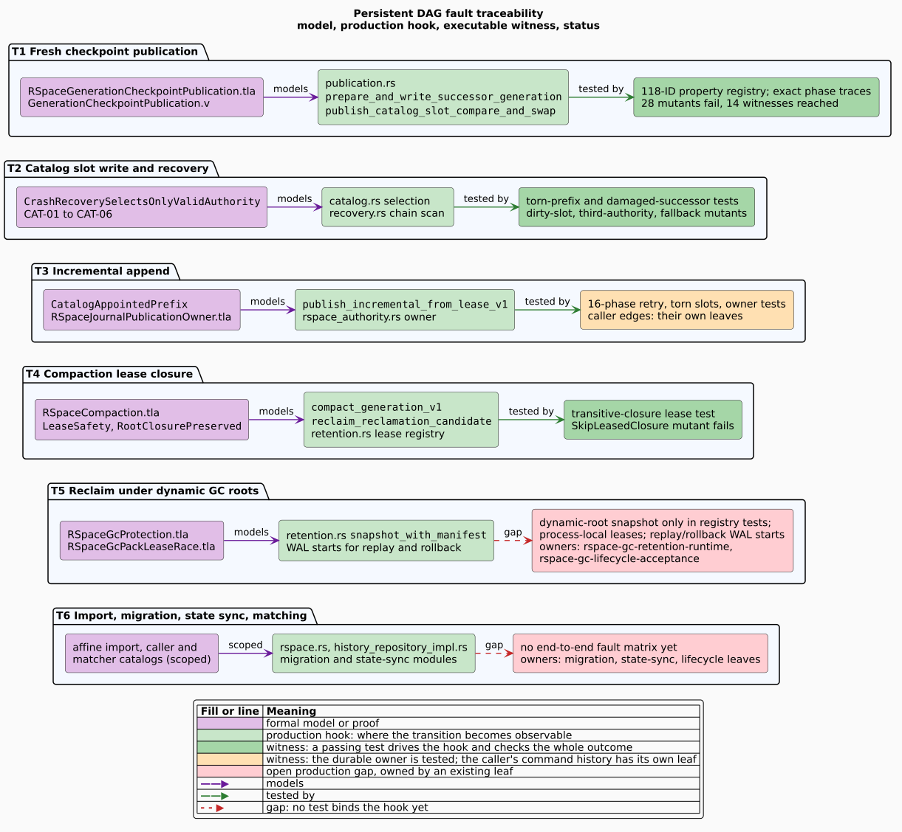
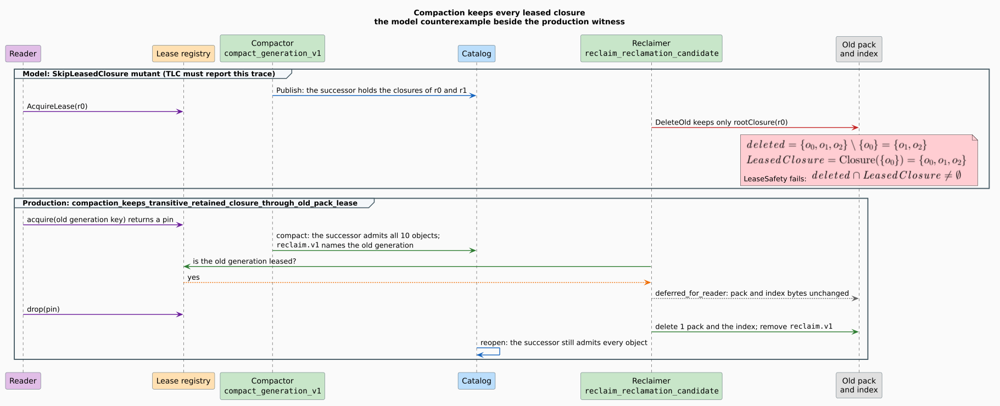

# Persistent DAG formal-fault runtime traceability — 2026-10-08

This is the bounded reconciliation for `rspace-dag-formal-fault-verification` (pgmcp task 5692). A **transition** is an observable change of authority or protected bytes; a **negative control** is a deliberately defective model configuration that must fail its named invariant. **Selected authority** means the complete generation appointed by the catalog, not an unselected synchronized WAL tail. The matrix below maps existing protocol evidence to the current Rust source and names the executable witness for each transition. It does not treat a bounded model, a component property, or a historical claimed percentage as verification of an uncalled runtime path.

The document was first written on 2026-10-08. On 2026-10-25 it gained the compaction lease-closure transition (T4), its formal treatment, two figures and commit-bound evidence.

## Terms

| Term | Meaning |
| --- | --- |
| generation | The packs and the object index that one catalog slot appoints. A lease names a generation by its `GenerationLeaseKeyV1`: catalog epoch, first live pack, active pack and index generation. |
| pack | An append-only file of DAG object records. A generation's *live range* is the packs from its first live pack through its active pack. |
| lease (pin) | A reader's claim on a generation, held in the process-local `GenerationLeaseRegistryV1`. While it is held, reclamation unlinks no pack in a range that overlaps it. |
| reclamation candidate | The authenticated `reclaim.v1` sidecar that names the superseded generation and its selected successor. |
| WAL | The write-ahead log: committed transaction records that replay and rollback may still need. |
| CAS | The catalog compare-and-swap that publishes a successor slot. |
| TLA+, TLC | The specification language of the state-machine models, and its explicit-state model checker. |
| Rocq | The proof assistant (formerly Coq) used for the checkpoint publication theories. |
| production hook | The Rust function at which a transition becomes observable. |
| executable witness | A passing source-level test that drives the hook and checks the transition's outcome. |



*Figure 1.* One row per transition: its model (purple), its production hook (light green) and its executable witness, colored by status. Dark green means a passing test drives the hook and checks the whole outcome. Amber means the durable owner is tested while the caller's command history belongs to another leaf. Red means an open production gap that an existing leaf owns. ([PlantUML source](figures/dag-formal-fault-traceability.puml))

## Transition matrix

| Transition and outcome | Model/proof | Production hook | Property and negative control | Current boundary and existing owner |
| --- | --- | --- | --- | --- |
| **T1. Fresh checkpoint:** preflight, DATA/PREPARE/index/COMMIT and sync precede catalog compare-and-swap; pre-slot failure retains the predecessor. | [`RSpaceGenerationCheckpointPublication.tla`](../../../formal/tlaplus/stack_safe_pda/RSpaceGenerationCheckpointPublication.tla), [`GenerationCheckpointPublication.v`](../../../formal/rocq/stack_safe_pda/theories/GenerationCheckpointPublication.v), and the [phase catalog](generation-checkpoint-invariant-catalog-2026-08-28.md#affine-publication-and-outcome-properties). | [`publication.rs`](../../../rspace++/src/rspace/persistence/durable/publication.rs), `prepare_and_write_successor_generation`, `publish_catalog_slot_compare_and_swap`; [`io.rs`](../../../rspace++/src/rspace/persistence/durable/io.rs) physical write/sync seam. | [`generation_checkpoint_properties.rs`](../../../rspace++/tests/persistence/generation_checkpoint_properties.rs) binds the 118-ID registry; [`durable_publication.rs`](../../../rspace++/tests/persistence/durable_publication.rs) checks exact phase traces, physical write/sync failures, full-image CAS, and reopen. The [integrated runner](../../../scripts/check-stack-safe-pda-proofs.sh) rejects 28 named mutants and reaches 14 witnesses, including premature catalog and stale-CAS controls. | The checkpoint model block passed again at `122c61ee0`, and the checkpoint properties at `142a887c8` ([evidence](#commit-bound-evidence)). No arbitrary instruction power-cut or filesystem-wide durability proof follows. The physical-I/O seam leaf is `rspace-durable-physical-io-fault-seam` (claimed done); native Windows and filesystem certification have separate existing leaves. |
| **T2. Catalog slot begins writing:** an incomplete slot admits only the predecessor or an exact complete successor; a selected successor with damaged authoritative closure fails closed, while a safely rebuildable index may be repaired. | Same checkpoint model, especially `CrashRecoverySelectsOnlyValidAuthority`; [CAT-01–06](generation-checkpoint-invariant-catalog-2026-08-28.md#catalog-selection-and-recovery-properties). | [`catalog.rs`](../../../rspace++/src/rspace/persistence/durable/catalog.rs) selection, [`recovery.rs`](../../../rspace++/src/rspace/persistence/durable/recovery.rs) chain scan, and `publish_catalog_slot_compare_and_swap` in `publication.rs`. | `every_injected_torn_catalog_prefix_recovers_only_old_or_exact_new_authority` and `selected_successor_damage_never_falls_back_and_repairs_safe_index` in `durable_publication.rs`; dirty-slot, third-authority, and damaged-successor-fallback mutants. | Catalog-appointed V1 recovery is a checked component contract. A synchronized unselected candidate COMMIT cannot advance authority. Runtime caller activation is `rspace-authority-operation-gate`; caller lifecycle acceptance is `rspace-authority-lifecycle-acceptance`. |
| **T3. Incremental append:** retain the appointed predecessor prefix, discard only an unselected suffix, publish the exact successor, then resolve old/new/unknown without applying a mutation twice. | [`CatalogAppointedPrefix`](../../../formal/rocq/stack_safe_pda/theories/GenerationCheckpointPublication.v) and [`RSpaceJournalPublicationOwner.tla`](../../../formal/tlaplus/stack_safe_pda/RSpaceJournalPublicationOwner.tla); [IP and JO catalog](generation-checkpoint-invariant-catalog-2026-08-28.md#incremental-publication-ownership-and-retry-refinement). | `publish_incremental_from_lease_v1` and `publish_incremental_with_terminal_v1` in `publication.rs`; [`rspace_authority.rs`](../../../rspace++/src/rspace/persistence/durable/rspace_authority.rs) retains the permit, writer, registry, predecessor pin and pending receipt. | `borrowed_incremental_publication_recovers_and_retries_every_phase` (16 phases), `borrowed_incremental_publication_retains_authority_for_every_torn_slot_prefix`, and short-appointed-pack refusal in `durable_publication.rs`; JO owner tests in [`durable_rspace_authority.rs`](../../../rspace++/tests/persistence/durable_rspace_authority.rs). JO mutants include gate release, partial/early acknowledgement, duplicate publication and wrong terminal. | These tests exercise the private durable owner, including cold reopen and acknowledgement. Supported RSpace command-history, caller gate, reset/spawn and whole-owner teardown edges remain `rspace-incremental-history-fault-acceptance`, `rspace-authority-operation-gate` and `rspace-authority-lifecycle-acceptance`. The finite JO model does not prove arbitrary Rust traces or unbounded liveness. |
| **T4. Compaction lease closure:** compaction copies the closure of every current and retained root into a fresh generation and publishes it; reclamation then deletes the superseded generation only when no held lease overlaps it, so no object that a leased root reaches is deleted. | [`RSpaceCompaction.tla`](../../../formal/tlaplus/stack_safe_pda/RSpaceCompaction.tla): `RootClosurePreserved` and `LeaseSafety` ([T4 section](#t4-compaction-lease-closure)). | `compact_generation_v1` in `publication.rs`; `GenerationLeaseRegistryV1::acquire` and `retire_pack_range_if_unleased` in [`retention.rs`](../../../rspace++/src/rspace/persistence/retention.rs); `reclaim_reclamation_candidate` in `io.rs`. | `compaction_keeps_transitive_retained_closure_through_old_pack_lease`, `checkpoint_reclamation_waits_for_older_epoch_pin_from_independent_open`, `retired_pack_frontier_survives_all_handle_drop_until_process_exit` and `pending_reclamation_waits_for_selected_successor_verification` in `durable_publication.rs`; two registry tests in `retention.rs`. Negative control: [`RSpaceCompactionSkipLeasedClosureMutant.cfg`](../../../formal/tlaplus/stack_safe_pda/RSpaceCompactionSkipLeasedClosureMutant.cfg) must violate `LeaseSafety` through `Publish`, `AcquireLease`, `DeleteOld`. | Witnessed at the durable owner. No RSpace caller invokes compaction yet: `compact_generation_v1` has only test callers. Leases are process-local and every test pins before compaction; dynamic roots and cross-process leases belong to T5. |
| **T5. Reclaim under dynamic GC roots:** copy protected current, retained and dynamic closures, select a durable successor, and preserve exact old-generation pins and independent replay and rollback WAL starts until safe retirement. | [`RSpaceGcProtection.tla`](../../../formal/tlaplus/stack_safe_pda/RSpaceGcProtection.tla), its [protection matrix](gc-protection-matrix-2026-10-01.md), and [`RSpaceGcPackLeaseRace.tla`](../../../formal/tlaplus/stack_safe_pda/RSpaceGcPackLeaseRace.tla). | [`retention.rs`](../../../rspace++/src/rspace/persistence/retention.rs) has `snapshot_with_manifest` and exact generation leases; `compact_generation_v1` in `publication.rs` and `reclaim_reclamation_candidate` in `io.rs` are the physical boundaries. | [`check-rspace-gc-protection-model.sh`](../../../scripts/check-rspace-gc-protection-model.sh) checks full and known projections, the overlap witness and six causal mutants. [`check-rspace-gc-pack-lease-race-model.sh`](../../../scripts/check-rspace-gc-pack-lease-race-model.sh) checks older-epoch deferral and kills the exact-key-only mutant. | Current source calls `snapshot_with_manifest` only in registry tests; compaction does not bind that dynamic-root snapshot to a physical successor. Runtime WAL starts for replay and rollback are also open. Lease acquisition and pack retirement linearize under one registry mutex (T4), but only within one process: the registry is neither a durable retirement record nor a cross-process lease authority, and non-Unix opens receive no claim ([protection matrix](gc-protection-matrix-2026-10-01.md)). `rspace-gc-retention-runtime` owns the runtime binding and `rspace-gc-lifecycle-acceptance` its acceptance under pins, crashes and disk pressure. Neither TLA+ model proves the runtime edge. |
| **T6. Import, migration cutover, state sync, and indexed matching** must preserve the same authority and semantic observations across their actual caller transitions. | Existing affine import and caller models, the [legacy migration baseline](generation-checkpoint-invariant-catalog-2026-08-28.md#legacy-retained-root-migration-baseline), and [two-level matcher catalog](two-level-rspace-authority-invariant-catalog-2026-09-02.md) supply scoped protocols. | RSpace caller wiring remains under [`rspace.rs`](../../../rspace++/src/rspace/rspace.rs), [`history_repository_impl.rs`](../../../rspace++/src/rspace/history/history_repository_impl.rs), and the existing migration/state-sync modules. | Component codec, import, record-index and matcher differentials exist, but no single current-source end-to-end fault matrix binds all of these caller transitions to the selected DAG owner. | Existing leaves are `rspace-migration-shadow-owner`, `rspace-migration-remove-legacy-authority`, `rspace-dag-state-sync`, `rspace-authority-lifecycle-acceptance`, and the matcher-specific leaves. These are separate production acceptance scopes, not new work concealed inside this reconciliation. |

## T4: compaction lease closure

Compaction copies every object that a current or retained root reaches into a fresh generation, publishes that generation, and then reclaims the superseded one. A reader that holds a lease on a root needs every object reachable from that root, not only the objects the root names directly. The bounded model states this rule as `LeaseSafety`, and a mutant that keeps only the directly named objects must fail it.

### Notation

| Symbol | Meaning | In `RSpaceCompaction.tla` |
| --- | --- | --- |
| $`O`$ | the objects, abstract digest identities: $`\{o_0, o_1, o_2\}`$ | `Objects` |
| $`E`$ | the canonical ObjectRef edges, from a node to the children it references by digest: $`o_0 \to o_1`$ and $`o_1 \to o_2`$ | `edges` |
| $`R`$ | the roots: $`\{r_0, r_1\}`$ | `Roots` |
| $`\mathrm{seed}(r)`$ | the objects that root $`r`$ names directly: $`\mathrm{seed}(r_0) = \{o_0\}`$ and $`\mathrm{seed}(r_1) = \{o_2\}`$ | `rootClosure(r)` |
| $`C`$, $`H`$ | the current roots $`\{r_0\}`$ and the retained historical roots $`\{r_1\}`$ | `currentRoots`, `retainedRoots` |
| $`L`$ | the leased roots (a state variable) | `leases` |
| $`\mathit{marked}`$, $`\mathit{copied}`$ | the objects found reachable, and the objects copied into the successor | `marked`, `copied` |
| $`\mathit{deleted}`$ | the old-generation objects deleted | `deleted` |
| $`\mathit{published}`$ | whether the successor catalog is published | `published` |
| $`\mathit{phase}`$ | the protocol phase: idle, marking, copying, published, done or aborted | `phase` |

The model calls $`\mathrm{seed}(r)`$ `rootClosure(r)`, although that set is not closed under edges. This document calls it $`\mathrm{seed}`$ because the mutant below is exactly the confusion of a seed with its closure.

### Definitions

The successors of a set, and its closure:

```math
\mathrm{succ}(S) = \{\, y \in O \mid \exists x \in S.\ (x, y) \in E \,\}
```

```math
\mathrm{Closure}(S) = \bigcap \{\, T \subseteq O \mid S \subseteq T \ \wedge\ \mathrm{succ}(T) \subseteq T \,\}
```

$`\mathrm{Closure}(S)`$ is the least edge-closed superset of $`S`$. The model picks it with `CHOOSE` as the least member of the closed sets that contain $`S`$; that member is the intersection above, because $`O`$ itself is closed and an intersection of closed sets is closed. In the bounded configuration, $`\mathrm{Closure}(\{o_0\}) = \{o_0, o_1, o_2\}`$ and $`\mathrm{Closure}(\{o_2\}) = \{o_2\}`$.

```math
\mathrm{AllRetainedRoots} = C \cup H \cup L,
\qquad
\mathrm{LeasedClosure} = \bigcup_{r \in L} \mathrm{Closure}(\mathrm{seed}(r))
```

The two invariants that T4 maps to production:

```math
\mathrm{LeaseSafety} \;\triangleq\; \mathit{deleted} \cap \mathrm{LeasedClosure} = \emptyset
```

```math
\mathrm{RootClosurePreserved} \;\triangleq\; \mathit{published} \Rightarrow \forall r \in \mathrm{AllRetainedRoots}.\ \mathrm{Closure}(\mathrm{seed}(r)) \subseteq \mathit{copied}
```

[`RSpaceCompaction.cfg`](../../../formal/tlaplus/stack_safe_pda/RSpaceCompaction.cfg) also checks `TypeInvariant`, `NoDanglingEdge`, `CatalogAtomicity`, `PrePublishRollback`, `NoDeletionBeforePublication` and `BoundedFrontier`.

### The protocol, in literate form

Compaction marks with an explicit worklist, copies, publishes, and only then deletes. The model action for each line is on the right.

```text
COMPACT                                                       ▷ model action
 1  work ← ⋃ { seed(r) : r ∈ C ∪ H ∪ L }                      ▷ StartMark
 2  while work ≠ ∅:                                           ▷ MarkOne
 3      x ← any element of work
 4      work ← (work ∖ {x}) ∪ (succ({x}) ∖ marked)
 5      marked ← marked ∪ {x}
 6  require marked = ⋃ { Closure(seed(r)) : r ∈ C ∪ H ∪ L }   ▷ FinishMark
 7  for each x ∈ marked: copied ← copied ∪ {x}                ▷ CopyOne
 8  require copied = marked; switch the catalog to the successor   ▷ Publish
RECLAIM
 9  deleted ← deleted ∪ (marked ∖ LeasedClosure)              ▷ DeleteOld
```

Lines 1 to 5 walk the graph with a heap worklist, so the depth of the DAG never becomes call-stack depth. Line 6 is a guard, not an assignment: the model refuses to continue unless the iterative walk produced exactly the denotational closure. Line 8 is the single catalog switch, so a reader sees either the old catalog or the new one and never a mix. A lease can be taken only between line 8 and line 9, because `AcquireLease` is enabled only in the published phase, and line 9 must keep that lease's whole closure. The `SkipLeasedClosure` mutant replaces `LeasedClosure` on line 9 with $`\bigcup_{r \in L} \mathrm{seed}(r)`$.

### Why the baseline keeps LeaseSafety and the mutant cannot

**Lemma 1.** In every reachable state, if $`\mathit{phase} \neq \texttt{done}`$ then $`\mathit{deleted} = \emptyset`$.

*Proof.* By induction on behaviors. `Init` sets $`\mathit{deleted} = \emptyset`$. No action leaves the done phase: `StartMark` needs idle, `MarkOne` and `FinishMark` need marking, `CopyOne` and `Publish` need copying, `DeleteOld` and `AcquireLease` need published, `AbortBeforePublish` needs marking or copying, and `ReleaseLease` leaves the phase unchanged. Take a step from a state that satisfies the lemma. If the step is `DeleteOld`, it enters done and the lemma holds vacuously afterwards. Every other action leaves $`\mathit{deleted}`$ unchanged; if the phase after the step is not done, the phase before it was not done either, so $`\mathit{deleted}`$ was empty and stays empty. ∎

**Theorem 1.** `LeaseSafety` holds in every reachable state of the baseline, where `SkipLeasedClosure` is `FALSE`.

*Proof.* By induction on behaviors. `Init` has $`\mathit{deleted} = \emptyset`$. Take a step from a state that satisfies `LeaseSafety`. The nine actions fall into four cases.

1. `StartMark`, `MarkOne`, `FinishMark`, `CopyOne`, `Publish` and `AbortBeforePublish` change neither $`\mathit{deleted}`$ nor $`L`$, and $`\mathrm{LeasedClosure}`$ depends only on $`L`$. Both sides of the invariant are unchanged.
2. `AcquireLease` is enabled only in the published phase, so $`\mathit{deleted} = \emptyset`$ by Lemma 1, and the step leaves it empty.
3. `ReleaseLease` removes a root from $`L`$, so $`\mathrm{LeasedClosure}' \subseteq \mathrm{LeasedClosure}`$ while $`\mathit{deleted}' = \mathit{deleted}`$. The intersection can only shrink.
4. `DeleteOld` is enabled only in the published phase, so $`\mathit{deleted} = \emptyset`$ by Lemma 1, and the step leaves $`L`$ unchanged. Hence $`\mathit{deleted}' = \mathit{marked} \setminus \mathrm{LeasedClosure}`$, which is disjoint from $`\mathrm{LeasedClosure}' = \mathrm{LeasedClosure}`$. ∎

**The mutant fails.** With `SkipLeasedClosure = TRUE`, case 4 keeps only $`\bigcup_{r \in L} \mathrm{seed}(r)`$, which can be a strict subset of $`\mathrm{LeasedClosure}`$. Take $`L = \{r_0\}`$. Marking started from $`C \cup H = \{r_0, r_1\}`$, so $`\mathit{marked} = \{o_0, o_1, o_2\}`$, and

```math
\mathit{deleted}' = \{o_0, o_1, o_2\} \setminus \{o_0\} = \{o_1, o_2\},
\qquad
\mathit{deleted}' \cap \mathrm{Closure}(\{o_0\}) = \{o_1, o_2\} \neq \emptyset .
```

TLC reports exactly this behavior: 12 states, ending in `Publish` (state 10), `AcquireLease` of $`r_0`$ (state 11) and `DeleteOld` (state 12) with $`\mathit{deleted} = \{o_1, o_2\}`$. [`check-rspace-compaction-model.sh`](../../../scripts/check-rspace-compaction-model.sh) requires the violated invariant to be `LeaseSafety` and the trace to contain `Publish`, then `AcquireLease`, then `DeleteOld`. The integrated runner [`check-stack-safe-pda-proofs.sh`](../../../scripts/check-stack-safe-pda-proofs.sh) calls that script.

**What the bound leaves out.** $`R = C \cup H`$, so a lease can never name a root that compaction did not already retain, and $`\mathrm{AllRetainedRoots}`$ never grows after marking starts. The model therefore cannot express a dynamic root that appears during compaction. That is the dynamic-root handoff of T5, which this result does not cover.

### The counterexample beside the production witness



*Figure 2.* Top: the `SkipLeasedClosure` counterexample that TLC must report. Bottom: `compaction_keeps_transitive_retained_closure_through_old_pack_lease`, in which a pin taken before compaction keeps the old pack and index unchanged until it is dropped. ([PlantUML source](figures/rspace-compaction-lease-closure.puml))

Production reclamation and lease acquisition, in the same literate form:

```text
RECLAIM(candidate, selected)              ▷ io.rs, reclaim_reclamation_candidate
 1  require candidate.successor = selected   ▷ otherwise CatalogAuthorityChanged
 2  under the registry mutex:                ▷ retention.rs, retire_pack_range_if_unleased
 3      if a held lease's pack range overlaps candidate.old: return DEFERRED
 4      retired_pack_through ← max(retired_pack_through, candidate.old.active_pack)
 5  unlink every pack in candidate.old's live range, then the old index
 6  sync the directory; remove reclaim.v1

ACQUIRE(key)                              ▷ retention.rs, acquire
 7  under the registry mutex:
 8      if key.first_live_pack ≤ retired_pack_through: return RETIRED
 9      record the lease and return it
```

Production differs from the model in two ways, and both make deletion more conservative.

1. **Granularity.** A production lease names a generation, not a root, and reclamation is all-or-nothing: while any held lease overlaps the old live range (line 3), no pack and no index is unlinked. The model's baseline deletes object by object outside $`\mathrm{LeasedClosure}`$.
2. **Ordering.** The model allows a lease only between publication and deletion. In production, lines 2 to 4 and lines 7 to 9 run under one mutex, so acquisition and retirement linearize: a lease taken first defers retirement, and once retirement wins (line 4, before the first unlink), every later acquisition whose range starts at or below the retired frontier fails with `Retired`.

These give `LeaseSafety` for production under one premise: *a reader that holds a lease on generation $`g`$ reads objects only from packs in $`g`$'s live range and from $`g`$'s index.* Abstract each old object as deleted when the pack that holds its record is unlinked. Line 3 unlinks nothing while a lease that overlaps the old range is held, and line 8 refuses new leases on a retired range, so no object in a held lease's closure is deleted. The premise is what a generation key denotes; neither the model nor the tests prove it.

| Model | Production hook | Executable check in [`durable_publication.rs`](../../../rspace++/tests/persistence/durable_publication.rs) and [`retention.rs`](../../../rspace++/src/rspace/persistence/retention.rs) |
| --- | --- | --- |
| `StartMark` to `Publish`; `RootClosurePreserved` | `compact_generation_v1` (`publication.rs:995`), which publishes the admitted retained closure through the checkpoint publication protocol | `compaction_keeps_transitive_retained_closure_through_old_pack_lease` (`:1879`): the current state is empty, and the retained historical state reaches a wide root with eight leaves (10 node objects). The successor admits all of them after compaction, after reopen and after reclamation. |
| `AcquireLease` | `GenerationLeaseRegistryV1::acquire` (`retention.rs:605`) | The same test pins the old generation before compaction. `checkpoint_reclamation_waits_for_older_epoch_pin_from_independent_open` (`:1810`) pins an older-epoch key over the same packs through an independently opened handle that shares the registry. |
| `DeleteOld`; `LeaseSafety` | `reclaim_reclamation_candidate` (`io.rs:1215`) through `retire_pack_range_if_unleased` (`retention.rs:645`); after checkpoint publication and at startup (`startup.rs:305`) | Both tests: `deferred_for_reader` while pinned, with the old pack and index bytes unchanged; after `drop(pin)`, one pack and the index are deleted and `reclaim.v1` is removed. |
| no model step: acquisition after retirement | `acquire` returns `Retired` | `:1810` re-acquires the older key and gets `Retired`, while the successor key is still acquirable. `retired_pack_frontier_survives_all_handle_drop_until_process_exit` (`:2106`) keeps the frontier across handle drops. In `retention.rs`, `generation_lease_acquisition_and_retirement_have_one_winner` (`:902`) races the two operations over 16 epochs, and `generated_pack_range_retirement_preserves_overlap_and_frontier` (`:952`, 128 cases) checks overlap and the frontier on generated ranges. |
| `NoDeletionBeforePublication` | reclamation requires the candidate's successor to be the selected catalog slot (line 1 above) | `pending_reclamation_waits_for_selected_successor_verification` (`:2059`): a damaged selected successor fails recovery and keeps the old pack, index and sidecar; once its bytes are restored, admission completes the reclamation. |

What T4 does not cover:

- The registry is process-local. It is neither a durable retirement record nor a cross-process lease authority, and non-Unix opens receive no claim ([protection matrix](gc-protection-matrix-2026-10-01.md)). That is T5.
- Each test takes its pin before compaction or publication. Acquisition racing retirement is tested at the registry, not through the compaction path.
- Dynamic roots (`snapshot_with_manifest`) are not bound to compaction (T5).
- No RSpace caller invokes compaction yet, so the witness stands at the durable owner.
- The model is bounded to three objects and two roots.

## Commit-bound evidence

Each run below gated a clean export of the named commit's tree, so uncommitted work was excluded. The logs are ignored local artifacts under `target/`, so their SHA-256 values identify these observations; they are not portable proof receipts.

Source identity: `git diff 142a887c8 122c61ee0` touches only documentation, figures and the proof runner, so the rspace++ results at `142a887c8` apply to the sources at `122c61ee0`. Between `b48707d09` and `142a887c8`, rspace++ changed only `hot_store.rs`, `record_index.rs` and `hot_store_spec.rs` (installed-join snapshot order), all outside the persistence code. The models and the three model scripts are byte-identical from `b48707d09` through `122c61ee0`: `RSpaceCompaction.tla` `76634ccc4f12d4159ee12134d4e09ff5ff96c8856e836c8d810901f82a9c70da`, `RSpaceGcProtection.tla` `a0d7c86d0ecd847513c429cba23a66db9facb116e5a83454126816bbfe98fa85`, `RSpaceGcPackLeaseRace.tla` `5db1573a9d7de9db33410ebf20cba7452569380497ab6d3d75f3a48aaccf9f5b`.

| Commit (tree) | Gate | Result |
| --- | --- | --- |
| `b48707d09` (`83478ba6`) | `check-rspace-compaction-model.sh` | Baseline passes; the `SkipLeasedClosure` mutant violates `LeaseSafety` with the `Publish`, `AcquireLease`, `DeleteOld` trace. |
| `b48707d09` (`83478ba6`) | nextest, `durable_publication` | 38 passed; the 39th test is the ignored unwind child, which other tests launch as a subprocess. |
| `142a887c8` (`64f4a633`) | nextest over every rspace++ test binary, `package(rspace_plus_plus)`: 1,238 tests in 24 binaries, 11 ignored tests skipped | 1,237 passed and 1 failed. The failure is the known PathMap 0.2.2 defect PMU-006 in `two_phase_teardown_properties::compressed_navigation_matches_scalar_generated_topology_histories`, outside T1–T5. `durable_publication` 38/38, `generation_checkpoint_properties` 18/18, `durable_rspace_authority` 16/16, and both registry tests passed. |
| `122c61ee0` (`c4401adb`) | the generation-checkpoint block of `check-stack-safe-pda-proofs.sh` | Baseline, 28 mutants and 14 witnesses: 43 TLC runs, each with its expected outcome. |
| `122c61ee0` (`c4401adb`) | `check-rspace-gc-protection-model.sh` | The full baseline (1,503,800 distinct states) and the known-projection baseline (149,684) pass; the overlap witness and six causal mutants each violate their named invariant. |
| `122c61ee0` (`c4401adb`) | `check-rspace-gc-pack-lease-race-model.sh` | The baseline (112 distinct states) passes; the older-epoch witness violates `OlderLifecycleAbsent` as intended, and the exact-key-only mutant violates `OlderEpochPackSafe`. |
| `122c61ee0` (`c4401adb`) | `check-rspace-compaction-model.sh` | The baseline (27 distinct states, depth 14) passes; the mutant's 12-state counterexample violates `LeaseSafety`. |

Log digests for the runs at `122c61ee0` (generation-checkpoint block, then each model log), and for the two nextest runs:

| Log | Outcome | SHA-256 |
| --- | --- | --- |
| generation-checkpoint block | baseline, 28 mutants, 14 witnesses | `449ea54f90b6ff03f318d88a37637fda74d6560fecf600d9544f6547e0c20529` |
| `rspace-compaction/baseline.log` | no error | `d13fc014f63ae64554ede599301c0902e6fd6affe40e383fc464cc6a90b039f8` |
| `rspace-compaction/skip-leased-closure-mutant.log` | `LeaseSafety` violated | `1237fcfb15a34dff141cee275d97931b3ab630fc5596811549df61ec8f025271` |
| `rspace-gc-pack-lease-race/baseline.log` | no error | `225b0f8a6f079af3523c248db8413c8f4bf236a8c8252aa7b4e5b4cbf69b7f65` |
| `rspace-gc-pack-lease-race/older-witness.log` | `OlderLifecycleAbsent` violated (witness) | `6afb8068c372cab2bc7453f37de46fc731360974bebe21b88ea65bbb624623e0` |
| `rspace-gc-pack-lease-race/exact-key-only-mutant.log` | `OlderEpochPackSafe` violated | `4532bc8c80aefe38cfcf1cca5564677357f85399a96d86ae856e3706f3c57dd6` |
| `rspace-gc-protection/baseline.log` | no error | `99d126135a019323f09c8cb85fd9735438e49b173c467bd8d4347c2d4bfed800` |
| `rspace-gc-protection/known-baseline.log` | no error | `a36a21aca569c57005135686e5b5105151afbd55f2c73ad624e7e3c528e43fdd` |
| `rspace-gc-protection/known-overlap-witness.log` | `KnownOverlapLifecycleAbsent` violated (witness) | `7f6012306660b5c7d157431a8f51f5f01f626c6ab189faab2f4f236d033e0bd5` |
| `rspace-gc-protection/BlockWalOnOldPackMutant.log` | `ObjectOnlyPinDoesNotBlockWal` violated | `3de2444c2fa236d6a3181199ea4b2883f825cccafd9993ab5c492cb659901310` |
| `rspace-gc-protection/IgnoreDurableExactPinMutant.log` | `DurableExactGenerationProtected` violated | `3620550952d03659d4d275a2ed61717c7869fa0babea7ccd0bc31bce3dfff55f` |
| `rspace-gc-protection/IgnoreExactPinMutant.log` | `ExactOldPinsProtected` violated | `deed03308c9f1587c6c1eacd3a2bfab7e2e950c632c591b314a6cb896acd5091` |
| `rspace-gc-protection/OmitCoupledFacetMutant.log` | `PublishedClosureProtected` violated | `f522bb104b2ea69ab3e08b329b7e7bd177514a7b0f7c4df0e60aa1c597d0598e` |
| `rspace-gc-protection/OmitKnownClosureMutant.log` | `KnownPublicationClosureProtected` violated | `0ace786a91308f9476eaf34188a8825b951e00b6631e45fa6812fb0fa28f5dcd` |
| `rspace-gc-protection/PrunePastWalStartMutant.log` | `WalFrontierProtected` violated | `06d2746a031b0b8e9dda0eb3c2bced493a04b83d1a5d7ed01b68095029f56367` |
| nextest at `142a887c8` | 1,237 of 1,238 passed (PMU-006 red) | `68854c65fbb9bb1304afbafb2058e567e65e238e2f052d1d1ec8576d8a34d10f` |
| nextest at `b48707d09` | `durable_publication` 38/38 | `c3dd692a1db7283bc5b0b759977b8402aae54c31c7421e405cd8fc864bcda20d` |

### Earlier observation (2026-10-08)

The checkpoint's local `target/verification/generation-checkpoint/` logs are ignored artifacts, so their hashes identify this observation rather than a portable proof receipt: `manifest-current.log` `c0e20ca7acbcf1a80955c435b27ede9bcd287e4b1ab8ec0095d34da513d002ad` (1/1), `properties-current.log` `d12d4933cd98b30c8fed71f281adfed4792a2e27d58d9291d93d64fae5d1ff48` (18/18), `rocq-current.log` `0d1fbdf2a706452cc01a1520f96683eed60d233906b6b619b3542d4a08d905e2`, and `tlc-current.log` `7862bcb54a6673782f986b4633c5e0db8c420404fcef4a1c45fa2bd0bba460fb` (base, 28 mutants, 14 witnesses). The GC protection gate's phase-guarded log is `2882df6908238440df01dc721ed1acd3e4583363d268a45fe876567e2df6da3c`; the separate lease-race baseline, older-epoch witness and exact-key-only mutant logs are `53178dcaf0d61beb35bc853db4ff625ecb6bfc157b8fac5b2d58a83c3192236f`, `0c5c1c8d82a7c22664b719457f293adcebad23227c1fab53eca4b19693cd2004`, and `8b83d8f728f8288b2ec8adc438a604d5328a71d2dfab43eec2fc6c001648e9b5`. The older-epoch witness is an expected invariant violation, and the mutant must violate `OlderEpochPackSafe`; neither is a passing production test.

## Reviewer check

Each production transition above is either represented by a passing source-level test or assigned to its existing leaf. T1, T2 and T4 have passing witnesses at the durable owner. T3's durable owner is tested, and its caller edges belong to `rspace-incremental-history-fault-acceptance`, `rspace-authority-operation-gate` and `rspace-authority-lifecycle-acceptance`. T5 belongs to `rspace-gc-retention-runtime` and `rspace-gc-lifecycle-acceptance`; T6 belongs to the migration, state-sync, lifecycle and matcher leaves named in its row. No new parser, model bootstrap, or production algorithm is implied by this traceability update. The task's historical 99% field and zero current acceptance criteria are not a completion verdict.
