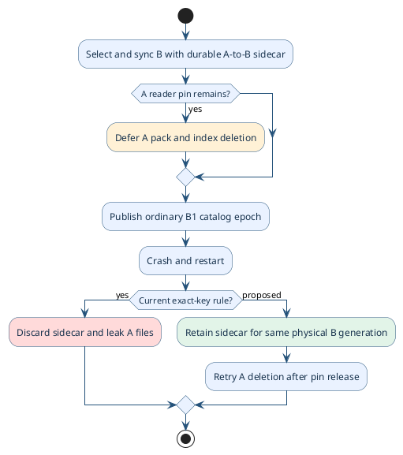

# Pending physical reclaim intent across catalog advances

This is the focused contract for campaign leaf
`rspace-gc-pending-reclaim-intent-retry` (9244). The
[finite model](../../../formal/tlaplus/stack_safe_pda/RSpaceGcPendingReclaimIntent.tla)
is a bounded, model-checked protocol with focused Rust evidence, **not yet an
independently audited runtime correspondence**. TLC is the TLA+ explicit-state
model checker. A checkpoint is acknowledged only after its catalog
selection and required sync have completed.

Here A, B and C name successive catalog-appointed physical generations. B1
and C1 are later catalog epochs that still use B's or C's pack range and
index generation. A **sidecar** is the single durable `reclaim.v1` record
holding one predecessor-to-successor deletion obligation. A **pin** is a
process-local reader lease on a physical pack range. **CAS** means the
catalog's compare-and-swap selection of a synchronized successor.

## Prior lost-intent trace

Before this leaf, the [sidecar writer](../../../rspace++/src/rspace/persistence/durable/io.rs)
removed an existing `reclaim.v1` before it wrote a new candidate. The
[restart path](../../../rspace++/src/rspace/persistence/durable/startup.rs)
discarded a candidate whenever its successor key was not exactly the selected
catalog key; it did not retry a matching selected candidate. The
[generation checkpoint path](../../../rspace++/src/rspace/persistence/durable/publication.rs)
can leave `A→B` reclamation pending while an A reader holds its physical pack
range. An ordinary incremental publication then changes B's catalog epoch to
B1 without changing B's physical generation. On restart, B1 is not the exact
key recorded as B, so the sidecar is removed and A's pack and index remain
without a durable deletion obligation. A subsequent B→C checkpoint can also
overwrite the still-pending A→B sidecar.



## Abstract transition contract

The model has one durable sidecar slot, catalog states A, B, B1, C and C1,
individual pack and index presence bits, process-local A/B reader pins, and
retirement gates. `StageAB` and `PersistAB` put the candidate on disk before
`SelectAB`; `AckAB` models the final caller acknowledgement. `AdvanceB` is an
authenticated ordinary update within B's physical generation. A crash drops
process pins and the in-memory retirement gate while preserving the catalog,
sidecar and physical files. `Recover` discards only an unselected pre-CAS
intent; it retains a selected intent through B1 or C1. `CleanOrphanB` and
`CleanOrphanC` represent the existing authenticated
[`prepare_unpublished_successor_artifacts`](../../../rspace++/src/rspace/persistence/durable/io.rs)
preflight that removes unselected successor names before a retry. This
pre-CAS cleanup is separate from selected predecessor reclamation.

`DeleteAPart` and `DeleteBPart` abstract individual old-file unlinks.
`SyncAUnlinks` and `SyncBUnlinks` mark the directory sync that makes those
unlinks durable; `FinishA` and `FinishB` may then clear the sidecar. A crash
before this sync leaves the intent in place for retry. The finite model does
not simulate filesystem-specific rollback of an unsynchronized unlink; its
safety claim is the ordering of sync and intent clearance.

The proposed B1 classifier needs a validated selected catalog whose
`first_live_pack`, `active_pack`, and `index_generation` equal the recorded B
physical key and whose epoch has not gone backward. The durable pack/index
tails may advance within that same generation. A current catalog still in
the recorded A physical generation is pre-CAS; any third physical generation
is an error because B→C should have been refused while A→B occupied the
sidecar. This classification relies on the writer lease, catalog validation,
and the no-overwrite gate together; comparing epochs alone is insufficient.

In the draft writer protocol, recovery first verifies the complete selected
pack chain and bound index, then classifies that selected catalog against the
one stored intent. An old physical generation means the
intent preceded CAS and may be cleared without deleting selected bytes. A
selected successor physical generation keeps the intent, retries under the
writer lease, and clears it only after the old pack and index are gone and the
directory has been synchronized. Any unrelated generation is an error. A new
checkpoint may stage a second candidate only when the slot is empty after
that retry; otherwise it returns a refusal before acknowledgement.

```text
retry_pending_under_writer_lease():
    intent = read_validated_sidecar()
    current = recover_and_verify_selected_pack_chain_and_index()
    if intent is absent: return Empty
    if same_physical_generation(current, intent.old):
        clear_pre_CAS_intent_without_deleting_current_files()
        return Empty
    if not same_physical_generation(current, intent.successor)
       or current.epoch < intent.successor.epoch:
        return InvalidAuthority
    if an overlapping old reader pin remains: return Deferred
    retire_old_range_against_new_pins()
    unlink_old_pack_and_index_idempotently()
    synchronize_predecessor_unlinks()
    clear_intent_and_synchronize_directory()
    return Empty

before_new_checkpoint():
    if retry_pending_under_writer_lease() != Empty:
        return RefusedBeforeAcknowledgement
```

This pseudocode states the intended safety boundary. The Rust implementation
has the same ordering. An I/O error before sidecar clearance must leave the
durable intent available for retry.

| Model transition | Required concrete boundary |
| --- | --- |
| `PersistAB` / `SelectAB` | Write and synchronize the exact sidecar under `reclaim.v1.tmp`, rename it to `reclaim.v1` without replacing a record, and synchronize the directory, all before catalog compare-and-swap; refuse a leftover temporary; select only fully durable successor files. |
| `TearIntent` | A failure anywhere from the temporary's creation to the rename leaves at most `reclaim.v1.tmp`, never a torn `reclaim.v1`; a rename lost to a power failure is the same state. |
| `AdvanceB` | Keep A→B live across an ordinary same-physical-generation catalog advance, or refuse the advance before its acknowledgement. An arbitrary higher epoch alone is not proof of descent. |
| `RefuseBC` | While A→B occupies the only sidecar and any A part remains, refuse B→C before it can overwrite the record or acknowledge. A held pin requires backpressure; without a pin, retry A first and refuse if deletion remains incomplete. Preserve the existing sidecar bytes. |
| `RetireA` / `DeleteAPart` / `SyncAUnlinks` / `FinishA` | Under the exclusive writer lease, atomically exclude new overlapping A pins, retry deletion of A's pack and index idempotently, sync the directory, then remove and sync the sidecar only after both are absent. The B transitions follow the same order. |
| `Recover` | First remove a leftover `reclaim.v1.tmp` after authenticating it against its handle, and synchronize the directory. Then distinguish pre-CAS stale intent from selected pending intent; retry safe selected deletion after restart without deleting catalog-appointed files. |

The baseline checks `CurrentAuthorityProtected`,
`SelectedDeletionObligationCovered`, `NoReaderRetired`, and
`NoSecondAcknowledgementWhileOldPending` over both checkpoints, ordinary
advances, crashes, partial pack/index deletion, and retries. The
`DropOnOrdinaryAdvance` mutant must violate obligation preservation; the
`OverwritePendingIntent` mutant must do the same before it can publish B→C.
Two witness configurations must reach a pre-CAS orphan-cleanup opportunity
and a held-reader refusal followed by B1 advance, crash, recovery and A
reclaim. These are bounded safety and reachability checks; an eventual retry
claim would additionally need scheduler or runtime fairness assumptions.

The generated runtime classifier property varies pack ranges and epoch gaps:
only a matching successor physical generation at or after its recorded epoch
can keep the selected A→B deletion obligation; an old physical generation is
pre-CAS, and third generations or lower epochs are unrelated. The focused
integration cases cover: a selected candidate survives repeated recovery while A stays pinned;
release permits exactly its old pack and index to be deleted, including after
partial deletion and restart; an ordinary B→B1 update cannot erase its
obligation; a second checkpoint with the only slot occupied by a pinned A
generation refuses before acknowledgement and leaves sidecar bytes unchanged;
pre-CAS cleanup never deletes A; and no path deletes the catalog-appointed B or
C files. The model also explores a pending but unpinned partial deletion; a
runtime fault-injection case for a second checkpoint during that I/O failure
remains open. The model's administrative stage and
history variables do not map directly to a Rust property. The model's
pins remain process-local, as in the existing GC pack-lease contract. It does
not establish cross-process reader coordination or Windows behavior.

## Torn intent publication (bug 11970)

**Prior torn-intent trace.** Until bug 11970, the sidecar writer created
`reclaim.v1` and then set its length, wrote it and synchronized it in place. A
failure or a crash between the creation and the synchronization left an empty
file, 88 zero bytes or a partial record under the final name. The reader
refuses such a record (`Length` or `InvalidData`). The restart path reads the
sidecar before anything else, so held-lease recovery, cold admission and every
later checkpoint failed permanently. The torn record could never authorize a
deletion, but it blocked all progress.

**Atomic publication.** The writer now publishes the sidecar in four steps:

1. it creates `reclaim.v1.tmp` exclusively, writes the record and synchronizes
   the file;
2. it authenticates the file against its handle;
3. it renames the file to `reclaim.v1` without replacing an existing record;
4. it synchronizes the directory.

Recovery first removes a leftover temporary, after authenticating it against
its handle, and synchronizes the directory. The writer refuses a leftover
temporary and never removes one.

The removal is safe. The writer returns only after the rename and the directory
synchronization, and the CAS follows the write. A temporary that is still
present therefore means that no CAS happened for its checkpoint, so it carries
no deletion obligation. A corrupt complete record under the final name stays
fail-closed.

**Model.** The model gains three elements:

- `TearIntent` is a failure anywhere from the creation to the rename, or a
  rename lost to a power failure, while a checkpoint's files are staged. It
  ends the process as `Crash` does. With `AtomicIntentPublication` it adds
  `IntentTemp` to the files. Without it, which is the in-place writer, it sets
  the sidecar to `"torn"`.
- `Recover` refuses a torn sidecar, as production does. With
  `RemoveIntentTempOnRecover` it removes `IntentTemp`.
- `PersistAB` and `PersistBC` require that `IntentTemp` is absent. This is the
  writer's exclusive creation.

Three invariants are added. In them, $`\mathit{live}`$ holds while a writer
process runs, $`\mathit{intent}`$ is the sidecar, and $`\mathit{files}`$ is
the set of files in the directory.

```math
\begin{aligned}
\mathit{RecoveryAvailable} &\triangleq \lnot\mathit{live} \Rightarrow \mathrm{ENABLED}\ \mathit{Recover} \\
\mathit{TornIntentNeverPublished} &\triangleq \mathit{intent} \neq \texttt{"torn"} \\
\mathit{IntentTempNeverLive} &\triangleq \mathit{live} \Rightarrow \mathit{IntentTemp} \notin \mathit{files}
\end{aligned}
```

Three mutants must violate them:

- `TornIntentMutant`, with `AtomicIntentPublication = FALSE`, violates
  `RecoveryAvailable` after `TearIntent`.
- `TornIntentPublishedMutant`, with the same constant, violates
  `TornIntentNeverPublished` after `TearIntent`.
- `KeepIntentTempMutant`, with `RemoveIntentTempOnRecover = FALSE`, violates
  `IntentTempNeverLive` after `TearIntent` and then `Recover`.

The runner `scripts/check-rspace-gc-pending-reclaim-intent-model.sh` checks
the baseline, these three mutants and the four earlier configurations. The
integrated proof runner calls it.

```plantuml
@startuml
skinparam backgroundColor #FFFFFF
skinparam activity {
  BackgroundColor #EAF2FF
  BorderColor #24527A
  FontColor #17324D
}
skinparam ArrowColor #24527A
start
:Stage and synchronize the successor pack and index;
if (Intent writer?) then (in place, before bug 11970)
  :Create reclaim.v1, set its length, write it and synchronize it;
  :Fail or crash before the synchronization completes;
  :A short or zero-filled reclaim.v1 blocks every recovery; <<#FFDADA>>
  stop
else (atomic)
  :Create reclaim.v1.tmp exclusively, write it and synchronize it;
  if (Failure before the rename, or a lost rename?) then (yes)
    :Only reclaim.v1.tmp remains, never a torn reclaim.v1; <<#FFF1D6>>
    :Recovery removes it and the checkpoint retries; <<#E2F4E8>>
    stop
  else (no)
    :Authenticate it and rename it to reclaim.v1 without replacement;
    :Synchronize the directory, then compare-and-swap the catalog; <<#E2F4E8>>
  endif
endif
stop
@enduml
```

The diagram contrasts the two writers. On the left, the in-place writer fails
between creating and synchronizing `reclaim.v1`, and the torn record (red)
blocks every recovery. On the right, the atomic writer fails before the rename,
or loses the rename. Only the temporary remains (amber), and recovery removes
it before the checkpoint retries (green). Without a failure, the rename and
the directory synchronization precede the catalog compare-and-swap (green).

The invariant catalog's RI rows bind the concrete tear points to tests. See
[Torn reclamation intents](generation-checkpoint-invariant-catalog-2026-08-28.md#torn-reclamation-intents-bug-11970-2026-10-28).

## Focused verification

The final model bytes (`SHA-256
5e506ef81e36a6bd7a76f91be6b69debe16ebe92684239a6cad4a938da504229`) ran with
a 512 MiB Java heap, two TLC workers, a 4 GiB cgroup memory ceiling, and a
180-second runtime cap per configuration. The baseline exhausted 1,683
distinct states with no invariant error. The pre-CAS witness reached
`NoPreCasRecoveryOrphan`; the retry witness traced an A pin, B→C refusal,
B→B1 advance, crash, recovery, retirement, both old-file unlinks, directory
sync, and intent clearance. The drop-on-advance and overwrite mutants both
violated `SelectedDeletionObligationCovered` as intended.

The generated Rust classifier property passed (`1/1`). The focused library
reclamation selection passed (`6/6`), including epoch advance/restart,
one-slot backpressure, partial deletion retry, and selected-successor
verification before deletion. Both Rust commands used two build jobs, a
6 GiB memory ceiling, and a 900-second runtime cap. These checks do not prove
eventual retry under an indefinitely held pin, cross-process pin safety, or
filesystem behavior beyond the modeled directory-sync ordering.

**Bug 11970 (2026-10-28).** The extended model (`SHA-256
3063fc43cde6fe8d22d8d6eb3d1ca5a67c0a73edf2ed730efd571c4b17861e6f`) runs
through `scripts/check-rspace-gc-pending-reclaim-intent-model.sh`, which the
integrated proof runner calls after the compaction model. The runner gives TLC
a 512 MiB Java heap, two workers, a 1 GiB high and 4 GiB maximum memory
ceiling, a 200% CPU quota, 64 tasks, and a 180-second runtime cap per
configuration. The baseline generated 4,533 states, 1,700 of them distinct
(1,683 before `TearIntent`), with no invariant error. Each new control
violated its invariant: `TornIntentMutant` violated `RecoveryAvailable` and
`TornIntentPublishedMutant` violated `TornIntentNeverPublished`, each after
`TearIntent`, and `KeepIntentTempMutant` violated `IntentTempNeverLive` after
`TearIntent` and `Recover`. The two earlier mutants and the two witnesses kept
their results. In Rust, on the in-place writer, RI-01, RI-02, RI-03 and one
PUB-16 case failed with the refusals that blocked recovery, and RI-04 passed.
With the atomic writer all of them passed, and the 493 selected
`rspace::persistence` tests passed in debug and release. Engineering journal
J-253 records the runs, the two code mutations that the tests kill, and the
resource caps. These checks inject faults in-process and make no power-loss
claim.
