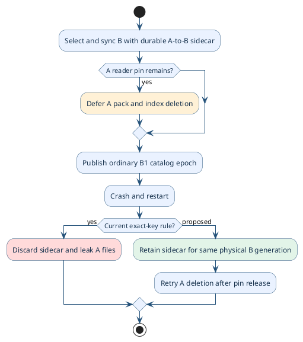

# Pending physical reclaim intent across catalog advances

This is the focused contract for campaign leaf
`rspace-gc-pending-reclaim-intent-retry` (9244). The
[finite model](../../../formal/tlaplus/stack_safe_pda/RSpaceGcPendingReclaimIntent.tla)
is a bounded, model-checked protocol with focused Rust evidence, **not yet an
independently audited runtime correspondence**. TLC is the TLA+ explicit-state
model checker. A checkpoint is acknowledged only after its catalog
selection and required sync have completed.

Here A, B and C name successive catalog-appointed physical generations. B1
and C1 are later catalog epochs that still use B's or C's pack range and
index generation. A **sidecar** is the single durable `reclaim.v1` record
holding one predecessor-to-successor deletion obligation. A **pin** is a
process-local reader lease on a physical pack range. **CAS** means the
catalog's compare-and-swap selection of a synchronized successor.

## Prior lost-intent trace

Before this leaf, the [sidecar writer](../../../rspace++/src/rspace/persistence/durable/io.rs)
removed an existing `reclaim.v1` before it wrote a new candidate. The
[restart path](../../../rspace++/src/rspace/persistence/durable/startup.rs)
discarded a candidate whenever its successor key was not exactly the selected
catalog key; it did not retry a matching selected candidate. The
[generation checkpoint path](../../../rspace++/src/rspace/persistence/durable/publication.rs)
can leave `A→B` reclamation pending while an A reader holds its physical pack
range. An ordinary incremental publication then changes B's catalog epoch to
B1 without changing B's physical generation. On restart, B1 is not the exact
key recorded as B, so the sidecar is removed and A's pack and index remain
without a durable deletion obligation. A subsequent B→C checkpoint can also
overwrite the still-pending A→B sidecar.



## Abstract transition contract

The model has one durable sidecar slot, catalog states A, B, B1, C and C1,
individual pack and index presence bits, process-local A/B reader pins, and
retirement gates. `StageAB` and `PersistAB` put the candidate on disk before
`SelectAB`; `AckAB` models the final caller acknowledgement. `AdvanceB` is an
authenticated ordinary update within B's physical generation. A crash drops
process pins and the in-memory retirement gate while preserving the catalog,
sidecar and physical files. `Recover` discards only an unselected pre-CAS
intent; it retains a selected intent through B1 or C1. `CleanOrphanB` and
`CleanOrphanC` represent the existing authenticated
[`prepare_unpublished_successor_artifacts`](../../../rspace++/src/rspace/persistence/durable/io.rs)
preflight that removes unselected successor names before a retry. This
pre-CAS cleanup is separate from selected predecessor reclamation.

`DeleteAPart` and `DeleteBPart` abstract individual old-file unlinks.
`SyncAUnlinks` and `SyncBUnlinks` mark the directory sync that makes those
unlinks durable; `FinishA` and `FinishB` may then clear the sidecar. A crash
before this sync leaves the intent in place for retry. The finite model does
not simulate filesystem-specific rollback of an unsynchronized unlink; its
safety claim is the ordering of sync and intent clearance.

The classifier needs a validated selected catalog. A catalog whose
`first_live_pack`, `active_pack`, and `index_generation` equal the recorded B
physical key and whose epoch has not gone backward selects the recorded
successor. The durable pack/index tails may advance within that same
generation. A current catalog still in the recorded A physical generation is
pre-CAS. Until task 14510 any third physical generation was an error, because
B→C was refused while A→B occupied the sidecar. Since that task a third
physical generation is accepted when it is a **lockstep descendant** of B: a
catalog with one live pack and an epoch larger than B's, whose pack lies as
many identifiers above B's active pack as its index generation lies above
B's, and at least one. A generation checkpoint creates exactly the next pack
and the next index generation, so only generation checkpoints lead from B to
such a catalog, and every pack and index between B and it belongs to a
superseded generation. Every other catalog is still an error. This
classification relies on the writer lease, catalog validation, the
no-overwrite gate, and the lockstep allocation of pack and index identifiers
together; comparing epochs alone is insufficient.

In the writer protocol, recovery first verifies the complete selected
pack chain and bound index, then classifies that selected catalog against the
one stored intent. An old physical generation means the
intent preceded CAS and may be cleared without deleting selected bytes. A
selected successor physical generation, or since task 14510 a lockstep
descendant of it, keeps the intent and retries under the writer lease. The
retry removes each generation that the intent covers as soon as no reader pin
overlaps it, and it clears the intent only after the pack and index of every
covered generation are gone and the directory has been synchronized. Any
unrelated generation is an error. A new checkpoint writes a candidate of its
own only when the slot is empty after that retry. Otherwise it keeps the
pending intent byte for byte and, before the catalog CAS, checks that the
intent classifies the catalog it is about to select as a lockstep descendant;
if that check fails, it returns a refusal before acknowledgement, and the
catalog is unchanged. Until task 14510 a checkpoint returned such a refusal
whenever the slot was still occupied.

```text
lockstep_distance(successor, catalog):
    packs = catalog.first_live_pack - successor.active_pack
    indexes = catalog.index_generation - successor.index_generation
    if catalog.epoch > successor.epoch
       and catalog.first_live_pack == catalog.active_pack
       and packs >= 1 and packs == indexes:
        return packs
    return Absent

covered_generations(intent, current):
    if same_physical_generation(current, intent.successor)
       and current.epoch >= intent.successor.epoch:
        return [intent.old]
    distance = lockstep_distance(intent.successor, current)
    if distance is Absent: return InvalidAuthority
    return [intent.old, intent.successor] followed by the distance - 1
           one-pack generations between intent.successor and current

retry_pending_under_writer_lease():
    intent = read_validated_sidecar()
    current = recover_and_verify_selected_pack_chain_and_index()
    if intent is absent: return Empty
    if same_physical_generation(current, intent.old):
        clear_pre_CAS_intent_without_deleting_current_files()
        return Empty
    covered = covered_generations(intent, current)
    if covered is InvalidAuthority: return InvalidAuthority
    for each generation in covered whose files may remain:
        if an overlapping reader pin remains: leave it for the next retry
        else:
            retire_its_range_against_new_pins()
            unlink_its_packs_and_index_idempotently()
    if a generation was left: return Deferred(intent)
    synchronize_unlinks()
    clear_intent_and_synchronize_directory()
    return Empty

before_new_checkpoint():
    pending = retry_pending_under_writer_lease()
    if pending is InvalidAuthority: return RefusedBeforeAcknowledgement
    return pending

before_catalog_selection(pending, current, successor):
    if pending is Empty:
        write_and_synchronize_intent(current, successor)
    else if lockstep_distance(pending.intent.successor, successor) is Absent:
        return RefusedBeforeAcknowledgement
    else:
        keep_the_pending_intent_without_writing()
```

This pseudocode states the intended safety boundary. The Rust implementation
has the same ordering. An I/O error before sidecar clearance must leave the
durable intent available for retry.

| Model transition | Required concrete boundary |
| --- | --- |
| `PersistAB` / `SelectAB` | Write and synchronize the exact sidecar under `reclaim.v1.tmp`, rename it to `reclaim.v1` without replacing a record, and synchronize the directory, all before catalog compare-and-swap; refuse a leftover temporary; select only fully durable successor files. |
| `TearIntent` | A failure anywhere from the temporary's creation to the rename leaves at most `reclaim.v1.tmp`, never a torn `reclaim.v1`; a rename lost to a power failure is the same state. |
| `AdvanceB` | Keep A→B live across an ordinary same-physical-generation catalog advance, or refuse the advance before its acknowledgement. An arbitrary higher epoch alone is not proof of descent. |
| `StageBC` / `PersistBC` / `SelectBC` while A→B is pending | While A→B occupies the only sidecar and any A part remains, B→C proceeds: retry A first; then write and synchronize C's files, keep the existing sidecar bytes without writing or replacing a record, check that the record classifies C as a lockstep descendant of B, and only then select C. If that check fails, refuse before the catalog compare-and-swap. A held pin on A defers only A's deletion. Until task 14510 this row was the transition `RefuseBC`, which refused B→C here. |
| `RetireA` / `DeleteAPart` / `SyncAUnlinks` / `FinishA` | Under the exclusive writer lease, with B or C selected, atomically exclude new overlapping A pins, retry deletion of A's pack and index idempotently, sync the directory, then remove and sync the sidecar only after both are absent and, with C selected, only after B's pack and index are absent as well and their unlinks are synchronized. The B transitions follow the same order under either sidecar, A→B or B→C, so that B is retired and deleted on its own while a pin still holds A. |
| `Recover` | First remove a leftover `reclaim.v1.tmp` after authenticating it against its handle, and synchronize the directory. Then distinguish pre-CAS stale intent from selected pending intent; retry safe selected deletion after restart without deleting catalog-appointed files. |

The baseline checks `CurrentAuthorityProtected`,
`SelectedDeletionObligationCovered`, `NoReaderRetired`, and, since task
14510, `PendingIntentDoesNotBlockCheckpoint` over both checkpoints, ordinary
advances, crashes, partial pack/index deletion, and retries.
`SelectedDeletionObligationCovered` requires the A→B sidecar while any A part
remains under B or under C, and a sidecar, A→B or B→C, while any B part
remains under C. `PendingIntentDoesNotBlockCheckpoint` requires that B→C can
be staged whenever a writer process runs, B is selected, no checkpoint is in
progress, the A→B sidecar is pending with an A part left, and no C part
exists. The
`DropOnOrdinaryAdvance` mutant must violate obligation preservation; the
`OverwritePendingIntent` mutant must do the same before it can publish B→C;
the `RefuseWhilePending` mutant, which restores the refusal that the runtime
had until task 14510, must violate `PendingIntentDoesNotBlockCheckpoint`.
Four witness configurations must reach: a pre-CAS orphan-cleanup opportunity;
a B→C checkpoint under a pinned A after a B1 advance, followed by a crash,
recovery and the reclaim of A and B; a B→C acknowledgement while an A part
remains (`NoSecondAcknowledgementWhileOldPending`, an invariant of the
baseline until task 14510); and the deletion of B while a pin still holds A.
These are bounded safety and reachability checks; an eventual retry
claim would additionally need scheduler or runtime fairness assumptions.

The generated runtime classifier property varies pack ranges, epoch gaps and
descendant distances: a matching successor physical generation at or after
its recorded epoch keeps the selected A→B deletion obligation with one
covered generation; a lockstep descendant at distance $`m`$ keeps it with
$`m + 1`$ covered generations, the highest of which lies directly below the
selected catalog; an old physical generation is pre-CAS; and a catalog that
is not in lockstep, that has more than one live pack beyond the successor, or
whose epoch is not above the successor's is unrelated. The focused
integration cases cover: a selected candidate survives repeated recovery while A stays pinned;
release permits exactly its old pack and index to be deleted, including after
partial deletion and restart; an ordinary B→B1 update cannot erase its
obligation; a second and a third checkpoint with the only slot occupied by a
pinned A generation publish, leave the sidecar bytes unchanged and remove
each generation that they supersede; a crash at each of the 18 publication
phases of such a second checkpoint recovers to the catalog that the phase
determines, keeps the sidecar and the pinned generation while the pin is
held, and completes the reclamation once the pin is released;
several pinned generations are each reclaimed when their own pins release;
pre-CAS cleanup never deletes A; and no path deletes the catalog-appointed B or
C files, an unpublished successor above the selected catalog, or a file that
the sidecar does not cover. The model also explores a pending but unpinned partial deletion; a
runtime fault-injection case for a second checkpoint during that I/O failure
remains open. The model's administrative stage and
history variables do not map directly to a Rust property. The model's
pins remain process-local, as in the existing GC pack-lease contract. It does
not establish cross-process reader coordination or Windows behavior.

## Torn intent publication (bug 11970)

**Prior torn-intent trace.** Until bug 11970, the sidecar writer created
`reclaim.v1` and then set its length, wrote it and synchronized it in place. A
failure or a crash between the creation and the synchronization left an empty
file, 88 zero bytes or a partial record under the final name. The reader
refuses such a record (`Length` or `InvalidData`). The restart path reads the
sidecar before anything else, so held-lease recovery, cold admission and every
later checkpoint failed permanently. The torn record could never authorize a
deletion, but it blocked all progress.

**Atomic publication.** The writer now publishes the sidecar in four steps:

1. it creates `reclaim.v1.tmp` exclusively, writes the record and synchronizes
   the file;
2. it authenticates the file against its handle;
3. it renames the file to `reclaim.v1` without replacing an existing record;
4. it synchronizes the directory.

Recovery first removes a leftover temporary, after authenticating it against
its handle, and synchronizes the directory. The writer refuses a leftover
temporary and never removes one.

The removal is safe. The writer returns only after the rename and the directory
synchronization, and the CAS follows the write. A temporary that is still
present therefore means that no CAS happened for its checkpoint, so it carries
no deletion obligation. A corrupt complete record under the final name stays
fail-closed.

**Model.** The model gains three elements:

- `TearIntent` is a failure anywhere from the creation to the rename, or a
  rename lost to a power failure, while a checkpoint's files are staged. It
  ends the process as `Crash` does. With `AtomicIntentPublication` it adds
  `IntentTemp` to the files. Without it, which is the in-place writer, it sets
  the sidecar to `"torn"`.
- `Recover` refuses a torn sidecar, as production does. With
  `RemoveIntentTempOnRecover` it removes `IntentTemp`.
- `PersistAB` and `PersistBC` require that `IntentTemp` is absent. This is the
  writer's exclusive creation.

Three invariants are added. In them, $`\mathit{live}`$ holds while a writer
process runs, $`\mathit{intent}`$ is the sidecar, and $`\mathit{files}`$ is
the set of files in the directory.

```math
\begin{aligned}
\mathit{RecoveryAvailable} &\triangleq \lnot\mathit{live} \Rightarrow \mathrm{ENABLED}\ \mathit{Recover} \\
\mathit{TornIntentNeverPublished} &\triangleq \mathit{intent} \neq \texttt{"torn"} \\
\mathit{IntentTempNeverLive} &\triangleq \mathit{live} \Rightarrow \mathit{IntentTemp} \notin \mathit{files}
\end{aligned}
```

Three mutants must violate them:

- `TornIntentMutant`, with `AtomicIntentPublication = FALSE`, violates
  `RecoveryAvailable` after `TearIntent`.
- `TornIntentPublishedMutant`, with the same constant, violates
  `TornIntentNeverPublished` after `TearIntent`.
- `KeepIntentTempMutant`, with `RemoveIntentTempOnRecover = FALSE`, violates
  `IntentTempNeverLive` after `TearIntent` and then `Recover`.

The runner `scripts/check-rspace-gc-pending-reclaim-intent-model.sh` checks
the baseline, these three mutants, the four earlier configurations and, since
task 14510, the three configurations of
[Checkpoint under a deferred reclamation](#checkpoint-under-a-deferred-reclamation-task-14510). The
integrated proof runner calls it.

```plantuml
@startuml
skinparam backgroundColor #FFFFFF
skinparam activity {
  BackgroundColor #EAF2FF
  BorderColor #24527A
  FontColor #17324D
}
skinparam ArrowColor #24527A
start
:Stage and synchronize the successor pack and index;
if (Intent writer?) then (in place, before bug 11970)
  :Create reclaim.v1, set its length, write it and synchronize it;
  :Fail or crash before the synchronization completes;
  :A short or zero-filled reclaim.v1 blocks every recovery; <<#FFDADA>>
  stop
else (atomic)
  :Create reclaim.v1.tmp exclusively, write it and synchronize it;
  if (Failure before the rename, or a lost rename?) then (yes)
    :Only reclaim.v1.tmp remains, never a torn reclaim.v1; <<#FFF1D6>>
    :Recovery removes it and the checkpoint retries; <<#E2F4E8>>
    stop
  else (no)
    :Authenticate it and rename it to reclaim.v1 without replacement;
    :Synchronize the directory, then compare-and-swap the catalog; <<#E2F4E8>>
  endif
endif
stop
@enduml
```

The diagram contrasts the two writers. On the left, the in-place writer fails
between creating and synchronizing `reclaim.v1`, and the torn record (red)
blocks every recovery. On the right, the atomic writer fails before the rename,
or loses the rename. Only the temporary remains (amber), and recovery removes
it before the checkpoint retries (green). Without a failure, the rename and
the directory synchronization precede the catalog compare-and-swap (green).

The invariant catalog's RI rows bind the concrete tear points to tests. See
[Torn reclamation intents](generation-checkpoint-invariant-catalog-2026-08-28.md#torn-reclamation-intents-bug-11970-2026-10-28).

## Focused verification

The final model bytes (`SHA-256
5e506ef81e36a6bd7a76f91be6b69debe16ebe92684239a6cad4a938da504229`) ran with
a 512 MiB Java heap, two TLC workers, a 4 GiB cgroup memory ceiling, and a
180-second runtime cap per configuration. The baseline exhausted 1,683
distinct states with no invariant error. The pre-CAS witness reached
`NoPreCasRecoveryOrphan`; the retry witness traced an A pin, B→C refusal,
B→B1 advance, crash, recovery, retirement, both old-file unlinks, directory
sync, and intent clearance. The drop-on-advance and overwrite mutants both
violated `SelectedDeletionObligationCovered` as intended.

The generated Rust classifier property passed (`1/1`). The focused library
reclamation selection passed (`6/6`), including epoch advance/restart,
one-slot backpressure (superseded by task 14510, under which that checkpoint
publishes; see
[Checkpoint under a deferred reclamation](#checkpoint-under-a-deferred-reclamation-task-14510)),
partial deletion retry, and selected-successor
verification before deletion. Both Rust commands used two build jobs, a
6 GiB memory ceiling, and a 900-second runtime cap. These checks do not prove
eventual retry under an indefinitely held pin, cross-process pin safety, or
filesystem behavior beyond the modeled directory-sync ordering.

**Bug 11970 (2026-10-28).** The extended model (`SHA-256
3063fc43cde6fe8d22d8d6eb3d1ca5a67c0a73edf2ed730efd571c4b17861e6f`) runs
through `scripts/check-rspace-gc-pending-reclaim-intent-model.sh`, which the
integrated proof runner calls after the compaction model. The runner gives TLC
a 512 MiB Java heap, two workers, a 1 GiB high and 4 GiB maximum memory
ceiling, a 200% CPU quota, 64 tasks, and a 180-second runtime cap per
configuration. The baseline generated 4,533 states, 1,700 of them distinct
(1,683 before `TearIntent`), with no invariant error. Each new control
violated its invariant: `TornIntentMutant` violated `RecoveryAvailable` and
`TornIntentPublishedMutant` violated `TornIntentNeverPublished`, each after
`TearIntent`, and `KeepIntentTempMutant` violated `IntentTempNeverLive` after
`TearIntent` and `Recover`. The two earlier mutants and the two witnesses kept
their results. In Rust, on the in-place writer, RI-01, RI-02, RI-03 and one
PUB-16 case failed with the refusals that blocked recovery, and RI-04 passed.
With the atomic writer all of them passed, and the 493 selected
`rspace::persistence` tests passed in debug and release. Engineering journal
J-253 records the runs, the two code mutations that the tests kill, and the
resource caps. These checks inject faults in-process and make no power-loss
claim.

## Checkpoint under a deferred reclamation (task 14510)

**2026-11-16.** Until task 14510
(`rspace-gc-checkpoint-under-deferred-reclamation`) a pending intent made
every later generation checkpoint refuse for as long as a pin held the old
generation: the checkpoint returned the error `ReclamationPending` before it
wrote a file. The protection model
[`RSpaceGcProtection.tla`](../../../formal/tlaplus/stack_safe_pda/RSpaceGcProtection.tla)
requires the opposite. Its invariant `ObjectOnlyPinDoesNotBlockWal` keeps the
rotation of the write-ahead log (WAL) enabled while a pin that holds an old
generation only as objects keeps that generation present, and a generation
checkpoint is the runtime's rotation. The owner ruled on 2026-11-16 that the
runtime changes, not the model. This section records the change. It replaces
the refusal, which the sections above now name only as the earlier
behaviour. The rules of bug 11970 for writing the sidecar are unchanged.

### The sidecar as a low-water mark

The sidecar keeps its 88 bytes, its name `reclaim.v1`, its checksum and the
rule that it is written once and never replaced. It still names two
generations: the old generation, written $`O`$ below, and its successor,
written $`S`$ (A and B in the model). What changes is under which selected
catalogs the sidecar is valid, and which generations it then marks as
deletable.

A *generation key* is the tuple $`(e, f, a, i)`$ of a catalog: its epoch
$`e`$, its first live pack $`f`$, its active pack $`a`$ and its index
generation $`i`$. A subscript names the key, so $`a_S`$ is the active pack of
the successor. For the key $`C`$ of the selected catalog, the *lockstep
distance* from $`S`$ is

```math
d(S, C) =
\begin{cases}
f_C - a_S & \text{if } e_C > e_S,\ f_C = a_C \text{ and } f_C - a_S = i_C - i_S \geq 1, \\
\bot & \text{otherwise,}
\end{cases}
```

where $`\bot`$ means that the distance is undefined. The selected catalog is
a *lockstep descendant* of $`S`$ when $`d(S, C)`$ is defined: it has one live
pack, a larger epoch than $`S`$, and a pack that lies as many identifiers
above the active pack of $`S`$ as its index generation lies above that of
$`S`$, and at least one.

The rule follows from the allocation of identifiers. After genesis, pack and
index files are created only by a generation checkpoint, and by a compaction,
which publishes through the same function. Each creates exactly one pack and
one index, with the identifiers $`a + 1`$ and $`i + 1`$, where $`a`$ and
$`i`$ are the active pack and the index generation of the catalog that it
supersedes, and it selects a catalog whose only live pack is the new one. So
$`m`$ checkpoints after $`S`$ select a lockstep descendant at distance $`m`$, and
every pack and index identifier strictly between $`S`$ and that catalog
belongs to a generation that was selected and then superseded. A catalog that
is neither $`O`$, nor $`S`$, nor a lockstep descendant of $`S`$ is classified
as unrelated, and the store refuses with `CatalogAuthorityChanged` instead of
deleting a file: if the allocation ever changes, the classifier fails closed.

Under a selected catalog $`C`$ the sidecar *covers* the following
generations, numbered from 0.

| Number | Generation | Packs | Index generation |
| --- | --- | --- | --- |
| 0 | the old generation $`O`$ | $`f_O, \dots, a_O`$ | $`i_O`$ |
| 1 | the successor $`S`$ | $`f_S, \dots, a_S`$ | $`i_S`$ |
| $`n \geq 2`$ | the generation that checkpoint $`n - 1`$ after $`S`$ selected | $`a_S + n - 1`$ | $`i_S + n - 1`$ |

If $`C`$ is the physical generation of $`S`$ at or after the epoch of $`S`$,
the sidecar covers generation 0 alone, which is its deletion set from before
task 14510. If $`C`$ is a lockstep descendant at distance $`m`$, it covers
the generations $`0, \dots, m`$. The last pack of generation $`m`$ is
$`f_C - 1`$, so every covered generation lies strictly below the selected
catalog, and the selected generation is never covered. In
[`reclaim.rs`](../../../rspace++/src/rspace/persistence/durable/reclaim.rs)
the relation is `SelectedDescendant`, `lockstep_distance` computes $`d`$,
`units_below` returns the number of covered generations, and `unit` maps a
number to its packs and its index generation.

### One reclamation attempt

An *attempt* is one call of `reclaim_reclamation_candidate` in
[`io.rs`](../../../rspace++/src/rspace/persistence/durable/io.rs). It runs
under the exclusive writer lease at four places: at recovery, once the
selected catalog is verified; before a generation checkpoint writes its
files; after the catalog swap of a generation checkpoint; and after an
incremental publication.

```plantuml
@startuml
skinparam backgroundColor #FFFFFF
skinparam activity {
  BackgroundColor #EAF2FF
  BorderColor #24527A
  FontColor #17324D
}
skinparam ArrowColor #24527A
start
:Read and authenticate reclaim.v1, which names O and S;
if (Selected catalog C?) then (still O)
  :Remove reclaim.v1 and delete no pack or index; <<#FFF1D6>>
  stop
elseif (S, or a lockstep descendant of S?) then (yes)
  :List the covered generations below C that may have files;
else (no)
  :Refuse with CatalogAuthorityChanged; <<#FFDADA>>
  stop
endif
while (Another covered generation to try?) is (yes)
  if (A lease of this process overlaps its packs?) then (yes)
    :Keep its files and try it again at the next attempt; <<#FFF1D6>>
  else (no)
    :Retire its packs in the lease registry;
    :Unlink its packs, then its index; <<#E2F4E8>>
  endif
endwhile (no)
if (A covered generation was kept?) then (yes)
  :Keep reclaim.v1 byte for byte and report the deferral; <<#FFF1D6>>
else (no)
  :Synchronize the directory, then remove reclaim.v1; <<#E2F4E8>>
endif
:A generation checkpoint may publish in both cases; <<#E2F4E8>>
stop
@enduml
```

The diagram follows the sidecar from its classification to the end of one
attempt. A sidecar whose old generation is still selected preceded the
catalog swap and is removed without a deletion (amber). An unrelated catalog
is refused (red). Otherwise each covered generation is tried on its own: a
generation that a lease holds is kept (amber), and every other one is retired
in the lease registry and unlinked (green). The sidecar is removed only when
no covered generation was kept (green). Whether the attempt ends with a
deferral or not, the generation checkpoint that follows it may publish.

The attempt keeps the numbers of the generations that may still have files
in a cache of the writer lease, so that an attempt in which nothing becomes
deletable costs one read of the sidecar and one registry check for each
generation that is still held. In the pseudocode, `cache` is that cache,
`below` is the number of covered generations, and `frontier` is the retired
frontier of the lease registry, the highest pack that it has retired.

```text
 1  ATTEMPT(sidecar, selected):
 2      below := number of generations that sidecar covers under selected
 3      if below is undefined: refuse with CatalogAuthorityChanged
 4      progress := cache;  cache := empty
 5      if progress.sidecar != sidecar or below < progress.below
 6            or below > progress.below + 1:
 7          progress := SEED(sidecar, below)
 8      else if below = progress.below + 1:
 9          append below - 1 to progress.pending
10      progress.below := below
11      for each number n in progress.pending:
12          under the registry mutex:
13              if a held lease overlaps the packs of generation n: keep n
14              else: frontier := max(frontier, last pack of generation n)
15          if n was not kept:
16              unlink the packs of generation n, then its index
17              remove n from progress.pending
18      if progress.pending is empty:
19          synchronize the directory;  remove reclaim.v1
20          return Complete
21      cache := progress
22      return Deferred
23
24  SEED(sidecar, below):
25      if below = 1: return (sidecar, below, [0])
26      names := one listing of the store directory
27      pending := the numbers n < below for which names holds a pack or
28                 the index of generation n, sorted, each once
29      return (sidecar, below, pending)
```

Lines 2 and 3 classify the selected catalog as the table above defines.
Lines 4 and 21 take the cache out of the lease for the duration of the
attempt, so that an error anywhere in the attempt leaves the cache empty and
the next attempt seeds it again. Lines 5 to 9 reuse the cache only for the
same sidecar and for a count that is the cached one or exceeds it by one,
which is what one further checkpoint produces; the checkpoint then adds
exactly the generation that it superseded (line 9). Lines 12 to 14 are one
critical section of the lease registry, the function
`retire_packs_if_unleased` of
[`retention.rs`](../../../rspace++/src/rspace/persistence/retention.rs), and
acquisition takes the same mutex: a lease that was taken first defers the
generation, and once the frontier has passed a generation, no new lease on it
is granted. Line 16 tolerates a file that is already absent, so a repeated
attempt is idempotent. Lines 18 to 20 remove the sidecar only after a
directory synchronization; an attempt that ends at line 22 needs none,
because the sidecar is still on disk and names everything that remains.
Lines 24 to 29 seed the cache. Under the successor itself the only covered
generation is number 0 (line 25). Under a descendant, one listing of the
directory selects the generations to try (lines 26 to 28). The listing only
selects: every name that line 16 unlinks is derived from the sidecar and the
selected catalog, so a name that the listing misses could leave a file
behind but could not cause a wrong deletion. The functions that write and
remove the sidecar also empty the cache, so the cache never outlives the
sidecar that it describes.

### A checkpoint under a pending sidecar

A generation checkpoint handles the sidecar at three points
(`publish_generation_checkpoint_v1` in
[`publication.rs`](../../../rspace++/src/rspace/persistence/durable/publication.rs)):

1. **Before it writes a file.** `resolve_reclamation_before_checkpoint` runs
   one attempt against the current catalog. It returns the sidecar when a
   covered generation was kept, and nothing when the reclamation completed
   or no sidecar exists. It refuses only an unrelated catalog. Until task
   14510 it refused whenever a generation was kept.
2. **Before the catalog swap**, with the successor's files written and
   synchronized. Without a pending sidecar the checkpoint writes one that
   names the current catalog and the successor, as before. With a pending
   sidecar it writes nothing, and it checks that the pending sidecar
   classifies the successor as a lockstep descendant. If that check fails,
   the checkpoint returns `CatalogAuthorityChanged` before the swap, so the
   catalog is unchanged and the checkpoint is definitely not published.
3. **After the catalog swap.** The checkpoint reads the sidecar again and
   runs one attempt against the new catalog. The count of covered
   generations has grown by one, and the generation that the checkpoint has
   just superseded is tried with the others.

The pending sidecar covers the selected catalog before the swap, by the
attempt of point 1, and after it, by the check of point 2. No crash point
between the two can therefore leave a superseded generation without a
durable deletion obligation.

**Example.** A reader pins generation 1, the genesis generation with pack 1
and index 1, and three generation checkpoints follow.

| Step | Selected | Sidecar | Covered | Kept | Unlinked |
| --- | --- | --- | --- | --- | --- |
| Checkpoint 1→2 | 2 | written, $`O = 1`$ and $`S = 2`$ | 1 | 1, pinned | none |
| Checkpoint 2→3 | 3 | kept, $`d = 1`$ | 1, 2 | 1, pinned | 2 |
| Checkpoint 3→4 | 4 | kept, $`d = 2`$ | 1, 2, 3 | 1, pinned | 3 |
| The pin is released; next attempt | 4 | removed | 1, 2, 3 | none | 1 |

After every step the directory holds the selected generation and the pinned
one, and nothing else of an earlier generation. The test
`an_object_only_pin_blocks_no_later_generation_checkpoint` runs this history,
with an incremental publication and a re-admission before the second
checkpoint, and compares the directory with these sets after each step.

### Crash points

Let $`P`$ be the pending sidecar, $`C`$ the selected catalog and $`C'`$ the
catalog that a checkpoint under $`P`$ is about to select. A new process
holds no lease, so recovery keeps no generation.

| Crash point | On disk | Recovery |
| --- | --- | --- |
| Between two unlinks of the attempt before the swap | $`C`$, $`P`$, some covered files gone | $`P`$ covers $`C`$: unlink what remains below $`C`$, synchronize, remove $`P`$ |
| While the successor's files are written | as above, and files of $`C'`$ | the same; the files of $`C'`$ lie above $`C`$, are not covered, and are removed by the cleanup of the next checkpoint, as before |
| After the successor's files are synchronized, before the catalog slot is written | the same; no sidecar is written on this path | the same |
| After the catalog slot is written, before the catalog is synchronized | $`C`$ or $`C'`$, and $`P`$ | $`P`$ covers both: the generations below $`C`$, or those below $`C'`$, which include $`C`$ |
| Inside the attempt after the swap | $`C'`$, $`P`$, some covered files gone | $`C'`$ is a lockstep descendant: unlink what remains, synchronize, remove $`P`$ |
| After the last unlink, before $`P`$ is removed | $`C'`$, $`P`$, no covered file | the listing finds nothing; synchronize, remove $`P`$ |
| After $`P`$ is removed | $`C'`$ | nothing to do |

A power loss that undoes unlinks which were not yet synchronized only brings
back files that recovery unlinks again, because $`P`$ is removed only after
a directory synchronization. Without a pending sidecar the checkpoint takes
the path that it took before task 14510.

### How many superseded generations can wait

Several superseded generations can await reclamation at once. Their number
is bounded by the leases that are held, not by the number of checkpoints:

- after each attempt, the covered generations that still have files are
  exactly those that a lease of the writer's process overlapped when the
  attempt checked them;
- once the retired frontier has passed a superseded generation, which
  happens when that generation or a later one is retired, no new lease on it
  is granted, while the leases that already hold it keep it;
- such a generation is therefore unlinked at the first attempt after its
  last lease is released.

On disk the cost is still one sidecar of 88 bytes, and for each waiting
generation its packs and its index. In memory it is one 64-bit number for
each waiting generation. A holder that keeps one generation for the lifetime
of the process keeps exactly that generation on disk; before task 14510 it
made every later generation checkpoint refuse.

### Compatibility and alternatives

No persisted byte, file name or layout changes. A binary from before task
14510 that meets a sidecar under a lockstep-descendant catalog classifies
the catalog as unrelated and refuses with `CatalogAuthorityChanged`. It
deletes nothing, and a binary with this change completes the reclamation at
its next start.

| Alternative | Why it was not chosen |
| --- | --- |
| Keep the refusal | Contradicts `ObjectOnlyPinDoesNotBlockWal` and the ruling. |
| Rewrite or advance the sidecar at each checkpoint | Needs a replacing rename, which the rules of bug 11970 forbid, and still needs a rule for the generations in between. |
| A second sidecar name, or a new record version with an upper bound | Changes the persisted layout or format without need. |
| Keep the obligations of later generations in memory only | A crash loses them, and the superseded files stay forever. |
| Stop at the first covered generation that a lease holds | One long-lived pin lets the directory grow with every checkpoint. |
| Retire the whole covered range at once | The same growth: one pin blocks every covered generation. |
| Accept a descendant whose packs and indexes advance independently | Deletes the same files under the present allocation, but does not fail closed if the allocation changes. |

### Model

[The model](../../../formal/tlaplus/stack_safe_pda/RSpaceGcPendingReclaimIntent.tla)
keeps its three generations A, B and C, so it has one pending sidecar and
one further checkpoint. It changes as follows.

- The transition `RefuseBC` and its history variable are removed.
- `StageBC` and `PersistBC` are enabled under a pending A→B sidecar.
  `PersistBC` then keeps the sidecar and writes nothing, and `TearIntent` is
  not enabled for that checkpoint, because no sidecar is being written.
  `SelectBC` selects C under either sidecar. `CleanOrphanC` runs under a
  pending A→B sidecar.
- `RetireA`, `DeleteAPart`, `SyncAUnlinks` and `FinishA` run with B or C
  selected. With C selected, `FinishA` clears the sidecar only after B's
  parts are absent and their unlinks are synchronized.
- `RetireB`, `DeleteBPart` and `SyncBUnlinks` run with C selected under
  either sidecar, so B can be retired and deleted while a pin holds A.
- `Recover` keeps an A→B sidecar under C.
- The constant `RefuseWhilePending` restores the refusal: with it, `StageBC`
  requires an empty sidecar slot and no remaining A part.

With $`\mathit{live}`$, $`\mathit{intent}`$ and $`\mathit{files}`$ as
defined for bug 11970, $`\mathit{catalog}`$ the selected catalog and
$`\mathit{stage}`$ the stage of the checkpoint in progress, the baseline
checks these two invariants in place of
`NoSecondAcknowledgementWhileOldPending`:

```math
\begin{aligned}
\mathit{SelectedDeletionObligationCovered} \triangleq{}
  & \bigl(\mathit{catalog} \in \{B, B1, C, C1\} \land \mathit{AParts} \cap \mathit{files} \neq \emptyset
    \Rightarrow \mathit{intent} = \texttt{"AB"}\bigr) \\
  {}\land{} & \bigl(\mathit{catalog} \in \{C, C1\} \land \mathit{BParts} \cap \mathit{files} \neq \emptyset
    \Rightarrow \mathit{intent} \in \{\texttt{"AB"}, \texttt{"BC"}\}\bigr) \\
\mathit{PendingIntentDoesNotBlockCheckpoint} \triangleq{}
  & \bigl(\mathit{live} \land \mathit{catalog} \in \{B, B1\} \land \mathit{stage} = \texttt{"idle"}
    \land \mathit{intent} = \texttt{"AB"} \\
  & \quad {}\land \mathit{AParts} \cap \mathit{files} \neq \emptyset
    \land \mathit{CParts} \cap \mathit{files} = \emptyset\bigr)
    \Rightarrow \mathrm{ENABLED}\ \mathit{StageBC}
\end{aligned}
```

$`\mathit{AParts}`$, $`\mathit{BParts}`$ and $`\mathit{CParts}`$ are the
pack and the index of the generation that the letter names. The first
invariant says that every superseded generation with a remaining part is
named by the sidecar on disk. The second says that a pending A→B sidecar
never disables the next checkpoint.

Three configurations are added:

- `BlockOnPendingMutant`, with `RefuseWhilePending = TRUE`, must violate
  `PendingIntentDoesNotBlockCheckpoint`. It is the model's form of the
  runtime before task 14510.
- `SecondAckWitness` must reach an acknowledged B→C checkpoint while an A
  part remains. It violates `NoSecondAcknowledgementWhileOldPending`, which
  was an invariant of the baseline until task 14510.
- `MidReclaimWitness` must reach a state in which C is selected, a pin holds
  A, an A part remains and both B parts are gone. It violates
  `NoMidReclaimWhileOldPinned`.

`RetryWitness` now requires `NoRetryAfterPendingCheckpointAndRestart` to be
violated: a B→C checkpoint is selected under a pinned A after a B1 advance,
the process crashes and recovers under C with the A→B sidecar, and the
reclamation of A and of B completes.

**Measured, 2026-11-16.** The model (`SHA-256
d2f42584141b588992673c181b00406d290ac9cbc4fd32682bdcb88c807beb61`) ran
through `scripts/check-rspace-gc-pending-reclaim-intent-model.sh` with the
limits that the paragraph on bug 11970 gives. The baseline generated 14,367
states, 4,442 of them distinct, with no invariant error. Every other
configuration violated the invariant that it names. For each, the runner
requires that the reported trace holds the actions of the last column in this
order and ends at the last of them, and each trace did:

| Configuration | Violated invariant | Required actions of the trace, in order |
| --- | --- | --- |
| `TornIntentMutant` | `RecoveryAvailable` | `TearIntent` |
| `TornIntentPublishedMutant` | `TornIntentNeverPublished` | `TearIntent` |
| `KeepIntentTempMutant` | `IntentTempNeverLive` | `TearIntent`, `Recover` |
| `DropOnAdvanceMutant` | `SelectedDeletionObligationCovered` | `SelectAB`, `AdvanceB` |
| `OverwriteMutant` | `SelectedDeletionObligationCovered` | `SelectAB`, `StageBC`, `PersistBC` |
| `BlockOnPendingMutant` | `PendingIntentDoesNotBlockCheckpoint` | `PersistAB`, `SelectAB`, `AckAB` |
| `PreCasWitness` | `NoPreCasRecoveryOrphan` | `StageAB`, `Recover` |
| `RetryWitness` | `NoRetryAfterPendingCheckpointAndRestart` | `AdvanceB`, `SelectBC`, `Recover`, `FinishA` |
| `SecondAckWitness` | `NoSecondAcknowledgementWhileOldPending` | `SelectAB`, `SelectBC`, `AckBC` |
| `MidReclaimWitness` | `NoMidReclaimWhileOldPinned` | `SelectBC`, `RetireB`, `DeleteBPart` |

The runner requires each of these outcomes. The protection model is
unchanged, and its runner still has the mutant `BlockWalOnOldPack` violate
`ObjectOnlyPinDoesNotBlockWal`.

### Runtime evidence

The tests are in `rspace++/tests/persistence/durable_publication.rs` unless
another file is named.

- `an_object_only_pin_blocks_no_later_generation_checkpoint` is the history
  of the example above with an older-epoch pin from an independent open and
  an incremental publication and a re-admission before the second checkpoint.
  The invariant catalog binds it to `ObjectOnlyPinDoesNotBlockWal` as GC-14.
- `a_crash_at_every_checkpoint_phase_under_a_deferred_reclamation_completes_it`
  fails a second checkpoint at each of the 18 publication phases, with the
  pin held and with the pin released before the restart. Recovery selects
  the catalog that the phase determines, and it keeps the sidecar and the
  pinned files while the pin is held. Once the pin is released, no file of a
  superseded generation is left; the files of an unpublished successor that a
  crash before the swap leaves behind stay until the cleanup of the next
  checkpoint, as before. A last case removes one file of a covered generation
  by hand and checks that the reclamation completes from that partial state.
- `each_superseded_generation_is_reclaimed_when_its_own_pins_release` holds
  two superseded generations with separate pins through three further
  checkpoints and releases the later pin first. After every step the
  directory holds exactly the selected generation and the pinned ones, never
  more generations than live pins plus one, and a later pin obtains a sidecar
  of its own once the first sidecar is consumed.
- `a_deferred_reclamation_never_deletes_the_selected_generation_or_an_unnamed_file`
  plants an unpublished successor above the selected catalog, an index
  rebuild temporary, a pack name that is not canonical and a foreign file.
  An attempt under the pin changes nothing, and the attempt after the release
  removes exactly the sidecar and the pack and the index of the pinned
  generation.
- `generated_pin_histories_keep_exactly_the_pinned_generations_and_never_refuse_a_checkpoint`
  runs 16 generated histories of pins, releases, incremental publications,
  checkpoints and re-admissions, and after every step it compares the
  directory with the set that the pins determine. It fails when the sample
  misses a checkpoint under a deferred reclamation, a generation reclaimed
  after its release, or a re-admission under a deferred or a descendant
  sidecar.
- The classifier property
  `selected_reclaim_obligation_follows_physical_generation_not_exact_epoch`
  and three unit tests in `reclaim.rs` cover the lockstep distance, the
  count of covered generations and the mapping between numbers and file
  identifiers.
- `retiring_a_later_range_under_an_earlier_lease_keeps_the_lease_and_refuses_new_earlier_leases`
  in `retention.rs` covers the frontier that passes a generation which a
  lease still holds.

**Controls, 2026-11-16.** Each of eight faults was put into the runtime
alone, the ten tests of the list above were run, and the fault was removed
again. In the table, "the five histories" are the first five tests of the
list.

| Fault in the runtime | Tests that failed |
| --- | --- |
| 1. A checkpoint refuses while a generation is kept (the runtime form of `BlockOnPendingMutant`) | the five histories |
| 2. Recovery classifies a lockstep descendant as unrelated | the five histories |
| 3. An attempt stops at the first generation that a lease holds | the five histories |
| 4. The count of covered generations includes the selected generation | the five histories, the classifier property and two unit tests |
| 5. A generation is unlinked without the registry check | the five histories |
| 6. The sidecar is removed while a generation is kept | the five histories |
| 7. The cache is not tied to its sidecar | the crash test, the test with two pins and the generated histories |
| 8. A checkpoint replaces the pending sidecar by one of its own | the five histories |

On the tree without the change, with the new tests added, the five
histories fail, the first of them with `ReclamationPending` at the second
checkpoint. Fault 7 is compound: it removes the comparison of line 5, the
emptying of the cache where the sidecar is written and where it is removed,
and it stores the cache again when the reclamation completes. Without the
comparison alone every test passes, because the sidecar changes only through
the two functions that empty the cache; the comparison is a second barrier.
Under the faults 1 to 4 and 8 no other test of the persistence tests fails.

These checks inject faults in-process and make no power-loss claim. The
model has one pending sidecar and one further checkpoint; longer chains are
covered by the classifier property and by the runtime tests, not by the
model. Pins remain process-local, and the open case of an I/O failure during
a second checkpoint with a partially deleted generation remains open.
