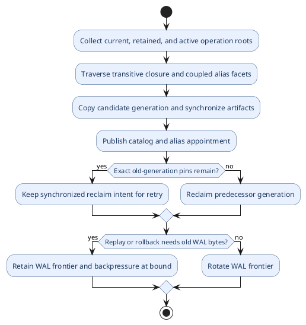

# Generation compaction protection matrix

This matrix states the proof obligations for [task 7943](../../../formal/tlaplus/stack_safe_pda/RSpaceGcProtection.tla). It is an abstract contract for future retention and reclaim work, not evidence that the current compactor implements every row. An **object closure** is the transitive set of canonical objects reachable through authenticated object references. An **exact generation pin** names one catalog epoch, pack range, and index generation. A **WAL frontier** is the earliest log byte still needed for replay or rollback. A **coupled binding** contains the semantic facet, compatibility facet, and frozen-history facet of a legacy alias; equality of a semantic manifest alone does not make two bindings equivalent.

| Obligation | Object closure to retain | Exact physical generation | WAL bytes | Current binding |
| --- | --- | --- | --- | --- |
| Current state | Current manifest and transitive closure | Selected catalog generation until successor publication | No independent reservation beyond selected committed generation | Authenticated by `RetentionManifestV1` and catalog |
| Historical retained state | Each retained manifest and transitive closure | Generation containing an uncopied closure | Committed bytes remain with the protected generation until copied | Manifest and `snapshot_with_manifest` API exist |
| Known dynamic root | Each registered known root and transitive closure, even when absent from the retention manifest | Exact old generation while its lease reads old bytes; successor closure must be copied if the lease is active at publication | No WAL reservation from the known root alone | `RetainedRootKind::Known` is a distinct dynamic registry kind included by `snapshot_with_manifest`; exact generation coupling is not yet wired into compaction |
| Reader | Authenticated read root and transitive closure | Exact observed generation for the lifetime of its handles and decoded views | Only if the reader consumes the log directly | `GenerationLeaseRegistryV1` stores exact keys but blocks retirement on any overlapping physical pack range; Unix handles for one directory share that process-local registry. Dynamic root registry has `Reader`; this does not establish cross-process lease safety. |
| Export | Export root and transitive closure | Exact source generation while bytes are read | Only if export includes log history | Dynamic root registry has `Export` |
| Import | Staged import root and transitive closure until admission or abort | Exact staged or selected generation if file handles are retained | Staged log bytes until admission or abort | Dynamic root registry has `Import` |
| Replay | State root and event-history closure required by the replay contract | Exact source generation until replay can use a published equivalent | Earliest required event through replay completion | No `Replay` root kind or compaction registration is present |
| Rollback | Pre-transition root and all coupled alias facets | Exact predecessor generation until rollback is no longer possible | Earliest rollback record through completion | No `Rollback` root kind or compaction registration is present |

The [finite model](../../../formal/tlaplus/stack_safe_pda/RSpaceGcProtection.tla) represents these rows through `ProtectionMatrix`, uses `Closure` to include transitive object edges, and keeps old and new pin token sets separate. Its `knownRoot` is distinct from the manifest and reaches it through `operationRoot`; the `known0` dynamic lease can pin an exact old or new generation. If that lease is active when `Publish` selects the successor, `knownAtPublish` records the snapshot obligation and `KnownPublicationClosureProtected` requires the entire known closure in the copied pack even if the lease later releases. An old known lease acquired after publication instead retains its exact old generation until release, while a new lease requires its closure to be copied. `Publish` selects the new catalog only after the required closure and all coupled facets are copied; catalog selection stands for alias appointment in this abstraction. Copied facets are necessary but do not themselves prove coupled equivalence, which remains the separate [identity proof](../../../formal/rocq/stack_safe_pda/theories/RSpaceConsensusIdentity.v) obligation. `Reclaim` requires the durable reclaim intent, selected successor, and absence of exact old pins. An old pin, including a replay or rollback pin, may be acquired after publication while the old generation still exists; reclamation must synchronize with that acquisition. `Crash` drops process-local pins but retains catalog authority, copied bytes, the publication snapshot obligation, durable replay/rollback start positions, WAL frontier, and reclaim intent so retry can resume. Pin, durable-obligation and WAL operations cannot run while the model is crashed; `CrashPhaseQuiescence` checks that none of their actions is enabled until `Recover` resumes the published or copying phase.

The bounded gate checks two projections of the same actions and invariants. [The full configuration](../../../formal/tlaplus/stack_safe_pda/RSpaceGcProtection.cfg) retains the original reader, export, import, replay, rollback, and independent WAL-start state space with three possible append positions. [The known-root configuration](../../../formal/tlaplus/stack_safe_pda/RSpaceGcProtectionKnown.cfg) adds `knownRoot` and its lease, retains one operation-root reader plus process and durable replay/rollback obligations, and uses one append position to check that an object-only known pin coexists with WAL rotation. `OperationRootRoleQuotient` checks that reader, export, and import have identical object closures, exact-generation requirements, and no WAL reservation, including their identical process-pin branch in `AcquireOldPin` and `AcquireNewPin`; the full configuration checks each label, while the known configuration uses one representative of that class. `KnownWalOrthogonal` checks that the known lease does not enter the WAL frontier. The [overlap witness configuration](../../../formal/tlaplus/stack_safe_pda/RSpaceGcProtectionKnownOverlapWitness.cfg) must reach a trace with both `known0` and `reader0` active on the old generation at publication, followed by a crash, recovery, successful reclamation, and a new-generation known pin. `knownAfterReclaim` is a history latch set only by that final pin action when the crashed-after-overlap condition holds and the old pack is absent. The gate also reads the counterexample action labels and rejects any trace lacking that order. `Known` changes the copied closure and generic old/new pin guards but does not enter `ActiveWalIds`, so the larger WAL-position product is checked in the full configuration. This decomposition reduces the independent product while exercising the mixed object-generation lifecycle; passing both projections does not by itself prove every untested mixed interleaving or arbitrary numbers of sessions.

Every replay or rollback obligation receives its own `walStarts` entry at registration. The finite model chooses that entry from the inclusive range between the current WAL head and tail; an already-pruned start cannot be registered. `ReclaimableWalFrontier` is the minimum start among active obligations, or the current tail when none remain. WAL append refuses when the configured window is full. After durable catalog publication, rotation advances the head to that minimum while preserving every active suffix. It need not wait for old pack reclamation: an object-only reader or known pin protects its exact pack generation without retaining unrelated WAL bytes, which `ObjectOnlyPinDoesNotBlockWal` checks. For example, in the full configuration replay requiring position 1 and rollback requiring position 2 keep the head at or before 1; releasing replay permits head 2, and releasing rollback permits head to reach the tail. A crash drops process pin starts but preserves durable starts, so retry derives the minimum from surviving obligations. Both configurations retain one durable replay and one durable rollback; the full configuration has one process pin token for each role and a second reader token, while the known configuration has its own known token and representative operation/WAL tokens. The runtime mapping from a concrete request to its exact start position remains open.

The current [compaction model](../../../formal/tlaplus/stack_safe_pda/RSpaceCompaction.tla) covers current, retained, and lease roots but omits export, import, replay, rollback, and the WAL frontier. Its checked theorem omits its own `LeaseSafety` and `RootClosurePreserved` predicates. `DeleteOld` subtracts only direct lease roots rather than their transitive closure, and `AcquireLease` can run after publication. The new model specifically checks post-publication old-pin acquisition and transitive closure; [the coupled-facet mutant](../../../formal/tlaplus/stack_safe_pda/RSpaceGcProtectionOmitCoupledFacetMutant.cfg) must violate `PublishedClosureProtected`, [the exact-pin mutant](../../../formal/tlaplus/stack_safe_pda/RSpaceGcProtectionIgnoreExactPinMutant.cfg) must violate `ExactOldPinsProtected`, [the known-closure mutant](../../../formal/tlaplus/stack_safe_pda/RSpaceGcProtectionOmitKnownClosureMutant.cfg) must violate `KnownPublicationClosureProtected`, [the WAL-prune mutant](../../../formal/tlaplus/stack_safe_pda/RSpaceGcProtectionPrunePastWalStartMutant.cfg) must violate `WalFrontierProtected`, and [the object-pin coupling mutant](../../../formal/tlaplus/stack_safe_pda/RSpaceGcProtectionBlockWalOnOldPackMutant.cfg) must violate `ObjectOnlyPinDoesNotBlockWal`. The [bounded gate](../../../scripts/check-rspace-gc-protection-model.sh) requires each corresponding counterexample trace instead of treating a parser or resource failure as a successful mutant.

A durable replay or rollback registration also owns an exact physical generation independently of its WAL start. The model records an old-generation assignment until that obligation is released, including across a crash. A registration after catalog publication may choose the old generation while it still exists, or the new generation once its required closure has been copied; publication alone does not retarget an existing assignment. A newly registered old-generation obligation may rely on an object absent from the successor pack, so `PublishedClosureProtected` requires the copied closure for new-generation assignments while `ActiveObjectProtection` requires the old generation to remain for old assignments. Reclaim must wait for old-generation durable assignments even when no process reader token remains. The [durable-pin mutant](../../../formal/tlaplus/stack_safe_pda/RSpaceGcProtectionIgnoreDurableExactPinMutant.cfg) removes that guard and must violate `DurableExactGenerationProtected`. WAL rotation still follows the independent replay/rollback start positions, so holding exact object bytes does not automatically pin unrelated log bytes. The first two-configuration gate at model SHA-256 `243c96a881f5bec0737a37097d5f3cd2f2791ce20d3c69f00618151c527d7bab` completed both state spaces and six mutants, but an independent trace audit found its purported lifecycle witness acquired `known0` while `phase = "crashed"`. That gate cannot support lifecycle acceptance. The phase-guarded model SHA-256 `a0d7c86d0ecd847513c429cba23a66db9facb116e5a83454126816bbfe98fa85` completed 1,503,800 distinct full-role states at depth 23 and 149,684 Known-role states at depth 24, each without invariant error. Both checked `CrashPhaseQuiescence`. Its witness trace reaches `Crash`, `Recover`, `Reclaim`, then `AcquireNewPin` in that order; all six causal mutants still violate their intended invariants. The final gate log is `target/verification/rspace-gc-protection/gate-phase-guard.log` at SHA-256 `2882df6908238440df01dc721ed1acd3e4583363d268a45fe876567e2df6da3c`; the witness trace is SHA-256 `97c17279e3389512f93c6f30d8146311de51301d9de56f7adddba10c95101e75`. The superseded logs remain under `target/verification/rspace-gc-protection-pre-phase-guard` for audit.

The runtime binding is incomplete. [The retention registry](../../../rspace++/src/rspace/persistence/retention.rs) defines `snapshot_with_manifest` and `is_snapshot_current`, and `snapshot_with_manifest` includes dynamic `Known` leases independently of manifest current and historical roots, but current source search finds their calls only in registry tests. [Compaction](../../../rspace++/src/rspace/persistence/durable/publication.rs) delegates to checkpoint publication without a dynamic-root snapshot or a coupling from a `Known` lease to its physical generation. [Reclamation](../../../rspace++/src/rspace/persistence/durable/io.rs) now retires the selected predecessor's physical pack range under the same registry mutex used for acquisition. A lease on any overlapping pack range, including one with a different catalog epoch or index generation, defers retirement; once retirement wins, the monotone retired-pack frontier refuses later overlapping acquisitions before the first unlink. A disjoint successor range remains available. Independently opened Unix directory handles share the process-local registry by device and inode. After successful retirement, one strong registry entry and one held directory descriptor per retired directory remain for the process lifetime; this resource cost prevents a later open from resetting the retired frontier or reusing the inode identity. Non-Unix opens still have separate registries and receive no safety claim from this mechanism. [The pack-lease model](../../../formal/tlaplus/stack_safe_pda/RSpaceGcPackLeaseRace.tla) represents this one-lock order, its older-epoch deferral witness, and the exact-key-only deletion mutant. The registry is neither a durable retirement record nor a cross-process lease authority, and this binding makes no Windows safety claim. [The coupled identity proof](../../../formal/rocq/stack_safe_pda/theories/RSpaceConsensusIdentity.v) requires replacement by a retained, checked, coupled-equivalent representative and preserves old pins on exact targets. Exact WAL frontier selection, dynamic-root handoff, replay/rollback registration, and cross-process/Windows lease authority remain concrete refinement obligations for task 7944. No complete production GC claim follows from the abstract model or this process-local binding alone.
