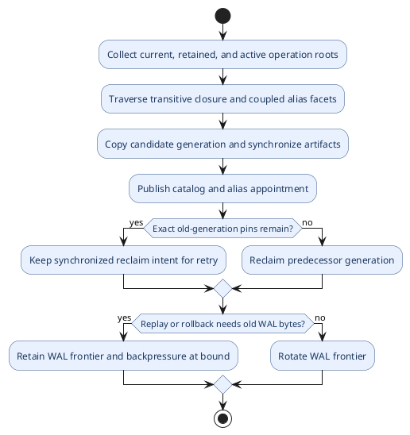
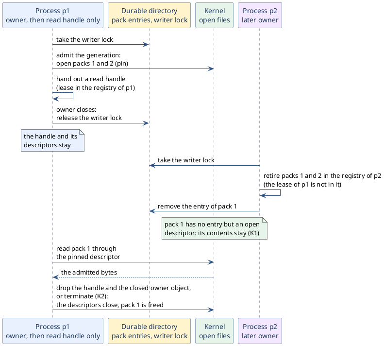

# Generation compaction protection matrix

This matrix states the proof obligations for [task 7943](../../../formal/tlaplus/stack_safe_pda/RSpaceGcProtection.tla). It is an abstract contract for future retention and reclaim work, not evidence that the current compactor implements every row. An **object closure** is the transitive set of canonical objects reachable through authenticated object references. An **exact generation pin** names one catalog epoch, pack range, and index generation. A **WAL frontier** is the earliest byte of the write-ahead log (WAL) still needed for replay or rollback. A **coupled binding** contains the semantic facet, compatibility facet, and frozen-history facet of a legacy alias; equality of a semantic manifest alone does not make two bindings equivalent.

| Obligation | Object closure to retain | Exact physical generation | WAL bytes | Current binding |
| --- | --- | --- | --- | --- |
| Current state | Current manifest and transitive closure | Selected catalog generation until successor publication | No independent reservation beyond selected committed generation | Authenticated by `RetentionManifestV1` and catalog |
| Historical retained state | Each retained manifest and transitive closure | Generation containing an uncopied closure | Committed bytes remain with the protected generation until copied | Manifest and `snapshot_with_manifest` API exist |
| Known dynamic root | Each registered known root and transitive closure, even when absent from the retention manifest | Exact old generation while its lease reads old bytes; successor closure must be copied if the lease is active at publication | No WAL reservation from the known root alone | `RetainedRootKind::Known` is a distinct dynamic registry kind included by `snapshot_with_manifest`; since task 12439 compaction takes `snapshot_with_manifest` before it prepares the successor and `register_known_root` couples each Known lease to its exact generation |
| Reader | Authenticated read root and transitive closure | Exact observed generation for the lifetime of its handles and decoded views | Only if the reader consumes the log directly | `GenerationLeaseRegistryV1` stores exact keys but blocks retirement on any overlapping physical pack range; Unix handles for one directory share that process-local registry. Dynamic root registry has `Reader`; this does not establish cross-process lease safety: across processes a read handle relies on the pack descriptors pinned at its admission ([descriptor pins](#reads-across-processes-descriptor-pins-instead-of-a-lease-record)). |
| Export | Export root and transitive closure | Exact source generation while bytes are read | Only if export includes log history | Dynamic root registry has `Export` |
| Import | Staged import root and transitive closure until admission or abort | Exact staged or selected generation if file handles are retained | Staged log bytes until admission or abort | Dynamic root registry has `Import` |
| Replay | State root and event-history closure required by the replay contract | Exact source generation until replay can use a published equivalent | Earliest required event through replay completion | No `Replay` root kind or compaction registration is present, and the runtime needs none: a replay holds the exact generation pin of the Reader row, which ends with its process and is recorded nowhere durable, and no WAL start (rows R1, R2 and R4 of the [runtime request mapping](#runtime-request-mapping)) |
| Rollback | Pre-transition root and all coupled alias facets | Exact predecessor generation until rollback is no longer possible | Earliest rollback record through completion | No `Rollback` root kind or compaction registration is present, and the runtime needs none: a rollback is a reset to a retained state root, which writes nothing durable; it holds the exact generation pin of the Reader row, which ends with its process and is recorded nowhere durable, and no WAL start (row R3 of the [runtime request mapping](#runtime-request-mapping)) |

The [finite model](../../../formal/tlaplus/stack_safe_pda/RSpaceGcProtection.tla) represents these rows through `ProtectionMatrix`, uses `Closure` to include transitive object edges, and keeps old and new pin token sets separate. Its `knownRoot` is distinct from the manifest and reaches it through `operationRoot`; the `known0` dynamic lease can pin an exact old or new generation. If that lease is active when `Publish` selects the successor, `knownAtPublish` records the snapshot obligation and `KnownPublicationClosureProtected` requires the entire known closure in the copied pack even if the lease later releases. An old known lease acquired after publication instead retains its exact old generation until release, while a new lease requires its closure to be copied. `Publish` selects the new catalog only after the required closure and all coupled facets are copied; catalog selection stands for alias appointment in this abstraction. Copied facets are necessary but do not themselves prove coupled equivalence, which remains the separate [identity proof](../../../formal/rocq/stack_safe_pda/theories/RSpaceConsensusIdentity.v) obligation. `Reclaim` requires the durable reclaim intent, selected successor, and absence of exact old pins. An old pin, including a replay or rollback pin, may be acquired after publication while the old generation still exists; reclamation must synchronize with that acquisition. `Crash` drops process-local pins but retains catalog authority, copied bytes, the publication snapshot obligation, durable replay/rollback start positions, WAL frontier, and reclaim intent so retry can resume. Pin, durable-obligation and WAL operations cannot run while the model is crashed; `CrashPhaseQuiescence` checks that none of their actions is enabled until `Recover` resumes the published or copying phase.

The bounded gate checks two projections of the same actions and invariants. [The full configuration](../../../formal/tlaplus/stack_safe_pda/RSpaceGcProtection.cfg) retains the original reader, export, import, replay, rollback, and independent WAL-start state space with three possible append positions. [The known-root configuration](../../../formal/tlaplus/stack_safe_pda/RSpaceGcProtectionKnown.cfg) adds `knownRoot` and its lease, retains one operation-root reader plus process and durable replay/rollback obligations, and uses one append position to check that an object-only known pin coexists with WAL rotation. `OperationRootRoleQuotient` checks that reader, export, and import have identical object closures, exact-generation requirements, and no WAL reservation, including their identical process-pin branch in `AcquireOldPin` and `AcquireNewPin`; the full configuration checks each label, while the known configuration uses one representative of that class. `KnownWalOrthogonal` checks that the known lease does not enter the WAL frontier. The [overlap witness configuration](../../../formal/tlaplus/stack_safe_pda/RSpaceGcProtectionKnownOverlapWitness.cfg) must reach a trace with both `known0` and `reader0` active on the old generation at publication, followed by a crash, recovery, successful reclamation, and a new-generation known pin. `knownAfterReclaim` is a history latch set only by that final pin action when the crashed-after-overlap condition holds and the old pack is absent. The gate also reads the counterexample action labels and rejects any trace lacking that order. `Known` changes the copied closure and generic old/new pin guards but does not enter `ActiveWalIds`, so the larger WAL-position product is checked in the full configuration. This decomposition reduces the independent product while exercising the mixed object-generation lifecycle; passing both projections does not by itself prove every untested mixed interleaving or arbitrary numbers of sessions.

Every replay or rollback obligation receives its own `walStarts` entry at registration. The finite model chooses that entry from the inclusive range between the current WAL head and tail; an already-pruned start cannot be registered. `ReclaimableWalFrontier` is the minimum start among active obligations, or the current tail when none remain. WAL append refuses when the configured window is full. After durable catalog publication, rotation advances the head to that minimum while preserving every active suffix. It need not wait for old pack reclamation: an object-only reader or known pin protects its exact pack generation without retaining unrelated WAL bytes, which `ObjectOnlyPinDoesNotBlockWal` checks. For example, in the full configuration replay requiring position 1 and rollback requiring position 2 keep the head at or before 1; releasing replay permits head 2, and releasing rollback permits head to reach the tail. A crash drops process pin starts but preserves durable starts, so retry derives the minimum from surviving obligations. Both configurations retain one durable replay and one durable rollback; the full configuration has one process pin token for each role and a second reader token, while the known configuration has its own known token and representative operation/WAL tokens. The [runtime request mapping](#runtime-request-mapping) below assigns each concrete request its start position: no runtime request takes a replay or rollback start, and crash recovery starts at the WAL head of the generation that it selects.



The current [compaction model](../../../formal/tlaplus/stack_safe_pda/RSpaceCompaction.tla) covers current, retained, and lease roots but omits export, import, replay, rollback, and the WAL frontier. Its checked theorem omits its own `LeaseSafety` and `RootClosurePreserved` predicates. `DeleteOld` subtracts only direct lease roots rather than their transitive closure, and `AcquireLease` can run after publication. The new model specifically checks post-publication old-pin acquisition and transitive closure; [the coupled-facet mutant](../../../formal/tlaplus/stack_safe_pda/RSpaceGcProtectionOmitCoupledFacetMutant.cfg) must violate `PublishedClosureProtected`, [the exact-pin mutant](../../../formal/tlaplus/stack_safe_pda/RSpaceGcProtectionIgnoreExactPinMutant.cfg) must violate `ExactOldPinsProtected`, [the known-closure mutant](../../../formal/tlaplus/stack_safe_pda/RSpaceGcProtectionOmitKnownClosureMutant.cfg) must violate `KnownPublicationClosureProtected`, [the WAL-prune mutant](../../../formal/tlaplus/stack_safe_pda/RSpaceGcProtectionPrunePastWalStartMutant.cfg) must violate `WalFrontierProtected`, and [the object-pin coupling mutant](../../../formal/tlaplus/stack_safe_pda/RSpaceGcProtectionBlockWalOnOldPackMutant.cfg) must violate `ObjectOnlyPinDoesNotBlockWal`. The [bounded gate](../../../scripts/check-rspace-gc-protection-model.sh) requires each corresponding counterexample trace instead of treating a parser or resource failure as a successful mutant.

A durable replay or rollback registration also owns an exact physical generation independently of its WAL start. The model records an old-generation assignment until that obligation is released, including across a crash. A registration after catalog publication may choose the old generation while it still exists, or the new generation once its required closure has been copied; publication alone does not retarget an existing assignment. A newly registered old-generation obligation may rely on an object absent from the successor pack, so `PublishedClosureProtected` requires the copied closure for new-generation assignments while `ActiveObjectProtection` requires the old generation to remain for old assignments. Reclaim must wait for old-generation durable assignments even when no process reader token remains. The [durable-pin mutant](../../../formal/tlaplus/stack_safe_pda/RSpaceGcProtectionIgnoreDurableExactPinMutant.cfg) removes that guard and must violate `DurableExactGenerationProtected`. WAL rotation still follows the independent replay/rollback start positions, so holding exact object bytes does not automatically pin unrelated log bytes. The first two-configuration gate at model SHA-256 `243c96a881f5bec0737a37097d5f3cd2f2791ce20d3c69f00618151c527d7bab` completed both state spaces and six mutants, but an independent trace audit found its purported lifecycle witness acquired `known0` while `phase = "crashed"`. That gate cannot support lifecycle acceptance. The phase-guarded model SHA-256 `a0d7c86d0ecd847513c429cba23a66db9facb116e5a83454126816bbfe98fa85` completed 1,503,800 distinct full-role states at depth 23 and 149,684 Known-role states at depth 24, each without invariant error. Both checked `CrashPhaseQuiescence`. Its witness trace reaches `Crash`, `Recover`, `Reclaim`, then `AcquireNewPin` in that order; all six causal mutants still violate their intended invariants. The final gate log is `target/verification/rspace-gc-protection/gate-phase-guard.log` at SHA-256 `2882df6908238440df01dc721ed1acd3e4583363d268a45fe876567e2df6da3c`; the witness trace is SHA-256 `97c17279e3389512f93c6f30d8146311de51301d9de56f7adddba10c95101e75`. The superseded logs remain under `target/verification/rspace-gc-protection-pre-phase-guard` for audit.

At runtime no durable replay or rollback registration exists. The [runtime request mapping](#runtime-request-mapping) below finds that replay, soft-checkpoint revert, reset, rollback, `clear` and spawn hold process-local pins, the read handles of their views, and that only crash recovery holds a durable obligation, the `current` role; a durable record of a replay or rollback obligation would protect bytes that no restarted request reads. The project owner therefore ruled on 2026-11-10 (decision GC5/GC7, option (a)) that no such record is written. The implementation realizes `durable` as `{"current", "retained"}`, the catalog slot and its retention manifest, and `oldDurable` as the empty set, and none of its steps refines `RegisterDurable` or `ReleaseDurable`. The only durable record that names an old generation is the reclamation candidate `reclaim.v1`, which holds the lease keys of an old generation and of its successor and nothing else. Its constructor accepts a pair only when the successor has the larger epoch and starts after the active pack of the old generation (`rspace++/src/rspace/persistence/durable/reclaim.rs:36`: `if old.epoch() >= successor.epoch() || old.active_pack() >= successor.first_live_pack() {`, a citation of the form that the runtime request mapping below defines), so the record can name a generation as reclaimable but never as protected, and it has no field for a request kind, a root or a WAL position. The [invariant catalog](generation-checkpoint-invariant-catalog-2026-08-28.md#gc-protection-invariants-as-executable-properties-2026-11-11) binds the consequences as GC-09 to GC-11: `DurableExactGenerationProtected` holds because its premise is never true, while the generation lease of a view protects its generation for as long as the process lives; `PublishedClosureProtected` holds because every admission and recovery with the successor selected reads the current and retained states through the live packs of the successor alone; and the test of GC-09 runs the witness order of `CrashPhaseQuiescence` on the store: the crash ends every lease of the views, and recovery reclaims the generation that they read before the first new lease.

The runtime binding is incomplete. [The retention registry](../../../rspace++/src/rspace/persistence/retention.rs) defines `snapshot_with_manifest` and `is_snapshot_current`, and `snapshot_with_manifest` includes dynamic `Known` leases independently of manifest current and historical roots, but current source search finds their calls only in registry tests. [Compaction](../../../rspace++/src/rspace/persistence/durable/publication.rs) delegates to checkpoint publication, which takes a dynamic-root snapshot before it prepares the successor and refuses with `RetainedRootNotCarried` when the admitted source does not carry a root of it; `register_known_root` couples each `Known` lease that it grants to a lease on its exact physical generation. [Reclamation](../../../rspace++/src/rspace/persistence/durable/io.rs) now retires the selected predecessor's physical pack range under the same registry mutex used for acquisition. A lease on any overlapping pack range, including one with a different catalog epoch or index generation, defers retirement; once retirement wins, the monotone retired-pack frontier refuses later overlapping acquisitions before the first unlink. A disjoint successor range remains available. Independently opened Unix directory handles share the process-local registry by device and inode. After successful retirement, one strong registry entry and one held directory descriptor per retired directory remain for the process lifetime; this resource cost prevents a later open from resetting the retired frontier or reusing the inode identity. The durable directory opens only on Unix: the function that opens it, `DurableDirectoryV1::open`, takes the directory handle before it selects a registry (`rspace++/src/rspace/persistence/durable/io.rs:838`: `let directory = open_directory_handle(&path)?;`), and on every other target `open_directory_handle` returns the error `UnsupportedPlatform` (`:1812-1814`: `#[cfg(not(unix))]` to `Err(DurableIoError::UnsupportedPlatform {`), so the line that would give such a target a registry of its own (`:864`: `let generation_leases = GenerationLeaseRegistryV1::default();`) is never reached and no open exists there to which a safety claim could apply (each of these citations gives a file, a line at the mapped commit and text of that line, as the [runtime request mapping](#runtime-request-mapping) below defines). [The pack-lease model](../../../formal/tlaplus/stack_safe_pda/RSpaceGcPackLeaseRace.tla) represents this one-lock order in each of two processes, its older-epoch deferral witness, and the exact-key-only deletion mutant; its two-process part is the subject of [the last section](#reads-across-processes-descriptor-pins-instead-of-a-lease-record). The registry is neither a durable retirement record nor a cross-process lease authority, and this binding makes no Windows safety claim. [The coupled identity proof](../../../formal/rocq/stack_safe_pda/theories/RSpaceConsensusIdentity.v) requires replacement by a retained, checked, coupled-equivalent representative and preserves old pins on exact targets. Exact WAL frontier selection, dynamic-root handoff, replay/rollback registration, and Windows lease authority remain concrete refinement obligations for task 7944; the [runtime request mapping](#runtime-request-mapping) below states what the first three of them take from the runtime, and its [seams](#seams-and-holders-of-view-pins) are the places where a view that replays or rolls back takes and releases its read handle. Across Unix processes the design has no lease authority: a reader there relies on its pinned descriptors, as the last section states. No complete production GC claim follows from the abstract model or this process-local binding alone.

## Runtime request mapping

This section closes the item that the matrix left open: which protection obligation each concrete runtime request holds. A **runtime request** is a call of the node that reaches code which reads state older than the caller's own uncommitted changes: a state root, the objects below it, or log bytes. For each request the section records whether its obligation is process-local or durable, which exact generation it holds and until when, and its WAL start, and it cites the line that decides each fact.

The requests are not yet connected to the durable store. Each row therefore has two parts. *Today* states what the code does at the mapped commit `9d4e0115ca0820cfdb0aa01d4782259ffd939b8e`. *Once wired* states what the request must hold when the named work item connects it to the durable store; that part states a requirement, and it describes existing code only where a citation shows it.

A citation is a path relative to the repository root, a colon and a line number at the mapped commit, followed by text copied from that line. A citation that begins with the colon refers to the file of the previous citation in the same paragraph. A citation of a range of lines is followed by text of its first line and text of its last line.

The mapping is a statement about one process. Every request below is made inside the process of the node, which holds the owner of the store (defined under [Terms of the mapping](#terms-of-the-mapping)), and what protects the reads of a request against a reclamation by that process is a lease in the lease registry of that process. What a read handle still reads when its owner has closed and an owner in another process reclaims is the subject of the [last section](#reads-across-processes-descriptor-pins-instead-of-a-lease-record). This section refers to the facts F1 to F5, K1 and K2 of that section by name instead of repeating them, and its last subsection, [Views that outlive their owner](#views-that-outlive-their-owner), states where the one protection ends and the other begins.

### Terms of the mapping

- A **space** is one `RSpace` or `ReplayRSpace` instance. An `RSpace`, a *play* space, executes programs and records the events that they cause; a `ReplayRSpace`, a *replay* space, executes them again and checks them against a recorded log. A space has a **history repository**, which resolves a state root to a reader of that state, and a **hot store**, an in-memory cache of what the caller has read or changed since its last checkpoint. The hot store fills each cache miss from the reader that it was built with (`rspace++/src/rspace/hot_store.rs:2757`: `let datums = self.history_reader_base.get_data_canonical(channel);`).
- A **view** is a space regarded as a reader of one state, and its **base** is the state root that its repository and its hot store read. A **checkpoint** commits the changes of the hot store as a new state and returns its root. A **soft checkpoint** is an in-memory copy of the hot store, to which a failed evaluation reverts. A **reset** binds a view to another state root, a **rollback** is a reset to a state older than the base of the view, and a **spawn** creates a new view at the base of an existing one.
- A **block** carries **deploys**, which are signed programs, the **event log** that each deploy produced, and the roots of the state before and after it, its **pre-state** and its **post-state**. **Casper** is the consensus crate `casper`, which decides when a block is executed or replayed.
- An obligation is **process-local** when only the running process holds it, in memory: it ends with the process, and no durable record lets a restart resume it. An obligation is **durable** when it follows from bytes that survive a crash, so that a restart reconstructs it.
- The **Legacy backend** keeps all state in one Lightning Memory-Mapped Database (LMDB) environment behind `RSpaceStateAuthority`. The **Durable backend** is the durable pack store under `rspace++/src/rspace/persistence/durable/`, the only store with generations, packs and reclamation. `RSpaceBackendSelection` names the two (`rspace++/src/rspace/shared/key_value_store_manager.rs:11`: `Legacy,` and `:12`: `Durable,`).
- A **pack**, or log pack, is one numbered append-only file of the Durable backend (`rspace++/src/rspace/persistence/durable/io.rs:1691`: `pub(crate) fn pack_file_name(pack: PackId) -> String {`). An **index generation** is one numbered file of its canonical-object index, which can be rebuilt from the packs (`:1695`: `pub(crate) fn index_file_name(generation: IndexGenerationV1) -> String {` and `rspace++/src/rspace/persistence/durable/index.rs:1`: `//! Rebuildable canonical-object index format.`). A **physical generation** is a contiguous range of packs, from its **first live pack** to its **active pack**, to which publications append, together with one index generation.
- The Durable backend has one **owner** per store at a time, `DurableRSpaceAuthorityV1` (`rspace++/src/rspace/persistence/durable/rspace_authority.rs:381`: `pub(crate) struct DurableRSpaceAuthorityV1<P: SemanticProfile>`). The owner is the only writer of the store: while it is open it holds the writer lease (`:258`: `lease: DurableWriterLeaseV1,`), and the writer lease holds the exclusive lock file of the store (`rspace++/src/rspace/persistence/durable/io.rs:1052`: `_lock: DurableFileV1,`), the *writer lock* of the last section. That section calls owner whatever part of a process holds the writer lock; for a space that part is first the recovery that opens the store and then the `DurableRSpaceAuthorityV1`, which takes the writer lease over from the recovery (`rspace++/src/rspace/persistence/durable/rspace_authority.rs:456`: `let (lease, source) = writer.into_parts();`). The **catalog** is the file of the store that appoints the current state (`rspace++/src/rspace/persistence/durable/io.rs:17`: `pub(crate) const CATALOG_FILE_NAME_V1: &str = "catalog.v1";`), and a **catalog slot** is one appointment: the state, an epoch number, and the pack range and index generation that hold its bytes (`rspace++/src/rspace/persistence/durable/catalog.rs:124`: `pub struct CatalogSlotV1 {`, `:126`: `epoch: u64,`, `:127`: `state: StateVersionV1,` and `:132`: `pack: CatalogPackStateV1,`). The **published core**, `DurablePublishedCoreV1`, is the shared in-memory image of the owner's last publication (`rspace++/src/rspace/persistence/durable/rspace_authority.rs:277`: `pub(crate) struct DurablePublishedCoreV1<P: SemanticProfile> {`), which the owner replaces when a publication is acknowledged (`:936`: `self.published.install(Arc::clone(&successor));`).
- The **exact generation** of a request is the physical generation whose bytes it reads. The Durable backend names it by a lease key (`rspace++/src/rspace/persistence/retention.rs:483`: `pub struct GenerationLeaseKeyV1 {`), written here as $`(e, f, a, i)`$: the catalog epoch $`e`$, the first live pack $`f`$, the active pack $`a`$ and the index generation $`i`$ (`:484-487`: `epoch: u64,` to `index_generation: u64,`). Keys that agree in $`f`$, $`a`$ and $`i`$ name the same physical generation, and the epoch counts the publications appended to it (`rspace++/src/rspace/persistence/durable/reclaim.rs:25`: `fn same_physical_generation(left: GenerationLeaseKeyV1, right: GenerationLeaseKeyV1) -> bool {`).
- A **generation lease**, `GenerationLeaseV1`, is a token for one key in the lease registry, which lives in process memory (`rspace++/src/rspace/persistence/retention.rs:565`: `/// Process-local generation lease authority.  The registry is deliberately`). Dropping the token releases the lease (`:729`: `state.leases.remove(&self.lease_id);`). A **read handle**, `DurableViewReadHandleV1`, holds a shared reference to the in-memory core of one publication, the manifest of the state that it reads, and one generation lease (`rspace++/src/rspace/persistence/durable/mod.rs:533`: `core: std::sync::Arc<admission::DurableAuthorityCoreV1<P>>,` and `:535`: `_lease: GenerationLeaseV1,`). The core keeps the pack files of its generation open (`rspace++/src/rspace/persistence/durable/admission.rs:1190`: `store: DurableIndexedObjectStoreV1,`, `:756`: `packs: Box<[PinnedPackV1]>,` and `:744`: `file: DurableFileV1,`). The last section calls the core an admitted generation and its open pack files a *pin*; this section calls them the **descriptor pins** of the handle, because it keeps the word *pin* for the pins of the matrix and of the model.
- A **retained state** is a state that the retention manifest of the store lists as current or historical. The Durable backend resolves a root only while it is retained (`rspace++/src/rspace/persistence/durable/state_root.rs:180`: `"durable state root {root} is not a current or retained state of this store"`), and a generation checkpoint rewrites the object closure of every retained state into the new generation (`rspace++/src/rspace/persistence/durable/publication.rs:563`: `/// Rewrite the exact admitted retained closure into one fresh immutable`).
- The WAL of the Durable backend is its sequence of append-only log packs (`rspace++/src/rspace/persistence/wal/mod.rs:1`: `//! Append-only transactional log-pack.`). A **WAL position** is a pair $`(p, o)`$ of a pack number $`p`$ and a byte offset $`o`$ in that pack. The **WAL head** of a generation is $`(f, 128)`$, the first byte after the header of its first live pack $`f`$ (`rspace++/src/rspace/persistence/durable/layout.rs:7`: `pub const PACK_HEADER_LEN_V1: u64 = 128;`). The **WAL start** of a request is the earliest WAL position that it must still be able to read; the model records it in `walStarts`.
- A **reader-class process pin** is the process pin that the model gives to the roles `reader`, `export` and `import`: the object closure of one state, an exact generation, and no WAL start (`formal/tlaplus/stack_safe_pda/RSpaceGcProtection.tla:56`: `NeedsExactGeneration(role) == role \in {"known", "reader", "export", "import", "replay", "rollback"}` and `:57`: `NeedsWal(role) == role \in {"replay", "rollback"}`). A crash drops every process pin (`:270`: `oldPins' = {}`).
- A **view pin** is the exact generation pin that a view holds for its base; the first paragraph of this document defines an exact generation pin. At runtime the view pin is the read handle of the view, which protects the bytes that the view reads in two ways. The generation lease of the handle makes its own process defer the reclamation of every generation whose packs the lease covers (deferral rule, under the consequences below). The descriptor pins of the handle keep the bytes of its packs readable after a reclamation that no lease deferred, which only an owner in another process can carry out (facts F3, F5 and K1 of the last section). The model `RSpaceGcProtection.tla` has one process, and its reader-class process pin stands for the lease.
- A **leaf** is one work item of the plan, either of the work that connects the Durable backend to the runtime or of task 7944, which owns the runtime binding of this matrix; leaves are named here by their public identifiers, for example `rspace-reset-durable-wiring`. **Ruling Q1, option A** is the decision of the project owner of 2026-11-12 on the reset rule: a reset or a spawn is local to the view of the caller and writes nothing durable, and a checkpoint publishes the successor of the view's own base (`docs/design/pathmap/generation-checkpoint-invariant-catalog-2026-08-28.md:4882`: `retired that rule: a reset publishes nothing and attaches the caller's view` and `:4883`: `to a retained state, and a checkpoint publishes the successor of the view's`). The catalog of invariants states the rule as rows CA-12 to CA-15 of its caller-authority contract (`:13078`: `view_checkpoint_publishes_successor_of_view_base`, `:13079`: `view_reset_leaves_owner_unchanged`, `:13080`: `view_checkpoint_target_is_independent_of_current_root` and `:13081`: `full_spawn_attaches_without_publication`), and the proofs for the Rocq proof assistant establish the statements of those names (`formal/rocq/stack_safe_pda/theories/RSpaceCallerAuthority.v:213`: `Theorem view_checkpoint_publishes_successor_of_view_base : forall o v step next,`, `:220`: `Theorem view_reset_leaves_owner_unchanged : reset_leaves_owner_unchanged view_reset.`, `:231`: `Theorem view_checkpoint_target_is_independent_of_current_root :` and `:242`: `Theorem full_spawn_attaches_without_publication : forall o source next spawned,`).

### Backends at the mapped commit

At the mapped commit no production path reclaims old state, so every obligation of the mapping is met there without a registration. The mapping states what each request must hold once the leaves connect it to the Durable backend and reclamation runs in production.

1. **Selection.** The store manager keeps one backend selection per database prefix (`rspace++/src/rspace/shared/lmdb_dir_store_manager.rs:79`: `backend_selections: HashMap<String, RSpaceBackendSelection>,`) and defaults to the Legacy backend (`:350`: `.or_insert(RSpaceBackendSelection::Legacy);`). A source search at the mapped commit finds calls of `select_rspace_backend` only in one test module (for example `rspace++/tests/persistence/durable_backend_selection.rs:135`: `.select_rspace_backend("rspace", RSpaceBackendSelection::Durable)`); the call of the node is the subject of leaf `rspace-node-durable-backend-switch`.
2. **Legacy backend.** A space on the Legacy backend builds its history repository from the LMDB authority (`rspace++/src/rspace/rspace.rs:813`: `let history_repo = HistoryRepositoryInstances::repository(store.authority)?;`). All live databases of that authority share one LMDB environment (`rspace++/src/rspace/state/rspace_state_authority.rs:257`: `/// Opens all live state databases in one LMDB environment and migrates an`), and the authority refuses to delete a history node or a stored value (`:899`: `"content-addressed RSpace objects cannot be deleted".to_string(),`). The Legacy backend therefore has one physical generation, the environment, and it reclaims nothing.
3. **Durable backend.** When the authority routes to the Durable backend (`rspace++/src/rspace/rspace.rs:809`: `if let AuthorityRouteV1::Durable(durable) = store.authority.route() {`), creating a space opens the owner, which runs crash recovery (request R6 below), and builds a durable history repository and a hot store at the current state of the store (`:847`: `let repository = DurableHistoryRepositoryV1::new(slot.published_core())?;` and `:848`: `let hot_store = slot.view_store(&repository.root())?;`). No other entry point is connected. The durable repository answers a checkpoint with the error `HistoryError::BackendMismatch`, called a typed backend mismatch below (`rspace++/src/rspace/history/durable_history_repository.rs:104`: `Err(HistoryError::BackendMismatch(AuthorityBackendMismatch::History))`), and it answers a request for a reader by state hash in the same way (`:144`: `Err(HistoryError::BackendMismatch(AuthorityBackendMismatch::History))`). Checkpoint, reset, spawn and soft-checkpoint revert each call one of the two, at the lines that the evidence below cites.
4. **Reclamation.** The whole pack store carries a dead-code expectation outside tests (`rspace++/src/rspace/mod.rs:15`: `reason = "only unit tests exercise this substrate until task 7931 wires it into RSpace"`). Only a generation-checkpoint publication rewrites a generation and records its predecessor for reclamation, in a file called the **reclamation candidate** (`rspace++/src/rspace/persistence/durable/publication.rs:599`: `lease.write_reclamation_candidate(reclamation)?;`), and a source search finds its callers only in the test module of the crate under `rspace++/tests/persistence/`. The checkpoint of the owner is an incremental publication (`rspace++/src/rspace/persistence/durable/rspace_authority.rs:800`: `let successor = publish_trusted_incremental_v1(`), whose successor slot keeps the pack range of its predecessor (`rspace++/src/rspace/persistence/durable/publication.rs:1045`: `current.pack().first_live_pack(),` and `:1046`: `current.pack().active_pack(),`). The checkpoints of spaces therefore never start a new physical generation.
5. **Retention.** A publication adds the current state of its predecessor to the history of retained states (`rspace++/src/rspace/persistence/retention/v2_writer.rs:56`: `let edits = [insertion(predecessor.current())];`), and the function that evicts a retained state is expected to be dead code outside tests (`:65`: `expect(dead_code, reason = "task 7756 adds the retention policy that evicts history")`). At the mapped commit a state, once published, therefore stays retained.

### Mapping

The first table gives, for each request, the obligation that it must hold on the Durable backend. The second gives the state of the code at the mapped commit and the leaf that owns the wiring. On the Legacy backend every row holds without a pin, because that backend reclaims nothing (item 2 above).

| Request | Obligation | Exact generation, and until when | WAL start | Model case | Evidence |
| --- | --- | --- | --- | --- | --- |
| R1 Replay of a block on a replay space | Process-local | The generation $`(e, f, a, i)`$ of the catalog slot that the published core appoints when the replay view takes its read handle for the pre-state of the block; until the view replaces its repository and hot store (at its next reset or checkpoint) or is dropped | None: the events come from the block | Reader-class process pin | [R1](#evidence-for-r1-replay-on-a-replay-space) |
| R2 Soft-checkpoint revert | Process-local | None of its own: the revert reads the base that the view has at the time of the revert, under the pin that the view already holds | None: the event log comes back from the soft checkpoint | No case of its own; covered by the pin of R1 or R3 | [R2](#evidence-for-r2-soft-checkpoint-revert) |
| R3 Reset, rollback, `clear` and spawn | Process-local; nothing durable is written (ruling Q1, option A) | The generation of the catalog slot that the published core appoints when the view takes its read handle for the target; until the view replaces its repository and hot store or is dropped. A rollback is a reset to an older retained root and is refused once that root is no longer retained | None | Reader-class process pin | [R3](#evidence-for-r3-reset-rollback-clear-and-spawn) |
| R4 Checkpoint from the base of a view | The process-local pin of the view for its reads; the durable retention of the base for the publication | For the reads, the generation of R1 or R3. For the publication, the base must be a retained state of the current catalog slot when the owner publishes; otherwise the checkpoint is refused before it reads | None: the publication appends at the WAL tail | Reader-class process pin, and the durable `retained` and `current` roles | [R4](#evidence-for-r4-checkpoint-from-the-base-of-a-view) |
| R5 History read by state hash, outside a space | Process-local | The generation of the catalog slot that the published core appoints when the reader takes its read handle; for the lifetime of the reader | None | Reader-class process pin (the Reader row of the matrix) | [R5](#evidence-for-r5-history-reads-by-state-hash) |
| R6 Crash recovery | Durable | At every moment the generation of the catalog slot that a restart would select; it changes only when a publication moves the catalog to a successor slot | The WAL head $`(f, 128)`$ of the selected generation, through the durable tail of its active pack; not an entry of `walStarts` | Durable `current` role with `Recover` and `CrashRetryAuthority` | [R6](#evidence-for-r6-crash-recovery) |

| Request | Today, Legacy backend | Today, Durable backend selected (by tests only) | Once wired: what must hold, and the owning leaf |
| --- | --- | --- | --- |
| R1 | The replay view resets to the pre-state root and reads the LMDB environment; nothing is pinned and nothing can be reclaimed | Not connected: creating the two spaces of the runtime manager fails with a typed backend mismatch; a reporting space can be created, but its reset fails with the same error | The replay view holds a read handle, and with it the generation lease, from its reset to the pre-state until it replaces its store: `rspace-replay-reset-durable-wiring`; its checkpoint: `rspace-replay-checkpoint-durable-wiring` |
| R2 | The revert rebuilds the hot store over a reader of the root that the view has at that time | Not connected: the revert fails with a typed backend mismatch | The revert rebuilds the store over the reader of the view and rebases the journals; it takes no new pin: `rspace-soft-revert-durable-rebase` |
| R3 | The reset checks that the root is a verified root, loads its root node and writes nothing | Not connected: the repository is rebound and pinned, then the reset fails with a typed backend mismatch before the hot store is replaced | The view resolves the root, takes a read handle with its generation lease and installs a lazy store; no write, no sync, no owner lock: `rspace-reset-durable-wiring`, `rspace-replay-reset-durable-wiring`, and for spawn `rspace-spawn-durable-attachment` |
| R4 | The checkpoint publishes the successor of the base of the view in one LMDB transaction | Not connected: the checkpoint of a space fails with a typed backend mismatch. The owner has the entry point, `checkpoint_view_from_base`: it refuses a base that is no longer retained and otherwise publishes the successor of the base in one incremental transaction. Only tests call it | The checkpoint of a space calls that entry point with the base of its view: `rspace-hard-checkpoint-durable-wiring`, and for a replay space `rspace-replay-checkpoint-durable-wiring` |
| R5 | The reader is built over the LMDB environment at the given root | Not connected: the repository refuses with a typed backend mismatch | The reader holds a read handle with its generation lease for its lifetime: `rspace-durable-hash-keyed-reader`; the merge checkpoint: `rspace-durable-merge-checkpoint` (the parent item `rspace-authority-operation-gate` announces both leaves; neither is written yet) |
| R6 | Restart reads the current root from the LMDB environment; no log is replayed | Connected: opening the owner recovers the store from the selected catalog slot | Nothing further for recovery itself; the node selects the Durable backend through `rspace-node-durable-backend-switch` |

Figure 1 follows one block replay through these requests, then a deferred reclamation and a restart.

![Sequence diagram of one block replay on the Durable backend: the replay view is reset to the pre-state of the block and takes a read handle with a generation lease; each deploy is rigged from the block, evaluated, and reverted to a soft checkpoint if it fails; the checkpoint publishes the successor of the base of the view through the owner; a reclamation of the old generation is deferred while a lease overlaps it; after a crash the leases are gone and recovery scans the selected generation from its WAL head](figures/gc-runtime-request-obligations.svg)

*Figure 1.* One block replay on the Durable backend, a reclamation attempt and a restart, as they run once the leaves named on the dashed arrows have landed; at the mapped commit the sequence stops at the first dashed arrow at the latest (item 5 of R1). Solid arrows are code that exists at the mapped commit; dashed arrows are calls that the named leaf must add. Blue arrows are calls from Casper, green arrows read old state, teal arrows write durable state, publish it in memory or read it at restart, and orange arrows take, replace, release or test a lease. Amber marks process-local state, teal marks durable state, and the grey note marks that no WAL position is read. Every participant except the store files is in the process of the node; the [last section](#reads-across-processes-descriptor-pins-instead-of-a-lease-record) has the scenario with two processes. ([PlantUML source](figures/gc-runtime-request-obligations.puml))

### Evidence for R1, replay on a replay space

1. **Entry.** Block validation replays a block with the deploys and logs that the block carries (`casper/src/rust/util/rholang/interpreter_util.rs:461`: `let internal_deploys = proto_util::deploys(block);`) through the runtime manager (`:547`: `.replay_compute_state(`), which spawns a replay runtime for the block (`casper/src/rust/util/rholang/runtime_manager.rs:887`: `let replay_runtime = self.spawn_replay_runtime().await;`). Reporting replays a block in the same way from its pre-state hash (`casper/src/rust/reporting_casper.rs:110`: `let pre_state_hash_bytes = proto_util::pre_state_hash(block);`), on a **reporting space**, a `ReportingRspace`, which delegates to a replay space (`rspace++/src/rspace/reporting_rspace.rs:350`: `self.replay_rspace.reset(root).await`).
2. **Old-state read, today.** The replay resets its view to the pre-state first (`casper/src/rust/rholang/replay_runtime.rs:148`: `.reset(&Blake2b256Hash::from_bytes_prost(start_hash))`), which reaches the replay space through the Rholang runtime (`rholang/src/rust/interpreter/rho_runtime.rs:375`: `self.reducer.space.reset(root).await?;`). The replay space rebinds its repository and builds a new hot store over a reader of that root (`rspace++/src/rspace/replay_rspace.rs:103`: `let next_history = self.get_history_repository().reset(root)?;`, `:111`: `let history_reader = self.get_history_repository().get_history_reader(root)?;` and `:112`: `self.create_new_hot_store(history_reader);`). The hot store then reads that root on every cache miss until the view replaces its store: at its checkpoint (`:285`: `self.create_new_hot_store(history_reader);`), at its next reset, or at a revert (R2).
3. **No WAL start.** The events of a replay reach the space as arguments and stay in memory. Casper rigs each deploy with the log that the block records for it (`casper/src/rust/rholang/replay_runtime.rs:826`: `.deploy_log`), and the replay space stores that log in one of its fields (`rspace++/src/rspace/replay_rspace.rs:64`: `pub replay_data: Arc<Mutex<MultisetMultiMap<IOEvent, COMM>>>,`) after it has cleared the field (`:510`: `replay_data.clear();`). A hit of the replay cache rigs a log that an in-memory cache holds (`casper/src/rust/util/rholang/runtime_manager.rs:879`: `replay_runtime.rig(rspace_events).await?;`). The WAL has record kinds for transactions and for generation checkpoints only (`rspace++/src/rspace/persistence/wal/codec.rs:43`: `pub(super) const TRANSACTION_PREPARE_KIND_V1: u64 = 1;` and `:44`: `pub(super) const GENERATION_CHECKPOINT_PREPARE_KIND_V1: u64 = 3;`), so no replay event is ever read from it.
4. **Process-local.** Nothing durable records that a replay is running. The dynamic root registry has no replay or rollback kind (`rspace++/src/rspace/persistence/retention.rs:240-246`: `pub enum RetainedRootKind {` to `Reader,`), and the only durable write of the path is the checkpoint of R4. A crash leaves nothing of the replay behind, so a block that is validated again is replayed from its pre-state (items 1 and 2).
5. **Today, Durable backend selected.** The runtime manager creates its two spaces together (`casper/src/rust/util/rholang/runtime_manager.rs:1450`: `RSpace::create_with_replay(store, Arc::new(Box::new(Matcher)))`), and that creation fails: the hot store of the replay space is built from a reader by state hash (`rspace++/src/rspace/rspace.rs:771`: `history_repo_arc.get_history_reader(&history_repo_arc.root())?;`), which the durable repository refuses (item 3 of the backends). A reporting space can be created, because it takes its repository and its hot store from the creation path of that item (`rspace++/src/rspace/reporting_rspace.rs:197`: `let history = RSpace::create_history_repo(store).map_err(|e| {`), but its reset then fails at the reader by state hash of item 2, after the repository has been rebound and pinned (item 4 of R3).
6. **Once wired** (`rspace-replay-reset-durable-wiring`). The reset must go through the reset of the durable repository, which exists at the mapped commit and takes a read handle for the target from the published core (`rspace++/src/rspace/history/durable_history_repository.rs:67`: `let (root, reader) = pinned_state(&self.published, Some(target))?;` and `:92`: `let (resolved, handle) = published.read_handle(target).map_err(history_error)?;`). The read handle first leases the generation of the catalog slot that the published core appoints at that moment (`rspace++/src/rspace/persistence/durable/rspace_authority.rs:328`: `.acquire(GenerationLeaseKeyV1::from_catalog(core.authority().slot()))`) and then resolves the target among the retained states of that core (`:357`: `.resolve(root)`). The replay view must keep a read handle on that generation from the reset until it replaces its repository and store or is dropped. This is the exact generation of R1. It is the generation that is current when the view attaches, which holds the pre-state because the pre-state is retained; it is not the generation in which the pre-state was first published.

### Evidence for R2, soft-checkpoint revert

1. **The value.** A soft checkpoint holds a copy of the cache of the hot store, the event log, the produce counter and the pending journals, and no root, reader or lease (`rspace++/src/rspace/checkpoint.rs:15-23`: `pub struct SoftCheckpoint<C: Eq + Hash, P: Clone, A: Clone, K: Clone> {` to `pub pending_join_delta: BagDelta,`). Creating it copies memory only (`rspace++/src/rspace/rspace.rs:382`: `let cache_snapshot = self.get_store().snapshot();`). The form that crosses the C interface of the Rholang library has no root field either (`rholang/src/lib.rs:524`: `let soft_checkpoint_proto = SoftCheckpointProto {` and `models/src/main/protobuf/RSpacePlusPlusTypes.proto:237-240`: `message SoftCheckpointProto {` to `repeated ProduceCounterMapEntry produceCounter = 3;`).
2. **Old-state read, today.** The revert builds a new hot store from the saved cache over a reader of the root that the repository of the view has at the time of the revert (`rspace++/src/rspace/rspace.rs:455`: `let history_reader = history.get_history_reader(&history.root())?;`, and for a replay space `rspace++/src/rspace/replay_rspace.rs:400`: `let history_reader = history.get_history_reader(&history.root())?;`). It selects no state: the root is the base of the view, whichever checkpoint or reset set it last.
3. **Callers.** Casper and the Rholang runtime bracket one evaluation with a soft checkpoint and revert when the evaluation fails (`casper/src/rust/rholang/runtime.rs:620`: `let fallback = self.runtime.create_soft_checkpoint().await;` and `:669`: `self.runtime.revert_to_soft_checkpoint(fallback).await;`; `casper/src/rust/rholang/replay_runtime.rs:416`: `let fallback = self.runtime_ops.runtime.create_soft_checkpoint().await;` and `:436`: `.revert_to_soft_checkpoint(fallback)`; `rholang/src/rust/interpreter/rho_runtime.rs:114`: `let checkpoint = self.create_soft_checkpoint().await;` and `:121`: `self.revert_to_soft_checkpoint(checkpoint).await;`).
4. **No WAL start.** The event log is restored from the value (`rspace++/src/rspace/rspace.rs:470`: `*self.event_log.lock().expect("event log lock") = checkpoint.log;`).
5. **Today, Durable backend selected.** The revert fails at the reader by state hash of item 2, which the durable repository refuses.
6. **Once wired** (`rspace-soft-revert-durable-rebase`). The revert must rebuild the store over the durable reader of the view, with the bootstrap that exists at the mapped commit (`rspace++/src/rspace/hot_store.rs:3010`: `pub(crate) fn create_from_durable_reader<C, P, A, K>(`), and rebase the saved journals onto the base of the view. It selects no state and therefore needs no pin of its own: the pin that the view holds for its base (R1 or R3) covers every read of the revert, also when a checkpoint moved the base between the soft checkpoint and the revert.

### Evidence for R3, reset, rollback, clear and spawn

1. **Entry.** Casper resets a runtime to a state hash before it plays, replays or queries (`casper/src/rust/rholang/runtime.rs:406`: `.reset(&Blake2b256Hash::from_bytes_prost(start_hash))`, `casper/src/rust/rholang/replay_runtime.rs:148`: `.reset(&Blake2b256Hash::from_bytes_prost(start_hash))` and `casper/src/rust/util/rholang/runtime_manager.rs:1006`: `.reset(&Blake2b256Hash::from_bytes_prost(&hash))`). The argument names a state root and nothing else (`rholang/src/rust/interpreter/rho_runtime.rs:374`: `async fn reset(&mut self, root: &Blake2b256Hash) -> Result<(), InterpreterError> {`): a reset to a state older than the base of the view is the only rollback of the runtime, and no caller names a physical predecessor generation. `clear` is a reset to the empty root (`rspace++/src/rspace/rspace.rs:373`: `self.reset(&RadixHistory::empty_root_node_hash()).await`), and the `rig_and_reset` of a replay space is `rig` followed by a reset (`rspace++/src/rspace/replay_rspace.rs:493`: `self.rig(log).await?;` and `:494`: `self.reset(&start_root).await`). The runtime manager creates each runtime by a spawn (`casper/src/rust/util/rholang/runtime_manager.rs:313`: `let new_space = self.space.spawn().expect("Failed to spawn RSpace");`).
2. **Old-state read and no write, today.** A reset of a space rebinds its repository and builds a new hot store over a reader of the target (`rspace++/src/rspace/rspace.rs:317`: `let next_history = self.get_history_repository().reset(root)?;` and `:326`: `let history_reader = self.get_history_repository().get_history_reader(root)?;`). The Legacy repository checks that the target is a verified root and loads its root node (`rspace++/src/rspace/history/history_repository_impl.rs:623`: `self.authority.known_verified_root(root)?;` and `:629`: `history_lock.reset(root)?`), and an unknown root is refused (`rspace++/src/rspace/state/rspace_state_authority.rs:736`: `return Err(RootError::UnknownRootError(format!("unknown verified root: {root}")));`). It writes nothing. The authority still has a function that makes a known root the current root (`:744`: `pub fn activate_known(&self, known: KnownVerifiedRoot) -> Result<CurrentRoot, RootError> {`), but a source search finds its callers only in test files, so at the mapped commit a reset changes no durable byte on either backend. A spawn is the same read at the root of the source (`rspace++/src/rspace/rspace.rs:1505`: `let next_history = history_repo.reset(&history_repo.root())?;`).
3. **No WAL start.** A reset reads objects through the reader only, and it empties the event log of the view (`rspace++/src/rspace/rspace.rs:320`: `*self.event_log.lock().expect("event log lock") = Vec::new();`).
4. **Today, Durable backend selected.** The reset of the durable repository works and pins (`rspace++/src/rspace/history/durable_history_repository.rs:130`: `Ok(Box::new(self.reset_view(root)?))`), and the space installs the result (`rspace++/src/rspace/rspace.rs:318`: `*self.history_repository.write().expect("history write lock") = Arc::new(next_history);`). The reset then fails at the reader by state hash of item 2, before the hot store is replaced. A spawn fails in the same way (`:1506`: `let history_reader = next_history.get_history_reader(&next_history.root())?;`).
5. **Once wired** (`rspace-reset-durable-wiring`, `rspace-replay-reset-durable-wiring`, `rspace-spawn-durable-attachment`). The view must resolve the target among the retained states, take a read handle with its generation lease as in item 6 of R1, and install a lazy hot store over it. It must write nothing, sync nothing and not take the lock of the owner: the published core hands out the handle without the owner (`rspace++/src/rspace/persistence/durable/rspace_authority.rs:352`: `let (core, lease) = self.pin()?;`). A root that is not retained must be refused, as the durable resolution already does (`rspace++/src/rspace/persistence/durable/state_root.rs:125`: `require_counted_root(self.retained_closure(), resolved.root())`). `clear` must reset to the genesis state of the store (`rspace++/src/rspace/history/durable_history_repository.rs:159`: `fn empty_root(&self) -> Blake2b256Hash { self.genesis.into() }`), and a spawned view must take its own handle at the base of the source and share the owner.
6. **Rollback.** The Rollback row of the matrix asks for the exact predecessor generation until rollback is no longer possible. At runtime the predecessor is a retained state, not a generation: a rollback is possible exactly while its target is retained, its pin is the reader-class pin of item 5, and a target that is no longer retained is refused instead of being read. The WAL has no rollback record (item 3 of R1), so a rollback has no WAL start.

### Evidence for R4, checkpoint from the base of a view

1. **Today, Legacy backend.** A checkpoint of a space collects the changes of the hot store and gives them to the repository of the view (`rspace++/src/rspace/rspace.rs:291`: `self.get_history_repository().checkpoint(changes)?`). The repository prepares the successor from its own history, which stands at the base of the view, and commits it (`rspace++/src/rspace/history/history_repository_impl.rs:601`: `let (new_history, prepared) = history_lock.prepare_checkpoint(history_actions)?;` and `:604`: `.commit_local_checkpoint(&prepared, cold_actions, &validator)?;`). The authority requires the base to be a verified root (`rspace++/src/rspace/state/rspace_state_authority.rs:575`: `require_verified_base(`) and publishes the target as the current root at the next generation number, in one LMDB transaction (`:613`: `Some(prepared.target_root()),` and `:621`: `txn.commit().map_err(root_heed)?;`). The view then rebinds its hot store to the new root (`rspace++/src/rspace/rspace.rs:302`: `self.create_new_hot_store(history_reader);`). This is ruling Q1, option A, on the Legacy backend: the successor of the base of the view is published whatever the current root is.
2. **Today, Durable backend selected.** The checkpoint of a space fails at the repository (item 3 of the backends). The owner has two checkpoint entry points. `checkpoint_view` serves a view only while its base is the current catalog slot (`rspace++/src/rspace/persistence/durable/rspace_authority.rs:600`: `if attachment.base != current {` and `:601`: `return Err(ViewAttachmentRefusalV1::StaleBase {`). `checkpoint_view_from_base`, which leaf `rspace-owner-cross-base-checkpoint` added, serves a view at any retained base (`:666`: `pub(crate) async fn checkpoint_view_from_base(`); item 3 states what it does. Only tests call it: a source search finds its calls only in its test module (for example `rspace++/tests/persistence/owner_cross_base_checkpoint.rs:664`: `.checkpoint_view_from_base(permit, base, &self.gate, hot, limits),`), the catalog of invariants records the same (`docs/design/pathmap/generation-checkpoint-invariant-catalog-2026-08-28.md:10557`: `No runtime method calls the entry point yet.`), and the accessor through which a space would lock the owner is expected to be dead code outside tests (`rspace++/src/rspace/state/rspace_state_authority.rs:1128`: `reason = "only unit tests lock the durable owner until` and `:1129`: `rspace-hard-checkpoint-durable-wiring checkpoints through it"`).
3. **The entry point for a retained base** (`rspace-owner-cross-base-checkpoint`, landed). The caller holds the mutex of the owner and passes the base of its view: a resolved retained state and the incarnation of the owner to which the view attached (`rspace++/src/rspace/persistence/durable/rspace_authority.rs:199`: `pub(crate) struct ViewBaseV1 {`, `:200`: `incarnation: OwnerIncarnationV1,` and `:201`: `state: ResolvedDurableStateV1,`). The owner refuses a permit of another gate, a closed owner, a view of another incarnation and an unresolved publication, and then a base that the check for retained states no longer accepts (`:691`: `.require_retained(&view.state)` and `rspace++/src/rspace/persistence/durable/state_root.rs:121`: `pub(crate) fn require_retained(`). These refusals precede its first read of the journal and of the base. A base that is the current state is published through `checkpoint_view` (`rspace++/src/rspace/persistence/durable/rspace_authority.rs:694`: `if view.state.manifest() == predecessor.state().manifest() {`). For any other base the owner captures the journal of the view against that base (`:704`: `hot.capture_cross_base_journal(view.state.manifest(), predecessor, &self.registry)?;`) and walks the difference between the current state and the base in its own store (`:711`: `visit_state_difference(` and `:712`: `self.source.verified_state().object_store(),`). At every endpoint at which the two states differ it places the transition from the current value to the value of the base in front of the journal (`:718`: `.precede_endpoint(namespace, path, current_value, base_value)`), so that the batch turns the current state into the base with the journal applied. It publishes that batch on the current slot as one incremental transaction (item 4 of the backends) and acknowledges it (`:736`: `let publication = self.publish_captured(hot, limits.publication, Some(mutation));` and `:744`: `let reached = self.acknowledge_successor()?;`): the state reached is the successor of the base in content and the successor of the current slot in the catalog. An empty journal returns the base and a batch without effect returns the current state; neither writes (`:708`: `Err(MutationError::EmptyBatch) => return Ok(view.state),` and `:723`: `return self.resolve_state(predecessor.state());`). The catalog of invariants gives the decision sequence, the batch and the tests of the entry point (`docs/design/pathmap/generation-checkpoint-invariant-catalog-2026-08-28.md:10540`: `### Cross-base view checkpoint through the durable owner (2026-11-12)`). The rule of the Rocq proofs has the same premise, that the base of the view is among the retained roots of the owner (`formal/rocq/stack_safe_pda/theories/RSpaceCallerAuthority.v:168`: `In (view_history_root v) (retained_roots o) ->`).
4. **Once wired** (`rspace-hard-checkpoint-durable-wiring`, and for a replay space `rspace-replay-checkpoint-durable-wiring`). The checkpoint of a space must lock the owner, pass the write permit of its own gate and the base that its view recorded when it was created, reset, spawned or last checkpointed, and continue from the state that the entry point returns (item 7). The production callers come with these two leaves; until then only tests reach the entry point (item 2).
5. **Obligation.** The reads that the view made before the checkpoint are covered by its view pin. The reads of the base by the owner are covered by the durable retention of the base: either the base is a retained state of the current slot, which is the Historical retained state row of the matrix, or the owner refuses before it reads (item 3). The owner reads both states in the generation of the current slot, which it holds itself: no other process can open the store while the owner holds the writer lease (fact F1 of the last section), and the owner has a generation lease of its own on that generation (`rspace++/src/rspace/persistence/durable/rspace_authority.rs:259`: `generation_lease: GenerationLeaseV1,`). The request therefore adds no pin and no durable record of its own.
6. **No WAL start.** An incremental publication cuts the active pack back to its appointed durable tail and appends there (`rspace++/src/rspace/persistence/durable/publication.rs:1001`: `let appointed = current.pack().durable_pack_tail();` and `:936`: `let appended = append_planned_incremental_prepare_and_index(lease, plan)?;`). It reads no earlier WAL position. The cut is the truncation that fact F4 of the last section names.
7. **Seam.** The view continues from the state that the checkpoint returns. After a publication that state is the new base of the view, so the view must replace its read handle by one that resolves the returned state on the generation of the successor slot. The owner replaces its own lease in the same way at each acknowledgement (`rspace++/src/rspace/persistence/durable/rspace_authority.rs:938`: `*current_pin = generation_lease.expect("successor pin precedes acknowledgement");`). After a call that wrote nothing the returned state is the old base or the current state (item 3), and the view needs a new handle only in the second case.

### Evidence for R5, history reads by state hash

1. **Requests.** Block merging and indexing read states by hash through the shared repository, outside any space. The merge reads the post-state of the last finalized block (`casper/src/rust/merging/dag_merger.rs:348`: `.get_history_reader(lfb_post_state)`), the block index reads a pre-state (`casper/src/rust/merging/block_index.rs:32`: `.get_history_reader(pre_state_hash)`), the deploy index reads a pre-state and a post-state (`casper/src/rust/merging/deploy_chain_index.rs:89`: `let pre_history_reader = history_repository.get_history_reader_struct(pre_state_hash)?;` and `:90`: `let post_history_reader = history_repository.get_history_reader_struct(post_state_hash)?;`), and the runtime manager reads a pre-state (`casper/src/rust/util/rholang/runtime_manager.rs:1313`: `.get_history_reader(pre_state_hash)`). The merge then checkpoints its result on a repository that it resets to the same post-state (`casper/src/rust/merging/dag_merger.rs:422`: `.reset(lfb_post_state)`).
2. **Today.** On the Legacy backend the reader is a history bound to the given root after a membership check (`rspace++/src/rspace/history/history_repository_impl.rs:654`: `let history_repo = history_lock.reset(state_hash)?;` and `rspace++/src/rspace/history/instances/radix_history.rs:137`: `if !authority.contains_verified_root(root)? {`). With the Durable backend selected the repository refuses both kinds of reader and the merge checkpoint (`rspace++/src/rspace/history/durable_history_repository.rs:144`: `Err(HistoryError::BackendMismatch(AuthorityBackendMismatch::History))`, `:154`: `Err(HistoryError::BackendMismatch(AuthorityBackendMismatch::History))` and `:123`: `Err(HistoryError::BackendMismatch(AuthorityBackendMismatch::History))`).
3. **Once wired** (`rspace-durable-hash-keyed-reader` and `rspace-durable-merge-checkpoint`, which the parent item `rspace-authority-operation-gate` announces and which are not written yet). Each reader is the Reader row of the matrix: it must hold a read handle with its generation lease for as long as the reader or a value decoded from it is used, and it has no WAL start. The merge checkpoint is a checkpoint from a retained base and follows R4.

### Evidence for R6, crash recovery

1. **Today, Legacy backend.** Restart reopens the LMDB environment and builds the repository at the current root that the last checkpoint committed (`rspace++/src/rspace/history/history_repository.rs:102`: `let current_root = authority.current_root()?;`), which the authority stores under one key (`rspace++/src/rspace/state/rspace_state_authority.rs:56`: `const CURRENT_ROOT_KEY: &[u8] = b"rspace-root-catalog/v1/current";`). The authority keeps no log of its own, so nothing is replayed and there is no WAL start.
2. **Today, Durable backend: entry.** Creating the first space of a store opens the owner (`rspace++/src/rspace/rspace.rs:846`: `let slot = durable.owner_slot::<C, P, A, K>()?;`), and opening the owner recovers the store (`rspace++/src/rspace/state/rspace_state_authority.rs:1174`: `let view = recover_read_authority::<RSpaceSemanticProfile<C, P, A, K>>(`). Recovery runs under the exclusive writer lock of the store, a file lock of the operating system (`rspace++/src/rspace/persistence/durable/startup.rs:303`: `recover_physical_with_lease_v1(self.try_acquire_writer()?, limits, wal_limits)` and `rspace++/src/rspace/persistence/durable/io.rs:937`: `match lock.file.try_lock() {`); this is fact F1 of the last section.
3. **Exact generation.** Recovery selects one catalog slot (`rspace++/src/rspace/persistence/durable/startup.rs:558`: `CatalogAuthorityTokenV1::select(image)?.ok_or(DurableStartupErrorV1::NoCatalogAuthority)`) and scans the pack chain of that slot (`:678`: `let first_scan = scan_authorized_chain(directory, &authority, limits, wal_limits)?;`). The recovered authority then leases exactly that generation (`rspace++/src/rspace/persistence/durable/mod.rs:755`: `.acquire(GenerationLeaseKeyV1::from_catalog(writer.catalog()))?;`).
4. **WAL start.** The scan starts at the first live pack of the selected slot (`rspace++/src/rspace/persistence/durable/recovery.rs:2804`: `let mut pack_raw = first_live_pack.get();`), directly after the pack header (`:2851`: `let mut offset = PACK_HEADER_LEN_V1;`), and stops at the durable tail that the catalog appoints for the active pack (`:2811`: `pack_state.durable_pack_tail()`). A generation-checkpoint record is admitted only at that start (`:2703`: `let generation_start = pack_id == first_live_pack && offset == PACK_HEADER_LEN_V1;`). The WAL start of recovery is therefore the WAL head $`(f, 128)`$ of the selected generation.
5. **Durable, and not an independent start.** Every input of recovery is on disk: the catalog, the pack chain, the index and the reclamation candidate (`rspace++/src/rspace/persistence/durable/startup.rs:340`: `let candidate = lease.read_reclamation_candidate()?;`). The start depends on the selected slot alone, and no deletion reaches the selected range: reclamation removes only the packs and the index file of the superseded generation (`rspace++/src/rspace/persistence/durable/io.rs:1414`: `let mut pack = old.first_live_pack();`, `:1415`: `while pack <= old.active_pack() {` and `:1441`: `IndexGenerationV1::new(old.index_generation()).expect("validated index generation"),`), and an incremental publication removes only bytes after the appointed durable tail (`rspace++/src/rspace/persistence/durable/publication.rs:1004`: `pack.set_len(appointed)?;`). Fact F4 of the last section names the same two operations. The range from the WAL head to the durable tail is thus the own range of the Current state row, for which the matrix says "No independent reservation beyond selected committed generation": recovery needs no entry of `walStarts`.
6. **What a crash ends.** The lease registry is process memory and the descriptor pins are open files of the process, so a crash ends every view pin of R1 to R5, and nothing on disk names them (facts F5 and K2 of the last section; its invariant `DeadProcessHoldsNothing` states that a dead process holds no lease, no pin and no writer lock). A restart can therefore finish a reclamation that readers had deferred (`rspace++/src/rspace/persistence/durable/startup.rs:358`: `lease.reclaim_reclamation_candidate(candidate, selected)?;`), which is the order `Crash`, `Recover`, `Reclaim` of the model. The views of the restarted process attach at the last publication of the store (`rspace++/src/rspace/history/durable_history_repository.rs:52`: `let (root, reader) = pinned_state(&published, None)?;`).

### Consequences for the model

1. **Every request has a model case.** R1, R3 and R5 are reader-class process pins: the object closure of one retained state, the exact generation leased when the handle is taken, no WAL start, and release by drop or by a crash. R2 has no obligation of its own. R4 adds to the pin of the view only the durable `retained` role of its base and the durable `current` role of the state on which it publishes, the two roles that the model holds from its first state and never releases (`formal/tlaplus/stack_safe_pda/RSpaceGcProtection.tla:102`: `/\ durable = {"current", "retained"}` and `:227`: `/\ \E role \in durable \ {"current", "retained"} :`). R6 is the durable `current` role with the action `Recover` and the invariant `CrashRetryAuthority` (`:279`: `Recover ==` and `:363`: `CrashRetryAuthority ==`). No request falls outside the process-local and durable cases of the model.
2. **The reader-class pin is the right class.** The reader closure of the model is seeded at an operation root that reaches the manifest of a state (`formal/tlaplus/stack_safe_pda/RSpaceGcProtection.tla:34`: `[] object = "operationRoot" -> {"manifest"}` and `:50`: `[] role = "reader" -> {"operationRoot"}`), which is what a view reads. The replay closure of the model instead reaches the frozen-history facet of a coupled binding (`:36`: `[] object = "replayRoot" -> {"history"}`). A durable view never reads that facet: the durable resolution refuses a manifest that carries a legacy history root (`rspace++/src/rspace/persistence/durable/state_root.rs:160`: `"durable state root {root} names a manifest with a legacy history provenance root"`). The invariant `OperationRootRoleQuotient` already checks that the reader, export and import pins share one closure, need an exact generation and take no WAL start (`formal/tlaplus/stack_safe_pda/RSpaceGcProtection.tla:325`: `OperationRootRoleQuotient ==`).
3. **The guards that protect a view pin exist and have mutants.** The action `Reclaim` waits until no old pin remains (`formal/tlaplus/stack_safe_pda/RSpaceGcProtection.tla:238`: `/\ IF IgnoreExactPin THEN TRUE ELSE oldPins = {}`), a guard that the exact-pin mutant removes, and a pin on the new generation requires its closure to be copied (`:173`: `/\ ProtectionMatrix[PinRole(token)].objects \subseteq copied`). The Rocq proofs state the same for a pinned reader (`formal/rocq/stack_safe_pda/theories/RSpaceCallerAuthority.v:318`: `Theorem pinned_generation_cannot_be_reclaimed : forall leases reader,`). Inside one process the runtime counterpart is the deferral rule below; item 7 states where it ends.
4. **The WAL-bearing cases have no runtime instance.** The process tokens `replay0` and `rollback0` take a WAL start whenever they are pinned (`formal/tlaplus/stack_safe_pda/RSpaceGcProtection.tla:162`: `walStarts' = IF token \in WalIds`), and the durable roles `replay` and `rollback` take one at registration (`:220`: `walStarts' = [walStarts EXCEPT ![role] = start]`). No request of the mapping does either. A WAL start only retains bytes, so these cases make the model more conservative than the runtime, never less.
5. **No case is missing, and the model is unchanged.** A new case would be justified only by a request that the existing cases do not cover, together with a mutant that shows its guard to be load-bearing. The mapping finds no such request, so `RSpaceGcProtection.tla` stays at SHA-256 `a0d7c86d0ecd847513c429cba23a66db9facb116e5a83454126816bbfe98fa85`, and its bounded gate of two baselines, the overlap witness and six mutants still passes.
6. **The boundary of this conclusion.** The conclusion rests on item 5 of the backends: no retained state is evicted. A retention policy that evicts states, which task 7756 is to add, could remove the base of a live view from the retention manifest. The reads of the view would still be exact, because its read handle keeps the generation that it reads, but its checkpoint would be refused (R4). Such a base is a root outside the manifest, which the model already has as the Known dynamic root; whether the bases of live views are registered in that way is a decision for that policy and not for this mapping.
7. **One process.** The model has one set of process pins and one `Reclaim`, and the deferral rule below holds inside one lease registry. The requests of the mapping stay inside that frame while the process of the node holds the owner, because no other process can open the store then (fact F1 of the last section). A read handle that outlives its owner leaves the frame: an owner in another process reclaims without seeing its lease. The model does not represent that case, in which what the reader keeps is not the packs in the directory but the bytes that it was admitted to read; the last section and the two-process pack-lease model state it as the invariant `PinnedReadReturnsAdmittedBytes` (see [Views that outlive their owner](#views-that-outlive-their-owner)).

**Deferral rule.** Let a lease hold the packs $`f_l`$ to $`a_l`$, and let a superseded generation hold the packs $`f_o`$ to $`a_o`$. The registry of a process defers the retirement of the superseded generation by that process when the two ranges overlap (`rspace++/src/rspace/persistence/retention.rs:667`: `candidate.first_live_pack <= key.active_pack &&` and `:668`: `key.first_live_pack <= candidate.active_pack`):

```math
f_l \le a_o \quad \text{and} \quad f_o \le a_l
```

The reclamation then reports the deferral and deletes nothing (`rspace++/src/rspace/persistence/durable/io.rs:1408`: `deferred_for_reader: true,`), and its reclamation candidate stays on disk (`:1379-1380`: `active leases on the old generation defer deletion without` to `consuming the sidecar.`). The reclamation is tried again after each incremental publication of the owner (`rspace++/src/rspace/persistence/durable/publication.rs:956`: `resolve_reclamation_candidate_v1(lease, candidate, successor).map_err(published)?;`), at restart (item 6 of R6), and before the next generation checkpoint (`:807`: `lease.resolve_reclamation_before_checkpoint(current)?;`), which is refused while a lease of that process still defers the reclamation (`rspace++/src/rspace/persistence/durable/io.rs:1362`: `Err(DurableIoError::ReclamationPending {`). A store therefore has at most one superseded generation that awaits reclamation, and a view in the process of the owner reads either the generation of the current catalog slot or that one. A lease that is requested later on a retired range is refused (`rspace++/src/rspace/persistence/retention.rs:627`: `return Err(GenerationLeaseError::Retired(key));`), and the published core then retries on the core that superseded it (`rspace++/src/rspace/persistence/durable/rspace_authority.rs:336`: `core = reloaded;`).

**Reclaimable WAL frontier.** Let $`A`$ be the set of active WAL obligations, `ActiveWalIds` in the model, let $`s_j`$ be the WAL start of the obligation $`j \in A`$, and let $`t`$ be the WAL tail, `walTail`. The `ReclaimableWalFrontier` of the model (`formal/tlaplus/stack_safe_pda/RSpaceGcProtection.tla:91`: `ReclaimableWalFrontier ==`) is the frontier $`F`$:

```math
F = \begin{cases} t & \text{if } A = \emptyset, \\ \min_{j \in A} s_j & \text{otherwise.} \end{cases}
```

Every request of the mapping leaves $`A = \emptyset`$, so $`F = t`$: no runtime request holds the WAL head back, and the only WAL bytes that must stay are those from the head of the selected generation to its durable tail (R6).

### Seams and holders of view pins

A view on the Durable backend needs no registration call: its pin is its read handle (view pin, under [Terms of the mapping](#terms-of-the-mapping)). The generation lease of the handle is taken when the handle is created and released when the handle is dropped; its descriptor pins belong to the core that the handle shares and stay open as long as any holder of that core. A **seam** is a place where a space replaces an object that holds a read handle. At the mapped commit the seams are the following lines. Each leaf of the mapping must keep one rule at them: the incoming handle is taken before the first read of the new state, and the outgoing handle is dropped when its repository and its hot store are replaced.

1. **Creation.** A space is created with a repository that is pinned at the current state of the store (`rspace++/src/rspace/history/durable_history_repository.rs:52`: `let (root, reader) = pinned_state(&published, None)?;`) and with a hot store whose reader holds a second handle on the same state (`rspace++/src/rspace/state/rspace_state_authority.rs:1224`: `.read_handle(Some(target))`). A view that is created in this way, at the mapped commit a play space or a reporting space (item 5 of R1), therefore holds two leases, one in its repository and one in its hot store.
2. **Reset**, including `clear` and `rig_and_reset`. The repository is replaced first (`rspace++/src/rspace/rspace.rs:318`: `*self.history_repository.write().expect("history write lock") = Arc::new(next_history);`, and for a replay space `rspace++/src/rspace/replay_rspace.rs:104`: `*self.history_repository.write().expect("history write lock") = Arc::new(next_history);`), and the hot store second (`rspace++/src/rspace/rspace.rs:1680`: `*self.store.write().expect("store write lock") = Arc::new(next_hot_store);`). A plain `rig` is not a seam: it replaces neither object and only loads the replay log (item 3 of R1).
3. **Checkpoint install.** The repository is replaced by its successor (`rspace++/src/rspace/rspace.rs:293`: `*self.history_repository.write().expect("history write lock") = Arc::new(next_history);`, and for a replay space `rspace++/src/rspace/replay_rspace.rs:279`: `*self.history_repository.write().expect("history write lock") = Arc::new(next_history);`), and the hot store by a store over the new root (`rspace++/src/rspace/rspace.rs:302`: `self.create_new_hot_store(history_reader);`).
4. **Soft-checkpoint revert.** Only the hot store is replaced (`rspace++/src/rspace/rspace.rs:461`: `*self.store.write().expect("store write lock") = Arc::new(hot_store);`, and for a replay space `rspace++/src/rspace/replay_rspace.rs:406`: `*self.store.write().expect("store write lock") = Arc::new(hot_store);`). The repository and its handle stay.
5. **Spawn.** The spawned space gets its own repository and hot store (`rspace++/src/rspace/rspace.rs:1508`: `let rspace = RSpace::apply(Arc::new(next_history), hot_store, self.matcher.clone());`), and the source keeps its own.
6. **Drop.** A handle is released when the last holder of its repository or of its hot store drops it. Both are shared pointers, so a clone that is held elsewhere keeps the lease alive after the space has replaced its own pointer.

Three holders live as long as the node and matter for reclamation once the leaves land. The runtime manager keeps the two template spaces from which every runtime is spawned (`casper/src/rust/util/rholang/runtime_manager.rs:64`: `pub space: RSpace<Par, BindPattern, ListParWithRandom, TaggedContinuation>,` and `:65`: `pub replay_space: ReplayRSpace<Par, BindPattern, ListParWithRandom, TaggedContinuation>,`), on which a source search finds only spawn calls, and it keeps a clone of the repository that was created at startup (`:66`: `pub history_repo: RhoHistoryRepository,` and `:1453`: `let history_repo = rspace.get_history_repository();`). On the Durable backend each of the three would hold a read handle on the generation that was current when the node started. Once a generation checkpoint has superseded that generation, its reclamation would stay deferred until the process ends, and every further generation checkpoint would be refused (deferral rule), unless the wiring leaves rebind the three holders. The model permits the deferral: it never requires `Reclaim` to happen, it only forbids it while an old pin remains.

### What the consuming leaves take from the mapping

The leaves of task 7944 that bind this matrix to the runtime take the following from the mapping.

- **Root kinds** (`rspace-gc-replay-rollback-root-kinds`). Replay, rollback, reset and spawned views are reader-class process pins, and none of them is durable (R1 to R3). No new root kind is needed.
- **Durable obligation record** (`rspace-gc-durable-obligation-record`). No runtime request holds a durable replay or rollback obligation. At the mapped commit a reset or a spawn writes nothing durable on either backend (item 2 of R3). Of the requests R1 to R5 only the checkpoint (R4) writes durable bytes: its publication, after which a deferred reclamation is tried again (deferral rule). Neither records a replay obligation, a rollback obligation or a WAL start (items 3 and 4 of R1). Crash recovery (R6) can complete a deferred reclamation (item 6 of R6).
- **Seam registration** (`rspace-gc-replay-rollback-seam-registration`). The seams are those of the previous subsection: creation, reset including `clear` and `rig_and_reset`, checkpoint install, soft-checkpoint revert, spawn and drop. A plain `rig` is not a seam. A view that is created at the mapped commit holds two leases, and three holders keep their handles for the lifetime of the node. A deferred reclamation is tried again after each incremental publication of the owner, before the next generation checkpoint and at restart (deferral rule).
- **WAL frontier** (`rspace-gc-exact-wal-frontier`). No runtime request holds a WAL start, so the reclaimable frontier is the WAL tail. Crash recovery reads from the WAL head of the selected generation to its durable tail (item 4 of R6).
- **Dynamic root handoff** (`rspace-gc-dynamic-root-handoff`). The mapping adds no dynamic root: every base that a view reads or checkpoints from is a retained state of the manifest. The boundary is item 6 of the consequences.

### Views that outlive their owner

A space does not hold the owner. Creating a space returns a repository and a hot store only (`rspace++/src/rspace/rspace.rs:849`: `Ok((Box::new(repository), hot_store))`). The repository shares the published core (`rspace++/src/rspace/history/durable_history_repository.rs:40`: `published: DurablePublishedCoreV1<P>,`), each of the two holds a read handle (seam 1), and the owner stays in a slot of the backend of the store that is set once (`rspace++/src/rspace/state/rspace_state_authority.rs:168`: `slot: OnceLock<Arc<dyn Any + Send + Sync>>,`). A view can therefore outlive its owner. The owner ends when it is closed, which a source search finds only in tests, or when the last holder of that slot is dropped.

When the owner closes, it gives up the writer lease, and with it the writer lock, and its own generation lease: closing replaces the state that holds the two by a record of the generation alone (`rspace++/src/rspace/persistence/durable/rspace_authority.rs:620`: `self.lifecycle = OwnerLifecycleV1::Closed { generation };`). The views keep what they hold. Each read handle keeps its generation lease and its share of the core with the descriptor pins, and the view goes on reading (fact F2 of the last section). It can no longer publish: both checkpoint entry points refuse a closed owner (`:591`: `return Err(ViewAttachmentRefusalV1::OwnerClosed);` and `:678`: `return Err(DurableRSpaceTransactionError::Closed);`), and an owner that the same process opens later has another incarnation (`:153`: `static OWNER_INCARNATIONS: OwnerIncarnationAllocatorV1 = OwnerIncarnationAllocatorV1::new();`), which both refuse as well (`:594`: `return Err(ViewAttachmentRefusalV1::StaleIncarnation {` and `:681`: `return Err(ViewAttachmentRefusalV1::StaleIncarnation {`).

From then on the lease registry alone stands between those views and a reclamation, and it is the registry of one process and one directory (`rspace++/src/rspace/persistence/retention.rs:561`: `static REGISTRIES: OnceLock<Mutex<DirectoryLeaseRegistries>> = OnceLock::new();`), as the paragraph before this section describes it. An owner that the same process opens later shares that registry, so the leases of the views defer its reclamations as the deferral rule states. An owner in another process has a registry of its own, which holds none of those leases. The deferral rule, the statement that a view reads the current generation or the one superseded generation that awaits reclamation, and every other statement of this section that rests on a lease are statements about the registry of the reclaiming process; they do not reach a read handle in another process.

## Reads across processes: descriptor pins instead of a lease record

The lease registry of a process protects a reader only against reclamation by that process: the registry is a value in the memory of the process, which keeps one registry for each durable directory in a table of its own (`rspace++/src/rspace/persistence/retention.rs:561`: `static REGISTRIES: OnceLock<Mutex<DirectoryLeaseRegistries>> = OnceLock::new();`), and a reclamation asks only the registry of the process that runs it (`rspace++/src/rspace/persistence/durable/io.rs:1397-1398`: `.generation_leases()` to `.retire_pack_range_if_unleased(candidate.old())`). A reader can outlive the owner that admitted it, and a later owner in another process then reclaims without seeing the reader's lease. This section states why the reader's bytes stay correct, what the [pack-lease model](../../../formal/tlaplus/stack_safe_pda/RSpaceGcPackLeaseRace.tla) checks about it, and on which operating-system facts the argument rests. The design has no durable lease record, no liveness file and no lock on the read path; a lease still defers reclamation by its own process, as before.

### Terms

| Term | Meaning |
| --- | --- |
| process | One operating-system process that opens the durable directory. The model has two, `p1` and `p2`. |
| writer lock | The exclusive advisory lock on the file `writer.lock.v1` of the directory. `try_acquire_writer` takes it without blocking; a second attempt fails with `WriterLockContended`. |
| owner | The part of a process that holds the writer lock, as a `DurableWriterLeaseV1`. Only the owner admits generations and reclaims packs. |
| descriptor | The kernel's reference to an open file. A read through a descriptor addresses the file itself, not its name in the directory. |
| pin | The open descriptors on every pack of one generation. `DurableIndexedObjectStoreV1::pin` opens them when the generation is admitted. |
| read handle | A `DurableViewReadHandleV1`: a shared reference to an admitted generation, with its pins and its in-memory index, and one generation lease. It holds no writer lock. |
| foreign unlink | The removal of a pack's directory entry by a process other than the one that reads the pack. |

### Scenario



*Figure.* A foreign unlink under a live read handle. Blue is the reading process, purple the later owner, amber the directory and green the kernel. Process `p1` admits a generation, hands out a read handle and closes its owner. Process `p2` opens the store, retires the pack range in its own registry and removes the entry of pack 1. The handle of `p1` still reads pack 1 through the descriptor that it has held since admission. The storage of pack 1 is freed when its last descriptor closes. The descriptors belong to the admitted generation, which in this scenario the handle shares with the owner object of `p1`. For a space that object is a `DurableRSpaceAuthorityV1` (the owner of the [terms of the mapping](#terms-of-the-mapping)): its method `close` replaces its lifecycle state (`rspace++/src/rspace/persistence/durable/rspace_authority.rs:620`: `self.lifecycle = OwnerLifecycleV1::Closed { generation };`) and leaves the object its reference to the admitted generation (`:386`: `source: Arc<DurableAuthorityCoreV1<P>>,`) and its published core, which appoints the same generation (`:387`: `published: DurablePublishedCoreV1<P>,`). The descriptors therefore close only when the handle and the closed owner object have both been dropped, or when `p1` terminates (K2).

### Facts

The model rests on five facts about the code (F1 to F5) and two facts about the kernel (K1 and K2). In the model, each action and each invariant carries a comment with the source lines that state its fact, in the form `<path>:<line>` followed by the text of that line.

| Fact | Statement | Where it is stated | Modelled by |
| --- | --- | --- | --- |
| F1 | Every opener takes the writer lock and keeps it for the lifetime of its owner; a second opener is refused. | `try_acquire_writer` and the `Drop` of `DurableWriterLeaseV1` in [`io.rs`](../../../rspace++/src/rspace/persistence/durable/io.rs); `recover_physical_writer_v1` in [`startup.rs`](../../../rspace++/src/rspace/persistence/durable/startup.rs) takes the lock before any recovery | `OpenStore`, `CloseOwner` |
| F2 | A read handle can outlive its owner and the owner's lock. | `DurableViewReadHandleV1` in [`durable/mod.rs`](../../../rspace++/src/rspace/persistence/durable/mod.rs) holds the admitted generation and a lease, and no writer lease; `read_handle_pins_its_generation_across_a_successor_and_owner_teardown` in [`durable_read_handle.rs`](../../../rspace++/tests/persistence/durable_read_handle.rs) reads through a handle after `drop(owner)` | `CloseOwner`, which keeps `leases` and `pinned` |
| F3 | A read handle reads through pack descriptors pinned at admission. | `DurableIndexedObjectStoreV1::pin` opens every pack of the generation under the writer lease, and a read calls `read_exact_at` on the pinned file, both in [`admission.rs`](../../../rspace++/src/rspace/persistence/durable/admission.rs) | `Acquire`, `HandleRead` |
| F4 | Reclamation removes directory entries and never rewrites a pack in place. | `reclaim_reclamation_candidate` removes each pack through `remove_child_handle`, an `unlinkat`, in `io.rs`; the one truncation of a pack, `truncate_incremental_pack` in [`publication.rs`](../../../rspace++/src/rspace/persistence/durable/publication.rs), cuts to the durable tail that the catalog appoints | `Unlink`, used by `DeleteFirst` and `DeleteSecond` |
| F5 | A lease registry is process-local, refuses a lease at or below its retired frontier, and retires a pack range only when no lease of the same process overlaps it. | `acquire` and `retire_pack_range_if_unleased` in [`retention.rs`](../../../rspace++/src/rspace/persistence/retention.rs) | `Acquire`, `Release`, `BlockFirst`, `RetireFirst`, `RetireSecond` |
| K1 | The kernel keeps the contents of an unlinked file while a descriptor on it is open. | POSIX [`unlink()`](https://pubs.opengroup.org/onlinepubs/9699919799/functions/unlink.html): "the removal of the file contents shall be postponed until all references to the file are closed" | `HandleRead`: a pinned read does not consult `deleted` |
| K2 | The kernel closes every descriptor of a process that terminates, for whatever reason. | POSIX [`_Exit()`](https://pubs.opengroup.org/onlinepubs/9699919799/functions/_Exit.html), Consequences of Process Termination: "All of the file descriptors, directory streams, conversion descriptors, and message catalog descriptors open in the calling process shall be closed." | `Crash` |

### Invariants

| Symbol | Meaning | In the model |
| --- | --- | --- |
| $`P`$ | the processes | `Procs` |
| $`\mathit{lock}`$ | the process that holds the writer lock, or none | `lock` |
| $`\mathit{alive}(p)`$ | whether process $`p`$ runs | `alive[p]` |
| $`L_p`$ | the read handles of process $`p`$, which are the leases of its registry | `leases[p]` |
| $`D_p`$ | the read handles of $`p`$ that hold open pack descriptors | `pinned[p]` |
| $`\mathrm{packs}(r)`$ | the packs of the generation that handle $`r`$ reads | `Packs(KeyOf(reader))` |
| $`\mathit{deleted}`$ | the packs whose directory entry is removed | `deleted` |
| $`\mathit{rewritten}`$ | the packs whose stored bytes were changed in place | `rewritten` |
| $`\mathrm{read}_p(r, k)`$ | what handle $`r`$ of process $`p`$ gets when it reads pack $`k`$ | `HandleRead(p, reader, pack)` |

A read returns the admitted bytes, other bytes, or no file at all:

```math
\mathrm{stored}(k) =
\begin{cases}
\mathsf{other} & \text{if } k \in \mathit{rewritten} \\
\mathsf{admitted} & \text{otherwise}
\end{cases}
\qquad
\mathrm{read}_p(r, k) =
\begin{cases}
\mathrm{stored}(k) & \text{if } r \in D_p \\
\mathsf{missing} & \text{if } r \notin D_p \text{ and } k \in \mathit{deleted} \\
\mathrm{stored}(k) & \text{otherwise}
\end{cases}
```

The first case of $`\mathrm{read}`$ is fact K1: a handle that holds descriptors gets the stored bytes whether or not the entry still exists. The model adds two invariants:

```math
\textsf{PinnedReadReturnsAdmittedBytes:} \quad
\forall p \in P \;\; \forall r \in L_p \;\; \forall k \in \mathrm{packs}(r) : \; \mathrm{read}_p(r, k) = \mathsf{admitted}
```

```math
\textsf{DeadProcessHoldsNothing:} \quad
\forall p \in P : \; \neg\,\mathit{alive}(p) \implies \bigl( \mathit{lock} \neq p \;\wedge\; L_p = \emptyset \;\wedge\; D_p = \emptyset \bigr)
```

The first holds because every action preserves $`L_p = D_p`$ and $`\mathit{rewritten} = \emptyset`$. `Acquire` adds a handle to both sets, `Release` and `Crash` remove it from both, `CloseOwner` and the reclamation steps of any process touch neither, and only the rewrite mutant adds to $`\mathit{rewritten}`$. Hence $`\mathrm{read}_p(r, k) = \mathrm{stored}(k) = \mathsf{admitted}`$ for every live handle. The states that matter are those in which a pack of a live handle is in $`\mathit{deleted}`$. The single-process model excluded them through `DeletedPackUnleased`; the two-process model reaches them through `CloseOwner`, `OpenStore`, `RetireFirst`, `DeleteFirst`. The second invariant holds because `Crash` releases the lock and empties the leases and the pins of the process, and a dead process takes no step other than `Restart`. It states what K2 gives: a dead process neither refuses the next opener nor defers a reclamation nor keeps the storage of a removed pack.

The invariants of the single-process model keep their names and are stated per process. `DeletedPackUnleased`, `DeletionFollowsRetirement` and `OlderEpochPackSafe` now speak about the packs that the process itself removed (`unlinkedBy[p]`) rather than about all removed packs. `LiveLeaseOutsideRetiredFrontier` says that no lease of a process overlaps a range that its own registry retired, and `OlderEpochPinDefersFirst` that the registry of a process holding the older-epoch lease has not retired the first range. Inside one process each says what it said before. Their literal single-process forms are false with two processes, because another process may remove a pack that a handle covers; that is the case the pins make safe.

### Negative controls

| Configuration | Switch | Defect | Must violate | Trace |
| --- | --- | --- | --- | --- |
| [`RSpaceGcPackLeaseRaceOlderWitness.cfg`](../../../formal/tlaplus/stack_safe_pda/RSpaceGcPackLeaseRaceOlderWitness.cfg) | none | none: a witness that the deferral lifecycle is reachable | `OlderLifecycleAbsent` | `OpenStore`, `Acquire`, `BlockFirst`, `Release`, `RetireFirst`, `DeleteFirst`, `DeleteFirst` |
| [`RSpaceGcPackLeaseRaceExactKeyOnlyMutant.cfg`](../../../formal/tlaplus/stack_safe_pda/RSpaceGcPackLeaseRaceExactKeyOnlyMutant.cfg) | `ExactKeyOnly` | reclamation tests the exact catalog key instead of the pack overlap | `OlderEpochPackSafe` | `OpenStore`, `Acquire`, `RetireFirst`, `DeleteFirst` |
| [`RSpaceGcPackLeaseRacePathReopenMutant.cfg`](../../../formal/tlaplus/stack_safe_pda/RSpaceGcPackLeaseRacePathReopenMutant.cfg) | `ReopenByPathName` | a read handle keeps no descriptor and opens the pack by its path name for every read | `PinnedReadReturnsAdmittedBytes` | `OpenStore`, `Acquire`, `CloseOwner`, `OpenStore`, `RetireFirst`, `DeleteFirst` |
| [`RSpaceGcPackLeaseRaceRewriteInPlaceMutant.cfg`](../../../formal/tlaplus/stack_safe_pda/RSpaceGcPackLeaseRaceRewriteInPlaceMutant.cfg) | `RewriteInPlace` | reclamation cuts or overwrites the bytes of a pack before it removes the entry | `PinnedReadReturnsAdmittedBytes` | the same six actions, with a non-empty `rewritten` in the last state |

[The gate](../../../scripts/check-rspace-gc-pack-lease-race-model.sh) runs the baseline and these four configurations. For each of the four it requires the named violation and a counterexample trace, and it treats a configuration that passes as a failure. For the two new mutants it also requires the order `CloseOwner`, `OpenStore`, `RetireFirst`, `DeleteFirst`, an empty `rewritten` throughout the path-reopen trace and a non-empty `rewritten` in the rewrite trace. Both new mutants violate the same invariant, because both make a read return something other than the admitted bytes: the first by a missing name, the second by changed contents.

### Size

[The baseline configuration](../../../formal/tlaplus/stack_safe_pda/RSpaceGcPackLeaseRace.cfg) binds two processes. When the two-process form was introduced, TLC reported 746,387 states generated, 102,967 distinct states and depth 29, and finished in 2 seconds under the gate's limits of 512 MB heap, two workers and 180 seconds per run. The single-process model had 112 distinct states.

### Platforms

The durable directory opens only on Unix: on every other target `open_directory_handle` returns `UnsupportedPlatform`, so no reader exists there. The repository builds for Linux with glibc on x86-64 and AArch64 ([`Cross.toml`](../../../Cross.toml), [`node/Dockerfile`](../../../node/Dockerfile)) and documents macOS as a development host ([`README.md`](../../../README.md)). Both kernels state K1 and K2 in their own manuals: Linux in [`unlink(2)`](https://man7.org/linux/man-pages/man2/unlink.2.html) and [`_exit(2)`](https://man7.org/linux/man-pages/man2/_exit.2.html), XNU in [`unlink(2)`](https://raw.githubusercontent.com/apple-oss-distributions/xnu/main/bsd/man/man2/unlink.2) and [`_exit(2)`](https://raw.githubusercontent.com/apple-oss-distributions/xnu/main/bsd/man/man2/_exit.2). The writer lock is taken with `File::try_lock` of the Rust standard library, which calls `flock` with `LOCK_EX | LOCK_NB` on both systems. The standard library documents that this lock is released when the file, along with every descriptor duplicated or inherited from it, is closed; the Linux manual says the same of the open file description ([`flock(2)`](https://man7.org/linux/man-pages/man2/flock.2.html)). With K2, the lock of a dead process is therefore gone.

Two configurations are outside this claim. A directory shared between hosts over a network filesystem is not covered: the Linux manual of `unlink(2)` warns that the NFS protocol "can cause the unexpected disappearance of files which are still being used", and the [Windows contract](windows-durable-authority-contract.md) qualifies local Unix filesystems only. Native Windows fails closed today and would need its own qualification of the pin.

### Boundary

The model is bounded to two processes, five read handles and five packs, and it abstracts: a handle and its pins are taken in one step, publication is not modelled, and a read is a state function rather than a step (the header of the model lists these abstractions). It checks the design, not the running code. The running code is exercised on the host's kernel by the cross-process trial of properties GC-16 to GC-18 (`rspace++/tests/persistence/durable_gc_cross_process.rs`, Unix only; [invariant catalog](generation-checkpoint-invariant-catalog-2026-08-28.md#gc-protection-invariants-as-executable-properties-2026-11-11)): two operating-system processes share one store directory, one takes read handles, the other reclaims their generation, and the handles then return the reads they were admitted with. A durable cross-process lease record (leaf `rspace-gc-cross-process-lease-record` of task 7944) is the deferred alternative; it would be needed only if the pins proved unsound on a supported platform.
