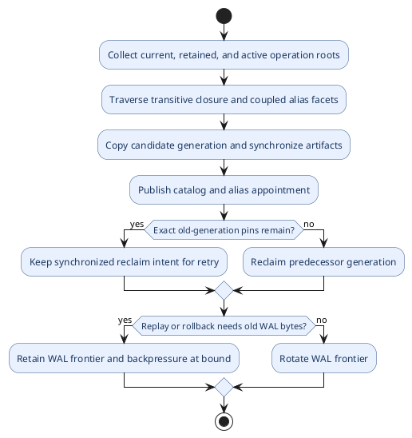
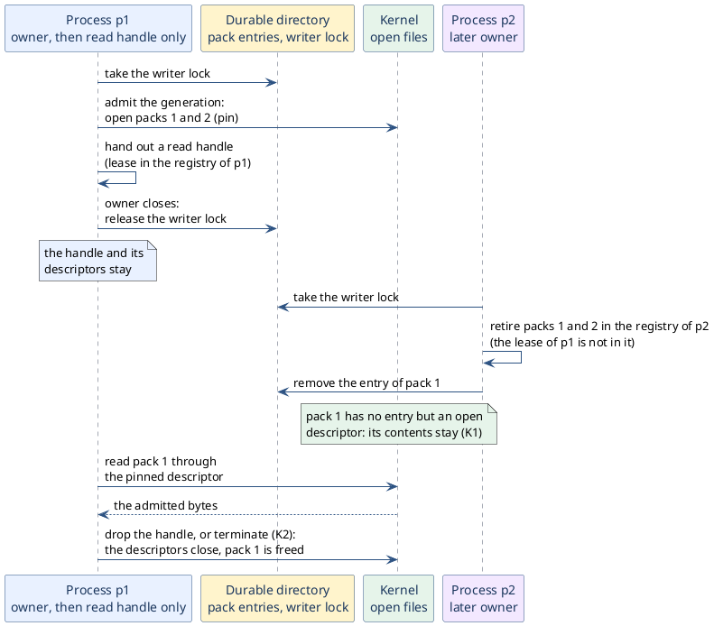

# Generation compaction protection matrix

This matrix states the proof obligations for [task 7943](../../../formal/tlaplus/stack_safe_pda/RSpaceGcProtection.tla). It is an abstract contract for future retention and reclaim work, not evidence that the current compactor implements every row. An **object closure** is the transitive set of canonical objects reachable through authenticated object references. An **exact generation pin** names one catalog epoch, pack range, and index generation. A **WAL frontier** is the earliest log byte still needed for replay or rollback. A **coupled binding** contains the semantic facet, compatibility facet, and frozen-history facet of a legacy alias; equality of a semantic manifest alone does not make two bindings equivalent.

| Obligation | Object closure to retain | Exact physical generation | WAL bytes | Current binding |
| --- | --- | --- | --- | --- |
| Current state | Current manifest and transitive closure | Selected catalog generation until successor publication | No independent reservation beyond selected committed generation | Authenticated by `RetentionManifestV1` and catalog |
| Historical retained state | Each retained manifest and transitive closure | Generation containing an uncopied closure | Committed bytes remain with the protected generation until copied | Manifest and `snapshot_with_manifest` API exist |
| Known dynamic root | Each registered known root and transitive closure, even when absent from the retention manifest | Exact old generation while its lease reads old bytes; successor closure must be copied if the lease is active at publication | No WAL reservation from the known root alone | `RetainedRootKind::Known` is a distinct dynamic registry kind included by `snapshot_with_manifest`; exact generation coupling is not yet wired into compaction |
| Reader | Authenticated read root and transitive closure | Exact observed generation for the lifetime of its handles and decoded views | Only if the reader consumes the log directly | `GenerationLeaseRegistryV1` stores exact keys but blocks retirement on any overlapping physical pack range; Unix handles for one directory share that process-local registry. Dynamic root registry has `Reader`; this does not establish cross-process lease safety: across processes a read handle relies on the pack descriptors pinned at its admission ([descriptor pins](#reads-across-processes-descriptor-pins-instead-of-a-lease-record)). |
| Export | Export root and transitive closure | Exact source generation while bytes are read | Only if export includes log history | Dynamic root registry has `Export` |
| Import | Staged import root and transitive closure until admission or abort | Exact staged or selected generation if file handles are retained | Staged log bytes until admission or abort | Dynamic root registry has `Import` |
| Replay | State root and event-history closure required by the replay contract | Exact source generation until replay can use a published equivalent | Earliest required event through replay completion | No `Replay` root kind or compaction registration is present |
| Rollback | Pre-transition root and all coupled alias facets | Exact predecessor generation until rollback is no longer possible | Earliest rollback record through completion | No `Rollback` root kind or compaction registration is present |

The [finite model](../../../formal/tlaplus/stack_safe_pda/RSpaceGcProtection.tla) represents these rows through `ProtectionMatrix`, uses `Closure` to include transitive object edges, and keeps old and new pin token sets separate. Its `knownRoot` is distinct from the manifest and reaches it through `operationRoot`; the `known0` dynamic lease can pin an exact old or new generation. If that lease is active when `Publish` selects the successor, `knownAtPublish` records the snapshot obligation and `KnownPublicationClosureProtected` requires the entire known closure in the copied pack even if the lease later releases. An old known lease acquired after publication instead retains its exact old generation until release, while a new lease requires its closure to be copied. `Publish` selects the new catalog only after the required closure and all coupled facets are copied; catalog selection stands for alias appointment in this abstraction. Copied facets are necessary but do not themselves prove coupled equivalence, which remains the separate [identity proof](../../../formal/rocq/stack_safe_pda/theories/RSpaceConsensusIdentity.v) obligation. `Reclaim` requires the durable reclaim intent, selected successor, and absence of exact old pins. An old pin, including a replay or rollback pin, may be acquired after publication while the old generation still exists; reclamation must synchronize with that acquisition. `Crash` drops process-local pins but retains catalog authority, copied bytes, the publication snapshot obligation, durable replay/rollback start positions, WAL frontier, and reclaim intent so retry can resume. Pin, durable-obligation and WAL operations cannot run while the model is crashed; `CrashPhaseQuiescence` checks that none of their actions is enabled until `Recover` resumes the published or copying phase.

The bounded gate checks two projections of the same actions and invariants. [The full configuration](../../../formal/tlaplus/stack_safe_pda/RSpaceGcProtection.cfg) retains the original reader, export, import, replay, rollback, and independent WAL-start state space with three possible append positions. [The known-root configuration](../../../formal/tlaplus/stack_safe_pda/RSpaceGcProtectionKnown.cfg) adds `knownRoot` and its lease, retains one operation-root reader plus process and durable replay/rollback obligations, and uses one append position to check that an object-only known pin coexists with WAL rotation. `OperationRootRoleQuotient` checks that reader, export, and import have identical object closures, exact-generation requirements, and no WAL reservation, including their identical process-pin branch in `AcquireOldPin` and `AcquireNewPin`; the full configuration checks each label, while the known configuration uses one representative of that class. `KnownWalOrthogonal` checks that the known lease does not enter the WAL frontier. The [overlap witness configuration](../../../formal/tlaplus/stack_safe_pda/RSpaceGcProtectionKnownOverlapWitness.cfg) must reach a trace with both `known0` and `reader0` active on the old generation at publication, followed by a crash, recovery, successful reclamation, and a new-generation known pin. `knownAfterReclaim` is a history latch set only by that final pin action when the crashed-after-overlap condition holds and the old pack is absent. The gate also reads the counterexample action labels and rejects any trace lacking that order. `Known` changes the copied closure and generic old/new pin guards but does not enter `ActiveWalIds`, so the larger WAL-position product is checked in the full configuration. This decomposition reduces the independent product while exercising the mixed object-generation lifecycle; passing both projections does not by itself prove every untested mixed interleaving or arbitrary numbers of sessions.

Every replay or rollback obligation receives its own `walStarts` entry at registration. The finite model chooses that entry from the inclusive range between the current WAL head and tail; an already-pruned start cannot be registered. `ReclaimableWalFrontier` is the minimum start among active obligations, or the current tail when none remain. WAL append refuses when the configured window is full. After durable catalog publication, rotation advances the head to that minimum while preserving every active suffix. It need not wait for old pack reclamation: an object-only reader or known pin protects its exact pack generation without retaining unrelated WAL bytes, which `ObjectOnlyPinDoesNotBlockWal` checks. For example, in the full configuration replay requiring position 1 and rollback requiring position 2 keep the head at or before 1; releasing replay permits head 2, and releasing rollback permits head to reach the tail. A crash drops process pin starts but preserves durable starts, so retry derives the minimum from surviving obligations. Both configurations retain one durable replay and one durable rollback; the full configuration has one process pin token for each role and a second reader token, while the known configuration has its own known token and representative operation/WAL tokens. The runtime mapping from a concrete request to its exact start position remains open.



The current [compaction model](../../../formal/tlaplus/stack_safe_pda/RSpaceCompaction.tla) covers current, retained, and lease roots but omits export, import, replay, rollback, and the WAL frontier. Its checked theorem omits its own `LeaseSafety` and `RootClosurePreserved` predicates. `DeleteOld` subtracts only direct lease roots rather than their transitive closure, and `AcquireLease` can run after publication. The new model specifically checks post-publication old-pin acquisition and transitive closure; [the coupled-facet mutant](../../../formal/tlaplus/stack_safe_pda/RSpaceGcProtectionOmitCoupledFacetMutant.cfg) must violate `PublishedClosureProtected`, [the exact-pin mutant](../../../formal/tlaplus/stack_safe_pda/RSpaceGcProtectionIgnoreExactPinMutant.cfg) must violate `ExactOldPinsProtected`, [the known-closure mutant](../../../formal/tlaplus/stack_safe_pda/RSpaceGcProtectionOmitKnownClosureMutant.cfg) must violate `KnownPublicationClosureProtected`, [the WAL-prune mutant](../../../formal/tlaplus/stack_safe_pda/RSpaceGcProtectionPrunePastWalStartMutant.cfg) must violate `WalFrontierProtected`, and [the object-pin coupling mutant](../../../formal/tlaplus/stack_safe_pda/RSpaceGcProtectionBlockWalOnOldPackMutant.cfg) must violate `ObjectOnlyPinDoesNotBlockWal`. The [bounded gate](../../../scripts/check-rspace-gc-protection-model.sh) requires each corresponding counterexample trace instead of treating a parser or resource failure as a successful mutant.

A durable replay or rollback registration also owns an exact physical generation independently of its WAL start. The model records an old-generation assignment until that obligation is released, including across a crash. A registration after catalog publication may choose the old generation while it still exists, or the new generation once its required closure has been copied; publication alone does not retarget an existing assignment. A newly registered old-generation obligation may rely on an object absent from the successor pack, so `PublishedClosureProtected` requires the copied closure for new-generation assignments while `ActiveObjectProtection` requires the old generation to remain for old assignments. Reclaim must wait for old-generation durable assignments even when no process reader token remains. The [durable-pin mutant](../../../formal/tlaplus/stack_safe_pda/RSpaceGcProtectionIgnoreDurableExactPinMutant.cfg) removes that guard and must violate `DurableExactGenerationProtected`. WAL rotation still follows the independent replay/rollback start positions, so holding exact object bytes does not automatically pin unrelated log bytes. The first two-configuration gate at model SHA-256 `243c96a881f5bec0737a37097d5f3cd2f2791ce20d3c69f00618151c527d7bab` completed both state spaces and six mutants, but an independent trace audit found its purported lifecycle witness acquired `known0` while `phase = "crashed"`. That gate cannot support lifecycle acceptance. The phase-guarded model SHA-256 `a0d7c86d0ecd847513c429cba23a66db9facb116e5a83454126816bbfe98fa85` completed 1,503,800 distinct full-role states at depth 23 and 149,684 Known-role states at depth 24, each without invariant error. Both checked `CrashPhaseQuiescence`. Its witness trace reaches `Crash`, `Recover`, `Reclaim`, then `AcquireNewPin` in that order; all six causal mutants still violate their intended invariants. The final gate log is `target/verification/rspace-gc-protection/gate-phase-guard.log` at SHA-256 `2882df6908238440df01dc721ed1acd3e4583363d268a45fe876567e2df6da3c`; the witness trace is SHA-256 `97c17279e3389512f93c6f30d8146311de51301d9de56f7adddba10c95101e75`. The superseded logs remain under `target/verification/rspace-gc-protection-pre-phase-guard` for audit.

The runtime binding is incomplete. [The retention registry](../../../rspace++/src/rspace/persistence/retention.rs) defines `snapshot_with_manifest` and `is_snapshot_current`, and `snapshot_with_manifest` includes dynamic `Known` leases independently of manifest current and historical roots, but current source search finds their calls only in registry tests. [Compaction](../../../rspace++/src/rspace/persistence/durable/publication.rs) delegates to checkpoint publication without a dynamic-root snapshot or a coupling from a `Known` lease to its physical generation. [Reclamation](../../../rspace++/src/rspace/persistence/durable/io.rs) now retires the selected predecessor's physical pack range under the same registry mutex used for acquisition. A lease on any overlapping pack range, including one with a different catalog epoch or index generation, defers retirement; once retirement wins, the monotone retired-pack frontier refuses later overlapping acquisitions before the first unlink. A disjoint successor range remains available. Independently opened Unix directory handles share the process-local registry by device and inode. After successful retirement, one strong registry entry and one held directory descriptor per retired directory remain for the process lifetime; this resource cost prevents a later open from resetting the retired frontier or reusing the inode identity. Non-Unix opens still have separate registries and receive no safety claim from this mechanism. [The pack-lease model](../../../formal/tlaplus/stack_safe_pda/RSpaceGcPackLeaseRace.tla) represents this one-lock order in each of two processes, its older-epoch deferral witness, and the exact-key-only deletion mutant; its two-process part is the subject of [the last section](#reads-across-processes-descriptor-pins-instead-of-a-lease-record). The registry is neither a durable retirement record nor a cross-process lease authority, and this binding makes no Windows safety claim. [The coupled identity proof](../../../formal/rocq/stack_safe_pda/theories/RSpaceConsensusIdentity.v) requires replacement by a retained, checked, coupled-equivalent representative and preserves old pins on exact targets. Exact WAL frontier selection, dynamic-root handoff, replay/rollback registration, and Windows lease authority remain concrete refinement obligations for task 7944. Across Unix processes the design has no lease authority: a reader there relies on its pinned descriptors, as the last section states. No complete production GC claim follows from the abstract model or this process-local binding alone.

## Reads across processes: descriptor pins instead of a lease record

The registry of the previous paragraph protects a reader only against reclamation by its own process. A reader can outlive the owner that admitted it, and a later owner in another process then reclaims without seeing the reader's lease. This section states why the reader's bytes stay correct, what the [pack-lease model](../../../formal/tlaplus/stack_safe_pda/RSpaceGcPackLeaseRace.tla) checks about it, and on which operating-system facts the argument rests. The design has no durable lease record, no liveness file and no lock on the read path; a lease still defers reclamation by its own process, as before.

### Terms

| Term | Meaning |
| --- | --- |
| process | One operating-system process that opens the durable directory. The model has two, `p1` and `p2`. |
| writer lock | The exclusive advisory lock on the file `writer.lock.v1` of the directory. `try_acquire_writer` takes it without blocking; a second attempt fails with `WriterLockContended`. |
| owner | The part of a process that holds the writer lock, as a `DurableWriterLeaseV1`. Only the owner admits generations and reclaims packs. |
| descriptor | The kernel's reference to an open file. A read through a descriptor addresses the file itself, not its name in the directory. |
| pin | The open descriptors on every pack of one generation. `DurableIndexedObjectStoreV1::pin` opens them when the generation is admitted. |
| read handle | A `DurableViewReadHandleV1`: a shared reference to an admitted generation, with its pins and its in-memory index, and one generation lease. It holds no writer lock. |
| foreign unlink | The removal of a pack's directory entry by a process other than the one that reads the pack. |

### Scenario



*Figure.* A foreign unlink under a live read handle. Blue is the reading process, purple the later owner, amber the directory and green the kernel. Process `p1` admits a generation, hands out a read handle and closes its owner. Process `p2` opens the store, retires the pack range in its own registry and removes the entry of pack 1. The handle of `p1` still reads pack 1 through the descriptor that it has held since admission.

### Facts

The model rests on five facts about the code (F1 to F5) and two facts about the kernel (K1 and K2). In the model, each action and each invariant carries a comment with the source lines that state its fact, in the form `<path>:<line>` followed by the text of that line.

| Fact | Statement | Where it is stated | Modelled by |
| --- | --- | --- | --- |
| F1 | Every opener takes the writer lock and keeps it for the lifetime of its owner; a second opener is refused. | `try_acquire_writer` and the `Drop` of `DurableWriterLeaseV1` in [`io.rs`](../../../rspace++/src/rspace/persistence/durable/io.rs); `recover_physical_writer_v1` in [`startup.rs`](../../../rspace++/src/rspace/persistence/durable/startup.rs) takes the lock before any recovery | `OpenStore`, `CloseOwner` |
| F2 | A read handle can outlive its owner and the owner's lock. | `DurableViewReadHandleV1` in [`durable/mod.rs`](../../../rspace++/src/rspace/persistence/durable/mod.rs) holds the admitted generation and a lease, and no writer lease; `read_handle_pins_its_generation_across_a_successor_and_owner_teardown` in [`durable_read_handle.rs`](../../../rspace++/tests/persistence/durable_read_handle.rs) reads through a handle after `drop(owner)` | `CloseOwner`, which keeps `leases` and `pinned` |
| F3 | A read handle reads through pack descriptors pinned at admission. | `DurableIndexedObjectStoreV1::pin` opens every pack of the generation under the writer lease, and a read calls `read_exact_at` on the pinned file, both in [`admission.rs`](../../../rspace++/src/rspace/persistence/durable/admission.rs) | `Acquire`, `HandleRead` |
| F4 | Reclamation removes directory entries and never rewrites a pack in place. | `reclaim_reclamation_candidate` removes each pack through `remove_child_handle`, an `unlinkat`, in `io.rs`; the one truncation of a pack, `truncate_incremental_pack` in [`publication.rs`](../../../rspace++/src/rspace/persistence/durable/publication.rs), cuts to the durable tail that the catalog appoints | `Unlink`, used by `DeleteFirst` and `DeleteSecond` |
| F5 | A lease registry is process-local, refuses a lease at or below its retired frontier, and retires a pack range only when no lease of the same process overlaps it. | `acquire` and `retire_pack_range_if_unleased` in [`retention.rs`](../../../rspace++/src/rspace/persistence/retention.rs) | `Acquire`, `Release`, `BlockFirst`, `RetireFirst`, `RetireSecond` |
| K1 | The kernel keeps the contents of an unlinked file while a descriptor on it is open. | POSIX [`unlink()`](https://pubs.opengroup.org/onlinepubs/9699919799/functions/unlink.html): "the removal of the file contents shall be postponed until all references to the file are closed" | `HandleRead`: a pinned read does not consult `deleted` |
| K2 | The kernel closes every descriptor of a process that terminates, for whatever reason. | POSIX [`_Exit()`](https://pubs.opengroup.org/onlinepubs/9699919799/functions/_Exit.html), Consequences of Process Termination: "All of the file descriptors, directory streams, conversion descriptors, and message catalog descriptors open in the calling process shall be closed." | `Crash` |

### Invariants

| Symbol | Meaning | In the model |
| --- | --- | --- |
| $`P`$ | the processes | `Procs` |
| $`\mathit{lock}`$ | the process that holds the writer lock, or none | `lock` |
| $`\mathit{alive}(p)`$ | whether process $`p`$ runs | `alive[p]` |
| $`L_p`$ | the read handles of process $`p`$, which are the leases of its registry | `leases[p]` |
| $`D_p`$ | the read handles of $`p`$ that hold open pack descriptors | `pinned[p]` |
| $`\mathrm{packs}(r)`$ | the packs of the generation that handle $`r`$ reads | `Packs(KeyOf(reader))` |
| $`\mathit{deleted}`$ | the packs whose directory entry is removed | `deleted` |
| $`\mathit{rewritten}`$ | the packs whose stored bytes were changed in place | `rewritten` |
| $`\mathrm{read}_p(r, k)`$ | what handle $`r`$ of process $`p`$ gets when it reads pack $`k`$ | `HandleRead(p, reader, pack)` |

A read returns the admitted bytes, other bytes, or no file at all:

```math
\mathrm{stored}(k) =
\begin{cases}
\mathsf{other} & \text{if } k \in \mathit{rewritten} \\
\mathsf{admitted} & \text{otherwise}
\end{cases}
\qquad
\mathrm{read}_p(r, k) =
\begin{cases}
\mathrm{stored}(k) & \text{if } r \in D_p \\
\mathsf{missing} & \text{if } r \notin D_p \text{ and } k \in \mathit{deleted} \\
\mathrm{stored}(k) & \text{otherwise}
\end{cases}
```

The first case of $`\mathrm{read}`$ is fact K1: a handle that holds descriptors gets the stored bytes whether or not the entry still exists. The model adds two invariants:

```math
\textsf{PinnedReadReturnsAdmittedBytes:} \quad
\forall p \in P \;\; \forall r \in L_p \;\; \forall k \in \mathrm{packs}(r) : \; \mathrm{read}_p(r, k) = \mathsf{admitted}
```

```math
\textsf{DeadProcessHoldsNothing:} \quad
\forall p \in P : \; \neg\,\mathit{alive}(p) \implies \bigl( \mathit{lock} \neq p \;\wedge\; L_p = \emptyset \;\wedge\; D_p = \emptyset \bigr)
```

The first holds because every action preserves $`L_p = D_p`$ and $`\mathit{rewritten} = \emptyset`$. `Acquire` adds a handle to both sets, `Release` and `Crash` remove it from both, `CloseOwner` and the reclamation steps of any process touch neither, and only the rewrite mutant adds to $`\mathit{rewritten}`$. Hence $`\mathrm{read}_p(r, k) = \mathrm{stored}(k) = \mathsf{admitted}`$ for every live handle. The states that matter are those in which a pack of a live handle is in $`\mathit{deleted}`$. The single-process model excluded them through `DeletedPackUnleased`; the two-process model reaches them through `CloseOwner`, `OpenStore`, `RetireFirst`, `DeleteFirst`. The second invariant holds because `Crash` releases the lock and empties the leases and the pins of the process, and a dead process takes no step other than `Restart`. It states what K2 gives: a dead process neither refuses the next opener nor defers a reclamation nor keeps the storage of a removed pack.

The invariants of the single-process model keep their names and are stated per process. `DeletedPackUnleased`, `DeletionFollowsRetirement` and `OlderEpochPackSafe` now speak about the packs that the process itself removed (`unlinkedBy[p]`) rather than about all removed packs. `LiveLeaseOutsideRetiredFrontier` says that no lease of a process overlaps a range that its own registry retired, and `OlderEpochPinDefersFirst` that the registry of a process holding the older-epoch lease has not retired the first range. Inside one process each says what it said before. Their literal single-process forms are false with two processes, because another process may remove a pack that a handle covers; that is the case the pins make safe.

### Negative controls

| Configuration | Switch | Defect | Must violate | Trace |
| --- | --- | --- | --- | --- |
| [`RSpaceGcPackLeaseRaceOlderWitness.cfg`](../../../formal/tlaplus/stack_safe_pda/RSpaceGcPackLeaseRaceOlderWitness.cfg) | none | none: a witness that the deferral lifecycle is reachable | `OlderLifecycleAbsent` | `OpenStore`, `Acquire`, `BlockFirst`, `Release`, `RetireFirst`, `DeleteFirst`, `DeleteFirst` |
| [`RSpaceGcPackLeaseRaceExactKeyOnlyMutant.cfg`](../../../formal/tlaplus/stack_safe_pda/RSpaceGcPackLeaseRaceExactKeyOnlyMutant.cfg) | `ExactKeyOnly` | reclamation tests the exact catalog key instead of the pack overlap | `OlderEpochPackSafe` | `OpenStore`, `Acquire`, `RetireFirst`, `DeleteFirst` |
| [`RSpaceGcPackLeaseRacePathReopenMutant.cfg`](../../../formal/tlaplus/stack_safe_pda/RSpaceGcPackLeaseRacePathReopenMutant.cfg) | `ReopenByPathName` | a read handle keeps no descriptor and opens the pack by its path name for every read | `PinnedReadReturnsAdmittedBytes` | `OpenStore`, `Acquire`, `CloseOwner`, `OpenStore`, `RetireFirst`, `DeleteFirst` |
| [`RSpaceGcPackLeaseRaceRewriteInPlaceMutant.cfg`](../../../formal/tlaplus/stack_safe_pda/RSpaceGcPackLeaseRaceRewriteInPlaceMutant.cfg) | `RewriteInPlace` | reclamation cuts or overwrites the bytes of a pack before it removes the entry | `PinnedReadReturnsAdmittedBytes` | the same six actions, with a non-empty `rewritten` in the last state |

[The gate](../../../scripts/check-rspace-gc-pack-lease-race-model.sh) runs the baseline and these four configurations. For each of the four it requires the named violation and a counterexample trace, and it treats a configuration that passes as a failure. For the two new mutants it also requires the order `CloseOwner`, `OpenStore`, `RetireFirst`, `DeleteFirst`, an empty `rewritten` throughout the path-reopen trace and a non-empty `rewritten` in the rewrite trace. Both new mutants violate the same invariant, because both make a read return something other than the admitted bytes: the first by a missing name, the second by changed contents.

### Size

[The baseline configuration](../../../formal/tlaplus/stack_safe_pda/RSpaceGcPackLeaseRace.cfg) binds two processes. When the two-process form was introduced, TLC reported 746,387 states generated, 102,967 distinct states and depth 29, and finished in 2 seconds under the gate's limits of 512 MB heap, two workers and 180 seconds per run. The single-process model had 112 distinct states.

### Platforms

The durable directory opens only on Unix: on every other target `open_directory_handle` returns `UnsupportedPlatform`, so no reader exists there. The repository builds for Linux with glibc on x86-64 and AArch64 ([`Cross.toml`](../../../Cross.toml), [`node/Dockerfile`](../../../node/Dockerfile)) and documents macOS as a development host ([`README.md`](../../../README.md)). Both kernels state K1 and K2 in their own manuals: Linux in [`unlink(2)`](https://man7.org/linux/man-pages/man2/unlink.2.html) and [`_exit(2)`](https://man7.org/linux/man-pages/man2/_exit.2.html), XNU in [`unlink(2)`](https://raw.githubusercontent.com/apple-oss-distributions/xnu/main/bsd/man/man2/unlink.2) and [`_exit(2)`](https://raw.githubusercontent.com/apple-oss-distributions/xnu/main/bsd/man/man2/_exit.2). The writer lock is taken with `File::try_lock` of the Rust standard library, which calls `flock` with `LOCK_EX | LOCK_NB` on both systems. The standard library documents that this lock is released when the file, along with every descriptor duplicated or inherited from it, is closed; the Linux manual says the same of the open file description ([`flock(2)`](https://man7.org/linux/man-pages/man2/flock.2.html)). With K2, the lock of a dead process is therefore gone.

Two configurations are outside this claim. A directory shared between hosts over a network filesystem is not covered: the Linux manual of `unlink(2)` warns that the NFS protocol "can cause the unexpected disappearance of files which are still being used", and the [Windows contract](windows-durable-authority-contract.md) qualifies local Unix filesystems only. Native Windows fails closed today and would need its own qualification of the pin.

### Boundary

The model is bounded to two processes, five read handles and five packs, and it abstracts: a handle and its pins are taken in one step, publication is not modelled, and a read is a state function rather than a step (the header of the model lists these abstractions). It checks the design, not the running code. No test takes a read handle in one process and reclaims in another. A durable cross-process lease record (leaf `rspace-gc-cross-process-lease-record` of task 7944) is the deferred alternative; it would be needed only if the pins proved unsound on a supported platform.
