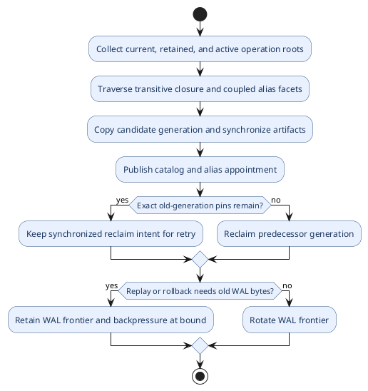

# Generation compaction protection matrix

This matrix states the proof obligations for [task 7943](../../../formal/tlaplus/stack_safe_pda/RSpaceGcProtection.tla). It is an abstract contract for future retention and reclaim work, not evidence that the current compactor implements every row. An **object closure** is the transitive set of canonical objects reachable through authenticated object references. An **exact generation pin** names one catalog epoch, pack range, and index generation. A **WAL frontier** is the earliest log byte still needed for replay or rollback. A **coupled binding** contains the semantic facet, compatibility facet, and frozen-history facet of a legacy alias; equality of a semantic manifest alone does not make two bindings equivalent.

| Obligation | Object closure to retain | Exact physical generation | WAL bytes | Current binding |
| --- | --- | --- | --- | --- |
| Current state | Current manifest and transitive closure | Selected catalog generation until successor publication | No independent reservation beyond selected committed generation | Authenticated by `RetentionManifestV1` and catalog |
| Historical retained state | Each retained manifest and transitive closure | Generation containing an uncopied closure | Committed bytes remain with the protected generation until copied | Manifest and `snapshot_with_manifest` API exist |
| Reader | Authenticated read root and transitive closure | Exact observed generation for the lifetime of its handles and decoded views | Only if the reader consumes the log directly | `GenerationLeaseRegistryV1` has exact keys; dynamic root registry has `Reader` |
| Export | Export root and transitive closure | Exact source generation while bytes are read | Only if export includes log history | Dynamic root registry has `Export` |
| Import | Staged import root and transitive closure until admission or abort | Exact staged or selected generation if file handles are retained | Staged log bytes until admission or abort | Dynamic root registry has `Import` |
| Replay | State root and event-history closure required by the replay contract | Exact source generation until replay can use a published equivalent | Earliest required event through replay completion | No `Replay` root kind or compaction registration is present |
| Rollback | Pre-transition root and all coupled alias facets | Exact predecessor generation until rollback is no longer possible | Earliest rollback record through completion | No `Rollback` root kind or compaction registration is present |

The [new finite model](../../../formal/tlaplus/stack_safe_pda/RSpaceGcProtection.tla) represents these rows through `ProtectionMatrix`, uses `Closure` to include transitive object edges, and keeps old and new pin token sets separate. `Publish` selects the new catalog only after the required closure and all coupled facets are copied; catalog selection stands for alias appointment in this abstraction. Copied facets are necessary but do not themselves prove coupled equivalence, which remains the separate [identity proof](../../../formal/rocq/stack_safe_pda/theories/RSpaceConsensusIdentity.v) obligation. `Reclaim` requires the durable reclaim intent, selected successor, and absence of exact old pins. An old pin may be acquired after publication while the old generation still exists; reclamation must synchronize with that acquisition. `Crash` drops process-local pins but retains catalog authority, copied bytes, durable obligations, WAL frontier, and reclaim intent so retry can resume. WAL append refuses when the configured window is full, and rotation advances the frontier only after publication, old-generation reclamation, and release of active replay/rollback needs. This finite model treats every replay or rollback obligation as requiring bytes from frontier zero. It cannot represent an obligation beginning at a later log position; exact per-obligation frontier selection and runtime binding remain open.

The current [compaction model](../../../formal/tlaplus/stack_safe_pda/RSpaceCompaction.tla) covers current, retained, and lease roots but omits export, import, replay, rollback, and the WAL frontier. Its checked theorem omits its own `LeaseSafety` and `RootClosurePreserved` predicates. `DeleteOld` subtracts only direct lease roots rather than their transitive closure, and `AcquireLease` can run after publication. The new model specifically checks post-publication old-pin acquisition and transitive closure; [the coupled-facet mutant](../../../formal/tlaplus/stack_safe_pda/RSpaceGcProtectionOmitCoupledFacetMutant.cfg) must violate `PublishedClosureProtected` or `CoupledAliasProtected`, and [the exact-pin mutant](../../../formal/tlaplus/stack_safe_pda/RSpaceGcProtectionIgnoreExactPinMutant.cfg) must violate `ExactOldPinsProtected`.

The runtime binding is incomplete. [The retention registry](../../../rspace++/src/rspace/persistence/retention.rs) defines `snapshot_with_manifest` and `is_snapshot_current`, but current source search finds their calls only in registry tests. [Compaction](../../../rspace++/src/rspace/persistence/durable/publication.rs) delegates to checkpoint publication without a dynamic-root snapshot. [Reclamation](../../../rspace++/src/rspace/persistence/durable/io.rs) checks the exact generation registry before deletion and preserves a synchronized sidecar for retry, but the check and deletion are separate operations; an old-generation pin cannot be assumed excluded without a caller-level ordering proof. [The coupled identity proof](../../../formal/rocq/stack_safe_pda/theories/RSpaceConsensusIdentity.v) requires replacement by a retained, checked, coupled-equivalent representative and preserves old pins on exact targets. Exact WAL frontier selection, concurrent pin/reclaim ordering, dynamic-root handoff, and replay/rollback registration are concrete refinement obligations for task 7944. No production claim follows from the abstract model until those bindings and executable properties are established.
