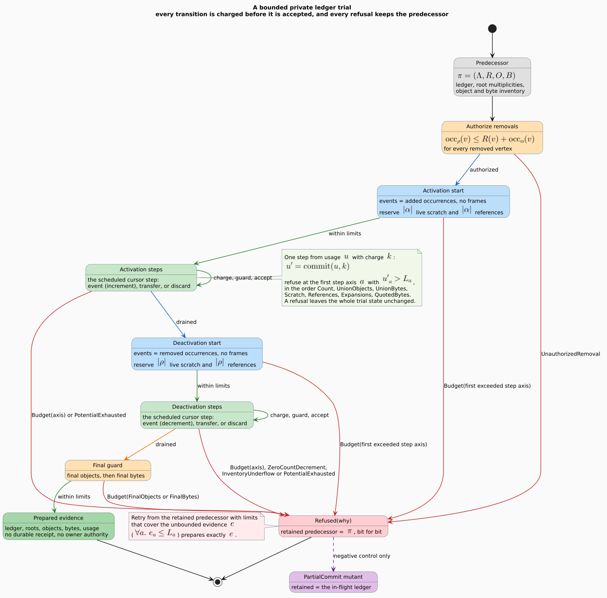
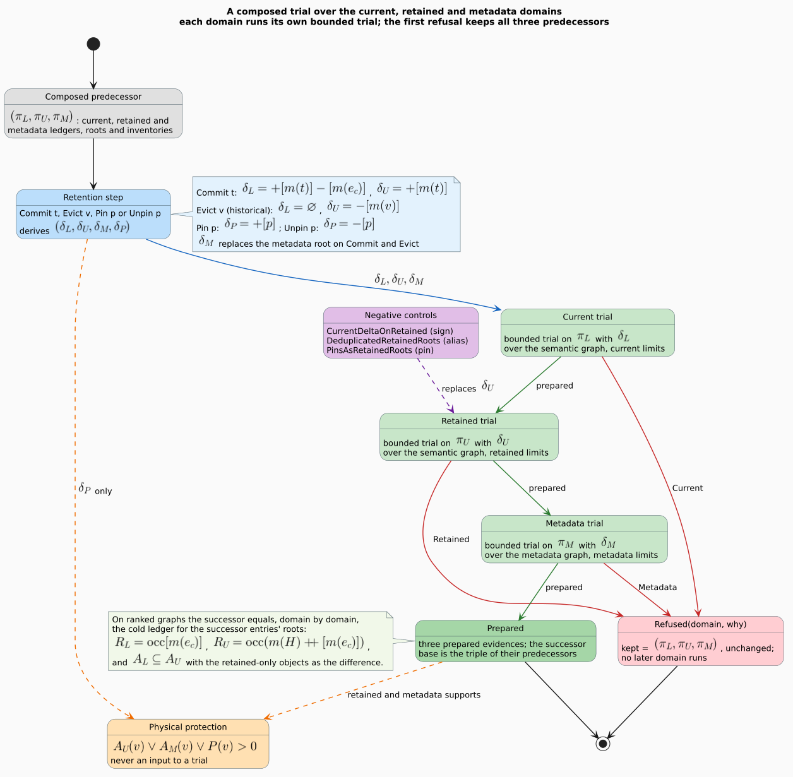

# Generation checkpoint publication invariant catalog

Date: 2026-08-28

Status: the checkpoint phase model and its original executable bindings have prior verification evidence. The current-source focused Rocq, TLC, and checkpoint-property gates passed on 2026-10-08. The physical write/sync fault seam and exhaustive crash matrix are separately tracked as claimed done; independent acceptance review remains.

Scope: fresh PathMap-DAG generation checkpoints for durable RSpace

## Purpose

This report is the traceability authority between the verified publication-phase models and their executable Rust refinement. It prevents an implementation or test suite from silently covering only the successful publication path. Every obligation at this abstraction level has a stable identifier, a property-based test target, and a negative control where one is meaningful. The phase model treats each pre-catalog file write and synchronization operation atomically; it does not claim the separately tracked byte-progress refinement for short writes, zero progress, interruptions, synchronization uncertainty, or loss of unsynchronized names after a power failure.

The required refinement order is:

1. verify the formal model and its controls;
2. extract every invariant into this catalog and executable property tests;
3. implement the Rust refinement;
4. require all proofs, properties, differentials, and focused integration tests to pass.

No Rust implementation claim is justified by the abstract model alone. Filesystem durability, checksums, bounded parsing, partial writes, and semantic admission are executable proof obligations.

The task 7920 caller/limit ruling is recorded in
[engineering journal J-067](pathmap-engineering-journal-2026-08-23.md#j-067--2026-09-06-separate-trusted-state-authority-from-cold-execution-evidence).
It separates the planned trusted-successor validity/inventory capability from
exact cold-execution evidence. Existing fresh-generation preflight, cold admission
and publication-owner obligations below remain binding. J-067's finite future
refinement list is not a new verified theorem/property manifest: its corresponding
proofs and executable witnesses must be added through the refinement order above
before runtime implementation. No verified binding is removed or relabeled.

## Hot-store journal refinement (2026-09-06)

The `HotStoreJournalAcknowledgement` section of `GenerationCheckpointPublication.v` adds
ten closed lemmas to the seventeen publication capstones. Its journals are abstract finite
encodings of five domains: data deltas, continuation deltas, continuation content transitions,
continuation source bytes, and join deltas. Equality in this model must be refined by exact
PathMap equality in Rust. It establishes the local capture/acknowledgement obligations below;
it does not establish the unfinished owner/publication/recovery composition.

| ID | Formal lemma | Executable obligation in `tests/hot_store/journal_commit.rs` |
|---|---|---|
| HJ-01 | `acknowledgement_preserves_live_state` | `acknowledgement_clears_five_populated_journals_and_preserves_live_records` compares resident and installed values. |
| HJ-02 | `exact_acknowledgement_clears_all_five_journals` | The same test populates every domain before clearing; run in debug and release. |
| HJ-03 | `stale_acknowledgement_changes_nothing` | `mismatch_or_missing_capability_in_any_journal_rejects_without_partial_clear` compares all journals after each refusal. |
| HJ-04 | `successful_acknowledgement_requires_exact_journal` | `stale_journal_cannot_clear_a_newer_revision` and ten missing/changed-domain cases. |
| HJ-05 | `post_state_addition_recovers_base` | `journal_count_inversion_matches_live_multiplicities` varies the base and successor counts. |
| HJ-06 | `post_state_removal_recovers_base` | The same property covers removal to a positive count and to zero. |
| HJ-07 | `one_occurrence_removal_requires_unit_delta` | Persisted counterexample `before=3, after=0` detects journaling the prior multiplicity at every removal. |
| HJ-08 | `missing_count_is_distinct_from_captured_zero` | `absent_count_evidence_is_not_a_captured_zero` deletes captured evidence and requires refusal. |
| HJ-09 | `journal_lookup_uses_exact_native_record_key` | `join_journal_uses_native_key_and_repeated_channel_positions` checks native bytes, duplicates, additions and removals. |
| HJ-10 | `reframed_join_key_misses_native_record` | The same test rejected the previous extra-framed producer before its correction. |

The model was checked before producer changes under `MemoryMax=2G`, `MemorySwapMax=0`.
The focused baseline passed six tests and failed three; the corrected debug and release gates
pass nine tests each under `MemoryMax=8G`, `MemorySwapMax=0`, with four build jobs.
These are configured resource ceilings, not measurements of peak resident memory.
The arithmetic lemmas use natural numbers; checked `u64` overflow/underflow remains an
executable refinement requirement. The finite randomized multiplicity property is not an
exhaustive proof over the Rust integer domain.

`tests/persistence/transaction_sealing.rs::live_cold_journals_seal_exact_three_namespace_successor`
adds the composition check from actual hot-store mutations through source staging and semantic
sealing, including first-representative source retention and repeated receive-channel positions.
Sealing alone must leave the durable base and hot journals unchanged. Durable publication,
unknown-outcome reconciliation, receipt identity and acknowledgement under the operation gate
remain separate required obligations.

## Publication owner composition (2026-09-06)

`RSpaceJournalPublicationOwner.tla` models one nonempty checkpoint and its retries. A receipt
binds store identity, semantic profile, hot-store incarnation, journal epoch, durable base, target,
transaction identity and all five journals. Two incarnations and two epochs permit a stale
receipt to carry byte-identical journal contents. The model also admits foreign stores/profiles,
the same target with a different transaction, and a third recovery state as candidate inputs.

The required sequence is `Ready → Captured → Publishing → AwaitingAck → Done`. Unknown
publication outcomes enter `RecoveryRequired`. An authenticated exact predecessor returns to
`Ready` with the journal retained; an authenticated exact successor enters `AwaitingAck` without
publishing the mutation again. A successor generation lease is acquired while predecessor
protection remains held. Only exact acknowledgement clears the journals and rebases the live
store. Reopening after process termination reconstructs fresh volatile journals from the selected
durable state; it does not resume arbitrary unfinished interpreter execution.

| ID | Model invariant | Required Rust property before owner activation |
|---|---|---|
| JO-01 | `TypeInvariant` | Every success/error/recovery result contains the appropriate typed authority; no path-only recovery state. |
| JO-02 | `GateHeldUntilResolution` | An exclusive operation permit remains held through capture, publication, uncertain recovery and acknowledgement; cancellation cannot release it while a worker still commits. |
| JO-03 | `ContinuousAuthority` | The same writer lease and generation registry survive every error; predecessor protection overlaps successor acquisition. |
| JO-04 | `ExactPendingReceipt` | Foreign store/profile/incarnation/epoch/base and byte-identical stale receipts are rejected without journal mutation. |
| JO-05 | `WholeJournalAcknowledgement` | A mismatch in any domain leaves all five journals unchanged. |
| JO-06 | `AcknowledgementRequiresExactSuccessor` | No clear before authenticated publication and successor lease acquisition; failed acquisition retains the admitted successor. |
| JO-07 | `AcknowledgementRequiresExactReceipt` | The consumed receipt is the exact captured intent, including all journals. |
| JO-08 | `ReadyHasCoherentBase` | Published-but-unacknowledged state cannot become ready with a journal still relative to its predecessor. |
| JO-09 | `RecoveryAcceptsOnlyExactTerminal` | Compare authenticated store/profile/base/target/transaction bindings; equal target identity alone is insufficient. |
| JO-10 | `AtMostOnePublication` | Retry after an ambiguous successful commit acknowledges the original intent and never applies it twice. |
| JO-11 | `ReopenDiscardsVolatileJournal` | Restart reconstructs a fresh hot-store incarnation with empty pending journals relative to the recovered checkpoint. |
| JO-12 | `PreparedWitnessBound` | Derive the expected complete terminal from the checked publication layout; retain its exact sequence, transaction, pack and index frontiers through reconciliation. |
| JO-13 | `AtMostOneAcknowledgement` | Retrying an acknowledgement after unwind does not clear journals or rotate the epoch twice. |
| JO-14 | `ClearedPendingJournalHasExactMarker` | An interrupted owner recognizes a cleared journal only through its exact committed receipt and successor marker, never emptiness alone. |
| JO-15 | `AcknowledgementAcceptsOnlyExactInput` | Reject incoming acknowledgement requests with a different receipt or terminal, including retries after the original journals were cleared. |

The original control explored 544 distinct states with all eleven original invariants satisfied. Eight
single-defect configurations fail their designated invariants: foreign receipt, early clear,
partial clear, generation-lease gap, premature ready/rebase, duplicate publication, gate release,
and wrong recovery terminal. Four reachability witnesses establish successful acknowledgement,
recovery of the predecessor, recovery of the successor, and refused receipt binding.
`bash scripts/check-rspace-journal-owner-model.sh` verifies the control and checks each
counterexample's named invariant, so a parse error or resource failure cannot count as a pass.
The runner is included in the existing stack-safe proof gate and uses its shared bounded TLC
helper: 512 MiB JVM heap, 2 GiB memory cap, two workers, no swap, and on-disk state storage.

This is bounded protocol evidence, not a proof of the Rust owner implementation. Journals are
abstract equality values; object validation and filesystem write/sync behavior are supplied by
the existing publication models and executable failure-injection suites. The model does not
establish fairness, eventual repair of permanent I/O faults, or unbounded multi-transaction
progress. Empty mutations use the separate no-op obligations. The JO properties above are
required implementation tests, not yet executed owner tests.

### Capture abort, cancellation and interrupted acknowledgement refinement

The revised control explores 13,784 distinct states (334,852 generated) with all fifteen
invariants satisfied. Fifteen causal mutants and eight reachability witnesses pass their
designated checks. The additional mutants separately exercise acknowledgement-marker loss,
stored-marker corruption, wrong incoming acknowledgement identity, duplicate acknowledgement,
prepared-witness corruption, gate release on unwind and gate release on cancellation. Additional
witnesses reach capture abort, cancellation, unwind and exact acknowledgement retry after
unwind. Invalid acknowledgement inputs vary base, target, transaction and journal as well as
store, profile, incarnation and epoch; these inputs do not broaden legitimate preparation.

Acknowledgement and owner completion are separate actions. The first clears all journals,
rebases and records an exact marker under one hot-state boundary. If completion is interrupted,
recovery of the same successor can recognize that marker and finish without a second clear or
publication. Capture abort has no disk effect and retains the journal. Cancellation preserves
the owned permit and authority.

This refinement still models one successful publication, not repeated checkpoint/reset/restore
cycles. Repeated-epoch ABA protection therefore requires separate generated implementation
histories. The model's expected sequence and frontiers are synthetic functions of its receipt:
JO-12 checks preservation of that witness, not correctness of Rust layout construction. Rust
must derive the witness from the same checked PREPARE/COMMIT/index plan as publication and test
same-root but wrong sequence, transaction digest and frontiers independently. Cancellation assumes
synchronous publication/recovery with no detached worker still writing after return; adding such
a worker would require extending this model before implementation. No unbounded liveness or
complete Rust refinement claim follows from this finite exploration.

The completed command was `bash scripts/check-rspace-journal-owner-model.sh`; raw evidence is
`/tmp/rspace-journal-owner-unwind-ack-matrix-r2-20260906.log`, SHA-256
`b78b4d623a01642671ad90140f1d0a1632f90d231a23c2cef619efccc64705fe`.
The existing runner enforces the resource bounds stated above and validates each named
counterexample rather than treating an arbitrary failed invocation as evidence.

The concrete implementation must preserve `DurableWriterLeaseV1` through physical recovery and
semantic-admission errors. `DurableDirectoryV1::try_clone_reader` shares the opened directory
capability and generation registry; reopening `PathBuf` does not. Factor borrowed recovery and
source admission, or return failures carrying the original lease. Retain the admitted successor
when its new generation lease is unavailable. The owner must construct mutations from its
private observation and retain the sealed intent through reconciliation and acknowledgement.

### Borrowed recovery and admission refinement (2026-09-06)

The `JournalOwnerReadiness` module in `GenerationCheckpointPublication.v` refines
JO-03, JO-04 and JO-08 at the construction and abort boundaries. Its binding is an
opaque registry identity paired with the complete catalog identity; `None` models
a hot-store base invalidated by clear or snapshot replacement. It does not model
those operations as legitimate mutations through an already-held operation gate.

| Formal lemma | Extracted executable obligation |
|---|---|
| `readiness_requires_exact_registry_and_catalog` | Refuse a foreign HotStore even with identical catalog bytes, preserve the rejected constructor's original view, and refuse a Ready observation after base invalidation. |
| `invalid_binding_retains_the_original_pending_receipt` | `invalidated_base_cannot_release_a_refused_capture_as_ready` and `invalidated_base_cannot_release_old_recovery_or_report_ready` retain the receipt, permit, writer and predecessor pin after clear or snapshot replacement. |
| `valid_base_allows_abort_independently_of_receipt_revision` | `a_stale_capture_is_rejected_before_publication_even_when_its_journal_bytes_match` permits a fresh capture after a same-base journal restore without accepting the stale receipt. |

This boundary theory distinguishes authority validity from receipt freshness; the
implementation must not enumerate journal endpoints merely to check a base.
The two invalidation regressions fail on the pre-guard owner, respectively at
capture refusal and exact-predecessor recovery. They are concrete refinement
tests, not a claim that the bounded publication model explores out-of-band resets.

The first executable JO-03 refinement factors the existing validation bodies into
`recover_physical_from_lease_v1(&mut DurableWriterLeaseV1, ...)` and
`admit_physical_source(&DurableWriterLeaseV1, ...)`. The caller retains the writer capability
on both success and failure; neither kernel reopens a pathname or constructs a generation
registry. Existing consuming startup wrappers delegate to these bodies and retain their old
startup API. The checkpoint owner must use the borrowed kernels, not those consuming wrappers.

The following tests in `tests/persistence/durable_startup.rs` were written before the refactor:

| Test | JO-03 refinement exercised |
|---|---|
| `borrowed_recovery_retains_writer_and_pin_across_every_rebuild_failure` | Six existing rebuild failpoints; lock contention and the original generation pin remain observable after each failure and retry. Explicit owner release is the observer's positive control. |
| `borrowed_recovery_unwind_keeps_the_owners_writer_and_generation_pin` | An injected recovery panic unwinds only the borrowed operation; the test retains the owning scope, verifies exclusion, and retries successfully. |
| `borrowed_admission_does_not_release_authority_on_a_semantic_error` | A physically valid but semantically invalid fixture is repeatedly rejected without dropping the owner. |
| `borrowed_recovery_and_admission_retry_histories_keep_exact_authority` | Generated physical-limit/admission-limit failure sequences followed by successful admission, preserving the exact catalog and pack bytes. |

The focused debug suite passes 17/17. The broader release durable-persistence suite passes
70/70 with 256 property cases configured. Its first run passed 68/70: two existing high-volume
publication tests exhausted the inherited 1,024-descriptor limit because every trial used a
process-lifetime scratch lock. Only those test fixtures and the new generated retry fixture now
use scoped child directories under one protected process root. The shared helper, descriptor
limit and test coverage are unchanged. A separate 1,100-case lifetime regression passes.
All heavy checks used an 8 GiB systemd memory cap with swap disabled; the corrected release
run used on-disk scratch. No new dependency was introduced.

These tests do not yet establish complete JO-03 owner integration, successor-pin handoff,
asynchronous cancellation or all JO-01..JO-11 properties. In particular, retaining a lease in
an outer test scope through panic is not proof that the unfinished owner remains recoverable
after every panic. Publication outcome classification and journal acknowledgement remain open.

### Borrowed preparation and streamed terminal witness refinement (2026-09-06)

The admitted source now supports transaction opening, sealing, exact successor inventory,
object classification and WAL preparation while its original writer lease is retained separately.
Existing writer methods delegate to these bodies. The source retains the original generation
registry identity and checks a borrowed lease before sealing, binding, preparation or publication;
equal catalog bytes from another opened store do not establish this authority.

The publisher exposes the exact successor slot through a synchronous `FnOnce` callback before
writing COMMIT. This slot uses the PREPARE identity computed during the actual streaming write,
the existing checked index append frontier and the same COMMIT/catalog constructors used for
publication. No second PREPARE serialization, payload hash pass or copied object projection is
required. The callback receives an expected terminal, not proof that publication has succeeded.

| JO obligations | Executable refinement |
|---|---|
| JO-03, JO-04 | `borrowed_source_preparation_keeps_exact_authority_through_refusal_and_publication` tests byte-identical foreign stores, crossed source/lease pairs, wrong sequence, preparation limit refusal, stale predecessor preparation, continuous writer exclusion, complete output bytes and cold reopen. |
| JO-09, JO-12 | The existing phase/torn-prefix/unwind matrix now checks that the retained terminal equals the uninterrupted control's complete catalog slot whenever capture has occurred. Failures during PREPARE/index emission leave capture absent and cannot have published a successor. |
| JO-03, JO-12 | `incremental_terminal_capture_precedes_commit_and_survives_callback_unwind` inspects the exact PREPARE/index bytes and unchanged catalog during capture, then unwinds, recovers the predecessor and retries to the exact final files. |

Physical PREPARE/index staging precedes terminal capture, but no COMMIT or catalog publication
can precede it. These unselected bytes have no authority under the catalog-appointed recovery
model and the checked suffix-retry laws. The abstract model's expected successor remains the
intended transaction throughout; the concrete owner may leave its physical terminal unset until
capture. In that case recovery must accept only the predecessor, never guess a successor from
its target root. Once captured, retain the complete slot through every later failure. Tests of
this callback do not establish owner permit ownership, atomic HotStore acknowledgement or
repeated-epoch ABA safety; those JO obligations still require owner implementation and tests.

## Identity-bound HotStore acknowledgement refinement — 2026-09-06

`CapturedHotJournalV1` is an immutable, non-cloneable receipt created under one HotStore
read boundary. It binds the exact catalog predecessor, the store's current journal version,
an independent capture identity, five copy-on-write journal roots and native data/join counts.
Two stores with equal catalogs and equal journal bytes cannot exchange receipts. Restoring
the same journal bytes advances the version; clearing or replacing the live state invalidates
its durable base. Read-side hydration, duplicate inserts and rejected mutations do not
advance the version. Installed-state mutation conservatively invalidates outstanding receipts.

Acknowledgement compares the expected and admitted full catalog slots, receipt/version/base,
successor sequence and all five journal domains under one HotStore write boundary. It prepares
the new marker before clearing, then clears and rebases together without changing live records
or installed state. A retry accepts only the same capture identity, terminal and current
post-acknowledgement version with all journals empty. Emptiness alone cannot authorize a retry
or fabricate a successor. The marker retains identity tokens and a catalog slot, not the
cleared PathMap journals. The owner must supply the genuinely admitted terminal: this component
does not independently read or authenticate disk state.

| Obligations | Executable component evidence |
|---|---|
| HJ-01..04, JO-05/07/13/14/15 | `durable_acknowledgement_is_exact_atomic_and_idempotent`, foreign/all-domain and wrong-terminal tests check atomic clearing, nonmutation, exact identity and replay. |
| JV-01..03, JO-04 | Retained-version and checkpoint/restore property histories cover stale identical journals and explicit `u64::MAX` rollover. |
| JO-04 | `every_durable_mutator_invalidates_retained_journal_versions` checks twelve production mutation routes, including accepted-match data, continuation and join removal. |
| JO-04/13 | `durable_reads_noops_and_refused_mutations_preserve_the_capture` and `an_empty_durable_journal_cannot_fabricate_a_successor` check the complementary boundaries. |

The three `JournalVersionFreshness` capstones were compiled before the Rust version
implementation. They bring the existing theory to 36 closed assumption reports. The model
uses an increasing abstract identity; the Rust refinement relies on fresh `Arc` allocations
while retained receipts keep their old tokens alive. This is an explicit identity-freshness
argument, not a machine-checked Rust allocator proof. Normal mutations increment a local
`u64` without allocating; rollover creates a new token rather than imposing a lifetime limit.
The central derivation matrix now has 94 IDs. Its single property-family predicate is shared
by catalog token recognition and derivation-row recognition, with required-family coverage
checked independently of test success.

These tests use synthetic, format-valid catalog slots for HotStore isolation. They do not
establish continuous writer ownership, authenticated recovery, successor-pin handoff or
asynchronous cancellation of the production owner. Those remain required task 6626 integration
tests; legacy-authority separation and production activation remain separately gated.

## Executable publication-owner composition — 2026-09-06

The component-only limitations above describe their historical verification stage.
The production owner now retains one private capture, exclusive operation permit,
original writer/registry and predecessor pin through publication and reconciliation.
Its sixteen tests execute real catalog/pack/index operations with the generic RSpace
semantic profile. The following table binds the separate JO model to those tests;
the central 97-ID matrix additionally checks every printed Rocq capstone and its
executable target. JO names remain a separate model boundary, not extra central IDs.

| JO obligations | Executable owner evidence in `tests/persistence/durable_rspace_authority.rs` |
|---|---|
| JO-01, JO-02, JO-03 | `owner_uncertain_old_and_new_publications_retain_the_gate_and_original_writer` and the capture/preparation/acknowledgement unwind matrix verify typed unresolved states, continuous writer exclusion and pin overlap. |
| JO-04, JO-05, JO-07 | Stale-capture and acknowledgement-conflict tests retain all five journals; the constructor regression rejects identical-catalog foreign registry provenance without losing the original view. All-domain and incoming-receipt variations also remain covered by the HotStore tests. |
| JO-06 | `successor_pin_failure_retains_the_admitted_successor_old_pin_and_permit_for_retry` forces the real lease-counter refusal and verifies retry without changed physical files. |
| JO-08 | Both invalidated-base regressions retain unresolved ownership after clear or replacement; non-pending invalidated owners refuse a usable Ready state. JR-01..03 supply the additional formal readiness boundary. |
| JO-09, JO-12 | `owner_recovery_rejects_foreign_third_and_same_state_different_terminals` rejects a different full terminal even with the same semantic target. The selected-file damage/repair test preserves the original expected terminal and authority. |
| JO-10 | Exact-successor retries and generated multiplicity/cold-reopen histories publish each changed step once; no-op steps do not advance generation. |
| JO-11 | `cold_restart_before_acknowledgement_selects_old_or_new_without_delta_replay` destroys the unresolved owner and old hot incarnation before recovery, checks all five fresh journals, and then publishes another mutation. |
| JO-13, JO-14, JO-15 | The unwind matrix and acknowledgement-conflict test distinguish exact retry from changed marker/version, including non-panicking and panicking post-acknowledgement restores. A shared read-only exact-marker predicate guards owner completion. |
| JO-02 cancellation | `cancelling_a_checkpoint_waiting_for_the_exact_gate_does_not_capture_or_publish` drops a pending caller before gate acquisition. There is no await or detached worker after capture. |

Combined HotStore/persistence debug and release gates pass 403/403 with 233 other
library tests excluded. The owner property has an explicit 64-history configuration,
not 256 histories despite the command-level environment setting. The readiness
theory's three new capstones bring the existing theory to 39 closed reports and
pass independent kernel checking. Raw evidence and red controls are recorded in
[J-062](pathmap-engineering-journal-2026-08-23.md#j-062--2026-09-06-retain-the-journal-owner-through-exact-durable-resolution).

This does not activate the durable backend, prove power-loss behavior on every
filesystem, or prove full Rust refinement. Actual RSpace gate wiring and whole-owner
teardown containment remain task 7756's single-authority activation obligations.
The TLA+ model still assumes ordinary mutations honor that gate; out-of-band base
invalidation is covered by the separate readiness theory and concrete regressions.

## Exact incremental-successor inventory refinement — 2026-09-06

`GenerationCheckpointPublication.v::ExactSuccessorInventory` proves byte conservation,
the removed-byte subtraction bound, exact replacement accounting, and a concrete
counterexample to predecessor-plus-staged-minus-manifest arithmetic. Its four capstones
are closed under the global context; the theory now prints 31 closed capstones. These
are finite partition laws, not a proof that Rust constructs the correct partitions or
that the complete publication owner refines the model. Canonical closure membership is
distinct by digest and remains subject to the existing full-byte collision checks.

Extracted implementation obligations, before production correction:

| ID | Formal/accounting obligation | Executable correspondence |
|---|---|---|
| SI-01 | Exact replacement removes predecessor-only objects and counts shared objects once. | `incremental_inventory_tracks_replacement_removal_sharing_and_reuse` compares every sealed target and cold successor to full traversal. |
| SI-02 | Repeated transitions preserve the exact distinct-object partition, including empty states and reused digests. | `incremental_inventory_matches_cold_admission_at_every_history_step` generates count updates and removals with a fresh union ledger and physical reopen at every step. |
| SI-03 | Current semantic closure and retained semantic union are separate from retention metadata. | Both history checks compare manifest/current/retained fields independently; the existing DATA-inventory laws continue to account for the separate retention-manifest object. |
| SI-04 | One predecessor/target-bound inventory supplies all publication fields. | A private durable-only sealed/prepared capability must reject foreign/stale catalog bindings before writes; generic staged diagnostics cannot serve as current-state inventory. |
| SI-05 | Resource refusal leaves durable predecessor bytes unchanged. | Structural/union/read/history limits must be enforced during inventory construction; policy mismatch and failed preparation must not publish or release the borrowed writer. |

The complete persistence gates now pass 312/312 in both debug and release. SI-01/SI-02
run 256 generated histories from both empty and populated three-namespace states. SI-04
is exercised by `incremental_inventory_is_bound_to_its_opened_authority_and_exact_sequence`;
SI-05 by `incremental_inventory_limits_refuse_before_any_durable_mutation` and
`incremental_inventory_policy_cannot_change_after_preparation`. Closure-read budgets count
requests against staged and inherited objects, not only physical I/O. These concrete checks
are not established by the arithmetic lemmas. The existing full overlay traversal is
the immediate exact source. Task 7755 separately owns its proven incremental replacement
and the historical-retention encoding cost; no delta-scaling claim follows from this repair.

The first broad release run passed 311/312 because the exhaustive central derivation matrix
omitted these new capstones and ten earlier journal capstones. The matrix and executable
bindings now include all 89 stable IDs and all 31 printed capstones; no completeness check
was removed. The publication-owner JO obligations are a separate model/integration boundary,
not silently included in this 89-ID claim. See J-056 in the engineering journal.

## Incremental publication ownership and retry refinement — 2026-09-06

Before changing incremental append, `CatalogAppointedPrefix` proves preservation of
the appointed byte prefix when an unselected suffix is discarded and a replacement
is appended. These list laws do not grant filesystem mutation authority: Rust must
hold the same writer lease, authenticate the exact catalog, preserve all bytes below
its selected frontier and reject a short authoritative file. Existing catalog-selection
and JO ownership models supply the separate publication/recovery contract.

Extracted tests must cover pre-catalog failure, every torn slot prefix, post-publication
failure and panic while an outer owner retains the writer and old-generation pin.
The observer must still see lock contention and the same generation registry; releasing
the owner is its positive control. Old recovery preserves the selected pack prefix and
retries the original transition once; new recovery never reapplies that transition.
This is a borrowed publication refinement, not completed hot-store acknowledgement,
incarnation binding, operation-gate ownership or cancellation integration.

The executable refinement now checks complete catalog equality against an uninterrupted
control: state, epoch, sequence, transaction digest, retention reference and pack/index
frontiers. Pre-slot injected failures recover the exact predecessor; completed slot writes
observed by same-process recovery select the exact successor. Torn prefixes may select
only one of those two complete authorities. This is fault-injected filesystem observation,
not an assertion that an unsynchronized write survives power loss.

For predecessor recovery, an unchanged whole catalog image permits reuse of the original
prepared capability. If a torn inactive slot changes that image, the original capability
must be refused without writes; the same mutation is resealed under the recovered image
and must produce the identical receipt and successor. Recovered successors are never
republished. Full pack/index byte comparisons and a final independent reopen constrain
the result, rather than checking only its semantic root.

| Executable test in `durable_publication.rs` | Required refinement |
|---|---|
| `borrowed_incremental_publication_recovers_and_retries_every_phase` | Exact outcome classification and authority across all 16 incremental publication phases, same lease/registry/pin, selected-prefix preservation and retry. |
| `borrowed_incremental_publication_retains_authority_for_every_torn_slot_prefix` | Every proper slot prefix; image-sensitive capability reuse/refusal, exact resealing and retry. |
| `borrowed_incremental_publication_unwind_keeps_the_outer_owners_capabilities` | Four injected unwinds retain the outer test owner's lease and pin; this is not yet runtime owner cancellation coverage. |
| `borrowed_incremental_publication_never_extends_a_short_appointed_pack` | Four lengths below the selected frontier fail without extension or any catalog/pack/index mutation. |
| `borrowed_incremental_publication_trims_only_under_exact_store_authority` | Stale catalog and foreign registry refuse before truncation; an exact authority discards only the unappointed suffix. |

The persistence module passes 317/317 in debug and release. The existing theory checks
with 33 closed assumption reports, and the exhaustive central matrix now includes
91 IDs with the two IP prefix-law bindings. JO owner-state obligations remain separate.
See [J-058](pathmap-engineering-journal-2026-08-23.md#j-058--2026-09-06-exact-incremental-publication-recovery-and-retry).

## Vocabulary and notation

- **Canonical object reference**: a pair `$(h, n)$`, where `$h$` is the canonical-object digest and `$n$` is its declared canonical byte length.
- **Current closure** (`$L$`): the exact canonical-object closure of the current semantic state.
- **Retained union** (`$R$`): the digest-deduplicated union of every retained semantic-state closure, including `$L$`.
- **Checkpoint DATA inventory** (`$D$`): `$R$` plus the retention-manifest object, which is not allowed to alias an object in `$R$`.
- **Authority**: the one catalog-selected generation from which restart-grade recovery is permitted.
- **Uncertainty boundary**: the instant immediately before the publisher attempts the first byte of the inactive catalog-slot write.
- **Definitely not published** (DNP): the publisher did not attempt that slot write. It does not assert that an external actor left the catalog unchanged.
- **Indeterminate**: the slot write began, but the publisher did not establish durable completion.
- **Published**: a complete new catalog authority was selected, even if subsequent recovery or semantic admission failed.

For a sequence `$X$`, `$|X|$` denotes its distinct object count and `$\operatorname{bytes}(X)$` denotes the sum of declared canonical lengths. The required inventory equations are:

```math
D = R \uplus \{m\},\qquad |D| = |R| + 1,\qquad
\operatorname{bytes}(D) = \operatorname{bytes}(R) + \operatorname{len}(m)
```

where `$m$` is the retention-manifest reference and `$\uplus$` is disjoint union.

## Formal evidence

- Rocq theory: `formal/rocq/stack_safe_pda/theories/GenerationCheckpointPublication.v`
- TLA+ state machine: `formal/tlaplus/stack_safe_pda/RSpaceGenerationCheckpointPublication.tla`
- Integrated gate: `scripts/check-stack-safe-pda-proofs.sh`
- Captured verification output: `scratch/formal-first-full-gate.log` (ignored measurement evidence)

The corrected formal evidence closes 17 Rocq capstones, checks 7,896 distinct TLA+ states from both zero and nonzero seeded runtime-accounting snapshots without an invariant failure, rejects 28 targeted mutants by their intended invariant, and reaches 14 outcome, boundary, resource-family, and recovery witnesses that make the model non-vacuous. The repository-wide integrated gate completed successfully across Rocq, Verus, Z3, TLC, and mCRL2 before the executable refinement was accepted.

## Exhaustive executable property catalog

The Rust property target is `rspace++/tests/persistence/generation_checkpoint_properties.rs`. Rows that were deliberately established as failing controls before implementation retain that history in the verification record below; every current target is green and non-ignored.

### Inventory and closure properties

| ID | Required property | Generator and oracle |
|---|---|---|
| INV-01 | Merging a fresh manifest reference with `$R$` produces an exact permutation of `$R \uplus \{m\}$`. | Generate a strictly ordered map of unique digest/length pairs plus a disjoint manifest; compare the zipper visitor with a mathematical ordered merge. |
| INV-02 | The merge increases distinct cardinality by exactly one. | Same generator; assert `$|D|=|R|+1$`. |
| INV-03 | The merge increases canonical bytes by exactly the manifest length. | Same generator; use checked reference-length addition. |
| INV-04 | Every member of `$R$` occurs exactly once in `$D$`. | Count observations by the complete reference pair. |
| INV-05 | The manifest occurs exactly once in `$D$`. | Count the generated manifest reference. |
| INV-06 | `$D$` is strictly increasing by digest without materialization or sorting in production. | Assert adjacent visitor output and compare with the mathematical merge only in the test oracle. |
| INV-07 | A manifest digest already present in `$R$` is rejected, including equal-digest/different-length aliases, and the error reports both lengths. | Generate the retained length and an independent conflicting manifest length. |
| INV-08 | The current closure is a subset of the retained union and `$D$` is exactly the retained union plus the manifest. | Generate a dependent current subset; do not discard cases with `prop_assume!`. |

### Descriptor properties

| ID | Required property | Generator and oracle |
|---|---|---|
| DES-01 | The descriptor carries all six exact inventory scalars: `$|L|$`, `$\operatorname{bytes}(L)$`, `$|R|$`, `$\operatorname{bytes}(R)$`, `$|D|$`, and `$\operatorname{bytes}(D)$`. | Generate dependent `$L \subseteq R$`; compare construction and parsed view with independently folded values. The recorded pre-refinement control lacked `$|L|$`. |
| DES-02 | Canonical encode/parse round-trip preserves all six scalars, profile, state, retention reference, and ordered digest. | Round-trip every generated coherent descriptor. |
| DES-03 | Mutating any one inventory scalar without consistently rebuilding the authenticated record is rejected. | Enumerate the six scalar fields rather than choosing an unstructured byte offset. |
| DES-04 | `$D$` count and byte values equal the checked disjoint-union equations. | Independent arithmetic oracle. |
| DES-05 | Both current count and current bytes are bounded by the corresponding retained-union values. | Generate valid dependent values, then mutate each inequality across its boundary. |
| DES-06 | The ordered inventory digest is a domain-separated fold over expected count, expected bytes, and every ordered `$(h,n)$` pair. | Independent reference hasher using the frozen domain and V1 field order. |
| DES-07 | Omission, insertion, duplication, reordering, digest substitution, and declared-length substitution are detected by construction, parsing, or commit binding. | Use an explicit `InventoryMutation` enumeration with one case per mutation family. |
| DES-08 | Every count, byte, and offset addition fails closed on `u64` overflow. | Bias generation around zero, one, and `u64::MAX`; no wrapping oracle arithmetic. |

### Wire-layout properties

| ID | Required property | Generator and oracle |
|---|---|---|
| WIR-01 | The target checkpoint descriptor canonical length is exactly 216 bytes. | Constant assertion plus arbitrary coherent descriptor encodings. The recorded pre-refinement control was 208 bytes. |
| WIR-02 | The checkpoint PREPARE length is `$288 + 40|D| + \operatorname{bytes}(D) + 8$`. | Compare the encoded length and authenticated trailer position with checked arithmetic. |
| WIR-03 | The fresh index tail is `$64 + 72|D|$`. | Compare the index plan and emitted record cursor. |
| WIR-04 | The checkpoint COMMIT address is `$128 + \operatorname{prepareLen}$`. | Compare the planned address with the pack-header and PREPARE extents. |
| WIR-05 | The final pack tail is `$\operatorname{commitAddress} + 400$`. | Compare planned catalog tail, file length, and recovered terminal address. |
| WIR-06 | Ordinary incremental V1 PREPARE/COMMIT wire images remain byte-for-byte unchanged. | Keep their frozen golden vectors separate from checkpoint-kind goldens. |

### WAL and index properties

| ID | Required property | Generator and oracle |
|---|---|---|
| WAL-01 | Checkpoint PREPARE and fresh index contain the identical complete ordered `$D$` inventory. | Collect both streaming visitors and compare complete reference sequences. |
| WAL-02 | COMMIT binds the exact PREPARE identity, complete descriptor authority, index publication authority, previous terminal, address, store, digest, and sequence. | Generate one coherent publication tuple and verify the parsed commit through relational binding predicates rather than trusted Boolean claims. |
| WAL-03 | Mutating any bound receipt, authority, or membership fact causes verification to fail. | Enumerate the 16 formal binding facts and map each to its typed parser, verifier, or restart-recovery boundary; index count/digest are authenticated authority facts, not invented standalone COMMIT fields. |
| WAL-04 | Every generation-checkpoint object is emitted as DATA; REUSE is forbidden even when an older generation contains the same digest. | Replay a multi-generation fixture with maximal overlap and reject any REUSE disposition. |
| WAL-05 | Every truncation, trailing extension, checksum mutation, discriminator mutation, and authenticated-length mutation is rejected without panic. | Generate all prefixes plus structured single-field mutations and arbitrary hostile byte strings. |

### Catalog selection and recovery properties

| ID | Required property | Generator and oracle |
|---|---|---|
| CAT-01 | Empty, old-only, and torn inactive-slot images recover the old complete authority. | Enumerate every inactive-slot prefix shorter than one complete slot. |
| CAT-02 | A complete, checksum-valid, restart-grade successor slot recovers the new authority. | Generate a coherent successor image and durable artifacts. |
| CAT-03 | A complete selected successor with authoritative pack, terminal, descriptor, or unsafe index-identity damage is rejected and never silently falls back to old. A missing or safely rebuildable derived index is reconstructed from authenticated WAL authority while the exact successor remains selected. | Exercise one two-complete-slot integration table over fatal authoritative damage, unsafe index identity, and every safely repairable derived-index shape. |
| CAT-04 | Compare-and-swap compares the exact full 672-byte old catalog image before attempting the inactive-slot write. | Mutate every byte position and assert no publisher slot write; external bytes remain exact. |
| CAT-05 | Recovery can select only the old or the exact successor authority; no third authority can be synthesized. | Compare complete recovered authority tokens with the two generated tokens. |
| CAT-06 | Initial selection of new implies exact PREPARE/index authority plus DATA, index, COMMIT, artifact-directory, and catalog-file durability. Same-process physical recovery, semantic readmission, and acknowledgement additionally require catalog-directory durability; restart selection may independently observe an already complete durable slot. | Use phase hooks and recovered physical evidence, preserving the formal distinction between catalog-file selection and the following directory barrier. |

### Affine publication and outcome properties

| ID | Required property | Generator and oracle |
|---|---|---|
| PUB-00 | Initial admitted state owns exactly one old-writer lease. | Attempt a competing writer open while retaining the admitted writer. |
| PUB-01 | Every transition consumes or transfers the unique lease without cloning or a lock gap. | Probe contention at every observable phase and after success/error destruction. Duplicate the lock's open file description and prove that dropping the affine Rust lease explicitly unlocks it before the duplicate closes, covering the transient descriptor inheritance caused by a concurrent process spawn. |
| PUB-02 | Every phase has exactly its specified predecessor; phase skipping cannot publish. | Enumerate the protocol phase/failure matrix through typed hooks. |
| PUB-03 | Certificates occur in exact order: preflight, cleanup, PREPARE write/sync, index write/sync, COMMIT write/sync, artifact-directory sync, exact CAS, slot write, catalog-file sync, catalog-directory sync, physical recovery, semantic readmission, acknowledgement. | Record a test-only event trace from real operations and compare with the formal sequence. The recorded pre-refinement control lacked several write/start and admission hooks. |
| PUB-04 | Resource preflight precedes successor cleanup, and cleanup precedes every generation mutation. | Seed authorized orphan artifacts and force each preflight refusal. |
| PUB-05 | New authority is unobservable before all generation artifacts and their directory entries are durable. | Fail at every pre-catalog phase and reopen old. |
| PUB-06 | The slot write begins only after exact full-image CAS succeeds. | Mutate each catalog byte at the CAS hook. |
| PUB-07 | No pre-slot phase can classify as Indeterminate or Published. | Enumerate pre-slot failpoints and assert DNP. |
| PUB-08 | Every pre-slot failure is DNP, returns no stale writer, reopens old authority, and supports an exact retry. | Phase/failure matrix with filesystem evidence. |
| PUB-09 | Every torn slot prefix is Indeterminate and restart selects only an intact old or complete new authority. | Enumerate prefix lengths from zero through 335 bytes. The recorded pre-refinement control lacked partial catalog-write injection. |
| PUB-10 | A complete slot followed by catalog-file sync failure is Indeterminate and restart selects new when the complete bytes reached storage. | Inject the existing catalog-sync failure and compare exact authority. |
| PUB-11 | Uncertainty begins immediately before the first slot-write byte, never at preflight/CAS and never after the write. | Boundary failpoints bracketing the slot operation. |
| PUB-12 | Physical recovery of new authority is impossible before the catalog-directory durability barrier. | Inject failure between catalog-file and catalog-directory sync. The recorded pre-refinement control lacked the post-catalog directory sync and typed error. |
| PUB-13 | Success is returned only after the ordinary restart physical-recovery path and semantic admission reproduce unchanged state and inventories. | Nontrivial multi-object, multi-retained-state fixture. |
| PUB-14 | Failure after durable publication but during physical recovery is typed Published, returns no writer, and later restart selects new. | Damage or deny the selected generation at the recovery hook, then repair and reopen. |
| PUB-15 | Failure after physical recovery but during semantic admission is typed Published, returns no writer, and later restart still selects new. | Inject semantic-admission failure. The recorded pre-refinement control lacked admission failure injection. |
| PUB-16 | DNP, Indeterminate, Published, and success form a total, mutually exclusive outcome partition for every injected operation-level phase failure and catalog-slot prefix. | Generate the modeled phase and failure kind as a dependent pair. Byte-progress and synchronization-uncertainty faults belong to the finer crash-I/O refinement and are not discharged by this row. |
| PUB-17 | DNP means this publisher did not attempt a slot write; it does not overwrite an externally changed catalog with the old image. | CAS race property with an exact externally supplied 672-byte image. |
| PUB-18 | Restart after success preserves semantic state, all six inventory scalars, retention bytes, and terminal authority for a nontrivial fixture. | Generate a bounded canonical DAG with shared subgraphs and one to four retained states. |
| PUB-19 | A later successful restart does not retroactively change an earlier Indeterminate or Published error classification. | Retain the original error value across repair/restart and compare its outcome. |
| PUB-20 | Cleanup or retry mutation never runs after the uncertainty boundary in the same publication attempt. | Seed recognizable successor evidence and inject every post-boundary failure. |

### Semantic accounting, resources, and totality

| ID | Required property | Generator and oracle |
|---|---|---|
| SEM-01 | Checkpoint publication emits no accounting event and preserves an arbitrary, possibly nonzero, complete runtime-budget snapshot: one-unit-per-COMM consensus total, remaining budget, canonical diagnostic trace digest and event count, last out-of-phlogiston event, and per-lane demand. | The formal model quantifies over seeded zero and nonzero snapshots. While the crate-private publisher remains dormant below `rholang`, require an architectural capability/dependency guard plus the exhaustive publication outcome matrix; before production activation, the higher-layer adapter must compare complete quiescent snapshots across success and every reachable failure class. |
| SEM-02 | Local pack, index, catalog, orphan, dead, and recovery-work bytes are physical diagnostics and cannot affect COMM accounting. Any future restored storage tariff is a separate typed logical ledger whose versioned definition—not physical layout—selects its input. | Perturb physical layout while holding semantic state fixed; prove exact semantic/successor equivalence and that the publisher has no accounting capability. Reject mutants that add physical bytes to COMM cost. |
| SEM-03 | Publication and restart preserve the exact semantic state rather than an observational subset. | Compare canonical semantic roots, version, retained states, and admitted reports. |
| RES-01 | Arbitrary descriptor, PREPARE, COMMIT, index, catalog, pack, and retention bytes are total: accept or return a typed error without panic. | Separate bounded arbitrary-byte properties per parser. |
| RES-02 | Every applicable durable, checkpoint-WAL, and semantic-admission size/count limit is authenticated and decided before destructive cleanup or authority mutation. `required−1` refuses with exact evidence; the exact boundary succeeds. Zero-demand axes accept their constructible minimum. | Generate one typed resource at a time from the exact admitted-source/layout certificate. Cover durable constructor-zero refusal separately from positive demand, and retain byte-identical catalog/orphan evidence for every refusal. |
| RES-03 | Recovery uses bounded scratch, stack, and open descriptors independent of object cardinality. | Measure retained-union cardinalities 2 (the minimum valid closure: state manifest plus root), 16, and 256 in isolated test processes; run recovery on a 256 KiB stack, require one pack reader, enforce 64 KiB read scratch, check descriptor closure, and cap peak process RSS. |

## Negative-control traceability

| Mutant | Must be rejected by | Executable property IDs |
|---|---|---|
| Affine owner clone | `AtMostOneMutableAuthority` | PUB-00, PUB-01 |
| Lease gap | `AuthorityIsContinuous` | PUB-01 |
| Phase skip | `PhaseFollowsAffineProtocol` | PUB-02, PUB-03 |
| Premature catalog | `NewAuthorityRequiresRestartGradeGeneration` | PUB-05, CAT-06 |
| Membership substitution | `CheckpointAndIndexExactlyAdmitted` | INV-04, INV-05, WAL-01, WAL-03 |
| Stale CAS | `CatalogWriteUsesExactOldImage` | CAT-04, PUB-06, PUB-17 |
| Third authority | `CrashRecoverySelectsOnlyValidAuthority` | CAT-01 through CAT-05 |
| Early acknowledgement | `AcknowledgementRequiresRestartPathReadmission` | PUB-13, PUB-15, SEM-03 |
| Inventory count | `DescriptorInventoriesAreExact` | DES-01 through DES-05 |
| Inventory bytes | `DescriptorInventoriesAreExact` | DES-01 through DES-05 |
| Inventory digest | `OrderedInventoryIsExact` | DES-06, DES-07 |
| Dirty-slot selection | `CrashRecoverySelectsOnlyValidAuthority` | CAT-01 through CAT-03 |
| Catalog failure mislabeled DNP | `OutcomeBoundaryIsExact` | PUB-07 through PUB-11, PUB-16 |
| Missing catalog-directory barrier | `PhysicalRecoveryRequiresCatalogDirectory` | PUB-12 |
| Cleanup after uncertainty | `PreflightAndCleanupPrecedeMutation` | PUB-04, PUB-20 |
| Wrong wire layout | `WireLayoutIsExact` | WIR-01 through WIR-05 |
| COMM charge pollution | `CheckpointPreservesSemanticAccounting` | SEM-01 |
| Diagnostic trace pollution | `CheckpointPreservesSemanticAccounting` | SEM-01 |
| Physical bytes charged as COMM cost | `PhysicalAccountingIsSeparated` | SEM-02 |
| Dishonest receipt binding | `ReceiptBindingsAreExact`, `EverySingleBindingMutationIsRejected` | WAL-02, WAL-03 |
| Required-minus-one accepted | `PreflightRequiresExactResourceAdmission`, `UnderprovisionedResourceCannotReachCleanup` | PUB-04, RES-02 |
| Exact boundary rejected | `ExactResourceBoundaryIsAccepted` | RES-02 |
| Late semantic-admission refusal | `ResourceRefusalPrecedesAllMutation` | PUB-04, RES-02 |
| Resource family omitted | `PreflightRequiresExactResourceAdmission` | RES-02 |
| Damaged successor falls back to old | `CrashRecoverySelectsOnlyValidAuthority` | CAT-03 |

## Non-vacuity requirements

The executable suite must contain at least one real trace for each outcome class rather than proving implications whose antecedents never occur.

| ID | Required witness |
|---|---|
| NV-01 | Successful acknowledgement after restart-grade readmission. |
| NV-02 | Old-authority recovery after a pre-publication or torn-write failure. |
| NV-03 | New-authority recovery after a complete successor slot. |
| NV-04 | Published error after new authority is durable but recovery or admission fails. |
| NV-05 | Indeterminate error after the slot-write boundary without a durable completion receipt. |
| NV-06 | Durable-resource `required−1` refusal before cleanup. |
| NV-07 | Invalid durable resource configuration refusal before publisher entry. |
| NV-08 | Checkpoint-WAL resource `required−1` refusal before cleanup. |
| NV-09 | Semantic-admission resource `required−1` refusal before cleanup. |
| NV-10 | Durable-resource exact-boundary acceptance reaches cleanup. |
| NV-11 | Checkpoint-WAL exact-boundary acceptance reaches cleanup. |
| NV-12 | Semantic-admission exact-boundary acceptance reaches cleanup. |
| NV-13 | Repairable derived-index damage reconstructs the index and recovers the exact successor. |
| NV-14 | Authoritative or unsafe-index damage rejects the selected successor without old fallback. |

## Incremental reachability cursor model (2026-09-06)

Task 7755 extends `GenerationCheckpointPublication.v` with `IncrementalReachability`.
This is a formal-first, single-domain graph model and a test-only executable specification.
It is not the production successor constructor, a proof of Rust memory safety, or a
replacement for cold object/semantic admission. Its current-state, retained-semantic and
metadata instances are composed in
[Current, retained and metadata inventory composition](#current-retained-and-metadata-inventory-composition-2026-10-25)
(task 7922).

Let $`R(v)`$ be explicit root multiplicity, $`C(v)`$ the derived incoming count,
$`A(v)`$ the active bit, and $`I(A,v)`$ the sum of outgoing edge occurrences
from active parents. Each distinct parent is enumerated once; duplicate edges are
preserved. Coherence means $`A(v) = (C(v)>0)`$. At quiescence,
$`C(v)=R(v)+I(A,v)`$. A finite graph with strictly decreasing edge ranks makes
that quiescent solution unique, with positive support exactly equal to rooted reachability.
The proof's finite rank induction is not a runtime traversal-depth limit.

Pending work $`P(v)`$ includes explicit events and every suspended cursor suffix.
Activation preserves $`C(v)+P(v)=R_+(v)+I(A,v)`$, where $`R_+`$ includes
added roots. Deactivation preserves $`C(v)=R_f(v)+I(A,v)+P(v)`$, where
$`R_f`$ subtracts authorized removals. Count/sign change and complete-cursor
installation are one abstract transition. Transfer emits exactly one reference;
discard requires an empty suffix. A completed two-phase execution agrees with any
independently computed coherent, quiescent ledger for the final roots.

The executable cases live in `tests/persistence/incremental_reachability_properties.rs`.
They use a small test-only vector graph and a separate cold reachability traversal;
this is not a conversion of a production PathMap into a vector. Generated DAGs preserve
duplicate references and sharing, and assertions cover every intermediate microstep.

| ID | Required property and negative-control boundary |
|---|---|
| IR-01 | Each reachable parent contributes once; repeated outgoing references each contribute. Distinct-parent enumeration is required. |
| IR-02 | Transfer exactly one cursor occurrence and preserve every vertex's pending count. |
| IR-03 | Only an exhausted cursor may disappear without transferring its residual contributions. |
| IR-04 | Activation uses the pre-update count and installs outgoing work only at zero-to-one. |
| IR-05 | Balance funds every legal decrement; coherence alone does not reject natural-number saturation at zero. |
| IR-06 | Deactivation installs outgoing work only at one-to-zero; repeated references are not collapsed. |
| IR-07 | Initialize against old roots plus every added occurrence, with added vertices in the graph domain. |
| IR-08 | Authorize removals against root multiplicity, not incoming count; preserve domain support. |
| IR-09 | Complete activation before deactivation; completed replacement agrees pointwise with the independently computed quiescent cold ledger. |
| IR-10 | Suffix validity does not prove processed history or authenticate real object bytes/provenance. A skipped prefix is a limitation witness. |
| IR-11 | Positive support equals root reachability at quiescence on the finite ranked graph, not during draining. |
| IR-12 | Any two coherent quiescent ledgers for the same acyclic graph and roots have identical counts and membership. |
| IR-13 | Every permitted microstep preserves balance, coherence, domain support and cursor suffixes; a completed run has exact support. |
| IR-14 | A rootless self-cycle admits a positive quiescent ledger; omitting acyclicity makes the intended reachability claim false. |
| IR-15 | Every legal microstep spends exactly one unit of the ghost potential, in either phase and any event/cursor schedule. |
| IR-16 | Every valid finite-domain machine reaches drainage; independent event/transfer/discard counters agree with the exact abstract step count, including empty-frame disposal. |
| IR-17 | Only vertices changing sign spend expansion credit; extending an unchanged, unreachable part of the graph does not change cursor work. |
| IR-18 | A resumed execution must count its initial cursor suffixes and frame disposal, not just its remaining explicit events. |
| IR-19 | Termination and exact work do not require acyclicity; a terminating self-cycle can still have unsupported positive membership after root removal. |
| IR-20 | Drainage is zero pending work, not zero total potential; untouched expansion credits may remain. A drained machine cannot step. |
| IR-21 | Wrong edge-occurrence weights, omitted frame-disposal cost and incorrect transition behavior must be distinguished from the exact potential law. |

### Checked counter and unique inventory refinement

`CheckedReachability` refines the natural-number cursor ledger with a symbolic
counter limit. The Rust property instantiates that limit at `u64::MAX` and uses
`u128` as an independent oracle for a one-step sum or difference. For each
vertex, its reference count changes on every edge occurrence, while its object
and byte contributions change only when the count crosses zero. The byte weight
is the object's declared canonical length; the object weight is one. The test
model has two explicit vertices and an unchanged background inventory. The
background is included in the independent `u128` oracle and never changed by an
edge event. Generated states require zero background bytes when there are zero
background objects, so the pair represents a valid weighted inventory. It
permits the exact `u64::MAX` distinct-object boundary without
allocating that many vertices; the two explicit vertices and large byte weights
also exercise byte overflow. A zero-weight abstract object isolates the object
counter's overflow check from the byte counter. That arithmetic control is
permitted by the natural-number theorem but is not a claim that a zero-length
canonical object can be admitted by production code.

| ID | Required property and negative-control boundary |
|---|---|
| CR-01 | A checked increment succeeds exactly below the symbolic limit, preserves bounded counts and coherence, and includes the exact maximum and one-below-maximum cases. |
| CR-02 | A checked decrement succeeds exactly for positive counts, refuses at zero, preserves bounded counts and coherence, and leaves its predecessor unchanged on refusal. |
| CR-03 | Activating a zero-count vertex adds one distinct object and its byte weight exactly; another edge to an active vertex changes neither inventory. Object/byte overflow refuses before changing the predecessor. |
| CR-04 | Deactivating the last reference subtracts exactly one object and its byte weight; earlier duplicate-edge removals change neither inventory. A coherent exact inventory cannot underflow, and an invalid zero-count decrement is rejected. |

The normal-suite bindings are exact: CR-01 and CR-03 select
`checked_reference_and_unique_inventory_refine_natural_arithmetic`; CR-02 and
CR-04 select `checked_inventory_boundary_controls_preserve_predecessor`.
`model_property_manifest_is_unique_and_exhaustive` checks these
four bindings against the catalog and included test sources. The eighteen
`CheckedReachability` theorem names in the derivation matrix below are the
formal targets; their compiled theory is independently kernel-checked.

| Pinned source | SHA-256 |
|---|---|
| `formal/rocq/stack_safe_pda/theories/GenerationCheckpointPublication.v` | `5b9e5199c4001e9620d25ff4b0c700f2670fe23303ca5d1b293d53df2a8b7500` |
| `rspace++/tests/persistence/incremental_reachability_properties.rs` | `b7dd63b1d5c2adc6fb6b3d59cc0c690e2c4d506cdf21be772fca8581566be307` |
| `rspace++/tests/persistence/property_support.rs` | `5a3d0c00ce1c4afb1c547bf7164198a0e7533e08b49f754bdd6cd4eb95bcd7c3` |
| `rspace++/tests/persistence/generation_checkpoint_properties.rs` | `7b6f0504278b474155ab53f86ef8c4f4677c4a33d9489d0f099a5cd0f99733fb` |

These are abstract checked-arithmetic and test-model bindings. They do not prove
that a production successor maintains the exact ledger or authenticates objects.
Failure-atomic bounded trials are covered at the model and test-model level in
[Failure-atomic bounded private ledger trials](#failure-atomic-bounded-private-ledger-trials-2026-10-25);
production copy-on-write nonmutation remains task 7924.

### Exact abstract work and termination

Let $`d(v)`$ count outgoing edge occurrences of vertex $`v`$, including duplicates,
and define its one-time expansion credit as $`g(v)=1+2d(v)`$. The one counts the
eventual disposal of its child frame; the two counts transfer and consumption of
each child occurrence. Let $`E`$ be the explicit event list and $`F`$ the suspended
frames, with $`s_f`$ the unprocessed suffix in frame $`f`$. The pending-step cost is

```math
Q = |E| + \sum_{f\in F}(1+2|s_f|).
```

For the finite, duplicate-free vertex domain $`V`$, let $`U`$ sum $`g(v)`$ over
inactive vertices during activation, or active vertices during deactivation.
The ghost potential is $`\Phi=Q+U`$. It is mathematical proof instrumentation,
not a production initialization scan, stored counter or fuel parameter.
Every actual cursor transition satisfies

```math
\Phi_{\mathrm{before}} = 1 + \Phi_{\mathrm{after}}.
```

An event without a zero crossing removes one pending unit. A crossing installs
the full cursor and releases exactly its expansion credit. A transfer removes
two suffix units and adds one event; disposal removes the final frame unit.
Progress holds whenever events or frames remain, and the strictly decreasing
natural-number potential excludes infinite sequences of actual steps. Indefinite
external stuttering or a scheduler that never calls the machine is not covered.

Let $`\Delta`$ be the vertices whose active bit changes during one phase. Each
changes at most once. For a drained execution of $`k`$ actual steps,

```math
k = Q_{\mathrm{initial}} + \sum_{v\in\Delta}(1+2d(v)).
```

With initially empty frames, $`Q_{\mathrm{initial}}`$ is exactly the explicit
root-event count. A resumed cursor requires the full expression for $`Q`$.
Untouched vertices can leave positive $`U`$ after drainage; only $`Q=0`$ is the
drainage criterion. These termination/work results do not need a ranked graph;
acyclicity is still required for the separate exact rooted-support result.

**Coverage boundary.** Natural-number proofs and bounded test arithmetic do not yet
establish checked production `u64` overflow/refusal, failed CoW-trial nonmutation,
unique-byte/kind inventories, or cold-resource certificates. The next section proves
checked refusal and failure atomicity for the abstract trial, its Verus counters and
its test model only. Abstract termination
and the exact changed-frontier step formula are proved; runtime initialization,
byte access, lookup, validation, allocation and CoW costs need separate refinement.
The test-only graph scans and vector operations are not production complexity
evidence. `authenticated_cursor` means only
an exact suffix of an abstract parent's children; digest/length/kind, source identity
and namespace/exact-path authorization require their own concrete refinement.
Acyclicity and complete drainage remain essential for exact rooted support.

### Failure-atomic bounded private ledger trials (2026-10-25)

Task 7921 adds the trial layer that the incremental successor (task 7755) needs
before it may touch real state. A *trial* runs the two-phase cursor machine of
the previous sections on a private copy of the predecessor's ledger: activation
of the added root occurrences drains first, then deactivation of the removed
ones. Every transition is charged against separate budgets *before* it is
accepted. A refused trial returns its predecessor unchanged. A drained trial
returns prepared evidence, which carries no durable receipt and no owner
authority. Three artifacts implement the layer:

- the Rocq theory `formal/rocq/stack_safe_pda/theories/IncrementalLedgerTrial.v`
  (module `CheckedLedgerTrial`, built on `IncrementalReachability` and
  `CheckedReachability`);
- the Verus model of the `u64` reservation code in
  `formal/verus/incremental_prepare_streaming.rs`;
- the executable test model in
  `rspace++/tests/persistence/incremental_reachability_properties.rs`.

None of them is the production successor constructor. That constructor is the
subject of tasks 7924 (copy-on-write reachability ledger) and 7927 (trusted
successor).



**Inputs.** A predecessor $`\pi = (\Lambda, R, O, B)`$ consists of a ledger
$`\Lambda`$ (reference counts and active bits), root multiplicities $`R`$, and
the exact object and byte inventories $`O`$ and $`B`$ of $`\Lambda`$. A trial
adds the root occurrences in the list $`\alpha`$ and removes those in the list
$`\rho`$. Write $`\mathrm{occ}_\rho(v)`$ for the number of occurrences of
$`v`$ in $`\rho`$, and $`c_v`$ for the reference count of $`v`$ in the current
ledger. Each object $`v`$ has a byte weight $`w(v)`$ (its canonical
length), an externally quoted read size $`q(v)`$, and an actual read size
$`r(v)`$. A schedule chooses, at step $`i`$ of a phase, between the top cursor
and the top event whenever both exist. It is the same rule the executable
cursor machine uses.

**Budget axes.** A trial's usage $`u`$ records seven step quantities and one
unbudgeted observation. Limits $`L`$ assign a natural number to each of nine
axes. A *peak* axis records the largest value a live quantity has reached; a
*cumulative* axis records a running total; a *final* axis is checked once, on
the drained ledger.

| Axis | Kind | What it measures | Charged by |
|---|---|---|---|
| Count | peak | the largest reference count an increment reaches | an activation event on $`v`$: $`c_v + 1`$ |
| UnionObjects | peak | distinct objects held by the add-before-remove union | the activation start ($`O`$), then each activation zero-crossing ($`+1`$) |
| UnionBytes | peak | bytes held by that union | the activation start ($`B`$), then each activation zero-crossing ($`+w(v)`$) |
| Scratch | peak | live scratch: pending events plus suspended frames, $`\lvert E\rvert + \lvert F\rvert`$ | every step and every phase start |
| References | cumulative | reference events: root occurrences plus cursor transfers | the phase starts ($`\lvert\alpha\rvert`$, then $`\lvert\rho\rvert`$) and each transfer ($`+1`$) |
| Expansions | cumulative | child-list expansions, the zero-crossings of either phase | $`+1`$ per expansion |
| QuotedBytes | cumulative | externally quoted read bytes | $`+q(v)`$ per expansion |
| FinalObjects | final | the drained ledger's object inventory | checked after deactivation drains |
| FinalBytes | final | the drained ledger's byte inventory | checked after deactivation drains |

The consumed read bytes $`\sum r(v)`$ over expansions are recorded but have no
limit: they are what an external quote promises to bound. The union axes and
the final axes are separate domains on purpose. During add-before-remove the
ledger holds the closures of both the old and the new roots, so the union peak
can exceed the final inventory. Live scratch is the peak of a live quantity,
not a count of allocations.

**One checked step.** Let $`k`$ be the charge of the scheduled transition: the
count, objects, bytes and live scratch it would reach, and the reference,
expansion and quoted-byte amounts it would add. The committed usage is

```math
\mathrm{commit}(u, k)_a =
\begin{cases}
\max(u_a, k_a) & \text{if } a \text{ is a peak axis},\\
u_a + k_a & \text{if } a \text{ is a cumulative axis}.
\end{cases}
```

The step is refused at the first axis $`a`$, in the order of the table's first
seven rows, with $`\mathrm{commit}(u, k)_a > L_a`$. A refusal changes nothing:
not the ledger, the inventories, or the usage. A deactivation event on a zero
count is refused as `ZeroCountDecrement`, and an inventory subtraction that
would underflow as `InventoryUnderflow`; neither can occur from a valid
configuration. Each phase runs for at most its ghost potential $`\Phi`$ steps
(previous section). A phase that has not drained by then is refused as
`PotentialExhausted`, which valid input never reaches.

**The trial, in literate form.** Each numbered part names one refinement
obligation; every refusal in parts 1–6 returns
$`(\pi, \mathrm{Refused}(\mathit{why}))`$.

1. ⟨Authorize the removals⟩. Refuse `UnauthorizedRemoval` unless
   $`\mathrm{occ}_\rho(v) \le R(v) + \mathrm{occ}_\alpha(v)`$ for every $`v`$ in
   $`\rho`$. The check precedes all work, so an unauthorized trial costs
   nothing.
2. ⟨Start activation⟩. The workspace is $`(\Lambda, \alpha, [\,])`$ with
   inventories $`(O, B)`$. Reserve the start charge: $`\lvert\alpha\rvert`$ live
   scratch, $`\lvert\alpha\rvert`$ references, and the predecessor's inventory
   as the first union peak. Refuse on the first exceeded axis.
3. ⟨Drain activation⟩. Repeat ⟨one checked step⟩ with the schedule's bit for
   step $`i`$ until the workspace has no events and no frames.
4. ⟨Start deactivation⟩. The workspace is $`(\Lambda_{\mathrm{mid}}, \rho, [\,])`$.
   Reserve $`\lvert\rho\rvert`$ live scratch (as a peak) and
   $`\lvert\rho\rvert`$ references, or refuse.
5. ⟨Drain deactivation⟩. As in part 3.
6. ⟨Final guard⟩. Refuse on FinalObjects if the drained object inventory
   exceeds its limit, otherwise on FinalBytes if the byte inventory does.
7. ⟨Prepare⟩. Return the evidence
   $`(\Lambda_{\mathrm{fin}}, R + \alpha - \rho, O_{\mathrm{fin}}, B_{\mathrm{fin}}, u)`$
   together with the untouched predecessor.

**Theorems.** The module proves twenty capstones. Each has a
`Print Assumptions` line, every one reports a closed context, and the compiled
module passes independent kernel checking.

| # | Theorem (`CheckedLedgerTrial.`…) | Statement |
|---|---|---|
| 1 | `checked_attempts_are_exactly_scheduled_cursor_steps` | An accepted attempt is a `cursor_step`. An attempt reports drained exactly when events and frames are empty. From a valid configuration with exact counters, no attempt is invalid, and every cursor step is the attempt of some schedule bit. |
| 2 | `checked_step_is_failure_atomic` | A refused step returns the phase's current state. Its reason is either the first exceeded axis of the attempted usage or an invalid attempt. |
| 3 | `accepted_event_reservations_are_checked_arithmetic` | An accepted activation event is `checked_increment` under the Count limit and `checked_add` under the union limits. An accepted deactivation event is `checked_decrement` and `checked_sub`. |
| 4 | `every_trial_retains_the_bit_identical_predecessor` | For every variant except the partial-commit control, the retained predecessor is the input. |
| 5 | `prepared_trial_agrees_with_cold_ledger` | On a ranked graph, a prepared ledger equals any coherent quiescent ledger for the final roots, with exact roots and inventories. |
| 6 | `union_peak_is_the_add_phase_cold_inventory` | On a ranked graph, the union peak equals the inventory of the quiescent ledger for $`R + \alpha`$. |
| 7 | `checked_trial_is_the_guarded_unbounded_trial` | The trial under $`L`$ prepares evidence $`e`$ exactly when the unbounded trial prepares $`e`$ and $`L`$ covers $`e`$, that is, $`e_a \le L_a`$ for every axis $`a`$. |
| 8 | `trial_accepts_at_exact_measured_limits` | Limits equal to the measured evidence are accepted. |
| 9 | `trial_refuses_one_below_on_that_axis` | From the exact limits, lowering one positive axis by one refuses on exactly that axis. |
| 10 | `every_valid_authorized_trial_prepares_without_limits` | Valid, authorized input always prepares when unbounded. |
| 11 | `refused_trial_retries_from_identical_predecessor` | Retrying from the retained predecessor with covering limits prepares the unbounded evidence. |
| 12 | `live_scratch_is_bounded_by_its_reserved_peak` | Each phase start charges one reference per root occurrence. Live scratch stays at or below its reserved peak, which stays within the limit. |
| 13 | `sound_quotes_bound_consumed_read_bytes` | If $`r(v) \le q(v)`$ for every $`v`$, then consumed bytes $`\le`$ quoted bytes $`\le L_{\mathrm{QuotedBytes}}`$. |
| 14 | `unsound_quote_admits_unbounded_consumption` | With $`q = 0`$ and a zero quote limit, a trial that consumes $`r = n + 1`$ bytes is admitted for every $`n`$. |
| 15 | `partial_commit_mutant_replaces_the_predecessor` | Negative control: committing in-flight state on refusal changes the predecessor. |
| 16 | `final_union_conflation_mutant_refuses_exact_final_limit` | Negative control: checking the union peak against the final limit refuses an admissible trial. |
| 17 | `scratch_allocation_conflation_mutant_refuses_admissible_trial` | Negative control: charging expansions as scratch refuses an admissible trial. |
| 18 | `skipped_cursor_contribution_mutant_is_not_quiescent` | Negative control: dropping a transferred child yields a non-quiescent prepared ledger. |
| 19 | `duplicated_cursor_contribution_mutant_is_not_quiescent` | Negative control: transferring a child twice yields a non-quiescent prepared ledger. |
| 20 | `uncharged_phase_initialization_mutant_overruns_scratch` | Negative control: leaving phase starts uncharged admits live scratch above the limit. |

**Verus counters.** `incremental_prepare_streaming.rs` gains the `u64`
reservation code that a production trial would run on each step:

- `checked_trial_reserve` reserves a cumulative axis. It forms the sum only
  when the sum fits the limit, so machine overflow is a limit refusal.
- `checked_trial_peak` reserves a peak axis, and `checked_trial_release`
  releases live scratch or inventory without underflow.
- `reserve_trial_step` reserves all seven axes into locals before it writes
  `usage`. Its postcondition says that a refusal names
  `first_refused_axis_spec` and leaves `usage` unchanged, and that an
  acceptance commits exactly `committed_usage_spec`.
- Four proof functions pin the boundaries: `exact_trial_limit_is_accepted`,
  `one_below_trial_limit_is_refused`, `trial_overflow_is_a_limit_refusal`
  and `released_scratch_is_reusable_under_its_peak`.

The file now verifies 23 functions, up from 15.
`scripts/generate-ledger-trial-verus-mutant.py` derives three mutants, and the
integrated runner requires each to fail at its named obligation:

| Mutant | Change | Obligation that must fail |
|---|---|---|
| `partial_commit` | writes the Count peak before a later axis refuses | `reserve_trial_step`: a refusal leaves `usage` unchanged |
| `unchecked_limit` | refuses only on machine overflow, never on the limit | `checked_trial_reserve`: the result equals the specified reservation |
| `scratch_conflation` | charges expansions as scratch | `reserve_trial_step`: the refused axis is `first_refused_axis_spec` |

**Executable bindings.** The Rust test model mirrors the Rocq semantics and is
checked against an independent cold-graph oracle. `Machine::step` is split into
a pure `scheduled_action` and its application, so the trial charges exactly the
transition that the cursor machine then takes. The activation increment is now
checked, refusing with `Refusal::CountOverflow`. Usage is held in `u64`, and
candidate live values are computed in `u128`, so a value above `u64::MAX` is a
limit refusal, as in Verus. Each generated case has:

- a DAG of one to six objects, each with up to three children of lower index,
  duplicates kept;
- byte weights and quoted and consumed read sizes from 0 to 4;
- a cold predecessor for up to four root occurrences;
- up to four added occurrences, and an authorized removal subset of the old
  and added roots;
- a schedule of one to eight bits, repeated cyclically.

Each property runs 256 cases.

| ID | Required property and negative-control boundary | Test |
|---|---|---|
| LT-01 | Every accepted step equals the executable cursor machine's scheduled step from the same configuration and schedule bit. It keeps the cursor-model configuration invariants and exact inventories, spends one unit of potential and lowers no usage counter, and the two schedule bits reach every available step. | `checked_trial_refines_cursor_steps_and_matches_cold_oracle` |
| LT-02 | A refused step leaves the whole trial state unchanged and names the axis it exceeded. Each axis that a step raises is accepted at exactly the reached value and refused one below it. Accepted events are checked increments, decrements, sums and differences. Host controls: `u64` count, background-object and quoted-byte overflow are limit refusals, and the cursor machine's own increment refuses at `usize::MAX`. | `checked_trial_budget_boundaries_are_exact_and_atomic` |
| LT-03 | Every trial of every variant except partial commit, whether prepared or refused, retains the bit-identical predecessor. An unauthorized removal is refused before any work: even the partial-commit variant then retains the predecessor. | `refused_trial_retry_matches_unbounded_evidence` |
| LT-04 | A prepared trial equals the independently computed cold ledger and inventory for $`R + \alpha - \rho`$, with exact final roots. Its union peak equals the cold inventory for $`R + \alpha`$. Every valid authorized trial prepares without limits, and both complementary schedules prepare the same ledger. | `checked_trial_refines_cursor_steps_and_matches_cold_oracle` |
| LT-05 | The union peak and the final inventory are separate domains, and the peak is never below the final inventory. The union-on-final-limit mutant refuses exactly when the peak exceeds the final inventory, on the exceeded union axis, and a lowered final limit refuses on its own axis. | `budget_domains_are_not_conflated` |
| LT-06 | Live scratch never exceeds its reserved peak, which never exceeds the limit, and each phase start charges one reference per root occurrence. Without initialization charges, references fall short by exactly $`\lvert\alpha\rvert + \lvert\rho\rvert`$, the activation start's live scratch exceeds its reservation exactly when $`\alpha`$ is non-empty, and on a fixture the uncharged variant admits live scratch above the limit. | `budget_domains_are_not_conflated` |
| LT-07 | Scratch is a live peak, not cumulative allocation: the expansions-as-scratch mutant refuses exactly when expansions exceed the scratch peak. | `budget_domains_are_not_conflated` |
| LT-08 | Expansion charges are exact: their count and their quoted and consumed bytes are sums over the vertices whose sign changes. With sound quotes, consumed $`\le`$ quoted $`\le`$ limit under the generated limits of LT-10. An unsound quote is admitted under a zero quote limit with consumption above every tested excess, up to `u64::MAX - 1`. | `external_quotes_bound_consumption_only_when_sound` |
| LT-09 | Exact measured limits accept with identical evidence, and one below any positive axis refuses on exactly that axis. | `checked_trial_budget_boundaries_are_exact_and_atomic` |
| LT-10 | Under generated limits within two units of the measured evidence on every axis, the checked trial prepares exactly when the limits cover the unbounded evidence, and then with identical evidence. A refused trial retried from its retained predecessor with covering limits prepares the unbounded evidence. | `refused_trial_retry_matches_unbounded_evidence` |
| LT-11 | Partial commit retains the in-flight ledger at every generated refusal and changes the predecessor on some of them. Whenever an activation-only trial transfers a contribution, skipped contributions always prepare a non-quiescent ledger and duplicated ones never prepare a quiescent one. | `trial_mutants_violate_atomicity_or_cold_oracle` |

`model_property_manifest_is_unique_and_exhaustive` checks these eleven
bindings. It reads `IncrementalLedgerTrial.v` as part of its Rocq source,
requires each of the theory's twenty `Print Assumptions` capstones to be cited
by an LT row of the derivation matrix, and requires the integrated runner to
compile the theory.

**Boundary.** These results hold for the abstract trial, its Verus counters and
its test model. They do not show that the production successor runs this
trial, that its copy-on-write ledger or trusted successor refines it, that
object bytes are authenticated, or that quoted read sizes are sound. Quote
soundness is a premise of theorem 13, and theorem 14 shows that it cannot be
dropped. Peak scratch counts events and frames, not their byte sizes.
The models bound each phase by the ghost potential of the previous section,
which is proof instrumentation, not a production counter; theorem 10 shows that
valid input drains before that bound is reached. Exact rooted support still
requires an acyclic graph.

The trial evidence in the verification record was taken at these sources:

| Pinned source | SHA-256 |
|---|---|
| `formal/rocq/stack_safe_pda/theories/IncrementalLedgerTrial.v` | `4545a7d762bf5e9b70ace4576305f4f2aad1f328e15c50c0f073824fabdc3258` |
| `formal/verus/incremental_prepare_streaming.rs` | `b5a54606e927a98c6408b8c5210f4842b75128c5bc7857d23aabebbb74b5d388` |
| `scripts/generate-ledger-trial-verus-mutant.py` | `d9b277da4353ff311e51df4fe3ed202ffd7ddfdcc9a3d82545085f072fbdad7e` |
| `scripts/check-stack-safe-pda-proofs.sh` | `3b482473d67814358b3dbc4449aa52c098fff4fd7551dcdb1f1f0090143ab677` |
| `rspace++/tests/persistence/incremental_reachability_properties.rs` | `b7dd63b1d5c2adc6fb6b3d59cc0c690e2c4d506cdf21be772fca8581566be307` |
| `rspace++/tests/persistence/property_support.rs` | `5a3d0c00ce1c4afb1c547bf7164198a0e7533e08b49f754bdd6cd4eb95bcd7c3` |
| `rspace++/tests/persistence/generation_checkpoint_properties.rs` | `7b6f0504278b474155ab53f86ef8c4f4677c4a33d9489d0f099a5cd0f99733fb` |

### Current, retained and metadata inventory composition (2026-10-25)

Task 7922 composes the single-domain trial of the previous section into the
three inventory domains that a durable successor keeps:

- the *current* domain roots the closure of the current retention entry's
  manifest;
- the *retained* domain roots the union of the closures of every retention
  entry, historical and current;
- the *metadata* domain roots the separately authenticated retention metadata,
  over its own object graph.

Two artifacts implement the composition:

- the Rocq theory
  `formal/rocq/stack_safe_pda/theories/IncrementalDomainComposition.v` (module
  `CheckedDomainComposition`, built on `CheckedLedgerTrial`);
- the executable test model in
  `rspace++/tests/persistence/incremental_reachability_properties.rs`.

The composition adds no arithmetic and no concurrency: every domain runs the
unchanged trial, whose counters the Verus model of the previous section already
covers, so it needs no new Verus or TLA+ model. Neither artifact is the
production successor. Task 7924 replaces the production ledger's per-object
union bit with per-domain counts, and task 7927 builds the trusted successor.



**Retention entries and root counters.** A retention entry $`e = (g, m)`$
pairs a generation number $`g`$ with a manifest root $`m`$, written $`m(e)`$.
The entries $`E = (e_c, H)`$ are the current entry $`e_c`$ and the list $`H`$
of historical entries. For a list $`\ell`$ of vertices,
$`\mathrm{occ}(\ell)(v)`$ counts the occurrences of $`v`$ in $`\ell`$, and
$`m(H)`$ is the list of the manifests of $`H`$. The entries determine two root
counters on the semantic graph:

```math
R_L(E) = \mathrm{occ}\bigl([\,m(e_c)\,]\bigr), \qquad
R_U(E) = \mathrm{occ}\bigl(m(H) \mathbin{+\!\!+} [\,m(e_c)\,]\bigr),
```

where $`\mathbin{+\!\!+}`$ concatenates lists. Two entries with the same
manifest are *root aliases*: they contribute two occurrences to $`R_U`$, not
one. The metadata domain has its own root counter $`R_M`$ over the metadata
graph. Pins form a fourth counter $`P`$ over semantic objects, but not a fourth
ledger: no trial ever reads it.

**Signed root deltas.** A root delta $`\delta = (\alpha, \rho)`$ lists added
and removed root occurrences, the inputs of one trial. Applying it to a root
counter $`R`$ gives $`R + \mathrm{occ}(\alpha) - \mathrm{occ}(\rho)`$. It is
*authorized* when $`\mathrm{occ}(\rho)(v) \le R(v) + \mathrm{occ}(\alpha)(v)`$
for every $`v`$, which is the trial's own first check. A retention step derives
one delta per domain:

| Step | Precondition | Current $`\delta_L`$ | Retained $`\delta_U`$ | Metadata $`\delta_M`$ | Pins $`\delta_P`$ |
|---|---|---|---|---|---|
| Commit $`t`$ | none | add $`m(t)`$, remove $`m(e_c)`$ | add $`m(t)`$ | an authorized change | none |
| Evict $`v`$ | $`v`$ is in $`H`$ | none | remove $`m(v)`$ | an authorized change | none |
| Pin $`p`$ | none | none | none | none | add $`p`$ |
| Unpin $`p`$ | $`P(p) > 0`$ | none | none | none | remove $`p`$ |

A commit makes $`t`$ current and appends $`e_c`$ to $`H`$. An eviction removes
the first entry of $`H`$ equal to $`v`$. The current delta removes the old
current manifest, but the retained delta does not, because the old entry stays
retained. The test model's metadata change replaces the single metadata root on
every commit and eviction.

Production today only commits. `bind_durable_transaction` appends the previous
current state to the historical list and makes the target current
(`rspace++/src/rspace/persistence/durable/admission.rs:1479-1483`), so retention
is keep-all. Eviction is modeled anyway, because removal is the only operation
under which counting root aliases matters: with commits alone the retained roots
only grow, and a set of roots then has the same support as a multiset.

**The composed trial, in literate form.** Write $`\pi_L`$, $`\pi_U`$ and
$`\pi_M`$ for the three domain predecessors, each a predecessor
$`(\Lambda, R, O, B)`$ of the previous section, and $`L_L`$, $`L_U`$ and
$`L_M`$ for three separate limit vectors. Every refusal in parts 1–3 returns the
composed predecessor $`(\pi_L, \pi_U, \pi_M)`$ unchanged, together with the
refusing domain and its reason $`w`$; no later domain runs.

1. ⟨Current trial⟩. Run the trial over the semantic graph from $`\pi_L`$ with
   $`\delta_L`$ under $`L_L`$, or return
   $`\mathrm{Refused}(\mathrm{Current}, w)`$.
2. ⟨Retained trial⟩. Run the trial over the semantic graph from $`\pi_U`$ with
   $`\delta_U`$ under $`L_U`$, or return
   $`\mathrm{Refused}(\mathrm{Retained}, w)`$.
3. ⟨Metadata trial⟩. Run the trial over the metadata graph from $`\pi_M`$ with
   $`\delta_M`$ under $`L_M`$, or return
   $`\mathrm{Refused}(\mathrm{Metadata}, w)`$.
4. ⟨Prepare⟩. Return the three prepared evidences. The successor base is the
   triple of the predecessors they carry.

The pin delta is an input to no part. An object is *physically protected* when
it is active in the retained or the metadata ledger, or pinned:

```math
\mathrm{protected}(v) \iff A_U(v) \lor A_M(v) \lor P(v) > 0 ,
```

where $`A_U`$ and $`A_M`$ are the active bits of the retained and metadata
ledgers.

**Premises.** A composed base is *valid* for entries $`E`$ and metadata roots
$`R_M`$ when each domain's ledger is coherent, its roots equal $`R_L(E)`$,
$`R_U(E)`$ or $`R_M`$ respectively, it is quiescent for those roots, and its
inventories are exact. The theorems that compare prepared ledgers with cold
ledgers assume, as the single-domain theorems do, that each graph is ranked:
every edge descends a rank, so the quiescent ledger for given roots is unique.
The data-inventory theorem also assumes that both graphs are closed over their
universes, that each domain's roots lie in its own universe, and that the
semantic universe $`S`$ and the metadata universe $`M`$ are disjoint lists
without repeats, written $`\mathrm{NoDup}(S \mathbin{+\!\!+} M)`$. Production
enforces the disjointness where the two inventories meet:
`try_visit_checkpoint_references` refuses with `DuplicateInventoryDigest` when
the retention manifest's digest is also in the retained union
(`rspace++/src/rspace/persistence/checkpoint.rs:306-340`), and
`existing_digest_is_rejected` proves that the ordered inventory rejects any
digest it already holds.

**Theorems.** The module proves eleven capstones. Each has a
`Print Assumptions` line, every one reports a closed context, and the compiled
module passes independent kernel checking.

| # | Theorem (`CheckedDomainComposition.`…) | Statement |
|---|---|---|
| 1 | `composed_trial_is_the_conjunction_of_domain_trials` | For every variant, the composed trial keeps the composed predecessor; its outcome is the first-refusal combination of the three domain outcomes; and it prepares $`e`$ exactly when each domain trial prepares its component of $`e`$ from its own predecessor. |
| 2 | `composed_trial_agrees_with_cold_domains` | On ranked graphs, with valid trial inputs, each prepared domain equals any coherent quiescent ledger for that domain's applied roots, with exact roots and inventories. |
| 3 | `canonical_retention_deltas_realize_entry_roots` | For every admissible step from $`E`$ to $`E'`$, the canonical current and retained deltas are authorized, and applying them to $`R_L(E)`$ and $`R_U(E)`$ gives exactly $`R_L(E')`$ and $`R_U(E')`$. |
| 4 | `current_closure_is_within_retained_union` | On a ranked graph, the cold ledgers for $`R_L(E)`$ and $`R_U(E)`$ satisfy $`A_L \subseteq A_U`$, and for every weight the retained inventory is the current inventory plus the weight of the retained-only objects. |
| 5 | `evicting_one_root_alias_keeps_retained_support` | If the evicted entry's manifest is still the manifest of a remaining entry, the cold retained ledgers before and after the eviction have the same active set and the same inventory for every weight. |
| 6 | `data_inventory_is_disjoint_retained_plus_metadata` | Under the premises above, no object is active in both the retained and the metadata ledger, and the data inventory over $`S \mathbin{+\!\!+} M`$ equals the retained inventory plus the metadata inventory. |
| 7 | `pins_protect_physically_without_changing_semantic_evidence` | Replacing the pin delta never changes the faithful composed result, and $`\mathrm{protected}(v)`$ holds exactly when $`A_U(v)`$, $`A_M(v)`$ or $`P(v) > 0`$ holds. |
| 8 | `canonical_composed_step_preserves_entry_domains` | From a base valid for $`E`$ and $`R_M`$, a prepared canonical step yields a successor base valid for $`E'`$ and the applied metadata roots, whose current and retained ledgers satisfy theorem 4. Whole histories follow by induction on the steps, since theorem 1 keeps the base of a refused step. |
| 9 | `retained_sign_mutant_drops_the_predecessor_closure` | Negative control (sign): giving the retained domain the current delta drops the old manifest's closure. |
| 10 | `deduplicated_alias_mutant_drops_a_shared_closure` | Negative control (alias): adding a retained root only when it is absent loses a shared closure once one alias is evicted. |
| 11 | `pinned_root_mutant_inflates_the_retained_union` | Negative control (pin): treating pins as retained roots adds the pinned object to the retained union, while the faithful result protects it without retaining it. |

Theorems 9–11 are closed computations on one fixture: a semantic graph of four
objects, numbered 0 to 3, with the single edge from 1 to 0 and unit weights, and
a metadata graph of one object. Each variant changes only the retained delta:

| Variant | Retained delta it uses | Fixture history | Retained objects, faithful | Retained objects, mutant |
|---|---|---|---|---|
| `CurrentDeltaOnRetained` | the current delta | entry $`(0, 1)`$ current; commit $`(1, 2)`$ | 3 | 1 |
| `DeduplicatedRetainedRoots` | additions only for manifests not yet rooted | entry $`(0, 1)`$ current; commit $`(1, 1)`$; evict $`(0, 1)`$ | 2 | 0 |
| `PinsAsRetainedRoots` | the retained delta plus the pin delta | entry $`(0, 2)`$ current; pin 3 | 1 | 2 |

**Executable bindings.** The Rust test model mirrors the Rocq definitions one
for one: `RetentionEntries`, `HistoryState::canonical_delta`,
`retained_delta_of` for the variants, `ComposedCase::run` (the nested
first-refusal composition), `composed_outcome_spec` and `physically_protected`.
Each domain trial is the `TrialCase` of the previous section. The oracles are
independent of the trial: `composed_base` computes each domain's cold ledger by
traversal from the entry-derived roots, and `joint_data_environment` builds one
data graph with the metadata objects numbered after the semantic ones, so the
two universes are disjoint by construction. Each generated history has:

- a semantic DAG of one to eight objects, each with up to three children of
  lower index, duplicates kept, and byte weights from 0 to 4;
- a metadata DAG of one to four objects, each with up to two children of lower
  index, and byte weights from 1 to 4;
- zero read quotes, since quote soundness is the trial's concern (LT-08);
- an initial entry and metadata root, then one to three steps drawn with weights
  3 for a commit, 2 for a commit that reuses an existing manifest, 2 for an
  eviction, 1 for a pin and 1 for an unpin; an eviction or unpin with nothing to
  remove is skipped;
- a schedule of one to eight bits.

A history therefore holds at most four retention entries, within the generator
discipline below. Each property runs 256 cases. The history property counts
commits, alias commits, evictions, alias evictions, strict retained unions and
pins outside the retained support, and fails unless every count is positive.

| ID | Required property and negative-control boundary | Test |
|---|---|---|
| DC-01 | A composed trial keeps the composed predecessor, and for every variant its outcome is the first-refusal combination of the three domain outcomes, each domain trial keeping its own predecessor. Each domain has its own limits: exact measured limits accept with identical evidence, one below a positive axis of one domain refuses as that domain on that axis, and when two domains are tightened the earlier one refuses. | `composed_domain_budgets_are_separate_and_atomic` |
| DC-02 | Every canonical step of a generated history prepares without limits, and its successor base equals, domain by domain, the cold ledger, roots and inventories for the successor entries' roots and metadata root. The complementary schedule prepares the same successor base. | `composed_domain_histories_match_independent_cold_oracles` |
| DC-03 | The canonical current and retained deltas of every generated step are authorized and realize exactly the successor entries' root counters. | `composed_domain_histories_match_independent_cold_oracles` |
| DC-04 | The current support lies within the retained support, and the retained inventory is the current inventory plus the objects and bytes of the retained-only objects; some generated step has a strict difference. | `composed_domain_histories_match_independent_cold_oracles` |
| DC-05 | An eviction leaves the current domain bit-identical. Evicting one of several entries that share a manifest keeps the retained active set and inventory, although the alias's root count falls. | `composed_domain_histories_match_independent_cold_oracles` |
| DC-06 | On the joint data graph, the cold ledger for the retained and metadata roots, restricted to each part, equals that domain's counts and active set, and the joint inventory is the retained inventory plus the metadata inventory, so no object is counted twice. | `composed_domain_histories_match_independent_cold_oracles` |
| DC-07 | Replacing a step's pin delta leaves the faithful composed result identical, pin and unpin steps leave all three domains unchanged, and an object is physically protected exactly when the joint cold ledger has it active or it is pinned; some generated pin protects an object outside the retained support. | `composed_domain_histories_match_independent_cold_oracles` |
| DC-08 | Fixtures reproduce theorems 9–11 value for value. On generated histories, with each variant continuing from its own successor bases, the faithful composition never diverges from the cold retained union, and each mutant diverges on some history, by refusing or by a different retained active set or inventory. | `domain_mutants_violate_the_cold_retained_union` |

`model_property_manifest_is_unique_and_exhaustive` checks these eight bindings.
It reads `IncrementalDomainComposition.v` as part of its Rocq source, requires
each of the theory's eleven `Print Assumptions` capstones to be cited by a DC
row of the derivation matrix, and requires the integrated runner to compile the
theory.

**Boundary.** These results hold for the abstract composition and its test
model. They do not show that the production successor maintains these domains.
The production closure ledger, `StructuralClosureLedgerV1`, keeps one
`retained_union_member` bit per digest
(`rspace++/src/rspace/persistence/closure.rs:182-194`). A bit records membership
in the union, but it cannot be decremented: when one of two entries that share
an object is removed, the bit alone cannot tell whether another entry still
reaches the object, which is exactly the alias mutant's failure. Task 7924
replaces the bit with per-domain checked counts, which must refine this model.
Path and namespace rewrite provenance, which admits an inherited object only
when the provenance set names its namespace, kind, path and reference
(`closure.rs:676-693`), and full-byte collision checks belong to object
admission: the model's vertices are already authenticated digests. The model's
pin protects the pinned object itself; which closure a production pin protects,
and how leases and the WAL frontier interact with it, is the garbage
collector's contract (tasks 7943 to 7945). Reset to an older root alias is task
7756. Exact rooted support still requires an acyclic graph.

The composition evidence in the verification record was taken at these sources:

| Pinned source | SHA-256 |
|---|---|
| `formal/rocq/stack_safe_pda/theories/IncrementalDomainComposition.v` | `5f9701702c1d9e400119c50b8859d9a1d721f792608f8a7e15b3823fbc733d9a` |
| `formal/rocq/stack_safe_pda/_CoqProject` | `c928e89709719aed7e9e2b917571bad39442d7c3b1b9739bc868b700a378b88e` |
| `scripts/check-stack-safe-pda-proofs.sh` | `44f8ef6185f33ac7a481c31872ee2c0bd56f342cf658845d3a085b331ac4f0d2` |
| `rspace++/tests/persistence/incremental_reachability_properties.rs` | `fa8288d65ea8032e0e9413e132aef9d2df2f4cbccde5b32e1e317ef238c8f0df` |
| `rspace++/tests/persistence/property_support.rs` | `1c72135f5fb4d2071fe31f1e76f18ad98725c2eae895fe6546bc7087551f41e2` |
| `rspace++/tests/persistence/generation_checkpoint_properties.rs` | `7d1cf5076d3b54a2523682a4ee664c8beb445ef8cc8cda19d06607bd231c2254` |

### Copy-on-write reachability ledger (2026-10-26)

Task 7924 carries the three preceding models into production. Until now the
production closure ledger, `StructuralClosureLedgerV1`, kept one
`retained_union_member` bit per digest. The boundary of the previous section
explains why a bit is not enough: it cannot be decremented, so the ledger cannot
tell whether an object stays reachable after one of the states that reach it is
removed. The task makes four changes:

1. It replaces the bit with checked reference counts in two domains, *current*
   and *retained*, together with root multiplicities and exact per-domain
   inventories.
2. It derives those counts during the cold admission walk that already runs.
   The walk reads no additional object, so the admission read budget is
   unchanged.
3. It adds the checked add-before-remove trial of the 7921 section as
   production code, running on a private copy-on-write clone of the ledger.
4. It composes a current and a retained trial with first-refusal semantics, as
   the 7922 section does for three domains.

Four artifacts implement the task:

- the Rocq theory `formal/rocq/stack_safe_pda/theories/CreditedClosureLedger.v`
  (module `CreditedClosureLedger`, built on `IncrementalReachability`,
  `CheckedReachability` and `CheckedDomainComposition`), which proves that the
  counts the walk derives are the cold ledgers of the composition model;
- `rspace++/src/rspace/persistence/closure.rs`, which holds the counted ledger
  and the credited walk;
- `rspace++/src/rspace/persistence/closure/ledger_trial.rs`, which holds the
  trial engine and the two-domain composition;
- the properties in
  `rspace++/tests/persistence/cow_reachability_ledger_properties.rs`, which build
  real canonical objects and compare the production ledger with independent cold
  traversals and with the test models of the two preceding sections.

The trial engine has no production caller yet: task 7927 builds the trusted
successor that will call it. Until then the engine is compiled in every build,
exercised only by tests, and marked as expected dead code outside test builds.
The metadata domain remains with tasks 7925 and 7926. The ledger itself is never
serialized. Only its retained-union report and the digest-ordered enumeration of
that union reach persisted bytes, through the catalog pack state
(`rspace++/src/rspace/persistence/durable/publication.rs:880-905`) and the
checkpoint descriptor (`rspace++/src/rspace/persistence/checkpoint.rs:188-215`),
and both are unchanged.


**The counted ledger.** Every component of the model has one production
counterpart:

| Model component | Production counterpart |
|---|---|
| a vertex | an object digest, a key of `states: PathMap<DigestState>` |
| the children of a vertex, duplicates kept | the outgoing references of the parsed object: a semantic manifest's data-bag, continuation-map and join-bag roots, in that order; a DAG node's content endpoint, if it has one, then its children in edge order; nothing for a blob |
| the reference count $`C_d(v)`$ in domain $`d`$ | `DigestState::counts[d]`, a `u64` |
| the active bit $`A_d(v)`$ | not stored: it is `counts[d] > 0`, so every ledger is coherent by construction |
| the root multiplicity $`R_d(v)`$ | `roots: PathMap<[u64; 2]>`, keyed by digest |
| the inventories $`(O_d, B_d)`$ | `inventories[d]`: the number of active objects and the sum of their declared canonical lengths |
| the byte weight $`w(v)`$, quoted read $`q(v)`$ and consumed read $`r(v)`$ | all three are the reference's declared canonical length; `load_reference` refuses an object whose length or digest differs, so quotes are sound by construction |

`ClosureDomainV1` names the two domains, and a `ClosureCreditV1` is a set of
them. The retained-union report is `inventories[Retained]`, and the
digest-ordered enumeration visits exactly the digests whose retained count is
positive.

**Credited cold construction.** The structural verifier visits one state
manifest per *epoch*. Its memo is keyed by digest and expectation and is cleared
at an object's first visit in each epoch, so every epoch walks the whole closure
of its manifest again. A count therefore cannot be incremented at every visit:
an object shared by two states would be counted once per state, not once per
active parent. Instead every work item carries a *credit* $`c`$, the set of
domains in which it counts. An epoch for manifest $`m`$ with caller-chosen
credit $`D`$ runs as follows. Every refusal aborts the walk, and every caller
then discards its ledger.

0. ⟨Credit the root⟩. Increment $`R_d(m)`$ for each $`d \in D`$, refusing
   `CounterOverflow` above `u64::MAX`, and push the entry of $`m`$ with credit
   $`D`$.

Each entry of a reference $`r`$ with credit $`c`$ then takes the following
steps:

1. ⟨Admit the visit⟩. As before: on the epoch's first visit of $`r`$, the
   distinct-object and byte limits; then the declared-length check.
2. ⟨Count the credit⟩. For each $`d \in c`$, increment $`C_d(r)`$, refusing
   `CounterOverflow`. The *crossing set* $`\kappa`$ holds each $`d \in c`$ whose
   count was zero before its increment.
3. ⟨Memoized entry⟩. If the entry's expectation is already verified for $`r`$
   in this epoch, store the counts and stop when $`\kappa = \varnothing`$, and
   otherwise refuse `UnexpandedClosureCrossing`: the children of such a crossing
   would never be credited.
4. ⟨Cycle check⟩. As before.
5. ⟨Grow the inventories⟩. If $`\mathrm{Retained} \in \kappa`$, check the union
   limits and grow the retained inventory, at the point where the old walk grew
   the union. If $`\mathrm{Current} \in \kappa`$, grow the current inventory.
6. ⟨Load and expand⟩. Load, parse and validate the object as before, then push
   one entry for each outgoing reference occurrence, each with credit
   $`\kappa`$.

The callers choose the credit:

| Caller | Credit $`D`$ | Result |
|---|---|---|
| cold admission, the current state (`admission.rs`) | current and retained | both domains, built from the empty ledger |
| cold admission, each historical state | retained | the retained domain gains the state's closure |
| `successor_inventory` | retained | the successor's retained union, on a private clone discarded after its report |
| `verify_structural_closure_in_ledger_with_limits` (semantic admission and existing tests) | retained | the union semantics of the old bit |
| `verify_structural_closure_with_limits` | retained, on a fresh ledger that is then discarded | nothing observable |

**Why no crossing is left unexpanded.** The refusal in step 3 is a guard. On
the ledgers that the callers supply it never fires, so the walk derives exactly
the credited epoch of the theory. The argument below is not mechanized, and the
CL properties test it.

*Lemma.* Let an epoch with credit $`D`$ start from a ledger that is quiescent,
for each $`d \in D`$, for its roots $`R_d`$ over the graph of outgoing
references, and suppose the walk succeeds. If $`C_d(x) = 0`$ at the start of
the epoch for some $`d \in D`$, then the first entry of $`x`$ in the epoch, if
there is one, carries $`d`$.

*Proof.* By strong induction on the order in which entries leave the work
stack. Let $`e`$ be the first entry of $`x`$ in the epoch.

- If $`e`$ is the root entry, it carries $`D`$, which contains $`d`$.
- Otherwise the expansion of an entry $`e_y`$ of some object $`y`$ pushed
  $`e`$, so $`x`$ is an outgoing reference of $`y`$ and $`e_y`$ left the stack
  before $`e`$. Let $`f_y`$ be the first entry of $`y`$ in the epoch, which left
  the stack no later than $`e_y`$.
  - Suppose $`C_d(y) > 0`$ at the start of the epoch. The starting ledger is
    quiescent for $`R_d`$ and $`y`$ is active and references $`x`$, so
    $`C_d(x) = R_d(x) + I(A_d, x) \ge 1`$, which contradicts $`C_d(x) = 0`$.
  - So $`C_d(y) = 0`$ at the start of the epoch. By the induction hypothesis
    $`f_y`$ carries $`d`$, so $`d`$ crosses at $`f_y`$. The first visit of a
    digest in an epoch clears its verified expectations and its active mark, so
    $`f_y`$ expands, and it pushes entries of $`x`$ that carry $`d`$ above the
    exit item of $`y`$.
    - If $`e_y = f_y`$, then $`e`$ is one of those entries and carries $`d`$.
    - If $`e_y \ne f_y`$, then $`e_y`$ was either already below the exit item of
      $`y`$ when $`f_y`$ expanded, or pushed after that exit item left the
      stack, or pushed while $`y`$ was still active. In the last case a
      descendant of $`y`$ pushed it, so popping it finds $`y`$ active and
      refuses `ObjectCycle`, which contradicts the success of the walk. In the
      first two cases an entry of $`x`$ pushed by $`f_y`$ leaves the stack before
      $`e_y`$, hence before $`e`$, which contradicts the choice of $`e`$. ∎

*Corollary.* If $`d`$ crosses at an entry of $`x`$, that entry is the first
entry of $`x`$ in the epoch, and it expands. A crossing needs $`C_d(x) = 0`$
just before the entry. Counts never decrease during a walk, so no earlier entry
of $`x`$ carried $`d`$. By the lemma the first entry carries $`d`$, so it is the
crossing entry, and a first entry always expands. Hence the guard of step 3
never fires.

*Consequence.* Each object that crosses $`d`$ in the epoch crosses exactly once,
at its first entry, whose expansion credits $`d`$ to each of its outgoing
reference occurrences. Every later expansion of the same object, under another
expectation, credits nothing in $`d`$, and every pushed entry leaves the stack
before a successful walk returns. So for every $`d \in D`$ the counts after the
epoch satisfy

```math
C'_d(v) = C_d(v) + \mathrm{occ}\bigl([\,m\,]\bigr)(v) + I(\kappa_d, v),
\qquad
\kappa_d = \{\, y \mid C_d(y) = 0 \land C'_d(y) > 0 \,\},
```

which is the theory's `credited_epoch` with the added roots $`[\,m\,]`$. Counts in
a domain outside $`D`$ do not change. Cold admission starts from the empty
ledger, which is quiescent for zero roots, and theorem 1 below supplies the
premise of each later epoch. The successor-inventory walk starts from a clone of
a cold-built ledger.

The union also grows exactly where the old bit grew it. When the retained domain
is in every epoch's credit, an object's retained count is zero exactly when its
old bit was clear. By the corollary a retained crossing happens at the first
visit of an object whose count was zero, which is where the old walk grew the
union, and by the lemma every such first visit crosses. The union therefore
grows at the same entries, in the same order and under the same limits, and
reports the same objects and bytes.

**Theorems.** The module proves eight capstones. Each has a `Print Assumptions`
line, every one reports a closed context, and the compiled module passes
independent kernel checking. Its credited epoch relates two coherent ledgers:
the counts after it are the counts before it, plus the added root occurrences,
plus one for each outgoing reference occurrence of a crossed object.

| # | Theorem (`CreditedClosureLedger.`…) | Statement |
|---|---|---|
| 1 | `credited_epoch_is_quiescent_for_added_roots` | If a coherent ledger is quiescent for roots $`R`$ and a coherent ledger follows it by a credited epoch for added roots $`\alpha`$, the second ledger is quiescent for $`R + \mathrm{occ}(\alpha)`$. |
| 2 | `credited_epoch_agrees_with_cold_ledger` | On a ranked graph, under the premises of theorem 1, the credited ledger equals any coherent quiescent ledger for $`R + \mathrm{occ}(\alpha)`$, count for count and bit for bit. |
| 3 | `credited_epoch_inventory_grows_by_crossed_objects` | For every weight, the inventory after a credited epoch is the inventory before it plus the weight of the crossed objects. |
| 4 | `credited_crossings_are_newly_reachable_objects` | On a ranked graph, under the premises of theorem 1, an object crosses exactly when it is reachable from the added roots and was inactive before. |
| 5 | `credited_build_is_quiescent` | A sequence of credited epochs from the empty ledger yields a coherent ledger that is quiescent for the occurrences of all the epochs' roots. |
| 6 | `credited_cold_build_realizes_entry_domains` | The current build, one epoch for $`m(e_c)`$, is coherent and quiescent for $`R_L(E)`$. The retained build, one epoch for $`m(e_c)`$ and then one for each historical manifest in order, is coherent and quiescent for $`R_U(E)`$. |
| 7 | `epoch_wide_credit_mutant_double_counts_a_shared_child` | Negative control: crediting the children of every object an epoch visits, not only of the crossed ones, counts a shared child twice. |
| 8 | `unexpanded_crossing_mutant_leaves_an_uncredited_child` | Negative control: a crossing that credits no children leaves the child of an active parent uncounted. |

Theorems 7 and 8 are closed computations on one fixture: four objects numbered 0
to 3 and the chain of edges $`3 \to 2 \to 1 \to 0`$. The required count is the
root count plus the incoming count from the variant's own active set, which is
the quiescence equation each control violates. In both rows the faithful counts
satisfy that equation at every object.

| Control | Starting ledger | Added root | Faithful count | Control's count | Required count |
|---|---|---|---|---|---|
| epoch-wide crediting | quiescent for root 1: $`C(1) = C(0) = 1`$ | 2 | 1 at object 0 | 2 at object 0 | 1 at object 0 |
| unexpanded crossing | empty | 3 | 1 at object 2 | 0 at object 2 | 1 at object 2 |

**The trial engine, in literate form.** `run_ledger_trial` transliterates the
faithful `run_trial` of `CheckedLedgerTrial` for one domain $`d`$, under the
schedule that always prefers an event to a cursor. It borrows the predecessor
ledger immutably and returns either a prepared successor or a typed refusal, so
a refusal cannot change the predecessor: the borrow enforces theorem 4 of the
trial section. Its private state starts as a clone of `states` and of `roots`.
Each clone is a reference-count increment, so the trial copies only the trie
paths it changes. Every refusal in parts 1–6 drops that private state.

1. ⟨Authorize the removals⟩. On the cloned roots, add one occurrence of each
   added root, refusing `CounterOverflow` above `u64::MAX`, then remove one
   occurrence of each removed root, refusing `UnauthorizedRemoval` at zero. This
   is the model's check against $`R + \mathrm{occ}_\alpha`$, and it precedes all
   cursor work.
2. ⟨Start activation⟩. The events are the added roots in order, and there are
   no cursors. Reserve the model's start charge, or refuse
   `Budget(axis)`.
3. ⟨Drain activation⟩. Repeat one checked step until no event and no cursor
   remains:
   - if an event remains, take the last one, $`v`$. Charge the increment of
     $`C_d(v)`$, where an absent digest counts zero and a declared length that
     differs from the stored one is refused. Reserve all seven step axes, which
     records the new usage. On a zero crossing, load and parse $`v`$ and push a
     cursor over its outgoing references. Then pop the event and store the count
     and the inventory;
   - otherwise, if the top cursor has a reference left, transfer it to the
     events, charging one reference and one unit of live scratch;
   - otherwise discard the exhausted top cursor.
4. ⟨Start deactivation⟩ and 5. ⟨Drain deactivation⟩. As in parts 2 and 3, with
   the removed roots and decrements. A zero count is refused
   `ZeroCountDecrement`, and an inventory underflow `InventoryUnderflow`.
6. ⟨Final guard⟩. Refuse `Budget(FinalObjects)`, then `Budget(FinalBytes)`.
7. ⟨Prepare⟩. Return the successor ledger and the usage. The successor holds
   the changed `states` and `roots`, the other domain's counts, roots and
   inventory unchanged, and the drained inventory of domain $`d`$.

All cursors share one stack of references. A crossing appends the object's
outgoing references, each cursor records its start, next and end positions, and
discarding the top cursor truncates the stack to its start, which is the end of
the cursor below it. Nothing recurses, and live scratch counts events and
cursors, as in the model. An object is loaded only when it crosses, after the
step's reservation is accepted, and a failed load, parse or kind check is
refused as `Closure`. The model has no counterpart of the load or of the
declared-length check, because its vertices are already authenticated digests.
The engine keeps no potential counter: the ghost potential of the cursor model is
proof instrumentation, and its termination theorem bounds the number of steps.

**The composition.** `run_domain_trials` runs the current trial on the
predecessor and then the retained trial on the current trial's successor, and it
returns the first refusal together with its domain. Each trial reads and writes
only its own domain's counts, roots and inventory, so the retained trial gives
the same result on the current successor as on the predecessor, and the final
successor carries both domains. Each domain has its own limits. This refines
`run_composed` of `CheckedDomainComposition` with the metadata domain absent.
The deltas of a retention step come from the caller, as the delta table of the
7922 section specifies; task 7927 derives them.

**Executable bindings.** Each generated case builds real canonical objects in a
`CanonicalObjectStore`:

- one to four *multiplicity* nodes, each with a distinct multiplicity endpoint
  and up to three children drawn from the earlier multiplicity nodes, duplicates
  kept under distinct edge labels;
- zero to two *content* nodes, each with a content endpoint on the single
  continuation-source blob and up to two children drawn from the earlier
  content nodes;
- the empty node, which may appear only as a namespace root;
- one to four state manifests. Each takes its data-bag and join-bag roots from
  the empty node and the multiplicity nodes, and its continuation-map root from
  the empty node and the content nodes.

A multiplicity node may be the root of both bags and also a child, and the walk
then verifies it once per expectation in every epoch: these are the task's
path-sensitive objects. A case holds at most eight objects below its one to
four manifests. The *abstract
mirror* of a case lists its objects in creation order, with each object's
outgoing references as indices and its declared length as its weight, quoted
read and consumed read. The mirror drives the independent cold oracle (a
traversal from the entry-derived roots) and the test models of the two preceding
sections, and the production ledger is never its own oracle. A history adds one
to three steps after its initial entry, drawn with weight 3 for a commit of any
generated manifest, 2 for a commit of the manifest of an existing entry and 2
for an eviction; an eviction with no historical entry is skipped. Each generated
property runs 256 cases.

| ID | Required property and negative-control boundary | Test |
|---|---|---|
| CL-01 | The credited cold build of every generated entry list (the current state with both domains, then each historical state with the retained domain) equals the independent cold oracle domain by domain: every digest's count, every root multiplicity and both inventories. The guard of step 3 never fires. | `credited_cold_build_matches_independent_domain_oracles` |
| CL-02 | Credits change no observation of cold admission. Per-state reports equal the standalone verifier's. The retained-union report and its digest-ordered enumeration equal the set union of the per-state closures and equal those of a build that credits only the retained domain, which reads the same objects the same number of times. Under union limits one below the exact union, both builds refuse with the same error. | `credited_cold_build_matches_independent_domain_oracles` |
| CL-03 | For either domain, a generated trial prepares or refuses exactly as the `TrialCase` model does on the abstract mirror under the event-first schedule: the same refusal, or the same counts, roots, inventory and all eight usage quantities. A trial starts from a cold-built predecessor, adds up to four manifest occurrences, removes a subset of the old and added roots, and in some cases also removes an unrooted manifest. Generated limits lie within two units of the measured evidence on every axis. | `production_ledger_trial_refines_the_model_trial` |
| CL-04 | Every refused trial leaves the predecessor's observation identical, and a retry from it with covering limits prepares the unbounded evidence. An unauthorized removal is refused before any read, and an added manifest missing from the store is refused as a load failure; both keep the predecessor. | `production_ledger_trial_refines_the_model_trial` |
| CL-05 | Exact measured limits accept with identical evidence, and lowering one positive axis by one refuses on exactly that axis, for each domain trial and for each domain of the composition. When both domains are tightened, the current domain refuses. | `production_trial_limits_are_exact_per_axis_and_domain` |
| CL-06 | At every step of a generated history, the composed trial, run without limits from the previous step's successor, prepares a successor equal to the credited cold build for the new entries, domain by domain. The two have the same retained-union enumeration and the same checkpoint object inventory: its object count, its bytes and its ordered digest. Some history evicts one of two entries that share a manifest. | `composed_production_trials_match_cold_domains_and_checkpoint_inventory` |
| CL-07 | A commit's trials do the same cursor work, read the same objects and reach the same count and scratch peaks whether the predecessor holds only the current state or also up to eight unrelated historical states. Only the union and final inventories differ, by exactly the unrelated states' objects and bytes. | `production_trial_work_is_independent_of_unchanged_history` |
| CL-08 | On a thread with a 256 KiB stack, the credited cold build of a state whose data-bag root heads a 20,000-node chain succeeds, and so does a composed commit that replaces that state with one over a disjoint 20,000-node chain; both ledgers equal the cold oracle. | `twenty_thousand_level_chain_is_credited_and_traded_on_a_small_stack` |
| CL-09 | Fixtures reproduce theorems 7 and 8 value for value. On generated cases the differential detects every mutant. Each non-faithful `TrialVariant` of the trial model differs from the production trial on some case. The composition fed the `CurrentDeltaOnRetained` or the `DeduplicatedRetainedRoots` retained delta differs from the cold retained domain on some history. The epoch-wide and the unexpanded crediting rules, applied to the abstract mirror, differ from the cold oracle on some entry list. | `cold_oracle_differential_detects_credit_trial_and_domain_mutants` |

`model_property_manifest_is_unique_and_exhaustive` checks these nine bindings.
It reads `CreditedClosureLedger.v` as part of its Rocq source, requires each of
the theory's eight `Print Assumptions` capstones to be cited by a CL row of the
derivation matrix, and requires the integrated runner to compile the theory.

**Boundary.** These results show that production ledgers built by cold
admission hold the exact per-domain counts, roots and inventories of the model,
and that the production trial and composition compute the modeled successor
from them. They leave these questions open:

- The no-unexpanded-crossing lemma is argued, not mechanized. CL-01 and CL-02
  test it.
- Production runs one schedule, the event-first one. The model's results for
  every schedule are not re-tested in production.
- Nothing calls the trials yet. The trusted successor that derives the deltas,
  runs the trials and replaces cold re-admission is task 7927, its fault
  acceptance is task 7928, and the scaling claim against geometrically growing
  history is task 7929. CL-07 shows work independence on small cases only.
- A trial that removes an object's last reference in both domains leaves a
  zero entry in `states`. Every report, enumeration and inventory ignores it.
  Production retention is keep-all, so no production path creates one before
  eviction exists, and reclaiming such entries is the garbage collector's
  contract (tasks 7943 to 7945).
- The trial reads outgoing references only, and refuses an object of any other
  kind. Expectation validation (namespaces, endpoint policies and root
  normalization) stays with the structural verifier, which has admitted every
  object a trial can load.
- Exact rooted support still requires an acyclic graph. The verifier refuses
  cycles.

The production-ledger evidence in the verification record was taken at these
sources:

| Pinned source | SHA-256 |
|---|---|
| `formal/rocq/stack_safe_pda/theories/CreditedClosureLedger.v` | `959ac7a2f796574537a64f6921c6b21a59302870769d5ed235c38e7806d311ba` |
| `formal/rocq/stack_safe_pda/_CoqProject` | `f0bda5edd3868c4f2572072ca2313104cd4888647bb600f8022a3896d14cfe53` |
| `scripts/check-stack-safe-pda-proofs.sh` | `00a051c6d0c89d034e154f088c17f2220ebe063e5df87645773e03134c57aedf` |
| `rspace++/src/rspace/persistence/closure.rs` | `f93416fdca113f0211bd8dd0972f638a8a38d0d6f4bee0d92cca5cf14a6950fb` |
| `rspace++/src/rspace/persistence/closure/ledger_trial.rs` | `43175d7046d6642edc9979248f541391c825a1e2696170d4c760e769bf393d0c` |
| `rspace++/src/rspace/persistence/canonical.rs` | `82cec4237febd1f5e10cf5b66b36a45835639f5f2a67794573d9f7eb22e4a7f2` |
| `rspace++/src/rspace/persistence/durable/admission.rs` | `dca108062c614d4f8224b156e0db78f45b464d50a0d0cb66ba4b5bd79ae928dc` |
| `rspace++/tests/persistence/cow_reachability_ledger_properties.rs` | `8397c7a4969057b30c13b91f4ff22e11a530cc256f8f13b96d17f2a9226de796` |
| `rspace++/tests/persistence/incremental_reachability_properties.rs` | `aa8518010c4c203a92e8da9b4738b95af2332e777f43ff46d2c6f60fd1d458a4` |
| `rspace++/tests/persistence/property_support.rs` | `c387935b91a6f045929302c167b0e63317c1d24a21e014e3eba3f6b6cdd154d2` |
| `rspace++/tests/persistence/generation_checkpoint_properties.rs` | `99beab63dff1a686a6c8332e33330e18f685d68392f440f6151497f93213e193` |
| `rspace++/tests/persistence/mod.rs` | `10141ebee87e4e8a38ed53031256fd87dbfdec19138036e93a411cc1dce931f4` |

## Formal-to-executable derivation matrix

Classification is explicit: **D** is directly entailed at the model's abstraction level, **P** is partially entailed with concrete executable refinement obligations, and **E** is executable-only. `EXEC_ONLY` is deliberate rather than a missing citation. A campaign-complete report may contain D, P, and E rows, but no unresolved mismatch class.

| ID | TLA+ symbols | Rocq theorem or lemma symbols | Class | Qualification |
|---|---|---|---|---|
| IR-01 | `EXEC_ONLY` | `IncrementalReachability.incoming_replace_absent`, `IncrementalReachability.incoming_replace_present`, `IncrementalReachability.occurrences_positive`, `IncrementalReachability.incoming_positive` | P | Test-only model extraction; production refinement remains open. Each reachable parent contributes once; repeated outgoing references each contribute. Distinct-parent enumeration is required. |
| IR-02 | `EXEC_ONLY` | `IncrementalReachability.transferring_one_cursor_occurrence_preserves_pending` | P | Test-only model extraction; production refinement remains open. Transfer exactly one cursor occurrence and preserve every vertex's pending count. |
| IR-03 | `EXEC_ONLY` | `IncrementalReachability.discarding_an_exhausted_cursor_preserves_pending` | P | Test-only model extraction; production refinement remains open. Only an exhausted cursor may disappear without transferring its residual contributions. |
| IR-04 | `EXEC_ONLY` | `IncrementalReachability.increment_preserves_coherence`, `IncrementalReachability.increment_preserves_activation_balance` | P | Test-only model extraction; production refinement remains open. Activation uses the pre-update count and installs outgoing work only at zero-to-one. |
| IR-05 | `EXEC_ONLY` | `IncrementalReachability.pending_decrement_cannot_underflow`, `IncrementalReachability.decrement_preserves_coherence` | P | Test-only model extraction; production refinement remains open. Balance funds every legal decrement; coherence alone does not reject natural-number saturation at zero. |
| IR-06 | `EXEC_ONLY` | `IncrementalReachability.decrement_preserves_deactivation_balance` | P | Test-only model extraction; production refinement remains open. Deactivation installs outgoing work only at one-to-zero; repeated references are not collapsed. |
| IR-07 | `EXEC_ONLY` | `IncrementalReachability.activation_starts_with_added_root_occurrences`, `IncrementalReachability.activation_initial_configuration_is_valid` | P | Test-only model extraction; production refinement remains open. Initialize against old roots plus every added occurrence, with added vertices in the graph domain. |
| IR-08 | `EXEC_ONLY` | `IncrementalReachability.deactivation_starts_with_authorized_root_occurrences`, `IncrementalReachability.deactivation_initial_configuration_is_valid` | P | Test-only model extraction; production refinement remains open. Authorize removals against root multiplicity, not incoming count; preserve domain support. |
| IR-09 | `EXEC_ONLY` | `IncrementalReachability.drained_activation_is_quiescent`, `IncrementalReachability.drained_deactivation_is_quiescent`, `IncrementalReachability.add_before_remove_agrees_with_cold_ledger` | P | Test-only model extraction; production refinement remains open. Complete activation before deactivation; completed replacement agrees pointwise with the independently computed quiescent cold ledger. |
| IR-10 | `EXEC_ONLY` | `IncrementalReachability.complete_child_cursor_is_authenticated`, `IncrementalReachability.advancing_a_cursor_preserves_its_authenticated_suffix`, `IncrementalReachability.increment_preserves_cursor_authentication`, `IncrementalReachability.decrement_preserves_cursor_authentication`, `IncrementalReachability.authenticated_cursor_head_is_an_edge`, `IncrementalReachability.cursor_suffix_does_not_establish_processed_history` | P | Test-only model extraction; production refinement remains open. Suffix validity does not prove processed history or authenticate real object bytes/provenance. A skipped prefix is a limitation witness. |
| IR-11 | `EXEC_ONLY` | `IncrementalReachability.root_reachability_implies_positive_count`, `IncrementalReachability.member_rank_is_bounded`, `IncrementalReachability.positive_count_implies_root_reachability`, `IncrementalReachability.quiescent_support_is_exact_root_reachability` | P | Test-only model extraction; production refinement remains open. Positive support equals root reachability at quiescence on the finite ranked graph, not during draining. |
| IR-12 | `EXEC_ONLY` | `IncrementalReachability.incoming_extensional`, `IncrementalReachability.quiescent_ledger_is_unique` | P | Test-only model extraction; production refinement remains open. Any two coherent quiescent ledgers for the same acyclic graph and roots have identical counts and membership. |
| IR-13 | `EXEC_ONLY` | `IncrementalReachability.cursor_step_preserves_configuration`, `IncrementalReachability.cursor_execution_preserves_configuration`, `IncrementalReachability.drained_execution_has_exact_root_reachability` | P | Test-only model extraction; production refinement remains open. Every permitted microstep preserves balance, coherence, domain support and cursor suffixes; a completed run has exact support. |
| IR-14 | `EXEC_ONLY` | `IncrementalReachability.no_roots_no_reachability`, `IncrementalReachability.rootless_cycle_has_a_spurious_quiescent_ledger` | P | Test-only model extraction; production refinement remains open. A rootless self-cycle admits a positive quiescent ledger; omitting acyclicity makes the intended reachability claim false. |
| IR-15 | `EXEC_ONLY` | `IncrementalReachability.selected_sum_extensional`, `IncrementalReachability.selected_sum_replace_absent`, `IncrementalReachability.selected_sum_replace_present`, `IncrementalReachability.increment_releases_exact_expansion_credit`, `IncrementalReachability.decrement_releases_exact_expansion_credit`, `IncrementalReachability.every_cursor_step_spends_exactly_one` | P | Every generated microstep checks the exact ghost-potential identity; checked production arithmetic and runtime cost refinement remain open. |
| IR-16 | `EXEC_ONLY` | `IncrementalReachability.cursor_machine_progress`, `IncrementalReachability.valid_cursor_steps_are_well_founded`, `IncrementalReachability.measured_execution_erases`, `IncrementalReachability.every_execution_has_a_step_count`, `IncrementalReachability.measured_execution_prepend`, `IncrementalReachability.execution_conserves_exact_work`, `IncrementalReachability.every_valid_machine_reaches_drainage` | P | Actual transitions terminate and counted executions conserve work; independent executable action counters include repeated occurrences and empty-frame disposal. External stuttering is excluded. |
| IR-17 | `EXEC_ONLY` | `IncrementalReachability.cursor_step_cannot_restore_expansion_credit`, `IncrementalReachability.cursor_execution_cannot_restore_expansion_credit`, `IncrementalReachability.selected_sum_partition`, `IncrementalReachability.root_delta_execution_has_exact_changed_frontier_work` | P | Untouched credit cancels from the exact drained-work equation. Unrelated-graph extension checks abstract locality, not PathMap allocation or byte-access costs. |
| IR-18 | `EXEC_ONLY` | `IncrementalReachability.drained_execution_has_exact_changed_frontier_work` | P | General initial configurations account for all residual cursor occurrences and disposal steps; the root-count specialization requires initially empty frames. |
| IR-19 | `EXEC_ONLY` | `IncrementalReachability.every_valid_machine_reaches_drainage`, `IncrementalReachability.rootless_cycle_has_a_spurious_quiescent_ledger` | P | The self-cycle witness separates termination from rooted-support correctness; production acyclic admission remains mandatory. |
| IR-20 | `EXEC_ONLY` | `IncrementalReachability.zero_pending_work_is_exactly_drained`, `IncrementalReachability.drained_machine_cannot_step` | P | Only pending work must vanish; positive unspent credit is allowed at drainage. |
| IR-21 | `EXEC_ONLY` | `IncrementalReachability.every_cursor_step_spends_exactly_one` | P | Wrong-cost and transition negative controls discriminate the exact model law; they are not an alternative implementation proof. |
| CR-01 | `EXEC_ONLY` | `CheckedReachability.checked_add_is_exact`, `CheckedReachability.checked_add_refuses_exactly_above_limit`, `CheckedReachability.checked_increment_refines_natural_update`, `CheckedReachability.checked_increment_refuses_exactly_at_capacity`, `CheckedReachability.checked_increment_preserves_bounded_counts` | P | Symbolic limit specializes to `u64::MAX`; generated one-below and exact-maximum counts check the executable refusal boundary. |
| CR-02 | `EXEC_ONLY` | `CheckedReachability.checked_sub_is_exact`, `CheckedReachability.checked_sub_refuses_exactly_underflow`, `CheckedReachability.checked_decrement_refines_natural_update`, `CheckedReachability.checked_decrement_refuses_exactly_zero`, `CheckedReachability.checked_decrement_preserves_bounded_counts`, `CheckedReachability.checked_updates_preserve_coherence` | P | Zero and positive counts distinguish checked refusal from natural-number saturation; a refused trial preserves its input. |
| CR-03 | `EXEC_ONLY` | `CheckedReachability.increment_changes_unique_inventory`, `CheckedReachability.checked_inventory_add_is_exact`, `CheckedReachability.checked_inventory_add_refuses_exactly_above_limit` | P | A symbolic unchanged background reaches one-below and exact `u64::MAX` distinct-object counts; generated large byte weights and duplicate references independently check byte refusal and zero-crossing behavior. The zero-byte-weight abstract case isolates arithmetic overflow, not production object admission. |
| CR-04 | `EXEC_ONLY` | `CheckedReachability.decrement_changes_unique_inventory`, `CheckedReachability.deactivated_inventory_is_funded`, `CheckedReachability.checked_inventory_remove_is_exact`, `CheckedReachability.exact_inventory_removal_cannot_underflow` | P | Last-reference removal subtracts one unique contribution; repeated-edge removal and invalid underflow are negative controls. |
| LT-01 | `EXEC_ONLY` | `CheckedLedgerTrial.checked_attempts_are_exactly_scheduled_cursor_steps` | P | Every accepted test-model step is the executable cursor machine's scheduled step, observed at every generated microstep; the production trial refines the event-first schedule (CL-03), and its use by the trusted successor (task 7927) remains open. |
| LT-02 | `EXEC_ONLY` | `CheckedLedgerTrial.checked_step_is_failure_atomic`, `CheckedLedgerTrial.accepted_event_reservations_are_checked_arithmetic` | P | The natural-number reservations are refined by the test model's `u64` usage with `u128` candidates and by the Verus counters; the production trial reserves the same way and matches the test model's usage (CL-03). |
| LT-03 | `EXEC_ONLY` | `CheckedLedgerTrial.every_trial_retains_the_bit_identical_predecessor`, `CheckedLedgerTrial.checked_step_is_failure_atomic` | P | Retained predecessors are compared by value in the test model; in production the trial borrows its predecessor immutably, and CL-04 compares the predecessor's observation before and after every trial. |
| LT-04 | `EXEC_ONLY` | `CheckedLedgerTrial.prepared_trial_agrees_with_cold_ledger`, `CheckedLedgerTrial.union_peak_is_the_add_phase_cold_inventory`, `CheckedLedgerTrial.every_valid_authorized_trial_prepares_without_limits` | P | The cold oracle is an independent traversal of the test-only vector graph; production ledgers built over authenticated canonical objects match it in CL-01 and CL-03. |
| LT-05 | `EXEC_ONLY` | `CheckedLedgerTrial.union_peak_is_the_add_phase_cold_inventory`, `CheckedLedgerTrial.final_union_conflation_mutant_refuses_exact_final_limit` | P | Union and final inventories are separate abstract axes; the current, retained and metadata domains compose in DC-01 to DC-08, and the production current and retained domains are checked in CL-01 to CL-06. |
| LT-06 | `EXEC_ONLY` | `CheckedLedgerTrial.live_scratch_is_bounded_by_its_reserved_peak`, `CheckedLedgerTrial.uncharged_phase_initialization_mutant_overruns_scratch` | P | Scratch counts pending events and suspended frames; byte-level scratch accounting remains open. |
| LT-07 | `EXEC_ONLY` | `CheckedLedgerTrial.live_scratch_is_bounded_by_its_reserved_peak`, `CheckedLedgerTrial.scratch_allocation_conflation_mutant_refuses_admissible_trial` | P | The peak-versus-allocation distinction is checked on abstract scratch; production allocation accounting remains open. |
| LT-08 | `EXEC_ONLY` | `CheckedLedgerTrial.sound_quotes_bound_consumed_read_bytes`, `CheckedLedgerTrial.unsound_quote_admits_unbounded_consumption` | P | Quote soundness is a premise, and the unsound-quote witness shows it cannot be dropped; production quotes are declared lengths, which `load_reference` authenticates, so they are sound by construction (CL-03). |
| LT-09 | `EXEC_ONLY` | `CheckedLedgerTrial.trial_accepts_at_exact_measured_limits`, `CheckedLedgerTrial.trial_refuses_one_below_on_that_axis` | P | Exact boundaries are checked per axis on generated trials; production limit configuration remains open. |
| LT-10 | `EXEC_ONLY` | `CheckedLedgerTrial.checked_trial_is_the_guarded_unbounded_trial`, `CheckedLedgerTrial.refused_trial_retries_from_identical_predecessor` | P | Retry equivalence is checked under generated limits near the measured evidence; the production retry policy remains open. |
| LT-11 | `EXEC_ONLY` | `CheckedLedgerTrial.partial_commit_mutant_replaces_the_predecessor`, `CheckedLedgerTrial.skipped_cursor_contribution_mutant_is_not_quiescent`, `CheckedLedgerTrial.duplicated_cursor_contribution_mutant_is_not_quiescent` | P | Negative controls: closed fixture theorems, plus generated detections whose counts must both be positive. |
| DC-01 | `EXEC_ONLY` | `CheckedDomainComposition.composed_trial_is_the_conjunction_of_domain_trials` | P | First-refusal composition and per-domain limits are checked for all four variants on generated histories; the production domain order and limit configuration remain open (task 7927). |
| DC-02 | `EXEC_ONLY` | `CheckedDomainComposition.composed_trial_agrees_with_cold_domains`, `CheckedDomainComposition.canonical_composed_step_preserves_entry_domains` | P | Successor bases are compared with independent cold traversals after every generated step; production per-domain counts are compared with the same oracles in CL-01 and CL-06. |
| DC-03 | `EXEC_ONLY` | `CheckedDomainComposition.canonical_retention_deltas_realize_entry_roots` | P | Signed deltas are derived from test-model entries; production retention entries are only appended today (`admission.rs:1479-1483`). |
| DC-04 | `EXEC_ONLY` | `CheckedDomainComposition.current_closure_is_within_retained_union` | P | Inclusion and the exact difference are checked on cold ledgers; the production current and union inventories equal the cold oracle's in CL-01. |
| DC-05 | `EXEC_ONLY` | `CheckedDomainComposition.evicting_one_root_alias_keeps_retained_support` | P | Alias evictions are generated in the test model; production has no eviction today. |
| DC-06 | `EXEC_ONLY` | `CheckedDomainComposition.data_inventory_is_disjoint_retained_plus_metadata`, `existing_digest_is_rejected` | P | Disjoint universes are a premise; production refuses a shared digest with `DuplicateInventoryDigest` where the retained union meets the retention manifest. |
| DC-07 | `EXEC_ONLY` | `CheckedDomainComposition.pins_protect_physically_without_changing_semantic_evidence` | P | A model pin protects the pinned object itself; the closure a production pin protects is the garbage collector's contract (tasks 7943 to 7945). |
| DC-08 | `EXEC_ONLY` | `CheckedDomainComposition.retained_sign_mutant_drops_the_predecessor_closure`, `CheckedDomainComposition.deduplicated_alias_mutant_drops_a_shared_closure`, `CheckedDomainComposition.pinned_root_mutant_inflates_the_retained_union` | P | Negative controls: closed fixture theorems, plus generated detections whose counts must all be positive. |
| CL-01 | `EXEC_ONLY` | `CreditedClosureLedger.credited_epoch_is_quiescent_for_added_roots`, `CreditedClosureLedger.credited_build_is_quiescent`, `CreditedClosureLedger.credited_cold_build_realizes_entry_domains`, `CreditedClosureLedger.credited_epoch_agrees_with_cold_ledger` | P | The theorems characterize credited epochs. That the production walk performs exactly a credited epoch is the no-unexpanded-crossing lemma, which is argued in prose and checked on generated canonical stores, not mechanized. |
| CL-02 | `EXEC_ONLY` | `CreditedClosureLedger.credited_epoch_inventory_grows_by_crossed_objects`, `CreditedClosureLedger.credited_crossings_are_newly_reachable_objects` | P | The inventory growth is entailed; equal reports, reads and limit errors against a retained-only build are executable observations. |
| CL-03 | `EXEC_ONLY` | `CheckedLedgerTrial.checked_attempts_are_exactly_scheduled_cursor_steps`, `CheckedLedgerTrial.prepared_trial_agrees_with_cold_ledger`, `CheckedLedgerTrial.checked_trial_is_the_guarded_unbounded_trial` | P | Production runs only the event-first schedule; the mirror maps digests to vertices and declared lengths to weights, quotes and consumed reads. |
| CL-04 | `EXEC_ONLY` | `CheckedLedgerTrial.every_trial_retains_the_bit_identical_predecessor`, `CheckedLedgerTrial.refused_trial_retries_from_identical_predecessor` | P | The immutable borrow of the predecessor enforces retention; load and parse refusals have no model counterpart. |
| CL-05 | `EXEC_ONLY` | `CheckedLedgerTrial.trial_accepts_at_exact_measured_limits`, `CheckedLedgerTrial.trial_refuses_one_below_on_that_axis`, `CheckedDomainComposition.composed_trial_is_the_conjunction_of_domain_trials` | P | Exact boundaries are checked per axis and domain on generated trials; the production limit configuration remains open (task 7927). |
| CL-06 | `EXEC_ONLY` | `CheckedDomainComposition.composed_trial_agrees_with_cold_domains`, `CheckedDomainComposition.canonical_composed_step_preserves_entry_domains`, `CheckedDomainComposition.evicting_one_root_alias_keeps_retained_support` | P | The deltas come from the test model's entries; their production derivation is task 7927, and the metadata domain belongs to tasks 7925 and 7926. |
| CL-07 | `EXEC_ONLY` | `IncrementalReachability.root_delta_execution_has_exact_changed_frontier_work`, `CheckedLedgerTrial.union_peak_is_the_add_phase_cold_inventory` | P | Work independence is checked on small generated cases; the scaling claim against geometrically growing history is task 7929. |
| CL-08 | `EXEC_ONLY` | `EXEC_ONLY` | E | Stack bounds are platform evidence; both walks keep their work on the heap. |
| CL-09 | `EXEC_ONLY` | `CreditedClosureLedger.epoch_wide_credit_mutant_double_counts_a_shared_child`, `CreditedClosureLedger.unexpanded_crossing_mutant_leaves_an_uncredited_child`, `CheckedLedgerTrial.partial_commit_mutant_replaces_the_predecessor`, `CheckedDomainComposition.retained_sign_mutant_drops_the_predecessor_closure`, `CheckedDomainComposition.deduplicated_alias_mutant_drops_a_shared_closure` | P | Negative controls: closed fixture theorems, plus generated detections whose counts must all be positive. |
| JR-01 | `EXEC_ONLY` | `JournalOwnerReadiness.readiness_requires_exact_registry_and_catalog` | P | The abstract pair is refined by existing generation-registry identity and complete catalog equality; constructor refusal returns the original view. |
| JR-02 | `EXEC_ONLY` | `JournalOwnerReadiness.invalid_binding_retains_the_original_pending_receipt` | P | Invalidated-base refusal must retain the original pending record, permit, writer and pin without recovery I/O. |
| JR-03 | `EXEC_ONLY` | `JournalOwnerReadiness.valid_base_allows_abort_independently_of_receipt_revision` | P | A same-base stale journal may abort and be recaptured; it cannot be published using its old receipt. |
| HJ-01 | `EXEC_ONLY` | `HotStoreJournalAcknowledgement.acknowledgement_preserves_live_state` | P | Abstract live/journal separation; concrete resident records and installs are checked in Rust. |
| HJ-02 | `EXEC_ONLY` | `HotStoreJournalAcknowledgement.exact_acknowledgement_clears_all_five_journals` | P | All five populated Rust journals must clear in debug and release. |
| HJ-03 | `EXEC_ONLY` | `HotStoreJournalAcknowledgement.stale_acknowledgement_changes_nothing` | P | Concrete all-domain conflict preflight remains an executable obligation. |
| HJ-04 | `EXEC_ONLY` | `HotStoreJournalAcknowledgement.successful_acknowledgement_requires_exact_journal` | P | Exact abstract equality; Rust receipt identity is separately required by the owner model. |
| HJ-05 | `EXEC_ONLY` | `HotStoreJournalAcknowledgement.post_state_addition_recovers_base` | P | Natural arithmetic; checked Rust count inversion is executable. |
| HJ-06 | `EXEC_ONLY` | `HotStoreJournalAcknowledgement.post_state_removal_recovers_base` | P | Natural subtraction premise; zero and nonzero removals are generated. |
| HJ-07 | `EXEC_ONLY` | `HotStoreJournalAcknowledgement.one_occurrence_removal_requires_unit_delta` | P | Single-removal producer semantics require the concrete multiplicity property. |
| HJ-08 | `EXEC_ONLY` | `HotStoreJournalAcknowledgement.missing_count_is_distinct_from_captured_zero` | P | Rust must preserve missing evidence separately from an observed zero. |
| HJ-09 | `EXEC_ONLY` | `HotStoreJournalAcknowledgement.journal_lookup_uses_exact_native_record_key` | P | Native byte-key framing and repeated channel positions are executable. |
| HJ-10 | `EXEC_ONLY` | `HotStoreJournalAcknowledgement.reframed_join_key_misses_native_record` | P | The concrete native-key test detects the extra-framing producer error. |
| JV-01 | `EXEC_ONLY` | `JournalVersionFreshness.advancing_never_reuses_current_version` | P | Rust advances the revision in place; rollover must allocate a fresh identity while prior receipts retain their identity tokens. |
| JV-02 | `EXEC_ONLY` | `JournalVersionFreshness.arbitrary_nonempty_history_cannot_return_to_old_version` | P | The unbounded abstract history law assumes fresh identities; generated Rust histories retain and compare every prior version. |
| JV-03 | `EXEC_ONLY` | `JournalVersionFreshness.rollover_uses_a_fresh_identity` | P | Explicit `u64::MAX` refinement changes the identity and resets the local counter without an artificial lifetime limit. |
| SI-01 | `EXEC_ONLY` | `ExactSuccessorInventory.replacement_conserves_inventory`, `ExactSuccessorInventory.exact_replacement_inventory` | P | Finite partition accounting; Rust must derive exact current membership from the sealed target. |
| SI-02 | `EXEC_ONLY` | `ExactSuccessorInventory.removed_inventory_is_bounded` | P | Histories exercise removed/shared membership and checked Rust inventory arithmetic. |
| SI-03 | `EXEC_ONLY` | `ExactSuccessorInventory.staged_only_inventory_counterexample` | P | Concrete old arithmetic is a negative control; semantic/physical metadata classification is executable. |
| SI-04 | `EXEC_ONLY` | `EXEC_ONLY` | E | Exact catalog/registry/sequence binding is tested; the partition lemmas do not prove Rust capability ownership. |
| SI-05 | `EXEC_ONLY` | `EXEC_ONLY` | E | Inventory-budget refusal and changed-policy nonmutation are concrete preflight properties. |
| IP-01 | `EXEC_ONLY` | `CatalogAppointedPrefix.discarding_unselected_suffix_preserves_appointed_bytes` | P | Existing catalog authority must authenticate the exact retained prefix before discarding only an unselected tail. |
| IP-02 | `EXEC_ONLY` | `CatalogAppointedPrefix.retry_after_suffix_discard_preserves_appointed_bytes` | P | Incremental failure/retry must retain the original writer and all selected bytes. |
| INV-01 | `OrderedInventoryIsExact` | `successful_merge_is_exact_permutation` | D | Exact ordered disjoint merge. |
| INV-02 | `DescriptorInventoriesAreExact` | `successful_merge_adds_exactly_one_member`, `refined_descriptor_carries_exact_six_inventories` | D | Exact cardinality. |
| INV-03 | `DescriptorInventoriesAreExact` | `successful_merge_adds_exactly_declared_bytes`, `refined_descriptor_carries_exact_six_inventories` | D | Exact canonical bytes. |
| INV-04 | `OrderedInventoryIsExact` | `successful_merge_membership_is_exact`, `successful_merge_preserves_strict_digest_order` | D | Under sorted unique premises. |
| INV-05 | `OrderedInventoryIsExact` | `successful_merge_membership_is_exact`, `successful_merge_preserves_strict_digest_order` | D | Under manifest-disjoint premise. |
| INV-06 | `OrderedInventoryIsExact` | `successful_merge_preserves_strict_digest_order` | P | No-production-sort/allocation behavior is executable. |
| INV-07 | `OrderedInventoryIsExact` | `existing_digest_is_rejected` | P | Exact two-length diagnostic is executable. |
| INV-08 | `OrderedInventoryIsExact`, `DescriptorInventoriesAreExact` | `successful_merge_is_exact_permutation` | P | Current-subset relation is TLA+ and executable. |
| DES-01 | `DescriptorInventoriesAreExact` | `refined_descriptor_carries_exact_six_inventories` | D | Six exact scalars. |
| DES-02 | `DescriptorInventoriesAreExact`, `OrderedInventoryIsExact` | `refined_descriptor_carries_exact_six_inventories` | P | Codec round trip is executable. |
| DES-03 | `DescriptorInventoriesAreExact` | `EXEC_ONLY` | P | Authenticated mutation rejection is executable. |
| DES-04 | `DescriptorInventoriesAreExact` | `refined_descriptor_carries_exact_six_inventories` | D | Disjoint-union equations. |
| DES-05 | `DescriptorInventoriesAreExact` | `EXEC_ONLY` | P | Arbitrary numeric boundaries are executable. |
| DES-06 | `OrderedInventoryIsExact` | `EXEC_ONLY` | P | Hash algorithm/domain bytes are executable. |
| DES-07 | `CheckpointAndIndexExactlyAdmitted`, `EverySingleBindingMutationIsRejected` | `successful_merge_membership_is_exact`, `every_single_binding_mutation_is_rejected` | P | Concrete parser/authentication mutations are executable. |
| DES-08 | `EXEC_ONLY` | `EXEC_ONLY` | E | TLA+/Rocq naturals do not model `u64` overflow. |
| WIR-01 | `EXEC_ONLY` | `EXEC_ONLY` | E | Exact 216-byte codec size. |
| WIR-02 | `WireLayoutIsExact` | `refined_descriptor_has_exact_wire_layout` | D | PREPARE extent. |
| WIR-03 | `WireLayoutIsExact` | `refined_descriptor_has_exact_wire_layout` | D | Index tail. |
| WIR-04 | `WireLayoutIsExact` | `refined_descriptor_has_exact_wire_layout` | D | COMMIT address. |
| WIR-05 | `WireLayoutIsExact` | `refined_descriptor_has_exact_wire_layout` | D | Final pack tail. |
| WIR-06 | `EXEC_ONLY` | `EXEC_ONLY` | E | Legacy ordinary-wire compatibility. |
| WAL-01 | `CheckpointAndIndexExactlyAdmitted` | `reachable_prepare_members_are_exact_after_write`, `reachable_index_members_are_exact_after_write` | D | Exact shared membership. |
| WAL-02 | `ReceiptBindingsAreExact` | `every_single_binding_mutation_is_rejected` | P | Concrete receipt parsing remains executable. |
| WAL-03 | `EverySingleBindingMutationIsRejected`, `ReceiptBindingsAreExact` | `every_single_binding_mutation_is_rejected` | P | All 16 abstract facts plus typed Rust boundaries. |
| WAL-04 | `EXEC_ONLY` | `EXEC_ONLY` | E | DATA/REUSE disposition is absent abstractly. |
| WAL-05 | `EXEC_ONLY` | `EXEC_ONLY` | E | Total checksummed byte parsing. |
| CAT-01 | `CrashRecoverySelectsOnlyValidAuthority` | `raw_slot_recovery_selects_old_complete_new_or_rejects` | P | Raw prefixes/checksums are executable. |
| CAT-02 | `NewAuthorityRequiresRestartGradeGeneration`, `CatalogSelectionRequiresDurableCompleteSlot` | `raw_slot_recovery_selects_old_complete_new_or_rejects` | P | Durable files are executable. |
| CAT-03 | `CrashRecoverySelectsOnlyValidAuthority`, `RepairableIndexRecoveryPreservesSuccessorAuthority` | `raw_slot_recovery_selects_old_complete_new_or_rejects` | P | Physical repair/reject shapes are executable. |
| CAT-04 | `CatalogWriteUsesExactOldImage` | `EXEC_ONLY` | P | Exact 672-byte CAS is executable. |
| CAT-05 | `CrashRecoverySelectsOnlyValidAuthority` | `raw_slot_recovery_selects_old_complete_new_or_rejects` | D | Abstract old/new/reject partition. |
| CAT-06 | `NewAuthorityRequiresRestartGradeGeneration`, `CatalogSelectionRequiresDurableCompleteSlot`, `PhysicalRecoveryRequiresCatalogDirectory` | `selected_new_has_exact_members_and_all_durable_barriers`, `physical_recovery_requires_post_catalog_directory_barrier` | D | Two-stage selection/directory contract. |
| PUB-00 | `AtMostOneMutableAuthority`, `AuthorityIsContinuous` | `reachable_authority_is_affine_and_continuous` | D | Unique initial lease. |
| PUB-01 | `AtMostOneMutableAuthority`, `AuthorityIsContinuous` | `reachable_authority_is_affine_and_continuous` | P | OS-lock lifetime is executable. |
| PUB-02 | `PhaseFollowsAffineProtocol` | `reachable_certificates_are_exact` | D | Exact phase predecessors. |
| PUB-03 | `PhaseFollowsAffineProtocol` | `reachable_certificates_are_exact` | P | Real-operation hook correspondence is executable. |
| PUB-04 | `PreflightAndCleanupPrecedeMutation`, `ResourceRefusalPrecedesAllMutation` | `refused_resource_preflight_has_no_mutation_or_new_authority` | P | Orphan/catalog bytes are executable evidence. |
| PUB-05 | `NewAuthorityRequiresRestartGradeGeneration` | `selected_new_has_exact_members_and_all_durable_barriers` | P | Filesystem barriers are executable. |
| PUB-06 | `CatalogWriteUsesExactOldImage` | `EXEC_ONLY` | P | Full-image byte comparison is executable. |
| PUB-07 | `OutcomeBoundaryIsExact` | `EXEC_ONLY` | D | Abstract outcome boundary. |
| PUB-08 | `OutcomeBoundaryIsExact`, `CrashRecoverySelectsOnlyValidAuthority` | `EXEC_ONLY` | P | Exact retry is executable. |
| PUB-09 | `OutcomeBoundaryIsExact`, `CrashRecoverySelectsOnlyValidAuthority` | `raw_slot_recovery_selects_old_complete_new_or_rejects` | P | All 336 positional prefixes are executable. |
| PUB-10 | `OutcomeBoundaryIsExact`, `CrashRecoverySelectsOnlyValidAuthority` | `EXEC_ONLY` | D | Abstract complete-slot uncertainty. |
| PUB-11 | `OutcomeBoundaryIsExact` | `EXEC_ONLY` | D | Uncertainty starts at slot-write attempt. |
| PUB-12 | `PhysicalRecoveryRequiresCatalogDirectory` | `physical_recovery_requires_post_catalog_directory_barrier` | D | Directory barrier precedes same-process recovery. |
| PUB-13 | `AcknowledgementRequiresRestartPathReadmission`, `SemanticStateIsPreserved` | `acknowledgement_requires_recovery_readmission_and_same_semantics` | P | Concrete restart-path identity is executable. |
| PUB-14 | `OutcomeBoundaryIsExact`, `RestartCompletionPreservesOriginalOutcome` | `EXEC_ONLY` | P | Portable physical failure/repair is executable. |
| PUB-15 | `OutcomeBoundaryIsExact`, `RestartCompletionPreservesOriginalOutcome` | `EXEC_ONLY` | P | Admission-specific typed failure is executable. |
| PUB-16 | `TypeInvariant`, `OutcomeBoundaryIsExact` | `EXEC_ONLY` | P | Exhaustive failpoint coverage is executable. |
| PUB-17 | `CatalogWriteUsesExactOldImage` | `EXEC_ONLY` | P | Exact external bytes are executable. |
| PUB-18 | `DescriptorInventoriesAreExact`, `SemanticStateIsPreserved` | `acknowledgement_requires_recovery_readmission_and_same_semantics` | P | Generated DAG/report equality is executable. |
| PUB-19 | `RestartCompletionPreservesOriginalOutcome` | `EXEC_ONLY` | D | Outcome value is immutable across restart. |
| PUB-20 | `PreflightAndCleanupPrecedeMutation` | `EXEC_ONLY` | P | Physical successor evidence is executable. |
| SEM-01 | `CheckpointPreservesSemanticAccounting` | `checkpoint_publication_preserves_seeded_runtime_budget` | P | Production-adapter capability is executable. |
| SEM-02 | `PhysicalAccountingIsSeparated` | `checkpoint_publication_preserves_seeded_runtime_budget` | P | Physical-layout and future typed-ledger separation are executable. |
| SEM-03 | `SemanticStateIsPreserved`, `AcknowledgementRequiresRestartPathReadmission` | `acknowledgement_requires_recovery_readmission_and_same_semantics` | P | Canonical reports/roots are executable. |
| RES-01 | `EXEC_ONLY` | `EXEC_ONLY` | E | Parser panic-freedom and typed errors. |
| RES-02 | `PreflightRequiresExactResourceAdmission`, `ResourceRefusalPrecedesAllMutation`, `UnderprovisionedResourceCannotReachCleanup`, `ExactResourceBoundaryIsAccepted`, `ZeroDemandResourceBoundariesAreExact` | `exact_resource_boundary_is_accepted`, `required_minus_one_is_refused`, `refused_resource_preflight_has_no_mutation_or_new_authority` | P | Concrete exact requirement certificate is executable. |
| RES-03 | `EXEC_ONLY` | `EXEC_ONLY` | E | Stack/RSS/scratch/FD bounds are platform evidence. |
| NV-01 | `NeverAcknowledged` | `EXEC_ONLY` | D | Expected TLC counterexample. |
| NV-02 | `NeverRecoveredOld` | `EXEC_ONLY` | D | Expected TLC counterexample. |
| NV-03 | `NeverRecoveredNew` | `EXEC_ONLY` | D | Expected TLC counterexample. |
| NV-04 | `NeverPublishedFailure` | `EXEC_ONLY` | D | Expected TLC counterexample. |
| NV-05 | `NeverIndeterminate` | `EXEC_ONLY` | D | Expected TLC counterexample. |
| NV-06 | `NeverDurableResourceRefusal` | `required_minus_one_is_refused` | D | Durable limit refusal witness. |
| NV-07 | `NeverInvalidResourceConfiguration` | `required_minus_one_is_refused` | D | Durable constructor-minimum witness. |
| NV-08 | `NeverWalResourceRefusal` | `required_minus_one_is_refused` | D | WAL refusal witness. |
| NV-09 | `NeverAdmissionResourceRefusal` | `required_minus_one_is_refused` | D | Admission refusal witness. |
| NV-10 | `NeverDurableExactCleanup` | `exact_resource_boundary_is_accepted` | D | Durable exact-limit progress. |
| NV-11 | `NeverWalExactCleanup` | `exact_resource_boundary_is_accepted` | D | WAL exact-limit progress. |
| NV-12 | `NeverAdmissionExactCleanup` | `exact_resource_boundary_is_accepted` | D | Admission exact-limit progress. |
| NV-13 | `NeverRepairableIndexRecovery` | `EXEC_ONLY` | D | Expected TLC repair counterexample. |
| NV-14 | `NeverRejectedDamagedSuccessor` | `raw_slot_recovery_selects_old_complete_new_or_rejects` | D | Expected TLC rejection counterexample. |

## Generator discipline

1. Generate unique references as an ordered map keyed by digest; generate the manifest from a disjoint digest strategy.
2. Generate `$L$` as a dependent subset of `$R$`; never filter invalid independent pairs with `prop_assume!`.
3. Represent corruptions with typed enumerations (`InventoryMutation`, `ReceiptMutation`, `CatalogMutation`, and `FailurePoint`) so every mutation family is counted and reviewable.
4. Bias arithmetic toward boundary values and use checked oracle arithmetic.
5. Use 256 cases for pure in-memory properties, 64 for codec properties, and 16–32 for filesystem/crash properties unless measurement justifies a different bound.
6. Keep generated DAGs small but nontrivial: one to eight canonical objects and one to four retained states with deliberate shared subgraphs.
7. Never use the production builder as the oracle for its own result. Mathematical folds, independent hash construction, parsed byte extents, and reopened filesystem authority are the respective oracles.

## Verification record

The checkpoint was developed in the required refinement order. The TLA+ and Rocq models, all negative controls, and all non-vacuity witnesses were completed and checked first. The original 74 stable IDs were bound to executable targets by `PROPERTY_BINDINGS` before the production refinement changed. The registry now contains 118 IDs after the separately owned incremental-cursor extension. `model_property_manifest_is_unique_and_exhaustive` checks exact ID equality among the current catalog, derivation matrix, and binding registry, resolves every cited formal symbol, requires every base invariant and Rocq capstone to be cited, and checks every non-vacuity configuration and gate entry. The current-source manifest and all 18 focused checkpoint property tests passed on 2026-10-08.

Two implementation controls were deliberately observed red before their fixes:

1. Admission `required−1` initially reached `Published` rather than `DefinitelyNotPublished`, proving that semantic-admission limits were enforced after mutation. The admitted source now owns a derived, opaque requirements certificate. All 18 applicable semantic-admission axes, nine durable axes, and seven checkpoint-WAL axes are decided before successor cleanup; exact boundaries succeed and every positive `required−1` case preserves byte-identical old authority and seeded successor orphans. Per-state structural requirements use the componentwise maximum over current and all retained historical states.
2. A duplicated writer-lock file description initially kept the OS lock after the affine Rust lease was dropped. `DurableWriterLeaseV1::drop` now explicitly unlocks the shared open file description before descriptor destruction. This makes model invariant PUB-01 true even across the transient descriptor inheritance of a concurrent process spawn; the deterministic duplicate-descriptor control changed from red to green, and the formerly intermittent parallel publication tests became stable.

At the original 74-ID boundary, the focused executable gate passed traceability, the complete 34-axis resource-boundary matrix, and selected-successor damage/repair without old-authority fallback. The parallel `rspace_plus_plus` library gate passed **392/392** in **52.20 s** under a 10 GiB hard memory cap, zero swap, and a 12-core quota. The complete package gate passed **817/817** across every registered library and integration target in **4 min 36.055 s**, peaking at **5.4 GiB** inside a 10 GiB hard cap with zero swap and a ten-core quota. The integrated formal gate passed Rocq, Verus, Z3, TLC, and mCRL2 under explicit per-tool memory ceilings. A bounded TLC run on 2026-09-03 checked the unchanged publication model with 8,344 generated states, 7,896 distinct states, depth 22, and no invariant error under a 2 GiB Java heap and 4 GiB RSS cap. These are historical results. On 2026-10-08, the current-source focused gate compiled the Rocq module with **112** closed capstones, passed Coq kernel checking, checked the checkpoint TLA+ base invariant over **7,896** distinct states, rejected all **28** named mutants on their intended invariants, reached all **14** non-vacuity witnesses, and passed all **18** focused checkpoint property tests. This was a checkpoint-only gate, not a rerun of the full integrated Verus/Z3/mCRL2 suite. Ignored `scratch/` transcripts retain the local measurement detail; the tracked scripts, models, configurations, properties, and this catalog are the reproducible authority. The physical write/sync seam and its generated publication matrix are covered by commits `018620a20`, `92c603126`, and `8c8f570fe`.

On 2026-09-03, commit `94513d0f0` added `every_checkpoint_pack_truncation_fails_before_authority`. It exercises every shorter prefix of a valid checkpoint pack, including all byte boundaries in the header, checkpoint `PREPARE`, checkpoint `COMMIT`, and indexed object bodies. The fully qualified test passed under a `MemoryMax=4G`, zero-swap, `CPUQuota=600%` systemd scope. Commit `a6f373419` additionally verifies that the positioned-write helper resumes correctly after a positive short write. Commit `c94efc7de` adds a real durable-pack truncation test through `DurableFileV1::read_exact_at`, asserting the typed positional short-read contract after the file is physically shortened. Commit `018620a20` adds test-only failpoints at the actual positioned-write and file-sync boundaries, with a focused test proving typed path-aware failures and no file extension after a failed write. Commit `92c603126` connects those failpoints to generation publication and restart admission, proving both physical failures remain definitely unpublished and restart selects the old authority. Commit `8c8f570fe` adds both physical failpoints to the existing table-driven publication outcome matrix; the matrix passes with the expected trace prefixes and old-authority restart result. The separate exhaustive crash-property and physical fault-seam tasks are tracked as claimed done. This leaf's current-source focused formal and property gates passed on 2026-10-08; independent acceptance review remains.

The 2026-09-06 incremental cursor extension adds `IR-01` through `IR-21`; the
current catalog/derivation/binding registry contains **118** IDs. After the twenty
work/termination lemmas were compiled and independently kernel-checked, the focused
gate passed **16/16** in debug (0.09 s) and release (0.02 s): fifteen test-only
cursor-model checks plus the central traceability check. All 94 assumption reports
are closed. The original 256-case DAG property checks exact per-step potential
loss and both complementary schedules; resumed/cyclic/unused-credit/cost controls
distinguish the theorem boundaries. The remaining 635 library tests were not
selected. These results do not update the earlier full-package counts or establish
production successor refinement. See engineering journal J-065 for caps, evidence
hashes and remaining checked-resource/implementation obligations.

The 2026-10-25 ledger-trial extension adds `LT-01` through `LT-11`. The
catalog/derivation/binding registry now contains **133** IDs: the 118 above, the
four checked-counter rows `CR-01` through `CR-04`, and the eleven trial rows.
On an isolated export of the candidate tree, `IncrementalLedgerTrial.v` compiled
with all **20** capstones closed under the global context and passed independent
kernel checking. The Verus model verified **23** functions with `--no-cheating`,
and each of its three reservation mutants failed at its named postcondition. The
six trial properties, the seventeen earlier reachability properties, this registry
test and the streaming-catalog test passed **25/25** single-threaded in debug
(0.39 s) and release (0.05 s). These results cover the abstract trial and its test
model only. See engineering journal J-244
for caps, evidence hashes and the remaining production obligations.

The 2026-10-25 composition extension adds `DC-01` through `DC-08`. The
catalog/derivation/binding registry now contains **141** IDs: the 133 above and
the eight composition rows. On an isolated export of the candidate tree,
`IncrementalDomainComposition.v` compiled with all **11** capstones closed under
the global context, its trial dependency again closed all **20**, and both
passed independent kernel checking. The three composition properties, the
twenty-three earlier reachability properties, this registry test and the
streaming-catalog test passed **28/28** single-threaded in debug (0.59 s) and
release (0.09 s). These results cover the abstract composition and its test
model only. See engineering journal J-245 for caps, evidence hashes and the
remaining production obligations.

The 2026-10-26 copy-on-write ledger extension adds `CL-01` through `CL-09`. The
catalog/derivation/binding registry now contains **150** IDs: the 141 above and
the nine production-ledger rows. On an isolated export of the candidate tree,
`CreditedClosureLedger.v` compiled with all **8** capstones closed under the
global context, its trial and composition dependencies again closed all **20**
and **11**, and the publication, trial, composition and credited-ledger modules
passed independent kernel checking. All 418 selected rspace++ library tests
under `rspace::persistence` passed single-threaded in debug (19.65 s) and
release (8.46 s), with the three unwind-child helpers ignored by design. They
include the seven CL properties, the twenty-six reachability properties, this
registry test, the streaming-catalog test, and the closure, semantic, admission
and publication tests that run the credited walk. Unlike the two preceding
extensions, these results cover production code: the counted ledger, the
credited cold construction, and the trial and composition engines. See
engineering journal J-246 for caps, evidence hashes and the remaining
obligations.

## Caller-authority contract (2026-09-06)

**Status: verified abstract contract; legacy caller observations exercised; durable
caller refinement remains required in tasks 7931 and 7932.** Task 7930 owns this
section and `RSpaceCallerAuthority.v`, not a second publication implementation.
The existing publication, journal-owner, affine-import and record/replay models
remain authoritative for their respective transition protocols.

### Source-backed caller inventory

An *authority* selects one backend and owns its current publication and authenticated
metadata. A *view* carries a particular readable history plus mutable hot state.
A historical state identity, publication generation, physical storage generation,
and owner incarnation are different coordinates; equality of one cannot substitute
for another.

| Caller boundary | Current source and observation | Required durable refinement |
|---|---|---|
| Current and known roots | `history/history_repository.rs` and `state/rspace_state_authority.rs`: exact `CurrentRoot`; private known-root capability bound to the authority. `HistoryRepository::root()` is view-local. | One backend-discriminated authority; preserve explicit view-local versus backend-current distinction. Never consult an independently current legacy repository. |
| Hard checkpoint and reset | `rspace.rs::create_checkpoint/reset`, `replay_rspace.rs`, `history_repository_impl.rs::checkpoint_at/reset`. Reset activates a known root at a fresh publication generation; no-op checkpoint preserves generation. | Consume the existing exact-base journal-owner protocol. Historical reset semantically admits the selected target before publishing a fresh generation. Reuse the existing no-op and ABA proofs/tests. |
| Clear | `RSpace::clear` and replay clear reset to the legacy empty-root identity. | Resolve the agreed empty-state bridge under the selected authority; never manufacture an empty legacy history as a durable fallback. Root/epoch policy is task 7941's contract, not silently selected here. |
| Spawn and runtime pools | `rspace.rs::spawn`, `replay_rspace.rs::spawn`, and `casper/src/rust/util/rholang/runtime_manager.rs::spawn_runtime/spawn_replay_runtime`. Spawn calls reset on the source view's root and therefore advances shared publication generation. Its new hot view currently has a separate gate. | Model full spawn as historical activation then view attachment. Reuse the one writer/commit owner; do not acquire an independent writer lease. Attachment preserves owner identity and source history, but full spawn does not preserve the previous publication generation. |
| Soft capture and restoration | `checkpoint.rs::SoftCheckpoint`, both space implementations, `reporting_rspace.rs`, and `rho_runtime.rs`. Cache, log, produce counter and five journal domains are captured. Restore uses the receiving view's current history, not the capture-time durable root. | Transferable retained payload is data, not mutation authority. Fresh receiving-owner permission, an authenticated receiving-view reader and complete journal refinement are required. No public same-base or same-generation precondition is added. |
| Replay and reporting | Casper `rholang/runtime.rs`, `replay_runtime.rs`, and `ReportingRSpace` delegate reset/checkpoint/soft operations. `RuntimeOps::with_soft_transaction` rolls back the explicit false result, but its `?` error return does not itself promise rollback. | Preserve actual error, replay-log, COMM and post-state behavior. Historical target equality alone does not authorize replay against a stale base. |
| Readers, exports and imports | `HistoryRepository::get_history_reader`, its legacy-concrete `get_history_reader_struct`, `exporter/importer`, and the state-manager APIs. | Replace the required concrete legacy seam; reader/export snapshots pin their exact objects. Imports use the existing affine seal/admission/publication protocol; an export is not current-state activation. |
| Installs and teardown | Space constructors, `install`, checkpoint/reset install restoration, and escapable `get_store()` handles. | Preserve installs in the new hot view. Close revokes mutable authority across retained aliases; immutable readers with their own leases remain readable. A retained hot handle must not mutate after whole-owner teardown. |
| Node startup and CLI/REPL | `node/src/rust/runtime/setup.rs` creates eval, play/replay, reporting and state-manager paths. `api/repl_grpc_service.rs::evaluate` uses the storage printer; `rho_runtime.rs` exposes `to_map`. | All constructors select the same appropriate backend per store. Existing commands and RSpace printing remain supported; no unreviewed root/API format change. |
| FFI | Active functions in `rholang/src/lib.rs` serialize/restore soft payloads and expose hard checkpoint/reset/map observations. `rspace++/libs/rspace_rhotypes/src/lib.rs` exposes reset/spawn/history/export/import and replay checkpoint paths. | Audit active ABI paths, not commented-out functions. Snapshot bytes contain no owner-incarnation authority token. Keep owned return-buffer lifetimes and existing supported behavior; versioning requires the separate identity decision. |

RSpace-relative paths in the table are under `rspace++/src/rspace/`.
This inventory is bounded to the persistence campaign; it is not authorization
for unrelated Casper or contract rewrites.

### Exact contract and realization premises

**DERIVED.** Durable admission currently verifies structural closure and inventory
for retained historical states, but calls semantic admission only for the selected
current state. Retention membership therefore cannot mint a historical reset
capability by itself. `admit_historical_root` consults the selected owner's retained catalog and
requires an independent semantic witness. Activation preserves backend identity
and advances publication generation, rather than restoring a historical generation.

**DECISION.** The model's owner is an already authenticated capability. Its retained
roots and alias bindings are authoritative metadata, not caller-provided evidence.
Alias resolution requires exact owner-appointed bindings, domain equality and
one unambiguous result. An unchanged authenticated alias catalog need not be
reissued merely because publication generation advances. An inherited manifest
legacy root is provenance; it does not rename every successor. Alias creation,
cryptographic verification, transactionally publishing mappings, and any epoch/API
selection remain the root-identity and migration tasks.

**DERIVED.** A cached empty channel and a channel not in the captured cache differ.
For a captured cache, restoring the former hides receiving-history values; restoring
the latter reads the receiving history. The model retains arbitrary value/log/counter
types, and its five-journal record keeps data, continuations, content transitions,
source bytes and joins distinct.

The count-rebase subproof uses base count $`b`$, target count $`t`$, addition
$`a`$ and removal $`r`$:

```math
a = \max(t-b, 0), \qquad r = \max(b-t, 0), \qquad (b-r)+a=t.
```

This is a **pointwise arithmetic lemma**, not a production full-store scan or
proof of complete cross-base journal reconstruction. Reusing an addition of one
captured over base one against a new base three yields four, not the intended two.
The runtime refinement must preserve the complete captured-cache/current-reader
overlay and all source/continuation metadata using the existing native trie and
journal machinery. It must not publish old-base deltas merely because their bytes
were captured legitimately.

The following are explicit realization premises, not proved implementation facts:

- The observable-incarnation set contains every still-observable old mutation
  capability. The allocator must guarantee freshness against that entire set,
  including repeated close/reopen histories; inequality with only the previous
  incarnation is insufficient. Naturals are ghost identities here, not a new
  wrapping integer allocator.
- The owner appointment and receiving-view history are authenticated. The receiving
  view may retain a historical reader; it is not forced to equal the backend's
  most recent publication. Checkpointing such a view still needs its own exact-base
  validation/reconciliation.
- `complete_journal_refinement` relates all five journals to that receiving history.
  The conditional restoration theorem does not prove this relation is inhabited
  for every concrete payload. Task 7931 must establish it before runtime cutover,
  including a justified same-base fast path and supported cross-base cases.
- The immutable reader owns its exact physical-generation lease. The proof keeps
  the lease set unchanged during owner close; actual Rust retention and release
  across teardown are task 7932's executable obligation.
- The model assumes the already verified publication/acknowledgement transition is
  atomic at this boundary. It does not replace WAL write/sync/recovery proofs,
  prove Rust extraction, solve generation overflow, or authorize a second writer.

The model uses lists for finite mathematical catalogs, not a prescription to turn
PathMap state into vectors. No format, storage layout, consensus root, production
algorithm or dependency is changed by this proof/test checkpoint.

### Exhaustive caller capstone extraction

All 30 exported `Print Assumptions` capstones are listed below. **Contract** means
the abstract lemma and controls pass; **legacy witness** means an actual pre-cutover
caller test passes. Neither means the planned durable caller implementation is
already verified. New caller IDs are separate from the existing publication
registry and do not relabel its 118 verified bindings.

| ID | Formal capstone in `RSpaceCallerAuthority` | Executable binding or remaining required obligation |
|---|---|---|
| CA-01 | `permit_requires_exact_authority` | Existing `prepared_checkpoint_cannot_cross_an_authority_boundary`; 7931/7932 additionally vary backend, profile, epoch and incarnation in actual caller routes. |
| CA-02 | `not_ready_refuses_mutation` | Existing durable-owner nonready/refusal/cancellation tests; 7932 must reach the same gate from every mutable caller. |
| CA-03 | `closed_owner_revokes_every_mutation_permit` | Contract; 7932 closes the whole owner with each old HotStore/intent/receipt alias retained and requires nonmutation. |
| CA-04 | `reopened_owner_rejects_old_incarnation` | Contract; 7932 repeats stale-permit attempts after reopening the same root/generation. |
| CA-05 | `fresh_permit_requires_live_ready_owner` | Existing owner constructor/readiness tests are substrate evidence; 7931/7932 bind actual permit issuance. |
| CA-06 | `reopen_rejects_every_observable_incarnation` | Repeated-incarnation ABA control; 7932 varies retained aliases over multiple close/reopen cycles. |
| CA-07 | `spawn_attachment_reuses_owner_and_preserves_view_history` | Legacy witness `spawn_reactivates_the_source_view_root_on_the_shared_authority`; 7931/7932 must not mint a second writer. |
| CA-08 | `publication_invalidates_all_old_view_permits` | Existing `same_generation_plans_conflict_without_partial_visibility`; 7932 exercises spawned/shared caller views. |
| CA-09 | `root_aba_does_not_revive_a_permit` | Existing `aba_root_reactivation_does_not_revive_an_old_plan`; 7932 repeats through durable caller APIs. |
| CA-10 | `retained_membership_does_not_skip_semantic_admission` | Retained-but-refused control; 7931/7932 require a structurally retained, semantically invalid historical target to refuse before activation. |
| CA-11 | `unknown_target_cannot_be_admitted` | Existing missing-root rejection; 7932 verifies no empty/current/legacy fallback through each caller. |
| CA-12 | `activation_requires_exact_semantically_admitted_target` | Existing known-root authority isolation; 7931/7932 bind exact historical semantic evidence, domain and still-retained membership. |
| CA-13 | `historical_activation_has_fresh_publication_generation` | Existing `target_equal_replay_requires_reactivation_and_reuses_exact_object_closure` and LMDB reopen/known-root tests. |
| CA-14 | `activation_is_deterministic` | Contract; 7932 compares actual reset result/current catalog for identical authenticated requests. |
| CA-15 | `full_spawn_activates_history_before_attaching` | Legacy witness `spawn_reactivates_the_source_view_root_on_the_shared_authority`; 7932 extends to play/replay/reporting and retained source histories. |
| CA-16 | `alias_resolution_is_exact_and_unambiguous` | Contract; identity/migration tasks supply canonical single-valued mapping; 7932 varies exact and duplicate mappings. |
| CA-17 | `missing_or_ambiguous_alias_refuses` | Missing/duplicate controls; 7932 rejects before mutation without provenance fallback. |
| CA-18 | `foreign_catalog_cannot_resolve` | Foreign-domain control; 7932 varies store/profile/epoch at an actual alias caller. |
| CA-19 | `unappointed_alias_catalog_cannot_resolve` | Same-domain forged-catalog control; 7932 rejects a stale or unauthenticated mapping despite an apparently valid target. |
| CA-20 | `provenance_is_not_an_alias_certificate` | Inherited/absent-alias controls; identity task must keep successor identity separate from migration provenance. |
| CA-21 | `pinned_generation_cannot_be_reclaimed` | Existing generation-lease substrate; 7932 retains old reader/export handles through replacement and reclamation. |
| CA-22 | `owner_teardown_preserves_retained_readers` | Contract; 7932 closes owner, rejects writes, and reads the exact old leased generation until last-reader release. |
| CA-23 | `every_legacy_overlay_with_refined_journals_has_a_permitted_restore` | New `soft_restore_caller_overlay_matches_legacy_observations` covers legacy observations; 7931 must prove complete-journal existence, not simply add a new refusal. |
| CA-24 | `soft_restore_preserves_durable_authority_log_and_counter` | New cross-hard and transferred-payload tests compare exact current authority, restored log and counter. |
| CA-25 | `soft_restore_requires_receiving_history_and_complete_journals` | Foreign-history/missing-journal controls; 7931 binds all five domains and 7932 tests subsequent checkpoint/reopen, not just immediate reads. |
| CA-26 | `captured_values_override_current_history` | Cross-hard and transferred-payload fixtures plus generated multiplicities, including captured empty. |
| CA-27 | `uncaptured_values_use_receiving_history` | The same fixtures require uncaptured channels to read the receiving current history rather than captured history. |
| CA-28 | `payload_transfer_never_transfers_mutation_authority` | Old-permit restore control; 7932 validates fresh receiver permits and rejects stale writer/receipt resurrection. |
| CA-29 | `rebased_journal_reconstructs_exact_restored_count` | `caller_contract_count_rebase_is_exact_over_full_u64_domain` checks the scalar refinement; complete trie/journal reconstruction remains 7931. |
| CA-30 | `rebased_journal_has_no_underflow_or_intermediate_overflow` | The same arbitrary-u64 property uses checked subtraction/addition; production checked arithmetic and all-domain reconstruction remain mandatory. |

The twenty controls are in `RSpaceCallerAuthorityMutants.v`; the normal proof
runner requires exactly 30 closed reports for the model and 20 for the controls,
then independent `coqchk` success and placeholder rejection. The controls include
root ABA, owner reopen ABA, wrong backend/store/profile/epoch, nonready/closed
owners, retained-but-invalid/unknown targets, missing/ambiguous/forged aliases,
provenance confusion, pinned reclamation, empty/missing cache, cross-base payload
transfer, stale write permits, foreign history, dropped journals and wrong-base
count deltas. The fixture journal relation is exact equality in a synthetic
five-field record, not a proof that copying captured journals works across bases.

The concrete legacy tests are in `rspace++/tests/storage_actions_test.rs`; the
atomic-root and durable-owner substrate tests remain in their existing files.
No alternate in-memory RSpace test implementation was introduced. The complete
durable lifecycle gates and full-workspace CI remain required after implementation.

## Preserved legacy consensus-identity contract (2026-09-07)

**Status: policy selected and abstract contract verified; concrete bridge construction,
caller refinement and activation remain required.** Task 7941 owns this contract.
It selects preserved legacy history/post-state identity, not direct semantic-manifest
identity or a new consensus epoch. Tasks 7942 and 7931 implement and qualify the bridge.

### Evidence and the rejected projection hypothesis

The legacy group hash sorts individual channel hashes, while RhoPath continuation
prefixes preserve ordered channel identities. The relevant sources are
[`stable_hash_provider.rs`](../../../rspace++/src/rspace/hashing/stable_hash_provider.rs),
[`rho_path.rs`](../../../rspace++/src/rspace/rho_path.rs),
[`record_index.rs`](../../../rspace++/src/rspace/record_index.rs), and the cold lookup in
[`rspace_history_reader_impl.rs`](../../../rspace++/src/rspace/history/instances/rspace_history_reader_impl.rs).
The input normalizer orders syntactic sources, whereas evaluation substitutes those
sources without reordering binds. No reviewed check establishes that every supported
resolved group or admitted DAG state excludes order aliases.

Two deterministic legacy tests freeze the distinction between duplicate-key refusal
inside one checkpoint and successful last-writer updates across checkpoints. A third
test, `ordered_endpoint_insertions_commute_but_legacy_group_checkpoints_do_not`, uses
actual `OpenDagTransaction` sealing and full semantic readmission under the fixture's
`TestSemanticProfile` (string channels, patterns, data and continuations). Both orders insert
the same two ordered continuation endpoints with identical final join records.
Their exact DAG manifests, versions and three namespace roots agree; their legacy
roots and aliased cold continuation reads do not. The fixture pins both legacy roots:

| Checkpoint order | Frozen legacy root, hexadecimal |
|---|---|
| Forward group, then reversed group | `8e7af529977c2d5cb4e85c199482ccabcf5c9b83d77a90ff3dd76f9e0e8ef89b` |
| Reversed group, then forward group | `384b28f6f87a7f079c4759dff7abaa1010218a4f01957d4160c934fd92fdd7f7` |

This refutes an unconditional function from the three ordered namespace roots to the
legacy root **for the tested insertion correspondence**. It is not an end-to-end
Rholang execution, a proof of all supported trace reachability, or permission to
normalize channel order, reject previously successful calls, or alter hash preimages.

### Selected contract and realization premises

A *coupled binding* authenticates the exact semantic manifest, compatibility facet,
store/profile/schema domain, bridge version and certified legacy root. A *compatibility
facet* is the recoverable information required to preserve the frozen legacy commitment
and observable lookup behavior. It is mandatory authority data when it cannot be
derived from the three semantic roots; it is not an accelerator, cache, inherited
provenance field, second current pointer or independent backend acknowledgement.

Let $`S`$ denote semantic state, $`F`$ compatibility information, $`C=(S,F)`$ the coupled
state, and $`H`$ legacy history. The required relation $`\operatorname{Refines}(C,H)`$
must establish matching supported cold/reset reads, successful transitions and refusal
behavior. The bridge must preserve that relation on every supported transition and
construct an admitted coupled successor whenever the frozen legacy operation succeeds.
Neither semantic admission alone nor the abstract predicate proves that construction.

The model's `frozen_history_bytes` is a mathematical sequence describing the frozen
history interpretation, **not a prescribed flat runtime buffer or a second serialization
of all RSpace**. Concrete design must use native PathMap sharing, incremental updates,
existing byte-native canonical leaves and checked streaming where applicable. It must
prove compatibility without restoring a separately current LMDB/RadixHistory backend.
Canonical layout, incremental maintenance and space/time bounds are still implementation
obligations; this section does not silently add a fourth namespace to existing files.

[`RSpaceConsensusIdentity.v`](../../../formal/rocq/stack_safe_pda/theories/RSpaceConsensusIdentity.v)
uses exact reference tokens and abstract history sequences. `binding_lookup` means
authenticated exact lookup under the selected owner; its functional result prevents
one reference from certifying two different bindings. `frozen_root`, `frozen_read`,
`legacy_refinement` and `successful_refined_transition` are explicit realization
parameters. The model proves neither BLAKE2b collision resistance nor codec extraction,
disk authentication, total import, or full Rholang transition equivalence.

Publication installs one complete current/retained/alias catalog in one abstract step.
It requires authenticated **post-publication** lookup, retained target and a resolvable
coupled-equivalent representative, and proves the successor is selected and usable.
The existing WAL/publication protocol must realize atomic installation, cancellation,
crash ordering and preservation of all still-required roots/aliases. Recovery rechecks
the exact binding and representative and composes the caller model's full observable
incarnation freshness rule; the registry's completeness remains an implementation premise.

Aliases are not bijections. Several exact manifests/provenances may have equivalent
coupled observations; a manifest can also require different compatibility information
after different histories. One legacy lookup appoints exactly one retained representative.
Changing that representative requires equal coupled observations, not merely equal
semantic roots, and does not retarget existing reader/export pins. The replacement
relation proves candidate equivalence and unchanged pin identity, not lease persistence,
catalog mutation or garbage-collection correctness.

### Exhaustive capstone-to-property extraction

The following 28 rows exhaust the model's named capstones. **Future** entries are binding
executable acceptance targets for the indicated existing task, not currently passing
runtime evidence. This distinction prevents a checked abstract contract from being
reported as a completed bridge implementation.

| ID | Capstone | Concrete evidence or required executable property |
|---|---|---|
| CI-01 | `ordered_insertions_commute` | Actual sealed/readmitted DAG fixture compares both exact final manifests and all three roots. |
| CI-02 | `legacy_alias_insertions_do_not_commute` | Actual legacy repository fixtures compare successful sequential roots and both ordered cold reads. |
| CI-03 | `no_unconditional_ordered_state_projection` | Combined coherent-join DAG/legacy fixture; future 7942 adds full supported runtime trace correspondence. |
| CI-04 | `checked_requires_exact_authentication_and_refinement` | Missing-authentication and missing-refinement formal controls; future 7942 independently corrupts each required certificate/closure component. |
| CI-05 | `authenticated_reference_identifies_exact_binding` | Same-reference/different-facet formal control; future 7942 exercises digest/full-byte equality checks and exact lookup. |
| CI-06 | `checked_preserves_domain_profile_schema_and_version` | New generated manifest-field property and unsupported-schema property; future 7942 adds bridge/store/session-domain mutations. |
| CI-07 | `checked_root_comes_from_frozen_compatibility` | Frozen serializer/root goldens and manifest-as-root formal control; future 7942 derives roots from actual coupled compatibility state. |
| CI-08 | `absent_exact_authentication_refuses` | Missing-facet control; future 7942 deletes/truncates each binding/facet dependency without fallback. |
| CI-09 | `absent_refinement_refuses` | False-refinement control; future 7942 rejects invented certificates while proving all supported successful transitions construct valid ones. |
| CI-10 | `direct_manifest_identity_is_not_activated` | Formal version separation; future 7942 rejects unapproved direct-manifest consensus identities. |
| CI-11 | `unknown_binding_version_is_not_activated` | Formal unsupported tag; future 7942 varies every unsupported bridge version. |
| CI-12 | `mixed_session_cannot_resolve` | Formal session mismatch; future 7942/7938–7940 qualify peer negotiation, resume and unknown identities. |
| CI-13 | `alias_requires_appointed_retained_coupled_target` | Reuses caller alias contract; future 7931/7942 resolve only owner-appointed retained coupled targets. |
| CI-14 | `unappointed_provenance_cannot_resolve` | Generated manifest test shows provenance changes exact manifest bytes; future 7942 forbids using that hint as an alias certificate. |
| CI-15 | `alias_resolution_identifies_one_exact_binding` | Reuses exact singleton alias resolution and functional binding lookup; future 7942 injects ambiguous and conflicting aliases. |
| CI-16 | `unretained_binding_cannot_resolve` | Formal retained-membership guard; future 7942/7943–7944 test removed aliases and retained closures. |
| CI-17 | `equivalent_checked_bindings_preserve_root_and_reads` | Exact compatibility-byte equivalence theorem; future 7942 compares concrete canonical reads/roots across provenance variants. |
| CI-18 | `replacement_preserves_coupled_observations_and_exact_pin` | Formal replacement relation; future 7943–7944 keep old leased targets readable through atomic representative replacement. |
| CI-19 | `publication_selects_one_binding_and_exposes_legacy_root` | Positive publication witness and manifest-as-root control; future 7931/7942 exercise actual checkpoint acknowledgement/root APIs. |
| CI-20 | `completed_publication_is_closed_under_selection` | Prepublication-only lookup control; future 7931 immediately authenticates and uses the acknowledged successor. |
| CI-21 | `completed_publication_has_a_usable_equivalent_alias` | Positive publication witness; future 7942 resolves every acknowledged external root after commit and restart. |
| CI-22 | `publication_requires_refined_transition_not_just_semantic_admission` | Explicit transition premise; future 7942 differentially generates successful/refused legacy and coupled operations, including ordered aliases. |
| CI-23 | `publication_invalidates_old_permit` | Reuses caller generation rules; future 7931/7932 reject stale operations even when the legacy root returns to an old value. |
| CI-24 | `recovery_preserves_exact_selected_binding_and_legacy_observations` | Positive recovery witness; future 7932/7942 terminate the OS process at each durable boundary and compare exact resumed state/root/reads. |
| CI-25 | `missing_recovery_binding_cannot_fall_back` | Missing-facet and restart-reauthentication controls; future 7942 refuses missing selected authority rather than falling back to provenance or LMDB. |
| CI-26 | `recovered_owner_rejects_every_observable_permit` | Raw-reopen incarnation control; future 7931/7932 retain old handles across multiple restarts and reject each obsolete incarnation. |
| CI-27 | `recovered_owner_has_a_usable_equivalent_alias` | Positive recovery witness; future 7932/7942 immediately reset/read/export using recovered legacy roots. |
| CI-28 | `same_semantic_manifest_does_not_imply_coupled_equivalence` | Distinct-facet formal witness plus the coherent DAG/legacy fixture; future 7942 never overwrites identity mappings solely by manifest equality. |

The companion `RSpaceConsensusIdentityMutants.v` contains three positive witnesses
(checked binding, completed publication, checked restart) and seven negative controls.
The proof runner requires 28 and 10 closed-context reports, independent `coqchk` success,
and placeholder rejection. The controls use a deliberately simple root/read abstraction;
they are not an independent implementation of the frozen legacy hash algorithm.

### Implementation ownership and completion boundary

Task 7942 owns concrete coupled identity/facet construction, complete successful/refused
transition refinement and consensus qualification; 7931 owns the actual operation gate;
7932 owns caller lifecycles. Tasks 7934–7936 import all retained roots and shadow/cutover;
7938–7940 transfer/version/resume the full coupled closure; 7943–7944 retain/reclaim facets,
aliases and pins. They remain required and reachable under campaign 4131. Task 7942 must
decompose independent implementation algorithms before broadening its execution, without
introducing a dependency cycle with operation-gate task 7931.

No physical format, current backend, Rholang match/normalization rule, legacy root preimage,
blessed contract, compute/storage charge, or consensus/API epoch changes in this checkpoint.
If exact preserved behavior cannot be realized, evidence and an explicit versioned decision
are required; silently dropping valid states or adding new refusals is not an implementation
of this contract.

## Legacy retained-root migration baseline (2026-09-07)

Task 7933 freezes the supported legacy migration observations before the PathMap-DAG
adapter and cutover. The baseline is the unchanged production implementation at
`53d7c57be`, exercised by the added
`legacy_lmdb_retained_fixture_survives_process_exit_and_frozen_root_replay` test in
[`atomic_state_authority.rs`](../../../rspace++/tests/state/atomic_state_authority.rs).
All fixtures are synthetic; no production database was scanned or rewritten.

### Fixture and exact identities

The fixture uses production `HistoryRepository<String, String, String, String>` with
the concrete record validator, not the permissive validator of some low-level atomicity
controls. It records two copies of a nonpersistent datum on the first channel, one
persistent two-channel continuation with peek position zero, and a join record for each
channel. The next checkpoint adds one persistent datum on the second channel. The
non-latest first checkpoint is the fixed rollback point. The complete fixture catalog
contains exactly three verified roots and one current-root record; the current generation
is two. Historical reads compare canonical datum, continuation/source and join bytes.

| Role | Frozen legacy root |
|---|---|
| Empty retained state | `0e5751c026e543b2e8ab2eb06099daa1d1e5df47778f7787faab45cdf12fe3a8` |
| Non-latest rollback checkpoint | `10842f8676716425a2fd9a60a4fd748b8225e4f6aa6c02578fc4fb79ded15c5d` |
| Latest checkpoint after the recorded suffix | `d430aa653eceb0c0df6e821ee8941bcb3f5e235584048a7279ebc48b49fe06b6` |

The test independently pins a fingerprint for each sorted logical key/value inventory
and for the **ordered** export page transcript at page sizes one, two and five over all
three roots. Each transcript retains start cursor, next cursor, derived terminal flag,
ordered history items and ordered cold items; it does not deduplicate away repeated
emissions. These fingerprints are `Blake2b256(bincode::serialize(fixture_value))` under the
existing locked dependencies. They are test-evidence fingerprints, not new consensus
hash domains, LMDB file hashes or prescribed production serialization algorithms.

| Fixture component | Frozen fingerprint |
|---|---|
| Logical history key/value inventory | `96d2d98d20f9e5e7c77f0d826384360a6f7a8a02c03fed072106db7e9174eeb2` |
| Typed cold key/value inventory | `4cc917977696dcbc3c729117d3c85f69891e9244f2e0430614389bfdc6173c5c` |
| Verified/current catalog records | `18957323e133547de68f8828cc9e7bc3c18612e6ef4f3795531e8d3152184097` |
| Complete ordered page transcript | `c5bdca40adc5acc4d86117fb25309c16568265bef18441755189a536ddeaec12` |
| Combined current/catalog/history/cold/pages snapshot | `fafc11d0fb8accd3b1b3f3f2f26c07dc6aeb143aae9847dd502ef2f1a6f60afa` |

The in-memory reference and actual LMDB reader must have identical snapshots as well as
matching these literals. The literals were captured with production code unchanged, then
pinned and rerun. Comparing two live implementations alone would not freeze a baseline.

### Process termination, rollback and protocol boundaries

A dedicated child process creates the LMDB fixture, verifies its reads, then calls
`process::exit(73)` while repository/environment handles remain live. The parent requires
that exact exit status, so a misspelled filter or zero-test child cannot pass. It then
opens the directory for the first time in that reader process and compares all retained
state, catalog bytes and page transcripts. This bypasses writer-side Rust destructors and
the process-global environment cache; it is stronger than same-process drop/reopen.
It is **not** a power-failure, torn-sector, arbitrary-instruction crash or fsync-fault test.

The reader exports only the older rollback root and imports it, through the existing
affine staging/sealing/publication API, into a fresh LMDB destination. The destination
must not know the later root yet, and the later datum is absent. Replaying the recorded
typed checkpoint-action suffix then produces the exact latest root and identical historical
reads/page transcripts. The destination's current authority must select that root with exactly
one generation advance; a freshly constructed repository must select it too. Merely retaining
the root while leaving current authority at the rollback point cannot pass. This is
frozen-root-plus-recorded-suffix replay, not a Rholang
deploy/replay execution, a post-cutover rollback implementation or an instant switch to
a newer current legacy backend. The original source snapshot remains unchanged.

Stateless cursor continuation is distinct from durable import-session resumption. Existing
invalid-page retry keeps the same process-local session; it does not recover its capability
after termination. Tasks 7938–7940 still implement/qualify the new transfer/resume protocol.
Actual retained-root DAG import, shadow ownership and cutover remain tasks 7934–7936.

### Baseline assertions and reused formal obligations

| ID | Required observation | Evidence and downstream binding |
|---|---|---|
| LM-01 | Exact current root/generation and complete verified-root inventory | New fixture checks all catalog members and literal snapshot; 7934 imports every retained root, not just current. |
| LM-02 | Membership and historical reads do not change current authority | New snapshot checks current before/after inspection and source unchanged after rollback/replay; existing atomic tests cover activation separately. |
| LM-03 | Multiplicity, persistence, peek/source metadata and joins remain canonical | New typed historical-read comparisons plus existing serializer goldens and continuation/join lifecycle corpus. |
| LM-04 | Exact ordered page transcript, root-bound continuation and terminal cursor | New literal transcript at three page sizes; existing export/import tests additionally cover skip/cursor and rejected-page retry. |
| LM-05 | Committed state remains available to a fresh process without writer destructors | New child exit-status witness and reader's exact LMDB snapshot; power-loss and new-DAG byte-progress faults remain separate gates. |
| LM-06 | Rollback begins at the designated older root, not an invented current successor | Fresh destination imports only the pinned rollback root and rejects membership of the later root until suffix replay. |
| LM-07 | Replaying the recorded checkpoint suffix restores exact latest observations | New returned/current/fresh-repository root equality, exact generation advance, historical-read and ordered transcript comparison; full runtime/genesis/COMM replay remains the existing integration track. |
| LM-08 | Complete publication couples history, cold objects, membership and current root | Existing `RSpaceAtomicCheckpointAuthority.tla`: `CurrentRootIsVerified`, `VerifiedRootsHaveCompleteClosure`, `ContentKeysAreImmutable`, `NoUnpublishedCheckpointObjects`; concrete atomic-state suite and split/trust-target controls. |
| LM-09 | Activation is generation-bound; stale/failing/no-op operations have exact effects | Same model's `TypeInvariant`, `GenerationAdvancesExactlyOnActivation`, `CommitUsesExactBase`, `FailedCommitLeavesAuthorityUnchanged`, `NoOpLeavesAuthorityUnchanged`; existing atomic-state suite and root-only control. |
| LM-10 | Import stages privately, seals once and publishes through its exact capability | Existing `RSpaceAffineImportLifecycle.tla`, import-session/state tests and the new real-LMDB rollback destination; no claim of process-persistent staging. |
| LM-11 | Legacy namespace adoption preserves exact validated source identity | Existing `legacy_state_migration.rs` tests cover split/v2/eval, namespace-bound markers, divergent sources and malformed records; their same-process retry is not subprocess evidence. |
| LM-12 | Physical migration does not silently replace legacy consensus identity | CI-01..CI-28 and the #7941 ordered-alias fixtures remain binding for 7934–7936; metadata/provenance is not a legacy-root certificate. |

The unchanged atomic model was rerun: 357 states generated, 127 distinct states,
complete depth seven, no remaining queue or invariant failure. Its split-publication,
root-only-base and trust-target controls each fail the intended invariant. This finite
abstract model is reused, not presented as a proof of the LMDB engine, host filesystem
or future PathMap persistence implementation.

### Verification result and reproduction

The reviewed source passed 45 state tests and six export/import tests in release mode,
with no failures or ignored tests in those selections. Nextest separately reran the new
subprocess fixture successfully; that is 51 distinct tests, not 52. The commands were:

```sh
cargo test --release --locked -j4 -p rspace_plus_plus --lib rspace::state:: -- --test-threads=2
cargo test --release --locked -j4 -p rspace_plus_plus --test mod export_import_tests:: -- --test-threads=2
CARGO_BUILD_JOBS=4 cargo nextest run --release --locked -p rspace_plus_plus --lib --test-threads 2 -E 'test(legacy_lmdb_retained_fixture)' --no-fail-fast
```

Execution used a systemd scope with 8 GiB hard/6 GiB high memory limits, swap disabled,
four CPU-equivalents and two test threads. Model checking used a separate 2 GiB hard/
1 GiB high scope with swap disabled, a 512 MiB Java heap and two workers. These are
configured ceilings, not measured peak RSS or a performance comparison. Existing compiler
warnings remain outside this baseline capture; these selections do not replace the full
workspace release, new-backend fault or default-cutover gates.

### Byte-identical versus versioned surfaces

Preserve logical legacy history-node bytes, cold leaf hash preimages and roots, canonical
records, multiplicities, historical observations, selected continuation/COMM behavior and
consensus-visible post-state identity. The fixed old pagination transcripts define the
legacy protocol baseline. The new backend may use a separately reviewed/versioned transfer
protocol, but it may not reinterpret an old cursor or import session silently.

Physical LMDB pages/inodes, local database mappings, typed cold addresses, catalog encodings,
future compatibility-facet representation, ACT/index/pack encodings and new transfer/resume
metadata are not thereby declared consensus preimages. Their format, migration and rollback
compatibility must still be explicit. Storage metering integration remains separately tracked;
this fixture does not select a charging representation or change compute/storage costs.

## Refinement completion rule

The runtime may be declared conformant only when:

- every catalog row has a non-ignored executable property or a documented measurement gate;
- every historically red target is green;
- every negative control is known to make at least one corresponding property fail;
- all 14 non-vacuity witnesses execute;
- the integrated formal gate and the focused Rust property/integration suites pass under bounded resources;
- the stack-safety report, consensus change register, and PathMap engineering journal record the final wire, durability, compatibility, and measurement evidence.

## Resolved LMDB scope isolation (2026-09-07)

**Status: governing model compiled and independently kernel-checked before Rust
implementation; all 23 new fixture/control statements are also checked;
executable refinement remains in progress.**
Required task 8283 repairs the database-name override bypass introduced by the
authority adapter in task 6094. Baseline task 5636 depends on this repair: its
fresh-process positive genesis/workload replay passes, but three concurrent
negative-control tests encounter another scope's published root during setup.
The pre-change authority suite passes 16 tests and does not cover that mapping.

A *physical slot* is the pair of a resolved environment identity and an exact
database name. Each authority owns three live slots in its history environment;
the configured cold environment may instead designate a read-only migration
source. Different name triples alone do not establish isolation: their slots
must be disjoint. An unrelated environment may legitimately contain a database
named `rspace-history` without that name acquiring authority semantics.

`RSpaceCallerAuthority.v` defines `scope_invariant_id`, its exact twenty-entry
catalog, and a theorem binding every entry to its proposition. The following is
the complete extraction of that catalog, not a claim that the Rust properties
already pass. Property families are planned in the existing
`rspace++/tests/state/atomic_state_authority.rs` test source.

| ID | Model invariant | Required executable evidence |
|---|---|---|
| SA01 | `IndependentNameResolution` | Arbitrary independent history, roots and cold overrides; absent overrides use logical IDs. |
| SA02 | `UniqueRoleResolution` | Repeated acquisition and reopened mappings select the same exact layout; mapping order cannot change selection. |
| SA03 | `ExactlyOneLogicalRole` | Missing and duplicate logical-role mappings refuse. |
| SA04 | `HistoryRootsConfiguration` | Different history/root environments or incompatible environment settings refuse. |
| SA05 | `PhysicalNamesRejectNul` | Each physical-name NUL mutation refuses before opening. |
| SA06 | `CheckedFieldLengths` | Every namespace field uses checked `u64` length conversion; aggregate manifest length and allocation arithmetic are checked. No giant allocation is needed to exercise a modeled arithmetic boundary. |
| SA07 | `DistinctPhysicalRoles` | Every pairwise collision among the three live role names refuses. |
| SA08 | `OrdinaryAliasExclusion` | Ordinary-first and authority-first aliases of live slots refuse, including the live cold destination. |
| SA09 | `ValidationBeforeDatabaseOpen` | Invalid configurations leave the target directory/database inventory unchanged. |
| SA10 | `ExactU64FrameCancellation` | An independent framing decoder consumes exactly one eight-byte length and its declared payload. |
| SA11 | `ExactFourFieldEncoding` | Property-generated name quadruples round-trip without delimiter ambiguity. |
| SA12 | `LegacyNamespaceCompatibility` | Default RSpace/Eval namespace and migration-marker bytes remain unchanged. |
| SA13 | `FullNamespaceInjectivity` | Default/composite and composite/composite encodings distinguish unequal admitted quadruples. |
| SA14 | `DisjointPhysicalIsolation` | Independently prepared checkpoints and generated operation sequences preserve the other scope's exact history/cold/root maps. |
| SA15 | `SameLayoutReopen` | Reopening exact arbitrary names preserves contents, current root and generation. |
| SA16 | `LiteralMigrationColdSource` | Split-cold migration reads the mapped environment and literal cold database name. |
| SA17 | `NoScopedAmbientMigration` | Scoped layouts ignore unrelated generic `db` and unscoped v2 sources. |
| SA18 | `LegacyColdCompatibility` | Default layouts retain their existing named-cold then `db` fallback and applicable v2 discovery. |
| SA19 | `MigrationMarkerBinding` | Transplanted markers from another resolved namespace refuse. |
| SA20 | `UnrelatedEnvironmentLiteralNames` | Reserved-looking physical names in unrelated environments remain ordinary literal stores. |

**DERIVED algorithm.** Resolve all logical-role mappings exactly once, then resolve
their physical environments without creating directories. Validate configurations,
live footprints and migration-source footprints before any opening. Ordinary stores
use a literal-name route after validation; authority roles use the same resolved
names and paths. Repeated manager-local acquisition reuses its authority.

For default names, the migration namespace is the unchanged logical prefix.
Otherwise it is `b"\0rspace-authority-layout\0\x01"` followed by four UTF-8 fields
(logical prefix, history name, roots name, cold name), each preceded by its checked
eight-byte big-endian length. The proof reuses `ChannelImage.v`'s existing exact
`u64` round trip. NUL-free physical default names separate the legacy namespace
from the composite tag; framing establishes injectivity without a hash-collision
assumption. These bytes remain local migration metadata, not consensus preimages.

**Refinement boundaries.** Physical environment IDs in the model stand for paths
resolved by Rust. Existing symlink resolution, missing-tail handling, identical
checked/opened paths, actual LMDB transactions, read-only diagnostic routing,
allocation failure and migration-source immutability require executable evidence.
Managed paths must remain stable during opening; this repair is not a new
filesystem-confinement protocol. Protect eligible migration sources against
writable aliases while allowing the intended same-authority in-place cold case.
The mathematical finite lists are not a replacement for resident PathMap tries.
The existing stale-root check, replay expectations and archived pins must remain
unchanged. Previously collapsed unscoped state cannot be assigned to an arbitrary
scope or deleted automatically.

### Executable scope bindings and current evidence

The following non-ignored tests are implemented in `atomic_state_authority.rs`.
All ten `scope_layout_` tests pass in the broader **55/55** release state gate;
the two generated properties each execute 32 cases. The separate fresh-process
concurrent Casper archive gate at `9308e7685` passes **13 tests, 0 failures and
1 explicit capture ignored** in 541.57 seconds (artifact 500). Its test-only causal
diagnostic recognizer is qualified by the RA09 controls in the existing proof
report; no production replay expectation, fixture byte or root pin changes.
These are local acceptance results, not independent CI verification.

| Invariants | Executable binding |
|---|---|
| SA01, SA02, SA15 | `scope_layout_independent_names_and_reopen`, `scope_layout_disjoint_checkpoints_and_reopen`: exact independent names, cached authority identity, read-only facets, and retained root/generation on reopening. |
| SA03–SA09 | `scope_layout_preflight_refuses_before_open`: sixteen invalid-layout cases, each exercised authority-first and ordinary-first; no target directory appears. SA06 additionally uses the explicit checked conversions in the encoder; oversized natural lengths in the formal control cannot be represented by a Rust `usize` on supported 32/64-bit targets, so no artificial giant allocation is attempted. |
| SA10–SA13 | `scope_layout_namespace_matches_framed_reference`: independent framed decoding of generated UTF-8 names, per-field distinctions, and exact default RSpace/Eval bytes. |
| SA14 | `scope_layout_generated_mutations_preserve_other_scopes`: generated checkpoint sequences preserve every other-scope history, cold and catalog byte. The deterministic two-prepared-checkpoint case was red on the former adapter. |
| SA16, SA18, SA19 | `scope_layout_named_migration_and_marker_binding`: exact named split source, unchanged source bytes, default `db` compatibility, exact namespace bytes, marker transplantation refusal, and reopen stability. |
| SA17 | `scope_layout_scoped_migration_ignores_ambient_sources`: unrelated malformed v2 state is not imported; explicitly supplying v2 to a scoped private opener refuses before creating its destination. The named-source test separately proves that an unrelated populated `db` is ignored. |
| SA20 | `scope_layout_ordinary_literal_and_alias_routing`: an ordinary reserved-looking name in another environment remains writable and does not become an authority. |
| Physical-identity realization | `scope_layout_resolves_environment_aliases`: existing symlinks, missing/parent traversal, writable alias refusal before opening, same physical history/root environment, and dangling-symlink refusal. |
| Reusable-manager ownership | `scope_layout_custom_ownership_survives_shutdown`: all custom authority roles remain read-only after shutdown, with and without a retained old authority; already exposed ordinary handles prevent later authority acquisition. |

Model uniqueness quantifies over one exact mapping list; it is not a separate
permutation theorem. Model reopening means equal lookup over the same abstract
contents; the executable reopening tests and pre-existing process-exit legacy
fixture supply additional implementation evidence. Migration-source alias
protection is a separate concrete check, not silently attributed to the
live-destination alias theorem. The existing stale-root guard, archive fixtures,
and consensus pins are unchanged.
