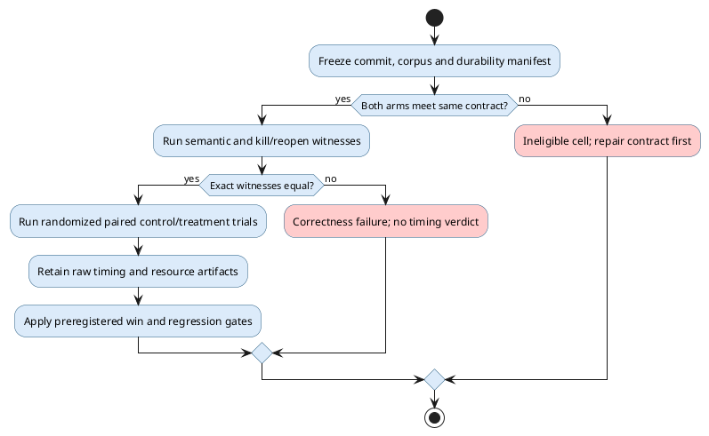

# Equal-contract LMDB versus durable DAG comparison protocol

This is the preregistration for pgmcp leaf `rspace-dag-required-performance-control`
(7949). Task 7950 runs the comparison; task 7951 interprets it. The control
is the current RSpace LMDB/RadixHistory owner and the treatment is the
integration-owned, PathMap-live, content-addressed durable DAG reached through
the **non-default real owner**. Both must execute the same RSpace command trace
and acknowledge the same durable state. Optional ACT snapshots, cache overlays,
interning, branch geometry and alternate tries are outside this comparison.
PgMCP experiment 377 locks the primary observational hypothesis before any
7950 samples. Its engine does not require samples for an observational verdict;
the 51 primary pairs, secondary pairs, raw artifacts and exact witnesses below
remain mandatory for the campaign verdict.

## Machine-readable control freeze

The [control manifest](lmdb-dag-equal-contract-control-manifest.json) freezes the
historical evidence role, LMDB owner source pin and settings, treatment entrypoint,
semantic and durability witnesses, paired decision rule, primary cell, and six
matrix lanes. It is a preregistration, not a result. Its `run_instance_template`
contains deliberately unfilled fields; task 7950 must copy and complete those
fields for a clean immutable checkout before collecting a pair. The historical
ACT/LMDB component transcript has role `historical_component_context_only` and
can never fill a paired real-owner control observation.

The standard-library-only [manifest checker](../../../scripts/bench/check-lmdb-dag-control-manifest.py)
has a static mode and a run-instance preflight. Run `python3
scripts/bench/check-lmdb-dag-control-manifest.py preregistration` and `python3
scripts/bench/check-lmdb-dag-control-manifest.py self-test` from the repository
root to check the frozen artifact hashes, owner pin, exact primary and secondary
sampling contract, lane coverage and the
[negative fixtures](lmdb-dag-equal-contract-negative-fixtures.json). These commands
do not run a benchmark. A run-instance file copied from the template is checked
with `python3 scripts/bench/check-lmdb-dag-control-manifest.py preflight
--instance PATH`. Preflight refuses missing owner-adapter and witness receipts,
any dirty source tree, a source revision that changes the pinned LMDB owner,
or any historical component data promoted to a real-owner control. A failed
preflight is an ineligible cell, never a zero-duration observation. The manifest
hashes this protocol and the retained historical transcript; this document
does not embed the manifest's hash, so the references are acyclic. A protocol
edit requires an explicit manifest hash refresh before further sampling.

## Existing evidence and source freeze

| Evidence | Frozen coordinate | What it does and does not establish |
| --- | --- | --- |
| [Historical ACT/LMDB harness](../../../rspace++/benches/rspace_act_lmdb.rs) and [Appendix J](../stack-safety/stack-safety-report-2026-07-29.md#appendix-j--bounded-actlmdb-persistence-comparison-2026-09-05) | Historical experiment 327 at `87a9584b3`; harness last edited at `0c1d01cebcab832b1ba01191e27f00aa7f268f48` | Component fixture: shared-prefix byte keys, 128-byte payloads, 256/4,096/16,384 entries. ACT dump plus sidecar versus one LMDB batched put; warm ACT lookup versus LMDB batched get. `unique_path` uses `std::env::temp_dir()`; `/tmp` is tmpfs on this workstation, so this run cannot qualify ext4 durability or physical block I/O. The ACT sidecar is written without an equal LMDB transaction/sync contract. No durable DAG, retained roots, recovery or RSpace owner. |
| [Retained experiment 327 extract](../stack-safety/measurements/rspace-act-lmdb-experiment-327-transcript-2026-09-29.json) | SHA-256 `555566dc9cfced5b022da475588d970e664449b831406d2163e8478c3531d453` | Eighteen size-labeled summary scalars, two run UUIDs and artifact IDs 409–412. Current pgmcp `experiment_get(327)` returns `experiment not found`; the original Criterion per-cell samples, sealed digest, decision and observed compiler versions are unavailable. The disk-byte submissions also warned of a unit mismatch. Reuse only as historical fixture context, never as a paired control for 7950. |
| [Current LMDB authority](../../../rspace++/src/rspace/state/rspace_state_authority.rs), [environment cache](../../../rspace++/src/rspace/shared/env_cache.rs), [store](../../../shared/src/rust/store/lmdb_key_value_store.rs) and [manager](../../../rspace++/src/rspace/shared/rspace_store_manager.rs) | Initial source pin `5d19c439215ff26bd28c42beac418da56a6b8dd6` (2026-10-01 audit) | `commit_local_checkpoint` writes history, cold objects, root membership and current root in one LMDB write transaction. The environment builder sets map size, `max_dbs` and 2,048 readers without a no-sync flag in this source; the first open fixes map size per path. Ordinary `KeyValueStore::put` commits one transaction per batch. These are source observations, not new performance measurements or a power-loss proof. |

The initial source pin freezes the **control implementation for protocol review**.
It is not an executable baseline measurement. Before 7950, use a clean,
immutable checkout of the treatment revision for both selectable backends;
record its full commit, dependency lockfile, compiler, binary hash, and
backend selection. If that revision changes LMDB semantics, durability,
retention, or the command trace from the initial pin, supersede this pin with
an explicit new control revision **before** samples are taken. Never mix the
historical 327 component summaries with current owner samples. The present
workspace contains other agents' staged changes and is not a valid benchmark
source tree without isolation and source hashing.

The existing [FFI `space_new`](../../../rspace++/libs/rspace_rhotypes/src/lib.rs)
path passes `GB` (1,073,741,824 bytes) to `mk_rspace_store_manager`; that
manager's `LmdbEnvConfig::new` defaults to 20 databases, and the shared
environment cache sets 2,048 readers. An alternate
`get_or_create_rspace_store` path passes 10,000 databases but is
not a substitute for the FFI path in an FFI-owner comparison. The runner must
name the actual owner entrypoint it exercises and freeze these resolved
settings from that entrypoint before the first pair; mixing entrypoints makes
the cell ineligible.
The current FFI constructor reaches `RSpace::create` and
`RSpaceStateAuthority` through that LMDB store manager. The durable DAG owner
is constructed through the separate crate-private
[`DurableAuthorityViewV1::into_rspace_authority`](../../../rspace++/src/rspace/persistence/durable/mod.rs)
path; current source does not select it from `space_new`. Task 7950 therefore
needs one equivalent command adapter that actually drives both real owners
after task 7756's non-default cutover. An FFI LMDB run paired with an isolated
DAG component fixture is ineligible as an owner comparison.

## Equal contract and observations

An **acknowledged durable batch** is one successful RSpace checkpoint whose
appointed mutations are recoverable after process restart under the selected
backend policy. Compare LMDB's successful owner transaction commit with the
DAG's successful WAL/pack/catalog publication and required synchronization.
A returned hot-store mutation, buffered write, in-memory PathMap mutation or
component-only ACT dump is not a durable batch. The primary throughput
numerator counts successful checkpoint batches, and elapsed time includes
their mutation preparation and every synchronization. Each primary replicate
runs exactly 4,096 mutations and 64 checkpoints after the same untimed
initial-state construction; report construction time separately. No failed,
refused or unfinished batch enters the numerator.

Freeze one manifest per comparison cell before timing: source commit and
binary hash; filesystem/device and mount options; LMDB map size, database
layout, environment flags, reader limit and transaction boundaries; DAG pack
rotation and checkpoint policy; exact fsync/barrier sequence; retention count,
root-sharing and reader pins; hot/derived cache enablement and capacity;
worker count and CPU affinity; payload distribution and deterministic seed;
initial object count, unchanged state, changed paths, new canonical bytes,
and removed-last-reference objects. Keep the same logical operation order,
checkpoint frequency, retained-root policy, cache state and concurrency in
both arms. Explicitly verify that LMDB uses no relaxed sync mode and that both
arms pass the same kill/reopen durability witness before any speed comparison.
If one arm cannot offer the same durability/retention outcome, mark that cell
**ineligible**, without assigning it a favorable zero or dropping it from a
reported denominator.

For every timed pair, compare canonical roots or the documented legacy-root
mapping; DataBag, ContinuationMap and JoinBag contents and order; duplicate
and persistent-item behavior; produce/consume/COMM results and diagnostics;
known and current roots; reset/replay; cold export/import and state-sync bytes;
and restart selection. A mismatch is a correctness failure, not an outlier.
The fixed trace includes shared-prefix, random and adversarial channels,
repeated keys, duplicate channels, datum-first and receive-first COMM,
no-match and matched operations, checkpoint/reset, and a retained-root
transfer. Seeds and exact serialized inputs are retained with raw results.



## Required matrix and measured quantities

Run the **component** lanes only when they execute identical canonical bytes
and an identical durability boundary; label them component-only. The **owner**
lanes invoke the actual non-default RSpace persistence owner after migration,
incremental-successor, GC and state-sync readiness. No component result may
be promoted to an end-to-end claim.

| Lane | Frozen variable and levels | Required outputs |
| --- | --- | --- |
| Component admission and persistence | Same canonical object stream and batch size; fresh versus reused digest; 4,096 and 65,536 objects | Admission/copy/commit latency, bytes read/written, allocations, peak resident set size (RSS), file syncs, and installed physical bytes. |
| Owner primary and unchanged-state slope | One worker; 128-byte payload; 64 changed paths per checkpoint; unchanged current objects 4,096/65,536/1,048,576; 16 retained roots with 95% sharing; checkpoint every 64 mutations | Acknowledged durable batches/s, p50/p95/p99 operation and checkpoint latency, semantic witness, work per changed path. The 65,536-object cell is the single primary decision cell. |
| Delta, sharing and retention | At 65,536 current objects vary delta 1/64/4,096; retained roots 1/16/128; sharing 0/50/95%, one factor at a time | Current/retained reference activations and deactivations, new bytes, old-closure work, metadata work, dedup, and latency. Include repeated update, full removal, same-digest reuse and retention eviction. |
| Concurrency and pinned readers | One versus eight writer/reader workers; no pin versus long-lived old-root pin | Committed throughput, p99, lock/contention, GC deferral, WAL/replay-tail growth and available recovery point. |
| Publication and lifecycle | Checkpoint every 1/64/1,024 mutations; pack/WAL rotation on/off where contract permits; clean and torn restart; index repair; GC with and without pins | Checkpoint, reopen/recovery, compaction/GC latency and work, write amplification, retained and garbage bytes, all pack/index/WAL/catalog/cache files and inode count. |
| Transfer and COMM | Cold retained-root export/import and state sync; shared/random/adversarial channels; datum-first and receive-first | Transfer bytes/latency, exact imported roots, produce/consume/COMM throughput and p99, candidate and node visits. |

The matrix varies axes independently around the primary cell rather than
forming an enormous cross-product. A resource-capped or unsupported large
cell is a recorded failure/limit; it must not silently disappear. For each
phase measure both logical file lengths and physical allocated bytes for the
**whole store tree**, including obsolete but still retained packs, indexes,
WAL, catalog, old generations and any enabled cache/ACT images. Record file
and directory inode counts. Write amplification is total physical write bytes
divided by newly admitted canonical bytes; report the numerator separately
when block-device attribution is unavailable. Record allocation calls/bytes,
peak RSS, major/minor faults, syscalls, instructions/cycles/branches/cache
events, and time spent in read/write/sync/rename. Device counters and process
I/O counters have different scopes and must be labeled accordingly.

## Paired sampling and decision rule

For the primary cell use 51 complete pairs of separate control and treatment
runs. Randomize AB versus BA order within each pair with a recorded seed,
balance order, and use equivalent fresh directories and process starts for
cold lanes. Do not reuse a warmed process for one arm and a cold process for
the other. Use 30 complete pairs for each predeclared secondary cell. Lock
the trace seed, pair key, arm order, affinity, worker budget and host snapshot
before measurement. Preflight physical-core idleness with `mpstat`/the
existing `scripts/bench/benchmark_host.py`; postpone a pair if selected cores
are busy. Pin each arm to the same single CCD, set only its selected cores to
the `performance` governor, and record the scaling driver, boost state, full
hardware string, CPU model, `uname -a` and exact affinity. Record the command
and output once per pair; never rerun a pair to select a favorable result.
Discard declared warm-up runs before sampling. Run under a hard `systemd-run`
memory ceiling and `MemorySwapMax=0`; the ceiling is **not** observed RSS.
Timed paired runs have no profiler attached.
Use headless `heaptrack` reports and AMD uProf on separate diagnostic repeats,
never a GUI and never a profiled run as a timing replicate.
The measurement host is an AMD Ryzen Threadripper PRO 5975WX. The full uProf
suite is installed under `/opt/amduprof/bin`, with `AMDuProfCLI` also on `PATH`.
Use its command-line collector and reports for sampled AMD counter and CPI
diagnostics, retaining the exact command, configuration and raw output. At the
2026-10-01 preflight, `perf_event_paranoid` was 2 and `AMDuProfPcm` could not
collect its cumulative IPC counters without a lower setting. Keep the host
setting unchanged for this comparison; use per-process `perf stat` for exact
instruction/cycle counts where it is permitted, and label unavailable counters
as unavailable. Run `heaptrack` with `--record-only` and empty `DISPLAY` and
`WAYLAND_DISPLAY`, then use `heaptrack_print` to produce its report.

Let $`T_i`$ and $`C_i`$ be treatment and control durable-batch-throughput
observations in pair $`i`$. The preregistered primary estimate is the median
of the 51 within-pair ratios:

```math
R_{\mathrm{primary}}=\operatorname{median}_{1\le i\le 51}\left(T_i/C_i\right).
```

Use 100,000 pair-preserving bootstrap resamples with recorded seed
`20261001`, reporting a two-sided 99% interval for that median. A throughput
**improvement claim** requires its lower bound to exceed 1.05 in the primary
cell. A neutral or negative result remains valid evidence for task 7951.
For each critical sentinel (singleton/4,096, primary/65,536, largest eligible
unchanged-state cell, eight-worker COMM, cold recovery and retained-root GC),
the lower 99% throughput-ratio bound must be at least 0.95 and the upper 99%
ratio for p99 latency at most 1.05 to exclude a material regression. Where a
metric is not applicable, mark it as such before sampling. Semantic and
durability witnesses must pass exactly; an eligible cell must stay within its
recorded memory/disk cap. Report RSS, physical bytes, write amplification and
inode ratios with 99% paired intervals; a greater-than-5% physical-footprint
or peak-RSS regression in a critical cell is a review blocker, not a result to
hide behind a faster primary point estimate. Any failure of these guards
blocks a clean adoption verdict; it does not justify changing the locked
threshold or removing the adverse cell.

The existing [paired statistics helper](../../../scripts/bench/paired_benchmark_statistics.py)
provides pair-preserving 99% bootstrap views. Retain every raw observation,
host snapshot, semantic digest, failure, run UUID, profiler report and file
hash in pgmcp; register the exact hypotheses and thresholds **before** 7950
samples. No new benchmark execution or verdict is claimed by this document.
