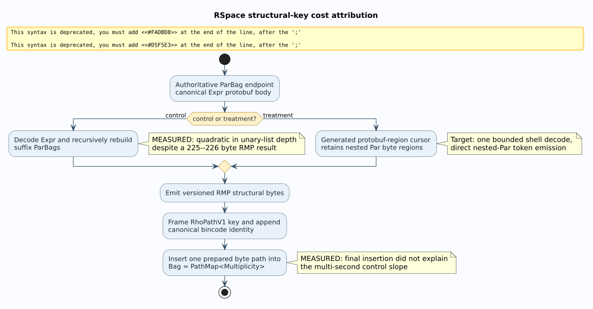

# PathMap engineering journal

Status: living scientific and engineering report

Campaign: `campaign-root-4131`

Started: 2026-08-23

Last updated: 2026-09-08

## Purpose

This journal records what the campaign learns about using PathMap effectively in
`f1r3node-rust-mettail`. It is intentionally chronological and falsifiable. An entry preserves the
question, source coordinate, experimental method, observation, interpretation, rejected
interpretations, and resulting engineering rule. Later evidence amends an entry explicitly rather
than silently rewriting its history.

The journal complements, rather than duplicates, three living reports:

- [PathMap-native EPathMap report](pathmap-report-2026-08-03.md), the historical EPathMap evidence
  ledger;
- [PathMap Bag and RSpace integration](../rspace/pathmap-bag-rspace-integration.md), the RSpace
  contract and experiment report; and
- [Stack-safety report](../stack-safety/stack-safety-report-2026-07-29.md), the recursion, allocation,
  and profiling ledger.

## Terms, symbols, and evidence classes

| Term or symbol | Definition |
|---|---|
| PathMap | The unmodified sibling crate implementing a prefix-compressed byte trie with copy-on-write roots, read/write zippers, algebra, lattice operations, merkleization, and compact arena encodings. PathMap claims in this report are pinned to `f62b6f62580cd6bb6db9ce5385bb886fd7183397`. |
| Par | Rholang's canonical parallel-composition value. Its repeated component families are represented by `ParBag`; root `locally_free` and `connective_used` metadata remain separate. |
| RSpace | The tuple-space authority that stores data and continuations and derives search paths for candidate pruning. |
| EPathMap | Rholang's homogeneous `Empty | Set(PathMap<()>) | Map(PathMap<Par>)` value. |
| Bag | RSpace's `PathMap<Multiplicity>` multiset; one unique byte path stores one strictly positive `u64` multiplicity. |
| RMP | Rholang Match Path, the versioned, derived structural search image used by the RSpace candidate index. |
| RPB3 | The version-3 authoritative ParBag key grammar: component family, canonical score, canonical protobuf body, and score-length trailer. |
| RPB2 | The retired version-2 resident ParBag key design that preceded RPB3. |
| RMP1 | The first RMP token grammar, whose ParBag token fingerprints the RPB3/ACT representation. |
| RMP2 | The provisional second RMP token grammar described in J-005; it fingerprints semantic ParBag endpoint records and is not accepted until H-001 closes. |
| EPM1 | The version-1 compact EPathMap format: mode and cardinality metadata, ACTree03 topology, and direct map-value protobuf regions. |
| EPM | EPathMap format: the version-family prefix used when discussing EPM1-specific processing. |
| RCI2 | Rholang Channel Image, version 2: the shadow logical channel-identity format studied in J-021 and J-022. |
| ACT | Arena Compact Tree, PathMap's compact trie snapshot family. |
| ACTree03 | The ACT encoding used as the topology portion of EPM1. |
| Canonical PathMap writer image | ACTree03 bytes emitted from an in-memory PathMap by the pinned PathMap writer and then framed by the repository codec. A validator must admit every such byte image while refusing alternate physical encodings that the writer would not emit. |
| Explicit value-free endpoint | An observable trie path created without a value. In an ACT branch it may be represented by a reached childless semantic node whose value is absent; its parent edge and node presence distinguish it from an absent path. |
| Value-free unary branch | A semantic ACT node with no value and exactly one child. The canonical writer line-compresses this shape, so an uncompressed occurrence is an alternate encoding and remains invalid. |
| RhoPathV1 | The version-1 RSpace key framing that combines structural RMP bytes with canonical bincode identity bytes. |
| Provenance-admitted canonical region | A borrowed protobuf region reached only from an authoritative, RPB3-validated ParBag endpoint and retained without accepting arbitrary caller bytes. Its field order and bodies therefore inherit the generated canonical emitter's invariants. |
| Oracle-equivalence gate | A differential test in which the optimized result must equal the independent semantic implementation for the complete registered corpus. |
| COMM | A RSpace communication event: one successful data/continuation match whose result and ordering are consensus-relevant. |
| Canonical datum identity | The canonical bincode bytes of one stored `Datum`; the same suffix is used by encoded and decoded candidate APIs. |
| Canonical datum candidate order | The total order by BLAKE2b-256 of canonical datum identity, then by the identity bytes themselves to resolve a hash collision. Derived RMP bytes never participate. |
| BLAKE2b-256 | BLAKE2b with a 256-bit digest, specified by [RFC 7693](https://www.rfc-editor.org/rfc/rfc7693). |
| CoW | Copy on write: immutable roots are shared until a writer requires a private root. |
| [`OnceLock<T>`](https://doc.rust-lang.org/std/sync/struct.OnceLock.html) | Rust's thread-safe write-once cell. After one successful initialization, readers borrow the same stored value without recomputing it. |
| [`Arc<T>`](https://doc.rust-lang.org/std/sync/struct.Arc.html) | Rust's atomically reference-counted shared-ownership pointer. The final owner drops the shared value. |
| Clone family | ParBag instances that share one immutable `Arc<ParBagAux>` auxiliary root until a component mutation detaches the writer under CoW. |
| Candidate product cursor | The synchronized pair of PathMap read zippers over candidate availability and candidate positions used to visit only paths present in both tries. |
| AC | Associative-commutative matching, where grouping and order do not distinguish equivalent terms. |
| Sound candidate query | A derived RMP query that admits every candidate accepted by the authoritative spatial matcher. It may admit extras; rejecting one authoritative success is a false negative. |
| AST | Abstract syntax tree, the decoded recursive rhoapi object graph avoided by the byte-native routes. |
| DFS | Depth-first search: visit a child branch to completion before resuming its sibling. |
| PDA | Pushdown automaton: an iterative traversal whose explicit frames live on the heap. |
| CPU | Central processing unit. CPU time sums the execution time consumed by the process's threads. |
| RSS | Resident set size: the process memory currently resident in physical memory. |
| CBR | Consensus-Breaking Register: the historical stable identifier prefix retained by the living consensus-change register. |
| WAL | Write-ahead log: the durable transaction journal that commits a parent root, new root, and mutation digest before catalog publication. |
| CRC | Cyclic redundancy check: a physical corruption detector, not a cryptographic identity. |
| CRC32C | The 32-bit cyclic redundancy check using the Castagnoli polynomial. |
| SCC | Strongly connected component: a maximal dependency-graph region whose members are mutually reachable. |
| LFS | Last Finalized State: the state-transfer protocol named by the tuple-space request streams. |
| FFI | Foreign function interface: the typed boundary through which process code calls the RSpace importer. |
| LMDB | Lightning Memory-Mapped Database: the legacy RSpace cold-store backend. |
| REPL | Read-evaluate-print loop: the interactive Rholang command interface. |
| TLA / TLA+ | Temporal Logic of Actions: the state-machine specification language used for lifecycle model checking. |
| PATHMAP | Not an acronym in status text: the English identifier “PathMap” capitalized for emphasis. |
| LIFECYCLE | Not an acronym in status text: the English word “lifecycle” capitalized for emphasis. |
| PMU | PathMap maintainer/upstream request: the identifier prefix used by this journal's upstream-integration register. |
| LF | Locally free: the root `locally_free` metadata summary named in H-012. |
| CODEC | Not an acronym in status text: the English word “codec” capitalized for emphasis. |
| CUTOVER | Not an acronym in status text: the English word “cutover” capitalized for emphasis. |
| RAII | Resource acquisition is initialization: ownership binds resource lifetime to construction and destruction. |
| SHA | Secure Hash Algorithm: used here in the standard `SHA-256` artifact-integrity label. |
| KiB and MiB | Binary size units of `$`2^{10}`$` and `$`2^{20}`$` bytes, respectively. |
| Heaptrack | A heap-allocation profiler. “Headless” use records and analyzes traces through command-line tools without launching its graphical interface. |
| `$`n`$` | The input's logical number of trie endpoints, AST levels, or bytes, as specified per experiment. |
| DERIVED | Established from source, generated tables, a commit, or a proof artifact. |
| MEASURED | Observed by a recorded command under a stated resource envelope. |
| HYPOTHESIS | Registered before the decisive measurement. |
| DECISION | Engineering rule accepted from the available evidence. |

## Journal protocol

Each performance investigation follows this literate procedure:

**Algorithm 1 (Isolate a suspected PathMap cost).** This procedure separates a trie operation from
its surrounding codecs and lifecycle work before assigning a complexity class.

```pseudocode
ALGORITHM IsolatePathMapCost(operation, geometric_sizes)

Input:
    a production operation and a geometric size ladder
Output:
    an attributed complexity class and an actionable design rule

1. Freeze the source coordinate and resource envelope.
2. Split the operation at representation boundaries: key preparation, trie mutation, traversal,
   serialization, hashing, and teardown.
3. Measure every split independently on the same logical fixture.
4. Fit or inspect geometric ratios before assigning a complexity class.
5. Use a native profiler to confirm that sampled work belongs to the attributed phase.
6. Reject explanations contradicted by the split measurements.
7. Change the narrowest authoritative boundary, preserving PathMap as the trie.
8. Prove semantic equivalence, rerun the ladder, and record the treatment beside control.
```

The procedure is intentionally representation-aware: a result attributed to PathMap must survive
the phase split rather than inherit the cost of a decoder, sorter, or destructor around it.

For observations `$`T(n)`$` at geometric depths, the first diagnostic is the doubling ratio:

```math
r_n = \frac{T(2n)}{T(n)}.
```

A stable ratio near two suggests linear time; a ratio near four suggests quadratic time. This is a
diagnostic, not a confidence interval. Accepted benchmark claims still use preregistered sampling,
paired controls, and the statistical rules in the companion reports.

## Current PathMap use rules

These rules summarize accepted evidence. Their entry column points to the chronological record that
justifies each rule.

| Rule | Rationale | Entry |
|---|---|---|
| Keep the trie authoritative. Never turn an EPathMap or Bag into `Vec<Par>` for storage, serialization, hashing, or routine traversal. | Flattening loses prefix sharing, value-free endpoints, CoW roots, algebra, and zipper locality while adding a full materialization. | J-001 |
| Specialize the value domain: `PathMap<()>`, `PathMap<Par>`, and `PathMap<Multiplicity>` are distinct semantic algebras. | A set endpoint, map value, and bag count have different identity, join, meet, subtraction, and overflow laws. | J-001, J-002 |
| Serialize the native compact representation directly and keep recursive values in the generated PDA. | EPM1 preserves topology; direct component bytes avoid entry projection and recursive decoding. | J-001 |
| Use one retained zipper for ordered batches and deltas. | Moving between lexicographically adjacent paths reuses their longest common prefix and publishes one CoW root. | J-002 |
| Use native algebra and lattice operations only when their value algebra matches the Rholang operation exactly. | Join, meet, subtraction, and restriction are powerful, but an attractive algebraic name is not a proof of semantic equivalence. | J-003 |
| Attribute the bytes before blaming PathMap. | A trie mutation may be linear or negligible while preparing its byte path is quadratic. Measure the two phases separately. | J-004 |
| Do not decode an authoritative component merely to derive another byte index. | Reconstructing every recursive suffix can turn a constant-size derived key into quadratic work. Use a generated protobuf-region cursor over the resident body. | J-004 |
| Keep upstream PathMap unmodified unless an invariant cannot be enforced locally. | Local adapters can validate ACT input, avoid unsupported reverse moves, and preserve upgradeability without maintaining a fork. | J-001, J-003 |
| Validate canonical writer images by logical trie semantics, not by assuming that every value-free childless node is absent. | A reached childless node may be an explicit observable endpoint. Redundant value-free unary nodes and malformed ACT graph/framing shapes remain invalid. | J-008 |
| Exact-encode only fields that the authoritative matcher compares. | Exact constraints on matcher-ignored fields can reject a legal match. A derived query must project those fields semantically or decline pruning and scan the authoritative domain. | J-011 |
| Keep immutable membership authority separate from speculative multiplicity demand. | Mutating the same Bag for both roles obscures the subset invariant and pays CoW mutation on authoritative trie state; a second `PathMap<Multiplicity>` Bag represents demand without flattening or changing the value algebra. | J-018 |
| Treat a selected match as a revocable proposal until one authority validates and publishes it. | A PathMap delta can be exact while its continuation address or persistent witness has become stale. One group-scoped opaque epoch and one hot-store transaction prevent a valid trie operation from committing against the wrong state. | J-019 |
| Normalize the complete accepted transition into one private CoW root and publish it once. | One root publication turns width-dependent lock and allocation churn into private trie work; narrow cells stay within the preregistered guard while repeated identities, wide joins, and unconsumed arrivals improve. | J-020 |

Provisional rule—not accepted evidence: J-005 proposes fingerprinting a Bag as self-delimiting
endpoint records plus multiplicities rather than an occurrence-expanded digest stream. H-001 must
close before this rule moves into the accepted table. J-006's forced-collision play/replay gate now
proves that derived RMP paths prune candidates but never break replay-visible datum-order ties;
stable commit and release evidence remain before promotion. J-007 proposes lazy nested-Par
summarization after cheap dynamic
classification; its implementation and geometric slope gate must close before promotion.
J-009 proposes a clone-family-shared, version-specific RMP2 digest cache; its byte, invalidation,
concurrency, and preregistered resource gates remain open under pgmcp tasks 5983 and 5984. J-010
attributes a possible quadratic allocation slope to retained zipper clones. Its first treatment is
now a focused-green bounded CoW suffix checkpoint, while a single-moving-zipper PDA remains the
escalation path; no complexity claim is accepted before the geometric gates in pgmcp bug 5985.
J-011's focused semantic repair is accepted, but its COMM, replay, and release gates remain open.
J-012 records the fail-closed generated-schema and protobuf-boundary checks. J-013 states exactly
what the current formal bridge proves and, importantly, what it does not yet prove.

## Chronological findings

### J-001 — 2026-08-03 through 2026-08-12: EPathMap must remain a homogeneous trie

Question: Can compatibility code treat EPathMap as a list of entries without losing the benefits of
PathMap?

Audit coordinate—not the original experiment coordinate:
`f1r3node-rust-mettail@a6b3ad09032c22bb10fafd6f7a890d7871b36609`, tree
`3388f0e80310d9794857d14650138bb45231a2e4`, with PathMap at
`f62b6f62580cd6bb6db9ce5385bb886fd7183397`. The linked historical ledger retains the individual
experiment coordinates.

Evidence: DERIVED and MEASURED. The complete lineage, fixed-scale measurements, negative results,
and proofs are recorded in the [EPathMap evidence ledger](pathmap-report-2026-08-03.md). EPM1 set
serialization measured 6,252 bytes against 491,528 bytes for the list projection at 1,024 entries;
native set lookup measured 32.00 ns per key against approximately 258 microseconds for the projected
linear scan. That lookup pair is an isolated algorithmic control, not the historical `dev` runtime:
`dev` deserialized `ps: Vec<Par>`, rebuilt a temporary `PathMap<Par>` through `Par`-to-text-to-path
conversion and value cloning, and only then called `get`. The campaign did not modify the PathMap
crate.

Finding: The correct representation is:

```math
\mathit{EPathMap} = \mathit{Empty}
\mid \mathit{Set}(\mathit{PathMap}\langle()\rangle)
\mid \mathit{Map}(\mathit{PathMap}\langle\mathit{Par}\rangle).
```

The neutral empty value delays mode selection. Once selected, set and map modes remain homogeneous;
mixed value presence is rejected rather than represented by an option-valued trie.

Rejected interpretation: EPM1's advantage is not that ACTree03 compresses every serialized key
stream. That compression hypothesis was measured false. The accepted benefits are a single native
authority, topology preservation, direct accessors, and removal of repeated projections.

Decision: Every EPathMap boundary must operate on the trie, its zippers, or its compact bytes.

### J-002 — 2026-08-15 through 2026-08-17: Bag deltas should publish one CoW root

Question: How should repeated RSpace additions and removals mutate
`PathMap<Multiplicity>` efficiently and atomically?

Audit coordinate—not the original experiment coordinate:
`f1r3node-rust-mettail@a6b3ad09032c22bb10fafd6f7a890d7871b36609`, tree
`3388f0e80310d9794857d14650138bb45231a2e4`, with PathMap at
`f62b6f62580cd6bb6db9ce5385bb886fd7183397`. The linked integration report retains the individual
experiment coordinates.

Evidence: DERIVED and MEASURED. `BagDelta::apply_to` sorts exact paths once, forks one private CoW
root, retains one write zipper, and moves between adjacent paths with `move_to_path`. Underflow or
overflow discards the private root, while success publishes it once. Raw measurements are linked
from [the RSpace integration report](../rspace/pathmap-bag-rspace-integration.md) and the
[`rspace-bag-delta-cursor-2026-08-16.tsv`](../stack-safety/measurements/rspace-bag-delta-cursor-2026-08-16.tsv)
measurement artifact.

Finding: Reopening a zipper at the root for every update repeats the shared prefix. A retained
zipper reuses the longest common prefix of consecutive sorted paths. CoW makes the transactional
shape natural: mutate a private root, validate every count transition, then replace the authority.

Decision: Batch mutations use one ordered zipper traversal. Single-path operations may use
PathMap's ordinary `insert`, `get`, and `remove`: at the pinned PathMap coordinate, `insert` and
`remove` delegate to write zippers while `get` delegates to a borrowed-path read zipper.

### J-003 — 2026-08-17: algebraic operations require semantic eligibility proofs

Question: Should every Rholang set, map, and bag operation be expressed as a PathMap lattice or
algebra operation?

Audit coordinate—not the original experiment coordinate:
`f1r3node-rust-mettail@a6b3ad09032c22bb10fafd6f7a890d7871b36609`, tree
`3388f0e80310d9794857d14650138bb45231a2e4`, with PathMap at
`f62b6f62580cd6bb6db9ce5385bb886fd7183397`. The linked integration report retains the individual
experiment coordinates.

Evidence: DERIVED and MEASURED. Join, meet, subtraction, prefix restriction, subtree extraction,
and zipper grafting were evaluated in the EPathMap and RSpace ladders. Some operations remove a
complete traversal; others require value-side conflict or multiplicity rules that the bare topology
operation cannot decide. The detailed eligibility matrix is in
[PathMap Bag and RSpace integration](../rspace/pathmap-bag-rspace-integration.md).

Finding: Native algebra is optimal when the PathMap value algebra is the language algebra. It is a
conservative prefilter or ineligible when Rholang still needs directional matching, capture
bindings, guard backtracking, overflow refusal, or deterministic candidate order.

Rejected interpretation: `restrict` is not universally beneficial merely because it can discard a
large subtree. If the derived key has no safe nonempty prefix, building a mask costs work without
pruning candidates.

Decision: Every algebraic use carries an eligibility argument and an oracle-equivalence gate.

### J-004 — 2026-08-23: the deep-send slope is before PathMap insertion

Question: Why did the exact `plain_deploy` depth-131,072 release gate exceed its 120-second cap after
the stack-safe traversals passed independently?

Source coordinate: stable repository base
`f1r3node-rust-mettail@a6b3ad09032c22bb10fafd6f7a890d7871b36609`, tree
`3388f0e80310d9794857d14650138bb45231a2e4`. The diagnostic probe also contained uncommitted
working-tree changes whose exact tree and invocation were not preserved. The measurements are
therefore valid for attribution at that checkpoint but are not independently reproducible
acceptance evidence.

Method: A release-only ignored probe split `RSpaceDataIndex::datum_path` into structural RMP
projection, canonical bincode identity encoding, RhoPathV1 framing, and the final Bag insertion.
Every process was pinned to one CPU inside an 8 GiB `MemoryMax`/zero-swap systemd scope. The raw
observations are stored in
[`rspace-structural-key-preparation-2026-08-23.tsv`](../stack-safety/measurements/rspace-structural-key-preparation-2026-08-23.tsv).
Its [adjacent metadata record](../stack-safety/measurements/rspace-structural-key-preparation-2026-08-23.metadata.md)
states the reproducibility limitation without reconstructing an unrecorded command.

| Unary-list depth | Complete key bytes | Structural bytes | Structural time | Identity time | Framing time |
|---:|---:|---:|---:|---:|---:|
| 1,024 | 66,005 | 225 | 39.610 ms | 6.112 µs | 2.384 µs |
| 2,048 | 132,756 | 225 | 152.178 ms | 4.138 µs | 4.038 µs |
| 4,096 | 269,974 | 226 | 604.595 ms | 9.418 µs | 10.570 µs |
| 8,192 | 544,404 | 225 | 2,512.954 ms | 27.051 µs | 16.652 µs |

The structural doubling ratios are 3.842, 3.973, and 4.157. Although the complete key grows
linearly and the structural output remains 225–226 bytes, structural projection grows
quadratically. A second arm called `RSpaceDataIndex::insert`; at depth 8,192 it completed in
2,531.876 ms against 2,512.998 ms for key preparation in the recorded control row. The single
unpaired observation cannot attribute the apparent difference, so no positive insertion cost is
inferred.

Finding: The slope is not evidence that PathMap insertion is quadratic. The structural encoder
first calls `single_expr_match_component`, which decodes the sole authoritative Expr protobuf body
out of ParBag. On a recursive value, that reconstruction repeatedly rebuilds shorter suffix
ParBags before the generated RMP cursor emits a constant-size opaque nested-Par token. The final
PathMap sees only the already-prepared linear byte key.

Figure 1 shows the attribution boundary. Red denotes the measured quadratic control; green denotes
the treatment under implementation.



The figure source is
[`rspace-structural-key-attribution.puml`](figures/rspace-structural-key-attribution.puml).

Rejected interpretations:

1. The test's old depth observer was quadratic, but replacing it did not remove this production
   slope.
2. Parsing and normalization are not the dominant phase: the isolated depth-32,768 normalizer
   completed in 0.24 seconds.
3. Canonical bincode identity is not the dominant phase in this probe: it remained in the
   microsecond range because the generated encoder streams the resident component bytes.
4. Replacing `Bag::insert` with another PathMap write zipper cannot repair work completed before
   the Bag receives its path; PathMap's public insertion already uses a write zipper.

Hypothesis under test: A generated, stack-safe protobuf-region-to-RMP cursor can consume the
canonical Expr body already stored in the ParBag endpoint, cut nested Par regions without decoding
them, and emit the same structural semantics in time linear in bytes visited. The treatment must be
fully differential over the generated schema, preserve candidate-pruning soundness, and version any
derived RMP byte change explicitly.

Decision: Repair the structural projection boundary, not PathMap. Preserve the Bag as
`PathMap<Multiplicity>` and retain ordinary PathMap insertion unless post-repair measurements
attribute a separate cost to it.

### J-005 — 2026-08-23: RMP2 fingerprints semantic Bag records, not ACT bytes

Question: Can the region-native treatment preserve RMP1, and if it can, is doing so the cleanest
long-term representation?

Status: HYPOTHESIS and PROVISIONAL DECISION. This entry is a design candidate, not accepted
performance or equivalence evidence.

Source coordinate: the accepted baseline is
`f1r3node-rust-mettail@a6b3ad09032c22bb10fafd6f7a890d7871b36609`, tree
`3388f0e80310d9794857d14650138bb45231a2e4`. The RMP2 prototype reviewed here was an uncommitted
successor to that baseline, so its final source coordinate remains an explicit closure requirement.

Evidence: DERIVED but incomplete. Two source reviews traced both candidate designs through
`ParConstruction`, `ParBag::visit_canonical_key_parts`, RPB3 key formation, the generated canonical
protobuf emitter, `par_bag_match_summary`, `canonical_par_view`, and PathMap's ACT snapshot. The
review conclusions were:

1. RMP1 can be reproduced in linear time for a deep unary value by building a shared bottom-up
   score/protobuf plan and materializing only the requested root ParBag key and transient ACT.
2. A schema-complete implementation must nevertheless reproduce every sorter equation, malformed
   nonsemantic score, unordered collection rule, RPB3 framing rule, and ACT byte rule merely to
   obtain an opaque derived digest.
3. The candidate design assumes that score and ACT bytes add no pruning information beyond the
   canonical family, component body, and multiplicity already present in the Bag. H-001 must prove
   this through no-false-negative query equivalence and representation-independent candidate order.
4. Hashing the ordinary canonical protobuf component stream literally is also wrong for this
   purpose: protobuf repeats a field once per occurrence, so one endpoint of multiplicity
   `$`m`$` would require `$`m`$` body feeds and would discard the Bag's compressed count.

Provisional finding: RMP2 retains the existing constant-size ParBag token shape—distinct count,
saturated-`u64` cardinality, and one BLAKE2b-256 digest—but changes the digest preimage to a
canonical, multiplicity-compressed endpoint transcript. For each distinct endpoint `$`i`$`, define:

```math
R_i = \operatorname{be}_{32}(f_i)
\mathbin{\|} \operatorname{be}_{64}(m_i)
\mathbin{\|} \operatorname{be}_{64}(|b_i|)
\mathbin{\|} b_i,
```

where `$`f_i`$` is the protobuf component-family tag, `$`m_i`$` is its strictly positive
`Multiplicity(u64)`, and `$`b_i`$` is its canonical component protobuf body. Records occur in the
same family/score/body order used by the resident ParBag. The fixed-width header and explicit body
length make each record self-delimiting and make the record sequence uniquely decodable. They do
not make the set of complete transcripts prefix-free: a one-record transcript is a byte prefix of
the same transcript followed by another record. Prefix-freedom is not required here because the
streaming hash is finalized at the end of the complete record sequence. The digest is:

```math
h = \operatorname{BLAKE2b256}\!\left(
  \mathtt{RhoMatchPath/ParBag/components/v2}
  \mathbin{\|} R_1 \mathbin{\|} \cdots \mathbin{\|} R_d
\right).
```

The enclosing token emits `$`d`$` and the saturated cardinality `$`c`$` exactly once beside `$`h`$`:

```math
c = \min\!\left(2^{64}-1, \sum_i m_i\right).
```

Those counts are not duplicated inside the digest preimage. The digest still commits to each exact
`u64` multiplicity, so saturation of `$`c`$` does not erase the multiplicity distribution from
`$`h`$`. Root `Par.locally_free` and `Par.connective_used` fields are excluded from the endpoint
transcript because the generated Par program emits them separately. The component families are
exactly protobuf tags 1, 2, 4, 5, 6, 7, 8, 11, and 12. Metadata nested inside a component body
remains included in `$`b_i`$`.

```text
Algorithm: emit one RMP2 ParBag token from either authority

Input:
    a validated resident ParBag OR a provenance-admitted canonical Par region
Output:
    PAR_BAG || be64(distinct) || be64(saturated_cardinality) || digest,
    or a validation/size error before any token is emitted

Preconditions:
    resident keys have passed RPB3 validation; a region is borrowed only through that
    provenance and retains canonical family/score/body order

1. Initialize distinct and cardinality to zero and the digest with the exact domain bytes
   `RhoMatchPath/ParBag/components/v2`.
2. Visit component families in canonical family order.
3. For a resident Bag, read `(body, multiplicity)` once per PathMap endpoint.
4. For a canonical region, validate the shell and field order, then coalesce only adjacent equal
   `(family, body)` occurrences. Refuse malformed input, order regression, or checked-counter
   overflow before exposing a token.
5. Feed one self-delimiting record per distinct endpoint into the domain-separated digest.
6. Saturate the externally emitted cardinality at `u64::MAX`; retain exact per-endpoint `u64`
   multiplicities in the digest records.
7. For an empty Bag, hash the domain alone and emit zero for both counts.
8. Finalize and emit the counts and digest. Never construct a score, RPB3 key, ACT, AST, or
   `Vec<Par>`.
```

Resident-route time is `$`\Theta(d + \sum_i |b_i|)`$`, where `$`d`$` is the distinct endpoint count;
digest state is constant-sized and the zipper reuses its path buffer. A canonical protobuf region
is occurrence-expanded, so its route is `$`\Theta(B)`$` in the encoded region size `$`B`$`, which
can equal `$`\Theta(\sum_i m_i |b_i|)`$`. Coalescing reduces digest feeds and retained state; it
cannot remove the cost of scanning and comparing the already-expanded source bytes.

Figure 2 shows why both resident and region-native routes have the same transcript.


The figure source is [`rmp2-parbag-transcript.puml`](figures/rmp2-parbag-transcript.puml).

Rejected alternatives:

- Preserve RMP1 by reconstructing a transient score-aware ParBag and ACT. This is feasible, but it
  couples a reconstructible matcher index to RPB3 and ACT and creates a large equivalence surface
  with no additional selectivity.
- Hash expanded protobuf component fields. This makes the digest consume
  `$`\Theta(\sum_i m_i |b_i|)`$` body bytes rather than `$`\Theta(d + \sum_i |b_i|)`$` on the
  resident route. The region route must still scan its occurrence-expanded `$`\Theta(B)`$` input.
- Hash component bodies without their family tags or multiplicities. Equal cardinality does not
  identify the multiplicity distribution, and the same body bytes in different families have
  different Rholang meaning.

Provisional decision: Evaluate RMP2 as a versioned derived-index format rebuilt from the
authoritative Bag. Before acceptance, pin the prototype's source coordinate and prove
resident/region transcript equality, saturated-cardinality boundary behavior, no-false-negative
query equivalence, representation-independent candidate order, replay/post-state equivalence, and
linear depth/width resource slopes. Record any accepted cutover under CBR-053 because candidate
pruning is verdict-adjacent even though RMP bytes are not a wire or cold-store identity.

Amendment — 2026-08-23 documentation audit: J-005 remains provisional. This amendment replaces the
incorrect transcript-level prefix-free claim with the exact self-delimiting/uniquely-decodable
property, records the existing saturated-`u64` cardinality projection, separates resident and
region route complexity, and makes the missing immutable prototype coordinate and equivalence
evidence explicit. No RMP2 acceptance or performance conclusion is claimed by this entry.

### J-006 — 2026-08-23: derived paths prune; identity orders datum candidates

Question: May a derived RMP path break a tie between datum candidates when candidate selection is
visible to replay?

Status: DERIVED design invariant with PROVISIONAL implementation evidence. The invariant is
consensus-preserving; the current encoded implementation is not accepted until the focused and
play/replay gates below pass.

Source coordinate: the accepted baseline is
`f1r3node-rust-mettail@a6b3ad09032c22bb10fafd6f7a890d7871b36609`, tree
`3388f0e80310d9794857d14650138bb45231a2e4`. The candidate-order implementation reviewed here is an
uncommitted successor. Its relevant functions are
[`compare_candidate_identity`, `sort_encoded_candidates`, and
`validate_unique_candidate_identities`](../../../rspace++/src/rspace/data_index.rs),
`RSpaceDataIndex::ordered_encoded_channel_entries` and
`RSpaceDataIndex::ordered_channel_entries` in the same file, and
[`deterministic_candidate_hash`](../../../rspace++/src/rspace/candidate_order.rs) for the shared
BLAKE2b-256 primitive.

Finding: RMP is a reconstructible pruning index. Changing its version may change which PathMap
branch finds a candidate, but must never change which admissible datum is first. For canonical datum
identity bytes `$`I(x)`$`, datum candidates use the total order:

```math
K(x) = \left(\operatorname{BLAKE2b256}(I(x)), I(x)\right).
```

The encoded API parses the already-stored identity suffix, hashes that suffix once, sorts by
`$`K(x)`$`, and retains the suffix offset. The decoded API consumes that same ordered encoded list
and decodes the same suffix lazily or on first access. It does not re-encode a second byte authority.

```text
Algorithm: order one channel's stored datum candidates

Input:
    validated RhoPathV1 datum paths below one channel prefix
Output:
    candidates in canonical identity order, or an error before selection

1. Parse each path and borrow its canonical datum-identity suffix.
2. Decorate the entry with BLAKE2b-256 of that suffix exactly once.
3. Sort by digest and then by suffix bytes; never compare the derived RMP prefix.
4. Refuse an identical suffix found under distinct derived paths.
5. Retain one exact storage path per distinct identity for removal and lazy decode.
6. Preserve exact repetitions as the one Bag endpoint's positive multiplicity.
```

The duplicate rule distinguishes two cases. An exact repeated datum has one identical complete Bag
path and increases its `Multiplicity`; it is not a second catalog entry. The same identity suffix
under distinct derived paths contradicts the single-authority invariant and is malformed, so the
catalog refuses it rather than allowing an RMP version to choose an order.

Rejected interpretations:

1. Full trie-path order is not canonical candidate order: it would make an RMP version or encoding
   change replay-visible.
2. Hash-only order is not total unless collision behavior is specified. Canonical identity bytes
   are the collision tie-breaker.
3. Decode then re-encode for ordering creates a second identity authority and adds avoidable work.

Provisional decision: Keep candidate pruning and candidate ordering separate. Before implementation
acceptance, pass focused opposing-RMP/hash-collision/duplicate-identity/multiplicity tests, prove the
encoded and decoded APIs return byte-identical ordering keys, and run play/replay COMM-selection and
post-state equivalence gates. Append a dated acceptance or rejection amendment; do not silently
promote this entry into the accepted-rule table.

Checkpoint amendment — 2026-08-23: accepted local comparator rule; end-to-end replay gate open. The
vector-backed continuation order now uses the same collision rule as the PathMap-backed datum
catalog: `(BLAKE2b-256 digest, complete canonical identity bytes)`. Store index is consulted only
for byte-identical repeated continuation entries because those entries require distinct removal
addresses. A test-only digest function returned the same 32-byte value for every candidate. Both
forward and reverse insertion orders produced `a`, `same`, `same`, `z`; the two equal identities
retained their original distinct store indices. The focused unit passed 1/1 in systemd scope
`run-p2360232-i10336581`, under CPUs 0–7, `MemoryHigh=8G`, `MemoryMax=12G`, and zero swap.

This evidence proves the local total-order rule under an induced digest collision. It does not yet
prove that removal, reinsertion, COMM selection, and replay preserve the same result. Those gates
remain reachable through pgmcp task 5988 and must pass before J-006 becomes an accepted global
PathMap use rule.

Checkpoint amendment — 2026-08-23: ACCEPTED END-TO-END GATE; full release OPEN. A `cfg(test)`-only
thread-local RAII injector now replaces only the datum-catalog identity digest. Its guard is
`!Send`, the test uses Tokio's current-thread runtime, and each Rust test thread has independent
state. Production builds compile no injector state, conditional branch, field, layout change, or
API. The gate forces every identity digest to the same 32-byte value and first proves that its two
datums have opposing orders: derived RMP bytes prefer one datum, while canonical identity bytes
prefer the other.

The complete play/replay gate passed 1/1 in systemd scope `run-p2600563-i11051253`, under CPUs
0–7, `MemoryHigh=6G`, `MemoryMax=8G`, and zero swap. It proved:

- canonical-identity selection and bind order under the forced collision;
- atomic removal of multiplicity two from one Bag endpoint;
- reinsertion followed by the same canonical selection;
- five Produce input/output events, two Consume input/output events, and two COMM events;
- `times_repeated` values two and four across the two COMMs;
- consumption of every rigged replay COMM;
- equality of the final expanded state map; and
- equality of the play and replay post-state root.

This closes the collision/removal/reinsertion/replay obligation in pgmcp task 5988 at the focused
system coordinate. Stable commit and full-release evidence remain before lifecycle completion.

### J-007 — 2026-08-23: classify nested Par shells before summarizing them

Question: When may the protobuf-region route compute a nested ParBag summary without recreating a
quadratic suffix walk?

Status: DERIVED root-cause hypothesis and PROVISIONAL design rule. No treatment or geometric result
is claimed yet.

Source coordinate: the accepted baseline is
`f1r3node-rust-mettail@a6b3ad09032c22bb10fafd6f7a890d7871b36609`, tree
`3388f0e80310d9794857d14650138bb45231a2e4`. The reviewed RMP2 prototype is an uncommitted successor.
The relevant current functions are `CanonicalRhoPathRegionCursor::next`'s `Work::Par` arm,
`canonical_par_view`, `AdmittedParRegion::classify`, and `AdmittedParRegion::summary` in
[`match_region_path.rs`](../../../models/src/rust/rholang/match_region_path.rs).

| Evidence class | Current artifact or gap |
|---|---|
| Source derivation | The named functions above at an uncommitted successor to the exact baseline. This supports the root-cause hypothesis but is not an immutable implementation coordinate. |
| Executable bridge | None yet. The exact probe marker, command, resource envelope, and raw output must be registered and linked before execution. |
| Formal bridge | None yet. Add the exact theorem/model marker and checked artifact only after it exists; no formal verification is claimed here. |
| Measurement | None yet. No timing, allocation, or slope observation supports this entry. |
| Equivalence | None yet. Emitted-token, malformed-shell, candidate, COMM, and replay gates remain open. |

Derived hypothesis: Eager summarization has two different cost contexts. The opaque datum route reaches one
nested Par, emits one constant-size ParBag token, and hashes that selected Par region once. That is
safe. A dynamic query compiler may instead classify the nested Par, descend through its sole Expr,
then repeat at the next nested Par. If classification eagerly hashes the complete remaining Par
region before each descent, a depth-`$`n`$` unary carrier performs:

```math
\sum_{k=0}^{n-1} \Theta(n-k) = \Theta(n^2)
```

byte work even though each individual cursor step is stack-safe.

The required separation is:

```text
Algorithm: classify and emit a nested Par region lazily

Input:
    a provenance-admitted nested Par region
Output:
    a dynamic structural descent or one opaque ParBag token

1. Validate only the current Par shell needed for classification: field framing, canonical order,
   root metadata, component count, and the sole-Expr distinction.
2. Skip nested length-delimited payloads by their validated extents; do not hash their bodies.
3. If the dynamic classifier descends through a sole Expr, pass its borrowed region onward without
   computing the enclosing ParBag digest.
4. If the compiler emits an opaque or metadata-bearing whole-value token, compute exactly that
   selected region's summary once and emit it.
5. Refuse a malformed shell before descent or token emission; arbitrary bytes never acquire
   provenance through this classifier.
```

This design does not weaken canonical validation. The cheap classifier is available only through
the private provenance-bearing region handle minted from an authoritative RPB3 endpoint. It avoids
revalidating and rehashing already-admitted nested bodies while retaining exact shell errors at the
decision boundary.

Rejected interpretations:

1. Stack-safe iteration alone does not imply linear time; an explicit PDA can still visit nested
   suffixes quadratically.
2. Memoizing every suffix digest retains memory proportional to depth and computes digests the
   dynamic route may never emit.
3. Removing ParBag summaries globally would weaken the opaque datum token. The repair is lazy
   placement, not removal.

Provisional decision: Separate provenance/shell classification from opaque-token summarization.
Before acceptance, implement the lazy boundary, prove emitted-token equality and malformed-shell
refusal, count exactly one summary for the selected opaque token, and run a geometric deep-unary
query ladder demonstrating a linear time/allocation slope. Append the result as a dated amendment.

Supersession: none. A later result must append an explicitly dated acceptance, rejection, or
supersession amendment, link the immutable implementation coordinate and evidence artifacts, and
update H-005. It must not rewrite this hypothesis into an observed result.

### J-008 — 2026-08-23: admit canonical explicit value-free endpoints

Question: Is every non-root ACT semantic node without a value, child, or compressed line a
redundant empty branch?

Status: DERIVED, MEASURED, and DECISION for the repository validator rule. The focused repair is
accepted at its original test checkpoint. At that checkpoint the implementation was an uncommitted successor to
`f1r3node-rust-mettail@a6b3ad09032c22bb10fafd6f7a890d7871b36609`, so immutable-coordinate and
broader campaign acceptance remained open pending a stable commit and the EPM1 malformed-input,
protobuf/bincode, replay, and full-release gates. The September 17 reconciliation below supplies
the committed repair and distinguishes current qualification from historical release evidence.

Tracking coordinate: pgmcp bug 5981,
`admit-canonical-pathmap-writer-images-with-explicit-value-free-epathmap-endpoints-e060a6`.
Implementation coordinates in the original uncommitted successor were
[`semantic_act_node`](../../../rspace++/src/rspace/pathmap_codec.rs), the writer-image corpus in
[`epathmap_trie_codec.rs`](../../../models/src/rust/epathmap_trie_codec.rs), and the public EPM1
round-trip gate in
[`epathmap_epm1_snapshot.rs`](../../../models/tests/epathmap_epm1_snapshot.rs).

Source derivation: PathMap's public topology operation can create a path without installing a
value. If that path's final edge diverges from another root child, the pinned canonical ACT writer
may encode the endpoint as a reached childless branch node with no value. The node is not absence:
`CompactTrie::visit` yields the accumulated path, `CompactTrie::visit_topology` yields its logical
node, and reconstruction calls `create_path` for it. The former validator rejected this writer
image as an “uncompressed empty non-root branch.” That predicate confused physical value absence
with logical path absence.

```text
Algorithm: validate one semantic ACT node without erasing an explicit endpoint

Input:
    one physical ACT node after graph, offset, branch-order, and line-framing validation
Output:
    one canonical semantic node, or a precise alternate/malformed-encoding error

1. Resolve a branch node into its optional value and strictly ordered children, or resolve a line
   node into its nonempty suffix, optional value, optional branch wrapper, and wrapper children.
2. Refuse a line that has both its own value and a child; refuse a line child that is not a branch.
3. Refuse a value-free semantic node with exactly one child because the canonical writer would
   line-compress that unary path.
4. Refuse a line branch wrapper with no children because it cannot represent a branch.
5. Admit a reached childless semantic node with no value and no line. Preserve it as an explicit
   path endpoint; do not manufacture a value.
6. Replay values with `set_value`, value-free endpoints with `create_path`, and require the
   canonical writer image to be a byte fixed point after reconstruction.
```

The repair removes only the obsolete rejection in step 5. Its invariants are:

1. Logical topology is authoritative: a parent edge reaching a semantic node establishes the path
   even when the node has no value.
2. Set/map values remain distinct from value-free endpoints. EPM1 value ordinals are still
   validated before topology events become observable.
3. For every pinned-writer image $`B`$, decoding and re-encoding must satisfy:

```math
\operatorname{encode}(\operatorname{decode}(B)) = B.
```

4. A live zipper and direct ACT topology visitor must emit the same root/value, edge/value, and
   postorder-leave event sequence.
5. The repository changes no PathMap source and introduces no second trie authority.

Negative classes remain negative. In particular, the validator still refuses value-free unary
branches; branch bytes that are not strictly increasing; inconsistent sparse/dense child metadata;
duplicate physical ACT node or wrapper references; overflowing or out-of-arena offsets; reserved line header bits; empty or
overlapping line data; a line node with both value and child; a non-branch line child; and a branch
wrapper without children. Admitting one canonical endpoint shape therefore does not admit arbitrary
empty subgraphs or alternate encodings.

Physical node aliasing is distinct from permitted reuse of equal compressed-line data ranges and
live copy-on-write sharing. The current `register_direct_semantic_node` rejects duplicate physical
node/wrapper offsets; V5's `semantic_certificate_preorder_physical_ids_nodup` and the
`kill_equal_child_reentry` / `kill_duplicate_parent_alias` negative controls retain that boundary.

Focused evidence, all from the same uncommitted successor:

| Gate | Result |
|---|---:|
| `compact_trie_topology_stream_matches_native_zipper_for_all_endpoint_shapes` | 1/1 passed |
| `root_divergent_value_free_endpoint_round_trips_the_canonical_epm1_image` | 1/1 passed |
| `rust::epathmap_trie_codec::tests::direct_act_replay_matches_reconstruction_oracle_on_writer_images_and_mutations` | 1/1 passed |
| Complete `models/tests/match_path_structure.rs` suite | 7/7 passed |

The complete suite ran in systemd scope `run-p2191610-i10594105` with zero swap: 112.393 seconds
wall time, 109.920 seconds CPU time, and 99.7 MiB peak resident memory. These figures are resource
evidence for the focused gate, not a throughput benchmark.

Rejected interpretation: weakening all value-free-node checks is neither necessary nor correct.
Only a childless reached endpoint has the newly established writer provenance; a value-free unary
node remains redundant because canonical line compression represents it differently.

Decision: Repository ACT validators recognize the logical PathMap endpoint represented by the
canonical writer's value-free childless branch. Preserve all other canonicality and malformed-input
checks. Amend this entry with the stable commit and broader gates rather than rewriting the focused
checkpoint.

**Committed repair and successor reconciliation (2026-09-17; task 5981).** The endpoint-admission
repair is committed in `253d1754535ea73fd734f51bc872076e144b5348`: its collected semantic validator
removes precisely the obsolete childless-node rejection, retaining the unary and empty-wrapper
checks. The later single-admission architecture at `bdaf93a5f` retains the same rule in the direct
semantic validator; the collected parser remains an independent test oracle. This is existing work,
not a second implementation or an upstream PathMap modification.

The maintained formal owners are
[`Epm1ActConcreteV5.v`](../../../formal/rocq/actree03_completeness/theories/Epm1ActConcreteV5.v),
`validate_accepts_every_canonical_writer_output`, and
[`Epm1CursorAuthorityV2.v`](../../../formal/rocq/actree03_completeness/theories/Epm1CursorAuthorityV2.v),
`replay_topology_preserves_value_free_endpoint`. The former proves completeness for the modeled
canonical writer, not extraction of the Rust parser. Native writer-image, mutation, topology and
codec witnesses supply the separate executable correspondence. J-047 and J-155 retain the
successor proof/test history. The later positional V6 association replaces the original map-ordinal
rule: all EPM1 ACT value markers are zero; map bodies associate in logical value-bearing endpoint
order. Value-free endpoints consume no body; they are not erased or given invented values.

The isolated validator correction leaves writer bytes unchanged for a fixed topology, but broadens
acceptance relative to the pre-fix decoder. It must not be called globally consensus-neutral.
See the task-5981 continuation under
[CBR-044](../../consensus/consensus-change-register.md#cbr-044) for the mixed-version boundary.

**Current qualification checkpoint (2026-09-17; tasks 5981 and 8506).** Current production source
was `f6fb5a69476d57444dca433ba2fd8eb86837049a`; the only Rust change in this checkpoint repairs
test-only proof-runner bindings. The fresh release observations are:

| Gate | Observation and limit |
|---|---|
| `epathmap_epm1_snapshot`, complete binary attempted | 16 of 17 tests emitted success before the 900-second service deadline. Endpoint/protobuf/bincode, depth-4,096 snapshot, nested-map streaming and legacy-tag decoding passed; nested-map term operations did not finish. This is an incomplete suite, not a passing result or an established runtime defect. |
| `epathmap_pathmap_native_zipper` | 23 passed, zero failed or ignored; includes both serialization surfaces with value-free topology. |
| `formal_equivalence_manifest`, before repair | 21 passed, two failed: teardown description and removed RPB3 local-variable name were stale. |
| `formal_equivalence_manifest`, after task-8506 repair | 24 passed, zero failed or ignored, including the new command-binding negative controls. This checks artifact bindings; it is not a fresh kernel proof run. |

The manifest failures arose after `46324dcb5` expanded teardown obligations and `bb0f9d58a`
moved RPB3 compilation into the maintained helper. The actual compiler/count/kernel gates remain
present. The repair binds compiler commands and counts (teardown 32/13; RPB3 357, with the existing
two mutant reports), kernel module arguments, and the default helper invocation instead of
descriptive prose or a retired variable. Negative controls reject comments, echoed commands, wrong
counts, wrong theories, missing continuations and missing/wrong kernel modules. No proof theory,
production codec, runner obligation, test depth or assertion was weakened.

The first suite ran with `MemoryMax=6G`, `MemoryHigh=4G`, swap disabled and a four-CPU quota;
its peak was 1,607,090,176 bytes and it timed out after 900 seconds. The manifest repair qualification
used a 4 GiB cap, a 3 GiB high watermark and zero swap: 1.956 seconds wall, 2.412 seconds CPU,
466.4 MiB process peak. These are validation resource observations, not performance comparisons.

Retained local logs and SHA-256 digests:

| Log under `target/verification/` | SHA-256 |
|---|---|
| `epm1-endpoint-5981-native-r1.log` — incomplete full EPM1 attempt | `66ba8ef2562691221735a04088f3f70bf79c03ddede465f11a05388e204ea81e` |
| `epm1-endpoint-5981-native-r2.log` — zipper pass and manifest failures | `570f5b1960b6e68d03a3b2e1749cd3017a28f3a9d7f64dd5dcb24cd64179491c` |
| `epm1-manifest-8506-r1.log` — repaired manifest pass | `17fcd31c4e542dca1665e41e73768427a7f0e22bd7c10c7ebcf24e4d4c42000d` |

Task 5981 remains open at this checkpoint: the separate remaining-suite run is unfinished, no fresh
full-workspace release result is claimed, and no endpoint-specific consensus replay receipt is
inferred from the codec witness. These logs are local evidence, not pgmcp-managed verification
receipts. Historical J-047/J-155 and parent release evidence remain historical rather than being
relabeled as today's complete acceptance.

### J-009 — 2026-08-23: cache only the versioned RMP2 digest across a CoW clone family

Question: After the RMP2 transcript becomes linear, should repeated derived-path construction walk
and hash an unchanged resident ParBag every time?

Status: HYPOTHESIS and PROVISIONAL DESIGN. No implementation or performance improvement is claimed.
The design task is pgmcp 5983,
`memoize-the-versioned-rmp2-parbag-digest-across-copy-on-write-clone-families-c92231`; its
preregistered experiment is pgmcp 5984,
`measure-cold-warm-clone-shared-and-post-mutation-rmp2-digest-reuse-aea03e`.

Source derivation: the resident RMP2 route hashes the same versioned endpoint transcript whenever
it builds a derived RhoPath. `ParBag` already shares immutable auxiliary cells through
`Arc<ParBagAux>`, so an unchanged clone family has one natural cache owner. Distinct count and
cardinality are already constant-time Bag summaries; caching them would add invalidation surface
without removing a trie walk. The only proposed payload is the 32-byte RMP2 BLAKE2b-256 digest in
one `OnceLock<[u8; 32]>` whose field name and type are explicitly tied to RMP2.

```text
Algorithm: read or initialize the clone-family RMP2 digest

Input:
    one immutable resident ParBag and its shared ParBagAux root
Output:
    the exact 32-byte RMP2 endpoint-transcript digest

1. If the RMP2 OnceLock is initialized, borrow its 32-byte value and visit zero endpoints.
2. Otherwise ask the OnceLock to initialize exactly once across concurrent readers.
3. In the initializer, visit canonical ParBag endpoint records once, feed the exact J-005 domain
   and record grammar into BLAKE2b-256, and store only the finalized 32-byte digest.
4. Read distinct count and saturated cardinality from the Bag's existing constant-time summaries;
   do not duplicate them in the cache.
5. Never cache a protobuf-region summary because a borrowed region has no stable owning clone
   family.
```

```text
Algorithm: preserve or invalidate the RMP2 digest on mutation

Input:
    an operation on a ParBag whose auxiliary root may be shared and warm
Output:
    a semantically correct cache state for every surviving clone

1. Validate the requested component transition and its checked multiplicity before publishing a
   mutation.
2. For a failed transition or semantic no-op, preserve the existing auxiliary root and digest.
3. For a metadata-only Par mutation, preserve the digest because J-005 excludes root metadata.
4. For a successful component mutation on a uniquely owned auxiliary root, clear the RMP2 cell
   together with the other component-derived cells.
5. For a successful component mutation on a shared root, detach the writer to a new auxiliary root
   with an empty RMP2 cell; leave every unmodified clone on the original warm root.
6. Recompute lazily on the first subsequent RMP2 request. Never retain transcript bytes, install a
   global cache, or substitute an ACT/PathMap merkle hash for the versioned RMP2 digest.
```

Hypothesis: one cold request retains the current
`$`\Theta(d + \sum_i |b_i|)`$` endpoint work, while a warm request becomes `$`\Theta(1)`$` with
fixed auxiliary storage independent of endpoint count and body size. The hypothesis is rejected if
the cold lane regresses by more than 5%, if a warm request visits an endpoint, if retained cache
memory slopes with transcript size, or if any mutation/concurrency/byte-equivalence gate fails.

The preregistered experiment crosses distinct widths 1, 16, 64, 256, and 1,024; component-body
sizes 16, 256, and 4,096 bytes; and repeat counts 1, 2, 4, 8, and 32. Its lanes are no-cache control,
cold cache, warm cache, prewarmed CoW clones, first post-mutation request, and second post-mutation
request. It records wall time, instructions, data reads, allocations, and headless Heaptrack
retained memory under pinned CPU, zero swap, capped RSS, and an idle-host preflight.

Acceptance additionally requires exact RMP2 bytes and oracle equivalence; one initialization per
clone family under concurrent readers; the complete successful/failed/no-op/metadata/component
invalidation matrix; zero warm endpoint visits; no warm transcript-size slope; fixed retained
growth per auxiliary root; candidate, COMM, and replay neutrality; and a checked formal cache
invariant. For transcripts of at least 256 KiB, the warm lane must improve by at least five times
over no-cache. A small singleton need only satisfy the cold-regression limit. Negative results stay
in this journal.

Provisional decision: exploit existing CoW ownership, but cache only the immutable,
version-specific digest whose recomputation is expensive. Do not generalize this into a shadow
representation or unbounded memoization scheme.

Checkpoint amendment — 2026-08-23: ACCEPTED FOCUSED IMPLEMENTATION; performance conclusion OPEN.
The cache is one `OnceLock<[u8; 32]>` in the existing `Arc<ParBagAux>` CoW root. Production
encoding and the measurement-only uncached control call the same private transcript function, so
the experiment does not compare two independently maintained algorithms. Seven focused tests
passed 7/7 in systemd scope `run-p2372458-i10775331`, under a 7 GiB memory maximum and zero swap:

- cold then warm access initialized exactly once;
- untouched CoW clones shared that one initialization;
- mutation detached and invalidated only the changed clone;
- every component mutation route invalidated lazily;
- metadata-only changes, no-ops, overflow failures, and underflow failures retained the digest;
- eight concurrent readers initialized once; and
- cached digest and token bytes equaled a contiguous transcript oracle.

The auxiliary-root budget gate passed in scope `run-p2387397-i10640371`; the observed 64-bit
`ParBagAux` size was 672 bytes. The test enforces 672 bytes as an upper budget, allowing a future
compiler or layout improvement to reduce the size without failing. This measurement does not show
that warm hashing is faster or that retained memory is flat across transcript sizes. Those claims
remain preregistered under experiment 5984, together with instructions, allocations, headless
Heaptrack, mutation-lane, and cold-regression evidence.

Measurement amendment — 2026-08-23: FULL MATRIX MEASURED; PROFILE CLOSURE OPEN. The complete raw
matrix is
[`rmp2-par-bag-digest-cache-2026-08-23.tsv`](../stack-safety/measurements/rmp2-par-bag-digest-cache-2026-08-23.tsv),
SHA-256 `2fa2d445ed410116ed9a0b1beadaeb878edbf8e808d813866a690ae2b619c65b`.
It contains 13,500 observations over 75 cells, six lanes, and 30 retained samples per lane. All
lane checksums agree, and warm, prewarmed-CoW, and second-post-mutation accesses allocate zero
bytes. Across the matrix, median speedups were 762.66 times for uncached over warm, 762.67 times
for cold over warm, and 772.44 times for first over second post-mutation access. At the largest
cell—1,024 distinct 4,096-byte bodies with multiplicity 32—the uncached, cold, warm, prewarmed-CoW,
first-post-mutation, and second-post-mutation medians were respectively 7,221,289; 7,176,509;
175.5; 155; 7,220,527; and 151 ns. Multiplicity did not create occurrence-expanded allocation or
time work because each distinct trie endpoint contributes one transcript record containing its
checked multiplicity.

One 609-byte cell initially violated the 5% cold-regression guard: its 30-pair cold median was
7.36% above the uncached median. The negative cell remains in the full matrix. A selected-cell
replication reused the identical six-lane harness with 30 warmups and 300 retained pairs. Its raw
record and analysis are
[`rmp2-par-bag-digest-cache-tiny-replication-2026-08-23.metadata.md`](../stack-safety/measurements/rmp2-par-bag-digest-cache-tiny-replication-2026-08-23.metadata.md).
Cold and uncached medians were 1,704 and 1,703 ns. A 200,000-replicate paired bootstrap placed the
ratio-of-means 99% interval at [0.934846, 1.049629], below the preregistered 1.05 ceiling. The
larger replication therefore attributes the first result to short-sample noise; production gained
no transcript-size threshold, bypass, or other overfit special case.

The deterministic and retained-memory profiles are
[`rmp2-par-bag-digest-cache-resource-profiles-2026-08-23.md`](../stack-safety/measurements/rmp2-par-bag-digest-cache-resource-profiles-2026-08-23.md).
After matched fixture subtraction, a warm lookup requires approximately 29 instructions, 13 data
reads, and 9 data writes at all three registered sentinels from 69 through 4,214,817 transcript
bytes. Headless Heaptrack records exactly equal allocation-call totals for warm and matched
warm-null processes across 10,000 requests at every sentinel. Cold initialization adds temporary,
transcript-linear work but no retained heap allocation: the digest is inline in the existing
fixed-budget auxiliary root. The wall, allocation, instruction, data-access, RSS, mutation,
concurrency, and semantic evidence accepts H-006's resource hypothesis. Broader COMM/replay and
full-release gates remain open lifecycle checks.

### J-010 — 2026-08-23: retained candidate zipper clones may copy quadratic path state

Question: Does retaining `CandidateProductCursor` at every completed query frame defeat the
locality of PathMap zipper traversal?

Status: DERIVED HYPOTHESIS. No timing, allocation, or asymptotic treatment result is claimed. The
reachable tracking item is pgmcp bug 5985,
`remove-depth-quadratic-pathmap-zipper-cloning-from-retained-candidate-product-matching-49a707`.

Source coordinate: the uncommitted successor's
[`CandidateProductCursor` and `visit_sequence_frames_with_prefix`](../../../rspace++/src/rspace/data_index.rs),
audited against PathMap 0.2.2 at `f62b6f62580cd6bb6db9ce5385bb886fd7183397`.
`CandidateProductCursor` derives `Clone` over two `ReadZipperUntracked` values: one for candidate
availability and one for candidate positions. At the pinned PathMap coordinate,
`ReadZipperCore::clone` copies both its complete `prefix_buf` and its `ancestors` vector.

The candidate scanner itself moves its paired zippers down and back up efficiently. At every
complete stored sequence frame, however, `visit_sequence_frames_with_prefix` calls
`visitor(cursor.clone(), &frame)`. Wildcard, first-capture, and nested-match callbacks retain that
clone in `CandidateQueryState`; a terminal state clones once more before the end marker; and an
`accepts_remainder` route enumerates another frame and re-enqueues the same atom index. If a
depth-`$`n`$` chain retains a clone at each depth `$`k`$`, copied path state has the hypothesis:

```math
\sum_{k=1}^{n} \Theta(k) = \Theta(n^2).
```

This equation is conditional on the registered adversarial shape actually reaching the named
clone sites. The required clone/allocation counters are anti-vacuity evidence; source inspection
alone does not establish the production slope.

```text
Algorithm candidate: match with one moving candidate-product zipper PDA

Input:
    the availability and position PathMaps plus one compiled RMP query
Output:
    the same candidate positions and capture bindings as the current matcher

1. Open one synchronized availability/position zipper pair at the candidate prefix.
2. Store DFS continuation state on an explicit heap stack: next child mask position, sequence-frame
   scanner state, query atom, remainder state, and capture rollback/persistent-root state.
3. Descend and ascend the same zipper pair in place. Evaluate a complete frame at the current
   focus before moving again; do not retain a full zipper clone in a work item.
4. On a branch, retain only the compact continuation needed to resume sibling enumeration. Restore
   captures through rollbackable deltas or persistent roots rather than copying descendant paths.
5. At a terminal marker, read the candidate position at the current focus and continue the same
   DFS. Preserve deterministic output sorting and deduplication after traversal.
6. If the unmodified PathMap exposes a demonstrably constant-cost subtree checkpoint with the same
   semantics, measure it as an alternative. Do not fork PathMap.
```

Acceptance requires a preregistered geometric depth/width resource ladder; counters proving that
the control exercised zipper clones and the treatment does not; allocation, time, and RSS slopes;
exact old/new candidate and binding differentials; malformed-input refusal; COMM, play/replay, and
post-state equivalence; and a small-native-stack deep gate. An optimization that merely moves the
same copied `$`prefix_buf`$` or ancestor history into another retained object is rejected.

Provisional decision: preserve PathMap as both candidate tries and preserve moving-zipper locality.
Replace retained zipper snapshots only after the executable ladder confirms the source-derived
slope and the single-moving-zipper PDA proves identical search/backtracking semantics.

Checkpoint amendment — 2026-08-23: DESIGN DECISION, implementation and measurement still open.
Source audit of the pinned PathMap API identified a smaller first treatment than the full
single-moving-zipper PDA: construct a bounded suffix `PathMap` from the current subtree through
`ZipperSubtries::make_map`, then open a shallow read zipper at that suffix root. The suffix map
shares immutable trie structure through PathMap's CoW representation; it does not copy the complete
ancestor vector or depth-growing prefix buffer. A radix frame has at most 256 children, so each
transition retains a depth-independent number of suffix roots and opens at most two shallow zipper
roots. The encoded sequence terminator `[0, 0]` remains a transient scan state because a checkpoint
after the terminator would change frame-boundary semantics.

The executable control must remain available in the same tree so the experiment can compare the
old retained-zipper clone and the CoW suffix checkpoint on identical inputs. Escalate to the
single-moving-zipper PDA if the checkpoint treatment either leaves a fitted exponent above 1.2 or
regresses a representative or dense-width case by more than 10 percent. This selection does not
accept H-007: pgmcp bug 5985 and experiment 5990 retain the old/new semantic differential,
anti-vacuity counters, geometric resource ladder, COMM/replay, and small-stack requirements.

Checkpoint amendment — 2026-08-23: ACCEPTED FOCUSED IMPLEMENTATION; resource conclusion OPEN. The
production matcher now stores `CandidateProductCheckpoint` values containing CoW suffix maps and
reopens a shallow paired cursor for each continuation. A source search finds no production clone of
the paired read zipper; the former algorithm remains only as the same-tree test control. Four tests
passed 4/4 in systemd scope `run-p2383353-i10776044`, with a 6 GiB memory maximum and zero swap:

- checkpoint traversal equaled both the former PDA and the byte oracle;
- terminal endpoints were scanned transiently without losing a root value;
- compressed-prefix and dense-radix shapes agreed; and
- the legacy control proved that the adversarial depth shape reached the clone sites.

At depth 128, the control visited 128 frames, cloned 129 zipper pairs, and attributed more than
500,000 cumulative prefix bytes to those clones. This is anti-vacuity evidence, not an allocation
measurement: allocator traffic, timing, resident-set size, and the fitted exponent remain open in
pgmcp experiment 5990. The candidate-pruning integration subsequently passed 10/10 in systemd
scope `run-p2394525-i10842339`, under CPUs 0–7, `MemoryHigh=6G`, `MemoryMax=8G`, and zero swap. It
covered direct scan, prefix false positives, retained-automaton Bag product, datum-first
continuation pruning, framed-product trace and post-state equivalence, indexed/full-scan
equivalence, pre-decode pruning, nested `Match`, and wildcard-frame pruning. COMM/replay,
small-stack, geometric resource, and release gates remain open.

Measurement amendment — 2026-08-23: NEGATIVE TREATMENT PRESERVED, REVISED TREATMENT ACCEPTED. The
first complete paired matrix measured the bounded CoW suffix checkpoint at every accepted query
atom. Its raw record is
[`rspace-candidate-suffix-checkpoint-v1-2026-08-23.tsv`](../stack-safety/measurements/rspace-candidate-suffix-checkpoint-v1-2026-08-23.tsv),
SHA-256 `3d6f3e2d67808bbb45a37c6cb2b4440d651eda1350cfc5e98cce37e4a9d6ec34`.
That treatment removed the adversarial clone slope and accelerated branching queries, but exact
and repeated-capture queries were approximately twice as slow as the frozen control. The result
rejected checkpoint-per-atom as a production design; it was not deleted or relabeled as a win.

The revised pushdown automaton consumes maximal runs of exact atoms and already-bound captures on
one moving paired cursor. It creates a CoW suffix checkpoint only after a branching frame passes
its predicate. Terminal inspection borrows and restores the same cursor, and a failed asymmetric
descent restores both product zippers independently. This keeps the prefix-compressed
availability and position PathMaps authoritative while allocating persistent suffix roots only
where ownership crosses a branch.

The second complete paired matrix is
[`rspace-candidate-suffix-checkpoint-v2-2026-08-23.tsv`](../stack-safety/measurements/rspace-candidate-suffix-checkpoint-v2-2026-08-23.tsv),
SHA-256 `0bc9cf4a55d10c32b7e0b1faee5b34eb051334c7cdf1400336773146625e5cf8`.
It contains 3,000 observations across 50 cells and 30 retained pairs per cell. Every result equals
the frozen control and byte oracle. The smallest paired median speedup was 1.387 times; median
speedups by query were 1.422 for exact, 1.419 for repeated capture, 2.330 for wildcard, 3.647 for
remainder, and 6.111 for nested match. At depth 4,096, the nested-match speedup was 95.522 times on
the compressed topology and 57.604 times on the dense topology. The capped whole run used no swap
and reached 659,604 KiB peak resident set size. It incurred 2,717 major faults, so only its paired
within-run comparisons support the latency conclusion.

The headless Heaptrack record
[`rspace-candidate-suffix-checkpoint-v2-heaptrack-2026-08-23.md`](../stack-safety/measurements/rspace-candidate-suffix-checkpoint-v2-heaptrack-2026-08-23.md)
attributes 7 fewer allocation calls per exact operation and 14 fewer per repeated-capture
operation at depth 4,096. The Callgrind record
[`rspace-candidate-suffix-checkpoint-v2-callgrind-2026-08-23.md`](../stack-safety/measurements/rspace-candidate-suffix-checkpoint-v2-callgrind-2026-08-23.md)
finds a lower process instruction count for the hybrid at every depth from 256 through 4,096,
with linear growth in both arms. Finally, exact, repeated-capture, and wildcard queries completed
at depth 16,384 on a 256 KiB native thread stack, with no stack-size environment override,
`stacker`, or traversal cap. The focused semantic, resource, and stack gates accept the
deterministic-run hybrid. Broader COMM/replay and full-release gates remain open.

### J-011 — 2026-08-23: dynamic AC queries must not constrain matcher-ignored fields

Question: Can the RMP2 query compiler exact-encode every nonmetadata protobuf field of a dynamic
`New`, `ReceiveBind`, or `MatchCase` value?

Status: DERIVED correctness finding; repair OPEN. This entry establishes the soundness obligation
and does not claim a treatment, test pass, or release result. The reachable tracking item is pgmcp
bug 5982,
`prevent-dynamic-ac-rmp2-queries-from-exact-encoding-matcher-ignored-fields-f8309e`.

Source coordinate: the uncommitted successor's `MatchValue::rho_path_query` in
[`spatial_matcher_pda.rs`](../../../rholang/src/rust/interpreter/matcher/spatial_matcher_pda.rs)
routes `New`, `Match`, and `ReceiveBind` into the generated query compiler.
[`compile_ordered_nested_query`](../../../rholang/src/rust/interpreter/matcher/match.rs) exact-encodes
nonmetadata fields unless a recognized dynamic carrier replaces a region with a wildcard or the
compiler declines the query. The authoritative matcher equations in `evaluate_new`,
`evaluate_receive_bind`, and `evaluate_match_case` compare fewer fields:

| Value | Authoritative spatial relation | Ignored nonmetadata fields exact-encoded by the affected dynamic lane |
|---|---|---|
| `New` | equal `bind_count`, then match `p` | `uri`, `injections` |
| `ReceiveBind` | equal `patterns`, then match `source` | `remainder`, `free_count` |
| `MatchCase` | equal `pattern`, then match `source` | `free_count`, `guard` |

Root metadata such as `New.locally_free` is already handled by the compiler's metadata wildcard
route and is not the defect identified here. The defect is exact byte comparison of ignored
nonmetadata fields in an otherwise dynamic AC query. Two values can differ only in one listed field,
be accepted by the authoritative relation, yet be separated by the derived query. That violates
sound-candidate inclusion:

```math
\operatorname{authoritative\_match}(p, d)
\Longrightarrow
\operatorname{query\_accepts}(Q(p), \operatorname{RMP2}(d)).
```

```text
Algorithm requirement: compile only an authoritative semantic projection

Input:
    one dynamic AC pattern and the authoritative relation for its constructor
Output:
    a sound derived query, or no pruning query

1. Enumerate the constructor fields compared by the authoritative relation.
2. Compile exact structure and dynamic holes only for those compared fields.
3. Replace each matcher-ignored field with a whole-field wildcard whose framing cannot constrain
   its contents.
4. If the generated query grammar cannot express that projection without constraining ignored
   bytes, return no query (`ListCandidatePlan::All`) and scan the authoritative candidate domain.
5. Never return a narrower approximation. The authoritative spatial PDA remains the verdict
   authority after candidate admission.
```

Two treatments remain eligible: a schema-complete semantic projection of the ignored fields, or
the fail-closed `All` fallback for the affected dynamic roots. The first may retain more pruning;
the second is the conservative reference because it cannot introduce a false negative. Selection
requires explicit cost and complexity evidence after correctness.

Acceptance requires constructor-specific counterexamples in which only each ignored field differs;
an oracle-success-implies-query-accept property across the registered corpus; unchanged ground
exact behavior; malformed-query refusal; candidate-set and binding equivalence; and COMM,
play/replay, and post-state equivalence. Until those gates arrive, the implementation must not be
reported repaired, and H-008 remains open.

Checkpoint amendment — 2026-08-23: ACCEPTED FOCUSED REPAIR; system gates remain open. The dynamic
query compiler now declines direct `MatchValue` pruning for `New`, `Match`, and `ReceiveBind` when
the value is not ground. Returning `ListCandidatePlan::All` is the sound fail-closed projection:
the authoritative spatial matcher sees every resident candidate and remains the sole verdict
authority. Ground values retain the exact byte lane.

Four direct-row controls passed: one counterexample each for `New`, `ReceiveBind`, and `MatchCase`,
plus the ground exact lane. The complete registered property
`compiled_rho_path_query_is_a_superset_of_every_recursive_oracle_success` also executed and passed
1/1 in 0.40 seconds in systemd scope `run-p2315545-i10756324`, under CPUs 0–7,
`MemoryHigh=8G`, `MemoryMax=12G`, and zero swap. These results close the constructor-level
false-negative demonstrated by J-011. They do not establish COMM selection, play/replay post-state
equivalence, or the full release suite, so pgmcp bug 5982 remains in progress rather than complete.

### J-012 — 2026-08-23: protobuf projection must fail closed across schema and oneof boundaries

Question: Can a generated protobuf-region projector safely assume field positions and oneof
well-formedness when RMP2 bytes participate in candidate pruning?

Status: ACCEPTED FOCUSED REPAIR; release gate OPEN. The reachable records are pgmcp bug 5986,
`return-a-schema-incompatibility-error-instead-of-indexing-generated-par-fields-c781be`, and task
5989, `cover-absent-expr-oneof-defaults-replacement-and-canonical-width-boundaries-d471da`.

Source derivation found release-path indexing of generated `Par` fields by positions zero through
two. A schema reorder or omission could therefore panic rather than return an incompatibility
error. The repair introduces checked field discovery that validates each expected protobuf tag,
name, and field kind before constructing the generated match program. The focused drift test
`generated_par_program_drift_is_a_schema_error_not_an_indexing_panic` passed 1/1.

The byte cursor also gained direct resident-versus-region controls for:

- an absent Expr oneof;
- a present default `bool`;
- a present empty `EList` message;
- signed integers at -65 and 64;
- string lengths 127 and 128;
- byte-array length 16,384; and
- a deliberately conflicting `GBool` plus `GInt` oneof.

Resident and canonical-region RMP2 projections agree for every valid boundary. The conflicting
oneof is rejected before an endpoint event can complete. Existing canonicality controls continue
to reject explicitly encoded empty `locally_free`, false `connective_used`, and duplicate metadata
fields. This is a fail-closed security and consensus property: malformed or schema-incompatible
bytes may reduce pruning by causing an error, but must never admit a different semantic transcript
or trigger unchecked indexing.

### J-013 — 2026-08-23: formal transcript lemmas are a bridge, not a runtime equivalence proof

Question: What is the exact assurance boundary of the current RMP2 Rocq and Verus artifacts?

Status: DERIVED ASSURANCE BOUNDARY. Runtime-projection closure remains tracked by pgmcp task 5987,
`bridge-rmp2-formal-lemmas-to-actual-spatialmatcher-semantic-projections-c38663`.

The Rocq development proves four capstone properties over an abstract semantic record transcript.
The Verus development verifies eight obligations for framed-record correspondence, multiplicity,
coalescing, and digest input equality. The executable resident/region differentials connect both
implementations to the same test corpus. These artifacts establish useful bridge lemmas, but their
current correspondence premise assumes equality of the semantic record sequences supplied to the
model. They do not yet prove that every generated protobuf cursor branch and every resident
`SpatialMatcher` projection produces those sequences for all valid inputs.

Acceptance requires formal definitions of the actual field projection, occurrence coalescing, and
opaque-nested-`Par` rule; checked lemmas from each runtime event source into that model; and
executable extraction or proof-carrying correspondence at the source boundary. Until then, report
the formal result as transcript-level equivalence with executable runtime bridge tests, never as a
whole-runtime proof.

Checkpoint amendment — 2026-08-23: ACCEPTED SCOPED FORMAL BRIDGE; lifecycle and release gates
remain open. The Rocq development now closes seven capstone theorems over the common semantic-field
projection used by the resident and canonical-region event sources. Those theorems cover field
correspondence, adjacent-only occurrence coalescing with exact cardinality, the nonadjacent-repeat
counterexample, and opaque nested `Par` values. The Verus executable model verifies twelve
obligations with `--no-cheating`, including pending-run accumulation, final-run flushing, and the
same opacity rule. Three focused Rust gates connect the model to the actual resident and
canonical-region cursors: all maintained Expr oneofs, two- and three-run adjacency cases with
transcript/digest equality, and nested-`Par` opacity. The formal manifest also passes.

This closes the earlier assumed-record-sequence gap at the maintained semantic event boundary. It
does **not** prove arbitrary protobuf parsing, BLAKE2b correctness or collision resistance,
allocation behavior, generated-code extraction, malformed arbitrary byte streams, or equivalence
of the whole RSpace matcher and unifier. Those exclusions are explicit assurance boundaries, not
deferred premises silently treated as proved. Task 5987 therefore remains in progress until the
broader lifecycle and release gates pass.

### J-014 — 2026-08-23: do not open a datum catalog before a rendezvous can inspect it

Question: Should `produce` build the current channel's hash-ordered PathMap candidate catalog when
no waiting continuation exists?

Status: MEASURED DEFECT and ACCEPTED FOCUSED REPAIR. The reachable record is pgmcp bug 5993,
`avoid-eager-datum-catalog-hashing-when-produce-has-no-rendezvous-candidate-4e5df4`.

The first forced-collision run failed its anti-vacuity count: three identity digests had been
computed before the first consume, although only two distinct identities existed. Source tracing
explained the exact count. `extract_produce_candidate` opened `bat_channel_pool` before fetching
waiting continuations. Producing the first new identity therefore hashed the one resting identity;
producing the second distinct identity rebuilt and hashed both. None of those hashes could affect a
COMM because the continuation set was empty.

```text
Algorithm: open the produced channel's candidate pool only on demand

Input:
    one produce attempt, grouped waiting-continuation channels, and the hot store
Output:
    the same rendezvous result with no unused datum-catalog work

1. Allocate one local, empty OnceLock for the produced channel's immutable CandidatePool.
2. Fetch and canonically order waiting continuations for the current channel group.
3. If that continuation set is empty, advance to the next group before fetching any datum pool.
4. If retained pruning needs resting availability, initialize the OnceLock from the hot store.
5. If spatial matching later requests the produced channel, clone that same initialized pool and
   prepend the fresh datum to the clone.
6. Never publish the local pool as another authority; it dies with the produce attempt.
```

The repair uses a local `OnceLock<CandidatePool<A>>`, shared by retained pruning and spatial data
fetch, plus an early empty-continuation transition in the matcher driver. The successful collision
gate now observes zero identity hashes across three unmatched produces in both play and replay,
then exactly two hashes when the first consume actually needs the two-identity catalog. The same
gate preserves bindings, multiplicity, COMM events, replay, and the post-state root. Broader
matcher regression passed 49 library tests, 10 candidate-pruning integration tests, and 17 guarded
matching tests. The full-release suite remains open; no throughput improvement is claimed from one
exact work-count control.

### J-015 — 2026-08-23: collision authority and suffix roots must survive their real boundaries

Question: Do the continuation-order collision rule and CoW suffix checkpoints remain correct at
their production boundaries, rather than only under helper-level assumptions?

Status: ACCEPTED FOCUSED HARDENING; exact release workspace remains open.

The final review found two gaps. First, continuation ordering already used the correct total tuple
`(BLAKE2b-256(identity), identity bytes, store index)`, but its forced-collision test injected a
digest only into a private comparator helper. Second, suffix extraction asserted only in debug
builds that a checkpoint focus could not itself contain an endpoint. Neither gap demonstrated a
runtime failure; both left the release claim weaker than the implementation contract.

One shared, thread-local, test-only digest injector now sits at the actual datum and continuation
ordering boundaries. It compiles out of production. The continuation lifecycle gate deliberately
stores two waiting continuations so the hot store's newest-first vector order is `z-cont`, then
`a-cont`, while canonical identity order is the reverse. Its first attempt expected insertion
order and failed before the COMM; that negative result established that the anti-vacuity witness
was observing the real store. The corrected gate forces both digests equal and proves all of the
following in play and replay:

- `a-cont` is selected from vector store index one;
- `z-cont` at index zero is the sole survivor, so sorted position was not mistaken for the removal
  address;
- the COMM names `a-cont`'s exact `Consume` identity;
- both production-boundary identities are hashed exactly once; and
- the replay map and non-empty post-state root equal play.

Checkpoint extraction now snapshots a focus value before `ZipperSubtries::make_map`, restores it
at the suffix root, and refuses only a genuinely empty synchronized side. This is preferable to a
false-negative fallback, a release panic, or the depth-growing legacy zipper clone. A direct
root-plus-child control proves both endpoints survive. A separate counter proves canonical RhoPath
component branches take the no-restoration fast path, so the defensive correctness rule does not
change the measured normal shape. The capped release library gate passed 58 of 58 tests, including
both forced-collision lifecycles, eleven focused checkpoint controls, and the separate depth-16,384
small-stack gate. The byte-native datum catalog/read API also drops the obsolete `Serialize` and
`CandidateOrderingBytes` requirements left by the decoded-hash route; a decode-only generic compile
witness prevents their accidental return. No PathMap source or feature was changed.

### J-016 — 2026-08-23: preserve admitted regions and CoW roots across reducer boundaries

Question: Why did the exact depth-131,072 deploy gate still exceed its watchdog after RMP2's
structural PathMap query became byte-native, and which PathMap properties should cross the two
remaining abstraction boundaries?

Status: MEASURED DEFECT, ACCEPTED REPAIR, and EXACT WORKSPACE ACCEPTANCE. The implementation is
`f1r3node-rust-mettail@1afd4791e`; the reachable records are pgmcp bugs 5994 and 5995, experiment
311, and artifacts 380–381. The durable resource record is
[`resident-send-reducer-join-2026-08-23.md`](../stack-safety/measurements/resident-send-reducer-join-2026-08-23.md).

The first diagnosis rejected the tempting hypothesis that PathMap lookup or final RSpace insertion
was responsible. At depth 8,192, post-RMP2 structural projection took 590,939 ns and final insertion
contributed about 12,976 allocation calls. Headless Heaptrack instead attributed 52,712,929 of
53,716,424 whole-process allocation calls to the generated nested `Send` decoder: each successively
shorter child `Par` suffix was attached to a new `ParBag`, which repeatedly rebuilt PathMap payloads
before evaluation began. The canonical top-level `Par` importer could not help because nested
`Send` children did not cross that boundary.

The selected projection retains PathMap's authoritative byte representation. It derives the
optional-channel and repeated-data roles from `SEND_RHO_MATCH_PROGRAM`, applies the existing
stack-safe `cut_at_par` region PDA to the admitted RPB3 endpoint, decodes only the compact scalar
shell, and decodes each immediate child exactly once through the established top-level importer.
It does not enumerate the ParBag, manufacture a `Vec<Par>`, sort an occurrence list, or introduce a
shadow map. Decreasing fields, duplicate singular fields, and schema near misses take the complete
generated decoder, so the optimization remains a proof-carrying fast path rather than a new wire
authority.

That repair made `plain_deploy` linear but exposed an independent `env_get_deploy` slope. A second
headless profile attributed 52,639,873 of 53,747,932 allocation calls to
`computed_locally_free_par -> generated Expr decoder -> attach_par_exprs -> ParBag insertion`.
`descend_eval` had correctly returned the environment binding as a resident CoW `Par`, but erased
the stronger fact that canonical-path-stable ground data has an empty structural locally-free
fold. Its parent `EvKont::Join` then semantically decoded the complete recursive value merely to
reprove that empty summary, and subsequently imported the same value into `ParConstruction`.

The final design makes the proof explicit. `StableGround` certifies evaluator identity *and* an
empty structural fold; `ExpressionFree` certifies only evaluator identity for reflected process
families. Only the former receives the empty-fold certificate. At a one-child `Join` whose
expression-free shell has the additive-zero component Bag, the evaluator moves the resident child
root and applies the existing `Par::parallel` metadata equations directly:

```math
B_{\mathrm{out}} = B_{\mathrm{child}} \oplus \varnothing = B_{\mathrm{child}},
```

```math
L_{\mathrm{out}} = L_{\mathrm{child}} \mathbin{\mathrm{union}} L_{\mathrm{shell}},
\qquad
C_{\mathrm{out}} = C_{\mathrm{child}} \lor C_{\mathrm{shell}}.
```

Here `B` is the authoritative `PathMap<Multiplicity>` component Bag, `L` is the wire-visible
locally-free byte vector, and `C` is `connective_used`. The historical child-then-shell `union` is
retained exactly, including trailing zero bytes; the separately carried structural fold remains
the child's proof because an empty component shell contributes no structural bits. Every near miss
uses the complete construction PDA.

MEASURED results:

- `plain_deploy` control time was 2.91, 10.79, and 44.21 seconds at depths 8,192, 16,384, and
  32,768; the region projection measured 0.06, 0.13, and 0.26 seconds and reached depth 131,072 in
  1.06 seconds;
- `env_get_deploy` before the neutral Join measured 2.59 and 9.94 seconds at depths 8,192 and
  16,384 and exceeded 146.9 seconds at depth 131,072; after the repair it measured 0.13, 0.25,
  0.48, and 2.03 seconds through depth 131,072;
- the post-Join depth-8,192 profile records 963,802 allocation calls, a 98.21% reduction from the
  immediate predecessor, and no dominant full semantic decoder/import stack;
- the unchanged 2 MiB-worker gate accepts both deploy subjects at depth 131,072 in 3.14 seconds;
  and
- the exact release workspace run passes 4,495 of 4,495 executed tests, with 53 declared skips and
  zero failures.

The tests preserve optional-field presence, repeated-child order, unknown metadata, malformed
EPathMap refusal, fallback reachability, exact protobuf and bincode values, recursive-oracle result
and charge traces, and the original PathMap storage root. No PathMap source or feature changed.

The timing ladders remain PRELIMINARY one-observation attribution evidence. Experiment 311's
registered 30-sample statistical magnitude decision remains pending and must not be inferred from
these rows. That pending magnitude estimate does not reopen the repaired correctness/resource gate.

### J-017 — 2026-08-23: candidate algebra stays group-compressed until ordered witness extraction

Question: How should an associative/commutative candidate plan use PathMap when many target
occurrences share one canonical identity and adversarial connective shape retains intermediate
domains?

Status: MEASURED DEFECT, ACCEPTED REPRESENTATION/ALGORITHM DECISION, and ACCEPTED
PREREGISTERED EXPERIMENT. The implementation is
`f1r3node-rust-mettail@e3f3b4831329ec8863d33af7ae0790d930efa041`; the reachable record is pgmcp
bug `spatial-matcher-candidate-mask-depth-width-retention`; experiment 312 is accepted; pgmcp
artifacts 384–390 and the
[`candidate-group-mask measurement record`](../stack-safety/measurements/spatial-matcher-candidate-group-mask-2026-08-23.md)
retain the raw/profiler provenance.

The predecessor represented each Query result as a `PathMap<()>` of target occurrence positions.
That relation was correct, but it discarded the target Bag's existing quotient: $`w`$ byte-identical
occurrences are one semantic group with multiplicity $`w`$. A fixed postorder evaluator could retain
one $`w`$-endpoint map per connective level, so an opposing depth-$`d`$, width-$`w`$ construction
retained $`\Theta(d w)`$ endpoints before final matching.

The selected representation is `All` or a `PathMap<()>` of fixed-width, big-endian `u64` group
identifiers. Those eight-byte keys are prefix-free, so PathMap's native `join` and `meet` implement
exact set union and intersection at this boundary. Each candidate leaf visits the authoritative Bag
prefix with a read zipper and inserts each reached group once. The evaluator applies the following
rules:

1. compile capture discovery in source order;
2. select the maximum-pressure pure lattice operand first, breaking equal
   pressure by work and choosing the earliest exact maximum; the swap need not
   preserve the order of all remaining pure operands;
3. keep work frames scalar and retained maps in a separate LIFO accumulator;
4. consume native immutable `join`/`meet` results with early `All` and empty absorbers;
5. traverse the root group mask once, decoding each group ID once; and
6. expand to ascending original positions through an already-ordered, sparse-sort, or dense-bitset
   lane chosen by explicit cost estimates.

The final `Vec<u64>` is deliberately retained. It is neither a membership authority nor a
`Vec<Par>` projection: the existing ListMachine requires random access to original target-position
witnesses. Removing it would change a different matcher schedule and requires its own equivalence
proof. No PathMap source, feature, value algebra, or compact format changed.

The pressure recurrence for a scheduled n-ary node is below. A linear scan puts
one maximum first; no full child sort is required because every later child
runs beneath one retained accumulator. This description was corrected during
the 2026-09-17 source reconciliation; the algorithm itself was already present
in `e3f3b4831`.

```math
P_{\mathrm{nary}} = \max\!\left(P_0,\; 1 + \max_{i>0} P_i,\; 3\right).
```

An adverse node-count control proves why work alone is insufficient: at depth 8, the control retains
10 masks/endpoints and an accumulator depth of 8, while pressure scheduling retains 4/4 and depth 2.
The complete depth 1/4/8 × width 2/8/32 × AND/OR × encoded/resident × source-orientation matrix
preserves exact ordered domains. Mixed duplicates additionally preserve verdict, complete `FreeMap`,
and remainder; 48 deterministic randomized layouts force and equate ordered, sparse, dense, and
adaptive expansion.

Experiment 312 measured 51 samples per arm in all 13 fixtures. The primary width-4,096 OR medians are
5,513,777.071 ns for the frozen occurrence control and 18,869.671 ns for the group treatment. The
locked decision accepts with Mann–Whitney $`U=0`$, $`p=1.6518407509198735\times10^{-18}`$, Cliff's
delta $`-1.0`$, and relative median improvement 0.9966. The distinct-sparse guard also improves.

Physical profiles agree on the mechanism:

- headless Heaptrack records 159,590 $`\rightarrow`$ 30,304 allocation calls and 3.36 MiB
  $`\rightarrow`$ 1.85 MiB peak heap for the duplicate fixture; the opposing fixture reaches
  3.57 MiB $`\rightarrow`$ 742.19 KiB;
- paired Massif records 3,292,888 $`\rightarrow`$ 1,778,424 peak modeled bytes;
- paired Cachegrind records 310,627,559 $`\rightarrow`$ 29,198,834 instructions, 548,844
  $`\rightarrow`$ 56,222 L1-data misses, and 73,562 $`\rightarrow`$ 28,274 last-level misses; and
- headless AMD uProf moves the hot path from `node_set_val`, `make_unique`, mutable child traversal,
  and `pjoin_dyn` to read-zipper traversal and one ordered expansion.

Decision: preserve semantic-group compression through all candidate lattice operations, use
prefix-free fixed-width keys whenever exact set algebra is intended, and cross to occurrence
positions only once at the consumer boundary. CoW is valuable here because immutable native
`join`/`meet` can share structure, but the larger win is avoiding repeated construction of
occurrence-wide maps; CoW is not permission to clone and mutate one trie per leaf.

Negative protocols remain part of the decision. Massif `detailed-freq=1` and uProf `assess` each
required roughly ten minutes for one control arm and are excluded. The accepted paired Massif uses
bounded sparse snapshots; the accepted uProf evidence uses low-overhead Hotspots. An initial
Heaptrack invocation that omitted `--record-only` opened its GUI and was superseded; every accepted
trace is explicitly record-only and analyzed by `heaptrack_print`.

Lifecycle closure at `8035ba826` exposed two useful engineering rules without changing the accepted
PathMap result. First, an encoded connective continuation must own the exact immutable protobuf
region to which its validated cursor refers. `CanonicalOwnedConnectiveChildren<EncodedRegion>`
checks pointer and length once, then retains only the region, relative offset, and remaining count.
This removes duplicate identity state without one heap allocation per PDA level: the release
matcher `Frame` returns from 80 to 64 bytes, and every 20,000-level encoded AND/OR gate remains
stack safe. Second, benchmark-only APIs participate in the conservative source census even when
feature gated. The generic name `CandidateMaskBenchmarkFixture::new` manufactured a false return
edge and a 131-member strongly connected component; the precise name
`from_targets_and_pattern` restores all 108 exact term-family dispositions without weakening the
analyzer or registering noise as recursion. These are representation and evidence-harness repairs,
not changes to PathMap keys, lattice operations, candidate domains, or Rholang semantics.

The exact release lifecycle command passed 4,502/4,502 tests with 53 skipped in 139.111 seconds
under a 24 GiB no-swap cap. Its log SHA-256 is
`cc4cf12ae290fce055b73ddcc1e2041788242fe2cb0af7d2f92fc4bae56122c4`.

The preceding experiment/lifecycle acceptance is the historical result recorded
at that checkpoint. On 2026-09-17, experiment 312 no longer resolved through the
current tracker. The committed timing TSV still matches its recorded hash;
missing original managed records must not be silently replaced with a new
benchmark or treated as authenticated current receipts.

### J-018 — 2026-08-24: selection demand is not membership authority

Question: Should speculative multichannel selection remove multiplicity from the same
`PathMap<Multiplicity>` Bag that candidate products treat as authoritative channel membership?

Status: ACCEPTED REPRESENTATION AND INVARIANT DECISION; PERFORMANCE HYPOTHESIS OPEN. The
implementation spans `f1r3node-rust-mettail@173bf4e07` and `39bc0d999`. The work remains reachable through pgmcp
`rspace-multichannel-reservation-replay`; the reservation-pressure comparison is H-010 below and
is tracked by its reachable child
`rspace-candidate-authority-reservation-pressure-experiment`.

The predecessor's reversible decrement/reinsert protocol preserved results, but one Bag had two
meanings. During selection it was simultaneously:

1. the authoritative channel-local snapshot traversed by the synchronized candidate-query zipper;
   and
2. the mutable residual produced by speculative bind choices.

The selected design preserves the authority root and records only demand in a second Bag with the
same exact-key and `Multiplicity(u64)` algebra. Let $`A`$ denote authoritative multiplicity and
$`R`$ denote reserved demand. For an identity path $`k`$, the invariant and transition laws are:

```math
0 \le R(k) \le A(k),\qquad
\operatorname{available}(k) \iff R(k) < A(k).
```

```text
reserve(k): require R(k) < A(k); R(k) := R(k) + 1
release(k): require R(k) > 0;    R(k) := R(k) - 1
```

This is not a `PathMap<()>` membership mask, a `(key,value)` path pair, a positional vector, or a
hash map. Exact repeated records remain one trie endpoint with multiplicity. The authority Bag feeds
read-only zipper products and retained automata; the reservation Bag is initially empty, bounded by
the live selected-bind frontier, and discarded with the candidate pool. Accepted exact identities
still enter the existing atomic `BagDelta` commit. Persistent candidates do not reserve; fresh
produce retains its separate one-bit slot; peeks reserve capacity while searching without deciding
their later commit semantics.

Two explicit phase refusals follow from the representation. Replay may filter authority only before the first
reservation. Fresh prepend must also precede selection because it inserts position zero and shifts
every stored positional witness. Invalid and double releases return `false`; the matcher asserts a
successful phase operation and reservation release at production call sites. The exact internal
`u128` Bag cardinalities give an $`O(1)`$
empty test without confusing two publicly saturated `u64` cardinalities.

The accepted correctness evidence is:

- four private invariant tests keep authority byte/count-equal across every reserve/release, isolate
  two exact identities, restore the complete pool, and reject both phase violations;
- 21 data-index cases preserve exact multiplicity, addresses, fresh capacity, lazy decode, and CoW
  behavior;
- 17 guarded/multichannel cases preserve failed-search rollback, repeated-channel joins, play/replay
  permutation, cost, and the 20,000-bind small-stack gate;
- 3 canonical replay-order and 24 replay/peek/persistence cases pass;
- all 61 release library cases pass, the measurement feature builds, and production-library strict
  Clippy is clean; and
- the exact release workspace lifecycle passes all 4,506 tests, with 53 intentionally skipped, in
  144.491 seconds under a 24 GiB no-swap cap. Its retained log SHA-256 is
  `b8a8dea9e0fe94c62d67f9f85ce56b2521b33997dcf6a2f846cb9d46a8dd8037`.

Decision: use one homogeneous Bag per semantic role. CoW authority is valuable only if speculative
work does not rewrite it; reversible demand belongs in its own multiplicity trie. Do not infer a
throughput win yet. The authority/query product can now enumerate a fully reserved endpoint before
the scan rejects it, so H-010 must compare high-pressure shapes against the frozen mutable-residual
control and attribute CoW writes, availability lookups, allocations, and peak RSS independently.

### J-019 — 2026-08-24: an exact Bag delta is not authority to fire a stale candidate

Question: Once an iterative multichannel search has selected exact PathMap identities, what must
remain true before play or replay may publish their `BagDelta`, remove the continuation, update join
metadata, and emit a COMM?

Status: ACCEPTED CORRECTNESS AND TRANSACTION DECISION; NO PERFORMANCE CLAIM. The executable
checkpoint is `f1r3node-rust-mettail@cd6099f50`; the formal checkpoint is `4127119ea`. The work is
reachable through pgmcp `rspace-multichannel-reservation-replay` and its child
`rspace-atomic-versioned-accepted-match`.

The predecessor carried a vector position for the selected continuation and performed related
state changes through separate store operations. Exact PathMap identities protected datum removal,
but they could not prove that a continuation still occupied the same position after a same-group
mutation. An ordinary integer revision would narrow that gap only until wraparound, reset, or
accidental revision reuse. Byte-equal state replacement is an ABA case: equal payload does not make
an address issued before replacement current again.

The selected design gives every loaded continuation group an opaque `Arc<ContinuationEpoch>`
capability. Equality is `Arc::ptr_eq`; no value, ordering, counter width, increment, or wraparound
law is exposed. A group mutation installs a fresh allocation. Whole-state replacement installs a
fresh base allocation and clears group epochs. Held candidates retain their old allocation, so
allocator-address reuse cannot revive them. Mutation of an unrelated group leaves the selected
group's capability unchanged.

`ProduceCandidate` is now an opaque ticket with read-only accessors. The sole accepted-match
transaction takes the hot-store state write lock and validates, in this order of authority:

1. the ticket carries a current nonempty group epoch;
2. the named installed or ordinary continuation exists at the addressed position and still has the
   same source, persistence, and peek metadata;
3. every persistent datum witness remains present in the authoritative Bag; and
4. the normalized exact-key `BagDelta` is applicable without malformed paths, underflow, or
   overflow.

Only an accepted transition publishes the prepared data root, continuation removal, group epoch,
and affected join metadata. A stale transition returns without changing hot state. If an arriving
datum was not selected by the COMM, its insertion is an addition in the same normalized delta as
the selected resting-data removals; there is no later split store write. Play and replay emit their
COMM/replay effects only after the store accepts the transition. A stale proposal restarts
selection without an artificial retry bound.

This transaction does not flatten a Bag, project `Vec<Par>`, serialize an ACT snapshot, or alter
PathMap. Datum membership and multiplicity remain one `PathMap<Multiplicity>` authority; the
transaction gives one validated linearization point to the already-selected exact paths. The
additional epoch `Arc` protects continuation identity, not a primitive multiplicity and not a trie
node.

MEASURED executable evidence includes same-group invalidation, byte-equal `set_state` invalidation,
unrelated-group independence, two concurrent firings with exactly one winner and one COMM, and a
resting-only COMM that atomically removes the historical datum while retaining its unconsumed
arrival. The complete `rspace_plus_plus` test surface passes under a 12 GiB, zero-swap scope,
including replay, persistence, joins, Bag, PathMap, and deep stack-safe targets.
The exact release workspace lifecycle then passes 4,511/4,511 tests with 53 declared skips in
139.239 seconds under a 24 GiB, zero-swap scope. Its retained log SHA-256 is
`0a54810b516ed516f70ba9cf43a02ffe4db2f4ed8c27981d919add1fe1cf7bbe`.

PROVEN evidence is deliberately layered. Rocq models the epoch as an abstract equality-only type
and closes deterministic acceptance, exact refusal, stale and missing-witness exclusion, complete
accepted state, unrelated-group preservation, post-commit COMM publication, and play/replay
agreement without axioms or admitted goals. TLC explores 901,376 generated and 710,528 distinct
states through depth 5 with no invariant violation. mCRL2 proves the implementation scheduler
branching-bisimilar to its atomic reference and independently excludes partial publication,
pre-commit COMM logging, and stale-ticket commit. The complete formal gate log has SHA-256
`265ff3f7ad37f147adbb6808d134ed419a6c401725e7c90289d6f235a945b83e`.

Proof boundary: these models verify the reviewed transition equations and finite scheduler, not
Rust's mutex implementation, `Arc` allocator behavior, compiler correctness, or every external
RSpace schedule. The executable adversarial and release gates bind those concrete boundaries. No
latency, allocation, or RSS improvement is inferred from this correctness repair.

### J-020 — 2026-08-24: one validated root publication scales with transition width

Question: Does the J-019 transaction pay an unacceptable fixed cost for narrow accepted matches, or
does one normalized `BagDelta` and one PathMap root publication reduce work as a rendezvous touches
more repeated identities, channels, and arrival state?

Status: ACCEPTED MEASURED ENGINEERING RULE. The immutable harness checkpoint is
`f1r3node-rust-mettail@281c1698a`; the complete protocol, tables, profiler qualifications, command
digests, and negative cells are retained in
[`accepted-match-transaction-profiles-2026-08-24.md`](../stack-safety/measurements/accepted-match-transaction-profiles-2026-08-24.md).
The work remains reachable through pgmcp `rspace-atomic-versioned-accepted-match` and its linked
experiment 313, `rspace-accepted-match-atomic-transition`.

The control freezes the actual pre-J-019 git-history sequence: optional continuation removal, one
datum-delta application, one join removal per selected candidate, and a separate datum insertion
when an arrival remains unconsumed. Both arms prepare the same exact identities and must produce
the same deterministic post-state digest. Stale rejection has no fabricated control because the
predecessor had no freshness contract; it must instead leave its before/after digest equal.

Measurement and mechanism are separated. The uninstrumented feature contains no counting
allocator or lock/root counter and supplies Criterion plus fixed p50/p95/p99 populations. A second
instrumentation feature measures transition-scoped allocation calls, write-lock acquisition and
hold time, and successful authoritative Bag-root publication. The ten cells cover singleton,
repeated multiplicity 2/16, joins 2/8/32, persistent continuation, stale rejection, named nonleast
continuation, and an unconsumed arrival. Criterion uses 51 samples and 99% confidence under a pinned
physical core and no-swap RSS cap.

The preregistered hard guards pass. Atomic singleton's pessimistic upper-CI/control-lower-CI ratio
is 1.0442 and join-2's is 1.0351, both below 1.05. The larger transition shapes show the predicted
scaling: repeated-16 changes from 8.4383–8.4692 to 6.0909–6.1725 microseconds, join-32 from
64.820–65.786 to 55.952–59.312 microseconds, and unconsumed arrival from 3.4042–3.5157 to
3.0465–3.1512 microseconds. Repeated-2 is neutral. Persistent continuation is approximately 4–7%
slower, named nonleast is neutral/slightly adverse, and the fixed singleton p99 is 5.4% higher;
these negative cells remain first-class evidence rather than being averaged away.

The structured ledger requested a powered primary-cell replication after the original task-frozen
matrix. One complete additional join-32 run brings that cell to 102 observations per arm. Its
locked Welch guard accepts with $`p=4.0138\times10^{-68}`$, Cohen's $`d=-4.2261`$, and a 95%
treatment-minus-control CI of $`[-8{,}770.689,-7{,}693.311]`$ ns/op. Both arms are nonnormal under
the omnibus diagnostic; the parallel Mann–Whitney result and Cliff's $`\delta=-0.980392`$ agree.
This replication strengthens join-32 only and does not overwrite the ten-cell matrix.

Every successful atomic cell takes exactly one hot-state write lock and publishes exactly one
`PathMap<Multiplicity>` root; stale rejection publishes none and allocates nothing inside the
transition. The split control takes 3 locks at singleton, 18 at repeated-16, 34 at join-32, and 4
plus two root publications for the unconsumed-arrival cell. Atomic allocation-call reductions per
operation are 15 at repeated-16, approximately 31 at join-32, and 11 at unconsumed arrival. Fresh-
process RSS remains 4,088–4,216 KiB in every arm, so no peak-RSS improvement is claimed.

Independent profiles preserve the same qualification. Eleven `perf stat` repetitions at join-32
show approximately 4.3% fewer cycles, 6.6% fewer instructions, and 5.8% fewer branches, while cache
references/misses rise; this is not called a universal locality win. Headless AMD uProf reports
approximately 3.9% fewer sampled cycles and 6.4% fewer instructions. Report-only Heaptrack—captured
with `--record-only` and rendered with `heaptrack_print`, never a graphical analyzer—records 30,762
fewer allocation calls over 1,000 join-32 operations and 11,000 fewer over 1,000 unconsumed-arrival
operations. Equal displayed peak heap prevents a retained-memory claim.

Decision: keep the single transaction boundary. A normalized exact-key delta should own one private
copy-on-write root; all continuation and persistent-witness authority should be validated before
that root and related metadata become visible; the root should then be published once. Do not split
the singleton path merely to chase its narrow fixed effect. Profile the shared datum-prefix,
serialization, hashing, allocator, zipper-navigation, and `make_unique` costs instead. At no point
may this optimization occurrence-expand the Bag, project it to `Vec<Par>`, or serialize an ACT
snapshot.

### J-021 — 2026-08-24: channel identity is a logical RPB3 endpoint transcript, not ACT topology

Question: What byte language lets an RSpace channel use the complete PathMap-backed `Par` identity
without converting the trie to entries, coupling identity to a physical ACT writer, or losing the
existing `Par::{Eq, Ord, Hash}` contract?

Status: IMPLEMENTED SHADOW CODEC WITH FOCUSED EXECUTABLE VERIFICATION; PRODUCTION ACTIVATION AND
PERFORMANCE VERDICT OPEN. The work is reachable through pgmcp `rspace-canonical-channel-image`.

The authority audit found three constraints that an apparently convenient encoding misses. First,
the resident component language is RPB3, not the retired RPB2 design. Second, current `Par` equality
is exactly `(ParBag, connective_used)` and excludes only the top-level `locally_free` summary. Third,
the complete RhoPathV1 prefix has a separate structural frame that currently observes that excluded
summary; changing an identity suffix alone would not make the complete channel key equality-
invariant.

The selected `ChannelImageV2` format streams each strictly ascending RPB3 endpoint directly from
`ParBag::try_visit_canonical_key_parts`. It strips only the common four-byte RPB3 domain, escapes
zero as `00 FF`, terminates each key with `00 00`, writes one positive fixed-width big-endian
`Multiplicity(u64)`, terminates the sequence, and trails the distinct count plus a one-bit
`connective_used` flag. The decoder restores one complete key in reusable scratch space, delegates
canonicality to the existing RPB3 validator, and feeds validated, strictly ascending keys to one
moving `WriteZipperUntracked`; this removes the former contains/get/insert triple navigation and
publishes the completed `ParBag` only after the full stream succeeds. Root `locally_free`
normalizes to empty on decode because it is not identity; nested metadata remains in the canonical
protobuf endpoint body.

An adversarial transitive-call audit corrected an earlier overclaim: encoding is byte-native, but
the current exact validator for a general externally supplied RPB3 endpoint still decodes its typed
protobuf body, applies the authoritative canonical sorter/normalizer, and re-encodes it to reject a
forged score/body pair. `ChannelImageV2::decode_bytes` avoids a second complete validation pass and
the moving writer avoids entry projection, but these improvements do not make external admission
zero-AST. Final byte-native admission therefore remains an explicit requirement: a generated-
schema cursor must check canonical protobuf wire form and produce the same score/normalization
summary as the authoritative sorter, including nested EPathMap/canonical-path fields, before RCI2
can receive its intended time/space verdict.

Two designs are rejected:

1. An ACT snapshot is a compact physical PathMap serialization, not a stable logical channel
   language. Arena layout, line compression, offsets, or writer-version changes must not rename a
   semantically equal channel.
2. Placing a distinct count or key length before endpoint content makes raw byte comparison observe
   lengths before the PathMap key sequence. The selected terminator grammar keeps content prefixes
   adjacent and makes validated raw-image order equal `Par::Ord`.

The focused executable matrix covers the complete schema corpus, root-locally-free invariance,
connective separation including the two empty values, raw-image/`Par` pairwise order equivalence,
maximum `u64` multiplicity, insertion-order and CoW invariance, ACT round-trip invariance, exact
prefix consumption, every truncation point, invalid domains/escapes/families/counts/flags,
duplicate and permuted endpoints, arbitrary hostile bytes, and deep/wide operation on a 256 KiB
stack. A source gate rejects occurrence traversal, sorting, `trie_snapshot`, ACT serialization, or
replacement of the monotone writer in the channel-image path. Hostile score/body, nonminimal
varint, duplicate-oneof, and unknown-field cases additionally pin the present exact validator
boundary while the byte-native replacement is implemented.

No latency, allocation, RSS, cache, or throughput claim is made from those correctness gates. The
format deliberately adds no clone-family cache: the existing `ParBagAux` retained-space budget and
the uncertainty of repeated channel-image demand require measurement before another memoized byte
array is justified. The monotone writer is a structural improvement rather than an empirical
cardinality heuristic: an already validated strictly ascending stream requires one cursor and one
copy-on-write publication, and duplicate/reversed/error paths prove that no partial Bag escapes.
Performance measurement must still quantify the complete operation after byte-native admission
removes the remaining typed decode/re-encode boundary.

The 2026-08-24 checkpoint was re-run under zero-swap systemd scopes after that audit and writer
repair. Scope `run-p2164546-i22984890` passed 12/12 channel-image tests, 28/28 Bag tests, and the
focused formal-manifest gate under a 16 GiB cap; their captured-log SHA-256 values are respectively
`0e275f780ad7790365f11ff38b980d6641378578ce911a3b61b3712cc8cdbdb0`,
`3d0d1baeeac271a5e7ec34ffd8b1b23486a932a3ed7dd2597426424f7ae5453a`, and
`dd8e315d4956739fbfdc966ceb68681eafc641b073fc5672afaf6c57bf1f2212`.
Scope `run-p2172202-i22838040` then passed the complete Rocq, Verus, Z3, TLC, and mCRL2 runner
under an 8 GiB outer cap with nested 1 GiB model-checker caps; the log SHA-256 is
`3e869d4160c9c5607e5c76006350858e916a60310e0135b3964630429963e21b`. RCI2 contributes eleven
Rocq capstones closed under the global context and 33 Verus obligations with no cheating or
implicit-trigger warning.

Decision: keep PathMap logical endpoints authoritative and ACT as an optional compact persistence
image. Before RSpace activation, introduce an explicit channel-identity trait and RhoPathV2 paired
decoder, normalize only the structural channel frame's root metadata, preserve every legacy event/
history/bincode hash through an explicit bridge, and prove the complete-channel theorem rather than
only the identity-suffix theorem.

### J-022 — 2026-08-24: byte-native RPB3 admission requires persistent obligation state

Question: Can the RCI2 decoder replace its typed RPB3 admission bridge with generated-schema byte
validation while retaining exact sorter semantics and linear shared-prefix behavior for nested
EPathMap keys?

Status: IMPLEMENTED AND MEASURED FOUNDATION; PRODUCTION CUTOVER OPEN. The work is reachable from
pgmcp `rspace-canonical-channel-image` through child `rpb3-byte-native-canonical-admission` and
grandchild `rpb3-persistent-nested-admission`; progress rows 4824 and 4825 record the exact open
boundary.

The shadow protobuf PDA now validates canonical Prost framing and derives canonical score,
semantic-default, completeness, and canonical-path-stability summaries for all nine top-level
component families and every generated `Expr` arm. Its algebra is shared with `ParConstruction`
and the resident sorter rather than copied as a second table. Focused zero-swap scopes pass 10/10
protobuf-admission tests, 19/19 construction tests, 10/10 canonical-path reducer tests, 8/8
persistent-arena tests, 8/8 indexed-protobuf tests, 21/21 EPM1/direct-ACT codec tests, and 2/2
semantic-identity tests.

One adversarial differential falsified the first equality-index hypothesis. Sorting complete
`EMap` pairs and keeping the last semantic-key alias is not equivalent when aliases differ only in
root `locally_free`, because `Par` equality ignores that cache. The resident two-stage rule retains
the first equal key representative, selects the greatest emitted value on an `EMap` collision, and
then totally sorts surviving pairs. The corrected PathMap index reproduces that behavior for all
six permutations. It streams semantic identity, value, and pair bytes from the planned protobuf
PDA; no `Vec<Par>`, hash surrogate, comparison buffer, or occurrence expansion is introduced.

The remaining slope is localized and measured by source inspection rather than concealed by the
passing corpus. The EPathMap frame still keeps `path: Vec<u8>` and calls the legacy complete-path
validator at every value endpoint. A shared-prefix comb can therefore copy and replay a
quadratic number of path bytes. The selected replacement is a persistent, provenance-aware byte
arena plus a pure canonical-path state reducer and indexed EPM1/ACT/raw-protobuf continuations.
The arena's immutable handles are constant-size checkpoints; append copies at most one 32-byte
tail block, slices and concatenations do not copy bytes, and traversal is iterative. Its 8/8
focused tests include branch restore, distinct provenance over shared content, linear node growth,
20,000-element left-deep traversal on a 64 KiB stack, and cross-block nested slicing.

The next foundation checkpoint makes those handles ownership-independent at a suspension boundary.
`freeze` retains immutable block nodes and copies only bounded leaf/page metadata; it does not copy
the byte or provenance payload arrays. A frozen payload supports constant-size subviews and remains
valid after the mutable arena is extended or dropped. `IndexedByteRegion` now presents contiguous,
borrowed-arena, and frozen storage through one forward cursor, and protobuf framing distinguishes
logical bytes from physically traversed and fast-forwarded bytes. The depth-20,000 protobuf gate
therefore traverses each physical input byte once rather than rescanning every enclosing
length-delimited payload.

The canonical-path reducer now freezes a completed `RawParEscape` or `NestedEpm1` obligation with
an explicit physical end anchor. It never infers that anchor by adding one to the last byte's
offset, because trie-edge provenance can be discontinuous. The topology wrapper also refuses
terminal success until the event stream has returned through the ACT root with no suspended child
validator. These two properties allow the production protobuf driver to schedule a nested Par or
EPathMap as an ordinary frame on its existing heap worklist; no recursive validator call,
self-reference, lock, or unsafe lifetime extension is required.

The indexed EPM1 cursor now performs no EPM-specific endpoint-event or value-table prepass.
Construction validates only framing and the ACT authority supplied by `rspace++`; `next_event`
checks each Set/Map ordinal and consumes exactly one constant-size value-body subview when that
endpoint is reached. Count and trailing-byte checks run once at exhaustion, and a terminal error is
latched before any `None` can escape. The 24-case focused gate proves zero initial EPM event/table
consumption, monotone single-pass table reads, exact byte accounting, deferred malformed-Map
failure, repeated-error identity, frozen/contiguous parity, source provenance, and depth 4,096 on a
256 KiB stack.

A second replay was found rather than hidden: `CanonicalCompactTrieTopologyState::new` still runs
one complete stack-safe physical ACT canonicality proof and later reparses node metadata to emit
logical events. For $`S`$ semantic nodes and $`W`$ folded line wrappers, construction plus one
complete walk parses primary node records $`4S - 2`$ times and wrappers $`2W`$ times. This barrier is needed to
preserve fail-before-use semantics and current cross-layer error precedence; repeated metadata
parsing is not. Pgmcp child `rpb3-single-parse-act-traversal-plan` (#6023) therefore requires one
eager physical proof that retains a compact preorder `ValidatedActPlan`, followed by event emission
from that plan. Its hard counters are zero node reparses and zero event-time ACT metadata reads;
compressed line-suffix bytes may still be read when their logical edge events are emitted.

The clean checkpoint evidence is: frozen arena 11/11
(`d1168a14919bdc5fd509909d2c5e2fc967dabb379a3bed5de1761af2001c78ba`), indexed protobuf 11/11
(`f1c86693c02b567aedb218b78bb3bee3098a55432393274ddf7f0bd3df457b14`), indexed score 6/6
(`e4ac6d700b654bac39f04b2148b0c4d176be025af327fe7324937d8efca5c7f8`), canonical path 12/12
(`2a224a04ee3120496446df13616cfd3d87d94720e7a4f6862b83b9e7d2bf7727`), single-pass EPM1 24/24
(`9862e7f0b14fe158c0ddc35f9eb2c5a663c29fdd0d907fcf8fd60e188edbf2c6`), and indexed ACT hash/event/error
parity 3/3 (`aeff25cbf3076616f4a2cfe4e73be2bc8c36734690f9b7fd9d9c6a1bfd64cd9b`).
These are correctness and resource-accounting prerequisites, not a latency, allocation, retained-
heap, production-activation, or consensus-neutrality verdict. In particular, the arena's current
immutable-node ownership introduces allocator work that must be measured with headless Heaptrack
and geometric depth/width ladders before it can be accepted as the production optimum.

Decision: do not activate the shadow validator and do not retain endpoint replay as a fallback.
Production cutover requires zero reconstructed-key bytes and zero endpoint replays, byte-native
nested obligations with exact physical provenance, complete legacy-validator differential and
hostile mutation corpus, formal cursor/equivalence proofs with failing mutants, and a capped
geometric time/allocation/RSS experiment. Until those gates pass, RCI2 and RhoPathV2 remain shadow
formats and no performance or consensus-neutrality conclusion is accepted.

**2026-08-25 generated-schema equivalence continuation.** The descriptor pass now emits a seventh,
test-only adapter artifact. Its generated arithmetic covers 56 ordinary messages, the two explicit
`Par`/`EPathMap` externs, five oneofs, and 54 arms. The current factory produces 329 canonical
witnesses spanning every field, repeated cardinalities one and two, every oneof arm including
default-valued presence, numeric boundaries, and all-fields-populated values; 48 additional
ordinary-scalar witnesses prove explicit protobuf defaults are rejected.

For every canonical witness the generated protobuf PDA, the untouched pre-rewrite Prost oracle,
and the original witness are exact byte fixed points. The same decoded generated value produces
identical bytes under the generated bincode PDA and derived serde/bincode oracle. Strict admission
then succeeds with one byte-native validation and zero typed decodes, endpoint replays, or
reconstructed-key bytes. Descriptor-known envelopes with no RPB3 score role carry an opaque
summary only after their fields and recursive children have been validated; an unregistered or
mismatched program still fails closed.

The two extern adapters preserve representation specialization: `Par` remains an authoritative
`PathMap<Multiplicity>`, while `EPathMap` remains neutral-empty, `PathMap<()>` set, or
`PathMap<Par>` map. The gate never flattens either trie, never sorts decoded entries, and never uses
an EPathMap snapshot as a traversal substitute. A 20,000-level iterative byte-built unary spine
and a 4,096-element wide ParBag both validate on 256 KiB stacks. Five executable fallback mutants
make reconstructed-key, endpoint-replay, typed-decode, skipped-validation, and repeated-validation
routes turn the same production verdict red.

This closes the descriptor-inventory and codec fixed-point portion of pgmcp #6019. It does **not**
close the single-parse ACT plan (#6023), formal equivalence (#6020), production RPB3/RCI2 cutover,
full RSpace lifecycle composition, or the preregistered resource experiment. No performance or
consensus-neutrality conclusion is inferred from this correctness gate.

**2026-08-25 RPB3 semantic-equivalence continuation.** A test-only observation now retains the
byte-native reducer's exact root score until the admission certificate is returned. This is not a
second score implementation: the test reads the existing arena cursor before the arena is dropped.
It makes the reducer independently observable instead of inferring its result only from the
claimed-score comparison wrapper. Test-only ownership is compiled out of production.

Every descriptor-generated fixture whose root is one of the nine `Par` component families now
passes the generated decoder once and is checked against the authoritative RPB3 key produced by
`with_component_key`: exact protobuf body, exact canonical score bytes, family, semantic-shape
completeness, and canonical-path stability must agree. Raw `Par` witnesses separately bind the
reducer to `ParBag::append_par_score_key`. They prove that root `locally_free` is quotiented while
`connective_used` and `PathMap<Multiplicity>` endpoint counts remain semantic; the explicit
omitted-multiplicity mutant differs from the accepted score.

The collection differential now pins both nontrivial identity rules. `ESet` retains the first
semantic-equality representative, and `EMap` retains the first equal-key representative while
selecting the greatest emitted-byte value. Their noncanonical duplicate source images are rejected,
and their sorter-normalized bodies and scores are admitted exactly. The hostile matrix now covers
all 329 descriptor fixtures, not only opaque envelopes, with semantic roots compared against
authoritative RPB3 canonicalization after decode. Separate malformed witnesses cover tag zero,
wrong wire type, noncanonical boolean truth, duplicate singular fields, groups, nonminimal and
oversized lengths, every EPM1 framing layer, ACT corruption, value-count mismatch, homogeneous-mode
confusion, trailing bytes, and mixed legacy/current fields.

The capped focused module passes 21 of 21 tests in 0.36 s after compilation; the full `models`
library passes 279 of 279. The captured logs are
`scratch/rpb3-semantic-admission-module-2.log` (SHA-256
`4624c47b83cc964a7bca732abbd066f4bb7221c8969f42133b5968d9376c6c87`) and
`scratch/models-lib-rpb3-semantic.log` (SHA-256
`ca7545c2a3c6e96fc1853d818fcfb5f47689b3f46dc521ce26b2c2d69cd0a1c1`). These are correctness
observations, not performance measurements. The ACT single-parse production-consumer migration,
publication lifecycle, resource experiment, and formal proof remain separate open gates.

### J-023 — 2026-08-24: serialize a resident identity directly, but preserve its external order

Question: When an RSpace Bag key already contains the exact canonical bincode `Datum` identity used
by the cold-store DATA leaf, should checkpoint egress decode and re-encode it, or can the PathMap
cursor feed the destination directly?

Status: IMPLEMENTED, MEASURED, AND FORMALLY GATED FOR DATA. Checkpoint `abd915454` visits the
authoritative `PathMap<Multiplicity>` with one read zipper and copies the resident identity suffix
into one per-egress arena. It never creates a typed `Datum` or an occurrence vector. Lightweight
descriptors retain arena range and multiplicity; after checked cardinality/output-size preflight,
the bincode sequence framing and identity bytes stream directly into the final buffer.

The first tempting hypothesis—emit raw PathMap visitation order—was rejected before activation.
The existing cold-store contract orders entries by the complete canonical datum identity bytes,
whereas the PathMap authority is keyed first by a derived structural prefix. Those orders can
differ. The selected bridge therefore sorts descriptors by borrowed complete identity slices, not
decoded values and not a digest. This is the minimum ordering work required to reproduce the
legacy leaf; it does not flatten the Bag or make the arena authoritative.

The release matrix records exact DATA bytes, leaf digests, and history roots for every arm. Median
speedup is **2.62×–27.65×**; at 4,096 shared-prefix identities it is **11.31×**, allocations fall
**36,913 $`\rightarrow`$ 36**, and allocated bytes fall
**6,117,899 $`\rightarrow`$ 2,234,534**. Headless Heaptrack's ten-operation differential is exactly
368,770 calls, or the same 36,877-call per-operation reduction as the benchmark counters. The
durable raw matrix, decision summary, and attribution are linked from stack-safety report §5.40.

Verus proves checked framing/cardinality and cursor/PDA occurrence-sequence equivalence to the
frozen recursive definition. TLC proves validate/build-private/publish-once atomicity, and a
premature-publication mutant reaches a visible partial image. These proofs cover the adapter's
arithmetic and publication protocol; they do not claim to prove bincode, PathMap internals, or the
cryptographic hash implementation.

DECISION: If an authoritative PathMap endpoint already carries the destination's canonical bytes,
stream those bytes through a cursor directly into the sink. If the destination format differs,
compose a validated source cursor with the destination serializer; do not materialize the recursive
AST as an intermediate. Preserve every external ordering contract explicitly. A retained encoded
snapshot or a secondary identity-ordered PathMap is not justified by egress alone: it must repay
its mutation, CoW, and retained-memory costs in a preregistered complete-lifecycle experiment.

### J-024 — 2026-08-25: one zipper pass wins, but a duplicated identity trie loses

Question: Does a transactionally maintained secondary `PathMap<Multiplicity>`, keyed by each
complete canonical `Datum` identity, outperform J-023's arena-plus-descriptor-sort route after
mutation, CoW clone-update, cold rebuild, and retained storage are included?

Status: EXPERIMENT COMPLETE; SECONDARY INDEX REJECTED. Pgmcp experiment 314 froze nine workload
shapes, four lifecycle operations, 82 counterbalanced retained pairs per cell, exact byte/digest/
cardinality witnesses, Benjamini–Hochberg correction, a one-checkpoint-per-mutation break-even
ceiling, a 5% narrow-egress guard, and a 10% retained-memory ceiling.

The first treatment walked the secondary trie twice—once to count/validate and once to emit—and
regressed shared 4,096 by 8.60%. That implementation is rejected as a concrete zipper-usage defect,
not treated as a verdict against identity order. The repaired treatment maintains the exact framed
length with each multiplicity transaction, reserves once, and emits through one read-zipper walk.
It improves every ready-egress cell: mean treatment/control ratios are 0.691–0.960; the largest
corrected ready-egress q-value is $`1.044\times10^{-15}`$; the least favorable Cohen effect is
$`d=-1.412`$; and break-even frequency is 0.00125–0.638 checkpoints per mutation.

The exact shared/unshared/opposed 4,096-identity lifecycle—ready egress, cold rebuild,
insert/remove, CoW clone-update, and destruction—also passes on a 128 KiB thread stack without a
depth cap or recursive fallback.

The complete-lifecycle decision is nevertheless negative. Net live requested-byte ratios are
1.672–2.094 because the treatment retains the structural authority **and** a second persistent
trie. Shared 4,096 retains 1,253,632 bytes in the control and 2,230,780 in the treatment. Headless
Heaptrack agrees on mechanism, while five user-space `perf stat` repetitions and AMD uProf
attribute the ready-egress win to fewer instructions, branches, branch misses, and cache events.
No production index was activated.

DECISION: retain J-023's transient arena-plus-sort route. Preserve the positive rule—when trie order
already equals sink order, maintain checked encoded length transactionally and write with exactly
one zipper pass—but do not duplicate a persistent trie solely to remove a transient sort. A
non-duplicating primary layout with a prefix-free channel frame followed by complete identity is a
separate H-014 hypothesis; it must preserve channel-prefix algebra and the full RSpace lifecycle
before it can replace the current structural authority. The complete scientific record is
[`../stack-safety/measurements/rspace-identity-order-index-experiment-2026-08-25.md`](../stack-safety/measurements/rspace-identity-order-index-experiment-2026-08-25.md).

### J-025 — 2026-08-25: admit an ACT image once, then lend every consumer the same proof

**OBSERVED.** The new byte-native RPB3 path used a validated preorder ACT plan, but production Bag
and EPathMap consumers still entered the older `CompactTrie` parser. EPathMap direct and generated
decoding first called structural inspection and then parsed the identical ACT arena again during
live `PathMap` reconstruction. Snapshot inspection, value-region inspection, and topology streaming
also replayed the older materialized metadata maps. This was not a PathMap lookup cost; it was a
proof-lifetime defect at the integration boundary.

**DECISION.** Checkpoint `bdaf93a5f` makes `ValidatedActPlan` the single admission result for all of
those consumers. Its endpoint and topology cursors expose the ordinal facts proved during physical
validation, so EPM1 checks Set-zero and Map-sequential/count rules before any topology event becomes
observable. A complete root line carries its exact source range; a path crossing a branch remains
in one reusable cursor buffer and becomes owned only when a retained inspection result requires
ownership. Bag and EPathMap reconstruction insert directly from the borrowed endpoint cursor—never
through `Vec<Par>`, an entry sort, or a shadow hash map.

The generated pausable protobuf decoder keeps only the current EPM1 value-body range. It checks
canonical protobuf bytes when that value returns from the generated PDA, records only the first
failure ordinal, admits/reconstructs the ACT arena once, and then reports the delayed body error.
This preserves ACT-before-body error precedence without retaining a proportional `Vec<Range>` or
reparsing ACT. Nested trusted validation continues to share the existing deferred semantic fence.

For physical arena length $`a`$, semantic records $`S`$, folded line wrappers $`W`$, logical edge
bytes $`e`$, and maximum current key length $`K`$, the derived admission/walk bound is
$`\Theta(a + e)`$ time, $`O(S + W + K)`$ transient plan/cursor heap, and $`O(1)`$ native stack.
Instrumentation requires `semantic_node_parses = S`, `wrapper_node_parses = W`,
`node_reparses = 0`, and `event_metadata_source_reads = 0`; compressed line bytes are the only
source bytes reread to emit their logical edges. No throughput or allocator win is inferred from
these exact work counters.

**MEASURED correctness/resource gates.** Under zero-swap systemd scopes with `MemoryHigh=6G` and
`MemoryMax=10G`, the focused EPathMap suite passes 24/24 (including malformed/provenance and two
depth-4,096 small-stack walks), the validated-plan suite passes 12/12, Bag passes 28/28, the complete
`rspace_plus_plus` library passes 74/74, and the complete `models` library passes 279/279. Log
SHA-256 digests are `be02a3ef2c44eecbc85b231c98238506a85089fa9c50f91f879eb487388a1d37`,
`56dc6a4df2acb630dd58e2e420077c1fa19c38741001e4959b640d8b3589c685`,
`14d75411ea34d4a1cb429d0700394e273f0165e4c163310e5b29c99f15bb02a7`,
`b00c4a6e8dcc26183d2776980d70648a553cf273c61c26270810a174aca9ab54`, and
`728b1266945f6237c47528a534995e6a18886dd034aaf5b3af37babaf931080d`, respectively.
The old parser remains only as an independent differential oracle/compatibility surface; no
production Bag or EPathMap consumer calls it.

### J-026 — 2026-08-25: compose resident leaf bytes directly into the history-hash sink

**OBSERVED.** J-023's DATA checkpoint route already copied each canonical datum identity directly
from the authoritative RSpace `PathMap<Multiplicity>` and constructed the frozen
`Vec<Vec<u8>>`-compatible leaf body without decoding a `Datum`. The history repository then wrapped
that body in the single-field `DataLeaf` and called `bincode::serialize` solely to obtain a second
complete buffer for BLAKE2b-256. The same redundant wrapper allocation existed for continuation and
join leaves. This did not lose trie compression during the PathMap walk, but it needlessly doubled
the live byte volume at the hash boundary.

**DECISION.** Checkpoint `583f21e44` adds `Blake2b256Hash::new_from_chunks` and feeds the frozen
bincode-1 leaf image to it as two adjacent borrowed slices. For resident payload $`p`$, the exact
hashed byte string remains

```math
B(p)=\operatorname{LE64}(|p|)\mathbin{\|}p,
\qquad H(p)=\operatorname{BLAKE2b}_{256}(B(p)).
```

The implementation supplies `LE64` and $`p`$ directly to the incremental hasher; it does not
allocate $`B(p)`$. Typed, canonical-DATA, binary-DATA, continuation, and join insertion paths share
the same helper. This is sink composition, not a new serialization format and not a decode/re-encode
route.

**MEASURED correctness gate and boundary.** Exact differentials cover empty, one-byte, 255-byte,
and 65,537-byte payloads for all three leaf wrapper types. A negative control that omits the length
prefix produces a different hash; the focused 2/2 captured-log SHA-256 is
`92bca75c8d51714fc53b8afc1d886a8354f1ae16265f3ed5f483fbe9eca7c7f7`. The complete
capped, zero-swap `rspace_plus_plus` library gate passes 76/76; its captured-log SHA-256 is
`f0130e46758de9f9c4122e8dcece395a732dacb1533f3d35ed90b8cf73797a2d`. The eliminated
$`8+|p|`$ secondary buffer follows by construction; no wall-clock, allocator, RSS, cache, or WAL
throughput claim is inferred. The current legacy store still serializes the enclosing
`PersistedData` into an owned value for its key-value API. The PathMap-native differential WAL,
packed object store, and crash-atomic catalog publication remain owned by pgmcp
`rspace-pathmap-persistent-dag-backend`; this checkpoint neither implements nor changes that
protocol.

### J-027 — 2026-08-25: construct the final cold-store value once, then lend its ranges

**OBSERVED.** J-023 ended its direct PathMap walk at the encoded DATA-leaf payload. The history
repository subsequently serialized `PersistedData::Data` to add a four-byte enum tag and the
single-field eight-byte bincode length. That final serialization allocated and copied a complete
second payload. Reads and import validation performed the inverse operation through derived serde:
they allocated a new payload `Vec<u8>` even when the consumer needed only a borrowed range or hash.
J-026 had already removed the analogous temporary buffer at the history-hash boundary, so the
remaining copy was specifically the key-value-store value boundary.

**DECISION.** Checkpoint `3061b2501` makes the final legacy value—not an intermediate
`Vec<Vec<u8>>` body—the output of canonical DATA egress. After checked cardinality and length
preflight, the PathMap visitor reserves exactly once and emits this frozen layout:

```text
[u32 little-endian PersistedData tag]
[u64 little-endian payload length]
[u64 little-endian datum occurrence count]
repeated multiplicity times: [u64 identity length][resident canonical Datum identity]
```

The descriptor sort from J-023 remains necessary because the frozen external order is the complete
datum-identity byte order, not the RhoPath structural order. It sorts only arena ranges and never
constructs a typed `Datum`, `Vec<Datum>`, or `Vec<Vec<u8>>` authority. Typed continuation, join, and
legacy DATA paths reuse their owned payload allocation while prepending the exact 12-byte envelope.
A shared `PersistedDataView` validates the envelope once and lends the payload and leaf-hash ranges
to the repository reader and importer. Checkpoint `70fae0a9d` makes its bincode-1-compatible parser
private to executable differentials and exposes only exact canonical admission to production.
History reads, repository insertion, action measurement, and state import therefore reject a
trailing suffix before hashing or decoding it. This distinction matters because the frozen leaf
hash ends at the declared payload boundary: admitting a suffix there would accept bytes that the
leaf hash does not authenticate.

**MEASURED.** The v2 experiment compares complete final persisted values, not leaf bodies. Each of
seven preregistered cells has 31 counterbalanced pairs, exact length/digest agreement before
timing, 100,000 pair-preserving bootstrap resamples, and paired parametric and signed-rank tests
with Benjamini–Hochberg correction. Treatment/control median-time ratios are **0.0323–0.3745**;
every 99% bootstrap upper bound is below **0.385**. Allocation-call reductions range from **24**
at singleton to **36,878** at 4,096 distinct identities; allocated-byte reductions range from
**2,668** to **4,583,789** bytes per operation. The raw matrix, analysis, and summary SHA-256 values
are respectively `080db0fc751268ba41b9065edb449300e5de34fab23ef712640fc38b60825ad2`,
`b27a62e753b07a67164dbb6fa8bdc383b936f608f95ed4a9c85a9588ca8a3e56`, and
`7d70b939dd3cc7249e77b5dd2f9f967d0905c7c8df96cdbf15e3f6370b5d793b`.
The final exact-tree capped, zero-swap RSpace package passes **497/497** across 24 targets;
captured-log SHA-256 is
`da3840b5a4a8708cb01f20faa5fd51dcf01e12323735439075e430e2e5d7cc21`.

**FORMAL AND ANTI-VACUITY CLOSURE FOR THE FINAL VALUE.** Verus discharges 14 obligations for
payload/cardinality framing and the complete 12-byte envelope. TLC explores 44 distinct states in
the good validate/build-header/build-payload/publish-once model. Three executable negative models
independently violate the expected invariant when they publish a partial image, publish without
the envelope, or skip malformed-input validation. Rust negative controls separately remove one
multiplicity occurrence and reverse the identity-order domain; both alter the final bytes and
BLAKE2b-256 leaf digest. The capped Rocq, Verus, Z3, TLC, and mCRL2 log SHA-256 is
`8638ffef6b32993bb2407aaaafae2ebe10a7bc5a4010949084f81c6b56ec4cad`; the focused seven-case Rust
log SHA-256 is `4ebac1e8528bfd0e35cf9693c4bf745d0fe3ebdcf054db9b1c53458d97eaae67`.
Production-library Clippy with warnings denied passes at log SHA-256
`4127b863a473919d9e152d01233ec3d7d33a77ed4a85708520ef4db8ff46faaf`. The broader all-target
Clippy campaign gate is not inferred from that result: pgmcp #5302 remains open on the separately
recorded test-target backlog.

This decision does **not** replace the persistence architecture with whole-snapshot clobbering.
The planned PathMap-DAG store remains differential and transactional: durable immutable-object
deltas precede a WAL commit that binds parent root, new root, and mutation digest; catalog/root
publication and acknowledgement follow the required sync barriers. ACT remains an immutable
snapshot/transport representation, while the integration owns WAL transaction policy. The current
legacy key-value store does not yet implement that future backend.

### J-028 — 2026-08-26: certify one owner traversal, then replay typed protobuf ranges

**OBSERVED.** A PathMap-backed `ParBag` can appear several times in one outer RSpace protobuf graph
because distinct `Par` shells may share the same copy-on-write component owner while retaining
different root metadata. Re-running the canonical component zipper for every occurrence preserved
bytes but made PathMap work proportional to occurrences rather than distinct owners. Conversely,
memoizing every owner imposed lookup and retention work on the common singleton case. A 31-pair
prototype suggested the singleton budget might fail, but that run mixed fixture/reporting work with
the measured region and did not have enough power to justify changing the architecture.

**DECISION.** The selected encoder performs one exact owner census during generated-schema
preflight. Owners seen once stream directly. For a repeated owner, the first occurrence streams the
authoritative `PathMap<Multiplicity>` component bytes through its zipper and records byte ranges;
later occurrences replay those ranges while emitting their own root metadata. The first reusable
owner is inline; a hash table is allocated only if a second reusable owner exists. This is not a
global cache: the census, ranges, and output share one private frame lifetime and disappear after
publication.

Preflight also constructs a typed pre-order transcript. `MessageBody`, `ParBody`, `MapEntryBody`,
and `EPathMapSnapshotBody` events are reserved before descent and completed afterward. Sixteen event
lengths and kinds plus their completion bits remain inline; larger transcripts spill. Emission must
replay the exact kind/length sequence, exhaust both transcript and owner memo, and match the planned
body length before the private buffer is returned. Thus a callback error, length disagreement,
wrong owner, wrong event kind, incomplete completion, replay overrun, or spill corruption returns no
partial frame. EPathMap snapshot bodies are emitted from their homogeneous `PathMap<()>` or
`PathMap<Par>` representations; no `Vec<Par>` projection or element sort exists at this boundary.

**MEASURED.** The powered balanced AB/BA run uses 101 retained pairs per reuse cell and 100,000
pair-preserving bootstrap resamples. At reuse one the treatment/control paired-median ratio is
**1.017391**, with a 99% interval of **[1.006930, 1.024510]**, below the preregistered 1.05 ceiling.
Ratios at reuse 2, 4, 8, and 16 are respectively **0.556835**, **0.300896**, **0.175201**, and
**0.174705**. Reuse sixteen changes PathMap traversals from 16 to 1 per frame. Profile-only,
report-only Heaptrack changes 99,235 allocation calls and 65,353 temporaries to 8,455 and 4,153 over
1,000 reuse-16 frames while leaving peak heap output-buffer dominated. `perf stat` attributes the
same cell to 12.23% of control cycles, 11.44% of instructions, and 10.67% of branches. The complete
record is
[`parbag-certified-protobuf-egress-2026-08-26.md`](../stack-safety/measurements/parbag-certified-protobuf-egress-2026-08-26.md).

**FORMAL AND CONSENSUS BOUNDARY.** The exact generated/prost byte differential covers every root
family and populated production publication root. TLC and Verus check completion, replay,
owner-census, memo, and atomic-publication laws with independent failing mutants; the complete Rocq,
Verus, Z3, TLC, and mCRL2 bundle passes. This changes traversal and allocation work only: the
protobuf schema, canonical bytes, hashes, COMM order, match authority, state root, accepted programs,
and metering rules are unchanged. It extends CBR-053's neutral implementation evidence rather than
opening a new consensus record. Trie-native continuation and join egress remain the next distinct
boundary under pgmcp #6029.

### J-029 — 2026-08-26: distinguish an algorithmic projection control from the `dev` lookup path

**CORRECTION.** The fixed-scale EPM1 experiment validly compares one native `PathMap` exact-key
query with one linear scan over a materialized entry projection. It does not reproduce the
historical production lookup route and must not be cited as a direct `dev`-to-current runtime
speedup. At the campaign baseline, protobuf first decoded `EPathMap.ps` as `Vec<Par>`;
`PathMapCrateTypeMapper::e_pathmap_to_rholang_pathmap` then called
`create_pathmap_from_elements`, which rendered every `Par` to a textual S-expression, parsed and
encoded a byte path, cloned the `Par` into a fresh `PathMap<Par>`, and finally allowed the reducer to
call `get`.

**DECISION.** Retain the 8,060.736× / 6,183.905× measurement and raw rows as an explicitly labeled
indexed-versus-linear algorithmic control. Never use those ratios as the branch-to-branch runtime
claim. Use the preregistered integration experiment—32.281 ms to 18.730 ms and 4,119,482 to 278,527
allocation events—for the measured effect of retaining the native root and removing repeated
reconstruction/copy-on-write work. This correction changes interpretation only; no benchmark value,
runtime byte, consensus axis, or PathMap source changed.

### J-030 — 2026-08-26: release builds must not erase PathMap endpoint mutation

**OBSERVATION.** The first exact release-workspace gate after certified protobuf egress found a
required semantic-identity insertion written as the argument of `debug_assert!`. Debug builds
executed `PathMap::set_val`; release builds erased the entire expression. ESet/EMap admission could
therefore lose its first-representative index only in release. The repair executes the mutation
unconditionally and leaves only the prior-value invariant diagnostic. A prefix-plus-descendant test
pins simultaneous values at both trie endpoints.

**AUDIT.** Campaign-scoped all-target lint now denies mutation inside `debug_assert!`. Two iterator
advances used only for diagnostic exhaustion checks are explicitly debug-only. Receiver-erased SCC
names were also made source-specific without adding a traversal cap or recursion exemption. Debug
and release recursion censuses each classify 713 recursive components and exactly disposition all
108 term-family components.

**RESULT.** At immutable commit `0065278e3`, release `models` passes 292/292 tests and the exact
workspace command passes 4,677/4,677 tests with 53 skipped under a 12 GiB, zero-swap systemd scope.
The full log's SHA-256 is
`a8ae8af71bd10a3d665fab91ab999eb8ea5e30ddc95c1dc54fc80bca852514be`.

**DECISION.** Treat side effects inside diagnostic macros as a build-mode equivalence defect, not a
performance shortcut. PathMap mutation, zipper movement required by semantics, and publication
must occur outside diagnostics. This repaired the integration; no upstream PathMap change is
required.

### J-031 — 2026-08-26: authenticate immutable state before consuming affine publication authority

**OBSERVATION.** The legacy RSpace transfer boundary exposed history, DATA, and current-root setters
as independent operations. A caller could therefore make a partially imported graph visible or
appoint a root before the imported closure was known to exist. Pagination also encoded its
continuation implicitly in the final returned trie node, cold leaves shared one physical
digest-only key across distinct record kinds, the closure verifier retained an input-sized set of
every verified leaf, and the LFS request streams could turn import failures into apparent end of
stream. Those are publication-authority and resource-lifetime defects; they are not reasons to
flatten a PathMap or reconstruct an RSpace through a `Vec`.

**DECISION.** State transfer now uses an explicit authenticated page and a one-way
`open -> sealed -> published` import session. A page carries its advertised next cursor and
terminal status; admission authenticates the traversal proof and exact typed leaf projection before
any record body is decoded or staged. Immutable cold objects use a domain-separated physical key
`RSLF | version | record-kind | logical-digest`, while their existing logical digest, history
reference, and history root remain unchanged. Sealing verifies the complete reachable closure with
an iterative worklist and fixed-capacity CLOCK caches. Publication then atomically adds the verified
root set to a versioned root catalog and, only for an `Activate` session, compares and advances the
current-root generation. `PreserveCurrent` sessions cannot move current-root authority.

The tuple-space requester owns one `Activate(root)` capability for the complete transfer. The
horizon requester owns one canonical `PreserveCurrent` capability for all missing roots and keeps at
most 32 network requests live. Both accept only the exact requested cursor, stage a valid page before
retiring that cursor, and obtain the next cursor only from the staging receipt. Stale, duplicate, and
unsolicited responses neither mutate storage nor advance the schedule. Seal and publish failures are
observable stream errors, and initialization cannot enter `Running` without the terminal publication
receipt. The process FFI exposes the same affine types as six operations—begin, stage, seal, publish,
abort-open, and abort-sealed—and exports none of the former independent mutators.

**PATHMAP BOUNDARY.** The imported state remains a content-addressed trie graph. Traversal is by
authenticated cursor and the closure check is by explicit node/leaf worklists; no state page is
projected to `Vec<Par>`, sorted, or rebuilt as a list. The verifier retains only a 1,024-entry/8 MiB
decoded-node cache and a 4,096-address verified-leaf cache. Its native stack is $`O(1)`$; required
frontier storage is proportional to the currently unresolved graph frontier, not to traversal depth,
and repeated shared leaves do not create an unbounded visited set. The persistent PathMap-DAG/WAL
backend is deliberately not claimed here: this checkpoint supplies the authenticated immutable
objects, verified-root catalog, and consuming publication authority that its recovery protocol must
use.

**EVIDENCE.** Resource-capped focused suites pass 17/17 state/authentication cases, 5/5 root-catalog
atomicity cases, 6/6 export/import cases, 12/12 tuple requester effects, 19/19 horizon requester
effects, and 5/5 FFI lifecycle/error cases. `casper --tests` type-checks. The TLA+ lifecycle model
explores 148 generated states, 68 distinct states, and depth 10; three required mutants independently
violate consumed-seal publication, single-winner activation, and preserve-current authority. The
formal manifest pins the control and all three negative controls. These results prove lifecycle and
bounded-control properties; they are not persistence-throughput or crash-recovery measurements.

**CONSENSUS BOUNDARY.** Canonical Rholang bytes, logical cold-leaf hashes, history roots, COMM order,
match authority, post-state roots, and metering are unchanged. The peer transfer schema is not
unchanged: `StoreItemsRequest` now explicitly negotiates a cursor-protocol epoch and
`StoreItemsMessage` echoes that epoch plus an authenticated terminal claim. The fields are additive
at the protobuf encoding layer, but absence decodes to `UNSPECIFIED` and fails closed; therefore an
old unversioned peer and a new peer are intentionally unavailable during a mixed deployment unless
the rollout supplies an explicit negotiation bridge. V1 accepts an empty terminal cursor only when
V1 was requested and echoed. V2 requires the terminal cursor to equal the requested start cursor,
and the transport claim must agree with importer-authenticated traversal. The typed physical key,
root catalog, FFI schema, and affine import session are local storage or process-boundary
mechanisms. Malformed or incomplete transfers now fail closed instead of publishing partial
authority. The corresponding CBR-053 continuation records this corrective state-byte-neutral but
network-rollout-visible boundary.

### J-032 — 2026-08-26: make the verified root catalog the only local state authority

**OBSERVATION.** An affine network importer is insufficient if a local checkpoint, legacy database,
or raw store-manager handle can still appoint a root independently. The intermediate implementation
also opened LMDB before the concrete RSpace record types were known. Structural radix validation
alone cannot prove that a length-framed cold record decodes as the datum, continuation, or join kind
authenticated by its logical path. Publishing a catalog at that point would turn structurally sound
but type-invalid bytes into current-root authority.

**DECISION.** One `RSpaceStateAuthority` now owns history objects, typed cold leaves, verified-root
membership, and `(current root, generation)`. A prepared local checkpoint carries its exact base
pair and complete immutable object set. Validation and publication use one memory lock or LMDB write
transaction. Authority-owned raw database names are exposed only through read-only views, repository
fields no longer expose mutation-capable stores, and an authorized `History` refuses the old
detached `process` commit route.

Legacy state follows a two-phase adoption protocol. Phase A iteratively authenticates radix hashes,
logical 33-byte paths, typed cold addresses, canonical envelopes, and record framing; it stages only
immutable objects and a versioned pending manifest. The manifest binds `rspace` or `eval`, its
normalized root set, selected current root, and closure fingerprint. Simultaneous split and v2
sources must be exact mirrors. Phase B begins only after the concrete generated record decoders are
available. A getter-based closure PDA borrows one LMDB write transaction for every history and cold
read, and the same transaction publishes verified memberships, current generation, completion
receipt, and raw-catalog cleanup.

The operational state machine is:

```text
open authority
  if completed receipt exists:
      audit any retained legacy source against normalized provenance
  else if pending manifest exists:
      preserve it; publish no root
  else if a legacy source exists:
      authenticate and batch-stage immutable closure
      commit namespace-bound pending manifest

construct typed repository
  open one write transaction
  re-read the exact pending manifest
  decode and authenticate every reachable typed record
  atomically publish memberships + current generation + completed receipt
  atomically remove pending + raw legacy catalog
```

**PATHMAP AND RESOURCE CONSEQUENCE.** The state remains a content-addressed trie graph throughout;
neither migration nor verification projects it to `Vec<Par>`, sorts entries, or reconstructs a
list. Traversal uses explicit worklists. Phase A batches at 256 immutable objects, deduplicates only
the sound pair `(node hash, logical prefix)`, and holds a stable read snapshot for an external v2
source. Phase B reuses the bounded 1,024-node/8 MiB and 4,096-leaf CLOCK caches. Native stack is
$`O(1)`$ in radix depth, and the only path bound is the pre-existing RSpace key schema. A crash may
leave unreachable content-addressed objects, but it cannot split verified membership from current
authority; a retry either resumes the exact manifest or fails on changed provenance.

**EVIDENCE.** The RSpace library suite passes 150/150 and its consolidated integration target passes
164/164 under zero-swap resource scopes; the latter includes the frozen collision-error contract
after replacing its former check-then-put race with an atomic compare-and-set retry. Focused
authority tests pass 13/13. The migration suite passes 10/10 and separately covers split and v2
adoption, strict and namespace-bound manifests, interrupted/resumed staging, source removal and
changed-source refusal after completion, malformed catalog/history refusal, exact reopen/reset,
and typed refusal without partial publication. The transaction-bound closure-verifier suite passes
6/6. Release regressions pass for
the scratch staging control (1/1), MakeMint (all seven registered cases), and PoS (all eleven
registered cases), with both RhoSpecs observing terminal suite completion. The
`RSpaceAtomicCheckpointAuthority` TLA+ control explores 357 generated states, 127 distinct states,
and depth 7; required split-publication, root-only ABA, and trust-target mutants violate
`NoUnpublishedCheckpointObjects`, `CommitUsesExactBase`, and
`VerifiedRootsHaveCompleteClosure`, respectively. The formal manifest and capped runner require the
control and all three witnesses.

**CONSENSUS AND PERSISTENCE BOUNDARY.** Canonical Rholang values, logical leaf hashes, history bytes,
history roots, matching, COMM order, post-state, and metering are unchanged. Namespace-bound
manifests and typed physical addresses are local metadata; malformed legacy state now fails closed.
This checkpoint is the prerequisite authority contract for a binary differential WAL and persistent
PathMap/ACT object graph. It does not implement that backend, claim LMDB replacement, or supply
persistence throughput, recovery-time, storage-footprint, swizzled-pointer, or caching-overlay
measurements.

### J-033 — 2026-08-26: do not occurrence-expand scheduler order into another retained trie

**OBSERVATION.** A continuation or join group has two lawful orderings. Complete canonical record
bytes determine frozen cold-store order and already occupy the suffix of each primary PathMap
endpoint. Scheduler order is newest-first and is stored as fixed-width `u64` ordinal metadata. The
production projection sorts borrowed record references by those scalars. It does not decode a
record or treat the collection as a `Vec<Par>`, but its transient sort motivated two plausible
secondary-index designs.

The first candidate retains an ordinal-keyed `PathMap<Arc<StoredRecord<_>>>` whose values share the
primary record. The second splits immutable payloads from mutable ordinal state and retains
separate primary, continuation-identity, and ordinal tries. Both use a reversed big-endian ordinal
suffix so zipper order equals operational order. Both preserve the original authoritative roots;
the experiment measures the additional index rather than silently changing production semantics.

**EXPERIMENT.** Fourteen collection shapes cover continuation, resting join, and installed join;
shared and unshared prefixes; 1--4,096 distinct records; and multiplicity through 4,096. Nine
lifecycle operations and four ready-projection reuse counts have 31 retained counterbalanced sets
per arm. The frozen gate requires complete observation equality, every 99% paired-bootstrap upper
timing bound at most 1.05, and every retained-byte ratio at most 1.05. The analyzer validates the
entire 33,894-row matrix before applying Benjamini--Hochberg correction.

**DECISION.** Reject both additional order tries. Shared-record retained ratios are 1.035--11.048;
split-payload ratios are 1.845--11.052. Projection can improve to approximately 0.268 of control,
but deleting one canonical join endpoint at multiplicity 4,096 becomes more than 304 times as
expensive because the secondary order trie stores 4,096 occurrence endpoints. That reverses the
Bag compression law of the primary representation.

The general rule is:

```text
if PathMap order equals the destination order:
    traverse the authoritative trie directly with a zipper
else:
    sort scalar/borrowed descriptors transiently
never retain one ordinal endpoint per Bag occurrence solely to remove that sort
```

Production keeps `sorted_prepared`. The feature-gated treatments remain only as executable negative
evidence. No PathMap source, collection authority, scheduler order, canonical byte, hash, COMM,
post-state, or meter changes. The complete report and raw/statistical artifacts are in
[`../stack-safety/measurements/rspace-record-order-index-experiment-2026-08-26.md`](../stack-safety/measurements/rspace-record-order-index-experiment-2026-08-26.md).

**CURSOR RESULT.** The selected next step is implemented as an immutable, preflighted view of the
CoW primary root. It freezes the exact header, cardinality, and encoded length, then replays
header/count/frame/body ranges directly from a read zipper into a fallible sink. The production
checkpoint path obtains this plan before constructing an action. Empty groups become deletes
without a body allocation. The existing LMDB-compatible action materializes one exactly reserved
`Vec<u8>` as its final compatibility sink; future hash, WAL, and page sinks can consume the same
plan directly. A failed sink remains private and cannot become a published checkpoint action.

**LIFECYCLE CLOSURE.** The cursor result is now exercised inside a complete PathMap-versus-legacy
RSpace lifecycle differential. The independent side is a test-only `HashMap`/`Vec` oracle; it does
not call the production PathMap store, cursor, candidate-order helper, or checkpoint encoder. Its
fixture makes the first-wins identity rule observable, preserves duplicate join occurrences, and
selects two continuation records for which digest-first scheduler order opposes canonical record
byte order. Exact initial/final roots, authenticated object closures, reset state, two distinct
COMMs, replay selections, post-state, and final export/import state agree. Nine lifecycle mutants
are killed. The consolidated integration target passes 165/165, and the combined Rocq, Verus, Z3,
TLA+, and mCRL2 runner reaches its success sentinel. The scientific account and immutable log
digests are in
[`../stack-safety/measurements/rspace-continuation-join-lifecycle-equivalence-2026-08-26.md`](../stack-safety/measurements/rspace-continuation-join-lifecycle-equivalence-2026-08-26.md).

**BOUNDARY.** The result closes continuation/join authority, canonical egress, lifecycle, replay,
and post-state equivalence. It makes the final legacy buffer a boundary choice, not authority. It
does not implement the binary-WAL/content-DAG persistence backend; durable object publication,
recovery, compaction, and LMDB comparison remain separately tracked and unclaimed.

### J-034 — 2026-08-27: persist logical PathMap tries, not an ACT implementation snapshot

**OBSERVATION.** A durable RSpace image needs both trie-native navigation and a stable identity
across PathMap releases. Persisting one current `ArenaCompactTree` (ACT) arena as the state root
would preserve prefix compression, but it would also make physical offsets, adaptive-node layout,
and writer-version choices consensus-relevant. Flattening the state into cold-record vectors avoids
that coupling only by discarding the PathMap representation that the persistence campaign is meant
to retain. The resident lifecycle audit establishes a narrower semantic boundary: checkpoints
contain resting data, resting continuations, and resting joins. Installed continuations are startup
configuration; installed joins, loaded-empty markers, receive catalogs, and candidate indexes are
derived state.

**DECISION.** Schema epoch one is a canonical, content-addressed logical radix DAG with exactly
three typed roots:

| Root | Logical type | Endpoint | Canonical key |
|---|---|---|---|
| `DataBag` | `PathMap<Multiplicity>` | nonzero `u64` multiplicity | complete frozen RhoPathV1 datum path |
| `ContinuationMap` | source-free identity map | `ObjectRefV1` to `ContinuationSourceV1` | nonempty ordered channel group plus framed continuation identity |
| `JoinBag` | `PathMap<Multiplicity>` | nonzero `u64` multiplicity | indexed channel plus raw complete ordered join record |

An `ObjectRefV1` contains a BLAKE2b-256 digest and checked `u64` canonical length. Nodes retain a
compressed byte prefix and choose their one canonical adaptive branch class from child cardinality:
leaf, Node4, Node16, Node48, or Node256. Endpoint-free unary nodes are rejected because they are not
prefix-compressed. The only semantic content blob is the selected continuation source. The optional
legacy history root is provenance in the manifest, not a fourth trie. ACT images, candidate
catalogs, swizzled pointers, page locations, and cached summaries belong to a separately bound,
discardable accelerator manifest.

This representation deliberately uses the continuation relation that the resident store actually
implements. Duplicate source-free identities retain the first selected source, so a continuation
root is a map, not a Bag of complete records. Join import does preserve duplicate occurrences, so
the join root is a Bag and its multiplicity must not be collapsed. For a continuation over repeated
channels, the ordered join record retains every channel position, while cross-root coherence
requires one JoinBag membership per *distinct* indexed channel.

**ALGORITHM.** Admission is split into two explicit-worklist pushdown automata (PDAs). The structural
PDA authenticates every digest and declared length, detects cycles, enforces branch normalization,
checks namespace endpoint types, and resolves content references. The semantic PDA then traverses
each logical occurrence of a shared node with one reusable key buffer. At every endpoint it:

```text
decode the frozen key components with stack-safe prefix decoders
require exact consumption and exact re-encoding
require encoded structure fields to equal decoded value structure
for ContinuationMap:
    decode and exactly re-encode the selected source blob
    require pattern count = ordered channel count
    form the raw ordered join record once
    for each distinct channel identity:
        descend JoinBag by bytes through adaptive child lookup
        require a nonzero multiplicity endpoint
```

The direct JoinBag descent uses bounded binary search for Node4/Node16, the slot table for Node48,
and bitmap rank for Node256. It does not project a trie into entries, sort endpoints, decode an
unrelated value, or call `trie_snapshot()`. The continuation path parser now lends channel frames
through a borrowed exact-size iterator instead of retaining a vector of frame slices. Both PDAs
accept explicit total-object, canonical-byte, reference, worklist, logical-node, endpoint, path-byte,
source-byte, and join-lookup budgets. None has a trie-depth or term-depth limit.

**EVIDENCE.** The resource-capped focused module passes **29/29** tests. The matrix fixes exact empty
bytes; all endpoint tags; the 0/1/4/5/16/17/48/49/256 adaptive boundaries and direct lookup;
malformed envelopes, lengths, endpoints, tables, compression, digests, collisions, and missing
objects; all three namespace policies; conflicting lengths for one digest; a 20,000-object closure
on a 256 KiB native stack; exact valid three-root semantics; malformed RhoPath and source payloads;
continuation arity; preservation of an independently selected first-wins source; missing cross-root
joins; indexed-channel membership; repeated-channel distinctness; and explicit structural and
semantic resource ceilings. The affected crate type-checks under the same 6 GiB, zero-swap,
four-core scope.

**BOUNDARY.** This checkpoint defines and verifies an in-memory canonical object format. It does
not yet publish the format from checkpoint mutation, write a binary write-ahead log (WAL), recover a
catalog, compact a pack, replace LMDB, or claim a persistence throughput/storage win. The next
milestone must build the normalized three-namespace mutation journal against this validator; only a
fully verified manifest may become durable current-root authority. Consensus register CBR-053 and
stack-safety report §5.48 carry the corresponding dormant-format and resource claims.

### J-035 — 2026-08-27: journal exact state transitions, not arithmetic commands

**PROBLEM.** An addition/removal-only write-ahead log is insufficient for safe recovery. Replaying
`add(path, 3)` cannot distinguish the intended base state from a stale state, and replaying it after
the target was already installed applies the change twice. Continuation insertion is even more
order-sensitive: the resident contract retains the first source admitted for a source-free
identity, so an unqualified `put` does not state whether the endpoint was observed absent.

**DECISION.** `RSpaceMutationBatchV1` is bound to a base semantic-manifest reference and catalog
generation. Its target generation is exactly the checked successor. Every changed endpoint is one
compare-and-swap (CAS) transition:

| Namespace | Normalized value | Absent representation |
|---|---|---|
| `DataBag` | `(before: u64, after: u64)` | count zero |
| `ContinuationMap` | `(before: Option<ObjectRefV1>, after: Option<ObjectRefV1>)` | `None` |
| `JoinBag` | `(before: u64, after: u64)` | count zero |

Equal before/after pairs are absent from the batch. Sequential changes to one path must be
continuous: the next `before` equals the retained `after`; normalization retains the first
`before`, updates only the final `after`, and deletes the entry when it returns to its base value.
Thus producer operations retain their natural meaning—checked Bag arithmetic and continuation
first-wins insertion—while both the resident CoW applicator and the durable DAG applicator receive
the same exact transition. Reapplying a committed batch to its target recognizes the `after`
state; applying it to a third state fails rather than guessing.

The canonical journal payload has a fixed 16-byte domain, an independently versioned mutation
schema, base/target generation, exact base manifest reference, and exactly three ordered sections.
Each mutation family is itself a PathMap.
Preflight and replay visit its zipper directly in strict byte order; there is no base-state scan,
entry vector, semantic sort, ACT construction, or path-depth cap. The parser enforces exact section
order and consumption, strict unique keys, complete RhoPathV1 syntax, non-noop transitions,
contiguous generation, valid optional-reference tags, and caller-supplied total entry/key-byte
budgets.

**ALGORITHM.** For one path, normalization is the following small state machine:

```text
if path is untouched:
    retain (observed_before, successful_after) unless they are equal
else:
    require retained.after = observed_before
    replace retained.after with successful_after
    remove the transition if retained.before = retained.after
```

For a frozen checkpoint, one immutable CoW clone of each mutation trie forms a streaming plan.
Length preflight and emission traverse the same retained roots, so later live mutations cannot
change the WAL transcript. Any producer error poisons the complete builder; a caller cannot ignore
one rejected operation and publish the previously accumulated prefix. Recovery obtains a validated
borrowed view whose iterators lend key ranges directly from the payload rather than rebuilding the
three producer PathMaps. The payload exposes its digest as a transaction identifier, not a generic
`ObjectRefV1`, because the semantic object store deliberately rejects journal domains. The future
DAG compiler must place newly generated objects in a private
overlay, validate the complete target through `base_store + staging_store`, and only then admit the
prepared object set. Immediate per-object admission is not transaction publication: it would leave
unreachable objects after a later compilation failure. Such unreachable bytes are harmless to
authority but are avoidable before the physical pack layer exists.

`LegacyHistoryRoot` remains preserved ancestry metadata after a mutation descended from an imported
legacy state. It is never evidence that a later manifest equals that legacy root and never
authorizes WAL recovery; the external verified catalog binding owns that decision.

**EVIDENCE.** The focused mutation matrix passes **14/14** cases and the complete persistence module
passes **43/43** under a 6 GiB RSS ceiling, zero swap, and eight compiler cores. Tests cover all
three sections, byte-for-byte decode/re-encode, insertion-order invariance, multi-step coalescing,
inverse cancellation, whole-batch poisoning after discontinuity, immutable-plan CoW isolation,
zero-copy borrowed iteration, a pinned payload digest, fallible-sink propagation, the complete
`u64` multiplicity domain, generation/section/order/key/noop/reference/presence/trailing corruption,
total resource limits, and a 100,000-byte key encoded and decoded on a 256 KiB native stack. The
production-library Clippy gate
passes with only the persistence module's intentionally dormant reachability allowances.

**BOUNDARY.** At the J-035 checkpoint, this result defined the canonical mutation payload and pure
normalization only. J-036 subsequently implements the iterative affected-frontier DAG rewrite and
private staging overlay. Resident transition sidecars, physical binary WAL frames, pack/catalog
synchronization, crash recovery, compaction, migration, and LMDB comparison remain subsequent
measured milestones. No production caller can yet change checkpoint or recovery behavior.

### J-036 — 2026-08-27: rewrite only the affected radix frontier in a private object overlay

**TERMS.** An **affected frontier** is the union of canonical radix-DAG nodes lying on paths named
by a normalized mutation batch. A **staging overlay** is a transaction-private, content-addressed
map read together with the durable base but never admitted into that base during compilation. A
**Merkle reference** is the digest-and-length identity of one immutable object. **Compaction** is a
later storage operation that traces Merkle references from retained manifests and reclaims
unreachable physical pack records; it is not Merkleization itself.

**PROBLEM.** Rebuilding all three RSpace tries after each checkpoint would discard PathMap's CoW
sharing and make mutation cost proportional to total state. Writing newly encoded nodes directly
to the durable object store would leave unreachable objects when a later namespace, semantic
validator, or catalog comparison fails. Accepting roots separately from the mutation would also
sever the batch's base-manifest authority.

**DECISION.** `rewrite_semantic_roots` accepts a validated borrowed mutation view and an immutable
base store. It accepts no independent root argument. The function creates and owns a private
`StagingObjectStore`, authenticates the exact manifest reference carried by the batch, derives all
three roots from that manifest, and applies endpoint CAS transitions in canonical key order. For
an endpoint inside that declared immutable base whose actual state is:

| Actual state | Interpretation | Action |
|---|---|---|
| `before` | exact base transition | install `after` |
| `after` | inconsistent declared base | reject the complete rewrite |
| any third state | stale or divergent declared base | reject the complete rewrite |

Recompiling the same canonical mutation against the same immutable base is deterministic and
produces the same target roots and staged digests. Later whole-transaction recovery must compare an
authenticated catalog manifest with the transaction's exact base and target manifests: current
base means compile/publish, current target means verify/skip, and every other manifest means reject.
It must never obtain idempotence by accepting a mixture of `after` endpoints while compiling the
declared base.

The editor retains the adjacent keys' longest common prefix as a cursor. It opens a child only when
a changed key enters that child, splits compressed prefixes at the first differing byte, and leaves
every untouched child as its existing `ObjectRefV1`. An explicit enter/exit worklist finalizes edit
nodes bottom-up. Deletion removes empty nonroots and merges endpoint-free unary nodes into their
only child. Edited children are staged only when the finalized parent will reference them, so
transient nodes eliminated by compression do not become staged garbage.

**ALGORITHM.** The production traversal is the following pushdown automaton (PDA):

```text
authenticate mutation.base.manifest and obtain its three roots
for namespace in [DataBag, ContinuationMap, JoinBag]:
    load the root into an edit arena
    for transition in the borrowed, strictly ordered section:
        retain cursor nodes within LCP(previous_key, transition.key)
        descend by adaptive child lookup, opening referenced nodes on demand
        split compressed prefixes only where the key diverges
        require actual = before, then install after
    push Enter(root)
    while work is nonempty:
        Enter(node): push Exit(node), then edited children
        Exit(node): remove empty, compress unary, or encode canonical node
    stage the finalized reachable root and its edited descendants
return three new roots and measured work counters
```

For $`k`$ mutations with $`b`$ total key bytes, $`p`$ opened/created frontier nodes, and $`e`$
emitted canonical bytes, runtime is $`O(b+p+e)`$ apart from the canonical adaptive-branch lookup
constants. Native-stack space is $`O(1)`$ in trie depth. Heap retention is $`O(b+p)`$ for the
borrowed-key cursor, edit arena, and explicit finalization worklist. Caller-supplied limits cover
mutations, loaded nodes and canonical bytes, edited nodes, copied prefix bytes (including
unary-merge edges), emitted nodes and bytes, cursor nodes, and finalization work. Bounded store
reads reject an oversized physical record before materializing it. Exact canonical-length
preflight occurs before unary-prefix growth and emitted-byte allocation. Exhausted edited-node
budgets are rejected before inserted-suffix copies, split-fragment allocation, or referenced-child
materialization. These are total-resource budgets, never semantic path-depth limits.

**EVIDENCE.** A separate test oracle rebuilds a canonical radix DAG from an ordered logical map and
compares the resulting root references. The rewrite matrix passes **22/22** cases; the staging
overlay passes **4/4**; and the complete persistence module passes **69/69** under a 6 GiB RSS
ceiling, zero swap, and eight compiler cores. Coverage includes insertion, update, deletion,
key-is-prefix, existing-is-prefix, mid-prefix divergence, cascading unary collapse, adaptive
boundaries 4/5, 16/17, 48/49, 255/256, all three endpoint policies, strict base-state CAS,
after-state and divergent-state refusal, deterministic same-base recompilation, missing manifest
authority, later-namespace failure isolation, cumulative cross-namespace budgets, loaded-byte and
unary-allocation preflight, edited-node refusal before suffix/split copying or child reads,
staged-object reachability, and proof that an untouched sibling reference is neither opened nor
rewritten. A 100,000-byte shared prefix has no depth refusal. A separate chain of 20,000
endpoint-bearing canonical nodes rewrites on a 256 KiB native stack and equals an independently
rebuilt target root. The complete test transcript is
`target/scratch/persistence-rewrite-preflight-tests.log` (SHA-256
`3ff9bf0e32d95723c837c32c93c59e48162a6893474e1e0c03bb57ffeec4e776`).

**BOUNDARY.** This is still a dormant compiler over an in-memory immutable-object interface. Its
successful result owns the private staging overlay, but that overlay is not yet a sealed
publication receipt. It does not promote staged objects, create and authenticate the target
manifest, sync a binary WAL,
compare-and-swap the durable catalog, recover torn writes, compact packs, migrate LMDB, or claim a
latency, allocation, RSS, or disk-footprint win. J-037 must bind the verified target manifest into
the physical prepare/commit/recovery protocol before any object becomes current-root authority.

### J-037 — 2026-08-27: seal one profile-typed differential transition before persistence

**TERMS.** A **semantic profile** is a sealed type-level binding between a manifest and the exact
channel, pattern, datum, continuation, and canonical-body codecs used to interpret it. A
**portable delta** owns every canonical object that is required beyond its declared base, even if
the producer's ambient store already happens to contain an equal object. An **inherited boundary**
is an untouched object reference proven to occur at one exact semantic namespace, boundary kind,
and absolute logical byte path in the fully verified base. **Sealing** produces immutable
publication input; it is not catalog publication itself.

**PROBLEM.** J-036 returned canonical target roots and a private overlay, but a caller could not yet
carry proof that the target manifest had been encoded under the same semantic profile, that every
staged object was reachable, that changed continuation/join relations were coherent, or that a
closure shortcut referred to the same logical path. A digest-only shortcut is unsound for a Merkle
DAG because one immutable node can be shared beneath different logical prefixes. Omitting an
ambient-equal continuation source from the delta would also make recovery depend on producer-local
objects not named by the base.

**DECISION.** The transaction advances through unforgeable Rust phases.

**Algorithm 2 (Profile-typed transaction sealing).** Each phase consumes the preceding authority
token and is the only constructor for its successor.

```pseudocode
Verified(base, profile)
  -> Open(exact mutation base)
  -> ContentReady(typed continuation sources)
  -> Rewritten(private affected frontier)
  -> Manifested(profile-bound target manifest)
  -> Validated(incremental closure + semantic coherence)
  -> Sealed(portable sorted object delta + borrowed mutation image)
```

`VerifiedDagState<Store, Profile>` comes only from complete structural and semantic admission of the
exact base version. `OpenDagTransaction` requires byte-for-byte version equality with the mutation
base. The target manifest stores `Profile::ID`; admission under another profile fails before typed
decoding. The sealed receipt contains only base, target, mutation digest, and profile identifier;
work counters remain a diagnostic sidecar and therefore cannot accidentally enter transaction
identity. The sealed value no longer borrows the store and owns its reachable staged bytes in
digest order, while it borrows the already-admitted mutation image for direct future WAL replay.

Incremental validation uses direct radix-DAG probes. Changed endpoints and continuation-derived join
obligations are traversed without rebuilding producer PathMaps, scanning total state, decoding
untouched records, projecting entries, or sorting semantic elements. An untouched boundary is
accepted only for the exact tuple `(namespace, boundary kind, absolute path, ObjectRefV1)` copied
from the verified base. Absolute paths are interned as normalized 64-byte chunks; common prefixes
are structurally shared across siblings and independent append segmentations yield the same path
identity. Failed interning is transactional: all new chunk identifiers roll back and the input path
is unchanged, so a caller may safely retry with a larger resource budget.

One arena and one effective maximum govern exact-path chunks across rewrite and closure. The
eligible and inherited provenance sets share one union cap even while both are retained; promotion
reserves its destination before removing its source. Every new provenance, closure-visit,
active-digest, declared-length, staged-source, required-source, and full-admission digest-state
hash entry uses fallible reserve before insertion. Full admission preflights its distinct-object
and advertised canonical-byte ceilings before loading a newly observed digest, and continuation
source tracking reserves before mutating the private staging overlay. The staging overlay
separately caps aggregate object count and canonical bytes and retains logically staged bytes even
when the base contains an equal object. Distinct logical-path checks reuse path-independent digest
and declared-length identity work, but retain path-aware canonical parsing, traversal, and
provenance decisions.

**Algorithm 3 (Path-exact incremental closure).** The validator separates path-independent object
authentication from path-dependent semantic occurrence checking.

```pseudocode
for each target semantic root:
    push (root reference, namespace, exact empty path, namespace expectation)
while work remains:
    pop one logical occurrence
    if it is staged:
        verify its digest and declared-length identity once per distinct digest
        parse canonical framing at this exact path and schedule children with extended paths
    else:
        require an inherited-boundary certificate for this exact occurrence
reject every staged object not reached from the target manifest
```

For changed frontier size $`f`$, changed-key bytes $`b`$, emitted bytes $`e`$, and distinct staged
objects $`s`$, expected/amortized time is $`O(f+b+e+s)`$ apart from changed-body codec work and
adaptive-branch lookup constants. Native stack remains $`O(1)`$ in trie and term depth. Exact-path
retained space follows the number of distinct 64-byte prefix chunks rather than the sum of fully
copied sibling paths.

**EVIDENCE.** The complete persistence module passes **96/96** under a 6 GiB, zero-swap scope. A
100,000-byte full transaction seals on a 256 KiB native stack; the independent canonical rebuild
oracle handles the same path size on that stack using its own explicit post-order work machine.
Exact-path tests cover wrong-location refusal, append-segmentation identity, 256 siblings sharing a
100,000-byte prefix, aggregate caps, failure-atomic retry, one shared staged node appearing at
multiple logical paths, and a cross-namespace union-cap mutant that reaches `inherited = 1` before
attempting `eligible + inherited = 2` under limit 1. Transaction tests cover profile/base authority,
portable ambient-equal sources, missing/unreachable sources, deterministic objects, complete
rollback, and aggregate staging/semantic/closure/rewrite limits. A tracing-store matrix observes 2
base reads for one entry, 5 for 256 entries, and enforces at most 8 through 4,096 entries for one
update, demonstrating frontier-depth rather than cardinality scaling. A zero-distinct-object
admission budget performs only the initial manifest/profile authority read and refuses structural
loading before allocating a digest-state entry. The transcript SHA-256 is
`4719f11ac0f0b6bfc6f682f9056fac166d755409ed6f53b1a62c9ced70330e54`.

**PATHMAP LEARNING.** Content-addressed sharing is safe only when semantic validation preserves the
logical path at which a shared node occurs. CoW reference reuse removes whole-state rebuilding; it
does not authorize digest-only semantic memoization. Conversely, path-independent digest and
declared-length identity checks should be memoized once per staged digest while canonical framing
and path-dependent endpoint meaning continue to run per occurrence. This division retains Merkle
sharing without confusing physical identity with logical RSpace location.

**BOUNDARY.** The sealed transaction is still dormant, in-memory publication input. It does not
write WAL frames, synchronize object/commit records, perform catalog CAS, recover a restart, pack
objects, compact retained roots, migrate current RSpace, or change REPL output. J-038 must define
and verify binary WAL/catalog recovery before any sealed object becomes durable authority. Pack
compaction/garbage collection follows that protocol and is distinct from Merkleization.

### J-038 — 2026-08-27: stream each sealed delta once into an authenticated log-pack

**TERMS.** A **log-pack** is one append-only physical stream that supplies both recovery order and
canonical-object storage. A **prepare record** carries the exact normalized mutation and the new
canonical objects of one sealed transaction. A separately written **commit record** authenticates
that prepare record after the publisher has made it durable. A **tear checksum** detects accidental
partial or damaged writes; it is not a semantic identity or a defense against an adversary who can
rewrite the store coherently.

**PROBLEM.** A conventional separate WAL and object pack would write every new canonical object
twice: once so recovery can replay it and again so object lookup can address it. Buffering a whole
transaction before either write would add another payload-sized allocation. Neither duplication is
required by the ordering law. The sealed transaction already owns immutable, digest-ordered object
bytes and borrows the exact normalized mutation image; the physical layer should consume those
accessors directly.

**DECISION.** One variable-length prepare record is the initial append-only log-pack record. Its
fixed 232-byte authenticated header contains a 16-byte domain, fixed little-endian `u64` format
fields, nonzero sequence, 16-byte store identifier, exact base and target versions, semantic
profile, mutation digest, mutation length, object count, and total canonical-object bytes. A header
CRC32C, stored as a checked little-endian `u64`, is validated before any variable length is trusted.
The payload is the borrowed mutation followed by one digest-ordered object record. A data record is
`kind:u64 || ObjectRefV1 || canonical bytes`; a reuse record is
`kind:u64 || ObjectRefV1`. Reuse is selected before the first append only after a committed-index
lookup and complete length-and-byte equality. It carries no physical address, so compaction may
relocate the named content without rewriting historical WAL. The authenticated `object_bytes`
field remains the sum of all logically sealed bodies, including reuse, and is therefore independent
of warm/cold store state. No object body is copied into the plan and no second sort is performed.

The terminal **384-byte** commit binds the store, transaction sequence, previous commit digest,
exact prepare segment/offset/length, prepare digest, complete sealed receipt, durable index tail,
first-live pack, index generation, retention-manifest reference, current-state canonical bytes, and
retained-union canonical bytes. It is fixed-size so it can be decoded without trusting an
input-controlled allocation.
CRC32C is represented by the iSCSI/Castagnoli polynomial and pinned against the standard
`123456789` check value `0xe3069283`. CRC32C only rejects torn/corrupt physical records; canonical
object references and record-chain identities continue to use BLAKE2b-256.

**Algorithm 4 (Single-copy prepare emission).** Preflight completes before the first sink call.

```pseudocode
require transaction.profile = writer.profile
parse borrowed mutation under total work limits
require mutation identity, exact base, and target generation = sealed receipt
for object in existing digest order:
    require strict order
    parse canonical framing
    require digest and encoded length = declared reference
    compare any committed same-digest body completely
    classify as DATA if missing, REUSE if equal, reject if unequal
    checked-add logical bytes and DATA-only physical bytes
require every total within caller budgets

write fixed authenticated header
write header CRC32C as a checked u64
write borrowed mutation bytes
for (object, disposition) in existing digest order:
    write disposition and reference
    if disposition = DATA: write borrowed canonical bytes
write record CRC32C as a checked u64
return prepare identity only if every sink write succeeded and emitted length = preflight length
```

The borrowed decoder reverses that procedure without reconstructing producer PathMaps or an object
collection. It checks the fixed header checksum and declared total, checks the complete record
checksum, enforces total record/mutation/object/key/entry budgets, parses the mutation in place,
and validates object references while advancing one cursor. Its object iterator later lends an
inline body's validated byte range or reports an address-free reuse reference. Every physical
checksum occupies a fixed-width little-endian `u64`; because CRC32C is intrinsically 32 bits, a
reader rejects any nonzero high half. No `usize`, native-endian field, timestamp, protobuf, bincode, `Vec<Par>`, semantic
entry projection, or semantic sorting enters the format.

This borrowed view is deliberately named a **prepare-record view**, not a verified state. It proves
physical framing and checksums, exact mutation receipt fields, and the framing/digest/length of each
canonical object. It does not prove equality against an existing same-digest durable object,
target-manifest closure, or semantic-profile validity. Recovery must establish those three
properties before publication. Likewise, prepare emission returns a typed sink-or-invariant error:
a writer/preflight length disagreement omits the terminal CRC and returns no identity even in a
release build, leaving only an uncommitted tail.

For mutation bytes $`m`$, logical canonical-object bytes $`o`$, inline bytes $`i`$, and object count
$`n`$, classification/preflight takes $`O(m+o+n)`$ time and retains exactly $`O(n)`$ dispositions
without body copies. Emission takes $`O(m+i+n)`$ time and $`O(1)`$ additional state beyond that
plan, the sealed transaction, and the destination's own buffering. Validation retains borrowed ranges
and uses $`O(1)`$ auxiliary memory beyond nested canonical-object parsers; native stack is $`O(1)`$
in RhoPath and trie depth. Resource ceilings bound total work and bytes, never traversal depth.

**EVIDENCE.** Fourteen focused cases cover exact prepare/commit round trips, direct borrowed object
iteration, sink-failure nonpublication, every prepare and commit truncation, independent header and
payload bit corruption, pre-parse resource refusal, fixed commit length/corruption, unrelated
receipt and invalid/overflowing extent refusal, valid-CRC negative rebinding of store, sequence,
prepare length, prepare digest and receipt fields, and a transition with a 100,000-byte identity
written and validated on a 256 KiB native stack. The matrix additionally compares cold DATA with
warm REUSE, proves that only the equal body length disappears, refuses a forced collision before
writer construction, rejects nonzero high checksum bits, and proves that the prepared layout
iterator is the single source for every parsed object offset. A frozen V1 fixture pins the exact
232-byte authenticated prepare header, **1,123-byte** cold prepare length/CRC/BLAKE2b-256 identity,
and all **384 commit bytes** independently of the paired parser. Captured capped evidence is
`target/scratch/wal-codec-packid-final-2026-08-27.log`; **14/14** pass. These are correctness and
resource-shape results; latency, allocation, write-amplification, recovery-time, and disk-footprint
comparisons against LMDB are not yet made.

**PATHMAP LEARNING.** The value of PathMap's persistent representation is not preserved by merely
choosing a trie in memory; the physical boundary must also avoid turning its canonical DAG delta
into an entry list. A WAL need not duplicate an object pack. When the recovery journal's object
records are themselves addressable immutable records, one append-only stream provides both roles,
while a rebuildable index remains an accelerator rather than authority.

**BOUNDARY.** This checkpoint defines and tests portable record images but does not yet open files,
synchronize data/commit/catalog/directory phases, build or rebuild the object index, acquire the
single-writer lease, compare-and-swap a catalog slot, recover a torn tail, compact retained roots,
or replace LMDB. A prepare identity proves complete sink emission, not durability. The next
checkpoint must implement the affine durable I/O state machine and failpoint recovery; only that
state machine may acknowledge publication.

### J-039 — 2026-08-27: authenticate retained roots and storage inventories before catalog CAS

**TERMS.** A **retention manifest** is a canonical Merkle object naming the current state and a
strictly ordered set of historical states that physical policy must preserve. A **logical byte
inventory** counts the unique canonical object closure of a semantic state. A **physical byte
inventory** counts local implementation bytes such as log-pack framing, indexes, catalogs, dead
tails, and temporarily retained generations.

**DECISION.** `RetentionManifestV1` encodes one `(StateVersionV1, canonical_bytes)` current record
followed by strictly ordered historical records. Its borrowed view and iterative iterator require
no state vector. The current count is at least the semantic-manifest length; publication and
recovery must later prove the exact closure count rather than infer it from staged bytes.

The catalog is two fixed **336-byte** slots. Each slot binds store, nonzero epoch, exact current
state/profile/commit identity, the 384-byte commit address, live pack range, exact durable pack
tail, nonzero index generation, aligned durable index tail, retention-manifest reference, and both
byte inventories. Bytes 256–263 and 288–327 are named reserved-zero ranges; bytes 328–335 contain
zero-extended CRC32C. The valid higher adjacent epoch wins. One valid slot survives a corrupt
inactive peer; two incompatible valid slots fail closed. The durable pack tail must equal the end
of the terminal commit, so bytes after it remain a non-authoritative candidate tail.

The terminal commit authenticates every catalog field that derives from transaction publication:
first-live pack, index generation/tail, retention reference, and the two inventories. Active pack
and durable pack tail derive from the commit address; catalog epoch remains the external two-slot
compare-and-swap coordinate. Recovery can therefore compare catalog and commit exactly rather than
trusting independently mutable metadata. `CatalogSlotV1::verify_commit` performs that comparison
over store ID, transaction sequence, commit digest, target state, semantic profile, and the complete
publication tuple before a selected slot can be accepted by recovery. The typed terminal-commit
constructor itself rejects an index tail that is not exactly `64 + 72n` bytes, so an unaligned
frontier cannot survive between commit parsing and catalog validation.

For current closure $`C`$, retained-root union $`R`$, physical prepare $`P`$, physical index $`X`$,
terminal commit $`K`$, and catalog overwrite $`G`$, $`C`$ and $`R`$ are authenticated logical-size
inventories while local durability profiling reports $`P+X+K+G`$ and retained generations
separately. They are not inputs to the restored consensus tariff. That tariff remains the
versioned event equation $`Q(e)=r_i I(e)+r_d D(e)+r_t T(e)`$, where $`I`$ is canonical-protobuf
introduction bytes, $`D`$ is delivered-payload bytes, and $`T`$ is committed trace bytes, without
removal credits. A future closure-size rent rule would require its own version, evidence, and
consensus decision. This separation prevents local filesystem policy from leaking into either the
current tariff or such a future rule.

**EVIDENCE.** The catalog suite passes **6/6** and covers adjacent selection, every observably torn
inactive prefix, the safe checked-u64 zero-suffix case, incompatible stores/epoch gaps, corrupt-only
images, exact state CAS, epoch overflow, nonzero checksum high bits, the previously unnamed
reserved gap, commit- and catalog-side index-tail misalignment, inexact pack tails, and negative
catalog-to-terminal-commit substitutions for every authenticated field family. The retention suite
passes **4/4** and covers owned/borrowed equality, canonical object dispatch, strict
order/current-duplicate refusal, every truncation, and a frozen empty-history image. Captured logs
are `target/scratch/durable-catalog-terminal-binding-2026-08-27.log` and
`target/scratch/retention-manifest-v1-2026-08-27.log`. The aggregate persistence module passes
**119/119** in **1.76 s** under a 4 GiB memory ceiling, zero swap, and a four-core quota; its
transcript is `target/scratch/persistence-formats-checkpoint-2026-08-27.log`.

**BOUNDARY.** These are dormant canonical/authentication formats. They do not yet position-write or
synchronize a slot, acquire the writer lease, scan/rebuild an index, recover a candidate commit,
delete a generation, change LMDB, or alter Rholang observations.

### J-040 — 2026-08-27: measure atom interning only after native trie sharing

**OBSERVATION.** libdictenstein's vocabulary trie assigns dense insertion-order `u64` identifiers
to terms and rebuilds a reverse ID-to-term map. This is effective for information retrieval because
postings repeat vocabulary identifiers. PathMap's currently implemented sharing mechanisms are
different: persistent CoW nodes share unchanged structure, `merkleize` factors identical subtries,
and ACT construction reuses identical compressed line data. PathMap's symbol-encoding chapter is a
design placeholder rather than a stable symbol-interning API.

The current RSpace integration already places channel identity in a shared `RhoPath` prefix, uses
canonical PathMap Merkle objects for durable deduplication, and can derive ACT line reuse. Replacing
authoritative keys with insertion-order IDs would add term-to-ID and ID-to-term lookups, make
parallel insertion order consensus-sensitive, reduce structural selectivity when semantic bytes
move behind opaque IDs, and cause canonical vocabulary rebuilds to renumber paths and amplify WAL
churn.

**DECISION.** Do not silently change the authoritative codec. pgmcp work item
`rspace-pathmap-selective-atom-interning-experiment`, reachable from epic 4131, and preregistered
experiment **317** compare a derived non-authoritative vocabulary for repeated canonical string and
byte atoms against native prefix compression, CoW, Merkle-DAG factoring, and ACT line reuse. The
primary metric is physical persisted bytes per logical canonical byte; exact state/match identity
and a 5% p95 matching-latency ceiling are hard gates. The locked protocol requires three warmups,
at least 51 samples per arm, a one-sided Welch criterion with diagnostic Mann–Whitney/Cliff
statistics, single-CCD affinity, fixed seeds, and recorded host state. Logical vocabulary/path
bytes and physical index/WAL bytes must be reported separately.

**PATHMAP LEARNING.** Vocabulary interning and trie compression are complementary only when the
interned boundary preserves useful prefixes and its extra dictionary lookups amortize. PathMap's
existing structural sharing raises the break-even point; the experiment, not analogy to postings,
must decide whether another dictionary earns its authority, memory, and churn costs.

### J-041 — 2026-08-27: freeze portable pack and object-index layouts before durable I/O

**TERMS.** A **pack header** identifies one immutable append-only log-pack and authenticates its
place in the store's pack chain. A **canonical-object index** maps an `ObjectRefV1` to one DATA
body's physical pack location; it is a rebuildable lookup accelerator, never semantic or
publication authority. The **durable index tail** is the exact byte frontier appointed by the
catalog; any physical suffix after that frontier is an uncommitted candidate tail.

**PROBLEM.** J-038 defined transaction records and J-039 defined terminal catalog authority, but
the enclosing pack and index still lacked frozen byte images. Recomputing object offsets by
reparsing emitted records would duplicate framing logic. Allowing pack zero to escape as an address
would confuse a real pack with the on-disk predecessor sentinel. Trusting a file's physical end as
the index frontier would let a torn or speculative suffix influence object lookup before catalog
publication.

**DECISION.** `PackId` is a checked nonzero `u64`; zero exists only as the genesis predecessor
sentinel. Genesis is exactly pack 1 at transaction sequence 1. Each successor advances both pack
identifier and sequence by one and binds the preceding pack identifier and terminal-commit
BLAKE2b-256 digest. The V1 pack header is exactly **128 bytes**: domain, version, declared width,
store identifier, pack identifier, first sequence, predecessor identifier/digest, flags,
reserved-zero bytes, and a zero-extended CRC32C. Counter overflow, nonconsecutive linkage,
identity mismatch, reserved bytes, checksum width, truncation, and valid-checksum field mutants all
fail closed.

Each V1 object-index generation begins with an exact **64-byte** header binding store and nonzero
generation. Every following **72-byte** record stores one object digest and encoded length plus a
nonzero pack identifier, absolute canonical-body offset, owning transaction sequence, and
zero-extended CRC32C. The parser admits only an exact `64 + 72n` catalog-appointed prefix and
deliberately ignores a physical suffix. Records are borrowed and checked lazily; a damaged index
must be rebuilt from committed DATA records rather than interpreted as semantic-state loss.

The prepared WAL transaction exposes one checked object-layout iterator over its existing sealed
object order and DATA/REUSE plan. It yields record-relative offsets without copying a body,
projecting entries, or reparsing emitted bytes. A preflighted index append verifies store identity,
pack-header exclusion, complete prepare extent, old-tail alignment, and checked new-tail arithmetic.
Only DATA produces an index record; REUSE remains address-free and retains its existing committed
location. Thus WAL emission and index publication share one offset calculation and one object
order.

For deterministic current-state canonical bytes $`L`$, new physical DATA bytes $`B`$, pack/index
framing $`F`$, terminal commit bytes $`K`$, catalog bytes $`G`$, and obsolete retained generations
$`O`$, $`L`$ is a deterministic logical inventory, not an input to the restored event tariff
$`Q(e)=r_i I(e)+r_d D(e)+r_t T(e)`$. Durability experiments report $`B+F+K+G+O`$ separately.
Filesystem allocation units, retained-history policy, REUSE hit rate, torn tails, compaction
cadence, and index generations must influence neither that tariff nor a separately versioned
future closure-size rule.

**EVIDENCE.** Pack codecs pass **5/5**, index codecs pass **6/6**, and WAL codecs pass **14/14**.
The matrices cover every header/record truncation, frozen little-endian images, independent
checksum and valid-checksum field mutants, nonzero and overflowed identifiers, successor linkage,
durable-tail alignment and suffix exclusion, DATA/REUSE offset derivation, store/prepare/tail
preflight refusal, and object-extent overflow. The aggregate persistence module passes **131/131**
in **1.70 s** under a 4 GiB memory ceiling, zero swap, and a four-core quota. Captured transcripts
are `target/scratch/pack-codec-v1-final-2026-08-27.log`,
`target/scratch/wal-codec-packid-final-2026-08-27.log`, and
`target/scratch/persistence-durable-layout-final-2026-08-27.log`.

**PATHMAP LEARNING.** A content-addressed PathMap DAG needs a physical index, but that index should
point directly into the single-copy canonical DATA stream rather than materialize trie entries.
Merkle identity supplies logical deduplication; the rebuildable index supplies location. Keeping
those roles separate preserves CoW/Merkle sharing while permitting index replacement or recovery
without changing an RSpace root.

**BOUNDARY.** This checkpoint freezes portable in-memory codecs and checked append plans. It does
not yet acquire a writer lease, position-write or synchronize a pack/index/catalog, validate a
selected index location against its owning DATA record, rebuild an index, recover a candidate tail,
compact retained roots, migrate LMDB, alter the REPL, or claim a persistence performance/storage
win.

### J-042 — 2026-08-27: bind recovery work before trusting physical extents

**PROBLEM.** A correct byte layout is not yet a safe disk reader. Three gaps remained between the
frozen codecs and durable I/O: a valid generic address could still point inside a pack header; a
decoded catalog state did not detect concurrent changes to the other catalog slot; and a reader
had no authenticated fixed-prefix operation with which to bound a variable-size prepare read.
Unbounded aggregate scan/collision work would also turn individually valid records into a startup
resource-exhaustion vector.

**DECISION.** Commit construction, commit parsing, and catalog construction now reject every
prepare or terminal-commit offset below the exact 128-byte pack header. A
`CatalogAuthorityTokenV1` retains and compares the complete **672-byte** two-slot image, then
constructs a successor by replacing only the inactive slot while checking adjacent epoch,
`StoreId`, and semantic-profile continuity. Comparing only a decoded state is forbidden because a
second writer could change inactive bytes without changing that decoded state.

The first **240 bytes** of a prepare record are now an authenticated preflight unit. Recovery can
position-read that fixed prefix, verify its CRC32C plus domain/version/kind, and enforce declared
record, mutation, object-count, and object-byte budgets before allocating or reading the variable
remainder. A separate required `DurableLimits` value bounds live packs, bytes per pack, total scan
bytes, transactions, object records, index bytes and records, and both individual and aggregate
full-byte comparisons. It intentionally has neither `Default` nor an unbounded production
constructor.

The reconstructed committed-object lookup is a CoW `PathMap<ObjectIndexRecordV1>` keyed directly
by the existing 32-byte canonical digest. Its value is a small `Copy` physical location record:
neither a platform-sized surrogate ID nor an `Arc` around a primitive is introduced. A second DATA
record for a digest fails closed, including an equal duplicate; later transactions must use REUSE.
Conflicting lengths for one digest are reported separately. This rule makes the rebuild order and
emitted index unique rather than dependent on last-write-wins behavior.

**COMPLEXITY.** Fixed-prefix preflight is $`O(1)`$ retained memory and $`O(1)`$ native stack per
record. Recovery-index lookup is proportional to the 32-byte digest path, independent of store
cardinality. The PathMap clone shares unchanged trie structure through CoW; the recovery value
adds no heap allocation or reference-count update of its own. Aggregate work remains explicitly
bounded without imposing a trie-, term-, or traversal-depth cap.

**EVIDENCE.** The affected persistence matrix passes **134/134** in **1.67 s** under a 4 GiB memory
ceiling, zero swap, and an eight-core quota. New anti-vacuity cases authenticate the prefix before
trusting an oversized declared record, mutate inactive catalog bytes while preserving selected
state, reject commit/catalog offsets inside the pack header, preserve CoW index lookup, and reject
equal and conflicting duplicate DATA records. The captured transcript is
`target/scratch/persistence-bounded-recovery-authority-2026-08-27.log`.

**PATHMAP LEARNING.** The best recovery index is not an intern table. Canonical digests are already
portable, fixed-width identities; replacing them with insertion-order integers would add a second
authority and destroy deterministic rebuild. PathMap is valuable here for direct byte-path lookup
and CoW snapshots, while the compact physical location remains the value.

**BOUNDARY.** This hardening still performs no filesystem write or synchronization. It prepares
the exact authority token, bounded scanner prefix, and deterministic in-memory index that the
single-writer publisher and restart recovery state machine consume next.

### J-043 — 2026-08-27: bind physical recovery to one PathMap and an affine writer lease

**TERMS.** A **physical recovery** proves the exact catalog-authorized pack chain and its
rebuildable location index; it does not yet prove the semantic closure named by the recovered root.
An **affine writer lease** is a capability that has one owner and cannot be copied. A **repair
replay sink** checks a second or third WAL pass against the first pass's authoritative PathMap
without constructing another trie. **Startup work** is I/O performed during one restart; it is not
stored footprint or a consensus byte inventory.

**DECISION.** Unix startup pins an owner-controlled directory descriptor, acquires one advisory
writer lock, and opens every ordinary child relative to that descriptor with no-follow semantics.
Authority files must be regular, single-link, owner-only, and owned by the effective user. Exact
positional reads and writes retry interruption, reject short or zero progress, and use checked
`u64` offsets. The security boundary includes cooperative processes under the same user identity:
the advisory lock cannot stop a deliberately noncooperating process with equal filesystem
authority from rewriting the directory.

The first iterative WAL pass reconstructs one
`PathMap<ObjectIndexRecordV1>` keyed by the canonical 32-byte digest and simultaneously compares an
existing exact-length index. Missing, truncated, extended, reordered, checksum-damaged, or
wrong-identity index bytes are repairable accelerator failures. Unsafe file types, links,
ownership, permissions, and unrelated I/O errors remain fatal.

The original repair design pre-admitted exactly three copies of the catalog-appointed WAL span and
used two source replays after the authority-building scan. This paragraph and the pseudocode below
are retained as the historical design record; J-045 supersedes that cost without weakening its
authority boundary. The accepted implementation needs two WAL passes: the second pass streams a
canonical 64-byte header and 72-byte DATA records directly to one generation-specific candidate,
using the first PathMap as the oracle for DATA identity and strictly backward REUSE. After exact
truncation, synchronization, atomic replacement, and directory synchronization, the installed
index is reopened and verified directly against that authoritative PathMap. The complete 672-byte
catalog image is checked again. No third WAL replay and no second full PathMap are required. The
returned type remains `IndexBoundPhysicalRecoveryV1`; raw mutation consumes it before the lease can
be recovered, preventing stale catalog/index authority from coexisting with writes.

In literate pseudocode, where `scan` is the stack-constant pack PDA and `A` is the exact catalog
image:

```text
A := select_exact_catalog_image()
(S, H, probe) := scan(A, BuildPathMapAndProbeIndex)
require catalog_image() = A
if probe is exact then return PhysicallyRecovered(H, one_pass_work)
require 2 * S <= aggregate_scan_budget
scan(A, StreamCandidateAgainst(H))
require catalog_image() = A
sync_exact_candidate(); atomic_replace(); sync_directory()
verify_installed_index_directly_against(H)
require catalog_image() = A
return PhysicallyRecovered(H, two_pass_work)
```

**COMPLEXITY.** Let $`S`$ be the catalog-authorized pack bytes and $`d`$ the number of distinct
DATA records in the live generation. Ordinary verified startup takes $`\Theta(S+d)`$ time and one
$`O(d)`$ PathMap. Repair takes two linear WAL scans plus one linear physical-index verification,
still with one $`O(d)`$ PathMap; replay state and native stack are $`O(1)`$ in pack count, record
count, digest depth, and Rholang term depth. Required ceilings bound total work, never traversal
depth.

**EVIDENCE.** Eleven durable-I/O tests cover pinned identity, exclusive leasing, exact positional
progress, nontruncating creation, permissions, symlink, hard-link, FIFO, directory-symlink, and
fixed-length catalog behavior. Seven startup tests cover missing and exact indexes, all recoverable
damage classes, one-PathMap construction, exact `2S` admission and `2S-1` pre-mutation refusal,
fatal unsafe identity, injected write/truncate/file-sync/replace/directory-sync failures, catalog
interleavings, and post-install damage. Pre-replacement failures leave the official index
byte-identical; post-replacement failures leave a complete image that the next startup verifies.
The complete dormant persistence matrix passes **153/153** in **1.69 s** under a 5 GiB high/6 GiB
hard memory cap, zero swap, and an eight-core quota. Captured transcripts are
`target/scratch/durable-io-after-startup-2026-08-27.log`,
`target/scratch/durable-startup-failpoints-2026-08-27.log`, and
`target/scratch/persistence-durable-startup-checkpoint-2026-08-27.log`.

**ACCOUNTING.** `DurableStartupWorkV1` reports WAL passes/bytes, index bytes read/written, and sync
counts separately. `scanned_bytes` is authorized recovery work, not stored size. Likewise,
`current_state_canonical_bytes` and `retained_canonical_bytes` remain untrusted metadata until a
subsequent semantic/inventory-admission typestate derives exact reachability. Neither inventory is
the active I/D/T consensus tariff.

**BOUNDARY.** The implementation remains dormant and Unix-only; non-Unix durable directory opening
fails closed pending the native Windows handle/ACL implementation. Physical recovery does not yet
admit the current semantic closure, validate the retained-root union, compact generations, collect
garbage, replace LMDB, or claim comparative throughput or disk-space gains. Those are later gates,
not implicit consequences of this checkpoint.

### J-044 — 2026-08-28: formally verify exact generation publication before refining PathMap persistence

**QUESTION.** Can a fresh PathMap-DAG generation be published transactionally without flattening
tries, silently falling back after selected-authority damage, applying resource limits after
mutation, or allowing physical filesystem details to leak into consensus accounting?

**HYPOTHESIS.** One affine protocol can stream the admitted retained-union inventory through a
fresh DATA-only pack and exact derived index, publish it with a two-slot catalog CAS, and recover
through the ordinary restart path. PathMap should remain the in-memory prefix-compressed authority
and recovery accelerator; durable semantic identity should remain the canonical content-addressed
DAG rather than an arena address, entry vector, sorted projection, or filesystem layout.

**METHOD.** The protocol was specified before the Rust refinement. TLA+ models exact phase
predecessors, the uncertainty boundary, restart selection, repairable index state, authoritative
damage, resource families, semantic/accounting preservation, and affine authority. Rocq proves the
ordered inventory merge, exact six-scalar descriptor, receipt relations, resource boundaries, and
restart/readmission acknowledgement. Twenty-eight single-defect model configurations serve as
negative controls and 14 expected reachability counterexamples prevent vacuous implications.
After those checks passed, every obligation was extracted into the 74-ID invariant catalog and
bound to named executable targets. The traceability test resolves every formal symbol and requires
all base invariants, capstones, controls, and witnesses to remain reachable from the integrated
gate. The Rust resource property was then run against the old sequence before changing production
code.

**OBSERVATION 1 — the pre-refinement resource order was wrong.** Semantic admission
`required-1` returned `Published`: admission limits were evaluated after catalog mutation. This
was not a harmless diagnostic-order difference. It violated the model's no-mutation refusal
contract and made retry behavior dependent on a resource failure that should have been known from
the already admitted source.

**DECISION 1 — admitted sources carry an opaque requirements certificate.** Full semantic
admission now derives current and retained structural reports, their componentwise historical
maximum, the current semantic report, retained-state count, union inventories, aggregate
root/reference visits, and object-read/byte totals. Publication compares all 18 applicable
semantic axes alongside nine durable and seven checkpoint-WAL axes before successor cleanup.
The certificate is not caller-constructible and does not retain an entry vector or a second trie.
Exact limits succeed; every positive `required-1` case returns a typed
`DefinitelyNotPublished` error with an empty phase trace and byte-identical old catalog, pack,
index, and seeded successor artifacts.

**OBSERVATION 2 — one canonical inventory is sufficient.** The current closure is a subset of the
retained-union closure. A fresh checkpoint's DATA inventory is exactly that digest-ordered retained
union plus the disjoint retention-manifest object. The checkpoint PREPARE and fresh index consume
the same streaming layout; a 216-byte descriptor authenticates current, retained-union, and DATA
object counts and canonical bytes plus the ordered inventory digest. Reusing an old-generation
body as a REUSE record would make the new generation depend on a predecessor that compaction may
remove, so checkpoint records are DATA even when older bytes compare equal.

**DECISION 2 — do not serialize a semantic `Vec` or arena layout.** Production performs no
`Vec<Par>` reconstruction, entry sort, semantic-key decode, or duplicate canonical-body buffer.
PathMap zipper order supplies deterministic in-memory traversal where a live trie is present;
structural closure ledgers supply exact digest order where the canonical DAG is authoritative.
ACT remains a useful compact PathMap transport/accelerator format, not the semantic identity of a
durable RSpace state. This preserves CoW and prefix-sharing in memory while allowing pack
compaction, index rebuild, and future physical encodings to change without rewriting state
identity.

**OBSERVATION 3 — derived acceleration must not become fallback authority.** A missing, truncated,
extended, reordered, or checksummed physical index can be reconstructed byte-exactly from the
selected pack while retaining that exact catalog successor. Pack, terminal, descriptor, receipt,
or unsafe file-identity damage rejects the selected successor; recovery does not choose the older
slot merely because it is intact. That distinction is necessary for both safety and operability:
the index is replaceable performance state, while the authenticated pack/receipt/catalog chain is
authority.

**OBSERVATION 4 — affine Rust ownership needs an explicit OS unlock.** The parallel package gate
intermittently found a writer lock still held after a publication result had consumed its writer.
A deterministic control duplicated the lock's open file description. Before the repair, dropping
the lease closed only one descriptor and the duplicate retained the lock; this models the brief
inheritance window of a concurrent process spawn before close-on-exec. The control was red.
`DurableWriterLeaseV1::drop` now explicitly unlocks the shared open file description before its
descriptor closes. The same control is green, and the full parallel publication matrix no longer
fails.

**COMPLEXITY.** Inventory, WAL, index, and recovery traversal remain stack-constant in trie depth,
key length, retained-state depth, and object count. Publication performs linear work in admitted
canonical bytes and distinct objects, with constant streaming writer state beyond authenticated
source/closure evidence. Ordinary recovery retains one `O(d)`
`PathMap<ObjectIndexRecordV1>` for `d` distinct DATA records and constant replay state. Repair
performs two pre-admitted WAL passes plus direct verification of the installed physical index and
still constructs exactly one PathMap. All other retained work is named by total-resource
certificates rather than a traversal-depth ceiling. This two-pass refinement is detailed in J-045.

**EVIDENCE.** The integrated proof gate passes Rocq, Verus, Z3, TLC, and mCRL2. Rocq closes 17
capstones; the TLA+ base explores 7,896 distinct states; 28 mutants are rejected and all 14
witnesses are reached. The exact 74-ID traceability property, 34-axis resource boundary property,
and selected-successor repair/reject property pass. The library gate passes **392/392** in
**52.20 s**. The package gate passes **817/817** in **4 min 36.055 s**, peaking at **5.4 GiB**
inside a 10 GiB hard limit with zero swap and a ten-core quota. The duplicated-description
regression is preserved as a separate red-to-green control.

**ACCOUNTING.** Checkpoint publication has no dependency on Rholang's accounting layer and
preserves an arbitrary complete runtime-budget snapshot in the formal model. Canonical logical
inventories are authenticated metadata that a separately versioned future storage rule may choose
to consume. Pack/index/catalog widths, DATA density, repair work, filesystem blocks, dead tails,
retained history, orphan cleanup, and compaction cadence remain physical diagnostics and cannot be
substituted into COMM or storage charges by this layer.

**BOUNDARY.** This is a dormant publication and restart refinement, not the production LMDB
cutover. Bounded compaction, reader-safe garbage collection, Windows-native authority handles,
migration/version activation, REPL/startup wiring, and the preregistered LMDB time/space control
remain separate work. No PathMap fork or upstream modification was required.

### J-045 — 2026-08-28: authenticate kind-1 PREPARE streams before constructing private index state

**QUESTION.** Can ordinary incremental PREPARE recovery preserve the frozen V1 bytes and exact
contiguous-parser result while removing record-, key-, and object-sized retained buffers, preventing
an unstable source from influencing a derived PathMap index, and reducing repair from three WAL
passes to two?

**HYPOTHESIS.** A typed streaming PDA can authenticate the fixed prefix, mutation batch, object
records, and DATA bodies with fixed scratch; retain only a domain-separated structural transcript;
bind the adjacent COMMIT and outer chain; replay the complete authenticated source before any
private index construction; and then apply only authenticated object headers to a private
`PathMap<ObjectIndexRecordV1>`. Exact catalog verification remains the sole publication boundary.
Once the first PathMap is authoritative, a rebuilt physical index can be verified directly against
it instead of replaying the WAL a third time.

**METHOD.** Formal verification preceded production changes. Two TLA+ models specify protocol and
byte-level state, error precedence, resource admission, source stability, private/public authority,
and constant retained state. Rocq proves 15 protocol and 20 byte-codec capstones. Verus proves 15
protocol and 16 byte-codec obligations with `--no-cheating`; Z3 and mCRL2 provide independent mode
and process-algebra checks. The complete model surface was extracted into 89 stable `K1-*`
invariants and exactly 35 named executable property families before the bounded Rust path was
accepted. Deliberate whole-record and header-only-replay controls first failed for the intended
memory and source-stability reasons.

**OBSERVATION 1 — authentication requires two different bounded replays.** The primary pass covers
every PREPARE CRC byte once, preserves I/O $`\succ`$ CRC $`\succ`$ first-semantic-error precedence,
and drains the declared extent after a deferred semantic error. After exact COMMIT and nine-field
chain binding, a source replay covers the complete CRC domain again, including DATA bodies. Only an
identical replay permits private index work. A following header-only layout application checks the
domain-separated ordinal/disposition/reference/offset/final-extent transcript and inserts DATA
locations; REUSE resolves to a strictly prior exact reference and emits no location.

**OBSERVATION 2 — constant asymptotic stack still requires controlling debug lowering.** The
source PDA uses a boxed constant-size state and phase-split, non-inlined drivers. On the pinned
toolchain, opt-level-0 Blake2 compression alone reserves roughly 84 KiB of native stack, and
unoptimized lowering retained mutually exclusive `Result` temporaries in the driver. Dev/test now
optimizes only `blake2` at level 3 and `rspace_plus_plus` at level 1. This changes neither digest
algorithm nor wire/result bytes; it enables ordinary stack-slot reuse while retaining debug
information and assertions. The unchanged 128/256 KiB subprocess matrix passes with zero
input-dependent stack growth. No `RUST_MIN_STACK`, `stacker`, recursion limit, or traversal-depth
limit is used.

**OBSERVATION 3 — repair needs two WAL scans, not three.** The first scan constructs the sole
authoritative committed-object PathMap. If the physical index is repairable, the second scan streams
the canonical candidate in source order against that authority. After synchronization and atomic
replacement, an iterative physical-index reader parses each 72-byte record and looks it up directly
in the first PathMap, checks monotone locations and the exact tail, and rereads the catalog token.
The obsolete third WAL scan is eliminated. Aggregate scan and physical-read budgets are pre-admitted
for both passes before a candidate file exists; physical accounting includes authenticated-source,
prior-key, and layout rereads rather than conflating them with authorized logical extent.

**COMPLEXITY.** Recovery retains one 64 KiB scratch buffer, constant parser/transcript state, and one
$`O(d)`$ committed-object PathMap for $`d`$ distinct DATA objects. Mutation keys and canonical DATA
bodies are validated chunkwise and are never retained as whole-field buffers. Successful repair is
two linear WAL scans plus one linear index verification; native stack and decoder-owned auxiliary
heap have zero slope in record length, key length, object length/count, and Rholang nesting depth.

**EVIDENCE.** The integrated Rocq/Verus/Z3/TLC/mCRL2 gate passes. The 89-ID catalog maps to 35
production properties executed by 53 non-ignored refinement tests across wire, mutation, RhoPath,
canonical-object, recovery, authority, heap, and stack modules; all pass. Focused durable recovery
passes 15/15 and startup passes 12/12. The complete `rspace_plus_plus --lib` gate passes
**452/452** in **26.35 s** under a 12 GiB hard memory cap, zero swap, and a ten-core quota. Exact
The complete package gate passes **877/877** across all library and integration binaries under the
same resource scope. Exact traceability is maintained in
`docs/design/pathmap/incremental-prepare-streaming-invariant-catalog-2026-08-28.md`.

**ACCOUNTING.** `RecoveryReadWorkV1` separates authorized pack extent, primary authenticated reads,
prior-key rereads, complete source replay, header-only layout replay, and their physical sum. These
are diagnostic I/O quantities and do not alter semantic COMM accounting. V1 PREPARE/COMMIT bytes,
CRC domains, BLAKE2b identities, recovered state, object locations, and catalog authority remain
byte/result equivalent to the frozen oracle.

**BOUNDARY.** This accepts the dormant kind-1 recovery implementation, not production LMDB
replacement or a mixed-version activation policy. Compaction, reader-safe garbage collection,
Windows-native authority, migration/cutover, and LMDB comparison remain separately tracked. No
PathMap source or fork was modified.

### J-046 — 2026-08-29: root equality is not replay authority, and FFI effects precede responses

**QUESTION.** How should record/replay and the state-import FFI behave when a replay reaches an
already visible target root, an ordinary Rust unwind occurs at an ABI boundary, or response encoding
fails after an affine operation has changed authority?

**HYPOTHESIS.** Replay must remain bound to the exact `(root, generation)` base even when its target
equals the current root. A fresh reactivation is required before a fresh replay plan may commit.
At the FFI boundary, capabilities must remain private until a success response is encoded, while an
already-observed root-catalog publication must never be relabeled as unpublished merely because its
response could not be constructed.

**METHOD.** Formal verification preceded implementation. One TLA+ lifecycle models play, stale
target-equal replay rejection, base reactivation, fresh replay preparation, and replay commit. A
second model enumerates six FFI operations, three boundary-fault phases, affine capability states,
per-call and total publication counts, ordinary-unwind containment, and phase fairness. Twenty-six
formal safety/liveness obligations were extracted into a stable catalog and an exact executable
binding registry. Mutants cover skip-reset acceptance, early capability exposure, escaped unwind,
false publication classification, usable unacknowledged staging, duplicate in-call publication, and
missing fairness; an additional witness must reach a second legal publication.

**OBSERVATIONS.** The replay control explores 7 generated / 6 distinct states at depth 6. The FFI
control explores 6,586 generated / 4,661 distinct states at depth 20. All controls pass, every mutant
fails its assigned obligation, and the second-publication witness is reachable. The implementation
property snapshots all replay authority namespaces, not merely the target root, and proves that
stale refusal and fresh preparation are externally atomic. The FFI matrix executes all 18 operation
by fault-phase cells with exact output, ownership, drop, poison, and publication assertions.

**COMPLEXITY.** These repairs add constant-size phase and publication witnesses only. Replay still
uses the existing PathMap-backed history and cold-object authorities without flattening them or
constructing `Vec<Par>` projections. No input-sized native-stack allocation, recursive traversal,
extra trie, or object-closure copy is introduced.

**EVIDENCE.** The integrated Rocq/Verus/Z3/TLC/mCRL2 harness passes. The focused rhotypes and Casper
LFS gate passes 78/78. The exact release workspace passes 5,122/5,122 in 279.181 seconds, with 53
intentionally skipped tests, under a 16 GiB hard resident-memory cap, zero swap, and a twelve-core
quota. The mechanical registry proves exact coverage of all 13 replay and 13 FFI obligations.

**ACCOUNTING.** `StateImportPublicationWitness` means that the authoritative root-catalog effect was
observed; it is not a filesystem-durability receipt. The changes do not alter COMM accounting,
canonical term bytes, history hashes, roots, or the active compute/storage tariff.

**BOUNDARY.** The replay change repairs a test that violated the existing generation protocol. The
production change hardens only the internal FFI failure boundary and updates its Rust trait call
sites. It neither activates dormant PathMap persistence nor changes the Rholang, protobuf, bincode,
network, or REPL interface. No PathMap source or fork was modified.

### J-047 — 2026-08-31: prove canonical ACT writer completeness before closing direct admission

**QUESTION.** Does the optimized single-pass ACTree03 validator accept every byte image produced by
PathMap's canonical arena writer, including line reuse, hash collisions, wrappers, unequal child
extents, and value-free topology, or did the physical-parser refactor leave a positive completeness
gap hidden by malformed-input tests?

**HYPOTHESIS.** A semantic writer certificate can connect the ordinary PathMap writer to the direct
validator without weakening canonical admission. Production can then refine the proof model by
storing forward-preorder records and replaying producer decisions as validation frames finish,
removing the proof model's repeated identifier lookup and separate finish schedule.

**METHOD.** Formal verification preceded new executable properties. The Rocq development models the
physical writer, exact arena layout, semantic discovery, line-cache allocation/reuse/collision
state, recursive replay, an explicit enter/finish PDA, header/root/trailer bounds, and final direct
validation. It proves ordinary-writer completeness after establishing exact semantic-certificate
replay. Two mutation files retain negative controls. The resulting invariants were then assigned 18
stable `ACT03-*` identifiers and bound mechanically to production markers, generators, independent
oracles, and executable tests.

**OBSERVATIONS.** All six tracked Rocq sources compile in dependency order under a 1.5 GiB hard
resident-memory cap and zero swap. Every printed capstone is closed under the global context, and
the sources contain no admitted declaration, axiom, or parameter. The formal replay schedule uses
exactly two proof transitions per semantic node. The Rust validator intentionally uses no fuel:
finite source offsets, unique physical identities, backward child references, child counts, and
heap frames provide the termination measure.

**INTERPRETATION.** The proof model's reverse-preorder environment is not the selected runtime data
structure. Rust's one compact forward-preorder record per semantic node and `next_record` schedule
are the principled implementation because they avoid linear identifier searches. Likewise, fused
finish-order replay avoids another input-sized ordering structure. Their obligations are semantic
differentials, not a demand to make production resemble an inefficient proof representation.

**COMPLEXITY.** Production remains $`\Theta(a+e)`$ in physical ACT bytes plus emitted logical edge
bytes, with $`O(S+K+D)`$ transient heap for semantic records, the reusable endpoint buffer, and
explicit depth, and $`O(1)`$ native stack. Test-only exact-record reparsing is an oracle witness and
is not compiled into production. No `Vec<Par>` projection, sorting pass, semantic hash shadow,
depth limit, or native-stack workaround is introduced.

**EVIDENCE.** The formal source and mutation controls are tracked under
`formal/rocq/actree03_completeness/`. The exhaustive property, generator, oracle, negative-control,
and refinement ledger is
`docs/design/pathmap/epm1-actree03-canonical-validator-invariant-catalog-2026-08-31.md`.
The focused validated-plan module passes 10/10, including 128 arbitrary writer cases; the complete
formal-equivalence manifest passes 17/17; and the focused EPM1 writer-image suite passes 16/16,
including its depth-4,096 and nested-value small-stack cases. All commands used zero-swap systemd
scopes with the resource ceilings recorded in the catalog. The complete repository formal harness
also passes across Rocq, Verus, Z3, TLC, and mCRL2; its captured-log digest is recorded in the
catalog.

**ACCOUNTING.** The change verifies existing canonical ACT/EPM1 bytes and introduces no new runtime
work. Formal proof steps and test-only oracle reparsing are not COMM or storage charges.

**BOUNDARY.** This evidence does not change PathMap, EPathMap mode, Bag multiplicity, canonical
protobuf/bincode/EPM1 bytes, hashes, COMM order, persistent authority, or the REPL. It therefore
does not create a consensus-register entry or a wall-clock performance claim.

### J-048 — 2026-08-31: anchor ownership before branch-safe PathMap destruction

**QUESTION.** Can every campaign-owned `PathMap` be destroyed on a fixed native stack while
preserving copy-on-write sharing, value ownership, topology-only paths, and failure atomicity, or
does the integration still delegate a branching trie to a recursive upstream destructor?

**HYPOTHESIS.** One logical immutable version should own exactly one raw `PathMap` header behind
`Arc<AnchorRoot<_>>`. Immutable wrapper cloning should clone only the outer `Arc`; shared semantic
mutation should create a fully registered fresh anchor through `Arc::make_mut`; and the final outer
Arc should elect one reverse-postorder teardown pushdown automaton (PDA). At an unvalued immediate
parent, a temporary zero-sized-policy barrier should constrain `prune_ascend` to one logical byte.
This would remove snapshot-based `Arc::strong_count` authority and prevent any nonempty unique raw
map from reaching upstream `Drop`.

**METHOD.** Source inspection of released PathMap 0.2.2 preceded the integration design. Its
`LineListNode::drop` selects an iterative path only when exactly one child is present; a branching
node destroys child pointers through ordinary nested `Drop`. Formal verification then preceded
runtime implementation. Rocq models reverse-terminal traversal, root values, valued and
topology-only line/dense/comb tries, immediate-parent barriers, payload transfer, partial writers,
early iterators, detached destructive subtrees, publication, error precedence, and outer-Arc
authority. The exact catalog contains 18 invariants and 19 causal mutants. Verus checks the
executable one-edge/root transition and edge/payload conservation without assumptions. TLA+
explores clone, non-final/final drop, fresh mutation, abort, and old/fresh finalization schedules.
An isolated Loom refinement independently explores the corresponding Rust ownership schedules.

**OBSERVATIONS.** All 25 printed Rocq declarations are closed under the global context: 17 primary
capstones, including the exact 18-invariant cardinality proof, and eight mutation capstones,
including the exact 19-mutant registry proof. Verus reports 6 verified and 0 errors. The TLA+
control completes with 14 generated / 11 distinct states at depth 5. Snapshot-count,
per-wrapper-header, manual-family-counter, and unregistered-fresh-anchor controls each fail their
assigned invariant. Six Loom tests pass under a 1.5 GiB hard resident-memory limit, disabled swap,
and a one-core quota. The Rust artifact manifest initially failed because it called a Rocq
`Corollary` a `Theorem`; correcting the declaration-kind marker made the focused gate live rather
than weakening it.

**COMPLEXITY.** The logical teardown is $`\Theta(e+p)`$ for $`e`$ logical byte edges and $`p`$
payloads, with $`O(d)`$ zipper-owned heap at maximum depth $`d`$ and $`O(1)`$ native stack. A final
anchor whose physical subtries remain shared with another copy-on-write version may cause the
public write zipper to clone nodes while pruning. Its allocation, time, and peak-live-memory slope
are **NOT MEASURED — the production guard and geometric shared-versus-unique benchmark are the next
implementation gate**. No throughput or allocation improvement is claimed from the formal result.

**EVIDENCE.** Commit `6177a370c` contains the Rocq, Verus, TLA+, four negative controls, exact
catalog cardinality gates, and Rust manifest binding. Commit `cc78ccbf8` contains the isolated Loom
crate and its bounded report-only runner. The formal tools use repository-backed TLC state rather
than `/tmp`, and generated Rocq and captured Loom outputs are removed after verification.

**ACCOUNTING.** The two commits contain proof, model, test, and runner changes only. They do not
change canonical bytes, hashes, matching, COMM order, compute charges, storage charges, or durable
state. Formal transitions and test-only disposal probes are not semantic work.

**BOUNDARY.** Runtime adoption is not complete at this checkpoint. The executable guard must still
pass physical-PathMap property tests, fixed-small-stack tests, panic/early-exit tests, and
shared-subtrie allocation measurements before Bag, Par, EPathMap, matcher, or RSpace owners migrate.
No PathMap source or fork was modified.

### J-049 — 2026-08-31: move one paired cursor; retain logical continuations, not subtries

**QUESTION.** After J-010 limited PathMap suffix snapshots to accepted branches, can the
candidate-product machine remove snapshots altogether without returning to retained zipper clones,
losing branch captures, or depending on PathMap's optional focus-value graft behavior?

**HYPOTHESIS.** One guarded availability cursor and one guarded position cursor can remain live for
the complete query. An append-only arena of logical continuation frames can name every suspended
branch by integer parent links. A lowest-common-ancestor rebase can then move both zippers and the
capture table between continuations without owning a PathMap subtree. This should preserve exact
candidate products while making each physical query byte participate in only a constant number of
cursor moves per explored edge.

**METHOD.** Formal verification preceded the runtime rewrite. Rocq proves 31 invariants for arena
well-formedness, parent/depth consistency, lowest-common-ancestor rebase, dual-cursor agreement,
capture undo/redo, transactional failure restoration, scanner restoration, terminal visitation,
and result equivalence; 24 causal mutants demonstrate non-vacuity. Runtime implementation then
specialized repeated capture identifiers to dense `u32` slots, moved candidate positions behind a
stack-safe guarded PathMap root, and replaced owned subtree work states with integer arena nodes.

The paired release experiment retained the frozen zipper-clone control. It crossed two PathMap
topologies, five query families, five depths, and 30 counterbalanced pairs per cell. Every timed
observation carried an exact result count and digest. The analyzer used 100,000 pair-preserving
bootstrap replicates, paired Wilcoxon tests with Benjamini-Hochberg correction, and log-log
median-time slopes. Report-only Heaptrack separately attributed allocation calls at depth 4,096.

**OBSERVATIONS.** All 3,000 observations and all 50 cells preserve the frozen and independent byte
oracle result. Every treatment median is faster, and every 99% bootstrap upper bound is below
parity. Median speedup spans 1.058685–88.084504 times. Treatment time slopes span 0.9198–1.0901;
the frozen nested-predicate slopes are 1.94 and 2.38 on compressed and dense topology. Heaptrack
removes 4 allocation calls per exact operation and 21 calls plus 2 temporary allocations per
repeated-capture operation. Peak heap differs from control by only 8.80 KiB.

**INTERPRETATION.** A retained logical continuation is not a retained trie. PathMap zippers are
most effective here when used as the moving navigation authority while a compact application-level
arena records only the semantic choices needed to replay motion. Exact and already-bound capture
bytes should remain borrowed; only branch frames discovered by scanning should own bytes once.
Repeated capture lookup is query-local state and should not be modeled as another PathMap.

The result also resolves a subtle API dependency: removing candidate-lane
`ZipperSubtries::make_map` removes any need to reconstruct the value at an extracted suffix root or
reason about `graft_root_vals`. PathMap's prefix compression, CoW roots, and zipper navigation remain
intact; the integration does not flatten a trie, project a `Vec<Par>`, sort elements, or patch the
upstream crate.

**COMPLEXITY.** For one explored query-product path of byte depth $`d`$, the moving cursors perform
$`O(d)`$ navigation and the arena retains $`O(f)`$ logical frames for frame count $`f`$. Lowest-
common-ancestor rebase uses one reusable $`O(f)`$ suffix buffer. Native stack remains $`O(1)`$.
The measurements support approximately linear time over the registered shapes; they do not claim
that the authoritative spatial matcher or every possible branching search has constant work.

**EVIDENCE.** Commit `6ef40fc37` contains the admission-free formal proof. The raw matrix,
machine-readable analysis, derived summary, experimental report, hashes, semantic gates, and
headless allocation attribution are linked from
[`../stack-safety/measurements/rspace-candidate-continuation-arena-2026-08-31.md`](../stack-safety/measurements/rspace-candidate-continuation-arena-2026-08-31.md).
Sixteen focused tests include 128 fixed-seed randomized tries and depth 16,384 exact,
repeated-capture, and wildcard queries on a 256 KiB native stack.

**DECISION.** Use one guarded paired cursor plus flat logical continuation arena for retained
candidate products. Forbid candidate-lane subtree snapshots, `make_map`, raw owned temporary
PathMaps, and retained cursor clones with a source-capability test. Preserve J-010's v1/v2 matrices
as negative and historical controls rather than rewriting their results.

**ACCOUNTING.** The optimization changes derived in-memory candidate-index work only. It changes no
PathMap, protobuf, bincode, EPM1, RMP2, persistent, network, signature, COMM, post-state, compute-
tariff, or storage-tariff bytes. Formal and benchmark transitions are not runtime charges.

**BOUNDARY.** This accepts H-007's candidate-product mechanism and focused resource gates. It does
not retire CBR-053's independent generated associative-commutative schedule/post-state obligations
or the campaign's whole-workspace release gate. No new upstream request is recorded: the selected
design uses released zipper behavior, while PMU-005 already tracks the separate recursive-drop
ownership limitation addressed by the guarded roots.

### J-050 — 2026-08-31: publish one channel prefix, not one cloned RSpace root

**QUESTION.** Why did the 20,000-bind RSpace gate spend its time before candidate matching, and can
`set_channel` preserve one global `PathMap<Multiplicity>` authority without reconstructing or
destroying the accumulated store for each new channel?

**HYPOTHESIS.** A cheap CoW root clone is not a cheap transaction when publication immediately
drops the previous complete root. Preparing the replacement as a channel-relative `Bag` and
publishing through one prefix-confined zipper should make channel $`i`$ pay only for its own
replacement and target-prefix removal, while keeping validation-before-publication and immutable
clone-family isolation.

**METHOD.** Formal verification preceded the runtime repair. The transaction model separates
relative preparation from authoritative publication and proves exact target replacement,
non-target preservation, cursor confinement, preparation-failure noninterference, loaded-marker
uniqueness and capacity, target-only catalog invalidation, old catalog-snapshot validity, exact
distinct/cardinality formulas, and successful-result equivalence. Causal mutants exercise global
replacement, sibling escape, early publication, global cache clearing, duplicate loaded counts,
and metric drift.

The runtime introduces a guarded write cursor whose root is a borrowed prefix and whose API exposes
only relative zipper navigation and value mutation. `set_channel` first consumes its iterator into
a private relative `Bag`; after every fallible validation step succeeds, it removes the old target
subtrie when loaded, streams relative canonical datum paths into the same guarded root, updates the
two Bag metrics once, publishes the loaded marker/count when needed, and invalidates only the target
catalog entry. It never clones the complete store, constructs a `Vec<Par>`, sorts trie entries,
materializes complete channel keys, detaches a subtree, or modifies PathMap.

**OBSERVATIONS.** Headless AMD uProf attributed 99.90% inclusive CPU time in the predecessor's exact
20,000-bind gate to `set_channel`, snapshot reconstruction, and guarded-root destruction. The
geometric causal control scales with exponent 1.99273. Prefix-local publication scales with exponent
1.00258 from 1,000 through 16,000 channels, with medians 36.076, 73.064, 145.383, 294.479, and
580.205 ms. Exact distinct cardinality, total cardinality, and loaded-channel count agree in every
observation.

The successor exact 20,000-bind release gate completes in 7.52 s at 151,408 KiB peak RSS and zero
swap. `set_channel` and snapshot reconstruction disappear below uProf's displayed 0.14% top-100
sampling floor. Report-only Heaptrack exposes a separate once-per-root final teardown: PathMap
line-list split/drop paths still dominate allocation-call count, and guarded `AnchorRoot::drop` is
0.69% self / 63.90% inclusive sampled CPU time. That result is a new follow-up boundary, not a
reason to retain the former per-channel teardown.

**INTERPRETATION.** CoW should preserve immutable versions, not serve as a substitute for a
prefix-local transaction. The application already knows the mutation boundary—the channel prefix—
so the narrowest correct PathMap capability is a zipper rooted there. Relative staging is also the
only selected design that makes preparation failure structurally unable to mutate authoritative
state without allocating a second global trie.

**COMPLEXITY.** Preparing and installing a replacement with $`r`$ relative trie bytes and removing
an old target subtrie with $`o`$ bytes costs $`O(r+o)`$ plus prefix navigation, independent of
unrelated resident channels. The predecessor's repeated full-root publication was measured as
$`\Theta(n^2)`$ for $`n`$ singleton channels. Both paths use $`O(d)`$ zipper-owned heap at trie
depth $`d`$ and $`O(1)`$ native stack; no traversal limit or stack-growth shim is introduced.

**EVIDENCE.** The raw matrix, protocol, fitted slopes, profile hashes, allocation attribution,
limitations, and exact-gate resource envelope are retained in
[`../stack-safety/measurements/rspace-channel-prefix-publication-2026-08-31.md`](../stack-safety/measurements/rspace-channel-prefix-publication-2026-08-31.md).
The exact 27-invariant / 20-mutant proof-to-property registry, capped Rocq invocation identifiers,
closed assumption boundary, source hashes, and executable property mapping are retained in
[`rspace-channel-prefix-replacement-invariant-catalog-2026-08-31.md`](rspace-channel-prefix-replacement-invariant-catalog-2026-08-31.md).
Focused executable gates cover randomized independent rebuilds, loaded-empty transitions,
sibling isolation, target-only invalidation, old snapshots, iterator panic before publication,
clone isolation, unique-root reuse, and a source prohibition on complete-store cloning.

**DECISION.** Prepare channel-relative `Bag` state and publish it through exactly one
prefix-confined guarded zipper. Keep the frozen whole-store clone only as a benchmark control.
Track the exposed final guarded-root teardown separately and do not modify or fork PathMap.

**ACCOUNTING.** The treatment changes host implementation work only. It preserves resident data,
channel identity, multiplicity, candidate order, spatial matching, COMM order, protobuf, bincode,
EPM1, RMP2, cold-store, post-state, compute-charge, and storage-charge semantics.

**BOUNDARY.** This closes the per-channel whole-root teardown mechanism and its 20,000-bind gate. It
does not claim that final guarded-root destruction is allocation-optimal, retire CBR-053's wider
generated replay obligations, or activate the dormant PathMap persistence backend.

### J-051 — 2026-09-01: structural deletion publishes a value-and-node-disjoint trie

**QUESTION.** Can exact/prefix deletion safely prune a shallow CoW clone of PathMap 0.2.2, and can
final guarded-root destruction keep both native stack and retained detached payloads bounded?

**DISCOVERY.** No released PathMap operation used by the integration promises that destructive
pruning of a shallow clone yields a node-and-value-disjoint candidate. Mixed insertion order,
explicit value-free topology, realistic 939-byte Rholang datum keys with a 203-byte common prefix,
and clone/drop order exposed sibling disconnection and duplicate payload-instance retirement.
`PendingDisposals` also retained one detached value per cursor update. The former is an ownership
correctness defect; the latter is a live-memory slope independent of native-stack safety.

**FORMAL ORDER.** Commit `c3d48beb1` proves canonical publication, candidate/source ownership
separation, exact endpoint conservation, two-phase final-owner teardown, and rejection of premature
publication/partial disposal controls before the implementation checkpoint. The executable catalog
binds 27 channel invariants to 20 causal mutants; it invokes production witnesses rather than
searching source strings.

**ALGORITHM.** Structural edits borrow one source read zipper and drive one destination write zipper
over a fresh guarded PathMap. Retained valued endpoints are cloned once in canonical byte order;
retained maximal value-free leaves recreate exact prefix-closed topology; selected values are not
cloned. The candidate's guarded count and an independent iterative endpoint count must agree before
the removal fold runs and before one root publication. Value-only updates retain ordinary PathMap
CoW semantics and do not take this structural path.

Final-owner teardown first removes and immediately disposes every real value in byte preorder without
pruning topology. It then reverse-walks the value-free trie, installing only synthetic parent
barriers and pruning one logical edge per step. Barriers bypass the real-value sink. Guarded write
cursors dispose replacements immediately, so no proportional pending-value vector remains.

**COMPLEXITY.** For $`B`$ logical source bytes and $`E`$ endpoints, structural rebuild is
$`O(B + E)`$ time, retains the fresh result plus zipper state, and uses $`O(1)`$ native stack in path
depth. Final teardown is $`O(B + E)`$ time, $`O(1)`$ retained detached payloads, and $`O(1)`$ native
stack. An already-loaded channel replacement now scans retained Bag bytes; a new channel continues
to use J-050's prefix-rooted unique-root insertion. The August 31 distinct-new-channel benchmark is
therefore still applicable, while loaded replacement requires a separate benchmark.

**EVIDENCE.** `68534b6fc` passes 28/28 GuardedPathMap tests, 33/33 Bag integration tests, 3/3 Bag CoW
tests, 27/27 DataIndex integration tests, the 27-invariant/20-mutant channel registry, and a dedicated
legacy-teardown regression under hard RSS ceilings and zero swap. The fixed-stack matrix includes
65,536-byte valued and value-free paths on 256 KiB, arbitrary tries, root-plus-dense children, deep
combs, early iterator/writer exits, alias races, exact payload-instance conservation, and fail-stop
disposer failure. Two exact real-Rholang reducer regressions use 939-byte datum paths with a 203-byte
common prefix and preserve both guard backtracking and arrival-order independence.

**DECISION.** Use fresh streaming reconstruction for every structural Bag/guarded-map deletion until
upstream PathMap provides an ownership-disjoint destructive primitive with the same topology and
payload guarantees. Keep direct CoW zipper mutation for value-only updates. Do not fork PathMap and
do not project entries into `Vec<Par>`, collect keys, or sort a flattened representation.

**CONSENSUS AND ACCOUNTING.** The correction preserves successful RSpace state, channel/datum
identity, multiplicity, candidate order, matching, COMM order, protobuf/bincode/EPM1/RMP2 bytes,
hashes, compute charge, and storage charge. It repairs only an implementation state that could lose
a resident sibling or retire shared payload ownership incorrectly.

**BOUNDARY.** Native-stack and retained-payload closure are established. Final topology allocation
and elapsed-time efficiency are not yet remeasured; J-050's historical Heaptrack/uProf hotspot and a
new loaded-replacement ladder remain explicit follow-up experiments. PMU-005 remains the upstream
request for intrinsic iterative PathMap destruction and ownership-safe destructive APIs.

### J-052 — 2026-09-01: loaded replacement is linear; final teardown is safe but allocation-heavy

**QUESTION.** Does J-051's ownership-disjoint rebuild retain the predicted linear loaded-channel
replacement cost, and does its two-phase final-owner PDA close time, allocation, native-stack, and
detached-payload risks across compressed and branching PathMap geometries?

**MEASURED.** A five-point 1,000–16,000-endpoint loaded-channel ladder has fitted log-log exponent
**0.999250304** with 95% confidence interval **[0.996032204, 1.002468403]**. Four independent
five-point final-teardown ladders—value-free line, valued comb, dense fixed-width paths, and
realistic 939-byte Rholang keys—have exponents **0.957847144**, **0.989113725**, **0.985569487**,
and **0.984322909**. Every one of the one hundred teardown observations passes exact disposal.
These results accept the predicted linear time classes; the existing 65,536-depth tests on a 256
KiB stack retain the constant-native-stack result. Because unrelated Rust work remained active
while aggregate host idleness was approximately 55–66%, absolute loaded-replacement latency is
provisional even though the geometric slope and low dispersion distinguish linear from quadratic
growth.

**PROFILE.** Headless AMD uProf attributes final-teardown CPU time principally to PathMap sharing
checks, write-zipper navigation, `AnchorRoot::drop`, pruning, and compressed-line splitting.
Headless Heaptrack records 187,109 allocation calls, 177,403 temporary allocations, and a 386.49
KiB peak heap for one realistic size-256 teardown. Of those calls, 181,708 are
`pathmap::line_list_node::split_0` allocations beneath `AnchorRoot::drop`. The synthetic
immediate-parent barrier must split a compressed node when its logical parent lies inside a
line-list node. This is linear temporary allocation churn, not retained payload growth.

**SOURCE FINDING.** PathMap 0.2.2 exposes no safe nonallocating physical-node drain. `prune_path`
can detach an arbitrarily deep physical subtrie whose ordinary destructor recurses; `take_map`
transfers that obligation; and public logical-byte zippers do not expose physical-node ownership.
Despite its name, `node_count_branches_recursive` is not a self-recursive Rust traversal: it follows
one optional child reference and calls a local branch counter, so it is not a remaining stack site.

**DECISION.** Retain the local synthetic-barrier PDA because removing it would weaken the proved
stack-safety and ownership boundary. Do not patch or fork PathMap and do not add a dependency.
Refine PMU-005 to request intrinsic iterative destruction or a fallible, nonallocating consuming
physical-node drain whose owned temporaries remain stack-safe on success, error, and early exit.

**EVIDENCE AND BOUNDARY.** Full methods, medians, MADs, confidence intervals, profiler caveats,
hard-RSS/zero-swap envelopes, and artifact hashes are recorded in
[`../stack-safety/measurements/guarded-pathmap-final-teardown-and-loaded-replacement-2026-09-01.md`](../stack-safety/measurements/guarded-pathmap-final-teardown-and-loaded-replacement-2026-09-01.md).
This checkpoint changes no Rholang value, matching or COMM result, multiplicity, candidate order,
wire/persistence byte, hash, charge, PathMap algebra, manifest, lockfile, or upstream crate.

### J-053 — 2026-09-06: exact journals must address the resident trie and record actual changes

**QUESTION.** Does a coherent snapshot of live PathMap journals describe exactly the mutation
that semantic persistence will apply? A shared read boundary cannot repair a producer using
the wrong key or recording the wrong multiplicity.

**METHOD.** Extend the existing publication theory with ten journal/path/count lemmas, verify
them before producer changes, then derive executable tests. Populate all five journals, vary
datum counts, exercise repeated channel positions, and omit or alter each journal independently.
An integration test starts from actual cold hot-store mutations and stages their retained source
bytes through semantic DAG sealing, including first-representative continuation semantics.

**BASELINE.** Six of nine focused tests passed; three failed. The join journal added a framing
layer to the canonical suffix although the resident trie and parser use the raw canonical join
record. Single-copy datum removal journaled the whole previous count, so removing three copies
one at a time recorded six removals. Absent count evidence was also incorrectly interpreted as zero.

**CORRECTION.** Join journals use the resident trie's `record_path` constructor. Datum removal
records `Multiplicity::ONE`. The adapter rejects absent evidence with `MissingCountObservation`;
a captured zero remains valid. Work remains proportional to changed paths, using native lookups.
No whole-namespace projection, secondary index, element sorting, or upstream change is introduced.

**RESULT.** Ten new lemmas and seventeen existing publication capstones close under the global
context. The corrected debug and release journal gates each pass 9/9, and the release transaction
sealing gate passes 17/17. The generated `before=3, after=0` counterexample is retained as a
regression seed. Rocq ran with a 2 GiB memory cap; Rust checks used an 8 GiB cap and four build
jobs; both used `systemd-run` with swap disabled. These ceilings are not peak-RSS measurements
or performance results. The
[invariant catalog](generation-checkpoint-invariant-catalog-2026-08-28.md#hot-store-journal-refinement-2026-09-06)
records the model boundary and executable mapping.

**LIMIT.** Exact receipt identity, unknown-outcome reconciliation, successor acknowledgement,
continuous leases, and the RSpace operation-gate composition remain required. The journal task
has returned from `claimed_done` to `in_progress`; these passes do not authorize production cutover.

### J-054 — 2026-09-06: recovery must borrow the retained writer capability

**QUESTION.** Can recovery and semantic admission fail without destroying the checkpoint
owner's only writer lease or detaching it from its generation registry?

**DESIGN AND METHOD.** Reuse the verified owner composition's continuous-authority invariant
(JO-03). Write executable properties first, then factor the existing validation bodies into
lease-borrowing recovery and source-admission functions. This preserves one validation path:
startup still has consuming convenience wrappers, while the checkpoint owner can retain its
capabilities through failure, retry and unwinding. No new registry, error framework, file
format, upstream PathMap change or production dependency is required.

**RESULT.** The focused debug startup suite passes 17/17. Tests cover all six existing rebuild
failure points, semantic rejection, an injected panic and generated physical/admission-limit
retry histories. Lock observers verify both exclusion while the owner is alive and successful
acquisition after it is explicitly released; the same generation registry observes pin release.
The broader release durable suite passes 70/70 with 256 property cases configured.

**EXPERIMENTAL CORRECTION.** The initial broader release run passed 68/70 and exhausted the
1,024-descriptor soft limit in two existing publication properties. `test_scratch::acquire`
intentionally retains one lock descriptor until process exit; case-local tests had used it once
per trial. Scoped child directories now share one protected process root. The complete failing
coverage was rerun without raising the limit or reducing cases. A separate 1,100-case cleanup
regression passes. This is a test-fixture lifetime correction, not a change to production
durability or the shared scratch helper.

**BOUNDARIES.** Checks ran under an 8 GiB systemd memory cap with swap disabled; corrected
release fixtures used on-disk scratch. These are resource ceilings, not RSS measurements or
performance comparisons. The new kernels are prerequisites: the owner still must use them
through publication uncertainty, exact receipt reconciliation and journal acknowledgement.
No end-to-end cutover, consensus, stack-slope or persistence-speedup claim follows. The
[invariant catalog](generation-checkpoint-invariant-catalog-2026-08-28.md#borrowed-recovery-and-admission-refinement-2026-09-06)
maps the executed primitive checks separately from outstanding owner obligations.

### J-055 — 2026-09-06: exact successor inventory and sharing-aware updates

**QUESTION.** Can a durable successor's byte inventory be derived by adding a staged
transaction's diagnostic byte count to the predecessor inventory?

**METHOD AND SOURCE FINDING.** Astra, an independent plan reviewer and the main agent
audited revision `e14e50c97`. In `durable/admission.rs`,
`attach_target_retention_manifest` combines predecessor-current bytes with incremental
closure bytes and subtracts the target semantic manifest's length. Incremental closure
validation deliberately stops at inherited objects. This arithmetic therefore does not
identify predecessor objects replaced or removed by the transaction.
`durable/publication.rs` independently repeats the calculation. The existing
`successor_retained_union` overlay traversal already obtains the exact target report but
discards it. This is a source-level correctness finding, not a newly executed regression.

**COUNTEREXAMPLE.** Consider synthetic distinct objects: an old manifest of 20 bytes,
an old root of 10 bytes and a shared descendant of 30 bytes. Replace the manifest/root
with a 20-byte manifest and an 11-byte root, preserving the descendant. The old closure
is 60 bytes, the staged new objects are 31 bytes, and the exact target is 61 bytes.
The implemented arithmetic produces 71 bytes. These numbers illustrate a set-accounting
counterexample; they are not measurements of an encoded RSpace fixture.

**ACCOUNTING BOUNDARIES.** A closure is the set of distinct canonical objects reachable
from its roots. Admission at the audited revision distinguishes three domains:

| Domain | Included objects | Required authority |
|---|---|---|
| Current semantic closure | Target semantic manifest and its DataBag, ContinuationMap and JoinBag descendants | Exact target-bound structural report |
| Retained semantic union | Distinct objects reachable from current and historical semantic manifests | Exact retained-root union report |
| Physical storage | Retention-manifest metadata, WAL framing, packs, indexes, catalogs and protected generations, as well as semantic objects | Physical publication, retention and reclamation protocol |

The target semantic manifest must not be subtracted from current bytes. The separate
`RetentionManifestV1` metadata object belongs to neither semantic inventory; its own
admission and durable publication remain mandatory. An initial reviewer classification
placing this metadata in the semantic retained union was rejected against the code.

**CORRECTNESS DECISION.** Reopen existing pgmcp task 6647 and complete its correction
within active task 6626. Retain the exact current and retained-union reports together
from the existing overlay traversal, bound privately to the admitted predecessor and
sealed target. Use that same evidence for retention attachment and WAL/catalog publication.
Keep staged-validation diagnostics explicitly separate. Derive formal accounting properties
before production edits, then exercise multi-checkpoint replacement, deletion, shared-DAG,
repeated-reference, same-digest reuse and empty-state histories against cold admission.
The one-empty-insert test is not sufficient evidence for these cases.

**OPTIMIZATION DESIGN, NOT YET IMPLEMENTED.** Task 7755 will preserve this inventory
authority while changing its derivation. A digest-keyed PathMap ledger tracks separate
incoming-reference counts for current and retained reachability. Each reachable parent
contributes its outgoing edge occurrences once. Repeated edges contribute repeatedly,
but an object's bytes contribute only once. CoW-fork the ledger, activate the target
before deactivating the predecessor, and traverse outgoing edges only when an object
enters or leaves reachability. Use explicit worklists and checked arithmetic. Failed
updates preserve the predecessor. Semantic path/provenance validation remains separate.

Scalar subtree totals cannot account for arbitrary overlapping DAG descendants.
Per-subtree transitive membership sets can introduce quadratic metadata; whole-state
PathMap set difference remains a comparison option when those sets already exist.
The reference ledger is derived metadata, not a new semantic authority or hash input.
A reachability decrement never independently permits disk reclamation: generation,
reader, export/import and rollback pins remain binding.

**COMPLEXITY AND NEXT EVIDENCE.** Measure changed paths, entering/leaving objects,
outgoing edges inspected, unchanged-boundary stops, ledger writes, CoW copying,
loaded bytes, allocations, RSS and latency. Removing one last reference can expose a
large unique closure, so mutation-key count alone is not a valid work bound.
The current flat historical-retention list is another independent cost: collecting and
re-encoding it scales with retained-root count. Task 7755 must resolve that cost under
an explicitly reviewed/versioned retention representation before claiming no unchanged
history enumeration. Task 5693 includes independent current-size, history-size, sharing,
delta-size and retention-eviction axes. No speedup, proof of Rust refinement, format
activation or cutover completion is claimed by this review.

**PLAN CONTROL.** Existing tasks were amended rather than duplicated; 6626 requires
verified 6647 evidence. The campaign dependency graph remained acyclic. The required
sequence remains owner publication/acknowledgement, incremental successor, single root
authority, then migration and cutover gates. Task 6424's proposed Nix/Node bootstrap is
not an authorized dependency or prerequisite: preserve honest proof provenance using
existing tooling, and require separate approval for any new provisioning system.

### J-056 — 2026-09-06: one exact inventory through sealing and publication

**BASELINE AND FORMAL ORDER.** The J-055 source finding was reproduced before production
changes: the second checkpoint in a deterministic history reported 1,021 current bytes,
while independent full traversal found 789. No expected bytes were changed to make that
test pass. Four new `ExactSuccessorInventory` Rocq capstones prove replacement conservation,
the subtraction bound, exact partition accounting and a counterexample to staged-only
arithmetic. The existing theory now reports 31 capstones closed under the global context.
The SI-01 through SI-05 implementation obligations were recorded before the production fix.
These finite partition laws do not themselves prove the Rust graph traversal or owner protocol.

**IMPLEMENTATION.** Durable-only sealed/prepared wrappers retain the exact current and
retained-union reports from one staged-overlay traversal. Generic transaction/WAL types
remain generic. The wrappers bind that evidence to the exact predecessor catalog, the
existing opened authority's generation registry, the sealed transition and the admission
policy. Preparation also checks the exact successor sequence. Retention metadata construction
and WAL/catalog publication consume this same inventory; the two approximate calculations
and the second publication-time inventory walk are gone. The staged diagnostic accessor is
named `incremental_validation_canonical_bytes`, not `current_state_canonical_bytes`.

The current report includes the target semantic manifest. The retained union counts shared
objects once. Retention-manifest metadata is attached afterward and remains separately
admitted. An early guard checks that current object count and bytes fit within the retained
union. Structural, union, history and closure-read budgets are checked before publication.
The closure-read budget counts declared bytes requested from both staged and inherited
objects before loading; it is not a physical disk-I/O counter.

**EXECUTABLE EVIDENCE.** The full persistence module passes 312/312 in debug (6.75 s test
execution) and release (3.32 s). Generated histories use 256 cases, each from both an empty
state and a populated three-namespace state, comparing every sealed target and physically
reopened successor with cold admission. Coverage includes replacements, removals, reused
digests, return to the initial state, shared descendants, and retained continuation content
and joins. Separate controls reject nine exhausted inventory-resource axes, a separately
opened store with byte-identical catalog authority, stale state, wrong sequence and changed
admission policy without changing catalog/pack/index bytes. The missing-retention-manifest
control is explicitly a publication-preflight test: the production durable wrapper always
attaches the manifest, and no test forges an inventory capability to bypass that type boundary.

**VERIFICATION CORRECTION.** The first broad release run passed 311/312. Its exhaustive
derivation check found the new proofs absent from the central matrix, although their separate
catalog section existed. The same audit found ten prior journal capstones missing from that
matrix. All 89 property IDs now have central bindings, including HJ-01 through HJ-10 and
SI-01 through SI-05; all 31 capstones remain required. The existing declaration check resolves
the module-qualified names and the new test-source bindings. No completeness check was
disabled, and no parser, bootstrap or dependency was introduced. Both complete persistence
gates passed after this correction.

**REPRODUCTION AND LIMITS.** Run `cargo test -p rspace_plus_plus --lib
rspace::persistence::tests:: -- --test-threads=4`, and the same command with `--release`,
with `PROPTEST_CASES=256`. Run `coqc -Q theories StackSafePDA
theories/GenerationCheckpointPublication.v` from `formal/rocq/stack_safe_pda`. Rust checks
used an 8 GiB systemd memory cap, four build workers and zero permitted swap; Rocq used
2 GiB. Test scratch was on disk. Caps are not measured RSS, and test durations are not
benchmarks. Build warnings remain; this is not a whole-workspace CI result.

**REMAINING BOUNDARY.** This corrects task 6647's inventory prerequisite without activating
the durable backend. Task 6626 still requires continuous owner authority through ambiguous
publication, exact recovery and journal acknowledgement. Task 7755 still owns replacement
of full trusted-successor traversal/readmission and flat retained-history encoding with the
proved incremental design. No delta-proportional performance, LMDB speedup, Rust-refinement
proof or completed campaign claim follows from these focused results.

### J-057 — 2026-09-06: preserve the broad gate and reconcile recovery plans

**BROAD-GATE RESULT.** After J-056's passing persistence checks, the complete RSpace
library release run reported 600 passed, one failed and one ignored. The failure is
`arbitrary_pathmap_writer_images_are_accepted_with_exact_preorder_plans`, before ACT
encoding or admission. Its minimized valid source construction is:

```rust
let mut map = pathmap::PathMap::<u64>::new();
map.create_path([1]);
map.create_path([2]);
map.create_path([3]);
map.create_path([1, 0]);
```

PathMap 0.2.2 panics when mutable descent attempts to make an empty sentinel node
unique. Astra's source review found that dense-child mutable lookup exposes the
dangling sentinel, whereas line-list lookup filters it. The saved seed is
`9a6e97c52636b423eab32ba35a95b29a94015e85b3a8a9086d19f102da382efa` in
`rspace++/proptest-regressions/support/pathmap_codec_validated_plan.txt`.
The test ran with an 8 GiB systemd cap and zero swap; no memory-limit failure was
reported. Its 3.96 s test duration is not a benchmark.

**REACHABILITY AND DECISION.** Production EPathMap Set/Map `create_path`, the Rholang
`createPath` method and guarded topology creation forward to this released API.
The failure is therefore not dismissed as malformed input or a test-only concern.
No `create_path` use was found in the integration-owned persistence subtree, so
tasks 6647/6626 can proceed while 6023/6038 retain this explicit campaign gate.
PMU-006 records the upstream contract. A public-API leaf-boundary graft is only a
candidate: qualify sibling/value preservation, `graft_root_vals`, compressed paths,
branch promotion, related value insertion, CoW snapshots and stack-safe ownership
before adoption. Do not filter cases, insert dummy values, reorder the test, remove
the sentinel assertion, or patch/fork PathMap. The complete library is not green.

**PLAN RECONCILIATION.** Astra and an independent plan agent reviewed existing task
bodies and dependencies; ten bodies were amended without new tasks or edges. The
graph remained acyclic. Existing V1 recovery is catalog-appointed: synchronized
COMMIT bytes beyond the selected frontier are not independently adopted. A torn
inactive catalog slot can leave the predecessor selected; damaged authoritative
data in a selected successor fails closed. Proven reconstructible indexes may be
repaired. Existing checkpoint model/crash witnesses establish this boundary;
task 6626 still needs the incremental-owner composition witnesses.

Task 7755 now distinguishes final inventory limits from temporary add-before-remove
budgets and binds the retained-root format decision to migration/state-sync readers.
Tasks 5689/6191 specify divergent shadow checkpoints, exact WAL replay protections
and bounded pressure when reclamation is held by pins. Object-only snapshot pins
need not preserve unrelated log history. Component/shadow evidence must be obtainable
before default cutover; rejected optional accelerators do not require new dependencies.
These are reviewed acceptance refinements, not newly executed proofs, implementation
or measurements. The depth-first owner, successor, authority and migration sequence
remains unchanged. Full review evidence is in pgmcp progress notes 9050 and 9051.

### J-058 — 2026-09-06: exact incremental publication recovery and retry

**DERIVED PROBLEM.** The consuming incremental publisher could drop writer authority
on error, and ordinary I/O errors did not distinguish uncertainty after catalog-slot
publication began. Recovery correctly ignored a complete but unselected log tail,
yet the next append required the selected tail to equal the file length and could
not retry. Changing recovery to adopt the unselected commit would violate the V1
catalog-appointed contract recorded in J-057.

**DECISION AND IMPLEMENTATION.** The existing publisher now has a borrowed kernel:
the caller retains its writer lease, generation registry, source and old-generation
pin while publication, physical recovery and semantic admission execute. Slot write
or synchronization failure is indeterminate; pre-slot refusal is definitely
unpublished; errors after successful catalog synchronization are published. The
consuming compatibility wrapper delegates to the same implementation; the unfinished
runtime owner must use the borrowed kernel to retain authority on failure.

Before retry, preparation checks the exact predecessor image, registry and policy,
and the publisher compares the catalog bytes actually present. A pack shorter than
the selected frontier fails without extension. A longer pack loses only its
unselected suffix, and that length correction is synchronized before append. Index
repair still belongs to authenticated recovery. The selected prefix, canonical
object bytes, PREPARE/COMMIT layouts and publication ordering remain unchanged.

**FORMAL-FIRST BOUNDARY.** Two `CatalogAppointedPrefix` lemmas establish list-prefix
preservation under suffix removal and replacement. They were checked before the
runtime change and rechecked for this checkpoint. The module has 33 closed
assumption reports, and the central exhaustive proof/property matrix includes 91
stable IDs. These list laws do not prove filesystem authority or all Rust control
flow; the catalog-selection/JO models and explicit source-level tests supply
separate obligations. No new proof parser or dependency was introduced.

**MEASURED CORRECTNESS.** Astra's independent read-only review found no new defect
in the audited borrowed publication path and requested stronger acceptance tests.
The revised tests compare complete catalogs and pack/index bytes, not just target
roots. They cover all 16 incremental publication phases, every proper torn-slot
prefix, four panic points, four short-pack lengths, stale catalogs, foreign
registries and exact-authority suffix removal. Unchanged catalog images may reuse
the original capability; changed images reject it without writes and reseal the
same mutation before retry. Exact successor recovery never republishes it.

| Check | Result | Test duration | Log SHA-256 |
|---|---|---|---|
| Full persistence module, debug | 317 passed; zero failed/ignored | 6.97 s | `a888548779798977bdd0da69f993e54764aada0d3bfb3432f50cd0ec8443ee02` |
| Full persistence module, release | 317 passed; zero failed/ignored | 3.24 s | `58c2b3e80aec5d0f56209a491fc0efa6432d353a537327f83a86431155c0e3ca` |
| `GenerationCheckpointPublication.v`, Rocq | 33 closed assumption reports | Not benchmarked | `bfb6a5a82edd5fc60d88f1bac39cfec2d4bd5b882eca653cc50c302d3d65a0e1` |

The test commands select `rspace::persistence::tests::` in the `rspace_plus_plus`
library, use `PROPTEST_CASES=256` and four test workers. Their logs are
`/tmp/rspace-borrowed-publication-persistence-debug-r2-20260906.log` and
`/tmp/rspace-borrowed-publication-persistence-release-20260906.log`; the proof log is
`/tmp/rspace-borrowed-publication-rocq-20260906.log`. The first new test build caught
a slice-versus-Arc equality error; correcting its comparison to the underlying slice
required no production change or weakened assertion. Final compilation took 55.50 s
in debug and 45.89 s in release. Rust used an 8 GiB systemd cap, four build workers,
zero permitted swap and disk-backed scratch; Rocq used 2 GiB. These caps are not
measured RSS and these durations are not benchmark or LMDB comparison results.

**REMAINING BOUNDARY.** Task 6626 still requires the runtime owner to retain its
exclusive operation permit, exact observation and both generations' protection
through recovery and acknowledgement. Astra's next-owner review identifies
in-process unwind/cancellation, capture abort, exact successor identity, and
idempotent acknowledgement after journal clearing as model refinements needed
before implementation. Existing content-only acknowledgement does not establish
hot-incarnation/ABA identity. J-057's full-library PathMap defect remains open.
No backend activation, performance acceptance or campaign completion is inferred.

### J-059 — 2026-09-06: interrupted owner acknowledgement, formal-first refinement

**DERIVED REQUIREMENT.** A publication owner can unwind after the hot journal has
been cleared but before owner completion. Empty journals alone cannot distinguish
successful acknowledgement from an unrelated or stale request. The existing model
therefore separates atomic hot acknowledgement from owner completion and retains an
exact receipt/terminal marker across that interval. Capture abort, cancellation and
unwind retain the appropriate journal, operation permit and writer authority.

**MEASURED PROTOCOL CHECK.** The revised control checks fifteen invariants across
13,784 distinct states (334,852 generated). Fifteen single-defect configurations
produce their designated counterexamples, and eight reachability witnesses establish
that the positive paths are reachable. Incoming wrong receipts are tested separately
from corruption of a stored acknowledgement marker. Cancellation and unwind each
have their own permit-release defect control. All 24 invocations completed through
the existing bounded runner with a 2 GiB memory ceiling, zero swap, two workers and
disk-backed state storage. These are configured limits, not measured peak RSS or
performance results. The log is
`/tmp/rspace-journal-owner-unwind-ack-matrix-r2-20260906.log`, SHA-256
`b78b4d623a01642671ad90140f1d0a1632f90d231a23c2cef619efccc64705fe`.

**DECISION AND LIMITS.** JO-12 through JO-15 in the generation-checkpoint invariant
catalog extend the required Rust properties before owner activation. One modeled
publication does not prove repeated checkpoint/reset/restore ABA safety. Synthetic
terminal frontiers do not prove Rust computes a correct publication layout. Those
remain explicit generated-history and exact-layout refinement obligations. The
cancellation model assumes synchronous I/O and no detached writer. Astra's earlier
review motivated these corrections; its follow-up was unavailable due to a usage
limit, so no second independent approval is claimed. This checkpoint changes the
model, controls and traceability only: the runtime owner and task 6626 remain open.

### J-060 — 2026-09-06: borrowed preparation and a single-pass successor witness

**DERIVED REQUIREMENT.** The owner must retain its writer lease separately from the
admitted source while preparing and publishing a transaction. Recovering an exact
successor also requires its full physical terminal, not merely the semantic target
root. Computing that terminal by serializing PREPARE a second time would add another
payload traversal and hash pass solely for ownership bookkeeping.

**IMPLEMENTATION.** Transaction opening, sealing, exact successor inventory, object
classification and WAL preparation now operate on the admitted source. Existing
writer methods are thin delegates. A shared identity check ties that source to its
original generation registry and borrowed writer lease before sealing, binding,
preparation or publication. Two separately opened stores with equal catalog bytes
remain distinct authorities. No new lock, source projection or registry is created.

The publisher retains the streamed PREPARE identity, checked index frontier and
COMMIT constructor already used for its output. It derives the complete successor
slot from those values once and invokes a synchronous terminal-capture callback
before COMMIT is written. The same slot is then published. The wrapper for callers
that do not retain a witness uses a statically dispatched empty callback. This adds
no second serialization, payload hashing pass, callback allocation or background
writer. Retaining the expected terminal does not mean publication succeeded.

**REFINEMENT COVERAGE.** The source/lease regression crosses byte-identical stores,
rejects wrong sequences and low preparation limits without file mutation, retains
the writer lock, rejects stale prepared state and checks exact output plus cold
reopen. The existing sixteen-phase, torn-prefix and unwind matrix now checks the
complete captured slot. A separate callback-unwind test inspects the unchanged
catalog and exact PREPARE/index bytes before COMMIT, retains the original authority,
recovers the predecessor and retries to the uninterrupted control's exact files.
The finite owner model and JO-03/04/09/12 requirements precede these source changes;
the invariant catalog records the concrete streaming-to-model boundary.

**MEASURED CORRECTNESS.** The final persistence module passes 319/319 in debug
(6.73 s) and release (3.76 s), with zero failures or ignored tests. Both commands
select `rspace::persistence::tests::` from the `rspace_plus_plus` library, configure
256 property cases and four test workers, and use the same systemd envelope:
8 GiB memory maximum, 6 GiB high watermark, zero swap and four build workers.
Scratch is on disk. These are configured ceilings and correctness-test durations,
not measured RSS, throughput or LMDB comparison results. The final release build
took 44.23 s; debug incremental compilation took 7.09 s. A new test-only warning
about observing an assignment after intentional unwind was removed with an explicit
`Cell`; the assertions remain unchanged. Existing library warnings are not waived.

| Final raw log | SHA-256 |
|---|---|
| `/tmp/rspace-owner-preparation-terminal-debug-r2-20260906.log` | `bdefa642d8b83d4b0be1eefd016609835c9ab7abe1b9e4609d4c04371fa1dd63` |
| `/tmp/rspace-owner-preparation-terminal-release-r2-20260906.log` | `ea702957062cb88d3e175a47a298af02e72accb6e7a4ca6af4cab064f465637e` |

**VALIDITY BOUNDARY.** These are component refinements for task 6626, not completed
runtime-owner integration. The next implementation must put the observation, permit
and captured terminal in the owner and implement identity-bound HotStore
acknowledgement. The one-publication model does not discharge repeated-history ABA
tests. No backend activation, LMDB comparison, stack-depth/RSS result or campaign
completion is inferred. Existing broader-library PathMap failure remains open.

### J-061 — 2026-09-06: bind journal acknowledgement to identity, not equal bytes

**DERIVED REQUIREMENT.** Equal journal contents do not identify the same publication
intent. A restore can reproduce earlier bytes, two stores can have identical catalogs,
and an interrupted owner can retry after the journals have already been cleared. Clearing
must distinguish these cases without retaining old journal tries indefinitely or allocating
a fresh revision token for every ordinary mutation.

**FORMAL-FIRST DESIGN.** Three new capstones in the existing publication theory prove
one-step version advancement, non-recurrence through arbitrary nonempty abstract histories,
and fresh identity on local-counter rollover. Compilation preceded the Rust implementation;
all 36 capstone assumption reports are closed and the Rocq kernel check passes. The concrete
identity argument depends on fresh `Arc` tokens while old receipts retain their allocations;
the abstract proof is not a Rust allocator or complete publication-owner proof. JV-01..03
extend the exhaustive derivation matrix from 91 to 94 IDs.

**IMPLEMENTATION.** A durable HotStore owns an optional boxed binding containing its
catalog predecessor, identity/local revision and last acknowledgement marker. Legacy stores
do not allocate this binding. Capture retains the five existing copy-on-write journal roots
and looks up counts only for native data/join keys touched by the journals. It does not decode
records, construct `Vec<Par>`, sort elements or project the complete RSpace. Each capture
has a distinct private identity. Normal mutations advance the `u64` revision in place;
rollover allocates a new identity instead of imposing a lifetime limit. Read hydration,
duplicates and refused mutations leave the version unchanged. State clear/replacement
invalidates the durable base; even an identical journal restore invalidates old receipts.

Acknowledgement checks full expected/admitted terminal equality, predecessor, version,
successor relation and all five journals before any clear. Under that same write boundary,
it clears all journals, rebases and installs one marker. Exact replay returns the previous
outcome without clearing or advancing again. The marker holds small identity/terminal
metadata, not a retained journal snapshot. The three obsolete per-index compare/clear methods
are removed; both legacy and durable paths use one HotStore-wide preflight/clear boundary.
Legacy content-only acknowledgement refuses a durable-bound store.

**FAILURES RETAINED AS EVIDENCE.** The first journal build rejected a private-module
test import; the corrected 17-test run then passed 16 and failed during fixture construction.
That fixture advanced an index frontier by 64 bytes although the encoded index record is
72 bytes. It now uses `INDEX_RECORD_LEN_V1`, so the negative test reaches acknowledgement
with a format-valid but wrong terminal. The expanded focused debug gate passes 20/20
(8.57 s). Initial combined HotStore/persistence gates passed 386 and failed one in each
profile: duplicated property-family lists disagreed about the new JV rows. One shared
predicate now governs both extraction paths; no coverage assertion was removed.

**MEASURED CORRECTNESS.** The corrected combined HotStore/persistence gate passes
387/387 in debug (8.19 s) and release (3.48 s), with zero failures or ignored tests
and 233 other library tests outside this selection. The commands select both
`rspace::hot_store::` and `rspace::persistence::`, set 256 property cases and four
workers, and use `systemd-run` with a 6 GiB high watermark, 8 GiB maximum, zero swap
and disk-backed scratch. Rocq compilation and kernel checking use a 2 GiB maximum
and zero swap. These are resource ceilings and correctness-test durations, not
measured peak memory, throughput, allocation slopes or an LMDB comparison. Formatting,
shell syntax and whitespace checks pass; pre-existing library warnings remain visible.

| Evidence log | SHA-256 |
|---|---|
| `/tmp/rspace-journal-version-rocq-20260906.log` | `e95039d09a2105983a31a799c069978ce24edb33c927e8cea87b5a598fd06f88` |
| `/tmp/rspace-journal-version-coqchk-20260906.log` | `5d625ccd1c2c77aaae6d92d99dffe4f14758e8842c889a90d1c799285445f299` |
| `/tmp/rspace-identity-bound-journal-broad-debug-r2-20260906.log` | `037d3fdea3e8c69b6ba35570806158fc250ded998a090dd8924806f1347434c8` |
| `/tmp/rspace-identity-bound-journal-broad-release-r2-20260906.log` | `cd6dae6b6774b283c053d0ee6106b38cbd00243c83f57d8742e0854b6a1a3db9` |

**VALIDITY BOUNDARY.** Component tests cover twelve mutator routes, all five populated
journals, foreign and competing receipts, no-op/refusal behavior, unchanged live/installed
state, exact replay, repeated checkpoint/restore histories and counter rollover. Synthetic
catalogs isolate HotStore behavior; the owner remains responsible for supplying an actually
authenticated terminal. Owner-held operation permits, continuous authority, interrupted
publication recovery and successor-pin handoff still require production composition. No
default backend activation, LMDB comparison, measured RSS/stack slope or throughput claim
is implied. Existing broad-library PathMap construction failure remains open.

### J-062 — 2026-09-06: retain the journal owner through exact durable resolution

**QUESTION.** Can the existing journal, sealing, streamed publication and recovery
components compose without releasing writer authority, clearing a newer journal,
replaying a committed delta, or exposing a ready store with an invalid base?

**FORMAL-FIRST DESIGN.** The existing fifteen-invariant publication-owner model
precedes this implementation. Three additional `JournalOwnerReadiness` capstones
prove exact registry/catalog binding, preservation of a refused pending receipt,
and safe abort with a valid base independently of receipt revision. Compilation
and kernel checking preceded the base/provenance fixes: all 39 assumption reports
are closed. JR-01..03 bring the central derivation matrix to 97 IDs. These abstract
laws are refined by concrete owner tests; neither they nor the bounded TLA+ model
prove the entire Rust runtime or unbounded crash/restart histories.

**IMPLEMENTATION.** `DurableRSpaceAuthorityV1` privately captures the five CoW
journals under an owned exclusive permit from its supplied operation gate. It
constructs the mutation itself, retains the original directory capability, writer,
registry and predecessor pin, and stores the complete expected terminal before
COMMIT can be emitted. Preparation and publication use the borrowed source kernels
and the existing one-pass streamed PREPARE identity. Recovery accepts only the
exact predecessor or exact expected successor, never target-root equality alone.
The successor pin is acquired before the old pin is released. A failed acquisition
retains the admitted successor for retry without republishing or reopening a path.

Acknowledgement clears/rebases all five journals once under the HotStore write
boundary. Owner completion uses a read-only exact-marker check shared with the
idempotent acknowledgement predicate. It checks capture identity, terminal,
post-acknowledgement version, empty journals and registry provenance. Invalidated
bases retain pending authority and the permit; rejection precedes recovery I/O.
Same-base stale journals can abort and be captured again. A refused constructor
returns its original admitted view rather than dropping its writer and pin.

The added readiness/provenance checks are constant-time metadata comparisons under
the existing HotStore lock. They do not enumerate keys or build another trie.
Capture still uses native touched-key counts and retained CoW roots; no `Vec<Par>`,
whole-RSpace projection, entry sorting, second WAL serialization, new registry,
background worker, dependency or upstream PathMap change was introduced.

**NEGATIVE RESULTS.** The initial focused owner gates passed 5, then 7, then 11
tests, and the first combined debug gate passed 398. Acceptance review nevertheless
found missing pre-publication freshness validation, invalid-base readiness,
cross-directory HotStore pairing, and exact post-acknowledgement completion checks.
The stale-capture regression, two invalid-base regressions, and non-panicking
post-acknowledgement restore each failed before the relevant guard. A subsequent
401/403 run exposed recovery-index modification before invalid-base refusal and
missing readiness capstones in the central matrix; the 402/403 run exposed the
new owner test file missing from that matrix's source inventory. The guard now
precedes recovery, and the exhaustive checker includes the new family, capstones
and test source. No assertion or test domain was removed. One intermediate build
also required the missing registry-type import.

**MEASURED CORRECTNESS.** The corrected combined HotStore/persistence gate passes
403/403 in debug (9.92 s) and release (4.63 s), with no failures or ignored tests;
233 other library tests are outside this selection. Sixteen owner tests cover
all-five-journal success, no-op and refusal, exact old/new uncertainty, wrong and
same-state/different-physical terminals, selected-file damage and repair, pin failure,
capture/preparation/acknowledgement unwind, cancellation while waiting for the gate,
crossed constructors, stale identities, and cold restart before acknowledgement.
The generated owner property explicitly runs 64 histories of one to eight steps,
varying multiplicity zero through four, uncertainty and cold reopen; the command's
`PROPTEST_CASES=256` does not override that explicit per-property configuration.

Both Rust runs used four build/test workers, a 6 GiB high watermark, an 8 GiB
systemd maximum, zero swap, and disk-backed scratch. Rocq used a 2 GiB maximum and
zero swap. These are configured ceilings and correctness-test durations, not
measured RSS, stack growth, allocation counts, throughput or an LMDB comparison.

| Evidence log | SHA-256 |
|---|---|
| `/tmp/rspace-journal-owner-readiness-rocq-20260906.log` | `585a8d496fa2555dd039f540a2baf549753773268867b8032147d672cd73141b` |
| `/tmp/rspace-journal-owner-readiness-coqchk-20260906.log` | `0b71ba1058a8d0a0082665374552a0ec9a2be3974e6346c1f83a674eadca14b2` |
| `/tmp/rspace-owned-journal-stale-preflight-red-20260906.log` | `d77b8ed6c219bbb557ecc267889211b73b13d1ca867046ec62fda24a0439b5aa` |
| `/tmp/rspace-journal-owner-invalid-base-red-20260906.log` | `126f61b3978b1ef3e20c83cb7a4467a8dce3f75ad2619b3e27dd6a54166e811f` |
| `/tmp/rspace-journal-owner-completion-marker-red-20260906.log` | `204f5814c5be72b8a31dfcfae8ce8429fbcacf10da64f073854f531ab70f4751` |
| `/tmp/rspace-journal-owner-broad-debug-r5-20260906.log` | `fd26a709861da04550dbebe53526f5f0d94dd82dd6cfd16c3711815bd231daa0` |
| `/tmp/rspace-journal-owner-broad-release-20260906.log` | `8c8b8c02c373d9bbdaf174a7fac9bd8c6dc24b46253b2ba683af9463a1fdef81` |

**VALIDITY BOUNDARY.** Tests execute the production owner and real filesystem
publication with `RSpaceSemanticProfile<String, String, String, String>`. Same-process
fault injection and dropping/reconstructing the owner are not power-loss experiments
or resumption of a suspended interpreter continuation. No detached writer exists:
the only await acquires the gate, and work after acquisition is synchronous.
Whole-owner disposal is teardown, not cancellation of a borrowed call.

Default `RSpace::create_checkpoint` remains on the legacy path. Task 7756 must wire
this owner to the actual RSpace mutation gate and prevent surviving handles from
using an obsolete HotStore after owner teardown; its migration/cutover gates remain
required before activation. Incremental admission performance (7755), broader
lifecycle/consensus gates, the separate PathMap construction failure and the LMDB
comparison remain open. This entry establishes the owner slice, not campaign completion.

### J-063 — 2026-09-06: incremental admission and retained-root format review

**QUESTION AND STATUS.** After the owner implementation in `e3861226c`, what
prevents task 7755 from making ordinary successful commits proportional to changed
work? This entry records source inspection and two bounded plan reviews, not a
new implementation, activated format, benchmark, or completed proof.

**SOURCE BASELINE.** There are three distinct costs:

| Boundary | Existing behavior | Required replacement |
|---|---|---|
| `admission.rs::successor_inventory` | CoW-clones the existing digest-keyed PathMap ledger, then traverses the target closure and updates visit metadata. The clone itself is not an eager whole-ledger copy. | Sharing-aware current/retained reachability updates, with changed-entry CoW work measured. |
| `admission.rs::bind_durable_transaction` | Collects and re-encodes the entire flat historical-retention list. | Structurally shared retained-root metadata; removing closure scans alone cannot remove this cost. |
| `publication.rs::publish_incremental_with_terminal_v1` | Performs full physical recovery and retained-closure admission after a successful catalog publication. | Exact receipt-bound successor construction; cold admission remains the independent restart and uncertainty oracle. |

These observations locate the already planned work; they do not establish new
latency, allocation, RSS, or storage measurements.

**LEDGER PROOF REFINEMENT.** Current-state and retained-union incoming counts are
separate domains. Each reachable parent contributes its outgoing edge occurrences
once, regardless of how many paths reach that parent; repeated child and root
references remain separate contributions. Unique canonical bytes are counted once
per reachable digest. The proof needs a finite acyclic graph and immutable,
validated object identities, lengths, kinds and outgoing references, not merely
nonnegative counters.

The activation phase uses old roots plus additions; only after it finishes does
deactivation use those roots minus removals. Pending contributions include both
explicit work items and the unprocessed suffixes of suspended child/root cursors.
Installing a complete cursor at a zero crossing and advancing each occurrence
exactly once preserves the pending balance without eagerly queuing every child.
A deactivation cursor must retain its immutable object capability even after the
ledger count reaches zero. Formal models and mutants must cover skipped, duplicated
and prematurely discarded cursor contributions, repeated edges, sharing, refusal
and separate final-state versus transient scratch budgets before Rust changes.

Reachability is not a replacement for semantic provenance or verifier diagnostics.
The cold structural verifier can expand a digest under multiple expected roles;
its reference count is therefore not automatically the ledger's unique-parent
edge total. Likewise, logical-path visits, join-probe work and maximum worklist
occupancy are not compositional state summaries. Preserve exact namespace/path
rewrite evidence and distinguish stable state/resource summaries from cold-run
and incremental-run diagnostics. Cold admission currently validates historical
roots structurally but validates semantics for the current root: resetting to a
retained root cannot infer semantic admission from union membership alone.

The exact existing cold-demand preflight is also a contract, not merely logging:
`DurableAdmissionRequirementsV1` uses these diagnostics to reject an insufficient
cold-admission budget. A JoinBag topology change can alter lookup work for unchanged
continuations. Reusing old values, setting them to zero, or substituting changed-work
counts would therefore weaken that preflight. Before source changes, prove either
the needed exact demand derivation or an explicit separation of cold-execution
certificates and trusted-successor work certificates. Preserve cold restart/import
and full-generation checkpoint checks; a bound must be identified as a bound, not
an exact report. Changed resource-refusal behavior requires its own formal contract.

Stable summaries need their own derivation: endpoint counts follow checked
before/after presence rather than multiplicity; continuation payload bytes are per
logical endpoint rather than unique blob. Unfolded logical-node counts and maximum
path length require proved sum/max-plus summaries if retained incrementally. The
incoming ledger alone supplies none of those logical-path properties. Preserve the
existing continuation-to-join law without accidentally imposing its converse.

**RETAINED-ROOT REPRESENTATION CANDIDATE.** Existing ordering is the complete
`(generation, ObjectRefV1)` tuple. V1 fixtures permit different references at the
same historical generation; distinct generations can also share a manifest.
Neither generation alone nor digest alone is a lossless key. A proposed key is
48 bytes: big-endian generation, 32-byte digest, then big-endian encoded length.
It preserves the existing ordering and identity without creating surrogate IDs.

A constant-size V2 anchor would reference the current entry and a path-copied
historical radix root with an exact entry count. Reuse the canonical radix body,
iterative editor, staging store and zipper machinery behind metadata-specific
domain envelopes. An entry retains the complete state identity and byte claim,
with key-to-entry equality checked at admission. This is not a fourth semantic
namespace, a replacement for PathMap, or a new storage framework. Separate metadata
domains avoid identical semantic/metadata empty-node encodings; full-byte digest
collision checks remain mandatory.

**COMPATIBILITY CONSTRAINTS, NOT ACTIVATION DECISIONS.**

| Source observation | Consequence for the proposed format |
|---|---|
| `retention.rs::state_precedes` and the existing retention round-trip fixture preserve the full state tuple. | Preserve same-generation/different-reference and different-generation/same-reference entries. |
| `checkpoint.rs::CheckpointObjectInventoryV1` defines physical DATA as retained semantic union plus exactly one retention object. | A metadata DAG needs explicitly versioned physical checkpoint inventory and a validated metadata closure; changing only the retention parser is insufficient. |
| `CatalogSlotV1::parse` rejects unsupported versions, but `CatalogSelectionV1::select` may ignore any erroneous slot when the other parses. | Merely writing a V2 catalog slot beside a V1 predecessor can let an old reader select the stale predecessor. Preserve the supported catalog envelope and version its appointed content, or prove an explicit whole-store upgrade fence. |
| Cold admission requires historical generations to precede the current generation. | Resetting directly to an old generation while retaining newer entries violates current admission. Task 7756 must settle state identity and semantic re-admission; this review does not silently redefine reset. |
| Existing export/import sessions implement the legacy history protocol. | Task 5690 must bind any new durable transfer session to its original format/version and authenticated roots; no cross-version resume is implicit. |

The compatibility matrix must cover V1 stores, V2 stores, unsupported appointed
content, mixed/torn catalog slots, migration, cold recovery and interrupted
transfers. Unsupported selected content must fail before adoption rather than
fallback to an older authority. The mixed-version concern above is source-audit
evidence; an executed old-reader compatibility fixture remains required.

**NEXT GATES.** Complete the ledger/cursor preservation proof and extracted
properties, freeze the retained-metadata and compatibility contract, implement
their exact incremental composition, then compare every generated successor with
cold admission. Measure fixed changes against geometrically increasing current
state and retained history, and vary changed paths, entering/leaving objects,
edge occurrences and evictions independently. Preserve owner/gate/pin semantics
and the three semantic roots throughout. No production source or on-disk bytes
changed in this review.

### J-064 — 2026-09-06: prove cursor-ledger reachability before successor construction

**QUESTION AND STATUS.** Can a sharing-aware incoming-reference ledger be updated
with suspended child cursors while deriving the exact final rooted closure?
Task 7755 now has a checked single-domain cursor model in the existing
`GenerationCheckpointPublication.v`. This is formal and executable-specification
work, not a production successor constructor, storage-format change or measured
performance improvement.

**DERIVED CONTRACT.** Each distinct active parent contributes every outgoing edge
occurrence once. Multiple incoming references to that parent do not multiply its
outgoing contribution. For example, two root references to parent `p`, whose
children are `[c,c]`, produce counts `p=2,c=2`, not `c=4`. Collapsing repeated child
references to a set would instead undercount `c`.

The model preserves the activation and deactivation balances in J-063 after each
explicit event, cursor transfer and exhausted-cursor discard. A zero crossing and
installation of its complete outgoing cursor are one transition. Every permitted
finite execution preserves coherence, graph-domain support for pending work, and
exact suffixes. On a finite acyclic graph, the quiescent incoming equation has a
unique solution: an object's count is positive exactly when it is reachable from
an explicit root. Completing additions before authorized removals therefore agrees
pointwise with an independently obtained quiescent ledger for the final roots.
The rank induction used in this proof is mathematical, not a runtime fuel parameter
or a user-term depth limit.

Two checked limitation witnesses prevent overclaiming:

- A rootless self-cycle admits a coherent positive quiescent ledger. Acyclic graph
  admission is necessary; nonnegative counters alone cannot establish reachability.
- Skipping a child leaves a valid suffix but loses a pending contribution. Suffix
  authentication alone does not establish processed history. It also does not bind
  a real parent digest, declared length, source identity or exact-path provenance.

**EXTRACTED TEST DESIGN.** The existing invariant catalog and executable manifest
gain `IR-01` through `IR-14`, mapping all 35 new lemmas. A separate test-only model
in `tests/persistence/incremental_reachability_properties.rs` uses small vector
graphs and a cold reachability traversal. It does not flatten or replace production
PathMap storage. Stack `push`/`pop` represents the formal cons-list head in reverse
storage order; root additions and removals remain multisets.

The generated property uses 256 cases, one to eight vertices, zero to four outgoing
occurrences per vertex, and two to six root-history steps. Each history runs both a
generated event/cursor schedule and its complement. It checks every microstep and
both drained phase boundaries, then removes all remaining roots. Focused controls
cover skipped/repeated edges, deduplicated references, expansion at every count
change, post-update zero-crossing decisions, unauthorized root removal, zero-count
decrement, incomplete handoff and the two formal limitation boundaries. An identical-
adjacency parent substitution deliberately remains valid in the abstract model:
real object/provenance authentication must reject it independently.

**VERIFICATION.** All 35 new assumption reports are closed under the global
context; the existing gate now requires 74 reports including its previous 39.
Independent kernel checking passes. The final theory SHA-256 is
`9d3da6d0f05ee7fa7b954cbaa6141bf251d74d72a7f016eac512a7769989129a`.
Proof elaboration initially required explicit parent/function arguments; these
corrections did not weaken statements. The first Rust build exposed a diagnostic
format-string expansion in a `prop_assert!` containing a closure block; adding an
explicit diagnostic corrected that compilation error without changing its property.
The initial debug/release filter omitted the test module component and selected
zero tests; those runs are not pass evidence. Listing the compiled test names
identified the exact paths. The corrected commands explicitly require ten passes
and finish with **10/10** in debug (0.07 s) and release (0.01 s): nine model tests
plus the exhaustive **111-ID** derivation-manifest check. The other 635 library
tests are outside this selection; this is not a full-library or workspace pass.
All existing 80 library-test warnings remain visible rather than suppressed.

Rocq compilation and kernel checking each used `MemoryHigh=1G`, `MemoryMax=2G`,
`MemorySwapMax=0`, and `CPUQuota=200%`. Rust used a 6 GiB high threshold, 8 GiB
maximum, zero swap, four build/test workers and disk-backed scratch, with
`RUST_MIN_STACK` unset. These are configured ceilings, not measured peak RSS or
performance results. The final evidence files are
`rspace-incremental-formal-final-20260906.log`,
`rspace-incremental-kernel-final-20260906.log`, and
`rspace-incremental-model-{debug,release}-r3-20260906.log`; pgmcp retains the exact
paths and hashes. No timed benchmark or hardware profile was run for this slice.

**REMAINING PROOF AND IMPLEMENTATION BOUNDARIES.** Completed-run equivalence does
not prove that every legal schedule terminates. Termination, changed-edge work
bounds, checked production `u64` arithmetic, scratch/final resource separation,
failure-atomic CoW trials and unique-byte/kind inventory composition remain open.
So do independent current/retained/metadata domain binding, cold-resource
certificates, retained-format compatibility, trusted-successor integration and
the full cold differential. Bounded `usize` model arithmetic and test work counters
are not promoted to those proofs. No production admission check, pin, authority
binding, consensus byte, runtime budget or backend choice changed in this slice.

### J-065 — 2026-09-06: prove exact cursor work and termination without runtime fuel

**QUESTION AND STATUS.** Does the actual cursor transition system terminate, and
can its work be stated in terms of the changed frontier rather than the entire
stored graph? Twenty additional lemmas in `GenerationCheckpointPublication.v`
establish both claims at the abstract-machine level. This discharges the abstract
termination/work obligations left open in J-064, not the remaining production
successor, checked-resource or format-refinement obligations of task 7755.

**MECHANISM.** The derivation uses one expansion credit per vertex per phase,
equal to one frame-disposal step plus two steps per outgoing edge occurrence.
The two steps are cursor transfer and event consumption. A zero crossing spends
that credit while installing the complete cursor. Other event consumption,
single-edge transfer and empty-frame disposal each spend one pending-work unit.
Thus every actual transition decreases the natural-number ghost potential by
exactly one. Progress whenever a frame or event remains establishes drainage
without a runtime fuel parameter or depth limit.

The [invariant catalog](generation-checkpoint-invariant-catalog-2026-08-28.md#exact-abstract-work-and-termination)
defines all quantities and gives the equations. For an execution starting without
suspended frames, the exact step count is initial root events plus twice the
outgoing edge occurrences of sign-changing vertices plus one disposal per such
vertex. For example, adding two occurrences of a root whose only two children
are the same leaf requires eight steps: two root events, five units of released
parent credit and one unit of leaf credit, with no extra expansion for the
duplicate root event. Equivalently: four event consumptions, two transfers
and two disposals. Incoming references remain a multiset; parent expansion is
once per reachability transition.

**BOUNDARIES THAT THE PROOF MAKES EXPLICIT.**

- A resumed cursor has residual edge and disposal costs. Counting only remaining
  root events would understate its work.
- Drainage means no pending events or frames. Untouched vertices may retain
  positive ghost credit; the total potential need not reach zero.
- Cycles do not invalidate termination or this work formula. They do invalidate
  the separate positive-count/rooted-support equivalence: adding a self-referencing
  root drains in four steps with count two, and removing the root drains in one
  step with an unsupported count of one. Production acyclic admission stays.
- The potential is proof instrumentation, not a production full-graph scan.
  The theorem counts abstract transitions, not bytes, allocations or CPU cycles.
  Initialization, object access, validation, checked arithmetic and PathMap lookup/
  CoW costs still require concrete refinement. External indefinite stuttering is
  not an actual machine transition and is not a liveness guarantee of this proof.

**EXTRACTION AND VERIFICATION.** `IR-15` through `IR-21` map all twenty added
lemmas into the existing catalog and test-binding registry. Executable extraction
adds per-step potential conservation and independent event/transfer/disposal
counters to the generated DAG histories, with controls for repeated references,
zero-degree vertices, unrelated graph extension, suspended cursors, cycles,
positive terminal credit and deliberately incorrect costs. These are test-only
model checks; production PathMap storage is not projected into a vector.

All **94** assumption reports are closed under the global context. Independent
kernel checking of the compiled theory exits zero. The theory SHA-256 is
`4cd46ac7b265720af457048b7a6758982b36e01d65fafda0518dd8172d346200`.
Both proof commands used a 1 GiB high threshold, 2 GiB hard memory maximum, zero
swap and a two-core quota. These are ceilings, not measured peaks. The explicit
kernel recheck records the exit status because the earlier silent kernel log
alone did not establish successful termination. Evidence files are
`rspace-incremental-work-formal-final-20260906.log` and
`rspace-incremental-work-kernel-audit-20260906.log`; pgmcp records their hashes.
The focused executable gate passes **16/16** in debug (0.09 s) and release
(0.02 s): all fifteen model tests plus the exhaustive **118-ID** derivation check.
The generated property retains 256 DAG histories and both complementary schedules.
Each command explicitly requires sixteen passes; 635 other library tests remain
outside this selection. The six new controls pass without weakening the existing
cold-DAG checks. Existing transition mutants now fail the exact-potential law as
well as conservation, and five wrong-cost variants are detected in both phases.
The test-model SHA-256 is
`16128d79484ffcc9b70d96306bfc05fc5d05950beaaa42921f72d45e41396b9d`.
Rust runs use a 6 GiB high threshold, 8 GiB maximum, zero swap, four build/test
workers and disk-backed scratch with `RUST_MIN_STACK` unset. The existing 80
library-test warnings remain visible. Logs are
`rspace-incremental-work-model-debug-20260906.log` and
`rspace-incremental-work-model-release-20260906.log`; pgmcp records their hashes.
These are model correctness results, not production cold-admission differentials,
full-workspace verification or performance measurements. No benchmark was run.

**NEXT ACCEPTANCE BOUNDARY.** Prove checked reference/inventory arithmetic,
temporary versus final resource budgets and
failure-atomic trial behavior. The cold/trusted requirement-certificate contract,
separate current/retained/metadata domains, retained-format compatibility and
production successor construction remain open. No source runtime behavior,
consensus encoding, persistence bytes, metering or backend selection changes here.

### J-066 — 2026-09-06: retain exact cold-demand semantics in incremental admission

**SCHEDULING AND CONTRACT REFINEMENT.** J-067 completes the caller/limit audit
requested by task 7920. Its explicit trusted/cold capability separation supersedes
the requirement below to maintain all cold-demand summaries on every ordinary
commit. The candidate equations and counterexamples remain research evidence,
not production obligations or established impossibility results. Exact cold
admission and fresh-checkpoint preflight remain required.

**QUESTION AND EVIDENCE LEVEL.** Can task 7755 preserve the exact cold-verifier
resource contract without enumerating unchanged current state or retained history
on an ordinary commit? A bounded source review identifies candidate exact
decompositions for the counters. It does not establish their formal soundness,
implementation, or locality. No source evidence establishes impossibility, and
no conservative-refusal policy, omitted check or full-scan hot-path fallback is
selected. The next work remains exact refinement, not relaxing the contract.

**EXISTING CONTRACT.**
[`DurableAdmissionRequirementsV1`](../../../rspace++/src/rspace/persistence/durable/admission.rs)
is explicitly an exact cold replay-demand certificate. Fresh-generation
publication checks it before artifact cleanup. The admitted source also supplies
the current distinct-object inventory to the checkpoint descriptor and owns a
report-bearing semantic token. A trusted successor therefore cannot copy the
predecessor's report, put zeros in uncomputed fields, or label delta counters as
cold totals. Stable semantic validity, final inventory, transition diagnostics
and the origin of cold observations need distinct evidence while preserving the
existing exact checkpoint preflight contract.

**CANDIDATE DECOMPOSITIONS.**

| Quantity | Source-derived approach and proof obligation |
|---|---|
| Unique objects, object kinds and canonical bytes | Checked reachability membership transitions; count each digest once, including sharing. |
| Structural references and structural reads | Track reachable digest/expectation pairs. Cold closure memoizes each namespace/root expectation separately; digest support alone undercounts repeated role expansion. |
| Retained counts and replay aggregates | Preserve each retained state-entry contribution, even when entries share a manifest. Maintain exact per-state summary aggregates; eviction must remove a maximum-setting contribution rather than retain a stale maximum. |
| Semantic nodes, endpoints, payload bytes and path length | Occurrence-weighted subtree folds. Semantic traversal visits shared nodes at each logical path, unlike distinct-object inventory. |
| Semantic maximum worklist | Ordered subtree peak fold; this traversal has no visited-object memoization. Prove against its actual child order and worklist observations. |
| Join lookups and read demand | Query multiplicity composed with the logical JoinBag topology, as detailed below. |
| Structural maximum worklist | Context-dependent first-discovery accounting; a scalar subtree maximum is insufficient. |

For successful V1 cold admission, let $`S`$ be the retained state entries including
current, $`P_s`$ the reachable digest/expectation pairs for state $`s`$, $`N`$ the
current semantic logical-node visits, $`C`$ the continuation endpoint occurrences,
and $`J`$ the counted join-lookup steps. The candidate exact read decomposition is

```math
\mathrm{reads} = 1 + \sum_{s\in S}|P_s| + N + C + J.
```

The one is V1's retention-manifest load. Read bytes use the corresponding exact
encoded lengths, not unique-object bytes. This follows the cold-admission sequence
and bounded-store charge boundary in `durable/admission.rs`; unsuccessful reads,
refusal prefixes and future metadata formats need their own refinement. V2
metadata cannot inherit the single-read constant for its complete metadata DAG.

**WEIGHTED JOIN-PREFIX INDEX.** Let $`Q(k)`$ count continuation endpoints that
require exact join key $`k`$. Deduplicate channels within a continuation, while
preserving multiplicity across continuations. Let $`M(p)`$ be the sum of query
multiplicities whose keys begin with prefix $`p`$. For logical JoinBag node
occurrence $`n`$, let $`e_n`$ be its entry prefix before its own compressed node
prefix, and $`b_n`$ its encoded byte length. The candidate equations are

```math
J = \sum_n M(e_n), \qquad
\mathrm{joinReadBytes} = \sum_n M(e_n)b_n.
```

The entry-prefix distinction is essential:
[`lookup_endpoint_counted`](../../../rspace++/src/rspace/persistence/semantic.rs)
charges and loads a node before checking its compressed prefix. A mismatch still
incurs that read. The equation consequently includes missing queries in staged
intermediate states, not only successful final lookups.

Changed continuation records can update exact query weights; replaced/new JoinBag
node occurrences can update the weighted sum through prefix-mass queries, stopping
at inherited exact-path boundaries. Simultaneous query and shape changes require
a proved composition order. Existing transient `required_joins: PathMap<()>`
discards multiplicity, and `Bag::prefix_metrics` enumerates a prefix, so neither
already supplies the required local-cost operation. A persistent, annotated
PathMap-derived prefix-mass index is a candidate using existing machinery, not
permission to introduce another storage framework or modify upstream PathMap.
Its consistency, CoW update cost and exact inherited-boundary rule require proof.

**CONTEXTUAL STRUCTURAL PEAK.**
[`verify_structural_closure_in_ledger_with_limits`](../../../rspace++/src/rspace/persistence/closure.rs)
suppresses a pair's expansion after its expectation is verified and measures
pending `Enter` and `Exit` frames. Removing a direct reference to a shared subtree
can move its first expansion beneath a later, deeper path while leaving that
subtree reachable. Its context-free scalar peak cannot capture that change.

One exact-first candidate is to characterize first occurrences in the fully
unfolded deterministic depth-first order, then prove that memoization preserves
them. For a first, successfully validated `Enter` at stack height $`L`$ with
$`d`$ outgoing references, popping the enter and pushing its exit and children
has peak $`L+d`$. Child $`i`$ in visitation order enters at $`L+d-i+1`$.
Manifest expansion, content/child ordering, zero-child blobs, repeated verified
expectations and exits must all be included in the model; the latter cases do not
perform a new child expansion. These are proposed equations, not checked theorems.

The current ledger does not maintain first-occurrence provenance. An edit may
relocate the first occurrences of many unchanged descendants. A compressed
summary with a proved locality bound remains an algorithmic obligation; the
review neither proves it impossible nor authorizes replacing exact demand with
an upper bound merely because that would be easier to implement.

**FORMAL-FIRST NEXT STEPS.** Prove checked incoming-counter and weighted-inventory
refinement, overflow/underflow refusal, pending-contribution conservation and
failure-atomic private CoW trials. Separate temporary scratch budgets from final
current/retained requirements; a valid final state exactly at its limit must not
be refused merely because the permitted intermediate union is larger. Then prove
the read/occurrence folds, query-prefix index and contextual structural peak before
implementing their certificates. Reuse existing `DagTransactionLimits` mechanisms
and add only genuinely missing transition accounting.

Derived controls must cover role overlap, shared logical occurrences, duplicate
channels versus duplicate continuation queries, compressed-prefix mismatch,
JoinBag split/merge, first-discovery relocation, eviction of a maximum-setting
state, exact/one-below budgets and failed-trial retry. Every refusal must preserve
predecessor authority, inventories, pins and publication state. No benchmark or
production change resulted from this review; J-065 remains the latest verified
cursor-model implementation boundary.

### J-067 — 2026-09-06: separate trusted state authority from cold-execution evidence

**DECISION AND SCOPE.** Task 7920 selects an explicit internal capability split
for task 7755. Ordinary trusted successor construction must prove semantic
validity and exact inventory without rerunning cold recovery or enumerating
unchanged history. A distinct cold-checked capability records the exact work of
an actual cold admission. This is a source-backed design ruling, independently
reviewed by a plan agent, not an implemented change or a newly checked formal
theorem. Existing formal models and runtime gates remain authoritative until
their corresponding refinement tasks are verified.

The reviewed source boundary is commit `61da35d9b`. The previously verified
cursor laws at `46d7201c4` and `6cb20cb80` are reused; the uncommitted
`CheckedReachability` arithmetic draft is still unverified and belongs to task
7913. No benchmark, compiler, proof engine, or runtime mutation was run for this
contract audit. Planning changes use pgmcp records; they do not change pgmcp code.

**WHY THIS IS REQUIRED, AND WHAT IS NOT.** An incoming-reference ledger can prove
exact unique-object inventory, but cannot honestly manufacture cold traversal
counts or context-sensitive worklist peaks. Conversely, a validity-preserving
local transition need not execute a cold traversal merely because one existing
struct stores both kinds of evidence. Conflating them made J-066's first-discovery
and weighted join-prefix indexes appear mandatory. They are now preserved as
later checkpoint-preflight acceleration in task 7955, not prerequisites of hot
successor construction. This does not waive any cold check or permit stale,
zero-filled, delta-filled, or unlabelled upper-bound reports.

**OBSERVED CALLER CONTRACT.**

| Boundary | Current source evidence | Consequence |
|---|---|---|
| Fresh nonempty owner checkpoint | `DurableRSpaceAuthorityV1::publish_captured` binds the transaction and calls `publish_incremental_with_terminal_v1`; the latter performs physical recovery and `admit_physical_source` after durable catalog publication. | Success on this branch includes cold admission under the supplied policy. A late admission refusal can be `PublishedAdmission`; it is not prepublication rollback. |
| Empty owner checkpoint | `publish_captured` handles `MutationError::EmptyBatch` by validating the existing base, clearing the pending capture and returning. | No new cold check is performed. A newly supplied smaller cold budget is not a universal admission promise on every successful call. |
| Already-admitted successor awaiting acknowledgement | `reconcile` handles `AwaitingAck` by calling `acknowledge_successor` before consulting the newly supplied limits. | Retrying acknowledgement does not revalidate cold feasibility under a different policy or publish the journal again. |
| Sealing and publication | `SealedDurableTransactionV1` retains `admission_limits`; prepared preflight checks exact policy equality as well as predecessor and registry identity. | Policy cannot silently change after preparation. The split must preserve an explicit, exact policy binding. |
| Fresh-generation checkpoint and compaction | `prepare_and_write_successor_generation` calls `preflight_checkpoint_admission` before `prepare_unpublished_successor_artifacts`. | Exact cold-demand preflight remains before cleanup and publication side effects. |
| Cold startup/read authority and uncertain-outcome recovery | `recover_and_admit_v1`, `recover_read_authority` and the recovery-required owner branch use physical recovery followed by full semantic/retained-closure admission. | These existing trust boundaries retain full validation and their selected operation budgets. |

Source references are
[`rspace_authority.rs`](../../../rspace++/src/rspace/persistence/durable/rspace_authority.rs),
[`admission.rs`](../../../rspace++/src/rspace/persistence/durable/admission.rs),
[`publication.rs`](../../../rspace++/src/rspace/persistence/durable/publication.rs)
and [`durable/mod.rs`](../../../rspace++/src/rspace/persistence/durable/mod.rs).
The owner and its publication-limit type are `pub(crate)`. A repository-wide
Rust-source search found limit construction in the owner test fixture with
unbounded admission; no supported node, CLI or FFI configuration contract for
this dormant owner was found. That observation is not a guarantee about future
callers: task 7756 must recheck it before activation.

Versioned DAG import/state synchronization is a future required boundary under
task 5690, not an observed implemented caller in this audit. It must obtain its
own exact cold admission before publishing imported authority; the existing
startup functions and tests do not establish completed import support.

**PER-FIELD POLICY MAPPING.** All eighteen existing cold admission axes retain
their present meaning and exact checks on a cold-checked operation. The proposed
hot policy separates final-state ceilings from work actually performed by the
transition; it does not reinterpret the old `admission` argument in place.

| Existing cold fields | Classification for the explicit hot policy |
|---|---|
| `per_state_structural.max_distinct_objects`, `max_canonical_bytes` | Preserve exact final per-state inventory ceilings, including the admitted retained-state obligations. Do not apply final current-state limits to a permitted temporary add-before-remove union. |
| `max_retained_states`, `max_union_objects`, `max_union_canonical_bytes` | Preserve exact retained-entry and distinct retained-union ceilings. Metadata closure and reader/reclamation pins remain separate domains. |
| `current_semantics.max_logical_nodes`, `max_endpoints`, `max_logical_path_bytes`, `max_payload_bytes` | Preserve explicit state-shape/content ceilings rather than assuming they are disposable diagnostics. Exact local summary preservation requires the relevant proof; shared logical occurrences are not unique-object counts. |
| `per_state_structural.max_references`, `max_worklist` | Cold verifier reference visits and live-frame work. Keep exact cold enforcement; bound actual incremental reference events and scratch independently. |
| `max_aggregate_root_visits`, `max_aggregate_references` | Aggregate cold retained-root traversal work, not retained-root identity or inventory. Keep exact cold enforcement. |
| `max_object_reads`, `max_object_read_bytes` | Actual cold admission reads and bytes. Incremental reads use their own checked transaction/ledger budgets; neither report substitutes for the other. |
| `current_semantics.max_join_lookups`, `max_join_lookup_steps`, `max_worklist` | Cold semantic execution work. Incremental cross-root probes and frame/scratch work remain checked in their own domains. Continuation-to-join coherence is always required. |

The nested `current_semantics.structural` limits are already inapplicable to the
post-structural semantic pass; the existing exact-boundary fixture deliberately
sets them to zero. The split must not accidentally introduce a second structural
pass. Existing `DagTransactionLimits`, `IncrementalSemanticLimits` and
`IncrementalClosureLimits` provide the local-work vocabulary. Their coverage of
new ledger/metadata work must be proved, not assumed. All counters remain checked
`u64`; logical metered storage, canonical object inventory, physical packed bytes
and verifier I/O are distinct measurements.

**CAPABILITY CONTRACT TO REFINE.** Let $`A_s`$ denote authenticated validity and
exact inventory for state $`s`$, $`D_{s,t}`$ a validated transition from $`s`$ to
$`t`$, and $`R_{s,t}`$ the exact durable receipt with its catalog, index, retention,
profile, registry and lease bindings. The required successor rule is

```math
A_s \land D_{s,t} \land R_{s,t} \Longrightarrow A_t.
```

This is a proof obligation, not an assumption that any staged delta is valid.
It includes canonicality, collision-byte comparison, acyclicity, exact path and
namespace provenance, retained-root identity, continuation-to-join coherence,
checked inventory, policy binding and failure outcomes.

Let $`C_{s,L}`$ denote successful full cold admission of that exact state under
cold policy $`L`$, including its measured demand. The design must not provide the
unjustified coercion

```math
A_t \Longrightarrow C_{t,L}.
```

One authority core carries state/profile/catalog/frontiers, the admitted object
ledger, exact current/retained/metadata inventories and semantic validity. A
cold-checked wrapper additionally owns cold observations and requirement
certificates. Mutation invalidates those observations for the successor. Existing
public cold-report APIs, including `VerifiedDagState::admission_report`, must
remain cold-checked or acquire an explicit reviewed API distinction; they cannot
silently return optional or fabricated observations. Reuse the existing read,
transaction, writer and receipt machinery rather than create competing authorities.

Fresh checkpoint/compaction acquires an exact-state-bound cold-checked source and
performs its current preflight before cleanup. Cold startup/import/recovery
remains bounded and independent. An explicitly requested cold-checked publication
mode may retain the old stronger fresh-publication result. Ordinary trusted
publication uses explicit local-work/final-state policy, not a silent change in
the meaning of `DurableAdmissionLimitsV1`. No production constructor, new epoch,
default backend or user-facing configuration is activated by this ruling.

**FINITE VERIFICATION OBLIGATIONS.** These are requirements for subsequent tasks,
not additions to the currently verified theorem/property manifest.

| Obligation | Required independent witness or negative control | Owning tasks |
|---|---|---|
| Validity and exact inventory preservation | Generated additions, replacement, deletion, shared objects, duplicate edges and retained aliases compared with cold admission at each history step. | 7913, 7921, 7922, 7924, 7928 |
| Exact receipt and authority binding | Foreign store/profile/registry, stale base, wrong target/terminal/index frontier, retention anchor or lease; no journal replay or second writer. | Existing 6626; 7927, 7928 |
| Non-fabricable cold evidence | A mutation cannot reuse predecessor demand; no zero/delta report can satisfy a cold-source consumer; exact state/profile/policy mismatch refuses. | 7927, 7928 |
| Explicit policy domains | Each mapped field at exact and one-below limits; changed prepared policy refuses; permitted scratch exceeding final-state size is distinguished from insufficient scratch. | 7913, 7921, 7922, 7927 |
| Unchanged cold boundaries | Preserve all existing fresh-checkpoint resource preflight cases and cold restart refusals before their existing side-effect boundary. Separately qualify future DAG-import refusal and publication behavior; existing restart coverage is not import coverage. | 7925, 7927, 7928; import 7938–7940 |
| Branch-specific success guarantees | Empty journal and awaiting-ack retry with tightened incoming cold limits; fresh nonempty cold-checked success versus explicitly trusted success. | 7927, 7928 |
| Failure-atomic owner composition | Prepublication refusal retains base/journal; published or indeterminate results retain authenticated recovery state, permit and overlapping pins; acknowledgement occurs once. | Existing 6626; 7928 |
| Locality without hidden history work | Fixed delta with geometric unchanged current/history size, plus genuine last-reference deletion/eviction costs; count visits, copied entries, reads and allocation bytes. | 7926, 7929 |

Existing evidence includes
`incremental_inventory_limits_refuse_before_any_durable_mutation` (nine axes),
`incremental_inventory_policy_cannot_change_after_preparation`,
`every_checkpoint_resource_boundary_refuses_one_below_and_accepts_exactly`
(thirty-five resource boundaries, including eighteen admission axes), and the
owner no-op/acknowledgement/failure suites. Those sources were inspected here;
their old successful runs were not rerun or promoted to new results. In
particular, the tightened-policy no-op/awaiting-ack controls above are required
new executable witnesses, not claims about existing test coverage.

**PRIORITY AND COMPLETION.** The required-first campaign schedule is revision
440; persistence execution revision 441 selected and claimed task 7920. Complete
the bounded contract ruling, then its checked proof/property, metadata and runtime
children. Cold-summary indexes, caches, interning and alternative layouts remain
later work. A proposal changing a supported/configured limit's meaning or default
activation still requires explicit review; the absence of a current external
consumer is not permission to weaken future guarantees. No new formal proof,
performance win, runtime behavior or consensus change is claimed in this entry.

### J-068 — 2026-09-06: preserve ordered receive positions in derived channel indexes

**QUESTION AND EVIDENCE LEVEL.** What remains in task 5686 after the continuation,
join and accepted-match migrations? The bounded source audit at `a9e8d33f1`, the
task's September 3–5 history and an independent plan review agree that the missing
work is concrete ordered-receive/index correspondence, not a replacement of the
existing PathMap stores. This entry records the implementation boundary and
acceptance obligations; no new proof, test run or performance measurement is
claimed.

**REUSE BOUNDARY.** Task 6079 already records continuation/join lifecycle and
mutation-control evidence; task 6013 owns atomic accepted matches. The current
`OrderedGroupStore` uses PathMaps for groups, complete records and the separate
source-free continuation identity lookup. Its transient scalar order descriptors
reconcile canonical byte order with historical selection order. The prior
33,894-observation ordinal-index experiment rejected replacing those descriptors;
their presence is not, by itself, a new performance defect.

`RhoPathV1::continuation_prefix` already preserves ordered channel identities.
`encode_continuation_identity_into` preserves pattern order, the continuation,
persistence and peeks, while `encode_continuation_source_into` retains the first
representative's source separately. The version-2 RhoPath framing exists, but
current production record and semantic-admission callers still use version 1;
task 6021 owns the activation/legacy-hash bridge. Retained automaton segments are
already PathMaps and their cache uses continuation-version checks. None of these
components should be recreated because a proposed type name is absent.

Source references:
[`record_index.rs`](../../../rspace++/src/rspace/record_index.rs),
[`serializers.rs`](../../../rspace++/src/rspace/serializers/serializers.rs),
[`rho_path.rs`](../../../rspace++/src/rspace/rho_path.rs),
[`semantic.rs`](../../../rspace++/src/rspace/persistence/semantic.rs),
[`rspace.rs`](../../../rspace++/src/rspace/rspace.rs) and
[`retained_set_automaton.rs`](../../../rspace++/src/rspace/retained_set_automaton.rs).

**SEMANTIC RELATION TO REFINE.** A receive is an ordered sequence of bind
occurrences, not a channel set. Let $`r`$ denote an admitted receive with arity
$`n`$, and let $`c_i`$, $`p_i`$, $`b_i`$ and $`e_i`$ denote its channel, pattern,
signed `BindPattern.free_count` and effective peek flag at position $`i`$. This
per-position count is not the aggregate `Receive.bind_count`; J-069 records the
raw signed-peek distinction. The derived occurrence lookup for
channel $`c`$ must return the ordered sequence

```math
\operatorname{positions}(c,r)
= [\,i \mid 0 \le i < n \land c_i = c\,].
```

Each returned position resolves the same $`(c_i,p_i,b_i,e_i)`$ tuple as the
semantic receive. For `[a,b,a]`, lookup of `a` returns `[0,2]`; for `[a,a,b]`, it
returns `[0,1]`. The two `a` positions may have different patterns, bind counts
and peek flags. A derived channel Bag can check necessary capacity constraints,
but cannot replace positional authority or prove a guard/residual match.

Prefer a verified borrowed view of existing canonical fields for the proposed
`ReceiveImageV2` contract. A distinct Rust type or framing name is not a reason
to duplicate full records or introduce a new persistence epoch. The concrete
view/codec correspondence still requires proof; existing abstract path equality
does not establish it. `ReceiveId` is a derived handle resolving an exact admitted
record and revision, never a digest-only authority or a reusable ordinal.

**AUTHORITY AND PUBLICATION.** The semantic manifest still has exactly DataBag,
ContinuationMap and JoinBag roots. Channel/receive catalogs, occurrence lookups
and automata are reconstructible derivatives. Installed runtime continuations
and joins must be explicitly included in their revision binding without silently adding a
fourth persistent semantic root. Missing, stale, incomplete or foreign-manifest
accelerators must be rebuilt or rejected; they cannot silently omit an enabled
receive. Coherent private CoW updates publish the catalog, occurrence relation
and automaton for the same authoritative revision. Existing accepted-match and
epoch/path validation remains responsible for final commitment.

**ACCEPTANCE MATRIX.** The listed existing sources are reusable evidence, not a
claim that the remaining concrete integration already passes.

| Obligation | Existing evidence | Required remaining witness |
|---|---|---|
| Ordered fields and source identity | `TwoLevelRSpaceContinuationAuthority.v`, canonical continuation serializers | Concrete field/codec correspondence, source-free identity versus first retained source, and erased/reordered/shifted-field negative controls. |
| Duplicate positions and capacity | `guarded_matching_tests.rs` covers repeated-channel backtracking, identical occurrences and both arrival directions | `[a,b,a]`, `[a,a,b]`, asymmetric bind/peek metadata and insufficient/exact capacity; compare bindings by position, not only COMM count or final Bag. |
| Exact channel/receive association | Existing prefix isolation, exact path and collision tests | Complete occurrence lookup with no missing/extra positions, prefix aliasing, collapsed duplicates or hash-only identity. |
| Atomic derived revision | Task 6013 and split-index/epoch models | Concrete catalog/occurrence/automaton coherence over insert, final/nonfinal removal, install/uninstall, reset, history load and stale/failed update. |
| Accelerator identity neutrality | `manifest_codec.rs` uses synthetic accelerator references | Actual receive-index rebuild, replacement, disabled acceleration and construction-order changes preserve semantic bytes/root, bindings, historical order and replay. |
| Rich metadata and lifecycle | Task 6079's string fixture and task 6013's exact source/persistence/peek laws | Typed Rholang nonlinear/binder patterns, asymmetric duplicate-channel metadata, random/source/cost metadata and installed/resting combinations. |
| Matching and resources | Existing retained-query products, exhaustive matcher and 20,000-bind stack test | Indexed/exhaustive differential on the same positional corpus and measured candidate visits, allocations, latency and stack/RSS for the new traversal. |

The split-index model's internal `groups/records/identities/counters` are not four
semantic manifest roots. The existing string lifecycle fixture uses empty peeks;
the synthetic manifest fixture does not execute actual index reconstruction.
These coverage distinctions prevent old green tests from being presented as
proof of unfinished receive integration.

**FINITE REQUIRED CONTINUATION.** The audited remainder is decomposed below,
under task 5686 and the existing required durable-integration milestone. These
are parts of the already approved work, not six new features.

| Task | Bounded deliverable |
|---|---|
| 8008 | Prove concrete ordered receive fields and occurrence correspondence; extract positional properties before codec changes. |
| 8009 | Implement only the demonstrated byte-view gaps and run the extracted codec/property controls. |
| 8010 | Prove generation-bound occurrence-index derivation, publication, reconstruction and identity neutrality. |
| 8011 | Implement the verified PathMap-derived catalogs and occurrence indexes, reusing current authority and automata. |
| 8012 | Integrate indexed selection through existing produce/consume/replay and accepted-match seams. |
| 8013 | Qualify the shared lifecycle, positional, metadata, identity and resource corpus. |

Each implementation waits on its verified refinement. Task 6021 retains legacy
hash/channel activation ownership; task 7756 retains durable caller authority;
the existing matching and release tasks retain their broader acceptance gates.
No independent legacy bridge, new semantic namespace, alternative unification
kernel or optional ordinal-index experiment is introduced here.

### J-069 — 2026-09-06: verify ordered receive compatibility before byte-view changes

**QUESTION AND DECISION.** Which observations must survive an optimized receive
view? Task 8008 now supplies a positional refinement in the existing continuation
authority model and concrete tests of the existing codecs and hot store. No
production source, semantic root, consensus-visible byte format or PathMap
dependency is changed by this checkpoint.

**FINDINGS (DERIVED).** A bind position retains signed `BindPattern.free_count`,
not aggregate `Receive.bind_count`. Raw peek positions can be negative or outside
the receive arity. They remain identity metadata and can set the coarse
`ContResult.peek` flag even when every effective per-position peek flag is false.
Consequently, filtering raw peeks down to valid positions would change behavior.
An installed continuation and a resting continuation remain distinct occurrences
even when their complete serialized records are equal.

**VERIFICATION DESIGN.** Extend the existing authority module; reuse its installed
and ordinary targets, exact-group boundary and verified escaped-frame parser.
Represent positions as natural numbers in the structural model and prove checked,
injective conversion to the full unsigned-u64 range. This numeric representability
condition is separate from the signed-i32 peek range and is not an arbitrary
arity/depth limit. First-source retention is proved for appending aliases within
one exact ordered group, independently of selection order and installed identity.

The existing typed codec differential had an observation gap: both decoders read
the same emitted bytes without complete original-field comparison. The repaired
test compares original fields, frozen tuple bytes, decoded fields and exact body
metadata. It includes asymmetric repeated-channel fixtures, signed extrema,
negative/out-of-arity raw peeks, source-only aliases and field-erasure controls.
A separate hot-store witness proves byte-identical installed/resting records do
not collapse. The existing first-source, arity and lifecycle tests are reused,
not replaced with another test-double store.

**RESULTS AND TRACEABILITY.** The 22 new capstones and 17 new formal controls
compile without additional assumptions. Including retained checks, the existing
runner requires 33 closed-context reports from each module; independent
`coqchk` succeeds. The exhaustive capstone/property mapping and remaining
implementation seams are recorded in
[TLRS-PROP-11](two-level-rspace-authority-invariant-catalog-2026-09-02.md#tlrs-prop-11--ordered-receive-fields-and-occurrence-identity-2026-09-06).

Release checks pass for the typed cold-record target (9 tests), hot-store family
(55), consume/install arity target (5), record-index unit family (19) and the
continuation/join lifecycle differential (1). RhoPath framing passes 21 tests,
including the added wide-position witness. The four new typed receive tests also
pass with 256 generated cases and seed `41318008`. The full depth-4096 cold-record test was run,
not skipped. These are correctness runs, not benchmarks or a full-workspace CI
result. Compiler warnings remain visible in the captured logs; no unrelated
warning cleanup was attempted.

Proofs used `systemd-run` with a 2 GiB hard memory cap and no swap; Rust checks
used an 8 GiB cap, no swap and four build/test workers. The caps are execution
constraints, not measured peak-memory or performance claims.

**RESIDUAL BOUNDARY.** This proves the structural contract and adds concrete codec
witnesses. It does not activate RhoPathV2/RCI2, implement the borrowed receive view
or occurrence index, prove the entire generated Rust codec, or complete persistent
PathMap/ACT integration. Task 8009 owns the demonstrated byte-view gaps; 8010–8013
own index proof, implementation, integration and qualification. Existing 6021 owns
legacy hash/channel activation. No optional persistence design was started.

### J-070 — 2026-09-06: preserve actual caller authority during durable integration

**QUESTION.** Which current RSpace caller contracts must the selected PathMap/DAG
authority preserve? Task 7930 follows the persisted required-track scheduler and
reuses existing atomic-root, journal-owner, affine-import and replay proofs.

**DERIVED AND REVIEWED.** The source review distinguishes backend current state
from view-local history, publication generation from physical generation, and
retained structure from admitted semantics. Durable historical retention currently
checks structure/inventory; semantic admission of the current state does not
certify every retained target for reset. Alias bindings must be appointed by the
authenticated owner; inherited legacy provenance is not a successor identity.

The plan-agent review strengthened the draft in four places: all observable
incarnations participate in freshness, same-domain forged catalogs cannot resolve,
soft restoration requires authenticated receiving history and complete five-journal
refinement, and full spawn composes historical activation with view attachment.
The existing spawn path increments shared publication generation; attachment
alone does not acquire another writer.

**COMPATIBILITY RESULT.** New actual-RSpace regressions confirm that a soft payload
may outlive a hard checkpoint and may be restored by another owner. Captured empty
channels hide receiving-history values; uncaptured channels use receiving history.
The exact durable root/generation, restored log and produce counter are checked.
A same-capture-generation restriction would change supported behavior and is not
introduced. Complete cross-base journal reconstruction and later checkpoint
publication remain implementation obligations, not inferred from immediate reads.

**FORMAL RESULT AND BOUNDARY.** `RSpaceCallerAuthority.v` proves the narrow caller
contract; its companion retains negative controls for the reviewed failure cases.
The [caller capstone extraction](generation-checkpoint-invariant-catalog-2026-08-28.md#caller-authority-contract-2026-09-06)
lists all capstones, the concrete caller inventory, existing executable evidence,
and explicit realization premises. No new production algorithm, byte format,
dependency, PathMap change or root/API epoch is activated.

**MEASURED VERIFICATION.** The final proof gate produces 30 closed-context
capstones and 20 closed controls, passes placeholder rejection, and passes
independent kernel checking. Release tests pass for the complete storage-actions
target (46 tests), existing atomic-root authority (15), durable journal owner (16),
and existing publication-catalog registry (1). The storage target's two new
properties each use 32 generated cases with seed `41317930`; deterministic fixtures
add empty-cache, transferred-owner and spawn witnesses. Nextest successfully lists
all 46 storage-action tests. An initial catalog filter matched zero tests; the exact
`model_property_manifest_is_unique_and_exhaustive` invocation was rerun and its
one executed test passed. The zero-test invocation is not counted as evidence.

Rocq used a 2 GiB hard memory cap and no swap. Rust used an 8 GiB cap, no swap,
and four build/test workers. These are configured limits, not measured peak RSS.
No benchmark or full-workspace release conclusion is drawn from these checks.

**NEXT REQUIRED WORK.** Tasks 7931/7932 own runtime wiring and actual caller
qualification. They must use the existing publication/acknowledgement owner,
preserve all five journals and live snapshots, prevent stale HotStore mutation,
and retain CLI/REPL/FFI behavior. Root identity and migration remain their existing
tasks. This checkpoint is not a full-workspace CI or performance claim.

### J-071 — 2026-09-07: bind legacy identity to coupled state, not a presumed root projection

**QUESTION.** Can the planned durable RSpace bridge compute the unchanged legacy root
from the three ordered PathMap namespace roots alone? Task 7941 freezes the contract
before runtime cutover, using the existing required-track scheduler.

**MEASURED COUNTEREXAMPLE.** Reversed two-channel groups share the legacy continuation
hash, but have distinct ordered RhoPath prefixes. One legacy checkpoint refuses both
projected keys in a single batch; separate checkpoints succeed and overwrite the shared
bucket. Both ordered cold readers then return the last continuation, and deletion through
either group removes the shared bucket. The new fixtures pin exact literal roots.

A coherent-join comparison uses real DAG transaction sealing and full semantic readmission
under `TestSemanticProfile` (string channels, patterns, data and continuations).
Both insertion orders yield the same exact manifest, version and three namespace roots,
while the successful legacy checkpoints yield different roots and aliased reads. Final join
leaves agree. This refutes the unconditional projection for that transition correspondence,
not the complete Rholang trace relation. Normalizer sorting of syntactic receive sources is
not evidence that resolved groups are globally order-canonical.

**DECISION.** Preserve legacy consensus identity through an authenticated *coupled binding*:
semantic manifest plus sufficient recoverable compatibility information, exact domain/version
and legacy-root certificate. Compatibility information that cannot be derived from semantic
roots is required authority data, not a discardable accelerator. It has no independently
current backend, writer, commit acknowledgement or election. Existing byte-native PathMap
state and the one WAL/catalog publication authority remain the implementation foundation.
The mathematical history sequence does not prescribe flattening PathMap, decoding `Par`,
buffering all RSpace, or retaining a second current RadixHistory database.

Equal semantic roots no longer justify alias representative replacement: require equivalent
coupled observations and preserve existing exact pins. Inherited legacy provenance remains
a hint, not a successor certificate. Direct-manifest consensus identity remains unactivated.

**FORMAL RESULT.** The reviewed contract proves 28 capstones. Review exposed and corrected
prepublication-only authentication and restart-incarnation reuse in the initial draft.
Completed publication now installs a checked selected successor with a usable retained alias;
recovery reauthenticates that coupled binding and uses all observable prior incarnations.
The [complete invariant extraction](generation-checkpoint-invariant-catalog-2026-08-28.md#preserved-legacy-consensus-identity-contract-2026-09-07)
names every theorem, concrete witness, future property and owning task. Hashing, complete
compatibility construction, legacy trace refinement and physical catalog atomicity are explicit
realization premises, not hidden completed proofs.

**IMPLEMENTATION BOUNDARY.** Policy and abstract contract are selected; bridge realization
and activation remain incomplete. Existing tasks 7942, 7931/7932, migration, state-sync and
retention tasks own those requirements. No new production algorithm, dependency, upstream
PathMap edit, serialized format, root/API epoch, blessed contract or charge rule changes here.
This is correctness/compatibility evidence, not a benchmark or full-workspace CI claim.

**MEASURED VERIFICATION.** All 28 capstones and ten controls are closed under the global
context; the controls comprise three successful binding/publication/recovery witnesses and
seven negative controls. Independent kernel checking passes. Release checks pass 35 tests:
seven manifest-codec tests (including two 64-case properties, fixed seed `41317941`), one
coherent DAG/legacy fixture, twelve history-repository tests, seven actual-Par serializer
goldens, five RSpace serializer goldens and three replay-order tests. The three root fixtures
pin literal digests captured from the unchanged legacy implementation, rather than merely
comparing two new encoders. The root fixtures use string-typed repositories, not a full
Rholang interpreter execution. Initial fixture type/visibility and property-macro compilation
errors were corrected; failed builds contribute no passing-test count.

Rocq and kernel checking used a 2 GiB hard memory cap; Rust used an 8 GiB cap, four build
workers and two test threads, with swap disabled throughout. These are configured bounds,
not measured peak RSS. Stable evidence digests are recorded in pgmcp. No stack-growth,
allocation, latency or throughput result was collected, so this entry adds no performance
claim to the stack-safety report. Existing source/format warnings remain outside this slice.

### J-072 — 2026-09-07: freeze legacy retained state across process termination and rollback

**QUESTION.** Which exact legacy observations must migration preserve? Scheduler-selected
task 7933 reuses the atomic authority, affine import, canonical codec and replay corpus.
The plan review found two coverage gaps: existing legacy reopen stayed in one process,
and the in-memory pagination comparison deduplicated items rather than freezing the exact
ordered page transcript. The legacy migration retry test also retains the same environment;
it does not simulate an OS-process restart despite its informal source comment.

**MEASURED BASELINE.** A new small, production-API fixture records empty, older rollback and
latest retained roots over string-typed DATA/continuation/JOIN records. Exact current catalog,
logical history/cold inventory and ordered pages at sizes one, two and five are frozen as
literal fingerprints, together with the legacy roots. The child writer commits and exits
with a dedicated status without dropping its handles; a different reader process opens LMDB
and reproduces the complete snapshot. The test requires the dedicated exit status, preventing
a zero-test child from appearing successful.

Only the older rollback root is then imported into fresh LMDB. The later root and datum are
absent until the recorded typed checkpoint-action suffix is replayed. Replay restores the
exact latest root, historical reads and page transcripts while leaving the source unchanged.
Independent review added an explicit destination-current-root, one-generation-advance and
fresh-repository-selection check, so historical retention alone cannot satisfy replay acceptance.
The [baseline catalog](generation-checkpoint-invariant-catalog-2026-08-28.md#legacy-retained-root-migration-baseline-2026-09-07)
records all literals, twelve observations, existing formal obligations and implementation owners.

**VERIFICATION.** The final reviewed release source passed 45 state and six export/import
tests; nextest separately passed the subprocess fixture. The unchanged atomic authority
model exhausted 127 distinct states and all three negative controls violated their intended
invariants. Rust ran under an 8 GiB hard memory cap, model checking under 2 GiB, both with
swap disabled. The catalog records reproduction commands and the distinction between these
configured limits and measured resource use. This is 51 distinct selected tests, not full CI.

**BOUNDARIES.** This verifies committed process-termination recovery and frozen-root-plus-
checkpoint-action replay, not power loss, arbitrary crash points, a full Rholang deploy replay,
durable import-session resumption or the future PathMap cutover. The logical fixture maps and
fingerprint serializer are test-only evidence, not a proposal to flatten production PathMap.
No legacy source algorithm, default backend, format, consensus identity, charge rule,
dependency or upstream PathMap implementation changes. The stack-safety report receives no
new performance claim because this slice measures correctness, not resource scaling.

### J-073 — 2026-09-07: bind compact admission to observable legacy state

**QUESTION.** Does the RPB3 admission evidence reach the codec, event and history observations
of the same admitted value? Task 7966 found broad existing descriptor coverage—56 ordinary
messages, two externs, five oneofs/54 arms and 22 semantic tests—but the combined formal runner
selected only the generic registry differential and omitted the existing RPB3 Verus invocation.

**IMPLEMENTATION.** The runner now includes that Verus check, kernel checks for the two RPB3
modules, the full semantic admission module, the nine-family production-versus-typed admission
differential and the new compact-admission observation witnesses. Exact passing-count checks
reject empty selections and ignored witnesses. A new test composes
`ParBag::from_compact_bytes` with exact protobuf/bincode, production event-hash preimages and
complete event bytes, all three cold-record kinds, actual legacy checkpoint identity and cold
read-back. It reuses the existing corpus and requires an explicit nine-family floor. Root metadata
is supplied unchanged to `Par::from_parts`, not inferred from the component trie. A 32-case
property varies duplicate scalar occurrences and root metadata. Independent review added the
family floor; loss-of-multiplicity and loss-of-LF controls make insufficient verdicts observable.

**ASSURANCE AUDIT.** Existing `RPB3Admission.v` is a Boolean traversal kernel over an already
constructed tree, not the full raw-wire/descriptor/score/default/presence reducer requested in
6743. Existing Verus proves eight helper contracts, not the full frame/cursor simulation in
6744. Both narrow artifacts checked successfully before the new witnesses were added. The
full obligations remain in those existing required tasks; 6020 and 6744 were reopened rather
than treating file presence or finite Rust differentials as universal proof. No duplicate proof
task, parser or dependency was introduced. The earlier September 4 absence finding remains
a historical observation; files now exist, but the stronger capstone is still not established.

The [formal boundary and fourteen-row observation map](../../../formal/rocq/stack_safe_pda/README.md#rpb3-observation-correspondence-2026-09-07)
names every existing semantic test, production endpoint and remaining proof boundary. These
are correctness/binding changes, not timing or allocation improvements. No production bytes,
hashes, backend selection, accounting or upstream PathMap code changes; full COMM/replay,
process durability, concrete admission proof and default cutover remain separate acceptance.

**VERIFICATION.** Release selections passed 123 distinct tests; focused debug selections
passed 28; nextest separately passed the three new observation tests. The final manifest was
rechecked in both profiles. Exact runner-helper execution accepted its 22/1/3 passing groups
and rejected real empty and wrong-count selections for the intended reason. Existing Rocq
and control modules compiled with one/two closed printed capstones, kernel checks passed,
and Verus reported eight verified contracts with zero errors. Rust used an 8 GiB hard cap,
formal checks 2 GiB, with swap disabled; these are ceilings, not peak-RSS measurements.
The correspondence document records exact selection boundaries and commands. No golden
was repinned and no full-workspace or universal-admission completion is implied.

### J-074 — 2026-09-07: qualify live-write normalization without repeating a rejected repair

**QUESTION.** Does task 6446's existing repair meet its live-root and ownership contract?
Evidence-first review recovered the accepted implementation at `68534b6fc`, actual-key and
held-catalog matrices at `f4441c1d05`, and dated teardown measurements at `5d4b2377a`.
The task's original universal in-place removal proposal was already rejected by the real
Rholang sibling-loss witness. Its body now preserves that history but leads with the accepted
ownership-disjoint structural publication. No removal implementation was rewritten here.

**GAP AND METHOD.** The existing fresh-empty regression calls structural removal, which now
rebuilds its result; it does not exercise the two write-gateway normalizers. An independent
source/model review found only allocated-root readiness in the current physical-ownership
model. Obsolete compiled live-root/barrier proof artifacts without current source were excluded.
Four separate live-write capstones were added to the existing model and kernel-checked before
binding three new tests. The original eleven-entry ownership catalog remains unchanged.
The [complete thirteen-law correspondence](../../../formal/rocq/stack_safe_pda/README.md#live-pathmap-write-gateway-correspondence-2026-09-07)
distinguishes model proofs, source-realization premises, and executable ACT/ownership checks.

**RESULT.** Direct properties cover both root and prefix gateways; normal completion and the
identity of the resumed panic payload; unique/shared anchors; canonical empty ACT; reinsertion;
idempotence; zero-value nonempty topology; sole-endpoint removal below a nonempty prefix; and
an unaffected sibling. A generated property supplies 32 additional paths of zero through 256
bytes, while the existing regressions retain deeper stack, actual Rholang-key, multiplicity,
alias-drop-order, failure-atomicity and metric coverage. The runner binds exactly three executed
gateway witnesses and rejects an empty/ignored selection by its passing-count check.

**REJECTED CAUSAL HYPOTHESES.** Omitting normalization after the current one-byte guarded
removal did not make reinsertion panic. A second trial using raw `remove_val(false)` followed
by `prune_ascend` also reopened successfully. Their expected-panic assertions failed, so they
were not retained as purported regression controls. The model's sentinel/readiness distinction
and omission/open-cursor/success-only/count-empty/prefix-empty controls are formal contracts,
not demonstrated mutations of the current Rust code. Earlier real-key failures also affected
coherent cursors, so close/reopen alone is not identified as the sibling-loss cause. Neither
result waives the independently documented dangling-path construction issue.

**BOUNDARIES.** The formal state assumes the actual whole-map emptiness observation and
completed Rust cursor reset/Drop; it preserves supplied counts and owners rather than proving
their initial accuracy or upstream allocator behavior. Canonical ACT equality is tested, not
proved from the upstream encoder. This is correctness evidence only: no new performance result,
production algorithm, serialized bytes, consensus identity, accounting rule, dependency, or
upstream PathMap source change. Existing measurement and consensus reports therefore require
no changed performance or activation verdict from this slice.

**VERIFICATION.** Six current Rocq modules and their kernel checks passed with 58 closed-context
reports. The selected release gates passed 101 cases; focused debug passed four. Nextest passed
five executions of three Rholang scenarios, including duplicated guard targets, not five different
scenarios. The actual runner block rejected real zero-test and incomplete one-test output. An
earlier zero-test channel-prefix selection is excluded; the corrected library selection passed
eight. Rust scopes used an 8 GiB hard memory cap, formal checks 2 GiB, and both disabled swap.
These limits are not peak-RSS measurements. The correspondence report records the exact scope;
this is not a full-workspace acceptance run or a new persistence performance verdict.

### J-075 — 2026-09-07: separate the frozen RSpace baseline from later acceptance evidence

**QUESTION.** Does the existing baseline satisfy task 5636 without repeating
measurements or attributing later semantic epochs to the original control?
Read-only source review at `329240271` and an independent plan-agent audit recovered
the frozen coordinate `dcc4600d4`, its documentation commit `6a1c4341d`, fourteen
observable contract rows, committed measurement summaries and partial golden corpora.
The [reconciled baseline ledger](../rspace/pathmap-bag-rspace-integration.md#baseline-acceptance-ledger-2026-09-07)
names the evidence and remaining owner for each requirement.

**DERIVED CONTRACT CORRECTIONS.** A produce-driven match finds waiting consumes;
a consume-driven match finds resting data. Historical test names are retained,
but the report no longer reverses arrival order through ambiguous labels. Complete
serialized continuation records, source-free matching identity and retention of
the first source representative are separate observations. J-071's counterexample
also rules out deriving a unique legacy root from equal semantic DAG roots alone;
the exact ordered compatibility state is required. These corrections change no
production behavior, byte format, contract or consensus epoch.

**DERIVED EVIDENCE BOUNDARIES.** The seven async-driver program goldens at
`dcc4600d4` fingerprint sorted COMM debug renderings. Later `3f0cd7339` and
`8701f470b` revisions fingerprint sorted, length-delimited COMM protobuf instead.
Neither archives raw events, event ordering or absolute deployment post-state
roots; standalone Produce/Consume events are excluded. The earlier full-log
projection was withdrawn by `2f56fac88` because fresh parallel executions need
not share that projection. A captured-log gate must consume archived replay rigging
and reproduce its required selected COMMs and post-state; capture order is evidence,
not a new global emission-order invariant or a total thread schedule. The genesis
JSON at `dcc4600d4` does retain its original `33dddee17` genesis-only pin; its current
`3f0cd7339` revision and the later deterministic-genesis test use later epochs.
These and the retained-root pins are useful independently but do not collectively
fill the missing historical replay capture.

**MEASURED RETRIEVAL RESULT.** STDIO experiment lookups for the integration report's
historical slug and experiments 208, 218, 233 and 327 returned `experiment not found`.
An unfiltered request with limit 500 returned 71 current records, and fetching a
listed control record succeeded. Read-only inspection of pgmcp's query code shows
the `valid_to IS NULL` predicate. This establishes a current-record retrieval gap,
not deletion of archived data or a broken connection. No pgmcp source change,
database maintenance, replacement experiment or new timing run was performed.

**PRESERVED ARTIFACTS.** The following SHA-256 digests identify the existing files,
not reconstructed raw samples. Their full paths and source/harness/resource scopes
are linked in the integration report.

| Measurement file | SHA-256 |
|---|---|
| `rspace-retained-pathmap-prefilter-2026-08-15.tsv` | `72e4c97d21042988307e42233918a0358dc8767cc2c33f095ea020c500a30a3d` |
| `rspace-resting-pathmap-prefix-2026-08-15.tsv` | `d4995f08603c05bd135479e460a5b7e6556679f058e7cfe96bbbf4f9ca9dc33c` |
| `rspace-resting-pathmap-singleton-repair-2026-08-15.tsv` | `c4c671e37acca99364d62cca6cde82af7bba18383395c192f12e4297e4759a2c` |
| `rspace-retained-bag-product-2026-08-16.tsv` | `54190c3359c6f9f909a729603c866a91bd2a34105a555b5b93ccff16d029446b` |

The first three are production-COMM selector controls at their respective revisions;
the fourth isolates candidate selection. None measures the entire `dev` engine
against the current implementation. Historical singleton regressions and rejected
traversal treatments remain visible. The report's old adaptive structural-removal
description is explicitly superseded by `68534b6fc` and J-074, without assigning
its predecessor's timings to the successor.

**DECISION AND REMAINING WORK.** Keep 5636 open for exact captured-replay evidence
and recovery of original preregistration/raw-artifact/tool-version provenance.
Preserve the known broad-library dangling-path failure under existing 6023/6038;
do not confuse it with the separately qualified 6446 removal repair. Full layout,
generated matching lifecycle, workspace qualification and equal-durability LMDB
comparison retain their existing required owners. The two living reports retain
their current semantics: dated measurement evidence is not a current green gate,
and documentation-only corrections do not create a consensus-change entry.
No golden was regenerated and no new performance or full-workspace claim is made.

**VERIFICATION.** Independent review checked source/epoch and claim boundaries,
including the replay-rigging distinction and the historical genesis JSON revision.
Lightweight source inspection resolved the cited commit coordinates, named test
targets and four measurement-file digests; `git diff --check` passed. This is a
documentation/source audit, not new execution of the cited runtime or formal gates.

### J-076 — 2026-09-07: bind archived bytes separately from actual replay

**QUESTION.** What evidence is needed before a full captured deployment can qualify
PathMap/RSpace compatibility, rather than only testing an in-process projection?

**DERIVED.** `RuntimeManager::replay_compute_state` has two optional shortcut paths:
the state-hash cache and replay cache. A recorded root returned by either path is
not evidence that the archived program was executed. The test-only archive verifier
sets both options to `None` and rejects an enabled option at its execution boundary.
`ReplayRSpace::rig` uses an IO set plus a COMM multimap, so successful replay does not
establish the original total event-emission order or standalone IO multiplicities.
Archive byte/order integrity and actual replay are separate obligations.

**IMPLEMENTATION.** The existing seven-program corpus is reused without changing
its historical golden JSON. A separate, current-epoch archive contains full signed
protobuf deployments, exact roots and complete context. The typed codec must be an
exact byte fixed point. Genesis/PoS fields are exhaustively destructured before
projection so an added configuration field cannot silently evade the descriptor.
Private keys are not serialized. Explicit capture requires a new destination;
ordinary verification is read-only and cannot bless an absent fixture.

**FORMAL EVIDENCE.** `ReplayArchive.v` and `ReplayArchiveMutants.v` passed twenty
and twelve closed-context checks, respectively, plus kernel checking under a
2 GiB hard cap and zero swap. Commit `ce333d452` registers both modules and the
RA01–RA11 obligation catalog. The model's integrity, codec, genesis and runtime
realization predicates are explicit proof boundaries; the contract is not an
extracted Rust verifier or an unconditional proof of runtime equivalence.

**CAPTURE RESULT.** Seven plays and seven uncached self-replays produced the
156,228-byte archive whose BLAKE2b-256 is
`75bb293f49cb2a9e2c6f989924403b2edf6d825351c952288936759ae08232fc`.
The [integration report](../rspace/pathmap-bag-rspace-integration.md#current-epoch-replay-archive-2026-09-07)
records all provenance, resource limits and the publication-path correction. The
first run's missing-directory publication failure is retained; it was a harness
path-resolution error, not a runtime replay failure or an OOM. No old golden changed.

**OPEN QUALIFICATION.** Source/archive checkpoint `498f401a6` preserves the exact
capture code and bytes. Fresh-process verification passed five format/integrity
checks, failed three runtime cases at the pre-root check, and ignored explicit
capture. Those cases share one process-cached genesis construction: they are not
three independent root samples and have not qualified the runtime mutations.
The separate original genesis-pin test passed, so construction context/determinism
must be attributed before archive acceptance. Existing 5304 owns this root-reachable
investigation; no duplicate bug or replacement golden is introduced. The current
archive's missing genesis trace is now explicit: a separate diagnostic process
regenerated `0f19169d…4987126a`, not the captured `ffd6bbbf…82b36f8`, and failed
after 283.95 seconds under a 6 GiB/zero-swap cap. Artifact 489 records the exact
roots and log digests. A new self-contained archive must record and actually replay
the genesis inputs; matching configuration alone does not satisfy RA03. This does
not discharge task 5304's independent construction-determinism requirement.
The historical experiment records are still unavailable through current-version get/timeline;
dynamic STDIO discovery exposes the timeline tool but does not bypass its same
current-record lookup. No historical data deletion, backend improvement or complete
campaign acceptance is inferred. There are no production changes in this slice.

### J-077 — 2026-09-07: compose exact genesis replay with workload replay

**QUESTION.** How can the full RSpace baseline reconstruct its precise starting
state without assuming that equal genesis configuration selects an equal execution?

**DESIGN.** Preserve the failed v1 capture. A separate v2 archive records the complete
genesis block's processed-deploy bytes and execution context. Existing registry
bootstrap and uncached genesis replay establish the workload pre-state; every
intermediate and final root remains an independent assertion. The verifier never
substitutes a freshly played workload or cached genesis result. This reuses existing
runtime APIs and changes only test sources and evidence, not production behavior.

**FORMAL EVIDENCE.** Commit `b60f97259` extends the existing archive model with fourteen
composition capstones and six new omission controls. Both models pass kernel checks;
BR01–BR14 names the executable obligations before implementation. Bootstrap realization,
codec correctness and actual runtime execution remain explicit premises. Removing the
configuration-only workload-genesis premise does not remove the exact-state obligation:
it is replaced by successful genesis replay and a checked output-to-input root equality.

**IMPLEMENTATION AND QUALIFICATION.** The test harness checks full signed genesis
envelopes, mandatory contexts, payload fixed points, cache exclusion and root stitching;
it preserves v1 under an immutable digest. Independent review found no blocking source
flaw and the release build passed. Capture plus full restoration self-check passed
in 582.09 seconds; seven format/integrity cases passed in 6.24 seconds. The 1,954,666-byte
archive records fourteen genesis deploys plus seven workloads; exact digests and roots
are in the integration report. The fresh-process suite returned eight passes, three
failures and one ignored capture. The full seven-program positive replay passed;
three concurrent controls were blocked by a physical database-scope collision.
A written archive alone is capture evidence, not proof that restoration passed.
Successful replay would not settle independent genesis-construction determinism (#5304),
historical experiment provenance (#5636), or persistent-backend performance (#5693).

**FALSIFICATION AND REQUIRED REPAIR.** The review initially treated distinct UUID
scope labels as distinct stores. Actual execution falsified that assumption:
`LmdbDirStoreManager::state_authority` bypasses the configured `Db.name_override`
and opens the same literal authority database names for every scope. The existing
stale-root refusal correctly detects the interference. This adapter was introduced
by campaign commit `f108c45c0f`, owned by 6094; required child 8283 now owns the bounded
mapping/migration isolation correction and blocks 5636. Tests remain concurrent and
use the scoped-store contract; physically separating them would not repair it.
Artifact 491 preserves the failed run. Checkpoint `61f83d73b` preserves the exact
capture source, so subsequent harness changes cannot erase its provenance.

### J-078 — 2026-09-07: repair physical database scope isolation

**QUESTION.** Why did the complete replay archive pass its positive restoration
while three concurrent controls observed another scope's current root?

**MEASURED CONTROL.** The existing authority suite passed 16/16. Two new
model-derived tests then failed against unchanged production: the requested
`objects` database was absent, and a checkpoint in one scope changed another
scope's root catalog. Distinct UUID labels were not evidence of physical
isolation. The root cause is the task-6094 adapter's bypass of configured name
overrides, not PathMap lookup, the archived roots, or the stale-root guard.

**FORMAL-FIRST DESIGN.** Checkpoint `64395f681` preserves the reviewed model,
twenty extracted invariants and their executable obligations before the repair
is qualified. Caller/control compilation reports 36/43 closed checks; independent
kernel checking succeeds. The combined checker used `-silent` and exited zero,
so its empty log is expected rather than an explicit transcript success marker.
The separately captured main-module check includes its success marker. Compilation
logs preserve development failures followed by successful checks. The model's
physical identities, actual database opening and Rust behavior remain refinement
boundaries; namespace injectivity alone does not isolate overlapping databases.

**IMPLEMENTATION.** Resolve the exact history/root/cold mappings independently;
validate physical destination and migration-source aliases before any opening;
use literal database names for ordinary stores. Preserve default migration
namespace bytes and use checked framed fields for renamed layouts. Resolve paths
read-only and use the resolved paths for opening. Scoped migration reads only its
named source, while the default layout retains legacy compatibility. Reusable
managers retain claimed custom-prefix ownership across shutdown so cleared handle
caches cannot reopen a writable ordinary route. No PathMap fork, fixture isolation
workaround, epoch refresh or stale-root weakening is involved.

**EXECUTABLE RESULTS.** The first repair passed 18/18 authority tests, including
both red regressions. Expanded scope properties passed 8/8; after adding migration
controls the broader release state gate passed **55/55**, with **32 cases per
generated property**. The sixteen invalid-configuration cases each run in both
authority-first and ordinary-first order. The unchanged concurrent Casper archive
suite at `52551503f` completed with **10 passed, 1 failed and 1 explicit capture
ignored** in 542.73 seconds. All scope-collision failures disappeared; complete
seven-workload replay and the other runtime controls passed. The remaining COMM
identity control observed the required runtime refusal but rejected its diagnostic
wrapper. Its log SHA-256 is
`230ea46d6ee8b9449207eead80ebb66160dbf7c09823007264889a7de3199141`.
This first run did not qualify the full gate or close 8283/baseline 5636.

**CAUSAL-CONTROL REFINEMENT.** Read-only review traced the actual refusal to the
pre-existing capitalized RSpace `Unused COMM event` diagnostic and lowercase
`unused` test in `ReplayRuntime::check_replay_data_with_fix`. It becomes an
`InternalError`, not `UnusedCOMMEvent`. Both spellings predate this campaign.
The reviewed test-only repair recognizes only the complete anchored unused-COMM
wrapper with a positive canonical count; unrelated internal errors still fail the
control. The RA09 realization catalog states the required recognition/mutation
properties before implementation. Existing formal refusal, actual successful
control replay and final-root requirements remain unchanged. No production error
classification or failed-evaluation suppression semantics are changed or claimed
correct by this observation.

The focused diagnostic controls pass **2/2**, including 32 generated count cases.
An initial test build rejected a `bytes::Bytes` path because Casper uses the existing
`prost::bytes` re-export; correcting that path adds no dependency. Independent
review found no weakened acceptance. Helper success alone is not runtime-mutation
evidence. The complete fresh-process concurrent rerun at `9308e7685` subsequently
passes **13 tests, with 0 failures and 1 explicit capture ignored**, in 541.57
seconds. All fourteen archived genesis deploys are replayed to establish the
starting state; all seven workloads and every causal cost/status/COMM control pass.
Both runtime caches remain disabled, all original archive bytes and pins are
unchanged, and test concurrency remains four. Artifact 500 records this local
acceptance result. Its log SHA-256 is
`0ad27f20209821fed1d71b26e3695b658b45800c2833d68b63b1f3569c64ecd5`.
The required adapter repair is locally qualified; independent pgmcp verification
is not inferred from an agent-recorded result. Baseline 5636 still retains the
separate historical experiment-provenance requirement.

**BROADER GATE.** At `9308e7685`, the complete RSpace release library run reports
**666 passed, 1 failed and 1 ignored** in 3.92 seconds. The sole failure is the
unchanged J-057/PMU-006 dangling-path construction sequence, before ACT emission.
The tracked regression seed is unchanged. Artifact 499 preserves the run, with
log SHA-256 `8be55d36a242d448b9cef04658462e40c32b6f05c3c991045b66be23a77edc4c`.
Existing owners 6023/6038 retain this required issue; no duplicate task, upstream
fork, case filtering or claim of a green full library is introduced. The separate
scope repair does not resolve this independent PathMap mutation obligation.

| Evidence | Result or SHA-256 |
|---|---|
| Pre-change authority control | 16 passed; `ca52f7aae04419d1abce131065bada0d7ccd3813783a0eb76dda575f7a5195f7` |
| Newly red scope regressions | 0 passed, 2 failed; `481eaa1989f3e7d95b5a9e9c82745fbdb688364a751c7a41fdb75e5469d949c3` |
| Expanded scope property gate | 8 passed; `464ef2211d115121aa08d3749647706a5fa88416cee387f834807fa7a341dd9d` |
| Broader state/migration gate | 55 passed; `b1e3ff72576141c0ace2defdedda8514570b39bf6b5687575e1750de25068bcf` |
| Main-module kernel transcript | Success marker; `605771bd7d06ab3e6d8a04d1667a33e1576342ffa6bdfa4f0b75239575603798` |

All Rust commands used a `systemd-run` 6 GiB hard memory cap, 4 GiB high threshold,
zero swap, a four-core quota and four build jobs; test concurrency was two or four.
The broader state tests took 0.11 seconds excluding compilation. Proof commands
used a 2 GiB hard cap and zero swap. These are verification durations and configured
resource ceilings, not measured per-operation memory or a performance comparison.
Database scratch resides under disk-backed `target/`; small command logs carry the
`rspace-8283` prefix. Scope-isolation repair is excluded from the consensus
register's active entries by its bug-fix criterion. Local migration metadata changes
are explicit above; no consensus preimage, charge model or public Rholang API changes.

### J-079 — 2026-09-07: preserve original baseline provenance recovery keys

**QUESTION.** After the complete v2 replay gate passes, what original measurement
evidence still prevents baseline 5636 from being completed?

**OBSERVATION.** Current STDIO queries still return `experiment not found` for
208, 218, 233, 327 and the original layout-experiment slug. Listing returns 71
current records, so this is not a broken transport. The reviewed lookup requires
`valid_to IS NULL`, and timeline lookup uses that same prerequisite. The bounded
source/catalog/file checks do not establish deletion of the historical records.

**RECOVERED INDEX, NOT RAW DATA.** The committed prefilter, resting-prefix and
singleton-repair TSVs preserve 44 run UUIDs. Experiment 218 retains two sealed
sample digests; experiment 233's evidence commit identifies artifact 321. Later
retained-product replication is experiment 229/artifact 320, not experiment 327.
Task 5636's dated September 5 progress event instead associates 327 with artifacts
409/410. Original benchmark source declares Criterion 0.5.1 and a selected nightly,
not the observed runtime tool versions or absence of environment overrides.
The [integration report recovery map](../rspace/pathmap-bag-rspace-integration.md#reproducible-baseline-evidence)
and artifact 501 preserve exact keys and limits.

**DECISION AND BOUNDARY.** Retained summaries, source pins, digests and historical
agent claims are not the missing raw samples or original locked preregistration.
Keep the baseline open until original experiment/run/artifact records or an export
can be read. Do not modify pgmcp, recreate the historical records, rerun a benchmark
and label it original data, or reopen the now-qualified scope repair. No production
code, dependency, consensus behavior or performance verdict changed in this audit.

### J-080 — 2026-09-07: scalar projection acceptance follows the compressed carrier

**DERIVED.** Exact family purity is a distinct-endpoint property, not equality of
saturating logical cardinalities. A pure endpoint with multiplicity greater than one
must fail scalar arity before decoding; an expression at maximum multiplicity plus a
foreign endpoint must instead retain the earlier parallel-value error. These repairs
already landed at `8701f470b6` and `0e336cc9af`; this checkpoint strengthens their
acceptance evidence without replacing the production implementation.

**FORMAL AND EXECUTABLE EVIDENCE.** The post-admission contract at `b201b8946`
has ten closed checks and an independent kernel check. Scalar observation tests keep
maximum counts inside the resident trie, exercise all eight foreign families and
generated masks, preserve exact errors and diagnostic traces, and use observable
children plus live recognizer controls to exclude vacuous refusal tests. The expanded
evaluator module passes 18/18 and the existing ParBag target passes 33/33 under a
6 GiB hard cap with swap disabled. See the
[complete scope and evidence](../stack-safety/stack-safety-report-2026-07-29.md#5298-scalar-acceptance-reconciliation--2026-09-07).

**DECISION AND LIMITS.** Keep source fixes distinct from verification additions.
The recursive oracle can fuse, so positive fused/unfused comparison must use the
existing compile-time force-disable integration harness. Its full seven-test target
now passes, including 22 finite literal/bound-variable cases with exact byte/error,
diagnostic and fusion-hit observations. The initial incomplete `Bundle.body` fixture
failure is retained; complete required children and oneofs repair that fixture without
weakening any expected scalar refusal. Artifact 506 records the final result and real
empty-selection/wrong-count guard controls. Neither the proof's abstract decoder audit nor
these test durations establish concrete decode counts, new performance ratios, a
current full-workspace pass or completed persistent-backend qualification. No new
upstream PathMap request, compatibility layer or consensus rule is introduced.

### J-081 — 2026-09-07: exact aggregate counts are not endpoint multiplicities

**DERIVED.** A PathMap endpoint's `Multiplicity(u64)` need not represent the sum of
all endpoints in its family. ParBag already caches that sum exactly in `u128`.
The supported two-endpoint case with counts `u64::MAX` and one exposes an integration
error: `sub_pars` uses the saturated compatibility projection to constrain both
selected and complementary Bags, admitting a nonempty complement where zero was
required. This is not a PathMap defect and does not require a wider endpoint value,
an occurrence vector, a new serialized format or an upstream patch.

**OBSERVED COVERAGE LIMIT.** Existing matcher targets pass 13 and eight tests under
a 6-GiB zero-swap cap. Their 1,001-occurrence witness supplies exact bounds rather
than exercising top-derived selection. Recursive matcher agreement is not an
independent interval oracle because it shares production bound and partition code.
The current passes therefore do not close the supported saturation case.

**DECISION.** Reuse the exact cache, encoded endpoints and lazy counted iterator.
Formally distinguish finite aggregate bounds from unboundedness; derive exact
selection and complement ranges before generating any candidate. Keep per-endpoint
counters `u64`, and use an independent lawful positional oracle for complete small
candidate sequences. Task 5855's required children 8339–8341 preserve formal-first
ordering, runtime and qualification ownership. The initial checkpoint selected the
repair without claiming implementation; the runtime checkpoint below supersedes
that implementation status, but not the open qualification. See
[§5.29.9](../stack-safety/stack-safety-report-2026-07-29.md#5299-count-domain-acceptance-reopened--2026-09-07)
for the counterexamples, source pins, command, log digest and proof boundaries.

**FORMAL CHECKPOINT.** Child 8339 now has ten closed capstones, a successful
whole-module kernel check and the complete invariant-to-test catalogue; artifact
508 binds the exact source and executed proof-runner guards. This completes the
mathematical contract, not the pending Rust repair or concrete cursor qualification.

**RUNTIME CHECKPOINT.** Child 8340 now reuses the exact cache through a wide
partition-range entry and explicit finite/top matcher bounds. Three pre-fix witnesses
failed for the intended complementary-count and concrete-minimum errors; the repaired
16+4+8 integration run passes all 28 tests without omissions. All eight families
include two distinct endpoints totaling maximum-plus-one, with independent endpoint
sums and unchanged retained CoW roots. The compatibility `u64` partition maximum
remains finite; neither endpoint storage nor serialized bytes change. Boundary
arithmetic also agrees with an arbitrary-precision reference over 256 generated cases.
The linked report supplies exact commands and log digests. This corrects use of a
lossy aggregate accessor, not PathMap itself. The cursor algorithm is retained;
child 8341 still must independently qualify its complete ordered output and resource
behavior. No benchmark improvement is inferred from passing tests.

**QUALIFICATION AND REMAINING RESOURCE GAP — 2026-09-08.** The independent ordered
oracle now passes 7,461 interval cases / 3,532 candidates plus 256 generated cases;
the registered formal/runtime gate passes ten closed capstones, the kernel check
and 92 selected Rust tests. All three actual finite-top, projected-availability and
lower-top-clamping mutations fail the intended assertions, and production is
restored before the final green gate. Fixed two-endpoint partition scratch is
unchanged across multiplicities 1, 1,001 and maximum: 380 allocation calls and
96,957 cumulative allocated bytes. This supports counted partitioning, not a claim
that every matcher traversal is resource-qualified.

The original depth-4,096 count probe times out at 300 seconds. Separating its
construction, borrowed count and root drop shows the count phase itself takes
38.323 seconds at depth 256, compared with 0.444 seconds of construction and
0.0034 seconds of drop. Three diagnostic depths show roughly eightfold count-time
growth per doubling; these are not controlled benchmark populations or a formal
complexity result. Repeated decoding of nested Connective suffixes in the count
PDA remains a concrete integration cost. A trie-backed carrier and explicit stack
alone do not remove that cost.

The reviewed next refinement reuses admitted canonical byte regions and suspended
cursors, counts each distinct resident endpoint once and applies its multiplicity
to the resulting interval algebraically. It preserves structural public Connective
inputs, so a maximum-count child is never expanded through serialization just to
enter the byte route. Required tasks 8343–8345 under 8342 bind formal projection,
fold, ownership and work-budget obligations to implementation and measured closure.
No PathMap fork, new persistence format or reduced-depth replacement gate is planned.
The linked §5.29.9 gives raw observations, commands, digests and qualification limits;
8341 and parent 5855 remain open.

**BYTE-NATIVE FORMAL CHECKPOINT.** Child 8343's registered gate now passes 21 new
closed reports, the ten interval prerequisites and both kernel checks under the
2-GiB zero-swap cap. Review made family tags explicit for identical empty payloads,
bound endpoint multiplicities to ordered scaled children, and allowed header reads
to interleave across suspended cursors. The complete PCBN invariant catalogue binds
those models to future tests; it does not claim to verify the concrete parser,
PathMap internals or physical allocation. §5.29.9 and the formal README record
source/log digests and the remaining realization premises. No new runtime code has
landed, so the resource gap and tasks 8344/8345 remain open.

**MEASURED IMPLEMENTATION CHECKPOINT — 2026-09-08.** After that formal checkpoint,
the count route was refined to borrow resident Expr bytes and retain one immutable
Connective endpoint payload at a time. All nested traversal uses shared owner-bound
subranges; multiplicity scales the completed interval rather than expanding entries.
The original depth-4,096/128-KiB probe now passes: 108.634 seconds constructing the
fixture, 6.253 ms counting and 50.331 ms dropping. This is a diagnostic observation,
not a benchmark distribution or a claim about overall RSpace throughput. The prior
timeout remains recorded as the control; §5.29.9 records commands and digests.

**DERIVED / TESTED.** A retained trie alone does not prevent repeated suffix
decoding. Byte-native traversal also needs suspended cursor state and an accumulated
result. Exact work controls now distinguish ordered visits from merely equal AND/OR
results, and keep work independent of multiplicity through maximum `u64`. Models-local
physical byte-read counters show two passes for field/child cursors and up to three
reads of the Wildcard key. The actual restarted-prefix control violates this bound.
The measured primitive includes varint scalar bytes; it is not a count of zipper
operations. No PathMap implementation change, new dependency or public codec change
is involved. Required implementation/resource qualification remains open until its
registered gates and remaining PCBN obligations pass.

**IMPLEMENTATION GATE PASSED.** The final registered run passes 31 closed reports,
both kernel checks and all 110 selected Rust tests, with no ignored tests. It
includes the public structural maximum-plus-one cases and metadata/terminal-arm
coverage. §5.29.9 records its immutable log digest, and pgmcp artifact 513 preserves
the depth and physical-read diagnostic excerpts. Allocation/resource qualification
remains task 8345; these passing focused tests are not full-workspace acceptance.

**MEASURED RESOURCE BINDING.** Task 8345's additional five tests pass count-only
allocation growth checks for alternating depth, one wide encoded body and many
distinct resident endpoints. The actual repeated-suffix decoder control returns the
same interval but violates both allocation-growth bounds; the byte route passes.
At depth 64 the control requests 244,821,600 cumulative bytes in 2,188,675 calls,
versus 176,200 bytes in 21 calls for the native route. These are allocation-request
counters, not peak RSS. Planned fixtures are byte-identical to original small
fixtures, and deep/wide 4,096 cases pass a 128-KiB stack. §5.29.9 links the raw matrix
and records exact measurement boundaries. This isolates a local decoding cost; it
does not show that the underlying PathMap lookup implementation became faster.

**RESOURCE GATE PASSED.** The final registered gate passes 116 tests, 31 closed
reports and both kernel checks. It explicitly reruns the original depth-4,096
probe, which completes with 6.312 ms counting on 128 KiB; §5.29.9 records its digest
and separate construction/drop costs. The scoped repeated-decoding resource gap
is closed by task 8345. Parent acceptance submission remains 8341, and no
whole-workspace, persistence or overall campaign completion follows.

**FINAL LOCAL ACCEPTANCE.** Task 8341 repeats the complete 116-test, 31-report,
two-kernel-check criterion against committed `3035fb970`; all pass. Its log digest
and unchanged mutation-control evidence are retained in §5.29.9, and the formal
README freezes the parent reproduction command. The exact-count and repeated-suffix
chain is ready for agent-grade submission, not independent CI verification or
whole-campaign completion.

### J-082 — 2026-09-08: qualify binding bytes at their actual codec boundary

**DERIVED AND MEASURED.** Task 5905's journal already uses the selected relative
PathMap zipper, shared immutable target, and CoW closure proof. Acceptance needed
an observation repair, not another representation. `Par` equality ignores root
`locally_free`; protobuf preserves it while bincode's explicit `EmptyBytes`
normalization does not. Therefore equality alone is insufficient for protobuf
binding equivalence, and a metadata-only bincode mutation control is invalid.
The common oracle judge now compares both codecs for every binding. Its shared
pure predicate rejects metadata changes for protobuf and value changes for both
codecs; nonempty entry maps survive capture and refusal byte-for-byte.

**DECISION.** Keep the production journal and PathMap authority unchanged; reuse
the four existing formal backends through one focused runner. All 68 registered
tests pass, including the fixed-stack and allocation-growth witnesses. Historical
profiling is not relabeled as current performance evidence. The unsuccessful
control designs and current workspace-policy failure remain explicit in
[§5.31.7](../stack-safety/stack-safety-report-2026-07-29.md#5317-current-source-acceptance-reconciliation-2026-09-08)
and pgmcp artifact 516. Required release task 7962 owns the separate policy
failure; focused journal acceptance does not imply complete campaign acceptance.
CBR-065's retired classification is unchanged.

### J-083 — 2026-09-08: distinguish datum byte slices from catalog positions

**DERIVED.** A stored candidate's absolute RhoPath is its authority. Its channel
prefix and raw-identity suffix offsets select byte slices; a Fresh entry's shift
of catalog ordinals is only navigation metadata. Neither ordinal changes nor
reservation filtering may replace or rebase the stored absolute address.

**PROVED AND MEASURED.** Task 6588 adds five closed capstones for exact bounded
byte offsets, symmetric removal cancellation, and off-key count preservation.
The amended preparation theory has 29 closed reports and passes kernel checking
after rebuilding its imports. The complete RhoPath target passes 22 tests,
including a 128-case offset property with causal shifted-offset controls.
The [invariant catalog](two-level-rspace-authority-invariant-catalog-2026-09-02.md#absolute-datum-address-and-flat-delta-refinement-task-6588)
records the theorem/property correspondence and log digests. No runtime PathMap
layout or codec changes.

**FOLLOW-UP EVIDENCE.** Two further closed capstones establish preservation of
normalized supports. The independent Rust delta oracle passes six tests,
including 128 operation traces with a guaranteed successful-application tail,
separate addition/removal support checks, malformed/refusal controls, frozen
CoW catalogs, and two full-width `u64::MAX` endpoint counts without expansion.
Another 76 existing witness executions pass. Log digests and exact ownership are
in the invariant catalog above; this adds correctness evidence, not a speedup claim.

**GROUPED REFINEMENT.** Seven additional preparation capstones establish exact
separate grouped counts, successful partition existence, exact touched markers,
and original source-entry witnesses for every nonzero endpoint. The theory now
has 38 closed reports and passes kernel checking. Four trace-client capstones
compose normalization, the independent signed operation sum, and both grouped
supports; twelve formal controls distinguish concrete incorrect alternatives.
The focused `--match-preparation` gate rebuilds imports and binds these proofs to
the 82 runtime witness executions. Its final run includes the composed trace
capstone and passed: 38 preparation, 4 trace, 12 control, and 21 framing closed
reports, successful kernel checking, and all 82 runtime tests. Its SHA-256 is
`ce86a1a4940f74be67eeb4504027604ad3d6f67895520393f7236acb6dd57dc0`.
The invariant catalog records the exact acceptance evidence.

**BOUNDARY.** Private parse/group
interleaving may differ between model and production; public success/refusal
observations are the required refinement. This completes the local task-6588
proof/test slice, not daemon verification, backend qualification, or the
PathMap/ACT-versus-LMDB comparison.

### J-084 — 2026-09-08: reject ineligible singleton imports before expanded-key inspection

**QUESTION.** Does the existing singleton EPathMap fast importer justify a
blanket decode-free, linear-in-encoded-bytes claim for accepted and declined inputs?

**OBSERVED CORRECTNESS FOUNDATION.** The runtime repair already landed in
`a6b3ad090`: exact canonical Var recognition, validation of each outer/nested
remainder, and the component-stability fold retain root and map metadata at their
proper boundaries. Re-running the existing focused release witnesses at
`a7e4113e7` passes seven tests: the Var image matrix, five singleton import/stability
cases, and the owned-component admission-lane witness. The 6-GiB, zero-swap run log
has SHA-256 `3b12a6092b29c35333fb974189b3fc4c7d52c952e402c9d015a43988f2cb1d2d`.
No semantic mismatch was demonstrated by this audit; these tests do not prove
universal resource bounds.

**DERIVED RESOURCE GAPS.** Before this treatment, `canonical_singleton_epathmap_chain_proof`
called full snapshot inspection before testing singleton width. The inspector's
`collect_canonical_keys` can copy noncontiguous expanded endpoint paths before a
valid wide map is declined. Accepted ACT keys also call `validate_canonical_path`,
which constructs semantic `Par` results and can decode/re-encode nested map-key
values. A shrinking outer value suffix establishes termination; it does not by
itself bound all key-validation or expanded-prefix work by physical input bytes.

**DECISION, TASK 5976.** Reuse `snapshot_route_hint` as a negative Map/count-one
prefilter, followed by the unchanged complete inspector for every surviving
candidate. A hint is never admission authority. The inspector already checks ACT
summary/value-count agreement before copying endpoints, so forging a singleton
declaration does not bypass that validation. The focused formal model must prove
the prefix/count relation and unchanged successful imports; executable controls
must observe real inspection and endpoint-copy events, including a positive
unfiltered-inspector control. This change requires no PathMap fork or new parser.

**EXISTING SHARED OWNER, TASK 6018.** Exact byte-native ACT-key admission and
stability must reuse the persistent region/reducer/obligation driver already
being implemented under 6018/6014. Its narrow key-summary entry and qualification
remain required. Do not duplicate that driver in the singleton importer or mark
5976's universal resource obligation complete while typed key validation remains.
The prefilter proof/implementation and the remaining Var, metadata-fold and
import-correspondence proof obligations can proceed without waiting for this
shared adapter. No new speedup, allocation slope, consensus-neutrality result,
or campaign-completion claim is inferred from the seven passing tests.

**FORMAL-FIRST TREATMENT.** `CanonicalEPathMapImport.v` has twelve closed reports
and passes kernel checking. Its framing theorem links a successful EPM1 parse to
the hint's mode and declared value count. Under the named
`inspector_refines_epm1_framing` premise, prefiltering preserves the original
singleton import result and arbitrary downstream fallback observations. The
explicit two-phase machine proves that a rejected hint never invokes full
inspection, while a positive hint still does. Six synthetic topology controls
are formal controls, not proofs of the Rust ACT implementation. The executable
framing property checks the premise against that implementation on 128 generated
snapshots and their byte-replacement, truncation or appended-byte variants.

**CAUSAL RED/GREEN RESULT.** Before the four-line production guard, three of the
four new work-control tests failed. A two-entry map with a 4,096-byte shared string
prefix caused one full inspection and two expanded-key copies totaling 8,216
bytes before declining. After the guard, all four pass: widths 2, 16 and 64
decline with zero inspections and zero copied endpoint bytes. Their unfiltered
full-inspector controls still copy at least 4,096 bytes per endpoint. A wide map
under three eligible singleton wrappers incurs three inspections, not four.
Forged singleton counts and corrupted ACT bytes retain full inspection and reject.
The counters observe actual inspector entry and `Owned` key-copy branches; they
are thread-local and compiled only for tests. They do not measure total allocator
traffic, wall time, RSS or all decoder work.

The failing run has SHA-256
`286ef7e95ee045ab465bae04ca5f3c06ff5a27d0ea49a57424a1cf2cf6157785`;
the four-test passing run has SHA-256
`76f17997627643ac29cfc646127ca5fbb7c9d627ac65fb4f1b9af2df6f6bfb36`.
Both use release builds under a 6-GiB cgroup ceiling with swap disabled.
`bash scripts/check-stack-safe-pda-proofs.sh --epathmap-import` rebuilds the
formal imports, checks twelve closed reports and their kernel validity, and runs
the five prefilter tests plus seven existing admission/stability witnesses.
Proof processes are capped at 2 GiB; Rust processes at 6 GiB; both disable swap.
This same proof/runtime pair is registered in the full verification script.

**TEST-HARNESS CORRECTION.** The first framing-property run shrank to width zero:
an empty map constructor produces neutral Empty storage, which the map-only
inspector correctly declines. The property now uses the general snapshot
inspector, retaining rather than filtering out empty inputs. This was an invalid
test non-vacuity assumption, not a production admission counterexample. The
failed expanded-gate log has SHA-256
`66ab88ff15ee4c1c93ad518538cb0062987d18385d602491ab52de054cddbe8a`.

**LIMIT OF THIS CHECKPOINT.** The remaining Var, metadata-fold and importer
correspondence proofs are not discharged by the prefilter theorem. The accepted
key validator remains the existing typed implementation owned by the shared
6018 replacement. Removing an unsupported linear-work source comment corrects
the claim; it does not close that implementation obligation or the LMDB comparison.

**QUALIFIED CHECKPOINT.** The final focused run, with the retained regression
seed beside its test source under `models/tests/support/`, passes all twelve
runtime tests and kernel checking. Its log SHA-256 is
`abe302c947536100bc7827c9de4e4056d5286e63007b1084661f4427686ee417`.
The formal source SHA-256 is
`e8e5029cb66f9bd301f19ee670936ebf24375e9be2a2da9fa96ecff5c9fd29fd`.
The independent plan-agent review found no correctness/counter-vacuity blocker;
its packaging observation was addressed by registering the theory in
`_CoqProject` and documenting the proof-to-test correspondence in the formal README.

**BROADER RUNTIME CHECK.** After commit `e548607a1`, the complete release-mode
`models` library suite passes 315 tests with zero failed, ignored or filtered
tests. The command is `cargo test --release -j4 -p models --lib -- --test-threads=4`,
with `PROPTEST_RNG_SEED=41315976` and the same 6-GiB, zero-swap cgroup envelope.
Its log SHA-256 is `34d40f597350c6a5950a57d836ea73ca0df7d17b121801a07b7061694bea670c`.
This is broader correctness evidence, not a controlled timing result. Subsequent
Var grammar proof work does not change the runtime measured by this run.

**INTEGRATION-GATE REPAIR.** The expanded integration run initially passed
22 of 23 formal-manifest tests and stopped before ParBag tests. Its ChannelImage
check still required the old `channel_image_closed_capstones` variable, removed
when commit `64395f681` adopted the shared proof-count helper. The actual
eleven-proof ChannelImage gate remained intact. The assertion now requires
`rocq_compile_with_closed_count theories/ChannelImage.v 11`; it does not add a
dummy variable or weaken the count. The rerun passes all 23 manifest and 36
ParBag tests, including the depth-4,096 import/ACT witness. The red log SHA-256 is
`bc7d160dcffbd8835fd2bab33f839ae38a27c608b8f5bd9b536f681de5d7c3d3`;
the green log SHA-256 is
`734be395aed72c36c108e12dbee31e5af7d0d2cbaebd27216107880e95fd54a0`.
This required verification repair is recorded on release task 7962 and changes
no ChannelImage runtime or persistence behavior.

### J-085 — 2026-09-08: exact canonical Var images before importer-fold verification

**QUESTION.** Does the Var cursor accept exactly the canonical encoder's oneof
images, including present defaults, signed boundaries and malformed bytes?

**MODEL AND ORDER.** The existing `CanonicalEPathMapImport.v` now includes the
concrete `BinaryVar` section. Its parser and encoder are definitions, not assumed
recognizers. Unsigned and signed arithmetic use binary `N` and `Z`; the link to
the existing EPM1 varint parser is symbolic. Seven additional closed reports
prove exact minimal-u32 images, the signed32 zigzag bijection, exact Var images
and non-vacuous positive/refusal/presence controls. The model rejects nonminimal,
unknown, duplicate, trailing, truncated, overflowing and nonempty-Wildcard forms.
It distinguishes no selected arm from an explicitly present Bound/Free zero.
Its five-byte payload bound follows from u32, not an artificial traversal limit.

Rocq compilation and kernel checking passed before adding the invariant-derived
Rust properties. The model source SHA-256 is
`f3934d516911f1ed632dc902e11d2a691dbf9a500f7edcbdd1be3aa44184d711`;
the compiler log SHA-256 is
`0f512a0362b87e02944af65935adffa07d556889cc7a1045f10c80e7ae9ce950`;
the kernel-check log SHA-256 is
`0b28924b6daefa4d91f02225b13f3387313c0bbec54eaa6a0ea1630a1976d37f`.
Both proof commands use the 2-GiB, zero-swap cgroup envelope.

**EXECUTABLE BINDING.** Three new properties under `models/tests/support/`
use the existing generated encoder and production cursor. Each runs 1,024 cases
over full-domain i32 generators and/or arbitrary byte strings. Every image
converse case includes four guaranteed admitted forms, so rejection-heavy random
inputs cannot make the property vacuous. Generated scalar mutations cover
minimality, complete consumption, unknown fields, duplicates, truncation and
overflow. The existing deterministic Var matrix supplies signed extrema and
Wildcard cases. The shared focused gate now requires nineteen closed reports and
fifteen executed Rust tests; it remains registered in the aggregate runner.

The expanded gate passed all fifteen tests, including the three 1,024-case
properties, and kernel checking with nineteen closed reports. Its log SHA-256 is
`5f51012c831abbb100fc4fb2ceedd96d5b001047c09bab30e613c0e9ef32bb53`.
The earlier broader checks in J-084 cover the unchanged production implementation;
this checkpoint adds test-only module registration and formal evidence, not a
new runtime admission path.

**REMAINING BOUNDARY.** CEI-02–06/08 are still required. In particular, nested
envelope recognition may decline into an opaque terminal returned by the chain
helper. The final importer's exact singleton-GInt filter rejects that terminal
unless it has the required image. Therefore a successful helper result is not a
proof that all nested remainders or terminal bytes were admitted. The remaining
model must compose both stages and preserve every metadata axis. Task 6018 still
owns the shared byte-native key-admission entry and its resource qualification;
the existing message/EPM1/opaque-path worklist must be reused without fabricating
a snapshot around a standalone key. No new runtime decoder, dependency,
consensus rule, performance result or campaign-completion claim follows from
this proof-only extension.

### J-086 — 2026-09-08: exact EPathMap envelope observations without ACT promotion

**QUESTION.** Can the import envelope's remainder presence, metadata flags and
borrowed snapshot be checked exactly without decoding or trusting the snapshot?

**FORMAL-FIRST RESULT.** Ten new closed capstones in the existing
`CanonicalEPathMapImport.v` prove exact framing, ordered envelope reconstruction,
observable fields, canonical remainder images, absence versus present-empty,
late malformed-remainder refusal and positive/negative controls. The snapshot
remains arbitrary bytes; the theorem is deliberately not full ACT admission or
the complete generated EPathMap writer image. The normalized cursor is connected
to the existing canonical key/length reader and checked Var grammar. No assumed
recognizer, new dependency or production parser is introduced.

The source SHA-256 after the protobuf naming correction is
`82549618dab5c1a4fefaba874ec605f59e85e73cf719218f66de352cf7bc6f6b`.
Compilation emitted twenty-nine closed reports; the kernel check passed before
the invariant-derived Rust tests were added. Compiler/kernel log SHA-256 values:
`ba74d87bdc752506b156b72c39d1477c6855fec794563be530a1ec572b40032a` and
`4376cf0fd46e38c25d8b838aa131083eaca0faf35ccbc3a4280b82df00e02b29`.
Both commands ran under a 2-GiB ceiling with swap disabled.

**EXECUTABLE BINDING.** Five tests pass, including four 1,024-case properties.
They compare the production guarded loop against an independently structured
ordered cursor, exercise all twenty optional metadata/remainder combinations,
require rejection after earlier instability, retain the sixteen formal refusal
examples and check exact borrowed pointers. Empty and invalid snapshot payloads
are positive envelope controls but negative root-route controls. Tests live under
`models/tests/support/`; the only production-source edit registers a test module.
The focused test log SHA-256 is
`260990683b2ea15d4d832e7ec685d17b8038297a5f1203c9b9eb327e527bf8f4`.
Rust tests ran under a 6-GiB ceiling with swap disabled and fixed seed `41315976`.

The combined `--epathmap-import` gate also passed all twenty Rust tests and
kernel checking with twenty-nine closed reports. Its log SHA-256 is
`ede3ed9dfa4a2c2237a4b2ed5a31c7cd59cd02f1d064ded1519488082fbfd034`.
That run's final informational banner still said fifteen tests; the six
enforced groups sum to twenty: 5, 1, 3, 5, 5 and 1.
The banner is corrected to twenty without changing any command or count guard.
The complete models library suite then passed all 323 tests under the same
6-GiB, zero-swap limits. Its log SHA-256 is
`386bc46357dd86b79c35c751056da23a71a85155b76af4d7e1c7d94115a23581`.
This broader correctness run includes the new properties; its runtime is not a
benchmark sample or an end-to-end release qualification.

**REVIEW CONTROL.** Independent review found that an arbitrary trailing suffix
could cause rejection without exercising the malformed remainder itself. Each
generated case now requires refusal before adding that suffix, then repeats the
check with the suffix. This establishes causal refusal for all four malformed
families and all four preceding metadata states. The reviewed source passes
the complete 323-test library suite again; log SHA-256:
`114d28f0b28bd7c1294cf32bdb32d7df252a9f1a0b69ef615910afeb0f0882f4`.

**REMAINING BOUNDARY.** Outer Par framing, nested-chain composition, the exact
stability fold and complete import observations remain open in task 5976.
The reviewed RPB3 score authority is the snapshot-based semantic score, not the
generic expression-sort route. The existing proof README records exact trailer,
size and terminal obligations. Shared byte-native key admission remains task
6018. This checkpoint changes no admission semantics, persistence format or
consensus behavior and supplies no new performance or LMDB comparison result.

### J-087 — 2026-09-08: exact nested import and concrete score-byte verification

**QUESTION.** Does the singleton importer preserve the exact nested metadata,
signed terminal image and raw RPB3 endpoint, rather than merely accepting the
same shallow envelope? This extends task 5976 and J-086 without changing the
production codec or introducing another parser.

**FORMAL MODEL.** `CanonicalEPathMapImport.v` now has forty-eight closed reports:
the previous twenty-nine plus exact Par/Expr carriers, nested envelope composition,
signed64 zigzag, chain termination/reference equivalence, refusal, metadata folds
and full-import observations. ACT inspection and canonical-key admission remain
explicit parameters. Strict snapshot shrinkage establishes termination, not
physical-byte linearity. The checked depth bound models `usize::checked_add`,
not an artificial traversal ceiling.

`CanonicalEPathMapScore.v` separately derives literal constructor/flag bytes,
zero escaping, semantic-score equality, endpoint framing and trailer recovery,
checked capacity and prefix-free score ordering. With snapshot length $`n`$,
zero-byte count $`z`$ and Expr length $`p`$, the score occupies $`26+n+z`$ bytes,
the endpoint $`39+n+z+p`$, and the checked reserve $`69+2n+p`$. These are exact
encoding laws, not allocation or speed measurements. The proof README is the
invariant-to-test catalogue; the existing focused gate registers the modules and
each expected runtime test count.

**DISCONFIRMING RESULT AND REPAIR.** The first carrier test run failed two of
five tests because the independent test oracle cast signed GInt to u64. That
assumption was wrong: `RhoTypes.proto` declares `sint64`, hence zigzag. Minus one
encodes as `2a 02 10 01`, not a ten-byte two's-complement payload. Both signed
extrema also distinguish these encodings. The model now proves the signed64
zigzag bijection and exact image; the test oracle was corrected and the minimized
minus-one regression seed retained. Production encoding and the raw-u64 shape
recognizer did not change. The initial failure log SHA-256 is
`dd606adaa267e10ae6baf14c64b7d4318b05b07d9f4e76c12c10dbb0a1f9568b`.

**EXECUTABLE RESULTS.** The corrected five carrier tests pass. Five real-ACT
chain tests pass, including invalid versus unstable keys, all nested metadata
axes, continued validation after false stability, and an opaque malformed helper
terminal refused by complete import. Four score tests pass: direct emission,
independent score-tree encoding and arena-cursor encoding agree; complete keys,
Expr bytes, outer metadata, multiplicity one and causal mutations are checked.
Carrier and score properties each use 1,024 generated cases; the chain property
uses 128. The complete models library passes **337/337**, with zero ignored or
filtered tests. Commands use release mode, four build/test workers, seed
`41315976`, and a systemd 6-GiB memory ceiling with swap disabled.

| Evidence | SHA-256 |
|---|---|
| Import model, forty-eight closed reports | `f126a1a819df5f2201ac8eb0cd0e7def66f0456fd6eaaa039f8414c5ce928a81` |
| Import model compilation log | `58131bd1b98a559342cbc579392dee075a370586df413d1315e44bb80ef75d00` |
| Import model independent kernel-check log | `988eb49dbfecb6707890616420e9db471fadbd4887302bd32df2de6328f714c1` |
| Five chain tests | `20fd636c70bcd73558c4b2a8b6f206dcbb32649b2569443ad19075ae4e1ffdf9` |
| Four score tests | `93e2fa638d4d58c55a4b6a0d9936869cf83809c657224461b9a623d918ae55af` |
| Full 337-test models library | `e616874567fafe54708eddc3f7950c407cef6c9c445350c0a93825f7590fe4d3` |

**COMPOSITION AND REVIEW.** Three additional score capstones instantiate the
import model with the actual five-byte header and concrete score length, derive
the endpoint/trailer/capacity observations, and witness a successful full import.
The score module now has seventeen closed reports and passes independent kernel
checking. Its source SHA-256 is
`534e52a38586e40a11f91a35df777d40e086d5a370e282b6a057c033f6d55b88`;
compiler/kernel log digests are
`50a42f93a901ca30c1167e2e22f36739f962dc64ac817384ead7c2ae5cc11f2f` and
`9a5fe68eea3022823f0cf6059caea027628720fbabb874eda8319ae325c38204`.

Independent review found that the new whole-Par stability assertion read the
same imported cache already asserted. The property now also checks the separately
constructed typed term's component cache and whole-Par stability against the
explicit metadata booleans. This uses the existing typed construction authority,
not a new cache-bypass API. The reviewed full library rerun passes **337/337**;
log SHA-256:
`286c579c84ebb1548fa476ebce09d7a75744afb2e39d441e531261f1433cd2df`.

**INTEGRATED GATE.** `bash scripts/check-stack-safe-pda-proofs.sh --epathmap-import`
exits zero on the reviewed sources: forty-eight import and seventeen score
capstones, both independent kernel checks, and all thirty-four runtime bindings
pass. The gate also rebuilds its existing eleven-capstone ChannelImage and
twenty-one-capstone RhoPath framing dependencies; these are not counted as new
import proofs. Gate log SHA-256:
`e68b6d07141adfbedcd303eebd136d004956defe676f4f83691321feab78d675`.
The separate release integration command
`cargo test --release -j4 -p models --test formal_equivalence_manifest --test par_bag -- --test-threads=4`
also exits zero under the same 6-GiB cap: **23 manifest + 36 ParBag tests**, none
ignored or filtered, including the depth-4,096 compact import/ACT validation case.
Its log SHA-256 is
`d7134739f435358dbb91daaf633efd37cf3e26a9a15257875c03e2d00581ef0a`.
This is targeted integration coverage, not a full-workspace or CI verdict.

**INTERPRETATION.** These checks bind formal contracts to existing runtime
behavior; they are not full Rust/ACT verification. The chain reference shares the
real ACT/key validators while independently descending and folding metadata.
Standalone byte-native key admission and its resource qualification remain owned
by task 6018. This entry neither declares task 5976 complete nor supplies a new
performance, memory-slope, consensus-transition or LMDB-comparison result.

### J-088 — 2026-09-08: share canonical-key admission without hiding retained work

**QUESTION.** Can standalone canonical PathMap keys use the existing protobuf/EPM1
admission machine without typed AST reconstruction, a synthetic ACT wrapper, or a
second mutually recursive driver? Tasks 5976 and 6018 share this prerequisite.

**DERIVED / FORMAL-FIRST.** Before the Rust change, `CanonicalKeyProtocol` was
added to the existing `RPB3Admission.v`. The four prior theorem statements are
unchanged. Nine protocol capstones and two causal-control reports supplement its
one previously printed fold theorem: twelve closed reports, independently kernel
checked. The named `parser_refinement` interface exposes concrete read validity,
payload extraction and terminal semantics as premises. The model proves the
transport of that authority through suspended parents; it does not prove the
concrete parser or infer physical linearity from an abstract effect trace.
The [proof catalogue](../../../formal/rocq/stack_safe_pda/README.md#standalone-canonical-key-root-implementation-contract-tasks-59766018)
maps CKP-01–09 to the executable controls.

**IMPLEMENTATION.** `protobuf_admission.rs` factors one existing heap-stack loop
into `drive_admission`. Its new private key frame owns a located cursor, the
existing canonical-path reducer and page-backed arena, and a pending child
receipt. Escapes dispatch the existing Par-protobuf frame; nested maps dispatch
the existing EPM1 frame. Both use the same frozen-payload preparation and summary
resolution helpers as ACT key traversal. No child invokes a recursive validator.
The returned reducer handle is always installed, including deferred refusals.
The protobuf-root wrapper retains its previous postcheck and error ordering.
No importer caller has been switched to the private entry.

**MEASURED / CORRECTNESS.** Twelve new Rust tests include three 96-case property
families, borrowed/frozen differentials against the existing typed key validator,
stable versus valid-unstable versus rejected outcomes, zero-length dispatch,
stale ID and wrong-summary controls, child-error precedence, discontinuous EOF
origins, and a sixteen-level mixed protobuf/EPM chain. A depth-20,000 tuple is
admitted and dropped on a 64-KiB thread stack. The complete models library passes
**349/349**, with no ignored or filtered tests, in 56.18 seconds. This duration is
a correctness-run wall time, not a latency benchmark. Rust commands use a 6-GiB
hard cap, 4-GiB high threshold, zero swap and four workers; proof commands use
2-GiB/1-GiB limits and zero swap. Limits are not measured RSS peaks.

**NEGATIVE CONTROLS AND CORRECTIONS.** The first focused run passed eight of nine
tests; a case-sensitive test assertion expected lowercase `stable` while the
correct rejection was `EscapeOfStablePar`. A later test fixture misspelled the
existing `EPathmapBody` variant and failed compilation. The next complete suite
passed 348 of 349 tests: its new storage assertion incorrectly interpreted
`divergent_segments` as counting only forks. Source inspection and an isolated
run show that ordinary full-page rollover also takes `push_segment(..., true)`.
The corrected no-fork control requires that counter to equal page rollovers.
None of these corrections relaxes parser admission or changes encoding.

**MEASURED / RESOURCE BOUNDARY.** The old three-variant and extended driver enums
are both 1,136 bytes in this test build. The flat byte-array ladder observes
actual cursor reads, reducer states/frames, arena payload slots/pages and driver
capacity. It does not rely on zero-initialized forbidden-route counters to claim
zero allocation. For a complete key of length $`n`$, this implementation still
retains $`n+1`$ reducer states and $`n`$ payload slots. Borrowing the input and
sharing frozen child pages does **not** make the whole validator zero-copy.

**DECISION.** Keep this entry private until resource qualification establishes
the appropriate standalone, non-forking implementation and removes unnecessary
retention. Reuse the existing grammar and shared child driver. Task 6018 still
owns repeated opaque-payload traversal, active-region rebuilding and endpoint
copies made earlier by the local ACT inspector. This checkpoint changes no
PathMap dependency, public byte format, persistent-store authority or Rholang
semantics. It is not evidence of a PathMap/ACT-versus-LMDB win or campaign closure.

**EVIDENCE DIGESTS.** The verified theory source is
`adb7aea6ed44828cc009cd8a0fb2e598a4771aec9dadbb07c99256e3ef0f9166`;
the compiler log is
`c04113218e61621e6ae288bbc2211491308d8d99c572c277b4f50e50d1801713`;
the kernel log is
`7c9e556a7cc0cb99de1f637f4c673478f3cde7ec8270790409065b397b5f0441`.
The final models log is
`be930c64a4c7f7aba660825e073f32ba77324c2c944a40692c2c589115a9ec23`.
The integrated `scripts/check-stack-safe-pda-proofs.sh --epathmap-import`
run subsequently passes 48 import, 17 score and 12 protocol reports, three
independent kernel checks, and **46 focused Rust tests**. Its log digest is
`de5e6f3f406d8691f0ac2e10f115aca182ed6663297d0090f320c30c1722e6cc`.
The post-refactor release integration command
`cargo test --release -j4 -p models --test formal_equivalence_manifest --test par_bag -- --test-threads=4`
also exits zero under the 6-GiB cap: **23/23 manifest and 36/36 ParBag tests**,
none ignored or filtered. The ParBag suite takes 294.90 seconds and includes the
depth-4,096 compact import/ACT case. Its log digest is
`5c20f6254d1afe6977e956a8ff96eb41a231befa3b613c7b64437e90129e2d11`.
No speedup is inferred from comparing this correctness-run duration with prior
runs. pgmcp artifact 524 preserves the protocol, focused/full-library results
and resource observations; the integration result is recorded separately.
The observed flat byte-array rows are:

| Payload width | Encoded key bytes | Retained states | Retained parser frames | Byte/provenance pages, each | Payload slots |
|---:|---:|---:|---:|---:|---:|
| 16 | 18 | 19 | 18 | 1 | 18 |
| 128 | 131 | 132 | 131 | 3 | 131 |
| 1,024 | 1,027 | 1,028 | 1,027 | 17 | 1,027 |
| 8,192 | 8,195 | 8,196 | 8,195 | 129 | 8,195 |

The initial assertion, fixture-compilation, storage-assertion and isolated-layout
logs are retained respectively as
`dcb1052e517a48922211b5006b0c286dc14348f63e8bd796c68fa7053a91f9ce`,
`78bed81ed398404b8053f09516dc298920e30306728926e199bd131033afa7cc`,
`8dd629760bdfe0b0275ab21df06fc16ff9c97fe4080ea1eeb22b9f847a8b122f`,
and `b9541bf25b1ce41cb4466e0335db67ce4c8ecbfe7082b300b498c9b91c1b9418`.

### J-089 — 2026-09-08: separate live key state from persistent topology history

**QUESTION.** Which part of J-088's per-byte retention is required by a
standalone input that never restores a trie checkpoint?

**DERIVED / FORMAL-FIRST.** `ExclusiveCurrentState` extends the existing
`RPB3Admission.v` with seven storage laws and two control reports. The complete
module prints twenty-one closed reports and passes independent kernel checking
before implementation. Both storage policies invoke the same checked transition
over current state and semantic core world. Successful transitions append to
history or replace the current state; failed transitions preserve the prior
current state and retain the returned world. The model explicitly permits
changes to the world before failure and does not assume rollback. It proves
identical current state, attempted-input trace, observations, final world and
refusal, plus the one-state bound and exact historical success-count growth.
Concrete grammar and world-invariant preservation remain named premises;
allocator capacity is not part of this semantic-world proof.

**IMPLEMENTATION.** The persistent `CanonicalPathReducer` retains its checkpoint
API for ACT forks. The standalone frame uses `CanonicalPathStreamReducer`, which
owns one private `InnerPath`, one byte handle and the shared `CanonicalPathMachine`.
It has no historical restore handle or history vector. Both facades call the
same core edge and resolution methods. The grammar methods from `frame` through
the end of the core have identical whitespace-normalized SHA-256
`435e71fee33a89b906e38947fcefc22383ad4ac8087db30fa39bd0ce67e9389f`
before and after extraction. This is a source correspondence check, not a
machine-code or parser-proof claim. The first Rust build identified a necessary
shared borrow lifetime for nested obligation inspection; the explicit lifetime
repair uses no unsafe operation.

**MEASURED / CORRECTNESS.** Fourteen focused tests pass, including a new 96-case
byte/resolution trace differential, exact frozen payload/provenance comparison,
pending-child refusal and explicit ascending/duplicate/reversed region cases.
After every successful transition, the persistent state count equals one plus
the successful edge/resolution count while exclusive storage remains one.
The prior pending checkpoint remains unresolved after its successor resolves.
Both modes retain identical parser-frame and arena counters. The complete models
library passes **351/351**, with no ignored or filtered tests, in 55.81 seconds.
All Rust verification uses the 6-GiB hard cap, 4-GiB high threshold, zero swap and
four workers; proofs use 2-GiB/1-GiB caps and zero swap. These are limits, not
measured RSS peaks; correctness-run durations are not paired timing results.

**RESOURCE INTERPRETATION.** J-088's tested encoded key lengths 18, 131, 1,027 and
8,195 previously retained 19, 132, 1,028 and 8,196 root states respectively. Each
now retains one. Historical parser-frame counts and arena payload slots remain
18, 131, 1,027 and 8,195. The resource controls deliberately compare those
unchanged costs with the persistent control, rather than interpreting a one-state
result as complete memory optimization.

The direct storage probe distinguishes retained state payload from total memory:

| Fixture width | Encoded bytes | Persistent state-vector capacity (bytes) | Exclusive inline state (bytes) |
|---:|---:|---:|---:|
| 16 | 18 | 2,816 | 88 |
| 128 | 131 | 22,528 | 88 |
| 1,024 | 1,027 | 180,224 | 88 |
| 8,192 | 8,195 | 1,441,792 | 88 |

The persistent column is allocated vector capacity times `size_of::<InnerPath>()`;
the exclusive column is its one inline state. Neither includes vector metadata,
byte handles, parser frames, arena pages, allocation headers or the outer driver.
The focused integrated gate also passes all **48** Rust tests and its three
independent kernel checks. Its proof reports comprise 48 import, 17 score and 21
RPB3 reports; dependency proofs are not counted as new storage laws.

The broader release integration then passes all **23** formal-manifest tests
and all **36** ParBag tests. The latter includes the unchanged depth-4,096
component import, ACT validation and protobuf round-trip case and completes in
296.25 seconds. The scope exits successfully under the same 6-GiB cap. This is
correctness coverage, not an uncontended performance experiment.

**DECISION.** This is the first storage-policy refinement of the existing 6018
plan. Live parser-frame storage, indexed spans instead of arena copies, checked
opaque-payload skipping and physical region/nested-visit work remain required.
The importer is still not switched. There is no new PathMap dependency, public
encoding, persistent-store cutover or PathMap/ACT-versus-LMDB result.

**EVIDENCE.** The theory source digest is
`9a4d661919418bca5546507dccbb2060815a87e9d90bdbce7f73c053d51e4f34`;
compiler and kernel logs are
`c7b36b03059ae8103bb351268c6c0f3282dd29306afd85465f265ddc77801fa1`
and `7b37cb7494eddc48608348afbc273b61a2a554327bd2c34a3b541c31a86fa935`.
The initial fourteen-test success log is
`5c28aaa7370080d0b0b4a933c9256ff35da9c7a04dc1939a09aadcbb342c2ec3`;
the full models log is
`649f78978319b921f95ac536688d7831a495180e6ba30abe6ea351412538d646`.
The integrated gate log is
`51559662db74ed240dc26549544e1b38d57626d1fe36c1bed25aa0f4ba4ed134`.
The final manifest/ParBag integration log is
`c399a1c93816e9ae0fd88dd2f2621274d101bd2ec8150621015e90665562916a`.
The [storage invariant catalogue](../../../formal/rocq/stack_safe_pda/README.md#exclusive-current-state-storage-refinement-tasks-59766018)
binds ECS-01–09 to the implementation and controls.

### J-090 — 2026-09-08: qualify failure-state ownership before reusing frames

**QUESTION.** Which continuation graphs must survive a refused operation when
the standalone reducer replaces persistent frame history with reusable slots?

**SOURCE-DERIVED DESIGN.** A settled standalone root has separate child and outer
continuation chains, but active Region owner contexts retain original stack IDs.
Therefore a destructive replacement of every frame inspection is not justified.
A shallow refusal may retain a newly created Tag; a Region child refusal may
select its saved owner graph. Neither clearing every failed stack nor discarding
every newly allocated frame preserves the existing private protocol. The bounded
plan review calls for explicit owner selections and retirement of only proven
unreachable slots. The formal refinement must establish this before production
storage changes; it is not established by the current-state proof in J-089.

**BASELINE EXPERIMENT.** The external standalone corpus adds one test with sixteen
cases: owner nesting depths 0, 1, 2 and 8, each with a successful resolution and
three deferred refusal types. A previously valid obligation ID is reused while a
different child is pending. The refusal must preserve the pending child, state
observations and storage counters; the current ID must still work afterward.
The deferred cases then attempt old/current IDs and extra edges after failure,
comparing exact persistent/standalone errors and provenance. Frozen child payloads
are held on both sides and must survive unchanged throughout.

**NEGATIVE RESULTS AND REPAIRS.** The first fixture froze only the standalone
payload. Both arenas stored 48 payload bytes, but that retained snapshot correctly
forced an extra copy-on-write page only on that side. Requiring equal allocations
under unequal ownership was invalid; both controls now hold equivalent snapshots.
The second fixture incorrectly required the initial error to remain unchanged
after every private operation. In the existing reducer, an explicit resolution
after a refused nested child and an extra edge can replace `NestedEpmNotMap` with
`RegionFrameOverrun` at the extra edge's provenance. The outer admission driver
already terminates at its first failure; this probe concerns private continuation
equivalence, not a changed public acceptance rule. The corrected control compares
the exact observations at every step without inventing an error-absorption law.

**VERIFIED RESULT.** All **15** standalone tests pass, with 337 other models tests
filtered by this focused command. The command exits zero under the 4-GiB high /
6-GiB hard memory limits, zero swap and four workers. The integrated gate's expected
standalone count is updated to fifteen; this entry does not claim a new full gate
or workspace run. Production Rust storage is unchanged. Frame reuse and its
formal ownership proof remain required work.

**EVIDENCE.** The first fixture-failure log has SHA-256
`22374eaee6e33f67d750f323c5f6a7f413805934e12462d1ba3859d3d2bedbcb`;
the error-absorption fixture failure is
`708feac1d66a02b456f4f334b396497cfece172615a6cd9fa4a2b82ff4ecb462`;
the final fifteen-test success is
`53d240fd8ae46e67e704507d1ccbf149258135dc01c00bb15b6b3778e9d0660a`.
These are correctness and experimental-control findings, not latency or total
memory measurements. They require no upstream PathMap modification.

### J-091 — 2026-09-08: prove owner-scoped frame retirement before implementation

**OBJECTIVE.** Remove cumulative standalone frame history while preserving the
exact continuation graphs exercised by J-090, without changing persistent ACT
checkpoints or adding a per-byte reachable-graph scan.

**FORMAL RESULT.** `ReusableFrameOwnership` extends `RPB3Admission.v` with nineteen
closed reports, bringing the complete theory to forty. Compilation and independent
kernel checking pass under the 1-GiB high / 2-GiB hard limit and zero swap before
production frame-storage changes. The model represents concrete frame cells,
ordinary and Region graphs, a free-slot pool, reservations and local edit journals.
It derives the final graph from exact cell bindings, proves conservation of
original/allocated/retired slots, preserves saved owners, and prevents release of
live frames. Explicit controls distinguish eager reuse, aliased Region branches,
omitted retirement, incorrect failed-state handling and journal-order mistakes.

**REVIEW REFINEMENTS.** Physical reservations are newest-first while composed
edit journals may be chronological; an explicit permutation connects them.
Region opening and completion need their own constructors rather than being
silently treated as ordinary frame push/pop. Frame kind is explicit, including
empty-child Regions. While original cells remain immutable, equal root IDs select
the exact same graph independently of `Open`/`Dead` status. This preserves J-090's
private post-refusal behavior instead of imposing a new error-absorption rule.

**IMPLEMENTATION CONTRACT.** A nested owner scope records journal lengths. When
its saved graph is selected, it cancels the child retirement choices and marks
all child allocations for retirement; it does not physically release them yet.
Only outer edge/resolution commit releases slots. This permits reuse between
operations without invalidating any still-held owner. The
[RFO-01–19 invariant catalogue](../../../formal/rocq/stack_safe_pda/README.md#reusable-frame-ownership-tasks-59766018)
enumerates every new capstone and its required executable binding.

**RESOURCE BOUNDARY.** Logical slot capacity is bounded by peak occupancy;
in-flight occupancy is exactly retained originals plus fresh replacements. A
parser-specific depth bound, actual vector capacity/bytes, allocation timing and
RSS still require implementation evidence. This model does not prove complete
parser semantics, byte/provenance arena reclamation or Rust branch correspondence.
Production frame storage is unchanged at this formal-first checkpoint, and the
required implementation and property tests remain open in task 6018. There is no
importer activation, persistence cutover or LMDB comparison result.

**EVIDENCE.** Theory SHA-256:
`7e7ee83abb924ec945b548125e5f0f4183c7c74e1ec85a04af659ef7a6add21c`.
Final compiler log:
`7365c0679fcf6b348ed7c4c79c704ccd3ec571124b7773996b24f3d56f622732`.
Independent kernel log:
`a8886c95d3e4bc9f7729f296ca1d231d86fd5513f7e9eb9459863e85774e443a`.
The compilation required 3.29 seconds; that is proof-check duration, not runtime
performance evidence. J-090 supplies the verified pre-reclamation Rust baseline.

The updated integrated gate subsequently exits zero: **49** Rust tests pass,
with 48 import, 17 score and 40 RPB3 proof reports and three independent kernel
checks. The log also contains 32 dependency reports; those are not new ownership
results. Integrated gate SHA-256:
`8aee848093fc077677c08313978d97ffec6d358c9e08baca4edac8406f07e582`.

### J-092 — 2026-09-08: reuse standalone grammar frames with exact owner journals

**HYPOTHESIS.** Standalone canonical-key validation can retain frame storage
according to peak live/in-flight ownership rather than cumulative consumed
bytes, while persistent ACT branch handles keep their existing history policy.

**IMPLEMENTATION.** The shared grammar is statically specialized over a compact
`FrameHistory` and a reusable `FrameStorage`. The latter reserves fresh slots,
records owner-scoped allocation/retirement journals and releases slots only after
an outer byte or resolution operation selects its final graph. Region rollback
retains the saved original graph and retires transient child allocations. Root
identity, not failed status, selects this behavior. Observation methods do not
mutate storage, and production traversal does not scan the graph to collect
retirees. Internal slot reuse changes no serialized ID or obligation ID.

**FORMAL-TO-RUST BINDING.** J-091's nineteen kernel-checked laws precede this
implementation. Eight external tests include two 128-case properties for ordinary
edits and nested Regions. Exact graph/journal partition checks detect overwritten
held cells, duplicate retirement, live/free aliasing and omitted consumed frames.
The fifteen standalone tests preserve the semantic baseline, including the
private post-refusal behavior documented in J-090. A 20,000-deep tuple validates
and tears down on the existing 64-KiB native stack.

**MEASURED CAPACITY.** Fixture construction is outside these retained-storage
observations. Each arm consumes the same complete byte-array key; the persistent
arm is the pre-existing history-retaining storage control, not LMDB or a different
PathMap implementation. Frame backing bytes include vector capacities for frame
cells and all three exclusive journals, excluding struct headers, allocator
overhead and payload/provenance storage.

| Payload width | Persistent frame backing bytes | Reusable frame backing bytes | Reusable slots |
|---:|---:|---:|---:|
| 16 | 5,376 | 768 | 2 |
| 128 | 43,008 | 768 | 2 |
| 1,024 | 344,064 | 768 | 2 |
| 8,192 | 2,752,512 | 768 | 2 |

Root-state storage remains 88 inline bytes, as established in J-089. Arena page
counts remain 1/3/17/129 and payload slots still follow encoded bytes; this change
does not close payload-copy or ancestor-rebuilding costs. The generic pool test
also runs 512 transactions of eight replacements: occupied graph one, slot
high-water nine, with constant retained backing capacity after warmup. This is a
bounded live/in-flight test, not a universal parser-depth or timing theorem.

**REPAIRS DURING QUALIFICATION.** The first implementation passed all fifteen
standalone cases but grew the outer admission enum from 1,136 to 1,208 bytes by
carrying unused journals in persistent storage. Separate `FrameHistory` removes
those 72 bytes; a direct test pins its layout to `Vec<Frame>`. The existing
three-variant-versus-four-variant enum probe alone could not catch this regression
because both sides use the current EPathMap frame type. The subsequent first
full build caught a test-only const-accessor mismatch, repaired before execution.

**EVIDENCE.** All **360** models-library tests pass, none ignored, with fixed seed
`41315976`, four test threads, 4-GiB memory high / 6-GiB hard limit and zero swap.
The 53.54-second suite duration is not a performance benchmark. Full-run log:
`67b64acb9fade6390d8b812227a55067491f7e9098bad153c4c0967c7808426b`.
Initial fifteen-test log:
`5b699b8d9ef849cd32d60f96595ebf5bc184a74a725c9a411f899acc88c5cf06`.
Const-accessor compile failure log:
`ccf98c790a171e193ed45b236d09937dae190e97c78d361117b648c3a34f0dd3`.
The repeatable proof/runtime gate includes all eight pool tests in addition to
the fifteen standalone cases: **57** Rust tests pass, with 48 import / 17 score /
40 RPB3 closed reports and three independent kernel checks. Gate log:
`c30d6584bfc5568f030dd69f309099b42b9307f77cb9637739856ccd20da1224`.
Broader integration passes **23** manifest and **36** ParBag tests, with the
depth-4,096 case unchanged. Integration log:
`b1e3bdcca694e36b626e198e71c4e509d14f4974f99a285cdb49b74f06ea5e13`.

The final source keeps the graph checker under `tests/` and renames the layout
probe's labels to distinguish current enum variants from a frozen historical
baseline. Its complete models rerun passes **360/360**, in 56.75 seconds, log:
`a31a8ae5090e683c00b855578b8d6b452aa9c14f06bceb68528029abfaf74a4f`.
These last changes affect test placement/labels and a test-only accessor, not
the production transitions exercised by the integration run.
The final-source proof/runtime rerun also exits zero with the same exact counts;
its log is
`4a3b6bda253a10d7345c2266415809fb671d8eb4e989d49af30d6c9a7a0194d4`.

**BOUNDARY.** No importer caller, accepted-byte language, serialized format,
hash, consensus rule, PathMap dependency or persistence backend is switched.
Indexed payload lending, bulk physical-byte processing and enclosing-region
costs remain required work in task 6018. No qualified timing, RSS, allocation-count
or PathMap/ACT-versus-LMDB conclusion follows from this capacity matrix.

### J-093 — 2026-09-08: prove indexed transport and preserve completion anchors

**QUESTION AND HYPOTHESIS.** Can standalone canonical-key admission replace its
second byte/provenance arena with windows into its already-owned input, without
changing child errors or increasing frame size? The byte-window operation is a
necessary part of that replacement, not the complete transport cutover.

**MODEL BEFORE IMPLEMENTATION.** `RPB3Admission.IndexedWindowTransport` proves
twenty-two new capstones, sixty-two in the complete module, with independent
kernel checking. An independently accumulated located-byte prefix agrees with
checked indexed spans. The laws cover consumed-prefix bounds, integer bounds,
nested and empty spans, completion anchors, physical provenance, content-only
ordering, mismatch-source selection, owner retention, frame-slot recycling and
pending-refusal-before-advance. The exhaustive IST binding catalogue is in the
[formal README](../../../formal/rocq/stack_safe_pda/README.md#verified-model-and-executable-correspondence).
Protocol equivalence still requires the Rust implementations to realize the
shared grammar and byte-policy premises; it is not a proof of parser extraction,
allocator behavior or end-to-end linear work.

**IMPLEMENTATION.** `IndexedByteRegion::subview_with_end` keeps the exact payload
window but replaces its end position with the supplied completion anchor. For an
empty child this can be the length-field byte; for a nonempty child it is the
last consumed payload byte. Taking an ordinary subview would instead expose the
following byte's physical location and could alter a framing error. Borrowed
windows store an optional anchor; frozen windows rebase a shared immutable view.
Neither decodes values, copies payload/provenance pages nor rebuilds the frozen
page index. The test-only contiguous backing retains the existing owned `Bytes`
slice and physical origin, without a redundant range wrapper.

**EXPERIMENT AND NEGATIVE RESULT.** The initial five-test suite passed four cases
but rejected a layout increase from **72 to 80 bytes**. Removing the redundant
contiguous wrapper restored the original size and all five passed. An additional
shifted-origin/owner-teardown control then passed in the full **366/366** release
models suite (zero ignored; 56.49 seconds test execution). The six new tests cover
all four test backings, generated nested windows, shared allocations, empty and
nonterminal anchors, bounds/overflow, discontinuous physical sources and parent
teardown. Frozen backing sharing is checked through actual `Arc` identity;
nonempty owned slices through payload addresses. Empty `Bytes` windows need not
retain an allocation because they contain no payload.

| Artifact | SHA-256 |
|---|---|
| RPB3 source, 22 new / 62 total closed reports | `93e3c862abb96eef21e508c04f7865a50c86de229363052390d0d207ab7678bb` |
| Direct Rocq compilation | `bba832456b0eb9f9501bda5a61d7896f3e0fe4ef20c57281a201b0198f56ec57` |
| Independent kernel check | `5716f98aa35d5147d4febd570aff02ac75ec34439d54f4aa9c7039110e9f8a7b` |
| Initial 4/5 layout rejection | `758dbe09dbeb2ddb690f11c051956fc835bd20f6eecbeff4069294ab7d0114c7` |
| Repaired 5/5 layout run | `4f17b8b414d13bcc809ec0d803f8ca5bb5f791b9fc0af1f40f7ba42cdff9e59a` |
| Full 366-test models suite | `ba0456d47f206191c758bd3481ced9c4aeed888687d44b6b7519cf6d2b1d0228` |
| Combined proof/runtime gate | `1c3f51e9eaae54401cdd34200fd42134efb55609170265be830124401b457326` |

The combined gate passes **63** focused Rust tests, 48 import / 17 score / 62
RPB3 closed reports and three independent kernel checks. Thirty-two prerequisite
reports are separate from those counts. The formal-manifest suite also passes
all **23** cases. pgmcp artifact **535** records this checkpoint, including the
initial failing layout control; it is not a performance experiment.

Rust runs use `systemd-run` with 4/6-GiB high/hard limits, zero swap, four build
jobs and four test threads; proofs use 1/2-GiB limits and zero swap. Property seed
is `41315976`. Durations are correctness-run observations, not benchmarks.

**DECISION AND REMAINING WORK.** Adopt the verified helper, retain the existing
arena transport as the differential reference, then switch only the standalone
transport to consumed-offset/range storage. The public persistent ACT handles
and parser grammar remain unchanged. Consumed-prefix policy tests, complete
byte/resolution trace bindings and transport resource measurements remain
required. Subsequent bulk payload consumption and Region traversal work also
remain in task 6018. This checkpoint changes no importer call site or persistent
backend and supplies no PathMap/ACT-versus-LMDB result.

### J-094 — 2026-09-08: replace standalone byte accumulation with indexed spans

**OBJECTIVE.** Complete the read-policy replacement proved in J-093: eliminate
the standalone validator's second payload/provenance arena without changing the
canonical grammar, persistent ACT branch handles or child-error protocol.

**DESIGN AND IMPLEMENTATION.** One statically specialized grammar uses
`PathByteView`. The persistent policy retains arena handles and its existing
append/freeze facade. The standalone policy stores a checked consumed offset,
uses `CanonicalByteRange` for previous keys and child payloads, and borrows its
existing indexed input only for the duration of an operation. Grammar frames
contain no borrowed payload references. The shared child constructor receives an
anchored indexed region from either the frozen ACT adapter or the standalone
input. Frame ownership and retirement use J-092's existing journals.

```text
Algorithm INDEXED-EDGE(input, current, consumed, located-byte)
1. Apply the existing pending-obligation refusal before any mutation.
2. Check consumed + 1 for integer overflow and against input length.
3. Run the shared grammar over the checked consumed prefix.
4. Commit selected frame ownership, current state and consumed offset.
5. If a child payload completes, retain its checked input window with
   the exact completion anchor, then suspend for the shared child driver.
```

`Dead` state does not invent an early-return consumption rule: the pre-existing
private successful post-refusal edges still advance. Wrong-ID and pending-child
failures preserve consumption and statistics. Region order compares byte values;
the first differing current-key byte supplies mismatch provenance, while equal
and proper-prefix failures retain their endpoint fallback. No per-edge indexed
byte/provenance lookup is added merely to recheck the located cursor's own output.

**FORMAL AND EXECUTABLE BINDING.** The twenty-two indexed transport capstones
were already compiled and independently kernel-checked before this replacement.
Five new byte-policy tests were written before the reducer edit. They cover an
independently accumulated prefix, future-but-present bytes, integer and physical
offset boundaries, ordering/mismatch provenance, retained payloads across actual
frame reuse, and pending versus post-Dead consumption. The original fifteen
standalone tests retain their semantic observations and compare consumed located
prefixes with the persistent arena reference. A sixteenth test checks actual
RawPar/nested-EPM child payload pointer identity, unconsumed suffixes, completion
anchors and parent teardown. Full release models qualification passes
**372/372**, zero ignored, on the first combined run (54.17 seconds test execution).

**MEASURED RESOURCE RESULT.** These are layout, vector-capacity and cursor-count
measurements on this toolchain, not allocator/RSS or throughput benchmarks.

| Measurement | Before indexed transport | Indexed transport |
|---|---:|---:|
| Standalone `CanonicalPathFrame` | 664 bytes | 440 bytes |
| `IndexedByteRegion` | 72 bytes | 72 bytes |
| Outer admission `Frame` | 1,136 bytes | 1,136 bytes |
| Exclusive grammar-frame/journal backing, each flat-width cell | 768 bytes | 736 bytes |
| Reusable frame slots, each flat-width cell | 2 | 2 |
| Standalone second byte/provenance arena | Retained alongside input | Removed; original input is borrowed directly |

Widths 16/128/1,024/8,192 encode to 18/131/1,027/8,195 input bytes. Each indexed
run reports exactly that many consumed, yielded and traversed bytes, and its
borrowed input address equals the fixture's address. The independent persistent
reference retains 1/3/17/129 byte pages and the same number of provenance pages;
these are reference measurements, not newly allocated indexed pages. Fixture
construction is outside the measured operation. The deep tuple control still
checks admission and teardown at depth 20,000 on a 64-KiB native stack.

| Artifact | SHA-256 |
|---|---|
| Full 372-test models suite | `a64c93d8f881aea65797482fc0b5f9f5d36d2ae10dad884a14c3d8f04079c23a` |
| Direct layout/cursor matrix | `df857c8ac64eef765dc813d095bc6dd402233df6796a950cf3ad7209f4b39ff1` |
| Final combined proof/runtime gate | `c60f49bcc312e79ac4799a86a23fbf7d5dadf82143dd548d59d5a6bf642fdcab` |
| Manifest and ParBag integration | `43eabca7389473b2be0dd79ea1a196a7b28d2a665a877de7de57e1975a7cdac3` |

The final combined gate passes **69** focused Rust tests and the expected
48 import / 17 score / 62 RPB3 closed reports with three independent kernel
checks. Its 32 prerequisite reports are not additional transport capstones.
Broader release integration passes **23** formal-manifest and **36** ParBag tests,
zero ignored, including the unchanged depth-4,096 component import/ACT case.
The ParBag suite takes 296.63 seconds; it ran under the same memory cap, without
restarting the long test. Artifacts 536 and 537 retain the detailed evidence.

Rust qualification uses 4/6-GiB high/hard memory limits, zero swap, four build
jobs and four test threads under `systemd-run`; properties use seed `41315976`.

**BOUNDARY.** This removes duplicate standalone accumulation and narrows its
spans. It does not eliminate repeated payload visits in nested validation or
per-byte enclosing Region reconstruction. Those resource obligations remain in
task 6018 before importer activation. Persistent ACT admission still requires its
forkable arena policy. No backend cutover, consensus byte change, whole-pipeline
physical-linearity claim or PathMap/ACT-versus-LMDB verdict follows from this
local result. Scoped implementation qualification is complete; whole-workspace
and remaining campaign release gates are not claimed by this checkpoint.

### J-095 — 2026-09-08: prove strict opaque interiors before batching

**QUESTION AND HYPOTHESIS.** Can the standalone validator avoid traversing an
opaque payload that its child must subsequently validate, without changing
completion, truncation or child-error order? The hypothesis is that a strict
interior batch can decrement all participating lengths once and seek the
existing indexed cursor, while every boundary byte remains scalar. This targets
payload-width times enclosing-depth work; it does not yet remove owner-spine
updates for ordinary grammar bytes.

**PRE-CHANGE METHOD.** The deterministic
`opaque_payload_cursor_resource_matrix_preserves_completion` test constructs a
map payload with a byte-array value, wraps its key in 0/1/8/32 Regions, then
measures only the standalone parent through child dispatch. Borrowed and frozen
backing use the same bytes; frozen sources deliberately have discontinuous
physical offsets. Each case checks exact consumed length, last-byte completion
anchor, unconsumed suffix, and pending-parent refusal before cursor mutation.
The child is not timed or validated in this probe. Normal semantic integration
remains a separate gate.

| Byte-array width | Opaque payload bytes | Parent visits at depth 0 | Parent visits at depth 32 |
|---|---:|---:|---:|
| 16 | 60 | 62 | 178 |
| 128 | 175 | 178 | 338 |
| 1,024 | 1,071 | 1,074 | 1,234 |
| 8,192 | 8,239 | 8,242 | 8,402 |

Borrowed and frozen results agree in all 32 cells. At every width, retained
frame/journal capacity is 736 bytes at depths 0/1, 5,504 at depth 8, and 22,016
at depth 32. These are cursor and vector-capacity observations, not allocator
counts, isolated RSS, or throughput. The single test passes, zero ignored,
in 0.04 seconds of test execution. The capped build/test service reports 1.4G
peak memory, including compilation, and zero swap; that is not validator RSS.

**PROOF-FIRST RESULT.** Fourteen new `StrictOpaqueInterior` capstones compile,
bringing RPB3 to 76 closed reports; independent kernel checking succeeds.
The formal README binds every capstone to SOI-01–09. The scalar reference uses
independent one-byte predecessor/successor updates. Successful batching preserves
all modeled metadata and positive residuals, exactly matches the checked input
prefix, and leaves the next located byte unchanged. Only ignored non-final
payload events are erased. Current ID/origin and all owner/path/payload/input
bounds are checked. Large declarations are bounded by input before conversion.

| Artifact | SHA-256 |
|---|---|
| Pre-change resource probe | `6aa19073c309a18b37fbe282ffa738aa91f532cbef6f4bc331ff79712459f75f` |
| RPB3 proof source | `4e9b1a3c2f31f4dbcd5b21607a9da863523614614b7cef0c786791cb22edf178` |
| Capped compiler output | `8263cd4ca30ca3faa93786c7bd1dfef14dfce314382b9a056f8e994c9d0faf95` |
| Independent kernel output | `e72d5ec4cfcf6d499da6d13cd67a7ef3d3143b18f8d4ce189a8a05cc04d267ac` |

**BOUNDARY AND NEXT ACTION.** This checkpoint contains no runtime batching.
Concrete grammar/frame equivalence, cursor skip cost, allocator behavior and
global obligation-clock preservation still require implementation properties.
Keeping the final byte scalar is essential: a framed child that outlives its
enclosing Region must truncate there before malformed child dispatch. Merely
replacing residual lengths with absolute ends is not this solution: embedded
child states still reconstruct the owner spine, and post-Dead input consumption
can differ from saved-graph accounting. Those later required refinements remain
in task 6018. No importer or backend is activated, and no LMDB comparison follows
from this local proof and baseline.

### J-096 — 2026-09-08: skip strict opaque interiors through the shared machine

**IMPLEMENTATION.** The J-095 model now binds to the standalone stream reducer.
A plan names its consumed origin, obligation ID and positive width. Application
rechecks the current live owner chain and every bound; stale origin/ID, zero,
oversized or ineligible requests are exact no-ops. The shared `feed_path` loop
decrements and rebuilds each selected owner once per batch, retaining the existing
frame-selection and retirement journals. The scalar boundary path is unchanged.
The public persistent and stream byte APIs still emit the original events.

The private parent driver plans only after `ObligationStarted`, not on ordinary
grammar bytes. It then uses the existing indexed cursor fast-forward through a
checked `skip_exact` seam shared with `IndexedByteReader`. Borrowed input changes
its offset; frozen input seeks existing byte/provenance leaf indexes without
traversing the skipped payload. The test-only borrowed-arena compatibility
backing still traverses when skipping; it is not mistaken for a production
fast-forward result. No byte/provenance arena, decoded value, new trie encoding
or PathMap modification is introduced.

**FORMAL-TO-IMPLEMENTATION COVERAGE.** Eight new reducer tests include generated
independent all-bound minima and separate-pool scalar graph comparisons,
arbitrary narrower chunks, selected-slot ownership, exact no-op physical state
snapshots, all owner modes, boundary matrices, maximum declared lengths, and
retained persistent forks. The global obligation clock is compared explicitly.
Three driver/cursor tests cover all four indexed backings, actual child validation,
exact final anchors, unconsumed suffixes, and enclosing truncation before child
dispatch. In particular, `[0x0d,6,5,0x10,4,0xaa,0xbb,0xcc,0xdd]` must truncate
at `0xcc` without dispatching the malformed child. Omitting an enclosing bound
would cross that boundary. The original scalar protocol tests remain intact.

**PAIRED RESOURCE RESULT.** The same 32 encoded cells from J-095 now include an
independent scalar reducer control. Both runs must agree on consumed bytes,
logical edge counts, active obligation and completed payload descriptor. The
probe additionally requires the exact descent reduction: one descent per
enclosing owner for the whole batch instead of one per skipped byte.

| Byte-array width | Parent visits, depth 0: baseline → batch | Parent visits, depth 32: baseline → batch | Depth-32 scalar → batch `feed_path` descents |
|---|---:|---:|---:|
| 16 | 62 → 3 | 178 → 119 | 3,562 → 1,706 |
| 128 | 178 → 4 | 338 → 164 | 8,176 → 2,640 |
| 1,024 | 1,074 → 4 | 1,234 → 164 | 36,848 → 2,640 |
| 8,192 | 8,242 → 4 | 8,402 → 164 | 266,224 → 2,640 |

Borrowed/frozen results agree. Each cell performs one batch, skipping respectively
59/174/1,070/8,238 payload bytes and leaving the final byte scalar. Frame/journal
capacity remains 736/736/5,504/22,016 bytes at depths 0/1/8/32. The
`region_descents` counter records actual descents in `feed_path`, **not** the two
additional plan/revalidation walks. Those walks are independent of skipped
payload width. Test-only counters add instrumentation to the test reducer; they
are absent from production builds. No isolated RSS or timing claim is made.

**QUALIFICATION.** The first combined build found a test-only
visibility error, corrected by using the existing source constructor without
expanding production visibility. The following complete models run passes
384/384, zero ignored, in 56.21 seconds. The resource probe was then strengthened
with its paired scalar descent control. On that exact final source, the probe
passes again, all **384** models unit tests pass in 55.62 seconds, all **23**
manifest tests pass, and all **36** ParBag integration tests pass in 293.81
seconds, including unchanged depth 4,096. The combined gate passes **81** focused
Rust checks, 48 import / 17 score / 76 RPB3 closed reports, and three independent
kernel checks. Its 32 prerequisite reports are not additional new capstones.
All reported tests have zero ignored cases. No running test was restarted or
shortened. An independent source review found no blocking semantic issue.

| Artifact | SHA-256 |
|---|---|
| Initial test-only compile failure | `f06c84a6c4acc84690d5b95437623cf6741b17296d06711c0267333291f96aba` |
| First complete 384-test pass | `20c73ee7dd658aa9fff51fb42e485c2150ff03007c2aeda965754a61e696b48b` |
| Final paired probe, 384 models, 23 manifest and 36 ParBag | `c11e4340d60d1ef9ca81d1bfd89be7cafb89c69920ccb0d46c8774fb0bfbdce7` |
| Final combined proof/runtime gate | `4c8f0c1f3c7bfff1b62986f688d6f84486efcbd4fa5bd111200009783c16d64d` |

The runtime/resource service uses 4/6-GiB high/hard memory limits, zero swap,
four build jobs and four test threads. Properties use seed `41315976`. The final
service reports 1.4G peak memory including compilation and zero swap. Proofs use
1/2-GiB high/hard limits. Qualification processes overlap; elapsed times above
are test execution records, not a controlled performance comparison.

**BOUNDARY.** This closes redundant standalone opaque-interior visits and their
payload-width-dependent owner reconstruction. It does not close all of task
6018. Ordinary nested Region bytes still rebuild the owner spine, and persistent
ACT payload ownership/traversal has separate resource requirements. The next
required refinement is a focused active path with suspended owners, with proof
that saved-graph accounting remains distinct from post-Dead input consumption.
No production importer, codec, charge schedule, hash or persistence backend is
switched here. These local counts are not a PathMap/ACT-versus-LMDB verdict.

### J-097 — 2026-09-08: focused-owner proof and complete ancestor-work baseline

**QUESTION AND HYPOTHESIS.** After J-096, do ordinary key bytes and repeated child
obligations still perform work proportional to enclosing depth? Yes: the active
obligation query, completed-payload query, planner, resolution and frame rebuild
also walk Region owners. The hypothesis is that an active leaf with a suspended
owner spine, exact cached minima and a separate graph-accounting stamp removes
those walks on ordinary interior operations. Payload batching alone cannot do so.

**METHOD.** `ordinary_region_work_matrix_tracks_all_owner_walks` constructs actual
canonical byte-array keys and tuples containing repeated nested-map obligations.
It wraps them in 0/1/8/32 Regions at widths 1/16/128/1,024 and runs both borrowed
and frozen backing: 64 cells. Each dispatched child is validated, and completion,
logical consumption, obligation/resolution counts and slot ownership are checked.
The strengthened probe independently sums the encoded child lengths to predict
ordinary-byte ancestor work and requires exact parity between both backings.

The new `CanonicalPathOwnerWork` counters exist only in test builds. They measure
parent active queries, completed queries, plan/revalidation, resolution descent
and owner rebuilds; the existing `region_descents` measures parent feed descent.
Query observation counters are deliberately separate from semantic parser state.
Fixture construction and separately dispatched child-validator work are outside
these parent counters. No timing, isolated RSS, whole-pipeline linearity or backend
comparison is inferred from them.

**OBSERVATIONS.** At depth 32, the byte-array fixture records the following counts
in **each** of active query, completed query, feed descent and rebuild:

| Byte-array width | Encoded parent bytes | Walks per listed operation |
|---:|---:|---:|
| 1 | 99 | 1,584 |
| 16 | 114 | 2,064 |
| 128 | 291 | 6,672 |
| 1,024 | 1,187 | 35,344 |

For 1,024 nested-map children at depth 32, the 46,307-byte key incurs 3,299 actual
parent cursor visits after opaque batching, but still incurs 102,368 active-query,
101,904 completed-query, 65,536 planning, 32,768 resolution, 134,640 feed-descent
and 167,408 rebuild steps. The sum is 604,624 parent ancestor operations. Thus
counting only physical cursor visits would conceal the remaining cost. Both
backings agree; depth-zero owner counts are zero in both workloads. The initial
64-cell probe passes in 0.07 seconds; its bounded service peaks at 1.5G including
compilation, with zero swap. Those elapsed/peak observations are not isolated
performance measurements.

**PROOF-FIRST DESIGN.** `FocusedRegionOwners` adds eighteen closed capstones and
passes independent kernel checking (94 total RPB3 reports). It proves exact
normalized graph decomposition/reification, detached frame membership and
disjointness, widened endpoint bounds, graph-stamp residuals, cached minima,
outer-first expiration, ordinary shared-leaf action refinement, exact completed
suffix/count, pending-at-zero suspension, wrong-ID refusal, and selected graph
versus global-clock behavior. The ordinary-action premise is pointwise agreement
of the leaf operation; whole-owner-fold agreement is derived, not assumed.
Positive and causal controls distinguish stale stamps, wrong boundary order and
incorrectly absorbing Dead states.

The formal README records all eighteen capstone bindings and the full FRO-01–12
runtime invariant catalogue. Physical slot materialization, actual Rust-width
arithmetic, malformed-ancestor scheduling and the complete grammar/resource
binding are not established by the mathematical representation laws alone.
Suspended Region slots must remain reserved; ordinary leaf updates must not leave
stale child links available to shared graph traversals. Each transaction must
retain its pre-step focus and touched owners until selection commits. Reification
of a fault must restore that selected graph, not the graph from initial entry.

| Artifact | SHA-256 |
|---|---|
| Initial all-owner baseline | `d4e399f325056ffabf346e64e2e70ae19a2231255e361c1bb6fc7844fc4fc42f` |
| Focused-owner `coqc`, 94 closed reports | `fbaac15a57d99de9eb64bc8c69181528cafbc481db47a0f9d1c3d16e2b7ac1b0` |
| Independent focused-owner `coqchk` | `1ce34debe39368510aec7fd1345254922d75c1cdd0e8b68beb77e5dad742ccdf` |
| Strengthened baseline and all 385 models tests | `d7990799ee2a989cc425182e885433bbc0b06f417e51de9c91059ad6eb98de67` |
| Final combined proof/runtime gate | `dbc8aa9e081c99885c49030da003e16d6506be07fbd94ea0425b2aa23443cfd4` |

**QUALIFICATION.** On the strengthened exact-source baseline, all **385** models
unit tests pass, zero ignored, in 53.44 seconds. Its service has 4/6-GiB high/hard
limits, zero swap, four build jobs and four test threads; the 1.5G peak includes
compilation. The final combined gate passes **82** focused Rust checks, 48 import /
17 score / 94 RPB3 closed reports, and three independent kernel checks. Its 32
prerequisite reports are separate from the 18 new capstones. Properties use seed
`41315976`; proofs use 1/2-GiB high/hard limits. Every process exits zero.

This checkpoint changes only formal models,
test instrumentation, tests and documentation; the focused runtime is not yet
implemented. The current scalar reference remains necessary for the subsequent
paired comparison. Tasks 6018/5976 remain open. No codec, hash, charge, production
admission or persistence authority is changed, so no new consensus-register
classification is introduced. The same-contract LMDB comparison remains pending.

### J-098 — 2026-09-08: preserve boundary order before focused-owner implementation

**DESIGN CORRECTION.** The concrete source review found that pre-byte bounds and
post-byte completion use different orders. The original parser checks zero
Region/path residuals from outer to inner before feeding the leaf, but settles
completed paths from inner to outer afterward. Checking only the innermost path
would miss an enclosing path that ends while a deeper path remains unfinished.
A Region ending without its current path ending is not itself a completion.
New Region children start at the post-opening-byte stamp, not the previous stamp.

The selected design keeps an all-bound minimum with outermost ties and a separate
path-only minimum with deepest ties. Ordinary operations read those caches;
healthy completion pops only due inner owners. If a due path has unfinished
inner owners, the exact immediate child must be supplied to the unchanged
`finish_region_path`, which reports truncation. That refusal-only materialization
must not become an ordinary per-child ancestor walk. A pending obligation at zero
preserves all owners; a shallow error at the boundary takes precedence.

**FORMAL RESULT.** Ten additional capstones prove the finite deepest-due scheduler
equivalent to eager inside-out unwinding: exact observation, completion-call
trace and successful-pop count, plus returned error, event, clock and selected
world through the existing transaction selector. Stored-cache checks are bounded
by successful pops plus one. Both cache tie policies, pending-at-zero, unfinished
gaps, Region-only expiry and two successful pops followed by refusal have causal
controls. There are now 28 focused-owner capstones and 104 total RPB3 reports;
compilation and independent kernel checking pass. Valid caches, live owners,
accurate leaf classification and pointwise shared completion remain explicit
correspondence premises. The bound does not include Rust allocation or fault
reification, and it is not a full parser or whole-pipeline proof.

**EXECUTABLE REFERENCE CONTROLS.** Three new tests pass before the shared-helper
refactor. They cover valid Region entry through depth 32, outer truncation at an
exact physical byte versus a same-byte reserved-tag error, and duplicate nested
paths that refuse after several inner completions or real EPM1 child resolution.
The duplicate case re-resolves the retained obligation after subsequent Dead
input and observes the error change to `NestedEpmNotMap`; treating Dead as
absorbing is therefore not equivalent. Borrowed/frozen provenance, persistent
scalar history and physical frame ownership are checked. All 388 models tests
also pass before the helper extraction, zero ignored, in 54.48 seconds.

**SHARED IMPLEMENTATION SEAM.** The existing leaf-resolution arm is extracted as
`resolve_leaf_obligation`. Its ID/phase checks, resolution-kind rules, stable-bit
propagation, error sources, `bubble` call and frame-selection checkpoint are
unchanged. The current eager owner traversal already uses this helper; the
focused traversal will reuse it. This avoids duplicating the grammar during the
representation change. On the final refactored source, all **388** models tests
pass in 53.31 seconds, zero ignored. The combined gate passes **85** focused Rust
checks, 48 import / 17 score / 104 RPB3 closed reports, and three independent
kernel checks; 32 prerequisite reports are additional unchanged inputs. Every
process exits zero. Rust runs use 4/6-GiB high/hard limits, zero swap, four build
jobs and four test threads with seed `41315976`; proofs use 1/2-GiB limits. The
final models service peaks at 1.4G including compilation, with zero swap. These
qualification timings are not controlled performance measurements.

| Artifact | SHA-256 |
|---|---|
| Three encoded boundary controls before helper extraction | `b0f8f5bcaf5a8981a44f155d8b110e5c34b63cfffce214cdcb23dc701ab84f20` |
| Scheduler `coqc`, 104 closed reports | `186bdfcfa1ce4ad9169e82eee18ffe86a306e773ffe94d98f5b8006dce694d34` |
| Independent scheduler `coqchk` | `22148812d34d4a1dfb1915f5b7b94afda3215d537a5e9d586a0e908914d4ed9d` |
| Full 388-model run before helper extraction | `27cf4204605f75c705d7ca04c7ae7aa2a0788aba5a6140bc0cc9400bd9a7c72a` |
| Final shared-helper 388-model qualification | `b01ba6b12da23ad00fbd5ebb0092887a8a275e2ac6990ce2c9691818adb416c2` |
| Final combined scheduler proof/runtime gate | `683cb6c27a0457bc7fc85e2870396bd52e69fdd5cdc4395bf9013dd4eba6543a` |

**BOUNDARY.** The focused representation and its physical slot/transaction binding
are still to be implemented and measured against J-097. No avoided ancestor work
is claimed yet. No PathMap crate change, new dependency, importer/backend
activation, codec/hash/charge change or ACT/LMDB verdict is introduced here.

### J-099 — 2026-09-09: focused owners remove ordinary ancestor traversal

**IMPLEMENTATION AND FORMAL BINDING.** The stream reducer now keeps the active
leaf separately from an outer-to-inner vector of suspended Region owners. Each
owner retains its reserved pool slot and exact metadata. Its child link is
detached, so the physical ownership graph has no duplicate edge. Absolute ends
and the graph stamp reconstruct residual lengths; cached all-bound and path-only
minima preserve the opposite tie rules proved in J-098. Ordinary bytes and opaque
interiors touch only the focus. Due completions use the unchanged
`finish_region_path`; child resolution uses `resolve_leaf_obligation`.

Transactions retain the pre-step focus and owner prefix until selection. A
deferred outer refusal cancels trial allocations/retirements and reconstructs the
immediately preceding graph at its original stamp. Public consumed bytes and the
obligation clock retain their established behavior. Subsequent fault operations
use the original shared protocol. This implements the preverified focused model;
it does not replace the codec, public persistent fork protocol or PathMap crate.

**DIFFERENTIAL METHOD.** Test-only `reference_edge` and `reference_resolve` drive
the eager owner implementation directly. Independent projection reconstructs
logical residuals without calling production reification or cached-minimum
helpers. Normalization renames only physical slot identifiers. Every compared
step retains exact path/frame fields, selected graph, obligation clock, consumed
position, events, stability and error provenance. Generated tests mutate nested
byte-array, escape, map-obligation and arbitrary-byte paths at depths 0–16, with
all three map-resolution modes and post-refusal suffixes. Existing boundary,
wrong-ID, fork and opaque-interior tests remain. The 64-KiB native-stack test is
extended from 20,000 tuple levels to also exercise 4,096 Region owners on both
borrowed and fragmented backing, including teardown.

**PARENT-WORK RESULTS.** The same 64-cell workload from J-097 retains an eager
ordinary-byte reference with an independently calculated ancestor-work formula.
Focused active-owner queries and detachments each equal enclosing depth;
completed-query, planning, resolution-descent, feed-descent, rebuild and healthy
reification counts are zero. Settlement checks are bounded by physical parent
visits plus child resolutions plus owner depth. At width 1,024 and depth 32:

| Parent workload | J-097 ancestor-operation sum | Focused entry queries | Detachments | Settlement checks | Physical visits |
|---|---:|---:|---:|---:|---:|
| Byte array | 141,376 | 32 | 32 | 1,213 | 1,187 |
| Repeated nested-map children | 604,624 | 32 | 32 | 3,323 | 3,299 |

These are deterministic operation counts, not interchangeable CPU instructions
or measured speedup factors. Separately dispatched child validation and fixture
construction are excluded. Borrowed and fragmented results agree. The opaque
payload control also retains the eager scalar reference: width 8,192 at depth 32
has 266,224 eager feed descents versus zero focused feed descents, while batching
still makes 164 physical visits for 8,402 logical bytes.

**SPACE ACCOUNTING.** The probe includes owner-vector capacity, not just frame
capacity. At width 1,024/depth 32, the byte-array frame backing falls from 22,528
to 11,056 bytes, but stream state grows from 88 to 6,232 bytes: combined measured
backing is 22,616 versus 17,288 bytes. For repeated children the new frame backing
is 11,072 bytes, giving 17,304 combined bytes. This is not a universal space win:
at depth one the owner vector reserves four slots, adding 768 bytes of state
backing; depth-zero state remains 88 bytes. Input storage, allocator metadata and
child-validator memory are outside these capacity figures. No isolated RSS or
allocation-count claim follows from them.

**INITIAL QUALIFICATION AND CORRECTION.** The first runtime run passed 386 of 388
tests. Its two failures were old resource expectations that required ancestor
walks. The correction retains real eager controls and mathematical expectations;
no semantic assertion was removed. The stronger graph comparison passes all 25
standalone tests, and all 389 models tests pass before the tiny-stack extension.
The unchanged formal source has 104 RPB3 reports, including 28 focused capstones;
the combined proof/runtime gate passes 86 focused tests and three independent
kernel checks. The prior verified model is not an automatic proof of Rust or of
the complete admission pipeline. Final-source qualification is recorded below.

| Artifact | SHA-256 |
|---|---|
| Initial runtime, including the two resource-expectation failures | `1c9e9b07368bb78bca31833d6add71fcec335662226325ae4f8320c0fe3cd90e` |
| Strengthened graph comparison, 25 standalone tests | `a9ce04f0a9385750596377bd0e52f77594ef9d5ebff0029170193928e4d34a92` |
| Full 389-model run before the tiny-stack extension | `ce3ca76c3281fef33800125c1d58a082a92d3ea37eb13b6fc9101ad90b1d400d` |
| Combined focused proof/runtime gate | `8182b0c20f615ad97a555d62577c6ffbea9eb9306690d57bd0367a1d4adfec4f` |
| Final 389-model suite, including 4,096 Region owners on 64 KiB | `c8eadcfabbbe784d6d7bd8c4810c81f7130b680c7c5671dae4d3e37715ec5e33` |
| 23-test manifest and 36-test ParBag integration | `f1bb5f77ad1f87b0d648ff3a74a57d4d55b1c4b01274b15628c291279fa85242` |

**FINAL QUALIFICATION.** All 389 models tests pass on the final source in 55.30
seconds, including the extended tiny-stack control. All 23 manifest tests and
36 ParBag integration tests pass, with the unchanged depth-4,096 component import
and ACT validation case; the ParBag suite takes 297.09 seconds. Zero tests are
ignored. The models service peaks at 1.3G including compilation; the integration
service peaks at 1.1G. Both run under `systemd-run` with 4/6-GiB high/hard limits,
zero swap, four build jobs and four test threads, seed `41315976`. Proof processes
use 1/2-GiB limits. These elapsed/service-peak observations are qualification
metadata, not controlled benchmarks. Final independent source review finds no
blocking issue; it is supporting review, not an additional execution proof.

**SCOPE.** This closes a concrete ancestor-work source in the stream reducer,
not all resource obligations of tasks 6018/5976. Persistent ACT traversal and its
remaining admission composition still require qualification. No importer/backend
activation, accepted-byte rule, hash input, charge or storage format changes.
The equal-durability end-to-end ACT/LMDB comparison remains pending.

### J-100 — 2026-09-09: persistent shared-prefix baseline and owner design

**QUESTION.** Does the stream improvement in J-099 also remove persistent ACT
branch costs? No. `EPathMapFrame` already uses the indexed topology cursor, but
its `CanonicalPathTopologyAdmission` uses an append-only `FrameHistory` reducer.
It reconstructs enclosing Region frames per byte and searches owners when Leave
reports the restored active obligation. Reimplementing the already completed
indexed-cursor migration would not address this cost.

**BASELINE METHOD.** `persistent_topology_shared_prefix_owner_work_baseline`
constructs byte-array paths of widths 1/16/128/1,024, wrapped at depths 0/1/8/32.
Four endpoints share every byte except the last. The test feeds the shared prefix
once, appends each divergent final byte, checks exact completion and provenance,
then restores the saved parent. It rechecks all previous endpoint states and byte
contents after each branch. Leave must allocate no new states or frames. Feed
descent is predicted independently as the sum of encoded child lengths before
wrapping, plus three times depth for the additional final-byte branches. Every
branch restore performs exactly one owner query per enclosing Region.

| Width 1,024, four siblings | Depth 0 | Depth 1 | Depth 8 | Depth 32 |
|---|---:|---:|---:|---:|
| Encoded first path bytes | 1,027 | 1,032 | 1,067 | 1,187 |
| Actual Edge events | 1,030 | 1,035 | 1,070 | 1,190 |
| Historical states | 1,031 | 1,036 | 1,071 | 1,191 |
| Historical frames | 1,027 | 2,059 | 9,423 | 36,531 |
| Feed descents, also rebuilds | 0 | 1,030 | 8,380 | 35,440 |
| Active-query ancestor steps | 0 | 1,034 | 8,412 | 35,568 |
| Completed-query ancestor steps | 0 | 1,027 | 8,356 | 35,344 |
| Ancestor steps across four branch restores | 0 | 4 | 32 | 128 |
| Frame capacity bytes | 344,064 | 688,128 | 2,752,512 | 11,010,048 |

State backing is 180,224 bytes for those four cells, and a handle remains 40
bytes. The frame counts expose a depth multiplier despite constant-size handles.
Counters stop before the final whole-prefix unwind; that unwind is independently
checked to retain the same state/frame counts. This is a reducer-only control,
not a measurement of ACT parsing, input-page memory, wall-clock throughput or
complete RSpace persistence. Test-only endpoint collection does not enter the
production path. All sixteen cells pass.

**REQUIRED DESIGN FROM INDEPENDENT PLAN REVIEW.** Use fixed-size focused
historical states with a per-state stamp and an immutable owner-root handle.
Owner records form an append-only linked arena, retaining parent, widened ends,
opposite-tie boundary handles and the outermost-owner handle. The outermost cache
is necessary to avoid replacing byte walks with walks in `value()`. Frames stay
immutable: never clear a Region child link shared by old checkpoints. Logical
projection substitutes the selected focus without mutating that historical link.
The shared shallow grammar, leaf resolution and Region completion remain the
semantic authority; a narrow storage interface should share scheduling where
the exclusive and persistent ownership contracts permit it.

**MALFORMED BRANCH REQUIREMENT.** Eagerly materializing every focused fault would
copy depth-many immutable frames for each invalid sibling. The required design
therefore retains a fault as an error over the exact pre-step focused graph and
stamp. Early-Dead edge/value/query observations must refine the existing shared
behavior without traversing owners. Explicit post-Dead private resolution or
rejection must still recover the exact nonabsorbing protocol. Wrong-ID/phase
preflight must precede materialization. This is a proof obligation, not a proven
or implemented shortcut. Malformed value-free siblings remain in required scope.

**PROOF-TO-TEST PLAN.** Existing focused decomposition, residual, cache and
settlement laws are reusable. New concrete laws must establish historical arena
extension, linked-to-list refinement, constant-depth push/pop/root lookup,
per-checkpoint stamp/byte preservation with globally fresh obligation IDs,
pre-step rollback after successful pops, focused-fault observation/forcing, and
exact work/storage accounting. The latest-state projection in
`ExclusiveCurrentState` does not prove arbitrary old-handle preservation.
The full seven-part binding catalogue is recorded in the formal README and task
6018's body, preserving its existing epic reachability. Implement only after
those laws and their executable invariants are established. Retain this eager
baseline, add malformed/pending/provenance forks, and qualify actual EPM1 topology
admission and tiny-stack teardown. Arena page/leaf indexing during freeze remains
a separate measured obligation; do not claim it disappears with owner walks.

**QUALIFICATION.** This checkpoint changes tests, the gate count and documentation
only. The nested mutation property now includes the byte-array tag `0x06` in
addition to URI tag `0x05`, escapes, map obligations and arbitrary bytes; the
earlier explicit byte-array resource control was already using `0x06`. All 390
models tests pass, zero ignored, in 54.14 seconds. The baseline service peaks at
1.4G including compilation; the already-built full suite peaks at 264.9M. Both
use `systemd-run`, 4/6-GiB limits, zero swap, four jobs/test threads and seed
`41315976`. These peaks and elapsed times are qualification metadata only.

| Artifact | SHA-256 |
|---|---|
| Sixteen-cell persistent shared-prefix baseline | `7e8ce7e8f8e8c001ad78fb3b209189b8bf17e24b8a653b3cf66a8856c0a585ed` |
| Full 390-model qualification | `38da13e6fb548224ebefa35be06f1147d0794153df75b77f4a08ad4daf6a0297` |

No production behavior, codec, hash, charge, PathMap dependency or persistence
authority changes in this checkpoint. The persistent focused design remains to
be proved and implemented; task 6018 and the ACT/LMDB comparison remain open.

### J-101 — 2026-09-09: immutable checkpoint and fault foundations

**FORMAL STEP.** `PersistentFocusedOwners` adds sixteen foundational laws to the
existing RPB3 theory. They establish append-preserved linked chains, fresh owner
construction with backward links and exact cached selections, old graph/state/
frame-lookup preservation, parent restore, and global-clock independence. The
fault model retains a root error over the exact saved graph while current input
continues growing. It proves the early-Dead observations and distinguishes saved
graph stamp from current suffix bytes needed by later private resolution.

**SOURCE-REVIEW CORRECTION.** Ordinary active/completed queries stop at a Dead
root, but private resolve/reject deliberately traverse hidden Region children.
Resolve accepts only a matching AwaitingResolution obligation; reject also accepts
a matching Payload obligation. An absent/non-obligation leaf reports source zero
for resolve and caller source for reject. Wrong IDs report the hidden tag source.
Wrong resolution kind is not a returned error: a matching pending ID succeeds
as a call but records `RejectedObligation` in the path state.

Matching rejection and explicitly refusing semantic resolution need not force
the complete graph: the existing child-Dead owner unwind preserves every original
owner stack and changes only the root error. An admissible resolution on an Open
hidden leaf can instead pop, bubble and complete enclosing Regions. It must use
the shared graph-dependent protocol and current byte provenance. This distinction
refines J-100's forcing plan; it does not authorize an absorbing-Dead shortcut.

**EXECUTABLE REFERENCE WITNESSES.** The new private-preflight regression test
passes both source-derived controls before production optimization:

| Encoded bytes | Required selected state and observation |
|---|---|
| `[0x0d,4,3,0x10,2,0xaa]` | Outer truncation retains a hidden Payload remainder of 2. Resolve with the emitted ID refuses at its tag; reject accepts at caller source. Root error changes without new frames, and the old checkpoint stays unchanged. |
| `[0x0d,3,2,0x10,2]` | The length byte emits a fresh obligation and advances its global clock, but outer rollback selects the previous Varint frame. Resolve refuses at source zero; reject refuses at caller source. Neither may use the latest event as the selected hidden leaf. |

The test checks all historical states and frame cells before/after returned
errors, exact error provenance and allocator/state/frame counters. The existing
shared-prefix baseline, post-Dead recovery and borrowed/frozen controls remain.
An independent review found no blocker in these foundations or encoded tests.

**ASSURANCE BOUNDARY.** The linked predicate is an explicit representation
premise, established by the fresh-owner constructor theorem and preserved under
append. Its reification projection does not assert validity of unused FRO cache
fields. Owner-graph preservation and arbitrary old frame lookups are proved
separately; a concrete frame-ID realization relation remains required. The
forcing definition specifies the exact graph/current-byte pair, not an executable
materializer. Runtime implementation must wait for the remaining linked scheduler,
hidden-terminal, frame-realization, forcing and resource refinements. The formal
README maps all sixteen laws to PFO requirements without marking them complete.
No production parser, accepted bytes, PathMap dependency, hash or charge changes
in this proof/reference-control checkpoint. The persistent owner optimization
and equal-contract ACT/LMDB comparison remain open.

**MEASURED QUALIFICATION.** The focused admission runner passed 120 RPB3 closed
reports, all three kernel checks and 88 selected runtime tests. After adding the
review's exact successful-rejection state-count and global-clock assertions, the
complete models library passed **391 tests, zero failures and zero ignores**, in
53.66 s. The service, including compilation, took 85.436 s and reported 1.3 GiB
peak memory with zero swap. Rust used four build jobs/test threads and systemd
High 4 GiB / Max 6 GiB / Swap 0 / CPU 400%; proof processes used their separate
bounded launcher. These are correctness results, not timing benchmarks or a
whole-workspace CI result.

| Evidence log | SHA-256 |
|---|---|
| `/tmp/epathmap-persistent-owner-proof-gate-20260909.log` | `f491fd74ee79630b8f11da0475103ca99cc3b31d5f1b8a37f7cdfc25f38b7759` |
| `/tmp/epathmap-persistent-foundations-final-20260909.log` | `28ffa8800df3d4b8b986f9e2f802e6e6476172458f497d056476d1d56ca4c656` |

The focused runner preceded the final two assertions; the full 391-test rerun
includes them. The formal source did not change between these checks. Existing
compiler warnings remain. Reproduction commands are
`bash scripts/check-stack-safe-pda-proofs.sh --epathmap-import` and
`PROPTEST_RNG_SEED=41315976 cargo test --release -j4 -p models --lib -- --test-threads=4`,
with the bounds above. Task 6018 remains open pending the concrete implementation
refinements listed above; task 5976 is not closed by this checkpoint.

### J-102 — 2026-09-09: persistent cache selection reuses the verified scheduler

**FORMAL RESULT.** Seven additional laws relate cached arena addresses to the
existing positional scheduler. An exact `nth_error` relation preserves endpoint
values, opposite tie rules, absence and selected address identity. Strictly
backward owner links prove that selecting the current root means selecting
position zero. The concrete fold additionally proves the selected cell's own
endpoint equals the cache and that the cell is reachable in the historical arena.

The bridge reuses `FocusedRegionOwners.schedule_owners` and its verified cache
selection. It does not clone owner lists at runtime or introduce another grammar.
The list projection is a specification device. Distinguish owner-arena addresses,
owner-chain positions and Region frame slots: completion must retain the existing
frame-slot identity, never substitute an owner address.

**REQUIRED PREMISE.** Exact cached-due versus scan equivalence requires every
endpoint to be at least the current graph stamp. Without that condition, an
earlier expired minimum can hide a later due boundary; endpoints `[4,5]` at
stamp 5 are a counterexample. Residual reconstruction separately requires Region
endpoints not to precede the stamp. These are obligations on transitions, not
unchecked assumptions that authorize production activation.

**PROPERTY BINDING.** The formal README enumerates all seven extracted invariants
and their implementation properties: arbitrary address gaps/ties, historical
root reads, exact due/absence translation, chain/arena identity, head selection,
bounded scans and target endpoint identity. Existing stream and persistent
reference tests remain; the new linked representation is not implemented yet.
The independent plan review found no blocker in the six initial laws and requested
the seventh exact-target corollary, which now compiles. Full completion/pop,
frame realization, fault coherence/forcing and clock/resource refinements remain
within task 6018. No production parser, PathMap crate or consensus rule changes.

**MEASURED QUALIFICATION.** The final focused runner passed **127 RPB3 closed
reports, three kernel checks and 88 runtime tests**, with zero failed or ignored
tests. The standalone compile of the seven-law extension took 10.737 s and its
bounded service reported 578.6 MiB peak memory with zero swap. Proof processes
used High 1 GiB / Max 2 GiB / CPU 200%; the runner's Rust commands retained
High 4 GiB / Max 6 GiB / CPU 400%, with swap disabled throughout. The 391-test
full-library result in J-101 remains applicable to unchanged Rust sources;
it is not counted again as a new full-library run.

| Evidence log | SHA-256 |
|---|---|
| `/tmp/epathmap-linked-cache-target-20260909.log` | `9ff2dcb863dc58e68dce618ac3d53e3d4407ba429da0d9f0c8a47e6756018139` |
| `/tmp/epathmap-linked-cache-gate-20260909.log` | `f91d42a6ad301782d557e1428d03aa90d130f6c678d6d5b779991c355e39229c` |

Reproduce with `bash scripts/check-stack-safe-pda-proofs.sh --epathmap-import`.
Initial proof elaboration failures were corrected before these final successful
runs; none is counted as a pass. Existing compiler warnings remain. These are
proof/runtime correctness gates, not a persistent-resource or LMDB performance
verdict. Task 6018 and its parent admission task remain in progress.

### J-103 — 2026-09-09: linked completion loop and exact candidate retention

**FORMAL RESULT.** Five new laws establish a concrete address-based dispatcher
and its repeated completion/pop protocol. Successful completion follows the
immutable parent handle; stop/refusal does not scan ancestors. The machine has
no fuel or artificial depth parameter. Its finite valid chain establishes
termination. The proof preserves exact eager result, completion-call frame IDs,
call order, successful-pop count and remaining candidate chain. Determinism
extends the result from an existing matching run to every permitted run.

The abstract owner-check count is at most successful pops plus one. This is not
a time bound for list-based model lookup or the completion callback, nor a Rust
allocation bound. The implementation must bind its constant-time arena lookup,
shared local completion effects and residual checks separately. The formal README
extracts the complete five-law implementation-property catalogue.

**SELECTION BOUNDARY.** The retained root denotes the candidate after completed
pops. If a later outer owner refuses, transaction selection must still restore
the immediate pre-step graph; candidate retention is not permission to publish a
partially advanced graph. Existing global-clock/event rules remain unchanged.

**FRAME-REALIZATION FINDING.** The immutable stored graph and its logical focused
overlay cannot both satisfy ordinary physical realization at identical Region
slots. The new proof binding must preserve stored cells and static fields while
deriving logical residual/child overrides. Forcing appends fresh Region cells;
its semantic correspondence needs explicit ID relocation or ID-insensitive
equivalence. This is not a consensus identity change: these frame IDs are internal
parser storage. All six Rust frame variants require exact field binding. Fault
coherence must retain the saved graph stamp while current bytes extend, and use
the selected hidden terminal rather than a rolled-back emitted obligation.

No production parser, PathMap dependency, byte codec or consensus rule changes in
this proof-first slice. Concrete frame/fault realization, materialization and
global-effect/resource binding remain required before persistent runtime changes.

**MEASURED QUALIFICATION.** Independent review found no blocker in the five laws,
while confirming the candidate-prefix and abstract-cost boundaries above. The
final focused runner passed **132 RPB3 closed reports, three kernel checks and
88 runtime tests**, with zero failures or ignores. The standalone final model
compile took 11.410 s; its capped service reported 593 MiB peak memory and zero
swap. Proof bounds were High 1 GiB / Max 2 GiB / CPU 200%; Rust bounds remained
High 4 GiB / Max 6 GiB / CPU 400%, with swap disabled. Initial proof elaboration
failures were repaired before these final passes and are not passing evidence.

| Evidence log | SHA-256 |
|---|---|
| `/tmp/epathmap-linked-settlement-determinism-20260909.log` | `ec3d250ebca8754738f5bbc18af55939df4b244b96f050b67e4606c30745e4d9` |
| `/tmp/epathmap-linked-settlement-gate-20260909.log` | `7579220ae86886cb128820ee717c4c0ca8cf20c55ba6a68fce6f1202ec584dcc` |

Reproduction uses `bash scripts/check-stack-safe-pda-proofs.sh --epathmap-import`.
Rust sources are unchanged from J-101's 391-test full-library checkpoint; the
88-test focused rerun is not another full-library or workspace CI result. No
new timing benchmark or measured persistent-frame improvement is claimed here.
Task 6018 and the production-equivalent ACT/LMDB comparison remain open.

### J-104 — 2026-09-09: typed immutable frames and fresh-cell forcing

**FORMAL RESULT.** Twelve new laws in `PersistentFrameRealization` bind typed
frame payloads to immutable physical storage and a logical focused overlay.
All six Rust frame variants are represented, with Region's two phases separate.
Capturing an active Region copies the actual enclosing path metadata and stack;
its saved child and continuation remain physically represented. Advancing the
graph stamp within both endpoints changes residual observations without editing
the historical cell.

Forcing an owner chain appends exactly one fresh Region cell per owner, from
inside outward. The resulting physical graph preserves all payloads, span
handles, path metadata and tree structure under frame-ID erasure. Every old
frame lookup, physical path and focused checkpoint remains valid. Private
resolve/reject preflight preserves the exact phase, ID and source decisions,
including obligations hidden beneath Dead paths.

**IMPLEMENTATION CONTRACT.** The formal README's PFR-01–12 catalogue extracts
every exported law and the corresponding required executable observation. The
typed snapshots retain varint/UTF-8 state, obligation payload/phase/source,
Region child and continuation fields, and enclosing metadata independently.
Reuse the existing frame-storage and opaque-interior test support; do not add
a second parser or decode PathMap keys to ASTs to establish this correspondence.

**LIMITS.** ID erasure forgets sharing identity; unchanged historical lookups are
proved separately. Valid sharing between persistent checkpoints is not forbidden.
Natural-number arithmetic and generic span handles do not establish Rust-width
checks, backing lifetime or span-to-byte observation. The one-cell result counts
one forcing operation, not whole-parser allocation. Typed-to-linked owner and
located-byte correspondence, selected-fault coherence, effectful private
resolution and concrete resource bounds remain required before runtime cutover.

**MEASURED QUALIFICATION.** The standalone final compilation printed 144 closed
RPB3 reports and exited successfully in 13.428 s, with 609.7 MiB peak memory and
zero swap. The proof ran under systemd with High 1 GiB / Max 2 GiB / CPU 200%.
The combined proof/runtime gate separately passed all 144 RPB3 closed reports,
three kernel checks and 88 selected runtime tests, with no failures or ignores.
Rust ran with High 4 GiB / Max 6 GiB / CPU 400% and swap disabled. Existing Rust
sources remain unchanged from J-101's 391-test full-library checkpoint; this
88-test rerun is not a new full-library or workspace result. Independent review
accepted the typed slice with the explicit sharing/span/arithmetic boundaries
above; its requested actual-enclosing-metadata corollary is included. No new
Rust behavior, timing benchmark, consensus format, persistence cutover or
completed campaign is claimed.

| Evidence log | SHA-256 |
|---|---|
| `/tmp/epathmap-typed-frame-final-20260909.log` | `096fa432fbb8356fd03c6132eb41756375e76eae54c7d4553499d7ce442b8c91` |
| `/tmp/epathmap-typed-frame-gate-20260909.log` | `2bc876ab1bc5047133dea6c2c1845d33459fc45011c5daa719fd31af2b7f03fa` |

The reproduction command remains
`bash scripts/check-stack-safe-pda-proofs.sh --epathmap-import`.

### J-105 — 2026-09-09: checked typed-owner projection into the existing scheduler

**FORMAL RESULT.** Five laws connect the typed persistent frame overlay to the
already verified linked owner scheduler. The projection preserves both absolute
endpoints, actual enclosing metadata, Region frame slots, declared length, start
depth, continuation structure and observed previous bytes. A failed observation
of a present span refuses projection; it is not replaced by an absent or empty
span. Inner-first typed reification commutes with the linked owner observation,
and every frame address remains in the same traversal order.

**DESIGN DECISION.** This is a proof/test projection, not a runtime list or byte
vector. Frame addresses remain distinct from owner-arena addresses. The scheduler
projection may summarize payloads, but is not the equality authority for typed
frames: J-104 retains that role. Span validation inside opaque leaf/continuation
payloads, callback behavior, backing lifetime and fault composition are separate
contracts. No injective numeric encoding of arbitrary span handles is assumed.

Independent review found no blocker and confirmed these boundaries. The formal
README records all five extracted implementation/property obligations; they are
not claimed as five new executed Rust tests. Existing production Rust is unchanged.

**MEASURED QUALIFICATION.** The standalone compile passed 149 closed RPB3 reports
in 13.396 s, with 618.3 MiB peak memory and zero swap under a 2 GiB systemd hard
cap. An initial type-inference error was corrected by explicitly typing owner
entries; that failed attempt is not passing evidence. The first combined-gate
log stopped after prerequisites and its process was confirmed absent, so it is
incomplete. The fresh bounded combined gate passed 149 RPB3 closed reports,
three kernel checks and 88 release runtime tests, with zero failures or ignores.
Rust caps remained High 4 GiB / Max 6 GiB / CPU 400%, with swap disabled. This
is focused qualification, not full-workspace CI or new persistent-runtime tests.

| Evidence log | SHA-256 |
|---|---|
| `/tmp/epathmap-owner-projection2-20260909.log` | `19202f4488f0a0d8bf5a21d7970040320d626bbdf38ba5dfe5a8b209515840e3` |
| `/tmp/epathmap-owner-projection-gate-resumed-20260909.log` | `13170f66c09e58c25aa31875bde37dbb1042b726c8226c1021b0cab6cd03b4bb` |

Reproduction remains `bash scripts/check-stack-safe-pda-proofs.sh --epathmap-import`.
No new benchmark, persistent memory-slope improvement, consensus change or
production-equivalent ACT/LMDB comparison is established by this proof bridge.

### J-106 — 2026-09-09: selected-fault coherence and dead-suffix provenance

**FORMAL RESULT.** Six laws compose typed frame preservation with checked linked
owner projection. Coherence binds the selected focus/owners, saved graph stamp,
saved located-byte prefix, current prefix extension and exact root error. The
selected stamp equals the saved prefix length, not the length of a later dead
suffix. Dead-byte extension preserves this relation. Root-error replacement
commutes with projection, leaving the selected child graph unchanged.

Forcing uses that saved stamp and current bytes. It appends one physical Region
per selected owner, preserves exact typed observations modulo internal frame IDs,
retains the root error and every historical lookup, and preserves the private
resolve/reject preflight result. Public queries may stop at Dead while private
resolution still follows its selected hidden Region chain; latest-event caching
is not an equivalent replacement.

**EXECUTABLE BINDING.** The existing selected-fault reference test now generates
32 dead-suffix cases for each of two fault shapes: a retained Payload obligation
and a length-parser state selected after an emitted event was rolled back. Suffixes
contain up to 64 bytes with independently varied source IDs and offsets. Checks
compare the full selected path, every retained frame, old state prefixes, exact
original/current located bytes, global obligation clock, public observations and
failed private resolution. Existing successful-reject and failure nonmutation
controls remain. This binds the existing eager runtime, not an unimplemented
persistent focused treatment; the six extracted invariants are in the formal README.

**LIMITS.** Runtime construction of a coherent fault on every refusal, fixed span
observation across byte-arena extension, checked integer/allocation bounds, and
effectful shared resolution remain required. Mathematical forcing counts one
operation; no whole-parser allocation or timing improvement is claimed. Formal
proof-script elaboration errors were repaired without weakening the theorem.

**MEASURED FORMAL QUALIFICATION.** Standalone compilation passed 155 closed RPB3
reports in 13.674 s, with 646 MiB peak memory and zero swap under High 1 GiB /
Max 2 GiB / CPU 200%. The combined gate passed 155 RPB3 reports, three kernel
checks and 88 selected release tests without failures or ignores. The full models
library separately passed all 391 tests in 56.70 s; its service took 89.978 s,
reported 1.3 GiB peak memory and zero swap. Rust used High 4 GiB / Max 6 GiB /
CPU 400%, four build jobs and four test threads, with seed `41315976`.
The initial property-harness build failed because its callback required `Fn`;
test-only interior borrowing corrected that before both successful runs. That
failed build is excluded. This implements the previously reviewed composition
plan; no new independent review of these six final laws is claimed.

| Evidence log | SHA-256 |
|---|---|
| `/tmp/epathmap-fault-coherence3-20260909.log` | `ee60e720105027edabc12d5aed4ccbfbfab513e539af5a222ec4044c5912e10f` |
| `/tmp/epathmap-fault-coherence-gate-20260909.log` | `63d2f5c5c35ff46711a72e2118374773f758b67e54b6e41442c638e0aaf00245` |
| `/tmp/epathmap-fault-models-final-20260909.log` | `c5650aa94e1a196c8c1e53cb17bd283266e541c1359dd945c701322d32d03545` |

No production Rust, codec, consensus identity, persistence default or ACT/LMDB
comparison result changes in this proof/property checkpoint.

### J-107 — 2026-09-09: state-threaded completion and refusal effects

**FORMAL RESULT.** Five laws extend the existing linked/positional dispatch
correspondence to a shared completion callback carrying logical effect state.
Classification sees the preceding callback's returned state. Every valid finite
linked chain terminates with the reference state, ordered Region frame-ID call
trace, pop/check counts and retained candidate prefix. Determinism extends the
result to every permitted run. No fuel or artificial traversal limit is added.

The dispatch-check bound remains successful pops plus one. A concrete valid
two-owner control completes the inner owner and refuses the outer owner: the
effect counter advances twice, the call trace is `[2, 1]`, only one owner pops,
and both callbacks' effects survive. Selecting the pre-step graph after refusal
must not silently rewind those effects. Candidate retention and fault publication
remain distinct operations.

**REALIZATION BOUNDARY.** The logical world contains effects that must agree,
not physical allocation layouts or intentionally different instrumentation. The
reference reuses the existing positional command, not a second grammar. Shared
callback/classification realization, pre-step fault publication and physical
resource accounting remain required; the model does not claim to prove runtime
callback costs or a newly state-threaded eager grammar walk. The formal README
extracts all five implementation/property obligations. There are no new Rust
tests or production changes in this proof-only slice.

**MEASURED FORMAL QUALIFICATION.** Final compilation passed 160 closed RPB3
reports in 15.149 s, with 668.8 MiB peak memory and zero swap under High 1 GiB /
Max 2 GiB / CPU 200%. Initial empty-chain/control proof elaboration failures
were repaired using existing linked-owner construction laws; failed attempts
are excluded. The combined gate separately passed 160 closed RPB3 reports,
three kernel checks and 88 selected release tests, without failures or ignores.
Rust used High 4 GiB / Max 6 GiB / CPU 400% and swap disabled. Rust sources are
unchanged from J-106's 391-test library checkpoint; this is a focused rerun,
not another full-library or workspace CI result. This follows the
previously reviewed effect-composition requirement; no fresh independent review
is claimed while the review agent is unavailable.

| Evidence log | SHA-256 |
|---|---|
| `/tmp/epathmap-effectful-settlement-final-20260909.log` | `2bf0c073fcd7b44782c2f855093c4682836811fbdce30544ea77bc64a320b60d` |
| `/tmp/epathmap-effectful-settlement-gate-20260909.log` | `7c27058fbda6684a3c2b9574d9945ded3e2d89aba8cad84fd8b34462f77d5e59` |

No consensus rule, codec, backend default or ACT/LMDB measurement changes here.

### J-108 — 2026-09-09: immutable owner storage implemented and property-bound

**IMPLEMENTATION.** `PersistentRegionOwners` now implements the formally specified
capture and fresh-cell materialization operations in Rust. Each capture borrows
an actual Region frame, retains its enclosing path/frame identity, and appends a
fixed-size owner cell with a backward parent, absolute endpoints, all/path boundary
caches and outermost handle. Boundary handles are generic over their identity
type, keeping persistent owner IDs separate from streaming positions and frame IDs.

Capture never clears a historical child stack. Materialization follows parent
handles inside-out, borrows static fields and span handles from the retained
Region, checks residual subtraction/conversion, and appends exactly one fresh
Region per owner. It does not decode keys, sort elements or reconstruct previous
span content. The default persistent reducer is not switched to this component
in this checkpoint; traversal/fault/effect integration remains required.

**PROPERTY BINDING.** Three new tests bind the existing PFO/PFR contracts to Rust:
32 generated owner-chain cases independently scan both caches, check exact capture
metadata and parent links, fork the owner arena, retain shared continuations,
advance residuals and compare complete normalized graphs and every historical
frame. The test reuses the existing normalizer through a generic helper that
retains alias identity and all payload fields, rather than duplicating an oracle.
Before final qualification, the previous-span fixture was strengthened from empty
handles to nonempty located-byte spans, retaining the actual byte arena and
checking old observations after append. This prevents empty-only fixtures from
masking replacement of a retained span with an empty handle.
A full-width case uses `usize::MAX` and `u64::MAX` to check endpoint arithmetic
and opposite equal-endpoint tie rules. A 20,000-owner case captures, materializes
and drops all storage on a 256 KiB native stack with exact frame-count assertions.

**MEASURED COMPONENT QUALIFICATION.** The three tests passed with no failures or
ignores. Their release service took 61.944 s including compilation, reported 2 GiB
peak memory and zero swap under High 4 GiB / Max 6 GiB / CPU 400%, four jobs and
four test threads. Test execution itself reported 0.01 s; this is a correctness
gate duration, not a performance benchmark. Before the nonempty-span strengthening,
the combined gate passed 160 RPB3 reports, three kernel checks and 91 selected
release tests, and the full models library passed 394 tests in 53.41 s with
237.4 MiB reported service peak and zero swap. This latter run reused the build;
its memory is not comparable to the compile-inclusive 2 GiB service above.
The final strengthened-fixture full-library run passed all 394 tests in 53.60 s,
with no failures or ignores; its compile-inclusive service took 86.444 s,
reported 1.5 GiB peak memory and zero swap. Seed `41315976` was used throughout.
The formal models and production component did not change during the fixture
strengthening. No timing/RSS comparison is inferred from these correctness runs.

| Evidence log | SHA-256 |
|---|---|
| `/tmp/epathmap-persistent-owner-storage-20260909.log` | `37ab74754df5837d7f3c434307f4c0e0f536201ee3ca218ea6574f5e1a7d984c` |
| `/tmp/epathmap-persistent-owner-storage-gate-20260909.log` | `707f29ebd4ad3ab82cd715573cc73085640606967a45f2ed3f83ae609ee64a99` |
| `/tmp/epathmap-persistent-owner-models-20260909.log` | `2947ffc823e0646be33416e85ff0da6776b3469e13e2eb31d009a00034f4a75c` |
| `/tmp/epathmap-persistent-owner-span-final-20260909.log` | `68c81745727d41257af4246a10535002d7c9e0056375248a3b97c3c514fa8034` |

**LIMITS.** These tests establish component capture/materialization observations,
not complete persistent traversal semantics, arbitrary span backing lifetime,
every fault transition or total retained-memory slope. Saved-stamp and valid
handle premises remain invariants of the forthcoming caller. No consensus format,
PathMap dependency or ACT/LMDB comparison result changes here.

### J-109 — 2026-09-09: focused persistent traversal activated with exact historical controls

**IMPLEMENTATION / DECISION.** The production `CanonicalPathReducer` now uses
immutable linked owners, cached absolute boundaries and a fixed-size historical
focus instead of walking and rebuilding the complete Region ancestry on every
byte. `CanonicalPathTopologyAdmission` retains its existing API and now uses this
implementation. The eager reducer and control adapter were moved under the
existing `tests/support/canonical_frame_storage.rs`; the old baseline and
representation-specific fault test still execute that explicit eager reference.
No decoded key list, `Vec<Par>`, element sort, PathMap fork or new dependency was
introduced. This is a canonical-byte admission change, not an ACT storage format
or matching/unification algorithm change.

**ALGORITHM / DERIVED.** For an ordinary edge, append its located byte, advance
the focused grammar frame, consult cached owner endpoints and complete only due
owners. Publication captures newly opened Region owners without modifying old
frames. On refusal, select the pre-step graph at its own stamp and overlay the
exact root error; retain current bytes and already produced effects. Public dead
observations remain hidden, but private obligation preflight follows the selected
physical terminal. Rejection replaces only the root error without frame allocation.
Private resolution of a dead checkpoint materializes fresh Region cells at its
saved stamp and calls the shared resolver using current bytes. The global
obligation clock is never restored with a historical checkpoint.

The implementation reuses the shared byte grammar and completion callbacks.
The existing PFO/PFR, checked owner projection, selected-fault and state-threaded
completion proofs precede this implementation. The formal README maps their
invariants to six added executable tests; this is not a new claim of complete
arbitrary-input Rust/parser equivalence. A read-only plan review independently
checked selection, alias safety, private preflight, completion effects and the
grammar-reachable shallow pending check before cutover.

**MEASURED CORRECTNESS.** The final full models-library run passed **400 tests**,
zero failures and zero ignores, in 52.79 s of test execution. Its compile-inclusive
systemd service took 86.098 s and reported **1.4 GiB** peak memory and zero swap.
Caps were High 4 GiB / Max 6 GiB / CPU 400%, four build jobs and four test threads;
seed `41315976`. An earlier post-cutover run passed 399 tests before the explicit
topology adapter differential was added. These durations are correctness-run
observations, not benchmark estimates.
The final combined gate also passed 160 closed RPB3 reports, all three kernel
checks and 97 selected release tests, including all 19 frame-storage tests,
with zero failures or ignores. Formal subprocesses used High 1 GiB / Max 2 GiB /
CPU 200% / zero swap; runtime subprocesses used the limits above.

The new controls compare exact events, pending payloads, values, error provenance,
complete alias-preserving graph normalizations, global obligation IDs and retained
histories. They include private calls after dead suffixes, wrong IDs, early resolve,
zero-length obligations, duplicate/nonascending Region paths, invalid UTF-8,
all five supplied resolution classes, and actual inner completion followed by
outer refusal. The latter requires the new inner frame to survive even though
the selected graph rolls back. A production-adapter differential checks explicit
resolution/rejection, root unwind, finish/underflow/after-root refusals and frozen
payload provenance after both adapters are dropped. Complete traversal and Drop
of 20,000 nested Regions pass on a 256 KiB native stack.

**MEASURED WORK AND RETAINED BACKING.** Both controls were rerun from the same
post-cutover release build. Widths 1/16/128/1,024 and nesting depths 0/1/8/32 retain
four sibling endpoints. [The complete 32-row counter output](../stack-safety/measurements/persistent-focused-owner-counters-2026-09-09.txt)
includes all cells, not only wins. The selection also ran one existing shared-prefix
cursor test: three tests passed in 0.02 s; the service reported 100.3 MiB peak,
zero swap and 359 ms runtime. Timing was not a primary metric and no idle-core
or paired-latency claim is inferred from this deterministic counter run.

| Depth, width 1,024 | Eager frames | Focused frames | Eager state + frame backing (B) | Focused state + owner + frame backing (B) |
|---|---:|---:|---:|---:|
| 0 | 1,027 | 1,027 | 524,288 | 622,592 |
| 1 | 2,059 | 1,033 | 868,352 | 623,424 |
| 8 | 9,423 | 1,075 | 2,932,736 | 624,256 |
| 32 | 36,531 | 1,219 | 11,190,272 | 629,248 |

At depth 32, eager feed/rebuild counts were 35,440 each; active/completed ancestor
query counts were 35,568/35,344. Focused repeated ancestor counts and
materializations were all zero, with 32 retained owners and 1,309 settlement
checks over 1,190 edges. The handle remains 40 B. Backing figures are actual Vec
capacity times element size, not RSS or total allocator traffic; byte-arena,
topology restore-stack and unrelated node storage are excluded from both columns.
The control adapter makes extra observation calls, but these allocate no states
or frames; no equal-total-call latency comparison is implied.

**NEGATIVE RESULTS / REMAINING WORK.** At depth zero, measured state-plus-frame
backing increases **18.75%** because each selected checkpoint now stores owner,
stamp and fault metadata. At depth 32 it decreases **94.38%**. This is not a
universal memory or throughput win. Compact checkpoint metadata and the complete
nested-import time/allocation matrix remain part of task 6018's resource work.
The first deeper-test compile failed because a `usize` byte length was passed to
a `u16` fixture helper; the test now uses the native provenance constructor.
The first work-count run also exposed one unnecessary pending descent per newly
opened Region. A grammar-reachable direct frame check removed it; the exact
differentials and work controls then passed. Failed runs are not included as
passing evidence. The current source does not change wire bytes, hashes, costs,
or consensus rules, and this checkpoint does not complete ACT/LMDB qualification.

| Evidence log | SHA-256 |
|---|---|
| `/tmp/epathmap-focused-qualified3-20260909.log` | `5a260649f02e5f237774855013a29c80223e875842f2a1600ff1b866abe4d9a1` |
| `/tmp/epathmap-focused-default-models-20260909.log` | `cc169b5925499df161124231ec85fa0d9fd78da7c5913f32b1861c340ec3b2ba` |
| `/tmp/epathmap-focused-paired-counters-20260909.log` | `b50d7bb54c9941985724ba7fa18f728aa98af47c6130dadd37ac55d16f042d54` |
| `/tmp/epathmap-focused-default-final-20260909.log` | `7d09dd0df42513e0b426e407d31bb01ee7c44ca840ba69dbdafac7c3b43fa22e` |
| `/tmp/epathmap-focused-default-final-gate-20260909.log` | `404c2478a166fd5a2cf8524783b9133df7335ab74758ca83c5c13617fa1e9e7c` |

### J-110 — 2026-09-09: compact persistent checkpoints remove shallow backing regression

**HYPOTHESIS / DECISION.** J-109's focused traversal removes repeated ancestor
work but adds unused owner, stamp and fault fields to every ownerless checkpoint.
Store ownerless roots and linked checkpoints in separate append-only, directly
indexed arenas. An ownerless workload should then retain the eager root layout
without allocating the linked arena. This changes admission bookkeeping only;
PathMap, ACT/EPM1 bytes, ordering, hashes, costs and consensus rules are unchanged.

**FORMAL MODEL BEFORE IMPLEMENTATION.** `CompactPersistentCheckpoints` in
`RPB3Admission.v` adds nine closed-context laws. The invariant catalogue was
written in the formal README before Rust changes. It proves disjoint tagged
addresses, exact decoding, address fit under the existing non-zero-sized Vec
allocation bound, ownerless fault/stamp normalization, private-terminal and
error-replacement preservation, exact publication, historical lookup preservation,
no linked allocation for plain publication, and literal preservation of linked
state fields. It proves storage/reification correspondence, not the entire Rust
parser. The existing transition proofs and eager graph controls remain necessary.

**ALGORITHM / IMPLEMENTATION.**

```text
Publish(state):
  if state has an owner:
    append the complete state to linked checkpoints; return tagged linked slot
  otherwise:
    fold any overriding fault into the root status
    append only that root to direct checkpoints; return tagged direct slot

Restore(handle, current_byte_length):
  decode its arena tag and slot without traversing owners or searching a map
  linked: restore all saved fields, including the exact graph stamp and fault
  direct: restore the root with no owners/fault and current length as unused stamp
```

The direct stamp is unobservable under graph reification; this is an explicit
quotient, not preservation of its former numeric value. Linked stamps are not
normalized. Folding an overriding fault preserves its precedence over an already
dead root and leaves all physical frames intact for private obligation preflight.
No shared frame is overwritten and no raw state index is interpreted as a global
publication sequence. Handles remain 40 B on this host. Independent read-only
review found no production access missed by the split and no weakened historical
graph test; its suggested accepted-evidence/dead-root sequence was added.

**MEASURED WORK / RETAINED BACKING.** The same widths 1/16/128/1,024 and depths
0/1/8/32 as J-109 retain four sibling endpoints. The unchanged eager control and
compact implementation run in one release build.
[All 32 raw counter rows](../stack-safety/measurements/persistent-compact-checkpoint-counters-2026-09-09.txt)
are preserved, including the less favorable small nested cases.

| Depth, width 1,024 | Eager backing (B) | J-109 focused backing (B) | Compact focused backing (B) | Eager / focused frames |
|---|---:|---:|---:|---:|
| 0 | 524,288 | 622,592 | 524,288 | 1,027 / 1,027 |
| 1 | 868,352 | 623,424 | 624,832 | 2,059 / 1,033 |
| 8 | 2,932,736 | 624,256 | 625,664 | 9,423 / 1,075 |
| 32 | 11,190,272 | 629,248 | 630,656 | 36,531 / 1,219 |

Backing is actual state, owner and frame Vec capacity multiplied by element size.
The shallow heap-backing regression is eliminated in this matrix. At depth 32,
backing remains **94.36% lower** than the eager control; repeated ancestor feeds,
rebuilds and public pending walks remain zero. The extra arena's capacity rounding
costs 1,408 B versus J-109 at each shown nonzero depth. Thus this refinement is not
a claim that every nested checkpoint shape gets smaller than J-109.

**MEASURED VERIFICATION.** The final full models library passed **403 tests**,
zero failures and zero ignores, in 53.17 s. The compile-inclusive systemd service
took 85.455 s and reported 1.4 GiB peak, zero swap, with High 4 GiB / Max 6 GiB /
CPU 400%, four build jobs, four test threads and seed `41315976`. The combined
gate passed **169 closed RPB3 reports**, three kernel checks and **100 selected
release tests**, including all 22 storage tests. Formal subprocesses used High
1 GiB / Max 2 GiB / CPU 200% / zero swap. The initial 22-test counter run passed
in 0.17 s; its compile-inclusive service took 51.025 s and peaked at 2 GiB,
zero swap. The final suite includes the additional accepted-evidence sequence;
the production implementation is unchanged between these counter and final runs.

**FAILED CONTROL / REPAIR.** After the first successful standalone proof, an
attempted notation modernization used unavailable `Div0.add_mod`. The first
combined gate therefore failed before runtime tests. A separately logged capped
proof exposed the exact error; restoring the already-verified `Nat` notation
made the final gate pass. The gate's command-substitution helper previously
exited without printing captured compiler diagnostics on failure. Both proof
compiler and kernel-check helpers now print captured output before returning
failure. Six lightweight shell controls check failed-command output retention,
positive acceptance and refusal of incomplete/miscounted output. No failed run
is counted as passing evidence and no theorem or test threshold was relaxed.

| Evidence log | SHA-256 |
|---|---|
| `/tmp/epathmap-compact-checkpoint-tests-20260909.log` | `2085cc3cb481feecf9c49e6c8390122e8d2e5b6f6bce5b3ddf5c4bf91b01f59a` |
| `/tmp/epathmap-compact-checkpoint-final-models-20260909.log` | `28a46dd12406f6f1a7c53d83d8f40c6b8aad3b02ad1276bee3b11655da4106f6` |
| `/tmp/epathmap-compact-checkpoint-final-gate-20260909.log` | `c6e5f226429873cf71973ca5ba2fa699aea6f75e6ddc5e745d5386ef13aba092` |
| `/tmp/epathmap-compact-gate-diagnostics-20260909.log` | `204a0ba4dddb785a84fd241c0fbbaffc04e873a98c34283a06d0f50f4e22b8a0` |

**LIMITATIONS / REMAINING WORK.** Fixed reducer headers, byte-arena storage,
topology restore stacks and unrelated storage are excluded from both backing
columns. The extra Vec descriptor is fixed overhead (24 B on this host), so
shallow heap parity does not mean identical total object size or RSS. Test-run
duration and compile-inclusive service peaks are not latency benchmarks. Full
nested-import allocation/time scaling and the production-equivalent ACT/LMDB
comparison remain open. J-109's negative result is preserved as historical
evidence; this entry supersedes only its shallow checkpoint-backing observation.

### J-111 — 2026-09-09: preregistered full-admission checkpoint matrix

**HYPOTHESIS / PROTOCOL.** Experiment 342, linked to task 6018, embeds J-110's
checkpoint representation in real PathMap-produced ACT/EPM1 and the canonical
Par/Expr/EPathMap protobuf carrier. Freeze depths 0/8/32, endpoint counts
1/16/256 and shared byte-array payload lengths 16/1,024: 18 shapes, each with
borrowed and fragmented/discontinuous-provenance input. Only the last payload
byte differs among keys. Values are one fixed small integer. Fixture construction,
typed encoding controls and public compact-ParBag round trips are outside the
observed admission call. Reuse the existing linear nested-region fixture rather
than maintaining another codec implementation.

**INVARIANT BINDINGS BEFORE IMPLEMENTATION.** The nine compact storage laws and
existing focused-owner/effectful-settlement models retain their scopes. This slice
adds tests and read-only, test-only probes, not a new production algorithm.

| Existing requirement | Full-pipeline binding |
|---|---|
| Exact schema, score and semantic admission | Compare both source backings, canonical protobuf re-encoding and a public compact ParBag round trip; verify endpoint cardinality. |
| Persistent traversal, no endpoint replay or typed decode | Assert zero replay/reconstruction/decode counters, exact one admission, one EPM1 frame, state count equal to topology edges plus root, and bounded frame count. |
| No repeated ancestor work | Observe actual EPM1 path reducer after each step; require zero region descents and repeated owner query/rebuild/materialization counts. |
| Bounded historical storage | Record maximum per-EPM1 state/owner backing, frame backing and restore-stack capacity, separately from outer PDA frame capacity. The matrix has exactly one EPM1 instance; these maxima are not a sum over arbitrary nested instances. |
| Value-free topology versus malformed valued endpoint | At the largest shape, an incomplete shared key prefix remains legal without a value but must fail when given a value. Compare the exact physical error anchor through the fragmented source mapping. Observe path storage before error propagation destroys the frame. |

The probe uses thread-local state with unwind-safe reset and constant-time reads;
it must not scan active frame stacks, change scheduling or affect production builds.
The observations are deterministic counts and capacities. The experiment service's
default stochastic/Welch protocol is not applicable to these counts: do not use
its default decision as an acceptance verdict. Raw artifacts and explicit invariant
gates supply this slice's evidence. Timing, allocation-call, RSS and headless
profiling remain separate qualification; fixture/test execution times are not
promoted to throughput claims. All heavy commands retain systemd memory limits
and zero swap. No historical experiment is recreated if its record is unavailable.

Independent review confirmed that the malformed fixture values the same incomplete
shared-prefix branch that is legal without a value in the positive fixture, and
that the probe reads capacities/counters in constant time before error propagation.
The ParBag round trip is a public-entry integration control, not an independent
admission implementation. The error test checks borrowed-to-fragmented physical
provenance correspondence, not a separately predetermined absolute ACT offset.

**MEASURED.** Both added tests passed: all 36 shape/backing combinations and both
malformed-source observations. [The complete raw matrix](../stack-safety/measurements/full-admission-checkpoint-counters-2026-09-09.txt)
retains every observation. The selected run took 1.17 s of test execution;
compile-inclusive service time was 33.650 s, peak memory 1.5 GiB, zero swap,
under High 4 GiB / Max 6 GiB / CPU 400%, four build jobs and one test thread.
These are correctness-run observations, not throughput estimates.

| Depth | Endpoints | Payload bytes | Encoded carrier bytes | Distinct topology edges | Path frames | State/owner backing (B) | Frame backing (B) | Restore backing (B) |
|---|---:|---:|---:|---:|---:|---:|---:|---:|
| 0 | 1 | 1,024 | 1,083 | 1,027 | 1,027 | 180,224 | 344,064 | 81,920 |
| 0 | 256 | 1,024 | 2,906 | 1,282 | 1,027 | 180,224 | 344,064 | 81,920 |
| 32 | 1 | 1,024 | 1,243 | 1,187 | 1,219 | 285,888 | 344,064 | 81,920 |
| 32 | 256 | 1,024 | 3,066 | 1,442 | 1,219 | 330,240 | 344,064 | 81,920 |

All shown counters, and all other shape counters, are identical between the two
backings. Outer PDA frame capacity is 10,176 B in every cell. Every successful
cell records exactly one EPM1 and one byte-native validation, zero reconstructed
keys, zero endpoint replay, zero typed decode, zero repeated ancestor work,
and states equal to distinct topology edges plus the root. Historical frames
do not multiply by endpoint count when the prefix is shared. These are finite
runtime bindings to the existing models, not a new universal complexity proof.

The largest malformed carrier refuses its incomplete valued prefix before any
map value is admitted. Its physical endpoint is source 0 / offset 1,735 for
borrowed input and source 11 / offset 22,655 after the declared discontinuous
mapping. Both record 1,186 edges, 1,187 states, 1,219 frames, 285,888 B state/owner
backing, 344,064 B frame backing and 81,920 B restore capacity, with zero repeated
ancestor work. The corresponding value-free branch is accepted in the positive
fixture. No malformed-run statistic is silently omitted by early error return.

**NEGATIVE CONTROLS / LIMITS.** Initial test compilation exposed incorrect decoder
and Par accessor names and a provenance-wrapper type mismatch. Those fixture
errors were repaired without changing production semantics or weakening gates.
The selected passing log is `/tmp/epathmap-full-admission-matrix3-20260909.log`,
SHA-256 `b68b3d8ac1720bdd73d74598074f37a4ee20a3997ac24dec14645335bca2784f`.
This slice does not measure aggregate allocations, byte-arena pages, score-arena
retention, ACT plan storage, process RSS attributable to admission, or latency.
The measurements therefore close the embedded checkpoint-sharing observation,
not the entire admission or ACT/LMDB resource qualification.

**FINAL REGRESSION GATES.** The complete models library passed 405 tests with
zero failures/ignores in 55.99 s. Its already-built capped service took 56.301 s,
reported 278.9 MiB peak and zero swap. The combined gate passed 169 closed RPB3
reports, three kernel checks and 102 selected runtime tests, including all 27
standalone-admission tests and 22 checkpoint-storage tests. An earlier full-library
service terminated with exit 101 and incomplete captured output during a session
transition; the service journal, not an observation timeout, established that it
was terminal before the recheck. That incomplete run is not passing evidence.

| Final evidence log | SHA-256 |
|---|---|
| `/tmp/epathmap-full-admission-models-recheck-20260909.log` | `85334ec759c264e15b56f6b910f1ff845651bffc0afc4e647aca6909f0d5eb36` |
| `/tmp/epathmap-full-admission-final-gate-20260909.log` | `4313cfc10142544d53e9b0b2223aea502642ccba6fcc4839630a15834e34bf75` |

### J-112 — 2026-09-09: compact-import allocation and timing protocol

**HYPOTHESIS / ROUTE AUDIT.** Continue task 6018 through public
`ParBag::from_compact_bytes`, which reaches component-key canonical admission.
The older `map_epm1_decode` benchmark builds ACT and validates map values, but
does not exercise the focused validator for its own keys. It is therefore not
a valid target for this experiment with scalar values.

Extend the existing benchmark with an early compact-import mode before its old
fixtures/projections. Construct typed canonical fixtures once, encode their compact
ParBag image, and check exact public import equality and compact-byte round trip
before timing. The timed operation is complete public import plus teardown. A
setup-only mode performs exactly the same fixture preparation and correctness
check, but no measured imports. There is no alternate production implementation.

**FROZEN FINITE MATRIX.** Shared Region prefixes: depths 0/8/32, endpoints
1/16/256, 1,024-byte payload, fixed integer map values. Opaque nested map keys:
depths 8/32/128, one endpoint, 16-byte payload. Run 51 unprofiled samples after
three warmups, recording every sample, input size, shape, source commit and
idle-core preflight. Report absolute timings and geometric slopes, not an
eager-versus-focused speedup. Profile setup-only/import pairs separately at the
shallow and largest shared shapes and opaque depth 128, using 16 measured imports,
`heaptrack --record-only`, then `heaptrack_print`; never open a GUI. Compare
allocation totals and stack attribution, not differences between process peaks.
All artifacts go under ignored target scratch on disk; every heavy subprocess
uses systemd memory limits and zero swap. Use AMD uProf, not perf, for any needed
CPU attribution.

**SOURCE-IDENTIFIED REMAINING MECHANISM.** Each nested EPathMap admission frame
creates a fresh path-byte arena. An enclosing ACT traversal ingests a nested
map-key payload before freezing it and admitting the child snapshot; the child
traversal ingests descendant bytes again into its own arena. Freeze shares payload
storage, but that does not eliminate per-layer ingestion. The opaque-chain matrix
measures this distinct mechanism; it must not be conflated with J-110's repaired
Region-owner walks or declared harmless without measurements. No production repair
is selected by this protocol; any required change still needs a formal model and
property bindings before implementation.

**MEASURED — 2026-09-09.** All 12 fixture equality and exact compact-byte
round-trip controls passed. Each timing cell contains 51 samples after three
warmups; the operation includes import and teardown, but excludes fixture
construction. The raw samples are preserved in
[the compact-import timing record](../stack-safety/measurements/compact-parbag-import-timing-2026-09-09.txt).

| Shape | Depth | Endpoints | Payload bytes | Compact bytes | Median ms | Min ms | Max ms |
|---|---:|---:|---:|---:|---:|---:|---:|
| Region | 0 | 1 | 1,024 | 3,263 | 1.168043 | 1.125892 | 1.248785 |
| Region | 0 | 16 | 1,024 | 3,530 | 1.272430 | 1.263814 | 1.281417 |
| Region | 0 | 256 | 1,024 | 7,163 | 2.416798 | 2.407580 | 2.499334 |
| Region | 8 | 1 | 1,024 | 3,343 | 1.290033 | 1.220212 | 1.367320 |
| Region | 8 | 16 | 1,024 | 3,610 | 1.427864 | 1.417014 | 1.450417 |
| Region | 8 | 256 | 1,024 | 7,243 | 2.619651 | 2.598903 | 2.652955 |
| Region | 32 | 1 | 1,024 | 3,583 | 1.393790 | 1.341531 | 1.445608 |
| Region | 32 | 16 | 1,024 | 3,850 | 1.588990 | 1.578841 | 1.618095 |
| Region | 32 | 256 | 1,024 | 7,483 | 2.856561 | 2.839860 | 2.937514 |
| Opaque | 8 | 1 | 16 | 1,091 | 0.763716 | 0.751113 | 0.829381 |
| Opaque | 32 | 1 | 16 | 3,803 | 5.043593 | 4.955847 | 5.356957 |
| Opaque | 128 | 1 | 16 | 14,652 | 74.138043 | 69.549151 | 78.311739 |

The depth-32 to depth-128 opaque ratio is 14.70 for time and 3.85 for
encoded bytes: this finite ladder is consistent with near-quadratic cost, not a
proof of an asymptotic bound. It is a remaining admission issue, not a regression
verdict against an independently timed prior implementation.

**HEADLESS ALLOCATION ATTRIBUTION.** Each pair shares fixture construction and
one verification import. The import arm adds 16 imports with zero warmups.
Counts include process setup and reporting; their differences include the
sample buffer and extra output, so they are not exact per-import counters.

| Shape (depth/endpoints) | Setup allocations | Import-arm allocations | Difference | Setup/import peak heap | Setup/import peak RSS |
|---|---:|---:|---:|---|---|
| Region 0/1 | 10,146 | 65,395 | 55,249 | 752.45K / 753.72K | 8.22M / 8.57M |
| Region 32/256 | 49,415,759 | 49,604,896 | 189,137 | 2.69M / 2.69M | 11.46M / 11.66M |
| Opaque 128/1 | 5,055,621 | 5,890,918 | 835,297 | 185.58M / 185.58M | 147.36M / 191.13M |

Heap/RSS units above retain `heaptrack_print` formatting. These are absolute
whole-process peaks, including fixture construction; RSS includes profiler
overhead. Equal heap peaks do not imply zero import allocation. Subtracting
independent process peaks is not a valid operation-specific memory measurement.
The large Region setup count is outside the timed import and must not be
attributed to import.

The opaque difference report attributes 232,896 allocation calls through
`PageBackedArena<64>::push_segment` → `CanonicalBytesArena::append` →
`CanonicalPathTopologyAdmission::edge` → canonical component admission →
`ParBag::from_compact_bytes`. This is one attributed stack, not the entire
allocation difference. It corroborates repeated payload ingestion in the
source audit. Optimizer-folded symbol aliases elsewhere in the report are not
evidence that the named aliased test code actually executed.

**REPRODUCIBILITY AND LIMITS.** Production source is commit `1fa89bc4a`, with
the additive compact-import benchmark recorded in this checkpoint. Built
benchmark source SHA-256:
`3592a839cbb8161cc26de916e788fd3c625e982eda7effdfee046c03a5a92611`;
binary SHA-256:
`70a9adb218a77266fa0f1088681dd2fbde843adaf2c7bcf8413dd7a7816ce8d6`.
The benchmark was built with
`cargo bench -j4 -p models --bench epathmap_pathmap_native --no-run`.
An initial unsupported `--release` invocation and a corrected fixture
constructor compile error are not passing runs.

The timing service was pinned to CPU 2 after a three-second `mpstat` sample
showed 95.78% idle there and 74.99% aggregate idle across 32 physical cores.
The governor was performance with amd-pstate-epp. This is preflight evidence,
not continuous interference monitoring; cells ran sequentially, not randomized.
Timing and recording services used MemoryMax=6G, zero swap, and CPUQuota=100%.
Timing took 21.152 s with 175.6M service memory peak; headless recordings took
69.308 s with 296.6M peak. Analysis services used MemoryMax=2G, zero swap.
All completed successfully. No GUI or hardware-counter profiler was used.

Original service/profile files remain under
`target/verification/compact-import-20260909/`. Selected sanitized reports are
preserved in
[the allocation record](../stack-safety/measurements/compact-parbag-import-heaptrack-2026-09-09.txt).
Original timing log SHA-256:
`7a8ff49e0bcaf40386f726415f2a1c217a6fb8778c05e4a415c8330e170e872a`;
CPU preflight:
`82c0df340c3895e8f772518b3b6763451d96254cde8dfc83fa02100330899e05`;
opaque difference report:
`1068200884a8f4699ad07858cbeacb8bfa7d5bd7cd5eeef46370a6ca75a54ce9`.

**REQUIRED NEXT REFINEMENT — DESIGN, NOT IMPLEMENTED.** Preserve the general
ACT topology, including branches and interior values. A checked ACT-line offer
must stop before any value, branch, leave, or grammar-completion boundary.
Only a strictly interior opaque payload span may advance in bulk; the last
payload byte remains scalar so completion and refusal ordering stay exact.
Represent restoration across such a span as a run rather than one checkpoint
per byte, and retain indexed source ranges rather than copied payload bytes.
Normalize ranges to underlying sources so nested views do not introduce another
depth multiplier.

Before implementation, prove scalar event expansion, equality at every
intermediate prefix, exact partial/full restoration and graph stamps, global
obligation freshness, unchanged refusal/error provenance, stale-offer
nonmutation, and source lifetime/alias preservation. Reuse the existing
`StrictOpaqueInterior`, `IndexedWindowTransport`, and persistent focused-owner
models. Qualification must include branched/shared opaque prefixes, multiple ACT
lines, malformed interior endpoints, fragmented sources, and descent/unwind.
A singleton-only shortcut does not satisfy task 6018. This checkpoint changes
no production codec, consensus bytes, hashes, accounting, or persistence policy.

### J-113 — 2026-09-09: checked ACT line transport, proof-first refinement

**VERIFIED MODEL / REQUIRED IMPLEMENTATION BINDING.** Task 6018 now has a
`CheckedACTLineTransport` refinement in the existing `RPB3Admission.v`,
with twelve new closed exported laws. It models each forward byte as Edge
followed by AbsentValue and each reverse byte as Leave, retaining exact source
positions and expanded logical event counts. The strict forward bound leaves
the final line byte scalar; the reverse bound leaves the owning node's final
leave scalar. Both whole-pair and odd forward prefixes are covered.

The model captures the source in the offer, proves accepted commit-to-scalar
trace correspondence, and refuses stale/zero-width detached offers. Its
`None` result denotes departure from the modeled interior, not production
EOF or a parse error. Its immutable total source premise must be discharged
by the actual indexed region; arbitrary trait implementations need not satisfy
it. Preservation of abstract context is not yet a Rust projection theorem.

**PLAN REVIEW.** The reviewed Rust direction is an exclusive-borrow capability,
not an operational generation counter: a non-Clone, non-Copy offer privately
borrows its cursor/source, prevents intervening mutation and is consumed by
commit. Dropping it is nonmutating. This avoids an artificial generation
overflow limit. The enclosing EPM1 capability must also preserve value-reader,
terminal and expanded-event authority. Forward and reverse batching are both
required; optimizing only descent leaves repeated scalar unwind.

[The formal invariant catalogue](../../../formal/rocq/stack_safe_pda/README.md#checked-act-line-transport-invariant-catalogue-2026-09-09-task-6018)
maps every exported law to required executable properties and spells out
the concrete context projection. This catalogue precedes runtime changes.
Source-backed persistent append/slice and lifetimes, virtual-prefix alias
realization, compressed checkpoint restoration, and joint cursor/reducer
failure/effect ordering remain required before production integration.

**EXECUTED EVIDENCE.** Rocq reports 181 closed contexts in the complete RPB3
file, up from 169. Independent `coqchk` reports “Modules were successfully
checked.” The existing gate now requires 181; its shell syntax check passes.
The proof service completed in 17.707 s, peak 747.2M; kernel checking took
15.918 s, peak 349.5M. Both used MemoryHigh=1G, MemoryMax=2G, zero swap,
CPUQuota=100%, TasksMax=64, and RuntimeMaxSec=900. Earlier iterations failed
on a reserved identifier, option-composition case, premature unfolding, and
record-projection reduction; none is counted as a successful verification.

| Artifact | SHA-256 |
|---|---|
| `formal/rocq/stack_safe_pda/theories/RPB3Admission.v` | `842cfd2b2a855cd76dfecab4212623bace9577881db41514067a67282d3c083f` |
| `/tmp/epathmap-act-line-model5-20260909.log` | `b1ba662860786246190fde57921a0f3b2eedf69d819a64ba5d05c5676a1bcd9b` |
| `/tmp/epathmap-act-line-kernel-20260909.log` | `f316e299ca32ae39a006cff23f429ddcfad01a81ae3b35c0cde1ce8cd36d4ab1` |

These are model/kernel results, not execution of the new Rust transport, which
does not yet exist. No new speedup, allocation reduction, consensus change,
whole-workspace pass or task-completion claim follows. The measured J-112
nested-import problem remains open.

### J-114 — 2026-09-09: normalized source-window sharing laws

**VERIFIED MODEL.** `NormalizedSourceSpans` adds ten closed laws to the
existing RPB3 theory: checked identity/adjacency/bounds, exact located-byte
concatenation, right-end-anchor preservation, refusal of different backing
identities, descriptor associativity, direct-root nested subviews, physical
position preservation, final scalar-byte sharing, and append-only source
registration. The complete theory now reports 191 closed contexts and passes
independent kernel checking.

[The source-span invariant catalogue](../../../formal/rocq/stack_safe_pda/README.md#normalized-source-spans-invariant-catalogue-2026-09-09-task-6018)
lists every required executable binding before implementation. A backing owner
is not a physical source number or content hash. In particular, equal bytes
with equal reported offsets do not establish the identity needed for merging.

**DERIVED IMPLEMENTATION REQUIREMENTS.** Retain the original borrowed root and
checked range, so adjacent views can merge without reconstructing pointers.
Preserve scalar ACT line bytes as source ranges too: copying the final scalar
payload byte would split a reusable source window at every nesting layer.
Conversely, branch-mask-derived edge values need explicit located-byte storage;
their reported physical offset need not contain their logical byte value.

Source leaves alone are insufficient. Today's freeze builds a complete leaf
and logical-page index; repeating it for nested obligations would retain the
metadata slope. General mixed-source payloads therefore need shared normalized
terminal backings and persistent balanced composition, with subtree splicing
rather than full leaf-list rebuilding. A source leaf must never wrap another
indexed region or topology arena. Existing constant-size byte handles,
page sealing and the direct indexed obligation dispatcher remain reusable.
Balancing, ownership/release and virtual restoration require their own concrete
proofs and properties; they are not supplied by these ten window laws.

**EXECUTED EVIDENCE.** The first source-span proof run passed in 19.111 s,
peak 760.1M; independent kernel checking passed in 16.552 s, peak 342.1M.
Both used MemoryHigh=1G, MemoryMax=2G, zero swap, CPUQuota=100%, TasksMax=64,
and RuntimeMaxSec=900. The existing gate now requires 191 closed reports.

| Artifact | SHA-256 |
|---|---|
| `formal/rocq/stack_safe_pda/theories/RPB3Admission.v` | `db93528c1d7fd2c2df5db56fff91e2d4bf93ea4ff54c9c87d73df0cfa431fbd5` |
| `/tmp/epathmap-source-spans-model-20260909.log` | `f81d1ed0b0242634c25d5ca6ea4a5c343fb7a398db1e98e5102e0f31acb04857` |
| `/tmp/epathmap-source-spans-kernel-20260909.log` | `c56704cdb836442f6400fbc86c32b280998d44f85b1e4a782ad7d3002257574b` |

These results establish the model before the terminal-window implementation.
They do not close task 6018, establish the balanced composition, or repair the
measured J-112 import scaling. No production performance or consensus change
is asserted by this proof checkpoint.

### J-115 — 2026-09-09: shared source-window foundation with unchanged header budget

**IMPLEMENTED COMPONENT.** Borrowed indexed regions retain their original root
slice and checked logical range. Frozen regions coalesce adjacent windows of
the same immutable page backing. Neither operation copies payload bytes,
rebuilds the frozen leaf index, nor chains one view descriptor through another.
Equal byte contents, source IDs and physical offsets do not establish backing
identity. The right operand's endpoint remains authoritative, including an empty
right operand and maximum-width source/offset values.

**VALIDATION AND REPAIR.** Ten new tests cover generated adjacency and located-byte
equivalence, nested subviews, fragmented frozen ranges, independent equal
backings, parent release/sibling append, literal boundary sharing, overflow and
layout. The first focused run passed all ten, but full-library verification
caught an existing layout guard: the test header had grown from 72 to 80 bytes.
The guard was not relaxed. Replacing optional full provenance with an optional
source plus an offset removes the padding cost without sentinels or reduced
domains. The production mirror remains 64 bytes and the actual test header
72 bytes on this 64-bit host.

The repaired full release models run passed **415 tests**, zero failures or
ignores, in 56.24 s. Its compile-inclusive service took 89.252 s and peaked at
1.4G with zero swap, under MemoryHigh=4G, MemoryMax=6G, CPUQuota=400%, TasksMax=512
and RuntimeMaxSec=900. Properties used seed `41315976` and four test threads.
Log `/tmp/epathmap-normalized-layout-models-20260909.log` has SHA-256
`a7ae8437849a2c1643ee757311ac7823394264d5ea95229789243df02750fde1`.
The earlier failing full run is retained separately and is not counted as a pass.

**BOUNDARY.** This implements the terminal-window part of J-114. It does not yet
replace repeated nested admission ingestion with shared balanced composition,
register mixed source roots, or close J-112's latency/allocation trend. Frozen
coalescing uses the existing bounded index for endpoint lookup; it does not
claim a new frozen indexing algorithm. No new dependency, PathMap change,
canonical-byte format or consensus rule is introduced.

### J-116 — 2026-09-09: absolute payload proofs and ACT reverse-entry refinement

**VERIFIED MODEL.** Fifteen new `AbsolutePayloadRealization` capstones connect
physical payload markers and selected stamps to the existing typed payload and
held-owner countdown. They preserve exact private ID/phase/source, historical
aliases, continuation validity and explicit awaiting endpoints. Two negative
controls establish why a dead checkpoint must retain its saved stamp, including
an ownerless state with failure folded directly into metadata. The formal
README extracts every invariant and required native property before activation.

The ACT cursor tests exposed a concrete phase detail during implementation:
`next_event` changes zero-child Children to Leave and emits the first reverse
event in the same call. Offering only at raw Leave missed that first event,
including the sole line leave of a one-byte path. Four additional laws now
justify the unobservable reverse-entry transition. A checked commit may take
that transition only with no pending children, after successful preflight;
drop or refused width leaves the raw cursor untouched. Endpoint values,
child descent and the owning node's final leave stay scalar.

**EXECUTED FORMAL EVIDENCE.** The combined theory passed with **210 closed
reports** in 21.532 s, peak 810.3M, zero swap. Independent kernel checking passed
in 16.865 s, peak 383.2M, zero swap. Both used MemoryHigh=1G, MemoryMax=2G,
CPUQuota=100%, TasksMax=64 and RuntimeMaxSec=900.

| Artifact | SHA-256 |
|---|---|
| `formal/rocq/stack_safe_pda/theories/RPB3Admission.v` | `f01a0bd4c343c3243481b64788a63dc0fe47d24b3d2af8df2ccdb23e34d9be27` |
| `/tmp/act-line-entry-proof-20260909.log` | `2231c6bdee51c414a74e5a2f74cf44b553cc69783337977f3b4fb498c4bda88c` |
| `/tmp/act-line-entry-kernel-20260909.log` | `7ee477616bce28a58b7b200082dc9b9f42e916247ff23b8a6958fc5b336a1b8d` |

**IMPLEMENTATION BOUNDARY.** The source-bound ACT capability holds one exclusive
cursor borrow; it allocates no cursor state, performs no byte reads on commit,
and returns the source range, direction and expanded scalar-event count. Its
result fields are private, preventing construction of invalid empty results.
The integrated gate passed all **112 selected models tests**, **six ACT transport
tests**, three kernel checks, one positive compiler fixture and eight exact-error
compiler rejection configurations. Its log is
`/tmp/epathmap-spans-integrated-gate-20260909.log`, SHA-256
`587db95d262f71d2f2a851757dee5bd3bbf58a641414a46ae1f044425f115ac6`.
The launcher ran for 242.423 s; its own 42.5M peak excludes the separately capped
proof/Rust scopes and is not a whole-gate memory peak. The first runtime attempt
correctly failed its one-byte reverse coverage requirement and is not acceptance
evidence. The formal-manifest integration selection separately passed **23 tests**,
zero failures or ignores, with log SHA-256
`f831f930866ef96c3452759e64b48846e86b444022253979a4c770c0add85110` at
`/tmp/act-spans-formal-manifest-20260909.log`.

The broader ACT codec selection reported **19 passed, one failed, zero ignored**.
Its sole failure repeats J-057/PMU-006 in PathMap 0.2.2: constructing value-free
paths `[1]`, `[2]`, `[3]`, then `[1, 0]` panics on an empty sentinel before
ACT emission or admission. No case filtering, upstream patch or duplicate task
was introduced. Tasks 6023/6038 retain this required issue. The preserved log
`/tmp/act-spans-module-regressions-20260909.log` has SHA-256
`c49f70f2dfe7c2ea85015abfe4edfb5024200a7beafd82b6005dc6ac28e27353`.
This broader failure prevents claiming the whole codec suite green.

The source must remain immutable: exclusive cursor ownership alone cannot
prove arbitrary trait implementations free of interior mutation. Immutable
indexed regions are the intended production source. An expanded-event count
overflow refuses only the batch optimization; it must not become an admission
limit. Enclosing EPM1/path state, values, effects and counters are not yet part
of a joint commit. The absolute-payload native representation, compressed
restoration and balanced source composition still require their own bindings.
No full-import speedup, ACT/LMDB result or campaign completion follows.

**NEXT REQUIRED BINDING.** Read-only implementation review found that the eager
test reducer currently shares `CanonicalPathMachine` with production. Changing
both to an absolute payload marker would erase the old countdown oracle. Retain
a test-only eager countdown policy with the shared non-payload grammar, and
project the selected active payload using its graph stamp when comparing graphs;
renaming frame IDs alone would miss changed hidden residuals. Existing assertions
that all ownerless dead states remain direct must instead verify saved stamps.
First prove concrete checkpoint selection, scalar zero/nonfinal/final payload
boundaries and private/failure effects; implement and test that scalar slice
before enabling persistent bulk advancement or compressed restoration. No extra
run arena or new handle encoding is required by this design.

### J-117 — 2026-09-09: immutable payload progress with exact historical checkpoint semantics

**VERIFIED MODEL AND IMPLEMENTED COMPONENT.** Prerequisite commit `8cbb71c21`
adds twenty closed `AbsolutePayloadCheckpointBoundary` results and an exhaustive
invariant-to-property catalogue before runtime activation. Compilation reports
230 closed contexts; independent kernel checking passes. The model distinguishes
selected graph position from current byte-history length and proves concrete
direct/linked publication, historical preservation, checked residual arithmetic,
exact zero/nonfinal/final events, source endpoints, fresh IDs and nonmutating
private refusal. Accepted private effects and the whole ACT transaction remain
outside that module; no proof-count total is a whole-parser correctness claim.

**DECISION.** Replace the per-byte payload countdown frame with an immutable
marker. Compute remaining length by checked subtraction of consumed payload bytes
from its declared `u64` length. Nonfinal scalar bytes and strict bulk interiors
retain the same physical frame; final bytes alone create explicit awaiting state
with their actual physical source. Empty payloads remain explicitly pending at
the length-varint endpoint. Phase-only checks do not calculate residuals, and
strict bulk navigation does not clone the payload frame.

Live checkpoints derive graph position from their selected byte-prefix handle.
Failed or deferred-fault checkpoints keep their saved position, even when no
Region owner remains. Successful private resolution does not revive an already
failed root, so it must not advance that root to ignored bytes. Current byte
history remains separately available for the existing completion/error-source
rules. Historical selection does not rewind the global obligation-ID clock.

**EXECUTABLE CONTROLS.** The eager reference keeps the old decrement-and-replace
transition under a test-only storage policy. Stream references initialize their
countdown only at payload birth, asserted explicitly; they cannot silently use
absolute progress for later steps. Native graph projection uses independent
widened arithmetic and normalizes only the selected active leaf, not unrelated
historical frames or continuations. Tests cover ownerless rejection followed by
ignored bytes, successful private calls under failed roots, zero/final source
anchors, full-width lengths, historical forks, all-owner boundaries and refusal
without mutation. Mutation of a hidden reference countdown must be detected.
New assertions require zero nonfinal frame allocations and unchanged physical
frames/owners during strict bulk progress; every selected prefix retains its own
remaining length. A generated arithmetic property compares checked native
subtraction with widened endpoints, including invalid-position refusal.

**MEASURED VALIDATION, NOT A BENCHMARK.** The preactivation control passed 25 tests
in 0.18 s; its compile-inclusive service used 35.169 s and peaked at 1.4G with
zero swap. After activation the complete model library passed **419 tests, zero
failed or ignored**, in 52.48 s; service time was 87.740 s and peak memory 1.4G,
including compilation. These are capped validation observations, not paired
latency/RSS comparisons. Rust limits were High4G/Max6G, no swap, four jobs and
four test threads. The independent proof check used High1G/Max2G, no swap,
19.757 s and peak 468.4M. Later strengthening of test-only oracle/allocation
assertions is checked by the integrated gate, whose result is recorded separately.

**PRESERVED NEGATIVES AND LIMITS.** Initial new fixtures used the set-region tag
instead of the nested-EPathMap obligation tag; correcting that test construction
made the baseline pass without changing production. The first activation run
passed all checkpoint controls but failed seven transport fixtures comparing
physical markers against semantic countdown projections. Their expected semantic
graphs were corrected without deleting cases. The initial logs were retained as
diagnostic evidence, not accepted runs; see the subsequent reboot note. Keeping failed stamps requires larger linked records
for ownerless failed states; every dead edge still publishes a checkpoint. Thus
this is not a universal memory reduction. Balanced source composition, persistent
bulk admission and compressed restoration remain required, and J-112's deep
whole-import slope has not been remeasured or declared fixed. No protobuf,
bincode, cryptographic, consensus, metering or PathMap dependency change is made.

| Evidence log | SHA-256 |
|---|---|
| `/tmp/task6018-payload-boundary-rocq-3.log` | `83f91c9698eede35c1d891913fe220cc9b036843477d0f8501533b0e54e86b9f` |
| `/tmp/epathmap-payload-boundary-kernel-20260909.log` | `853b4695101123d27b14e910bce578143f7cb1a63c57214d191ddcf492235a04` |
| `/tmp/epathmap-payload-controls-r4-20260909.log` | `0aa09c7aa89543967334648f96e75013b4c6cd47b4da4bbd9609b115b0aae80a` |
| `/tmp/epathmap-absolute-payload-full-models-20260909.log` | `10c07ae3442f50baaf5896ea4528bfca2d760362f8c88406dcc03d23ae5d0e02` |

**REBOOT RECOVERY.** The host rebooted before the final integrated-gate result
was recorded. These `/tmp` logs no longer exist; their recorded hashes and
supporting pgmcp artifact 561 preserve historical observations, not recoverable
raw logs. No success is inferred for that interrupted gate. Final requalification
logs are stored under `target/verification/` on disk, not on the `/tmp` tmpfs.

**FINAL REQUALIFICATION, 2026-09-10 UTC.** The complete current model library
passes **419/419**, zero ignored, in 52.53 s. Compile-inclusive service time is
98.161 s, peak 1.9G, zero swap. The integrated gate passes **116 focused model
tests**, **six ACT transport tests**, three independent kernel checks and one
positive/eight expected-error compiler controls. Its exact RPB3 count is 230
closed contexts. The launcher reports 179.602 s and peak 56.8M; its child proof
and Rust scopes have separate caps, so that peak is not a total gate-memory
measurement. These checks include the final birth-only reference initialization
and physical frame/owner immutability assertions. Neither run is a benchmark.

| Reboot-persistent evidence | SHA-256 |
|---|---|
| `target/verification/epathmap-absolute-payload-full-models-20260910.log` | `e608813d84b53ebfdd4316edf729e5a52167bf8c252c1ec55a0a9aa01a87688c` |
| `target/verification/epathmap-absolute-payload-integrated-20260910.log` | `52c50dc7c6b22b6fa9e22df8dc29f9c8920e6c31f870e33c9efe31bf1c62e962` |

### J-118 — 2026-09-10: repeat the compact-import ladder after immutable payload activation

**MEASURED.** The unchanged J-112 benchmark source was rebuilt against production
commit `4783a8d77`. All twelve fixture equality and compact-byte round-trip
controls pass. Each cell contains 51 samples after three warmups; timing includes
public compact import plus teardown and excludes fixture construction. The
[complete 612-sample record](../stack-safety/measurements/compact-parbag-import-timing-2026-09-10.txt)
preserves every observation.

| Shape | Depth | Endpoints | Compact bytes | Median ms | Min ms | Max ms |
|---|---:|---:|---:|---:|---:|---:|
| region | 0 | 1 | 3263 | 1.178567 | 1.134855 | 1.398041 |
| region | 0 | 16 | 3530 | 1.252747 | 1.231256 | 2.401047 |
| region | 0 | 256 | 7163 | 2.368655 | 2.352054 | 2.404333 |
| region | 8 | 1 | 3343 | 1.285689 | 1.208383 | 1.476249 |
| region | 8 | 16 | 3610 | 1.359910 | 1.333901 | 1.377563 |
| region | 8 | 256 | 7243 | 2.690454 | 2.631392 | 2.739526 |
| region | 32 | 1 | 3583 | 1.370990 | 1.321417 | 1.426095 |
| region | 32 | 16 | 3850 | 1.472211 | 1.453015 | 1.517417 |
| region | 32 | 256 | 7483 | 2.832521 | 2.757230 | 4.409281 |
| opaque | 8 | 1 | 1091 | 0.601808 | 0.588702 | 0.809670 |
| opaque | 32 | 1 | 3803 | 4.696042 | 4.652050 | 4.879379 |
| opaque | 128 | 1 | 14652 | 64.268301 | 61.938778 | 67.013808 |

Region payload width remains 1,024 bytes; opaque payload width remains 16 bytes.
The opaque depth-32 to depth-128 time ratio is 13.69, against a 3.85 encoded-byte
ratio. The near-quadratic finite-ladder behavior therefore remains material.
The older J-112 depth-128 median was 74.138043 ms versus 64.268301 ms here; this
is an observational cross-run difference, **not** an isolated treatment effect
or an accepted statistical speedup. Source-window and payload-frame changes,
a reboot, sampling variation and system conditions separate the runs. No
allocator or CPU-counter profile was collected in this repeat.

**PROTOCOL AND RESOURCE EVIDENCE.** CPU 2 was 99.34% idle and the machine 84.45%
idle in the three-second preflight. The timing service was restricted to CPU 2,
with High4G/Max6G, zero swap and a one-core quota. Other campaign compilation
was held during timing. Service time was 20.457 s, peak 81.9M, zero swap. This
whole-process peak includes setup; it is not an import-only heap measurement.
The finite matrix was sequential, not randomized, with no continuous
interference monitor. Preserve the outliers instead of trimming them.

Benchmark source hash remains
`3592a839cbb8161cc26de916e788fd3c625e982eda7effdfee046c03a5a92611`;
binary hash is
`ef579c0d3bac3f0836b04b56d9733da5538a5a51c893710f2b9f154587ed0b65`.
The timing and preflight logs are retained under `target/verification/`;
their hashes are respectively
`8f8de15fc9441ec699a26bdce106d0b114dcbea4754c3b1ca813c839c7c2b51f`
and `3639979394ae8f9edd8b8dcf68567c5e545a99cf6c8f2b6000bb91b12162a66c`.
Supporting pgmcp artifact 563 belongs to experiment 342.

**DECISION.** Continue the existing required task rather than declare the slope
closed. Independent plan reviews identify strict-interior state-ID reuse as the
next finishable prerequisite, followed by compressed predecessor restoration,
balanced source-window composition and joint ACT/EPM1 transport. Source
composition must splice existing subtrees, never wrap an already composed source
inside another leaf; otherwise recursive indexing would reappear. Shared borrowed
sources require truthful admission lifetimes rather than forced `'static` output.
These are design requirements, not claims that those changes are implemented.
No ACT/LMDB comparison or campaign completion follows from this matrix.

### J-119 — 2026-09-10: reuse immutable payload checkpoints without changing historical observations

**Question and hypothesis.** J-118 retains a near-quadratic whole-import slope.
After eliminating replacement payload frames, a nonfinal payload byte still
publishes an identical persistent checkpoint. **HYPOTHESIS:** selecting the
existing checkpoint with the extended byte handle removes this allocation while
preserving every historical parser observation. It does not by itself remove
the byte arena, scalar restore list or repeated frozen-source indexing.

**Formal-first decision.** `PersistentOpaqueStateReuse` adds seven exported
invariants to `RPB3Admission.v`, with an exhaustive native binding catalogue in
the formal README. The existing linked-owner projection and cached minimum
boundary establish strictness for every held Region and path. Checked native
subtraction and increment establish a nonfinal payload interval. Within that
interval, the proof composes exact located-byte events, unchanged physical
frames, historical checkpoint retiming and publication effects. All 237
assumption reports close; independent kernel checking succeeds before runtime
activation. The proof is conditional on the existing valid linked-owner and
open-owner representation invariants, not arbitrary forged internal records.

**Implementation.** The private `CanonicalPathReducer::reusable_payload` guard
accepts only an unfaulted open payload and exactly one checked byte advance,
strictly before the payload end and all cached owner boundaries. `edge` retains
the original byte preparation and checked arena append, then returns the existing
state ID with the extended byte handle and exact nonfinal obligation event.
It does not allocate a checkpoint, frame or owner, advance the obligation clock,
or perform owner settlement on that interval. Final bytes, pending phases,
malformed boundaries and failed states retain the existing scalar path. No
codec, PathMap dependency, consensus byte, hash or metering rule changes.

**Executable binding and negative evidence.** The preactivation test fails on
the required unchanged state address (`PathStateId(6)` versus `PathStateId(4)`).
After activation, the 29-test frame-storage suite passes. New tests cover every
retained prefix of nested payload fixtures, same-depth divergent siblings with
the same obligation ID, full byte/provenance equivalence, zero physical-state
allocation and unchanged global clock. A 128-case generated guard property
checks native/widened arithmetic, zero/full-width boundaries, explicit phases,
faults and statuses. Malformed nested-owner fixtures exercise equality and
overrun separately from successful interiors.

The first complete model run reports 419 passed and three failures, all at the
same helper assertion requiring one new persistent checkpoint per successful
operation. That physical-allocation equality is deliberately superseded by an
upper bound; semantic/event/source/frozen-payload comparisons remain unchanged.
The new focused tests enforce exact zero allocation on accepted intervals.
Shrinking produced `raw = [0, 0], depth = 0, mutation = 0, replacement = 0` and
`n = 0`, with both stability flags false; the failed-run log retains the inputs.

**Qualification.** The integrated gate passes 119 focused model tests, six ACT
transport tests, three independent kernel checks and the positive compiler
control plus eight exact compiler-error controls. The final full-library rerun
passes **422 tests, zero failed and zero ignored**, in 52.57 s of test execution.
Including compilation, the service takes 104.781 s with a 1.5G peak and zero
swap. No timing or allocation-profiler speedup is inferred from this test run.

**Resource discipline and evidence.** The proof compilation takes 25.528 s with
a reported 1G peak; kernel checking takes 19.873 s with a 469M peak. Both use a
1G high threshold, 2G hard limit, zero swap and one-core quota. The initial
frame suite takes 34.774 s including compilation, with a 1.4G peak and zero
swap. Rust runs use a 4G high threshold, 6G hard limit, zero swap and four jobs.
The integrated launcher's 220.612 s and 43.9M peak exclude its separately capped
child scopes and are not a whole-gate RSS measurement. Logs are retained on disk
under `target/verification/`:

- `epathmap-persistent-opaque-proof-14.log` and `epathmap-persistent-opaque-kernel.log`;
- `epathmap-state-reuse-negative-20260910.log`;
- `epathmap-state-reuse-frame-tests-20260910.log`;
- `epathmap-state-reuse-full-models-20260910.log` (the three obsolete-count failures);
- `epathmap-state-reuse-integrated-20260910.log`;
- `epathmap-state-reuse-full-models-final-20260910.log`.

The final full-library log SHA-256 is
`9421c26d6f1b845cf2d6d28e048ceb6bb764621388d4edf3c3e5248ef0d1cf71`;
the integrated log is
`74c7c3c99fc3da58a00832d9a4021c5b77a0d3d966abaaebd6e2ab7aaa3e0f80`.
The proof source is
`3d994c47de12587aa122d0b8c64bd7460f09d4e8901a64dd682291866d9815df`.

**Remaining requirement.** Scalar checkpoint reuse is not compressed undo.
The next independent plan proposes run-length storage of saved predecessors,
followed by balanced shared byte-region composition and joint ACT transport.
Its proof must distinguish exact located-byte prefixes from raw arena descriptor
identity across page boundaries. These remain required proof/implementation
work; neither task 6018 nor the ACT/LMDB comparison is complete.

### J-120 — 2026-09-10: compress scalar undo into exact predecessor runs

**DECISION.** Following J-119 checkpoint reuse, topology admission now stores one
`CanonicalPathRestoreRun` per maximal adjacent group of saved predecessor state
IDs. Each run holds its latest predecessor and first logical depth. A successful
edge extends the latest matching run or appends a singleton. A leave returns the
latest predecessor, then removes its singleton run or shortens its remaining byte
view once. The parser, grammar, private operations and event ordering are unchanged.

**DERIVED contract.** The existing topology invariant makes each prior saved
handle the exact located prefix one byte shorter. Therefore the same checkpoint
address plus that prefix preserves every selected graph, byte, source and phase.
Raw arena descriptor identity is not the contract: page/freeze boundaries can
give equal prefixes different descriptor roots. Full state-ID equality is still
required, and divergent located contents are never equated. Error-returning
edges publish nothing; successful private resolution/rejection changes the
current checkpoint while preserving bytes and undo history. Root leave,
underflow and pending-error priority remain unchanged.

**Formal-first qualification.** `CompressedScalarUndo` adds 23 exported checks:
checked prefix interpretation, scalar expansion/push/pop, historical validity,
topology/private/error behavior, unchanged stores and clock, bounded restore
work, and maximal adjacent-state grouping. All 260 assumption checks close;
independent kernel checking passes before activation. The formal README binds
every exported invariant to executable controls. Its fixed source interpretation
uses the existing arena/window-growth preservation contract; it does not prove
a new mutable arena implementation or equate raw descriptors.

**Negative and positive controls.** Before activation, the maximal-run test
fails at four scalar undo records versus three required runs. A separate long-run
control already passes against scalar undo: successful resolution followed by
more topology, rejection, malformed owner boundaries with ignored bytes, complete
unwind, and fresh obligation births on a second traversal. The activated tests
also cover every prefix across multiple page boundaries, held frozen pages,
divergent siblings, pending/wrong-ID refusal, exact root behavior and retained
payload survival. Every leave preserves arena counters and the obligation clock;
representative leaves compare complete checkpoint, frame and owner stores.

The first activated frame suite reports 30 passed and one failed. The shared
oracle compares a completed payload's raw descriptor (`root 0` versus `root 1`)
after deliberate arena-layout divergence. Its cross-arena comparison now retains
the complete located payload and metadata instead. Graph comparison extracts
each ordered `Region.previous` located span alongside all normalized frame/link
fields, preserving absent versus present-empty spans. Same-arena physical-store
checks remain exact. A new sensitivity control rejects changed bytes, source IDs,
offsets and span presence while accepting equal contents in different layouts.
Independent read-only review confirms those distinctions remain covered. The
intermediate 31-test frame suite then passes; final qualification includes the
additional oracle sensitivity control.

**MEASURED qualification.** The complete model library passes **425 tests, zero
failed and zero ignored**, in 52.40 s; service time including compilation is
84.962 s, peak 1.5G, zero swap. The integrated gate passes **122 focused model
tests and six ACT transport tests**, three kernel checks, and the positive
compiler control plus eight exact compiler-error controls. Its 188.950 s and
47.2M launcher peak exclude separately bounded child scopes. Full proof compilation
takes 34.454 s, peak 1G; kernel checking takes 20.569 s, peak 471.6M, both zero
swap. Proof limits are High1G/Max2G/CPU100; Rust limits are High4G/Max6G/CPU400,
four build/test workers and zero swap. Durable logs under `target/verification/`
include `epathmap-compressed-undo-{proof,kernel}-final.log`,
`epathmap-restore-runs-negative-20260910.log`,
`epathmap-restore-private-control-20260910.log`,
`epathmap-compressed-undo-frame-tests-20260910.log` (the descriptor mismatch),
`epathmap-compressed-undo-frame-final-20260910.log`,
`epathmap-compressed-undo-full-models-20260910.log`, and
`epathmap-compressed-undo-integrated-20260910.log`.

The full-library log SHA-256 is
`3898691fcdd4c68457bc82360af30cbce0ecf08ad57186f6ab238e6aa1d40ecf`;
the formal source is
`1996a46ccad5257c552421950fecbdfd9cb72b59a79e6a18ddd7bbc232524b5e`.

**Resource interpretation.** Undo examines one run and takes at most one
constant-size prefix slice, without allocating checkpoint/frame/owner/byte-arena
storage. Native vector growth on publication is amortized, not worst-case constant.
Run records add one native depth word, so singleton-heavy histories pay a larger
per-record constant; capacity is retained during unwind. The resource observer
now measures the actual run size. Exact record-count assertions establish the
compression mechanism, not a whole-import latency, allocation-profile or RSS
speedup. No new benchmark is claimed by this qualification entry.

Source-backed byte composition, joint ACT/EPM1 transport, full-import slope
closure and the production ACT/LMDB comparison remain required. This change
introduces no codec, consensus/hash/metering alteration, PathMap fork, dependency,
recursive traversal or depth cap.

### J-121 — 2026-09-10: whole-import measurement after checkpoint and undo reuse

**Question and protocol.** Do J-119 checkpoint reuse and J-120 compressed undo
reduce whole-import costs and close nested-import scaling? The unchanged J-118
benchmark is rebuilt against `ea9be8aad36c21420cda16f722c1cdf398b48730`.
Each of the same 12 fixtures passes semantic equality and compact-byte roundtrip
before three warmups and 51 timed import-plus-drop repetitions. Fixture setup is
excluded from sample time. CPU 2 is pinned, with 98.02% idle preflight and 80.64%
aggregate idle; no campaign compilation runs during timing. Systemd limits are
High4G/Max6G/Swap0/CPU100%/Tasks128/Runtime900s. These are sequential before/after
runs, not a randomized paired experiment isolating either optimization.

**MEASURED results.** Medians are milliseconds; changes compare with J-118
(`4783a8d77`), negative meaning lower elapsed time. Region width is 1024;
opaque width is 16. Encoded fixture sizes are unchanged.

| Shape | Depth | Endpoints | J-118 median, ms | Current median, ms | Change |
|---|---:|---:|---:|---:|---:|
| region | 0 | 1 | 1.178567 | 1.144836 | -2.86% |
| region | 0 | 16 | 1.252747 | 1.303683 | 4.07% |
| region | 0 | 256 | 2.368655 | 2.370880 | 0.09% |
| region | 8 | 1 | 1.285689 | 1.263315 | -1.74% |
| region | 8 | 16 | 1.359910 | 1.350513 | -0.69% |
| region | 8 | 256 | 2.690454 | 2.585183 | -3.91% |
| region | 32 | 1 | 1.370990 | 1.387525 | 1.21% |
| region | 32 | 16 | 1.472211 | 1.490142 | 1.22% |
| region | 32 | 256 | 2.832521 | 2.790707 | -1.48% |
| opaque | 8 | 1 | 0.601808 | 0.533047 | -11.43% |
| opaque | 32 | 1 | 4.696042 | 3.974628 | -15.36% |
| opaque | 128 | 1 | 64.268301 | 49.183708 | -23.47% |

The matrix succeeds in 19.098 s, consumes 18.981 s CPU, and peaks at 10.5M with
zero swap, versus J-118's 81.9M. This process high-water mark includes fixture
setup and all cells; it is not per-cell heap allocation measurement. The separate
release build succeeds in 30.340 s, peak 1.6G, zero swap.

**Interpretation and remaining requirement.** Opaque imports improve in this
run, especially the deepest case. Region changes range from 3.91% lower to
4.07% higher: this does not establish an across-the-board win or independent
causal effects for the two changes. Opaque depth 32 to 128 still costs 12.37
times the time for 3.85 times the encoded bytes. The whole-import scaling
requirement remains unmet. Shared source composition and joint ACT transport
remain required, not optional follow-ups. This is neither a production workload
measurement nor the pending equal-contract ACT/LMDB persistence comparison.

**Reproduction evidence.** [All 612 samples and parameters](../stack-safety/measurements/compact-parbag-import-undo-timing-2026-09-10.txt)
are retained. Benchmark source SHA-256:
`3592a839cbb8161cc26de916e788fd3c625e982eda7effdfee046c03a5a92611`;
executable SHA-256:
`765e2dc84ca1188a5827e0cbc227e74d750509b4d42d839722d69f4e633b62f5`.
Durable logs are `target/verification/epathmap-undo-bench-build-20260910.log`,
`target/verification/epathmap-undo-bench-idle-20260910.log` and
`target/verification/epathmap-undo-bench-matrix-20260910.log`.


### J-122 — 2026-09-10: separate source composition from repeated topology work

**CODE-PATH DEDUCTION, not a new measurement.** J-121's opaque fixture creates
a singleton map at each nesting level. Its ACT has one canonical line:
`DirectCanonicalLineReplay::expected_line_id` accepts that first line's producer
position without hashing or equality comparison. `take_indexed` checks the line
suffix bounds without scanning its contents. Therefore repeated canonical line
hashing is not an inherent explanation for this fixture's remaining slope.

The scalar topology cursor still reads every enclosing line byte and emits its
Edge/Value/Leave sequence. Let $`L_i`$ be the line length visited at nesting level
$`i`$. Current work includes $`\sum_i L_i`$, quadratic in depth for this ladder's
fixed per-level overhead. This is an implementation cost, not a validation lower
bound: nested suffixes occupy overlapping windows in the outer input, rather
than a separately stored complete copy for every invocation. Independently
stored copies count toward actual input size; equal contents alone do not
establish shared source identity.

**Required integration boundary.** Balanced source composition removes literal
copying and repeated freeze-time leaf/index reconstruction. It does not remove
scalar event replay. The already-planned checked forward/reverse ACT line
transport must be bound jointly to the persistent reducer before claiming the
whole-import slope is fixed. Source-only activation is not acceptance evidence.
The selected composition proof prerequisite uses immutable checked terminal
windows and 2/3-child joins, with cached lengths/heights, boundary-spine joining,
and reuse of untouched subtrees. Actual join correctness, balance, checked
arithmetic and resource bounds must be proved before implementation; the choice
of a balanced representation alone supplies none of those proofs.

**Cursor requirements.** Substituting logarithmic composed-source lookup for
today's frozen indexed lookup would create another per-byte multiplier unless
the following sites retain navigation state:

| Existing production path | Required composed-source behavior |
|---|---|
| ACT line Edge delivery in `pathmap_codec.rs` | Retained forward line cursor |
| EPM1 physical provenance for Edge/Value/Leave | Located traversal with repeated positions and reverse line unwind |
| Indexed line hashing in consecutive 16-byte blocks | One retained range reader across blocks, not a fresh seek per block |
| Miri/RISC-V hash fallback | Sequential byte cursor |
| Sparse branch bytes and dense masks | Scoped node/header reader |
| `IndexedLocatedByteCursor::skip_exact` | Skip subtrees/ranges without reading every skipped byte |

`IndexedByteReader` already uses a located cursor for successful byte, varint
and UTF-8 reads. Streaming equality, ordering and mismatch checks should retain
that design. Actual ACT node and pooled-line jumps still require range seeks.
An honest navigation bound is $`O(B + K + J\log S)`$, with $`B`$ bytes visited,
$`K`$ terminal spans traversed, $`J`$ real range starts/jumps and $`S`$ source
spans in the composed tree. Neither topology events nor individual hash blocks
may silently become separate seeks. This navigation bound is not whole-import
linearity. Descriptor visits need separate counters; byte-read counts do not
measure tree-navigation work.

**Other costs retained for qualification.** Each ACT validator requests a
seen bitmap of one bit per source byte, even for a singleton. This is repeated
size-proportional auxiliary storage/initialization, not suffix-byte reading.
General multi-line ACT validation can also hash overlapping line ranges:
`hash_by_line` avoids duplicate hashing of an encoded line address only within
one validator, and candidate reuse still requires exact range equality. Fresh
nested validators do not share that cache; different overlapping ranges are
not identical windows. No cross-obligation interval/hash/semantic-summary cache
was found on this admission path, and none is introduced by this review.

Existing instrumentation separates `line_hash_bytes`, `line_equality_bytes`,
`event_line_source_reads`, `validation_seen_bitmap_bytes`, and validation source
reads/copies. Those counters must distinguish the remaining mechanisms during
qualification. This entry records source inspection and implementation
requirements only: no new performance result, runtime change, codec change,
dependency or task-completion claim follows.

### J-123 — 2026-09-10: verified balanced byte-source concatenation prerequisite

**FORMALLY VERIFIED, not runtime activation.** Task 6018 now has a concrete
persistent 2–3 join model in `RPB3Admission.v::BalancedSourceComposition`.
Checked nonempty terminal windows retain original sources; internal nodes cache
logical lengths and heights. Joining descends the facing boundary of the taller
tree and reconstructs that boundary while retaining off-spine subtrees. This is
an integration-owned byte-source descriptor structure, not a replacement for
PathMap or its trie topology.

**Derived bounds and semantics.** For input-height difference $`d`$, joining
performs exactly $`d+1`$ boundary visits and creates at most $`2d+1`$ joins,
including root finalization. Balanced height obeys
$`2^{\mathrm{height}} \le S`$, where $`S`$ counts logical terminal
occurrences, not unique shared allocations. Exact located bytes, source
ownership, checked length/height metadata, empty data identities and historical
root/source selection are preserved. Logical ACT bytes may differ from the
physical byte at their reported provenance; the theorem preserves both fields
without assuming equality between them.

**Binding boundary.** The reference-construction witness distinguishes retained
input subtrees from new joins. Actual immutable reference cloning, allocator
behavior and registry cost remain executable obligations. A pure append-only
list specification is not a constant-time publication proof. Native checked
addition must precede publication; cached-balance invariants are constructor
preconditions, not something the total-length guard validates for arbitrary
forged trees. The formal README now enumerates all 19 exported invariants and
their required generated, oracle, pointer-identity and resource-counter tests.

**Verification.** The isolated module's 19 checks pass. Full compilation reports
279 closed-context checks; independent kernel checking succeeds. Full compile:
159.524 seconds wall, 29.843 seconds CPU, 1G peak, zero swap. Kernel:
20.210 seconds wall, 19.980 seconds CPU, 486M peak, zero swap. Both use
MemoryHigh=1G, MemoryMax=2G, MemorySwapMax=0, CPUQuota=100%, TasksMax=64,
RuntimeMaxSec=900. Memory-high throttling delayed compilation artifact
finalization; printed checks were not accepted until process exit zero.

| Evidence | SHA-256 |
|---|---|
| `formal/rocq/stack_safe_pda/theories/RPB3Admission.v` | `6daa8bc87396121a8d1ef3ca26be2a2dcd349ed03d9fbd4a1390fbadcf8b5357` |
| `target/verification/epathmap-balanced-source-proof-final.log` | `d0c4e3c2db88629449eaf015cc230706ccc3c000c99cc83d82ce2fc759a798aa` |
| `target/verification/epathmap-balanced-source-kernel-final.log` | `fe0ed3f1c907410948b62f4c34cc22b4aa33c1a3c71b280a0872bbdac2d406d0` |

**Negative diagnostic history.** Early interactive checks rejected missing
explicit proof arguments and an unreduced leaf sum. A later unrestricted
`rewrite !sum_app` repeatedly matched its own zero-tail result; that bounded
diagnostic was stopped and replaced by two explicitly instantiated rewrites.
Subsequent reference-witness argument/bullet errors were repaired before the
final full compile. Interactive `coqtop` exit zero was never sufficient:
failed proof diagnostics remain failures, not accepted evidence.

**Remaining required work.** Checked splitting, range normalization, endpoint
anchors, explicit continuation-fold equivalence, retained cursors and iterative
release must be modeled and bound before runtime activation. Split reconstruction
must consume the join's one/two-peer result before finalization when attaching
two siblings; fragment-height bounds and telescoping boundary work must rule out
repeated full-height joins. Source composition must then be integrated with
checked forward/reverse bulk ACT transport and the J-122 reader seams. Neither
the J-121 import slope nor production ACT/LMDB parity is closed here. The existing
425-test runtime result belongs to `ea9be8aad`; no Rust code was changed or
retested by this proof-only checkpoint. No consensus-visible semantics, bytes,
hashes, COMM ordering or accounting changes are introduced.


### J-124 — 2026-09-10: explicit concat loop and finite split-model control

**FORMALLY VERIFIED.** `RPB3Admission.v::BalancedSourceConcatDriver` binds
J-123's concrete join to four untouched-sibling continuation frames and explicit
descending/returning control states. The loop produces exactly the recursive
join's pieces, boundary visits and reconstructed-node count; checked preflight
and the published tree are unchanged. For input-height difference $`d`$,
every reachable state holds at most $`d`$ frames and execution reaches its
empty returning stack in exactly $`2d+1`$ successful transitions. Observing
the terminal stop is separate from those transitions. Termination uses no
fuel parameter or artificial traversal-depth limit.

The recursive seek/fold functions remain proof specifications. Rust must bind
the one-step machine to actual loops and immutable references; the proof does
not claim tail-call optimization, allocator equivalence, iterative destruction,
range splitting or whole-import linearity. All ten exports have explicit
required executable controls in the formal README.

**Verification and resource envelope.** Full compilation passes 289 closed
checks (279 previous plus ten new); independent kernel verification succeeds.
Compile: 234.955 seconds wall, 30.944 seconds CPU, 1.1G peak, zero swap.
Kernel: 21.280 seconds wall, 20.915 seconds CPU, 487.4M peak, zero swap.
Both used MemoryHigh=1G, MemoryMax=2G, MemorySwapMax=0, CPUQuota=100%,
TasksMax=64 and RuntimeMaxSec=900. Compiler artifact finalization was
memory-high throttled; no success was inferred from the earlier printed checks.
The gate's subsequent soft threshold is 1536M to avoid that avoidable stall,
without changing its 2G hard limit or zero-swap policy. The reported run
retained its original 1G threshold throughout.

| Evidence | SHA-256 |
|---|---|
| `formal/rocq/stack_safe_pda/theories/RPB3Admission.v` | `05039a7e5548cfa25e111aa6d493b46558d67899ddb7d8c74267b04e247a37de` |
| `target/verification/epathmap-concat-driver-proof-final.log` | `c4d51356a3247d974d03092168d4d69687ce3d4a4c5551da07a3a31a18c880cf` |
| `target/verification/epathmap-concat-driver-kernel-final.log` | `4cb2fd21ed5cbcd15a26417ad95abed30d9de69451a0a0bd2562b12f230f418e` |

Early isolated checks rejected an incomplete visit-count lemma, an induction
hypothesis applied without its suffix premise, an underconstrained machine
placeholder, and unreduced initial-stack arithmetic. These are retained failed
diagnostics, not accepted proof evidence. The final isolated source passed
before full compilation and kernel checking; no semantic relaxation was used.

**FINITE MODEL CHECK, not a split theorem.** A bounded executable transcription
of the selected split/glue equations checks 1,887 balanced 2/3-tree shapes of
heights zero through three, with unit-width leaves labeled by consecutive
offsets. All 38,453 possible cuts preserve output order, original contents,
lengths, balanced caches and boundary-root identity, and satisfy the proposed
height/work bounds. Another 323 selected cuts of shared doubling DAGs through
height 40 check structural and work invariants without expanding their huge
logical denotations. These cases do not cover arbitrary leaf widths or source
provenance and do not substitute for the remaining formal split proof.

A causal control finalizes the intermediate join before attaching the second
sibling. It exits one specifically at the per-glue visit bound
$`\mathrm{visits} \le q-p+1`$, where $`p`$ and $`q`$ are the partial
and resulting fragment heights. This detects extra reconstruction work; it
does not establish that the alternative is asymptotically quadratic.
Both diagnostic commands used MemoryHigh=192M, MemoryMax=256M,
MemorySwapMax=0, CPUQuota=100%, TasksMax=64 and RuntimeMaxSec=60.

Experiment 342 artifact 568 retains the complete reproducible model source.
Local evidence remains under `target/verification/`:

| Evidence filename | SHA-256 |
|---|---|
| `balanced-source-split-model-check.js` | `f534448f9b1ea9cb9d9aef7ef500b5b17d802268e936ee5c46a0e6ef2bed264b` |
| `balanced-source-split-model-check-final-20260910.log` | `466728f28d0ca787e102bbc407f5be28bd36c379211b6455a6006b886663059f` |
| `balanced-source-split-model-mutant-20260910.log` | `852d91d6f001840c384c8b62da71d9fc2f7913451cc2e9b09e6192a68ec1a385` |

**DESIGN REVIEW: source ownership and split preconditions.**

The source-DAG destructor will belong to each node. It takes the optional
payload before queuing child references; extracting a child through
`Arc::into_inner` requires taking that child's payload before its now-empty
shell drops. Ordinary root, registry, cursor and temporary Arc drops therefore
remain valid. Inside the drain, `try_unwrap` followed by dropping `Err` is
not equivalent: simultaneous failed extractions can synchronously enter a
populated child destructor on the same native stack.

Existing `AnchorRoot` final-election models and the exclusive score-tree
child-detachment pattern are reusable foundations, not a complete proof of the
new shared source DAG. Required bindings include exactly-once payload transfer,
empty-shell destruction, nonfinal-release preservation, repeated-child reference
multiplicity, shared diamonds, strictly descending child heights, bounded LIFO
frontier and source-owner survival. Leaf owners are original borrowed storage
or flat frozen/page owners, never another composed tree or arbitrary user
destructors. Allocate the bounded frontier before destructive traversal;
allocator abort and arithmetic/unwind failures are distinct assurance boundaries.
Installed Loom does not implement `Arc::into_inner`; its final-election model
cannot be silently replaced by a `try_unwrap` test.

Split requires more than valid sources and representable cached tree sizes:
every terminal window's start plus width must also fit the native limit. For
example, under a model limit of 10, a leaf starting at 11 with width 2 in a
13-byte source satisfies cached-size and source-validity predicates but fails
checked interior subwindow creation. The original checked-leaf constructor
establishes the stronger terminal invariant and concat preserves exact terminal
lists; carry that predicate into split's totality proof. This is a preimplementation
model finding, not an observed runtime failure.

Use one/two-peer join results directly when attaching two untouched siblings.
For each output accumulator, charge glue work to its actual height increase;
these increases telescope along the split ascent. The output-height bound is
the original split subtree's height, not its child's. Proposed combined
bounds of five times height plus one visit and six times height plus two rebuilt
nodes still require the split proof. Explicit endpoints stay outside the tree:
the left output ends at the original position of the cut and the right output
inherits the original end. Discontinuous provenance forbids deriving the seam
from the preceding leaf.


**Scope.** This checkpoint changes no Rust production implementation,
consensus-visible bytes, hash, COMM ordering or accounting rule. The J-121
nested-import slope remains open. Source composition, release, retained
cursors and joint ACT transport still require runtime qualification before
production ACT/LMDB parity can be assessed.


### J-125 — 2026-09-10: checked balanced split and telescoping work bounds

**DERIVED / VERIFIED MODEL.** `CheckedBalancedSourceSplit` in
`RPB3Admission.v` proves the recursive split specification that complements
J-123's balanced concatenation. Eighteen exported results are independently
kernel-checked. The formal README binds each result to the required native
differential, arithmetic, provenance, sharing or resource test; these bindings
are obligations, not claims that the Rust implementation already exists.

For a balanced source tree of height $`H`$, a valid cut returns the exact
located-byte prefix and suffix. “Located” includes original source identity
and offset, not just byte equality. Empty boundary outputs reuse the other
original root; invalid cuts are refused before descent. Every nonempty result
preserves balanced children, cached sizes/heights and checked terminal bounds.
The stronger terminal-bound predicate identified in J-124 is necessary: the
limit-10/start-11/width-2/backing-13 countermodel is now a checked theorem.

**Mechanism and complexity.** A split descends into only the child containing
the cut. During ascent, it attaches the one or two untouched siblings to the
corresponding output accumulator. Two-sibling glue retains the intermediate
join result until both siblings are attached; it does not prematurely create
an extra root between them. Charging each glue to the accumulator's height
increase makes the cost telescope across the ascent. The proved totals are
at most $`5H+1`$ visits and $`6H+2`$ rebuilt joins/windows, including two
interior terminal subwindows. These are abstract construction/work counts,
not measured Rust allocator calls, pointer operations or CPU time.

**Verification method and result.** All 307 checks close under the global
context; full compiler and independent kernel checker both exit zero. The
new exports account for 18 of those checks. Both runs use systemd limits
MemoryHigh 1536M, MemoryMax 2G, MemorySwapMax 0, CPUQuota 100%, TasksMax 64
and RuntimeMaxSec 900.

| Check | Wall time (s) | CPU time (s) | Peak memory | Swap |
|---|---:|---:|---:|---:|
| Full proof compilation | 34.038 | 33.692 | 1.1G | 0 |
| Independent kernel check | 21.179 | 20.892 | 480.9M | 0 |

The higher soft threshold avoids the previous compiler-finalization stall;
it does not change the hard memory ceiling. These verifier timings are not
a benchmark of source splitting.

| Artifact | SHA-256 |
|---|---|
| `RPB3Admission.v` | `0259bca329b71c2564b1c33f0dfba0dafa720de5ff869b23dfce3607a0c1bf7d` |
| `RPB3Admission.vo` | `e44318192bdc7ca317e01ad038f1ec14d0a31d8736cbdc077d4350695c6a4d73` |
| `target/verification/epathmap-balanced-split-proof-final.log` | `468f4d8bded72befb5273878e3e07e63e04ab161c73046c8a8e23c6620902f92` |
| `target/verification/epathmap-balanced-split-kernel-final.log` | `ee407271853a339b9da5cc20f15241b900eac2534190a1402c6e21e25d3c4f01` |

**Remaining assurance boundary.** Iterative split correspondence, explicit
root endpoint anchors, shared-source release, retained cursors and native
ACT integration remain required. In particular, the left endpoint anchor
must come from the original source position at the cut; the right inherits
the original end. Optional tree roots alone do not represent those anchors.
Publishing split roots is proved to preserve old root selections, but this
is not yet a proof of native reference-count destruction or concurrency.

This is a proof-only checkpoint under pgmcp 5976/6018 and experiment 342.
It changes no production code, consensus bytes, hashes, COMM ordering or
accounting. The measured nested-import slope in J-121 remains open; no
production ACT-versus-LMDB performance conclusion follows.

### J-126 — 2026-09-10: source-release ownership and trace invariants

**DERIVED / VERIFIED MODEL PREREQUISITE.** The new
`CanonicalSourceRelease.v` provides 31 closed, independently kernel-checked
results for a single explicit release drain with fixed external owners.
It is separate from the source-tree split specification so ownership
reasoning does not depend on byte-content proofs or a particular reader.

The model distinguishes a live heap node, a full extracted local shell,
staged child references and a pending LIFO work list. A final extraction
clears its original slot but retains the complete payload locally. Detach
moves that payload into staging before the shell can be dropped. Enqueue
transfers one child occurrence into the work list without changing its
reference count. Source release consumes exactly one owned lease;
borrowed source handles contribute no owned lease. Empty-shell destruction
changes neither work nor ownership.

**Results and scope.** Phase validity is preserved. Every finite modeled
execution preserves the validity of surviving node references, leaves
claimed slots empty, and claims each node identity at most once. Source
reference counts plus recorded release occurrences are conserved across
the complete trace. Backing IDs need not be unique: several leaves may own
distinct leases on the same backing. An external reader keeps its backing
reference count positive and therefore excludes the modeled zero-reference
disposal guard; repeated physical disposal is not modeled by that guard.

For a ranked LIFO frontier beneath height $`H`$, the model proves the bound
$`1+2H`$. Replacing a parent by at most three strictly lower-ranked
children decreases an abstract rank-weight sum using weight $`4^h`$
for rank $`h`$. This sum is a mathematical termination ingredient,
**not runtime-computed fuel, an allocation bound or a complete phased-loop
termination theorem**. Detach/enqueue preserve combined local/staged/queued
length. Completed staging orders work as reversed children followed by
the old pending list.

**Required next refinement.** Connect actual heap-node child ranks and
fanout to the ranked frontier; identify the realized frontier across all
phases; bound neutral staging transitions; and prove normal terminal
progress. Ordinary final-root destruction, native `Arc::into_inner`
control behavior, simultaneous drains, allocator/panic behavior and actual
small-stack execution require their own refinement and tests. The standard
library is not formally verified by this model. The source graph is intended
to be finite and immutable, without identity reuse; ranked-tree obligations
remain explicit rather than silently assumed for arbitrary heap states.
Fixed external owners are not a proof of eventual global quiescence.

The formal README enumerates all 31 exports and their required native test
bindings before implementation. It distinguishes model identities from
physical pointers and retains repeated-child, diamond, reader-survival,
nonfinal-drop and source-occurrence controls. No native tests are claimed
implemented by this checkpoint.

**Verification and gate integration.** The final compiler emitted 31
closed-context reports; independent `coqchk` exited zero with
`Modules were successfully checked`. Both commands ran with MemoryHigh
512M, MemoryMax 1G, MemorySwapMax 0, CPUQuota 100%, TasksMax 64 and a
120-second watchdog. These are configured limits, not measured peaks.
No runtime performance result is inferred.

| Artifact | SHA-256 |
|---|---|
| `CanonicalSourceRelease.v` | `e5c5ac2c6297dc6096f021a4d3a58c76c956bc941495c224b0aec9802e710155` |
| `CanonicalSourceRelease.vo` | `a389a619ed67629dae1034212903aae66c6ca9b01565f8ac44381307ee5903c0` |
| `target/verification/canonical-source-release-proof-qualified.log` | `ae3d0b788506998a424369eaf164c12e9208ade730fda5cf8ef94cb82fe12391` |
| `target/verification/canonical-source-release-kernel-qualified.log` | `ddc9ddbc932b3e0afce5ab95f0d33f9bcb885d6a459756c437d34c8bace6022c` |
| `target/verification/canonical-source-release-integrated-gate.log` | `e7ecc78766eafc19537f6136e4b8054543540ce9329ace084350a8f08aa26e31` |

Local failed proof diagnostics remain under `target/verification/`.
They exposed proof-script projection/unfolding and argument-binding errors,
not accepted model counterexamples. Read-only review also corrected a helper
name: positive reference count is distinguished from the separate
disposal-admissibility theorem.

Registration adds the unit to `_CoqProject` and the shared canonical-key
proof gate. Inspection found that the full gate still duplicated a stale
40-report expectation while its focused counterpart expected 307. The full
gate now calls the same helper; the ownership unit retains a separate
31-report count and 1G cap. The dedicated
`scripts/check-stack-safe-pda-proofs.sh --canonical-source-release` route
passes its placeholder scan, exact 31-count compiler assertion and independent
kernel check, exiting zero. Shell syntax and diff checks also pass. This does
not claim the entire combined gate or workspace was rerun.

**Campaign boundary.** No production code, PathMap crate, consensus byte,
hash, COMM or accounting rule changes. Task 5976/6018 and experiment 342
retain the result as a prerequisite; the import slope and production
ACT-versus-LMDB comparison remain open.

### J-127 — 2026-09-10: explicit split-machine correspondence

**DERIVED / VERIFIED MODEL.** `BalancedSourceSplitDriver` adds fifteen
closed capstones to the J-125 recursive split. Five continuation-frame forms
retain the untouched siblings for the two-child first/last and three-child
first/middle/last cases. Descent carries the selected optional root and
rebased cut; return carries the exact optional split result or failure.

Each step preserves the recursive interpretation. Every finite input tree
reaches a terminal result without fuel or an artificial depth limit, including
out-of-range and checked-window refusals. Every terminal result agrees with
the recursive specification's complete outputs and counters. Endpoint cuts
retain the exact original data root and perform no reconstruction; optional
empty data roots accept only cut zero. All child boundaries and last-child
offset subtraction are represented explicitly.

For input height $`H`$, every reachable machine state holds at most
$`H`$ **split frames**. A pop invokes a glue subroutine using the already
verified iterative concat driver, not a constant-time primitive. Its concat
frames and work remain separately accounted for; this theorem does not
claim a combined stack bound for both machines. Two-sibling glue preserves
the unfinished intermediate join. Failure propagates without invoking glue
or publishing an output.

**Executable bindings.** The formal README gives all fifteen export/control
pairs: each frame case, every transition's interpretation, terminal
differentials, out-of-range and empty-root guards, exact endpoint identities,
interior source windows, node2/node3 rebasing, inherited legality/metadata
and frame high-water counters. The actual native implementation and those
tests remain required. Root endpoint anchors are still not data-tree roots:
the original source's position-at-cut and end must be retained independently.

**Verification.** Full compilation exits zero with 322 closed-context reports
(307 previous plus 15 new). Independent kernel checking exits zero. Both
runs use MemoryHigh 1536M, MemoryMax 2G, MemorySwapMax 0, CPUQuota 100%,
TasksMax 64 and RuntimeMaxSec 900.

| Check | Wall time (s) | CPU time (s) | Peak memory | Swap |
|---|---:|---:|---:|---:|
| Full proof compilation | 36.070 | 35.585 | 1.1G | 0 |
| Independent kernel check | 20.479 | 20.241 | 480M | 0 |

| Artifact | SHA-256 |
|---|---|
| `RPB3Admission.v` | `2b5148ce46b8e4af5d566fda613af949c7189c44b1902e0d333514439c590ac4` |
| `RPB3Admission.vo` | `6a3a04982e7deb8dad90ed0cfaa1ab8b8040baa0c2bce55b583ed2e9af3e3b40` |
| `target/verification/epathmap-split-driver-proof-final.log` | `4f0f7aaf13f54f47cc5ca84033cce7711921eb2d793765afb2a1922f94ca6036` |
| `target/verification/epathmap-split-driver-kernel-final.log` | `3e028725321d7b3e6e7c9c8a5b435470a29aa4bc8d3f01a40a2dae1ea6d3d114` |

Local diagnostics 1–6 are retained under `target/verification/`; their
proof-script repairs precede the authoritative full compiler/kernel result.
The shared full/focused gate expectation advances to 322; J-126's ownership
unit remains independently checked at 31. No combined workspace execution
or new runtime benchmark is implied by these counts.

**Limits.** This prerequisite does not activate a native balanced source,
prove native pointer identity or `Drop`, or close source-owner concurrency,
cursor integration, bulk ACT admission or the measured nested-import slope.
It changes no production or consensus behavior. Tasks 5976/6018 and
experiment 342 retain the evidence; production ACT/LMDB comparison is open.

### J-128 — 2026-09-10: whole-drain progress and split endpoint reuse

**DERIVED / VERIFIED MODEL.** Two remaining composition gaps are closed at
the specification level without replacing the existing ownership or position
algorithms.

The source-release extension retains exact original heap and extracted-shell
payloads. It connects their immutable ranks and at-most-three child occurrences
to the ordered realized frontier:

```text
reverse(local shell children) ++ reverse(staged children) ++ pending
```

Its length includes every locally held token, not just queued tokens.
Final extraction replaces the head with reversed child occurrences; nonfinal
extraction removes one head. Detach, enqueue, source release and empty-shell
return preserve this realized order and decrease the remaining phase work.

For a node rank $`h`$, the mathematical debt assigns weight $`4^h`$
to each frontier occurrence. The whole-drain measure is eight times the
debt plus the phase work. Extraction reduces debt; its new phase work is
at most six. Other successful transitions decrease phase work without
changing debt. This proves progress and termination without supplied fuel
or an artificial depth limit. The measure is **not computed by native code**
and its magnitude is not a claimed runtime complexity bound.

For every reachable state of a valid single-root drain, combined shell,
staged and pending storage is at most $`1+2h`$. Exact original payloads,
phase/reference validity and the ranked frontier are preserved through
each finite trace. A valid state stops precisely when idle with no work.

Four executable formal controls establish inhabited initial conditions,
a complete twelve-event repeated-child drain retaining an external source
reader, three local children before any enqueue despite an empty pending
list, and rejection of cyclic child ranks. Repeated node/backing identities
remain counted by occurrence.

**Endpoint reuse.** The split bridge adds one exported capstone, reusing
the existing `IndexedWindowTransport` anchored/rebased position theorem.
It assumes the original region's located bytes equal the split input's
denotation and invokes exact split-driver correspondence. It then proves
every output-local `window_position` observation: byte provenance, logical
offset, Byte/End kind, empty roots and out-of-range refusal.

The left output's endpoint is the original position at the cut; the right
inherits the original endpoint, including an explicit completion override.
For a discontinuous interior seam, the left endpoint comes from the following
byte, not the previous leaf's end or physical offset plus one. An empty
data root retains its separate endpoint metadata. This requires no new
endpoint algorithm, source refinement predicate or native flattening step:
the lists in the proof are observations, not a production representation.

Existing `indexed_span_transport` and `normalized_source_spans` tests already
provide full-position, nested-anchor, empty-root and reader-lifetime oracles.
The native composed backend must enter those existing harnesses; their
current coverage is not promoted to coverage of an unimplemented backend.
The formal README records all seventeen ownership additions and the one
endpoint capstone with required native controls.

**Verification.** Source-release compilation passes 48 closed reports
(31 earlier, 13 bridge theorems, four formal controls); independent kernel
checking also passes. Compile: 5.821 seconds service wall, 5.716 seconds
CPU, 465.1M peak. Kernel: 13.098 seconds service wall, 12.812 seconds CPU,
277.3M peak. Both use High512M/Max1G, zero swap, CPU100%, Tasks64 and a
120-second watchdog. Diagnostic 13 hit the watchdog under soft-limit
pressure while implicitly constructing the concrete trace. Explicit
intermediate states resolved it in diagnostic 14 without raising caps.
The final proof and kernel results, not the earlier diagnostic, are authoritative.

The RPB3 source including the endpoint bridge compiles with 323 closed
reports and passes independent kernel checking under High1536M/Max2G,
zero swap, CPU100%, Tasks64 and a 900-second watchdog. A first full
compile rejected an implicit-argument mismatch that the initial isolated
check did not reproduce; the corrected isolated check uses the full file's
implicit-argument setting, and final full compilation succeeds.

| Artifact | SHA-256 |
|---|---|
| `CanonicalSourceRelease.v` | `34067a3a22fbe99bbc5494861416ee407be72a5183ef7f1b32df703ab606b3e6` |
| `target/verification/canonical-release-bridge-proof-final.log` | `a5559d6b47a8eac32e98900f36ae42cafdf82dce7fb37d18e7f1a55439503fc5` |
| `target/verification/canonical-release-bridge-kernel-final.log` | `1f002ccec0ba95781d2a3ea37addb32ab9e47751d58c122eb2209d5886540a5f` |
| `RPB3Admission.v` | `71959da312d0721f974217740a08e89d5d6b66f1925ceda94e42464ff777e868` |
| `target/verification/balanced-split-region-bridge-proof-qualified.log` | `3c040867b0852dfd1657b4ee5cb42d2f3e666e7f50ccb8555319a345166cb8dc` |
| `target/verification/balanced-split-region-bridge-kernel-qualified.log` | `bf83f6eb93e9e7409343b55a0aa1df3019988ef6a96b5bc5a75afdd6fe74d121` |
| `target/verification/canonical-release-bridge-integrated-gate.log` | `18932029c9ba2000e2e8adac6829587af267e1c2045758316b26214da321f825` |

The dedicated `--canonical-source-release` gate also passes its placeholder
scan, exact 48-report compiler assertion and independent kernel check, exiting
zero under its 1G hard cap. This is not a complete workspace rerun.

**Next required native/concurrent refinement.** The pinned standard library
distinguishes ordinary final `Arc::drop` (calls the payload destructor in
place) from final `Arc::into_inner` (moves the payload out), while a
nonfinal `into_inner` returns without an ordinary destructor call.
The implementation must use that atomic final-owner operation, not
`strong_count()` followed by a separate action.

A finite multi-drain model can reuse the existing local transition by
projecting other drains' tokens into its external-owner lists, with one
shared heap and global claim/lease ledgers. Single-step invariants may be
lifted this way; the fixed-external trace theorem must not be applied
across interference. Native callback/return routes, global ownership,
finite quiescent draining, physical work counts and actual small-stack
controls remain required. A causal `try_unwrap(...).ok()` control must
detect nested populated-drain entry, not assume a leak: node-owned
protection may still reclaim correctly while violating the intended
nonrecursive-entry property.

No Rust production source, PathMap crate, consensus byte, hash, COMM or
accounting behavior changes in this checkpoint. Tasks 5976/6018 and
experiment 342 retain the evidence. Native activation, the remaining
import-time slope and production ACT/LMDB comparison remain open.

### J-129 — 2026-09-10: representation-derived fixed source frontier capacity

**DERIVED / VERIFIED MODEL; NATIVE BUFFER HYPOTHESIS.**
Four new closed capstones in `BalancedSourceNativeCapacity` show that the
private balanced source representation admits a fixed-capacity local drain
frontier. Nonempty terminal occurrences consume at least one logical byte.
The earlier balance proof gives an exponential lower bound on occurrences.
Thus, for source height $`h`$ and native length width $`w`$:

```math
2^h \le \text{terminal occurrences} \le \text{cached logical bytes} < 2^w,
\qquad h < w.
```

Combining this with the proved local token bound $`1+2h`$ gives capacity
$`1+2(w-1)`$: **127 slots for 64-bit lengths and 63 for 32-bit lengths**.
Concrete formal controls check both capacity expressions. The theorem is
parametric in word width and introduces no persisted integer or format change.

This is not an artificial semantic depth limit. It follows from balanced
nonempty construction and already checked representability of logical byte
length. It does not bound Rholang AST nesting, apply to PathMap's internal
nodes, or cover the old unbalanced page DAG or an arbitrary release-model
heap. Physical sharing does not weaken the argument: repeated shared
subtrees still contribute their logical byte occurrences.

**Native design consequence to evaluate.** A safe fixed array can remove
frontier allocation/reallocation during source-node teardown. Each concurrent
drain needs its own bounded buffer. The empty-shell and leaf-only routes
should return before calling a separate frontier-owning helper; branching
before initialization alone does not guarantee the compiler avoids reserving
the helper's stack space. Buffer initialization, empty-slot destruction and
small-input overhead must be measured against the heap-backed design before
adoption. The corollary does not prove backing disposal is allocation-free,
nor does it qualify native lifetimes, concurrency or unwind behavior.

The formal README maps the height theorem, frontier corollary and both
word-width controls to checked native constructors, repeated-subtree overflow,
frame high-water and target-width tests. The actual release node's cached
rank must be bound to the balanced source tree's height before using the
capacity. No native buffer is activated by this checkpoint.

**Verification.** Full compilation exits zero with **327 closed-context
reports**; independent kernel checking exits zero with its completion marker.
Both run under High1536M/Max2G, zero swap, CPU100%, Tasks64 and Runtime900.
An isolated argument-binding diagnostic was repaired before final compilation.
No verifier timing or native allocation/throughput measurement is inferred.

| Artifact | SHA-256 |
|---|---|
| `RPB3Admission.v` | `8bcb4510e1306d65edfa5c5650516f2693787d8b20f0af24672e0d844fafcf47` |
| `RPB3Admission.vo` | `0cf96a2a0d7df8e44a3fa863c487059ed7350ff0258d13cf4dac5c59a4960e1e` |
| `target/verification/balanced-source-native-capacity-proof-final.log` | `e3c023e09c9875ef253e383c2027544920e34fc82256383fe69c2f6ff30ac433` |
| `target/verification/balanced-source-native-capacity-kernel-final.log` | `417610ed885dabcb4153a19e1823fd3d6db732b0b9cc6868b3978ff320a1fcc3` |

The shared RPB3 gate expects 327 reports; the source-release gate remains
independent. This is a prerequisite in tasks 5976/6018 and experiment 342,
not closure of native source integration, the import-time slope or the
production ACT/LMDB comparison. No production or consensus behavior changes.

### J-130 — 2026-09-10: native source test reuse and ownership boundary audit

**DERIVED / DECISION; NOT NATIVE QUALIFICATION.** Before activating the
balanced source representation, the existing transport and ownership controls
were inspected at `1e3651ce1`. The purpose is to reuse independent byte/anchor
oracles while avoiding a false native teardown qualification.

`indexed_span_transport.rs` already covers generated anchored/nested windows,
physical provenance, byte/end distinctions, rejected ranges and children that
survive their parent. `normalized_source_spans.rs` adds exact coalescing,
backing identity, empty anchors and full-width offsets. The composed backing
must join these existing matrices; the current borrowed/frozen arms remain
controls. Their 64-bit layout assertions distinguish the **64-byte mirrored
production header** from the **72-byte test region**, which includes test-only
variants. These are inspected test requirements, not fresh measurements of
the proposed representation.

The 20,000-layer
`persistent_owner_capture_forcing_and_drop_use_a_small_native_stack` test in
`canonical_frame_storage.rs` covers arena-owned region-frame history. It does
not exercise the proposed reference-counted source-node graph. Native shared
diamonds, repeated children, concurrent final releases, surviving readers and
empty-shell callbacks therefore require separate controls on the actual new
nodes. No previous result is promoted to that wider boundary.

The pinned `nightly-2026-02-09` standard-library source confirms that
`Arc::into_inner` suppresses ordinary Arc destruction before atomic decrement;
the final operation returns a moved payload. Ordinary final Arc destruction
instead invokes the payload destructor in place. The node-owned cleanup
protocol must protect both entrances and detach an extracted payload before
dropping its empty shell. `try_unwrap(...).ok()` cannot substitute for the
required operation. This source inspection does not formally verify the
standard library or qualify native concurrent cleanup.

| Inspected source | SHA-256 |
|---|---|
| Pinned Rust `library/alloc/src/sync.rs` | `428c037ce6557d87cfb388ca596fcf24fdfb3341e2cfb6be8199a30c16739fb8` |
| `models/tests/support/indexed_span_transport.rs` | `1dbb1f7229f46869209a4255a0a1e1bf187eb48a014cbb356e16a7562a289be1` |
| `models/tests/support/normalized_source_spans.rs` | `101ee245d87dfddf6e8543acb950ab093a78e0f5217ef05118bc064c70994ab0` |
| `models/tests/support/canonical_frame_storage.rs` | `b8a51e536d300d17588736aad31cdb80ca297700259afa551f7a48c807aeac52` |

The formal README now names these reuse and exclusion boundaries next to the
source invariant catalogue. Tasks 5976/6018 remain in progress. No new test,
benchmark, runtime change, consensus format or metering change is claimed.

### J-131 — 2026-09-10: closed-family source release and exact physical work

**DERIVED / VERIFIED MODEL; NATIVE INTEGRATION STILL REQUIRED.**
`ConcurrentCanonicalSourceRelease` adds 20 exported results to the 48-export
single-drain model. The shared heap and ledgers are counted once; each selected
drain sees all other drains' shell, staged and pending tokens as external
owners. Repeated child and source identifiers remain occurrence-sensitive.
Aggregate reference validity, unique claims, cleared-slot retention and source
lease conservation survive every modeled interleaving.

Each release event consumes exactly one unit of a physical work measure. From
idle initial drains, the event bound is initial root tokens plus twice physical
child slots, twice live physical nodes, and nonempty source actions. It does
not unfold shared subtrees. Constructive scheduling establishes quiescence
without supplied fuel. The earlier exponential rank measure remains a valid
termination argument, not the claimed native work complexity.

The scope is a finite closed family: outside-owner lists and drain count stay
fixed. The model does not include new external clones or new ordinary-root
destructor entries. Its native bridge assumes the atomic Arc contract and
separates ordinary populated callbacks from `into_inner` payload return.
Active drains admit only the latter; a two-failed-uniqueness-check negative
control demonstrates the different ordinary-drop outcome. These are model
results, not formal verification of the standard library or native tests.

The formal README extracts all 20 new native/property bindings. Each actual
fixed-capacity drain still needs one representable balanced root and a rank
equal to native tree height. The family bound is not one pooled buffer.
Source actions count lease releases; final flat backing metadata traversal
must be counted separately in native resource tests. Safe Arc ownership and
borrowed lifetimes protect retained readers, but do not make this closed
trace model a proof of arbitrary external-interference termination.

**Verification.** Full compilation reports **68 closed contexts**, and
independent kernel checking completes successfully. Compilation: 16.383 seconds
service time, 8.535 seconds CPU, 537.4M peak. Kernel: 13.889 seconds service time,
13.052 seconds CPU, 268.5M peak. Both used High512M/Max1G, zero swap, CPU100%,
Tasks64 and Runtime120. The saved isolated diagnostics were resumed rather
than restarting the research. The shared source-release gate now expects 68;
RPB3 remains at 327.

| Artifact | SHA-256 |
|---|---|
| `CanonicalSourceRelease.v` | `3383caed73623168bf1113e703b06b29cf5049b3aa6a0e0c967d1c1a0af2ea80` |
| `CanonicalSourceRelease.vo` | `5ab8c3072b692f9ada2771c6970d42ca944631a5e74ef253d8257c01311b63cb` |
| `target/verification/canonical-release-concurrent-proof-final.log` | `966f5e966569a038046e2da88d46a04bcc5918b5eaba2d05cf5888677047a50c` |
| `target/verification/canonical-release-concurrent-kernel-final.log` | `a2ef7c7fa6a03e187d3b8e7ba7f16a96c44b7255aeb20d99ca0a926db12f0820` |

No source backend is activated, and no native runtime, stack, allocation or
throughput improvement is inferred. Tasks 5976/6018 remain required and open;
production persistence qualification and ACT/LMDB comparison are not complete.
No consensus bytes, hashing, COMM accounting or metering behavior changes.

### J-132 — 2026-09-10: initial native balanced source and broader stack-gate failure

**IMPLEMENTED / FOCUSED TESTED; BROADER GATE FAILED.**
The private `canonical_source_tree` module implements the proved two/three-child
representation, checked iterative concat/split, constant-size shared subviews,
borrowed or flat-frozen leaves, and retained byte/located cursors. Node-owned
Drop detaches payloads and consumes children with `Arc::into_inner` through a
127/63-slot release buffer. Empty-shell and leaf-only callbacks do not enter
the separate buffer-owning helper. No composed-source wrapper can be a leaf.
The existing frozen-byte skip method gains crate visibility for reuse.

Twelve native controls pass in the focused debug run, including two 128-case
property families, every-cut differential splitting, exact source provenance,
checked native-boundary shared trees, concurrent final-root releases, surviving
readers, 64 KiB teardown stacks, a ternary-frontier fixture, zero pending-vector
capacity for leaf cursors, subtree skipping and atomic invalid-copy refusal.
The source window is three machine words (24 bytes on this target). A native
Arc negative control distinguishes failed uniqueness checks plus ordinary Drop
from `into_inner` payload extraction. The formal README maps each control and
identifies the still-missing per-phase ownership/work instrumentation.

The focused run passes **12/12**, with 425 existing tests filtered out, in
0.64 seconds test time. Its compile/test service uses 20.574 seconds wall,
30.787 seconds CPU and a 2.1G peak with zero swap. Two initial compile attempts
found a required skip-method visibility binding and a moved value in a test
assertion; both were corrected before successful execution. These are not
application benchmark measurements. The importer still uses its existing
backing; no throughput improvement is claimed from adding the module.

**Broader failure, not concealed by the focused result.** After adding explicit
content-equality observations, the complete debug model-library run starts
437 tests. All twelve new controls pass again, but the process aborts with
stack overflow before suite completion. Service time is 167.604 seconds,
CPU time 641.509 seconds, peak 1.6G and swap zero. Both Rust runs use High4G,
Max6G, CPU400%, Tasks512 and Runtime900.

An isolated GDB run reproduces the existing
`deep_tuple_admission_and_teardown_use_a_small_stack` test's failure on its
first input byte, at path length one. The short call chain is derived
`Frame<CanonicalByteRange>::clone`, `frame`, `feed_frame_inner`, `feed_frame`,
`feed_path_shallow`, `edge`, `CanonicalPathFrame::step`, and `drive_admission`.
Oversized debug activation frames are the current hypothesis; neither
depth-dependent recursion nor a regression caused by the unused new source
module is established. The debugger observes SIGSEGV; its own successful exit
is not a passing test. Debugger resources were High4G/Max6G, CPU100%, Tasks64,
Runtime120, with 409.3M peak and zero swap.

Required dependency **8413**, `rpb3-debug-small-stack-frame-overflow`, is recorded
under 6018 and root 4131. Keep the 64 KiB test and all semantics unchanged;
quantify the actual frames and repair their ownership/control layout. No
stack increase, depth reduction or optimizer-only workaround is authorized.

After the broader failure, the latest binary's twelve source controls were
rerun independently: **12 passed, zero failed/ignored**, 0.76 seconds test time,
785 milliseconds service time, 791 milliseconds CPU and 15.4M peak, zero swap.
This direct-binary run excludes compilation and uses the same memory/worker
caps with Runtime120. Its terminal success does not supersede the full-suite
failure. The log is `target/verification/canonical-source-native-controls-final.log`.

Evidence is retained in `target/verification/canonical-source-native-tests-v3.log`,
`canonical-source-native-all-models.log` and `canonical-admission-stack-isolate.log`.
Original-owner coalescing across distinct leaves, chunk-copy/comparison,
integrated indexed-region anchors, lifetime-threaded admission publication,
per-phase native counters and full qualification remain required. No consensus
encoding, hash, COMM accounting or storage-metering behavior changes.

### J-133 — 2026-09-10: admission control-frame transport diagnosis

**MEASURED / REPAIR IN PROGRESS.** Task 8413's isolated debug failure occurs
before the first canonical-key byte completes, not after growing traversal
depth. GDB stack-pointer differences attribute 32,256 bytes to
`drive_admission`, 12,480 bytes to `CanonicalPathFrame::step`, and 6,672 bytes
to `validate_canonical_path_indexed`. The initial unqualified debugger lookup
reported 568 bytes, but did not establish the outer admission enum's size.
The exact typed native control in the retained combined-gate log establishes
1,272 bytes for that enum and 560 bytes for `CanonicalPathFrame` in
`target/verification/canonical-admission-request-integrated.log`. The separate
activation evidence is `target/verification/canonical-admission-stack-pointers.log`.
Type sizes and stack-pointer differences are distinct observations; neither
is an application timing measurement.

**DECISION.** Replace child-frame return transport with compact construction
requests. Materialize each child in the driver after the parent step returns;
retain the existing heap vector of frames. Root admission likewise receives a
request. Constructor validation must precede message/map/EPathMap count
publication. Obligation and payload counters retain their existing earlier
checked updates. No format, canonicalization, semantic or accounting change
is intended, and no additional per-byte allocation is introduced.

The existing formal request-dispatch model covers child identity, region
provenance, parent suspension and terminal child refusal. It does not itself
model fallible native constructors or checked publication counters. The
bounded proof extension must establish their exact success/error ordering
before implementation. Installing a private obligation wait before a deferred
constructor fails is permissible only under the explicitly terminal result
abstraction: the failed driver returns neither the parent nor its statistics
and cannot resume. This is not a claim of identical private rejected states.

**FORMALLY CHECKED / IMPLEMENTED / FOCUSED DEBUG PASS.** Before the native
patch, all six new scheduling lemmas compiled and passed independent kernel
checking. The RPB3 unit now has 333 closed reports. Compiler service time was
37.475 seconds, CPU 36.951 seconds, peak 1.1G and swap zero; kernel service
time was 21.216 seconds, CPU 20.408 seconds, peak 473.4M and swap zero.
Both ran under High1536M/Max2G/Swap0/CPU100%/Tasks64/Runtime900. The initial
launch lacked a working-directory property, and the next run found a proof
reduction tactic error. Both failures are retained; neither is counted as a
passing check. Final evidence is in `canonical-constructor-scheduling-proof-r3.log`
and `canonical-constructor-scheduling-kernel.log` under `target/verification`.

The native repair preserves all eight producers' constructor arguments and
reuses a single checked materialization/publication helper for roots and
children. Five tests bind the new proof catalogue to constructor errors,
preparation/publication overflow, all four frame variants, compact control
layout and a 128-case borrowed/frozen malformed-input differential. Existing
parent-suspension and child-error-before-parent-suffix controls remain intact.

The unchanged 64 KiB debug reproducer now passes: one test passed, none failed
or ignored, 441 filtered out, 0.04 seconds test time. Compile/test service used
16.749 seconds wall, 19.946 seconds CPU, 2.2G peak and zero swap, under
High4G/Max6G/Swap0/CPU400%/Tasks512/Runtime900. Independent code review found
no semantic or error-order defect; its requested explicit child construction
in the existing resource matrix was retained to avoid losing test coverage.

A new GDB observation at the same first-byte feed chain measures the driver
at 13,216 bytes, the path step at 5,856 bytes and the indexed entry point at
4,928 bytes. The driver activation is approximately 59% smaller. The request
argument is 76 bytes; the debugger could not resolve the not-yet-bound local
`action`, so no action-size measurement is inferred. After disabling the
breakpoint, the test passes and the inferior exits normally. Debugger service
time was 2.768 seconds, CPU 2.442 seconds, peak 380.9M and swap zero under
High4G/Max6G/Swap0/CPU100%/Tasks64/Runtime120. Logs are
`canonical-admission-request-debug.log` and `canonical-admission-request-stack.log`.

**FULL RELEASE PASS / FINAL NATIVE CONTROLS PASS.** The full models release
library passes all 442 tests with zero failures, ignores or filters, in
52.03 seconds test time. Service wall time is 87.066 seconds, CPU 205.685
seconds, peak 1.8G and swap zero. After the final test-only review additions,
all 32 standalone admission tests pass again in both profiles: 23.99 seconds
debug and 1.11 seconds release, with zero failures/ignores and 410 filtered
tests per invocation. The combined rebuild/control service uses 63.760 seconds
wall, 126.118 seconds CPU, 2.3G peak and zero swap. All Rust services retain
the High4G/Max6G/Swap0/CPU400%/Tasks512/Runtime900 envelope and property seed
`41315976` for these complete/control runs.

The full debug library remains running its existing deep construction and
conversion tests; its earlier first-byte overflow no longer occurs. This is
not yet a full-debug pass, a task closure, or an application throughput claim.
The production source is unchanged across the successful full release run
and final control rerun; the latter additionally verifies the strengthened
test assertions. Logs are `canonical-admission-request-all-release.log` and
`canonical-admission-request-final-controls.log` under `target/verification`.

| Evidence coordinate | SHA-256 |
|---|---|
| `models/src/rust/rholang/protobuf_admission.rs` | `65eb08eb8da7de29d873d2bd6c96ec6727b1a40c9587bb4e9f9343f93e15af3d` |
| `models/tests/support/standalone_path_admission.rs` after final review | `b097ab8230f4965942019ac3bb8003942ac24bd64d64bccf2635e3509bf5486d` |
| Full release log | `1884f9079974a02b0ec9dc1088dd3155f4c1df37a928f7c57930f1a97786dff5` |
| Debugger activation log | `a404ba5a0d4b8398b21ff6ebe6370747030f1231932de9a8b1c36a9a368d2ac6` |

This required qualification remains within admission task 6018; it does not
start unrelated runtime work.

**FULL DEBUG TIMEOUT, NOT SUCCESS.** The broader debug service eventually
reaches its 900-second wall limit with 441 recorded passing tests and the
existing `par_to_sexpr::tests::depth_256_uses_a_fixed_128_kib_native_stack`
still unfinished. It terminates with SIGTERM after 900.155 seconds service
time, 2,298.205 seconds CPU, 294.4M peak and zero swap. No assertion failure,
stack overflow or memory-limit exhaustion is reported in that run. Its log
SHA-256 is `73e7355de1cbb4fa2ade877d54c53fc11b0972ced467c010fc654c4d7cb06a6f`.
The existing fixture constructs every immutable encoded list prefix before
formatting; no fixture-depth reduction or constructor rewrite is made here.
After confirming the original service was terminal, the one unfinished test
is launched separately with Runtime1800 and unchanged High4G/Max6G/Swap0,
CPU400% and Tasks512. Its result is pending in
`target/verification/canonical-admission-request-debug-remaining.log`.
The maintained combined EPathMap proof/runtime gate is also running; neither
live command has yet supplied a completion result for task 8413.

**COMBINED GATE PASS.** The maintained
`scripts/check-stack-safe-pda-proofs.sh --epathmap-import` route subsequently
exits successfully, checking the formal units (including the 333-report RPB3
and 68-report source-release units), all registered runtime groups, and the
positive ACT-span compilation plus eight expected compiler-rejection controls.
The outer driver uses 234.775 seconds wall time. Its 2.543 seconds CPU and
43.2M peak account only for the driver, because each heavy child runs in a
separate bounded systemd scope; they are not aggregate proof/test resource
measurements. The complete transcript is
`target/verification/canonical-admission-request-integrated.log`.
At this checkpoint the separate unchanged deep debug conversion test was
still active; the combined gate did not substitute for its result.

**AGGREGATE DEBUG INVENTORY COMPLETE.** The isolated unchanged conversion
test subsequently passes: one passed, none failed or ignored, 441 filtered,
1,103.72 seconds test time. Service time is 1,104.194 seconds, CPU 1,095.034
seconds, peak 115.7M and zero swap under the previously stated 1,800-second
envelope. Exact test-name comparison finds 442 release names, 441 first-run
debug names and one isolated debug name: their debug union equals the release
inventory, with no missing, extra or overlapping names. This is aggregate
debug coverage across two invocations, not a successful single full-debug run.
It applies to the repair's 442-test inventory, not subsequent source-library
additions. The isolated log SHA-256 is
`3056662a4024267509470ae7352bb3a8bf1dc74f4a8e9b1f969870617de5bd74`.

### J-134 — 2026-09-10: original-owner source coalescing

**DECISION / FORMAL REUSE / NATIVE CONTROLS FIRST.** The initial source-tree
module coalesces adjacent windows only when they share the same source-node
Arc. Splitting a leaf creates distinct leaf nodes retaining the same original
backing, so rejoining those windows unnecessarily introduces a branch.
Extend the existing public coalescing boundary to recognize those original
owners. Borrowed leaves require the same full slice identity, source ID,
absolute origin and exact logical adjacency; frozen leaves delegate to the
existing checked flat-frozen coalescer after normalizing their windows.
Do not coalesce inside the verified balanced join/split drivers, where doing
so would change their exact terminal and reconstruction-count contracts.

The already checked `NormalizedSourceSpans` laws in `RPB3Admission.v` cover
identity/adjacency/bounds, exact located bytes, right-end preservation and
associative source normalization. No new formal algorithm is required.
Three new `original_leaf_` controls are written before the native change:
128 generated borrowed corpora with every cut; frozen split/rejoin and
associativity with discontinuous origins and retained original backing; and
identity/gap/overlap/native-end/empty-view controls. Resulting nonempty roots
must contain one height-zero leaf, not an intermediate composed wrapper.
This is a source-library optimization; indexed protobuf regions have not yet
switched to this backing.

**NEGATIVE CONTROLS / POSITIVE QUALIFICATION.** Before the implementation,
all three new controls fail; the generated borrowed case minimizes to
`[0, 0]`. Preserve that seed under `models/tests/support/` and bind this
module's property runner explicitly to it. After implementation all 15 source
tests pass in debug (0.77 seconds) and release (0.10 seconds), with zero
failures/ignores and 430 filtered tests per profile. The combined service
uses 57.256 seconds wall, 132.671 seconds CPU, 2.1G peak and zero swap under
High4G/Max6G/Swap0/CPU400%/Tasks512/Runtime900, with seed `41315976`.
The negative service exits 101 after 9.099 seconds, CPU 12.729 seconds,
1.7G peak and zero swap. Test times are qualification observations, not
benchmarks or evidence of importer throughput improvement.

| Evidence under `target/verification/` | SHA-256 |
|---|---|
| `canonical-source-coalescing-negative.log` | `7c0384b4b99fc0b5c61a29642ab951d19e98c86e28f41d4d1d4756747315ded0` |
| `canonical-source-coalescing-positive.log` | `e0afa4b6c10dc32609de5abe491755b8aab1eb09dffc8369868df3efb61f13c9` |

**NEXT INTEGRATION BOUNDARY.** Independent review identifies a distinction
between logical source indices and physical provenance. An indexed borrowed
byte can have physical offset `usize::MAX` and a separately supplied explicit
end anchor. A selected source constructor must check ordered indices inside
the original slice, representable physical start and last represented byte,
and preserve the indexed endpoint independently. Checking an unused physical
one-past-end would incorrectly reject that case. The current full-source
constructor still imposes that stricter guard; extending selected-source
construction requires explicit controls before indexed integration. Preserve
the existing borrowed empty-tail refusal when its physical start overflows;
do not claim an anchor silently repairs it. The formal `legal_window` bound
concerns logical indices, while `explicit_completion_anchor_changes_only_the_end`
separates end provenance. No consensus encoding change is implied.

### J-135 — 2026-09-10: selected borrowed-source provenance bounds

**FORMAL REUSE / IMPLEMENTATION CONTRACT.** The existing checked terminal
window model bounds logical indices into an original source, not an unused
physical EOF offset. `IndexedWindowTransport` proves that an explicit end
anchor changes only the end observation. Bind those laws to one checked
borrowed-payload constructor, reused by full/selected construction, leaf
splitting and original-owner coalescing. Preserve full-slice identity and
normalized indices; reject reversed or out-of-slice ranges. Check physical
start before accepting explicit empty construction; for nonempty data check
the last selected byte, not the physical one-past-end. Logical source-tree
empty subviews remain endpoint-free, distinct from indexed borrowed subviews
whose overflowing physical start is already refused.

Native controls must cover a final physical byte at `usize::MAX`, explicit
versus missing indexed EOF, every split/rejoin at that boundary, unused
overflowing whole-source tails, selected empty-range refusal and generated
range/origin differentials. Existing logical bounds and iterative drivers are
unchanged. This is a prerequisite to source-backed indexed regions, not that
integration itself; no production codec or consensus identity change is made.

**NATIVE RESULTS.** Both new existing-API boundary controls fail before the
constructor repair (exit 101, 7.550 seconds service, 8.251 seconds CPU, 1.8G
peak, zero swap). The initial repair run passes 18 controls but fails the
old assertion rejecting one byte at the maximum physical offset. Replace
that obsolete refusal witness with two bytes at that offset, which actually
overflows represented data. Independent review additionally requires
zero-total-length original-owner coalescing to return after identity/adjacency
checks, before validating a physical EOF; a new assertion covers independent
empty views at that boundary. Explicit empty construction still checks its
physical start. No source-tree subview is assigned indexed EOF authority.

After those corrections all 19 source controls pass in debug (0.80 seconds)
and release (0.10 seconds), with zero failures/ignores and 430 filtered per
profile. Combined service time is 42.527 seconds, CPU 97.533 seconds, peak
2.3G and zero swap under High4G/Max6G/Swap0/CPU400%/Tasks512/Runtime900 and
seed `41315976`. The additional generated selected-range property compares
acceptance and every physical byte against checked arithmetic, including
near-maximum bases, then exercises every accepted split/rejoin. Preserve
negative, initial-positive-failure and final logs respectively as
`canonical-source-selected-negative.log`, `canonical-source-selected-positive.log`
and `canonical-source-selected-positive-r2.log` under `target/verification/`.
Independent final review finds no remaining defect in this bounded patch.
These results qualify the library change, not the still-pending importer
integration or whole-workspace tests.

### J-136 — 2026-09-10: retained source chunks for copy and equality

**FORMAL REUSE / NATIVE BINDING PLAN.** Reuse
`IncrementalPrepareStreaming.chunk_fold_equals_contiguous_fold` (generic in
byte and accumulator types) and `IndexedWindowTransport.equal_content_prefixes_cancel`.
The former preserves ordered bytes across arbitrary chunk partitions; the
latter permits equal prefix cancellation independently of provenance. Native
cursor state must still bind exact, nonempty, non-consuming current chunks,
checked progress and remaining length to those abstract sequences.

Factor one active-leaf preparation path for scalar and chunk iteration.
Expose borrowed slices and retained frozen-page slices directly; never collect
a chunk list or flatten the source. Frozen seeks reuse the current or next
cached leaf for local advances, using indexed lookup only for farther skips.
Copy preflights the entire destination range, keeps the contiguous fast path,
then copies the minimum of current chunk and remaining output. Equality first
checks length and identical retained windows, then contiguous bytes, otherwise
cancels equal prefixes of the minimum current chunk widths. Every loop makes
positive progress; no hash or physical provenance substitutes for content.

Required controls: repeated non-consuming chunk access, chunk/next/skip
interleavings, frozen page seams and truncated views, unequal partitions and
first/middle/last mismatches, invalid-copy atomicity, retained backing lifetime,
and identity equality of near-native-limit shared windows without enumerating
their logical bytes. Existing cursor/provenance and tiny-stack controls remain.
No measured production speedup is claimed before integration and benchmarking.

**NATIVE QUALIFICATION.** Initial debug controls pass 22 source and 17 arena
tests, followed by all 452 release model tests. Independent review requests
two refinements: retain direct scalar frozen-byte indexing with shared leaf
location, and derive the frozen seam test's oracle from the original input
rather than the scalar cursor. Both are applied before the final run.

| Final qualification group | Passed | Failed / ignored | Filtered | Test seconds |
|---|---:|---:|---:|---:|
| Source library, debug | 22 | 0 / 0 | 430 | 0.74 |
| Frozen/source arena, debug | 17 | 0 / 0 | 435 | 0.22 |
| Standalone admission, debug | 32 | 0 / 0 | 420 | 24.15 |
| Complete models library, release | 452 | 0 / 0 | 0 | 52.56 |

The final service uses 118.977 seconds wall, 249.446 seconds CPU, 2.1G peak
and zero swap under High4G/Max6G/Swap0/CPU400%/Tasks512/Runtime900 and seed
`41315976`. Logs `canonical-source-chunks.log` and
`canonical-source-chunks-final.log` under `target/verification/` have SHA-256
`705f43a46a769f09a2c0cc91fe98aeab3ad583ab43d13c79e0ad20e6a2ff4080`
and `5b8d4843f8781c7348e26e74df6dfdf921cab6be7d6c1a492aa26768046359ec`.
No negative timing benchmark is inferred from the shared-window test; its
logical length is deliberately enormous but its retained physical graph is
small and equality takes the exact-identity path.

**MAINTAINED GATE.** Add source and arena controls in both profiles and the
debug standalone admission controls to `--epathmap-import`; include the
existing 15-result incremental-preparation proof and independent kernel check
for its ordered chunk-fold law. Remove the duplicate compilation from the
full route, which already invokes the shared canonical-key proof function.
The expanded combined route is running in bounded child scopes; its outer
service metrics will describe only its driver, not aggregate proof/test use.
No complete-debug-library or importer-cutover claim is made at this checkpoint.

**EXPANDED COMBINED GATE PASS.** The maintained `--epathmap-import` route
subsequently exits successfully, including the 333-result admission proof,
68-result release proof, newly shared 15-result incremental-preparation proof,
independent kernel checks, exact native group counts and positive ACT-span
compilation with eight expected compiler-rejection controls. Source controls
pass 22/22 in release and debug; arena controls pass 17/17 in both; standalone
admission passes 32/32 in both. The full transcript is
`target/verification/canonical-source-chunks-integrated.log`.
Outer service time is 266.774 seconds. Its 3.395 seconds CPU and 55.8M peak
are driver-only measurements: heavy proof and Rust children run in separately
bounded systemd scopes. They must not be presented as aggregate validation
resource use. Implementation checkpoint is `b1f90aab7`; importer integration
and production performance comparison remain open.

### J-137 — 2026-09-10: source-backed indexed regions

**FORMAL REUSE / INTEGRATION CONTRACT.** Add a composed indexed backing
containing an original `SourceTreeWindow`, outer start/length and the exact
root-end provenance. Ordinary subviews retain the same source root without
traversal. An explicitly anchored subview narrows the source window, resets
its outer start and stores the supplied endpoint. Interior positions resolve
through the original source; only its actual end uses the retained anchor.
Reuse `IndexedWindowTransport` and `NormalizedSourceSpans` laws for exact
located windows, anchor overrides, identity/adjacency and right-end coalescing.

Source-window extraction carries bytes and provenance, not implicit EOF.
Region-preserving conversion separately requires `position_at(len)` to exist.
Borrowed/Frozen extraction retains original backing; Composed extraction
grafts the existing window, never a new composed wrapper leaf. Test-only
Contiguous/Arena backings keep their direct paths rather than introducing
copies or lifetime-erasing adapters. Their optional source accessor declines
conversion. An anchored source-backed empty tail may be valid where the old
borrowed constructor refuses physical-start overflow; document that boundary,
not identical rejection behavior across representations.

Bind both source cursors, random/contiguous/copy access and coalescing through
existing indexed-region tests. Successful source skips update logical yielded
count but not scalar traversed count; failed skips leave both untouched.
Extend current property matrices with genuinely branched borrowed/frozen
sources and independently check seams, explicit right endpoints, parent/arena
teardown, native maximum offsets and malformed framing. Measure cursor/frame
layout and rerun the unchanged tiny-stack admission gate: constant region
size does not imply constant cursor size. This slice integrates the source
backing into indexed regions; replacing the admission arena follows it.

**REVIEW REFINEMENT.** Retain specialized frozen/frozen and composed/composed
equality, but route other production backing pairs through existing cursor
chunks and checked prefix skipping. Do not allocate temporary source-leaf
Arcs merely for comparison. Test-only arena cursors select their scalar
compatibility path before any chunk comparison. A complete backing-pair
matrix checks equal bytes, every mismatch position and unequal lengths.

**LAYOUT ATTRIBUTION CORRECTION.** The pre-change typed controls in
`canonical-admission-request-integrated.log` and
`canonical-source-chunks-integrated.log` report outer admission `Frame` size
1,272 bytes and `CanonicalPathFrame` size 560 bytes. The earlier unqualified
568-byte debugger lookup was incorrectly labeled as the outer frame in
J-133; that attribution is corrected without changing the measured activation
stack-pointer differences. Composed integration reports 1,304 and 592 bytes,
respectively: 32 bytes growth in each, not a jump from 568 to 1,304. Production
region size remains 64 bytes (test region 72); byte cursor, located cursor,
reader and field cursor now measure 88, 152, 232 and 416 bytes. These are
native type sizes, not activation sizes or process memory slopes.

**NATIVE RESULTS / ACTIVATION RECHECK.** The first extended existing matrices
pass six anchor-transport and ten normalized-source tests. After direct
endpoint/lifetime/framing controls are added, the reviewed implementation
passes the following qualification before the final fixed-width fixture
extension:

| Group | Passed | Failed / ignored | Filtered | Test seconds |
|---|---:|---:|---:|---:|
| Normalized source windows, debug | 15 | 0 / 0 | 442 | 0.07 |
| Indexed anchor transport, debug | 6 | 0 / 0 | 451 | 0.04 |
| Source library, debug | 22 | 0 / 0 | 435 | 0.74 |
| Standalone admission, debug | 32 | 0 / 0 | 425 | 23.99 |
| Complete models library, release | 457 | 0 / 0 | 0 | 53.03 |

This rebuild/qualification service uses 161.244 seconds wall, 361.678 seconds
CPU, 2.7G peak and zero swap under High4G/Max6G/Swap0/CPU400%/Tasks512/Runtime900
with seed `41315976`. The final fixture extension adds valid/truncated fixed32,
fixed64 and unsupported group cases to the existing framing test; it does not
change production code or the test count. The maintained gate now checks all
15 normalized-source and six anchor-transport tests in both profiles.

**FINAL QUALIFICATION.** The fixture-expanded run passes all 457 release
model tests (54.93 seconds), the 15 normalized-source debug tests, and the
complete focused proof/runtime gate. Within that gate, admission 32, source
tree 22, page arena 17, anchor transport six and normalized source 15 tests
pass in each profile. ACT span compilation succeeds and all eight intentional
compiler-rejection controls reject as expected. The service exits successfully
after 391.541 seconds. Its 229.430 CPU seconds, 2.2G peak and zero swap include
the initial Rust commands and gate driver, but not aggregate resource usage
of the gate's separately bounded systemd children. These are verification
observations, not benchmark results or whole-workspace qualification.

Headless GDB on the unchanged 64 KiB fixture measures `drive_admission` at
13,248 bytes, `CanonicalPathFrame::step` at 5,856 and the indexed entry at
4,928. Relative to the previous repaired activation measurements this is
32 bytes growth in the driver and no change in the latter two activations.
After disabling the breakpoint, the test passes and the inferior exits
normally. Service time is 2.696 seconds, CPU 2.303 seconds, peak 411.3M and
zero swap under High512M/Max1G/Swap0/CPU100%/Tasks64/Runtime120. This is bounded
stack qualification, not whole-application throughput or an allocator slope.

| Evidence under `target/verification/` | SHA-256 |
|---|---|
| `canonical-source-indexed-initial.log` | `dcc4eec7ae852e45f6b004c15787e8f7a86f06fb1dd7eda9335888e5c6e2db78` |
| `canonical-source-indexed-controls.log` | `08c9af156a6762290af4b1c36b25884f975af67703c97da632e59f4cac827e1e` |
| `canonical-source-indexed-final.log` | `5fb144e8cf95384bd41bd5aea59c7e800aec6f7329162a3450bfeab6f8499bfd` |
| `canonical-source-indexed-stack.log` | `d249d1e4c54a262241b7aa5960b0bd7efc0c841d375215d20a4adf7fc7eca239` |
| `canonical-source-indexed-qualified.log` | `6fd7bdaa18aa0e2b2b99664b184de8ca70c5947c365e69c8fd317046e16c9bef` |

No canonical protobuf/bincode representation, signature/hash transcript or
Rholang execution rule changes. The remaining arena cutover must preserve
generated logical ACT bytes separately from their physical provenance;
source-backed indexed regions alone do not remove nested revalidation work.

### J-138 — 2026-09-10: retained source-cache contract and export ownership

**FORMAL / DESIGN REVIEW.** Existing source registration proofs preserve
immutable original roots, but do not justify the mutable `SequenceNode` tail:
its `used` and `len` grow while earlier bounded handles remain valid. Eight
new `CachedSourcePrefixes` theorems prove exact cached-prefix growth,
historical selection under prefix-monotone descriptor growth, checked
refusal, repeated/shorter cache reuse and successful coverage. The exhaustive
native binding table is in the formal README. Compilation reports 341 closed
contexts (38.857 seconds wall, 37.874 CPU, 1.1G peak); independent kernel
checking succeeds (21.708 seconds wall, 20.993 CPU, 492.9M peak). Both use
High1536M/Max2G/Swap0/CPU100%/Tasks64/Runtime900 with zero swap. This is a
denotation/scheduling bridge, not a proof of unimplemented allocator behavior.

**OWNERSHIP BOUNDARY.** Exporting a short ordinary subview of a cached full
root can retain the entire composed prefix after arena teardown. The explicit
`trimmed_subview` operation reuses checked logical selection and the existing
normalized split driver, releasing excluded composed subtrees while keeping
ordinary parser subviews O(1). It neither copies payloads nor strips original
leaf ownership. A frozen leaf can still retain its original frozen backing;
single-page generated leaves keep that boundary bounded to their page.

**RESOURCE LIMITS / NEXT IMPLEMENTATION.** A retained immutable view pins its
generated-byte page; the current safe Vec-backed page cannot be extended by
`Arc::get_mut` after publication. Count capacity rollovers, forks and distinct
publication seals separately. Do not substitute `Arc::make_mut` and claim
zero copy. Literal ACT spans must instead retain checked original sources;
branch-mask-derived logical bytes remain distinct from physical provenance.

A full cached balanced root per descriptor avoids repeated full index builds,
but can retain O(S log S) metadata for S segments. Calling those descriptors
sealed boundaries does not eliminate that cost. A completion-local cache
trades retention for replay; a binary-carry frontier has linear construction
only for a forward stream, not arbitrary historical forks. Therefore no
universal linear-resource claim follows from cache-hit timings. The next
source-arena integration must expose cache/segment/source/page/export work
separately, preserve exact predecessor spans, and qualify actual nested
literal-source workloads before closing the resource criterion. No cache
activation, new dependency, upstream change or consensus format change is
introduced by this checkpoint.

**NATIVE QUALIFICATION.** Source tests pass 25/25 in debug (0.74 seconds)
and release (0.10 seconds), with no failures/ignores and 435 tests filtered.
The build/test service takes 97.506 seconds wall and 240.551 CPU seconds,
peaks at 3.3G with zero swap under High4G/Max6G/CPU400%/Tasks512/Runtime900.
The complete release model inventory subsequently passes 460 tests in
52.51 seconds, with none failed, ignored or filtered. The expanded maintained
gate then passes, including both profiles of the 25 source tests and the ACT
span positive/eight exact compiler-rejection controls. The systemd journal
records 324.753 seconds wall, 121.699 CPU seconds and 287M peak for the outer
service; separately bounded child scopes are not included in those CPU/memory
figures. The transient unit has been collected. The retained log ends at the
gate's success marker rather than a systemd-run footer; no missing footer is
used to invent an exit-status or aggregate resource observation.

| Evidence under `target/verification/` | SHA-256 |
|---|---|
| `canonical-source-cache-proof.log` | `4e8bb89a34e08a2bf1be9b0160b22ae233c86520674fc0708c6d4356ce495eff` |
| `canonical-source-cache-kernel.log` | `674b989509eadf61e01e4d18f8302fc2c2bd5adcb06ba0833e255230d5f3ab73` |
| `canonical-source-trim.log` | `c466d9a0adac67a34d5f3b7b8b114761b78360540651d823ce8ec1fbfb1d8fbb` |
| `canonical-source-trim-qualified.log` | `35cc2c7cfabbb5af6460ab5d6b69ae09e2e66255cde734f50c00df765d454c96` |

The checked `RPB3Admission.v` source SHA-256 is
`df62c7715dc51b83cad9b48d064d451ae60fa89c7d8c281b011597c3f1a553d1`.

### J-139 — 2026-09-10: retained generated-segment completion roots

**IMPLEMENTATION CONTRACT.** `CanonicalBytesArena::retained_source_window`
keeps a cache slot per descriptor, not per byte or traversal checkpoint.
Checked handle bounds precede cache allocation/publication. Empty handles
return a rootless window without sealing pages. An explicit postorder visits
uncached predecessors; each segment combines the exact historical predecessor
span with a single-page frozen view of its local generated-byte suffix.
It does not freeze the entire path or rebuild its full leaf/index tables.
Completed exports use the trimmed ownership boundary from J-138.

Publishing a generated suffix retains its page Arcs; the existing unique-page
append check then starts a new page as needed rather than modifying exported
bytes. Historical descriptor roots remain immutable once cached. Repeated
exports reuse those roots, but trimmed subranges may still perform balanced
boundary work. Full-root hits preserve identity. This first integration does
not yet supply literal ACT source spans; its static source lifetime is valid
for these owned frozen pages only, not a license to erase borrowed lifetimes.

**FORMAL BINDING / NATIVE CONTROLS.** Reuse the checked prefix-preservation,
cache-coverage and source concat/split laws. The new independent operation
trace uses an eager located-byte oracle for append, slice, concat, retained
export, old handles and teardown survival. Exhaustive ranges across page
boundaries verify no additional segment-index builds; invalid/empty requests
verify no cache/page publication. Weak page references distinguish selected
page retention from excluded prefix retention. A 100,000-byte descriptor
chain exercises export and destruction on the unchanged 64 KiB stack.

Test counters separately report cached descriptor roots, exported generated
segments and root hits, alongside existing page/segment/payload counts.
They do not equate segment exports with distinct physical pages or prove a
universal linear metadata bound: the O(S log S) historical-root limitation
from J-138 remains visible. Literal-source integration and actual retained
node/resource qualification remain required.

The initial test compilation failed because three property assertions
compared owned Vec values against borrowed Vec references. The tests now
compare against oracle slices; no production algorithm or accepted test
domain changed. The negative compile service used 4.383 seconds wall,
4.029 CPU seconds, 1.2G peak and zero swap. After that typing correction,
all six initial controls pass in debug (0.25 seconds) and release (0.03
seconds); the service uses 61.295 seconds wall, 142.428 CPU seconds, 2.2G
peak and zero swap. This result precedes the integration below.

**REVIEW / IMPORTER INTEGRATION.** An old-root cache hit now returns before
cache-vector resizing: unrelated descriptor growth must not allocate slots
for a previously cached selection. A seventh control checks unchanged cache
length/capacity, cache-only page sealing after dropping the external view,
and exact cached descriptor length/used fields after divergent append.
The importer now calls `retained_completed_obligation`, carrying its unchanged
explicit payload-end anchor directly into `IndexedByteRegion::from_source`.
The old frozen completion is test-only; the source-lifetime-shortening region
helper is removed. Independent eager topology controls still freeze their
reference payloads and compare them with the retained production results.
An initial integration compile exposed a missing test-only region import;
restoring that import preserves the independent controls without restoring
the production frozen path. It failed before test execution (10.317 seconds
wall, 9.895 CPU seconds, 1.6G peak, zero swap). Integrated qualification is
reported below. The arena gate now requires all 24 tests, including seven new cache
controls, in both profiles.

**INTEGRATED NATIVE RESULTS.** Seven cache controls pass in debug (0.24
seconds), unchanged standalone admission passes 32 tests (24.05 seconds),
and frame-history controls pass 32 tests (1.30 seconds). All 467 release
model tests pass in 52.67 seconds, with none failed, ignored or filtered.
The build/test service exits successfully after 127.210 seconds wall and
258.745 CPU seconds, peaking at 2.8G with zero swap. Independent review found
no change to exact completion anchors, preparation/publication order, or the
lifetime boundary.

**FINAL MAINTAINED GATE.** The focused formal/runtime gate subsequently
passes, including 24 arena tests in each profile, source 25, normalized
regions 15, anchor transport six, admission 32, and the ACT positive/eight
compiler-rejection controls. Its outer driver exits successfully after
278.297 seconds wall, using 3.806 CPU seconds, 55.4M peak and zero swap;
these CPU/memory figures exclude the separately bounded proof/Rust scopes.
The typed test-build outer frame measures 1,352 bytes (48 above J-137),
including the cache field and test-only counters. Indexed region and
canonical-path frame remain 72/592 bytes in those controls. The unchanged
64 KiB admission test passes in both profiles; no new activation-size
measurement or production-frame size is inferred from test-layout numbers.

| Evidence under `target/verification/` | SHA-256 |
|---|---|
| `canonical-source-cache-native.log` (test typing failure) | `779c4612e02ce92076d9cb35e72e71cb1145c10f99be3740659c72298daee425` |
| `canonical-source-cache-native-r2.log` (six-control core) | `751e66c558633271a8fee7d1c8ae1208b4026dc57868f13bd881be16e8453a75` |
| `canonical-source-cache-integrated.log` (test-only import failure) | `76ecdae44cb92df435578ac6fb9a43d0fc51e253135bfb9c6848f9517b749a2b` |
| `canonical-source-cache-integrated-r2.log` (production integration) | `361c4e667cdf683e97e219607d816b77f794d4012581dee34ba4ed5f6bfb4b97` |
| `canonical-source-cache-qualified.log` (maintained gate) | `5e3a589ff3e95ef086e8e71a76cc341275b06860057d2b5e56d9099c8cd57fd3` |

### J-140 — 2026-09-10: original-source spans in the canonical byte arena

**QUESTION / SCOPE.** Can the retained completion cache carry literal source
bytes without copying them into generated pages, while preserving compact
historical handles and exact physical error positions? This continues task
6018; it does not activate ACT line ingestion or measure persistent storage.

**DECISION / MECHANISM.** Register original borrowed, frozen or composed
`SourceTreeWindow` roots in the arena. An immutable source descriptor records
the root slot, selected range and bounded predecessor. Generated bytes retain
the owned-segment representation. Source lifetimes flow through topology
completion into indexed protobuf admission; history handles remain Copy IDs
and ranges. Mixed cursors drain retained source cursors rather than repeatedly
looking up source offsets. Cache construction grafts the exact source window
onto its predecessor. General descriptor-walking freezing is test-only;
production generated exports construct single-segment page metadata directly.

The operation is deliberately checked before publication:

```text
APPEND-SOURCE(prefix, slot, range)
1. Resolve slot and validate range against its registered root.
2. Check prefix length plus range width for overflow.
3. Return prefix unchanged for an empty range.
4. Reserve and append one immutable source descriptor; return its bounded handle.

EXPORT(handle)
1. Validate the handle; reuse its cached root if present.
2. Walk uncached predecessors with an explicit heap worklist.
3. For each descriptor, concatenate its exact cached predecessor with either
   its original source window or its local owned-segment export.
4. Cache the full descriptor root and trim to the selected handle range.
```

**REVIEW / NEGATIVE RESULTS.** Independent review found an intermediate native
addition that could overflow before subtracting the predecessor length. Both
source and owned-page traversal now subtract first, then add the bounded local
offset. The regression builds a logically huge tree by sharing a one-byte
source, reads only a two-byte suffix and preserves a physical offset of
`usize::MAX`; it never materializes the huge prefix. The first compile check
failed on one omitted test-only arena lifetime (32.130 seconds wall, 96.019
CPU seconds, 2.2G peak, zero swap). The first focused test build then failed
on a property assertion borrowing a temporary vector (9.102 seconds wall,
8.776 CPU seconds, 1.6G peak, zero swap). Both are preserved as negative
compile evidence; neither run reached test execution.

**MEASURED / FOCUSED CONTROLS.** After those typing repairs, all 14 cache/source
tests pass in debug in 0.25 seconds. The service exits successfully after
16.240 seconds wall and 23.607 CPU seconds, peaking at 2.1G with zero swap.
The seven additional controls cover identical borrowed pointers with zero
owned payload/provenance pages, refusal/empty nonmutation, huge logical offset
arithmetic, 128 mixed historical-operation cases, all ranges across original
borrowed/frozen/composed and generated seams, direct-freezer equivalence at
four page capacities, and 4,096 mixed pairs exporting/dropping on 64 KiB.
The maintained arena gate now requires 31 tests in both profiles.

**COMPLETE RELEASE INVENTORY.** All 474 model-library tests pass, none failed,
ignored or filtered, in 53.56 seconds. The bounded build/test service exits
successfully after 105.011 seconds wall and 246.197 CPU seconds, with 1.6G
peak and zero swap. This is the models library, not the entire workspace.

**LAYOUT OBSERVATION.** The typed test build reports a 1,536-byte outer frame
and 752-byte canonical-path frame, versus 1,352/592 in J-139. The indexed
region remains 72 bytes. Mixed source cursors enlarge the test-only arena
cursor alternative, while the arena itself gains a source-registry vector.
These test-enum sizes are not production-frame or activation-stack sizes.
The unchanged 64 KiB admission controls pass in both profiles; the larger
layout remains explicit evidence rather than being omitted from the result.

**COMBINED GATE / FAILURE PRESERVED.** The maintained gate passed the formal
checks (including 341 closed RPB3 contexts and independent kernel checking)
and the model controls: admission 32, sources 25, arena 31, indexed transport
six and normalized spans 15 in both profiles, plus the existing focused
release groups. It then failed in the ACT transport property's source-trie
construction: five transport tests passed and one failed before ACT encoding.
PathMap 0.2.2 panicked with `Attempted to make_unique on an empty sentinel node`.
The minimized operations create dangling paths `[0]`, `[178]`, `[1]`, then
`[178, 0]`. This is the already tracked PMU-006 failure shape, not an arena
source-span or admission failure. The additional saved regression is
`7dda0a1bcd26c93ab9b57bf12e461fa030a345871ee2814985fe7653d20d1ee0`
in `rspace++/proptest-regressions/support/pathmap_codec_validated_plan.txt`.
No generator filtering, insertion reordering, seed selection, panic suppression
or PathMap modification was used. Existing tasks 6023/6038 retain the required
repair and maintainer contract; no duplicate task is created.

The combined driver exits 1 after 258.631 seconds wall, 3.626 CPU seconds,
55.1M peak and zero swap. Driver CPU/memory exclude the separately bounded
proof/Rust scopes. The final positive/eight compiler-rejection controls were
not reached in this run. **The combined gate is not green.** Earlier J-139's
pass is historical evidence, not a current guarantee over newly sampled
dangling-path construction histories.

**LIMITATIONS / NEXT ACTIVATION.** A source append creates one descriptor;
the ACT adapter must batch authoritative line spans rather than call it per
byte. Generated mask values cannot be recovered from physical provenance.
Source registration currently lasts for the arena lifetime; original owner
allocations remain shared. Cached historical compositions still need their
resource qualification. This checkpoint makes no claim of universal linear
metadata, whole-workspace CI, persistence completion or ACT-versus-LMDB speed.
The existing source/window/cache formal laws and seven new native bindings are
listed in the stack-safe proof README; no additional formal framework is added.

| Evidence under `target/verification/` | SHA-256 |
|---|---|
| `canonical-source-literals-check.log` (missing lifetime) | `582069bf0faca9f6adeb21799d2688f9d9a72c7cdb77f1122e25ce303ee25083` |
| `canonical-source-literals-native.log` (temporary borrow) | `202b4b2cdcd986b3f9785968797a6a426bc9e68a42d1fcb302d69a71c549095f` |
| `canonical-source-literals-native-r2.log` (14 debug controls) | `02b87e01256fcb44a88d8561548c9740a48b6a05de58129942a178be0eaf00f2` |
| `canonical-source-literals-release.log` (474 release controls) | `59c47f3587d2f4a80def4634fa1dea3b9c6c02cc77d825c2e2ef44c33020135a` |
| `canonical-source-literals-qualified.log` (combined gate blocked by PMU-006) | `17f2dfd6cfa7eb809ef1612582693a181d6ed8cafdb683c7b160e5fb4df7ea7e` |

### J-141 — 2026-09-10: scalar-equivalent ACT batching prerequisites

**QUESTION / SCOPE.** Can original-source spans advance the persistent key
validator in batches without losing intermediate restore points or changing
EPM1 value-table behavior? This is task 6018's formal-first prerequisite, not
an ACT persistence result or a throughput measurement.

**CHECKED CONTRACT.** `BulkCompressedUndo` adds ten closed-context laws to
`RPB3Admission.v` (351 total). Bulk remember equals scalar predecessor pushes
and preserves complete located histories even when older handles have different
descriptor owners. Run-bounded pop selects exactly predecessor `width - 1`
and removes exactly `width` history entries. Width one retains the original
handle and endpoint anchor. Positive valid widths constructively succeed;
zero and invalid widths decline without changing history.

`CanonicalActBatchPublication.v` adds 21 closed-context laws for the enclosing
cursor. Forward transport counts both the Edge and absent Value for every
byte; reverse counts one Leave. Exact scalar traces, final source provenance,
unchanged value-reader/endpoint authority, stale and terminal refusals, checked
counter capacity and constructive acceptance are proved. Concrete controls
accept two interior bytes of a three-byte line, refuse its final forward byte,
and allow reverse line bytes without swallowing the node leave.

**NATIVE BINDING / LIMITS.** A borrowed capability must carry the actual ACT
source and provide exclusive mutation authority. Formal snapshot equality
does not require a runtime reader clone or content comparison. Register the
original ACT source once, not per attempted batch. Intersect the offered width
with payload remaining minus one, held-owner distance minus one and counter
capacity; do not subtract twice from an already strict ACT offer. Preflight
all fallible operations before publishing path and cursor state. Capacity
reservation is not itself logical publication, and refusal guarantees do not
promise zero allocator activity. The proof README enumerates native bindings
and existing scalar/eager controls. Runtime activation and its resource
qualification remain required; these proofs alone do not close them.

**VERIFICATION.** Full RPB3 compilation and independent kernel checking pass:
38.481/20.785 seconds wall, 38.012/20.492 CPU seconds, 1.2 GiB/482.3 MiB peak,
respectively. Publication compilation and kernel checking against the updated
RPB3 base also pass: 2.437/20.902 seconds wall, 2.389/20.648 CPU seconds,
542.2/481.2 MiB peak. All used systemd limits of 1.5 GiB soft, 2 GiB hard,
one CPU, 64 tasks and 900 seconds, with zero swap. These measure verification
tools, not Rholang runtime performance. Earlier proof-script errors were
repaired without weakening assumptions; iteration logs remain in verification
storage. No axiom or admitted proof was introduced.

The maintained canonical-key gate now requires both new proof sets and their
kernel checks. `--canonical-key-proofs` selects only the proof prerequisites;
it does not bypass or certify the separate required ACT runtime gate. PMU-006
still prevents that broader gate from passing and remains visible.

The maintained proof-only invocation subsequently exits zero with 455 closed
contexts (351 admission, 21 publication, 68 source-release, 15 streaming) and
four successful independent kernel checks. The full output is retained in
`target/verification/canonical-batch-proof-gate.log`. Nested proof scopes each
have their own memory limit; the driver scope is not aggregate accounting.

| Evidence under `target/verification/` | SHA-256 |
|---|---|
| `canonical-act-batch-authority-final.log` | `16bb76afdb6b5e078720b3f97433f844296e037a699b39e3b9b740168fbb08cb` |
| `canonical-act-batch-authority-final-kernel.log` | `1b9673bd0a53119d1e0e92e3925d03dae0cd1619fa963bfb6884d3a93856ff93` |

The checked RPB3 source digest is
`89587304eaae031c399a5a393d4623054791a55009dfbad98f16de5ab3e2a989`;
the publication source digest is
`3aaf44903fc9abb0e1cf1608216d212d4ebe08d622baaeaafa83b406abbb86d6`.
No protobuf/bincode encoding, hash transcript, consensus contract, PathMap
dependency or runtime ACT cursor behavior changes in this proof checkpoint.

### J-142 — 2026-09-10: prepared cursor publication and constant-work restore

**QUESTION / SCOPE.** Can the checked batch contracts be bound to native cursor
and restoration operations before connecting forward source ingestion? This
continues task 6018 and the formal-first boundary in J-141.

**IMPLEMENTED MECHANISM.** ACT line preparation retains exclusive access to
the selected frame and computes the selected range, final index and expanded
event count before mutation. Its commit performs assignments only. The old
line `commit(width)` API delegates to preparation followed by commit. No
PathMap dependency or upstream source changes are involved.

The enclosing EPM capability additionally borrows its topology-event counter.
Its capacity is the smaller of the ACT offer and the remaining event budget
(divided by two for forward Edge/absent-Value pairs). Preparation computes the
new counter and final physical source position; publication changes only the
ACT frame and that counter. Dropped preparations and failed checks publish
nothing. Value-reader state, endpoint and value-record counts, terminal state
and prefix counters remain untouched. Source-window access exposes the actual
ACT arena, not the entire EPM envelope or a reconstructed key collection.

`try_leave_run(width)` restores the exact scalar predecessor and remaining
compressed history in constant work. Both selected and remaining slices are
checked before publication; it neither allocates nor walks ancestors. Width
one retains the original handle. Comparing `width - 1` against the run's
depth difference avoids an overflowing population-plus-one calculation even
for a maximally sized logical shared source. Root leave remains a separate
scalar transition.

**NATIVE CONTROLS.** All 35 frame-history tests pass in debug and release,
including 64 generated nested-history cases, retained old sources, every cut
across mixed original/generated spans, invalid and root refusals, maximum
logical width without expansion, and private-effect/fault/fresh-ID controls.
The three EPM tests pass in debug. They compare scalar event traces and value
bodies for set/map modes, full enclosing authority and final provenance,
borrowed/frozen/composed sources, repeated/nonmonotonic physical positions,
preparation drops, both directions' refusals and exact `usize::MAX` counters.
The full release models library passes **480 tests, zero failures, ignored or
filtered**, in 53.12 seconds. This is not a workspace-wide result.

Frame-history debug/release services take 25.744/50.270 seconds wall,
37.686/126.722 CPU seconds, and peak at 2.3/1.9 GiB with zero swap. Rust commands
use a 4 GiB soft/6 GiB hard systemd limit, zero swap, four CPU equivalents,
512 tasks and a 900-second limit. These are test/build resource observations,
not runtime throughput or workload allocation measurements.

**ACT VERIFICATION / NEGATIVE EVIDENCE.** The first ACT test build failed on a
missing test-only import; the import was repaired. No runtime test executed
in that failed invocation. It took 18.037 seconds wall, 39.241 CPU seconds,
peaked at 1.5 GiB and used zero swap. The complete ACT corpus still includes
the PMU-006 source-construction reproducer; its status and compiler controls
must be reported independently from the successful model-library tests.

The subsequent complete ACT debug and release groups both exit 101: six
deterministic controls pass, including the prepared-operation cases, while
the unchanged generated property fails during source-trie construction with
the same PMU-006 empty-sentinel panic. Debug takes 64.357 seconds wall,
194.978 CPU seconds and 2.6 GiB peak; release takes 50.892 seconds wall,
146.595 CPU seconds and 1.7 GiB peak. Both use zero swap. The minimized
dangling-path sequence remains `[0]`, `[178]`, `[1]`, `[178, 0]`; no test or
generator filtering is applied. The broader gate is still not green.

An initial standalone compiler driver built the release library, then exited
127 because shell argument expansion emptied its compiler command; it reached
no compiler controls. The maintained `--act-line-transport-compile` entry point
then exits zero: the positive client compiles and all sixteen negative clients
produce their specified error codes, including eight prepared-capability
controls. Its 1.827-second/4M driver figures exclude separately bounded child
scopes and are not an aggregate resource measurement. All verification jobs
for this checkpoint are terminal. The full runtime gate remains failed; the
independent compiler result does not waive it.

**ACTIVATION BOUNDARY.** These components are not yet connected to the
production EPM frame loop. Strict forward payload planning, one-time source
registration, source/history capacity preflight and joint path/cursor
publication remain the next implementation work. The existing checked laws
can be composed for this step; independent review found no need for another
semantic proof framework. There is no serialization, consensus transcript,
persistence completion or ACT-versus-LMDB performance claim here.

| Evidence under `target/verification/` | SHA-256 |
|---|---|
| `canonical-bulk-restore-debug-r3.log` | `49cafb4b039e1925ea15a39620b7f2734ca7a6fe7f123ade9461a18d1ca52fd6` |
| `canonical-bulk-restore-release-r1.log` | `646da82cceeace9c3febaa9ae4160c742c55d167026c14a364267b1e8259166f` |
| `canonical-epm-prepared-debug-r2.log` | `672246395e18fbc4edd644abd2c1eab7849ab4e2635a7ec5436906df36e8aa83` |
| `canonical-epm-prepared-models-release.log` | `1b9152015c6fa274d29ff72525932a02822268a35f4557a6b452dfe1dc41c270` |
| `act-prepared-line-debug-r2.log` | `5d5ce9d1d17bc5ca42d34b9043208c5399d5048663e216389c8e4d820fba64c8` |
| `act-prepared-line-release.log` | `f7c0840d3eaeac33ac41272349309b0e9f1069cbdb89804bf6894f4ea232eeeb` |
| `act-prepared-line-compiler-controls.log` (driver failure) | `2cd40004293d669de66e5d93bc57c3311b72a46d006922ab7b1a0571184b20da` |
| `act-prepared-line-compiler-maintained.log` | `c6ddba705096ad7273a882679e09274ccc2c4533bf333e1de220744d28f5c180` |

### J-143 — 2026-09-10: joint source batching and admission activation

**QUESTION / HYPOTHESIS.** Can the original ACT source drive strict opaque
payload spans without per-byte descriptors, while preserving scalar admission,
historical branches, physical provenance and small-stack execution? This is
task 6018's production binding of J-141/J-142, not a persistence comparison.

**IMPLEMENTED MECHANISM.** Each EPM frame registers its cursor's original ACT
source once. The persistent reducer shares the scalar payload eligibility
predicate and intersects the offered width with strict payload/owner bounds
and checked counter capacity. It appends one source descriptor per accepted
span, retains the same immutable parser state and obligation clock, and
coalesces exact predecessor history. It never reconstructs or decodes a key.
Reverse spans select the exact run-bounded predecessor without allocation.

The driver prepares the exclusive ACT/EPM capability before changing path
history. After successful path publication, cursor publication consists only
of the already prepared assignments. Final payload bytes, owner boundaries,
ACT terminal events and child scheduling remain scalar. An unavailable span
falls through to the original scalar transition; there is no depth limit.

**FORMAL BASIS / NATIVE BINDINGS.** The checked strict-prefix reuse,
source-denotation, compressed-undo and ACT-publication laws from J-141 are
unchanged. New history properties compare eager, scalar and batched located
prefixes, including old handles, discontinuous sources, maximal physical
offsets, refusals, private effects and fresh obligation IDs. Joint admission
controls compare the complete result, statistics, score and error provenance;
positive controls require actual forward and reverse spans wider than one.
This prevents an always-scalar implementation from passing the optimization
controls vacuously.

**NEGATIVE EVIDENCE / STACK DIAGNOSIS.** The initial frame group passes all
38 tests. The admission run finds an invalid positive fixture: tag `0x10`
requires a map snapshot, but the fixture supplied a set snapshot. The corrected
fixture retains that set case as an explicit negative control and preserves
the generated regression seed. The same run aborts on the new 64 KiB test.
An isolated rerun and headless GDB identify scalar-mode constructor stack
pressure before batching, not a recursive call chain.

Debug frame observations initially include 9,488 bytes in EPM frame
construction, 8,016 in frame materialization, 10,128 in frame publication and
13,504 in the driver. These are particular unoptimized activations, not
input-depth slopes or release measurements. Simply pushing from one large
match is a negative result: its mutually exclusive variant temporaries occupy
25,072 bytes in the debug activation. The revised design isolates variant
construction, uses an allocation-free EPM constructor continuation to run
publication after ACT parsing, and drops completed frames in place. Shared
set/map ACT construction retains the original validation order. One initial
edit fails compilation because patch context matched another constructor;
it is corrected without changing that other constructor.

Later traces reach semantic completion, exposing the same all-branches
storage issue in message dispatch and component reduction. Field processing
is separated from completion; component families receive separate reducer
activations. Constructor, publication and error ordering remain governed by
the existing `CheckedConstructorScheduling` laws and native counter-overflow
controls. No stack increase, boxing, unsafe code, dependency change, test
removal or input cap is used.

**VERIFICATION STATUS.** After separating component-family activations, the
original 64 KiB regression passes both 8192-byte opaque fixtures in 0.35
seconds. All 37 admission tests then pass in debug in 24.59 seconds, with no
ignored tests; the 451 filtered tests belong to other model-library groups.
The full release model-library suite passes all 488 tests in 54.97 seconds,
with zero failures, ignored or filtered tests. The additional all-family
small-stack extension remains pending at this checkpoint. Logs under `target/verification/`
retain the initial `canonical-joint-source-*` run, isolated test, each
`canonical-joint-constructor-debug-r*` attempt and the corresponding headless
`canonical-joint-debugger-r*` evidence. Rust and GDB run under systemd with
MemoryHigh=4G, MemoryMax=6G, MemorySwapMax=0, CPUQuota=400%, TasksMax=512 and
RuntimeMaxSec=900. Limits are not measured peak RSS. No benchmark ran.

| Passing evidence under `target/verification/` | SHA-256 |
|---|---|
| `canonical-joint-source-frames-debug.log` (38 tests) | `49b76337f482431e2ddbe832b0bc8fa381a4bfb743b0df4c324f970bd5fac34a` |
| `canonical-joint-families-debug.log` (original small-stack case) | `fd62afa38d8868c130bc3b076b67da1229d8c36af667a194665bba98c6f2f6ae` |
| `canonical-joint-admission-debug-r6.log` (37 tests) | `26505b9b08b567cacaf844346b77c35cd4ad6c6dfff1fbc8fa17dbeb87d366f1` |
| `canonical-joint-models-release.log` (488 tests) | `e6df79ae7f0e001752aed10f2799ccb53d3426ca3810b1244f503fddda214bd2` |

**LIMITS / NEXT ACCEPTANCE.** The passing admission and model-library controls
support this local checkpoint, not workspace-wide CI or campaign closure.
Expanded family-specific small-stack coverage remains in progress. The separate PMU-006 PathMap
source-construction failure remains unwaived. Source registry retention and
whole-pipeline resource qualification remain required; one descriptor per
span is not a claim of constant memory for arbitrary input. No serialization
format, hash, consensus transcript or ACT-versus-LMDB improvement is claimed.

**ALL-FAMILY QUALIFICATION FOLLOW-UP.** Checkpoint `42e2f50a1` records the
passing results above, before the additional family fixtures were applied.
The extension preserves both original opaque fixtures and checks one complete
typed component from every currently recognized family: Send, Receive, New,
Expr, Match, Bundle, Connective, GUnforgeable and If. A family-enumeration
assertion prevents silent omission. Typed body/score oracles are prepared
outside the constrained thread; both scalar and batched admission execute
inside the same 64 KiB thread and must agree exactly.

The larger test closure first re-exposes scalar ACT parser stack pressure,
before either opaque case completes. This negative result is preserved in
`canonical-joint-expanded-debug.log` and its headless debugger trace. The
driver is then separated into `Frame::step` and `Frame::accept`: construction
no longer runs beneath inactive result-acceptance temporaries. EPM observation
recording still follows its step even on an error; completed frames are still
removed before parent acceptance. No stack limit or fixture is weakened.

All 37 expanded admission tests now pass in debug in 24.02 seconds. The
following exact work observations come from the unchanged 64 KiB test; they
are not timing measurements or whole-workload speedups.

| Opaque fixture | Encoded bytes | Forward batches / bytes | Reverse batches / bytes |
|---|---:|---:|---:|
| RawParEscape | 8,266 | 1 / 8,206 | 4 / 8,210 |
| NestedEpm1 | 8,298 | 1 / 8,238 | 6 / 8,244 |

All nine ordinary component fixtures also pass in that thread; they have no
EPM spans and correctly report zero batches. This is finite representative
family coverage, not exhaustive enumeration of all possible component values.
The generated regression seed is preserved under
`models/proptest-regressions/support/standalone_path_admission.txt`, outside
production sources, with manifest-relative test persistence. The final release
model-library run passes all 488 tests in 56.38 seconds, with zero failures,
ignored or filtered tests. All verification jobs for this follow-up are terminal.
The separate PMU-006 gate and whole-pipeline resource obligations remain open.

| Follow-up evidence under `target/verification/` | SHA-256 |
|---|---|
| `canonical-joint-expanded-debug.log` (failed expanded gate) | `bf6851cd3b7559fc6636383e3864b5acd985816636fe911023df8ccc68f47393` |
| `canonical-joint-expanded-debugger.log` | `fd7f8c879153bf7dc027a8a35674f0acc3607cce58dde176ae46f8551295248a` |
| `canonical-joint-expanded-debug-r2.log` (37 passed) | `735f00e70cd5a2bc697c49e19f2176e92d01c44226cf72c34963117abda68f9e` |
| `canonical-joint-expanded-release.log` (488 passed) | `58232eacc92fe07b5e8bcec707bd6c2fe31ea8062f215c8ba561667c88793dd0` |

### J-144 — 2026-09-10: distinguish physical source retention from descriptor counts

**QUESTION / METHOD.** Does one cached descriptor imply one retained tree node?
No such implication follows from the existing semantic cache proofs. A test-only
iterative census now traverses registry, cache and completion roots together,
deduplicating source nodes, frozen indexes and byte/provenance pages by identity.
Borrowed slices are reported as slice identities, not guessed heap allocations.
The observer does not decode or expand logical bytes. A shared DAG representing
an enormous logical sequence checks that repeated roots and subviews do not
multiply its physical count. A second control checks shared frozen backing pages.

**MEASURED NEGATIVE.** A geometric control alternates one borrowed byte with one
generated byte and exports each growing prefix. The cache-only census equals the
census including all retained completions, so these nodes remain reachable from
the cache even without external completion ownership. Dropping the arena and old
completions leaves exactly the independently measured final-root inventory.

| Exported prefixes | Descriptor/cache entries | Cache-retained source nodes | Final-root source nodes | Sealed generated page pairs |
|---:|---:|---:|---:|---:|
| 16 | 32 | 146 | 48 | 16 |
| 64 | 128 | 834 | 192 | 64 |
| 256 | 512 | 4,354 | 768 | 256 |

This finite ladder demonstrates excess historical metadata retention, consistent
with the documented superlinear cache mechanism; it is not a universal complexity
proof. The corresponding source-node object bytes are 9,344, 53,376 and 278,656.
Frozen-index object/array bytes are 1,792, 7,168 and 28,672. Byte-page capacities
are 1,024, 4,096 and 16,384 bytes; provenance-page capacities are the same numbers
of provenance cells, not bytes. Publication seals explain the distinct generated
page pairs despite only 16, 64 and 256 generated payload cells. Counts exclude Arc
headers, allocator overhead and observer allocations; they are not process RSS.
Test-only historical byte replay checks denotation but is not timed as a benchmark.

**VERIFICATION.** All three final strengthened physical controls pass in debug
and release. Before the final cache-only/surviving-root assertions, complete
source-tree and source-cache groups pass 26 and 16 tests in both profiles. The
maintained gate counts become 26 source-tree and 33 total arena tests. These
observations reuse exact cached-prefix/history, source-ownership and balanced-DAG
release laws; they do not promote those laws to an allocator-bound proof.
The final strengthened complete arena group then passes all 33 tests in debug
(0.45 seconds) and release (0.09 seconds), with zero failures or ignored tests
and 458 other model tests filtered. These are verification durations, not
performance measurements. Shell syntax and diff-whitespace checks also pass.

**SEPARATE FULL-DEBUG NEGATIVE.** At source checkpoint `fb54fbef9`, the original
488-test debug inventory reaches the 900-second scope limit with 487 distinct
passing identities and no reported failure. The only unfinished identity is
`rust::par_to_sexpr::tests::depth_256_uses_a_fixed_128_kib_native_stack`.
The terminal scope reports timeout, exit 143, peak memory 376,733,696 bytes and
2,303.928092 aggregate CPU seconds. The scope has a 6 GiB hard limit, 4 GiB high
threshold, zero swap and four-core quota. This is not a complete debug pass or
an OOM. The unchanged test is being isolated using the original binary; its
construction, rendering and teardown phases have not yet been attributed.
The earlier full release 488-pass result remains separate. No fixture is weakened.

| Evidence under `target/verification/` | SHA-256 |
|---|---|
| `canonical-source-physical-debug-r2.log` | `00f119a5ef66254257a8c8172a09a7c1f027aeabb7cf12710426e33e8c110127` |
| `canonical-source-physical-release-r2.log` | `003b267b3465865c9259b014d49cf4b6a0e82b04ded284a4dc48eaa4fc8ab7a6` |
| `canonical-source-physical-arena-debug.log` | `d318210fbb41385b2d73ecd1649c91afd0b0327159ce5d91a7eb4d2d254c2526` |
| `canonical-source-physical-arena-release.log` | `5f553e3e9492605874aad77f562de355f32fedca03704f551eddf1ef33bdad17` |
| `canonical-models-debug-inventory.log` | `123cc54ee1b0dbc70f26cb17e76f7f01b8b2019b8f218960b1836a0acf662ab2` |
| `canonical-models-complete-debug.log` | `f0a8d4f68867e5cb97eb00320a13036b2d5b97ee046f416662bf1fdf27a6b32b` |

**DECISION / REMAINING WORK.** Task 6024 requires a cache-policy resource proof
and qualification that preserves efficient exact historical export. It does not
require optional interning or a new arena. Whole-import allocation/retention
qualification remains open. The separate PMU-006 mutation candidate also remains
unproved: boundary discovery must precede mutable navigation, and a leaf may
carry a real value. Default `graft_root_vals` makes focus-value preservation and
guarded disposal real requirements. No local mutation helper, PathMap change,
format/hash change, throughput improvement or ACT-versus-LMDB verdict is claimed.

**ISOLATED DEBUG FOLLOW-UP.** The unchanged original binary's depth-256 test also
reaches its 900-second limit when selected alone: exit 143, no test result,
4,186,112 bytes scope peak and 890.982053 aggregate CPU seconds. This reproduces
the latency qualification gap without the other model tests. External debugger
attachment is denied by the OS. A separate 60-second headless parent-debugger
run succeeds in taking a sample, then terminates only its diagnostic child.
The sample reaches `drain_pathmap_observed` Phase B through
`descend_last_byte`, `child_mask`, LineList prefix comparison and guarded root
destruction. It does not distinguish which construction/rendering/teardown
operation triggered that particular root destruction or establish total phase
fractions. The diagnostic script's success is not a passing unit test.

**INTERPRETATION / EXISTING TASK.** PathMap 0.2.2 bounds node keys to 48 bytes;
repeated local prefix comparison alone does not prove depth-quadratic teardown.
Task 6501's previous linear release measurements remain valid for their recorded
shapes. Existing task 6441 owns further teardown qualification; no duplicate
task or general rewrite is required. The first candidate is compressed borrowed
read navigation to the same rightmost leaf, followed by direct write navigation
and the unchanged one-logical-edge barrier/prune loop. Simply calling the write
zipper's default `descend_last_path` retains its byte loop. Formal navigation and
complete trace equivalence must precede adoption; this candidate does not remove
the bubble's per-parent operations or justify a whole-teardown speedup claim.

| Additional evidence under `target/verification/` | SHA-256 |
|---|---|
| `canonical-sexpr-debug-isolated.log` (timed out) | `381fc6f790f088fc4fd1e2722b01688f531e36b2ef861a68c97757c5122ffb9d` |
| `canonical-sexpr-debug-parent.log` (bounded sample) | `9406297917e5b9576f978593da2d79e3126cab8f79b865310872cf10f3e98ecc` |

### J-145 — 2026-09-11: prove navigation refinement before changing teardown

**FORMAL RESULT.** The existing `PathMapReversePruneTeardown.v` now contains
independent scalar and unary-compressed navigation definitions. Their expanded
routes, terminal leaves and deferred continuations agree. A separate theorem
reconstructs the existing drain trace from the selected leaf and continuation;
composition preserves the complete two-phase trace, real-value disposal order
and exactly one logical edge per prune. Concrete line and asymmetric-branch
witnesses show actual route grouping, and an exhaustive eight-invariant catalog
records the proof-to-test obligations. The complete native-binding matrix is in
the proof README under **Compressed teardown navigation refinement**.

**VERIFICATION / NEGATIVES.** The fourth compiler run passes with 32 closed
contexts, including nine new printed conclusions. Independent kernel checking
passes in 12.15 seconds wall / 11.94 seconds CPU, maximum RSS 280,092 KiB and
zero swaps. Proof commands use systemd with a 2 GiB hard limit, 1.5 GiB high
threshold, zero swap, one-core quota and a 900-second time bound. The first three
compiler runs retain local unfolding, list-identity and catalog-tactic failures;
they were repaired without introducing assumptions. Source and whitespace checks
pass. Existing dependent control modules still require their normal rebuild
against this changed base; the complete campaign proof/runtime gate is not claimed.

| Evidence | SHA-256 |
|---|---|
| `formal/rocq/stack_safe_pda/theories/PathMapReversePruneTeardown.v` | `b1af59f57668a4323c91e4aeaf1f6855a1ea1dabf9d4b9f4d220df522715d433` |
| `target/verification/pathmap-teardown-navigation-coqc-r4.log` | `0bfb182c70b745fdbce2d5654a12d22b7e7fd7b5e9d72c76ff5ddd15c623bcfe` |
| `target/verification/pathmap-teardown-navigation-kernel-r4.log` | `26c761f18e86fda479613fd0ef65fd1aaa710a9908fe869981226f253218b8ba` |

**REALIZATION BOUNDARY.** Model routes contain ordered child ordinals, not native
byte labels or private compressed-node offsets. Ghost continuations are semantic
trace descriptions, not a runtime trace buffer. Native borrow/focus behavior,
exact-leaf descent through dangling/dense representations, CoW preservation,
allocation bounds and latency still require source and executable evidence.
No production Rust change, relaxed pruning invariant or speedup is claimed.
The selected first candidate forks a borrowed read cursor, computes a compressed
rightmost suffix, closes that borrow, and moves the existing write cursor to the
same leaf using reusable scratch. The parent-by-parent bubble remains intact.
The full/isolated debug timeouts in J-144 remain negative acceptance evidence
until the unchanged tests pass; task 6441 reuses task 6501's earlier controls.

**DEPENDENT-COHORT FOLLOW-UP.** The six existing source modules are rebuilt and
kernel-checked together: physical ownership/control counts 12/3, reverse
teardown/control counts 32/13, and channel-prefix replacement/control counts
5/2, totaling 67 closed contexts. Combined kernel checking passes in 12.35
seconds, maximum RSS 275,688 KiB and zero swaps. The largest measured compiler
RSS is 436,544 KiB. The initial driver attempt fails because of systemd argument
expansion; the corrected driver disables that expansion and retains the failed
launch log separately. No unrelated proof source changes in this qualification.
`target/verification/navigation-cohort-kernel.log` has SHA-256
`dbdc42a6e74c5d93734ccdb2c88ee0878376c0a28fdb0a62daca32d61ae40797`.
This discharges the focused dependent rebuild noted above, not the full campaign
proof/runtime gate or the eight new native navigation bindings.

### J-146 — 2026-09-12 Borrowed local-origin teardown navigation and formatter attribution

**QUESTION.** Can Phase B select the same rightmost leaf using compressed read
navigation without repeatedly copying the full path to the current write focus?
This is the runtime binding of J-145, not permission to change value disposal or
one-edge pruning. Tasks 6441 and 8413 remain under the current admission gate.

**DERIVED — released API and ownership.** The first candidate forks a read zipper
directly from the write focus. Although its visible path is relative, movement
can copy the entire global origin into its private read buffer. The adopted
candidate leaves that first read unmoved, obtains `trie_ref_at_path([])` as a
`TrieRefBorrowed`, and forks a second read rooted at that borrowed focus. This
does not create an owned interior trie, increment a trie-node reference count,
or clone a payload. All read borrows end before write movement. Empty roots and
leaf focuses return before subtree construction; dangling descendants remain
part of the supported topology.

The local origin copied by the second read is at most 48 bytes in PathMap 0.2.2,
the crate-private `MAX_NODE_KEY_BYTES` layout bound. This is a version-specific
resource assertion, **not an input-depth limit**. Each search still copies its
relative suffix and may allocate read buffers. The reusable suffix buffer does
not eliminate the unchanged barrier algorithm's allocations. No general total
allocation or end-to-end timing bound follows from the local-origin bound.

**ALGORITHM — implementation correspondence.** Clear the reusable suffix;
borrow the current focus without moving it; return if it has no children; borrow
that focus's subtree and find its greatest leaf with `descend_last_path`; copy
the relative suffix; end both borrows; descend the existing write zipper along
that suffix. Then execute the existing barrier/bubble transition unchanged.
The formal route, terminal-leaf, continuation, disposal and prune obligations
are those already kernel-checked in J-145 before this implementation.

**NATIVE BINDINGS.** Three new controls in
`rspace++/tests/guarded_pathmap/two_phase_teardown_properties.rs` compare the
implementation against independent scalar byte traversal. They include empty
and root-valued maps, an 8,192-byte dangling line with interior focuses, all 256
root children, asymmetric greatest branches, combs, and 32 generated mutation
histories without excluding dangling operations. Both globally rooted and
focus-rooted write zippers are checked. Exact suffix, borrowed-value identity,
child mask/count, local-root stability, unchanged snapshots, full disposal
sequence and barrier/prune trace are required. A test-only assertion observes
the actual production helper's initial read origin, so reintroducing the global
origin is observable even if a separately reproduced API witness still passes.

The first rebased suite passes 34 tests in both debug and release, with one
existing measurement-only test ignored and 649 identities filtered. The final
strengthening adds value-pointer identity, unchanged local root and the actual
helper resource assertion; both final suites pass 34 tests, with zero failures,
the same one measurement-only ignore and 649 filtered identities. The final
debug and release test-body times are 0.89 and 0.09 seconds, respectively.
All use seed 41315976, four test threads, four build jobs, and systemd scopes
with 4 GiB memory-high, 6 GiB memory-max, zero swap, four-core quota, 512-task
limit and 900-second lifetime. Unit-test elapsed times are not benchmark data.

**MEASURED — recovered earlier run.** The unchanged depth-256 S-expression test
finishes with the first, unre-based candidate: one pass, 490 filtered, 816.95
seconds after a 49.82-second build. It does not qualify the current rebased
binary or the complete debug inventory. The original full and isolated
900-second timeouts in J-144 remain preserved negative results.

**DIAGNOSTIC — remaining cost.** One headless debugger run reaches formatter
entry after construction. A second reaches the same entry, continues, and
samples at 60 seconds. Its worker stack is inside `ParToSExpr::par_to_sexpr`:
`push_par_components` visits decoded `Expr` occurrences; generated protobuf
`attach_par_exprs` rebuilds nested components; dropping those temporaries calls
the guarded root's unchanged barrier/bubble traversal. This locates real
reconstruction and teardown inside rendering, not just fixture construction or
the final outer-root drop. One sample does not establish statistical dominance
or an asymptotic exponent. The second diagnostic exits 124 at its intentional
sampling deadline; it is not a test failure. Both diagnostic children are
bounded to 2 GiB memory-max, 1.5 GiB memory-high, zero swap, one core and 64 tasks;
no running acceptance test was attached to or terminated.

| Preserved artifact under `target/verification/` | SHA-256 |
|---|---|
| `canonical-sexpr-compressed-navigation-debug-r1.log` | `e53233714766b108b52e2737b30b431d7e495074ebd3705a83cb4e19c5c9db28` |
| `canonical-sexpr-phase-diagnostic-r1.log` | `90aba92a4032e1d87e7641cd0c52517d27296c6ed766895d76987672997eb551` |
| `canonical-sexpr-render-diagnostic-r1.log` | `b1e35c60acca33cf00d8ac1ab4c0112227533907c805583e514cc68cf06d8f36` |
| `rightmost-navigation-rebased-group-debug-r2.log` | `6a304c1661139f05884dd98bb59d549e973c8d6ec1f47de630919add0862304d` |
| `rightmost-navigation-rebased-group-release-r2.log` | `1118152e8830fc0faa5b732d0ce6937fe1393506766262a5745c5478cac283f9` |
| `canonical-sexpr-rebased-final-debug-r1.log` | `f4b7b89f7edceb15adebadc918944e9ee44a24dc0468fdddc237567e1c9f9ab3` |
| `canonical-models-rebased-release-r1.log` | `bfd9b6b26c010d678751d60c2c1a6813962e7d2e87d8af80cdd8cf90d8cc508f` |

The final helper source has SHA-256
`8ec01c3ee5603592096953f00cc2d590e9b6075a6f1c9ea5040c6179d6a529b1`;
the final test source has SHA-256
`b3d3426b70e7fc62f4c5a094dc7d552acfa9da75001c55defeaa7b5432120005`.
The unchanged depth-256 test separately passes against this final helper in
`canonical-sexpr-rebased-final-20260912.scope`: one pass, 490 filtered, 801.80
seconds after a 44.14-second build, process exit zero. Output is captured in
`target/verification/canonical-sexpr-rebased-final-debug-r1.log`. The 128 KiB
worker stack and 900-second process lifetime are unchanged. This single test
does not establish the complete debug inventory or a timing-distribution verdict.

The complete current models release suite also passes at `fec3985b6`: 491 tests,
zero failures, zero ignores and zero filters, in 46.94 seconds of test-body time.
The same resource policy runs `cargo test -p models -j4 --release --lib` in
`canonical-models-rebased-release-20260912.scope`; the process exits zero. This
includes the three added physical source-cache controls. It is package-level
release evidence, not whole-workspace CI or the full debug inventory.

**DECISION.** Finish and commit the navigation qualification before changing
formatter behavior. Review existing byte-native cursor and formatter models for
eliminating descendant reconstruction while preserving the exact historical
diagnostic output. No formatter change, cache-retention repair, upstream
mutation repair, full debug pass, consensus-byte change or persistence-versus-LMDB
performance result is claimed here. PMU-005's upstream iterative-destruction
request remains necessary; compressed search does not remove local barriers.

### J-147 — 2026-09-12 Formal-first formatter projection and byte-view boundary

**J-146 FOLLOW-UP MEASUREMENT.** The complete debug models inventory subsequently
passes 491 tests, with zero failures, ignores and filters, in 848.40 seconds.
The process exits zero under the existing 6 GiB memory-max, 4 GiB memory-high,
zero-swap, four-core, 900-second scope. This closes that specific full-debug
qualification, not whole-workspace CI or the still-unimplemented formatter
optimization. Its source predates the four new baseline tests below. Log:
`target/verification/canonical-models-rebased-debug-r1.log`, SHA-256
`2db36b9ec4c4cefbe58e41f3306cf12ac083d138127e77c5118ea21046319565`.

**QUESTION.** J-146 locates typed descendant reconstruction inside diagnostic
formatting. Can the existing borrowed protobuf cursors render each authoritative
endpoint without constructing nested `Par` roots, while preserving the exact
historical text? This is a local repair candidate for task 8413's acceptance
path, not a new decoder, parser or PathMap implementation.

**SUBSEQUENT FIELD-VIEW CHECKPOINT.** Independent last-write/append decoder
observations and first-field/contiguous-run cursor observations now have nine
additional closed reports, bringing this theory to 27. The refinement requires
singular-slot uniqueness and source-contiguous repeated runs; negative controls
show why these premises matter. It reuses the existing admission model's exact
owner-preserving window composition. The proof README extracts all nine native
bindings before implementation. A fresh dependency cohort compiles StackSafePDA,
RPB3Admission and CanonicalSexprProjection, followed by successful independent
kernel checking. The model does not claim to verify Rust dispatch or raw parsing.

The frozen decoded formatter is now test-only under `models/tests/support/`.
Four new baseline tests pass in both profiles: 33 literal observations,
signed/empty forms, generated fallback-arm enumeration and shallow generated
terms. Production behavior is unchanged. The final debug/release runs each
report four passes and 491 filtered tests, not a new full 495-test qualification.

| Checkpoint artifact under `target/verification/` | SHA-256 |
|---|---|
| `canonical-sexpr-cohort-CanonicalSexprProjection.log` | `83b4bfe10543a5514e10eabd169ac9c06f224f7aef167ebc685d60d9bd490e02` |
| `canonical-sexpr-cohort-kernel.log` | `c3167804464bc4378f16f9cb64c748375a8ebb30878698417d1f4075d6563b56` |
| `canonical-sexpr-decoded-baseline-debug-r2.log` | `e97f3dd5e1165bd5f1c7a6a23311d9ea166d42be29632df66b64bb830376bb8a` |
| `canonical-sexpr-decoded-baseline-release-r2.log` | `872f9ab928f759d3de5027f792876444b321506c7fb76a832540503a5d3f7058` |

The earlier 18-report evidence below is retained as the initial checkpoint.
The default gate now expects 27 and orders this theory after RPB3Admission.

**DESIGN REVIEW.** `Par::visit_encoded` lends a validated component payload and
its multiplicity inside a zipper callback. Complete the component's formatter
PDA inside that callback so nested message jobs can borrow slices without
copying the endpoint or reference-counting an owned byte region. Reuse
`CanonicalFieldCursor`, `CanonicalParProcessIndex` and repeated-field cursor
continuations. Render one distinct endpoint once and repeat its output range
for multiplicity. Preserve Send/Receive/New/Expr/Bundle order; ignored families
must not influence the Par wrapper decision. Unsupported expressions still
render `(expr)` rather than acquiring new behavior.

**FORMAL RESULT.** The focused `CanonicalSexprProjection.v` theory reuses
`StackSafePDA` and proves an independent recursive token reference equivalent to
a fuel-free continuation execution relation. Constructive completion rules out
a vacuous success-only claim. Additional laws preserve occurrence expansion,
every separator, zero/one/many classification without bounded-count addition,
selected-family order, and ignored-family exclusion from both output and arity.
A duplicate-free exhaustive catalog contains 33 modeled observation cases.
Literal controls include empty Send, New and Method spacing. The model's
symbolic trees and occurrence lists are specifications, not proposed runtime
allocations.

The final fifth compiler run has 18 closed-context reports and exits zero;
independent `coqchk -silent` also exits zero. Compiler wall time is 0.98 seconds
with maximum RSS 424,468 KiB; kernel wall time is 12.75 seconds with maximum RSS
292,164 KiB. The agent reports a separate shared-cgroup peak of 399.1 MiB and
zero swap; that accounting is not interchangeable with process maximum RSS.
Both commands use the existing installed toolchain under a systemd scope with
2 GiB memory-max, 1.5 GiB memory-high, zero swap, one-core quota, 64 tasks and a
900-second lifetime. Earlier local list-rewrite/association proof failures are
retained in attempts 1–3; attempt 4 verifies the first 15 laws, and attempt 5
adds the three selected-family laws.

| Artifact | SHA-256 |
|---|---|
| `formal/rocq/stack_safe_pda/theories/CanonicalSexprProjection.v` | `596cdb00980d52291905d1511827c6821632fda053f548bca7b7f29e67db0889` |
| `target/verification/canonical-sexpr-projection-coqc-r5.log` | `f376ddc15896911857fe8978390156802fbaa792450c375c6f224a666c659995` |
| `target/verification/canonical-sexpr-projection-kernel-r5.log` | `f5c2bad1807e462a1c092509b5a7dbfb983a0c65786580b58d78950f9b8de67e` |

**BOUNDARY AND REQUIRED BINDINGS.** These are observation-level proofs, not a
proof of the actual protobuf parser or Rust formatter. The theory explicitly
names `native_field_view_obligation` as a proposition; it neither assumes nor
proves it. Canonical field selection/defaults, scalar ZigZag/text conversion,
binder generation and complete schema fallback classification still need their
refinement and native differential bindings. The existing proof README extracts
every catalog case into a native binding matrix before implementation, alongside
cross-cutting deep/wide, multiplicity, zero-decode/rebuild and field-visit resource
controls. The current decoded-PDA formatter is the proposed shallow test-only
oracle, not a recursive oracle.

**DECISION.** Retain the checked observation model and register its exact
18-context expectation in the existing default proof gate and `_CoqProject`.
The gate script passes shell syntax checking; the complete default gate is not
rerun or claimed here. Do not change production formatting until the required
field-view design and bindings are accounted for. No end-to-end equivalence,
allocation bound, runtime speedup or campaign completion is inferred from this
formal checkpoint. No dependency, separate proof parser, new branch or worktree
is introduced.

### J-148 — 2026-09-12 Byte-native S-expression traversal qualification

**IMPLEMENTATION.** Following J-147's checked field-view model and the frozen
baseline checkpoint `adf03c976`, the formatter now visits encoded ParBag
endpoints directly. One reusable vector holds message offsets, repeated-field
continuations and literal emissions. All work for an endpoint finishes inside
its borrowed zipper callback. Nested offsets are rebased from the cursor's exact
input slice; a repeated continuation advances by the complete encoded field
length, never restarting at the enclosing message. No nested `Par`, owned
interior trie, payload copy or per-byte-array hex buffer is constructed.

Multiplicity renders one distinct endpoint once, then copies that output range
for each remaining occurrence. The range excludes preceding separators and
ends before any repetitions. The zero/one/many wrapper decision combines capped
categories rather than summing possibly saturated family counts. New binders
are emitted incrementally; repeated children retain one continuation, not one
job per sibling. The native algorithm is the following specialization of the
modeled continuation machine:

```text
classify the five rendered root families as zero, one or many
for each encoded endpoint in historical family and trie order:
    require the pending worklist to be empty
    record the output start after its preceding separator
    visit the borrowed endpoint using offset frames
        message: select immediate fields and schedule continuations
        repeated: advance one encoded field and schedule its child
        literal or scalar: append directly to the final output
    freeze the output end; repeat only this range for multiplicity
```

**DERIVED COMPLEXITY.** For the selected traversal, immediate fields are scanned
a constructor-bounded number of times and sibling cursors advance monotonically.
Work is therefore proportional to visited encoded bytes plus required output;
pending jobs grow with nesting depth, not sibling width. The reused vector keeps
its peak capacity until the formatter returns. The final output string still
necessarily grows with expanded diagnostic output. These claims do not describe
input construction, ParBag key validation, or native PathMap destruction.

**MEASURED CONTROLS.** Fourteen focused debug tests pass with no failures or
ignores in 9.51 seconds. They include all original tests, the four frozen
baselines, six new resource/field controls and 64 generated ordered nested
cases. The original depth-256 fixture retains its 128 KiB stack. A directly
encoded depth-4,096 fixture also passes on 128 KiB: 48,265 input bytes, 77,709
observed header-byte reads, at most two reads per position and 4,097 pending
jobs. Widths 16 and 256 both use three pending jobs and at most two reads per
header position (247 and 3,848 total reads respectively).

The public formatter makes zero calls to the observed typed `decode_exact`
boundary; the frozen decoded oracle supplies a positive control. This observes
that specific reconstruction boundary, not every allocator or decoder in the
process. A two-endpoint multibyte-text/nested-list test checks callback isolation,
snapshot stability, exact separator copies and two renders for five occurrences.
Duplicate-singular and split-run controls demonstrate the canonical premises;
they are not inputs the formatter promises to accept directly.

The focused source SHA-256 is
`4b2158f0ee63337b823bf6287e1d325387a449639363d9376e5bb9057a1e13a5`.
The log `target/verification/canonical-sexpr-byte-native-debug-r2.log` has SHA-256
`803c2c0724fbefae1a196907967cc5487f171efde3ee63202568628c41b94deb`.
The scope uses 6 GiB memory-max, 4 GiB memory-high, zero swap, four-core quota,
512 tasks and a 900-second lifetime. Full package verification is running;
neither whole-workspace CI nor a benchmark speedup is inferred from these tests.
Independent source review finds no production defect but requests explicit
populated Method and multi-bind/ignored-metadata fixtures before acceptance.

**FINAL NATIVE CHECKPOINT.** The requested populated-field fixture is now present
and passes. The production formatter source is unchanged from the hash above.
The full debug run passes 501 tests in 430.64 seconds with zero failures, ignores
or filters. Its binary predates that final added test. The full release run
includes the new fixture and passes 502 tests in 25.68 seconds with zero failures,
ignores or filters. A subsequent final debug formatter run passes all 15 tests
in 9.42 seconds, including the added fixture. Exact test-name set comparison
establishes that the union of the 501-test debug run and the final focused debug
run equals the full 502-test release inventory, with no missing or extra names.
This is aggregate debug qualification, not a single full 502-test debug run.
The elapsed times are test-run observations, not controlled benchmark estimates.

| Final artifact under `target/verification/` | SHA-256 |
|---|---|
| `canonical-sexpr-byte-native-models-debug-r1.log` | `72f1faa22f4d9cb42ff3b7e1d1c2a2e5c358e9312742a57d649fd09a72734340` |
| `canonical-sexpr-byte-native-models-release-r1.log` | `f2ca1c6dfdf76bf2722a312d4a699a47231c9c38e9944385b0504a1264015933` |
| `canonical-sexpr-byte-native-debug-r3.log` | `f8d41b022edb09fb4a86eb11643efdb4ba3993e7477f0f1a3da0c51c0dd7237a` |

The final test source has SHA-256
`e3cae20edbbf9d9b6f5d6a23ad2cac3502ea0bdbabda70cf5a9e6339f1c2854a`.
The maintained focused admission route now requires all 27 formatter proof
reports and the exact 15-test formatter cohort in both profiles. Its combined
formal/runtime execution remains a separate acceptance result.

**INTEGRATED GATE RESULT.** The subsequent `--epathmap-import` run exits one.
Every preceding proof/native group passes, including the 27 formatter reports
and 15 formatter tests in each profile. The final `checked_line_transport` group
passes six tests and fails its generated branched-image property on the existing
PMU-006 PathMap 0.2.2 sentinel-mutation defect, before ACT encoding. The minimized
operations create value-free paths `[0]`, `[178]`, `[1]`, then `[178, 0]`, with
seed `16299543669`. PathMap attempts `make_unique` on an empty sentinel. This is
the previously tracked 6023/6038 defect, not a new formatter failure. Later ACT
compile-fail controls do not execute after this failure. The log
`target/verification/canonical-sexpr-integrated-admission-r1.log` has SHA-256
`2e318acfd24cdaba4d588ad2bbb01b059837bd81d2ef48a97f2349d552e25772`.
The complete combined gate remains unqualified; no failing property is filtered
or weakened. Scheduler revision 1015 retains incumbent 5976. The existing
mutation dependency must be resolved within its recorded scope before this
acceptance path can close. Native formatter evidence is pgmcp artifact 618.

**BOUNDARY.** The model proofs establish their stated observation/window laws,
not automatic extraction of this Rust implementation. Native field bindings,
negative controls and resource measurements remain distinct evidence. No
canonical codec, consensus hash, contract semantics, PathMap dependency or
persistence format changes. The source-cache retention and upstream mutation
issues remain open and are not repaired by faster diagnostic formatting.

### J-149 — 2026-09-12 Leaf-extension mutation boundaries and coverage audit

**QUESTION.** Which production entry points must the PMU-006 repair cover,
and why do the existing passing topology tests not establish that coverage?
This entry records source-derived requirements for existing tasks 6023/6038;
it does not report an implemented or verified replacement.

**DERIVED — failure precedes the requested write.** In the installed PathMap
0.2.2 source, `trie_map.rs::set_val_at` opens `write_zipper_at_path` before
setting a value; `insert` aliases that method. `create_path` and
`remove_val_at` open a root writer and descend before performing their
operation. In `write_zipper.rs::descend_step_internal`, descent calls
`make_mut` on the next child when additional key bytes remain. Consequently,
repairing only the final `create_path` call cannot cover the known sentinel
failure. The read-side boundary decision must precede mutable descent.

| Local boundary | Required preservation or qualification |
|---|---|
| `GuardedPathMap::{create_path,set_val_at}` in `rspace++/src/rspace/guarded_pathmap.rs` | Arbitrary operation order, value-free topology, replaced-value disposal and exact endpoint count. |
| `GuardedWriteCursor::{move_to_path,create_path,set_val}` | Moving to a missing path remains topology-neutral; a later insertion must extend the selected leaf without losing its existing value. Retain moving-zipper prefix reuse. |
| `GuardedPathMap::with_write_cursor_at` | Prefix-rooted construction itself must not traverse the failing boundary. Relative paths and the prohibition on ascending above the logical root remain unchanged. |
| Guarded structural rebuild and Bag sorted construction, compact import, prefix publication and delta application | The shared repair must cover compound cursor operations, not only map-level methods. Existing-value-only updates must retain their topology-preserving route. |
| EPathMap `EntryTrie::create_path` and insertion paths in `models/src/rust/rhoapi_ext.rs` | Both `PathMap<()>` and `PathMap<Par>` specializations retain their mode, topology, derived-fold invalidation and payload ownership contracts. Neutral empty still cannot select a mode through topology creation. |
| EPathMap map-mode `subtract_encoded_keys` | A selector may name an absent path. A no-op removal must use a safe absence check, not create topology to make write navigation possible. |
| `writer_image_from_operations` in `rspace++/tests/support/pathmap_codec_validated_plan.rs` | Keep the complete generated input history and independent ACT/topology/value oracles. A fixture-only repair would not qualify production mutation. |

**DERIVED — existing property coverage is narrower.** The guarded teardown
property `arbitrary_value_and_topology_tries_conserve_every_edge_and_value`
first folds generated entries into a `BTreeMap`, merges duplicate value flags,
then omits redundant value-free prefixes during construction. That is useful
coverage of final-shape teardown, but it deliberately loses the original
mutation history. It cannot establish correctness for the four-operation
history in J-148. Preserve that teardown test and add history-preserving
mutation properties; do not reinterpret its passing result as mutation
qualification.

**REQUIRED NATIVE BINDINGS.** For each original operation, compare the result
against an independent prefix-set and key/value oracle before proceeding to
the next operation. Include both saved four-operation regressions, repeated
and empty paths, compressed interior prefixes, dense-branch promotion, valued
and value-free leaf extension, siblings, and retained CoW snapshots. Cursor
controls must additionally cover missing-path navigation without a write,
prefix-root confinement, and missing-key removal. Ownership controls must
distinguish parking, successful restoration and interruption while parked;
an arbitrary upstream panic after ownership transfers into `set_val` is not
proved safe by a logical topology model.

**HYPOTHESIS / NEXT CHECK.** A read-selected terminal boundary plus a
value-free suffix donor and exact park/graft/restore can preserve the intended
operation without a PathMap fork. A formal module and a bounded cursor-API
review are in progress. Their acceptance requires native binding tests, not
merely proof of a pointwise reference model. No dummy values, input
reordering, ignored panic or upstream dependency change is adopted. The
integrated acceptance failure remains open.

**FORMAL CHECKPOINT.** `PathMapLeafExtension.v` subsequently passes all 26
named closed proof reports. A fresh five-module source cohort (base PDA,
EPathMap, physical ownership, reverse-prune teardown and leaf extension) and
an independent kernel check both pass. The scope takes 15.764 seconds with
409.9 MiB peak and zero swap, under MemoryHigh=1536M, MemoryMax=2G,
MemorySwapMax=0, CPUQuota=100%, TasksMax=64 and RuntimeMaxSec=900. The kernel
check itself takes 12.23 seconds and 285,188 KiB maximum RSS. These are proof
verification resource observations, not runtime performance measurements.

The formal README extracts all 21 declared native obligations before runtime
implementation. Pointwise equivalence covers topology, values, finite-domain
counts, existing/empty/repeated paths and insertion. The independent read
selection and virtual-navigation laws cover absent focuses and immutable
authority prefixes. Negative controls retain naive root-value loss,
wrong-boundary sibling loss, and the absence of rollback after interruption.
Native CoW, compressed-node correspondence, and callee ownership-transfer
intervals remain explicit requirements, not assumed proof conclusions.

The bounded cursor review selects one shared root-native writer adapter with
virtual state for missing focuses. A borrowed read cursor selects the deepest
existing prefix before mutable descent. A closed optional endpoint-certificate
borrow supports guarded maps without requiring raw EPathMap maps to invent a
teardown count. Only the adapter updates that certificate: it excludes parked
values until successful restoration, and checks count arithmetic before
mutating. Incoming values must be guarded before path preparation. Existing
named disposal and teardown-barrier policies can be shared across the crate
boundary without exposing the guarded map or duplicating teardown. Synthetic
barriers remain restricted to the established teardown algorithm; none are
inserted into the destination to enable leaf extension.

| Evidence | SHA-256 |
|---|---|
| `formal/rocq/stack_safe_pda/theories/PathMapLeafExtension.v` | `39d0e51592e1850c12ca5996f8f427f0a29905d4071409b151ee36e115bef9d4` |
| `target/verification/pathmap-leaf-extension-cohort-PathMapLeafExtension-r1.log` | `2a7d722fb82c14060e254bc485ff2908b2507032f8b7e3194f6d1a4281771f24` |
| `target/verification/pathmap-leaf-extension-kernel-r1.log` | `a8cbe2b4f8148d2fd64e29afdc0a9ceb89d30f93d187a5e3244e2a8b50c4fe5d` |

Earlier proof-script failures remain in `pathmap-leaf-extension-coqc-r1.log`
through `r13.log`; `r12` passes the initial 21-report contract, and `r14`
passes its final 26-report extension. No native mutation repair or performance
improvement is claimed by this checkpoint. The maintained proof-only gate
subsequently also exits zero, including fresh prerequisites, exact closed-report
counts and kernel acceptance. Its log is
`target/verification/pathmap-leaf-extension-maintained-gate-r1.log`, SHA-256
`1dd348e108480ea9c7b4035e2db1f2cc3a89032d31f0033f7ae82e24867cd55c`.
The integrated native gate remains unqualified.

### J-150 — 2026-09-12 Native mutation observations and descendant-supported removal

**QUESTION.** Do the native cursor and its observers preserve the formal
prefix/value model through arbitrary mutation histories, compressed paths,
CoW snapshots and interrupted ownership transfer?

**NEGATIVE EVIDENCE.** The first native run reports eight passes and three
failures. Its minimized history sets `[0]` to zero, then creates `[1, 0]`.
The observer reports a fictitious `[0, 0]`. Direct point queries and a
child-mask-controlled traversal subsequently establish that the stored paths
are correct. PathMap 0.2.2's optimized read `descend_first_byte` can select a
later physical sibling without checking that it extends the current logical
prefix. The test observers now choose both descent and sibling edges from
explicit parent masks. The production guarded topology visitor uses the same
child-membership requirement. The original operation generator, independent
prefix/value model, and saved regression are retained unchanged.

The expanded second run aborts during final guarded teardown. An isolated
run identifies disagreement between read-side rightmost-leaf selection and
write-side child count after extending valued `[1]` with dangling `[1, 2]`.
Parking, grafting and restoration can leave a real child and value at the
same compressed key. Removing the value with `remove_val(false)` can replace
its slot with an empty child even though the real child survives. Indexed
read traversal selects the empty child, while point lookup and the write
cursor see the real child. Replacing rightmost traversal would mask this
malformed representation rather than repair its cause.

**FORMAL-FIRST CORRECTION.** The existing leaf-extension module now contains
39 closed reports: the original 26 plus 13 removal-refinement reports. A
finite parent-slot model proves that descendant support survives removal of
the focused value, including support from a deeper value within the same
compressed node. The shared removal policy calls `remove_val(true)` only
for a non-root value with surviving descendants. The retained payload makes
the native pruning function return at its first emptiness guard, before any
ancestor-loop iteration, pop or detachment. Terminal values retain
`remove_val(false)` and their dangling path; absent and root values bypass
pruning. Exact topology, other values and endpoint counts agree with an
independent reference under the stated residual-value uniqueness condition.
Private node correspondence and arbitrary callee-unwind safety are not
inferred merely from this logical model.

**MEASURED / VERIFIED SCOPE.** The corrected native run passes all 20 tests
in 1.74 seconds, with no ignored tests. Coverage includes both original
four-operation histories, original-order generated mutation and snapshot
histories, compressed/dense siblings, virtual authority confinement, exact
parked/restored counts and payload identity, injected interruptions, a deep
donor on a 256 KiB thread stack, repeated terminal value/dangling cycles,
and raw upstream negative/positive controls. An intermediate raw control
with a valued descendant did not reproduce the teardown defect; its failure
is preserved in run 3. The final control uses the observed dangling
descendant and proves that raw rightmost selection ends at `[1]` while the
write cursor reports one remaining child. With supported removal, both end
at `[1, 2]` and report zero children.

The maintained proof gate rebuilds prerequisites, requires all 39 closed
reports and passes independent kernel checking. The removal extension's
individual compile takes 1.50 seconds and 433,072 KiB maximum RSS; its
kernel check takes 12.32 seconds and 276,496 KiB. Proofs run under a 2 GiB
hard memory cap with zero swap. Rust compilation/tests run under
MemoryHigh=4G, MemoryMax=6G, MemorySwapMax=0 and CPUQuota=400%.
These are verification costs, not application performance benchmarks.

| Evidence | SHA-256 |
|---|---|
| `target/verification/pathmap-leaf-cursor-native-r1.log` | `0347d85a87af141f13bf25c8059a070ae98cf1a636999ae1dba70de4cd55c89a` |
| `target/verification/pathmap-leaf-cursor-native-r2.log` | `5f1b8a8ac32916ca1406b860fca611d46a2f8072453d8e4a1ec3c430fab6fbc4` |
| `target/verification/pathmap-leaf-cursor-native-r3.log` | `97127379db1e7d692aae761990e57a463300b802194400224a0ba841df744eda` |
| `target/verification/pathmap-leaf-cursor-native-r4.log` | `b53bd3dfaa0927823e566f54238e5e2230abef1583fa92aaf52e55fce251ad48` |
| `target/verification/pathmap-leaf-extension-maintained-gate-r2.log` | `eedb718eadaf5eebc5ced543606cc4b5e730f3154eee3092d2a7e67bc96a2912` |
| `formal/rocq/stack_safe_pda/theories/PathMapLeafExtension.v` | `eb733b3b57d963f0d24cc595df64f33b01f7c88142a3a3dd5e3269a4e8829d44` |

**LIMITS / NEXT GATE.** Models integration compiles, but the existing guarded
regression suite, complete EPathMap entry-point qualification and unchanged
integrated ACT admission gate remain separate requirements. This checkpoint
does not establish whole-workspace CI, native private-node equivalence,
production persistence readiness or the mandatory LMDB comparison. No
upstream PathMap source, dependency, canonical encoding or consensus format
is changed. Tasks 6023/6038 retain the required follow-through.

**SUBSEQUENT OWNERSHIP CHECKPOINT.** The existing guarded suite initially
reports 33 passes, one failure and one preexisting measurement-only ignore.
It exposes a gratuitous real-value disposal-policy clone during unique
insertion. Incoming values now stay in an outer carrier until cursor
construction/path conversion succeeds; a caught failure disposes only the
still-owned value through the live anchor. Value-free donors use a dedicated
zero-payload policy, not a clone of the destination's real-value policy.
The existing donor certificate requires zero real values; an impossible
violation fails before ordinary payload destruction. Actual CoW policy
cloning remains unchanged. A regression rejects any policy clone during
unique root insertion, non-root leaf extension, replacement and teardown.

The final native run passes 21 tests in 1.74 seconds; the existing guarded
suite passes 34 tests in 1.23 seconds with its one measurement-only case
still ignored. The prior clone-failure test retains its zero-header/payload
clone checks and now additionally requires explicit disposal of the rejected
incoming value. It no longer relies on ordinary `Drop` for that value.
These tests supersede the guarded-suite pending status above, but do not
close the complete EPathMap/ACT integration gate.

| Final focused evidence | SHA-256 |
|---|---|
| `target/verification/pathmap-leaf-cursor-native-r5.log` | `c878901e93e40a0756539e39d613931cb75b9aaa3bd32620b5e4ae05c7958093` |
| `target/verification/pathmap-leaf-guarded-regression-r2.log` | `b7e0d633ccd218709fe15fe8fc77624dff6075575d57f6edc22489eb475a9a65` |

### J-151 — 2026-09-12 Integrated admission gate and remaining mutation dispatch

**VERIFIED CHECKPOINT.** Commit `b6e236e81` passes
`scripts/check-stack-safe-pda-proofs.sh --epathmap-import` with exit zero.
The run used a systemd scope with a 6 GiB memory limit, no swap, four CPU
equivalents and a 900-second lifetime. The gate includes the focused formal
prerequisites, release/debug admission and formatting cohorts, seven checked
ACT line-transport tests, a positive span-borrow compilation and sixteen
exact expected compiler-rejection controls. Errors printed by those negative
controls are expected; the enclosing gate verifies their rejection reasons.
The log is `target/verification/canonical-epathmap-integrated-admission-r2.log`,
SHA-256 `cf0c16aa011f85e7a676f1352862c3460dd2b1ec330f6ae33dca12a9381083a5`;
pgmcp artifact 628 preserves the result and its scope.

**DERIVED COVERAGE GAP.** The native adapter is not yet used at every exposed
mutation boundary. Read-only review identifies five groups: absent-key
removal, branch/subtrie removal, map subtraction, composed subtree grafting,
and synchronized map join. Missing keys may extend a dangling terminal path;
raw mutable descent can fail before the native operation discovers absence.
Subtrie removal must also recheck the post-branch-removal state because
pruning can remove the original focus. The join detects an absent child but
currently descends to it before graft publication.

**DECISION.** Reuse one existing-boundary materialization primitive and retain
the synchronized zipper/graft algorithm. Read-preflight destructive operations
without creating topology, preserve native present-case pruning semantics,
and qualify the added dispatch separately. Existing leaf-extension proofs
justify extraction of the shared implementation, not all newly routed
operations. Additional proofs and original-order production regressions must
precede claiming those routes qualified. Fresh destination construction and
immediately verified resident-key removal retain their distinct safety
premises; they are not blanket rewrite targets.

This gate supersedes J-150's pending combined-admission result. It does not
complete tasks 5976/6023, whole-workspace CI, production persistence cutover,
or the required persistence-versus-LMDB comparison. No throughput, storage
size, canonical-byte or consensus-rule change is claimed.

### J-152 — 2026-09-12 Existing-focus dispatch qualification

**FORMAL RESULT.** Fifteen additional closed-context reports bring
`PathMapLeafExtension.v` to 54. The topology gate and value gate are distinct:
branch removal checks path presence, while value removal checks `Some` versus
`None`. The second gate in subtree removal consults the post-branch state.
Child materialization preserves values/count and establishes a vacant terminal
when the child was absent. Rooted graft publication absorbs prefix preparation
under an explicit native publication premise. Native nonterminal insertion,
pruning and CoW behavior remain separate qualification obligations, not facts
proved by the abstract dispatcher.

Compilation and kernel checking completed before routing the new Rust callers.
The source SHA-256 is
`9fd1928d8e4482f06a4779669096e9c133871fee7da833f83c4a09c3be761f8c`.
Compilation used 439,320 KiB maximum RSS in 1.60 seconds; kernel checking used
283,704 KiB in 12.23 seconds. Both ran with a 2 GiB cap and zero swap. Fresh
prerequisites and the maintained proof gate also pass.

| Evidence | SHA-256 |
|---|---|
| `target/verification/pathmap-boundary-dispatch-formal-r8.log` | `99013f967b63d72cb12ed9dd78c07f5e7f91b3d981670684c75ad8fa48fcd361` |
| `target/verification/pathmap-boundary-dispatch-formal-r8-kernel.log` | `bfe0265249a066b15cb89d01d2a3e57327cbb9410ff3d173b02d932db8d10ceb` |
| `target/verification/pathmap-boundary-maintained-formal-r1.log` | `b51613e6c8e57b14ced4d5ab7f9392b7875162ebb613e4d865e01b47ff88314b` |
| `target/verification/pathmap-materialization-extraction-r1.log` | `9ddd09fe702841c2437a956f25f73b8f4211ae59a19643c76c1d45af34ea5a4e` |
| `target/verification/epathmap-native-boundary-baseline-r1.log` | `3287d206ba2c1e82dea855ba1c1db87dcb2ea177b35351a2c3765f91151b52da` |

**NEGATIVE NATIVE EVIDENCE.** Extracting the existing materialization into one
shared helper passes all 21 existing native tests. Before adopting the new
dispatch, the expanded public EPathMap cohort reports 15 passes and five
failures. Four reproduce the empty-sentinel panic through absent-value,
absent-branch, absent-subtree removal and map join. The fifth is an incorrect
new test oracle: composing a bare `7` through a `Split` cursor at the root
produces `[7]`, not bare `7`. Correct that oracle; do not change production
composition semantics. The failed log remains part of the evidence.

**IMPLEMENTATION AND LIMIT.** Missing removals now return before opening a
mutable focus. Present removals retain the existing native operation. Shared
child materialization replaces the join's unsafe pre-graft descent, and
composed grafts establish their destination prefix first. Set algebra remains
native; map join retains synchronized zippers and borrowed CoW subtree grafts.
There is no decoded projection or sorted reconstruction. Runtime qualification
of this dispatch is recorded separately from the preceding formal result;
neither result constitutes whole-campaign acceptance or a performance verdict.

### J-153 — 2026-09-12 Shared valueless edges require topology-aware set union

**REPRODUCED FAILURE.** The first post-dispatch cohort reports 20 passes and
two join failures. Its property shrinks to set mode with no generated extra
paths: the fixed dense dangling fixture already suffices. Separating the
deterministic set/map tests confirms that the repaired map join passes.
The earlier combined-mode failure must therefore not be attributed solely
to the map writer. The saved property seed remains in
`models/tests/epathmap_pathmap_native_zipper.proptest-regressions`.

PathMap 0.2.2's dense-node `pjoin` assumes that overlapping child-mask bits
imply an inhabited optional cofree payload. A shared dangling edge has neither
a recursive component nor a value; cofree join returns `None`, and the dense
join takes an `unreachable!()` arm. `join_into` has the same assumption and
ownership transfers already in progress, so substituting it is rejected.
This is not a missing-value lookup, ACT decoding, or map-value conflict.

**FORMAL-FIRST REPAIR.** Eight additional `UnitJoin` reports bring the model
to 62 closed reports. Equality-checked unit-value merging never conflicts
and agrees with the existing value-join specification. Value presence is
union; overlap counts shared values only. Common dangling edges survive
without increasing the value count. The explicit optional-cofree control
shows why an absent payload must not erase an existing logical edge.
Compilation and kernel checking pass before unit-specializing the native
join; the maintained proof gate also passes with fresh prerequisites.

**IMPLEMENTATION.** `join_exact_with_grafts` is one monomorphized algorithm
for both `PathMap<()>` and `PathMap<Par>`. It keeps the initial CoW clone,
synchronized common-branch traversal, shared child materialization and
borrowed whole-subtree grafts. Unit values cannot conflict; map conflicts
retain their existing canonical-order behavior. Set union now uses the
existing exact overlap count instead of a separate result `val_count()`
scan. This supersedes the direct set-`join` delegation in J-152; it does not
replace the trie, add a decoded projection, or change upstream PathMap.
Avoiding that count scan is a source-level work reduction, not a measured
end-to-end speedup. The new set-union route still requires performance
qualification against the valid-input native baseline.

**NATIVE RESULT.** The expanded cohort passes all 23 tests, including separate
set/map cases and two 128-case original-order properties. Generated histories
check exact prefix union, values/count, absent-removal cache identity and
CoW snapshots across drop orders. The complete guarded cohort passes 34 tests
with one preexisting measurement-only ignore. The preceding shared-cursor
cohort passes 21 tests; the preceding algebra cohort passes nine, including
depth 4096 on a 256 KiB stack. That deep correctness run takes 261.08 seconds;
it is not a controlled benchmark. Whole-workspace CI, all native proof
bindings, persistence cutover and the required LMDB comparison remain open.

| Evidence under `target/verification/` | SHA-256 |
|---|---|
| `epathmap-native-boundary-qualified-r1.log` (20 pass, 2 fail) | `c9b3481cc490aab8e4e06f53350dc0f58c70d67eac810badd7e04a0e395182b4` |
| `epathmap-set-join-trace-r1.log` | `2ce1bbcb544753d3ce1301572eada54bd6a8379fd14e6ba5b3fdcdd10c894779` |
| `epathmap-map-join-qualified-r1.log` | `327d3b2b0c7cff4408802c066c7de035487445ccd1cdd19f8f981bd0c0d38a4d` |
| `pathmap-unit-join-formal-r3.log` | `2c1dd2b4038b503ffdc01a5a73197ad3590f59506a276633321974a74a1a010d` |
| `pathmap-unit-join-formal-r3-kernel.log` | `b1e1a3a6a9c4e23106841751da35531a4ac6975c1b33a503244341cfc8ab6ce5` |
| `pathmap-unit-join-maintained-formal-r1.log` | `9e8d00f78a5c300c5ebd7113e200d6d2f0c96d1e5fce7c59cb957ab3402f6c9f` |
| `epathmap-native-boundary-qualified-r2.log` (23 pass) | `95a1e217a5e35ba45ace0098ec0fc48df10ddba83b392edd15037c01c59f3b9e` |
| `pathmap-boundary-guarded-full-r2.log` | `9ebfe4ec4be27b938a3623e83a497253d5afd188189858fd71ea6a48b36d2cec` |
| `pathmap-boundary-cursor-r1.log` | `33cab5e2c27a23af11805803033f42635ee8bcb4cf0a08a495702218225027d9` |
| `pathmap-boundary-algebra-r1.log` | `8acf199c6125fa9273568af74f269f8a6f7db6a00402cba55960c79df7855e1d` |

Proof commands use a 2 GiB cap; Rust compilation/cohorts use 6 GiB, and the
direct minimized trace uses 1 GiB. All disable swap. The final model source
SHA-256 is `6d5d61561dfc595010aced350e97c5a985ed8baf928b72aeb47095843a736878`.

### J-154 — 2026-09-12 Clone-family union and independent ACT source-access qualification

**REPRODUCED AND REPAIRED.** The shared set/map zipper union introduced in
J-153 bypassed the previous native set join's identity shortcut. A regression
asserting shared snapshot-cell identity fails before the repair, even though
the resulting set is semantically equal. `EntryTrie::try_join` now applies its
existing immutable clone-family identity witness to both specializations.
Neither snapshot must be serialized to establish identity. The already checked
`UnitJoin.unit_join_has_pointwise_set_laws` supplies topology and membership
idempotence; successful mutation invalidation remains a native binding, not a
proof of private PathMap allocation or panic atomicity.

**MEASURED CORRECTNESS.** Four clone-family tests pass, including 128 generated
original-order topology histories, both modes, cold/warm snapshot cells, dense
dangling paths and destructive/non-destructive invalidation. A new replacement
test initially expected bare integers; the documented cursor-composition law
instead produces singleton lists. That test oracle was corrected without
changing production composition semantics. Retained storage identity is a
direct witness of shortcut selection, not an end-to-end timing measurement.

**INDEPENDENT READ EVIDENCE.** The existing zero-reparse counters alone were
insufficient: their zero values did not observe concrete event-time source
access. A test-only `IndexedByteSource` wrapper now records byte, copy,
contiguous-range and equality requests independently of production counters.
The legacy canonical parser supplies the ordered expected suffix-byte reads;
the validated plan is not used to construct the oracle. Each compressed edge
must read exactly its source byte; metadata events, branch edges, exhaustion
and rewind must read none. Complete and partial rewinds are checked with
contiguous and fragmented storage, sparse/dense branches, reused lines and
unchanged generated histories. Deliberate metadata and duplicate-suffix reads
are rejected by the same checker. All 20 validated-plan tests pass, including
the retained malformed-image and small-stack gates.

The malformed corpus exhausts truncations and single-bit mutations of its
selected image, not every possible byte sequence. Error parity preserves
previously defined offsets and permits additional valid provenance where the
legacy parser supplied none. Neither these tests nor the interior-line formal
model prove the entire concrete Rust parser automatically.

| Evidence under `target/verification/` | SHA-256 |
|---|---|
| `epathmap-clone-identity-baseline-r1.log` (expected identity failure) | `4e9025520c4fa5a4ebee649161b4e7efafe79b965713dab8ee7abed77c1b1df4` |
| `epathmap-clone-identity-qualified-r1.log` (incorrect composition oracle retained) | `cf4b494686b00eec043bc7f2b7d227a730548a7c4a66f358c9b2d95421e6b304` |
| `epathmap-clone-identity-qualified-r2.log` (4 pass) | `827cbe8b8a6fc6272578a642300deec4b4fd46dcf7386b8799d3052833ec7175` |
| `act-source-witness-qualified-r1.log` (20 pass) | `915aaf0d4caac27cd66adf22aef04f515444aaf6dd7c8f69f87c03bcacfd23ef` |

**PREREGISTERED NEXT MEASUREMENT.** pgmcp experiment 343,
`act-validated-plan-isolated-scaling-6023`, is linked to task 6023 without
automatically turning an experiment verdict into task completion. It compares
canonical admission, cold full traversal and retained replay on geometric
deep/wide/compressed inputs, with separate allocation/counter and uninstrumented
timing builds. The primary allocation comparison uses 4096 wide valued keys;
the full shape matrix separately tests scaling. Fixtures, audits and output
are outside operation timers. Worker RSS includes fixture/input/runtime memory;
headless Heaptrack attributes allocations but supplies no latency verdict.
Five warmups and at least 30 retained replicates are planned. A new-cursor
rewind-only measurement has no corresponding legacy API. Exact deterministic
allocation evidence must not be misrepresented as noisy independent samples
merely because the experiment service offers a default statistical test.
Results, full-library verification and campaign acceptance remain open.

### J-155 — 2026-09-12 ACT collision observations and isolated resource baseline

**FORMAL AND NATIVE QUALIFICATION.** The existing writer's collision branch
now has an observational refinement: only an occupied hash bucket whose
stored bytes differ increments the diagnostic counter. A/B/A/A produces
counts 0, 1, 2, 2 and three physical line allocations. The implementation
increments inside the existing unequal branch, without additional hashing
or equality work. V5 has 195 closed reports; the RPB3 interior-line read
refinement has 357. Independent kernel checks and downstream proof clients
pass. Interior read laws do not purport to cover the entire concrete parser;
the independent native witness covers actual complete event/read sequences.
The ACT codec cohort passes all 26 tests including 128-case collision
histories. The preceding full RSpace release library passed 707 tests with
one existing ignore. No API or consensus byte-format change is introduced.

**MEASURED; NOT A UNIVERSAL WIN.** Experiment 343 produced complete 372-cell
allocation and uninstrumented timing matrices with 30 observations after
five warmups. Wide 4096-key cold traversal improves from 1,603,547 to 288,267
ns median and from 2,276,488 to 1,155,375 requested allocation bytes. Deep
2048-level cold traversal improves from 1,896,810 to 472,542 ns. Conversely,
a single 65,536-byte compressed path regresses from 230,938 to 726,088 ns;
warm traversal also regresses. This is scalar event overhead, not slower
canonical admission. The independently retained legacy visitor loops over
compressed bytes internally; the new scalar caller repeatedly crosses an
out-of-line dispatch boundary. uProf and disassembly identify that hot
function, while preserving the distinction between measured operation time
and whole-process profiling that includes audits.

**NEXT HYPOTHESIS.** Inlining the unchanged scalar forwarding and dispatcher
functions may eliminate repeated call/dispatch overhead. This changes no
parser/state semantics and reuses the existing proof and native witnesses.
Only if measurement rejects it should a casewise-equivalent hot/boundary
split be considered; neither changing the benchmark contract nor adding a
decoded projection is an acceptable way to hide the regression.

The full methodology, headless Heaptrack results, exact raw archive and
summary paths are in stack-safety report §5.33.66. This is an isolated ACT
codec comparison, not a production PathMap/ACT-versus-LMDB comparison.

### J-156 — 2026-09-14 Scalar dispatcher experiments rejected; production import measured separately

**QUESTION AND CONTROL.** Can compiler inlining or separating frequent line
events from node-boundary transitions improve the J-155 scalar cursor without
regressing representative branch-heavy inputs? The exact full-provenance
cursor at `8ec979e3c` is the incumbent. Each experimental build repeats 24
cells: compressed width 65,536, wide cardinality 4,096, and depth 2,048;
valued/valueless inputs; cold/warm traversal; plan/legacy arms. Each cell has
five excluded warmups and 30 measured operations in one worker, pinned to
core 3. These are descriptive within-worker measurements, not independently
randomized process samples or a statistical acceptance verdict.

| Valued plan median, ns | Incumbent | Inline only | Split, normal inline | Split, forced inline |
|---|---:|---:|---:|---:|
| Compressed cold | 726,088 | 981,829 | 636,091 | 383,282 |
| Compressed warm | 723,146 | 938,161.5 | 638,390 | 703,198 |
| Wide cold | 288,267 | 287,746 | 370,197 | 308,891 |
| Wide warm | 47,160 | 47,345 | 127,913 | 66,486 |
| Deep cold | 472,542 | 466,285 | 546,005 | 494,227.5 |
| Deep warm | 52,675 | 47,976 | 125,538.5 | 76,214.5 |

**DECISION: REJECT ALL THREE CANDIDATES.** Inline-only worsens the compressed
case. The split improves compressed cold traversal but materially regresses
wide/deep warm traversal, even with forced inlining. The split is not retained
in production. Its exact patch and negative measurements are preserved; the
restored codec SHA-256 is
`2ede381bdc80ef7a6944815c65ac9880074653ec6b5a40cea0e6039ede4f664d`.
The pre-inlining split passed all 26 codec tests; this establishes semantic
qualification, not performance acceptance. The restored full RSpace release
library passes 709 tests, with zero failures and one existing ignore.

**ATTRIBUTION CORRECTION.** J-155's out-of-line function attribution does not
prove dispatch alone causes the entire legacy/plan difference. The legacy
push visitor supplies presence/edge events; the pull cursor supplies actual
values and physical source provenance before the benchmark erases them.
Both produce the same compared logical digests, but their interfaces do
different work. The recorded legacy-relative slowdown remains real for those
interfaces. Neither this distinction nor the rejected experiments eliminate
it. No new visitor, decoded projection, or reduced semantic contract is
introduced to manufacture parity.

**PRODUCTION ROUTE, DISTINCT MEASUREMENT.** The existing
`models/benches/epathmap_pathmap_native.rs` `compact_import` lane exercises
`ParBag::from_compact_bytes`, including canonical admission, trie reconstruction
and destruction of the imported Bag. EPathMap admission uses the existing
prepared ACT line-span transport. Before timing, the benchmark independently
constructs a typed fixture, checks imported Bag equality, and checks exact
compact re-emission. Ten cells cover region/opaque carriers, widths
32/1,024/65,536, depth 1/8, and endpoint count 1/16. All complete with the
existing five warmups and 30 retained samples per cell.

For depth 1 and one endpoint, width 65,536 measures 108.42 ms for the region
carrier and 102.84 ms for the opaque carrier. Process peak RSS is respectively
65,040 and 75,516 KiB and includes fixture construction and audits. These
are full-import-plus-Drop costs, not scalar event latency, retained plan
memory, or proof of batching speedup. This harness has no scalar-disable arm;
there is no causal scalar/batch timing conclusion. The five existing
`joint_epm_transport` tests separately pass exact scalar/batch result, score,
error/provenance, fragmented-source and unchanged 64 KiB stack controls.

**REPRODUCIBILITY.** Worker caps are 4 GiB with swap disabled; compilation and
the full-library test use 6 GiB. CPU samples before the dispatcher run show
78.75% machine idle and 95.15% idle on core 3; the import matrix also checks
idle cores before running. The first dispatcher command produced one valid
cell then stopped because systemd expanded the output filename variables;
that extra cell is preserved but excluded from the 24-cell matrix. The retry
disables systemd environment expansion and overwrites no samples. Build logs
and full verification output remain under `target/verification/`.

Raw and summarized measurements are linked from stack-safety report
§5.33.67. Experiment 343 and task 6023 retain the negative results. Required
production performance qualification, upstream-register reconciliation,
persistence lifecycle acceptance and the LMDB comparison remain open; this
checkpoint is not campaign completion or a change of the acceptance contract.

### J-157 — 2026-09-14 Maintained import gate and finite upstream-register reconciliation

**VERIFIED LOCAL GATE.** `scripts/check-stack-safe-pda-proofs.sh
--epathmap-import` completes with exit zero on the restored implementation.
It rebuilds the named formal prerequisites, checks exact closed-report counts,
and completes eight kernel-check invocations. All 28 exact-count runtime
cohorts pass, totaling 400 test executions across the prescribed profiles;
these are not 400 unique tests. The positive ACT span program compiles and
all sixteen ownership/lifetime misuse controls fail with their expected
compiler errors. The log at `target/verification/epathmap-import-final-r1.log`
has SHA-256 `0ae807bbcdff6c149e1cd8f4494bfad6c9fac2ee7c2c0f8a5eb33df0b0f4ebac`.
Proof workers retain the script's per-step caps; Rust workers use at most
6 GiB and four CPUs, with swap disabled throughout.

This completes the finite source/proof/test/consensus reconciliation of task
5976 locally: canonical Var grammar, remainder refusal, component-stability
fold, constructor admission and exact key/score witnesses are present and
pass. The CBR-044 boundary explanation remains applicable; no new consensus
surface was changed. The task is agent-claimed done, not independently
verified in pgmcp: the maintained-gate criterion is now recorded, but the
captured log is manual evidence. A configured machine producer or authorized
independent acceptance remains necessary for the trusted completion gate. Broader
6023, resource, persistence and workspace release obligations remain separate.

**DOCUMENTATION CORRECTION.** The finite task-6038 audit corrects the obsolete
claim that EPM1 currently needs value addresses; its current zero-marker ACT
and positional body traversal are the V6 design. It restores the explicitly
requested non-seekable/exactly-once writer wording and records the previously
requested, unmeasured CoW root-difference candidate. All reproduced cursor and
removal requests now have consistent classification, call-site, version,
evidence and removal fields. No new algorithm, dependency, upstream edit or
implementation task is introduced. The register remains living after this
finite reconciliation; recording an optional upstream API does not defer
required local correctness or performance.

### J-158 — 2026-09-14 Single-parse ACT requirement-to-evidence reconciliation

**DERIVED SCOPE AND LOCAL RESULT.** Task 6023 requires a validated, single-parse
ACT plan, exact canonical admission and provenance, deferred value summaries,
stack-safe traversal, independently observed resource behavior and qualification
of valid dangling-path construction. The implementation is unchanged from the
restored J-156 source. The following mapping closes that implementation slice
locally; it does not declare the broader performance campaign complete.

| Required property | Implementation and executable evidence |
|---|---|
| Parse metadata once; retain one owned plan; rewind without metadata replay | `rspace++/src/rspace/pathmap_codec.rs` owns `ValidatedActPlan` inline. `rspace++/tests/support/pathmap_codec_validated_plan.rs` independently observes all four indexed-source access methods, compares event reads with the legacy physical parser, and rejects extra metadata or duplicate suffix reads. |
| Preserve canonical errors, physical provenance and logical topology | The same test module compares truncations and single-bit mutations with the independent oracle, checks contiguous/fragmented sources, wrappers, line sharing, endpoint provenance and exact forward/rewound topology. This is exhaustive over the specified mutation corpus, not all possible byte strings. |
| Exact collision behavior, sparse/dense reads and deferred summaries | Forced collision histories include A/B/A reuse and unequal lengths; sparse/dense tests assert single reads; ordinal diagnostics require no event prepass. V5 and RPB3 formal observation checks are recorded in J-155, with native binding rather than a claim of extracted Rust-parser correctness. |
| EPM value table traversed once without an endpoint prewalk | `models/src/rust/epathmap_trie_codec.rs::tests::indexed_topology_cursor_is_a_single_pass_over_epm1_topology_and_values` checks zero initial table reads, bounded progress, exact final table coverage, one terminal check and unchanged exhausted state. |
| Valid source histories, production Set/Map entry points and fixed stack | The unfiltered writer-history property retains its original regression seed. Guarded leaf-boundary mutation, source sharing and teardown are exercised by the maintained import gate; deep and wide plan tests retain their small native stacks. PMU-006 through PMU-009 preserve upstream distinctions and removal criteria. |
| Measured allocation and scaling behavior | J-155/§5.33.66 retain instrumented and uninstrumented ladders and headless Heaptrack results. J-156/§5.33.67 retain all rejected dispatcher variants and the separate production-import matrix. Counter coverage includes node/wrapper parses, branches, hash/equality/collisions, source accesses, plan storage, depth and EPM value-table progress. |

**MEASURED FINAL LIBRARY GATES.** The restored RSpace release library passes
709 tests with zero failures and one existing ignore. The complete models
release library passes 502 tests with zero failures or ignores; its log
`target/verification/act-models-final-r1.log` has SHA-256
`1c9ced38c84a1427c9e7de402a8b91b6b2be913e8ce8d786490de0bed01555de`.
The maintained import gate additionally supplies J-157's 400 test executions,
eight successful kernel-check invocations and sixteen expected compiler
refusals. These are overlapping scopes, not an additive unique-test count.

**DECISION AND REMAINING BOUNDARY.** Mark task 6023 agent-claimed done for the
recorded single-parse implementation and measurement obligations, not trusted
verified. The earlier demand to resolve the compressed scalar slowdown remains
applicable to an overall performance-completion claim; rejecting three
candidates does not satisfy it. The broader required admission/performance
work under parent 6018 remains open, with these negative results carried
forward. Neither a universal scalar speedup nor production batching speedup
has been demonstrated. Persistence lifecycle, LMDB comparison, trusted task
verification and whole-workspace release acceptance also remain open. No
upstream fork, format change, dependency change or acceptance-criterion
weakening accompanies this checkpoint.

### J-159 — 2026-09-14 Selector-produced reservation feasibility

**FORMAL-FIRST RESULT.** Task 6587's existing acceptance certificate required
reservation replay as a caller premise. The new theorem derives successful
replay from arbitrary-channel recursive search, transfers it through the
existing generated-PDA equivalence, and constructively supplies the witness.
Selected candidates and bindings are preserved exactly. The final Rocq runs
report 25 closed assumptions for the model and 20 for its control module.
Universal lemmas also establish Fresh exhaustion, exclusion regardless of
persistence and pointwise equivalence of count-decrement rollback with the
saved-authority model. These are model proofs, not extracted Rust code.

**INVARIANTS TO EXECUTABLE PROPERTIES.** Before adding native tests, the exact
reservation obligations and intended bindings are:

| Formal obligation | Native property to bind through the existing caller |
|---|---|
| Search success implies feasible replay; exact selected channel vector and bindings | Compare first selection and complete ordered enumeration with an independent bounded multiset assignment oracle, including exact Fresh/stored addresses and data. |
| Stored capacity is observed count minus exclusions; nonpersistent repetitions consume one unit each | Generate multiplicities and repeated bind counts; compare selection against independent count-based assignments. Compare the stopped residual pool with replay of the independently selected positions. |
| Replay exclusion is all-or-none and applies even to persistent candidates | Invoke actual `retain_before_selection`, not a manually populated partial exclusion Bag; include both stored and Fresh exclusion. |
| Fresh has one nonpersistent slot; persistence skips reservation without bypassing eligibility | Exercise actual `SpaceMatcher` selection and enumeration with independently varied Fresh/stored persistence. `CandidatePool::reserve` alone does not implement that skip. |
| Backtracking restores exact previous reservation counts, while stopped success retains its reservations | Compare complete pools before/after failed guards and exhaustive enumeration; compare stopped-success pools with production reservation replay of independently selected positions. Existing identity-isolation/double-release tests remain complementary. |

The existing 18-invariant catalog continues to cover order, completeness,
exclusions, shared address identity, guard/failure distinctions, termination
and matcher equivalence. The new controls strengthen reservation feasibility
with nonempty two-use success, three-use refusal, persistent reuse, excluded
persistent/nonpersistent refusal, Fresh reuse refusal and a constructed
certificate containing the exact final count. CandidatePool's implementation
is unchanged: no production defect has been demonstrated by this proof audit.

**MEASURED NATIVE BINDING.** The test-only module
`rspace++/tests/space_matcher/reservation_feasibility.rs` exercises the shared
production `walk_candidate_selections` used by both selector and enumerator.
Its independent bounded assignment oracle agrees across 768 exhaustive cases
and 128 generated cases, with requested seed `41316587`. The finite matrix
crosses stored count 0–3, bind count 1–4, both stored persistence states,
absent/nonpersistent/persistent Fresh, independent stored/Fresh replay filters
and guard acceptance/refusal. Generated cases extend count to 8 and binds to 6.
It verifies exact addresses, payloads, flags, complete enumeration, unchanged
stored multiplicity and complete rollback to the initial pool. The stopped
residual comparison reuses `reserve`; it is not an independent implementation
of reservation arithmetic. Existing primitive tests independently assert the
underlying counts and exact identity isolation.

The complete release RSpace library passes **710 tests, zero failures and one
existing ignore**. All **18 guarded-matching integration tests** pass, including
play/replay, repeated identities, guard backtracking and the existing 20,000-bind
selector/enumerator test on a 256 KiB native stack. This is not a new measured
stack-slope or speedup claim. Native checks use a 6 GiB/four-CPU cap; proofs use
2 GiB/one CPU; all scopes disable swap. No benchmark was run in this slice.

**REPRODUCIBILITY AND LIMITS.** The model, control module, current publication,
checkpoint recovery and recovery controls pass an independent kernel check.
Their closed-report counts are respectively 25, 20, 8, 14 and 6. An initial
consumer build found stale compiled catalog dependencies; rebuilding that
unchanged prerequisite resolved it. The first native attempt incorrectly
imported the private matcher module from integration tests; test-only module
placement corrected that without changing the public API. Two subsequent
test-source compile errors were repaired before the passing run. Logs are
retained under `target/verification/`:

| Evidence | SHA-256 |
|---|---|
| `reservation-feasibility-proof-r3.log` | `219f3b3db8b921b34c01238167d8097d4c8d4f449043f3a63e1bab879593e229` |
| `reservation-feasibility-dependent-r1-TwoLevelRSpaceMatchTransactionMutants.log` | `9142003af0ddfc667b3be918398301beda2b58ef86b659f73c468d6f1ff51d73` |
| `reservation-feasibility-kernel-r3.log` | `bcd134dbb1b03e35079f931c68f66f0c4f6c29d32c7b7d0e57ac8104b442f178` |
| `reservation-feasibility-native-r4.log` | `37f00ead1fba3f679c56c885d76981f39d7fbd00fcd087e33782255481adab43` |
| `reservation-feasibility-release-r1.log` | `dabbf2d41ffff0565f5dec22ca0fbb4e08e9a9a410413e661fa36f198fbca048` |

This establishes the finite task-6587 local proof/property binding. It does
not establish whole-workspace CI, complete durable recovery, trusted pgmcp
verification or the unresolved performance obligations recorded in J-158.
The proof certificate is a formal witness, not a new production replay pass.
No production selection, reservation, serialization or consensus semantics
were changed; the only production-source edit binds the test module under
`cfg(test)`.

### J-160 — 2026-09-14 Commit-time delta feasibility

**Status: DERIVED; final native qualification in progress.** Task 6590 extends the existing
executable PREPARE checker, rather than replacing its observed-pool or
commit-liveness checks. The reviewed gap is that parsed, normalized deltas
do not by themselves prove successful arithmetic against commit-time
multiplicities. In particular, recording one arrival is valid even when
adding it to the current endpoint would overflow `u64`.

The preflight reuses `checked_subtract_multiplicity` and
`checked_add_multiplicity`. For each removal it checks the complete
aggregated demand against the exact absolute-path count. For each addition
it checks the count after removal plus the addition. PREPARE returns a
dependent witness only after every endpoint and the complete path partition
have passed. The model observes trie cursors as finite lists; preflight
must not require the selection order to be sorted or introduce a production
projection, sort, or alternative arithmetic implementation.

The proof-to-property obligations are:

| Invariant | Required executable control |
|---|---|
| Selected observed-pool provenance and exact input binding | Forged candidate metadata cannot grant permission |
| Persistent absolute-path presence | Count one succeeds; count zero refuses |
| Aggregated nonpersistent removal | Repeated demand two succeeds at two and refuses at one |
| Checked remove-then-add arithmetic | A fresh addition to maximum multiplicity refuses |
| Complete preparation before publication | A valid first channel followed by an invalid channel changes no native state or journal |
| Exact-path locality and order independence | Unrelated commit mutation and equivalent side order do not cause refusal |
| Actual transition progress | Nonempty successful native transitions produce the independent expected state |

`CurrentPublication` already demands a strict successor certificate; the
finding does not show that parsed partition evidence alone can authorize
native publication. Constructing that complete successor also needs a
canonical, proof-only cursor observation: selection-order lists cannot be
asserted equal to ordered merge streams. This distinction remains explicit
until the corresponding refinement is proved. No new production defect,
performance result, or consensus-visible change is claimed by this design.

The implementation adds `strict_flat_preflightb` and proves its equivalence
to per-path aggregated removal and remove-then-add bounds for every
well-formed normalized delta. Two further universal laws establish
extensional side-order independence and invariance under changes outside
the delta supports. These laws concern exact endpoint arithmetic using the
existing strict BagDelta primitives; they are not a proof that an arbitrary
selection-order list can be fed to a canonical merge stream.

`check_observed_pool_with_inputs`, `check_commit_liveness_with_input`, and
`prepare_match_changes_with_input` construct certificates indexed by their
actual inputs. Their nondependent wrappers preserve the existing model API.
The certificates add proof fields, not an additional computational decision
or native runtime validation pass. `preparation_ready_checks_actual_input_counts`
binds both selected-path liveness and strict delta feasibility to the supplied
commit authority, rather than merely projecting a property of some checked
record. The model passes 45 closed-context reports; its controls pass 23,
including 11 new nonempty success/refusal cases.

During this simplification the checker stopped reconstructing a duplicate
candidate pool and retained the actual builder output. With no fresh arrival,
the former reconstruction could carry `fresh_available=true`, whereas the
builder normalizes it to false. The universal
`absent_fresh_flag_does_not_change_feasibility` theorem proves that either
flag gives identical feasibility when the arrival is absent. This is an
explicit formal bookkeeping correction, not an unreported production
semantic change or a claim of byte-identical internal formal records.

The native binding uses an independent sparse-count oracle over 216 bounded
two-channel transitions plus exact-capability, stale selected-path,
unrelated-mutation, malformed-address and maximum-count boundary cases.
The `u64::MAX` fixtures retain five distinct paths and never expand the data
into occurrences. Refusal checks compare all those counts, endpoint and
loaded-channel counts, exact bounded continuation/join namespaces and the
complete pending journal. An exact `u128` sum is derived from the known
sparse paths; this is not access to the index's private aggregate counter.
Success checks compare the authoritative returned continuation, independent
expected counts and distinct endpoint count, excluding unexpected endpoints.

Proof iterations r2–r5 exposed dependent-elimination errors when attempting
to recover input identity from a completed proof-carrying result. Input-indexed
construction resolved that issue without proof irrelevance, axioms or an
extra checking pass. Iteration r7 referenced an unavailable library lemma;
local finite-list induction repaired it in r8. These failed commands remain
in `target/verification/commit-liveness-proof-r*.log`. A first seven-test
release run passed; exact namespace assertions were subsequently strengthened
and require the final gate below before acceptance.

### J-161 — 2026-09-14 Cancellation must preserve selected-datum liveness

**Status: MEASURED counterexample and focused repair; broader qualification pending in required task 8498.**
The J-160 maintained gate passed 89 test executions and independent kernel
checks. The broader release nextest run passed 735 tests with one existing
skip. A subsequent final-audit counterexample nevertheless finds a native
commit-boundary mismatch: an unselected identical arrival cancels a selected
stored removal, the selected datum disappears before commit, and the
normalized delta no longer carries that selected occurrence's requirement.
`HotStore::apply_accepted_match` commits instead of returning `Stale`.

The new formal control refuses this case and passes; the corresponding
native regression fails with exit 101 in
`target/verification/commit-liveness-cancellation-control-r2.log`.
The first regression compile attempt used the wrong Bag accessor; the
corrected test uses `Bag::count` and reaches the failing assertion. The
earlier green suites do not establish completion of task 6590. Its required
child 8498 records the repair, and scheduler revision 1116 selects that child.

This proves a stale-ticket contract mismatch at the commit boundary, not a
race through ordinary `produce`: channel locks and Fresh-first selection
may exclude this particular execution there. Exact stored/arrival identity
is possible because the produce identity is deterministic, rather than a
unique occurrence nonce. The compatibility analysis must retain this scope
distinction before classifying any runtime change.

**DECISION.** Complete selected-removal aggregation first. Addition-only
preparation subsequently retains a guard only at an endpoint where an
addition cancels a removal. The guard retains the full original requirement,
not just the cancelled amount. For a path $`p`$, let $`G(p)`$ be its guard,
$`R(p)`$ its normalized remaining removal and $`D(p)`$ its original selected
demand. Prove and maintain:

```math
\max(G(p), R(p)) = D(p).
```

Then guard checks together with strict normalized subtraction are equivalent
to checking the original selected demand. Repeated additions preserve the
guard by maximum, and additions at unrelated endpoints leave it unchanged.
No-cancellation commits retain an empty guard trie and need no additional
endpoint lookups. Borrowed Bag cursor traversal avoids owned-path copies.
Raw prefix-aware PathMap masking is not interchangeable with exact endpoint
membership, so the helper uses existing exact Bag operations.

Before runtime adoption, prove initialization, step preservation, arbitrary
finite addition traces, guard/net feasibility equivalence, and unchanged
state on ordinary returned preparation errors. Extract no/partial/full/
repeated cancellation properties and original-demand sufficient/insufficient
controls. Encapsulation must prevent adding more selected removals after the
addition phase begins. The native counterexample remains enabled until the
repair makes it pass; it is not skipped or weakened.

**Formal-first result.** Before the Rust change, the preparation model compiled
with 50 closed-context reports and its control module with 29. Independent
kernel checking of both modules succeeded. Five new capstones establish
initial exact demand, successful addition preservation, finite-trace
preservation, guard/net-check equivalence and unchanged authority on returned
addition errors. This is not a claim of allocator-panic rollback or a complete
machine-code refinement proof.

The implementation encapsulates `AcceptedDatumChanges` in `internal.rs`.
`from_candidates` aggregates selected removals once; only additions can follow.
`BagDelta::record_addition_with_prior_removal` returns the cancellation count
already read by the normalizer, avoiding a second preparation lookup. Guards
use the existing exact Bag setter and borrowed relative-prefix visitor.
HotStore checks them under its existing state write lock before applying the
normalized delta; persistent presence checks remain independent. Play and
replay each use this preparation in their two accepted-match paths. A
removal-only fixture constructor is restricted to tests and the existing
accepted-match experiment feature; it rejects mixed deltas.

**Native invariant mapping.** The twelve focused tests include the original
216-case oracle and a new 150-case cancellation matrix (60 stale refusals,
90 successful commits), spanning demand 1–3, current count 0–4, arrivals 0–4
and both continuation persistence modes. Preparation precedes current-count
mutation, so the 1/0/1 and 2/1/1 stale cases test actual invalidated tickets.
Every refusal preserves all namespace snapshots and pending journals;
success checks exact counts, distinct endpoints, returned continuations,
continuation/join namespaces and composed datum journals. Unrelated mutation
is retained. Generated finite traces use root, prefix and descendant keys to
test exact-endpoint normalization and equivalence between guard/net checks
and original-demand checks after every addition. Separate controls cover
zero additional uncancelled-path lookups, rejection of mixed fixture input,
and overflow leaving the delta and existing guard unchanged.

The focused release run passed 12/12 in 0.26 seconds. This is test execution
time, not a performance benchmark. The broader nextest and maintained gate
must pass against this source before completion; earlier J-160 green results
remain historical rather than repair evidence.

| Evidence artifact under `target/verification/` | Result | SHA-256 |
|---|---|---|
| `cancellation-guard-proof-r4.log` | 50 closed reports | `6b7ad09c59daea75b269ef00fd34c169bc493df916857e935aabd67464c442ee` |
| `cancellation-guard-controls-r1.log` | 29 closed reports | `748b2c0c3d75c6342cdd6884fb6883c6817547a199518477718c897f0c0433c1` |
| `cancellation-guard-kernel-r1.log` | independent kernel check passed | `844c04c3ca6574860a9401e2361ac9150227162560b7bec1fa72f77c6dbef7de` |
| `cancellation-guard-native-r1.log` | 12 tests passed | `3a3d6d71893dfdd0ee8301f7289243e91c90b99daf31f6c1bf8ef8ae3ca59bc2` |

**Pause checkpoint.** The post-repair release nextest run passed 740 tests
with one existing skip; the maintained preparation gate passed 94 test
executions and independent kernel checking. Five dependent transaction,
publication and recovery proof modules were rebuilt and independently checked.
The feature-enabled experiment semantic audit passed, but its instrumentation
test failed when run concurrently (four measured locks versus three expected).
That same test passed alone. Inspection found process-global counters shared
with the concurrently running semantic audit; it does not establish an added
commit lock or a new runtime performance regression.

The reviewed measurement repair is now implemented as thread-local
`Cell<Option<TransitionInstrumentation>>` sessions, preserving same-thread
nonreentrancy and exact counter assertions. All current measurement callers
execute synchronously, with non-Send write guards dropped before session end.
Deterministic controls prove that an unmeasured audit thread cannot contaminate
an active session and that concurrent measured sessions retain independent
counts. Task 8498 remains in progress until its evidence is accepted; no new
benchmark magnitude or corrected historical profiling result is claimed.

| Final checkpoint artifact under `target/verification/` | Result | SHA-256 |
|---|---|---|
| `cancellation-guard-nextest-r1.log` | 740 passed, one existing skip | `b86b817f8aeae4eeffa7a8fa5a4d695cc106f26577f444629a02f1448e6e78d6` |
| `cancellation-guard-maintained-gate-r1.log` | 94 test executions and formal gate passed | `2c59aa765c904ec94de7580d8af83857a47946b6553ce7593e1194bc95e620ee` |
| `cancellation-guard-dependent-kernel.log` | five dependent modules checked | `6461687abeda2e5d68636592392f0b2c9f9ef1bd52869ad03b8977d7fd679588` |
| `cancellation-guard-experiment-feature-r1.log` | semantic audit passed; instrumentation failed before thread-local repair | `32c304c88bec66e83b5cda0cff40861271b39858f929056310c358e2eca8daf8` |
| `cancellation-guard-experiment-feature-r2.log` | four feature tests passed, including concurrent-session controls | `35c1d2a2205dce6aff395693ca2d96674c799ac9d44584b64896591fde6b15a6` |
| `cancellation-guard-rspace-full-nextest-r1.log` | complete `rspace_plus_plus`: 1,189 passed, one existing skip | `88415ffffd3e74ad5b7de4aeb2385e66e459291b3bc2ff7ae479e3ea8192f1c9` |

### J-162 — 2026-09-17 Candidate-catalog formal and executable reconciliation

**Status: MEASURED partial evidence; completion claim withdrawn on review.**
The candidate-catalog source at checkpoint `fc1cbbe20` was reviewed against
the formal contract. The earlier attribution to `e3abc29c5` was incomplete:
that commit predates the two-level authority selected at `d5b1ca6d6` and
subsequent formal refinements. `RSpaceDataIndex::candidate_catalog`
walks the requested channel-relative `Bag` by PathMap cursor, retains each canonical
identity's raw bytes, computes the 32-byte Blake2b-256 digest, orders by
`(digest, canonical identity)`, rejects duplicate identities, and builds an
`Arc`-shared ordered catalog with a guarded PathMap position index. It does not
project the authoritative Bag into `Vec<Par>`; the ordered vector is a derived
candidate-selection view and the Bag remains the authority.

The formal `TwoLevelRSpaceMatchPreparation.v` compiled successfully under a
1.5 GiB hard cap and zero swap (5.046 s, 465.8 MiB peak); independent `coqchk`
also passed (13.053 s, 294.6 MiB peak). The release `data_index_spec` binary
passed 26/26 tests, including canonical insertion-independent ordering,
multiplicity-preserving positions, empty/unloaded channel distinction, lazy
decode, exact-path removal, catalog invalidation, sibling preservation and
copy-on-write isolation. The release `guarded_matching_tests` binary passed
18/18, including candidate-order stability, replay agreement, repeated
occurrences, rollback, and the 20,000-bind stack-safe traversal.

The Rust checks invoked pre-existing binaries directly; their correspondence
to the current source and lockfile was not established. Neither list contains
the library's forced digest-collision replay tests. These results therefore
provide partial regression evidence and cannot establish completion of the
catalog task. Manual evidence records 828/829 overstate criterion coverage
and their historical commit attribution; subsequent pgmcp corrections supersede
those interpretations. Task 6589 has returned to `in_progress`.

The Rocq model quantifies over `CanonicalDatumCodec`, including supplied
decode/re-encode and digest functions. Its closed assumption reports do not
prove the concrete Rust codec or Blake2b implementation. The remaining audit
must connect insertion/admission validity and lazy production decoding to the
model's eager candidate validation, then bind each criterion to current-source
tests. The separate baseline task remains blocked on historical experiment
provenance; its recorded concurrent replay archive qualification is complete.

**Process-status correction.** The subsequent library build in systemd unit
`run-p56452-i41650864.service` remained active after its waiting client exited.
Host systemd inspection established a live compiler under the 2 GiB hard cap.
The earlier sandboxed process-list check did not establish termination. Its
short test filter combined with `--exact` also requires a nonzero-test check
before any successful process exit can count as test evidence.

| Artifact | Result | SHA-256 |
|---|---|---|
| `target/verification/candidate-catalog-formal-r1.log` | Rocq compile succeeded; 1.5 GiB cap; 465.8 MiB peak | `6b7ad09c59daea75b269ef00fd34c169bc493df916857e935aabd67464c442ee` |
| `target/verification/candidate-catalog-coqchk-r1.log` | independent kernel check succeeded; 1.5 GiB cap; 294.6 MiB peak | `f43f431fe2e5b69ad3b2b20bd2fa4ca00a5011d75170e0cb86a306c7cf9efd19` |
| `target/verification/candidate-catalog-data-index-r1.log` | existing binary: 26 passed, 0 failed | `940b1705a279020e36d156d885518021fbe806e0c7757ff35f6f7def17cda700` |
| `target/verification/candidate-catalog-guarded-r1.log` | existing binary: 18 passed, 0 failed | `5c3e115a7885d015a09ebd55a88b39beb941d254d63853706cb2ec23dd53eb4b` |

### J-163 — 2026-09-17 Lazy candidate refinement: first checked slice

**Status: PROVED conditional model properties; concrete runtime binding remains
open under task 6589.** No production representation, persistence format,
candidate order, or consensus behavior changes in this slice.

**Question and method.** Does the eager semantic candidate constructor faithfully
describe production catalog construction? Source review and the independent plan
audit found that it does not on arbitrary malformed input: Rust parses and hashes
identity bytes while retaining lazy decoding, whereas the semantic constructor
decodes and checks canonicality first. Forcing eager decoding into Rust would
change both cost and refusal behavior. The refinement therefore retains the
semantic constructor and adds a separate encoded candidate constructor plus an
on-demand semantic interpretation.

The encoded view represents the parsed path, absolute address, raw identity digest,
and multiplicity. Existing offset theorems connect parsed views to the underlying
byte slices; this is a proof representation, not another runtime allocation.
`canonical_candidate_admitted` explicitly requires a successful decode with exact
re-encoding and matching structure. It is a premise, not a proven property of
every publicly constructible `RSpaceDataIndex`.

| Checked obligation | Theorem or counterexample | Meaning and limitation |
|---|---|---|
| Decoder independence | `encoded_candidate_construction_is_decoder_independent` | Changing the supplied decoder cannot affect encoded construction. |
| Conditional semantic correspondence | `admitted_lazy_candidate_interpretation_refines_eager` | Interpreting a constructed encoded candidate equals eager construction on admitted inputs, including digest/multiplicity refusals. |
| No sort omission or duplication | `sort_candidates_is_permutation` | Sorting preserves the entire candidate multiset. Sortedness and global identity uniqueness still need separate proofs. |
| Full observation locality | `catalog_set_ignores_unrequested_authority` | Equal requested Bags imply equal complete semantic catalog results, including refusals; unrelated malformed Bags cannot interfere. |
| Noncanonical negative control | `eager_decoding_is_not_an_encoded_construction_step` | Well-framed unknown identity bytes pass encoded construction but fail eager decoding; unrestricted eager/lazy refusal equivalence would be false. |
| Digest and collision controls | `encoded_digest_width_and_byte_range_controls`; `colliding_digest_sort_retains_both_identities_and_multiplicities` | Reject 31-byte/non-byte digests; retain both different colliding identities and their counts; reject duplicate identities. These are model fixtures, not cryptographic verification. |

**Validation.** Under systemd limits of 1 GiB memory, zero swap and one CPU,
the preparation module produced 55 closed-context reports (5.145 s, 461 MiB
peak), and the mutant module produced 33 (0.906 s, 393.1 MiB peak). The dependent
flat-delta trace recompiled; independent `coqchk` accepted all three modules
(combined trace compilation and kernel check: 15.725 s, 407.6 MiB peak).
The proof gate now expects those exact counts. The first local permutation
proof attempt failed at an underspecified intermediate list; the corrected
proof names that list explicitly. No admission or proof placeholder was used.

| Artifact under `target/verification/` | SHA-256 |
|---|---|
| `candidate-catalog-lazy-refinement-r3.log` | `9b68dee717d1ad96f96212a943d8cb11e4160869051a595708815da56178da6a` |
| `candidate-catalog-lazy-mutants-r1.log` | `4646d3feaef17b8a0fa3edd893be82657b87ef3fee61c98a069b21b1365585be` |
| `candidate-catalog-flat-trace-r2.log` | `f0532d0e8a885018e887fe9f2fc1415078fabe8f12825919a931ee3c625a3996` |
| `candidate-catalog-lazy-coqchk-r1.log` | `0109545f29973bcb3827d493bf93cc8c8d4743fd1e17be16a402e21891b8ebd2` |

**Remaining boundary.** Extend the encoded construction through the complete
requested-channel catalog and lazy interpretation, establish sorting/uniqueness
and position sort/dedup laws, and bind concrete Rust codec/hash behavior and the
existing collision/lazy/isolation properties to source-bound executions. The
current proof record still takes codec/hash functions as inputs; it does not prove
Blake2b or bincode correctness. The separate release library build remains pending
at this checkpoint and supplies no passing-test claim. These local logs live in
an ignored build directory and are not a substitute for durable evidence records.

### J-164 — 2026-09-17 Complete adjacency checks and source-bound catalog tests

**Status: PROVED sorting/conditional uniqueness; MEASURED focused Rust regression
results. Task 6589 is still in progress.** This follows the first proof checkpoint
`e430bf1e2`; it does not claim whole-catalog lazy refinement or campaign completion.

**Finding and repair.** Extending permutation preservation to sorting correctness
exposed a defect in the old formal checks. In Rocq, the pattern
`first :: (second :: _ as tail)` bound `tail` after the second element. Consequently
`catalog_orderedb` and `catalog_unique_identityb` inspected pairs 1/2, 3/4, and so
on, but skipped pairs 2/3, 4/5, and so on. The same pattern occurred in
`entries_orderedb` and `channels_orderedb` in this module. Explicitly parenthesizing
the aliased suffix fixes all four checks. Three-candidate and three-entry negative
controls now reject a descending or duplicated second/third pair.

This defect was in the formal model, not Rust's adjacent-window duplicate check.
Earlier closed-context reports established the earlier definitions, not the
intended complete adjacency property. The successful new universal proof is
therefore materially stronger than a theorem merely asserting that a returned
catalog passed its Boolean checks.

**New universal obligations.** The comparator is proved equivalent to
lexicographic order over `(digest, canonical identity)`. The existing insertion
sort is strongly sorted for all candidate lists and always passes the corrected
order check; J-163 already proves permutation preservation. For an ordered
catalog whose digests are computed by one function of identity, passing the
corrected duplicate check implies `NoDup` of all canonical identities. This
requires deterministic digest coherence, **not collision-freedom**: different
identities can have equal digests. The theorem does not assume equality of
complete candidates merely because their order keys match.

**Validation and resource observations.** All three modules compile and pass
independent kernel checking: 58 preparation, 36 mutant and 4 trace closed-context
reports; combined command 21.668 s, 469.2 MiB peak, 1 GiB hard limit, zero swap.
The exact-count proof gate was updated accordingly.

The original release library build completed in 27 min 49 s but ran **zero tests**
because its short filter was paired with `--exact`. It is not passing-test evidence.
Its 1.5 GiB soft limit caused 1,582,876 memory-high events and approximately 40%
recent memory-stall time. Raising only the soft limit to 1.75 GiB retained the
2 GiB hard cap and zero swap; that service recorded no OOM at the diagnostic check.
This is a build-resource observation, not an application-performance measurement.

Fresh Cargo invocations then bound these release results to the current source
and lockfile rather than merely invoking old binaries:

| Invocation (`cargo test --release --locked -p rspace_plus_plus`) | Tests | Result |
|---|---:|---|
| `--lib rspace::data_index:: -- --test-threads=4` | 66 | Passed, including both forced digest-collision replay tests, malformed-key refusal, channel isolation, source guards and deep traversal. |
| `--test data_index_spec --test guarded_matching_tests --test rho_path_spec -- --test-threads=4` | 26 + 18 + 22 | All passed, including lazy decoding, codec re-encoding, replay and framing controls. |

The library command took 52.716 s including compilation (test execution 0.83 s),
with systemd-reported peak 1.7 GiB. The integration command took 35.032 s including
compilation, peak 1 GiB. Both used a 2 GiB hard cap and zero swap. These are focused
regression checks, not an end-to-end performance comparison or full-workspace gate.

The source coordinate is `e430bf1e2` plus preserved pre-existing Rust/lockfile
changes captured in `candidate-catalog-tested-source-delta-r2.patch`. This delta
was captured after the runs; no Rust or lockfile edits were made by this session
between compilation and capture. The lockfile SHA-256 is
`f6f30a7f3b8df0f7f0891e643dd85332a3b6613315f342581cf9f864095fa0ce`.
The final library binary SHA-256 is
`899ff5ccb4e00d6a6b29cb206da5c1b2e1613a1235d11f460a356bb782200b4b`;
the hash printed before recompilation in the command log names its predecessor.

| Artifact under `target/verification/` | SHA-256 |
|---|---|
| `candidate-catalog-complete-adjacency-r6.log` | `04fb3d5ac12b456a38b4696c60e6a9f2984a1dbef24f167fa6449f76fdc23c91` |
| `candidate-catalog-complete-adjacency-mutants-r3.log` | `fc446b26fbe56184e9f3f8d249de2aba2eae41ba67740f9025bd8d85b83c85b9` |
| `candidate-catalog-complete-adjacency-coqchk-r3.log` | `36993f8cb94070145cdeda6594bb3c93397bb83ae107df9073a3a420052370f1` |
| `candidate-catalog-source-bound-library-r2.log` | `f62b3153572eb34b02d2dbc9180f4dcd0fd0175f75711aefb14631a90fe1a6ba` |
| `candidate-catalog-source-bound-integration-r2.log` | `de4cebfbf7ec4eaf22498f6d47395c1f9219343323dd034e80cd3769be64f763` |
| `candidate-catalog-tested-source-delta-r2.patch` | `b68bcb8dc20d70bc0a691ca066b0e32e4dac9e673e033f03b1b3880a2e9a2342` |

**Next boundary.** Complete the encoded whole-catalog/lazy semantic bridge,
instantiate digest coherence from construction, and bind concrete hash/codec
realization and query-position normalization. A second plan review identified
an important index distinction: Rust preserves catalog ordinals before availability
filtering, whereas `full_scan_projection` enumerates after filtering. A proof must
explicitly account for this renumbering; equal candidate values do not establish
equal integers across unavailable gaps. No production traversal redesign is
implied. All observations remain recorded under task 6589, reachable from root 4131.

### J-165 — 2026-09-17 Encoded whole-catalog refinement and concrete codec bindings

**Status: PROVED conditional whole-catalog and indexed-retrieval refinement;
MEASURED focused native bindings; combined gate and final kernel recheck pending.**
This continues task 6589, under root 4131. It changes the formal development,
test-only observations, tests and verification gate, not production RSpace,
PathMap, serialization or consensus behavior.

**Construction and interpretation.** `EncodedRSpaceCandidateCatalog.v` models
the decoder-free catalog first: observe only the requested channel Bag, parse
endpoint framing, retain the raw identity bytes and multiplicity, compute the
identity digest, sort by `(digest, identity)`, and reject duplicate identities.
Interpretation is a separate proof-level operation. Sorting and duplicate
checks commute with that interpretation. Whole-builder success and refusal
agree with the semantic builder under an explicit canonical-admission premise.
The proof derives global identity uniqueness from builder-provided digest
coherence; it does not assume that different identities have different hashes.

Canonical admission requires successful identity decoding to re-encode to
exactly the same bytes and produce the stored structure. It is deliberately
stronger than merely accepting a legacy bincode prefix. The native negative
control appends a byte to a valid datum: decoding accepts it, but canonical
re-encoding does not preserve the trailing byte. Another control has valid
framing and identity but a mismatched structural prefix. Neither control claims
that lazy catalog construction eagerly decodes or rejects those cases. The
model's codec functions are supplied explicitly, with no implicit correctness
laws. These proofs do not verify the complete bincode or cryptographic backend.

**Invariant-to-native correspondence.**

| Boundary | Native evidence |
|---|---|
| Digest preimage is exactly canonical datum identity, with no channel/frame prefix; output is 32 bytes | `catalog_hash_preimages_are_exact_raw_identity_bytes` observes the actual test-build catalog digest seam for two distinct datums in two channels, including a repeated occurrence. The historical 105-byte datum golden anchors one result independently of the new observer. |
| Canonical identity, structural path, relative address and multiplicity agree | Expanded `decoded_entries_and_encoded_pool_have_the_same_exact_order_and_addresses` and generated `generated_catalog_identity_refines_codec_structure_and_multiplicity`. |
| Production recursive payload codec agrees with the independent derived oracle | Expanded `models::cold_store_records::par_typed_datum_decode_matches_the_derived_oracle`, reusing the existing empty, all-field and deep `ListParWithRandom` corpus. |
| Candidate order is independent of structural trie order and resolves digest collisions with full identity | Existing forced-collision/replay controls, plus explicit tuple-order comparison in the new digest test. |
| Catalog creation does not decode, and good/empty requested channels ignore unrelated malformed keys | `lazy_catalog_isolates_good_and_empty_channels_from_unrelated_malformed_keys`; existing first-access decoding controls. |
| Query normalization preserves catalog gaps and the fresh-candidate offset | `normalized_query_positions_preserve_catalog_gaps_and_fresh_offset`. |
| Repeated reported positions are deduplicated without decoding | `synthetic_duplicate_position_reports_are_deduplicated_without_decoding`; explicitly a synthetic normalization control, not a valid duplicate-identity catalog. |

The digest observer is scoped and thread-local, and restores its previous state
on drop. Comparing its result with the same Blake2b implementation establishes
wrapper/input correspondence, not independent cryptographic correctness; the
fixed historical known-answer datum adds a distinct regression anchor.

**Index distinction and review.** Rust preserves original catalog indices, while
the semantic full scan numbers retained candidates after availability filtering.
For example, retained original indices `[1, 3]` become semantic ordinals `[0, 1]`.
The normalizer separately proves exact membership, uniqueness, strict order and
bounds. Review found that the first projection theorem selected by membership
in catalog order rather than actually retrieving candidates through the sorted
position vector. That is a membership-mask bridge, not the complete positional
implementation bridge. The final extension now models retrieval with `nth_error`
and proves that a normalized, in-range position vector retrieves exactly the
catalog-order selection. Its composed theorem preserves available candidate
values and order against the semantic scan, assuming the query mask agrees on
live candidates. It uses normalization's strict-order and membership laws rather
than assuming them. No equality of the different ordinal numberings is asserted.

**Observed results and limitations.** The source-bound release invocation passed
104 tests: raw digest observation 1, complete data-index library group 69,
`data_index_spec` 28, serializer goldens 5, and the production-Par codec test 1.
The systemd service took 101.070 s including compilation, consumed 290.114 s CPU,
peaked at 1.7 GiB, and used no swap under a 2 GiB hard limit. This is a regression
qualification, not an application benchmark or a full-workspace result.

Before the final positional extension, the encoded module compiled with 16
closed-context reports, the mutant module with 41, and independent kernel
checking passed. The combined service took 17.450 s, peaked at 440.9 MiB and used
no swap under a 1 GiB hard cap. Earlier type/borrow/proof-script failures were
repaired and rerun; their unsuccessful attempts are not counted as evidence.

The runs used `ff975482a` plus this slice and preserved pre-existing worktree
changes, not a clean immutable checkout. Cargo used the existing lockfile with
SHA-256 `f6f30a7f3b8df0f7f0891e643dd85332a3b6613315f342581cf9f864095fa0ce`.
The final native log is `target/verification/candidate-catalog-final-native-r1.log`,
SHA-256 `f1df265f975ae521f99d4a6ce1e905277c5b62a8703ec76730065fc09ad07406`.
Ignored local logs aid diagnosis but are not durable verified tracker receipts.

The preserved pre-existing Rust/lockfile source delta is captured separately in
`target/verification/candidate-catalog-preserved-source-delta-r3.patch`, SHA-256
`b5013b21fa778089f30276cea38c30d9e6998ab395959924ce1231888ac39b67`.
Those unrelated edits are not included in this slice's commit. The snapshot
documents the tested worktree rather than claiming a clean-checkout result.

The maintained `--match-preparation` gate now includes the whole data-index
group instead of overlapping incomplete subgroups, the digest-preimage test,
serializer goldens and production-Par differential. Its existing accepted-match,
Bag and framing checks remain. Updating those invocations does not itself prove
the combined gate has run successfully; its final result will be recorded here.

The additional focused run passed the 12 accepted-match, 2 transaction-delta,
1 multiplicity-overflow and 22 framing checks. It also reran the new catalog
property with `PROPTEST_CASES=256` and `PROPTEST_RNG_SEED=41316588`. Together with
the first run this covers the gate's 141 distinct native tests, with the property
repeated once; it is not a single combined gate invocation. The second service
took 70.645 s, consumed 203.013 s CPU, peaked at 1.7 GiB and used no swap under
the same 2 GiB hard cap. Its log is
`target/verification/candidate-catalog-extra-native-r1.log`, SHA-256
`1ee1612f0f96c4d1b879be6e53a111e0be159a909fb5d1e923bbb53added78ac`.

**Requested pause.** The user requested a clean pause after these runs. No new
build, benchmark or broader proof gate will start before resumption. Task 6589
remains in progress. The in-flight indexed-retrieval extension finished with 18
closed-context reports, exit 0, 1.743 s elapsed, 448.4 MiB peak and no swap under
a 1 GiB hard cap. Its log is `target/verification/catalog-indexed-retrieval-r5.log`,
SHA-256 `503a9c60062bc52b58f1d3c5a22c5f18a3896778ede308caa6faa78374600700`.
The gate now requires 18 reports. Resume with its independent kernel recheck,
the complete maintained gate and source-bound tracker evidence.
No verified-completion or campaign-completion claim follows from this checkpoint.

### J-166 — 2026-09-17 Combined candidate-catalog gate qualification

**Status: MEASURED complete local gate pass; tracker-verified acceptance remains
open.** Resumption used checkpoint `cc04292eb` on the existing branch. The
preserved source-delta and lockfile hashes still match J-165; unrelated worktree
edits were neither reverted nor included in this evidence commit.

The unmodified maintained command
`scripts/check-stack-safe-pda-proofs.sh --match-preparation` completed with exit
0 in 147.087 s. It freshly compiled the framing and preparation dependencies,
enforced 21 framing, 58 preparation, 18 encoded-catalog, 4 flat-delta-trace and
41 mutation-control closed-context reports, and independently kernel-checked
the four preparation/client modules and their dependencies. This closes the
final indexed-retrieval kernel recheck left pending in J-165.

All nine native invocations passed their exact nonignored counts:

| Native group | Passing tests |
|---|---:|
| Complete `rspace::data_index::` library group | 69 |
| Raw identity digest-preimage observation | 1 |
| Accepted-match formal bindings | 12 |
| Data-index integration | 28 |
| Serializer byte goldens | 5 |
| Bag transaction deltas | 2 |
| Multiplicity overflow/zero refusal | 1 |
| RhoPath framing | 22 |
| Production-Par datum codec differential | 1 |
| **Total** | **141** |

The run set `PROPTEST_CASES=256` and `PROPTEST_RNG_SEED=41316588`. Proof subprocesses
had 2 GiB systemd hard limits; RSpace Rust subprocesses had 6 GiB, and the models
subprocess had 2 GiB. Swap was disabled in each scope. The outer logging service
reported only its own 36.8 MiB peak and 0.789 s CPU: its independently scoped
checker children are **not** included in those resource numbers. Consequently
neither number is a peak-memory or CPU measurement of the complete gate. This
run establishes correctness checks, not application throughput or allocation
improvements, and does not replace the campaign's full-workspace release gate.

The complete local log is
`target/verification/candidate-catalog-combined-gate-r1.log`, SHA-256
`73fd86584da2ddae39cb7ce3e72b4febe85c1899b7a1581f35166e47eaf76d2f`.
Its exact invocation and result are recorded under task 6589. The result is
locally observed agent evidence, not a pgmcp-managed execution receipt.

**Remaining acceptance boundary.** The tracker currently has no approved local
verification recipe bound to either task criterion. Its test URI names only
`accepted_match_formal_bindings`, which does not describe the full catalog
coverage above. Current pgmcp documentation requires explicit recipe-policy
authorization and an acceptance binding before managed verification. Its Rocq
adapter documents single-source compilation, not this multi-module `-Q` graph.
No contract was weakened, no authorization was invented, and no pgmcp source,
proof parser or dependency was added to bypass this distinction. The leaf's
local implementation/checks can be claimed complete; verified tracker acceptance
must remain open until a supported authorized evidence path is established.

### J-167 — 2026-09-17 Candidate-catalog ownership successor and resource qualification

**Status: DERIVED ownership reconciliation; MEASURED focused checks; resource
experiment preregistered before measurement.** Task 6445's original independent
catalog-Bag rebuild predates selected two-level commit `d5b1ca6d6`. The parent
campaign explicitly requires reuse of the existing datum Bag, not a second
multiset. Current catalogs and issued pools therefore share the whole guarded
channel anchor. Sharing that anchor is intentional; creating an independently
owned raw header from an interior compressed focus is not permitted.

`CandidateCatalogAuthorityIsolation.v` remains a historical conditional model:
its disjoint-allocation premise must not be asserted for current shared holders.
The current proof owner is `TwoLevelRSpaceGuardedOwnership.v`, with executable
families TLRS-PROP-05/07 in the two-level invariant catalog. Its shallow-clone,
nonfinal-release and CoW laws establish the intended ownership boundary without
requiring a redundant channel reconstruction.

Fresh compilation of that ownership module and its mutant companion, followed
by independent `coqchk`, passed with eight closed-assumption reports. The capped
service used 423.8 MiB peak, zero swap, 16.182 s CPU and 16.226 s elapsed. Log:
`target/verification/catalog-ownership-successor-kernel-r2.log`, SHA-256
`ee4a56037352492d1a13041b776b9a6afbf373e11448a5cf042073060a9ce65a`.
The first launch failed before compilation because its service PATH lacked
`coqc`; the failed `r1` log is retained, not counted as proof evidence.

The additional `candidate_path_pruning_spec` release run passed all ten tests
with 256 property cases and seed 41316445: 873.9 MiB peak, zero swap, 70.685 s CPU,
27.592 s elapsed. Log: `target/verification/catalog-ownership-pruning-r1.log`,
SHA-256 `def2746e4d946b620b1be4fbc69a2feca0bcee7ca918086df42e7202ffbb5540`.
These complement J-166's 141-test gate; they do not identify a new production
defect or establish the old rebuild as the repair for a separate sibling-loss bug.

**Preregistered protocol (pgmcp experiment 344).** Extend the existing
`bag_allocation_spec` binary rather than adding a production instrumentation
feature. Its allocator measures successful requested allocations on the calling
thread and restores its disabled state on unwind. Ordinary tests still use
libtest/nextest discovery; an explicitly selected ignored test runs measurements.
The automatic regression checks warm-pool allocation independence across the
entire finite matrix. The ignored test is profiling infrastructure, not an
ignored correctness requirement.

The deterministic seed is 41316445. Each phase/cell uses a fresh process, five
excluded warmups and 30 retained observations. One-factor sweeps cover distinct
counts 128–2048; payload widths 128–2048 at 64 entries with shared/dispersed
prefixes; unrelated sibling entries 0/128/512/2048; multiplicities 1/16/256; and
1/16/64/256/1024 retained warm pools at 128 and 2048 entries. A loaded-empty cell
is separate. Cold means first catalog construction on a newly prepared store;
warm means issuance after priming. Cold retained-pool sweeps use one pool and
are redundant controls, not measurements of multiple cold catalogs.

Fixture construction, encoding, pool-holder allocation, validation, logging and
destruction are outside the allocation/time interval. All issued pools and the
whole store remain live through the post-operation RSS sample. Check zero lazy
value decoding, exact candidate count and unchanged authoritative multiplicity
and siblings outside the measured interval. Canonical order and alias/CoW
semantics use the existing independent differential and anchor-identity tests.

The prediction is exact invariance of warm requested bytes/calls per pool for a
fixed channel identity, not a timing speedup against cold construction. Cold
descriptor and position-index storage may grow with distinct encoded candidate
bytes. Record RSS separately from requested allocation traffic; RSS effects
below 64 KiB are inconclusive, and allocator reuse/page granularity prevent
interpreting RSS subtraction as exact retained allocation. Repeated finite
samples do not prove asymptotic complexity. No legacy-speedup, whole-RSpace
throughput, consensus-byte change or campaign-completion claim follows.

**Harness review and executable checkpoint.** The read-only plan-agent review
found a rustfmt-broken TSV separator and a missing pool-content witness; both
were repaired before the matrix. Post-measurement validation now compares one
pool's exact addresses and decoded contents with fixture identities sorted by
independently serialized tuple bytes and their digest. The zero-decode assertion
precedes this intentional oracle decoding. The 35 samples within a cell share
an allocator process; they are not 30 independent process-level RSS replicates,
and fixture/validation reuse may hide retained allocations at any scale.

Both automatic allocation tests passed after review (2.45 s test time), and
nextest discovered both nonignored tests. The first nextest command rejected an
unsupported `-j` flag; the corrected invocation uses `CARGO_BUILD_JOBS=4`. The
manual profile smoke test passed, producing 30 observations of six allocation
requests / 355 requested bytes per warm pool at 128 entries. This smoke run is
not part of the matrix. Logs remain under `target/verification/` with prefixes
`catalog-allocation-gate-r2`, `catalog-allocation-nextest-list-r2`, and
`catalog-allocation-profile-smoke-r1`. Their services were limited to 2 GiB
and zero swap. No production source or dependency was changed.

**Completed matrix at `2b0a301c2`.** All 66 phase/cells passed, with exactly
30 unique retained sample indices each: 1,980 observations after five excluded
warmups. The finite matrix preserved exact pool identities/order, payloads,
multiplicities, loaded-empty behavior and resident siblings; construction and
issuance decoded no values before the independent oracle check.

| Distinct entries, width 128 | Cold allocation requests | Cold requested bytes | Warm requested bytes per pool |
|---:|---:|---:|---:|
| 128 | 3,287 | 615,103 | 355 |
| 256 | 6,161 | 1,200,327 | 355 |
| 512 | 11,911 | 2,370,575 | 355 |
| 1,024 | 23,415 | 4,711,823 | 355 |
| 2,048 | 46,417 | 9,394,047 | 355 |

Every warm observation made six allocation requests per issued pool, including
loaded-empty, width 2,048, dispersed prefixes, multiplicity 256 and 2,048 unrelated
sibling entries. At both 128 and 2,048 target entries, retaining 1,024 pools made
6,144 requests for 363,520 bytes. These are **cumulative requested bytes**, not
retained bytes; the preallocated holder array is excluded from the interval.
Cold traffic grows with the derived catalog. It does not grow with unrelated
siblings or multiplicity in the fixed-64-entry cells: all requested 322,191 bytes.
The observed cold doubling ratios approach two; no finite ladder proves a
universal complexity bound, and this study did not compare with legacy RSpace.

The complete uninstrumented service took 234.035 s elapsed / 167.452 s CPU,
peaked at 9.1 MiB and used zero swap under its 1 GiB hard cap. CPU 8 was pinned;
the governor was `performance` with `amd-pstate-epp`. Per-cell host checks showed
69.84–87.39% aggregate idle capacity. Operation time, current-process RSS and
GNU time's whole-process maximum RSS are separate fields. Median before/after
RSS differences were zero throughout; allocator-warm reuse makes this
**inconclusive for retained-memory slopes**, not evidence of zero memory use.

The headless profiler independently counted 210 additional allocation calls in
the warm lifecycle at both 128 and 2,048 entries: 35 iterations each issue one
additional warm pool, consistent with six requests per pool. Complete lifecycle
call totals were 2,420,653/2,420,863 (cold/warm, 128 entries) and
37,821,823/37,822,033 (2,048 entries). The paired whole-process peak heaps were
equal within each size, reported as 354.46K and 4.46M respectively. These include
fixtures, cold preparation, the content oracle and teardown, not just catalog
issuance. The four captures plus text reports used 124.4 MiB peak, zero swap,
57.682 s elapsed and 57.398 s CPU under a 2 GiB hard cap. The initial `r1`
captures wrapped the affinity launcher inside Heaptrack and recorded no Rust
allocations; they are preserved and excluded. Corrected `r2` runs put
`taskset` outside `heaptrack --record-only`; analysis used `heaptrack_print`
only. No GUI was opened.

Reproduce a cell after building the existing release test binary:

```sh
CATALOG_RESOURCE_CASE=5 CATALOG_RESOURCE_PHASE=warm \
  taskset -c 8 target/release/deps/bag_allocation_spec-25c584cd892ce883 \
  --exact catalog_resource_profile --ignored --nocapture --test-threads=1 --format=terse
```

Use a systemd service with `MemoryMax=1G`, `MemorySwapMax=0` and an appropriate
timeout around the command; the binary suffix is build-specific. Cells 0–32
and phases `cold`/`warm` form the matrix, as defined in `catalog_cases`.
The instrumented command places `heaptrack --record-only -o OUTPUT` between
`taskset -c 8` and the test binary. Do not use `heaptrack --analyze`, which can
open a GUI. The smoke run is not included in the retained matrix.

Raw artifacts:

- [Operation observations](../stack-safety/measurements/candidate-catalog-allocation-2026-09-17.tsv),
  SHA-256 `aff29866dc6f4f7d3adb74d932cfe7330d5cbc289db94eec5d733827d7113de5`.
- [Whole-process resources](../stack-safety/measurements/candidate-catalog-process-resources-2026-09-17.tsv),
  SHA-256 `2004ea19dce0ff1bb736bdf5d4fdc15b853bb0b7f626ae4a1db808e160f2c9cb`.
- Complete local log `target/verification/catalog-allocation-matrix-r1.log),
  SHA-256 `2596df24238f4e3e5dcdec39696c5ca82d5af56f6b3234f0110ffb1f99694288`.
- Headless text reports `target/verification/catalog-heaptrack-{1,5}-{cold,warm}-report-r2.txt`.
  The ordered SHA-256 values (small cold/warm, large cold/warm) are
  `3c0138177b2362f68610d735816b358937af95596ce2d9d44f3637df58454460`,
  `df6ba69304766b68da47b2e2bf3944f3cad9a5147f66e572a2c20a8997caf71f`,
  `7621a045b88b93411932c9ab34fcb79a1f907c5136acf08359771e7173107824`,
  `ac5e5f80e80aae17382b6dac2824111a7a58624e695fcf00a34f326f28e9e6df`.

All results are recorded in pgmcp experiment 344, artifacts 671–674 and the
dimensioned cold/warm observation runs. The advertised measurement tool schema
accepts string dimensions while the server requires JSON objects; the STDIO
`call_tool` route with object dimensions succeeded. No pgmcp code was changed.
The pre-existing Rust/lockfile delta still hashes to the J-165 coordinate.
Verified task acceptance remains distinct from these locally qualified checks;
no broader TLRS-PROP-07 or campaign completion is claimed.

### J-168 — 2026-09-17 Existing candidate-mask repair reconciled without reimplementation

**Status: DERIVED description correction; MEASURED current regression pass.**
Required task 5907 was still in triage despite its recorded repair at
`e3f3b4831`, lifecycle follow-up at `8035ba826`, and committed measurement report.
A read-only plan-agent audit found no current algorithm defect. The timing TSV
still matches SHA-256
`6cdfc07467d7e9cff11594026dfd482971003a29342d39c41ba0add4a77264c8`.
No benchmark was repeated and no PathMap or production matcher code was changed.

The concrete documentation error was a claim that all children were sorted by
descending pressure with globally stable source ties. `place_pressure_first`
has always selected the earliest maximum `(pressure, work)` in a linear scan,
then swapped that operand into slot zero. Remaining pure operands need not
retain source order; capture discovery still does. Maximum-first is sufficient
for the stated one-accumulator recurrence, because every later child executes
with one accumulator already retained. J-017, report §5.36.2 and the original
measurement record now describe that implementation accurately, including the
zero-pressure `All` case.

The complete current `spatial_matcher_pda_equivalence` release group passed all
57 tests with none ignored, using 256 property cases and seed 41315907. It covers
candidate inclusion/order, duplicate compression, adverse scheduling, opposing
depth/width, expansion lanes, complete `FreeMap`, the recursive corpus and the
20,000-level gate. The capped service used 2.5 GiB peak and zero swap, with
134.959 s elapsed / 453.737 s CPU; test execution took 33.99 s. Exact command,
source coordinate and log hash are in the
[measurement record §8.1](../stack-safety/measurements/spatial-matcher-candidate-group-mask-2026-08-23.md#81-current-source-qualification--2026-09-17).

**Remaining evidence boundary.** Experiment 312 did not resolve in the current
tracker, so original artifact IDs 384–390 and the historical full-release log
were not independently authenticated in this reconciliation. The historical
report is preserved as such; current local tests are not substitutes for lost
managed receipts or the campaign's final acceptance. The missing task criteria
and verification-policy configuration remain visible in pgmcp.

### J-169 — 2026-09-17 Formal-first final-root fixture construction

**Status: DERIVED quadratic fixture mechanism; MEASURED first migration qualification.**
Task 6444 is a dependency of endpoint-admission qualification 5981. Repeatedly constructing a
resident unary parent copies every complete child score and protobuf body. A final-root-only test
needs just one resident result. The shared fixture now calls existing `Par::wrap_unary_elist`;
the wide structural fixture inserts one checked multiplicity instead of projecting and reinserting
20,000 occurrences. Neither production code nor PathMap was changed.

**Formal-first sequence.** `UnaryEListConstruction.v` compares independent repeated framing with
length planning and final emission, including protobuf tags, canonical score, RPB3 trailer,
metadata, frame/reservation overflow and a conditional linear work model. Its 22 assumption
reports and 14 controls compiled and passed independent `coqchk`. The native bridge then passed
four bounded frozen-oracle/property witnesses and all 25 manifest tests, before fixture migration.
The model assumes successful allocation and representable native lengths; its modeled loop/body
cost is not a proof of allocator or PathMap insertion costs. Full obligations and limitations are
in [UEL-01–09](workspace-regression-formal-invariant-catalog-2026-08-28.md#final-root-unary-elist-fixture-refinement--2026-09-17-task-6444).

**Post-migration method and results.** A zero-swap systemd service with 6 GiB maximum memory,
4 GiB high watermark, four CPU equivalents and a 600-second watchdog ran the following release
commands with property seed 41316444. No test was filtered out within these five suites.

```bash
cargo test --release --locked -j4 -p models --test match_path_structure -- --test-threads=4
cargo test --release --locked -j4 -p models --test match_schema_cursor --test match_path_cursor -- --test-threads=4
cargo test --release --locked -j4 -p models --test bincode_decoder_differential --test protobuf_decoder_differential -- --test-threads=4
```

| Suite | Passed | Test elapsed seconds |
|---|---:|---:|
| Structural path | 15 | 2.97 |
| Encoded path cursor | 8 | 0.66 |
| Schema cursor | 6 | 0.66 |
| Bincode differential | 15 | 2.27 |
| Protobuf differential | 5 | 3.26 |

All 49 passed, including unchanged 20,000-level small-stack gates. The old structural invocation
reached its 2,400-second watchdog before finishing the deep case. Its terminal result was a timeout,
not a failed equality assertion. That incomplete control and these suite times do not support a
population speedup estimate. The post-migration service's resource counters were no longer retained
when inspected, so no peak-RSS claim is made for it.

Evidence is retained under `target/verification/`; these SHA-256 values identify exact local logs:

| Artifact | SHA-256 |
|---|---|
| `unary-elist-6444-formal-r19.log` | `fc446b26fbe56184e9f3f8d249de2aba2eae41ba67740f9025bd8d85b83c85b9` |
| `unary-elist-6444-native-r1.log` (pre-migration witnesses and manifest) | `325f824f378bb040afd98a45bafc94ff90912233c1f9d599357e6a851ccc9149` |
| `unary-elist-6444-native-r2.log` (49-test migration gate) | `4c326e843fe088feda0a8295c3eb0d34706d3338c891ef86b0a15e969b203a4a` |
| `epm1-endpoint-5981-native-r3.log` (predecessor timeout) | `323d5571922211e6af6549de61d2eabee936b420dc60028d0d1a28690ef9a714` |

**Decision and remaining scope.** Retain the final-root fixture changes and frozen bounded oracles.
Finish the analogous nested-EPathMap fixture, audit the remaining named consumers and collect
geometric construction/operation/teardown measurements before closing 6444. This test-only slice
changes no production bytes or consensus contract and does not qualify persistent-backend cutover,
the full release workspace, or the parent endpoint-admission task.

**Additional unary consumers.** The protobuf/bincode encoder-space fixtures now use the same
constructor with their original empty-Par terminal. `deep_escaped` in the EPM1 snapshot suite uses
it with `GInt(1)` and retains the original outer ESet. Before replacement, the empty-terminal
differential and a frozen outer-set differential passed at depths 0, 1, 2 and framing boundaries
through 128. The latter compares complete representations and the enclosing EPathMap snapshot;
it explicitly checks the outer set and exact inner depth/leaf. Its frozen reference remains bounded.

The subsequent release run passed all 9 bincode-space tests (9.34 s), all 7 protobuf-space tests
(0.04 s), and 17 EPM1 tests (557.17 s). The separately unfinished
`nested_map_value_term_operations_are_stack_safe_on_a_256_kib_stack` was explicitly excluded, so
this is not a full EPM1-suite pass. All included deep gates retained their original depths. The
service used the same 6/4 GiB memory limits, zero swap, four CPU equivalents and 600-second watchdog;
it completed in 569.938 s, consumed 1,379.788 s CPU, and reported 443.4 MiB peak memory. The still
resident-built nested-map snapshot fixture is included in this elapsed time. No individual phase
timing or speedup inference is supported by this aggregate run.

| Additional artifact in `target/verification/` | SHA-256 |
|---|---|
| `unary-elist-6444-consumers-prereq-r1.log` | `03874a5ae9c65f915a32bfacb2508d38ef2db0dd3b7bcdae69f81aab106a7a2f` |
| `unary-elist-6444-consumers-r1.log` | `b84b4099b81c69b033e1c37bef269503a3823310e89943b108ff64a031c493d7` |

The audit also found old repeated wrapping in `rholang/tests/replay_output_value_stack_safety.rs`
and `output_value_write_side_reachability.rs`; the following checkpoint repairs those consumers.
The decoder differential's deep protobuf case already builds bytes directly, and the separate
Rholang planned-fixture support already uses arena handles; neither needs a duplicate replacement.

**Replay/output consumer qualification.** The frozen
`final_root_output_value_fixture_matches_frozen_resident_wrapping` witness first passed against
the exact existing `new_gint_par(0, [], false)` terminal, with complete protobuf/bincode/snapshot,
metadata, cardinality, Eq/Ord/Hash and depth agreement through framing boundaries up to depth 128.
Only then were both helpers switched to `Par::wrap_unary_elist`. Their test depths and assertions
are unchanged. The complete release invocation passed all seven tests: output write-side 3/3
(1.98 s), planned-fixture equivalence 3/3 (0.70 s), and output-value play/replay 1/1 (0.36 s).
The 6/4 GiB zero-swap, four-CPU service took 15.005 s, consumed 45.601 s CPU and reported 710 MiB
peak. These are qualification timings, not a paired performance comparison.

```bash
cargo test --release --locked -j4 -p rholang --test planned_deep_fixture_equivalence --test replay_output_value_stack_safety --test output_value_write_side_reachability -- --test-threads=4
```

| Replay artifact in `target/verification/` | SHA-256 |
|---|---|
| `unary-elist-6444-replay-prereq-r1.log` | `d839f1616de5785e4ba1589cd4ae29fcdd379f80690f2d0522c8ca75c231cbd5` |
| `unary-elist-6444-replay-migration-r1.log` | `8ef6bf2eb35380d04e1c1bc953db2f2c7fa4b672bc1afd48bc671f40deebe96b` |

The named fixture consumer migrations are qualified. Task 6444 remains open for geometric
phase-separated resource measurements and their interpretation; no broader workspace or production
performance conclusion follows from these focused gates.


**Named-consumer audit reconciliation (2026-09-17).** The ledger below makes the boundary
explicit. It supersedes the earlier prospective “remaining consumer audit” wording in J-170;
it does not assert that every test or benchmark constructor in the repository was replaced.

| File and helper | Disposition | Qualification |
|---|---|---|
| `models/tests/par_corpus/mod.rs::deep_par` | One final-root unary constructor with the original GInt(0) terminal. | UEL-01–09; 49-test structural/cursor/decoder gate retains depth 20,000. |
| `models/tests/match_path_structure.rs` wide occurrence construction | One checked bulk multiplicity insertion rather than repeated projection/reinsertion. | Frozen occurrence equality and overflow atomicity, including metadata and unrelated families. |
| `models/tests/bincode_encoder_space.rs::deep` | One unary finish around the original empty Par. | Empty-terminal bridge and all nine encoder-space tests. |
| `models/tests/protobuf_encoder_space.rs::nested_list` | Same empty-terminal unary finish. | Same bridge and all seven encoder-space tests. |
| `models/tests/epathmap_epm1_snapshot.rs::deep_escaped` | One final-root list chain, unchanged enclosing ESet and GInt(1) terminal. | Exact representation/outer-set witness; full EPM1 gate, no depth reduction. |
| `models/tests/epathmap_epm1_snapshot.rs::nested_map_value_chain_from` | Planned inner PathMap-valued chain, one inner finish, unchanged outer map constructor. | SMC-01–08; full depth-4,096 snapshot and term-operation gates. |
| `rholang/tests/replay_output_value_stack_safety.rs::nested_list` | One unary finish with original output-value terminal. | Pre-migration frozen witness and complete replay target at depth 4,096. |
| `rholang/tests/output_value_write_side_reachability.rs::nested_list` | Same terminal and final-root construction. | Complete write-side target and shared terminal/representation witness. |
| `models/tests/protobuf_decoder_differential.rs` deep byte fixture | Already builds input bytes directly; unchanged. | Generated decoder still runs at its original deep depth. |
| `models/tests/bincode_encoder_differential.rs` | Shared `deep_par` migration applies; bounded `deep_mixed_par` oracle remains independent. | Complete 13-test release target passed during J-174 acceptance review. |
| `models/tests/protobuf_encoder_differential.rs` | Same shared helper migration; bounded mixed-shape control unchanged. | Complete 15-test release target passed during J-174 acceptance review. |
| `rholang/tests/planned_deep_fixture_equivalence.rs` and its support | Already uses arena handles; extended only with the output-value correspondence witness. | Complete three-test target; no duplicate constructor migration. |
| Bounded frozen constructors and `par_corpus::deep_mixed_par` oracle corpus | Retained as independent shallow semantic/encoding controls, not authoritative deep construction or cost claims. | Declared bounded oracle domains are not production depth restrictions. |
| `models/benches/bincode_encoder_massif.rs::deep` | Repeated resident wrapping remains in this separate benchmark's setup. It was not used for any accepted experiment-345 measurement. | Explicitly outside the named migrated consumer set; no claim of universal repository-fixture migration or a profile obtained from this driver. |

The larger schema-construction task 5834 remains responsible for production legacy decoding,
map-value validation and decoded descent. Its earlier 100% self-report is not verified closure.
Those discoveries do not retroactively turn this fixture investigation into a rewrite of every
decoder, and they are not waived by finishing the named consumer audit.

### J-170 — 2026-09-17 Singleton-map final-root fixture qualification

**Status: DERIVED construction recurrence; MEASURED complete EPM1 regression pass.** The old
`nested_map_value_chain_from` fixture rebuilt a resident nested Par at every level. It now imports
the fixed string key and scalar terminal once, creates the inner maps as `ParConstruction` handles,
finishes the inner value once, and uses the unchanged outer `EPathMap::new_map`. Intermediate map
representations remain PathMap instances of planned handles, not decoded value collections.

**Formal-first evidence.** `SingletonMapConstruction.v` proves fixed-prefix snapshot/protobuf
framing, exact final score/key via the maintained score theory, zero-count summaries, composed
checked planning, exact endpoint reservation and a conditional output-size bound. Eighteen closed
assumption reports passed independent kernel checking before the native helper was replaced.
The model assumes the writer's common topology prefix; bounded native tests separately compare
the actual canonical keys and prefixes at each level. The native trailer conversion occurs after
private emission, so no equivalence of internal refusal cost is claimed. Model frames do not count
all native arena allocations. See [SMC-01–08](workspace-regression-formal-invariant-catalog-2026-08-28.md#fixed-key-singleton-map-construction--2026-09-17-task-6444).

The plan-agent review rejected the draft's reservation formula from a different importer; the
final model uses the actual constructor's exact capacity. A development run expanding the numeric
trailer bound timed out at 180 seconds under a 1 GiB, zero-swap cap (874.8 MiB peak); it was not an
accepted proof run. The corrected symbolic-bound run completed in 18.644 s / 18.398 s CPU with
428.3 MiB peak. Its finite controls are abstract-prefix witnesses, not fabricated ACT images.

**Native sequence and result.** Before migration, three bounded tests passed: deterministic
resident differentials through depth 33 with signed scalar extremes; 32 generated depth/leaf cases;
and wrong-depth/key/value controls. They compare direct snapshots, both codecs, complete carrier
keys, metadata, Eq/Ord/Hash, mode, singleton structure and exact terminal/depth. All 26 formal
manifest tests also passed. That service took 5.443 s / 9.739 s CPU and reported 253.9 MiB peak.

After migration, the complete release invocation was:

```bash
cargo test --release --locked -j4 -p models --test epathmap_epm1_snapshot -- --test-threads=4
```

All **21 tests passed**, none ignored or filtered, with property seed 41316444. The previously
unfinished depth-4,096 Eq/Ord/Hash gate and nested-value snapshot gate both passed with unchanged
256 KiB stacks. The test suite took 556.03 s; the zero-swap service used 6 GiB maximum/4 GiB high
memory, four CPU equivalents and the original 900-second watchdog. Service elapsed was 559.025 s,
CPU 839.521 s and reported peak memory 676.9 MiB. Another capped test build overlapped the tail of
this run, so its timing is qualification evidence, not an uncontended benchmark.

| Artifact in `target/verification/` | SHA-256 |
|---|---|
| `singleton-map-6444-formal-r8.log` | `53a84fa91c301f9a3d5554ff0d8744a3dff1b23e389b1ca8e22d1559ac84e315` |
| `singleton-map-6444-prereq-r2.log` | `85e8b42b92f57a7aa6cb0f95c29e194f99eb75dc91f4c38f89ac96851dc516e0` |
| `singleton-map-6444-migration-r1.log` | `d4586c31fb16bc6b4c4b2e7928f793c9108f328ed2ad7141dacaea7fc5d1fbd2` |

**Remaining work.** The deep escaped round-trip and legacy-tag codec tests still each reported
more than 60 seconds. This run does not attribute that cost to construction, admission, sorting,
encoding or teardown. At this historical checkpoint, task 6444 still required its remaining
consumer audit and phase-separated geometric measurements. The reconciled ledger in J-169 now
completes that named-consumer audit; J-171–173 and the extended phase report record the measurements.
No production source, dependency, PathMap implementation, canonical byte
format or consensus contract changed in this fixture slice; full campaign acceptance remains open.

### J-171 — 2026-09-17 Final-root phase measurement boundaries

**Status: DECISION and MEASURED instrument calibration; resource hypothesis still open.**
Experiment 345 (`final-root-fixture-phase-resources-6444`) isolates the remaining costs from
J-169/J-170 before attributing the slow escaped codec gates to a production operation. The opt-in
`models/tests/support/fixture_phase_probe.rs` reuses the qualified fixtures and existing
`rmp2-digest-experiment` feature. It changes no production API, representation, byte format or
test depth. Four release calibration tests pass; the measurement entry point is explicitly
ignored in normal test runs. Both subject and preparation-only paths have small exact witnesses.

| Phase | Subject and boundary |
|---|---|
| Construction | Final unary/escaped Par, or the actual nested EPathMap root; final output remains alive until the counter window closes. Frozen resident controls are bounded to depth 128 as an experimental domain, not a production restriction. |
| Outer construction | The escaped Par is prepared before inserting it into the outer set-mode EPathMap. |
| Snapshot | Fresh EPathMap per sample; warm mode explicitly primes the snapshot before timing. |
| Par digest | Fresh ParBag, with an observed initialization witness distinguishing cold and warm states. The witness wrapper remains part of the instrumented timing. |
| EPathMap key digest | Uncached key-topology traversal, deliberately excluding values. Input bytes denote the compact ACT topology image, not the entire value-bearing snapshot or exact hash transcript. |
| Key cursor/decode | The escaped subject is precisely `encode_trie_path(deep_escaped(depth))`, not an extra EPathMap carrier. Cursor traversal assumes validated input; it is not an admission benchmark. |
| Public decoders | EPM1, protobuf, bincode and legacy-tag entry points include their actual admission and reconstruction work. Verification and final output destruction occur after the window. |
| Lookup/decode descent | Map lookup, nested expression decoding and intermediate destruction; explicitly not pure zipper navigation or application replay. |
| Teardown | The actual EPathMap root for map/escaped shapes, or unary Par. Unique and shared ownership are separate, and a retained clone exists only in the shared case. |

The thread-local allocation meter counts successful allocation requests and releases. Reallocation
counts the new request and old release; cumulative requested bytes are neither peak live heap nor
retained size. Timings include this instrumentation. RSS is a whole-process/cgroup observation,
not a phase-specific heap claim. Seven retained samples after a pilot and three warmups diagnose
scaling; they do not establish the campaign's powered end-to-end performance acceptance.

`FIXTURE_PREPARE_ONLY=1` performs the selected phase's exact input preparation and cache priming,
then omits the timed operation and output-specific verification. Whole-process profiler totals
must not be subtracted as if they isolated that operation: subject output cleanup is absent from
the control, while teardown controls necessarily still destroy the input during cleanup. Use
attributed call stacks and the measured allocation windows. Profiling remains headless and capped.

Independent review caught four attribution errors before any ladder result was collected:
carrier construction/destruction instead of the map root, an extra carrier in escaped-key phases,
value-bearing snapshot size as the denominator of a value-excluding digest, and a generic setup
control unrelated to the selected operation. Those interpretations are rejected, not benchmark
results. Corrected calibration command:

```bash
cargo test --release --locked -j4 -p models --features rmp2-digest-experiment \
  --test epathmap_epm1_snapshot fixture_phase_probe:: -- --test-threads=4
```

The capped service completed in 2.467 seconds, 6.245 seconds CPU, 388.2 MiB peak, zero swap;
`target/verification/fixture-phase-6444-instrument-r2.log` records four passed, one opt-in
measurement ignored, and the 21 existing regression tests filtered. This is instrument
qualification, not a rerun of J-170's full regression suite. Task 6444 remains open for the
geometric measurements and profiler attribution.

### J-172 — 2026-09-17 Remaining reconstruction costs isolated

**MEASURED and DERIVED; repair pending.** Experiment 345 now has 78 complete depth-64/128
cells and 234 metric groups. The qualified final-root constructors show approximately twofold
requested-byte growth per depth doubling, unlike the fourfold frozen controls. Escaped outer
EPathMap construction, legacy-tag decoding, map canonical-key decoding and decoded map descent
still approach fourfold growth. Warm caches allocate nothing in this ladder; a map's key-only
digest stays independent of nested value depth. These are instrumented diagnostic observations,
not a `dev` comparison or production speedup verdict.

Read-only plan-agent inspection and headless Heaptrack identify an unnecessary semantic Expr
decode in `split_carrier_list` before rejecting non-EList expressions. Generated legacy tag-1
decoding separately rebuilds resident suffixes. Native PathMap point lookup is not the diagnosed
cause, and changing/forking PathMap is not the proposed repair. Existing task 5834 owns the broader
schema-driven construction obligation; the concrete evidence is linked there without duplicating
the task. Formal equivalence of any encoded classifier must precede its implementation.

The [phase report](../stack-safety/measurements/final-root-fixture-phase-attribution-2026-09-17.md)
records raw retained observations, capped resource results, allocation-stack attribution, uProf
affinity/unwinding limitations, control limitations and artifact hashes. The depth-256 extension
passed all 36 cells. All three constructors also passed the four additional depths through 4096:
their seven-size time exponents are 1.0000–1.0139 and requested-byte exponents 1.0049–1.0097.
The complete 126-cell dataset contains 882 retained observations; it does not include unrun
higher-depth non-construction phases. Corrected uProf r2 confirms CPU-3 affinity and optimized
stack unwinding. Tasks 6444, 5981 and the complete campaign remain open. No consensus bytes or
production sources changed in this measurement checkpoint.

### J-173 — 2026-09-17 Byte-native split-carrier discrimination

**DERIVED AND MEASURED; targeted repair qualified, broader decoder work open.** The non-list allocation stack isolated in
J-172 enters `split_carrier_list`, which previously decoded the complete singleton Expr before
learning that it was not an EList. The repair retains every outer-family/cardinality/metadata
guard, then inspects the resident canonical Expr header through `CanonicalFieldCursor`.
A conclusive non-list or absent Expr returns no split. Field 20, including unexpected wire
framing, and cursor errors delegate to the existing semantic decoder; genuine lists retain all
list-level metadata checks. This is not a new admission rule for arbitrary protobuf.

The initial two-walk draft passed its focused semantic checks. Review then identified the
existing `EncodedParComponent::decode` API, so the final implementation inspects and, when
necessary, decodes inside the same borrowed-endpoint visitor. It does not reconstruct a key,
project a collection, cache a second representation, or alter PathMap. Both native decode routes
call `decode_exact::<Expr>`. Positive multiplicity plus the singleton cardinality guard makes
visitor order irrelevant. The owned result outlives the borrowed endpoint safely.

**FORMAL-FIRST.** `SplitCarrierPrefilter.v` compiled with 20 closed assumption reports and
passed independent kernel checking before the runtime change. It proves conditional result,
observation and child preservation; outer/list guard preservation; conservative fallback; and
absence of a semantic-decode event on conclusive rejection. Header, guard, metadata, hint and
decode-order controls are non-vacuous. SCP-01–08 in the
[invariant catalog](workspace-regression-formal-invariant-catalog-2026-08-28.md#split-carrier-header-prefilter--2026-09-17-tasks-6444-and-5834)
enumerate the complete model-to-native boundary. In particular, the semantic hint model is not
a proof of the Rust byte parser.

**NATIVE BASELINE.** Before changing the classifier, five tests passed, including 256 generated
cases against the frozen classifier and top-level path selection, exact returned-list protobuf
bytes, stable/unstable children, ordered duplicates, all eight other Par families, and metadata
and multiplicity controls. The exhaustive native test matches every generated Expr variant's
resident header against its protobuf tag and covers absent/default oneofs. The manifest binds
the model runner, kernel check, support-module inclusion and actual decode-counter location.
The baseline and proof log hashes are retained in the catalog.

**PRE-REGISTERED PERFORMANCE QUALIFICATION.** Experiment 345 retains separate successor observations,
not overwrite its original 126 cells. The hypothesis is elimination of the unnecessary semantic
decode and its suffix reconstruction during escaped outer-map construction, not elimination of
the separately observed legacy decoder or map-key validation slopes. A paired probe alternates
frozen/successor order across an empty list, four-element list, scalar, depth-64/128 lists and
depth-64/128 escaped sets. Both arms retain the same test-only semantic-decode counter overhead;
timing excludes dropping and checking the returned list. One pilot and three warmups precede
seven retained observations. End-to-end phase measurements remain instrumented and use the
original calibrated harness. No performance conclusion is accepted before those runs.

**NATIVE SUCCESSOR QUALIFIED.** The final single-visitor run passes all 35 canonical-path,
27 manifest, seven schema-cursor and 25 EPM1 snapshot/meter tests. Only the two explicitly
opt-in measurement probes are ignored; no correctness gate is excluded. The schema cursor
retains depth 20,000 and EPM1 retains all depth-4,096 cases. The EPM1 target takes 271.52 seconds
under a 6 GiB, zero-swap cap, with build/test overlap; this is not a timing comparison. The
retained log `target/verification/split-prefilter-single-visitor-native-r1.log` has SHA-256
`3bfab381fc3abe3b3a185fdcd16fd0a6293aaa04208a5411cf502c956428eacc`.
**MEASURED SUCCESSOR.** Artifact 681 and 47 new metric groups retain 175 observations across
11 phase cells and 14 paired classifier cells. Escaped outer construction at depth 256 changes
from 1,035.101 to 4.717 ms and from 359,925,677 to 1,737,473 cumulative requested bytes.
The seven-size successor ladder through 4,096 has time exponent 1.0043 and requested-byte
exponent 1.0085. These are diagnostic fits and ratios, not a native PathMap lookup or whole
application speedup claim. The paired empty-list observation adds 15.48 ns (about 3.7%);
flat/deep list medians differ by roughly 0.1% or less. No statistical non-regression claim
is made from seven samples.

Legacy decoding still requests roughly four times the bytes per depth doubling, despite removal
of one full decoding pass. Map-key decoding at depth 128 retains exactly the same allocation
bytes/calls as its baseline. Those negative controls remain required work under 5834.
The measurement service reports 55.397 seconds elapsed, 55.135 CPU seconds, 5.9 MiB peak
memory and zero swap under a 2 GiB cap. CPU 3 was 93.25% idle immediately beforehand;
no owned build/test overlapped. The [phase report](../stack-safety/measurements/final-root-fixture-phase-attribution-2026-09-17.md#qualified-split-carrier-repair-and-successor-measurements)
preserves raw samples, hashes, exact boundaries and remaining obligations. No end-to-end
campaign or full workspace acceptance is claimed.

### J-174 — 2026-09-17 Extended phase accounting and fixture acceptance boundary

**MEASURED.** Experiment 345 artifact 682 preserves the completed depth-512/1024
operation ladder at `0f846b3fd`: 59 complete cells with 413 retained observations,
three actual 120-second cell deadlines with seven partial retained observations,
and two explicitly unrun higher-depth cells. All 668 emitted rows, including
pilots and warmups, are retained in the
[observation table](../stack-safety/measurements/final-root-fixture-phase-r5-2026-09-17.tsv).
The [disposition ledger](../stack-safety/measurements/final-root-fixture-phase-r5-dispositions-2026-09-17.tsv)
covers all 64 planned coordinates. Only the complete cells supply 177 new metric
groups; incomplete rows are not passed off as seven-observation samples.

The capped service completed in 450.546 seconds, with 446.712 CPU seconds,
reported 18.8 MiB peak memory and zero swap. It used CPU 3, a one-core quota,
2 GiB hard/1536 MiB high limits, a 2400-second service watchdog and 120 seconds
per cell. Preflight idle was 99.34% on CPU 3 and 83.89% machine-wide. Other
worktree activity is an elapsed-time caveat; no owned build/test overlapped.
The raw log hash is
`8c2ccd9555ddf455072babd814515e4793360b518a969e7952b249978ab26bd7`;
the successor binary hash remains unchanged from J-173.

Escaped legacy decoding at depth 1024 reached the deadline after three retained
observations; map-key decoding at 512 reached it before retained sampling;
decoded map descent at 512 produced four retained observations before the deadline.
The two map depth-1024 cells were not run after their lower-rung deadlines.
These are whole-cell deadlines, not measured 120-second single-operation latencies,
semantic failures, OOMs or stack overflows. Conditional operation extensions to
2048/4096 are not run before the required reconstruction repair; constructor
measurements at those depths are already complete. The
[phase report](../stack-safety/measurements/final-root-fixture-phase-attribution-2026-09-17.md#extended-operation-ladder-and-explicit-stopping-outcomes)
records exact scope and representative completed-cell medians.

**DECISION.** The named-consumer audit after J-169, UEL/SMC/SCP native bindings,
unchanged correctness gates and geometric measurements now support acceptance
review of task 6444's fixture/attribution contract. Five explicit criteria
(4753–4757, revision 1) replace its previously empty acceptance set; this is
contract clarification, not a waiver. Evidence acceptance and the final stable
commit remain required. Existing task 5834 still owns production legacy
reconstruction, map canonical validation and decoded-descent work. Neither its
historical claimed percentage nor this diagnostic experiment proves it complete.
Scheduler revision 1201 retains 6444 as the incumbent; no task switch is authorized.

**Acceptance-review corrections.** Independent review found that the historical
closed-assumption logs did not expose their silent kernel-check invocation. A fresh
capped run now records source hashes, all four compiler commands, 74 closed reports
(22 unary, 14 controls, 18 map and 20 prefilter), the explicit four-module
`coqchk -silent` invocation and its successful exit marker. The service exits zero
after 20.902 seconds, with 20.617 CPU seconds, 477.6 MiB reported peak and zero swap
under a 2 GiB cap. The separate encoder-differential qualification passes all 13
bincode and 15 protobuf tests with no ignored or filtered tests; the 8 GiB capped
service exits zero after 5.654 seconds, with 16.013 CPU seconds, 722.7 MiB peak and
zero swap. These are correctness receipts, not uncontended timing measurements.
The consumer ledger now explicitly names both suites.

| Review artifact under `target/verification/` | SHA-256 |
|---|---|
| `fixture-6444-acceptance-proof-r1.log` | `3675c8b3ba7878bb13fc6f1475db482e75e16c602c6946e850306c43c88fdc0a` |
| `fixture-6444-encoder-differentials-r1.log` | `ae9137bf95a7367f6a5f51c98f731759892d5e0065e4a9473fe47f7cc318a4e6` |

**Acceptance disposition.** Subsequently, user-authorized amendment 342 (revision 2)
preserved all five technical requirements while accepting independently audited local
proof/test receipts. Review relay 343 accepted criteria 4764–4768. Completion receipt 71
verifies task 6444; its snapshot hash is
`e23892853e0971c23f8e700df94e8c569eda74fd1afb75e11eb5f85a276d4db1`.
This supersedes the pending-review status above, not the experimental limitations.
Scheduler revision 1204 selects required task 5916 next; task 5834 and the campaign remain
open. Experiment 345's tracker `rejected` decision has no data-derived statistical test;
the phase report preserves the discrepancy with its frozen observational criterion.

### J-175 — 2026-09-17 Substitution region ownership and cut-order foundation

**DERIVED.** The task-5916 source audit reuses region-PDA commits `0c27a7c87` and
`d487d72e6`, plus the separately justified identity fast path at `1afd4791e`. It does not
rewrite the existing traversal. Its remaining proof boundary needs immutable-region
arithmetic and ordered cuts before composition with substitution continuations. The
generic fold equivalence theorem is not sufficient evidence for this concrete machine.

`SubstitutionRegionRanges.v` now proves the narrow range/owner/ordinal foundation first;
the [SRR inventory](workspace-regression-formal-invariant-catalog-2026-08-28.md#substitution-immutable-region-foundation-srr-task-5916)
lists every obligation, native witness and limitation. Native property tests then bind
checked slicing and nested offsets to Rust slice behavior; list tests preserve empty and
duplicate child ordinals; an EPathMap test places neutral, set and two map groups between
other component cuts and compares values with the typed trie zipper. These test-only
oracles may decode bounded fixtures; no production projection or serialization changed.

**MEASURED (qualification, not performance).** The standalone proof compilation emits
18 closed-assumption reports and the explicit kernel check exits successfully. Its
capped service takes 14.035 seconds, 13.813 CPU seconds, 401.9 MiB reported peak and zero
swap (`MemoryMax=2G`, one-core quota, 120-second watchdog). The release native gate passes
56 tests with none ignored or filtered, including the unchanged depth-4096 region test.
It takes 1.811 seconds, 4.329 CPU seconds, 285.8 MiB peak and zero swap (`MemoryHigh=6G`,
`MemoryMax=8G`, four-core quota, 1200-second watchdog). These are focused correctness
receipts; neither service timing estimates application throughput or scaling.

| Artifact under `target/verification/` | SHA-256 |
|---|---|
| `substitution-5916-ranges-formal-r3.log` | `f849c328c5ed373a8ddf30a502ff680c212667c110db4f41302b74711692312a` |
| `substitution-5916-ranges-native-r3.log` | `9223696baa1f448d8c6b863d8b8a60676c723c7c5a95d1829e69772a605e8be1` |
| `substitution-5916-ranges-native-r4.log` | `d8d41ef7ea29bfb817ec931b6630820ced6656445c46223667c22e64aca6aedb` |

The checked theory hash is `981edf195b1fff42631c29b44a8cd8a7a8192e7d6931d47eb5b49bd9c281cab8`.
Earlier proof attempts failed on proof-script argument/lemma usage; native r1 lacked
explicit Cargo target registration and r2 used a private field in the new test. Those
attempts are not passing evidence. The successor registers the target and uses public
EPathMap accessors; the registration gate passes. No runtime defect or performance
improvement is inferred from these test-development corrections.

Independent read-only review found no blocking model/source mismatch and identified
two native-coverage improvements. The final test appends a fixed integer/empty/repeated-
integer/distinct-integer sequence to every generated list case, making nonempty duplicate
coverage certain; the nested-region property releases all sibling handles before its
retained-child read. The final r4 run passes the same 56 tests under unchanged caps in
1.731 seconds, with 4.261 CPU seconds, 276.1 MiB peak and zero swap. Manifest assertions
establish artifact and executable-gate registration, not Rust semantic proof.

**DECISION.** Continue task 5916 with cut/reassembly and substitution refinement, exact
work/allocation counters, current non-identity scaling and profiling, unchanged public
high-rung gates, and lifecycle evidence. The range foundation does not discharge any of
those remaining obligations. This checkpoint changes proofs, tests and documentation,
not production behavior, consensus bytes, dependencies or PathMap.

### J-176 — 2026-09-17 Conditional three-mode region emission and checked planning

**DERIVED.** Continuing task 5916, `SubstitutionRegionEmission.v` describes the existing
`Borrowed`, `Child`, `Par` and `EPathMap` pieces and `VisitNode`/`VisitPiece` worklist.
It proves ordered byte preservation, rank-based termination without execution fuel,
the exact compact-envelope predicate, ordered EPathMap value framing, checked addition
and length planning, and failed-mode non-publication. A concrete finite arena jointly
satisfies the reference, rank and cache premises for all three modes. Negative witnesses
distinguish lost presence, reordered pieces/values, omitted empty values, stale caches
and arithmetic wraparound. The [SRE invariant inventory](workspace-regression-formal-invariant-catalog-2026-08-28.md#conditional-substitution-region-emission-sre-task-5916)
maps all 35 printed obligations to native evidence and explicit limitations.

The proof was checked before adding the native bridges. Three-mode native properties
compare original and shell bytes with independently constructed typed EMap shells;
guaranteed fixtures exercise absent fields, presence-sensitive fields and genuinely empty
repeated entries. Thirty tag/length boundary combinations check unknown-field copying,
header reconstruction and neighboring cuts. Native neutral/set/map EPathMaps verify
unchanged keys and exact empty-value framing. Test-only support under `models/tests/`
compares checked arithmetic with machine-word and widened-integer oracles, and supplies
synthetic overflowing cached lengths in each mode without allocating large buffers.

**MEASURED (qualification).** Formal r11 reports 35 closed declarations and explicit
kernel-check success in 15.118 seconds, with 14.730 CPU seconds, 415.9 MiB peak and zero
swap under a 2 GiB cap, one-core quota and 120-second watchdog. Prior failed proof-script
iterations are not passing evidence. The final native r2 passes all 60 focused tests:
29 manifest, 14 cursor, eight region, seven range/emission and two registration tests;
none are ignored or filtered, and the unchanged depth-4096 witness remains included.
Its build-plus-test service takes 25.210 seconds, 66.575 CPU seconds and 1.1 GiB peak.
The separate arithmetic run passes its three selected tests, explicitly filtering 508
other library tests; it takes 39.943 seconds, 102.512 CPU seconds and 1.7 GiB peak.
Both native services use `MemoryHigh=6G`, `MemoryMax=8G`, `MemorySwapMax=0`, a four-core
quota and a 1200-second watchdog. These receipts are not benchmark or whole-workspace
acceptance results. The earlier 60-test r1 integration run is retained separately.

| Artifact under `target/verification/` | SHA-256 |
|---|---|
| `substitution-5916-emission-formal-r11.log` | `bf817d81df6950dd6e50ff042037859cfca60ce3e7a4991809d113f854750bbb` |
| `substitution-5916-emission-native-r1.log` | `8d95f4d10b0c565c62bc3c84c0984c3f5e855dfa44aa754b71208c2572ac743d` |
| `substitution-5916-emission-native-r2.log` | `4f1103e0fa9cfbbc1dd59cbcdf33845b745ad2f71259de53538731140b050ae4` |
| `substitution-5916-emission-arithmetic-r1.log` | `534d1e69b058500991a5202077fc22ea86091e188200f622d29c24f0fb3b4087` |
| `substitution-5916-emission-final-r1.log` | `a98a76c69025587227b7611af2c613ff406f3fd4c3a576853c3a2d549f1614bd` |

The checked theory hash is `8056fdb6332f00d70a7efc4c3c8ee48c72eda477f779d5589cdc35a90204dc69`.
Independent model/source review confirmed the mode equations and requested the concrete
nonvacuity witnesses, which are included in the passing proof.

Final native review identified that borrowed unknown-field coverage does not test
regenerated key-width transitions. A fourth arithmetic test now deterministically checks
80 combinations at the actual key/payload width transitions and machine-word limit,
without allocating those payloads. The final combined run passes four selected library
tests (508 others filtered) and all 60 integration tests, with none ignored. Under the
same caps it takes 43.444 seconds, 107.525 CPU seconds, 1.6 GiB peak and zero swap.
The final review found no blocking issue for this conditional foundation; its builder,
cache and original-input obligations remain explicit rather than claimed complete.

The native qualification commands, executed inside the capped service from the worktree
root, are:

```sh
cargo test --release --locked -j4 -p models --lib emission_tests -- --test-threads=4
cargo test --release --locked -j4 -p models --test substitution_region_ranges --test protobuf_cursor --test protobuf_region_differential --test formal_equivalence_manifest --test test_target_registry_gate -- --test-threads=4
```

The formal commands run from `formal/rocq/stack_safe_pda` inside the separate 2 GiB service:

```sh
coqc -Q theories StackSafePDA theories/SubstitutionRegionEmission.v
coqchk -silent -Q theories StackSafePDA StackSafePDA.SubstitutionRegionEmission
```

**DECISION and next required bridge.** No production algorithm, codec, PathMap dependency
or consensus behavior changes here; the only production-source edit is a `cfg(test)`
module declaration. Next, prove that postorder builder publication establishes valid
indices/ranges, the work measure and child caches, then connect its decomposition to
the admitted original input bytes. Equal lengths alone do not prove byte equality.
The model's mode-at-a-time planner also does not preserve Rust's first arithmetic-failure
operation order, and abstract total lookups do not prove native indexing validity.
Full substitution continuation/binder/error/charge refinement, exact work counters,
non-identity scaling/profiling and lifecycle gates remain required by task 5916.

### J-177 — 2026-09-17 Checked region publication and actual-source observation

**DERIVED.** Task 5916's publication bridge now constructs the emission model's
reference views, cached lengths and termination ranks by append-only publication.
`SubstitutionRegionPublication.v` derives arena validity inductively from an empty
arena, backward child references, successful checked planning and local field
certificates. A constructed publication explicitly requires that the actual frame
is the ordered concatenation of its certified field bytes. For a published root,
the resulting theorem establishes exact Original reconstruction and exact cached
lengths in all three emission modes. This is not an assertion that equal lengths
imply equal bytes: a negative witness shows a wrong same-length source passing the
numeric check. Other witnesses cover successful two-node construction, forbidden
self-reference and arithmetic refusal. The [SRP inventory](workspace-regression-formal-invariant-catalog-2026-08-28.md#checked-region-publication-and-constructed-witnesses-srp-task-5916)
maps all 21 printed obligations to their native bindings and remaining premises.

The formal check preceded the native capture tests. A test-only hook immediately
after the real builder's node publication retains `Frame.region`, rather than
deriving expected bytes from reconstructed output. Tests compare every completed
node's Original emission with that source slice, check backing pointers, backward
indices, cut/group/path validity and all three cached lengths, and compare output
before and after later publications. Truncating later nodes must also preserve
earlier output. The shared exhaustive corpus and generated EMap inputs exercise
these checks. A late malformed frame demonstrates that completed children may
exist internally while the failed root is never published. Capture is opt-in and
absent from non-test builds; its deliberate arena copies are correctness
instrumentation, not resource measurements of the production algorithm.

**MEASURED (qualification).** Formal r10 passes 21 closed declarations and an
explicit kernel check in 15.043 seconds, 14.489 CPU seconds and 411.4 MiB peak,
under `MemoryMax=2G`, `MemorySwapMax=0`, `CPUQuota=100%` and a 120-second watchdog.
The final native run passes seven selected library tests (508 other library tests
filtered) and all 61 focused integration tests: 30 manifest, 14 cursor, eight
region, seven range/emission and two registry tests. None are ignored. The service
takes 64.592 seconds, 170.377 CPU seconds and a reported 1.6 GiB peak, under
`MemoryHigh=6G`, `MemoryMax=8G`, `MemorySwapMax=0`, `CPUQuota=400%` and a
1200-second watchdog. These build-plus-test timings are not benchmark results.
The two native commands are unchanged from J-176; the formal commands are:

```sh
coqc -Q theories StackSafePDA theories/SubstitutionRegionPublication.v
coqchk -silent -Q theories StackSafePDA StackSafePDA.SubstitutionRegionPublication
```

| Artifact | SHA-256 |
|---|---|
| `formal/rocq/stack_safe_pda/theories/SubstitutionRegionPublication.v` | `4def419ec3adaed14c7341fbcff6495cb280665f4ac518754b9bd5d6de34d815` |
| `target/verification/substitution-5916-publication-formal-r10.log` | `e60efbe3681613570a3f225f8a33b94415f48062b6205b9e6bb5771256a3f6f6` |
| `target/verification/substitution-5916-publication-final-r1.log` | `fb88719f53de439571c46cce7eddff4ba6e30ae9887b1694864a55bfb9b6b96c` |

**DECISION and remaining boundary.** Independent review found no blocking mismatch
between this model and the capture. The universal proof that the canonical cursor
and EPM1 inspector establish field certificates, gap-free source partition,
provenance and finite cut/group validity remains required. Native properties do
not discharge those universal premises. Neither rank termination nor bounded
capture demonstrates linear allocation or work. Full substitution semantics,
error/charge ordering, work counters, non-identity scaling and lifecycle gates
remain open. No production behavior, consensus format, dependency or PathMap
implementation changes in this checkpoint; task 5916 is not complete.

### J-178 — 2026-09-18 Canonical framing reconstruction and nonvacuous map-value binding

**DERIVED.** Task 5916 now has the decoder-to-encoder direction missing from
EPM1's prior round-trip proof: successful canonical varint, frame and frame-list
decoding uniquely reconstructs the consumed source prefix. The new
`SubstitutionRegionFraming.v` reuses those definitions rather than replacing the
codec. Its bounded scanner models the ten-group, physical-byte, final-group and
minimal-terminal guards and proves that successful results refine the canonical
decoder. Adjacent source intervals concatenate to the consumed prefix; reaching
EOF yields the complete input, and nonempty fields bound the field count by bytes
consumed. The [SRF inventory](workspace-regression-formal-invariant-catalog-2026-08-28.md#canonical-framing-and-ordered-source-partitions-srf-task-5916)
lists all 19 printed obligations and their concrete test bindings.

The formal check precedes native extensions. Real borrowed/owned cursor tests
reencode every successful field with the independent protobuf writer, verify
adjacency and payload containment, and require complete input coverage at EOF.
Generated valid inputs cover all four supported wire kinds in numeric and
producer order; arbitrary bytes exercise accepted prefixes and refusals.
Deterministic value cases span every power-of-two boundary through `u64::MAX`,
six tag-width positions and both ordering modes. Malformed cases verify that
retries of the owned cursor reproduce the same failure without consuming input;
the borrowed cursor intentionally has no such failure-atomicity claim.

**Review correction.** The first native run passed seven selected library tests
and 66 integration tests, but independent review found its EPathMap value-frame
loop vacuous: the shared publication corpus used set-mode EPathMaps and its
generated maps were legacy EMaps. That run is not evidence for value-bearing
EPathMap framing. The corrected fixture uses `EPathMap::new_map` with exactly
three observed values: one empty and two distinct nonempty bodies. In addition
to checking each canonical length header and contiguous body, the test locates
the original length-delimited payload in captured source frames and requires
the final value end to equal that independent payload end. It retains the full
Original-output/source comparison. Test-only copying is not production overhead.

**MEASURED (qualification).** Formal r6 passes 19 closed declarations and explicit
kernel checking in 15.710 seconds, 15.359 CPU seconds and 436.3 MiB peak under a
2 GiB cap, zero swap, one-core quota and 120-second watchdog. The final native r3
passes eight selected library tests (508 others filtered) and all 66 focused
integration tests: 31 manifest, 18 cursor, eight region, seven range/emission and
two registry tests. None are ignored. Its capped service takes 40.353 seconds,
104.287 CPU seconds and a reported 1.6 GiB peak, with `MemoryHigh=6G`,
`MemoryMax=8G`, `MemorySwapMax=0`, `CPUQuota=400%` and a 1200-second watchdog.
These are build-plus-test qualification receipts, not performance comparisons.
Native r2 failed to compile a misspelled generated enum arm in the new fixture;
r3 corrects it. Earlier proof-script failures and the limited r1 pass are retained
and do not replace the final receipts.

| Artifact | SHA-256 |
|---|---|
| `formal/rocq/stack_safe_pda/theories/SubstitutionRegionFraming.v` | `2dfb0c9ae76999f444bd4e4cd4b2bc275ebf5722e8b47155fba4dbb0cee21a5d` |
| `target/verification/substitution-5916-framing-formal-r6.log` | `3b791aed7230babb0b009fe7cce1bcec8c90c23fdf70e1800262482078afd38d` |
| `target/verification/substitution-5916-framing-native-r1.log` | `780538442129988ce3bc283fd12212744c98d3c6e41dce79a9b14652df0ca65a` |
| `target/verification/substitution-5916-framing-native-r2.log` | `a0f4d82fcc5cace4df2a58ef0ed5fdc0edb978b51b894d1fa3850c9a1b6d4757` |
| `target/verification/substitution-5916-framing-native-r3.log` | `366ac99d3a977b9da28c134b57edc297b3c1013bf549b2ed2f0a0a3953ab838b` |

Commands run within the above capped services:

```sh
coqc -Q theories StackSafePDA theories/SubstitutionRegionFraming.v
coqchk -silent -Q theories StackSafePDA StackSafePDA.SubstitutionRegionFraming
cargo test --release --locked -j4 -p models --lib emission_tests -- --test-threads=4
cargo test --release --locked -j4 -p models --test protobuf_cursor --test substitution_region_ranges --test protobuf_region_differential --test formal_equivalence_manifest --test test_target_registry_gate -- --test-threads=4
```

The formal commands run from `formal/rocq/stack_safe_pda`; Cargo runs from the
worktree root. **DECISION:** no production parser, AST projection, field sort,
dependency, PathMap implementation or consensus format changes. The successful
mathematical group scanner still needs loop/bitwise-accumulator refinement; the
concrete cursor must still be connected universally to the adjacent-interval
relation and parent-frame suspension/certificates. EPM1's width-based minimality
check also requires its own refinement to the protobuf scanner's zero-terminal
check. Full substitution semantics, charge/error ordering, operational counters,
non-identity scaling and lifecycle evidence remain required. Scheduler revision
1206 reselected the same incumbent after its claim expired; no priority switch
or task closure occurred.

### J-179 — 2026-09-18 Field decomposition establishes publication certificates

**DERIVED.** Task 5916's new `SubstitutionRegionDecomposition.v` connects SRF's
successful framing equations to SRP's field certificates. It models the four
supported wire kinds and exact retained/length-delimited field bodies. Ready and
suspended-parent states track completed field/piece pairs, the child-owning field
while descent is active, and remaining input. Their source invariant is preserved
by immediate field consumption, child descent, child return and child publication
with backward references. Completion derives the full frame partition and source
certificate needed by checked publication. EPathMap's certificate follows from
the unchanged prefix and the ordered value-frame reconstruction lemma; there is
no decoded key or process collection in this argument. See the
[SRD inventory](workspace-regression-formal-invariant-catalog-2026-08-28.md#field-decomposition-and-suspended-parent-certificates-srd-task-5916)
for the exhaustive 21 printed obligations and native bindings.

Formal checking precedes the new native bindings. Each real node piece is now
paired with the corresponding field in its captured original `Frame.region`.
Borrowed fields and Child/Par payloads must match exact absolute source ranges;
length-delimited tags, payloads and complete encoded fields must match byte for
byte. EPathMap bodies are rebuilt from the original prefix and ordered retained
value frames and compared with the complete source payload. Exactly one field
must exist per piece, and no field or source suffix may remain. The shared corpus
asserts positive counts for all four piece kinds; the separate exact-three-value
map fixture from J-178 remains active. A causal negative control first checks an
unaltered node, swaps two distinct same-tag Par cuts, then requires the source
certificate check to fail. These are bounded test observations, not new runtime
copies or traversal requirements.

**MEASURED (qualification).** Formal r6 passes 21 closed declarations plus explicit
kernel checking in 15.598 seconds, 15.365 CPU seconds and 419.5 MiB peak under a
2 GiB hard cap, zero swap, one-core quota and 120-second watchdog. Earlier failed
proof-script iterations are retained but are not passing evidence. Native r1
passes nine selected library tests (508 others filtered) and all 67 integration
tests: 32 manifest, 18 cursor, eight region, seven range/emission and two registry
tests. None are ignored. The service takes 43.966 seconds, 110.048 CPU seconds and
a reported 1.5 GiB peak under `MemoryHigh=6G`, `MemoryMax=8G`, `MemorySwapMax=0`,
`CPUQuota=400%` and a 1200-second watchdog. These build-plus-test receipts are not
performance comparisons. Independent model/source review found no blocking
mismatch or coverage vacuity, conditional on the now-passing native gate.

| Artifact | SHA-256 |
|---|---|
| `formal/rocq/stack_safe_pda/theories/SubstitutionRegionDecomposition.v` | `c59febe363c45eebbd8161063fe8b82a47a0c8796744257b46751f7f78997eab` |
| `target/verification/substitution-5916-decomposition-formal-r6.log` | `8532bd468f9111c249397575c726ab1e322282f1cfab3e5194c88b0068b8d58c` |
| `target/verification/substitution-5916-decomposition-native-r1.log` | `2265867216e6df1231488f9faa36a326f3a9073ed60ab853d3f2477e8fdf71c7` |

Formal commands run from `formal/rocq/stack_safe_pda` within the capped service:

```sh
coqc -Q theories StackSafePDA theories/SubstitutionRegionDecomposition.v
coqchk -silent -Q theories StackSafePDA StackSafePDA.SubstitutionRegionDecomposition
```

The native commands are the same two Cargo invocations as J-178. **DECISION:**
no production implementation, dependency, PathMap representation or consensus
bytes change. This establishes successful modeled transitions, not concrete Rust
shift/OR accumulation, machine arithmetic, diagnostics or schema/order acceptance.
Correct schema action and presence flags remain external. Fixed cut/group tables
still need construction/provenance refinement, and child-return source equality
comes from the composed publication boundary. Native rescanning uses the real
cursor, not an independent parser implementation. Full substitution semantics,
error/charge ordering, counters, non-identity scaling and lifecycle gates remain
open. The next concrete scanner refinement is bounded and recorded in pgmcp:
prove disjoint-bit radix accumulation, the tenth-group `u64` bound and terminal
width/minimality equivalence, reusing existing varint lemmas rather than building
a general parser.

### J-180 — 2026-09-18 Native varint accumulator and width-check refinement

**DERIVED.** Task 5916 now connects SRF's mathematical group decoder to both
existing byte-scanner algorithms in `SubstitutionVarintAccumulator.v`. For a
current accumulator below the active bit position, masking and shifting the
next seven-bit digit produces disjoint bits; OR therefore equals radix addition.
The tenth-byte guard precedes accumulation and preserves the unsigned 64-bit
bound. The model proves the locked prost 0.14.3 width formula equivalent to the
nonzero-final-digit minimality criterion. Consequently the zero-initialized
ten-group protobuf and EPM1 model loops agree on acceptance, decoded value and
remaining suffix; successful re-encoding recovers exactly the consumed source.

The [SVA inventory](workspace-regression-formal-invariant-catalog-2026-08-28.md#native-varint-accumulator-refinement-sva-task-5916)
enumerates all 20 printed obligations and their native witnesses. Formal
checking preceded test implementation. The native oracle finds the first
terminator, accumulates digits in reverse order using multiplication and
addition in `u128`, checks representability, then compares canonical
re-encoding. This is independent of the scanners' shift/OR algorithms, though
it uses prost's encoder. Deterministic cases cover every candidate byte in all
ten positions, low/high continuation digits, nonzero offsets, power-of-two
boundaries and maximum u64. Properties cover arbitrary byte strings, generated
values and suffixes. Named malformed cases separately check each native error
category and the exact consumed position.

**MEASURED (qualification, not a benchmark).** Formal r8 reports 20 closed
declarations and a successful explicit kernel check: 16.929 seconds wall,
16.766 CPU seconds and 443.5 MiB peak, under a 2 GiB hard cap, zero swap, one-core
quota and 120-second watchdog. Earlier failed proof-script iterations are not
passing evidence. Native r1 passes five new scanner tests (517 library tests
filtered), nine existing emission tests (513 filtered), and all 60 selected
integration tests: 33 manifest, 18 cursor, seven range/emission and two registry.
Its capped service takes 97.025 seconds wall, 286.528 CPU seconds and a reported
2 GiB peak. The separate region r1 run passes all eight region-differential tests,
including the depth-4096 shared-backing case, in 1.935 seconds wall, 5.131 CPU
seconds and 252.3 MiB peak. Thus 82 distinct selected tests pass; none are ignored.
Both native services use `MemoryHigh=6G`, `MemoryMax=8G`, `MemorySwapMax=0`,
`CPUQuota=400%` and a 1200-second watchdog. Existing unrelated compiler warnings
remain in the logs; no full-workspace pass is implied. Independent model/test
review found no blocking mismatch, conditional on these now-passing runs.

| Artifact | SHA-256 |
|---|---|
| `formal/rocq/stack_safe_pda/theories/SubstitutionVarintAccumulator.v` | `9b720bfd5adbec270e71c4ae8324d7f343cff37fb8e7d2d54e8aa9d7b17e7fa9` |
| `target/verification/substitution-5916-accumulator-formal-r8.log` | `68c6e5f40f5e8b35f5009def81271fae23c6032c0d272e60de456988503f98a1` |
| `target/verification/substitution-5916-accumulator-native-r1.log` | `688def04f0d83a05d24de5179e2f38ede3d71ad21319deab8859ef730de5154a` |
| `target/verification/substitution-5916-accumulator-region-r1.log` | `05421c5914ae237acc8056c28e56e28f441bb27debf40141180abf64145d4acd` |

Commands inside the capped services (formal commands from
`formal/rocq/stack_safe_pda`, Cargo commands from the worktree root):

```sh
coqc -Q theories StackSafePDA theories/SubstitutionVarintAccumulator.v
coqchk -silent -Q theories StackSafePDA StackSafePDA.SubstitutionVarintAccumulator
cargo test --release --locked -j4 -p models --lib substitution_varint_tests -- --test-threads=4
cargo test --release --locked -j4 -p models --lib emission_tests -- --test-threads=4
cargo test --release --locked -j4 -p models --test protobuf_cursor --test substitution_region_ranges --test formal_equivalence_manifest --test test_target_registry_gate -- --test-threads=4
cargo test --release --locked -j4 -p models --test protobuf_region_differential -- --test-threads=4
```

**DECISION and limits.** No production behavior, PathMap representation,
dependency or consensus byte format changes; source additions are test-only
module mounts. The model proves bounded mathematical bitwise arithmetic and
loop correspondence, not extracted-Rust/compiler correctness. It erases errors
into `None`; diagnostics, offsets, machine-sized address arithmetic and owned
cursor failure atomicity are not formal conclusions of this model. Tests start
at valid positions, including EOF, and pin named error categories rather than
complete diagnostic strings. Fixed cut/group construction, schema/presence/order
selection, full substitution semantics, error/charge ordering, operational
counters, non-identity scaling and lifecycle/replay gates remain required.
Task 5916 is still in progress; this closes its named accumulator/width bridge,
not its end-to-end acceptance boundary.


### J-181 — 2026-09-18 Append-only cut tables preserve published-node meaning

**DERIVED.** Task 5916 now has a finite table-construction bridge in
`SubstitutionRegionTables.v`. The prior SRP proof established node publication
against fixed external cut/group functions. The real builder instead appends
cuts while descending and publishes each EPathMap group's contiguous value range
after its value loop. The new model proves old lookup stability under extension,
exact new indices/ranges and value order, source-certificate transport, and
preservation of previously published node meanings and caches.

A combined table/arena invariant composes well-formed groups, supported
references and SRP validity. It holds initially and survives cut registration,
group registration and checked publication. Sequential cut appends followed by
group publication equal the batch model. The
[SRT inventory](workspace-regression-formal-invariant-catalog-2026-08-28.md#append-only-table-and-publication-invariants-srt-task-5916)
lists all 30 checked obligations and native bindings. Independent plan/review
identified the missing piece-support premise and the sequential-loop composition;
both are included, without a new parser or schema framework.

Formal checking preceded native changes. The existing test-only publication
capture now retains exact tables at each real node publication and verifies they
remain prefixes of the final tables, including ranges, backing pointers and path
metadata. Direct tests drive the actual `add_child` and `add_epathmap` helpers
through two map groups interleaved with ordinary Par cuts, a set group and a
neutral-empty group. Typed PathMap traversal supplies expected map-value order;
empty and duplicate values remain distinct cuts. Exact append counts, cut and
group indices, nonzero backing offsets, reconstructed payloads, value-path
parents and ordinals are asserted. Negative controls first establish the valid
fixture, then independently shift a group start, swap value ordinals or remove
a path parent; each must be rejected and the restored fixture must pass.

**MEASURED (qualification, not a benchmark).** Formal r6 passes 30 closed
declarations and explicit kernel checking in 16.382 seconds wall, 16.132 CPU
seconds and 424 MiB peak, under a 2 GiB hard cap, zero swap, one-core quota and
120-second watchdog. Earlier proof-script failures are retained as negative
development evidence, not successful receipts. Native r1 passes 12 selected
library tests (513 filtered) and all 69 focused integration tests: 34 manifest,
18 cursor, eight region, seven ranges and two registry. No selected test is
ignored. The service takes 42.273 seconds wall, 108.091 CPU seconds and a
reported 1.7 GiB peak under `MemoryHigh=6G`, `MemoryMax=8G`,
`MemorySwapMax=0`, `CPUQuota=400%` and a 1200-second watchdog. These 81 passing
tests do not establish a full-workspace pass or a performance improvement.
Independent final review found no blocker after the passing native run. The
direct helper fixture is a registration test, not an independent schema-dispatch
test; the existing full-corpus publication witnesses provide complementary
end-to-end builder observations.

| Artifact | SHA-256 |
|---|---|
| `formal/rocq/stack_safe_pda/theories/SubstitutionRegionTables.v` | `357f038e0abe22caa9536bd605ece76a4e5e64aaf029bfb096b94dfe5ec36d92` |
| `target/verification/substitution-5916-tables-formal-r6.log` | `788ce9e7e0418af98eaf71f0a56b203753674356b11d09a5e8e1e4c8ac4ad274` |
| `target/verification/substitution-5916-tables-native-r1.log` | `50e59e678bc3daf8885c4933195f0f88c1f2a2cfe228314789ee0b10017211bb` |

Commands within the capped services (formal commands from
`formal/rocq/stack_safe_pda`, Cargo from the worktree root):

```sh
coqc -Q theories StackSafePDA theories/SubstitutionRegionTables.v
coqchk -silent -Q theories StackSafePDA StackSafePDA.SubstitutionRegionTables
cargo test --release --locked -j4 -p models --lib emission_tests -- --test-threads=4
cargo test --release --locked -j4 -p models --test protobuf_cursor --test substitution_region_ranges --test protobuf_region_differential --test formal_equivalence_manifest --test test_target_registry_gate -- --test-threads=4
```

**DECISION and limits.** No production implementation, dependency, PathMap
representation or consensus encoding changes. This closes append-only
byte-table construction/transport, not all native provenance. The model erases
backing identity, path metadata, storage mode and machine-width ordinals;
universal composition with SRR region ownership and path construction remains
required. Actual-source linkage still uses SRD's framing certificates. The
existing `u32` field-occurrence and EPathMap-ordinal conversions need an explicit
representability argument or an appropriate implementation repair: an
input-length bound is insufficient on a 64-bit host. This is recorded as
remaining work within 5916, not waived or deferred outside the campaign.
Schema/action selection, full substitution semantics, error/charge ordering,
counters, non-identity scaling, profiling and lifecycle/replay gates also remain
required. Scheduler revision 1208 retained 5916 as the incumbent; no priority
switch or completion claim occurred.


### J-182 — 2026-09-18 Native ordinal width follows resident input bounds

**DERIVED defect.** Task 5916's table/provenance review found that
`ProtobufRegionStep::occurrence`, frame counters and EPM1 value ordinals were
limited to u32, although their justification was a bound by resident input byte
length. On a 64-bit host, that bound does not imply u32 representability.
The printer's direct/map/method sequence checks narrowed native indices too;
the concrete receive matcher stored both bind and pattern indices as u32.

**DERIVED repair and formal-first sequence.** These local ordinals now use
`usize`, matching the slices/arenas they index. EPM enumeration no longer
narrows its index; the printer checks use their existing native indices directly;
receive-address equality and ordering retain the same lexicographic structure.
Field tags remain u32. No protobuf, bincode, EPM1, ACT or hash encoding changes.
The checked increment remains: successful cursor progress supplies its bound,
rather than a new artificial ceiling. This is machine-index safety, not a
promise that every representable input is affordable to allocate or execute.

Before production edits, `SubstitutionRegionOrdinals.v` proved the actual
reset-on-tag-change transition, its count invariant, and representability by
composing successful field scans with positive encoded extents. Every EPM1
value frame consumes a length prefix even for an empty body, bounding its
enumeration index as well. Additional obligations preserve previously successful
numeric transitions and bound printer pair multiplication and method subtraction.
The [SRO inventory](workspace-regression-formal-invariant-catalog-2026-08-28.md#input-bounded-native-ordinals-sro-task-5916)
enumerates all 16 printed obligations and native bindings. The model is not
extracted Rust and does not establish universal concrete-cursor refinement.

The new native tests call the real counter and path-registration methods.
A 64-bit fixture seeds a counter just below the old u32 boundary, crosses it and
checks tag resets. Tiny retained paths preserve occurrences through the native
maximum. An invalid synthetic maximum counter still triggers checked overflow,
but changing tags resets normally. A property compares transitions with an
independent contiguous-run count over generated positive tags. Receive tests
check full-width addresses and prove that zero does not alias the old u32
boundary; exact high-address matches and surplus skipping retain the expected
Par obligations. These are deliberately synthetic arithmetic/path witnesses,
not multi-gigabyte input executions. Ordinary region reconstruction, PathMap
set/map/empty registration, recursive matcher/printer comparisons and the
maintained no-narrowing source gate supply complementary coverage.

**MEASURED (qualification).** Formal r7 passes 16 closed declarations and explicit
kernel checking in 15.689 seconds wall, 15.365 CPU seconds and 412.5 MiB peak,
under a 2 GiB hard cap, zero swap, one-core quota and 120-second watchdog.
Earlier script failures are not passing evidence. Native r1 passes 102 selected
tests: 16 models library (513 filtered), 70 models integrations, two ordinal
matcher witnesses, one legacy receive-zip witness, one recursive printer
collection comparison and 12 ordinary printer tests. The Rholang filtered
counts are respectively 411, 412, 412 and 401; no selected test is ignored.
Its build-plus-test service takes 176.537 seconds wall, 562.648 CPU seconds and
a reported 3 GiB peak.

The full Rholang library follow-up passes all 413 tests, with zero failures,
ignored tests or filtered tests. Both long-running deep substitution cases pass.
The service takes 216.819 seconds wall, 517.329 CPU seconds and 383.1 MiB peak
with zero swap. Its 413 tests include the 16 Rholang tests selected above;
they are not additional distinct witnesses. The combined native runs therefore
cover 499 distinct tests (16 models library, 70 integrations, 413 Rholang library),
not 515. This is library/focused integration coverage, not a workspace-wide run.

Both native services use `MemoryHigh=6G`, `MemoryMax=8G`, `MemorySwapMax=0`,
`CPUQuota=400%` and a 1800-second watchdog. No benchmark, allocation reduction
or speedup claim follows. Independent plan and final source/model review found
no blocking flaw, conditional on the now-passing native tests.

| Artifact | SHA-256 |
|---|---|
| `formal/rocq/stack_safe_pda/theories/SubstitutionRegionOrdinals.v` | `fa7cda0889157ecb0db4d55d314b0cf194588380a2bef8d5e97e723aa89f3298` |
| `target/verification/substitution-5916-ordinals-formal-r7.log` | `df8b62bf4a5dc3e66d15558b391e4985dbd01d31e83853f2b25c3a8b42155b9d` |
| `target/verification/substitution-5916-ordinals-native-r1.log` | `dcb8e8ccca68a1f36e0189b5768e916c655609d37a1e8672b8ff1e15eeec7202` |
| `target/verification/substitution-5916-ordinals-rholang-lib-r1.log` | `9ae8d19398d1828ba50612b7ea6d95017eb15f9f3a0f279962e854abf26e7fa9` |

Formal commands run from `formal/rocq/stack_safe_pda`; native commands run from
the worktree root, inside the capped services:

```sh
coqc -Q theories StackSafePDA theories/SubstitutionRegionOrdinals.v
coqchk -silent -Q theories StackSafePDA StackSafePDA.SubstitutionRegionOrdinals
cargo test --release --locked -j4 -p models --lib emission_tests -- --test-threads=4
cargo test --release --locked -j4 -p models --test protobuf_cursor --test substitution_region_ranges --test protobuf_region_differential --test formal_equivalence_manifest --test test_target_registry_gate -- --test-threads=4
cargo test --release --locked -j4 -p rholang --lib region_occurrence_tests -- --test-threads=4
cargo test --release --locked -j4 -p rholang --lib concrete_receive_region_route_preserves_legacy_zip_equations -- --test-threads=4
cargo test --release --locked -j4 -p rholang --lib nested_unsorted_sets_and_maps_match_the_recursive_oracle -- --test-threads=4
cargo test --release --locked -j4 -p rholang --lib pretty_printer::tests -- --test-threads=4
cargo test --release --locked -j4 -p rholang --lib -- --test-threads=4
```

**DECISION and compatibility.** This repairs the identified ordinal-width
obligation without adding limits, changing PathMap or widening serialized
identifiers. The public Rust field changes type, and formerly oversized native
paths can cease panicking or losing an optimized route. Therefore this is not
classified as globally unchanged execution disposition. CBR-044's dated
qualification records the potential consensus/liveness boundary and the missing
external-admission/chain-state evidence. Exact wire reconstruction remains
guarded. Task 5916 remains open for universal region/path provenance composition,
schema/action selection, full substitution semantics, charge/error ordering,
operational counters, non-identity scaling/profiling and lifecycle/replay gates.

### J-183 — 2026-09-18 Region-backed registration and frame provenance

**Question and hypothesis (task 5916).** SRT proves that append-only byte tables
preserve published-node meaning, but erases the source regions, owners and path
ancestry. Does native region/path registration refine that table model without
losing where a retained byte slice came from? The hypothesis is that an immutable
backing interpretation and explicit path-payload relation suffice; no decoded
Par collection, additional production state or new parser is needed.

**DERIVED design.** `SubstitutionRegionProvenance.v` (SRV) assigns each region
its owner's byte slice using SRR's offset bounds. A ghost payload on each modeled
path connects native parent/step records to the region actually registered.
`path_chain` admits only contained children with backward parent references;
`cuts_linked` associates cuts with exact leaf payloads; `groups_linked`
associates groups with their whole-payload anchors and contained prefixes.
The backing store is an immutable parameter, not a modeled allocator.

Registration follows the existing order: append a path; either retain a Par cut
or descend a message; for EPM, append the Snapshot path, fold through Value paths
and cuts in ordinal order, then append the group descriptor. Named kinds avoid
implying Rust enum discriminants. Erasure to SRT commutes with Par registration,
the value fold and final group publication. Exact-record lemmas retain original
schema owner, tag, value order, empty/duplicate bodies, leaf offsets and counts.
The capstone transports the existing byte-table/arena invariant together with
path/cut/group provenance and valid retained prefixes.

**Review-driven correction.** A protobuf string-map entry is path-transparent.
Its frame reuses the enclosing path leaf while its region is the contained entry
envelope. An ordinary descended message instead owns a dedicated path. Therefore
general frame provenance is containment, not equality. `MapValue` steps carry
the outer map field tag and entry occurrence, although the inner value wire tag
is 2. The transitive-containment lemma permits this without inventing a map-entry
path. Inspection also confirmed that `add_child` can append a path before a
schema lookup fails; the proof does not assert failure atomicity of the builder.

**Formal-first construction.** Forty-two printed declarations are closed under
the global context and kernel-checked before the native test changes. They include
a wrapper around the existing EPM frame decoder: successful suffix decoding
with empty remainder, and a prefix subregion starting at zero, derive the new
field's reconstruction certificate. This does not assume the desired SRT field
certificate, duplicate the parser or prove ownership merely from equal bytes.
Containment and path invariants supply the provenance side of that composition.
The [SRV inventory](workspace-regression-formal-invariant-catalog-2026-08-28.md#region-backed-registration-provenance-srv-task-5916)
lists all declarations and executable bindings.

**Native correspondence.** The existing test-only exhausted-frame observer now
captures actual schema and path leaf alongside source region, published output
and table snapshot. The exact field-certificate checker asserts dedicated-child
parents, inherited map-entry paths, outer-tag MapValue descriptors, Par-cut and
EPM-group parents, Value ordinals and shared-backing pointers. Positive corpus
counts require ordinary descent, transparent entries and map-value edges.
Generated injection maps extend property coverage. A negative control points a
cut at a different **existing earlier** path and requires rejection, so backwards
index validity alone cannot satisfy the association. Existing shifted-range,
swapped-ordinal and wrong-parent registration controls remain.

Synthetic direct-registration and seeded-ordinal fixtures deliberately use
independently allocated payloads and empty owner frames. They remain local
transition witnesses, not whole-frame containment evidence. The new provenance
checks operate on actual `capture_build` executions instead.

**MEASURED qualification.** Formal r11 passed before native edits. Final r12,
after renaming a proof-local hypothesis to avoid the placeholder gate's reserved
word, passes that gate, 42 closed declarations and
`coqchk`: 17.690 seconds wall, 17.455 CPU seconds, 451.3 MiB peak, under
`MemoryMax=2G`, zero swap, one-core quota and 120-second watchdog. Earlier
failed proof scripts are not passing evidence.

Native r1 passes 90 tests: 19 selected models-library tests (513 filtered)
and 71 integrations (36 manifest, 18 cursor, eight region differential, seven
region-range and two test-registry tests). No selected test is failed or ignored.
The service takes 106.625 seconds wall, 322.381 CPU seconds and reports a
2.2 GiB peak with zero swap. It uses `MemoryHigh=6G`, `MemoryMax=8G`,
`MemorySwapMax=0`, `CPUQuota=400%`, four build/test workers and a 1800-second
watchdog. These are focused checks, not a workspace-wide run. Independent final
model/native review found no remaining blocker for this checkpoint.

| Artifact | SHA-256 |
|---|---|
| `formal/rocq/stack_safe_pda/theories/SubstitutionRegionProvenance.v` | `816d342fa49da9b08dac77b987c57b0d4574610a1808c54e88fc6b8351a7c000` |
| `target/verification/substitution-5916-provenance-formal-r12.log` | `75739cd91dbc722124415d3e4dc82e695bebe11e022ff95df5d02e053a70ab83` |
| `target/verification/substitution-5916-provenance-native-r1.log` | `662406c39b14490ef4d8806c6a2248b6f3019f2e02d1b92fd47379b9ae75860e` |

Commands run inside the capped services, from the proof directory for formal
verification and worktree root for native verification:

```sh
coqc -Q theories StackSafePDA theories/SubstitutionRegionProvenance.v
coqchk -silent -Q theories StackSafePDA StackSafePDA.SubstitutionRegionProvenance
cargo test --release --locked -j4 -p models --lib emission_tests -- --test-threads=4
cargo test --release --locked -j4 -p models --test protobuf_cursor --test substitution_region_ranges --test protobuf_region_differential --test formal_equivalence_manifest --test test_target_registry_gate -- --test-threads=4
```

**Decision and limits.** The registration/provenance bridge is established in
the mathematical model with native invariant bindings. It is not extracted-Rust
equivalence, universal correctness of inspector-selected physical ranges or
schema dispatch, nor full substitution/binder/error/charge semantics. The decoder
wrapper establishes byte association; equal bytes from another owner do not by
themselves establish physical provenance. Supplied cursor regions and selected
schema actions remain explicit refinement boundaries.

This checkpoint changes only proofs, documentation and test-only observation/
assertions. It changes no production serialization, PathMap representation,
persistence, cost rule or consensus result; no additional consensus-register
entry is warranted for this checkpoint. No benchmark or allocation/speedup claim
follows. Task 5916 remains open for those selection/semantic boundaries,
operational counters, non-identity scaling/profiling and lifecycle/replay gates.

## Upstream PathMap integration request register

This register separates local integration code from changes worth proposing to PathMap's
maintainers. An **upstream request** is not permission to patch or fork PathMap in this campaign:
the local implementation must remain correct, stack-safe, and measured against the released crate.
Each request names the compatibility layer that can be deleted after an upstream release supplies
the stated contract. Statuses distinguish a demonstrated integration need from a hypothesis that
still requires measurement.

**Version and priority coordinates (2026-09-14).** These requests target the
released crates.io PathMap 0.2.2, checksum
`ce8d2a6bf5df2e172d398b5e24284cabc6557702102d461118827d02ef0f8f6c`.
`models/Cargo.toml` and `rspace++/Cargo.toml` both enable `arena_compact` with
default features; this is not a fork. Current integration coordinates are
`7b16c675a`, `f9cad6258`, `8ec979e3c` and measurement checkpoint `0f20a895c`.
PMU-001/004/005/006/007/008/009 describe correctness or ownership contracts
that the local integration must satisfy now. Upstream adoption can remove
local code only after equivalent qualification. PMU-002/003/010 are optional
API/performance candidates; no upstream publication is a prerequisite for
finishing this finite register. Correct local behavior and the campaign's
own performance requirements are not deferred by recording a request.

| ID | Class and status | Local compatibility layer | Requested upstream contract | Evidence required or available | Removal criterion |
|---|---|---|---|---|---|
| PMU-001 | API + correctness hardening; **demonstrated need, local implementation active** | `rspace++/src/rspace/pathmap_codec.rs` validates arbitrary `ACTree03` input into a preorder plan and supplies contiguous/indexed topology and endpoint cursors. | Publish a stable, stack-safe canonical ACT admission plan and cursor API. It should parse each physical node/wrapper once; reject aliases, gaps, overlap, malformed offsets, noncanonical branches/lines/varints, and unreachable bytes before use; retain exact source offsets; expose value count/nonzero/nonsequential summaries; lend a complete one-line endpoint as a source range; support contiguous and fragmented indexed sources; rewind without reparsing; and keep native-stack use constant. | Old/new malformed and topology differentials, forced line-hash collision controls, fragmented provenance tests, deep/wide small-stack tests, and zero-reparse counters already exist locally. Performance/allocation closure remains part of pgmcp `rpb3-single-parse-act-traversal-plan`. | A released PathMap version provides the same admitted language, error/provenance guarantees, cursor event order, value summaries, and measured resource envelope; local consumers pass unchanged equivalence gates after replacing the compatibility layer. |
| PMU-002 | Performance API; **candidate, ACT-specific measurement pending** | `Bag::compact_bytes` and EPM1 layout currently obtain an owned `ArenaCompactTree` image before a caller can write or hash it. J-026 and J-027 prove the integration-owned destination pattern for chunked hashes and final cold-store values; J-028 proves the generated-protobuf analogue with typed atomic replay, but none can stream ACT construction itself. | Add a checked, fallible, non-seekable canonical ACT writer that can preflight encoded length and then stream zipper output to fallible byte, `io::Write`, hash, WAL/page, or chunk sinks without constructing a second complete byte buffer. Value enumeration must visit each logical occurrence exactly once, including the root. Exact bytes must equal `ArenaCompactTree::from_zipper(...).get_data()`, and sink failure must never imply successful publication. The API should separate byte production from transaction policy: PathMap reports sink failure, while the integration owns WAL commit, sync, catalog publication, and acknowledgement. | J-026 supplies exact chunked-hash/bincode equivalence and a missing-framing negative control. J-027 adds exact final-envelope equality, reader/importer borrowed ranges, 497 package tests, and a 31-pair seven-cell timing/allocation matrix. J-028 adds typed preflight/replay and failure-atomic sink evidence over direct PathMap-to-protobuf emission. ACT-specific exact-byte differential, checked-length equality, injected sink failure, one-pass/copy counters, geometric shared-prefix workloads, and headless allocation/RSS evidence remain required before calling the upstream API an optimization. | The upstream sink API passes the differential/resource gates and replaces local destination-specific buffering without changing consensus bytes; the integration retains transaction and publication authority. |
| PMU-003 | Construction API; **candidate, profile before proposing** | `models/src/rust/epathmap_trie_codec.rs::decode`/`decode_with` and `rspace++/src/rspace/bag.rs::Bag::from_compact_bytes` validate ACT, then reconstruct a live `PathMap` by replaying endpoints through public insertion and `create_path` APIs. | Consider a fallible `PathMap` constructor or write-zipper graft operation from an already validated canonical ACT plan, preserving prefix compression and value-free endpoints without a `Vec` projection or per-key reparsing. The API must not bypass value decoding/validation owned by the caller. | Compare endpoint replay with plan-to-trie construction over deep lines, wide branches, shared prefixes, value-free endpoints, Set, Map, and Bag; require identical zipper topology, lookups, algebra/lattice behavior, CoW sharing, merkleization, drop safety, and consensus encodings. | Adopt only if measurement shows a material win and upstream supplies topology/CoW equivalence; otherwise retain the simpler public insertion route and mark the request rejected. |
| PMU-004 | Correctness + performance API; **local correctness implemented; upstream traversal fusion is optional** | `models/src/rust/epathmap_trie_codec.rs::layout_with_certified_value_count` emits zero ACT markers; `encode_with_layout` separately traverses logical values in zipper order, including the root. There is no current value-address map. Certified counts avoid an extra counting pass; generic callers retain one. | Add a fallible occurrence-aware canonical ACT emission cursor/callback supplying logical endpoint order and borrowed values exactly once. Its result must be independent of allocation addresses, physical sharing and mapper re-entry, preserve value-free topology and compose with checked preflight/sinks. | `formal/rocq/actree03_completeness/theories/Epm1PositionalAssociationV6.v` proves zero-sentinel and positional source/ACT lockstep; its mutants reject pointer collapse, ordinals, skipped/duplicated/root endpoints and publication faults. J-155 retains fresh V5/V6 dependent kernel results. Shared/independent graft and exact-byte tests remain the required native bindings; fusion still requires measured time/allocation evidence. | A released occurrence-aware API passes the same positional, byte, sharing, failure and resource gates and replaces the separate body traversal. It does not remove a currently used address map or transfer transaction policy to PathMap. |
| PMU-005 | Stack-safety + ownership + allocation API; **demonstrated need against PathMap 0.2.2, measured local guard active** | `rspace++/src/rspace/guarded_pathmap.rs::AnchorRoot` owns a raw `PathMap<V>` behind the guard's outer `Arc`; `drain_pathmap_observed` supplies the reverse-prune zipper PDA, temporary immediate-parent barriers, guarded builders/iterators, and closure of every detached subtree before an owned raw map can fall out of scope. The barriers prevent recursive detached-subtrie destruction but split compressed line-list nodes. | Make destruction of arbitrary branching and non-branching `PathMap` topology iterative in the crate itself. Prefer intrinsic iterative `Drop`; otherwise add a fallible, nonallocating consuming physical-node drain whose owned temporaries remain stack-safe on success, sink error, panic, and early exit. It must visit each stored value exactly once, preserve CoW siblings and shared snapshots, avoid whole-version cloning and per-logical-byte barriers, and compose safely with replacement, join, meet, subtract, restrict, graft, and destructive subtree operations. If public finalization is explicit, unique-root authority must be race-free and failure must never let a nonempty raw subtrie reach recursive `Drop`. | PathMap 0.2.2 source inspection demonstrates the recursive-drop boundary. Local Rocq proves 18 invariants and rejects 19 causal mutants; Verus proves edge/payload conservation; TLA+ and Loom cover outer-anchor schedules. Deep line/dense/comb/root/topology-only tests pass on a 256 KiB stack with exact payload-drop counts and failure/alias coverage. Four teardown geometries measure time exponents 0.95785–0.98911, but headless Heaptrack attributes 181,708 temporary line-list splits to barriers for the realistic size-256 case; see J-052 and its measurement report. | A released PathMap version passes the same fixed-stack, ownership, topology, failure, CoW, exactly-once disposal, geometric time, and allocation gates without per-logical-byte barrier churn. The integration can then remove its generic reverse-prune compatibility layer without allowing raw recursive-drop authority to escape. |
| PMU-006 | Mutation correctness; **reproduced against PathMap 0.2.2, local adapter active; upstream unresolved** | `NativePathCursor` and shared existing-boundary materialization protect guarded/EPathMap creation; exposed removals use read preflight and grafts establish their destination first. | Support arbitrary dangling-path creation and extension, including related value insertion, without mutable descent through an immutable empty sentinel. Preserve existing values, siblings, zipper semantics and CoW snapshots independently of insertion order. | J-057 retains the original four-operation failure; `rspace++/tests/support/pathmap_codec_validated_plan.rs::arbitrary_pathmap_writer_images_are_accepted_with_exact_preorder_plans` keeps the unfiltered generator and `rspace++/proptest-regressions/support/pathmap_codec_validated_plan.txt` keeps seed `9a6e97c52636b423eab32ba35a95b29a94015e85b3a8a9086d19f102da382efa`. J-150–153 record formal models, original-order properties, CoW/ownership controls and focused native passes. Complete integration/performance and private-callee bindings remain distinct gates. | An approved released PathMap fix passes the same deterministic/generated topology, value, CoW and stack-safety gates; the corresponding local adapter can then be removed. Neither a fork nor weakening the property generator is authorized. |
| PMU-007 | Cursor correctness; **reproduced on PathMap 0.2.2; local mask-based traversal active** | `rspace++/src/rspace/pathmap_mutation.rs::NativePathCursor::descend_first_byte` and guarded topology observers select an edge from the current child mask. | Native read `descend_first_byte` must remain within the current logical prefix: a value at `[0]` and dangling sibling `[1,0]` must not invent `[0,0]`. Preserve CoW snapshots and agreement between point, mask and optimized traversal. | J-150 preserves the original-order failure, independent point/mask diagnosis and corrected native cohort; `target/verification/pathmap-leaf-cursor-native-r1.log` is the negative and `pathmap-leaf-cursor-native-r4.log` the qualified cohort. Implementation coordinate `7b16c675a`; J-155/J-156 supply subsequent library evidence, not an upstream repair. | A released correction passes direct point/mask/optimized traversal and compressed value/sibling differentials. Replace the local child-selection policy only after equivalent topology, CoW and fixed-stack gates pass. |
| PMU-008 | Removal correctness; **reproduced on PathMap 0.2.2; descendant-supported policy active** | `rspace++/src/rspace/pathmap_mutation.rs::NativePathCursor::remove_val` delegates to `guarded_pathmap.rs::remove_value_preserving_path`. This is distinct from `rhoapi_ext.rs::native_remove`, which performs a presence check then native map removal. | Removing a value while retaining its path must not create a duplicate empty child when a same-key descendant already preserves it. Indexed, sequential and point readers must agree after removal; preserve sibling values, counts and CoW. | J-150 gives the dangling-descendant negative, root/absent/terminal distinctions, formal residual-support premise and positive native/teardown controls. Implementation coordinate `7b16c675a`; the maintained import gate in J-157 rechecks the extended leaf model. Logical proofs do not imply arbitrary private-callee unwind safety. | A released removal fix passes the same dangling-descendant, reader-agreement, topology/value/count, CoW and fixed-stack teardown gates; then remove the conditional native-flag policy. |
| PMU-009 | Native lattice join; **shared dangling-edge panic reproduced, local zipper union active** | Set and map union share `join_exact_with_grafts`; unit values specialize the existing exact-value merge while topology is tracked independently. | Preserve shared dangling edges in dense `pjoin` and `join_into` even when both optional cofree components are absent; do not conflate an existing edge with an inhabited payload. | J-153: minimized set fixture, saved property seed, source/backtrace, eight unit-union proof reports and 23 passing EPathMap tests. `join_into` is not an accepted substitute for its identical failing assumption. | A released native union passes the same exact-topology, value, count, CoW and original-order tests and measured performance gates; retain the map exact-value contract independently. |
| PMU-010 | Persistence/performance API; **optional candidate requested 2026-08-26; unmeasured** | Current `rspace++/src/rspace/data_index.rs::DataIndex::pending_delta`/`apply_delta` and `persistence/mutation.rs::record_data_delta`/`record_join_delta` use explicitly recorded `BagDelta` changes. They do not currently derive differences between two roots. | Consider a stable CoW revision-difference cursor over two immutable PathMap roots, skipping shared subtrees and lending changed logical paths with before/after presence and values. It must expose topology-only changes where requested, remain stack-safe, preserve both roots and avoid private-node inspection. | No adoption or speedup evidence is claimed. Before proposing adoption, compare against recorded deltas and an independent finite-map/topology oracle over insertion/removal/replacement, no-op, shared/unshared roots, snapshots and forced equal-value cases; measure fixed-delta cost against increasing unchanged history, allocations and RSS. | Only an approved released API with exact differential/resource evidence may replace the relevant comparison work. It must not replace WAL framing, transaction publication or durability authority; absence of this optional API does not block this documentation task or authorize delaying required persistence. |

The reachable pgmcp tracking item is `pathmap-upstream-integration-request-register` under
`rpb3-single-parse-act-traversal-plan`, itself a descendant of epic 4131. New entries must include
crate/version coordinates, a minimal reproducer or benchmark, and a maintainer-facing proposed
contract rather than merely describing local inconvenience.

## Open hypotheses and required closure evidence

| ID | Hypothesis | Required evidence before acceptance | Status |
|---|---|---|---|
| H-001 | Direct canonical protobuf-region RMP2 projection changes the deep unary-list structural path from quadratic to linear time. | Generated-schema differential corpus; resident/region transcript equality; malformed-region refusal; geometric timing/allocation ladder; exact candidate and COMM equivalence. | **Accepted for mechanism and gates at `1afd4791e`**; experiment 311's n=30 magnitude verdict remains pending |
| H-002 | A narrow substitution identity certificate plus the additive-zero resident Join removes redundant traversal for already-stable ground send data. | Byte, score, accounting, event, RSpace identity, near-miss, CoW-root, and zero-work controls. | **Accepted at `1afd4791e`**; 98.21% fewer profiled allocation calls and exact recursive/charge differentials |
| H-003 | After H-001 and H-002, the exact depth-131,072 deploy completes under the unchanged 2 MiB worker stack and 120-second watchdog. | Exact release depth gate under capped RSS and zero swap. | **Accepted**; both subjects reach 131,072 and the exact release workspace passes 4,495/4,495 |
| H-004 | Datum and continuation candidate order is independent of derived RMP bytes and digest collisions in encoded, decoded, play, and replay routes. | Opposing-RMP and forced-hash-collision controls; duplicate-identity refusal; multiplicity preservation; original-address removal; encoded/decoded key identity; play/replay COMM and post-state equivalence. | Both focused end-to-end collision/replay gates passed; release open |
| H-005 | Lazy nested-Par summarization changes the dynamic deep-unary query route from repeated suffix hashing to one selected-token hash. | Shell-classifier differential; malformed-shell refusal; exact summary-count probe; geometric time/allocation ladder; emitted-token and candidate equivalence. | Open |
| H-006 | A clone-family-shared `OnceLock<[u8; 32]>` removes repeated resident RMP2 transcript walks with fixed retained space and no material cold regression. | Exact bytes/oracle; one initialization per clone family; mutation/no-op/metadata/concurrency matrix; zero warm endpoint visits; preregistered cold/warm/clone/post-mutation time, allocation, instructions, and headless Heaptrack RSS gates from pgmcp 5983/5984. | Resource and focused semantic hypotheses accepted; COMM/replay/full-release lifecycle gates open |
| H-007 | Retained `CandidateProductCursor` clones and accepted-branch suffix snapshots copy or reconstruct depth-growing trie state; one guarded paired cursor plus a flat logical continuation arena removes that ownership without changing candidate or binding semantics. | Clone/allocation anti-vacuity; geometric depth/width resource ladder; frozen and byte-oracle differential; capture and focus restoration; malformed prefixes; source-capability exclusions; formal rebase proof; headless allocation; small-stack gates from pgmcp 5985 and experiment 5990. | **Accepted by J-049 for the candidate-product mechanism**; all 50 cells win with 99% upper bounds below parity, treatment slopes 0.9198–1.0901, allocation calls fall, and 256 KiB depth-16,384 gates pass; full release and broader CBR-053 lifecycle remain open |
| H-008 | Semantic projection or a fail-closed `All` fallback restores dynamic AC candidate-query soundness for matcher-ignored `New`, `ReceiveBind`, and `MatchCase` fields. | Per-field counterexamples; oracle-success-implies-query-accept property; ground exact, malformed, candidate/binding, COMM, play/replay, and post-state gates from pgmcp 5982. | Focused semantic gates passed; COMM/replay/release open |
| H-009 | Group-compressed candidate masks plus retention-pressure scheduling remove the conditional depth×duplicate-width endpoint slope without changing ordered candidate or matcher semantics. | Frozen occurrence control; exact ordered-domain oracle; depth×width/source-orientation matrix; mixed `FreeMap`/remainder differential; randomized expansion modes; 51-sample locked experiment; headless allocation, peak-heap, instruction/cache, and CPU attribution; full release gate. | **Accepted** at `e3f3b4831`, with experiment 312 accepted and the repaired exact 4,502/4,502 release lifecycle gate closed at `8035ba826` |
| H-010 | Immutable candidate authority plus a separate reservation Bag reduces speculative CoW mutation without a material regression from availability filtering under high reservation pressure. | Frozen decrement/reinsert control; equal exact selections and rollback states; distinct/repeated identities; single/repeated channels; low/high reservation pressure; Criterion confidence decision; allocation and RSS attribution; report-only Heaptrack plus instruction/cache profile; exact release lifecycle. | Open; representation and semantic invariants accepted at `173bf4e07`/`39bc0d999`, performance verdict deliberately not inferred |
| H-011 | One validated accepted-match publication removes width-dependent split-store overhead without an unacceptable narrow-cell regression. | Frozen git-history control; exact post-state/stale nonmutation; singleton and join-2 99% CI guards; repeated/join/arrival matrix; exact lock/root/allocation attribution; RSS, report-only Heaptrack, and instruction/cache profiles. | **Accepted** at `281c1698a` and pgmcp experiment 313; singleton/join-2 conservative ratios pass 1.05, the powered join-32 replication and wide/repeated/arrival cells improve, and persistent/named/singleton-tail negatives remain documented |
| H-012 | A logical RCI2 endpoint transcript plus an equality-invariant RhoPathV2 channel frame improves channel-key construction and matching without changing any selected COMM or legacy hash. | Frozen RhoPathV1/canonical-bincode control; complete equality/order/hash corpus; root-LF and connective counterexamples; repeated/ordered channel groups; play/replay/checkpoint/reset/export/import differential; geometric key-size/prefix-sharing matrix; allocations, peak heap, RSS, instructions/cache, and report-only Heaptrack; explicit legacy bridge and epoch proof. | Open; RCI2 outer codec, generated byte-native RPB3/EPathMap admission, and focused correctness matrix are implemented, but production RhoPathV2 activation and performance experiment remain unauthorized until the channel-specific adapter and full lifecycle differential pass |
| H-013 | Maintaining a second PathMap keyed by complete datum identity can remove DATA egress descriptor sorting without costing more across mutation, CoW cloning, checkpointing, and retained space. | Frozen J-023 arena-plus-sort control; exact leaf/root differential; insertion/removal/rollback and clone-family maintenance; checkpoint-frequency matrix; retained bytes/root sharing; allocations, RSS, instructions/cache, and headless Heaptrack. | **Rejected at `8fd6dde61` / experiment 314**; one-pass egress wins every cell, but retained space is 1.672–2.094× and violates the frozen 1.10 ceiling |
| H-014 | Reordering the single primary RSpace Bag key to a prefix-free channel frame followed by complete canonical datum identity can obtain identity-order zipper egress without retaining a second trie. | Exact channel-prefix and point-operation algebra; matcher/candidate and multiplicity equivalence; play/replay/checkpoint/reset/export/import bytes and roots; mixed-channel/adversarial-prefix corpus; mutation/CoW/egress/rebuild time and allocation matrix; retained/root-sharing, RSS, instructions/cache, and headless Heaptrack against J-023. | Open; no production or shadow primary-layout change exists |
| H-015 | A frame-local exact owner census plus certified range replay removes repeated ParBag zipper walks without imposing more than 5% singleton latency. | Exact generated/prost bytes; empty/singleton/skewed/dense owner shapes; 101-pair balanced timing; traversal/allocation counters; profile-only headless Heaptrack and hardware counters; malformed/fault rollback; typed transcript and owner-memo mutants. | **Accepted by J-028**; singleton 99% upper bound 1.024510, reuse-16 median ratio 0.174705, 16-to-1 PathMap traversals, and complete focused/formal gates pass |
| H-016 | A derived non-authoritative vocabulary for repeated canonical string/byte atoms reduces persisted RSpace bytes enough to amortize two-stage lookup beyond native PathMap prefix/CoW/Merkle and ACT line sharing. | pgmcp experiment 317: exact state/match/multiplicity/hash/charge equivalence; high/low reuse and selectivity corpus; ≥51 samples/arm after 3 warmups; persisted/logical byte ratio, p95 matching, candidates, allocations/RSS/cache, WAL churn, compaction and state-sync evidence; 5% p95 latency ceiling. | Open; no authoritative codec or production index change |

## 2026-09-04 — RPB3 admission proof-boundary audit (MEASURED)

The pgmcp audit of task `rpb3-formal-admission-equivalence` (6020) compared the requested
formal boundary with the current tree. `ChannelImage.v` and
`formal/verus/channel_image_cursor.rs` cover RCI2 framing, checked cursor arithmetic, endpoint
ordering, multiplicity, and malformed-frame refusal. `RSpaceCommit.v` is present in `_CoqProject`
and is included by `scripts/check-stack-safe-pda-proofs.sh`.

The requested RPB3 capstone is not present: there is no `RPB3Admission.v`, no admission-mutant
development, no `rpb3_admission_cursor.rs`, and no formal reducer/reference equivalence bound to
the generated Rust schema tables. The existing Rust tests therefore provide executable evidence,
but cannot be promoted to a Rocq/Verus proof of the byte-native admission reducer. This is a
boundary finding, not a failure of the RCI2 proofs.

The principled next slice is to parameterize a Rocq model over the generated RPB3 descriptor
tables, define an explicit-frame reducer and an independent typed reference, then prove cursor
progress, checked region arithmetic, canonical determinism, score/body agreement, and admission
equivalence. Mutants, Verus refinement, and generated-table differential binding follow only after
those capstones exist. No production codec or consensus-visible byte format was changed by this
audit; the reachable tracker item remains pending at 10%.

## Threats to validity

- The J-004 ladder uses one observation per size to attribute phases, not to make a throughput
  claim. Treatment acceptance requires a preregistered repeated-sample experiment.
- The Bag insertion arm repeats key preparation internally. Its near-equality with the isolated key
  arm establishes that insertion is not the observed multi-second phase; it does not establish a
  nanosecond insertion bound.
- CPU pinning prevents migration but not frequency variation. Ratios near four across three
  doublings are sufficiently separated from the linear hypothesis for root-cause triage, while
  final performance claims will use paired controls.
- The current evidence covers a deep unary EList carrier. The repair may not specialize to that
  shape; it must be generated-schema complete and differentially verified across every recursive
  field kind.
- J-008's four focused invocations share an uncommitted implementation coordinate. They establish
  the corrected writer-image invariant and its focused resource envelope, but they do not replace
  the pending immutable commit, malformed corpus, replay, or full-release evidence.
- J-009's full matrix, powered replication, headless Heaptrack, and Cachegrind profiles pass the
  preregistered speedup, cold-regression, warm-zero-allocation, non-occurrence-expanded, constant
  warm-instruction/data-access, and fixed-retained-storage gates. The first 30-pair tiny negative
  remains preserved. The remaining COMM/replay/full-release checks are lifecycle equivalence gates,
  not missing resource evidence.
- J-010's quadratic sum is conditional on an adversarial query reaching the retained-clone sites at
  geometrically increasing depths. The v1 counter ladder established and removed that mechanism,
  while the v2 paired matrix, allocation profiles, and instruction ladder accept the revised
  deterministic-run hybrid. Cross-run absolute v1/v2 latency comparisons remain secondary because
  the v2 command incurred major page faults; paired comparisons within each run are primary.
- J-011's constructor-specific counterexamples and oracle-superset gate passed at one uncommitted
  implementation coordinate. They establish focused query inclusion, not concurrent COMM order,
  replay/post-state equivalence, an immutable commit, or the full release result.
- J-012's boundary corpus is deliberately selected, not exhaustive over every protobuf wire image.
  Generated-schema enumeration, malformed fuzzing, and the release suite remain necessary.
- J-013's scoped bridge now reaches the maintained resident and canonical-region semantic event
  sources. It still does not establish parser, cryptographic, allocation, arbitrary-malformed-byte,
  generated-code-extraction, or whole-runtime matcher correctness; extending the claim beyond that
  boundary would remain unsound.
- J-014's zero-hash result is an exact work counter for one unmatched-produce shape, not a
  throughput distribution. Retained-pruning, matched-produce, and concurrent workloads remain in
  the broader resource gates.
- J-017 isolates candidate-plan evaluation after index/plan construction. Its accepted timing and
  profiler results establish the named retention mechanism; they do not measure complete RSpace
  rendezvous throughput or retire CBR-053's generated-schedule and AC-lifecycle obligations.

## Update rules

1. Append a dated entry whenever a PathMap operation, representation, compact format, cursor,
   algebra, lattice operation, CoW behavior, or persistence strategy affects a technical decision.
2. Store raw measurements under `docs/design/stack-safety/measurements/` and link them from the
   entry.
3. Mark conclusions as DERIVED, MEASURED, HYPOTHESIS, or DECISION.
4. Preserve negative results and superseded interpretations.
5. Link consensus-visible byte changes to the consensus register and stack/RSS results to the
   stack-safety report.
6. Update pgmcp progress, experiments, and reachable child tasks in the same stable checkpoint.
