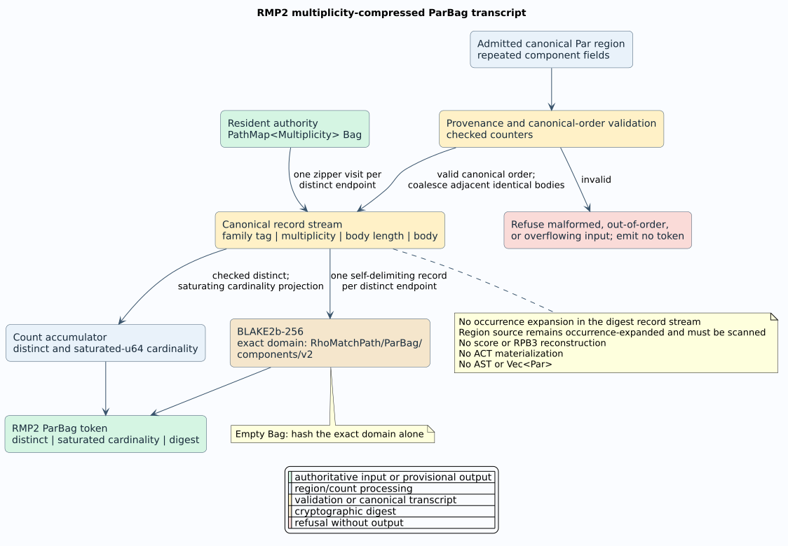

# PathMap engineering journal

Status: living scientific and engineering report

Campaign: `campaign-root-4131`

Started: 2026-08-23

Last updated: 2026-08-25

## Purpose

This journal records what the campaign learns about using PathMap effectively in
`f1r3node-rust-mettail`. It is intentionally chronological and falsifiable. An entry preserves the
question, source coordinate, experimental method, observation, interpretation, rejected
interpretations, and resulting engineering rule. Later evidence amends an entry explicitly rather
than silently rewriting its history.

The journal complements, rather than duplicates, three living reports:

- [PathMap-native EPathMap report](pathmap-report-2026-08-03.md), the historical EPathMap evidence
  ledger;
- [PathMap Bag and RSpace integration](../rspace/pathmap-bag-rspace-integration.md), the RSpace
  contract and experiment report; and
- [Stack-safety report](../stack-safety/stack-safety-report-2026-07-29.md), the recursion, allocation,
  and profiling ledger.

## Terms, symbols, and evidence classes

| Term or symbol | Definition |
|---|---|
| PathMap | The unmodified sibling crate implementing a prefix-compressed byte trie with copy-on-write roots, read/write zippers, algebra, lattice operations, merkleization, and compact arena encodings. PathMap claims in this report are pinned to `f62b6f62580cd6bb6db9ce5385bb886fd7183397`. |
| Par | Rholang's canonical parallel-composition value. Its repeated component families are represented by `ParBag`; root `locally_free` and `connective_used` metadata remain separate. |
| RSpace | The tuple-space authority that stores data and continuations and derives search paths for candidate pruning. |
| EPathMap | Rholang's homogeneous `Empty | Set(PathMap<()>) | Map(PathMap<Par>)` value. |
| Bag | RSpace's `PathMap<Multiplicity>` multiset; one unique byte path stores one strictly positive `u64` multiplicity. |
| RMP | Rholang Match Path, the versioned, derived structural search image used by the RSpace candidate index. |
| RPB3 | The version-3 authoritative ParBag key grammar: component family, canonical score, canonical protobuf body, and score-length trailer. |
| RPB2 | The retired version-2 resident ParBag key design that preceded RPB3. |
| RMP1 | The first RMP token grammar, whose ParBag token fingerprints the RPB3/ACT representation. |
| RMP2 | The provisional second RMP token grammar described in J-005; it fingerprints semantic ParBag endpoint records and is not accepted until H-001 closes. |
| EPM1 | The version-1 compact EPathMap format: mode and cardinality metadata, ACTree03 topology, and direct map-value protobuf regions. |
| EPM | EPathMap format: the version-family prefix used when discussing EPM1-specific processing. |
| RCI2 | Rholang Channel Image, version 2: the shadow logical channel-identity format studied in J-021 and J-022. |
| ACT | Arena Compact Tree, PathMap's compact trie snapshot family. |
| ACTree03 | The ACT encoding used as the topology portion of EPM1. |
| Canonical PathMap writer image | ACTree03 bytes emitted from an in-memory PathMap by the pinned PathMap writer and then framed by the repository codec. A validator must admit every such byte image while refusing alternate physical encodings that the writer would not emit. |
| Explicit value-free endpoint | An observable trie path created without a value. In an ACT branch it may be represented by a reached childless semantic node whose value is absent; its parent edge and node presence distinguish it from an absent path. |
| Value-free unary branch | A semantic ACT node with no value and exactly one child. The canonical writer line-compresses this shape, so an uncompressed occurrence is an alternate encoding and remains invalid. |
| RhoPathV1 | The version-1 RSpace key framing that combines structural RMP bytes with canonical bincode identity bytes. |
| Provenance-admitted canonical region | A borrowed protobuf region reached only from an authoritative, RPB3-validated ParBag endpoint and retained without accepting arbitrary caller bytes. Its field order and bodies therefore inherit the generated canonical emitter's invariants. |
| Oracle-equivalence gate | A differential test in which the optimized result must equal the independent semantic implementation for the complete registered corpus. |
| COMM | A RSpace communication event: one successful data/continuation match whose result and ordering are consensus-relevant. |
| Canonical datum identity | The canonical bincode bytes of one stored `Datum`; the same suffix is used by encoded and decoded candidate APIs. |
| Canonical datum candidate order | The total order by BLAKE2b-256 of canonical datum identity, then by the identity bytes themselves to resolve a hash collision. Derived RMP bytes never participate. |
| BLAKE2b-256 | BLAKE2b with a 256-bit digest, specified by [RFC 7693](https://www.rfc-editor.org/rfc/rfc7693). |
| CoW | Copy on write: immutable roots are shared until a writer requires a private root. |
| [`OnceLock<T>`](https://doc.rust-lang.org/std/sync/struct.OnceLock.html) | Rust's thread-safe write-once cell. After one successful initialization, readers borrow the same stored value without recomputing it. |
| [`Arc<T>`](https://doc.rust-lang.org/std/sync/struct.Arc.html) | Rust's atomically reference-counted shared-ownership pointer. The final owner drops the shared value. |
| Clone family | ParBag instances that share one immutable `Arc<ParBagAux>` auxiliary root until a component mutation detaches the writer under CoW. |
| Candidate product cursor | The synchronized pair of PathMap read zippers over candidate availability and candidate positions used to visit only paths present in both tries. |
| AC | Associative-commutative matching, where grouping and order do not distinguish equivalent terms. |
| Sound candidate query | A derived RMP query that admits every candidate accepted by the authoritative spatial matcher. It may admit extras; rejecting one authoritative success is a false negative. |
| AST | Abstract syntax tree, the decoded recursive rhoapi object graph avoided by the byte-native routes. |
| DFS | Depth-first search: visit a child branch to completion before resuming its sibling. |
| PDA | Pushdown automaton: an iterative traversal whose explicit frames live on the heap. |
| CPU | Central processing unit. CPU time sums the execution time consumed by the process's threads. |
| RSS | Resident set size: the process memory currently resident in physical memory. |
| CBR | Consensus-Breaking Register: the historical stable identifier prefix retained by the living consensus-change register. |
| WAL | Write-ahead log: the durable transaction journal that commits a parent root, new root, and mutation digest before catalog publication. |
| PMU | PathMap maintainer/upstream request: the identifier prefix used by this journal's upstream-integration register. |
| LF | Locally free: the root `locally_free` metadata summary named in H-012. |
| CODEC | Not an acronym in status text: the English word “codec” capitalized for emphasis. |
| CUTOVER | Not an acronym in status text: the English word “cutover” capitalized for emphasis. |
| RAII | Resource acquisition is initialization: ownership binds resource lifetime to construction and destruction. |
| SHA | Secure Hash Algorithm: used here in the standard `SHA-256` artifact-integrity label. |
| KiB and MiB | Binary size units of `$`2^{10}`$` and `$`2^{20}`$` bytes, respectively. |
| Heaptrack | A heap-allocation profiler. “Headless” use records and analyzes traces through command-line tools without launching its graphical interface. |
| `$`n`$` | The input's logical number of trie endpoints, AST levels, or bytes, as specified per experiment. |
| DERIVED | Established from source, generated tables, a commit, or a proof artifact. |
| MEASURED | Observed by a recorded command under a stated resource envelope. |
| HYPOTHESIS | Registered before the decisive measurement. |
| DECISION | Engineering rule accepted from the available evidence. |

## Journal protocol

Each performance investigation follows this literate procedure:

**Algorithm 1 (Isolate a suspected PathMap cost).** This procedure separates a trie operation from
its surrounding codecs and lifecycle work before assigning a complexity class.

```pseudocode
ALGORITHM IsolatePathMapCost(operation, geometric_sizes)

Input:
    a production operation and a geometric size ladder
Output:
    an attributed complexity class and an actionable design rule

1. Freeze the source coordinate and resource envelope.
2. Split the operation at representation boundaries: key preparation, trie mutation, traversal,
   serialization, hashing, and teardown.
3. Measure every split independently on the same logical fixture.
4. Fit or inspect geometric ratios before assigning a complexity class.
5. Use a native profiler to confirm that sampled work belongs to the attributed phase.
6. Reject explanations contradicted by the split measurements.
7. Change the narrowest authoritative boundary, preserving PathMap as the trie.
8. Prove semantic equivalence, rerun the ladder, and record the treatment beside control.
```

The procedure is intentionally representation-aware: a result attributed to PathMap must survive
the phase split rather than inherit the cost of a decoder, sorter, or destructor around it.

For observations `$`T(n)`$` at geometric depths, the first diagnostic is the doubling ratio:

```math
r_n = \frac{T(2n)}{T(n)}.
```

A stable ratio near two suggests linear time; a ratio near four suggests quadratic time. This is a
diagnostic, not a confidence interval. Accepted benchmark claims still use preregistered sampling,
paired controls, and the statistical rules in the companion reports.

## Current PathMap use rules

These rules summarize accepted evidence. Their entry column points to the chronological record that
justifies each rule.

| Rule | Rationale | Entry |
|---|---|---|
| Keep the trie authoritative. Never turn an EPathMap or Bag into `Vec<Par>` for storage, serialization, hashing, or routine traversal. | Flattening loses prefix sharing, value-free endpoints, CoW roots, algebra, and zipper locality while adding a full materialization. | J-001 |
| Specialize the value domain: `PathMap<()>`, `PathMap<Par>`, and `PathMap<Multiplicity>` are distinct semantic algebras. | A set endpoint, map value, and bag count have different identity, join, meet, subtraction, and overflow laws. | J-001, J-002 |
| Serialize the native compact representation directly and keep recursive values in the generated PDA. | EPM1 preserves topology; direct component bytes avoid entry projection and recursive decoding. | J-001 |
| Use one retained zipper for ordered batches and deltas. | Moving between lexicographically adjacent paths reuses their longest common prefix and publishes one CoW root. | J-002 |
| Use native algebra and lattice operations only when their value algebra matches the Rholang operation exactly. | Join, meet, subtraction, and restriction are powerful, but an attractive algebraic name is not a proof of semantic equivalence. | J-003 |
| Attribute the bytes before blaming PathMap. | A trie mutation may be linear or negligible while preparing its byte path is quadratic. Measure the two phases separately. | J-004 |
| Do not decode an authoritative component merely to derive another byte index. | Reconstructing every recursive suffix can turn a constant-size derived key into quadratic work. Use a generated protobuf-region cursor over the resident body. | J-004 |
| Keep upstream PathMap unmodified unless an invariant cannot be enforced locally. | Local adapters can validate ACT input, avoid unsupported reverse moves, and preserve upgradeability without maintaining a fork. | J-001, J-003 |
| Validate canonical writer images by logical trie semantics, not by assuming that every value-free childless node is absent. | A reached childless node may be an explicit observable endpoint. Redundant value-free unary nodes and malformed ACT graph/framing shapes remain invalid. | J-008 |
| Exact-encode only fields that the authoritative matcher compares. | Exact constraints on matcher-ignored fields can reject a legal match. A derived query must project those fields semantically or decline pruning and scan the authoritative domain. | J-011 |
| Keep immutable membership authority separate from speculative multiplicity demand. | Mutating the same Bag for both roles obscures the subset invariant and pays CoW mutation on authoritative trie state; a second `PathMap<Multiplicity>` Bag represents demand without flattening or changing the value algebra. | J-018 |
| Treat a selected match as a revocable proposal until one authority validates and publishes it. | A PathMap delta can be exact while its continuation address or persistent witness has become stale. One group-scoped opaque epoch and one hot-store transaction prevent a valid trie operation from committing against the wrong state. | J-019 |
| Normalize the complete accepted transition into one private CoW root and publish it once. | One root publication turns width-dependent lock and allocation churn into private trie work; narrow cells stay within the preregistered guard while repeated identities, wide joins, and unconsumed arrivals improve. | J-020 |

Provisional rule—not accepted evidence: J-005 proposes fingerprinting a Bag as self-delimiting
endpoint records plus multiplicities rather than an occurrence-expanded digest stream. H-001 must
close before this rule moves into the accepted table. J-006's forced-collision play/replay gate now
proves that derived RMP paths prune candidates but never break replay-visible datum-order ties;
stable commit and release evidence remain before promotion. J-007 proposes lazy nested-Par
summarization after cheap dynamic
classification; its implementation and geometric slope gate must close before promotion.
J-009 proposes a clone-family-shared, version-specific RMP2 digest cache; its byte, invalidation,
concurrency, and preregistered resource gates remain open under pgmcp tasks 5983 and 5984. J-010
attributes a possible quadratic allocation slope to retained zipper clones. Its first treatment is
now a focused-green bounded CoW suffix checkpoint, while a single-moving-zipper PDA remains the
escalation path; no complexity claim is accepted before the geometric gates in pgmcp bug 5985.
J-011's focused semantic repair is accepted, but its COMM, replay, and release gates remain open.
J-012 records the fail-closed generated-schema and protobuf-boundary checks. J-013 states exactly
what the current formal bridge proves and, importantly, what it does not yet prove.

## Chronological findings

### J-001 — 2026-08-03 through 2026-08-12: EPathMap must remain a homogeneous trie

Question: Can compatibility code treat EPathMap as a list of entries without losing the benefits of
PathMap?

Audit coordinate—not the original experiment coordinate:
`f1r3node-rust-mettail@a6b3ad09032c22bb10fafd6f7a890d7871b36609`, tree
`3388f0e80310d9794857d14650138bb45231a2e4`, with PathMap at
`f62b6f62580cd6bb6db9ce5385bb886fd7183397`. The linked historical ledger retains the individual
experiment coordinates.

Evidence: DERIVED and MEASURED. The complete lineage, fixed-scale measurements, negative results,
and proofs are recorded in the [EPathMap evidence ledger](pathmap-report-2026-08-03.md). EPM1 set
serialization measured 6,252 bytes against 491,528 bytes for the list projection at 1,024 entries;
native set lookup measured 32.00 ns per key against approximately 258 microseconds for the projected
linear scan. That lookup pair is an isolated algorithmic control, not the historical `dev` runtime:
`dev` deserialized `ps: Vec<Par>`, rebuilt a temporary `PathMap<Par>` through `Par`-to-text-to-path
conversion and value cloning, and only then called `get`. The campaign did not modify the PathMap
crate.

Finding: The correct representation is:

```math
\mathit{EPathMap} = \mathit{Empty}
\mid \mathit{Set}(\mathit{PathMap}\langle()\rangle)
\mid \mathit{Map}(\mathit{PathMap}\langle\mathit{Par}\rangle).
```

The neutral empty value delays mode selection. Once selected, set and map modes remain homogeneous;
mixed value presence is rejected rather than represented by an option-valued trie.

Rejected interpretation: EPM1's advantage is not that ACTree03 compresses every serialized key
stream. That compression hypothesis was measured false. The accepted benefits are a single native
authority, topology preservation, direct accessors, and removal of repeated projections.

Decision: Every EPathMap boundary must operate on the trie, its zippers, or its compact bytes.

### J-002 — 2026-08-15 through 2026-08-17: Bag deltas should publish one CoW root

Question: How should repeated RSpace additions and removals mutate
`PathMap<Multiplicity>` efficiently and atomically?

Audit coordinate—not the original experiment coordinate:
`f1r3node-rust-mettail@a6b3ad09032c22bb10fafd6f7a890d7871b36609`, tree
`3388f0e80310d9794857d14650138bb45231a2e4`, with PathMap at
`f62b6f62580cd6bb6db9ce5385bb886fd7183397`. The linked integration report retains the individual
experiment coordinates.

Evidence: DERIVED and MEASURED. `BagDelta::apply_to` sorts exact paths once, forks one private CoW
root, retains one write zipper, and moves between adjacent paths with `move_to_path`. Underflow or
overflow discards the private root, while success publishes it once. Raw measurements are linked
from [the RSpace integration report](../rspace/pathmap-bag-rspace-integration.md) and the
[`rspace-bag-delta-cursor-2026-08-16.tsv`](../stack-safety/measurements/rspace-bag-delta-cursor-2026-08-16.tsv)
measurement artifact.

Finding: Reopening a zipper at the root for every update repeats the shared prefix. A retained
zipper reuses the longest common prefix of consecutive sorted paths. CoW makes the transactional
shape natural: mutate a private root, validate every count transition, then replace the authority.

Decision: Batch mutations use one ordered zipper traversal. Single-path operations may use
PathMap's ordinary `insert`, `get`, and `remove`: at the pinned PathMap coordinate, `insert` and
`remove` delegate to write zippers while `get` delegates to a borrowed-path read zipper.

### J-003 — 2026-08-17: algebraic operations require semantic eligibility proofs

Question: Should every Rholang set, map, and bag operation be expressed as a PathMap lattice or
algebra operation?

Audit coordinate—not the original experiment coordinate:
`f1r3node-rust-mettail@a6b3ad09032c22bb10fafd6f7a890d7871b36609`, tree
`3388f0e80310d9794857d14650138bb45231a2e4`, with PathMap at
`f62b6f62580cd6bb6db9ce5385bb886fd7183397`. The linked integration report retains the individual
experiment coordinates.

Evidence: DERIVED and MEASURED. Join, meet, subtraction, prefix restriction, subtree extraction,
and zipper grafting were evaluated in the EPathMap and RSpace ladders. Some operations remove a
complete traversal; others require value-side conflict or multiplicity rules that the bare topology
operation cannot decide. The detailed eligibility matrix is in
[PathMap Bag and RSpace integration](../rspace/pathmap-bag-rspace-integration.md).

Finding: Native algebra is optimal when the PathMap value algebra is the language algebra. It is a
conservative prefilter or ineligible when Rholang still needs directional matching, capture
bindings, guard backtracking, overflow refusal, or deterministic candidate order.

Rejected interpretation: `restrict` is not universally beneficial merely because it can discard a
large subtree. If the derived key has no safe nonempty prefix, building a mask costs work without
pruning candidates.

Decision: Every algebraic use carries an eligibility argument and an oracle-equivalence gate.

### J-004 — 2026-08-23: the deep-send slope is before PathMap insertion

Question: Why did the exact `plain_deploy` depth-131,072 release gate exceed its 120-second cap after
the stack-safe traversals passed independently?

Source coordinate: stable repository base
`f1r3node-rust-mettail@a6b3ad09032c22bb10fafd6f7a890d7871b36609`, tree
`3388f0e80310d9794857d14650138bb45231a2e4`. The diagnostic probe also contained uncommitted
working-tree changes whose exact tree and invocation were not preserved. The measurements are
therefore valid for attribution at that checkpoint but are not independently reproducible
acceptance evidence.

Method: A release-only ignored probe split `RSpaceDataIndex::datum_path` into structural RMP
projection, canonical bincode identity encoding, RhoPathV1 framing, and the final Bag insertion.
Every process was pinned to one CPU inside an 8 GiB `MemoryMax`/zero-swap systemd scope. The raw
observations are stored in
[`rspace-structural-key-preparation-2026-08-23.tsv`](../stack-safety/measurements/rspace-structural-key-preparation-2026-08-23.tsv).
Its [adjacent metadata record](../stack-safety/measurements/rspace-structural-key-preparation-2026-08-23.metadata.md)
states the reproducibility limitation without reconstructing an unrecorded command.

| Unary-list depth | Complete key bytes | Structural bytes | Structural time | Identity time | Framing time |
|---:|---:|---:|---:|---:|---:|
| 1,024 | 66,005 | 225 | 39.610 ms | 6.112 µs | 2.384 µs |
| 2,048 | 132,756 | 225 | 152.178 ms | 4.138 µs | 4.038 µs |
| 4,096 | 269,974 | 226 | 604.595 ms | 9.418 µs | 10.570 µs |
| 8,192 | 544,404 | 225 | 2,512.954 ms | 27.051 µs | 16.652 µs |

The structural doubling ratios are 3.842, 3.973, and 4.157. Although the complete key grows
linearly and the structural output remains 225–226 bytes, structural projection grows
quadratically. A second arm called `RSpaceDataIndex::insert`; at depth 8,192 it completed in
2,531.876 ms against 2,512.998 ms for key preparation in the recorded control row. The single
unpaired observation cannot attribute the apparent difference, so no positive insertion cost is
inferred.

Finding: The slope is not evidence that PathMap insertion is quadratic. The structural encoder
first calls `single_expr_match_component`, which decodes the sole authoritative Expr protobuf body
out of ParBag. On a recursive value, that reconstruction repeatedly rebuilds shorter suffix
ParBags before the generated RMP cursor emits a constant-size opaque nested-Par token. The final
PathMap sees only the already-prepared linear byte key.

Figure 1 shows the attribution boundary. Red denotes the measured quadratic control; green denotes
the treatment under implementation.


The figure source is
[`rspace-structural-key-attribution.puml`](figures/rspace-structural-key-attribution.puml).

Rejected interpretations:

1. The test's old depth observer was quadratic, but replacing it did not remove this production
   slope.
2. Parsing and normalization are not the dominant phase: the isolated depth-32,768 normalizer
   completed in 0.24 seconds.
3. Canonical bincode identity is not the dominant phase in this probe: it remained in the
   microsecond range because the generated encoder streams the resident component bytes.
4. Replacing `Bag::insert` with another PathMap write zipper cannot repair work completed before
   the Bag receives its path; PathMap's public insertion already uses a write zipper.

Hypothesis under test: A generated, stack-safe protobuf-region-to-RMP cursor can consume the
canonical Expr body already stored in the ParBag endpoint, cut nested Par regions without decoding
them, and emit the same structural semantics in time linear in bytes visited. The treatment must be
fully differential over the generated schema, preserve candidate-pruning soundness, and version any
derived RMP byte change explicitly.

Decision: Repair the structural projection boundary, not PathMap. Preserve the Bag as
`PathMap<Multiplicity>` and retain ordinary PathMap insertion unless post-repair measurements
attribute a separate cost to it.

### J-005 — 2026-08-23: RMP2 fingerprints semantic Bag records, not ACT bytes

Question: Can the region-native treatment preserve RMP1, and if it can, is doing so the cleanest
long-term representation?

Status: HYPOTHESIS and PROVISIONAL DECISION. This entry is a design candidate, not accepted
performance or equivalence evidence.

Source coordinate: the accepted baseline is
`f1r3node-rust-mettail@a6b3ad09032c22bb10fafd6f7a890d7871b36609`, tree
`3388f0e80310d9794857d14650138bb45231a2e4`. The RMP2 prototype reviewed here was an uncommitted
successor to that baseline, so its final source coordinate remains an explicit closure requirement.

Evidence: DERIVED but incomplete. Two source reviews traced both candidate designs through
`ParConstruction`, `ParBag::visit_canonical_key_parts`, RPB3 key formation, the generated canonical
protobuf emitter, `par_bag_match_summary`, `canonical_par_view`, and PathMap's ACT snapshot. The
review conclusions were:

1. RMP1 can be reproduced in linear time for a deep unary value by building a shared bottom-up
   score/protobuf plan and materializing only the requested root ParBag key and transient ACT.
2. A schema-complete implementation must nevertheless reproduce every sorter equation, malformed
   nonsemantic score, unordered collection rule, RPB3 framing rule, and ACT byte rule merely to
   obtain an opaque derived digest.
3. The candidate design assumes that score and ACT bytes add no pruning information beyond the
   canonical family, component body, and multiplicity already present in the Bag. H-001 must prove
   this through no-false-negative query equivalence and representation-independent candidate order.
4. Hashing the ordinary canonical protobuf component stream literally is also wrong for this
   purpose: protobuf repeats a field once per occurrence, so one endpoint of multiplicity
   `$`m`$` would require `$`m`$` body feeds and would discard the Bag's compressed count.

Provisional finding: RMP2 retains the existing constant-size ParBag token shape—distinct count,
saturated-`u64` cardinality, and one BLAKE2b-256 digest—but changes the digest preimage to a
canonical, multiplicity-compressed endpoint transcript. For each distinct endpoint `$`i`$`, define:

```math
R_i = \operatorname{be}_{32}(f_i)
\mathbin{\|} \operatorname{be}_{64}(m_i)
\mathbin{\|} \operatorname{be}_{64}(|b_i|)
\mathbin{\|} b_i,
```

where `$`f_i`$` is the protobuf component-family tag, `$`m_i`$` is its strictly positive
`Multiplicity(u64)`, and `$`b_i`$` is its canonical component protobuf body. Records occur in the
same family/score/body order used by the resident ParBag. The fixed-width header and explicit body
length make each record self-delimiting and make the record sequence uniquely decodable. They do
not make the set of complete transcripts prefix-free: a one-record transcript is a byte prefix of
the same transcript followed by another record. Prefix-freedom is not required here because the
streaming hash is finalized at the end of the complete record sequence. The digest is:

```math
h = \operatorname{BLAKE2b256}\!\left(
  \mathtt{RhoMatchPath/ParBag/components/v2}
  \mathbin{\|} R_1 \mathbin{\|} \cdots \mathbin{\|} R_d
\right).
```

The enclosing token emits `$`d`$` and the saturated cardinality `$`c`$` exactly once beside `$`h`$`:

```math
c = \min\!\left(2^{64}-1, \sum_i m_i\right).
```

Those counts are not duplicated inside the digest preimage. The digest still commits to each exact
`u64` multiplicity, so saturation of `$`c`$` does not erase the multiplicity distribution from
`$`h`$`. Root `Par.locally_free` and `Par.connective_used` fields are excluded from the endpoint
transcript because the generated Par program emits them separately. The component families are
exactly protobuf tags 1, 2, 4, 5, 6, 7, 8, 11, and 12. Metadata nested inside a component body
remains included in `$`b_i`$`.

```text
Algorithm: emit one RMP2 ParBag token from either authority

Input:
    a validated resident ParBag OR a provenance-admitted canonical Par region
Output:
    PAR_BAG || be64(distinct) || be64(saturated_cardinality) || digest,
    or a validation/size error before any token is emitted

Preconditions:
    resident keys have passed RPB3 validation; a region is borrowed only through that
    provenance and retains canonical family/score/body order

1. Initialize distinct and cardinality to zero and the digest with the exact domain bytes
   `RhoMatchPath/ParBag/components/v2`.
2. Visit component families in canonical family order.
3. For a resident Bag, read `(body, multiplicity)` once per PathMap endpoint.
4. For a canonical region, validate the shell and field order, then coalesce only adjacent equal
   `(family, body)` occurrences. Refuse malformed input, order regression, or checked-counter
   overflow before exposing a token.
5. Feed one self-delimiting record per distinct endpoint into the domain-separated digest.
6. Saturate the externally emitted cardinality at `u64::MAX`; retain exact per-endpoint `u64`
   multiplicities in the digest records.
7. For an empty Bag, hash the domain alone and emit zero for both counts.
8. Finalize and emit the counts and digest. Never construct a score, RPB3 key, ACT, AST, or
   `Vec<Par>`.
```

Resident-route time is `$`\Theta(d + \sum_i |b_i|)`$`, where `$`d`$` is the distinct endpoint count;
digest state is constant-sized and the zipper reuses its path buffer. A canonical protobuf region
is occurrence-expanded, so its route is `$`\Theta(B)`$` in the encoded region size `$`B`$`, which
can equal `$`\Theta(\sum_i m_i |b_i|)`$`. Coalescing reduces digest feeds and retained state; it
cannot remove the cost of scanning and comparing the already-expanded source bytes.

Figure 2 shows why both resident and region-native routes have the same transcript.



The figure source is [`rmp2-parbag-transcript.puml`](figures/rmp2-parbag-transcript.puml).

Rejected alternatives:

- Preserve RMP1 by reconstructing a transient score-aware ParBag and ACT. This is feasible, but it
  couples a reconstructible matcher index to RPB3 and ACT and creates a large equivalence surface
  with no additional selectivity.
- Hash expanded protobuf component fields. This makes the digest consume
  `$`\Theta(\sum_i m_i |b_i|)`$` body bytes rather than `$`\Theta(d + \sum_i |b_i|)`$` on the
  resident route. The region route must still scan its occurrence-expanded `$`\Theta(B)`$` input.
- Hash component bodies without their family tags or multiplicities. Equal cardinality does not
  identify the multiplicity distribution, and the same body bytes in different families have
  different Rholang meaning.

Provisional decision: Evaluate RMP2 as a versioned derived-index format rebuilt from the
authoritative Bag. Before acceptance, pin the prototype's source coordinate and prove
resident/region transcript equality, saturated-cardinality boundary behavior, no-false-negative
query equivalence, representation-independent candidate order, replay/post-state equivalence, and
linear depth/width resource slopes. Record any accepted cutover under CBR-053 because candidate
pruning is verdict-adjacent even though RMP bytes are not a wire or cold-store identity.

Amendment — 2026-08-23 documentation audit: J-005 remains provisional. This amendment replaces the
incorrect transcript-level prefix-free claim with the exact self-delimiting/uniquely-decodable
property, records the existing saturated-`u64` cardinality projection, separates resident and
region route complexity, and makes the missing immutable prototype coordinate and equivalence
evidence explicit. No RMP2 acceptance or performance conclusion is claimed by this entry.

### J-006 — 2026-08-23: derived paths prune; identity orders datum candidates

Question: May a derived RMP path break a tie between datum candidates when candidate selection is
visible to replay?

Status: DERIVED design invariant with PROVISIONAL implementation evidence. The invariant is
consensus-preserving; the current encoded implementation is not accepted until the focused and
play/replay gates below pass.

Source coordinate: the accepted baseline is
`f1r3node-rust-mettail@a6b3ad09032c22bb10fafd6f7a890d7871b36609`, tree
`3388f0e80310d9794857d14650138bb45231a2e4`. The candidate-order implementation reviewed here is an
uncommitted successor. Its relevant functions are
[`compare_candidate_identity`, `sort_encoded_candidates`, and
`validate_unique_candidate_identities`](../../../rspace++/src/rspace/data_index.rs),
`RSpaceDataIndex::ordered_encoded_channel_entries` and
`RSpaceDataIndex::ordered_channel_entries` in the same file, and
[`deterministic_candidate_hash`](../../../rspace++/src/rspace/candidate_order.rs) for the shared
BLAKE2b-256 primitive.

Finding: RMP is a reconstructible pruning index. Changing its version may change which PathMap
branch finds a candidate, but must never change which admissible datum is first. For canonical datum
identity bytes `$`I(x)`$`, datum candidates use the total order:

```math
K(x) = \left(\operatorname{BLAKE2b256}(I(x)), I(x)\right).
```

The encoded API parses the already-stored identity suffix, hashes that suffix once, sorts by
`$`K(x)`$`, and retains the suffix offset. The decoded API consumes that same ordered encoded list
and decodes the same suffix lazily or on first access. It does not re-encode a second byte authority.

```text
Algorithm: order one channel's stored datum candidates

Input:
    validated RhoPathV1 datum paths below one channel prefix
Output:
    candidates in canonical identity order, or an error before selection

1. Parse each path and borrow its canonical datum-identity suffix.
2. Decorate the entry with BLAKE2b-256 of that suffix exactly once.
3. Sort by digest and then by suffix bytes; never compare the derived RMP prefix.
4. Refuse an identical suffix found under distinct derived paths.
5. Retain one exact storage path per distinct identity for removal and lazy decode.
6. Preserve exact repetitions as the one Bag endpoint's positive multiplicity.
```

The duplicate rule distinguishes two cases. An exact repeated datum has one identical complete Bag
path and increases its `Multiplicity`; it is not a second catalog entry. The same identity suffix
under distinct derived paths contradicts the single-authority invariant and is malformed, so the
catalog refuses it rather than allowing an RMP version to choose an order.

Rejected interpretations:

1. Full trie-path order is not canonical candidate order: it would make an RMP version or encoding
   change replay-visible.
2. Hash-only order is not total unless collision behavior is specified. Canonical identity bytes
   are the collision tie-breaker.
3. Decode then re-encode for ordering creates a second identity authority and adds avoidable work.

Provisional decision: Keep candidate pruning and candidate ordering separate. Before implementation
acceptance, pass focused opposing-RMP/hash-collision/duplicate-identity/multiplicity tests, prove the
encoded and decoded APIs return byte-identical ordering keys, and run play/replay COMM-selection and
post-state equivalence gates. Append a dated acceptance or rejection amendment; do not silently
promote this entry into the accepted-rule table.

Checkpoint amendment — 2026-08-23: accepted local comparator rule; end-to-end replay gate open. The
vector-backed continuation order now uses the same collision rule as the PathMap-backed datum
catalog: `(BLAKE2b-256 digest, complete canonical identity bytes)`. Store index is consulted only
for byte-identical repeated continuation entries because those entries require distinct removal
addresses. A test-only digest function returned the same 32-byte value for every candidate. Both
forward and reverse insertion orders produced `a`, `same`, `same`, `z`; the two equal identities
retained their original distinct store indices. The focused unit passed 1/1 in systemd scope
`run-p2360232-i10336581`, under CPUs 0–7, `MemoryHigh=8G`, `MemoryMax=12G`, and zero swap.

This evidence proves the local total-order rule under an induced digest collision. It does not yet
prove that removal, reinsertion, COMM selection, and replay preserve the same result. Those gates
remain reachable through pgmcp task 5988 and must pass before J-006 becomes an accepted global
PathMap use rule.

Checkpoint amendment — 2026-08-23: ACCEPTED END-TO-END GATE; full release OPEN. A `cfg(test)`-only
thread-local RAII injector now replaces only the datum-catalog identity digest. Its guard is
`!Send`, the test uses Tokio's current-thread runtime, and each Rust test thread has independent
state. Production builds compile no injector state, conditional branch, field, layout change, or
API. The gate forces every identity digest to the same 32-byte value and first proves that its two
datums have opposing orders: derived RMP bytes prefer one datum, while canonical identity bytes
prefer the other.

The complete play/replay gate passed 1/1 in systemd scope `run-p2600563-i11051253`, under CPUs
0–7, `MemoryHigh=6G`, `MemoryMax=8G`, and zero swap. It proved:

- canonical-identity selection and bind order under the forced collision;
- atomic removal of multiplicity two from one Bag endpoint;
- reinsertion followed by the same canonical selection;
- five Produce input/output events, two Consume input/output events, and two COMM events;
- `times_repeated` values two and four across the two COMMs;
- consumption of every rigged replay COMM;
- equality of the final expanded state map; and
- equality of the play and replay post-state root.

This closes the collision/removal/reinsertion/replay obligation in pgmcp task 5988 at the focused
system coordinate. Stable commit and full-release evidence remain before lifecycle completion.

### J-007 — 2026-08-23: classify nested Par shells before summarizing them

Question: When may the protobuf-region route compute a nested ParBag summary without recreating a
quadratic suffix walk?

Status: DERIVED root-cause hypothesis and PROVISIONAL design rule. No treatment or geometric result
is claimed yet.

Source coordinate: the accepted baseline is
`f1r3node-rust-mettail@a6b3ad09032c22bb10fafd6f7a890d7871b36609`, tree
`3388f0e80310d9794857d14650138bb45231a2e4`. The reviewed RMP2 prototype is an uncommitted successor.
The relevant current functions are `CanonicalRhoPathRegionCursor::next`'s `Work::Par` arm,
`canonical_par_view`, `AdmittedParRegion::classify`, and `AdmittedParRegion::summary` in
[`match_region_path.rs`](../../../models/src/rust/rholang/match_region_path.rs).

| Evidence class | Current artifact or gap |
|---|---|
| Source derivation | The named functions above at an uncommitted successor to the exact baseline. This supports the root-cause hypothesis but is not an immutable implementation coordinate. |
| Executable bridge | None yet. The exact probe marker, command, resource envelope, and raw output must be registered and linked before execution. |
| Formal bridge | None yet. Add the exact theorem/model marker and checked artifact only after it exists; no formal verification is claimed here. |
| Measurement | None yet. No timing, allocation, or slope observation supports this entry. |
| Equivalence | None yet. Emitted-token, malformed-shell, candidate, COMM, and replay gates remain open. |

Derived hypothesis: Eager summarization has two different cost contexts. The opaque datum route reaches one
nested Par, emits one constant-size ParBag token, and hashes that selected Par region once. That is
safe. A dynamic query compiler may instead classify the nested Par, descend through its sole Expr,
then repeat at the next nested Par. If classification eagerly hashes the complete remaining Par
region before each descent, a depth-`$`n`$` unary carrier performs:

```math
\sum_{k=0}^{n-1} \Theta(n-k) = \Theta(n^2)
```

byte work even though each individual cursor step is stack-safe.

The required separation is:

```text
Algorithm: classify and emit a nested Par region lazily

Input:
    a provenance-admitted nested Par region
Output:
    a dynamic structural descent or one opaque ParBag token

1. Validate only the current Par shell needed for classification: field framing, canonical order,
   root metadata, component count, and the sole-Expr distinction.
2. Skip nested length-delimited payloads by their validated extents; do not hash their bodies.
3. If the dynamic classifier descends through a sole Expr, pass its borrowed region onward without
   computing the enclosing ParBag digest.
4. If the compiler emits an opaque or metadata-bearing whole-value token, compute exactly that
   selected region's summary once and emit it.
5. Refuse a malformed shell before descent or token emission; arbitrary bytes never acquire
   provenance through this classifier.
```

This design does not weaken canonical validation. The cheap classifier is available only through
the private provenance-bearing region handle minted from an authoritative RPB3 endpoint. It avoids
revalidating and rehashing already-admitted nested bodies while retaining exact shell errors at the
decision boundary.

Rejected interpretations:

1. Stack-safe iteration alone does not imply linear time; an explicit PDA can still visit nested
   suffixes quadratically.
2. Memoizing every suffix digest retains memory proportional to depth and computes digests the
   dynamic route may never emit.
3. Removing ParBag summaries globally would weaken the opaque datum token. The repair is lazy
   placement, not removal.

Provisional decision: Separate provenance/shell classification from opaque-token summarization.
Before acceptance, implement the lazy boundary, prove emitted-token equality and malformed-shell
refusal, count exactly one summary for the selected opaque token, and run a geometric deep-unary
query ladder demonstrating a linear time/allocation slope. Append the result as a dated amendment.

Supersession: none. A later result must append an explicitly dated acceptance, rejection, or
supersession amendment, link the immutable implementation coordinate and evidence artifacts, and
update H-005. It must not rewrite this hypothesis into an observed result.

### J-008 — 2026-08-23: admit canonical explicit value-free endpoints

Question: Is every non-root ACT semantic node without a value, child, or compressed line a
redundant empty branch?

Status: DERIVED, MEASURED, and DECISION for the repository validator rule. The focused repair is
accepted at its test checkpoint. The implementation coordinate remains an uncommitted successor to
`f1r3node-rust-mettail@a6b3ad09032c22bb10fafd6f7a890d7871b36609`, so immutable-coordinate and
broader campaign acceptance remain open until a stable commit and the EPM1 malformed-input,
protobuf/bincode, replay, and full-release gates pass. This distinction preserves the successful
focused evidence without presenting an uncommitted tree as a release result.

Tracking coordinate: pgmcp bug 5981,
`admit-canonical-pathmap-writer-images-with-explicit-value-free-epathmap-endpoints-e060a6`.
Implementation coordinates in the uncommitted successor are
[`semantic_act_node`](../../../rspace++/src/rspace/pathmap_codec.rs), the writer-image corpus in
[`epathmap_trie_codec.rs`](../../../models/src/rust/epathmap_trie_codec.rs), and the public EPM1
round-trip gate in
[`epathmap_epm1_snapshot.rs`](../../../models/tests/epathmap_epm1_snapshot.rs).

Source derivation: PathMap's public topology operation can create a path without installing a
value. If that path's final edge diverges from another root child, the pinned canonical ACT writer
may encode the endpoint as a reached childless branch node with no value. The node is not absence:
`CompactTrie::visit` yields the accumulated path, `CompactTrie::visit_topology` yields its logical
node, and reconstruction calls `create_path` for it. The former validator rejected this writer
image as an “uncompressed empty non-root branch.” That predicate confused physical value absence
with logical path absence.

```text
Algorithm: validate one semantic ACT node without erasing an explicit endpoint

Input:
    one physical ACT node after graph, offset, branch-order, and line-framing validation
Output:
    one canonical semantic node, or a precise alternate/malformed-encoding error

1. Resolve a branch node into its optional value and strictly ordered children, or resolve a line
   node into its nonempty suffix, optional value, optional branch wrapper, and wrapper children.
2. Refuse a line that has both its own value and a child; refuse a line child that is not a branch.
3. Refuse a value-free semantic node with exactly one child because the canonical writer would
   line-compress that unary path.
4. Refuse a line branch wrapper with no children because it cannot represent a branch.
5. Admit a reached childless semantic node with no value and no line. Preserve it as an explicit
   path endpoint; do not manufacture a value.
6. Replay values with `set_value`, value-free endpoints with `create_path`, and require the
   canonical writer image to be a byte fixed point after reconstruction.
```

The repair removes only the obsolete rejection in step 5. Its invariants are:

1. Logical topology is authoritative: a parent edge reaching a semantic node establishes the path
   even when the node has no value.
2. Set/map values remain distinct from value-free endpoints. EPM1 value ordinals are still
   validated before topology events become observable.
3. For every pinned-writer image `$`B`$`, decoding and re-encoding must satisfy:

```math
\operatorname{encode}(\operatorname{decode}(B)) = B.
```

4. A live zipper and direct ACT topology visitor must emit the same root/value, edge/value, and
   postorder-leave event sequence.
5. The repository changes no PathMap source and introduces no second trie authority.

Negative classes remain negative. In particular, the validator still refuses value-free unary
branches; branch bytes that are not strictly increasing; inconsistent sparse/dense child metadata;
shared child references; overflowing or out-of-arena offsets; reserved line header bits; empty or
overlapping line data; a line node with both value and child; a non-branch line child; and a branch
wrapper without children. Admitting one canonical endpoint shape therefore does not admit arbitrary
empty subgraphs or alternate encodings.

Focused evidence, all from the same uncommitted successor:

| Gate | Result |
|---|---:|
| `compact_trie_topology_stream_matches_native_zipper_for_all_endpoint_shapes` | 1/1 passed |
| `root_divergent_value_free_endpoint_round_trips_the_canonical_epm1_image` | 1/1 passed |
| `rust::epathmap_trie_codec::tests::direct_act_replay_matches_reconstruction_oracle_on_writer_images_and_mutations` | 1/1 passed |
| Complete `models/tests/match_path_structure.rs` suite | 7/7 passed |

The complete suite ran in systemd scope `run-p2191610-i10594105` with zero swap: 112.393 seconds
wall time, 109.920 seconds CPU time, and 99.7 MiB peak resident memory. These figures are resource
evidence for the focused gate, not a throughput benchmark.

Rejected interpretation: weakening all value-free-node checks is neither necessary nor correct.
Only a childless reached endpoint has the newly established writer provenance; a value-free unary
node remains redundant because canonical line compression represents it differently.

Decision: Repository ACT validators recognize the logical PathMap endpoint represented by the
canonical writer's value-free childless branch. Preserve all other canonicality and malformed-input
checks. Amend this entry with the stable commit and broader gates rather than rewriting the focused
checkpoint.

### J-009 — 2026-08-23: cache only the versioned RMP2 digest across a CoW clone family

Question: After the RMP2 transcript becomes linear, should repeated derived-path construction walk
and hash an unchanged resident ParBag every time?

Status: HYPOTHESIS and PROVISIONAL DESIGN. No implementation or performance improvement is claimed.
The design task is pgmcp 5983,
`memoize-the-versioned-rmp2-parbag-digest-across-copy-on-write-clone-families-c92231`; its
preregistered experiment is pgmcp 5984,
`measure-cold-warm-clone-shared-and-post-mutation-rmp2-digest-reuse-aea03e`.

Source derivation: the resident RMP2 route hashes the same versioned endpoint transcript whenever
it builds a derived RhoPath. `ParBag` already shares immutable auxiliary cells through
`Arc<ParBagAux>`, so an unchanged clone family has one natural cache owner. Distinct count and
cardinality are already constant-time Bag summaries; caching them would add invalidation surface
without removing a trie walk. The only proposed payload is the 32-byte RMP2 BLAKE2b-256 digest in
one `OnceLock<[u8; 32]>` whose field name and type are explicitly tied to RMP2.

```text
Algorithm: read or initialize the clone-family RMP2 digest

Input:
    one immutable resident ParBag and its shared ParBagAux root
Output:
    the exact 32-byte RMP2 endpoint-transcript digest

1. If the RMP2 OnceLock is initialized, borrow its 32-byte value and visit zero endpoints.
2. Otherwise ask the OnceLock to initialize exactly once across concurrent readers.
3. In the initializer, visit canonical ParBag endpoint records once, feed the exact J-005 domain
   and record grammar into BLAKE2b-256, and store only the finalized 32-byte digest.
4. Read distinct count and saturated cardinality from the Bag's existing constant-time summaries;
   do not duplicate them in the cache.
5. Never cache a protobuf-region summary because a borrowed region has no stable owning clone
   family.
```

```text
Algorithm: preserve or invalidate the RMP2 digest on mutation

Input:
    an operation on a ParBag whose auxiliary root may be shared and warm
Output:
    a semantically correct cache state for every surviving clone

1. Validate the requested component transition and its checked multiplicity before publishing a
   mutation.
2. For a failed transition or semantic no-op, preserve the existing auxiliary root and digest.
3. For a metadata-only Par mutation, preserve the digest because J-005 excludes root metadata.
4. For a successful component mutation on a uniquely owned auxiliary root, clear the RMP2 cell
   together with the other component-derived cells.
5. For a successful component mutation on a shared root, detach the writer to a new auxiliary root
   with an empty RMP2 cell; leave every unmodified clone on the original warm root.
6. Recompute lazily on the first subsequent RMP2 request. Never retain transcript bytes, install a
   global cache, or substitute an ACT/PathMap merkle hash for the versioned RMP2 digest.
```

Hypothesis: one cold request retains the current
`$`\Theta(d + \sum_i |b_i|)`$` endpoint work, while a warm request becomes `$`\Theta(1)`$` with
fixed auxiliary storage independent of endpoint count and body size. The hypothesis is rejected if
the cold lane regresses by more than 5%, if a warm request visits an endpoint, if retained cache
memory slopes with transcript size, or if any mutation/concurrency/byte-equivalence gate fails.

The preregistered experiment crosses distinct widths 1, 16, 64, 256, and 1,024; component-body
sizes 16, 256, and 4,096 bytes; and repeat counts 1, 2, 4, 8, and 32. Its lanes are no-cache control,
cold cache, warm cache, prewarmed CoW clones, first post-mutation request, and second post-mutation
request. It records wall time, instructions, data reads, allocations, and headless Heaptrack
retained memory under pinned CPU, zero swap, capped RSS, and an idle-host preflight.

Acceptance additionally requires exact RMP2 bytes and oracle equivalence; one initialization per
clone family under concurrent readers; the complete successful/failed/no-op/metadata/component
invalidation matrix; zero warm endpoint visits; no warm transcript-size slope; fixed retained
growth per auxiliary root; candidate, COMM, and replay neutrality; and a checked formal cache
invariant. For transcripts of at least 256 KiB, the warm lane must improve by at least five times
over no-cache. A small singleton need only satisfy the cold-regression limit. Negative results stay
in this journal.

Provisional decision: exploit existing CoW ownership, but cache only the immutable,
version-specific digest whose recomputation is expensive. Do not generalize this into a shadow
representation or unbounded memoization scheme.

Checkpoint amendment — 2026-08-23: ACCEPTED FOCUSED IMPLEMENTATION; performance conclusion OPEN.
The cache is one `OnceLock<[u8; 32]>` in the existing `Arc<ParBagAux>` CoW root. Production
encoding and the measurement-only uncached control call the same private transcript function, so
the experiment does not compare two independently maintained algorithms. Seven focused tests
passed 7/7 in systemd scope `run-p2372458-i10775331`, under a 7 GiB memory maximum and zero swap:

- cold then warm access initialized exactly once;
- untouched CoW clones shared that one initialization;
- mutation detached and invalidated only the changed clone;
- every component mutation route invalidated lazily;
- metadata-only changes, no-ops, overflow failures, and underflow failures retained the digest;
- eight concurrent readers initialized once; and
- cached digest and token bytes equaled a contiguous transcript oracle.

The auxiliary-root budget gate passed in scope `run-p2387397-i10640371`; the observed 64-bit
`ParBagAux` size was 672 bytes. The test enforces 672 bytes as an upper budget, allowing a future
compiler or layout improvement to reduce the size without failing. This measurement does not show
that warm hashing is faster or that retained memory is flat across transcript sizes. Those claims
remain preregistered under experiment 5984, together with instructions, allocations, headless
Heaptrack, mutation-lane, and cold-regression evidence.

Measurement amendment — 2026-08-23: FULL MATRIX MEASURED; PROFILE CLOSURE OPEN. The complete raw
matrix is
[`rmp2-par-bag-digest-cache-2026-08-23.tsv`](../stack-safety/measurements/rmp2-par-bag-digest-cache-2026-08-23.tsv),
SHA-256 `2fa2d445ed410116ed9a0b1beadaeb878edbf8e808d813866a690ae2b619c65b`.
It contains 13,500 observations over 75 cells, six lanes, and 30 retained samples per lane. All
lane checksums agree, and warm, prewarmed-CoW, and second-post-mutation accesses allocate zero
bytes. Across the matrix, median speedups were 762.66 times for uncached over warm, 762.67 times
for cold over warm, and 772.44 times for first over second post-mutation access. At the largest
cell—1,024 distinct 4,096-byte bodies with multiplicity 32—the uncached, cold, warm, prewarmed-CoW,
first-post-mutation, and second-post-mutation medians were respectively 7,221,289; 7,176,509;
175.5; 155; 7,220,527; and 151 ns. Multiplicity did not create occurrence-expanded allocation or
time work because each distinct trie endpoint contributes one transcript record containing its
checked multiplicity.

One 609-byte cell initially violated the 5% cold-regression guard: its 30-pair cold median was
7.36% above the uncached median. The negative cell remains in the full matrix. A selected-cell
replication reused the identical six-lane harness with 30 warmups and 300 retained pairs. Its raw
record and analysis are
[`rmp2-par-bag-digest-cache-tiny-replication-2026-08-23.metadata.md`](../stack-safety/measurements/rmp2-par-bag-digest-cache-tiny-replication-2026-08-23.metadata.md).
Cold and uncached medians were 1,704 and 1,703 ns. A 200,000-replicate paired bootstrap placed the
ratio-of-means 99% interval at [0.934846, 1.049629], below the preregistered 1.05 ceiling. The
larger replication therefore attributes the first result to short-sample noise; production gained
no transcript-size threshold, bypass, or other overfit special case.

The deterministic and retained-memory profiles are
[`rmp2-par-bag-digest-cache-resource-profiles-2026-08-23.md`](../stack-safety/measurements/rmp2-par-bag-digest-cache-resource-profiles-2026-08-23.md).
After matched fixture subtraction, a warm lookup requires approximately 29 instructions, 13 data
reads, and 9 data writes at all three registered sentinels from 69 through 4,214,817 transcript
bytes. Headless Heaptrack records exactly equal allocation-call totals for warm and matched
warm-null processes across 10,000 requests at every sentinel. Cold initialization adds temporary,
transcript-linear work but no retained heap allocation: the digest is inline in the existing
fixed-budget auxiliary root. The wall, allocation, instruction, data-access, RSS, mutation,
concurrency, and semantic evidence accepts H-006's resource hypothesis. Broader COMM/replay and
full-release gates remain open lifecycle checks.

### J-010 — 2026-08-23: retained candidate zipper clones may copy quadratic path state

Question: Does retaining `CandidateProductCursor` at every completed query frame defeat the
locality of PathMap zipper traversal?

Status: DERIVED HYPOTHESIS. No timing, allocation, or asymptotic treatment result is claimed. The
reachable tracking item is pgmcp bug 5985,
`remove-depth-quadratic-pathmap-zipper-cloning-from-retained-candidate-product-matching-49a707`.

Source coordinate: the uncommitted successor's
[`CandidateProductCursor` and `visit_sequence_frames_with_prefix`](../../../rspace++/src/rspace/data_index.rs),
audited against PathMap 0.2.2 at `f62b6f62580cd6bb6db9ce5385bb886fd7183397`.
`CandidateProductCursor` derives `Clone` over two `ReadZipperUntracked` values: one for candidate
availability and one for candidate positions. At the pinned PathMap coordinate,
`ReadZipperCore::clone` copies both its complete `prefix_buf` and its `ancestors` vector.

The candidate scanner itself moves its paired zippers down and back up efficiently. At every
complete stored sequence frame, however, `visit_sequence_frames_with_prefix` calls
`visitor(cursor.clone(), &frame)`. Wildcard, first-capture, and nested-match callbacks retain that
clone in `CandidateQueryState`; a terminal state clones once more before the end marker; and an
`accepts_remainder` route enumerates another frame and re-enqueues the same atom index. If a
depth-`$`n`$` chain retains a clone at each depth `$`k`$`, copied path state has the hypothesis:

```math
\sum_{k=1}^{n} \Theta(k) = \Theta(n^2).
```

This equation is conditional on the registered adversarial shape actually reaching the named
clone sites. The required clone/allocation counters are anti-vacuity evidence; source inspection
alone does not establish the production slope.

```text
Algorithm candidate: match with one moving candidate-product zipper PDA

Input:
    the availability and position PathMaps plus one compiled RMP query
Output:
    the same candidate positions and capture bindings as the current matcher

1. Open one synchronized availability/position zipper pair at the candidate prefix.
2. Store DFS continuation state on an explicit heap stack: next child mask position, sequence-frame
   scanner state, query atom, remainder state, and capture rollback/persistent-root state.
3. Descend and ascend the same zipper pair in place. Evaluate a complete frame at the current
   focus before moving again; do not retain a full zipper clone in a work item.
4. On a branch, retain only the compact continuation needed to resume sibling enumeration. Restore
   captures through rollbackable deltas or persistent roots rather than copying descendant paths.
5. At a terminal marker, read the candidate position at the current focus and continue the same
   DFS. Preserve deterministic output sorting and deduplication after traversal.
6. If the unmodified PathMap exposes a demonstrably constant-cost subtree checkpoint with the same
   semantics, measure it as an alternative. Do not fork PathMap.
```

Acceptance requires a preregistered geometric depth/width resource ladder; counters proving that
the control exercised zipper clones and the treatment does not; allocation, time, and RSS slopes;
exact old/new candidate and binding differentials; malformed-input refusal; COMM, play/replay, and
post-state equivalence; and a small-native-stack deep gate. An optimization that merely moves the
same copied `$`prefix_buf`$` or ancestor history into another retained object is rejected.

Provisional decision: preserve PathMap as both candidate tries and preserve moving-zipper locality.
Replace retained zipper snapshots only after the executable ladder confirms the source-derived
slope and the single-moving-zipper PDA proves identical search/backtracking semantics.

Checkpoint amendment — 2026-08-23: DESIGN DECISION, implementation and measurement still open.
Source audit of the pinned PathMap API identified a smaller first treatment than the full
single-moving-zipper PDA: construct a bounded suffix `PathMap` from the current subtree through
`ZipperSubtries::make_map`, then open a shallow read zipper at that suffix root. The suffix map
shares immutable trie structure through PathMap's CoW representation; it does not copy the complete
ancestor vector or depth-growing prefix buffer. A radix frame has at most 256 children, so each
transition retains a depth-independent number of suffix roots and opens at most two shallow zipper
roots. The encoded sequence terminator `[0, 0]` remains a transient scan state because a checkpoint
after the terminator would change frame-boundary semantics.

The executable control must remain available in the same tree so the experiment can compare the
old retained-zipper clone and the CoW suffix checkpoint on identical inputs. Escalate to the
single-moving-zipper PDA if the checkpoint treatment either leaves a fitted exponent above 1.2 or
regresses a representative or dense-width case by more than 10 percent. This selection does not
accept H-007: pgmcp bug 5985 and experiment 5990 retain the old/new semantic differential,
anti-vacuity counters, geometric resource ladder, COMM/replay, and small-stack requirements.

Checkpoint amendment — 2026-08-23: ACCEPTED FOCUSED IMPLEMENTATION; resource conclusion OPEN. The
production matcher now stores `CandidateProductCheckpoint` values containing CoW suffix maps and
reopens a shallow paired cursor for each continuation. A source search finds no production clone of
the paired read zipper; the former algorithm remains only as the same-tree test control. Four tests
passed 4/4 in systemd scope `run-p2383353-i10776044`, with a 6 GiB memory maximum and zero swap:

- checkpoint traversal equaled both the former PDA and the byte oracle;
- terminal endpoints were scanned transiently without losing a root value;
- compressed-prefix and dense-radix shapes agreed; and
- the legacy control proved that the adversarial depth shape reached the clone sites.

At depth 128, the control visited 128 frames, cloned 129 zipper pairs, and attributed more than
500,000 cumulative prefix bytes to those clones. This is anti-vacuity evidence, not an allocation
measurement: allocator traffic, timing, resident-set size, and the fitted exponent remain open in
pgmcp experiment 5990. The candidate-pruning integration subsequently passed 10/10 in systemd
scope `run-p2394525-i10842339`, under CPUs 0–7, `MemoryHigh=6G`, `MemoryMax=8G`, and zero swap. It
covered direct scan, prefix false positives, retained-automaton Bag product, datum-first
continuation pruning, framed-product trace and post-state equivalence, indexed/full-scan
equivalence, pre-decode pruning, nested `Match`, and wildcard-frame pruning. COMM/replay,
small-stack, geometric resource, and release gates remain open.

Measurement amendment — 2026-08-23: NEGATIVE TREATMENT PRESERVED, REVISED TREATMENT ACCEPTED. The
first complete paired matrix measured the bounded CoW suffix checkpoint at every accepted query
atom. Its raw record is
[`rspace-candidate-suffix-checkpoint-v1-2026-08-23.tsv`](../stack-safety/measurements/rspace-candidate-suffix-checkpoint-v1-2026-08-23.tsv),
SHA-256 `3d6f3e2d67808bbb45a37c6cb2b4440d651eda1350cfc5e98cce37e4a9d6ec34`.
That treatment removed the adversarial clone slope and accelerated branching queries, but exact
and repeated-capture queries were approximately twice as slow as the frozen control. The result
rejected checkpoint-per-atom as a production design; it was not deleted or relabeled as a win.

The revised pushdown automaton consumes maximal runs of exact atoms and already-bound captures on
one moving paired cursor. It creates a CoW suffix checkpoint only after a branching frame passes
its predicate. Terminal inspection borrows and restores the same cursor, and a failed asymmetric
descent restores both product zippers independently. This keeps the prefix-compressed
availability and position PathMaps authoritative while allocating persistent suffix roots only
where ownership crosses a branch.

The second complete paired matrix is
[`rspace-candidate-suffix-checkpoint-v2-2026-08-23.tsv`](../stack-safety/measurements/rspace-candidate-suffix-checkpoint-v2-2026-08-23.tsv),
SHA-256 `0bc9cf4a55d10c32b7e0b1faee5b34eb051334c7cdf1400336773146625e5cf8`.
It contains 3,000 observations across 50 cells and 30 retained pairs per cell. Every result equals
the frozen control and byte oracle. The smallest paired median speedup was 1.387 times; median
speedups by query were 1.422 for exact, 1.419 for repeated capture, 2.330 for wildcard, 3.647 for
remainder, and 6.111 for nested match. At depth 4,096, the nested-match speedup was 95.522 times on
the compressed topology and 57.604 times on the dense topology. The capped whole run used no swap
and reached 659,604 KiB peak resident set size. It incurred 2,717 major faults, so only its paired
within-run comparisons support the latency conclusion.

The headless Heaptrack record
[`rspace-candidate-suffix-checkpoint-v2-heaptrack-2026-08-23.md`](../stack-safety/measurements/rspace-candidate-suffix-checkpoint-v2-heaptrack-2026-08-23.md)
attributes 7 fewer allocation calls per exact operation and 14 fewer per repeated-capture
operation at depth 4,096. The Callgrind record
[`rspace-candidate-suffix-checkpoint-v2-callgrind-2026-08-23.md`](../stack-safety/measurements/rspace-candidate-suffix-checkpoint-v2-callgrind-2026-08-23.md)
finds a lower process instruction count for the hybrid at every depth from 256 through 4,096,
with linear growth in both arms. Finally, exact, repeated-capture, and wildcard queries completed
at depth 16,384 on a 256 KiB native thread stack, with no stack-size environment override,
`stacker`, or traversal cap. The focused semantic, resource, and stack gates accept the
deterministic-run hybrid. Broader COMM/replay and full-release gates remain open.

### J-011 — 2026-08-23: dynamic AC queries must not constrain matcher-ignored fields

Question: Can the RMP2 query compiler exact-encode every nonmetadata protobuf field of a dynamic
`New`, `ReceiveBind`, or `MatchCase` value?

Status: DERIVED correctness finding; repair OPEN. This entry establishes the soundness obligation
and does not claim a treatment, test pass, or release result. The reachable tracking item is pgmcp
bug 5982,
`prevent-dynamic-ac-rmp2-queries-from-exact-encoding-matcher-ignored-fields-f8309e`.

Source coordinate: the uncommitted successor's `MatchValue::rho_path_query` in
[`spatial_matcher_pda.rs`](../../../rholang/src/rust/interpreter/matcher/spatial_matcher_pda.rs)
routes `New`, `Match`, and `ReceiveBind` into the generated query compiler.
[`compile_ordered_nested_query`](../../../rholang/src/rust/interpreter/matcher/match.rs) exact-encodes
nonmetadata fields unless a recognized dynamic carrier replaces a region with a wildcard or the
compiler declines the query. The authoritative matcher equations in `evaluate_new`,
`evaluate_receive_bind`, and `evaluate_match_case` compare fewer fields:

| Value | Authoritative spatial relation | Ignored nonmetadata fields exact-encoded by the affected dynamic lane |
|---|---|---|
| `New` | equal `bind_count`, then match `p` | `uri`, `injections` |
| `ReceiveBind` | equal `patterns`, then match `source` | `remainder`, `free_count` |
| `MatchCase` | equal `pattern`, then match `source` | `free_count`, `guard` |

Root metadata such as `New.locally_free` is already handled by the compiler's metadata wildcard
route and is not the defect identified here. The defect is exact byte comparison of ignored
nonmetadata fields in an otherwise dynamic AC query. Two values can differ only in one listed field,
be accepted by the authoritative relation, yet be separated by the derived query. That violates
sound-candidate inclusion:

```math
\operatorname{authoritative\_match}(p, d)
\Longrightarrow
\operatorname{query\_accepts}(Q(p), \operatorname{RMP2}(d)).
```

```text
Algorithm requirement: compile only an authoritative semantic projection

Input:
    one dynamic AC pattern and the authoritative relation for its constructor
Output:
    a sound derived query, or no pruning query

1. Enumerate the constructor fields compared by the authoritative relation.
2. Compile exact structure and dynamic holes only for those compared fields.
3. Replace each matcher-ignored field with a whole-field wildcard whose framing cannot constrain
   its contents.
4. If the generated query grammar cannot express that projection without constraining ignored
   bytes, return no query (`ListCandidatePlan::All`) and scan the authoritative candidate domain.
5. Never return a narrower approximation. The authoritative spatial PDA remains the verdict
   authority after candidate admission.
```

Two treatments remain eligible: a schema-complete semantic projection of the ignored fields, or
the fail-closed `All` fallback for the affected dynamic roots. The first may retain more pruning;
the second is the conservative reference because it cannot introduce a false negative. Selection
requires explicit cost and complexity evidence after correctness.

Acceptance requires constructor-specific counterexamples in which only each ignored field differs;
an oracle-success-implies-query-accept property across the registered corpus; unchanged ground
exact behavior; malformed-query refusal; candidate-set and binding equivalence; and COMM,
play/replay, and post-state equivalence. Until those gates arrive, the implementation must not be
reported repaired, and H-008 remains open.

Checkpoint amendment — 2026-08-23: ACCEPTED FOCUSED REPAIR; system gates remain open. The dynamic
query compiler now declines direct `MatchValue` pruning for `New`, `Match`, and `ReceiveBind` when
the value is not ground. Returning `ListCandidatePlan::All` is the sound fail-closed projection:
the authoritative spatial matcher sees every resident candidate and remains the sole verdict
authority. Ground values retain the exact byte lane.

Four direct-row controls passed: one counterexample each for `New`, `ReceiveBind`, and `MatchCase`,
plus the ground exact lane. The complete registered property
`compiled_rho_path_query_is_a_superset_of_every_recursive_oracle_success` also executed and passed
1/1 in 0.40 seconds in systemd scope `run-p2315545-i10756324`, under CPUs 0–7,
`MemoryHigh=8G`, `MemoryMax=12G`, and zero swap. These results close the constructor-level
false-negative demonstrated by J-011. They do not establish COMM selection, play/replay post-state
equivalence, or the full release suite, so pgmcp bug 5982 remains in progress rather than complete.

### J-012 — 2026-08-23: protobuf projection must fail closed across schema and oneof boundaries

Question: Can a generated protobuf-region projector safely assume field positions and oneof
well-formedness when RMP2 bytes participate in candidate pruning?

Status: ACCEPTED FOCUSED REPAIR; release gate OPEN. The reachable records are pgmcp bug 5986,
`return-a-schema-incompatibility-error-instead-of-indexing-generated-par-fields-c781be`, and task
5989, `cover-absent-expr-oneof-defaults-replacement-and-canonical-width-boundaries-d471da`.

Source derivation found release-path indexing of generated `Par` fields by positions zero through
two. A schema reorder or omission could therefore panic rather than return an incompatibility
error. The repair introduces checked field discovery that validates each expected protobuf tag,
name, and field kind before constructing the generated match program. The focused drift test
`generated_par_program_drift_is_a_schema_error_not_an_indexing_panic` passed 1/1.

The byte cursor also gained direct resident-versus-region controls for:

- an absent Expr oneof;
- a present default `bool`;
- a present empty `EList` message;
- signed integers at -65 and 64;
- string lengths 127 and 128;
- byte-array length 16,384; and
- a deliberately conflicting `GBool` plus `GInt` oneof.

Resident and canonical-region RMP2 projections agree for every valid boundary. The conflicting
oneof is rejected before an endpoint event can complete. Existing canonicality controls continue
to reject explicitly encoded empty `locally_free`, false `connective_used`, and duplicate metadata
fields. This is a fail-closed security and consensus property: malformed or schema-incompatible
bytes may reduce pruning by causing an error, but must never admit a different semantic transcript
or trigger unchecked indexing.

### J-013 — 2026-08-23: formal transcript lemmas are a bridge, not a runtime equivalence proof

Question: What is the exact assurance boundary of the current RMP2 Rocq and Verus artifacts?

Status: DERIVED ASSURANCE BOUNDARY. Runtime-projection closure remains tracked by pgmcp task 5987,
`bridge-rmp2-formal-lemmas-to-actual-spatialmatcher-semantic-projections-c38663`.

The Rocq development proves four capstone properties over an abstract semantic record transcript.
The Verus development verifies eight obligations for framed-record correspondence, multiplicity,
coalescing, and digest input equality. The executable resident/region differentials connect both
implementations to the same test corpus. These artifacts establish useful bridge lemmas, but their
current correspondence premise assumes equality of the semantic record sequences supplied to the
model. They do not yet prove that every generated protobuf cursor branch and every resident
`SpatialMatcher` projection produces those sequences for all valid inputs.

Acceptance requires formal definitions of the actual field projection, occurrence coalescing, and
opaque-nested-`Par` rule; checked lemmas from each runtime event source into that model; and
executable extraction or proof-carrying correspondence at the source boundary. Until then, report
the formal result as transcript-level equivalence with executable runtime bridge tests, never as a
whole-runtime proof.

Checkpoint amendment — 2026-08-23: ACCEPTED SCOPED FORMAL BRIDGE; lifecycle and release gates
remain open. The Rocq development now closes seven capstone theorems over the common semantic-field
projection used by the resident and canonical-region event sources. Those theorems cover field
correspondence, adjacent-only occurrence coalescing with exact cardinality, the nonadjacent-repeat
counterexample, and opaque nested `Par` values. The Verus executable model verifies twelve
obligations with `--no-cheating`, including pending-run accumulation, final-run flushing, and the
same opacity rule. Three focused Rust gates connect the model to the actual resident and
canonical-region cursors: all maintained Expr oneofs, two- and three-run adjacency cases with
transcript/digest equality, and nested-`Par` opacity. The formal manifest also passes.

This closes the earlier assumed-record-sequence gap at the maintained semantic event boundary. It
does **not** prove arbitrary protobuf parsing, BLAKE2b correctness or collision resistance,
allocation behavior, generated-code extraction, malformed arbitrary byte streams, or equivalence
of the whole RSpace matcher and unifier. Those exclusions are explicit assurance boundaries, not
deferred premises silently treated as proved. Task 5987 therefore remains in progress until the
broader lifecycle and release gates pass.

### J-014 — 2026-08-23: do not open a datum catalog before a rendezvous can inspect it

Question: Should `produce` build the current channel's hash-ordered PathMap candidate catalog when
no waiting continuation exists?

Status: MEASURED DEFECT and ACCEPTED FOCUSED REPAIR. The reachable record is pgmcp bug 5993,
`avoid-eager-datum-catalog-hashing-when-produce-has-no-rendezvous-candidate-4e5df4`.

The first forced-collision run failed its anti-vacuity count: three identity digests had been
computed before the first consume, although only two distinct identities existed. Source tracing
explained the exact count. `extract_produce_candidate` opened `bat_channel_pool` before fetching
waiting continuations. Producing the first new identity therefore hashed the one resting identity;
producing the second distinct identity rebuilt and hashed both. None of those hashes could affect a
COMM because the continuation set was empty.

```text
Algorithm: open the produced channel's candidate pool only on demand

Input:
    one produce attempt, grouped waiting-continuation channels, and the hot store
Output:
    the same rendezvous result with no unused datum-catalog work

1. Allocate one local, empty OnceLock for the produced channel's immutable CandidatePool.
2. Fetch and canonically order waiting continuations for the current channel group.
3. If that continuation set is empty, advance to the next group before fetching any datum pool.
4. If retained pruning needs resting availability, initialize the OnceLock from the hot store.
5. If spatial matching later requests the produced channel, clone that same initialized pool and
   prepend the fresh datum to the clone.
6. Never publish the local pool as another authority; it dies with the produce attempt.
```

The repair uses a local `OnceLock<CandidatePool<A>>`, shared by retained pruning and spatial data
fetch, plus an early empty-continuation transition in the matcher driver. The successful collision
gate now observes zero identity hashes across three unmatched produces in both play and replay,
then exactly two hashes when the first consume actually needs the two-identity catalog. The same
gate preserves bindings, multiplicity, COMM events, replay, and the post-state root. Broader
matcher regression passed 49 library tests, 10 candidate-pruning integration tests, and 17 guarded
matching tests. The full-release suite remains open; no throughput improvement is claimed from one
exact work-count control.

### J-015 — 2026-08-23: collision authority and suffix roots must survive their real boundaries

Question: Do the continuation-order collision rule and CoW suffix checkpoints remain correct at
their production boundaries, rather than only under helper-level assumptions?

Status: ACCEPTED FOCUSED HARDENING; exact release workspace remains open.

The final review found two gaps. First, continuation ordering already used the correct total tuple
`(BLAKE2b-256(identity), identity bytes, store index)`, but its forced-collision test injected a
digest only into a private comparator helper. Second, suffix extraction asserted only in debug
builds that a checkpoint focus could not itself contain an endpoint. Neither gap demonstrated a
runtime failure; both left the release claim weaker than the implementation contract.

One shared, thread-local, test-only digest injector now sits at the actual datum and continuation
ordering boundaries. It compiles out of production. The continuation lifecycle gate deliberately
stores two waiting continuations so the hot store's newest-first vector order is `z-cont`, then
`a-cont`, while canonical identity order is the reverse. Its first attempt expected insertion
order and failed before the COMM; that negative result established that the anti-vacuity witness
was observing the real store. The corrected gate forces both digests equal and proves all of the
following in play and replay:

- `a-cont` is selected from vector store index one;
- `z-cont` at index zero is the sole survivor, so sorted position was not mistaken for the removal
  address;
- the COMM names `a-cont`'s exact `Consume` identity;
- both production-boundary identities are hashed exactly once; and
- the replay map and non-empty post-state root equal play.

Checkpoint extraction now snapshots a focus value before `ZipperSubtries::make_map`, restores it
at the suffix root, and refuses only a genuinely empty synchronized side. This is preferable to a
false-negative fallback, a release panic, or the depth-growing legacy zipper clone. A direct
root-plus-child control proves both endpoints survive. A separate counter proves canonical RhoPath
component branches take the no-restoration fast path, so the defensive correctness rule does not
change the measured normal shape. The capped release library gate passed 58 of 58 tests, including
both forced-collision lifecycles, eleven focused checkpoint controls, and the separate depth-16,384
small-stack gate. The byte-native datum catalog/read API also drops the obsolete `Serialize` and
`CandidateOrderingBytes` requirements left by the decoded-hash route; a decode-only generic compile
witness prevents their accidental return. No PathMap source or feature was changed.

### J-016 — 2026-08-23: preserve admitted regions and CoW roots across reducer boundaries

Question: Why did the exact depth-131,072 deploy gate still exceed its watchdog after RMP2's
structural PathMap query became byte-native, and which PathMap properties should cross the two
remaining abstraction boundaries?

Status: MEASURED DEFECT, ACCEPTED REPAIR, and EXACT WORKSPACE ACCEPTANCE. The implementation is
`f1r3node-rust-mettail@1afd4791e`; the reachable records are pgmcp bugs 5994 and 5995, experiment
311, and artifacts 380–381. The durable resource record is
[`resident-send-reducer-join-2026-08-23.md`](../stack-safety/measurements/resident-send-reducer-join-2026-08-23.md).

The first diagnosis rejected the tempting hypothesis that PathMap lookup or final RSpace insertion
was responsible. At depth 8,192, post-RMP2 structural projection took 590,939 ns and final insertion
contributed about 12,976 allocation calls. Headless Heaptrack instead attributed 52,712,929 of
53,716,424 whole-process allocation calls to the generated nested `Send` decoder: each successively
shorter child `Par` suffix was attached to a new `ParBag`, which repeatedly rebuilt PathMap payloads
before evaluation began. The canonical top-level `Par` importer could not help because nested
`Send` children did not cross that boundary.

The selected projection retains PathMap's authoritative byte representation. It derives the
optional-channel and repeated-data roles from `SEND_RHO_MATCH_PROGRAM`, applies the existing
stack-safe `cut_at_par` region PDA to the admitted RPB3 endpoint, decodes only the compact scalar
shell, and decodes each immediate child exactly once through the established top-level importer.
It does not enumerate the ParBag, manufacture a `Vec<Par>`, sort an occurrence list, or introduce a
shadow map. Decreasing fields, duplicate singular fields, and schema near misses take the complete
generated decoder, so the optimization remains a proof-carrying fast path rather than a new wire
authority.

That repair made `plain_deploy` linear but exposed an independent `env_get_deploy` slope. A second
headless profile attributed 52,639,873 of 53,747,932 allocation calls to
`computed_locally_free_par -> generated Expr decoder -> attach_par_exprs -> ParBag insertion`.
`descend_eval` had correctly returned the environment binding as a resident CoW `Par`, but erased
the stronger fact that canonical-path-stable ground data has an empty structural locally-free
fold. Its parent `EvKont::Join` then semantically decoded the complete recursive value merely to
reprove that empty summary, and subsequently imported the same value into `ParConstruction`.

The final design makes the proof explicit. `StableGround` certifies evaluator identity *and* an
empty structural fold; `ExpressionFree` certifies only evaluator identity for reflected process
families. Only the former receives the empty-fold certificate. At a one-child `Join` whose
expression-free shell has the additive-zero component Bag, the evaluator moves the resident child
root and applies the existing `Par::parallel` metadata equations directly:

```math
B_{\mathrm{out}} = B_{\mathrm{child}} \oplus \varnothing = B_{\mathrm{child}},
```

```math
L_{\mathrm{out}} = L_{\mathrm{child}} \mathbin{\mathrm{union}} L_{\mathrm{shell}},
\qquad
C_{\mathrm{out}} = C_{\mathrm{child}} \lor C_{\mathrm{shell}}.
```

Here `B` is the authoritative `PathMap<Multiplicity>` component Bag, `L` is the wire-visible
locally-free byte vector, and `C` is `connective_used`. The historical child-then-shell `union` is
retained exactly, including trailing zero bytes; the separately carried structural fold remains
the child's proof because an empty component shell contributes no structural bits. Every near miss
uses the complete construction PDA.

MEASURED results:

- `plain_deploy` control time was 2.91, 10.79, and 44.21 seconds at depths 8,192, 16,384, and
  32,768; the region projection measured 0.06, 0.13, and 0.26 seconds and reached depth 131,072 in
  1.06 seconds;
- `env_get_deploy` before the neutral Join measured 2.59 and 9.94 seconds at depths 8,192 and
  16,384 and exceeded 146.9 seconds at depth 131,072; after the repair it measured 0.13, 0.25,
  0.48, and 2.03 seconds through depth 131,072;
- the post-Join depth-8,192 profile records 963,802 allocation calls, a 98.21% reduction from the
  immediate predecessor, and no dominant full semantic decoder/import stack;
- the unchanged 2 MiB-worker gate accepts both deploy subjects at depth 131,072 in 3.14 seconds;
  and
- the exact release workspace run passes 4,495 of 4,495 executed tests, with 53 declared skips and
  zero failures.

The tests preserve optional-field presence, repeated-child order, unknown metadata, malformed
EPathMap refusal, fallback reachability, exact protobuf and bincode values, recursive-oracle result
and charge traces, and the original PathMap storage root. No PathMap source or feature changed.

The timing ladders remain PRELIMINARY one-observation attribution evidence. Experiment 311's
registered 30-sample statistical magnitude decision remains pending and must not be inferred from
these rows. That pending magnitude estimate does not reopen the repaired correctness/resource gate.

### J-017 — 2026-08-23: candidate algebra stays group-compressed until ordered witness extraction

Question: How should an associative/commutative candidate plan use PathMap when many target
occurrences share one canonical identity and adversarial connective shape retains intermediate
domains?

Status: MEASURED DEFECT, ACCEPTED REPRESENTATION/ALGORITHM DECISION, and ACCEPTED
PREREGISTERED EXPERIMENT. The implementation is
`f1r3node-rust-mettail@e3f3b4831329ec8863d33af7ae0790d930efa041`; the reachable record is pgmcp
bug `spatial-matcher-candidate-mask-depth-width-retention`; experiment 312 is accepted; pgmcp
artifacts 384–390 and the
[`candidate-group-mask measurement record`](../stack-safety/measurements/spatial-matcher-candidate-group-mask-2026-08-23.md)
retain the raw/profiler provenance.

The predecessor represented each Query result as a `PathMap<()>` of target occurrence positions.
That relation was correct, but it discarded the target Bag's existing quotient: $`w`$ byte-identical
occurrences are one semantic group with multiplicity $`w`$. A fixed postorder evaluator could retain
one $`w`$-endpoint map per connective level, so an opposing depth-$`d`$, width-$`w`$ construction
retained $`\Theta(d w)`$ endpoints before final matching.

The selected representation is `All` or a `PathMap<()>` of fixed-width, big-endian `u64` group
identifiers. Those eight-byte keys are prefix-free, so PathMap's native `join` and `meet` implement
exact set union and intersection at this boundary. Each candidate leaf visits the authoritative Bag
prefix with a read zipper and inserts each reached group once. The evaluator applies the following
rules:

1. compile capture discovery in source order;
2. schedule only pure lattice operands by Sethi–Ullman/Ershov retention pressure, breaking unequal
   pressure by work and exact ties by source order;
3. keep work frames scalar and retained maps in a separate LIFO accumulator;
4. consume native immutable `join`/`meet` results with early `All` and empty absorbers;
5. traverse the root group mask once, decoding each group ID once; and
6. expand to ascending original positions through an already-ordered, sparse-sort, or dense-bitset
   lane chosen by explicit cost estimates.

The final `Vec<u64>` is deliberately retained. It is neither a membership authority nor a
`Vec<Par>` projection: the existing ListMachine requires random access to original target-position
witnesses. Removing it would change a different matcher schedule and requires its own equivalence
proof. No PathMap source, feature, value algebra, or compact format changed.

The pressure recurrence for a scheduled n-ary node is:

```math
P_{\mathrm{nary}} = \max\!\left(P_0,\; 1 + \max_{i>0} P_i,\; 3\right).
```

An adverse node-count control proves why work alone is insufficient: at depth 8, the control retains
10 masks/endpoints and an accumulator depth of 8, while pressure scheduling retains 4/4 and depth 2.
The complete depth 1/4/8 × width 2/8/32 × AND/OR × encoded/resident × source-orientation matrix
preserves exact ordered domains. Mixed duplicates additionally preserve verdict, complete `FreeMap`,
and remainder; 48 deterministic randomized layouts force and equate ordered, sparse, dense, and
adaptive expansion.

Experiment 312 measured 51 samples per arm in all 13 fixtures. The primary width-4,096 OR medians are
5,513,777.071 ns for the frozen occurrence control and 18,869.671 ns for the group treatment. The
locked decision accepts with Mann–Whitney $`U=0`$, $`p=1.6518407509198735\times10^{-18}`$, Cliff's
delta $`-1.0`$, and relative median improvement 0.9966. The distinct-sparse guard also improves.

Physical profiles agree on the mechanism:

- headless Heaptrack records 159,590 $`\rightarrow`$ 30,304 allocation calls and 3.36 MiB
  $`\rightarrow`$ 1.85 MiB peak heap for the duplicate fixture; the opposing fixture reaches
  3.57 MiB $`\rightarrow`$ 742.19 KiB;
- paired Massif records 3,292,888 $`\rightarrow`$ 1,778,424 peak modeled bytes;
- paired Cachegrind records 310,627,559 $`\rightarrow`$ 29,198,834 instructions, 548,844
  $`\rightarrow`$ 56,222 L1-data misses, and 73,562 $`\rightarrow`$ 28,274 last-level misses; and
- headless AMD uProf moves the hot path from `node_set_val`, `make_unique`, mutable child traversal,
  and `pjoin_dyn` to read-zipper traversal and one ordered expansion.

Decision: preserve semantic-group compression through all candidate lattice operations, use
prefix-free fixed-width keys whenever exact set algebra is intended, and cross to occurrence
positions only once at the consumer boundary. CoW is valuable here because immutable native
`join`/`meet` can share structure, but the larger win is avoiding repeated construction of
occurrence-wide maps; CoW is not permission to clone and mutate one trie per leaf.

Negative protocols remain part of the decision. Massif `detailed-freq=1` and uProf `assess` each
required roughly ten minutes for one control arm and are excluded. The accepted paired Massif uses
bounded sparse snapshots; the accepted uProf evidence uses low-overhead Hotspots. An initial
Heaptrack invocation that omitted `--record-only` opened its GUI and was superseded; every accepted
trace is explicitly record-only and analyzed by `heaptrack_print`.

Lifecycle closure at `8035ba826` exposed two useful engineering rules without changing the accepted
PathMap result. First, an encoded connective continuation must own the exact immutable protobuf
region to which its validated cursor refers. `CanonicalOwnedConnectiveChildren<EncodedRegion>`
checks pointer and length once, then retains only the region, relative offset, and remaining count.
This removes duplicate identity state without one heap allocation per PDA level: the release
matcher `Frame` returns from 80 to 64 bytes, and every 20,000-level encoded AND/OR gate remains
stack safe. Second, benchmark-only APIs participate in the conservative source census even when
feature gated. The generic name `CandidateMaskBenchmarkFixture::new` manufactured a false return
edge and a 131-member strongly connected component; the precise name
`from_targets_and_pattern` restores all 108 exact term-family dispositions without weakening the
analyzer or registering noise as recursion. These are representation and evidence-harness repairs,
not changes to PathMap keys, lattice operations, candidate domains, or Rholang semantics.

The exact release lifecycle command passed 4,502/4,502 tests with 53 skipped in 139.111 seconds
under a 24 GiB no-swap cap. Its log SHA-256 is
`cc4cf12ae290fce055b73ddcc1e2041788242fe2cb0af7d2f92fc4bae56122c4`.

### J-018 — 2026-08-24: selection demand is not membership authority

Question: Should speculative multichannel selection remove multiplicity from the same
`PathMap<Multiplicity>` Bag that candidate products treat as authoritative channel membership?

Status: ACCEPTED REPRESENTATION AND INVARIANT DECISION; PERFORMANCE HYPOTHESIS OPEN. The
implementation spans `f1r3node-rust-mettail@173bf4e07` and `39bc0d999`. The work remains reachable through pgmcp
`rspace-multichannel-reservation-replay`; the reservation-pressure comparison is H-010 below and
is tracked by its reachable child
`rspace-candidate-authority-reservation-pressure-experiment`.

The predecessor's reversible decrement/reinsert protocol preserved results, but one Bag had two
meanings. During selection it was simultaneously:

1. the authoritative channel-local snapshot traversed by the synchronized candidate-query zipper;
   and
2. the mutable residual produced by speculative bind choices.

The selected design preserves the authority root and records only demand in a second Bag with the
same exact-key and `Multiplicity(u64)` algebra. Let $`A`$ denote authoritative multiplicity and
$`R`$ denote reserved demand. For an identity path $`k`$, the invariant and transition laws are:

```math
0 \le R(k) \le A(k),\qquad
\operatorname{available}(k) \iff R(k) < A(k).
```

```text
reserve(k): require R(k) < A(k); R(k) := R(k) + 1
release(k): require R(k) > 0;    R(k) := R(k) - 1
```

This is not a `PathMap<()>` membership mask, a `(key,value)` path pair, a positional vector, or a
hash map. Exact repeated records remain one trie endpoint with multiplicity. The authority Bag feeds
read-only zipper products and retained automata; the reservation Bag is initially empty, bounded by
the live selected-bind frontier, and discarded with the candidate pool. Accepted exact identities
still enter the existing atomic `BagDelta` commit. Persistent candidates do not reserve; fresh
produce retains its separate one-bit slot; peeks reserve capacity while searching without deciding
their later commit semantics.

Two explicit phase refusals follow from the representation. Replay may filter authority only before the first
reservation. Fresh prepend must also precede selection because it inserts position zero and shifts
every stored positional witness. Invalid and double releases return `false`; the matcher asserts a
successful phase operation and reservation release at production call sites. The exact internal
`u128` Bag cardinalities give an $`O(1)`$
empty test without confusing two publicly saturated `u64` cardinalities.

The accepted correctness evidence is:

- four private invariant tests keep authority byte/count-equal across every reserve/release, isolate
  two exact identities, restore the complete pool, and reject both phase violations;
- 21 data-index cases preserve exact multiplicity, addresses, fresh capacity, lazy decode, and CoW
  behavior;
- 17 guarded/multichannel cases preserve failed-search rollback, repeated-channel joins, play/replay
  permutation, cost, and the 20,000-bind small-stack gate;
- 3 canonical replay-order and 24 replay/peek/persistence cases pass;
- all 61 release library cases pass, the measurement feature builds, and production-library strict
  Clippy is clean; and
- the exact release workspace lifecycle passes all 4,506 tests, with 53 intentionally skipped, in
  144.491 seconds under a 24 GiB no-swap cap. Its retained log SHA-256 is
  `b8a8dea9e0fe94c62d67f9f85ce56b2521b33997dcf6a2f846cb9d46a8dd8037`.

Decision: use one homogeneous Bag per semantic role. CoW authority is valuable only if speculative
work does not rewrite it; reversible demand belongs in its own multiplicity trie. Do not infer a
throughput win yet. The authority/query product can now enumerate a fully reserved endpoint before
the scan rejects it, so H-010 must compare high-pressure shapes against the frozen mutable-residual
control and attribute CoW writes, availability lookups, allocations, and peak RSS independently.

### J-019 — 2026-08-24: an exact Bag delta is not authority to fire a stale candidate

Question: Once an iterative multichannel search has selected exact PathMap identities, what must
remain true before play or replay may publish their `BagDelta`, remove the continuation, update join
metadata, and emit a COMM?

Status: ACCEPTED CORRECTNESS AND TRANSACTION DECISION; NO PERFORMANCE CLAIM. The executable
checkpoint is `f1r3node-rust-mettail@cd6099f50`; the formal checkpoint is `4127119ea`. The work is
reachable through pgmcp `rspace-multichannel-reservation-replay` and its child
`rspace-atomic-versioned-accepted-match`.

The predecessor carried a vector position for the selected continuation and performed related
state changes through separate store operations. Exact PathMap identities protected datum removal,
but they could not prove that a continuation still occupied the same position after a same-group
mutation. An ordinary integer revision would narrow that gap only until wraparound, reset, or
accidental revision reuse. Byte-equal state replacement is an ABA case: equal payload does not make
an address issued before replacement current again.

The selected design gives every loaded continuation group an opaque `Arc<ContinuationEpoch>`
capability. Equality is `Arc::ptr_eq`; no value, ordering, counter width, increment, or wraparound
law is exposed. A group mutation installs a fresh allocation. Whole-state replacement installs a
fresh base allocation and clears group epochs. Held candidates retain their old allocation, so
allocator-address reuse cannot revive them. Mutation of an unrelated group leaves the selected
group's capability unchanged.

`ProduceCandidate` is now an opaque ticket with read-only accessors. The sole accepted-match
transaction takes the hot-store state write lock and validates, in this order of authority:

1. the ticket carries a current nonempty group epoch;
2. the named installed or ordinary continuation exists at the addressed position and still has the
   same source, persistence, and peek metadata;
3. every persistent datum witness remains present in the authoritative Bag; and
4. the normalized exact-key `BagDelta` is applicable without malformed paths, underflow, or
   overflow.

Only an accepted transition publishes the prepared data root, continuation removal, group epoch,
and affected join metadata. A stale transition returns without changing hot state. If an arriving
datum was not selected by the COMM, its insertion is an addition in the same normalized delta as
the selected resting-data removals; there is no later split store write. Play and replay emit their
COMM/replay effects only after the store accepts the transition. A stale proposal restarts
selection without an artificial retry bound.

This transaction does not flatten a Bag, project `Vec<Par>`, serialize an ACT snapshot, or alter
PathMap. Datum membership and multiplicity remain one `PathMap<Multiplicity>` authority; the
transaction gives one validated linearization point to the already-selected exact paths. The
additional epoch `Arc` protects continuation identity, not a primitive multiplicity and not a trie
node.

MEASURED executable evidence includes same-group invalidation, byte-equal `set_state` invalidation,
unrelated-group independence, two concurrent firings with exactly one winner and one COMM, and a
resting-only COMM that atomically removes the historical datum while retaining its unconsumed
arrival. The complete `rspace_plus_plus` test surface passes under a 12 GiB, zero-swap scope,
including replay, persistence, joins, Bag, PathMap, and deep stack-safe targets.
The exact release workspace lifecycle then passes 4,511/4,511 tests with 53 declared skips in
139.239 seconds under a 24 GiB, zero-swap scope. Its retained log SHA-256 is
`0a54810b516ed516f70ba9cf43a02ffe4db2f4ed8c27981d919add1fe1cf7bbe`.

PROVEN evidence is deliberately layered. Rocq models the epoch as an abstract equality-only type
and closes deterministic acceptance, exact refusal, stale and missing-witness exclusion, complete
accepted state, unrelated-group preservation, post-commit COMM publication, and play/replay
agreement without axioms or admitted goals. TLC explores 901,376 generated and 710,528 distinct
states through depth 5 with no invariant violation. mCRL2 proves the implementation scheduler
branching-bisimilar to its atomic reference and independently excludes partial publication,
pre-commit COMM logging, and stale-ticket commit. The complete formal gate log has SHA-256
`265ff3f7ad37f147adbb6808d134ed419a6c401725e7c90289d6f235a945b83e`.

Proof boundary: these models verify the reviewed transition equations and finite scheduler, not
Rust's mutex implementation, `Arc` allocator behavior, compiler correctness, or every external
RSpace schedule. The executable adversarial and release gates bind those concrete boundaries. No
latency, allocation, or RSS improvement is inferred from this correctness repair.

### J-020 — 2026-08-24: one validated root publication scales with transition width

Question: Does the J-019 transaction pay an unacceptable fixed cost for narrow accepted matches, or
does one normalized `BagDelta` and one PathMap root publication reduce work as a rendezvous touches
more repeated identities, channels, and arrival state?

Status: ACCEPTED MEASURED ENGINEERING RULE. The immutable harness checkpoint is
`f1r3node-rust-mettail@281c1698a`; the complete protocol, tables, profiler qualifications, command
digests, and negative cells are retained in
[`accepted-match-transaction-profiles-2026-08-24.md`](../stack-safety/measurements/accepted-match-transaction-profiles-2026-08-24.md).
The work remains reachable through pgmcp `rspace-atomic-versioned-accepted-match` and its linked
experiment 313, `rspace-accepted-match-atomic-transition`.

The control freezes the actual pre-J-019 git-history sequence: optional continuation removal, one
datum-delta application, one join removal per selected candidate, and a separate datum insertion
when an arrival remains unconsumed. Both arms prepare the same exact identities and must produce
the same deterministic post-state digest. Stale rejection has no fabricated control because the
predecessor had no freshness contract; it must instead leave its before/after digest equal.

Measurement and mechanism are separated. The uninstrumented feature contains no counting
allocator or lock/root counter and supplies Criterion plus fixed p50/p95/p99 populations. A second
instrumentation feature measures transition-scoped allocation calls, write-lock acquisition and
hold time, and successful authoritative Bag-root publication. The ten cells cover singleton,
repeated multiplicity 2/16, joins 2/8/32, persistent continuation, stale rejection, named nonleast
continuation, and an unconsumed arrival. Criterion uses 51 samples and 99% confidence under a pinned
physical core and no-swap RSS cap.

The preregistered hard guards pass. Atomic singleton's pessimistic upper-CI/control-lower-CI ratio
is 1.0442 and join-2's is 1.0351, both below 1.05. The larger transition shapes show the predicted
scaling: repeated-16 changes from 8.4383–8.4692 to 6.0909–6.1725 microseconds, join-32 from
64.820–65.786 to 55.952–59.312 microseconds, and unconsumed arrival from 3.4042–3.5157 to
3.0465–3.1512 microseconds. Repeated-2 is neutral. Persistent continuation is approximately 4–7%
slower, named nonleast is neutral/slightly adverse, and the fixed singleton p99 is 5.4% higher;
these negative cells remain first-class evidence rather than being averaged away.

The structured ledger requested a powered primary-cell replication after the original task-frozen
matrix. One complete additional join-32 run brings that cell to 102 observations per arm. Its
locked Welch guard accepts with $`p=4.0138\times10^{-68}`$, Cohen's $`d=-4.2261`$, and a 95%
treatment-minus-control CI of $`[-8{,}770.689,-7{,}693.311]`$ ns/op. Both arms are nonnormal under
the omnibus diagnostic; the parallel Mann–Whitney result and Cliff's $`\delta=-0.980392`$ agree.
This replication strengthens join-32 only and does not overwrite the ten-cell matrix.

Every successful atomic cell takes exactly one hot-state write lock and publishes exactly one
`PathMap<Multiplicity>` root; stale rejection publishes none and allocates nothing inside the
transition. The split control takes 3 locks at singleton, 18 at repeated-16, 34 at join-32, and 4
plus two root publications for the unconsumed-arrival cell. Atomic allocation-call reductions per
operation are 15 at repeated-16, approximately 31 at join-32, and 11 at unconsumed arrival. Fresh-
process RSS remains 4,088–4,216 KiB in every arm, so no peak-RSS improvement is claimed.

Independent profiles preserve the same qualification. Eleven `perf stat` repetitions at join-32
show approximately 4.3% fewer cycles, 6.6% fewer instructions, and 5.8% fewer branches, while cache
references/misses rise; this is not called a universal locality win. Headless AMD uProf reports
approximately 3.9% fewer sampled cycles and 6.4% fewer instructions. Report-only Heaptrack—captured
with `--record-only` and rendered with `heaptrack_print`, never a graphical analyzer—records 30,762
fewer allocation calls over 1,000 join-32 operations and 11,000 fewer over 1,000 unconsumed-arrival
operations. Equal displayed peak heap prevents a retained-memory claim.

Decision: keep the single transaction boundary. A normalized exact-key delta should own one private
copy-on-write root; all continuation and persistent-witness authority should be validated before
that root and related metadata become visible; the root should then be published once. Do not split
the singleton path merely to chase its narrow fixed effect. Profile the shared datum-prefix,
serialization, hashing, allocator, zipper-navigation, and `make_unique` costs instead. At no point
may this optimization occurrence-expand the Bag, project it to `Vec<Par>`, or serialize an ACT
snapshot.

### J-021 — 2026-08-24: channel identity is a logical RPB3 endpoint transcript, not ACT topology

Question: What byte language lets an RSpace channel use the complete PathMap-backed `Par` identity
without converting the trie to entries, coupling identity to a physical ACT writer, or losing the
existing `Par::{Eq, Ord, Hash}` contract?

Status: IMPLEMENTED SHADOW CODEC WITH FOCUSED EXECUTABLE VERIFICATION; PRODUCTION ACTIVATION AND
PERFORMANCE VERDICT OPEN. The work is reachable through pgmcp `rspace-canonical-channel-image`.

The authority audit found three constraints that an apparently convenient encoding misses. First,
the resident component language is RPB3, not the retired RPB2 design. Second, current `Par` equality
is exactly `(ParBag, connective_used)` and excludes only the top-level `locally_free` summary. Third,
the complete RhoPathV1 prefix has a separate structural frame that currently observes that excluded
summary; changing an identity suffix alone would not make the complete channel key equality-
invariant.

The selected `ChannelImageV2` format streams each strictly ascending RPB3 endpoint directly from
`ParBag::try_visit_canonical_key_parts`. It strips only the common four-byte RPB3 domain, escapes
zero as `00 FF`, terminates each key with `00 00`, writes one positive fixed-width big-endian
`Multiplicity(u64)`, terminates the sequence, and trails the distinct count plus a one-bit
`connective_used` flag. The decoder restores one complete key in reusable scratch space, delegates
canonicality to the existing RPB3 validator, and feeds validated, strictly ascending keys to one
moving `WriteZipperUntracked`; this removes the former contains/get/insert triple navigation and
publishes the completed `ParBag` only after the full stream succeeds. Root `locally_free`
normalizes to empty on decode because it is not identity; nested metadata remains in the canonical
protobuf endpoint body.

An adversarial transitive-call audit corrected an earlier overclaim: encoding is byte-native, but
the current exact validator for a general externally supplied RPB3 endpoint still decodes its typed
protobuf body, applies the authoritative canonical sorter/normalizer, and re-encodes it to reject a
forged score/body pair. `ChannelImageV2::decode_bytes` avoids a second complete validation pass and
the moving writer avoids entry projection, but these improvements do not make external admission
zero-AST. Final byte-native admission therefore remains an explicit requirement: a generated-
schema cursor must check canonical protobuf wire form and produce the same score/normalization
summary as the authoritative sorter, including nested EPathMap/canonical-path fields, before RCI2
can receive its intended time/space verdict.

Two designs are rejected:

1. An ACT snapshot is a compact physical PathMap serialization, not a stable logical channel
   language. Arena layout, line compression, offsets, or writer-version changes must not rename a
   semantically equal channel.
2. Placing a distinct count or key length before endpoint content makes raw byte comparison observe
   lengths before the PathMap key sequence. The selected terminator grammar keeps content prefixes
   adjacent and makes validated raw-image order equal `Par::Ord`.

The focused executable matrix covers the complete schema corpus, root-locally-free invariance,
connective separation including the two empty values, raw-image/`Par` pairwise order equivalence,
maximum `u64` multiplicity, insertion-order and CoW invariance, ACT round-trip invariance, exact
prefix consumption, every truncation point, invalid domains/escapes/families/counts/flags,
duplicate and permuted endpoints, arbitrary hostile bytes, and deep/wide operation on a 256 KiB
stack. A source gate rejects occurrence traversal, sorting, `trie_snapshot`, ACT serialization, or
replacement of the monotone writer in the channel-image path. Hostile score/body, nonminimal
varint, duplicate-oneof, and unknown-field cases additionally pin the present exact validator
boundary while the byte-native replacement is implemented.

No latency, allocation, RSS, cache, or throughput claim is made from those correctness gates. The
format deliberately adds no clone-family cache: the existing `ParBagAux` retained-space budget and
the uncertainty of repeated channel-image demand require measurement before another memoized byte
array is justified. The monotone writer is a structural improvement rather than an empirical
cardinality heuristic: an already validated strictly ascending stream requires one cursor and one
copy-on-write publication, and duplicate/reversed/error paths prove that no partial Bag escapes.
Performance measurement must still quantify the complete operation after byte-native admission
removes the remaining typed decode/re-encode boundary.

The 2026-08-24 checkpoint was re-run under zero-swap systemd scopes after that audit and writer
repair. Scope `run-p2164546-i22984890` passed 12/12 channel-image tests, 28/28 Bag tests, and the
focused formal-manifest gate under a 16 GiB cap; their captured-log SHA-256 values are respectively
`0e275f780ad7790365f11ff38b980d6641378578ce911a3b61b3712cc8cdbdb0`,
`3d0d1baeeac271a5e7ec34ffd8b1b23486a932a3ed7dd2597426424f7ae5453a`, and
`dd8e315d4956739fbfdc966ceb68681eafc641b073fc5672afaf6c57bf1f2212`.
Scope `run-p2172202-i22838040` then passed the complete Rocq, Verus, Z3, TLC, and mCRL2 runner
under an 8 GiB outer cap with nested 1 GiB model-checker caps; the log SHA-256 is
`3e869d4160c9c5607e5c76006350858e916a60310e0135b3964630429963e21b`. RCI2 contributes eleven
Rocq capstones closed under the global context and 33 Verus obligations with no cheating or
implicit-trigger warning.

Decision: keep PathMap logical endpoints authoritative and ACT as an optional compact persistence
image. Before RSpace activation, introduce an explicit channel-identity trait and RhoPathV2 paired
decoder, normalize only the structural channel frame's root metadata, preserve every legacy event/
history/bincode hash through an explicit bridge, and prove the complete-channel theorem rather than
only the identity-suffix theorem.

### J-022 — 2026-08-24: byte-native RPB3 admission requires persistent obligation state

Question: Can the RCI2 decoder replace its typed RPB3 admission bridge with generated-schema byte
validation while retaining exact sorter semantics and linear shared-prefix behavior for nested
EPathMap keys?

Status: IMPLEMENTED AND MEASURED FOUNDATION; PRODUCTION CUTOVER OPEN. The work is reachable from
pgmcp `rspace-canonical-channel-image` through child `rpb3-byte-native-canonical-admission` and
grandchild `rpb3-persistent-nested-admission`; progress rows 4824 and 4825 record the exact open
boundary.

The shadow protobuf PDA now validates canonical Prost framing and derives canonical score,
semantic-default, completeness, and canonical-path-stability summaries for all nine top-level
component families and every generated `Expr` arm. Its algebra is shared with `ParConstruction`
and the resident sorter rather than copied as a second table. Focused zero-swap scopes pass 10/10
protobuf-admission tests, 19/19 construction tests, 10/10 canonical-path reducer tests, 8/8
persistent-arena tests, 8/8 indexed-protobuf tests, 21/21 EPM1/direct-ACT codec tests, and 2/2
semantic-identity tests.

One adversarial differential falsified the first equality-index hypothesis. Sorting complete
`EMap` pairs and keeping the last semantic-key alias is not equivalent when aliases differ only in
root `locally_free`, because `Par` equality ignores that cache. The resident two-stage rule retains
the first equal key representative, selects the greatest emitted value on an `EMap` collision, and
then totally sorts surviving pairs. The corrected PathMap index reproduces that behavior for all
six permutations. It streams semantic identity, value, and pair bytes from the planned protobuf
PDA; no `Vec<Par>`, hash surrogate, comparison buffer, or occurrence expansion is introduced.

The remaining slope is localized and measured by source inspection rather than concealed by the
passing corpus. The EPathMap frame still keeps `path: Vec<u8>` and calls the legacy complete-path
validator at every value endpoint. A shared-prefix comb can therefore copy and replay a
quadratic number of path bytes. The selected replacement is a persistent, provenance-aware byte
arena plus a pure canonical-path state reducer and indexed EPM1/ACT/raw-protobuf continuations.
The arena's immutable handles are constant-size checkpoints; append copies at most one 32-byte
tail block, slices and concatenations do not copy bytes, and traversal is iterative. Its 8/8
focused tests include branch restore, distinct provenance over shared content, linear node growth,
20,000-element left-deep traversal on a 64 KiB stack, and cross-block nested slicing.

The next foundation checkpoint makes those handles ownership-independent at a suspension boundary.
`freeze` retains immutable block nodes and copies only bounded leaf/page metadata; it does not copy
the byte or provenance payload arrays. A frozen payload supports constant-size subviews and remains
valid after the mutable arena is extended or dropped. `IndexedByteRegion` now presents contiguous,
borrowed-arena, and frozen storage through one forward cursor, and protobuf framing distinguishes
logical bytes from physically traversed and fast-forwarded bytes. The depth-20,000 protobuf gate
therefore traverses each physical input byte once rather than rescanning every enclosing
length-delimited payload.

The canonical-path reducer now freezes a completed `RawParEscape` or `NestedEpm1` obligation with
an explicit physical end anchor. It never infers that anchor by adding one to the last byte's
offset, because trie-edge provenance can be discontinuous. The topology wrapper also refuses
terminal success until the event stream has returned through the ACT root with no suspended child
validator. These two properties allow the production protobuf driver to schedule a nested Par or
EPathMap as an ordinary frame on its existing heap worklist; no recursive validator call,
self-reference, lock, or unsafe lifetime extension is required.

The indexed EPM1 cursor now performs no EPM-specific endpoint-event or value-table prepass.
Construction validates only framing and the ACT authority supplied by `rspace++`; `next_event`
checks each Set/Map ordinal and consumes exactly one constant-size value-body subview when that
endpoint is reached. Count and trailing-byte checks run once at exhaustion, and a terminal error is
latched before any `None` can escape. The 24-case focused gate proves zero initial EPM event/table
consumption, monotone single-pass table reads, exact byte accounting, deferred malformed-Map
failure, repeated-error identity, frozen/contiguous parity, source provenance, and depth 4,096 on a
256 KiB stack.

A second replay was found rather than hidden: `CanonicalCompactTrieTopologyState::new` still runs
one complete stack-safe physical ACT canonicality proof and later reparses node metadata to emit
logical events. For $`S`$ semantic nodes and $`W`$ folded line wrappers, construction plus one
complete walk parses primary node records $`4S - 2`$ times and wrappers $`2W`$ times. This barrier is needed to
preserve fail-before-use semantics and current cross-layer error precedence; repeated metadata
parsing is not. Pgmcp child `rpb3-single-parse-act-traversal-plan` (#6023) therefore requires one
eager physical proof that retains a compact preorder `ValidatedActPlan`, followed by event emission
from that plan. Its hard counters are zero node reparses and zero event-time ACT metadata reads;
compressed line-suffix bytes may still be read when their logical edge events are emitted.

The clean checkpoint evidence is: frozen arena 11/11
(`d1168a14919bdc5fd509909d2c5e2fc967dabb379a3bed5de1761af2001c78ba`), indexed protobuf 11/11
(`f1c86693c02b567aedb218b78bb3bee3098a55432393274ddf7f0bd3df457b14`), indexed score 6/6
(`e4ac6d700b654bac39f04b2148b0c4d176be025af327fe7324937d8efca5c7f8`), canonical path 12/12
(`2a224a04ee3120496446df13616cfd3d87d94720e7a4f6862b83b9e7d2bf7727`), single-pass EPM1 24/24
(`9862e7f0b14fe158c0ddc35f9eb2c5a663c29fdd0d907fcf8fd60e188edbf2c6`), and indexed ACT hash/event/error
parity 3/3 (`aeff25cbf3076616f4a2cfe4e73be2bc8c36734690f9b7fd9d9c6a1bfd64cd9b`).
These are correctness and resource-accounting prerequisites, not a latency, allocation, retained-
heap, production-activation, or consensus-neutrality verdict. In particular, the arena's current
immutable-node ownership introduces allocator work that must be measured with headless Heaptrack
and geometric depth/width ladders before it can be accepted as the production optimum.

Decision: do not activate the shadow validator and do not retain endpoint replay as a fallback.
Production cutover requires zero reconstructed-key bytes and zero endpoint replays, byte-native
nested obligations with exact physical provenance, complete legacy-validator differential and
hostile mutation corpus, formal cursor/equivalence proofs with failing mutants, and a capped
geometric time/allocation/RSS experiment. Until those gates pass, RCI2 and RhoPathV2 remain shadow
formats and no performance or consensus-neutrality conclusion is accepted.

**2026-08-25 generated-schema equivalence continuation.** The descriptor pass now emits a seventh,
test-only adapter artifact. Its generated arithmetic covers 56 ordinary messages, the two explicit
`Par`/`EPathMap` externs, five oneofs, and 54 arms. The current factory produces 329 canonical
witnesses spanning every field, repeated cardinalities one and two, every oneof arm including
default-valued presence, numeric boundaries, and all-fields-populated values; 48 additional
ordinary-scalar witnesses prove explicit protobuf defaults are rejected.

For every canonical witness the generated protobuf PDA, the untouched pre-rewrite Prost oracle,
and the original witness are exact byte fixed points. The same decoded generated value produces
identical bytes under the generated bincode PDA and derived serde/bincode oracle. Strict admission
then succeeds with one byte-native validation and zero typed decodes, endpoint replays, or
reconstructed-key bytes. Descriptor-known envelopes with no RPB3 score role carry an opaque
summary only after their fields and recursive children have been validated; an unregistered or
mismatched program still fails closed.

The two extern adapters preserve representation specialization: `Par` remains an authoritative
`PathMap<Multiplicity>`, while `EPathMap` remains neutral-empty, `PathMap<()>` set, or
`PathMap<Par>` map. The gate never flattens either trie, never sorts decoded entries, and never uses
an EPathMap snapshot as a traversal substitute. A 20,000-level iterative byte-built unary spine
and a 4,096-element wide ParBag both validate on 256 KiB stacks. Five executable fallback mutants
make reconstructed-key, endpoint-replay, typed-decode, skipped-validation, and repeated-validation
routes turn the same production verdict red.

This closes the descriptor-inventory and codec fixed-point portion of pgmcp #6019. It does **not**
close the single-parse ACT plan (#6023), formal equivalence (#6020), production RPB3/RCI2 cutover,
full RSpace lifecycle composition, or the preregistered resource experiment. No performance or
consensus-neutrality conclusion is inferred from this correctness gate.

**2026-08-25 RPB3 semantic-equivalence continuation.** A test-only observation now retains the
byte-native reducer's exact root score until the admission certificate is returned. This is not a
second score implementation: the test reads the existing arena cursor before the arena is dropped.
It makes the reducer independently observable instead of inferring its result only from the
claimed-score comparison wrapper. Test-only ownership is compiled out of production.

Every descriptor-generated fixture whose root is one of the nine `Par` component families now
passes the generated decoder once and is checked against the authoritative RPB3 key produced by
`with_component_key`: exact protobuf body, exact canonical score bytes, family, semantic-shape
completeness, and canonical-path stability must agree. Raw `Par` witnesses separately bind the
reducer to `ParBag::append_par_score_key`. They prove that root `locally_free` is quotiented while
`connective_used` and `PathMap<Multiplicity>` endpoint counts remain semantic; the explicit
omitted-multiplicity mutant differs from the accepted score.

The collection differential now pins both nontrivial identity rules. `ESet` retains the first
semantic-equality representative, and `EMap` retains the first equal-key representative while
selecting the greatest emitted-byte value. Their noncanonical duplicate source images are rejected,
and their sorter-normalized bodies and scores are admitted exactly. The hostile matrix now covers
all 329 descriptor fixtures, not only opaque envelopes, with semantic roots compared against
authoritative RPB3 canonicalization after decode. Separate malformed witnesses cover tag zero,
wrong wire type, noncanonical boolean truth, duplicate singular fields, groups, nonminimal and
oversized lengths, every EPM1 framing layer, ACT corruption, value-count mismatch, homogeneous-mode
confusion, trailing bytes, and mixed legacy/current fields.

The capped focused module passes 21 of 21 tests in 0.36 s after compilation; the full `models`
library passes 279 of 279. The captured logs are
`scratch/rpb3-semantic-admission-module-2.log` (SHA-256
`4624c47b83cc964a7bca732abbd066f4bb7221c8969f42133b5968d9376c6c87`) and
`scratch/models-lib-rpb3-semantic.log` (SHA-256
`ca7545c2a3c6e96fc1853d818fcfb5f47689b3f46dc521ce26b2c2d69cd0a1c1`). These are correctness
observations, not performance measurements. The ACT single-parse production-consumer migration,
publication lifecycle, resource experiment, and formal proof remain separate open gates.

### J-023 — 2026-08-24: serialize a resident identity directly, but preserve its external order

Question: When an RSpace Bag key already contains the exact canonical bincode `Datum` identity used
by the cold-store DATA leaf, should checkpoint egress decode and re-encode it, or can the PathMap
cursor feed the destination directly?

Status: IMPLEMENTED, MEASURED, AND FORMALLY GATED FOR DATA. Checkpoint `abd915454` visits the
authoritative `PathMap<Multiplicity>` with one read zipper and copies the resident identity suffix
into one per-egress arena. It never creates a typed `Datum` or an occurrence vector. Lightweight
descriptors retain arena range and multiplicity; after checked cardinality/output-size preflight,
the bincode sequence framing and identity bytes stream directly into the final buffer.

The first tempting hypothesis—emit raw PathMap visitation order—was rejected before activation.
The existing cold-store contract orders entries by the complete canonical datum identity bytes,
whereas the PathMap authority is keyed first by a derived structural prefix. Those orders can
differ. The selected bridge therefore sorts descriptors by borrowed complete identity slices, not
decoded values and not a digest. This is the minimum ordering work required to reproduce the
legacy leaf; it does not flatten the Bag or make the arena authoritative.

The release matrix records exact DATA bytes, leaf digests, and history roots for every arm. Median
speedup is **2.62×–27.65×**; at 4,096 shared-prefix identities it is **11.31×**, allocations fall
**36,913 $`\rightarrow`$ 36**, and allocated bytes fall
**6,117,899 $`\rightarrow`$ 2,234,534**. Headless Heaptrack's ten-operation differential is exactly
368,770 calls, or the same 36,877-call per-operation reduction as the benchmark counters. The
durable raw matrix, decision summary, and attribution are linked from stack-safety report §5.40.

Verus proves checked framing/cardinality and cursor/PDA occurrence-sequence equivalence to the
frozen recursive definition. TLC proves validate/build-private/publish-once atomicity, and a
premature-publication mutant reaches a visible partial image. These proofs cover the adapter's
arithmetic and publication protocol; they do not claim to prove bincode, PathMap internals, or the
cryptographic hash implementation.

DECISION: If an authoritative PathMap endpoint already carries the destination's canonical bytes,
stream those bytes through a cursor directly into the sink. If the destination format differs,
compose a validated source cursor with the destination serializer; do not materialize the recursive
AST as an intermediate. Preserve every external ordering contract explicitly. A retained encoded
snapshot or a secondary identity-ordered PathMap is not justified by egress alone: it must repay
its mutation, CoW, and retained-memory costs in a preregistered complete-lifecycle experiment.

### J-024 — 2026-08-25: one zipper pass wins, but a duplicated identity trie loses

Question: Does a transactionally maintained secondary `PathMap<Multiplicity>`, keyed by each
complete canonical `Datum` identity, outperform J-023's arena-plus-descriptor-sort route after
mutation, CoW clone-update, cold rebuild, and retained storage are included?

Status: EXPERIMENT COMPLETE; SECONDARY INDEX REJECTED. Pgmcp experiment 314 froze nine workload
shapes, four lifecycle operations, 82 counterbalanced retained pairs per cell, exact byte/digest/
cardinality witnesses, Benjamini–Hochberg correction, a one-checkpoint-per-mutation break-even
ceiling, a 5% narrow-egress guard, and a 10% retained-memory ceiling.

The first treatment walked the secondary trie twice—once to count/validate and once to emit—and
regressed shared 4,096 by 8.60%. That implementation is rejected as a concrete zipper-usage defect,
not treated as a verdict against identity order. The repaired treatment maintains the exact framed
length with each multiplicity transaction, reserves once, and emits through one read-zipper walk.
It improves every ready-egress cell: mean treatment/control ratios are 0.691–0.960; the largest
corrected ready-egress q-value is $`1.044\times10^{-15}`$; the least favorable Cohen effect is
$`d=-1.412`$; and break-even frequency is 0.00125–0.638 checkpoints per mutation.

The exact shared/unshared/opposed 4,096-identity lifecycle—ready egress, cold rebuild,
insert/remove, CoW clone-update, and destruction—also passes on a 128 KiB thread stack without a
depth cap or recursive fallback.

The complete-lifecycle decision is nevertheless negative. Net live requested-byte ratios are
1.672–2.094 because the treatment retains the structural authority **and** a second persistent
trie. Shared 4,096 retains 1,253,632 bytes in the control and 2,230,780 in the treatment. Headless
Heaptrack agrees on mechanism, while five user-space `perf stat` repetitions and AMD uProf
attribute the ready-egress win to fewer instructions, branches, branch misses, and cache events.
No production index was activated.

DECISION: retain J-023's transient arena-plus-sort route. Preserve the positive rule—when trie order
already equals sink order, maintain checked encoded length transactionally and write with exactly
one zipper pass—but do not duplicate a persistent trie solely to remove a transient sort. A
non-duplicating primary layout with a prefix-free channel frame followed by complete identity is a
separate H-014 hypothesis; it must preserve channel-prefix algebra and the full RSpace lifecycle
before it can replace the current structural authority. The complete scientific record is
[`../stack-safety/measurements/rspace-identity-order-index-experiment-2026-08-25.md`](../stack-safety/measurements/rspace-identity-order-index-experiment-2026-08-25.md).

### J-025 — 2026-08-25: admit an ACT image once, then lend every consumer the same proof

**OBSERVED.** The new byte-native RPB3 path used a validated preorder ACT plan, but production Bag
and EPathMap consumers still entered the older `CompactTrie` parser. EPathMap direct and generated
decoding first called structural inspection and then parsed the identical ACT arena again during
live `PathMap` reconstruction. Snapshot inspection, value-region inspection, and topology streaming
also replayed the older materialized metadata maps. This was not a PathMap lookup cost; it was a
proof-lifetime defect at the integration boundary.

**DECISION.** Checkpoint `bdaf93a5f` makes `ValidatedActPlan` the single admission result for all of
those consumers. Its endpoint and topology cursors expose the ordinal facts proved during physical
validation, so EPM1 checks Set-zero and Map-sequential/count rules before any topology event becomes
observable. A complete root line carries its exact source range; a path crossing a branch remains
in one reusable cursor buffer and becomes owned only when a retained inspection result requires
ownership. Bag and EPathMap reconstruction insert directly from the borrowed endpoint cursor—never
through `Vec<Par>`, an entry sort, or a shadow hash map.

The generated pausable protobuf decoder keeps only the current EPM1 value-body range. It checks
canonical protobuf bytes when that value returns from the generated PDA, records only the first
failure ordinal, admits/reconstructs the ACT arena once, and then reports the delayed body error.
This preserves ACT-before-body error precedence without retaining a proportional `Vec<Range>` or
reparsing ACT. Nested trusted validation continues to share the existing deferred semantic fence.

For physical arena length $`a`$, semantic records $`S`$, folded line wrappers $`W`$, logical edge
bytes $`e`$, and maximum current key length $`K`$, the derived admission/walk bound is
$`\Theta(a + e)`$ time, $`O(S + W + K)`$ transient plan/cursor heap, and $`O(1)`$ native stack.
Instrumentation requires `semantic_node_parses = S`, `wrapper_node_parses = W`,
`node_reparses = 0`, and `event_metadata_source_reads = 0`; compressed line bytes are the only
source bytes reread to emit their logical edges. No throughput or allocator win is inferred from
these exact work counters.

**MEASURED correctness/resource gates.** Under zero-swap systemd scopes with `MemoryHigh=6G` and
`MemoryMax=10G`, the focused EPathMap suite passes 24/24 (including malformed/provenance and two
depth-4,096 small-stack walks), the validated-plan suite passes 12/12, Bag passes 28/28, the complete
`rspace_plus_plus` library passes 74/74, and the complete `models` library passes 279/279. Log
SHA-256 digests are `be02a3ef2c44eecbc85b231c98238506a85089fa9c50f91f879eb487388a1d37`,
`56dc6a4df2acb630dd58e2e420077c1fa19c38741001e4959b640d8b3589c685`,
`14d75411ea34d4a1cb429d0700394e273f0165e4c163310e5b29c99f15bb02a7`,
`b00c4a6e8dcc26183d2776980d70648a553cf273c61c26270810a174aca9ab54`, and
`728b1266945f6237c47528a534995e6a18886dd034aaf5b3af37babaf931080d`, respectively.
The old parser remains only as an independent differential oracle/compatibility surface; no
production Bag or EPathMap consumer calls it.

### J-026 — 2026-08-25: compose resident leaf bytes directly into the history-hash sink

**OBSERVED.** J-023's DATA checkpoint route already copied each canonical datum identity directly
from the authoritative RSpace `PathMap<Multiplicity>` and constructed the frozen
`Vec<Vec<u8>>`-compatible leaf body without decoding a `Datum`. The history repository then wrapped
that body in the single-field `DataLeaf` and called `bincode::serialize` solely to obtain a second
complete buffer for BLAKE2b-256. The same redundant wrapper allocation existed for continuation and
join leaves. This did not lose trie compression during the PathMap walk, but it needlessly doubled
the live byte volume at the hash boundary.

**DECISION.** Checkpoint `583f21e44` adds `Blake2b256Hash::new_from_chunks` and feeds the frozen
bincode-1 leaf image to it as two adjacent borrowed slices. For resident payload $`p`$, the exact
hashed byte string remains

```math
B(p)=\operatorname{LE64}(|p|)\mathbin{\|}p,
\qquad H(p)=\operatorname{BLAKE2b}_{256}(B(p)).
```

The implementation supplies `LE64` and $`p`$ directly to the incremental hasher; it does not
allocate $`B(p)`$. Typed, canonical-DATA, binary-DATA, continuation, and join insertion paths share
the same helper. This is sink composition, not a new serialization format and not a decode/re-encode
route.

**MEASURED correctness gate and boundary.** Exact differentials cover empty, one-byte, 255-byte,
and 65,537-byte payloads for all three leaf wrapper types. A negative control that omits the length
prefix produces a different hash; the focused 2/2 captured-log SHA-256 is
`92bca75c8d51714fc53b8afc1d886a8354f1ae16265f3ed5f483fbe9eca7c7f7`. The complete
capped, zero-swap `rspace_plus_plus` library gate passes 76/76; its captured-log SHA-256 is
`f0130e46758de9f9c4122e8dcece395a732dacb1533f3d35ed90b8cf73797a2d`. The eliminated
$`8+|p|`$ secondary buffer follows by construction; no wall-clock, allocator, RSS, cache, or WAL
throughput claim is inferred. The current legacy store still serializes the enclosing
`PersistedData` into an owned value for its key-value API. The PathMap-native differential WAL,
packed object store, and crash-atomic catalog publication remain owned by pgmcp
`rspace-pathmap-persistent-dag-backend`; this checkpoint neither implements nor changes that
protocol.

### J-027 — 2026-08-25: construct the final cold-store value once, then lend its ranges

**OBSERVED.** J-023 ended its direct PathMap walk at the encoded DATA-leaf payload. The history
repository subsequently serialized `PersistedData::Data` to add a four-byte enum tag and the
single-field eight-byte bincode length. That final serialization allocated and copied a complete
second payload. Reads and import validation performed the inverse operation through derived serde:
they allocated a new payload `Vec<u8>` even when the consumer needed only a borrowed range or hash.
J-026 had already removed the analogous temporary buffer at the history-hash boundary, so the
remaining copy was specifically the key-value-store value boundary.

**DECISION.** Checkpoint `3061b2501` makes the final legacy value—not an intermediate
`Vec<Vec<u8>>` body—the output of canonical DATA egress. After checked cardinality and length
preflight, the PathMap visitor reserves exactly once and emits this frozen layout:

```text
[u32 little-endian PersistedData tag]
[u64 little-endian payload length]
[u64 little-endian datum occurrence count]
repeated multiplicity times: [u64 identity length][resident canonical Datum identity]
```

The descriptor sort from J-023 remains necessary because the frozen external order is the complete
datum-identity byte order, not the RhoPath structural order. It sorts only arena ranges and never
constructs a typed `Datum`, `Vec<Datum>`, or `Vec<Vec<u8>>` authority. Typed continuation, join, and
legacy DATA paths reuse their owned payload allocation while prepending the exact 12-byte envelope.
A shared `PersistedDataView` validates the envelope once and lends the payload and leaf-hash ranges
to the repository reader and importer. Checkpoint `70fae0a9d` makes its bincode-1-compatible parser
private to executable differentials and exposes only exact canonical admission to production.
History reads, repository insertion, action measurement, and state import therefore reject a
trailing suffix before hashing or decoding it. This distinction matters because the frozen leaf
hash ends at the declared payload boundary: admitting a suffix there would accept bytes that the
leaf hash does not authenticate.

**MEASURED.** The v2 experiment compares complete final persisted values, not leaf bodies. Each of
seven preregistered cells has 31 counterbalanced pairs, exact length/digest agreement before
timing, 100,000 pair-preserving bootstrap resamples, and paired parametric and signed-rank tests
with Benjamini–Hochberg correction. Treatment/control median-time ratios are **0.0323–0.3745**;
every 99% bootstrap upper bound is below **0.385**. Allocation-call reductions range from **24**
at singleton to **36,878** at 4,096 distinct identities; allocated-byte reductions range from
**2,668** to **4,583,789** bytes per operation. The raw matrix, analysis, and summary SHA-256 values
are respectively `080db0fc751268ba41b9065edb449300e5de34fab23ef712640fc38b60825ad2`,
`b27a62e753b07a67164dbb6fa8bdc383b936f608f95ed4a9c85a9588ca8a3e56`, and
`7d70b939dd3cc7249e77b5dd2f9f967d0905c7c8df96cdbf15e3f6370b5d793b`.
The final exact-tree capped, zero-swap RSpace package passes **497/497** across 24 targets;
captured-log SHA-256 is
`da3840b5a4a8708cb01f20faa5fd51dcf01e12323735439075e430e2e5d7cc21`.

**FORMAL AND ANTI-VACUITY CLOSURE FOR THE FINAL VALUE.** Verus discharges 14 obligations for
payload/cardinality framing and the complete 12-byte envelope. TLC explores 44 distinct states in
the good validate/build-header/build-payload/publish-once model. Three executable negative models
independently violate the expected invariant when they publish a partial image, publish without
the envelope, or skip malformed-input validation. Rust negative controls separately remove one
multiplicity occurrence and reverse the identity-order domain; both alter the final bytes and
BLAKE2b-256 leaf digest. The capped Rocq, Verus, Z3, TLC, and mCRL2 log SHA-256 is
`8638ffef6b32993bb2407aaaafae2ebe10a7bc5a4010949084f81c6b56ec4cad`; the focused seven-case Rust
log SHA-256 is `4ebac1e8528bfd0e35cf9693c4bf745d0fe3ebdcf054db9b1c53458d97eaae67`.
Production-library Clippy with warnings denied passes at log SHA-256
`4127b863a473919d9e152d01233ec3d7d33a77ed4a85708520ef4db8ff46faaf`. The broader all-target
Clippy campaign gate is not inferred from that result: pgmcp #5302 remains open on the separately
recorded test-target backlog.

This decision does **not** replace the persistence architecture with whole-snapshot clobbering.
The planned PathMap-DAG store remains differential and transactional: durable immutable-object
deltas precede a WAL commit that binds parent root, new root, and mutation digest; catalog/root
publication and acknowledgement follow the required sync barriers. ACT remains an immutable
snapshot/transport representation, while the integration owns WAL transaction policy. The current
legacy key-value store does not yet implement that future backend.

### J-028 — 2026-08-26: certify one owner traversal, then replay typed protobuf ranges

**OBSERVED.** A PathMap-backed `ParBag` can appear several times in one outer RSpace protobuf graph
because distinct `Par` shells may share the same copy-on-write component owner while retaining
different root metadata. Re-running the canonical component zipper for every occurrence preserved
bytes but made PathMap work proportional to occurrences rather than distinct owners. Conversely,
memoizing every owner imposed lookup and retention work on the common singleton case. A 31-pair
prototype suggested the singleton budget might fail, but that run mixed fixture/reporting work with
the measured region and did not have enough power to justify changing the architecture.

**DECISION.** The selected encoder performs one exact owner census during generated-schema
preflight. Owners seen once stream directly. For a repeated owner, the first occurrence streams the
authoritative `PathMap<Multiplicity>` component bytes through its zipper and records byte ranges;
later occurrences replay those ranges while emitting their own root metadata. The first reusable
owner is inline; a hash table is allocated only if a second reusable owner exists. This is not a
global cache: the census, ranges, and output share one private frame lifetime and disappear after
publication.

Preflight also constructs a typed pre-order transcript. `MessageBody`, `ParBody`, `MapEntryBody`,
and `EPathMapSnapshotBody` events are reserved before descent and completed afterward. Sixteen event
lengths and kinds plus their completion bits remain inline; larger transcripts spill. Emission must
replay the exact kind/length sequence, exhaust both transcript and owner memo, and match the planned
body length before the private buffer is returned. Thus a callback error, length disagreement,
wrong owner, wrong event kind, incomplete completion, replay overrun, or spill corruption returns no
partial frame. EPathMap snapshot bodies are emitted from their homogeneous `PathMap<()>` or
`PathMap<Par>` representations; no `Vec<Par>` projection or element sort exists at this boundary.

**MEASURED.** The powered balanced AB/BA run uses 101 retained pairs per reuse cell and 100,000
pair-preserving bootstrap resamples. At reuse one the treatment/control paired-median ratio is
**1.017391**, with a 99% interval of **[1.006930, 1.024510]**, below the preregistered 1.05 ceiling.
Ratios at reuse 2, 4, 8, and 16 are respectively **0.556835**, **0.300896**, **0.175201**, and
**0.174705**. Reuse sixteen changes PathMap traversals from 16 to 1 per frame. Profile-only,
report-only Heaptrack changes 99,235 allocation calls and 65,353 temporaries to 8,455 and 4,153 over
1,000 reuse-16 frames while leaving peak heap output-buffer dominated. `perf stat` attributes the
same cell to 12.23% of control cycles, 11.44% of instructions, and 10.67% of branches. The complete
record is
[`parbag-certified-protobuf-egress-2026-08-26.md`](../stack-safety/measurements/parbag-certified-protobuf-egress-2026-08-26.md).

**FORMAL AND CONSENSUS BOUNDARY.** The exact generated/prost byte differential covers every root
family and populated production publication root. TLC and Verus check completion, replay,
owner-census, memo, and atomic-publication laws with independent failing mutants; the complete Rocq,
Verus, Z3, TLC, and mCRL2 bundle passes. This changes traversal and allocation work only: the
protobuf schema, canonical bytes, hashes, COMM order, match authority, state root, accepted programs,
and metering rules are unchanged. It extends CBR-053's neutral implementation evidence rather than
opening a new consensus record. Trie-native continuation and join egress remain the next distinct
boundary under pgmcp #6029.

### J-029 — 2026-08-26: distinguish an algorithmic projection control from the `dev` lookup path

**CORRECTION.** The fixed-scale EPM1 experiment validly compares one native `PathMap` exact-key
query with one linear scan over a materialized entry projection. It does not reproduce the
historical production lookup route and must not be cited as a direct `dev`-to-current runtime
speedup. At the campaign baseline, protobuf first decoded `EPathMap.ps` as `Vec<Par>`;
`PathMapCrateTypeMapper::e_pathmap_to_rholang_pathmap` then called
`create_pathmap_from_elements`, which rendered every `Par` to a textual S-expression, parsed and
encoded a byte path, cloned the `Par` into a fresh `PathMap<Par>`, and finally allowed the reducer to
call `get`.

**DECISION.** Retain the 8,060.736× / 6,183.905× measurement and raw rows as an explicitly labeled
indexed-versus-linear algorithmic control. Never use those ratios as the branch-to-branch runtime
claim. Use the preregistered integration experiment—32.281 ms to 18.730 ms and 4,119,482 to 278,527
allocation events—for the measured effect of retaining the native root and removing repeated
reconstruction/copy-on-write work. This correction changes interpretation only; no benchmark value,
runtime byte, consensus axis, or PathMap source changed.

### J-030 — 2026-08-26: release builds must not erase PathMap endpoint mutation

**OBSERVATION.** The first exact release-workspace gate after certified protobuf egress found a
required semantic-identity insertion written as the argument of `debug_assert!`. Debug builds
executed `PathMap::set_val`; release builds erased the entire expression. ESet/EMap admission could
therefore lose its first-representative index only in release. The repair executes the mutation
unconditionally and leaves only the prior-value invariant diagnostic. A prefix-plus-descendant test
pins simultaneous values at both trie endpoints.

**AUDIT.** Campaign-scoped all-target lint now denies mutation inside `debug_assert!`. Two iterator
advances used only for diagnostic exhaustion checks are explicitly debug-only. Receiver-erased SCC
names were also made source-specific without adding a traversal cap or recursion exemption. Debug
and release recursion censuses each classify 713 recursive components and exactly disposition all
108 term-family components.

**RESULT.** At immutable commit `0065278e3`, release `models` passes 292/292 tests and the exact
workspace command passes 4,677/4,677 tests with 53 skipped under a 12 GiB, zero-swap systemd scope.
The full log's SHA-256 is
`a8ae8af71bd10a3d665fab91ab999eb8ea5e30ddc95c1dc54fc80bca852514be`.

**DECISION.** Treat side effects inside diagnostic macros as a build-mode equivalence defect, not a
performance shortcut. PathMap mutation, zipper movement required by semantics, and publication
must occur outside diagnostics. This repaired the integration; no upstream PathMap change is
required.

### J-031 — 2026-08-26: authenticate immutable state before consuming affine publication authority

**OBSERVATION.** The legacy RSpace transfer boundary exposed history, DATA, and current-root setters
as independent operations. A caller could therefore make a partially imported graph visible or
appoint a root before the imported closure was known to exist. Pagination also encoded its
continuation implicitly in the final returned trie node, cold leaves shared one physical
digest-only key across distinct record kinds, the closure verifier retained an input-sized set of
every verified leaf, and the LFS request streams could turn import failures into apparent end of
stream. Those are publication-authority and resource-lifetime defects; they are not reasons to
flatten a PathMap or reconstruct an RSpace through a `Vec`.

**DECISION.** State transfer now uses an explicit authenticated page and a one-way
`open -> sealed -> published` import session. A page carries its advertised next cursor and
terminal status; admission authenticates the traversal proof and exact typed leaf projection before
any record body is decoded or staged. Immutable cold objects use a domain-separated physical key
`RSLF | version | record-kind | logical-digest`, while their existing logical digest, history
reference, and history root remain unchanged. Sealing verifies the complete reachable closure with
an iterative worklist and fixed-capacity CLOCK caches. Publication then atomically adds the verified
root set to a versioned root catalog and, only for an `Activate` session, compares and advances the
current-root generation. `PreserveCurrent` sessions cannot move current-root authority.

The tuple-space requester owns one `Activate(root)` capability for the complete transfer. The
horizon requester owns one canonical `PreserveCurrent` capability for all missing roots and keeps at
most 32 network requests live. Both accept only the exact requested cursor, stage a valid page before
retiring that cursor, and obtain the next cursor only from the staging receipt. Stale, duplicate, and
unsolicited responses neither mutate storage nor advance the schedule. Seal and publish failures are
observable stream errors, and initialization cannot enter `Running` without the terminal publication
receipt. The process FFI exposes the same affine types as six operations—begin, stage, seal, publish,
abort-open, and abort-sealed—and exports none of the former independent mutators.

**PATHMAP BOUNDARY.** The imported state remains a content-addressed trie graph. Traversal is by
authenticated cursor and the closure check is by explicit node/leaf worklists; no state page is
projected to `Vec<Par>`, sorted, or rebuilt as a list. The verifier retains only a 1,024-entry/8 MiB
decoded-node cache and a 4,096-address verified-leaf cache. Its native stack is `O(1)`; required
frontier storage is proportional to the currently unresolved graph frontier, not to traversal depth,
and repeated shared leaves do not create an unbounded visited set. The persistent PathMap-DAG/WAL
backend is deliberately not claimed here: this checkpoint supplies the authenticated immutable
objects, verified-root catalog, and consuming publication authority that its recovery protocol must
use.

**EVIDENCE.** Resource-capped focused suites pass 17/17 state/authentication cases, 5/5 root-catalog
atomicity cases, 6/6 export/import cases, 12/12 tuple requester effects, 19/19 horizon requester
effects, and 5/5 FFI lifecycle/error cases. `casper --tests` type-checks. The TLA+ lifecycle model
explores 148 generated states, 68 distinct states, and depth 10; three required mutants independently
violate consumed-seal publication, single-winner activation, and preserve-current authority. The
formal manifest pins the control and all three negative controls. These results prove lifecycle and
bounded-control properties; they are not persistence-throughput or crash-recovery measurements.

**CONSENSUS BOUNDARY.** Canonical Rholang bytes, logical cold-leaf hashes, history roots, COMM order,
match authority, post-state roots, and metering are unchanged. The peer transfer schema is not
unchanged: `StoreItemsRequest` now explicitly negotiates a cursor-protocol epoch and
`StoreItemsMessage` echoes that epoch plus an authenticated terminal claim. The fields are additive
at the protobuf encoding layer, but absence decodes to `UNSPECIFIED` and fails closed; therefore an
old unversioned peer and a new peer are intentionally unavailable during a mixed deployment unless
the rollout supplies an explicit negotiation bridge. V1 accepts an empty terminal cursor only when
V1 was requested and echoed. V2 requires the terminal cursor to equal the requested start cursor,
and the transport claim must agree with importer-authenticated traversal. The typed physical key,
root catalog, FFI schema, and affine import session are local storage or process-boundary
mechanisms. Malformed or incomplete transfers now fail closed instead of publishing partial
authority. The corresponding CBR-053 continuation records this corrective state-byte-neutral but
network-rollout-visible boundary.

### J-032 — 2026-08-26: make the verified root catalog the only local state authority

**OBSERVATION.** An affine network importer is insufficient if a local checkpoint, legacy database,
or raw store-manager handle can still appoint a root independently. The intermediate implementation
also opened LMDB before the concrete RSpace record types were known. Structural radix validation
alone cannot prove that a length-framed cold record decodes as the datum, continuation, or join kind
authenticated by its logical path. Publishing a catalog at that point would turn structurally sound
but type-invalid bytes into current-root authority.

**DECISION.** One `RSpaceStateAuthority` now owns history objects, typed cold leaves, verified-root
membership, and `(current root, generation)`. A prepared local checkpoint carries its exact base
pair and complete immutable object set. Validation and publication use one memory lock or LMDB write
transaction. Authority-owned raw database names are exposed only through read-only views, repository
fields no longer expose mutation-capable stores, and an authorized `History` refuses the old
detached `process` commit route.

Legacy state follows a two-phase adoption protocol. Phase A iteratively authenticates radix hashes,
logical 33-byte paths, typed cold addresses, canonical envelopes, and record framing; it stages only
immutable objects and a versioned pending manifest. The manifest binds `rspace` or `eval`, its
normalized root set, selected current root, and closure fingerprint. Simultaneous split and v2
sources must be exact mirrors. Phase B begins only after the concrete generated record decoders are
available. A getter-based closure PDA borrows one LMDB write transaction for every history and cold
read, and the same transaction publishes verified memberships, current generation, completion
receipt, and raw-catalog cleanup.

The operational state machine is:

```text
open authority
  if completed receipt exists:
      audit any retained legacy source against normalized provenance
  else if pending manifest exists:
      preserve it; publish no root
  else if a legacy source exists:
      authenticate and batch-stage immutable closure
      commit namespace-bound pending manifest

construct typed repository
  open one write transaction
  re-read the exact pending manifest
  decode and authenticate every reachable typed record
  atomically publish memberships + current generation + completed receipt
  atomically remove pending + raw legacy catalog
```

**PATHMAP AND RESOURCE CONSEQUENCE.** The state remains a content-addressed trie graph throughout;
neither migration nor verification projects it to `Vec<Par>`, sorts entries, or reconstructs a
list. Traversal uses explicit worklists. Phase A batches at 256 immutable objects, deduplicates only
the sound pair `(node hash, logical prefix)`, and holds a stable read snapshot for an external v2
source. Phase B reuses the bounded 1,024-node/8 MiB and 4,096-leaf CLOCK caches. Native stack is
$`O(1)`$ in radix depth, and the only path bound is the pre-existing RSpace key schema. A crash may
leave unreachable content-addressed objects, but it cannot split verified membership from current
authority; a retry either resumes the exact manifest or fails on changed provenance.

**EVIDENCE.** The RSpace library suite passes 150/150 and its consolidated integration target passes
164/164 under zero-swap resource scopes; the latter includes the frozen collision-error contract
after replacing its former check-then-put race with an atomic compare-and-set retry. Focused
authority tests pass 13/13. The migration suite passes 10/10 and separately covers split and v2
adoption, strict and namespace-bound manifests, interrupted/resumed staging, source removal and
changed-source refusal after completion, malformed catalog/history refusal, exact reopen/reset,
and typed refusal without partial publication. The transaction-bound closure-verifier suite passes
6/6. Release regressions pass for
the scratch staging control (1/1), MakeMint (all seven registered cases), and PoS (all eleven
registered cases), with both RhoSpecs observing terminal suite completion. The
`RSpaceAtomicCheckpointAuthority` TLA+ control explores 357 generated states, 127 distinct states,
and depth 7; required split-publication, root-only ABA, and trust-target mutants violate
`NoUnpublishedCheckpointObjects`, `CommitUsesExactBase`, and
`VerifiedRootsHaveCompleteClosure`, respectively. The formal manifest and capped runner require the
control and all three witnesses.

**CONSENSUS AND PERSISTENCE BOUNDARY.** Canonical Rholang values, logical leaf hashes, history bytes,
history roots, matching, COMM order, post-state, and metering are unchanged. Namespace-bound
manifests and typed physical addresses are local metadata; malformed legacy state now fails closed.
This checkpoint is the prerequisite authority contract for a binary differential WAL and persistent
PathMap/ACT object graph. It does not implement that backend, claim LMDB replacement, or supply
persistence throughput, recovery-time, storage-footprint, swizzled-pointer, or caching-overlay
measurements.

### J-033 — 2026-08-26: do not occurrence-expand scheduler order into another retained trie

**OBSERVATION.** A continuation or join group has two lawful orderings. Complete canonical record
bytes determine frozen cold-store order and already occupy the suffix of each primary PathMap
endpoint. Scheduler order is newest-first and is stored as fixed-width `u64` ordinal metadata. The
production projection sorts borrowed record references by those scalars. It does not decode a
record or treat the collection as a `Vec<Par>`, but its transient sort motivated two plausible
secondary-index designs.

The first candidate retains an ordinal-keyed `PathMap<Arc<StoredRecord<_>>>` whose values share the
primary record. The second splits immutable payloads from mutable ordinal state and retains
separate primary, continuation-identity, and ordinal tries. Both use a reversed big-endian ordinal
suffix so zipper order equals operational order. Both preserve the original authoritative roots;
the experiment measures the additional index rather than silently changing production semantics.

**EXPERIMENT.** Fourteen collection shapes cover continuation, resting join, and installed join;
shared and unshared prefixes; 1--4,096 distinct records; and multiplicity through 4,096. Nine
lifecycle operations and four ready-projection reuse counts have 31 retained counterbalanced sets
per arm. The frozen gate requires complete observation equality, every 99% paired-bootstrap upper
timing bound at most 1.05, and every retained-byte ratio at most 1.05. The analyzer validates the
entire 33,894-row matrix before applying Benjamini--Hochberg correction.

**DECISION.** Reject both additional order tries. Shared-record retained ratios are 1.035--11.048;
split-payload ratios are 1.845--11.052. Projection can improve to approximately 0.268 of control,
but deleting one canonical join endpoint at multiplicity 4,096 becomes more than 304 times as
expensive because the secondary order trie stores 4,096 occurrence endpoints. That reverses the
Bag compression law of the primary representation.

The general rule is:

```text
if PathMap order equals the destination order:
    traverse the authoritative trie directly with a zipper
else:
    sort scalar/borrowed descriptors transiently
never retain one ordinal endpoint per Bag occurrence solely to remove that sort
```

Production keeps `sorted_prepared`. The feature-gated treatments remain only as executable negative
evidence. No PathMap source, collection authority, scheduler order, canonical byte, hash, COMM,
post-state, or meter changes. The complete report and raw/statistical artifacts are in
[`../stack-safety/measurements/rspace-record-order-index-experiment-2026-08-26.md`](../stack-safety/measurements/rspace-record-order-index-experiment-2026-08-26.md).

**CURSOR RESULT.** The selected next step is implemented as an immutable, preflighted view of the
CoW primary root. It freezes the exact header, cardinality, and encoded length, then replays
header/count/frame/body ranges directly from a read zipper into a fallible sink. The production
checkpoint path obtains this plan before constructing an action. Empty groups become deletes
without a body allocation. The existing LMDB-compatible action materializes one exactly reserved
`Vec<u8>` as its final compatibility sink; future hash, WAL, and page sinks can consume the same
plan directly. A failed sink remains private and cannot become a published checkpoint action.

**LIFECYCLE CLOSURE.** The cursor result is now exercised inside a complete PathMap-versus-legacy
RSpace lifecycle differential. The independent side is a test-only `HashMap`/`Vec` oracle; it does
not call the production PathMap store, cursor, candidate-order helper, or checkpoint encoder. Its
fixture makes the first-wins identity rule observable, preserves duplicate join occurrences, and
selects two continuation records for which digest-first scheduler order opposes canonical record
byte order. Exact initial/final roots, authenticated object closures, reset state, two distinct
COMMs, replay selections, post-state, and final export/import state agree. Nine lifecycle mutants
are killed. The consolidated integration target passes 165/165, and the combined Rocq, Verus, Z3,
TLA+, and mCRL2 runner reaches its success sentinel. The scientific account and immutable log
digests are in
[`../stack-safety/measurements/rspace-continuation-join-lifecycle-equivalence-2026-08-26.md`](../stack-safety/measurements/rspace-continuation-join-lifecycle-equivalence-2026-08-26.md).

**BOUNDARY.** The result closes continuation/join authority, canonical egress, lifecycle, replay,
and post-state equivalence. It makes the final legacy buffer a boundary choice, not authority. It
does not implement the binary-WAL/content-DAG persistence backend; durable object publication,
recovery, compaction, and LMDB comparison remain separately tracked and unclaimed.

### J-034 — 2026-08-27: persist logical PathMap tries, not an ACT implementation snapshot

**OBSERVATION.** A durable RSpace image needs both trie-native navigation and a stable identity
across PathMap releases. Persisting one current `ArenaCompactTree` (ACT) arena as the state root
would preserve prefix compression, but it would also make physical offsets, adaptive-node layout,
and writer-version choices consensus-relevant. Flattening the state into cold-record vectors avoids
that coupling only by discarding the PathMap representation that the persistence campaign is meant
to retain. The resident lifecycle audit establishes a narrower semantic boundary: checkpoints
contain resting data, resting continuations, and resting joins. Installed continuations are startup
configuration; installed joins, loaded-empty markers, receive catalogs, and candidate indexes are
derived state.

**DECISION.** Schema epoch one is a canonical, content-addressed logical radix DAG with exactly
three typed roots:

| Root | Logical type | Endpoint | Canonical key |
|---|---|---|---|
| `DataBag` | `PathMap<Multiplicity>` | nonzero `u64` multiplicity | complete frozen RhoPathV1 datum path |
| `ContinuationMap` | source-free identity map | `ObjectRefV1` to `ContinuationSourceV1` | nonempty ordered channel group plus framed continuation identity |
| `JoinBag` | `PathMap<Multiplicity>` | nonzero `u64` multiplicity | indexed channel plus raw complete ordered join record |

An `ObjectRefV1` contains a BLAKE2b-256 digest and checked `u64` canonical length. Nodes retain a
compressed byte prefix and choose their one canonical adaptive branch class from child cardinality:
leaf, Node4, Node16, Node48, or Node256. Endpoint-free unary nodes are rejected because they are not
prefix-compressed. The only semantic content blob is the selected continuation source. The optional
legacy history root is provenance in the manifest, not a fourth trie. ACT images, candidate
catalogs, swizzled pointers, page locations, and cached summaries belong to a separately bound,
discardable accelerator manifest.

This representation deliberately uses the continuation relation that the resident store actually
implements. Duplicate source-free identities retain the first selected source, so a continuation
root is a map, not a Bag of complete records. Join import does preserve duplicate occurrences, so
the join root is a Bag and its multiplicity must not be collapsed. For a continuation over repeated
channels, the ordered join record retains every channel position, while cross-root coherence
requires one JoinBag membership per *distinct* indexed channel.

**ALGORITHM.** Admission is split into two explicit-worklist pushdown automata (PDAs). The structural
PDA authenticates every digest and declared length, detects cycles, enforces branch normalization,
checks namespace endpoint types, and resolves content references. The semantic PDA then traverses
each logical occurrence of a shared node with one reusable key buffer. At every endpoint it:

```text
decode the frozen key components with stack-safe prefix decoders
require exact consumption and exact re-encoding
require encoded structure fields to equal decoded value structure
for ContinuationMap:
    decode and exactly re-encode the selected source blob
    require pattern count = ordered channel count
    form the raw ordered join record once
    for each distinct channel identity:
        descend JoinBag by bytes through adaptive child lookup
        require a nonzero multiplicity endpoint
```

The direct JoinBag descent uses bounded binary search for Node4/Node16, the slot table for Node48,
and bitmap rank for Node256. It does not project a trie into entries, sort endpoints, decode an
unrelated value, or call `trie_snapshot()`. The continuation path parser now lends channel frames
through a borrowed exact-size iterator instead of retaining a vector of frame slices. Both PDAs
accept explicit total-object, canonical-byte, reference, worklist, logical-node, endpoint, path-byte,
source-byte, and join-lookup budgets. None has a trie-depth or term-depth limit.

**EVIDENCE.** The resource-capped focused module passes **29/29** tests. The matrix fixes exact empty
bytes; all endpoint tags; the 0/1/4/5/16/17/48/49/256 adaptive boundaries and direct lookup;
malformed envelopes, lengths, endpoints, tables, compression, digests, collisions, and missing
objects; all three namespace policies; conflicting lengths for one digest; a 20,000-object closure
on a 256 KiB native stack; exact valid three-root semantics; malformed RhoPath and source payloads;
continuation arity; preservation of an independently selected first-wins source; missing cross-root
joins; indexed-channel membership; repeated-channel distinctness; and explicit structural and
semantic resource ceilings. The affected crate type-checks under the same 6 GiB, zero-swap,
four-core scope.

**BOUNDARY.** This checkpoint defines and verifies an in-memory canonical object format. It does
not yet publish the format from checkpoint mutation, write a binary write-ahead log (WAL), recover a
catalog, compact a pack, replace LMDB, or claim a persistence throughput/storage win. The next
milestone must build the normalized three-namespace mutation journal against this validator; only a
fully verified manifest may become durable current-root authority. Consensus register CBR-053 and
stack-safety report §5.48 carry the corresponding dormant-format and resource claims.

### J-035 — 2026-08-27: journal exact state transitions, not arithmetic commands

**PROBLEM.** An addition/removal-only write-ahead log is insufficient for safe recovery. Replaying
`add(path, 3)` cannot distinguish the intended base state from a stale state, and replaying it after
the target was already installed applies the change twice. Continuation insertion is even more
order-sensitive: the resident contract retains the first source admitted for a source-free
identity, so an unqualified `put` does not state whether the endpoint was observed absent.

**DECISION.** `RSpaceMutationBatchV1` is bound to a base semantic-manifest reference and catalog
generation. Its target generation is exactly the checked successor. Every changed endpoint is one
compare-and-swap (CAS) transition:

| Namespace | Normalized value | Absent representation |
|---|---|---|
| `DataBag` | `(before: u64, after: u64)` | count zero |
| `ContinuationMap` | `(before: Option<ObjectRefV1>, after: Option<ObjectRefV1>)` | `None` |
| `JoinBag` | `(before: u64, after: u64)` | count zero |

Equal before/after pairs are absent from the batch. Sequential changes to one path must be
continuous: the next `before` equals the retained `after`; normalization retains the first
`before`, updates only the final `after`, and deletes the entry when it returns to its base value.
Thus producer operations retain their natural meaning—checked Bag arithmetic and continuation
first-wins insertion—while both the resident CoW applicator and the durable DAG applicator receive
the same exact transition. Reapplying a committed batch to its target recognizes the `after`
state; applying it to a third state fails rather than guessing.

The canonical journal payload has a fixed 16-byte domain, an independently versioned mutation
schema, base/target generation, exact base manifest reference, and exactly three ordered sections.
Each mutation family is itself a PathMap.
Preflight and replay visit its zipper directly in strict byte order; there is no base-state scan,
entry vector, semantic sort, ACT construction, or path-depth cap. The parser enforces exact section
order and consumption, strict unique keys, complete RhoPathV1 syntax, non-noop transitions,
contiguous generation, valid optional-reference tags, and caller-supplied total entry/key-byte
budgets.

**ALGORITHM.** For one path, normalization is the following small state machine:

```text
if path is untouched:
    retain (observed_before, successful_after) unless they are equal
else:
    require retained.after = observed_before
    replace retained.after with successful_after
    remove the transition if retained.before = retained.after
```

For a frozen checkpoint, one immutable CoW clone of each mutation trie forms a streaming plan.
Length preflight and emission traverse the same retained roots, so later live mutations cannot
change the WAL transcript. Any producer error poisons the complete builder; a caller cannot ignore
one rejected operation and publish the previously accumulated prefix. Recovery obtains a validated
borrowed view whose iterators lend key ranges directly from the payload rather than rebuilding the
three producer PathMaps. The payload exposes its digest as a transaction identifier, not a generic
`ObjectRefV1`, because the semantic object store deliberately rejects journal domains. The future
DAG compiler must place newly generated objects in a private
overlay, validate the complete target through `base_store + staging_store`, and only then admit the
prepared object set. Immediate per-object admission is not transaction publication: it would leave
unreachable objects after a later compilation failure. Such unreachable bytes are harmless to
authority but are avoidable before the physical pack layer exists.

`LegacyHistoryRoot` remains preserved ancestry metadata after a mutation descended from an imported
legacy state. It is never evidence that a later manifest equals that legacy root and never
authorizes WAL recovery; the external verified catalog binding owns that decision.

**EVIDENCE.** The focused mutation matrix passes **14/14** cases and the complete persistence module
passes **43/43** under a 6 GiB RSS ceiling, zero swap, and eight compiler cores. Tests cover all
three sections, byte-for-byte decode/re-encode, insertion-order invariance, multi-step coalescing,
inverse cancellation, whole-batch poisoning after discontinuity, immutable-plan CoW isolation,
zero-copy borrowed iteration, a pinned payload digest, fallible-sink propagation, the complete
`u64` multiplicity domain, generation/section/order/key/noop/reference/presence/trailing corruption,
total resource limits, and a 100,000-byte key encoded and decoded on a 256 KiB native stack. The
production-library Clippy gate
passes with only the persistence module's intentionally dormant reachability allowances.

**BOUNDARY.** At the J-035 checkpoint, this result defined the canonical mutation payload and pure
normalization only. J-036 subsequently implements the iterative affected-frontier DAG rewrite and
private staging overlay. Resident transition sidecars, physical binary WAL frames, pack/catalog
synchronization, crash recovery, compaction, migration, and LMDB comparison remain subsequent
measured milestones. No production caller can yet change checkpoint or recovery behavior.

### J-036 — 2026-08-27: rewrite only the affected radix frontier in a private object overlay

**TERMS.** An **affected frontier** is the union of canonical radix-DAG nodes lying on paths named
by a normalized mutation batch. A **staging overlay** is a transaction-private, content-addressed
map read together with the durable base but never admitted into that base during compilation. A
**Merkle reference** is the digest-and-length identity of one immutable object. **Compaction** is a
later storage operation that traces Merkle references from retained manifests and reclaims
unreachable physical pack records; it is not Merkleization itself.

**PROBLEM.** Rebuilding all three RSpace tries after each checkpoint would discard PathMap's CoW
sharing and make mutation cost proportional to total state. Writing newly encoded nodes directly
to the durable object store would leave unreachable objects when a later namespace, semantic
validator, or catalog comparison fails. Accepting roots separately from the mutation would also
sever the batch's base-manifest authority.

**DECISION.** `rewrite_semantic_roots` accepts a validated borrowed mutation view and an immutable
base store. It accepts no independent root argument. The function creates and owns a private
`StagingObjectStore`, authenticates the exact manifest reference carried by the batch, derives all
three roots from that manifest, and applies endpoint CAS transitions in canonical key order. For
an endpoint inside that declared immutable base whose actual state is:

| Actual state | Interpretation | Action |
|---|---|---|
| `before` | exact base transition | install `after` |
| `after` | inconsistent declared base | reject the complete rewrite |
| any third state | stale or divergent declared base | reject the complete rewrite |

Recompiling the same canonical mutation against the same immutable base is deterministic and
produces the same target roots and staged digests. Later whole-transaction recovery must compare an
authenticated catalog manifest with the transaction's exact base and target manifests: current
base means compile/publish, current target means verify/skip, and every other manifest means reject.
It must never obtain idempotence by accepting a mixture of `after` endpoints while compiling the
declared base.

The editor retains the adjacent keys' longest common prefix as a cursor. It opens a child only when
a changed key enters that child, splits compressed prefixes at the first differing byte, and leaves
every untouched child as its existing `ObjectRefV1`. An explicit enter/exit worklist finalizes edit
nodes bottom-up. Deletion removes empty nonroots and merges endpoint-free unary nodes into their
only child. Edited children are staged only when the finalized parent will reference them, so
transient nodes eliminated by compression do not become staged garbage.

**ALGORITHM.** The production traversal is the following pushdown automaton (PDA):

```text
authenticate mutation.base.manifest and obtain its three roots
for namespace in [DataBag, ContinuationMap, JoinBag]:
    load the root into an edit arena
    for transition in the borrowed, strictly ordered section:
        retain cursor nodes within LCP(previous_key, transition.key)
        descend by adaptive child lookup, opening referenced nodes on demand
        split compressed prefixes only where the key diverges
        require actual = before, then install after
    push Enter(root)
    while work is nonempty:
        Enter(node): push Exit(node), then edited children
        Exit(node): remove empty, compress unary, or encode canonical node
    stage the finalized reachable root and its edited descendants
return three new roots and measured work counters
```

For $`k`$ mutations with $`b`$ total key bytes, $`p`$ opened/created frontier nodes, and $`e`$
emitted canonical bytes, runtime is $`O(b+p+e)`$ apart from the canonical adaptive-branch lookup
constants. Native-stack space is $`O(1)`$ in trie depth. Heap retention is $`O(b+p)`$ for the
borrowed-key cursor, edit arena, and explicit finalization worklist. Caller-supplied limits cover
mutations, loaded nodes and canonical bytes, edited nodes, copied prefix bytes (including
unary-merge edges), emitted nodes and bytes, cursor nodes, and finalization work. Bounded store
reads reject an oversized physical record before materializing it. Exact canonical-length
preflight occurs before unary-prefix growth and emitted-byte allocation. Exhausted edited-node
budgets are rejected before inserted-suffix copies, split-fragment allocation, or referenced-child
materialization. These are total-resource budgets, never semantic path-depth limits.

**EVIDENCE.** A separate test oracle rebuilds a canonical radix DAG from an ordered logical map and
compares the resulting root references. The rewrite matrix passes **22/22** cases; the staging
overlay passes **4/4**; and the complete persistence module passes **69/69** under a 6 GiB RSS
ceiling, zero swap, and eight compiler cores. Coverage includes insertion, update, deletion,
key-is-prefix, existing-is-prefix, mid-prefix divergence, cascading unary collapse, adaptive
boundaries 4/5, 16/17, 48/49, 255/256, all three endpoint policies, strict base-state CAS,
after-state and divergent-state refusal, deterministic same-base recompilation, missing manifest
authority, later-namespace failure isolation, cumulative cross-namespace budgets, loaded-byte and
unary-allocation preflight, edited-node refusal before suffix/split copying or child reads,
staged-object reachability, and proof that an untouched sibling reference is neither opened nor
rewritten. A 100,000-byte shared prefix has no depth refusal. A separate chain of 20,000
endpoint-bearing canonical nodes rewrites on a 256 KiB native stack and equals an independently
rebuilt target root. The complete test transcript is
`target/scratch/persistence-rewrite-preflight-tests.log` (SHA-256
`3ff9bf0e32d95723c837c32c93c59e48162a6893474e1e0c03bb57ffeec4e776`).

**BOUNDARY.** This is still a dormant compiler over an in-memory immutable-object interface. Its
successful result owns the private staging overlay, but that overlay is not yet a sealed
publication receipt. It does not promote staged objects, create and authenticate the target
manifest, sync a binary WAL,
compare-and-swap the durable catalog, recover torn writes, compact packs, migrate LMDB, or claim a
latency, allocation, RSS, or disk-footprint win. J-037 must bind the verified target manifest into
the physical prepare/commit/recovery protocol before any object becomes current-root authority.

## Upstream PathMap integration request register

This register separates local integration code from changes worth proposing to PathMap's
maintainers. An **upstream request** is not permission to patch or fork PathMap in this campaign:
the local implementation must remain correct, stack-safe, and measured against the released crate.
Each request names the compatibility layer that can be deleted after an upstream release supplies
the stated contract. Statuses distinguish a demonstrated integration need from a hypothesis that
still requires measurement.

| ID | Class and status | Local compatibility layer | Requested upstream contract | Evidence required or available | Removal criterion |
|---|---|---|---|---|---|
| PMU-001 | API + correctness hardening; **demonstrated need, local implementation active** | `rspace++/src/rspace/pathmap_codec.rs` validates arbitrary `ACTree03` input into a preorder plan and supplies contiguous/indexed topology and endpoint cursors. | Publish a stable, stack-safe canonical ACT admission plan and cursor API. It should parse each physical node/wrapper once; reject aliases, gaps, overlap, malformed offsets, noncanonical branches/lines/varints, and unreachable bytes before use; retain exact source offsets; expose value count/nonzero/nonsequential summaries; lend a complete one-line endpoint as a source range; support contiguous and fragmented indexed sources; rewind without reparsing; and keep native-stack use constant. | Old/new malformed and topology differentials, forced line-hash collision controls, fragmented provenance tests, deep/wide small-stack tests, and zero-reparse counters already exist locally. Performance/allocation closure remains part of pgmcp `rpb3-single-parse-act-traversal-plan`. | A released PathMap version provides the same admitted language, error/provenance guarantees, cursor event order, value summaries, and measured resource envelope; local consumers pass unchanged equivalence gates after replacing the compatibility layer. |
| PMU-002 | Performance API; **candidate, ACT-specific measurement pending** | `Bag::compact_bytes` and EPM1 layout currently obtain an owned `ArenaCompactTree` image before a caller can write or hash it. J-026 and J-027 prove the integration-owned destination pattern for chunked hashes and final cold-store values; J-028 proves the generated-protobuf analogue with typed atomic replay, but none can stream ACT construction itself. | Add a checked canonical ACT writer that can preflight encoded length and then stream zipper output to fallible byte, `io::Write`, hash, WAL/page, or chunk sinks without constructing a second complete byte buffer. Exact bytes must equal `ArenaCompactTree::from_zipper(...).get_data()`, and sink failure must never imply successful publication. The API should separate byte production from transaction policy: PathMap reports sink failure, while the integration owns WAL commit, sync, catalog publication, and acknowledgement. | J-026 supplies exact chunked-hash/bincode equivalence and a missing-framing negative control. J-027 adds exact final-envelope equality, reader/importer borrowed ranges, 497 package tests, and a 31-pair seven-cell timing/allocation matrix. J-028 adds typed preflight/replay and failure-atomic sink evidence over direct PathMap-to-protobuf emission. ACT-specific exact-byte differential, checked-length equality, injected sink failure, one-pass/copy counters, geometric shared-prefix workloads, and headless allocation/RSS evidence remain required before calling the upstream API an optimization. | The upstream sink API passes the differential/resource gates and replaces local destination-specific buffering without changing consensus bytes; the integration retains transaction and publication authority. |
| PMU-003 | Construction API; **candidate, profile before proposing** | Canonical Bag/EPathMap import validates ACT once, then reconstructs a live `PathMap` by replaying endpoints through public insertion and `create_path` APIs. | Consider a fallible `PathMap` constructor or write-zipper graft operation from an already validated canonical ACT plan, preserving prefix compression and value-free endpoints without a `Vec` projection or per-key reparsing. The API must not bypass value decoding/validation owned by the caller. | Compare endpoint replay with plan-to-trie construction over deep lines, wide branches, shared prefixes, value-free endpoints, Set, Map, and Bag; require identical zipper topology, lookups, algebra/lattice behavior, CoW sharing, merkleization, drop safety, and consensus encodings. | Adopt only if measurement shows a material win and upstream supplies topology/CoW equivalence; otherwise retain the simpler public insertion route and mark the request rejected. |

The reachable pgmcp tracking item is `pathmap-upstream-integration-request-register` under
`rpb3-single-parse-act-traversal-plan`, itself a descendant of epic 4131. New entries must include
crate/version coordinates, a minimal reproducer or benchmark, and a maintainer-facing proposed
contract rather than merely describing local inconvenience.

## Open hypotheses and required closure evidence

| ID | Hypothesis | Required evidence before acceptance | Status |
|---|---|---|---|
| H-001 | Direct canonical protobuf-region RMP2 projection changes the deep unary-list structural path from quadratic to linear time. | Generated-schema differential corpus; resident/region transcript equality; malformed-region refusal; geometric timing/allocation ladder; exact candidate and COMM equivalence. | **Accepted for mechanism and gates at `1afd4791e`**; experiment 311's n=30 magnitude verdict remains pending |
| H-002 | A narrow substitution identity certificate plus the additive-zero resident Join removes redundant traversal for already-stable ground send data. | Byte, score, accounting, event, RSpace identity, near-miss, CoW-root, and zero-work controls. | **Accepted at `1afd4791e`**; 98.21% fewer profiled allocation calls and exact recursive/charge differentials |
| H-003 | After H-001 and H-002, the exact depth-131,072 deploy completes under the unchanged 2 MiB worker stack and 120-second watchdog. | Exact release depth gate under capped RSS and zero swap. | **Accepted**; both subjects reach 131,072 and the exact release workspace passes 4,495/4,495 |
| H-004 | Datum and continuation candidate order is independent of derived RMP bytes and digest collisions in encoded, decoded, play, and replay routes. | Opposing-RMP and forced-hash-collision controls; duplicate-identity refusal; multiplicity preservation; original-address removal; encoded/decoded key identity; play/replay COMM and post-state equivalence. | Both focused end-to-end collision/replay gates passed; release open |
| H-005 | Lazy nested-Par summarization changes the dynamic deep-unary query route from repeated suffix hashing to one selected-token hash. | Shell-classifier differential; malformed-shell refusal; exact summary-count probe; geometric time/allocation ladder; emitted-token and candidate equivalence. | Open |
| H-006 | A clone-family-shared `OnceLock<[u8; 32]>` removes repeated resident RMP2 transcript walks with fixed retained space and no material cold regression. | Exact bytes/oracle; one initialization per clone family; mutation/no-op/metadata/concurrency matrix; zero warm endpoint visits; preregistered cold/warm/clone/post-mutation time, allocation, instructions, and headless Heaptrack RSS gates from pgmcp 5983/5984. | Resource and focused semantic hypotheses accepted; COMM/replay/full-release lifecycle gates open |
| H-007 | Retained `CandidateProductCursor` clones copy depth-growing zipper path/ancestor state and, if that slope is confirmed, a bounded CoW suffix checkpoint removes it without changing candidate or binding semantics. | Clone/allocation anti-vacuity; geometric depth/width resource ladder; old/new candidate and binding differential; focus-endpoint preservation; malformed, COMM, replay/post-state, and small-stack gates from pgmcp 5985 and experiment 5990. | Deterministic-run hybrid passed semantic, focus-root, paired resource, allocation, instruction, and 256 KiB small-stack gates; full release open |
| H-008 | Semantic projection or a fail-closed `All` fallback restores dynamic AC candidate-query soundness for matcher-ignored `New`, `ReceiveBind`, and `MatchCase` fields. | Per-field counterexamples; oracle-success-implies-query-accept property; ground exact, malformed, candidate/binding, COMM, play/replay, and post-state gates from pgmcp 5982. | Focused semantic gates passed; COMM/replay/release open |
| H-009 | Group-compressed candidate masks plus retention-pressure scheduling remove the conditional depth×duplicate-width endpoint slope without changing ordered candidate or matcher semantics. | Frozen occurrence control; exact ordered-domain oracle; depth×width/source-orientation matrix; mixed `FreeMap`/remainder differential; randomized expansion modes; 51-sample locked experiment; headless allocation, peak-heap, instruction/cache, and CPU attribution; full release gate. | **Accepted** at `e3f3b4831`, with experiment 312 accepted and the repaired exact 4,502/4,502 release lifecycle gate closed at `8035ba826` |
| H-010 | Immutable candidate authority plus a separate reservation Bag reduces speculative CoW mutation without a material regression from availability filtering under high reservation pressure. | Frozen decrement/reinsert control; equal exact selections and rollback states; distinct/repeated identities; single/repeated channels; low/high reservation pressure; Criterion confidence decision; allocation and RSS attribution; report-only Heaptrack plus instruction/cache profile; exact release lifecycle. | Open; representation and semantic invariants accepted at `173bf4e07`/`39bc0d999`, performance verdict deliberately not inferred |
| H-011 | One validated accepted-match publication removes width-dependent split-store overhead without an unacceptable narrow-cell regression. | Frozen git-history control; exact post-state/stale nonmutation; singleton and join-2 99% CI guards; repeated/join/arrival matrix; exact lock/root/allocation attribution; RSS, report-only Heaptrack, and instruction/cache profiles. | **Accepted** at `281c1698a` and pgmcp experiment 313; singleton/join-2 conservative ratios pass 1.05, the powered join-32 replication and wide/repeated/arrival cells improve, and persistent/named/singleton-tail negatives remain documented |
| H-012 | A logical RCI2 endpoint transcript plus an equality-invariant RhoPathV2 channel frame improves channel-key construction and matching without changing any selected COMM or legacy hash. | Frozen RhoPathV1/canonical-bincode control; complete equality/order/hash corpus; root-LF and connective counterexamples; repeated/ordered channel groups; play/replay/checkpoint/reset/export/import differential; geometric key-size/prefix-sharing matrix; allocations, peak heap, RSS, instructions/cache, and report-only Heaptrack; explicit legacy bridge and epoch proof. | Open; shadow codec and focused correctness matrix implemented, production activation and performance experiment not yet authorized by those results |
| H-013 | Maintaining a second PathMap keyed by complete datum identity can remove DATA egress descriptor sorting without costing more across mutation, CoW cloning, checkpointing, and retained space. | Frozen J-023 arena-plus-sort control; exact leaf/root differential; insertion/removal/rollback and clone-family maintenance; checkpoint-frequency matrix; retained bytes/root sharing; allocations, RSS, instructions/cache, and headless Heaptrack. | **Rejected at `8fd6dde61` / experiment 314**; one-pass egress wins every cell, but retained space is 1.672–2.094× and violates the frozen 1.10 ceiling |
| H-014 | Reordering the single primary RSpace Bag key to a prefix-free channel frame followed by complete canonical datum identity can obtain identity-order zipper egress without retaining a second trie. | Exact channel-prefix and point-operation algebra; matcher/candidate and multiplicity equivalence; play/replay/checkpoint/reset/export/import bytes and roots; mixed-channel/adversarial-prefix corpus; mutation/CoW/egress/rebuild time and allocation matrix; retained/root-sharing, RSS, instructions/cache, and headless Heaptrack against J-023. | Open; no production or shadow primary-layout change exists |
| H-015 | A frame-local exact owner census plus certified range replay removes repeated ParBag zipper walks without imposing more than 5% singleton latency. | Exact generated/prost bytes; empty/singleton/skewed/dense owner shapes; 101-pair balanced timing; traversal/allocation counters; profile-only headless Heaptrack and hardware counters; malformed/fault rollback; typed transcript and owner-memo mutants. | **Accepted by J-028**; singleton 99% upper bound 1.024510, reuse-16 median ratio 0.174705, 16-to-1 PathMap traversals, and complete focused/formal gates pass |

## Threats to validity

- The J-004 ladder uses one observation per size to attribute phases, not to make a throughput
  claim. Treatment acceptance requires a preregistered repeated-sample experiment.
- The Bag insertion arm repeats key preparation internally. Its near-equality with the isolated key
  arm establishes that insertion is not the observed multi-second phase; it does not establish a
  nanosecond insertion bound.
- CPU pinning prevents migration but not frequency variation. Ratios near four across three
  doublings are sufficiently separated from the linear hypothesis for root-cause triage, while
  final performance claims will use paired controls.
- The current evidence covers a deep unary EList carrier. The repair may not specialize to that
  shape; it must be generated-schema complete and differentially verified across every recursive
  field kind.
- J-008's four focused invocations share an uncommitted implementation coordinate. They establish
  the corrected writer-image invariant and its focused resource envelope, but they do not replace
  the pending immutable commit, malformed corpus, replay, or full-release evidence.
- J-009's full matrix, powered replication, headless Heaptrack, and Cachegrind profiles pass the
  preregistered speedup, cold-regression, warm-zero-allocation, non-occurrence-expanded, constant
  warm-instruction/data-access, and fixed-retained-storage gates. The first 30-pair tiny negative
  remains preserved. The remaining COMM/replay/full-release checks are lifecycle equivalence gates,
  not missing resource evidence.
- J-010's quadratic sum is conditional on an adversarial query reaching the retained-clone sites at
  geometrically increasing depths. The v1 counter ladder established and removed that mechanism,
  while the v2 paired matrix, allocation profiles, and instruction ladder accept the revised
  deterministic-run hybrid. Cross-run absolute v1/v2 latency comparisons remain secondary because
  the v2 command incurred major page faults; paired comparisons within each run are primary.
- J-011's constructor-specific counterexamples and oracle-superset gate passed at one uncommitted
  implementation coordinate. They establish focused query inclusion, not concurrent COMM order,
  replay/post-state equivalence, an immutable commit, or the full release result.
- J-012's boundary corpus is deliberately selected, not exhaustive over every protobuf wire image.
  Generated-schema enumeration, malformed fuzzing, and the release suite remain necessary.
- J-013's scoped bridge now reaches the maintained resident and canonical-region semantic event
  sources. It still does not establish parser, cryptographic, allocation, arbitrary-malformed-byte,
  generated-code-extraction, or whole-runtime matcher correctness; extending the claim beyond that
  boundary would remain unsound.
- J-014's zero-hash result is an exact work counter for one unmatched-produce shape, not a
  throughput distribution. Retained-pruning, matched-produce, and concurrent workloads remain in
  the broader resource gates.
- J-017 isolates candidate-plan evaluation after index/plan construction. Its accepted timing and
  profiler results establish the named retention mechanism; they do not measure complete RSpace
  rendezvous throughput or retire CBR-053's generated-schedule and AC-lifecycle obligations.

## Update rules

1. Append a dated entry whenever a PathMap operation, representation, compact format, cursor,
   algebra, lattice operation, CoW behavior, or persistence strategy affects a technical decision.
2. Store raw measurements under `docs/design/stack-safety/measurements/` and link them from the
   entry.
3. Mark conclusions as DERIVED, MEASURED, HYPOTHESIS, or DECISION.
4. Preserve negative results and superseded interpretations.
5. Link consensus-visible byte changes to the consensus register and stack/RSS results to the
   stack-safety report.
6. Update pgmcp progress, experiments, and reachable child tasks in the same stable checkpoint.
