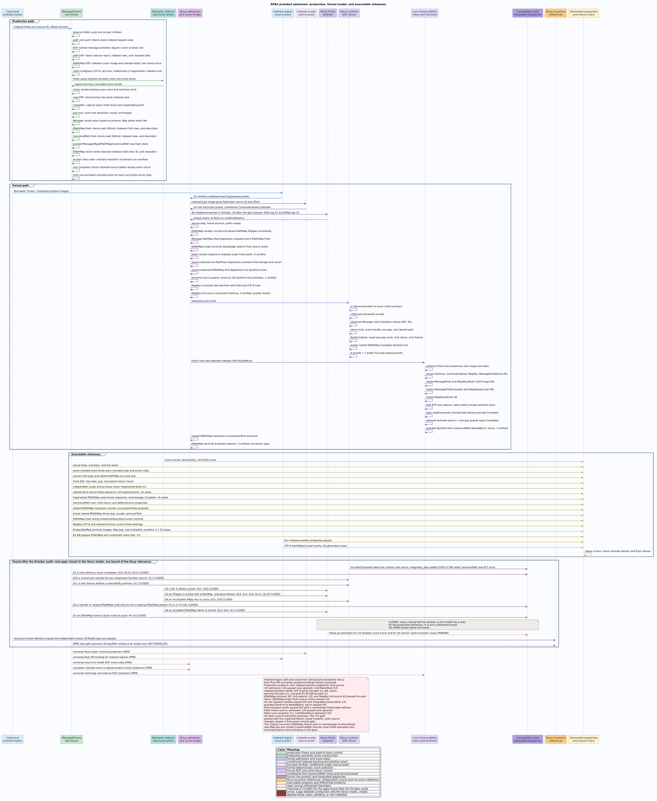

# RPB3 admission source traceability

Date: 2026-10-16.

Updated: 2026-11-12. The update adds the labels on citations of deleted logs (see "Citation labels" below), a legend under each of the three text diagrams, the section [Modelling bound and gaps found after the October audit](#modelling-bound-and-gaps-found-after-the-october-audit) with the last group of the figure, and the notes that begin "Superseded in part". Apart from these and from the citation forms that "Citation labels" describes, the text is that of 2026-10-16 and describes the source revisions it names.

Status: partial refinement. The r13 frozen-source integrated gate and r20 production suites passed on their recorded source revisions; the final exact-commit gate and universal production-to-formal transition simulation remain open. The former unchanged-gate Plain-edge rule was contradicted by ordinary parser transitions. A general parser model, historical checkpoint projection, and a common CanonicalPath driver companion now pass focused proofs, as described below; their remaining Rust-to-formal source premises still prevent an independent completion verdict.

Citation labels: this document cites logs of verification runs by path or by file name. The logs were written into the build directory `target/verification/` or into the system temporary directory. Neither place is committed, and on 2026-11-12 none of the cited logs was found there. A citation followed by **(deleted, hash retained)** names a deleted log whose SHA-256 digest this document records, beside that citation or beside another citation of the same log. A citation followed by **(deleted, no hash recorded)** names a deleted log or generated file for which this document records no digest; a name with `*`, a brace list or a bare suffix stands for a family of logs and carries this label. A recorded digest identifies the log that was read in October; it cannot be compared with a file now. Logs that were in the system temporary directory are cited by file name alone: they are the names that begin with `rpb3-` and have no directory. A directory under `target/` carries no label, and the paths under `target/` in the two command blocks are outputs of the commands shown.

The production owned-segment exporter now retains a checked `FrozenOneLeafView` created from its actual paired page slices. Verified subviews and adjacent joins preserve the page interval; a bound read returns the exact byte and physical origin at each in-bounds offset. The full no-cheating verified-store check passed 76/0 (`rpb3-frozen-step-verus-20261015-r1.log` (deleted, hash retained), SHA-256 `f2ff6517b0e856f50dd3cfb58b15239419526b3cb3ff3a33af010833c81356dc`). The generated production property passed 1/1 after the migration (`rpb3-frozen-full-one-read-integration-property-20261015.log` (deleted, hash retained), SHA-256 `29a77a1851d550b2df892ab734464bf9fbd7d9423f2990473628879fbc7f31fe`). The production One cursor, contiguous, exact-copy, and content-equality routes now use verified paired reads and selected slices. The `Arc` identity and immutability relation remains outside this proof. The migrated source-tree suite passed 29/29 (`rpb3-frozen-full-one-read-source-tree-suite-20261015.log` (deleted, hash retained), SHA-256 `1fecfd6eac0f0496a03166bb3cefee65ece7f8e2b497b92d8f157f132a2c8751`), the RPB3 formal manifest passed 4/4 (`rpb3-frozen-full-one-read-formal-manifest-20261015.log` (deleted, hash retained), SHA-256 `6cf9f6f32a917913f023817182b9a91230f4294ce474c4b9ce9a1dfbe1428824`), and the admission-filtered library suite passed 318 with one ignored (`rpb3-frozen-full-one-read-admission-lib-suite-20261015.log` (deleted, hash retained), SHA-256 `d17c57b80a54c0443eb721d7d78df6f002c1614929e7c36e8035a220445b91af`).

Backing identity is modeled by an opaque lineage token, separate from the byte and physical-origin image. A [128-case generated source-tree property](../../../models/tests/support/canonical_source_tree.rs) checks clone, checked subview, adjacent coalescing, and concatenation against operation lineage and selected range. It also checks that equal bytes and origins from independent roots do not make `same_view` true, and that separate source-tree exports of one cloned Frozen value have distinct roots. The focused property passed 1/1 (`rpb3-source-view-lineage-property-20261015.log` (deleted, hash retained), SHA-256 `f5db6f62948437148be39b9f7712673cb7ee5828e1929dd182b3615c6ce03fff`), and the complete source-tree suite passed 30/30 (`rpb3-lineage-source-tree-suite-20261015.log` (deleted, hash retained), SHA-256 `002d243a0061088a0427b54dcc4f1507805b03d57f46585d11bb2d93d82e9c6b`). The [Verus live-view image](../../../formal/verus/rpb3_wire_cursor_source_refinement.rs) proves modeled clone, subview, same-root adjacent coalescing, total lookup, explicit terminal position, and projection to the postorder byte/origin region; its first bounded no-cheating gate passed 197/0 (`rpb3-wire-source-live-lineage-verus-r4-20261015.log` (deleted, hash retained), SHA-256 `f02506a97bbe3957b0ee313bbd46fb50b1d409b9c0490660e9be22d23c3dc6e7`). A conditional theorem for the Borrowed original-leaf branch proves the selected joined bytes and origins, right terminal anchor, a fresh root lineage for a nonempty result, and left clone lineage for an empty result. The bounded full-module gate passed 198/0 (`rpb3-wire-source-original-leaf-verus-r6-20261015.log` (deleted, hash retained), SHA-256 `153777b004b729a87a281ebc5683e19240491b7ec6da70dcfc319dc909ff4cd0`). A corresponding conditional theorem for Frozen original-leaf joins uses the canonical one-page image and the verified Frozen subview and coalescing lookup facts. It proves joined byte and origin lookup, shared data-owner identity, right terminal anchor, left clone lineage for an empty result, and fresh root lineage for a nonempty result. The bounded full-module gate passed 199/0 (`rpb3-wire-source-frozen-original-verus-r1-20261015.log` (deleted, hash retained), SHA-256 `7988f5d0a832cb57a53370f4909d4453861589484665124cb5f3d771fcc84767`). The universal mapping from actual `Arc` allocations and Frozen data owners to these tokens, production branch selection before original-leaf coalescing, and admission transitions still require independent source audit.

An indexed Composed region retains two identity layers: the source-tree root and its selected range, then the outer indexed range and terminal anchor. The [two-level Verus image](../../../formal/verus/rpb3_wire_cursor_source_refinement.rs) proves clone, subview, explicit-end subview, pointwise lookup, position, and runtime-region projection while comparing both layers for `same_view`; its bounded no-cheating gate passed 203/0 (`rpb3-wire-source-indexed-two-layer-verus-r2-20261015.log` (deleted, hash retained), SHA-256 `61e551c1607f9b8f8933ce30e4ed1e5fd3913207cfa5460c46f5582073c26ef2`). The 128-case [generated Composed property](../../../models/tests/support/canonical_source_tree.rs) confirms that a direct proper subview and its normalized explicit-end form can have equal located bytes and the same selected source-tree window while differing as indexed views. A full-range normalization with the original end remains the same indexed view; changing the end changes identity without changing bytes. The focused test passed 1/1 (`rpb3-indexed-two-layer-composed-property-uncapped-20261015.log` (deleted, hash retained), SHA-256 `891a62c64df00b5b1617e50560d510027113746831d889e7353e2f554f4dbc30`). Relating the model's root token to each actual live `Arc` allocation remains part of the production source audit.

For a retained borrowed leaf, let $`B`$ be its original input slice, $`s`$ its checked start, $`n`$ its length, $`q`$ its source identifier, and $`a`$ its absolute origin. For every $`0 \leq i < n`$, its verified lookup returns the byte $`B[s+i]`$ paired with physical location $`(q,a+s+i)`$. A selected interval $`[u,v)`$ returns exactly $`B[s+u..s+v]`$ and physical start $`a+s+u`$; a subleaf retains $`B`$ as the original full slice. The constructor proves these indices and origins fit their types. If an empty interval would start one past `usize::MAX`, both selection operations refuse it. These are the borrowed-leaf facts used by the production source-tree cursor and its split path; the 128-case generated property also checks the retained leaf, original-slice identity, selected intervals, and offset boundaries. The full source-tree regression passed 29/29 (`rpb3-verified-borrowed-subleaf-tree-suite-20261016.log` (deleted, hash retained), SHA-256 `ac4d12844092f3096d7f2c78f3ec76366449163378b5cba275e8ad2170466e4b`). The 64/0 no-cheating Verus run is `rpb3-source-borrowed-subleaf-verus-20261015-r3.log` (deleted, hash retained) (SHA-256 `39341e57fbdeea6b55ce9a20b6a262f64c9317a6089e66e6f0823f1bd171ef8a`). This establishes a production-retained borrowed leaf, while the universal relation for all reachable `Arc` and Frozen trees remains to be proved.

The current source narrows two of those premises. The [verified score store](../../../formal/verified_score_store/src/lib.rs) now supplies checked one-leaf byte/provenance lookup and Branch2/Branch3 length and child-route operations, and production-used node shapes with checked branch descent, with 90 Verus obligations verified on the current source. Production borrowed leaves now retain a verified checked slice-and-origin value; its byte and provenance lookup uses one verified common-slot accessor with total in-bounds access; verified selected-slice and subleaf operations preserve the original full-slice reference and exact physical starts, rejecting unrepresentable empty-end anchors. Production [frozen page lookup](../../../models/src/rust/rholang/canonical_bytes_arena.rs) and [source-tree branch construction and lookup](../../../models/src/rust/rholang/canonical_source_tree.rs) call those functions on retained pages and actual `Arc` child lengths. Generated properties pass for one-leaf page boundaries, nested subviews, and adjacent same-backing coalescing that preserves every byte and physical origin (`rpb3-frozen-one-leaf-coalesce-property-r2-20261016.log` (deleted, hash retained), SHA-256 `46312f2b3c0f62bf158c54f2cea279929de61a351ae9be8b13c03859438cac56`), and for shared mixed Borrowed/Frozen DAGs with natural and explicit end anchors. The retained-leaf and shape implementation passes 29/29 source-tree tests (`rpb3-verified-borrowed-subleaf-tree-suite-20261016.log` (deleted, hash retained)) and a 128-case generated branch-boundary, offset, mismatch, and overflow property (`rpb3-source-shape-property-r2-20261016.log` (deleted, no hash recorded)). The [wire source model](../../../formal/verus/rpb3_wire_cursor_source_refinement.rs) verifies 75 obligations, including owned-segment constructor and subview images. Its postorder append theorems prove that adding a Branch2 or Branch3 preserves old node lookups and selects the exact child byte and physical origin for every in-range offset, assuming the existing child IDs and one-leaf Frozen image class. Its Frozen view lemmas preserve exact bytes and origins through subviews and adjacent same-backing coalescing. The multi-leaf Frozen exporter is test-only; the non-test Frozen creation path exports one leaf, and later views retain that backing. Rust `Arc::clone` aliasing, `Arc::new` fresh identity, `Arc::ptr_eq` backing equality, and Frozen leaf-constructor extraction remain cross-crate obligations; these proofs do not yet establish the universal reachable-DAG relation.

The production `MessageFrame` now owns `VerifiedMessageSlots` rather than independent mutable last-slot and seen-bit fields. Its `admit` operation checks range, slot order, and non-repeated duplicates, proves that refusal leaves the slot image unchanged, and makes the selected seen bit and last slot the sole successful mutation of that image. `prepare_message_field` calls this operation before completing a field step; readers of the state use verified getters. The no-cheating Verus gate passed 84/0 (`rpb3-verified-message-slots-verus-r2-20261016.log` (deleted, hash retained), SHA-256 `21dae4993115c6ac266cbd61f004b6cd56c33e32f5ad563112ef3ea1f3c05245`), and 22 focused admission properties passed. This establishes the slot-state slice only: cursor parsing, semantic occurrence append or child suspension, and score effects still need a coupled production-to-model transition theorem. The full same-source admission gate remains pending its terminal result.

The independent Rocq [Cost verdict bridge](../../../formal/rocq/stack_safe_pda/theories/RPB3IndependentOracleCostVerdictBridge.v) closes 59 reports for selected Cost roots, and the [generated resolver bridge](../../../formal/rocq/stack_safe_pda/theories/RPB3IndependentOracleGeneratedResolverVerdict.v) closes ten reports for Message resolver failure and actual source parsing. Both pass `coqchk`. Full public-reference equivalence still needs the actual recursive child-family and score induction. The tenth-family [CostTokenStack differential](../../../models/tests/support/cost_token_stack_rpb3_admission_differential.rs) now checks malformed fields in every position of generated multilayer stacks; its focused RPB3 and standalone suites pass 4/4 and 5/5. These are working-tree results, pending the exact linked completion commit and full gates.

The new [Expr nested-ground scalar bridge](../../../formal/rocq/stack_safe_pda/theories/RPB3IndependentOracleExprNestedGroundScalarBridge.v) relates the actual generated type-25 and type-26 child fields to independent byte and unsigned-integer values, including absent fields. The [parent-score bridge](../../../formal/rocq/stack_safe_pda/theories/RPB3IndependentOracleExprNestedGroundScoreBridge.v) classifies Expr tags 36 and 37 as those child types and derives the corresponding constructor-16 bytes-pair and constructor-17 bytes-plus-one-element-integer-node scores from the actual evaluated source child. `coqc` closes 18 and 10 reports, respectively (`rpb3-expr-ground-scalar-coqc.log` (deleted, hash retained), SHA-256 `53a84fa91c301f9a3d5554ff0d8744a3dff1b23e389b1ca8e22d1559ac84e315`; `rpb3-expr-ground-score-coqc.log` (deleted, hash retained), SHA-256 `f990327820c7e0de2c2185fa0c21ec662d961c689506a2b21b1afe9a2f285d04`). Their combined independent `coqchk` reached imported constants without a type error but hit its 240-second bound; they remain unregistered until that check passes. These theorems project source scores against `project_source_summary`; the target recursive child reduction and universal public verdict equivalence remain separate obligations.

For a wire-0 `MessageContinue`, the checked field receipt now re-reads the canonical key and value from the retained pre-read indexed body subview and requires exact consumption of the encoded field range. The check reads at most two ten-byte varints and copies no payload. A generated property covers the live varint scalar descriptors and rejects a coordinated mutation of the receipt value and appended semantic scalar that leaves the body, range, and physical anchor unchanged. The [wire cursor source refinement](../../../formal/verus/rpb3_wire_cursor_source_refinement.rs) derives its indexed field and runtime field-step facts from a conditional byte-read relation; it still assumes the surrounding live cursor/backing projection. The focused property suite passed 5/5 (`rpb3-varint-source-property-20261015.log` (deleted, hash retained), SHA-256 `a986fca18fc6547cd284ee3e8b91180372c29568586598e053a0128e4c659573`), the Verus module verified 54 obligations with zero errors (`rpb3-varint-wire-verus-20261015.log` (deleted, hash retained), SHA-256 `37fd82ce73a920364aa9c01b502bdcf1e88904588171aa7ffa090587a842c036`), the focused admission suite passed 73/73, and the unchanged 64 KiB small-stack regression passed 1/1. The universal Rust-to-Verus driver projection remains open.

The pre-read Message cursor now supplies an O(1) borrowed source image before next_field: the message and reader views match, reader offset equals yielded bytes and the pre-step byte count, Message field ordering is disabled, and the terminal-error state is empty. The independent pre-step ticket and scalar image compare this image with the later field receipt. A generated mutation changes only the captured reader offset and is rejected by the checked Continue event. The formal runtime cursor constructor derives a well-formed cursor and projection from these observations when the indexed backing already has an exact ghost byte-and-anchor image; that backing interpretation remains an explicit premise. The focused scalar-image property passed 3/3, admission 73/73, and the 64 KiB small-stack regression 1/1. Standalone and integrated Verus checks passed 55 obligations with zero errors; the integrated log is `target/verification/rpb3-admission-cursor/message-pre-read-integrated-wire-verus-r2.log` (deleted, hash retained) (SHA-256 f649a7d0ecd6a030924fae7193cf29e34209f33ba5ae3b7a1dc6b1feea13cb24).

The 2026-10-15 [Process child-provenance bridge](../../../formal/rocq/stack_safe_pda/theories/RPB3IndependentOracleProcessChildProvenance.v) connects successful independent message and scalar nodes to typed source values and projects selected, optional, and repeated child scores through target selectors. A successful independent message evaluation also yields an ordered, generated-descriptor-aligned child list; a successful generated message child yields its raw tag, wire, payload, child type, and typed score projection. Under an explicit pointwise source-target child-verdict premise, an accepted source message projects its actual evaluated children to the recursive target list, while a refused evaluated child forces that target list to be absent. The bridge proves generated PBInt32 and Connective Bool scalar rule certificates, decoder refusal equivalence, and scalar summary projection. It now discharges the actual source-target child-verdict premise for generated PBInt32 Process slots and type-55 Connective Bool scalar nodes, including failed raw conversion, malformed bodies, and rejected scalar values. Nested message and auxiliary child verdicts and Par semantic-default equality remain separate obligations. Its twenty closed-assumption reports and kernel check pass. The [Process signed-scalar bridge](../../../formal/rocq/stack_safe_pda/theories/RPB3IndependentOracleProcessScalarDecoderBridge.v) proves bidirectional agreement between the independent EPM1 varint decoder and the wire decoder for full u64 values, then proves PBInt32 success and refusal equivalence for the four generated Process slots. It also derives signed-range facts and checks finite positive, negative-target, and refusal representatives. Its sixteen closed-assumption reports and kernel check pass. The negative source range is proved symbolically: expanding a ten-byte negative varint through the source decoder's unary `nat` would materialize a number near the 64-bit maximum. The [Cost numeric scalar bridge](../../../formal/rocq/stack_safe_pda/theories/RPB3IndependentOracleCostScalarDecoderBridge.v) proves success and refusal equivalence for generated CostBoundSignature `PBSint32` and CostRegion `PBUint32` and `PBUint64` fields, then derives their typed admission and projection-binding facts; its thirteen closed-assumption reports and kernel check pass. The [Cost child correspondence](../../../formal/rocq/stack_safe_pda/theories/RPB3IndependentOracleCostChildCorrespondence.v) derives each accepted generated Cost child projection from the actual source_cost_forest and source_cost_message result; its fifteen closed-assumption reports and kernel check pass. Rejected-tree correspondence remains separate. These lemmas establish source provenance and decoder facts; they do not yet discharge every recursive child premise or the universal independent admission equivalence.

The 2026-10-14 independent-source work adds a separate Rocq evaluator over raw source trees. Its [core](../../../formal/rocq/stack_safe_pda/theories/RPB3IndependentOracleCore.v), [descriptor admission](../../../formal/rocq/stack_safe_pda/theories/RPB3IndependentOracleAdmission.v), [cost](../../../formal/rocq/stack_safe_pda/theories/RPB3IndependentOracleCost.v), [process](../../../formal/rocq/stack_safe_pda/theories/RPB3IndependentOracleProcess.v), [name and PathMap](../../../formal/rocq/stack_safe_pda/theories/RPB3IndependentOracleName.v), [recursive evaluator](../../../formal/rocq/stack_safe_pda/theories/RPB3IndependentOracleRecursive.v), and [fuel](../../../formal/rocq/stack_safe_pda/theories/RPB3IndependentOracleFuel.v) modules compile with closed assumption reports. The [fuel adequacy proof](../../../formal/rocq/stack_safe_pda/theories/RPB3IndependentOracleAdequacy.v) compiles with four closed assumption reports: using one more fuel unit does not change a source evaluation once the raw body length is below the fuel, including nested StringMap and PathMap Par bodies. The [cost projection](../../../formal/rocq/stack_safe_pda/theories/RPB3IndependentOracleProjection.v), [process projection](../../../formal/rocq/stack_safe_pda/theories/RPB3IndependentOracleProcessProjection.v), and [name/auxiliary projection](../../../formal/rocq/stack_safe_pda/theories/RPB3IndependentOracleNameProjection.v) relate independently selected scores, completeness, and refusal to target summaries under stated child, decoder, or auxiliary construction premises; all three compile and pass `coqchk`. The name projection includes successful type-55 Connective and type-60 Unforgeable scoring under explicit primitive child/decoder correspondences. These premises are substantive: the current proofs do not yet derive correspondence for every recursively produced child. A source child can also retain a refused summary where the target recursive evaluator returns no child, so the remaining bridge must account for both refusal and successful projection rather than equating raw child lists. Therefore this new source lane does not yet prove universal independent full-summary or admission-verdict equivalence.

The same working source also splits noncompletion admission into precheck, frame push, and postcheck functions in [the Rust driver](../../../models/src/rust/rholang/protobuf_admission.rs). Each phase uses one heap-allocated `AdmissionScratch` for large observations, so a pushed frame no longer overlaps the parser and source-check temporary frames on the native call stack. The exact [opaque EPM1 small-stack test](../../../models/tests/support/standalone_path_admission.rs) passes on an unchanged 64 KiB thread stack; the focused admission and standalone-path suites pass 73/73 and 38 passed with one ignored, respectively. A full `models` library test run was started but stopped during a separate long-running decoder-oracle test, so the focused results are the current validation boundary. The dispatch change retains the original ordered source checks; the pending exact-source formal gate and universal driver simulation must still be rerun against it.

The [independent-source mutant proofs](../../../formal/rocq/stack_safe_pda/theories/RPB3IndependentOracleMutants.v) distinguish a Bundle body-score omission, an ignored explicit-default Receive condition, and ignored New URI order with finite source witnesses; all three compile with closed assumption reports and pass `coqchk`. The extracted [New URI boundary property](../../../models/tests/rpb3_new_uri_order_boundary.rs) independently encodes wire bodies and score keys, then checks production byte-native admission over generated equal, ascending, descending, and incomplete URI pairs. Its focused offline run passed 1/1. Equality matters because the admission rule rejects a descending pair but permits equal adjacent URIs; earlier generated tests covered only distinct ordered pairs.

The [recursive child bridge](../../../formal/rocq/stack_safe_pda/theories/RPB3IndependentOracleRecursiveProjection.v) now compiles with 38 closed assumption reports and passes `coqchk`. It proves the three-case source/target child-list relation, derives ordered descriptor, body, and scalar evidence from the independent evaluator's actual Par output, and proves that an independently accepted Par root and a separately accepted target root agree on the semantic-default Boolean. The latter statement does not prove that both roots accept the same inputs or have equal scores and refusal decisions. The [generated Connective Boolean decoder bridge](../../../formal/rocq/stack_safe_pda/theories/RPB3IndependentOracleNameDecoderBridge.v) compiles with six closed reports and passes `coqchk`; it derives canonical one-byte Boolean bodies and target decoder agreement from successful independent type-55 scalar admission. Universal score/refusal correspondence still requires the actual recursive children to satisfy the cost, process, and name projection premises, including signed scalar and nested default evidence.

The 2026-10-12 current-source check strengthens the EPathMap completion boundary without changing that status. The [integrated trace composition module](../../../formal/verus/rpb3_integrated_source_trace_composition.rs) verifies 21 obligations with `--no-cheating` in `target/verification/rpb3-admission-cursor/integrated-source-trace-composition-module-20261012-r6.log` (deleted, no hash recorded). Its empty-topology witness derives two scalar internal transitions, `Value(false)` followed by `Leave`, from the modeled indexed cursor and retains the final state *before* End; the same finite invocation then selects one Complete and one parent acceptance. The [terminal-source properties](../../../models/src/rust/rholang/rpb3_epathmap_terminal_source_properties.rs) now extract the same two events from the production indexed cursor at their exact fragmented physical anchor, retain the final pre-End image from the actual EPathMap step, and check its single accepted Message-parent completion. The [Message completion properties](../../../models/src/rust/rholang/rpb3_message_complete_checked_event_properties.rs) mutate the borrowed pre-pop source, returned summary, effect, and stats. The focused admission properties passed 74/74 on this working source; the broader admission suite passed 70/70 (including the nine-family fixture and 20,000-depth small-stack check), and the CostTokenStack differential passed 3/3 before the final property-only edit. The earlier logs are `rust-properties-20261012-r4.log` (deleted, no hash recorded), `rust-admission-suite-20261012-r1.log` (deleted, no hash recorded), and `cost-token-differential-20261012-r1.log` (deleted, no hash recorded) in that verification directory. The 74/74 focused result is from the subsequent final-source Cargo invocation.

The broader no-cheating gate `full-gate-20261012-r2.log` (deleted, no hash recorded) stopped at `product_epm_child_return_preserves_exact`: its indexed-child helper exposed a quantified frame relation in a different normal form from `product_score_wf_intro`. The helper now exports the exact required relation, and the caller presents it immediately before the introduction step. Their bounded no-cheating checks passed 1/1 each in `integrated-product_epm_child_return_preserves_indexed-r2.log` (deleted, no hash recorded) and `integrated-product_epm_child_return_preserves_exact-r4.log` (deleted, no hash recorded); the next EPathMap Complete and FinishAccept obligations also passed 1/1 each in their `-r1.log` (deleted, no hash recorded) files. These focused repairs have not been followed by a full gate rerun, and the independent production-to-formal simulation remains open.

The modeled trace theorem still begins with caller-supplied adjacent `live_runtime_product_step` states. Its local EPathMap witness proves model reachability, not that every successful Rust driver iteration projects into such a state pair. An independent source audit identified the remaining production boundary: generated descriptor and indexed-reader extraction; complete score and semantic-body selection for all successful families, including CostTokenStack; a CanonicalPath sidecar in the shared dispatcher; ACT Forward and Unwind expansion into the actual scalar loop; and one event macro per successful driver iteration. Closing that boundary requires the executable event construction and driver loop to be covered by the same verified source, with no caller-chosen ghost successor. Passing finite properties or hashing Rust source cannot substitute for that universal simulation.

The current source adds three focused integration slices. The CanonicalPath driver/product module selects Push, child return, and root Complete against one retained product state; its strengthened no-cheating module passed 9/9 in `target/verification/rpb3-admission-cursor/canonical-path-driver-product-integration-r4.log` (deleted, no hash recorded). The generated RawPar property passed in `generated-raw-par-driver-r3.log` (deleted, no hash recorded), including whole-stack adjacency, indexed parser source, and stamp preservation through child resolution. The Send field/accept/EOF module constructively selects live product successors and passed 11/11 in `message-driver-source-integration-r3.log` (deleted, no hash recorded); its strengthened complete/incomplete property passed in `generated-send-driver-r2.log` (deleted, no hash recorded). The nested EPathMap property independently replayed scalar parser source and passed in `generated-nested-epm-parser-source-r2.log` (deleted, no hash recorded). Production ACT validation now checks and retains the total topology-event count; its count/overflow tests passed 2/2 (`act-validated-event-count-r2.log` (deleted, no hash recorded)) and its generated scalar-event comparison passed 1/1 (`act-generated-validated-event-count-r1.log` (deleted, no hash recorded)). The formal ACT count-conservation module passed 43/43 no-cheating obligations (`epm-source-count-conservation-r9.log` (deleted, no hash recorded)), including equality between the retained checked count and the ghost event expansion from the accepted record structure. The ACT Forward and Map Value product module passed 12/12 (`act-source-product-integration-r10.log` (deleted, no hash recorded)). These focused results do not yet derive every Rust driver event, bind every accepted Rust plan to its ghost image, or compose all intervening child work. No final exact-source gate or criterion-5935 audit verdict follows from them.

The current Rust driver now emits one borrowed `CheckedAdmissionEvent` after each successful iteration. Its action distinguishes Message field Continue or Push, Message Complete, and the corresponding nonmessage Continue, Push, and Complete for Map, EPathMap, and CanonicalPath frames. The event carries the checked pre-step source, post-step frame slice, score arena, and typed field or completion receipt; a completion also identifies root return or acceptance by a suspended Message parent. The event is consumed within that iteration, so production does not retain an input-sized transition log. Under tests, the recorder consumes this **same** event and checks one-to-one order against driver steps. The generated corpus passed 3/3 (`target/verification/rpb3-admission-cursor/generic-message-success-stream-r9.log` (deleted, hash retained), SHA-256 `dd241da20e4cad161a5af6879f417d54ddc3777dbb9b51f909e504740463ad21`): 64 Message types and 217 type/tag pairs, plus an explicit New map key that exercises nonmessage Continue, a nested CanonicalPath-to-EPathMap fixture that exercises nonmessage Push, and CanonicalPath root Complete. These finite witnesses check that emitted action, stack delta, top frame, score delta, child kind, and root/parent acceptance agree. A formal mapping from **every** emitted Rust event to one global Verus action and adjacent product states remains open, particularly where CanonicalPath's separate driver product must compose with the Message/Map/EPathMap product.

On the 2026-10-08 working source, a Map iteration carries one `MapStepSource`: `Field` for key Continue or value Push, and `Eof` for Complete. A field receipt retains the decoded indexed field, physical key and payload positions, cursor before and after the read, and selected value child view. The checked event compares the receipt's pre-cursor with the live driver prestate and checks the retained Map frame or pushed Message child. At EOF, the receipt retains the owner descriptor, entry body view and physical start, cursor, key/value presence and positions, and a shallow-view image of the finished Map summary, including complete Par value identity. `map_step_with_source` checks that image against the finished summary before the Map frame is popped. `DriverStepSource::before` snapshots the Map prestate only when the cursor is empty, no value is pending, and no cursor error is cached. The checked event compares every EOF receipt field with that snapshot, then checks the one-frame pop and unchanged score count. It compares the image with either a root Map return or the suspended Message parent's checked accepted-child receipt, whose own check binds the returned Map summary to the new parent occurrence. Seven generated properties in `rpb3_map_checked_event_properties.rs` exercise key Continue, value Push, root EOF Complete, accepted-child EOF Complete, fragmented frozen-source value anchors, cached cursor errors, and strict cross-entry key order over bounded keys and physical anchors; changed pre-cursor, payload, returned-summary, owner/field, pending-value, and cached-cursor-error observations are rejected. The focused release Cargo run passed 7/7 (`target/verification/rpb3-admission-cursor/map-checked-event-r8.log` (deleted, hash retained), SHA-256 `9d3fc8fcd29cf3fdb8664c40fcdc816aea076a1be60d2b8dda1fb91a011f14a9`). These are local executable source checks; they do not establish the universal Rust-to-Verus transition mapping or complete criterion 5935.

The remaining Map extraction premise is a total source-to-model relation. The EOF receipt now preserves the pre-pop data needed to project a Map finish, including the returned summary image, but no proof derives a well-formed Verus `MapFrameModel` from every reachable Rust `MapFrame`, indexed cursor, byte-provenance view, and score arena. The existing formal Map-key bridge still takes `map_key_source_ready` as a premise rather than deriving it from every successful Rust cursor read. The next bridge must prove that each live field read, selected child, accepted value, and EOF receipt maps to the adjacent modeled action and parent return. A Verus selector conditioned on those premises alone remains a partial refinement, not the required universal production correspondence.

Indexed byte views distinguish equal content from equal backing identity. The generated property `equal_borrowed_images_from_distinct_backings_are_not_the_same_view` varies nonempty bytes and physical anchors, checks that independent borrowed allocations have equal content but fail `same_view`, and checks that a clone preserves the view; its focused release run passed 1/1 (`target/verification/rpb3-admission-cursor/indexed-backing-identity-property-r1.log` (deleted, hash retained), SHA-256 `396dc2b046f3a7b115a56117b6818ae33160c6548d62c12cea0216b1aa1c123f`). The Verus indexed-view sidecar proves symbolic same-view image preservation, rejects an equal-image distinct-handle witness, and preserves an indexed Map source-image origin at a surviving frame depth. These targeted proofs do not extract Rust borrowed pointers or frozen/composed root handles into the symbolic identity, nor prove that every Rust Map Push selects the formal indexed action.

The [Map Push receipt source extraction](../../../formal/verus/rpb3_map_push_receipt_source_extraction.rs) first established three focused Verus proofs. `checked_map_push_receipt_projects_body_and_anchors` derives the selected payload subview, child bytes, and physical start and end anchors from a successful generated Message Map Push source-fold step and its checked receipt. `checked_map_push_receipt_reconciles_live_parent` identifies that subview with the live product's indexed child region when the modeled Message parent spans its indexed body from offset zero. `equal_map_push_images_do_not_prove_same_view` constructs a one-byte selected and retained view with identical bytes and anchors but different symbolic backing identities. Each earlier targeted, headless `--no-cheating` run reported `1 verified, 0 errors`: `target/verification/rpb3-admission-cursor/map-push-receipt-body-anchors-r1.log` (deleted, hash retained), `map-push-receipt-live-parent-r1.log` (deleted, hash retained), and `map-push-receipt-identity-counterexample-r1.log` (deleted, hash retained) (each log SHA-256 `9ab4642ddd4fad86b262b064e4cac252dfa2bd3af4fb3aa88f1b0aa8e779a8f4`; earlier proof source SHA-256 `f3b574e7d46a7ff6ff0e38f7b626ec3de7219727f96cfc05623f8af584179856`). The fourth proof, `checked_map_push_view_and_fresh_child_select_indexed_action`, selects the modeled `PushIndexed` action when a live parent, matching selected/requested/retained symbolic views, and the full fresh-child equality are supplied. Its current-source targeted `--no-cheating` run passed `1 verified, 0 errors` (`map-push-receipt-selection-r1.log` (deleted, hash retained), SHA-256 `ce6bc1719fa5793db199bb6466a1c4df1aad1e0b263ca086b4a12391f8df47d2`; proof source SHA-256 `cc71745e535d13c52e90d20a089c7052390372a71f1da33a5df0e64ba1f55f89`). The live-parent theorem's zero-start and full-body bounds remain explicit modeled premises.

Production [Map Push admission](../../../models/src/rust/rholang/protobuf_admission.rs) now retains a shallow clone of the selected Map `FrameRequest` in `MessageFieldSourceReceipt`. The checked event requires the selected payload to satisfy `IndexedByteRegion::same_view` with that request, requires the request to match the complete pushed Map frame through `FrameRequest::matches_pushed_frame`, and separately requires the payload to share the retained child's exact view. This joins backing identity and fresh-child state checks in one borrowed production event without copying payload bytes. The dedicated [generated property](../../../models/src/rust/rholang/rpb3_map_push_receipt_source_properties.rs) exercises real Message-to-Map checked Push across Borrowed, test-only Contiguous and Arena, Frozen, and Composed backings. Each of its two properties runs 32 generated cases: one checks the full fresh Map child and a distinct borrowed-handle forgery; the other checks all five backing variants, equal bytes and per-byte physical anchors from distinct handles, changed range and terminal-anchor controls, and rejection of the forged saved request by the full checked event. The focused, capped Cargo run passed exactly 2/2 (`map-push-backing-cargo-r2.log` (deleted, hash retained), SHA-256 `729a7943335a63270e1fd4b80237e9200c36fd8c5d4f08984e40ffcc6df4eb3d`; property source SHA-256 `8d6e2d82f7ffabac5c5aa2dab149998dd59dd5859e8fb52658d3d32ac1b4ecaa`; production source SHA-256 `e858a39f1888e8d32cdae04fa2126b9bdc23aef1a4b31244059ad11f996d0754`).

The [exact backing-identity model](../../../formal/verus/rpb3_map_push_backing_identity.rs) mirrors the five `same_view` comparisons without identifying views solely by bytes or physical anchors. Borrowed uses the fat slice pointer and length, window range, source/base, and optional terminal source/offset; test-only Contiguous uses the `Bytes` data pointer and length, source/base, and end anchor; test-only Arena uses the arena pointer, canonical root span, window range, and end anchor. Frozen uses the root data `Arc` pointer and root range plus outer window/end; Composed uses the optional root `Arc` pointer and root range plus outer window/end, with `None` representing the canonical empty root. Its exact-key equality proof, checked Map Push symbolic-view projection, distinct borrowed-handle counterexample, changed-end counterexample, and canonical empty-Composed witness each passed a separate headless `--no-cheating` run with `1 verified, 0 errors`. The source SHA-256 is `7acc6bd12af1b7a4c5722b23f0dbab283ff9d8c0f35ed301562a03b369145e3d`; the five corresponding logs and SHA-256 digests are `map-push-backing-key-equality-r1.log` (deleted, hash retained) (`e16e064a0226160a9c870896fc32f5b91e19e72a90e69ff5e09d5f2e23f23bad`), `map-push-backing-symbolic-projection-r1.log` (deleted, hash retained) (`b1a745613bc1bb88228654517c9e87015f64d06621297171b9969c4eeb5b567e`), `map-push-backing-borrowed-forgery-r1.log` (deleted, hash retained) (`389190e21f7e528982e75462a9accb6a53620cead1140039522f8a534fb6e9f4`), `map-push-backing-changed-end-r1.log` (deleted, hash retained) (`f187c6d1005b82b825336178dae06a6bc7e7d6b77c5c02fa80275125b8d01879`), and `map-push-backing-empty-composed-r1.log` (deleted, hash retained) (`0f41122f4b2b222b7d8c8f98ea3f7a3a8064544366b209de130ea842da999fde`).

The checked Map Push now also captures **scoped identity classes** for its selected, requested, and retained regions. It assigns classes 0, 1, or 2 from the actual pairwise `IndexedByteRegion::same_view` decisions and accepts the checked Push only when all three are in one class; this observes three existing views without copying payload bytes or constructing a global backing-key registry. The two generated properties passed exactly 2/2 in the focused, capped Cargo run (`target/verification/rpb3-admission-cursor/map-push-scoped-classes-cargo-r2.log` (deleted, hash retained), SHA-256 `9bc887545690074ff910d79866b2dfcc6b02a00dd751e89cfe9dbc285eaf34ab`). They cover the complete checked fresh Map child, all five backing variants, the five possible equality partitions of three views, equal bytes and anchors on distinct handles, changed range/end, and a forged saved request. The checked production source SHA-256 is `225d79a2ae88277aae911ccb78cf79b1a3f87f8b3d0a7c1fff4e8b4da3fff636`; the property source SHA-256 is `6bce0ba94ea820c86e045b0412392c496ea5a4f0b6caa84ebb67e8753a295169`.

The [scoped identity-class model](../../../formal/verus/rpb3_map_push_scoped_identity_classes.rs) proves that class equality is equivalent to exact modeled `same_view` for each pair in this triple, selects matching `SourceSelectedFrameView.identity` values, composes the checked Map Push with the formal `PushIndexed` action, and rejects an equal-image distinct-backing witness. Each of its four targeted, headless `--no-cheating` proofs passed `1 verified, 0 errors` in `map-push-scoped-key-injective-r1.log` (deleted, hash retained), `map-push-scoped-symbolic-views-r1.log` (deleted, hash retained), `map-push-scoped-indexed-action-r1.log` (deleted, hash retained), and `map-push-scoped-distinct-backing-r1.log` (deleted, hash retained) under `target/verification/rpb3-admission-cursor/`; each log has SHA-256 `48d10dc23da0772274e5fdb44996e0f0493818bd9d3bf48197214cb4ce40f613`, and the formal source SHA-256 is `80d0e85dc3100a2424aac9683bc9a95e0f0a5319d7c6b335216b2633560ebf8b`. This is an injective mapping only within one observed three-view event. That exact-key formulation still takes the correspondence of Rust class observations to `ExactIndexedBackingKey`, the selected indexed image and receipt, the live parent's zero-start/full-body bounds, and full modeled fresh-child equality as premises. It does not establish the universal Rust-to-Verus `PushIndexed` transition.

The subsequent [finite checked-view observer](../../../models/src/rust/rholang/protobuf_admission.rs) borrows those same three live indexed regions, records the classes from their actual `same_view` decisions, and can lazily extract each region's located bytes and terminal physical anchor. The checked production fast path evaluates the classes without allocating an image. The [generated property](../../../models/src/rust/rholang/rpb3_map_push_receipt_source_properties.rs) compares each extracted byte and physical position with independent indexed APIs, checks equal images for an accepted Push across all five backing variants, and checks that an equal-image distinct-backing request has different classes and fails the checked event. Its focused, capped Cargo filter passed exactly 2/2 (`target/verification/rpb3-admission-cursor/map-push-finite-observation-cargo-r1.log` (deleted, hash retained), SHA-256 `797628d4f9525e8e7d79b2f5187eaf2e2db8b786e2287a1c67c10dd135a41117`; production source SHA-256 `e870558d8c0928ea0e9e9f90840840ac2bff97194a07c054958f2fefe5a859a3`; property source SHA-256 `6fc3a5c1e54ea9f3d79aa5f3fd3cc18ddc3fe804bbf97bee89c088b4f14f90db`).

The [finite-observation Verus selector](../../../formal/verus/rpb3_map_push_finite_observation.rs) consumes only observed classes and indexed images, so this focused `PushIndexed` selection no longer needs an `ExactIndexedBackingKey` premise. Its symbolic-view, indexed-action, and equal-image different-class control proofs each passed a targeted headless `--no-cheating` run with `1 verified, 0 errors`: `map-push-finite-symbolic-views-r1.log` (deleted, hash retained), `map-push-finite-indexed-action-r1.log` (deleted, hash retained), and `map-push-finite-distinct-class-r1.log` (deleted, hash retained) under `target/verification/rpb3-admission-cursor/` (each log SHA-256 `f5eaa26a97bbea506d29a1e4f1310557246e74b8ff548d34c90bd685f8883ee5`; formal source SHA-256 `6d67a08467bc2e0b0fa15b17c0461c06a50e4d8e9f6788394a2c2f1efe630aeb`). The theorem still requires that the finite Rust images correspond to the selected formal source subview, that the live Message parent spans its indexed body from zero, and that the full modeled fresh Map child matches the checked Rust child. These source-to-model relations have not been proved for every production Push; the full integrated gate has not been rerun on this source revision.

The serial production admission filter passed 156 tests, zero failures, and one existing ignored test on the current Map receipt source (`target/verification/rpb3-admission-cursor/protobuf-admission-current-r4.log` (deleted, hash retained), SHA-256 `b6e1e5b5293a94fa557559e61b575f9ee1c2e29dc47c5f2e69989ed19c7de2f8`). The separate CostTokenStack admission differential passed 5/5 on the same source (`target/verification/rpb3-admission-cursor/cost-token-stack-admission-current-r4.log` (deleted, hash retained), SHA-256 `1e9edcf94107b66a0b22aba64dc6d0d72c65c6a58b4b6018417e0b8e1cbfa06e`). These are source-tree test results; criteria 5934 and 5943 still require evidence at the final linked completion commit.

Scope: the canonical protobuf admission path used for PathMap-backed RPB3 keys in f1r3node. RPB3 is the version-3 authoritative ParBag key grammar: component family, canonical score, canonical protobuf body, and score-length trailer. This document records what the current Rust implementation, Verus model, and executable properties each establish. It does not turn a model-only theorem or a sampled differential into a universal implementation theorem.

EPM1 is the version-one EPathMap snapshot format; its ACTree03 arena stores the compact trie topology and, in Map mode, references an ordered value table ([format background](pathmap-report-2026-08-03.md#52-the-wire-lineage-and-the-epm1-format)). An **indexed byte view** pairs each logical byte with a physical anchor `(source identifier, offset)` and retains a separate physical end anchor, even for an empty view. `same_view` checks backing identity, range, and that end anchor in constant time; equality of a finite generated trace is narrower than a proof that every Rust view satisfies the Verus indexed-image model.



## Verification boundary on this revision

The r13 **full frozen-source** integrated gate completed with exit zero: `target/verification/rpb3-admission-cursor/source-projection-full-gate-r13.log` (deleted, hash retained) has SHA-256 `c131ccfb90a216cf06cfdcf13dabfdba0adc3fe060d921f1a73a445f3ad2b887` and reports that its baseline and five causal mutants passed. This covers the source manifest frozen for r13. Later test-module inclusions and an integrated kind-3 push proof changed that manifest, so the final gate and commit against the resulting exact source remain pending. The focused score-sequence Cargo property passed 1/1 over 32 generated cases (`score-sequence-properties-r2.log` (deleted, hash retained), SHA-256 `3e4b63740e34255962be15dffaccb82bc1002ff3258ae25ec2fbb408569ca1ef`). It compares captured score-entry deltas with prefixes of the final arena image; both come from the arena's `source_image`, so this is an append-only consistency check, not an independent score-construction oracle. The strengthened focused fragmented EPathMap receipt and map-value handoff passed 1/1 over 16 generated cases (`epathmap-receipt-sequence-r6.log` (deleted, hash retained), SHA-256 `5bf586d999450555640febc9a8cd441dee8300edb12e308e5082b2a936f13a6c`). The focused EPathMap obligation-return module passed 3/3, each property over 16 generated cases (`epathmap-obligation-return-r4.log` (deleted, hash retained), SHA-256 `c7455a55e314736d022d42579e18548d1ed8a6f3cbca7a02e84be122cda43e17`). The standalone CanonicalPath source bridge passed no-cheating Verus with `2 verified, 0 errors` (`canonical-path-driver-source-r5.log` (deleted, hash retained), SHA-256 `ce7d9c79101364166af756fa9c613c50128aa5fb6eae5be3130e4566ede48536`). The r12 filtered admission module passed 58/58, including the 20,000-depth small-stack case (`protobuf-admission-lib-r12.log` (deleted, hash retained), SHA-256 `56655f1b4192e60ffc67e4f1555857e24243cb9ef2f5a16acbca1b7d84b85463`); CostTokenStack passed 5/5 (`cost-token-stack-admission-r10.log` (deleted, hash retained), SHA-256 `71bae418f48187c47f96707441bab75f0f334b605bc4cd4381e25dfaea18cc4a`). The r12 gate had stopped at a resource limit in `live_runtime_product_message_child_complete_runtime_exact`; its two private helpers, repaired public proof, and adjacent EOF proof passed focused no-cheating checks before r13. Criterion 5935's universal Rust-to-formal transition binding remains unproved even though r13 passed.

On the current parallel-leaf source, the filtered `protobuf_admission` library suite passed 133 tests with one ignored (`protobuf-admission-lib-source-frozen-r16.log` (deleted, hash retained), SHA-256 `b8a6bac421fc7d09e31b8f97a6d4aaa2bb69ff22dc011cc748415f7f01a53525`); CostTokenStack passed 5/5 (`cost-token-stack-admission-source-frozen-r16.log` (deleted, hash retained), SHA-256 `33cfcc16587749c9a0bd62b8049bc5612969c8aef219145644b02527a1f8e179`). These Cargo results do not extend the r13 frozen-source gate to the current files or discharge criterion 5935.

On the later post-stack-fix source, the filtered admission suite passed 134 tests with one ignored (`protobuf-admission-lib-after-stack-fix-r19.log` (deleted, hash retained), SHA-256 `99d3cee08b3e0161f9783fd3a1ecacdd7d2b319d7598004f2f3d5630c052c206`), CostTokenStack passed 5/5 (`cost-token-stack-after-stack-fix-r19.log` (deleted, hash retained), SHA-256 `49a99b8c6e48930a3d9452069f12157d7ba3a4a091e6309ce37c4fe2feffd655`), and `indexed_protobuf` passed 43/43 (`indexed-protobuf-after-utf8-r19.log` (deleted, hash retained), SHA-256 `33a83ffc0196870433e4f235685fbd1e1df20affa62f4bad3361f8545e5b7bec`). These are production test results, not a rerun of the exact-source formal gate or a universal Rust extraction proof.

On the final-source r20 production snapshot, the filtered admission suite passed 134 tests with one ignored (`protobuf-admission-lib-final-source-r20.log` (deleted, hash retained), SHA-256 `1124e717246543c1ce450414b878756d79369184f37ce59a6ec690f89fe25a0d`), CostTokenStack passed 5/5 (`cost-token-stack-final-source-r20.log` (deleted, hash retained), SHA-256 `da1dd19cc952ae616b7aa9c80c26ec09c074e2b55692c6ee82015deede72b556`), and `indexed_protobuf` passed 44/44 (`indexed-protobuf-final-source-r20.log` (deleted, hash retained), SHA-256 `276174048ece2991c4ca5098b9a264e659256fa24a8df3c9a57de29cfe60143c`). The indexed run includes the new UTF-8 parity property. These production suites do not replace an exact-commit formal gate or establish universal Rust-to-Verus extraction.

The [Message EOF and child-Complete source module](../../../formal/verus/rpb3_source_observation.rs) contains a deterministic modeled poststate and exactness obligations for a matching observation. It was separated from the large integrated root after focused proof timeouts; its current 17-proof child-module gate has not completed. The [root-init and scalar Continue source module](../../../formal/verus/rpb3_scalar_continue_source_refinement.rs) is in the gate's source manifest and standalone proof step; its ten public root proofs report `10 verified, 0 errors` in the r11 `scalar-continue-source.log` (deleted, no hash recorded). Three derive an initial modeled state from a source-shaped root observation, map every generated type ID to a specialized formal family or `Other`, and exhibit empty generated and six-slot Send witnesses; seven cover indexed scalar source image, typed value and generated identity, one-slot delta, physical anchor, and modeled Continue enabledness and exact poststate. These conclusions are conditional on **ghost** source-match predicates. Those predicates have not been derived from every Rust execution, and the module does not prove the integrated live transition. A source-shaped selector alone cannot establish a Rust-to-Verus simulation.

The separate [indexed-region source projection](../../../formal/verus/rpb3_indexed_region_source_projection.rs) passed standalone no-cheating Verus with `10 verified, 0 errors` in `indexed-region-source-projection-r2.log` (deleted, hash retained) (SHA-256 `e052ca3d15eeaed2f58f9acf04ee42c6184929039e487167f9b027a955c32d6c`). It models Borrowed, Frozen, and Composed backing positions, including empty/end anchors and rebased subviews. Its correspondence to `IndexedByteRegion` remains **conditional**: `rust_api_binds_view` has not been extracted from the Rust API, nor has concrete Rust `same_view` been shown to imply the model's full `BackingIdentity` equality with immutable byte, provenance, and end images. `same_view_preserves_image` itself requires well-formed symbolic views and `model_same_view`; it no longer has a `backing_identity_sound` premise. The underlying source-tree images still need a Rust immutability and API correspondence argument. Four generated [indexed source properties](../../../models/src/rust/rholang/indexed_source_projection_properties.rs) passed in `indexed-source-properties-r1.log` (deleted, no hash recorded); they compare real root/subview positions with an independent byte-position oracle for borrowed, frozen fragmented, and composed regions. These finite checks support the model but do not prove its extraction obligations for every Rust call.

The focused [active-frame sequence property](../../../models/src/rust/rholang/rpb3_active_frame_sequence_properties.rs) passed 1/1 over 16 generated nested-Send cases in `active-frame-sequence-r2.log` (deleted, hash retained) (SHA-256 `ec9a2c1659cf7b3883b0638af19e05b66d47b24e45485bdc526221c41f78d919`). It records full bytes and physical anchors for every active message frame. At each driver action, it checks that suspended ancestor frames are unchanged; at child completion, it checks the unchanged older prefix and the exact selected-slot parent delta against the returned typed summary. Its generated corpus is nested Send/Par message frames with integer children, including deep Continue, Push, and acceptance. It does not cover arbitrary frame kinds or extract the complete production stack into the Verus live product for every execution.

The complementary [nested EPathMap map-value property](../../../models/src/rust/rholang/rpb3_nested_epathmap_active_frame_properties.rs) passed 1/1 over 32 generated cases in `nested-epathmap-active-frames-r3.log` (deleted, hash retained) (SHA-256 `2ac72a03cdee0ceba586db0f900cb85452531c8630f84f759a0c70b0e5960a55`). It places an EPathMap in an outer EPathMap's map value, admits the fragmented protobuf source, and requires a nonmessage Push, child return to a nonmessage parent, nonmessage Complete, and terminal empty stack. Across all observed actions it compares the full suspended ancestor images and the bytes and physical anchors of every persisting frame. For every Message-to-EPathMap push it also compares the child's entire byte and physical-anchor image with the parent field's payload slice, and checks the child boundary, owner, field tag, and parent's waiting slot. The fixture exercises EPathMap map-value admission; it does not establish the distinct canonical-path obligation-return route or a universal production-to-Verus transition binding.

The [EPathMap obligation-return property](../../../models/src/rust/rholang/rpb3_epathmap_obligation_return_properties.rs) passed 3/3 focused tests, each over 16 generated cases (`epathmap-obligation-return-r4.log` (deleted, hash retained), SHA-256 `c7455a55e314736d022d42579e18548d1ed8a6f3cbca7a02e84be122cda43e17`). For each bounded generated input it constructs a fragmented EPM1 map snapshot under a raw-Par field wrapper and runs both obligation kinds: `RawParEscape` pushes a message child, while `NestedEpm1` pushes an EPathMap child. It checks one obligation and one resolution, the obligation-tagged push body's exact bytes and physical start/end, the child frame kind and indexed byte/anchor image, and the EPathMap parent's waiting-obligation clearance, unchanged snapshot/cursor/source bounds, and unchanged score-source length at return. Its independent anchor oracle walks the snapshot's canonical ACT topology, retains each edge byte with its source anchor, locates the generated key's unique value endpoint, and compares the pushed child's full anchor sequence with that path's child-body suffix. In the accepted return property, at child pop the trace captures the **actual** `FrameAcceptEffect::ResolvedObligation { id, resolution }`; the property equates its ID with the parent's waiting ID and its typed resolution with the returned Par stability or completed EPathMap mode and stability. The nested case checks an accepted stable Map child, including its terminal topology check and returned snapshot against the generated child snapshot. A separate direct `CanonicalPath` root case checks that `NestedEpm1` pushes the indexed EPathMap child at the generated physical anchors and reports one resolution; it does not inspect that root's applied return effect. The accepted return checks push-to-wait-to-applied obligation ID continuity. A third property feeds canonical Empty (stable), Set (stable and unstable), and unstable Map children; after each child completes, the enclosing path rejects it with the expected `NestedEpmNotMap` or `NestedEpmNotStable` reason. The rejection trace records the completed child and waiting parent, but it does not require a `ResolvedObligation` effect on that failed acceptance. These finite source checks do not establish a general CanonicalPath driver route or a Rust-to-Verus simulation.

The separate [CanonicalPath indexed child handoff model](../../../formal/verus/rpb3_canonical_path_driver_source_refinement.rs) passed a standalone no-cheating Verus check with `2 verified, 0 errors` (`canonical-path-driver-source-r5.log` (deleted, hash retained), SHA-256 `ce7d9c79101364166af756fa9c613c50128aa5fb6eae5be3130e4566ede48536`). From a well-formed **modeled** pending span and explicit terminal anchor, it selects the exact indexed child byte and physical-position subrange for `RawParEscape` or `NestedEpm1`. Its second theorem composes that request with an observed checked Vec push, retaining the pending obligation's ID and kind in the modeled wait and proving the storage length/capacity facts. The indexed source image, reducer-selected span and end, and checked observation are premises; the module neither extracts those facts from every Rust `CanonicalPathFrame::step` nor models the later child acceptance, root completion, or universal live-product dispatch.

The core [CanonicalPath indexed return selector](../../../formal/verus/rpb3_admission_cursor.rs) now follows the production success guard: `RawParEscape` accepts a returned Par with `canonical_path_stable = false`, while `NestedEpm1` accepts a stable Map-mode EPathMap child whose decoded mode and entry-stability evidence agree with its source. Given its source-shaped push, waiting IDs, indexed parent and child, and matching returned summary, `admission_canonical_path_return_indexed_preserves_wf` proves the selected pop clears the parent wait, preserves its source bytes and physical anchor, advances the completion count once, and keeps nested-obligation counts balanced. Its repaired focused no-cheating proof passed `1 verified, 0 errors` (`canonical-path-return-indexed-r2.log` (deleted, hash retained), SHA-256 `85e6f5fd5e12015493040293c36aee4f5d1d688805e31cabdcc39169b0b96839`). The selector may return `None`; the source-shaped premises are not yet extracted from every Rust child return or wired into the integrated live dispatcher. (Superseded in part, 2026-11-12: the live action type `LiveRuntimeProductAction` still has no CanonicalPath variant (`formal/verus/rpb3_integrated_admission.rs:9753-9799`), but commit `1f7487028` added a dispatcher relation, `integrated_step`, that wraps the live actions and has an arm for CanonicalPath actions, and that arm reaches this selector. The arm is `integrated_path_case` (`formal/verus/rpb3_integrated_dispatcher.rs:380-392`), which takes its result from `canonical_path_driver_product_step`; the ChildReturn case of that function (`formal/verus/rpb3_canonical_path_driver_product_integration.rs:157-241`) calls `canonical_path_common_return_from_source` (`formal/verus/rpb3_canonical_path_common_product.rs:338-373`), which calls `live_canonical_path_return_from_source`, which applies the selector, `admission_canonical_path_return_indexed_step` (`formal/verus/rpb3_live_canonical_path_source_refinement.rs:710-767`). The extraction of the source-shaped premises from every Rust child return was not audited again; the dispatcher is described under [Gaps between production and the Verus model](#gaps-between-production-and-the-verus-model).)

The [EPathMap return producer](../../../formal/verus/rpb3_canonical_path_epm_return_producer.rs) connects a linked terminal EPM frame to that selector's `NestedEpm1` summary. For an EPM child whose indexed header selects Map mode and whose accumulated `entries_stable` flag is true, it derives the returned mode, a singleton stability witness, and the exact child bytes and end anchor from the terminal frame. Its focused no-cheating Verus proof passed `1 verified, 0 errors` (`canonical-path-epm-return-producer-r2.log` (deleted, hash retained), SHA-256 `170fbfe3f0d60ac1d6d7952e8b8c4bf08743322e2cae6203c93626549a2cbf28`). The model does not yet prove that every such terminal EPM frame is reachable from a production parse, nor does it extract the CanonicalPath reducer's waiting ID from Rust. The singleton witness represents the accumulated flag; it is not a per-entry history proof.

## Vocabulary and control flow

A **message frame** is the explicit-stack state for one protobuf message. Its indexed cursor reads canonical fields in generated slot order; `seen` and `semantic_slots` retain the field observations needed by the reducer. A **returned summary** is the typed result of a completed child frame. A **score handle** indexes an entry in `CanonicalScoreArena`; each entry has a kind, encoded length, and canonical score transcript. A **source observation** is a bounded production check relating a retained frame, indexed byte view, or driver stack state to the action just taken. The **source bridge** is the Verus pair of an admission state and a score arena. A **finish edge** adds the score for a frame without popping it; the driver subsequently pops the child and lets its parent accept the summary. An **EOF macro-step** denotes that finish, pop, and parent acceptance together, or finish and root return when there is no parent.

The production path is [MessageFrame and `finish`](../../../models/src/rust/rholang/protobuf_admission.rs), then `reduce_message`/`reduce_semantic_kind`, then `MessageFinishObservation::into_action`, then `drive_admission`. Before the first message push, `validate_canonical_protobuf_inner` resolves the canonical static wire program by type ID and requires exact pointer identity with the supplied root; a value-equal copy is rejected with a `Schema` error. `RootInitializationSource` then captures the root request kind, static program and type ID for a message, indexed region start and length, slot count, and zero-entry score arena. After the checked push, it requires one root frame with the same program pointer and region facts, an empty cursor history, no seen or semantic-slot occurrences, no wait, and unchanged empty score arena; the canonical-path root has its own zero-cursor and no-wait check. A root push mismatch returns `CutoverInvariant`. `finish` borrows the frame, rejects a pending child and a missing required PathMap snapshot, and reduces the still-available semantic slots. `MessageFinishSource` retains that pre-finish frame, selected kind, cursor, and score-entry count until reduction returns; it checks EOF at the exact body length, summary kind, nondecreasing score count, and any returned component handle's bounds. `into_action` checks the returned kind again. `drive_admission` keeps the root on an explicit `Vec<Frame>` stack, checks push-storage observations, and on completion checks one child pop and the suspended parent's acceptance before continuing or returning the root. Raw `Par` acceptance also checks canonical score/body order. The independent [score arena](../../../models/src/rust/rholang/canonical_score_bytes.rs) owns encoded-score entries and the test-only `source_image` observation.

`drive_admission` accepts a `Message` or `CanonicalPath` root; `Map` and `EPathMap` are child requests, and production does not create a `CanonicalPath` child request. A nested EPathMap can therefore appear below a CanonicalPath root without creating another kind-4 frame. Three [standalone PathMap fixtures](../../../models/tests/support/standalone_path_admission.rs) now run a detached EPathMap child on an explicit test-only frame worklist using its original indexed region, while any pushed Message child enters the valid Message-root driver. This preserves the fixtures' borrowed-pointer, physical-anchor, owner-work, and refusal checks after the root guard rejected their former EPathMap-root calls. It is a check of the child engine in those fixtures, not an observation of the complete production root push/pop path or a universal source binding.

In Verus, [the admission cursor model](../../../formal/verus/rpb3_admission_cursor.rs) represents the indexed field/return state. [The score admission bridge](../../../formal/verus/rpb3_score_admission_bridge.rs) represents checked score appends and typed finish branches. `bridge_score_source_step` admits any one of 40 modeled score-source branches, including EMap and `bridge_nonsemantic_step` for incomplete component families. `bridge_score_finish_selected` evaluates the branch results. It returns the one result when every available result is equal, and returns `None` when there is no branch or distinct results conflict. The [branch inventory check](../../../scripts/check-rpb3-score-branch-inventory.py) confirms that all 40 relation branches, selector branches, and group soundness branches have the same names and order. (Superseded in part, 2026-11-12: commit `ce8b13a69` added a sixth selection group with the Var, EPathMap owner and EZipper branches. The relation `bridge_score_source_step` now has 41 disjuncts, the last of which holds those three (`formal/verus/rpb3_score_admission_bridge.rs:7459-7623`), and the inventory check, run on 2026-11-12, reports 43 ordered source and selector branches; see G2, G3 and G6 under [Gaps between production and the Verus model](#gaps-between-production-and-the-verus-model). The count of 40 and the proof counts of this paragraph are those of the October revision.) The full score bridge, including the ESet and EMap branches and selector, passed no-cheating verification with 362 proofs and zero errors; the inventory check establishes branch coverage of the formal relation, not production reachability.

The [runtime frame refinement](../../../formal/verus/rpb3_runtime_frame_source_refinement.rs) models push, finish, child EOF, pop, and parent acceptance. Its concrete Send, Bundle, If, Match, and nonsemantic routes derive finish results from corresponding bridge steps. `RuntimeMessageEvent::Eof` computes a score-bearing finish poststate with `bridge_score_finish_selected`; it cannot receive a caller-supplied finish state. For a nested ReceiveBind with no source, a MatchCase missing its required pattern or source, a source-derived BigRational, FixedPoint, Unit, VarRef, ConnectiveBody, or BytesLeaf summary, an EVar missing its Var child, a KeyValuePair under EMap, or one of three descriptor-checked Opaque wrapper edges, the driver instead derives a no-score child summary from the actual modeled parent and child, leaves the score transcript unchanged, and accepts that summary at the parent. Focused no-cheating proofs establish one child pop, the parent return kind, and cleared waiting state for these modeled cases; the bounded selector-exclusion helpers cover the corresponding no-score EOF choices. Nonvacuous ReceiveBind, MatchCase, BigRational, EVar, empty/nonempty KeyValuePair, and Opaque witnesses use constructed model states; they do not prove production reachability. The EVar witness uses child program type 35 under Expr program type 24 at slot 0/tag 19 and returns `ExprPayload` with no score. The KeyValuePair model derives optional key/value Par summaries from distinct slot 0/tag 1 and slot 1/tag 2 returns with bound score handles, then accepts the pair at EMap slot 0/tag 1. The verified score-bridge branch derives EMap key identity and ordering from source bytes; its complete runtime connection remains open. The Opaque model admits only TaggedContinuation to ParWithRandom or CostClauseRegion, and ListBindPatterns to BindPattern. The [integrated empty-Send capstone](../../../formal/verus/rpb3_integrated_admission.rs) consumes the selected score-bearing EOF result. Other successful no-score entry paths still need deterministic modeled routes. Auxiliary `SourceMessageFinishResult` functions still accept ghost poststates and do not establish correspondence with every production finish.

The no-score selector also excludes a structural Expr child when a required Par operand is absent: unary program types 36–37 need slot 0, and binary program types 38–54 need slots 0 and 1. A separate exclusion covers EMethod program type 33 without its target Par at slot 1. Source-derived EOF witnesses for an empty unary child, an empty binary child, and an empty EMethod child reach parent acceptance without appending a score. They establish those modeled transitions only; they do not turn generated source fixtures into a universal production trace.

The intended sequence is:

```text
indexed field -> MessageFrame observation -> typed child return
             -> semantic reducer -> score-arena append -> finish action
             -> child pop -> parent acceptance or root result

formal prestate -> branch candidates -> unique score finish, or no result
               -> scored EOF or bounded no-score child EOF -> modeled pop/accept
```

Legend: `->` reads "is followed by"; a line that begins with `->` continues the sequence of the line above it. The first three lines are the production sequence and the last two the formal sequence.

An EPathMap child uses a separate source receipt because the generic score bridge cannot validate a returned snapshot by its bytes alone. `LinkedEpmState` is the formal bundle of the EPathMap frame, its indexed source region, and the surrounding admission state. At the source-checked EPathMap accept edge, the integrated product records this bundle beside its live program-31 parent frame. A receipt remains attached only while that frame's program, family, body identity, and exact returned summaries remain the same. The resulting root and child score selectors require the receipt and derive `BytesAtom(snapshot bytes)`, `Integer(connective-used flag)`, and constructor `13` from it. Focused no-cheating proofs establish receipt preservation and those selected score shapes. The generated `epathmap_snapshot_receipt_score_source_property` independently extracts the snapshot and its physical offset from encoded wire, checks the child pop and program-31 slot-3/tag-9 acceptance, replays the exact indexed score source, and checks refusal after mutating the snapshot magic. A bounded modeled nested source witness now reaches runtime `ParentAccepted` and constructs the matching one-frame live product poststate, including the score arena and popped wire/cursor. Universal production projection remains open.

The focused [fragmented receipt handoff property](../../../models/src/rust/rholang/rpb3_epathmap_receipt_sequence_properties.rs) passed 1/1 over 16 generated one-entry cases (`epathmap-receipt-sequence-r6.log` (deleted, hash retained), SHA-256 `5bf586d999450555640febc9a8cd441dee8300edb12e308e5082b2a936f13a6c`). It compares the returned snapshot and physical anchor with the parent slot immediately after acceptance, that same slot at the next driver action, and the indexed byte-atom score produced there. Opt-in full active-frame snapshots also check stack continuity, unchanged suspended ancestors, and preserved bytes and physical anchors for persisting frames across every observed outer Continue, Push, and Complete; a nonmessage EPathMap Complete is required. This one-entry snapshot has no canonical-path obligation and can complete in its first EPathMap action, so it does **not** exercise nonmessage Continue or Push. The next action after receipt acceptance is the parent score step. This checks a bounded handoff across those observed points; it does not exercise arbitrary intervening actions or prove receipt preservation for every reachable production trace.

The [map-value return assertions in that property](../../../models/src/rust/rholang/rpb3_epathmap_receipt_sequence_properties.rs) identify the EPathMap parent waiting for a Par map value and check its `waiting_map_value` clearance, the returned Par's path-stability flag, the parent's stability update, unchanged snapshot/cursor/path/mode, and unchanged score length. They passed in the recorded r6 focused test. They cover one generated map-value return shape, not the distinct `RawParEscape` or `NestedEpm1` obligation-return path.

An **EZipper** is an Expr payload containing an optional EPathMap child plus a current path, write/read flag, `locally_free` metadata, cursor kind, and a connective flag. With an accepted child snapshot, [production `reduce_ezipper`](../../../models/src/rust/rholang/protobuf_admission.rs) appends that same snapshot as an indexed byte atom, the zipper connective flag, and constructor `14`. With no EPathMap child, it returns a fixed-point Expr payload without a score. Current path, write/read flag, `locally_free`, and cursor kind remain in the protobuf body but do not enter the scored branch. A generated property extracts the scored child snapshot independently from encoded wire and checks both exact four-entry score append segments, handle continuity, real child summary flags, and direct and enclosing-Expr score-source replay for all four combinations of path metadata and cursor kind. For each combination it checks the absent-child no-score route; the scored route checks the snapshot child pop, EPathMap child pop, and outer Expr finish. A second generated property checks physical source anchors across a fragmented Expr→EZipper→EPathMap→snapshot chain and the terminal anchor of an empty absent-PathMap EZipper. Both focused properties pass. The [admission cursor model](../../../formal/verus/rpb3_admission_cursor.rs) derives type-32 slot-0/tag-1 and Expr tag-33 summaries from the completed child frames, including the absent-child no-score summary, and rejects caller-supplied score or fixed-point flags that disagree; its standalone no-cheating root passes 102 proofs. The [source-linked EZipper handoff model](../../../formal/verus/rpb3_ezipper_source_refinement.rs) passes its complete bounded no-cheating root with 14 proofs: a constructed scored route, a physical-anchor-checked absent-child pop, exact score transcripts, and exclusion of fabricated modeled returns and unbound receipts. The production `MessageFrame::accept` trusts an internally produced same-variant child summary; the false-summary and stale-receipt exclusions are formal transition guards, not claims that this private method rejects arbitrary injected values. Generated wire properties check the actual derived child return and source binding. Universal projection of every production frame into this model remains open.

For example, a complete Send with one channel, two data values, and no cost appends a persistent flag, a connective flag, constructor `300`, then a node whose children are constructor, persistent flag, channel, data values, and connective flag. An incomplete Send appends the nonsemantic constructor and its one-child node. The [Send finish property](../../../models/src/rust/rholang/protobuf_admission.rs) and [trace assertion](../../../models/tests/support/rpb3_root_finish_trace.rs) check those concrete append positions and handles against replayed score-source entries. They do not prove the same equality for every possible `MessageFrame` state.

The draft 40-branch source inventory gives a concrete order for the remaining property extraction:

| Branch group | Count | Current direct finish-source property coverage |
|---|---:|---|
| Raw `Par` | 1 | A generated source property checks repeated GInt occurrences, root `locally_free`, connective flag, exact Expr child handles, and the final score node against an independent score encoder. |
| Cost atom, bound, signature, region, and token stack | 7 | Two generated CostTokenStack admission properties cover canonical layers, wrong scores, and noncanonical nested fields. The Receive/ReceiveBind generators also inspect direct CostRegion, CostSignature, and CostSignatureAtom source entries with absent form, Ground, Quote, RuntimeName, Bound, and signatures of two to five atoms. The bound atom checks its nested child. |
| Send, Bundle, If, and Match | 4 | One generated complete/incomplete property per family. |
| Receive and ReceiveBind | 3 | Generated Receive and ReceiveBind properties check root and child finish traces, including present `remainder` and `cost_region` with absent, one-atom, or multi-atom signer. |
| MatchCase | 1 | A generated MatchCase property checks direct and nested child finishes, including absent and present required fields. |
| New collections | 5 | One generated direct finish-source property exercises empty collections, one URI, one present injection, one omitted-default injection, combined collections, and an incomplete New. |
| Expr-related, including two shared branches | 7 | A 32-case generated property checks 52 shapes: absent and scalar/numeric Expr, complete and incomplete EVar, both unary arms, all 17 binary arms including EMatches, missing-target EMethod, and missing-pathmap EZipper. It checks child forwarding and exact append slices. Separate generated properties cover EList, ETuple, ESet, EMap, EPathMap, complete EMethod, and EZipper, including direct score source, child returns, canonical set ordering and identity, and fragmented EZipper source anchors. |
| EMap score-source candidate | 1 | A 32-case generated property checks complete/incomplete pairs, empty/default-Par, root-`locally_free`-only, GInt, composite, and nested-map key identities, score-tied pair-body order, source appends, and enclosing Expr acceptance. Four further generated properties exercise an incomplete pair between complete pairs, nested `locally_free` preservation, canonical Par scanner/identity cases, and discontinuous EMap key/score-only anchors. The strengthened scanner and all four EMap properties pass in the full 54-test admission module. The source-key and admission-return proofs pass in the full admission and bridge models. |
| Connective-specific | 4 | A generated source property checks absent, all five boolean oneof arms, VarRef, Not, And, and Or, including no-score child returns and exact score-node handles. |
| GUnforgeable-specific | 2 | A generated source property checks absent, private, deploy ID, deployer ID, and system-auth-token forms, including empty payload and zero-byte payload cases. |
| Other structural, EVar, ordered sequence, and EMethod | 4 | The existing generated Expr property covers selected EVar and structural cases. Generated source properties check EList and ETuple, ESet with zero to two elements and absent/present remainder, and complete EMethod with a NUL-bearing name and zero to two arguments. They check exact child order and handles and enclosing Expr acceptance. The ESet property also rejects reversed order and semantically duplicate keys with different root `locally_free` bytes. |
| Shared nonsemantic incomplete finish | 1 | Send, Bundle, If, Match, Receive, and New generated incomplete shapes; Expr remains fixture-only. |

The two shared Expr-related branches also cover GUnforgeable's absent specialized constructor and Connective's boolean oneof. A separate generated rejection property appends two Connective oneof arms or two GUnforgeable oneof arms and reverses raw-Par Expr source order; each malformed source must be rejected without a returned root. The generated root fixture matrix covers Send, Receive, New, Expr, Match, GUnforgeable, Connective, Bundle, and If with at least a default and a populated witness each. That fixture matrix does not cover all variants of their child score branches.

For an EMap key, `Par::default()` and `Par::default().with_locally_free(vec![1])` have different canonical protobuf bodies but the same semantic identity: removing the root `locally_free` field leaves an empty byte sequence in both cases. Two complete pairs with these keys therefore violate the unique-key fixed-point condition even if their pair bodies are in score order. The generated property includes each key alone and the two-key collision; those cases passed in the 54-test admission module run.

The production EMap reducer uses the following order and completeness rule. A missing key or value suppresses the EMap score but does not erase fixed-point violations among the complete pairs that remain. The verified formal source predicates compute the corresponding two flags from modeled accepted pair returns and score-arena bytes; a universal production-to-model relation remains open.

```text
complete := true
fixed := true
previous_complete_pair := none
seen_identities := empty set
for pair in wire order:
    if pair.key is absent or pair.value is absent:
        complete := false
        continue
    order_key := (score_bytes(pair.key), canonical_pair_body(pair))
    if previous_complete_pair exists:
        fixed := fixed and previous_complete_pair.order_key < order_key
    fixed := fixed and semantic_key_bytes(pair.key) not in seen_identities
    insert semantic_key_bytes(pair.key) into seen_identities
    previous_complete_pair := (pair, order_key)
if complete:
    append the ordered EMap score using every complete pair's key score
else:
    append no EMap score
```

Legend: pseudocode. `:=` assigns the value on its right to the name on its left; the indented lines under `for`, `if` and `else` are their bodies.

## Score append certificate at Message EOF

The [production score arena](../../../models/src/rust/rholang/canonical_score_bytes.rs) retains a **certified prefix**: a count of entries whose canonical encoded lengths were computed from their source bytes before publication. A **checkpoint** is that count immediately before one Message step. An indexed atom's retained byte view is scanned once when its entry is prepared; an owned atom checks the immutable input slice before an exact `Box::from` copy, avoiding allocation on length overflow; a node's length is a checked sum of already certified child lengths. The sole append path publishes the prepared entry and advances the count together. Preparation, reservation, or length failure leaves the count and next handle unchanged. In this notation, `E` is the score-entry sequence and `c` is the certified count. The insertion invariant is $`c = |E|`$; every node child has an index less than its parent's index.

```text
prepare retained atom or node:
    derive its checked encoded length from source bytes or prior child lengths
    reject an invalid child index or length overflow
publish prepared entry:
    require certified count equals current entry count
    reserve one entry; on failure publish nothing
    append entry; advance certified count to the new entry count
Message EOF:
    compare the private pre-step checkpoint with the driver and EOF receipts
    require the current entry count equals the certified count
    independently check the exact family-specific scalar values and child handles
```

Legend: pseudocode. A line that ends with a colon names an operation; the indented lines under it are its steps, in order.

The [live admission core](../../../models/src/rust/rholang/admission_live_core.rs) makes the certificate query constant time at EOF, even when the appended score refers to a large shared indexed byte view. It keeps the exact Send, Bundle, If, Match, and Cost-family append checks: certification establishes well-formed entries, while those checks establish that the selected entries match the pre-EOF semantic slots. The independent byte-rescanning `source_suffix_valid` remains a test oracle. On this working source, the score-arena suite passed 13/13 (`append-certificate-cargo-20261012-r2.log` (deleted, no hash recorded)), generated source checks passed 188/188 (`append-certificate-source-cargo-20261012-r1.log` (deleted, no hash recorded)), and the normal protobuf-admission suite passed 72/72 (`append-certificate-admission-cargo-20261012-r1.log` (deleted, no hash recorded)), including the nine-family fixture, CostTokenStack differential, and 20,000-depth small-stack case. Those logs are under `target/verification/rpb3-admission-cursor/`. The [formal score transcript](../../../formal/verus/rpb3_score_transcript.rs) and [score bridge](../../../formal/verus/rpb3_score_admission_bridge.rs) passed standalone `--no-cheating` verification with 27 and 388 proofs, respectively, in `score-cert-transcript-full-r1.log` (deleted, no hash recorded) and `score-cert-bridge-full-r1.log` (deleted, no hash recorded). Independently inserting the same indexed view at several ancestors still scans that view once for each insertion; this certificate removes the additional EOF suffix rescan. The production-to-formal event projection remains open, so these checks do not establish universal Rust-to-model refinement or the final exact-commit gate.

The pre-step score checkpoint now retains its arena identity as well as the certified prefix length. `certified_append_since` requires the same live arena and a fully certified store, rejecting an unrelated certified arena with the same entry count. The private arena reaches `verified_score_store::ScoreStore` through append operations whose checked postconditions preserve the entire old entry sequence on success and leave it unchanged on failure; the checkpoint adds the missing same-arena binding to that source argument without reading or copying score payloads per iteration. A generated New scalar property starts with integer, byte, and node score entries, compares full test-only source images after four actual indexed `MessageContinue` steps, and rejects an equal-length foreign arena through the live ticket. The focused scalar-image, score-arena, live-core, admission, and unchanged 64 KiB EPM1 tests passed 3/3, 12/12, 7/7, 73/73, and 1/1, respectively, in the `score-prefix-*-20261015.log` (deleted, no hash recorded) files under `target/verification/rpb3-admission-cursor/`. This source argument still requires extraction into the Verus score-state relation and does not close criterion 5935.

Receive and New now also check the exact ordered score entries against their borrowed pre-EOF semantic slots. Receive checks incomplete nonsemantic output, optional empty-condition Par construction, flags, bind scores, count, constructor, optional cost, and final child order. New checks incomplete output, ordered indexed URI/key views, absent markers, optional empty injection values, count, constructor, and final child order. Same-shape wrong scalar and child controls reject mismatches. The focused source suite passed 190 tests, zero failures, one ignored (`live-core-source-cargo-20261012-r6.log` (deleted, hash retained), SHA-256 `3ed86809b8513f65cd0cb0797871cb6c0e1680db126f730e6f454969f814c4f1`). These checks bind successful production EOF appends to those two family inputs; the global Rust-to-Verus frame relation remains open.

## Current proof-to-property map

The table distinguishes a verified model statement from an executable witness. “Property” means generated inputs are exercised; “fixture” means selected deterministic inputs are exercised. Neither word means exhaustive implementation equivalence.

| Obligation | Formal authority | Executable witness | Current limit |
|---|---|---|---|
| Typed field and returned-summary admission | `admission_frame_wf`, generated descriptor projection, and concrete driver-step lemmas | Generated descriptor/fixture differential in `protobuf_admission::tests` and `rpb3_descriptor_projection`; the bounded formal runner requires both Rocq and Verus live-registry projection tests, which passed 2/2 on the current source. Generated `indexed_protobuf::tests` properties check wire progress, exact payload/ranges, physical starts, nonminimal/truncated/overflow varint error positions, discontinuous empty-child end anchors, and generated child/subview source IDs, offsets, and return anchors on persistent and frozen backings | A universal relation from each production observation to the ghost frame is still required. |
| Root initialization source projection | Three public proofs in [the root-init and scalar source module](../../../formal/verus/rpb3_scalar_continue_source_refinement.rs) derive `admission_root_initial` and initial-state well-formedness from the modeled source observation and construct empty generic and six-slot Send witnesses. `root_init_expected_family` maps every type ID to its specialized formal family or `Other`. With seven scalar proofs, the r11 standalone step reports 10/10 no-cheating proofs (`scalar-continue-source.log` (deleted, no hash recorded)). | The canonical static root program is selected by type ID and checked by pointer identity; `message_root_rejects_a_copy_of_the_canonical_wire_program` confirms a value-equal copy is rejected. `RootInitializationSource` checks the first production push against the original Message or canonical-path request, empty score arena, zero cursor history, empty semantic slots, and checked frame storage. The r12 filtered admission module passed 58/58 (`protobuf-admission-lib-r12.log` (deleted, hash retained)). | The formal root observation's indexed positions, generated required slots, family, and ghost identifiers are not yet extracted from every successful Rust root push; the witnesses are modeled, not observed executions. |
| Scalar `ContinueIndexed` source projection | Seven public scalar proofs in [the same ten-proof source module](../../../formal/verus/rpb3_scalar_continue_source_refinement.rs) establish indexed source-image, typed-value and descriptor-identity facts, one-slot delta, physical anchor, modeled enabledness, and exact modeled poststate under the ghost before/after predicates. | The generic [message field trace](../../../models/tests/support/rpb3_root_finish_trace.rs) independently checks physical anchor, oneof arm, and exact typed scalar decoded from wire. The fragmented Send scalar property passed focused `models --lib` 1/1 with per-byte source IDs and offsets; the r12 filtered admission module passed 58/58 (`protobuf-admission-lib-r12.log` (deleted, hash retained)), including that property and the all-family and 20,000-depth fixtures. | Neither ghost predicate is extracted universally from production Rust; the properties cover generated finite cases, and the final exact-commit gate remains pending. |
| Physical source anchors through child return and parent acceptance | Source-ID frame and return invariants in `rpb3_admission_cursor.rs` and the runtime source refinements | Four generated production properties use independently assigned source IDs and offsets: an empty Send child with equal-offset/different-source anchors, a New map value with distinct key/value/pending anchors, fragmented EPathMap receipt bytes, and a complete Expr→EZipper→EPathMap→snapshot route with an absent-child terminal anchor. They check surviving child and parent starts/ends, child pops, and contiguous-admission result parity where applicable. All four passed in the recorded 54-test admission-module run. | These focused results are supplemented by the r13 frozen-source gate; a final exact-commit gate remains pending. The Map parent is checked directly because the live trace does not retain a Map parent snapshot at value pop. |
| Checked score append, refusal, and transcript length | `bridge_append_exact`, `bridge_constructor_exact`, `bridge_score_source_step_preserves_exact`, and the operational success/refusal proofs in [the score-arena source refinement](../../../formal/verus/rpb3_score_arena_source_refinement.rs) | `source_image` plus `replay_score_source` checks entry kinds, child handles, transcript bytes, and lengths in root-finish tests; a 64-case property checks seven generated append modes against an independent encoder, and generated properties exercise denial/retry, region-backed bytes, and checked atom/node length arithmetic. The score-arena module passed 11/11 tests and its focused no-cheating model passed 15 proofs, zero errors, on the post-reservation source. | Deterministic reservation denial does not simulate an actual operating-system allocation failure or exhaust the arena handle space. The final exact-commit gate remains pending, as does universal production correspondence. |
| Complete/incomplete component finish | `bridge_send_exact`, `bridge_bundle_exact`, `bridge_if_exact`, `bridge_match_exact`, the five New collection branches, and `bridge_nonsemantic_exact` | Eight generated component finish-source properties cover Send, Bundle, If, Match, Receive, ReceiveBind, MatchCase, and New; a ninth covers selected complete and incomplete Expr shapes; a tenth checks generated EMap and KeyValuePair finishes. Generated raw-Par, Connective, GUnforgeable, EList/ETuple/ESet, EMethod, and complete/absent EZipper properties check exact score-source nodes, handles, and real child returns. | The EZipper handoff model passes 14 no-cheating proofs, but universal production correspondence for it and other Expr arms remains open; the cost branch trace is generated for bounded signature lengths, not every possible signature. |
| ESet source order and semantic identity | `bridge_ordered_sequence_exact` now models type 29 and constructor 8; `admission_eset_source_fixed_point` compares score transcripts, body bytes, and Par identities; `concrete_empty_set_map_parent_pop_is_reachable` constructs descriptor-bound tag-22 and tag-23 parent-pop states. | `canonical_set_source_branch_preserves_order_identity_and_score` generates zero to two elements, absent/present remainder, exact child and enclosing-Expr score traces, reversed-order and same-identity/different-`locally_free` child fixed-point failures, and enclosing-Expr refusal. | The no-cheating cursor and score-bridge roots pass with 105 and 362 proofs; the generated property and full 54-test admission module pass. The constructed empty routes do not establish universal production projection. |
| EMap source identity and fixed point | `admission_par_wire_field_sequence`, `admission_par_identity_from_source`, `admission_emap_complete`, `admission_emap_pair_score_order_lt`, `admission_emap_source_fixed_point`, and Expr tag-23 parent-pop proofs | The generated EMap finish property compares independent key identities and pair-body ordering with production score entries. Four generated properties cover incomplete-pair skipping, outer-versus-nested `locally_free`, ten Par component tags with multi-byte canonical lengths and malformed varints, and a discontinuous EMap key/score-only return trace. The source-level descriptor test distinguishes ESet tag 22 from EMap tag 23. | The earlier tag-22 EMap route was unreachable. The corrected model's constructed empty-EMap source witness passes no-cheating verification. Universal production-to-model correspondence remains open. |
| CostTokenStack semantic admission | `bridge_cost_token_stack_exact` and `bridge_cost_token_stack_root_claim_exact` | [Generated layer and malformed-field properties](../../../models/tests/cost_token_stack_admission.rs) compare the canonical key with an independent semantic score, reject a different valid score, and reject a nested wire alias; the current filtered suite passed 5/5 after the dense trace checks (`cost-token-stack-admission-r10.log` (deleted, hash retained)). | The stack properties exercise production admission without exposing every intermediate append; the separate Receive/ReceiveBind property traces generated signed-region and signature shapes. |
| Selected modeled finish | `bridge_score_finish_selected_is_source_step`, `bridge_score_finish_selected_preserves_checked`, the ten-family source-step selector/unique-finish lemmas, and `bridge_nonsemantic_incomplete_finish_selected_exact` | Generated finish-source properties check production source entries for the modeled families; a rejection property covers duplicate oneof arms and descending raw-Par source order, but does not exercise the ghost selector directly | Conditional exact selection now covers successful modeled source steps for all ten component families, including GUnforgeable, Connective, Expr, and CostTokenStack. Totality on all reachable production EOF states and production dispatch correspondence remain open. |
| Child EOF and driver control | `runtime_selected_score_finish_is_checked`, `runtime_selected_eof_outcome_is_checked`, `runtime_noscore_child_selector_excluded`, `runtime_noscore_child_eof_is_checked`, and the ReceiveBind/MatchCase/BigRational/EVar/KeyValuePair/Opaque/structural-Expr/EMethod modeled witnesses | Generated ReceiveBind/MatchCase and Expr source traces, `no_score_structural_child_pop_accept_property`, and the one-pair EMap/KeyValuePair plus three descriptor-checked Opaque edge property observe child EOF, exact no-score summary payload, one pop, unchanged score source, and parent acceptance | Other no-score entry paths and the universal production-to-model entry relation remain open; generated witnesses do not establish a universal transition theorem. |
| Live driver transition and trace invariant | `live_runtime_product_step_preserves_wf` dispatches the modeled Continue, observed checked Push, child Score and Complete, root score/return, map, and EPathMap accept steps; `live_runtime_product_trace_prefix_wf` carries wire, frame, storage, score, and receipt well-formedness through any finite modeled trace | The test-only driver observation checks per-step frame depth and storage arithmetic, score-source length, static program identity, full waiting request, and ordered scalar/returned semantic slots. The generated complete/incomplete component and auxiliary Expr/EPathMap properties call this check; the current filtered production admission module passed 58/58 (`protobuf-admission-lib-r12.log` (deleted, hash retained)), including all-family fixtures, the wrong-pointer root rejection, and 20,000-depth small-stack validation. | Production-to-ghost initial projection and forward simulation are still conditional; some nested path actions remain outside the live vocabulary. |
| Production message/map EOF and driver `Complete` | Under an observed modeled cursor, frame, score, and derived-return prestate, `live_runtime_message_child_complete_from_source_is_exact` states that any selected child completion is the integrated `Complete` step: one frame and indexed region pop, one completion, unchanged post-finish score length, and cleared parent wait. Its split child-module proofs await a complete no-cheating run. `live_epm_modeled_empty_nested_accept_witness` remains a constructed EPathMap case. | `MessageFinishSource` borrows the complete frame across reduction; `MapEofObservation` binds the returned key to its indexed source view; `DriverCompleteSource` checks the exact accepted Message or Map summary, EPathMap value or obligation effect, one pop, score count, and resolution count. The generated [root and child trace](../../../models/tests/support/rpb3_root_finish_trace.rs) exercises finite instances. | The formal selector can return `None` outside its premises. Its observation is a modeled input, not an extraction function from every Rust frame; universal Rust-to-Verus simulation remains open, and the final exact-commit gate is pending. |
| EPathMap snapshot source and score | Source-accept receipt preservation, receipt-to-EOF binding, and root/child source-selected score exactness in [the integrated product](../../../formal/verus/rpb3_integrated_admission.rs); the receipt binds the current indexed parent image, including source IDs, offsets, and terminal anchor | `epathmap_snapshot_receipt_score_source_property` checks 32 generated cases across empty, set, and map snapshots with independent wire extraction, physical offset, score-source replay, authoritative score, and corrupted-magic refusal | Earlier focused source-accept, selected-score, runtime `ParentAccepted`, and live poststate obligations cover a constructed nested witness. The split nested `complete_ready` and `complete_poststate` public proofs plus six private lemmas now pass focused no-cheating runs; the r13 frozen-source gate passed, but the final exact-commit gate and universal production projection remain open. |
| Ordinary canonical-path parser and historical restore | [The parser refinement](../../../formal/verus/rpb3_path_parser_refinement.rs) models deterministic Tag, Varint, Bytes/UTF-8, Kids, Region-owner, and obligation transitions, including faulted post-error edges. Its parser image is retained by EPathMap topology/checkpoints, and `source_parser_matches` relates full frame/owner state to a read-only Rust snapshot. | [Generated parser-source properties](../../../models/src/rust/rholang/rpb3_canonical_path_parser_source_properties.rs) exercise varint and UTF-8 boundaries, Kids bubbling, nested Region ownership and key order, fault continuation, obligations, and saved-handle Forward/Leave restoration. The latest focused suite passed 16/16 (`parser-source-generated-r6.log` (deleted, no hash recorded)). | The standalone model passed 20/20, and focused EPM/restore/batch/historical/loop proofs passed 31/31, 3/3, 16/16, 3/3, and 17/17 respectively. The Rust snapshot and Edge transition still need universal source extraction; finite properties cannot supply it. |
| EPathMap Map Value source selection | [ACT prefix attachment](../../../formal/verus/rpb3_epm_batch_cursor_source_extraction.rs) derives the selected body span from the modeled ACT plan, event prefix, and value-table offset; the loop bridge carries the span into Push. | [The transient Rust receipt](../../../models/src/rust/epathmap_trie_codec.rs) now comes from one `next_event_with_source()` call. The production admission Value Push checks its ACT provenance, body span, and advanced cursor. [Generated Map Value properties](../../../models/src/rust/rholang/rpb3_epathmap_batch_scalar_properties.rs) compare empty, short, and multibyte-length bodies and scalar/batched Push source views; the latest focused property passed 1/1 (`models-map-value-atomic-wrapper-r2.log` (deleted, no hash recorded)). | The latest formal ACT source revision and codec corpus still need focused reruns. More fundamentally, arbitrary accepted Rust ACT plans and indexed snapshot bytes still need universal projection to the Verus plan/image. |
| Root score/body claim | `bridge_source_checked_root_has_exact_claim` under its reachable checked-root premises; `live_runtime_root_complete_matches_source` additionally states top-handle origin, semantic flag, and transcript when a modeled root finishes | Generated RPB3 key/score differential, canonical round trips, and score-source replay | The premises are not yet derived from every concrete successful production root. |

On an earlier source snapshot, [`scripts/check-rpb3-admission-cursor-verus.sh`](../../../scripts/check-rpb3-admission-cursor-verus.sh) passed its baseline, integrated proof inventory, and five pinned causal mutants. Its exit-zero result is in `target/verification/rpb3-admission-cursor/full-admission-gate-unified-driver-trace-2.log` (deleted, hash retained) (SHA-256 `3e5811c747a7ec8f43a2d188cf44d920b0609d550beb4869eb6ffc7ce117549a`); all 26 recorded input hashes matched after that run. The production admission module passed 54/54 in `driver-trace-admission-module.log` (deleted, no hash recorded), including 20,000-depth and 4,096-width small-stack cases. CostTokenStack passed 5/5 in `cost-token-stack-unified-driver-trace.log` (deleted, no hash recorded), and the RPB3 manifest binding passed 1/1 in `formal-manifest-rpb3-unified-driver-trace.log` (deleted, no hash recorded). The broader manifest run passed 50/52; its frozen-decoder provenance hash and ProtobufParAccumulation runner checks failed in separate files under concurrent edits. Earlier source-bound runs also passed the generated ESet property 1/1, ten-family key differential 1/1, ParBag admitted observations 3/3, and event-hash differential 11/11. Each named log is under `target/verification/rpb3-admission-cursor/`. This earlier result does not cover the later additions below.

The current unified model adds `RootScore` and `RootComplete` actions to the live wire/admission/storage/score product. `RootComplete` binds the source-selected score step to the driver's actual root-return outcome, retains the exact scored pre-pop image, and proves that the returned frame count is zero. A nonvacuous empty-Send witness proves the root-scoring step, the resulting live product invariant, a two-state score trace, and a terminal `RootComplete` trace with matching root summary and claimed-score check. A general singleton-trace lemma makes the trace argument independent of that witness. The score bridge now proves that, for each of the ten component families, a successful modeled source step selects one observationally unique finish; absent-source ReceiveBind and missing-required MatchCase have derived no-score returns. These are conditional results: they do not establish that every reachable successful production EOF projects to a source step, that malformed or refused appends succeed, or that every auxiliary child family has a total finish.

On the preceding source snapshot, the bounded full bridge passed 351 no-cheating Verus proofs with zero errors in `bridge-full-new-families.log` (deleted, no hash recorded). The dedicated gate passed its baseline, integrated proof inventory, and five causal mutants in `full-admission-gate-projection.log` (deleted, hash retained) (SHA-256 `3737fa798fc123ce7a3f575cf3f38316d66788a27f45abec3015c71458abb74b`); all 26 recorded input hashes matched the worktree after the run. The production admission module passed 54/54 in `production-admission-module-projection.log` (deleted, no hash recorded), CostTokenStack passed 5/5 in `cost-token-stack-projection.log` (deleted, no hash recorded), and the focused root-finish property passed 1/1 in `production-root-finish-trace-projection.log` (deleted, no hash recorded). The test-only production observation records the exact static program reference, full waiting request, ordered semantic-slot occurrences, typed returned child summaries, and source anchors. The generated descriptor/driver property checks scalar `Continue`, pending `Push`, parent acceptance, score-source replay, exact root pre-pop/return, and zero remaining frames on its fixture corpus. It is an executable witness, not a universal source refinement.

On the later child-EOF source revision, the full score bridge passed 362 no-cheating proofs with zero errors in `bridge-driver-counts-full.log` (deleted, no hash recorded). Focused integrated proofs derive the runtime child EOF gate from a successful score-source step, preserve the live invariant, and equate scored child completion with the driver's single `ParentAccepted` result; the integrated proof inventory lists all 140 public proofs. The generated root-finish test passed 1/1, the production admission module passed 54/54, and CostTokenStack passed 5/5 before the newest generated property and nonmessage trace additions. At that snapshot the runner expected 55 admission-module tests and a separate canonical-path test. The standalone path test checks fragmented per-byte provenance and empty and nonempty raw-Par escape body anchors. New trace assertions require a real batched event in nonempty fragmented EPathMap cases, bind its physical source to the indexed arena byte, and require exact map-value record counts. A separate canonical ACT topology replay checks every scalar and batch event's exact source offsets and each pushed map-value body's start and end anchors in fragmented EPathMap and EZipper fixtures. Empty-mode synthetic events are checked against the EPM1 mode-byte anchor. The fragmented EPathMap receipt property now runs the full descriptor/driver/nonmessage projection checker. The newer filtered production runs are recorded below. At that earlier snapshot, the complete source-hashed admission gate, same-commit acceptance binding, and independent universal source audit remained open.

The current source also checks field progress at the production boundary: a message or map field observation must start at the indexed cursor, consume at least its encoded key, end at the new cursor, and increment the field count once. In the fragmented EPathMap property, a separate EPM1 framing reader now extracts the arena and positional map-value body ranges directly from snapshot bytes. Each traced map value must consume the next exact table range, including an empty body, and the trace must consume the complete table. The filtered `protobuf_admission::tests` module passed 58/58 in `target/verification/rpb3-admission-cursor/protobuf-admission-lib-r12.log` (deleted, hash retained), including `every_generated_rpb3_family_fixture_returns_the_authoritative_body_and_score`, the wrong-pointer root rejection, and the 20,000-depth heap-worklist small-stack test. The separate `cost_token_stack_admission` suite passed 5/5 after dense trace checks in `cost-token-stack-admission-r10.log` (deleted, hash retained); the four indexed-source properties passed in `indexed-source-properties-r1.log` (deleted, no hash recorded). These runtime and generated-case checks strengthen the source evidence; none proves universal production-to-Verus simulation or replaces the final exact-source gate required for criterion 5935.

The production field observation also checks that its resolved field is the exact static field at the selected generated slot. It retains the decoded indexed field, the message body window, and the selected slot's previous `last_slot`, `seen`, and occurrence count. A scalar `Continue` must append exactly one occurrence at that slot with the selected oneof arm, physical field position, and scalar value decoded from the retained wire field. String and byte values retain the exact indexed backing and window without flattening; numerical values compare exactly after their protobuf decoding. Raw-Par `locally_free` and component counters follow their selected field transition. A `Push` leaves the selected semantic slot unchanged and retains the exact length-delimited payload window and field position in the pending request; a message child also retains the selected oneof arm. The push driver compares the published child frame with the requested region and static descriptor. Its `Continue` observation checks unchanged stack depth, top frame kind and program, and score-entry count. Message and map EOF observations require the indexed cursor's byte count to equal the complete body length. Before the latest EOF and `Complete` binding edits, the source passed `cargo check -j1 -p models --lib`, the 55-test admission module, 18 indexed-protobuf tests, five CostTokenStack admission tests, and both live descriptor projection tests. These are local executable checks; the universal production-to-Verus simulation remains open.

The scalar formal transition's original contiguous abstraction adds the encoded field-start offset to the parent's start. That arithmetic does not represent a fragmented indexed region. The new indexed transition instead derives the occurrence's source identifier and physical offset from the source image at the encoded field start; the live product routes indexed `Continue` through that transition and relates it to the modeled wire read. The standalone admission model passed 112 no-cheating Verus proofs; the integrated read-field and source-anchor theorems each passed focused no-cheating verification. The r13 frozen-source gate passed; the final exact-commit gate and a universal production-to-model projection remain open. The legacy contiguous transition must not be used to claim fragmented-source equivalence.

The field observation additionally requires its retained physical start to equal the indexed message body's `position_at(encoded_start)` result, including the source identifier. This links the decoded field to actual byte provenance without assuming contiguous offsets.

At message EOF, `MessageFinishSource` borrows the entire frame while `finish` reads its semantic slots and mutates only the separate score arena. It checks that the cursor remains at the end of the same body, the selected semantic kind matches the result, the score-entry count did not decrease, and a component result refers to an existing handle. At map EOF, `MapEofObservation` captures the key's indexed region before `MapFrame::finish` moves the value out; `same_view` checks backing identity and byte range rather than equal bytes in a newly copied region. A missing key is represented by an empty subview. Both checks reject a disagreement through `CutoverInvariant` rather than manufacturing a formal witness.

For `FrameAction::Complete`, `DriverCompleteSource` captures the pre-pop stack depth, the completed frame kind, the score-entry count *after* finish, the canonical-path resolution count, and constant-size facts about the suspended parent. It requires exactly one frame removed, no score append or path resolution during the pop, an unchanged parent body or snapshot view and cursor, and a cleared wait after acceptance. A message parent gains exactly one occurrence at its waiting slot; `FrameSummarySource::matches_stored` checks that the occurrence contains the same typed child result, including retained byte-view identity where that summary has source regions. A map parent stores the returned Par's score, semantic-default flag, path-stability flag, and exact identity-prefix/suffix views. An EPathMap parent accepting a map value checks the same Par source facts and the resulting stability flag. For a raw-Par escape or nested EPathMap obligation, the EPathMap or canonical-path parent must have been awaiting the captured obligation ID and kind; the returned summary determines its resolution, the `accept` effect reports that same ID and resolution, the pending obligation stops awaiting resolution, and the resolution count rises by one. Other accepts leave that count unchanged. With no parent, root return leaves zero frames and has no parent effect. These are local production transition checks; they do not extract a ghost frame relation for every reachable state. The generated trace records selected-case score entries and returns.

The added observations retain references or clone fixed-size indexed-view handles, so their stored state is constant in the message-body length; `same_view` compares backing identity and range without scanning bytes. The semantic reducer and its score encoding keep their existing work, and these guards are not a claim of constant-time admission. The [integrated model](../../../formal/verus/rpb3_integrated_admission.rs) separately factors the constructed empty nested EPathMap witness into cursor readiness, source/product prestate well-formedness, exact source acceptance, poststate well-formedness, and terminal cursor lemmas. The combined `live_epm_modeled_empty_nested_accept_witness` retains the same postconditions and passed a focused no-cheating run (`focused-empty-nested-accept-witness-r2.log` (deleted, no hash recorded)). A later six-helper split of nested child Complete also passed focused checks, including both unchanged public readiness and poststate conclusions. These constructed witnesses do not cover every reachable Rust state; r13 passed on frozen source, while a final exact-commit gate remains pending.

From the f1r3node worktree root, run the production suite and source-hashed formal gate **serially**, with no other Cargo or Verus jobs. The gate records input hashes in `target/verification/rpb3-admission-cursor/source-manifest.sha256` (deleted, no hash recorded) and checks source metadata at both ends of the run; a passing result requires exit zero, every selected proof log reporting `verified, 0 errors`, and all causal mutants rejected. The historical r4 failure was a wall-clock timeout at `product_epm_modeled_empty_nested_complete_poststate`; r7 Map-pop failed at a final well-formedness assertion; r9 EPathMap score, r11 child-score preservation, and r12 child-Complete runtime exactness exhausted Verus's resource limit. All five obligations have focused passing repairs, including the two new child-Complete helpers, their public proof, and the adjacent EOF driver proof. The current script defaults to a 600-second per-proof limit, whereas r4 used 240 seconds. Raising a time limit alone does not discharge a proof obligation.

```sh
cargo test -p models --lib rust::rholang::protobuf_admission::tests
cargo test -p models --test cost_token_stack_admission
TLC_RUNTIME_MAX_SEC=600 ./scripts/check-rpb3-admission-cursor-verus.sh
sha256sum -c target/verification/rpb3-admission-cursor/source-manifest.sha256
```

To reproduce one nested poststate proof after its six helper lemmas, use the same no-cheating, one-thread, resource-bounded options as the gate. The focused r7 logs `integrated-complete-ready-r7.log` (deleted, no hash recorded) and `integrated-complete-poststate-r7.log` (deleted, no hash recorded) each report `1 verified, 0 errors`; so do the six helper logs `integrated-{scored-child-shape,derived-summary,complete-enabled,admission-complete-dispatch,map-complete-dispatch,product-complete-dispatch}-r1.log` (deleted, no hash recorded). This diagnostic does not replace the complete gate. The child-Complete source module's 17 selected proofs use `--cfg rpb3_live_push --verify-only-module rpb3_source_observation`; they remain in the full gate's inventory. The root-init/scalar source module is hashed and requires ten public proofs in that script, though its Rust pre/post projection remains unproved.

```bash
export TLC_REPO_ROOT="$PWD" TLC_MEMORY_HIGH=1G TLC_RSS=2G
export TLC_CPU_QUOTA=100% TLC_TASKS_MAX=64 TLC_RUNTIME_MAX_SEC=600
source scripts/lib/tlc-run.sh
mkdir -p target/verification/rpb3-admission-cursor
tlc_bounded timeout 600s "${VERUS:-verus}" --no-cheating --num-threads 1 \
  --rlimit 30 --cfg rpb3_integrated --verify-root \
  --verify-function product_epm_modeled_empty_nested_complete_poststate \
  formal/verus/rpb3_integrated_admission.rs \
  > target/verification/rpb3-admission-cursor/focused-nested-complete-poststate.log 2>&1
```

Compare the focused nested proof log with `target/verification/rpb3-admission-cursor/source-projection-full-gate-r4.log` (deleted, no hash recorded) and `integrated-product_epm_modeled_empty_nested_complete_poststate.log` (deleted, no hash recorded). For the Map pop failure and repair, compare `source-projection-full-gate-r7.log` (deleted, no hash recorded) and `focused-product_map_pop_preserves_exact-r8.log` (deleted, no hash recorded); the latter and the next two focused Map proofs report `1 verified, 0 errors`. For the EPathMap score resource failure, compare `source-projection-full-gate-r9.log` (deleted, no hash recorded) with the three focused r10 logs named above; both private helpers and the public proof report `1 verified, 0 errors`. For the child-score preservation resource failure, compare `source-projection-full-gate-r11.log` (deleted, no hash recorded) with `integrated-{live_runtime_product_message_child_score_preserves_wf,product_message_child_score_preserves_exact}-current.log` (deleted, no hash recorded); both focused proofs report `1 verified, 0 errors`. For the child-Complete runtime resource failure, compare `source-projection-full-gate-r12.log` (deleted, no hash recorded) with the four `rpb3-child-*-r1.log` (deleted, no hash recorded) files named above; each focused proof reports `1 verified, 0 errors`. A file ending at “function body check has been running” without a `verification results:: ... verified, 0 errors` line is incomplete evidence, even if it contains no counterexample. Focused passes are diagnostic; acceptance still requires the full gate and current production suites on the same source revision.

## Production state projection required for the audit

`live_runtime_product_step` now dispatches the modeled live Continue, observed checked Push, child Score and Complete, map, and nested EPathMap acceptance transitions through one action vocabulary. `live_runtime_product_step_preserves_wf` proves the full wire/admission/storage/arena/score invariant for every dispatched step, and `live_runtime_product_trace_prefix_wf` carries it through any finite modeled trace. Both proofs passed focused no-cheating Verus at the original resource limit. This unifies the modeled transition invariant; it does not yet establish that every successful production transition projects into one of those steps. A source-level refinement must also define one relation between each live production frame and its modeled admission frame. That production relation has not yet been established universally. Its required fields are concrete enough to audit:

| Production observation | Formal state and required equality |
|---|---|
| `MessageFrame.program.type_id`, `body`, and `region_start` | `AdmissionFrameState.program_type_id`, `source_bytes`, `physical_source`, `physical_start`, `region_start`, and `region_end` describe the same generated schema and indexed physical message region. |
| Indexed cursor position, `last_slot`, and `seen` | `cursor`, `last_slot`, `seen`, `required`, and `scalar_slots` agree with the generated descriptor, including oneof and duplicate rules. |
| `semantic_slots` occurrences and returned children | `scalar_occurrences` and `returns` preserve each tag, variant, body range, field position, typed summary, and score handle in the same order. |
| `waiting` child, map, or EPathMap request | `waiting_slot`, `waiting_tag`, `waiting_kind`, and the child frame agree with the actual pending request and parent acceptance site. |
| `CanonicalScoreArena` source entries and `Vec<Frame>` storage | The formal transcript and score bindings replay the same handles and encoded bytes; frame length, capacity, used bytes, and reserved bytes satisfy the checked push observation. |

The model's `body_id`, `return_id`, `waiting_id`, `nested_started`, `nested_resolved`, `pushed`, `completed`, and `next_obligation_id` are ghost history, not production struct fields. A valid refinement must assign them at root creation and preserve their identities across scalar `Continue`, checked `Push`, scored or no-score `Complete`, child pop, and parent `accept`. The existing generated tests observe finite traces; they do not supply that universal history proof.

The [integrated live dispatcher](../../../formal/verus/rpb3_integrated_admission.rs) now has a distinct `MessageEpmPush` action for a Message PathMap field's kind-3 EPathMap child. It reuses the indexed request and observed checked-storage relation; focused no-cheating preservation passed (`focused-message-epm-dispatch-r1.log` (deleted, hash retained), SHA-256 `6208cca87ee9540b09470f5fa5988d1ce1ce43abae8d92a420eed4069eb69a9c`, 1 verified). Earlier separate kind-3 indexed Push and observed-storage proofs also passed (`focused-message-epm-push-indexed-preserves-wf-r1.log` (deleted, hash retained), SHA-256 `1b8145e762af4a76a39ef8dceb0c7974e792afe7837b21c6c4dee349fb4f1b43`; `focused-message-epm-push-indexed-observed-r1.log` (deleted, hash retained), SHA-256 `70dbb75e6d232753d6abaedac82fc68f28710379dd07f3f5a078b91ee82a6bf9`). Their modeled pre/post state, request image, indexed source relation, and selection by each real Rust `message_field_step` remain extraction premises. `MapValuePush` covers a kind-1 Message child; a conditional EPathMap-origin product Push source action is established below, while its general live driver dispatch and non-program-31 EPathMap Complete/return remain open. `EpmMapValueAccept` and `EpmFinishAccept` cover narrower accepted returns. Kind-4 CanonicalPath has separate retained live-trace and terminal selectors, but no universal production-to-live dispatcher route. (Superseded in part, 2026-11-12: commit `1f7487028` added one dispatcher relation, `integrated_step` (`formal/verus/rpb3_integrated_dispatcher.rs:523-577`), with arms for the live actions, the CanonicalPath driver actions and the ACT batches. The raw-Par and NestedEpm1 returns into an EPathMap parent and the EPathMap handoff were added to it afterwards; see G5 and G7 under [Gaps between production and the Verus model](#gaps-between-production-and-the-verus-model). The premises that tie the dispatcher to the production loop were not audited again for this update.)

The [MapKey source bridge](../../../formal/verus/rpb3_map_key_source_correspondence.rs) selects the key field from the modeled indexed wire cursor and constructs the next Map frame with `map_key_step`; it does not accept a caller-provided poststate. An independent UTF-8 width scanner proves the same accepted byte sequences as the admission model, including restricted multibyte prefixes. The focused no-cheating module passed with two named public proofs and three verified units (`map-key-source-correspondence-r1.log` (deleted, hash retained), SHA-256 `9b4ac21e6620a0027b8b69293e67f1b7ebf5bd17630bd7384e509f1746a63767`). The actual Rust decoder and `MapFieldObservation` still need a universal extraction of the full pre/post Map frame, unchanged score/arena image, and byte-position mapping; the formal scanner's equality does not prove the Rust UTF-8 loop by itself.

The [MapKey full-source composition](../../../formal/verus/rpb3_map_key_full_source_composition.rs) computes the admission, score/runtime, and wire-cursor successors from that selected indexed field and the existing model transitions; it takes no caller-provided poststate. Its four focused no-cheating proofs passed (`map-key-full-source-composition-r3.log` (deleted, hash retained), `4 verified, 0 errors`, SHA-256 `503504a31fadf04a336daab67bffd0b3b75d06b5427dfbe7efb419d213a1c4f7`). When enabled, the computed successor satisfies the integrated live MapKey Continue step and preserves the stack length, score transcript and arena, and indexed regions. Enabledness still requires the computed auxiliary admission Continue and integrated admission-result guards; the proof does not derive those guards for every reachable state or extract the Rust decoder, `MapFieldObservation`, and indexed pre/post images universally.

Production `MapFieldObservation` now checks the unchanged Map owner, outer field, value type, region view and start, absent value/wait state, selected key view and position, and a successful ordered cursor field in constant time. The cursor check binds its retained message view, field number/order, nonterminal state, encoded end, and one-field count increment. A [generated MapKey property](../../../models/src/rust/rholang/rpb3_map_key_source_properties.rs) compares real `map_step` with `std::str::from_utf8` across 16 valid, invalid, and empty key classes, 24 generated seeds, and Borrowed, Frozen, and Composed indexed views: 1,152 calls with exact byte, physical-anchor, and Continue/error checks. Its focused Cargo run passed (`map-key-source-property-r1.log` (deleted, hash retained), SHA-256 `0a4e78ee8513a3dc894a47c76dda92d27ed0f6b284bbcaf2d1a05d388fe41f5b`). These checks strengthen the source boundary without proving a universal byte/anchor extraction or the Rust UTF-8 loop's equivalence to the formal scanner.

The lower product layer has EPathMap Continue, Push, score, child-return, and Complete predicates with preservation proofs; these are not interchangeable with driver actions. Production [`epathmap_step`](../../../models/src/rust/rholang/protobuf_admission.rs) can consume several topology events, including batched events, before it returns a single `FrameAction::Push` or `Complete`: a product `EpmContinue` is an internal event, never a returned driver Continue. Likewise, `product_epm_complete_step` advances the EPathMap sidecar without the pop and parent acceptance performed by `complete_admission_step`. An EPathMap-owned message's score may use the existing `MessageChildScore` route when its guards hold; this does not cover its parent's obligation resolution.

The [EPathMap-origin Push source-action refinement](../../../formal/verus/rpb3_epm_push_source_action_refinement.rs) selects a child request from the terminal modeled event: a Value with a body selects its indexed Par value, an Edge selects a pending raw-Par or nested-EPM1 obligation, and Leave or End selects no Push. Its source guard requires the linked indexed parent, reducer poststate, exact initially empty child frame and body image, return ID, and successful checked frame-storage observation. From those premises the proof constructs the product successor, establishes the existing `ProductSourceAction::EpmPush` step, preserves the score transcript, and places the selected child image on top of the indexed-region stack. The focused no-cheating proof passed (`focused-epm-push-source-action-r2.log` (deleted, hash retained), `1 verified, 0 errors`, SHA-256 `9231b2b03db7e2c699c29816dc92c4798ff8148baffeb4cb68eeee0493a4d8b2`). Earlier internal ACT events in the same Rust `epathmap_step` call must still be connected by the separate Push macro proof; extraction of the actual terminal event, reducer and child frames, indexed images, and checked storage from Rust remains open. This product result alone is not a universal live driver Push theorem.

The [live EPathMap Push action](../../../formal/verus/rpb3_epm_push_live_action_refinement.rs) now selects an entire live successor from a source-observed terminal Value or Edge, the selected indexed child request, a checked frame-storage result, and the child wire cursor where the child is a Message. The integrated `LiveRuntimeProductAction::EpmPush` dispatch uses that selected state; its proof preserves the linked product, exact pushed child image, score transcript, arena, wire sidecar, and frame-storage high-water counters. Focused no-cheating Verus passed the two module proofs (`epm-push-live-dispatch-r1.log` (deleted, hash retained), SHA-256 `d4e0a074c6de6546f7a72a7cd4595ab9c039543abfa0a7ad9990ace3fee8683c`) and integrated preservation (`epm-push-live-preserves-wf-r1.log` (deleted, hash retained), SHA-256 `7dec606eaa223cc35a504431e895e49937e99882c63a6327d62734161dd4ba5d`). Rust extraction still must connect actual `epathmap_step` internal events, its returned request and reducer state, the checked `Vec` push, and the child's indexed cursor to these source observations. The full exact-commit gate and independent audit remain open.

The [EPathMap Push transport refinement](../../../formal/verus/rpb3_epm_push_transport_source_refinement.rs) expands modeled Forward/Unwind batches into source-indexed scalar events, preserves cursor and indexed-source identity across a constrained linked Continue sequence, and selects the terminal Push request from that sequence's last state. Focused no-cheating Verus passed 6/0 (`epm-push-transport-source-r1.log` (deleted, hash retained), SHA-256 `252eaf4dacf742ad05f6bfcf01b4cc99f240686ddd3b6353d0d8e4fac4236118`); the existing live Push module reverified 2/0 after its observation type moved to the common source selector (`epm-push-live-after-transport-r1.log` (deleted, hash retained), SHA-256 `e955f83b59be8152c28dcee9fbf5cdc9b3ea2995099060f1383676e6dbcfadf2`). The sequence is a proof witness constrained at each step, not a proved extraction from Rust's `try_epathmap_batch` and scalar reducer updates. The actual returned request/child projection, including nested child owner and field identity, is also unproved; criterion 5935 remains open.

A one-chunk construction cannot start from `frame_layout_wf` alone. That predicate checks the indexed snapshot, ACT event plan, and cursor bounds, but does not relate the cursor event to the reducer's pending obligation or restore checkpoints. It admits a cursor pointing at a Forward payload event with no pending obligation, where the scalar `consume_obligation_byte` step is impossible. It also admits an Unwind Leave with an empty restore sequence, where the scalar relation takes the root-leave branch instead of the accepted batch's interior unwind. Production rules out those cases through `CanonicalPathAdmission::forward_capacity`, `reusable_payload_prefix`, and `reverse_capacity`; `try_epathmap_batch` then uses `try_forward_source` or `try_leave_run` before committing the indexed cursor. A universal refinement must project those successful Rust guards and their poststates into the formal pending-obligation, path-byte, restore, gate, and source-anchor fields before induction can construct the linked Continue sequence. Merely adding the projected facts as unproved theorem premises would retain the source-extraction gap.

The [restore-run expansion model](../../../formal/verus/rpb3_epm_restore_run_expansion.rs) represents one production-style compressed restore run by its first depth, latest retained predecessor depth, reducer-state token, pending obligation, gate, and indexed byte and anchor prefix. A virtual checkpoint exists at each depth in that inclusive interval. Its three proofs construct the exact checkpoint and payload-end anchors for a fresh Forward run, retain old checkpoints while extending a same-state run, and select the exact byte and anchor prefix while removing a partial or full Unwind suffix. The integrated focused no-cheating Verus check passed `3 verified, 0 errors` (`epm-restore-run-expansion-integrated-r1.log` (deleted, hash retained), SHA-256 `d19edc6dd0399fc5166256d6e98752cb19dc311ef53a03f56eae4fc67c6e691b`). Its guards state the successful capacity, source, fault, owner-boundary, reducer-state, and slice conditions explicitly; they are **not yet derived from every production `try_forward_source` or `try_leave_run` call**. Consequently these proofs establish the compression arithmetic, not the full Rust-to-Verus simulation.

The indexed ACT cursor now exposes its active validated-plan record, stage, line bounds, line/leave indices, and stack depth in a constant-size `source_position` image. A committed line checks its before/after positions against the exact scalar schedule: for example, a Forward batch of width three emits Edge and absent Value at each of three ascending offsets, while an Unwind batch emits three Leaves in descending offset order. The production EPM1 wrapper checks that ACT position relation and its own event-index delta after each accepted batch. The reducer separately checks that the current state token, path depth, and compressed restore-run head change according to the selected Forward or Unwind width; these checks do not allocate. The focused ACT scalar comparison passed 1/1 (`act-batch-source-position-r1.log` (deleted, hash retained), SHA-256 `87621643ce059a282e843196738b94d95029d55b7a1abc405ec47939733a1a`; this digest was recorded with 62 hexadecimal digits, two fewer than a SHA-256 digest has, and it is kept as recorded because the log is deleted), and the combined model batch filter passed 8/8 (`epm-batch-integrated-r1.log` (deleted, hash retained), SHA-256 `ff36d902bcd30c8329786bb52ca0e06adb6a8f832fb39a5f4e68bb031b3ea6eb`). The arena's indexed last-provenance lookup resolves a sliced or restored prefix without allocating a cursor; its two page, fork, and discontinuous-source tests passed (`arena-indexed-last-provenance-r2.log` (deleted, hash retained), SHA-256 `d8c1981ab417f99ecf18e2cc359007e4e5208cdaeed5b8427e7f08a891a05ad3`). Its memory is constant, but lookup time can grow with descriptor-chain depth.

A generated ACT property now compares accepted publications with scalar `next_event` on 32 branched plans under unit, full, and mixed line widths. It checks the validated record position, every Forward/Unwind event, event-count advance, and final physical source anchor across fragmented chunks; the focused run passed (`act-generated-branched-line-source-r1.log` (deleted, hash retained), SHA-256 `fc7e689f0dd978a82c0c6b522196791784cc6547948dbac139dd312b62cd2ac2`). The reducer's read-only `batch_forward_capacity_source` image exposes the current state, active top Payload frame, capacity result, source/root flags, and checked edge counter. The existing 32-case fragmented Forward/Unwind scalar differential now checks those facts before both fresh and coalesced Forward batches; it passed (`forward-capacity-source-observer-r1.log` (deleted, hash retained), SHA-256 `0e8a0b10ff065905fb0d6d09d81354a67c6c43561ea13da168f9aac4eefb67b0`). Neither finite property establishes the universal ACT work-placement or forward-capacity Rust-to-model projection.

The [batch cursor composition model](../../../formal/verus/rpb3_epm_batch_cursor_composition.rs) joins ACT-aligned scalar event ranges to the expanded restore run for fresh Forward, coalesced Forward, and partial or full Unwind. An independent audit found that the first Unwind guard was too narrow: production also accepts non-obligation Unwind and can restore a saved state different from the current state. The corrected model represents historical checkpoints independently of current pending and gate state. Its fifteen integrated no-cheating Verus proofs pass (`epm-batch-cursor-composition-witness-r6.log` (deleted, hash retained), SHA-256 `bb51e855ec9c0369785496f904493dac50210f94c82fd03bd2a638a693839a15`). They establish event-index, path-depth, virtual-checkpoint-count, exact scalar Leave steps, and final physical-anchor results **under explicit ACT event and historical-checkpoint projection premises**. Two concrete ACT03 witnesses establish that the accepted Unwind guard can hold with no current pending obligation and with a changed current checkpoint. The production checks and finite tests provide evidence for the projection premises, but do not prove that every reachable Rust reducer handle, payload frame, ACT plan position, and indexed byte view projects to the formal image. The scalar terminal event and the other admission branches also remain outside this one-batch theorem.

The [persistent-state source model](../../../formal/verus/rpb3_canonical_path_persistent_state_source.rs) follows the direct and linked branches of `PersistentCheckpoints::get`. For each scalar Leave within one saved run, it selects the saved state token at the corresponding byte-prefix depth, derives the linked stamp rule, and compares the selected gate and obligation progress with the on-demand production `batch_restore_predecessor_source` observation. Concrete linked-payload and changed-current-state/non-obligation witnesses exercise three and two Leaves, respectively. Its eleven focused no-cheating proofs passed (`canonical-path-persistent-state-source-r2.log` (deleted, hash retained), SHA-256 `88879f3c11ff6415b12b9ec1903f0fd5cbee870a1235c910b5978b204df8ef36`). The latest source-observer edit passed 65 canonical-path model tests (`canonical-path-source-observer-r1.log` (deleted, hash retained), SHA-256 `5c1624f4553f85a9ccefded3287ede9436a21e2a236bb6780951e1c6949b218c`) and 137 protobuf-admission tests with one ignored (`protobuf-admission-source-observer-r1.log` (deleted, hash retained), SHA-256 `cf46b3abf7a3fc4469195d754264e52cdf20a17903062949dbb2fc8afe247318`). The formal state token, checkpoint vectors, arena prefix/source anchor, frame history, selected pending obligation, and owner boundary remain Rust-to-model projection premises; the proofs do not yet close the universal admission simulation.

The [historical-checkpoint bridge](../../../formal/verus/rpb3_canonical_path_historical_checkpoint_source.rs) relates each saved-run predecessor observation at a restored prefix depth to the corresponding formal checkpoint and repeated scalar Leave selection for arbitrary run width. It keeps the restored prefix's last anchor separate from the popped-edge Leave anchor. Its three focused no-cheating proofs passed (`canonical-path-historical-checkpoint-source-r6.log` (deleted, hash retained), SHA-256 `3a25bcbfeef323ea6196431e69a2a01a4507a24b084838b2691dc04dfedd2fd0`), including a changed-current-token two-Leave witness. For a positive-depth Payload checkpoint, the first payload-end anchor comes from the observed restored prefix; only a depth-zero Payload model case retains an explicit pre-prefix anchor. Fieldwise projection from real checkpoint tokens, frame history, owner boundary, and arena provenance still remains.

The [Forward capacity source model](../../../formal/verus/rpb3_canonical_path_forward_capacity_source.rs) derives the maximum accepted width from the production-shaped minimum of available bytes, payload remainder minus one, owner-boundary distance minus one, and checked depth, stamp, and edge headroom. The read-only production observer now exposes the raw payload remainder, owner-root health, state fault, and optional test bulk counters used by that calculation. For every positive width within capacity, the theorem derives the formal Forward facts without assuming the capacity arithmetic itself. The focused no-cheating check passed three proofs with zero errors (`canonical-path-forward-capacity-source-r4.log` (deleted, hash retained), SHA-256 `f432cfdf6ceab5112cfa549646f92eeceef25d0105cda68e62e8f004f4d732f6`). A generated nested-region EPathMap payload property passed 32 cases (`nested-owner-capacity-source-r4.log` (deleted, hash retained), SHA-256 `cd67c56cdf5c562ee4079c3a7d1183174bd18d772a203184646707864c52e8cf`): with fragmented physical sources, it checks that a positive batch capacity has a live captured outer owner and pending obligation, then compares the batched source image with scalar edges. The reducer captures an owner only while the current path is open and fault-free, and the saved owner is immutable. The source arithmetic equality, reachable-owner health, payload progress, stamp/depth, and indexed byte-view correspondence still need formal Rust-to-model extraction; the model keeps those premises explicit.

The [captured-owner source model](../../../formal/verus/rpb3_canonical_path_owner_health_source.rs) follows `focus`, nested capture, dead-child selection, settlement, resolution, and rejection while retaining each immutable saved owner and its outermost ancestor. It composes reachable Open-owner health with the Forward capacity theorem, so a positive accepted width derives the owner-root and fault-free facts from the modeled trace rather than taking either flag as a positive premise. Its focused no-cheating run passed 13 proofs with zero errors at resource limit 30 (`canonical-path-owner-health-source-r7.log` (deleted, hash retained), SHA-256 `37e64fba9ea7b5c7309efaf1cc71fe605b381c94041b54e320df3f18df383300`). The production frame-history candidates, owner IDs, and branch-to-action mapping are still explicit extraction obligations; the model does not claim those correspondences for arbitrary Rust executions.

The [ACT batch cursor source model](../../../formal/verus/rpb3_epm_batch_cursor_source_extraction.rs) derives arbitrary-width Forward and Unwind wire-event offsets from validated-plan line work, emission expansion, and value-body attachment. It then derives event-index and physical-anchor ranges from the modeled production line-position checks, without assuming each final cursor event separately. Its seven focused no-cheating proofs passed (`epm-batch-cursor-source-extraction-r3.log` (deleted, hash retained), SHA-256 `3c52a6ed9040460b2719d13931833d7b5e85f773e1ed7f0f37e03511d02683de`). The production ACT cursor now exposes a read-only, constant-time observation of its active plan record, full line-work suffix, direction, and caller-supplied event index. Its admissible prefix is separately limited by event-counter headroom, so an overflow in the full suffix's event count does not hide a shorter valid batch. A 32-case generated property checks the ordinary observation against independently traversed whole-plan events for unit, full, and mixed batch widths across branched plans and fragmented physical sources (`act-active-work-source-r1.log` (deleted, hash retained), SHA-256 `f16cdd0d3f9c69960e7c4aa9bf21d8f45e0a602364d0501e9c559891226052d3`). The extended scalar event-and-position differential passed (`rspace-generated-branched-line-r1.log` (deleted, hash retained), SHA-256 `dd4a25fa3246ef154fee642145e0cea5813ace57943298ba3a5b9ce04b7a7b85`), as did the Forward and Unwind partial-headroom regression (`rspace-active-line-headroom-r1.log` (deleted, hash retained), SHA-256 `559df4e25a359b90934a2ee027315d1077ed9afad891c57049d9075c89c3ebcc`). The EPathMap wrapper's binding to its actual event counter passed the prepared-line and decline/provenance regressions (`models-prepared-epm-lines-r2.log` (deleted, hash retained), SHA-256 `c4017961b15fae9efc48946259cb8fb7e3ee33876580b6d484d8fdd7c0a0d6e6`; `models-epm-line-wrapper-r1.log` (deleted, hash retained), SHA-256 `4757fbff51347d22ad3bfb4cc1248e44f94767446c9a483d4805e88296e7fa20`). The enclosing cursor's indexed physical view still needs universal Rust-to-model projection; the ACT observation alone does not supply it. The [Unwind event lift](../../../formal/verus/rpb3_epm_unwind_event_lift.rs) proves that every accepted virtual Leave satisfies the full EPathMap `event_step(..., Continue)` and, under explicit admission-source preconditions, the linked EPathMap Continue transition; seven focused no-cheating proofs passed (`epm-unwind-event-lift-r4.log` (deleted, hash retained), SHA-256 `1722aa3f6d6bf655eeca03fb097344467127f93643565dbd37ae7c97cf226411`). Rust-to-model guard and linked-state extraction remain open, as does the full admission simulation outside these batch transitions.

The [active-line source bridge](../../../formal/verus/rpb3_epm_active_line_work_source.rs) starts with those exact observed line fields and the checked `prepare().commit()` field projection. For either direction it derives that every positive accepted width fits the remaining event-counter headroom, that the commit satisfies the scalar-schedule position guard, and that each selected source offset and event ordinal stays in bounds. A concrete near-overflow source-shape witness exercises both directions. Its focused no-cheating run passed four proofs with zero errors (`epm-active-line-work-source-r4.log` (deleted, hash retained), SHA-256 `dfc6970a45f88b264c1276966e0fec065df036a8bd8a429f2f460daae83d101b`). Identifying the private validated-plan work prefix with the global EPathMap event stream, the wrapper event index with the formal cursor, and each indexed physical anchor remains separate source extraction work; the witness is not claimed to be an executable ACT byte image.

The [Unwind product lift](../../../formal/verus/rpb3_epm_unwind_product_lift.rs) carries those linked internal events through the integrated product and live runtime images for arbitrary accepted width. It constructs each successor from the prior modeled state, proves the product and live invariants stepwise, and preserves the score transcript, arena, indexed regions, runtime frames, and wire cursor while EPathMap advances. Its eleven focused no-cheating proofs passed (`epm-unwind-product-lift-r4.log` (deleted, hash retained), SHA-256 `8ddb17bdefcacf50b2061d7bb19c62041ecca4f73f511cbcb69b0d223281abad`). The generated production differential now also compares every returned driver action, checked frame publication, full active frame image, and score transcript for scalar versus batched Forward and Unwind, normalizing only the batch-specific operation and byte counters. Its 32 cases passed (`epm-batch-driver-action-source-r1.log` (deleted, hash retained), SHA-256 `723598a2e9bd554201988e205f0fc6a7d43392e154f40a426c6360400557b0c3`). The theorem still covers internal EPathMap transitions rather than returned driver actions. The initial Rust batch state and final returned action/child need universal source projection into the integrated live model.

The [finite EPathMap loop model](../../../formal/verus/rpb3_epm_loop_continuation_source.rs) separates internal reducer Continue transitions from the driver's returned action. One modeled tick represents an accepted Forward or Unwind publication, or one scalar event after a declined batch. Forward ticks require the exact Edge then absent-Value order at each ascending source offset; Unwind ticks use the verified virtual Leave run. A finite internal prefix stops only when a declined batch leads to an obligation or Map-value Push, or when the cursor reaches successful EOF and returns Complete. The model derives the selected request or summary through the existing source selectors. Its focused no-cheating run passed six proofs with zero errors (`epm-loop-continuation-source-r3.log` (deleted, hash retained), SHA-256 `36fb95008c998be2afdf6ede5b0225b8d80c61215e0c95d2a4e1ec18251932f1`). The generated production differential additionally checks that every EPathMap driver step returns Push or Complete, that intermediate events leave both wait slots clear, and that a Push's final event owns the wait. The extended Set/Map differential passed (`models-epm-set-map-differential-r1.log` (deleted, hash retained), SHA-256 `ec4a1325dc5155aa7ec87211370aee8e7ac23f4f67b9e51f60a8ab9155ce70c8`). Rust still needs a universal projection of each actual loop attempt, scalar reducer result, and final return observation into the finite model; the model does not assume that projection has been proved.

Production now checks a compact pre/post image for each accepted Forward or Unwind batch, scalar Edge/Leave/Value after a declined batch, Push, and Complete. The image records cursor and value counters, source position, path shape, owner identity, wait state, and final physical anchor without retaining the complete loop trace. Scalar Edge and Leave now check the corresponding compressed path-shape transitions, while Value checks that the path and obligation remain unchanged. Scalar Edge allows backings without a retained source window, as the scalar decoder does. A concrete component EOF also requires the returned score handle to identify a newly appended final entry; specialized expression families may legitimately reuse an earlier handle. The generated fragmented Set/Map batch-versus-scalar property passed with the earlier checks (`models-epm-tick-source-r1.log` (deleted, hash retained), SHA-256 `ea38da7f476b2b36254cba398c4481497f2a3feda5f152c09eb62c516a376e44`). The extended property checks each activation's cursor, path depth, Push wait, and Complete-to-return source independently, including nested frames; its focused working-tree run passed (`models-epm-scalar-shape-r6.log` (deleted, hash retained), SHA-256 `c332a89aff9ee1c4d38405e7763dec958e706d12da3a005f4733406e81ce7830`). The [loop observation bridge](../../../formal/verus/rpb3_epm_loop_observation_bridge.rs) derives checked counter deltas and conditional scalar, Forward, Unwind, Push, and Complete model transitions from corresponding source images. It now binds the selected compressed Forward/Unwind run to the observed shape and modeled history, proves uniqueness of the Unwind selection, and relates pending payload length to consumed bytes. Nine focused no-cheating proofs passed (`epm-loop-observation-bridge-r7.log` (deleted, hash retained), SHA-256 `bd8c6dcc011e264e999c44c4fe3a8d964736edb84e6c4fbbd67e5f2e28973151`). The bridge still names the Rust-to-Verus reducer, Forward expansion, full production restore-history, and Push/EOF selector projections as premises. A [generic message EOF bridge](../../../formal/verus/rpb3_generic_message_eof_source_refinement.rs) derives selected score bytes, source body, and component completeness for generated families, including CostTokenStack; two focused no-cheating proofs passed (`generic-message-eof-source-r1.log` (deleted, hash retained), SHA-256 `6d4bf05c30420afebd0dacce842a5eb649c0385039e8289347911080b41d7fcd`). Exact production score-entry append and noncomponent summary projection remain open. The [integrated trace induction](../../../formal/verus/rpb3_integrated_source_trace_composition.rs) preserves one product state across every adjacent modeled transition and derives exact root frame exhaustion and score agreement at the final root Complete; two focused no-cheating proofs passed (`integrated-source-trace-composition-r1.log` (deleted, hash retained), SHA-256 `e53abebc6c77998e9b7ef2de176d11b17f9616c34bb283600f6c42bfe1644a6e`). It remains conditional on projecting every successful Rust driver step into that transition sequence.

| Production branch in `epathmap_step` | Finite model branch | Source fact still required for a universal simulation |
| --- | --- | --- |
| `try_epathmap_batch` accepts Forward | Internal `AcceptedForward` tick | Bind the actual ACT line offer, checked commit, and each Edge/absent-Value transition to the scalar event stream. |
| `try_epathmap_batch` accepts Unwind | Internal `AcceptedUnwind` tick | Bind the actual saved predecessor, indexed event index, and Leave sequence to the historical restore run. |
| Batch declines; Leave, unrequesting Edge, or bodyless Value | Internal `ScalarAfterDeclinedBatch` tick | Bind the fetched ACT event and reducer result to the linked Continue successor. |
| Batch declines; Edge completes an obligation or Value has a body | Terminal `Push` selector | Bind the final event, wait slot, returned child request, and checked frame publication to the same loop invocation. |
| Batch declines; `next_event` reaches EOF | Terminal `Complete` selector | Bind terminal cursor observation, successful path finish, checked statistics, and returned summary to the same invocation. |

The scalar bridge now mirrors the production compressed path-shape guards: Edge and PushEdge save one predecessor even without a bulk source window, Leave restores one predecessor or exits the root, and Value preserves path and obligation state. Four additional no-cheating lemmas cover these source shapes, including an Edge that changes reducer state without a bulk window. The focused bridge passed 13/13 proofs (`epm-loop-observation-bridge-r9.log` (deleted, hash retained), SHA-256 `42035292a2a10b2f8e5cc21cdddd15048749a9bd1681e8f0c27628ef78001a83`). A causal mutant that removes Unwind restore-checkpoint equality fails the pinned `selected_unwind_run_excludes_another_restoration` postcondition (`unbound_epm_unwind_checkpoints-r1.log` (deleted, hash retained), SHA-256 `b1a72e2e2052bdd284c032e1f5a2f7160fc68a93b502abfc1b44d1e57fffdc83`). The generic message EOF theorem now requires an accepted source observation, rather than admitting a vacuous absent outcome; its focused no-cheating run passed 2/2 (`generic-message-eof-source-r2.log` (deleted, hash retained), SHA-256 `359ba6ed8eac3b146dd2a18ea2dadeb9bb03dedbf36de0a750818a3c18993ebd`). These proofs still require universal Rust-to-model reducer state, ACT selection, append, and selector projection. The independent source-level audit remains open.

The loop's Value branch now carries the already computed path-reducer stability result as an `Option<bool>`: a result exists exactly when `has_value`, and both bodyless Continue and child Push check that the retained entry-stability flag equals its old value conjoined with that result. This adds no second reducer call or path scan. The formal source branch mirrors the equation; its source-frame relation also checks pending payload metadata and the compressed top run against the suffix of virtual restore checkpoint depths without equating the two history lengths. The focused no-cheating bridge passed 16/16 proofs (`epm-loop-observation-bridge-r12.log` (deleted, hash retained), SHA-256 `950a77abafb56086aefe0dca4422515ae38f7f5c942d811554646f3015155f8a`). Removing the Value equation fails the pinned stability postcondition (`unbound_epm_value_stability-r2.log` (deleted, hash retained), SHA-256 `82d0c9e8954f7e93cb701f295d213a084b439f9bbac895f2226824b6b5352273`); removing the Unwind checkpoint binding still fails its pinned postcondition on this source (`unbound_epm_unwind_checkpoints-r2.log` (deleted, hash retained), SHA-256 `e7801cc2e50ba2caab39653b0fd27b918fb98f23046a95d677f7cabf321c846e`). A generated scalar-driver property independently checks actual Edge, Leave, Value, obligation, and source images on fragmented Set/Map fixtures, including stable and unstable Set values (`models-generated-epm-source-shapes-r1.log` (deleted, hash retained), SHA-256 `a0bbfac0dfc3dbe403cb4bf8e80352c9c6ee16f9cec2658b035557d7f252ec00`). The broader admission filter passed 138 tests with one ignored, including the 20,000-depth small-stack case (`models-admission-value-stability-r1.log` (deleted, hash retained), SHA-256 `4bc436bc2c2b6d1111fdb6c06c3f273f4e70be313cebcc59b992e56c1ed18955`). Mapping the returned Rust root-path stability to the modeled gate, complete path bytes and reducer state, every ACT selection, and every driver step remains an independent source obligation.

With the strengthened scalar path checks present, the broader production protobuf-admission library filter passed 137 tests with one ignored, including the 20k-depth small-stack case (`models-admission-scalar-shape-r3.log` (deleted, hash retained), SHA-256 `7af4299c02c7b221b67a9642dc5ffe9fcd4836525e59423e31c18476f03aa524`). The separate CostTokenStack admission differential passed all five complete, malformed, and score-oracle cases (`models-cost-token-stack-scalar-shape-r1.log` (deleted, hash retained), SHA-256 `bed12df6d015e5135e78bad8657844284d1412c92d8712879863026395b1a29d`). These are working-tree results; the source-level audit and exact linked completion commit remain open.

An on-demand reducer observation now exposes the current and top retained handles' state tokens, logical depths, actual final physical anchors, active payload metadata when present, and owner-boundary and fault state. A per-run, per-depth lookup observes any virtual predecessor through the saved state token and an immutable byte-prefix handle, including its gate and physical last anchor. Full located-byte images are reconstructed only in tests; the production batch check remains constant-size. A 32-case generated property compares fresh and coalesced Forward followed by partial and full Unwind to scalar predecessors with fragmented source identifiers and offset gaps (`path-batch-exact-source-r2.log` (deleted, hash retained), SHA-256 `5dddb7acca7eec962af97884ecf8289784b69e939cb659ca563ce9f636ad18cb`). Another 32-case property demonstrates accepted Unwind with no active obligation and after a resolved zero-length RawPar obligation changed the current reducer state, then compares restored source images (`path-generic-unwind-source-r1.log` (deleted, hash retained), SHA-256 `0804fd086c3514d92e1709a0837cc512b531011cd3d98cd198bf3452344f09f2`). The final physical payload-end anchor exists only after an obligation reaches AwaitingResolution; during Payload the current last-byte anchor is known, but it is not the future payload-end anchor. These properties expose the initial Unwind theorem's coverage gap and do not establish universal handle-to-checkpoint extraction.

The production EPathMap Push boundary now checks the returned request against the parent before `Vec` publication. `EPathMapFrame::matches_push_request` binds the shallow indexed child view to `waiting_child`; Map values require a Par Message request, while raw-Par and nested-EPM1 obligations require the corresponding request kind and descriptor, the exact active reducer obligation ID/kind/payload length, zero remaining bytes, and awaiting-resolution state. The existing checked `push_admission_frame` then verifies one published frame with the same source view. Its child-frame check now also requires a fresh Message wire cursor, empty seen/semantic slots, and no wait, or a fresh EPathMap mode/cursor with no wait or terminal source. Generated Map-value tests exercise 32 cases and reject wrong views, program, kind, and child cursor; the fragmented raw-Par and nested-EPM1 obligation property exercises 16 cases per kind and rejects wrong views, descriptors, and initialized child state. Focused Cargo runs passed 2/2 (`epm-child-initial-source-terminal-r2.log` (deleted, hash retained), SHA-256 `4adc4547cf5f73d794f97186ac419987cc64a64cfc209afe9fc88258e9e5b21e`) and 5/5 (`epm-child-initial-source-obligation-r1.log` (deleted, hash retained), SHA-256 `5fbe5791c3c071bec064d70faf330f097e2700548c61089c16130d846528bc75`). The filtered production admission suite then passed 135 tests with one ignored (`admission-suite-after-epm-child-initial-r1.log` (deleted, hash retained), SHA-256 `8c1147fd91019f08ad2b30d6bd259dc6c000a83db9eff76b8f226a9560c7e6ee`), and the CostTokenStack admission suite passed 5/5 (`cost-token-stack-after-epm-push-source-r1.log` (deleted, hash retained), SHA-256 `192616870628b601fe516b79c1a957b47e40e5d1dddcd182702b08909f6f6320`). These checks bind the real request and pushed child to the retained parent; extracting every internal scalar/batched ACT event and reducer transition into the formal Push macro remains open. These test runs are not an exact-commit formal gate.

The next source revision extends that guard to CanonicalPath-origin raw-Par and nested-EPM1 Push. It checks the selected indexed child view, exact pending reducer obligation, child kind, canonical Par program identity, and nested owner/field before publishing the child. Fresh-frame checks now cover Message's hidden wire ordering/error state, Map's reader and empty key/value state, EPathMap's value-table counters, and CanonicalPath's initial cursor and empty wait. Generated properties for these branches and the scalar/batched EPathMap obligation event chain are included in the filtered production admission suite, which passed 135 tests with one ignored (`admission-suite-after-fresh-push-r2.log` (deleted, hash retained), SHA-256 `4807bcca94dc11fdf61d4aad48f164161c1ade5f80063e3dfd5aae8ec7677067`). The separate 32-case generated fresh-field-cursor property passed 1/1 (`fresh-field-cursor-property-r1.log` (deleted, hash retained), SHA-256 `d56e6f691be5a02c02f2aa7743fd153156d3dd9ff4fa8474c2133083d1633290`), and CostTokenStack admission passed 5/5 (`cost-token-stack-after-fresh-push-r1.log` (deleted, hash retained), SHA-256 `bbe18a311679b7264b8ba51bad13ffea85d76fc1fdd17bd588498a3744352e7d`). These runs are working-tree evidence; the exact linked completion commit and full formal gate remain open.

The formal transport image now distinguishes the actual request kind and selected child view: Message requests carry a Par program token, and nested EPathMap requests carry owner and field tokens. Its terminal theorem preserves child bytes, physical source and start, and request-kind identity; separate Forward and Unwind lemmas identify the last scalar event's topology offset. Focused no-cheating Verus passed 11/0 (`epm-push-transport-source-parallel-r3.log` (deleted, hash retained), SHA-256 `aa7451fc1cf80912e4c0e096f766c8a4299697c9773ab7126e9516ce3d607a31`). The [runtime frame source model](../../../formal/verus/rpb3_runtime_frame_source_refinement.rs) now has guarded fresh-frame and root observations for selected and pushed indexed views, cursor initialization, and each frame kind; its standalone no-cheating run passed 68/0 (`runtime-frame-fresh-source-parallel-r1.log` (deleted, hash retained), SHA-256 `ef64c346ddc28bc22bf661bddec3da5827bc711c7532eae1813b898f9c602c24`). These are conditional source-image proofs. They do not derive the observations from every real Rust reducer call or wire the guarded route into the integrated admission transition, so the independent source-simulation audit remains open.

A [generated oneof/seen property](../../../models/src/rust/rholang/rpb3_generated_oneof_seen_properties.rs) obtains five scalar Expr arms and their shared slot from the generated descriptor. Across 40 generated arm pairs, it checks that each arm admits alone and that the production driver rejects the second arm after precisely one accepted field, one seen-slot update, and one cursor transition. Its focused run passed 1/1 (`generated-oneof-seen-property-r1.log` (deleted, hash retained), SHA-256 `28d2d2e8e92a3d02786c5c95cf5dff224f1083e68a3b7b8d262d2cb772c7eee9`). This is finite extraction evidence for the duplicate/oneof invariant, not an arbitrary-input refinement proof.

Production now retains a constant-size `EPathMapTerminalSource` only after the indexed cursor returns EOF, the single `path.finish(last_source)` call succeeds, and the read, traversed, and topology-event counters pass their **ordered** checked additions. It holds the selected snapshot view and physical start/end, cursor counts, last source, mode, stability, and three pre-add counters. The local check binds those facts to the exact returned `FrameSummary::EPathMap`; `DriverCompleteSource::before_pop` requires the same retained source for an EPathMap child before the driver pops it. The frame stores an optional boxed record, allocated once at successful EPM EOF, so unfinished EPathMap frames do not carry the inline record; the non-inlined terminal helper keeps its observation locals out of ordinary topology-event steps. The indexed snapshot handle remains shallow and does not flatten payload bytes. On read overflow no counter commits; on traversed overflow the read update has committed; on event overflow both byte-counter updates have committed. None publishes a terminal source or returns `Complete`. A [generated terminal property](../../../models/src/rust/rholang/rpb3_epathmap_terminal_source_properties.rs) constructs a stable Map EPathMap child with a Message value under a CanonicalPath root, checks every fragmented snapshot byte and physical anchor, and exercises success plus all three overflow branches over 32 generated cases. Its first corrected focused Cargo run passed 1/1 (`epm-terminal-source-property-r2.log` (deleted, hash retained), SHA-256 `015400c60d8a00f1df8e6f589046deab2a0c40366d72d45223c6a2e37773c361`). The property now also drives the successful child summary through the production `complete_admission_step`, checks one pop and the cleared parent obligation, then completes the CanonicalPath root through the same driver and checks an empty stack and unchanged score-entry count. This extended 32-case focused run passed 1/1 (`epm-terminal-driver-pop-property-r2.log` (deleted, hash retained), SHA-256 `7840db8e3fc8c0d0cb772a0bc889b2022876c2d5c53edf367b5229bbd7cee019`). It observes the one production finish call through the returned action and retained source; the test does not call `path.finish` again.

The indexed EPM1 cursor now exposes a constant-size `IndexedCanonicalEpm1TerminalSourceImage` only from its successful terminal state. It records mode, declared and consumed Map-value counts, topology-event index, fully consumed value-table offset, snapshot length, and exactly one terminal check. The production EPathMap Complete path captures this image after EOF and `path.finish`, then checks it again against the retained terminal source, cursor statistics, and selected snapshot before the driver pop. No payload bytes are copied. Two 32-case generated properties check these fields across fragmented source anchors in Empty, Set, and Map modes; the Map property also checks a successful two-frame driver return, all three ordered statistics-overflow branches, and seven corrupted terminal-image controls that must reject Complete. The Empty/Set property exposed and corrected a mode-specific guard error: Set cursor `length` counts entries even though it has zero Map value records. The final focused Cargo run passed 2/2 (`epm-terminal-source-image-properties-r4.log` (deleted, hash retained), SHA-256 `9380e60384ac55a6231dc87d336d4665636dd9a8371981a6d37d8ccf50a67768`). This establishes a concrete Rust cursor observation; projection of its event index and physical source image into the Verus live state still remains to be proved.

The [indexed UTF-8 validator](../../../models/src/rust/rholang/indexed_protobuf.rs) uses `std::str::from_utf8` for a contiguous window that is valid UTF-8, avoiding an indexed reader on that success path. A malformed contiguous window and any window without a contiguous range use the indexed provenance scanner, which retains the precise physical error position and classification. The generated `generated_utf8_fast_path_and_indexed_fallback_agree` property compares exact success or indexed error results across Borrowed, Arena, and Frozen views with the same anchors, and compares acceptance with `std::str::from_utf8`. Its 64 generated cases each exercise arbitrary bytes, valid Unicode text, and that text followed by an invalid byte; the focused test passed 1/1 (`generated-utf8-fast-fallback-r20.log` (deleted, hash retained), SHA-256 `085216aad11569a346763713a547230fe76cd1ba47911d832a3bf293a6f9a67f`). The focused 64 KiB stack regression test admitted both large opaque EPathMap payloads and its component fixture matrix after these production changes: `joint_epm_transport_preserves_large_opaque_payloads_on_an_unchanged_small_stack` passed 1/1 (`epm-64k-stack-contiguous-utf8-r5.log` (deleted, hash retained), SHA-256 `2dfe676c58017fbe147e2d041471f574b09e6794b2fc748d95b13b9700707883`). The final-source r20 suites passed as recorded above; these finite checks do not prove an arbitrary-input stack bound or universal UTF-8 source extraction.

The [EPathMap terminal source model](../../../formal/verus/rpb3_epathmap_terminal_source_observation.rs) defines a source-shaped End selector and the same ordered counter outcomes. Its success-enabledness proof derives a nonempty result from explicit source-ready and successful-stats premises; the other proofs establish the exact modeled End successor, summary and counters, and exclude Complete on each overflow. All three focused no-cheating proofs passed (`epm-terminal-source-observation-r1.log` (deleted, hash retained), `3 verified, 0 errors`, SHA-256 `850f8b0b132b9573ec0cec4eb9da5580fbe47a5f7bc669b9f8c12373e8cd954a`). The successful Rust EOF and path-finish events, and the mapping from the retained cursor image, indexed view, and counters to the model, remain extraction premises. These conditional theorems and the focused Cargo property do not establish a general EPathMap Complete driver transition or universal Rust-to-Verus simulation.

The [EPathMap terminal nested-return composition](../../../formal/verus/rpb3_epathmap_terminal_nested_return_composition.rs) joins that source-observed End with the checked CanonicalPath return for a stable Map child under a retained `NestedEpm1` obligation. Under explicit linked-End and return-source guards, it constructs both poststates: End completes the top EPathMap sidecar without popping, then the return pops one child, clears the parent wait, preserves the parent indexed image and score arena/transcript, and reports the matching reducer ID and typed Map/stable resolution. Its original two focused no-cheating proofs passed (`epathmap-terminal-nested-return-r2.log` (deleted, hash retained), `2 verified, 0 errors`, SHA-256 `5787e330d9271290f84d08a5f3c31824a2978d99c71248cbfe668d9c36f94d59`). The live-product extension now dispatches that source-observed End as `LiveRuntimeProductAction::EpmEnd`, retains the runtime frame, score arena, wire cursors, and indexed images, and proves the resulting live invariant. The stable-Map nested-return witness uses the same dispatched action before its checked pop. The new focused no-cheating checks passed for the End invariant (`live-epm-end-action-r1.log` (deleted, hash retained), `1 verified, 0 errors`, SHA-256 `275166f72b8852f0c081bc716c7b7487b13bc3d25ad3967274ecbc0c4b4a9329`), the live dispatcher (`live-epm-end-dispatch-r1.log` (deleted, hash retained), `1 verified, 0 errors`, SHA-256 `47c976d5fb51aa60c9c46bce5e44266e8f1330c02f139784f0d514c9c16fc545`), and the three-proof nested-return module (`epathmap-terminal-live-action-r2.log` (deleted, hash retained), `3 verified, 0 errors`, SHA-256 `58848eb4e7330b57b1da83ef5939112571dbc76a6a5f96e4c6a8702cbe243dd6`). The gate inventory now includes the new proofs. The Rust EOF, checked statistics, linked child state, and reducer wait/return observations still need universal extraction; the production driver Complete and pop are not yet one proved live action, and the final exact-commit gate remains open.

The [EPathMap End source selector](../../../formal/verus/rpb3_epathmap_end_source_selector.rs) removes the caller-supplied product poststate for this live action. Given a well-formed live prestate, the modeled terminal observation with successful checked statistics, and explicit top-frame EOF, no-wait, resolved-obligation, family, and indexed-source guards, it updates only the terminal EPathMap frame, carries accepted source receipts, and constructs the whole live poststate. Its proof derives `linked_epm_complete` and the dispatched `EpmEnd` step from those guards, then establishes unchanged admission/score/indexed images and a completed terminal cursor. The focused no-cheating module passed `1 verified, 0 errors` (`epm-end-source-selector-r1.log` (deleted, hash retained), SHA-256 `0f5141c6ae4cf21fdae68bc8c16ede9f7ea1f51eda4f15f417d2c336b2a7ff74`). The nested CanonicalPath witness now also proves those selector guards and equality between its End state and the selector's constructed state; the strengthened three-proof module passed (`epathmap-terminal-selector-correspondence-r1.log` (deleted, hash retained), `3 verified, 0 errors`, SHA-256 `f23a92d8886a44e15e78c688ecf065d39bf14f2089028b7dafe66fdf26d9799d`). The dedicated gate includes both proofs. The guards are still modeled source facts; a universal extraction from every successful Rust `epathmap_step` and its checked driver pop remains necessary for criterion 5935.

The standalone [EPathMap Push macro refinement](../../../formal/verus/rpb3_epathmap_push_macro_refinement.rs) composes any finite sequence of **modeled internal** `linked_epm_continue` events with one terminal `linked_epm_push`. Induction over that sequence proves unchanged admission arena, preserved indexed-region images and suspended ancestors, unchanged parent source bytes, and nondecreasing parent cursor; the terminal step establishes the pushed child's exact byte image and indexed physical start, plus the parent's waiting ID and kind. Both root proofs passed no-cheating Verus (`epm-push-macro-root-r2.log` (deleted, hash retained), `2 verified, 0 errors`, SHA-256 `b6f34b63e4408ee02017071bd09dd3ba2d032a720456f99175c235cfd2fa0506`). This theorem consumes a modeled scalar-event chain. It does not extract that chain from Rust `epathmap_step`, prove that an accepted `try_epathmap_batch` Forward or Unwind operation equals its scalar expansion with the same source positions, or bind the complete driver pre/post product and score state. It therefore does not establish a general observable EPathMap Push transition or close criterion 5935; the final exact-source gate remains open.

The [program-31 EPathMap Complete macro](../../../formal/verus/rpb3_epathmap_program31_complete_macro_refinement.rs) composes a finite modeled internal Continue chain, an EPM End, a child pop, and source-checked Message slot-3/tag-9 acceptance. Its induction helper and public preservation theorem passed no-cheating Verus (`epm-program31-complete-macro-root-r3.log` (deleted, hash retained), `2 verified, 0 errors`, SHA-256 `b30bf880412d4ac47a2398d5d00a34eb2696865d3b26b92d9395696aeb0fe43b`). The poststate conserves the score transcript and arena, drops exactly the child indexed image, preserves older ancestors and the parent's source anchor, clears the wait, and records the child's snapshot, mode, and stability in the parent's return. This is the program-31 Message-parent branch; the nested EPathMap and CanonicalPath parent branches are modeled separately below. Rust batch-event expansion and concrete `DriverCompleteSource` pre/post projection are still unproved.

The [nested EPathMap Complete macro](../../../formal/verus/rpb3_epathmap_nested_complete_macro_refinement.rs) covers a distinct parent: an EPathMap suspended on a `NestedEpm1` obligation. For a stable Map child with matching wait, pending, and return IDs, it composes the modeled internal Continue chain, child End, one pop, and source-checked parent resolution. Its helper and public theorem passed no-cheating Verus (`epm-nested-complete-macro-root-r1.log` (deleted, hash retained), `2 verified, 0 errors`, SHA-256 `1ec24de7f732e24d44c63d5323eb61618e3551c45f8fcbaa9730f47083f5e5a2`). The poststate preserves the parent and older indexed sources, score transcript and arena, and older frames; it clears the parent wait and increments the nested resolution count. The parent-after image remains a relation-checked source observation, and this proof does not extract the Rust batch expansion or universal driver pre/post state.

The [CanonicalPath-parent EPathMap Complete macro](../../../formal/verus/rpb3_epathmap_canonical_path_complete_macro_refinement.rs) uses the terminal EPM child to derive a stable Map summary and then calls the core kind-4 return selector. Unlike the nested EPathMap parent relation, its selector constructs the popped admission poststate; no caller supplies it. The internal Continue induction and public preservation proof passed no-cheating Verus (`epm-canonical-path-complete-macro-root-r1.log` (deleted, hash retained), `2 verified, 0 errors`, SHA-256 `8c3ad23e1cca0e3f7e3e07fa2b67f155996f03e585b03f905891ff317723fbe8`). Under matching reducer and stack IDs, it retains the parent and older indexed source images, conserves scores, pops once, and records one `NestedEpm1` resolution. The successful stable-Map precondition and source-shaped Push remain conditional; Rust batch expansion and concrete driver pre/post projection are still open.

The [RawParEscape child Complete macro](../../../formal/verus/rpb3_canonical_path_raw_par_complete_macro_refinement.rs) covers the other CanonicalPath return kind. It derives a Par summary and unstable-path flag from the completed kind-1 child, takes an independently observed reducer/stack return source, and lets the core indexed selector check those IDs against the retained Push and waiting parent. The selector computes the popped state rather than taking an arbitrary after-state. Its no-cheating standalone proof passed `1 verified, 0 errors` (`canonical-path-raw-par-complete-macro-root-r2.log` (deleted, hash retained), SHA-256 `951870c83d66c741a2fb7435c821f5fb5da2969ef9bc920afe97f3ab5997ba37`) and establishes one pop, unchanged parent indexed source and older ancestors, matching RawPar resolution, and unchanged arena/transcript during acceptance. The Rust completed-child projection, independent return observation, and full indexed Push receipt remain conditional premises.

The [rejected NestedEpm1 return model](../../../formal/verus/rpb3_canonical_path_rejected_nested_return_refinement.rs) represents the production deferred-error path separately from the successful kind-4 selector. For an Empty or Set child it derives `NestedEpmNotMap`; for an unstable Map it derives `NestedEpmNotStable`. It applies the child return and one pop, clears the parent wait, increments nested resolutions, retains the parent indexed source and score transcript, and records a dead error sidecar. The immediate indexed-EOF theorem produces that error rather than a successful root summary. Its two no-cheating Verus proofs passed (`rejected-nested-return-root-r1.log` (deleted, hash retained), `2 verified, 0 errors`, SHA-256 `faa0150597bd03845b1d4309d6629f12bbe10c1d762b74de6a3ad7458fcbc522`). The theorem is restricted to a two-frame root/child state and immediate resumed EOF; a source-observed tag offset is checked to lie before the payload but is not proven to be the reducer's actual tag. Rust extraction of the EPM terminal frame, reducer wait and dead-error persistence remains open.

The [EPathMap batch-to-scalar property](../../../models/src/rust/rholang/rpb3_epathmap_batch_scalar_properties.rs) tests that missing production seam on generated fragmented Set snapshots with a stable key and a RawPar escape key. A scoped test hook runs the same production input once with `try_epathmap_batch` enabled and once through scalar transport. The property expands each accepted Forward range into ordered scalar Edge/Value events and each Unwind range into scalar Leave events, comparing every event's physical anchor with an ACT cursor oracle, the full boundary cursor/path/obligation state, applied obligation returns, and final admission. The focused Cargo run passed 1 property over 32 generated cases (`epathmap-batch-scalar-r2.log` (deleted, hash retained), SHA-256 `d34799effa77f873e9ab9ecffbf97c8ceee7d540c58a5a930c92c5bf5c58f873`). It is finite differential evidence; the universally quantified Rust batch-to-scalar source projection needed by the Verus macro proofs remains open.

The current [production EPathMap loop check](../../../models/src/rust/rholang/protobuf_admission.rs) captures the full gate of the reducer's **root path** through [`value_root_gate_source`](../../../models/src/rust/rholang/canonical_path_admission.rs), using the same `root_path(state)` selection as `value`. The current focused region can have a different gate. The observation records dead status, empty-stack and split-complete flags, completed-segment count, first-is-list flag, stability, and escape permission. For either successful Value branch, the checked successor requires this entire root gate unchanged and the returned `root_stable` to equal its observed stability; a bodyless Value returns a stability exactly when `has_value` is true and updates accumulated entry stability with that result. For a Map Value Push, the indexed EPM1 decoder supplies the selected body range in production; the loop requires Map mode, a length prefix before the body, the body's end at the advanced value-table cursor, and a waiting child's length equal to the body length. The Push also checks `same_view` between the selected child and the snapshot subview for that range, including the indexed view's backing and end anchor. A bodyless Value must have no body range. These checks bind the observed source to the child selected by this Rust step; they do not prove a universal decoder-to-Verus event correspondence.

The focused [EPathMap loop observation bridge](../../../formal/verus/rpb3_epm_loop_observation_bridge.rs) mirrors the checked `root_stable` and Map body-range facts. Its `source_frame_matches` maps all seven observed root-gate fields to the modeled `PathGate`; thus `checked_scalar_value_source_has_exact_stability` derives the modeled stability without a separate caller-supplied equality premise. This ghost source-match predicate still needs to be derived from Rust for arbitrary reachable frames. `checked_push_value_source_binds_selected_body` requires the observed range to equal the formal selected span. The current focused no-cheating bridge run passed `17 verified, 0 errors` (`epm-loop-observation-bridge-r14.log` (deleted, hash retained), SHA-256 `1e76b8bce43c7c63e5abed12c1a26bfda0f54a8f211ad040da26a26f4bdaa633`). The two updated causal mutants, which remove Value stability binding and the Map body-end binding respectively, each failed its intended proof postcondition (`unbound_epm_value_stability-r3.log` (deleted, hash retained), SHA-256 `3658b5433904ca2c88cd876b5906236cba9bd2c6f764f56b56676e44586e25b8`; `unbound_epm_push_body_end-r2.log` (deleted, hash retained), SHA-256 `ab66505a0509e16203efd6efa9018ccdf01ddb6509162646576b77b06e22fd3b`). The [generated fragmented Map Value property](../../../models/src/rust/rholang/rpb3_epathmap_batch_scalar_properties.rs) independently parses the snapshot's value-table lengths, including an empty body and a body longer than 127 bytes with a multibyte length prefix. Across 12 generated cases in both scalar and batched transport, it compares every selected body range, cursor end, pushed Message child's complete bytes and physical anchors, and terminal anchor where applicable with that parsed table. Its focused Cargo run passed 1/1 (`models-fragmented-map-value-subviews-r1.log` (deleted, hash retained), SHA-256 `9089229a82e31b1fbb2d78c467bf426afd7b4654d03c325658410ce5c9f2d863`). The latest filtered `protobuf_admission` library suite passed 139 tests with one ignored (`models-admission-root-gate-source-r1.log` (deleted, hash retained), SHA-256 `54baec78dda68ff8517001fd582e0ea0158ba132da394a03af79dcf78c2dfb00`). The focused proofs and finite production runs are separate evidence; neither supplies the missing universal Rust-to-Verus projection.

The subsequent [ACT prefix attachment proof](../../../formal/verus/rpb3_epm_batch_cursor_source_extraction.rs) derives a Map Value's selected body from the encoded ACT event at its prefix position and the advancing value-table offset. It removes the earlier independent premise that the selected span already equals the observed body range. Its focused no-cheating run passed 10/10 (`epm-map-span-extraction-r3.log` (deleted, hash retained), SHA-256 `4f594b8b74664bdaf7ab30d10d44f67c74ef8f207ac708579e93b75814d51fac`); the enclosing loop bridge passed 17/17 (`epm-loop-observation-bridge-map-span-r18.log` (deleted, hash retained), SHA-256 `2e86b8cbf7f80e54483f38ccea82d7e469e03dac717a5c09ce0a09f100104247`). Production's [transient Map Value source receipt](../../../models/src/rust/epathmap_trie_codec.rs) combines the before ACT position, the returned event's source offset and physical provenance, and before/after EPathMap cursor observations. It checks Map mode, Value stage, one event and one value-record advance, the length-prefix/body/post offsets, the selected body's exact indexed view, and the snapshot bound. The receipt is assembled on demand, so no large copy is retained in the hot cursor. A generated property independently parses empty, short, and multibyte-length Map bodies and checks both scalar and batched Push traces; it passed 1/1 (`models-map-value-transient-receipt-r1.log` (deleted, hash retained), SHA-256 `b4aebfda9d06a9dd44b5217f37bce5c33c3711b4a2217eb498e66e7a3f9e983d`). The admission filter passed 139 tests with one ignored (`models-admission-transient-receipt-r1.log` (deleted, hash retained), SHA-256 `af42d1895129813986c4419e6b61db1a4f0e50b6b7631977bb6005970915f928`). The remaining universal bridge must prove that each caller's before position and returned event belong to the same Rust `next_event` transition and that the accepted ACT plan projects to the modeled prefix for arbitrary snapshots.

An ordinary `PathEdgeEffect::Plain` edge refutes the **former** unchanged-gate rule in the [EPathMap event refinement](../../../formal/verus/rpb3_epathmap_event_refinement.rs). On a fresh canonical path, ordinary first byte `0x06` opens a byte-array length frame, so `stack_empty` changes from true to false; ordinary first byte `0x02` completes a Boolean segment, so `completed_segments` changes from zero to one. Both are successful non-obligation edges. The source-shaped `initial_plain_tags_refute_unchanged_gate` proof records the counterexamples; its earlier focused no-cheating run passed `1 verified, 0 errors` (`epm-plain-gate-counterexample-r1.log` (deleted, hash retained), SHA-256 `0467ea5ed6b699b323404e1422a88b7d8f70ebdc8c0c27b23b92a215ac2e4b5d`). The current `edge_return` uses `modeled_plain_gate_transition` instead of gate equality. That relation admits the two fresh-root tags and successive prefixes of one byte-array segment with a minimal one-byte length, checking the Tag-to-Varint-to-Bytes-to-completed-segment gate changes. The current standalone event-module no-cheating run passed `147 verified, 0 errors` (`epathmap-event-repair-r1.log` (deleted, hash retained), SHA-256 `1a8c56c11c36509f7ab3228c481064475671baf18fa2e4dbd155d37e9dcc9760`), including the simple byte-array trace. The relation deliberately has no arbitrary-successor fallback: multibyte lengths, nested containers, and other parser frames are not yet modeled. These restricted proofs do not establish a production parser-state projection for every reachable Plain edge or every batched Forward expansion; the final exact-source gate remains open.

The [branching multikey extension](../../../models/src/rust/rholang/rpb3_epathmap_multikey_batch_properties.rs) generates one to three stable and one to three RawPar-escape keys with distinct markers and widths, then encodes a branching Set trie and fragments its physical source anchors. It independently counts ACT value records before running the same production input in scalar and batched modes. For each batch it expands Forward and Unwind events against scalar events, compares anchors and reducer boundary state, and checks obligation pushes and returns, score-arena entries, and the final admission result. The focused Cargo run passed 1 property over 16 generated cases (`multikey-batch-property-r1.log` (deleted, hash retained), SHA-256 `4694f6f892ccbcc8f242ad13298bc5dac30315c1389f4bb7af4316ef64915bbb`). This broadens executable coverage of the restore-run correspondence but remains finite evidence; it does not supply the universal Rust guard projection required by the formal audit.

The [kind-4 CanonicalPath root initialization projection](../../../formal/verus/rpb3_admission_cursor.rs) derives an initial admission state from a source-shaped indexed body, its physical start and end, a one-frame checked-storage observation, no static message-program identity, and a slotless frame with program type ID zero. Its empty-input witness uses the indexed region's supplied end anchor as the root start, rather than adding to a contiguous base offset. The focused no-cheating root-init and empty-witness proofs each passed `1 verified, 0 errors` (`canonical-path-root-init-r1.log` (deleted, hash retained), SHA-256 `523af9dbb217d39f53c54fd7188f6cd57fc5e1a0173233ef9aeaa6445c9978b2`; `canonical-path-empty-root-init-r1.log` (deleted, hash retained), SHA-256 `d72a766cc28372bf37dc48e780d9250824758da97a3a1723e8632d74f63f7085`). The complete formal projection still must be bound to every successful Rust kind-4 root push.

Production [root initialization](../../../models/src/rust/rholang/protobuf_admission.rs) now retains the selected CanonicalPath request as a shallow `IndexedByteRegion` in `RootInitializationSource` and requires `same_view` with the pushed root frame's input. That comparison binds the selected backing/window, range, and explicit terminal anchor in constant time, closing the earlier length-only root check. Three [generated root-view properties](../../../models/src/rust/rholang/rpb3_canonical_path_root_push_source_properties.rs) cover Frozen, Borrowed, and nonempty Composed backings: each rejects a genuinely distinct same-bytes/same-anchors backing or altered terminal anchor, then accepts the selected view and runs actual root admission. The empty Composed property records the canonical no-root case: equal empty windows with the same end may compare equal, while a changed end does not. The expanded focused Cargo run passed 3/3 (`canonical-path-root-push-source-borrowed-composed.log` (deleted, hash retained), SHA-256 `975fdf62b4a200999ffdb9a738b3f6ff222addade5cfc29c43719298f5036e48`). The seven-property root suite passed after the production source edit (`canonical-path-root-regression-after-root-view.log` (deleted, hash retained), SHA-256 `40b192ee88e720157e085f27d81a40a5ebacbbddcd83aef4efa467ede03d3a75`). A universal extraction of every root source image into the Verus `BackingIdentity` model remains open.

The [retained live CanonicalPath wrapper](../../../formal/verus/rpb3_live_canonical_path_source_refinement.rs) adds a path frame and outstanding Push source beside each integrated live-product frame. Its invariant ties kind-4 program type zero, slotless state, indexed parent image and cursor, reducer obligation ID, distinct stack return ID, waiting kind, immediate child frame, and child indexed image across the stack. A source-shaped constructor builds the full live product for a kind-4 root; an indexed Push selector updates the waiting parent and appends a checked child. The child-return selector reads the exact Push from that retained sidecar, checks independently observed reducer/stack IDs and returned summary, lets the core indexed return compute the pop, and clears the parent's wait and sidecar entry. Return preservation distinguishes an unstable RawPar from a stable Map EPathMap child and leaves the parent indexed image, score state, and older ancestors intact. The final-source wrapper-module no-cheating Verus check passed `7 verified, 0 errors` (`live-canonical-path-wrapper-module-r1.log` (deleted, hash retained), SHA-256 `170f3502ef285b4d9cbd9367a778b179c87e75e52c44d9bcbfea517334517578`). A dispatched terminal action in the integrated live trace, and extraction of source observations and the reducer's post-accept state from arbitrary Rust executions, remain open.

The [live CanonicalPath terminal bridge](../../../formal/verus/rpb3_live_canonical_path_terminal_refinement.rs) now composes a one-frame live prestate with the standalone root Complete selector. A separate terminal outcome represents the empty stack, since live-product well-formedness requires a nonempty stack. Two no-cheating module proofs passed (`live-canonical-path-terminal-module-r1.log` (deleted, hash retained), `2 verified, 0 errors`, SHA-256 `ae5816a0f3538d634d86b1552b164942b0c55f935e988360491639d0e20da0eb`): the live indexed root and score image satisfy the selector's source guard, and a matched reducer EOF/value yields one completion, unchanged arena and transcript, the exact indexed end anchor, and the returned summary. The source observation still has to be extracted from `CanonicalPathFrame::step` and the no-parent driver pop, and the terminal edge is not yet a dispatched integrated live action.

The [live CanonicalPath trace refinement](../../../formal/verus/rpb3_live_canonical_path_trace_refinement.rs) uses the source-shaped kind-4 root and deterministic Push/Return selectors as trace actions. Its `Descendant` action accepts an explicitly certified integrated child poststate only if every retained kind-4 ancestor, its indexed image, and its immediate child's return header remain aligned. An induction proves the path invariant and root indexed image for any finite sequence of these actions; the module passed no-cheating Verus with `4 verified, 0 errors` (`live-canonical-path-trace-module-r3.log` (deleted, hash retained), SHA-256 `1e7d0608dae5f4aa7623d75558a2505c2f57d2a147c739304b3b1f0bec0b96f7`). This relation covers nested non-path descendants and repeated path Push/Return cycles. It does not create a new nested kind-4 sidecar or turn the source-shaped trace into a universal Rust simulation.

The [steady descendant-action lift](../../../formal/verus/rpb3_live_canonical_path_descendant_action_lift.rs) discharges that trace guard from an **actual integrated live-product step** for `Continue`, `ContinueIndexed`, or `MapKey` below a suspended CanonicalPath frame. It derives unchanged retained ancestor and root indexed images and the immediate-child header relation from the selected action, rather than accepting an arbitrary matching poststate. Its two focused no-cheating Verus proofs passed (`live-canonical-path-descendant-lift-r1.log` (deleted, hash retained), `2 verified, 0 errors`, SHA-256 `750908c8b50c626ef06075df1c8c731df59f8cdd9c3726882f28220b969ddd9e`). This whitelist excludes score, stack-changing, EPathMap, and new kind-4 actions; it does not derive the integrated step from a Rust driver event.

The separate [score-action lift](../../../formal/verus/rpb3_live_canonical_path_score_action_lift.rs) handles `MessageChildScore` below a suspended path from an actual integrated product step and proves the same retained-source guard and wrapper invariant. It also proves `RootScore` cannot run at the path root: that integrated action requires a lone kind-1 Message root, whereas the wrapper root is kind 4. Its three focused no-cheating proofs passed (`live-canonical-path-score-lift-r1.log` (deleted, hash retained), `3 verified, 0 errors`, SHA-256 `fd2840a760a93ae0f9f8a93bd9b86c4e8fc534583ad0f413fa4441f11613a28b`). Message child completion and acceptance, stack-changing, EPathMap, and new kind-4 actions remain outside this lift, as does Rust-to-integrated step extraction.

The [nested-pop action lift](../../../formal/verus/rpb3_live_canonical_path_pop_action_lift.rs) covers actual integrated `MessageChildComplete` and `MapValueAccept` steps when their popped child is below the CanonicalPath frame's immediate child (pre-pop depth greater than two). It derives the one-frame and indexed-image removal, unchanged older frames, and surviving immediate-child return header needed by the trace guard. The focused no-cheating Verus module passed `2 verified, 0 errors` (`live-canonical-path-pop-lift-r1.log` (deleted, hash retained), SHA-256 `90af75b5ed7e51b7a860918d444cf75830d36a7a633d168927cf7755ef89fe9d`). A direct return to the kind-4 frame still uses its separate Push/Return selector. Other stack transitions, newly created kind-4 descendants, and universal Rust extraction remain open.

The [Map-entry finish lift](../../../formal/verus/rpb3_live_canonical_path_map_finish_action_lift.rs) adds an actual integrated `MapEntryFinish` step at pre-pop depth greater than two. Its source-shape proof derives the removal of one completed Map frame and its indexed, wire, and cursor images while preserving the suspended path frame and its surviving immediate-child return header. The wrapper invariant then follows for the trace's descendant action. Two focused no-cheating proofs passed (`live-canonical-path-map-finish-lift-r1.log` (deleted, hash retained), `2 verified, 0 errors`, SHA-256 `0daf6bda26f343f261a4c24504b715869642e69403ef24700077f23a88898cbb`). This is a modeled integrated step; universal Rust selection and EPathMap-specific actions remain outside the lift.

The [descendant Push lift](../../../formal/verus/rpb3_live_canonical_path_push_action_lift.rs) covers actual integrated `MessagePush` and `MapValuePush` transitions below the suspended kind-4 frame. Separate plain and indexed Message selectors and a Map-value selector derive the child kind and exact indexed image from the selected field; the composed proof retains older frames, the path sidecar, and surviving return IDs and kinds. The module passed all 11 focused no-cheating Verus proofs at the bounded resource limit (`live-canonical-path-push-action-lift-r8.log` (deleted, hash retained), SHA-256 `df6c8fa83d6eed5703cacbe50720d69bb50fd4c0199fcd837984b8001c886d78`). It certifies the trace guard from an actual **modeled** integrated step, while extraction of the matching step from each Rust driver Push and the direct kind-4 child return remain separate obligations.

The [root-to-terminal trace composition](../../../formal/verus/rpb3_live_canonical_path_root_terminal_trace.rs) takes any finite certified live trace, then requires a final one-frame indexed EOF and reducer-success observation. It derives live well-formedness, cleared root wait, retained root indexed bytes and end anchor, and invokes the separate terminal selector. The resulting terminal state has no frames, one additional completion, the reducer's typed summary, and the final pre-pop arena and transcript unchanged. Both no-cheating proofs passed (`canonical-path-root-trace-terminal-module-r1.log` (deleted, hash retained), `2 verified, 0 errors`, SHA-256 `0bd0ee79378f8cbc91619046228a3a1f61e28d3f778aa9db15c67dcddc449f43`). The `Descendant` action's certified poststate and final reducer observation remain premises; Rust extraction of those facts and newly created nested kind-4 descendants are not covered.

The [terminal driver observation selector](../../../formal/verus/rpb3_canonical_path_terminal_driver_observation.rs) narrows the final reducer premise to an explicit source-shaped `value(true,end)` call event. With one kind-4 root frame, exhausted indexed cursor, cleared wait and retained child, matching physical end anchor, unchanged score-entry count, and **both ordered stats additions succeeding**, only a `ReturnedSummary` event constructs the reducer observation, Complete summary, and terminal outcome through the trace capstone. `NotCalled`, `ReturnedError`, read-counter overflow, and traversed-counter overflow produce no Complete; the model records that the read counter may already have advanced before traversed overflow. Its three focused no-cheating proofs passed (`canonical-path-terminal-driver-module-r2.log` (deleted, hash retained), `3 verified, 0 errors`, SHA-256 `2163e4f38251b506887324b4525a98b52952bd886bf83202cf61c10c4c19e472`). The event and scalar fields are still supplied as observations: production `DriverStepSource` and `DriverCompleteSource` currently check stack shape, type, pop, and score counts, but do not themselves bind the reducer call/result, full indexed image, active obligation, or score transcript contents to this formal state. The validator's later `protobuf_bytes_read - protobuf_bytes_traversed` check is a separate success boundary.

Production now retains a constant-size [CanonicalPath terminal source](../../../models/src/rust/rholang/protobuf_admission.rs) only after its **single** `reducer.value(true,end)` call returns a summary and both stats `checked_add` operations succeed. It records a shallow indexed input view, physical end, logical cursor counts, the two pre-add counters, and that same typed summary. A local Complete check, the root pre-pop check, and the no-parent return check bind the observation to the returned summary, indexed view, and exact post-add counters without another reducer call. [Generated properties](../../../models/src/rust/rholang/rpb3_canonical_path_terminal_source_properties.rs) cover fragmented success, mismatched summary and input, read/traversed overflow, and empty-path error; the focused Cargo run passed 2/2 (`canonical-path-terminal-source.log` (deleted, hash retained), SHA-256 `efb87bca2324ffac2367881757b231976c7c642d2d51b13ec6d454fb1a541340`). Six existing direct-root properties also passed after this source change (`canonical-path-root-regression-after-terminal-source.log` (deleted, hash retained), SHA-256 `e071b5f15d94f8379736da08ee54a2fcc90f76dba0c7187a4ac612c9ebf41eb4`). The retained check does not yet project the observed Rust event and all indexed positions into the formal terminal state, prove absence of an active obligation for the focused reducer branch, or cover the validator's later checked subtraction.

The [root Complete source correspondence](../../../formal/verus/rpb3_canonical_path_root_complete_source_correspondence.rs) joins that retained terminal record with the no-parent driver's before-pop observation. Its guard equates the retained and live indexed image, physical end, typed reducer summary, and the two ordered checked-counter results; it requires the one-frame-to-empty-stack pop, unchanged score length, and unchanged resolution count. Given these source-shaped observations, it selects the existing integrated root-terminal result, and a mismatch cannot satisfy its guard. The three focused no-cheating proofs passed (`canonical-path-root-complete-source-correspondence-r1.log` (deleted, hash retained), SHA-256 `8ccbe459dcf245a61918fdad6a23555625dac7e30c6a8da3a2f00c895589373a`). The actual Rust-to-model extraction of all indexed bytes and positions, reducer state, and score transcript is still a premise, so this theorem does not establish criterion 5935 by itself.

The standalone [EOF owner/obligation refinement](../../../formal/verus/rpb3_canonical_path_eof_owner_obligation_refinement.rs) addresses that logical reducer condition. Its model records that `focus_path` captures each saved owner's nonempty Region stack; `value(true,end)` selects the outermost saved owner if one exists, and the finish reducer cannot return a summary from a nonempty stack. Consequently, a successful modeled root EOF value has no saved owner and the current path's stack is empty, so `active_obligation()` has no starting frame. Additional lemmas preserve the captured stack through modeled settle steps, retained owner prefixes, clearing, and fresh source-path captures. All eight standalone no-cheating proofs passed (`canonical-path-eof-owner-obligation-root-r2.log` (deleted, hash retained), `8 verified, 0 errors`, SHA-256 `66906c6baa7de04fce4be736b9319b8437a11ef6e1d65930fd39bc3887b55d5e`). The exact Rust boundary-index choice and projection of every production focus/settle transition and actual value result into this model remain open.

The standalone [CanonicalPath root Complete refinement](../../../formal/verus/rpb3_canonical_path_root_source_refinement.rs) selects a no-score terminal image for a slotless program-type-zero root when its indexed cursor is exhausted, no child or reducer obligation remains, and the observed `value(true, end)` reducer result supplies the typed path summary. Its two root proofs passed no-cheating Verus against that guard (`canonical-path-root-source-r2.log` (deleted, hash retained), `2 verified, 0 errors`, SHA-256 `1a44f5064da4d95bda87f78bef2f3ce3ee474bae63fe4d941aca2acbb167a9e6`). The selector derives an empty frame stack, one completed root, and unchanged score arena and transcript from that matched prestate. It does not extract the indexed cursor or reducer result from arbitrary Rust executions, and it is not yet a CanonicalPath action in the integrated live dispatcher. (Superseded in part, 2026-11-12: the live action type `LiveRuntimeProductAction` still has no CanonicalPath variant (`formal/verus/rpb3_integrated_admission.rs:9753-9799`), but the dispatcher relation `integrated_step`, added by commit `1f7487028`, has an arm for CanonicalPath actions that reaches this refinement. The RootComplete case of `canonical_path_driver_product_step` (`formal/verus/rpb3_canonical_path_driver_product_integration.rs:157-241`) calls `canonical_path_common_root_complete_macro_from_loop_source` (`formal/verus/rpb3_canonical_path_common_product.rs:883-950`), which calls `canonical_path_common_root_complete_from_source` (`formal/verus/rpb3_canonical_path_common_product.rs:772-790`), which calls `live_canonical_path_terminal_complete_from_source`, which applies the selector of this refinement, `canonical_path_root_complete_from_source` (`formal/verus/rpb3_live_canonical_path_terminal_refinement.rs:45-64`). The extraction of the indexed cursor and of the reducer result from Rust executions was not audited again; the dispatcher is described under [Gaps between production and the Verus model](#gaps-between-production-and-the-verus-model).) The final exact-source gate and criterion 5935 remain open.

The [CanonicalPath root-completion properties](../../../models/src/rust/rholang/rpb3_canonical_path_root_complete_properties.rs) exercised the production driver with borrowed contiguous and frozen fragmented indexed regions. Generated bare byte-array and split boolean paths check every yielded byte and physical anchor, one root `Complete`, the returned form and stability, zero score growth, and one pop to an empty stack. Generated empty composed and frozen roots reject with `EmptyPath` at their explicit terminal anchor, without a Complete. The focused Cargo run passed all three properties, 64 cases each (`canonical-path-root-complete.log` (deleted, hash retained), SHA-256 `56edab4617687eb54f3e03d6c500f435c852685af1d734ec4c30ce49dbc96d85`). These finite checks exercise the production boundary; they do not turn the formal root selector into a universal Rust-to-Verus mapping.

The [direct RawPar escape property](../../../models/src/rust/rholang/rpb3_canonical_path_root_escape_properties.rs) runs a generated byte-array Par child under a CanonicalPath root in both borrowed and physically fragmented indexed regions. It checks the full root and child byte/anchor images, one `RawParEscape` Push with the correct payload-end anchor, the same obligation ID and kind at the suspended parent and applied return, the returned Par stability, and the final root `Complete` and empty stack. It allows the child to append its production score before the root finishes; the root itself must not append one. The focused Cargo run passed 1 property over 48 generated cases (`canonical-path-root-escape.log` (deleted, hash retained), SHA-256 `da5317ce027cfa32dbc3bd9768db8ac79ca4d566cca28fbb360f2463d9c53972`). This covers a concrete accepted path across the driver, not arbitrary source-to-formal extraction.

The [direct NestedEpm1 root properties](../../../models/src/rust/rholang/rpb3_canonical_path_root_nested_epm_properties.rs) exercise the other CanonicalPath child-return arm. A generated stable Map EPM1 snapshot in borrowed and fragmented indexed regions checks the child bytes and physical anchors, waiting ID and kind, actual applied Map/stable resolution against the popped child, wait clearance, and final root `Complete`; its focused Cargo run passed (`canonical-path-root-nested-epm.log` (deleted, hash retained), SHA-256 `702c59f8980198dcd6af443c10010821ad7b50308804d6468369d387c8a7656b`). Generated Empty, Set, and unstable Map snapshots check the distinct deferred-refusal path in fragmented regions: the child completes, the parent applies the matching `ResolvedObligation`, then the root's next `value(true,end)` returns `NestedEpmNotMap` or `NestedEpmNotStable` at the tag anchor, with no successful root `Complete`. That focused run passed (`canonical-path-root-nested-epm-refusal.log` (deleted, hash retained), SHA-256 `de7d6ff88ffc60d8fb6b9013e301945e9ab6006bf30d3d368c34207be06c3364`). These finite traces expose a missing formal error transition; the general Rust-to-Verus return observation remains unextracted.

The production [CanonicalPath return-source check](../../../models/src/rust/rholang/protobuf_admission.rs) now retains the selected child as a shallow indexed view while the parent waits. `CompleteParentSource::before` checks the completing child's kind and `same_view` against that retained view before pop; the view must remain through pre-accept and clear after accept. This binds the return to the selected view under Rust's backing-and-range comparison, including its explicit terminal anchor, without copying payload bytes. A [generated guard property](../../../models/src/rust/rholang/rpb3_canonical_path_return_source_properties.rs) accepted the selected view and rejected identical bytes/anchors on a different backing or a changed end anchor (`canonical-path-return-source.log` (deleted, hash retained), 1 passed, SHA-256 `efd975cfe2b2f2c023fc754fe4bc0340b38d7ef99e7f85156aa1fabe6089a804`). Six earlier direct-root properties passed after this production edit (`canonical-path-root-regression-after-return-source.log` (deleted, hash retained), SHA-256 `5eaeb482eab8de61521d459c89ab690138f99c5c91701b51af2321036410d5c4`). The `IndexedByteRegion` view clone and `same_view` comparison are constant-size and do not flatten payloads. Empty Composed windows canonicalize to no root, so two such windows with the same terminal provenance can compare equal despite distinct original backing trees; they still expose the same empty indexed image. The Verus stack return ID remains ghost history without a concrete Rust token, and a universal extraction relating all Rust backing cases to formal `BackingIdentity` remains open.

The analogous EPathMap parent now retains its selected child view while waiting on either a map value or a `RawParEscape`/`NestedEpm1` obligation. Its pre-pop source check compares `same_view` with the completing Message or EPathMap child of the required kind; acceptance clears that retained view. Two [generated nested-return properties](../../../models/src/rust/rholang/rpb3_nested_epathmap_return_view_properties.rs) exercise CanonicalPath root → EPathMap → Message map value and CanonicalPath root → EPathMap → nested EPathMap obligation. They compare selected child bytes and physical anchors, reject a same-bytes/same-anchors alternate backing at return, accept the original view, and check the enclosing source state and complete driver path. The focused run passed 2/2 (`nested-epathmap-return-view-r4.log` (deleted, hash retained), SHA-256 `c6cf5e4ca24ef56f7e87688ab7b0fd17e6a6cd58bdf2c25a51a423e5f31b8437`); the prior obligation-return suite passed 3/3 after the guard (`epathmap-return-view-regression.log` (deleted, hash retained), SHA-256 `4f1786208bacfe637f656d4d80bfa2c0fc1390abe820b42aa70c6891e8790046`). The view is shallow and does not copy child bytes. These bounded properties do not supply the universal Rust-to-Verus backing-identity or EPathMap return transition proof.

The [nested EPathMap checked-accept selector](../../../formal/verus/rpb3_epm_nested_accept_checked_stats_refinement.rs) derives the `NestedEpm1` mode, entry stability, and obligation ID from the completed child and waiting parent. It distinguishes an accepted reducer result followed by a successful checked resolution-counter increment from counter overflow **after** the reducer has mutated; overflow returns an error without a successful `ResolvedObligation` effect, and no rollback is claimed. Its three focused no-cheating Verus proofs passed (`epm-nested-accept-checked-stats-module-r2.log` (deleted, hash retained), SHA-256 `f02ebb5417b29cd3ad266fe1f57cb5e0afb463d7f415c3cf24dc64d489e956d5`). Two generated [overflow properties](../../../models/src/rust/rholang/rpb3_epathmap_obligation_return_properties.rs) distinguish the parent types. The CanonicalPath-parent property passed (`epm-nested-resolution-overflow-property-r2.log` (deleted, hash retained), SHA-256 `a1f0a9046baa089ff91ed121f7296032ffec3b35a77f3cb0935b90b1744cd215`); the EPathMap-parent property drives a completed nested child through the actual `complete_admission_step` pop and parent acceptance, checks indexed anchors, wait ID, success effect, and overflow after reducer application (`epm-nested-driver-checked-accept-r1.log` (deleted, hash retained), SHA-256 `0494b363209de022b34b75234b60a6735e41182d730dd124da1ac2cb5b68460d`). Each focused run passed 1/1 over 16 generated cases. The formal selector still takes universal extraction of the retained-view comparison, child terminal event, reducer call result, and driver pop as premises.

The missing proof is a **source-bound driver macro-step**: from a real indexed EPathMap or CanonicalPath frame and its checked prestate, prove that its finite internal cursor/reducer event sequence has the same bytes, physical anchors, and selected child or summary as the modeled event sequence; then connect the resulting Push to checked frame storage and initialized child state, or connect Complete to the exact pop, typed parent acceptance or root return, score-arena delta, and unchanged suspended ancestors. The live runtime, wire/cursor, indexed-region, and product projections must agree on both sides. Only after this relation and its preservation proof exist can these action classes be added soundly to `LiveRuntimeProductAction` and used in arbitrary-trace induction. The existing finite trace properties and conditional product predicates do not establish this Rust-to-model action selection.

### Smallest open integrated step: scalar `ContinueIndexed`

Production [field admission](../../../models/src/rust/rholang/protobuf_admission.rs) reads an `IndexedCanonicalField`, resolves its generated descriptor, checks wire kind, slot order, repetition, and scalar canonicality, then sets `last_slot` and `seen` and appends one semantic scalar. `MessageFieldObservation::matches_frame` checks the selected slot's prior occurrence count, the exact decoded scalar value, and the field's physical start. `DriverStepSource::matches_continue` checks unchanged stack depth, top kind/static program, and score-entry count. These checks are local to real Rust execution. The formal [indexed scalar transition](../../../formal/verus/rpb3_admission_cursor.rs) and [live product](../../../formal/verus/rpb3_integrated_admission.rs) model the same kind of step, but `live_runtime_product_continue_indexed_uses_read_field` **requires** `live_runtime_product_continue_indexed_step`; it does not derive that premise from a Rust before/after observation.

An indexed source image associates each logical byte with its physical `(source ID, offset)` pair. Let `f` be a decoded field and `body` its message region. The occurrence anchor is defined by the region's indexed position at the encoded field start:

```math
\operatorname{anchor}(f)=\operatorname{physical}\!\left(\operatorname{positionAt}(\operatorname{body},f.\operatorname{encodedStart})\right).
```

Adding `encodedStart` to the parent frame's start is valid only for a contiguous region; fragmented or frozen backings can cross source IDs. The [root-init and scalar source module](../../../formal/verus/rpb3_scalar_continue_source_refinement.rs) constructs a modeled root frame from indexed source positions, generated slot and required-field facts, an empty score arena, and a one-frame push. `root_init_expected_family` totally maps type IDs to the specialized formal families and assigns `Other` to the rest. The root-init theorem establishes `admission_root_initial` and initial-state well-formedness **from a source-matches predicate**; empty generated-message and six-slot Send witnesses show satisfiable generic and specialized cases. The same module records an indexed scalar image, resolved slot, prior `seen`/cursor facts, and an appended occurrence whose source ID and offset agree with that image. Its seven scalar proofs establish image-position, typed-value and generated-identity, one-slot-delta, and anchor facts; Continue and indexed-step enabledness follow **from its ghost before-matches predicate**, and equality of the modeled indexed poststate requires an **independently supplied** after-state satisfying its full-delta predicate. All ten root-init/scalar proofs report a no-cheating pass in the r11 standalone log (`scalar-continue-source.log` (deleted, no hash recorded)); the module is included in the gate's source hash and proof step. Rust extraction of the root and scalar predicates, including exact generated-descriptor, family, and typed scalar-value binding, remains missing. A proved modeled initial state and local delta cannot close the universal Continue/Push/Complete simulation.

The [message field trace](../../../models/tests/support/rpb3_root_finish_trace.rs) now independently records the indexed body position at the encoded field start and compares it with the retained field and scalar occurrence anchors. For each traced scalar Continue it decodes the wire value independently across bool, signed/unsigned and zigzag integers, fixed-width numbers, and string/byte payloads, then checks the exact typed occurrence and selected oneof arm. The generated fragmented Send property assigns a different source ID and offset to every byte, checks the scalar field anchor against the indexed image rather than parent-start arithmetic, and checks its retained `Bool(true)` value; it passed focused `models --lib` 1/1 (`generated-fragmented-scalar-continue-lib-r2.log` (deleted, no hash recorded)) and is included in the latest 58/58 filtered admission-module pass (`protobuf-admission-lib-r12.log` (deleted, hash retained)). The related CostTokenStack suite passed 5/5 after dense trace checks (`cost-token-stack-admission-r10.log` (deleted, hash retained)). These are finite production properties, not an arbitrary Rust-to-Verus transition theorem.

The source audit identifies a further transition boundary. Production `message_step` reads EOF, calls the pointer-selected `MessageFrame::finish` reducer, appends score entries, and emits `FrameAction::Complete`; `drive_admission` then pops the frame and accepts its summary in the parent. The live product models root scoring and root return as separate actions. It now also has a checked message-child score action before child completion. A generic score-source proof preserves the admission driver's push/completion counters, and the live child-score proof derives the runtime EOF gate from the source step, frame shape, and exact score result. The new `MessageChildCompleteSourceObservation` records the indexed EOF cursor, pre-pop stack and post-finish score lengths, child and parent program IDs, the parent's waiting ID, the child's return ID and score handle, the parent's prior return count, and the arena-derived returned kind. `live_runtime_message_child_complete_from_source_is_exact` states that, when this observation matches a well-formed modeled prestate and the selector returns a poststate, it is precisely the integrated Message `Complete`/`MessageParentAccepted` transition with the child cursor and indexed region removed, one completion added, and the parent wait cleared. The theorem does not construct that observation from a Rust `DriverCompleteSource`, and the selector may return `None`. Under the selected finish and child-completion premises, earlier focused Verus proofs show that the score and completion actions yield the exact runtime `ParentAccepted` result of one production-style EOF dispatch. Those premises have not been derived from every reachable production frame. EPathMap and canonical-path push routes are also not yet covered end to end. A production EOF must project to a scored or no-score *macro-step* followed by child acceptance or root return. Adding a finite trace assertion alone cannot prove this for arbitrary production executions. The next formal boundary is binding the source-shaped root-init predicate and frame relation to actual production observations, then preserving it under scalar `Continue`, checked `Push`, and typed return. Only after those steps can the EOF macro-step and arbitrary-trace induction be discharged.

Production derives a frame's start from `IndexedByteRegion.position_at(0)`, which can carry a source identifier and a discontinuous offset on composed or frozen regions. For an empty child at the end of a composed `[0x0a, 0x00]` Send field, the backing's end anchor can be `(source 1, offset 100)` while naive addition yields offset 2. The formal state carries both `physical_source` and `physical_start`. Indexed Message and MapValue Push take the actual subview anchor, while legacy additive Push is permitted only when its proposed child anchor equals that indexed position. The product and EPathMap receipt invariants carry source IDs through push, child return, and entry completion. These strengthened proofs passed the r13 frozen-source gate; the final exact-commit gate remains pending. The exact generated program instance is another entry invariant: production selects `SemanticKind` by its static `RhoMatchProgram` identity and now rejects a root with a value-equal noncanonical pointer. The root-init source predicate states identity equality, but `admission_frame_wf` itself checks numerical program ID and slot constraints; a universal binding from the checked Rust pointer to the ghost identity is still missing.

The score-source relation is also conditional. `CanonicalScoreArena::source_image` is test-only, and a production append can fail when reservation fails. The formal attempt relation distinguishes success, checked length overflow, and reservation refusal; its focused model passed 15 no-cheating proofs. Generated properties exercise independent score bytes and source entries, deterministic pre-mutation refusal and retry, region-backed source slices, and atom/node overflow arithmetic; the score-arena module passed 11/11 tests on the post-reservation source. A deterministic refusal is evidence about the pre-mutation boundary, not an observed operating-system allocation failure; exhausting the arena's `usize` handle space is likewise impractical in an executable test. A universal production simulation still has to account for both branches.

One concrete correspondence case is a ReceiveBind with an absent `source`: production returns a no-score summary and does not append to the score arena. The modeled child derives the same absent returned-Par slot, no waiting child, and exhausted cursor, then the parent accepts that no-score summary with one pop and unchanged score transcript. MatchCase with a missing required pattern or source and several other bounded no-score families have analogous modeled routes. EZipper now has both a scored snapshot route and an absent-PathMap no-score route, with generated production properties for each. These witnesses do not derive their prestates from every reachable production frame. EMap, EZipper, and EPathMap still need universal derived-summary and return-path coverage. (Superseded in part, 2026-11-12: the model routes that were missing for these three families were added by the leaves recorded as G3, G4, G5 and G6 under [Gaps between production and the Verus model](#gaps-between-production-and-the-verus-model). The derivation of the prestates from every reachable production frame, which the previous sentence names, was not audited again.) For EPathMap, the integrated product retains a source-accepted receipt with the accepted snapshot bytes and indexed physical region through the parent score selection; this prevents a generic score branch from accepting fabricated returned bytes. The remaining correspondence must connect the live child EOF and parent acceptance to the production frame and arena for every reachable source state.

### Current parser and selected Map Value refinement

The older restricted Plain-edge relation described above has been superseded in the current working tree. [The parser model](../../../formal/verus/rpb3_path_parser_refinement.rs) computes the successor from the retained parser image, next byte, indexed physical anchor, and path depth. EPathMap `PathTopology` and every historical `PathCheckpoint` now retain that image; Plain Edge uses the deterministic byte transition, and Leave restores the selected checkpoint while preserving the machine-global obligation counter. Rust's read-only `parser_source_image_for(saved_handle)` obtains the saved frame/owner/path image and derives its root gate from that saved state. A generated historical property caught and then verified this distinction after the live parser advanced. Captured no-cheating proof results are standalone parser 20/20 (`path-parser-standalone-r1.log` (deleted, no hash recorded)), integrated EPathMap 31/31 (`parser-integrated-epm-r5.log` (deleted, no hash recorded)), restore 3/3 (`parser-integrated-restore-r2.log` (deleted, no hash recorded)), batch 16/16 (`parser-integrated-batch-r3.log` (deleted, no hash recorded)), historical 3/3 (`parser-integrated-historical-r1.log` (deleted, no hash recorded)), and loop bridge 17/17 (`parser-integrated-loop-r2.log` (deleted, no hash recorded)). The generated production parser-source suite passed 16/16 (`parser-source-generated-r6.log` (deleted, no hash recorded)). These establish the model and finite source properties, while universal Rust Edge/Forward/Leave projection into the parser image remains to be proved.

[The common CanonicalPath companion](../../../formal/verus/rpb3_canonical_path_common_product.rs) retains parser state and consumed indexed bytes/anchors beside the live admission product. It selects each modeled parser byte transition from the indexed input, ties typed child returns to obligation resolution, and commits the scanned cursor before a stats-checked terminal Complete. A nonempty Boolean root witnesses the scan and Complete path. Its focused no-cheating shadow run passed 10/10 (`common-path-shadow-module-r14.log` (deleted, no hash recorded)). The production `CanonicalPathFrame::step` loop has not yet been shown to extract that exact action sequence, especially when its optimized opaque interior uses `skip_exact` rather than scalar byte feeds. The companion's source snapshot, Push/EOF observation, and full Message/Map/EPathMap dispatch projection remain explicit premises; this is not criterion 5935 completion.

The current common-product module splits the opaque final payload into parser-state, final-byte, and loop-edge lemmas and separates Boolean loop selection from checked EOF completion. Its bounded, headless no-cheating check passed 22/22 (`target/verification/rpb3-admission-cursor/common-canonical-path-proof-split-r2.log` (deleted, no hash recorded)); the proof runner now expects 22. These lemmas keep the modeled indexed source and selected loop state explicit. They do not yet derive every production loop iteration from the Rust driver or replace the full integrated gate.

The companion now also models source-selected loop events with yielded and traversed cursor statistics and has Boolean-root and opaque-escape bulk-skip witnesses. The focused no-cheating companion verified 17/17 (`common-canonical-path-source-r8.log` (deleted, no hash recorded)), including staged tag, length, bulk-prefix, final-payload, and three-event fold proofs. The generated RawPar escape driver property checks each observed byte against its indexed source anchor, the unique opaque bulk skip, and the final traversed statistic on borrowed and fragmented backings. It passed in the 141-test filtered admission suite (`models-admission-atomic-wrapper-r3.log` (deleted, no hash recorded)). These are concrete loop observations, while the universal extraction of every production loop iteration remains open.

The direct RPB3 `CanonicalPathFrame` owns a `CanonicalPathStreamReducer`. The earlier `parser_source_image()` API belongs to `CanonicalPathTopologyAdmission`, a different reducer that shares parser machinery, so it cannot serve as a direct-frame observation by itself. A test-only stream-reducer projection now reads its actual focused/owner/frame state and consumed indexed prefix without retained hot-path state. The generated direct-root property compares that image with independent scalar topology replay after each ordinary or bulk event and after child resolution; a separate regression checks that dead-root consumption can advance without advancing the graph stamp. Both passed in the filtered admission suite (`models-admission-atomic-wrapper-r3.log` (deleted, no hash recorded)), but a finite differential is still narrower than the universal stream-to-model relation.

The current [EPM1 cursor wrapper](../../../models/src/rust/epathmap_trie_codec.rs) captures the before ACT and value-table positions, invokes `next_event` once, and checks its after positions and Map body in a transient receipt. [The production admission loop](../../../models/src/rust/rholang/protobuf_admission.rs) now consumes this wrapper and checks the receipt at Map Value Push; a missing receipt fails closed. The latest generated empty/short/multibyte Map property passed 1/1 (`models-map-value-atomic-wrapper-r2.log` (deleted, no hash recorded)). The formal ACT attachment source now derives its raw prefix and selected body from the modeled plan and snapshot, and constrains the ACT successor position. Its latest focused Verus rerun and the indexed codec corpus are still pending. The remaining universal relation must project arbitrary accepted Rust ACT plans and indexed snapshot bytes, including canonical varint decoding, to those modeled inputs.

The indexed ACT cursor now exposes a borrowed, read-only validated-plan source view with record positions, value-order summaries, and a reference to the exact indexed byte source admitted with the plan; test-only audit data records validation-local finish order and line hashes. The generated branched-line property checks those observations against independently reconstructed finish order and source-line hashes. The formal extraction states the corresponding record and snapshot-byte obligations, including the source view's bytes, physical positions, and end anchor. The focused no-cheating extraction verified 18/18 (`epm-plan-source-extraction-r3.log` (deleted, no hash recorded)), and the branched-line and validated-plan properties each passed 1/1 (`rspace-branched-line-source-r3.log` (deleted, no hash recorded), `rspace-validated-plan-finish-r3.log` (deleted, no hash recorded)). These results do not prove that every accepted Rust snapshot satisfies the full formal `ActPlanImage`. The normal stack-safe PDA runner names the parser, RawPar escape, EPathMap source, branched ACT, and validated-plan properties explicitly, and the dedicated formal gate hashes that runner as a source input.

The generic Message EOF source model now folds indexed FieldContinue/Push and parent Accept observations to derive seen-slot, occurrence, and child-return images before finish. A Push/Accept pair must preserve its child body identity as well as its slot, tag, and bytes. A generated Send/Par property replays the production trace through field, child-return, EOF, and exact score-append boundaries for both complete and missing-channel incomplete Send in each of 24 generated cases. Focused no-cheating Verus verified 3/3 (`generic-message-eof-source-r2.log` (deleted, hash retained)), and the property passed in the filtered admission suite (`models-admission-atomic-wrapper-r3.log` (deleted, no hash recorded)). The fold reduces caller-supplied EOF state but does not yet prove that every successful Rust `MessageFrame` execution emits the modeled event sequence.

The live generic Message parent-return selector now dispatches from the actual child frame kind: Message uses `MessageChildComplete`, a Map entry uses its checked `MapFinish` result and `MapEntryFinish`, and an EPathMap snapshot uses the linked source's `epm_source_finish_accept` result and `EpmFinishAccept`. The selected parent frame must equal the indexed event fold, including the exact returned summary; the caller cannot choose a poststate or substitute a Map key, value handle, or EPathMap snapshot. The one-step replay theorem joins each selected field or child-return operation to both that fold and its matching live product action. The affected no-cheating Verus module passed 31/31 proofs with the gate's exact flags and resource limit (`target/verification/rpb3-admission-cursor/message-live-source-gate-shape-verus-20261012.log` (deleted, hash retained), SHA-256 `5eddfffa85a1dc000952ab96c072bc8ba8afdf76a7f03be5314a94616184bc9c`). This proves deterministic modeled selectors under their source and well-formedness guards. It does not establish that every production `MessageFrame::accept` event supplies those guards or that the global production trace projects to adjacent live product states.

The production [admission core](../../../models/src/rust/rholang/admission_live_core.rs) now captures a private pre-step ticket before mutating the top frame. It binds the checked Message field or EOF event to the actual program, body view, cursor, score checkpoint, and stack length; Map events to the retained key/value source; and EPathMap events to the active indexed cursor, topology, path, obligation, and snapshot. The [generated acceptance property](../../../models/src/rust/rholang/rpb3_generic_message_field_source_properties.rs) checks Message, Map, and EPathMap child returns against the pushed field, indexed child body, suspended parent wait, and typed return, with corrupted-value controls. It also compares the complete recorded ancestor-frame prefix before and after each Continue, Push, and Complete. The focused property gate passed 3/3 after the final Forward receipt edit, covering 64 generated message types, 217 type/tag pairs, and accepted child returns in all three families (`target/verification/rpb3-admission-cursor/generic-field-source-projection-final-receipt.log` (deleted, hash retained), SHA-256 `648b3b0402d38ca20a51a630cc24f5a20437c65f9b592e110e192022c21d12b4`); the admission-core ticket tests passed 7/7. The property selects the last same-step EPathMap event before EOF and accounts for the Map value moved into its returned summary, preserving full post-EOF frame comparisons. The ticket establishes top-frame source identity; the universal all-frame ancestor relation and multi-tick EPathMap simulation still require the source-level and formal correspondence described above.

An [integrated Verus lemma](../../../formal/verus/rpb3_integrated_admission.rs) states the ancestor-prefix frame condition for every modeled live product action. It compares values and aligned source views, including indexed regions, wire readers, Map/EPathMap slots, and cursors; it does not use pointer identity or add a per-step scan to the production algorithm. The first all-in-one no-cheating proof reached the body resource limit (`target/verification/rpb3-admission-cursor/ancestor-prefix-verus-r1.log` (deleted, no hash recorded)). After decomposition by action and array shape, the final dispatcher and each called helper passed focused no-cheating `rlimit 30` checks (`rpb3-ancestor-final-dispatcher-r30.log` (deleted, no hash recorded); `rpb3-ancestor-child-score-r30.log` (deleted, no hash recorded) for the last helper). The corresponding Rust argument must establish that `step_into` mutates only the top frame, Push appends one child, and Complete removes that child before accepting into its parent. EPathMap still needs a separate induction across every internal loop tick; the initial ticket and final event alone cannot determine intervening ACT, path-reducer, or batch-expansion transitions.

EPM1 frame construction now captures the cursor source window once. [CanonicalPath topology admission](../../../models/src/rust/rholang/canonical_path_admission.rs) retains that exact view, its normalized arena-registered view, and the source slot. A successful Forward append returns a 624-byte private receipt carrying the checked range, retained reducer handles, before-state/pending source, restore shape, and edge count. After ACT line commit, production checks source identity, committed range and physical endpoint, restore predecessor, unchanged reducer state/gate/owner, and pending remaining decrement. The receipt is local to the batch call; retained frame source binding adds 104 bytes per EPathMap frame on the measured 64-bit build. The check reads indexed endpoint provenance without materializing or scanning the batched payload. Focused fresh/coalesced and real fragmented-anchor EPM Forward/Unwind properties each passed 1/1 on the final guard revision (`rpb3-forward-receipt-final.log` (deleted, hash retained), SHA-256 `623fc05c00369ddece568e3963033861be9fa3575f39f77bff0b4bc62c5e1cdf`; `rpb3-epm-forward-receipt-final.log` (deleted, hash retained), SHA-256 `042ae3c8ae5617c544fe6213c4e787e564a825312b740fcb6b6a982f645336ae`). The broader admission suite passed 72/72 on the same source, including its 20,000-depth small-stack validation (`target/verification/rpb3-admission-cursor/rust-admission-suite-final-receipt.log` (deleted, hash retained), SHA-256 `ade3dded001b27bc6f2987c6d7221c89fe540843b8574965c00cd9790fb22714`). The remaining formal obligation is to derive every virtual Edge/Value(None) reducer successor from this receipt and prove the final live state equals the checked batch poststate.

The [Rocq admission source-order model](../../../formal/rocq/stack_safe_pda/theories/RPB3AdmissionMutants.v) proves that any finite decoded field list whose typed summaries pass the generated field checks flattens from indexed semantic slots in exactly its original wire order. This removes a list-length restriction from that decoded-source ordering argument. The updated module compiled with 13 closed assumption reports and passed focused `coqchk` (`target/verification/rpb3-rocq/decoded-source-order-mutants-coqc-r9.log` (deleted, hash retained), SHA-256 `a11058b7777734912ef51c927d5e0aaafc2ccec512c9e1be8b3effd8d05cf852`; `decoded-source-order-coqchk-r1.log` (deleted, hash retained), SHA-256 `9608f0b7909eb78ee19906049f398cea1e5af43245f48a5505d29df13e48b88d`). Raw conversion, scanner acceptance, auxiliary Map/PathMap equivalence, and the full production binding remain premises or separate obligations, so this theorem alone does not close the independent-reference criterion.

A newer theorem in that Rocq module derives slot acceptance from the raw decoder's own successful `decode_source_step` transitions, then pairs the ordered source fields with ordinary typed summaries or the existing independent Map/EPathMap auxiliary result. It avoids treating auxiliary frames as ordinary messages and does not assume a caller-supplied scanner-valid poststate. A second theorem derives the decoded source list, positional semantic correspondence, and ordered-slot acceptance directly from a successful independent recursive mixed-root reference, without a supplied event list. A third executes the explicit semantic `Close` frame on those ordered child summaries and proves its exact generated root summary. The source-indexed Visit/VisitForest/Close machine derives validated Map/PathMap auxiliary cuts from the recursive reference, and its structural-budget continuation theorem covers accepted and refused trees and forests. The root now runs its own `Close` job, so the modeled New root checks map-key order before returning a summary. Its root-summary and verdict equations hold for every finite decoded source tree in the model. Concrete `vm_compute` witnesses accept an ordered New and a nested PathMap, derive the ordered New exact score, and reject reversed New map entries, an explicit scalar default, and a trailing root byte. Four one-transition mutants change checked scalar admission, auxiliary dispatch, forest order, or root child restoration and are distinguished by finite witnesses. The extracted source-indexed module compiles with 4 closed assumptions, the admission module with 370, and the mutant module with 31; focused `coqchk` passes. The refreshed registry preflight and focused canonical-key proof runner passed with those counts (`target/verification/rpb3-admission-cursor/canonical-key-focused-r1.log` (deleted, hash retained); SHA-256 c02cd9904a51b85d6e8ca3078249b24a3ba964954ede2649208d7e373fc49bd9). The [generated source-reference properties](../../../models/src/rust/rholang/rpb3_source_reference_integration_properties.rs) passed 3/3 (`target/verification/rpb3-admission-cursor/source-reference-integration-properties-r1.log` (deleted, hash retained), SHA-256 `9803ecf60581f3c7edf8e3868bc57d397240336a6d36cc41cf216311b0516a6f`); the new case binds ordered New root completion with a nested EPathMap to the typed value and score oracle and checks reversed map-entry refusal. The claimed-score refinement returns accepted or rejected only when an exact canonical score is derived, and retains an explicit unknown result for underived scores; ordered New accepts its exact score and rejects a forged trailing score byte in finite Rocq witnesses. An independent source audit found that both sides still share raw-field checks and semantic reduction, the frame evaluator calls the recursive auxiliary reference for Map/PathMap, and the model permits an underived score. The universal malformed/trailing/score mutation matrix, same-commit descriptor evidence, and universal production scanner-to-model/verdict binding remain open; these modeled and sampled results do not yet establish independent production admission equivalence.

The generated Par descriptor supplies the model's ten required component-score type IDs. The semantic reducer first derived exact scores for CostSignature and CostTokenStack fields, including ordered layers, signed and wide coordinates, optional signer, and nested atom scores. For Connective, it derived the absent integer-zero score and the five scalar Boolean oneof scores from checked source bytes; invalid Boolean bytes, wrong wire kinds, refused children, and underived message arms could not supply an exact score. That stage compiled with 57 closed-context reports in `RPB3SemanticReducer.v`, Admission (370), and mutants (31), and passed `coqchk` (`rpb3-score-source-coqchk-r1.log` (deleted, hash retained), SHA-256 `343877044584c507c40546c8735e00d3e9fe11dcc3d689c9f82ad223140f0bc8`). Its descriptor-projection suite passed five active tests (`rpb3-descriptor-projection-all-r1.log` (deleted, no hash recorded)).

The earlier reducer checkpoint also derived GUnforgeable's four generated arms from nested source bytes, typed ReceiveBind and MatchCase auxiliary scores, and complete Receive and Match parent scores from checked child evidence and signed scalar source. It refused present semantic-default Receive conditions and MatchCase guards, including locally-free-only bodies, and did not derive an auxiliary score from a child with the wrong generated wire, payload, or type. That checkpoint had 121 reducer reports and 32 recursive auxiliary source reports; the five source-indexed frame reports, 370 Admission reports, and 35 mutant reports also compiled. `coqchk` accepted the chain (`rpb3-score-source-coqchk-r2.log` (deleted, hash retained), SHA-256 `5065111704882eafe50722dc6c252991540d287814397d6d19226f4ecfcecc56`). Its descriptor-projection suite passed 13 active tests (`rpb3-descriptor-projection-extended-r1.log` (deleted, hash retained), SHA-256 `1329d3efe2fed4b6b6b260e318d45aa7e18a559d0d0e4247f836c01aeb4fbd32`), including signed `-1` and minimum 32-bit values, explicit-default refusals, malformed child descriptors, and forged scores. A separate property suite passed two New map-order tests, including absent versus explicitly present empty values and nested maps (`rpb3-new-map-source-order-r3.log` (deleted, hash retained), SHA-256 `bb539f180a9a49843b28dce8cb570cea51326a2d87d2d458cb9e06258cb9a0c3`). A generated Send property passed against the actual MessageComplete arena and checked EOF event; it reconstructs the borrowed score entries and rejects mutated lengths, handles, and constructor tags (`rpb3-message-complete-real-arena-r2.log` (deleted, hash retained), SHA-256 `dbb687d4412b276baf5538d34c8b8354f6cf29c3e3568d3aa4603b7f2ece5e7d`). The focused canonical-key proof gate passed on that revision (`target/verification/rpb3-admission-cursor/canonical-key-focused-r2.log` (deleted, hash retained), SHA-256 `198a78437b109c31ecbfc96badf4c2f4bcf80f7f4fb150e2c54128c2f34332a6`).

The all-input source-indexed theorem compares the full worklist result with the recursive source result, retaining the raw body, ordered children, completion, score evidence, and refusal. The mixed typed reference now applies the same strict New map-key order rule and has ordered and reversed witnesses. The current [semantic reducer](../../../formal/rocq/stack_safe_pda/theories/RPB3SemanticReducer.v) additionally derives the Connective `ConnNotBody` score from the checked type-1 Par child selected by generated tag 3. A malformed or refused child cannot supply that score. The independent [typed/source auxiliary bridge](../../../formal/rocq/stack_safe_pda/theories/RPB3RecursiveAuxiliarySourceReference.v) proves that a successfully decoded PathMap with no Par values has identical raw body, snapshot, trie, semantic score, and completion in both the typed and recursive lanes, for any recursive Par callback. It now also relates arbitrary present PathMap values when their source-positioned recursive child results agree with the independent typed reference, and relates a present StringMap value when the two child results have the same exact score; these are explicit child-reference premises, not a universal Par equivalence theorem. The bridge compiled with 40 `Print Assumptions` reports, all closed (`rpb3-recursive-aux-typed-values-final-r4.log` (deleted, hash retained), SHA-256 `1aeaa261c8f1164e98eea50587c09fe9b8dd64cdfb69ce50fbd1819033e7203c`). The generated [Connective property](../../../models/tests/rpb3_descriptor_projection.rs) checks the live descriptor, score constructor 400, actual admission, and causal malformed and forged-score rejects; the [PathMap source property](../../../models/tests/rpb3_auxiliary_typed_source_bridge.rs) compares typed decoding with production admission and rejects malformed ACTree and forged scores. The reducer compiled with 125 closed assumption reports; the dependent frame, Admission, and mutant modules compiled with 5, 370, and 35 after the new bridge, and `coqchk` checked their chain (`rpb3-typed-values-coqchk-current.log` (deleted, hash retained), SHA-256 `8732a87ef7dc8312290c4574f04e2d59e9e1929d3e0ab30fbf819777187e0374`). The descriptor suite passed 14 active tests (`rpb3-descriptor-owned-current.log` (deleted, no hash recorded)), and the empty-PathMap property passed 1/1 (`rpb3-empty-pathmap-owned-current.log` (deleted, no hash recorded)).

The [auxiliary typed-source property suite](../../../models/tests/rpb3_auxiliary_typed_source_bridge.rs) now passes 3/3 tests under its final target name (`rpb3-auxiliary-typed-source-current.log` (deleted, hash retained), SHA-256 `2028ec3bf27c5c8768ba0795b2f25813e407ac95bee4920bfe9e1b887c370771`). Its generated nonempty PathMap cases vary set and map topology and both connective bits, with two entries per case, while generated present StringMap cases use two `New.injections` values and an embedded zero byte in a key. Typed decoding and independently constructed score bytes are compared with production admission, and malformed, order, explicit-default, and forged-score variants are refused. The separate [independent EPM1 oracle property](../../../models/tests/rpb3_epm1_independent_oracle.rs) passed 1/1 over 48 generated cases (`rpb3-epm1-independent-oracle-current.log` (deleted, no hash recorded)). It parses ACTree03 node offsets and endpoint keys from raw snapshot bytes, checks set and map key order and positional Par values including a nested EList, then compares the production expression key and admission result. Corrupt magic, root, value marker, trailer, and truncation are rejected by both the oracle and production decoder. These are finite executable checks, not a universal source-to-production refinement theorem.

The production [score arena](../../../models/src/rust/rholang/canonical_score_bytes.rs) now delegates its sole ordered entry vector to [verified score storage](../../../formal/verified_score_store/src/lib.rs). Let `S` be that sequence before a successful append, `e` the appended entry, and `h` its returned handle. Verus proves the following executable storage relation, as well as failure preservation, lookup by index, integer length, checked node length, and backward child handles:

```math
h = |S|, \qquad S' = S \mathbin{\|\!\|} [e].
```

The current crate verified 39 obligations with zero errors (`rpb3-borrowed-window-verus-r5.log` (deleted, hash retained), SHA-256 `3fc7ca9171b8dacbe6dee5255a82032c0166459b435f6ef586deb5b82310338d`), and its runtime tests passed 2/2. Production owned string and byte atoms pass retained bytes to verified append functions, which scan each byte, count escaped zeroes, check encoded-length arithmetic, and establish the stored node and returned handle relation. The borrowed indexed backing now retains a lifetime-bound verified window containing the original input slice, checked range, source anchor, and optional end override. Verus proves its exact byte view, subview bounds, byte lookup, position image, and no-copy borrowed score append. The production score-arena, indexed reader, normalized-span, span-transport, and admission suites passed 12/12, 21/21, 15/15, 6/6, and 73/73 respectively (`rpb3-borrowed-window-*-r1.log` (deleted, no hash recorded), except score-arena `-r2.log` (deleted, no hash recorded)). Pointer-based view identity, the native pre-EOF region-to-verified-window call, Frozen and Composed indexed atoms, the score-byte cursor, and `AdmissionLiveCore::run` remain outside this proof. The production wrapper still checks physical-base arithmetic before admitting a subview; a universal wrapper-to-model relation remains open.

These cuts are prerequisites for independent typed equivalence, not its proof. The new independent evaluator covers nonempty PathMap values and present StringMap values as source computations, but universal correspondence of those results and their recursive children to the target reducer remains open. Correspondence for the remaining Connective message arms and Expr scores, plus a universal production scanner-to-model transition relation, also remains open. The Send arena property remains finite executable evidence for one root family; it does not discharge that production-to-formal simulation.

## Durable publication acceptance boundary


The focused [publication acceptance test](../../../models/tests/rpb3_publication_acceptance.rs) composes compact Par admission with a real LMDB-backed `HistoryRepository` checkpoint. Its independent typed oracle checkpoints the original `Par`; the admitted arm decodes the compact PathMap bag and restores the same typed metadata before checkpointing. The test compares canonical protobuf and bincode bytes, datum and continuation event preimages, source encodings, cold record bytes, and root bytes after each publication. It checks the verified known/current root and generation sequence, closes the manager, reopens it, reactivates a previously known root, and repeats the observation comparison. Truncated compact images are refused before a checkpoint, with the three authority namespace maps and current root unchanged.

The second test sends a genuinely hash-bound malformed DATA page to the production [typed importer](../../../rspace++/src/rspace/state/instances/rspace_importer_store.rs). A detached in-memory radix history and the production traversal routine supply the authenticated history projection; the leaf has canonical envelope framing but a truncated compact Par inside its datum record. The importer must report `MalformedRecord` before staging. The session cannot seal, the requested root never becomes known, and the current root and all three durable namespace maps remain byte-identical both immediately and after a fresh LMDB reopen. This fixture uses the importer and authority APIs without adding a test mutation route to production authority.

The bounded [canonical-admission publication model](../../../formal/tlaplus/stack_safe_pda/RSpaceRPB3CanonicalAdmissionPublication.tla) composes refusal or acceptance with private history and cold staging, import seal, atomic checkpoint/import publication, and activation of a known root. TLC checked 2,133 distinct states with no invariant error; three deliberate variants admitted malformed input, published before seal, or published the wrong observation, and each violated its corresponding invariant. This proves the finite transition model's authority boundaries. The `AcceptCanonical` transition assumes that the byte decoder classifies the modeled inputs correctly and produces the typed oracle's root and observation; executable full-wire properties sample that boundary, while a universal production-to-model relation remains open. The model is wired into the normal stack-safe PDA proof runner and its manifest. The final model SHA-256 is `61f7115eafa5d5a06284c66dc04331ba7e160ac812ce6e041f12a8297269d337`; the passing TLC log is `target/verification/rpb3-publication-acceptance/normal-r2.log` (deleted, hash retained) (SHA-256 `5b922045848ce72a5cc1ef8feb96c699f090d4276c13a0fa1dedfc6e9e873a4c`).

Two generated properties extend these fixed cases. The full-wire property compares `Par::cold_decode` with derived bincode deserialization across 32 generated compact bodies, nonempty `locally_free` bytes, and connective flags; it also mutates metadata and rejects invalid Boolean, length, and truncated encodings. The authenticated import property runs 32 generated records through both `Activate` and `PreserveCurrent` modes against real LMDB. Each case checks malformed refusal against the three namespace maps and current generation, no root authority before publication, seal and publication witnesses, the typed source and metadata after publication, known-root activation, and exact bytes and observations after reopen. The public atomic checkpoint API does not expose an accepted-but-unpublished intermediate state; its executable guard is refusal before checkpoint, while the finite model represents the intermediate state explicitly.

Compact import enters `ParBag::from_compact_bytes`, whose `try_from_bag` validates each RPB3 endpoint through the byte-native protobuf admission routine. The generated importer property's expected datum and source are built from its independently constructed typed `Par`; the decoded wire value is checked against that typed value, including metadata fields that `Par::PartialEq` omits.

| TLC invariant | Executable property observation |
| --- | --- |
| `TypeInvariant` | Generated typed `Par`, import specifications, roots, and generations stay within the Rust API's types. |
| `MalformedInputCannotBeAdmitted` | Invalid full-wire Boolean and authenticated malformed page both fail decoding or staging; the session cannot seal. |
| `MalformedRefusalPreservesEveryNamespace` | The generated malformed page leaves all three LMDB namespace maps and current root/generation unchanged. |
| `UnpublishedImportHasNoRootAuthority` | The generated valid page leaves known/current unchanged before staging, after staging, and after seal. |
| `UnpublishedCheckpointPreservesEveryNamespace` | A generated truncated compact image fails before checkpoint and leaves the same authority image unchanged; the public API hides accepted prepublication state. |
| `PublicationRequiresAdmissionAndSeal` | An unpaged session cannot seal; a complete authenticated page seals and its publication witness observes authority. |
| `PublicationMatchesTypedOracle` | Full-wire decode matches derived bincode; imported root, typed datum, source, and metadata match the independent typed oracle. |
| `EveryKnownRootHasCompleteClosureAndExactObservation` | The published root becomes known and its typed record remains readable with exact source and metadata after LMDB reopen. |
| `CurrentRootIsKnown` | Both publication modes and later known-root activation check current-root membership. |
| `GenerationAdvancesOnlyOnActivation` | `PreserveCurrent` leaves generation fixed; import activation or later `activate_known` advances it once. |

The current test source SHA-256 is `832fd5b3d831d0dabdfe4638714c490f4d0f1f8ccd6ee37c9d6538dfec2fd071`. Its focused debug and release logs under `target/verification/rpb3-publication-acceptance/` are `debug-typed-oracle-r5.log` (deleted, hash retained) (SHA-256 `1f1cc9e581cdd407e6ca040cbec736ae68ede2f09766881976636879d4ae6874`) and `release-typed-oracle-r5.log` (deleted, hash retained) (SHA-256 `bc7d8a9d279856bd7db6d19b169cbc07282d8d34d75951ffe0df45a38210d745`), each 4/4 passed. Existing importer unit tests passed 5/5, export/import integration passed 6/6, atomic authority lifecycle passed 26/26, and the focused formal manifest test passed 1/1 on this worktree. These bounded cases do not prove the Rocq/Verus production-to-formal relation or satisfy the pgmcp task's independent audit and exact-commit requirements.

## Staged admission and the small-stack boundary

The opaque-component import regression exposed a debug-stack budget problem in the [RPB3 admission driver](../../../models/src/rust/rholang/protobuf_admission.rs). The observed overflow came from several large, live call frames during EPathMap parsing and parent completion; the captured call path did not show recursive driver reentry. An unchanged test admits RawParEscape and nested EPM1 opaque keys with 8,192-byte interiors, then checks scalar and batched admission in the same 64 KiB native thread. Its earlier failure was a frame-storage failure, not evidence that the canonical key language needed a shallower input limit.

The driver now owns one heap-allocated `AdmissionScratch`. It initializes every field directly in the allocation before treating it as initialized; the initialization block has no fallible call or early return. The scratch holds the indexed field, selected descriptor, prestate, action and receipt, EPathMap loop source and fetched event, completion witnesses, and test trace. A frame step returns only a small action tag. Message preparation, oneof or declared-field decoding, receipt verification, EPathMap batching, event fetch, per-event handling, completion preparation, pop, parent acceptance, and checked-event validation run as sibling phases. Each parser or receipt frame has exited before the next phase starts. This preserves the same selected child views, physical provenance, score and frame checks, error strings, event order, and local error behavior. A failed step returns without publishing a checked event or root result; it does not promise rollback of local frame mutations.

The logical sequence is: capture the driver source; prepare and decode into scratch; verify the selected action; apply a push or a checked completion; validate its borrowed event; then advance to the next step. A completion verifies its end-of-frame receipt before pop, checks the retained parent or root after pop, and only then emits the one checked event for that iteration. Test-only adapters reconstruct the older value-shaped observations for existing properties; the production driver does not use them. The [source-traceability figure](figures/rpb3-admission-source-traceability.svg) shows the larger source and receipt relationship in which these phases operate.

On the current working source, the nonmessage event retains the exact evidence checked during those phases. A *view handle* is a shallow indexed-region reference; equal payload bytes and physical anchors do not imply the same backing view. A *completion source* is the `DriverCompleteSource` captured before removing the child frame, and an *accept effect* is the actual `FrameAcceptEffect` returned by the suspended parent. Both live in heap scratch until the event is checked; the event borrows them for one iteration.

| Event | Retained evidence | Event check |
| --- | --- | --- |
| Map, EPathMap, or CanonicalPath Push | The cloned `FrameRequest` used to create the child, plus the frame-push observation | The request identifies the selected parent obligation or Map value, matches the fresh child and its exact indexed view, and agrees with the stack change. |
| Map, EPathMap, or CanonicalPath Complete | The same pre-pop completion source, the parent accept effect when a parent exists, and final statistics | The source binds the completed kind, pre-step score count, pop, returned root or accepted parent, and the actual effect. Map additionally requires its EOF receipt. CanonicalPath completion requires its terminal parser source before pop. |

The positive and forged-source controls live in the generated [Map](../../../models/src/rust/rholang/rpb3_map_checked_event_properties.rs), [EPathMap obligation](../../../models/src/rust/rholang/rpb3_epathmap_obligation_return_properties.rs), [EPathMap terminal](../../../models/src/rust/rholang/rpb3_epathmap_terminal_source_properties.rs), [CanonicalPath return](../../../models/src/rust/rholang/rpb3_canonical_path_return_source_properties.rs), and [CanonicalPath terminal](../../../models/src/rust/rholang/rpb3_canonical_path_terminal_source_properties.rs) properties. They include equal-byte/different-view Push requests, missing accept effects, altered completion counts, and changed root terminal statistics. These working-source edits still require the current-source Cargo and formal gates; they do not by themselves close the universal Rust-to-Verus transition projection.

Nightly Rust stack-size metadata from `target/verification/admission-staged-8518/stack-sizes-r4.txt` (deleted, no hash recorded) gives a 120-byte `Frame::step_into` frame (previously 8,904 bytes), a 1,448-byte Message field coordinator (previously 21,960 bytes), and a 4,408-byte EPathMap coordinator (previously 15,736 bytes). The reviewed mapped-field path through `next_field_inner` totals 41,048 bytes across the measured major frames, below the 48 KiB pretest budget; smaller library leaves are not included in that subtotal. The unchanged [joint EPM small-stack property](../../../models/tests/support/standalone_path_admission.rs) then passed 1/1 in `target/verification/admission-staged-8518/joint-64k-gate-r5.log` (deleted, no hash recorded). Two [generated staged-admission properties](../../../models/src/rust/rholang/rpb3_staged_admission_properties.rs) passed 2/2 in `staged-properties-r5.log` (deleted, no hash recorded), checking checked-event order, push and completion continuity, end-of-frame receipts, and no root publication on malformed input.

The [stuttering-refinement model](../../../formal/verus/rpb3_staged_admission_refinement.rs) proves 7/7 obligations in `target/verification/admission-staged-8518/verus-stutter-r2.log` (deleted, no hash recorded): private preparation steps leave the visible driver state unchanged, while commit projects one logical Continue, Push, or Complete transition with the expected event and root or parent effect. It abstracts concrete parser bytes and source-view identities. The passing model and finite properties support this staged stack-safety change; they do not discharge the universal production-to-formal source relation described below.

## Modelling bound and gaps found after the October audit

This section was added on 2026-11-12. Work done after the October audit found one bound of the Rocq references and nine places where production and the Verus model diverged. The section records each of them with the production source that shows the behaviour, what the model said before, and the work that closed it. It does not re-audit the October text; where a finding changes an October statement, that statement carries a note that begins "Superseded in part", and so does each item of the last section that a Verus module added since October names as its subject. The [figure](figures/rpb3-admission-source-traceability.svg) shows the findings in its last group: one brown arrow per gap, drawn from the production participant that shows the behaviour to a model participant that received a closing step, and a red dashed arrow for the bound.

Every line citation in this section has the form `path:first-last` or `path:line`, names a file of this repository, and was read at the revision that adds this document, with one exception: the citations in the three table rows labelled follow-up and in the status paragraphs under them name two modules that later commits added, and they were read on 2026-11-13 at commit `acfe694bc`. Three terms are used as follows. A **gap** is a behaviour of production that a layer of the Verus model could not follow, or could follow only under a premise that production does not have. A **leaf** is one tracked unit of work of the verification campaign, landed as one commit; it is named by its design label, its tracker task number and its tracker name. `claimed_done` is the tracker's status for a leaf whose commit has landed, and `pending` its status for a leaf that has not. A gap is recorded as closed only when every closing leaf is `claimed_done` and its commit is an ancestor of the revision that adds this document. The paragraphs headed "Model before" restate the gap designs and the messages of the closing commits; where the earlier definition is still in the tree, it is cited.

### Modelling bound: the EPM1 key-path grammar

The bound was found by the probe of task 12472, the task that proved the recursive mixed Rocq reference equal to the independent oracle ([the match theory](../../../formal/rocq/stack_safe_pda/theories/RPB3IndependentOracleRecursiveMatch.v), theorem `recursive_mixed_reference_matches_oracle`, commit `a5c0ba5b1`). It limits what that agreement says about production.

A **key path** is the byte string under which an EPM1 snapshot stores one entry; the ACTree03 arena holds the key paths as a trie. Production requires every key path to follow the canonical path grammar. For each value event of the arena walk, `epathmap_value_phase` asks the path reducer of [canonical path admission](../../../models/src/rust/rholang/canonical_path_admission.rs) for the summary of the path that ends there and turns a refusal into an admission error (`models/src/rust/rholang/protobuf_admission.rs:9113-9120`). The request passes through `CanonicalPathTopologyAdmission::value` (`models/src/rust/rholang/canonical_path_admission.rs:4757-4763`) and the reducer's `value` (`models/src/rust/rholang/canonical_path_admission.rs:681-699`) to `finish_path_with_pending` (`models/src/rust/rholang/canonical_path_admission.rs:2933-2982`). That function refuses a path with no completed segment, which is what an empty key is, with the error kind `EmptyPath` (`models/src/rust/rholang/canonical_path_admission.rs:2958-2962`). It also refuses a bare top-level list and an unterminated multi-segment path, and the remaining refusals of the grammar are the other kinds of `CanonicalPathAdmissionErrorKind` (`models/src/rust/rholang/canonical_path_admission.rs:81-106`). A generated production property exercises the `EmptyPath` refusal on an empty CanonicalPath root (`models/src/rust/rholang/rpb3_canonical_path_root_complete_properties.rs:105-123`).

The Rocq references do not model that grammar. [The EPM1 model](../../../formal/rocq/stack_safe_pda/theories/EPM1.v) keeps the arena as bytes (`formal/rocq/stack_safe_pda/theories/EPM1.v:10-12`). `decode_epm1_actree03` (`formal/rocq/stack_safe_pda/theories/EPM1ACTree03.v:500-523`) rebuilds the trie and then tests only its value markers: `act_value_markers` keeps the second component of each entry and drops the key (`formal/rocq/stack_safe_pda/theories/EPM1ACTree03.v:497-498`), every marker must be zero, and in Map mode the number of markers must equal the number of value bodies. No clause reads a key, so a key is opaque to the decoder. The rebuilt root node may itself carry a value (`formal/rocq/stack_safe_pda/theories/EPM1ACTree03.v:386-393`), and a value at the root is an entry with the empty key (`formal/rocq/stack_safe_pda/theories/PathMapCanonicalStreamPublicationBase.v:502-520`). Both references take the decoder's answer as it is: the PathMap arm of the independent oracle discards the trie (`formal/rocq/stack_safe_pda/theories/RPB3IndependentOracleRecursive.v:425-429`), and the PathMap arm of the recursive reference stores the trie in its result without inspecting it (`formal/rocq/stack_safe_pda/theories/RPB3RecursiveAuxiliarySourceReference.v:1147-1155`).

The consequence, as the probe reported it: the oracle and the recursive reference accept a snapshot that holds an empty key, and production refuses it. The agreement theorem therefore relates two references that share this omission, and it is not evidence that either of them agrees with production on key paths. A statement that the Rocq references and production accept the same EPM1 snapshots has to exclude key paths until the grammar is modelled. The description above was established by reading the cited definitions on 2026-11-12; the probe was not run again.

### Gaps between production and the Verus model

The Verus model has four layers, and a gap is located by the lowest layer that could not follow production. **L1** is the admission layer, `concrete_message_driver_step` (`formal/verus/rpb3_admission_cursor.rs:7931-7934`). **L2** is the runtime layer, `runtime_message_driver_step` (`formal/verus/rpb3_runtime_frame_source_refinement.rs:3498-3549`), which adds the score bridge and the end-of-message routes. **L3** is the live product, whose actions are `LiveRuntimeProductAction` (`formal/verus/rpb3_integrated_admission.rs:9753-9799`). **D** is the integrated dispatcher, `integrated_step` (`formal/verus/rpb3_integrated_dispatcher.rs:523-577`): one relation over the live actions, the CanonicalPath driver actions, the ACT batches (batched steps of the walk over the ACTree03 arena) and the EPathMap returns and handoff (`formal/verus/rpb3_integrated_dispatcher.rs:58-111`). The dispatcher did not exist in October; commit `1f7487028` added it. The model names a frame by its kind (1 a Message frame, 3 an EPathMap frame, 4 a CanonicalPath frame) and a Message frame also by its program type id, the number of its message type: 1 the raw Par (a `Par` message itself, not one of the message types a Par contains), 6 Var, 24 Expr, 30 EMap, 31 EPathMap and 32 EZipper in the definitions cited below. A **score-finish candidate** is one alternative of `bridge_score_finish_selected` (`formal/verus/rpb3_score_admission_bridge.rs:8563-8577`), the model's choice of the score step for a Message frame that has reached its end. A frame whose summary needs a score and that has no candidate cannot finish; this section calls such a frame stuck. The **score arena** is the store of the scores computed so far. An **EPathMap owner** is a Message frame of program type id 31, the EPathMap message; an EPathMap frame validates its EPM1 snapshot. A **path obligation** is a length-prefixed payload inside a key path that the path reducer hands to a child frame and waits for: an escaped raw Par (kind `RawParEscape`) or a nested EPM1 snapshot (kind `NestedEpm1`), the two kinds of `CanonicalPathObligationKind` (`models/src/rust/rholang/canonical_path_admission.rs:136-139`).

The finish-route gaps G1, G1b, G1c, G2, G3, G4 and G6 were found by the finish-route gap design of 2026-11-09 (tracker artifact 1709), whose closing leaves are labelled GL1 to GL12. The EPathMap gaps G5 and G7 were found by the EPathMap obligation-return design of the same date (tracker artifact 1712), whose closing leaves are labelled P1-L1 to P1-L9. GL12f was split out of GL12, P1-L7c landed as two leaves and P1-L8c as three. The table gives the short form; one entry per gap follows.

| Gap | Production behaviour that the model could not follow | Lowest layer | Closing leaves | State |
|---|---|---|---|---|
| G1 | a root without a score completes | L1 | GL9, GL10, GL11 | closed |
| G1b | a scored root outside the ten component families returns | L2 | GL1 | closed |
| G1c | a root returns without a reachability premise | L2 | GL1 | closed |
| G2 | a Var is always scored | L2 | GL2, GL6 | closed |
| G3 | an EZipper is scored when it has a PathMap and unscored otherwise | L2 | GL4, GL5, GL6, GL12, GL12f | closed |
| G4 | an incomplete EMap has no score | L2 | GL5, GL8 | closed |
| G5 | a raw-Par or nested EPathMap child returns into an EPathMap parent that waits on a path obligation | L3 | P1-L1 to P1-L8c | closed |
| G6 | an accepted EPathMap owner is scored | L3 | GL3, GL6, GL7 | closed |
| G7 | an EPathMap frame is built inside its push | L3 | P1-L9 | closed |

A gap recorded as closed means that the model now has a step for the production behaviour, added by the leaves listed in its entry. It is not a proof that production refines the model; that is the subject of the obligations in the next section. This update read the cited definitions and commits and ran neither Verus, Rocq nor Cargo.

#### G1: a root without a score

Production: the root branch of `accept_admission_completion` returns the summary of a completed root whether or not the summary has a score. It checks the completion against the driver's own completion observation (`matches_root_return`, `models/src/rust/rholang/protobuf_admission.rs:5772-5782`) and stores `CompleteAdmissionOutcome::Root(summary)` (`models/src/rust/rholang/protobuf_admission.rs:10054-10070`). `validate_canonical_protobuf_inner` then requires only a Message summary; the component record is absent unless the summary is a component, and no clause requires a score (`models/src/rust/rholang/protobuf_admission.rs:10627-10650`). The gap design counted 44 root cases whose summary has no score, among them Unit, an incomplete EMap and an EZipper without a PathMap. Outside tests the validator is called only for Par roots (`models/src/rust/epathmap_trie_codec.rs:2350`, `models/src/rust/epathmap_trie_codec.rs:3017`) and for component roots (`models/src/rust/par_bag.rs:3775`), which are scored; an arbitrary root program is reachable only through `validate_canonical_protobuf`, which is compiled for tests (`models/src/rust/rholang/protobuf_admission.rs:10738-10745`). The gap is that the admission function accepts such a root and the model did not.

Model before: `admission_complete_root` requires the root's score to agree with the arena (`formal/verus/rpb3_admission_cursor.rs:4374-4389`), so no root without a score completed at L1. At L2 the no-score route applied to a child only, so such a root fell to the score-finish selection, which has no candidate for it. At L3 the action `RootComplete` required the score step of the root, and D accepted a root only through that action.

Closed by:

| Label | Task | Leaf | Status | Commit | What the commit added |
|---|---|---|---|---|---|
| GL9 | 14127 | `rpb3-verus-admission-noscore-root-admission-complete` | `claimed_done` | `1017b7985` | `admission_complete_noscore_root` (`formal/verus/rpb3_admission_cursor.rs:7466-7481`) and the outcome `RootFinishedNoScore` of the Complete arm of L1 (`formal/verus/rpb3_admission_cursor.rs:7979-7998`) |
| GL10 | 14128 | `rpb3-verus-admission-noscore-root-runtime-eof` | `claimed_done` | `5dcc4ee2f` | `runtime_noscore_root_return` (`formal/verus/rpb3_runtime_frame_source_refinement.rs:3202-3213`) and the outcome `RootReturnedNoScore` of the end-of-message arm of L2 (`formal/verus/rpb3_runtime_frame_source_refinement.rs:3514-3545`) |
| GL11 | 14129 | `rpb3-verus-admission-noscore-root-live-accept` | `claimed_done` | `0ed06900a` | the live action `RootCompleteNoScore` with its step `live_runtime_product_root_complete_noscore_step` (`formal/verus/rpb3_integrated_admission.rs:9714-9732`) and the accepted state `LiveNoScoreRoot` of D (`formal/verus/rpb3_integrated_dispatcher.rs:347-353`) |

Status: closed. Every closing leaf is `claimed_done` and its commit is an ancestor of the revision that adds this document.

#### G1b: a scored root outside the ten component families

Production: the same root branch returns a scored root of any family (`models/src/rust/rholang/protobuf_admission.rs:10054-10070`). In particular the raw Par root that the EPM1 codec validates through `validate_canonical_par_protobuf_indexed` (`models/src/rust/rholang/protobuf_admission.rs:10788-10792`) returns without a component record, because that record is filled only for a component summary (`models/src/rust/rholang/protobuf_admission.rs:10643-10650`).

Model before: at L2, `runtime_message_eof_root_return` returned a scored root only through the finish macro model, whose `modeled_message_finish_action` requires a component tag for the family of the root frame (`formal/verus/rpb3_finish_macro_refinement.rs:89-121`), and `component_tag_for_family` has a tag for ten families only (`formal/verus/rpb3_finish_macro_refinement.rs:44-58`). A raw Par root has none, so the model had no end-of-message step for a scored Par root, which production returns; L3 and D use the L2 return and had none either. That definition is kept as `runtime_message_eof_root_return_component_only` (`formal/verus/rpb3_runtime_frame_source_refinement.rs:3137-3162`).

Closed by:

| Label | Task | Leaf | Status | Commit | What the commit added |
|---|---|---|---|---|---|
| GL1 | 14119 | `rpb3-verus-admission-root-return-component-free` | `claimed_done` | `8079c8dd1` | a new `runtime_message_eof_root_return` (`formal/verus/rpb3_runtime_frame_source_refinement.rs:3164-3194`), which returns the summary of the L1 outcome `RootFinished` for a root of any family; `runtime_root_return_extends_component_route` (`formal/verus/rpb3_runtime_frame_source_refinement.rs:4392-4397`) states that it equals the earlier definition wherever that one returns |

Status: closed. The closing leaf is `claimed_done` and its commit is an ancestor of the revision that adds this document.

#### G1c: a root return without a reachability premise

Production: the root branch needs no fact about the history of the frame stack. It compares the completion with the observation the driver took for it and returns (`models/src/rust/rholang/protobuf_admission.rs:10054-10070`), whatever frames the input pushed and popped before.

Model before: `modeled_message_finish_action` also required `bridge_reducer_reachable(before)` (`formal/verus/rpb3_finish_macro_refinement.rs:93`). The gap design found that no module establishes that premise for live states, and it believed the premise false, without a machine check, for a root whose history holds a Map, an EPathMap or a CanonicalPath frame. The root return of L2, and with it of L3 and D, was therefore usable only where that premise could be discharged.

Closed by:

| Label | Task | Leaf | Status | Commit | What the commit added |
|---|---|---|---|---|---|
| GL1 | 14119 | `rpb3-verus-admission-root-return-component-free` | `claimed_done` | `8079c8dd1` | the new `runtime_message_eof_root_return` requires a well-formed frame image, a message at its end, the score source step and a single frame, and it has no reachability premise (`formal/verus/rpb3_runtime_frame_source_refinement.rs:3164-3194`) |

Status: closed. The closing leaf is `claimed_done` and its commit is an ancestor of the revision that adds this document. At this revision the runtime frame model, the integrated admission model and the dispatcher do not name `bridge_reducer_reachable`.

#### G2: a Var is always scored

Production: `reduce_var` returns a scored summary for every accepted Var (`models/src/rust/rholang/protobuf_admission.rs:1202-1226`). A Var without an instance gets the absent score, a bound or a free variable a constructor over its level, and a wildcard a constructor without children (`var_score`, `models/src/rust/rholang/canonical_semantics.rs:210-226`).

Model before: the Var summary of the model carries a score, so a parent needs the score of its Var child, but no score-finish candidate covered program 6. A Var frame was stuck at its end at L2, L3 and D, and with it every parent that holds a Var child.

Closed by:

| Label | Task | Leaf | Status | Commit | What the commit added |
|---|---|---|---|---|---|
| GL2 | 14120 | `rpb3-verus-admission-var-score-candidate` | `claimed_done` | `61f7512f3` | the candidate `bridge_var_case` (`formal/verus/rpb3_score_admission_bridge.rs:14776-14826`) and its score step `bridge_var_score_step` (`formal/verus/rpb3_score_admission_bridge.rs:14858-14893`) |
| GL6 | 14124 | `rpb3-verus-admission-score-finish-group-six` | `claimed_done` | `ce8b13a69` | selection group six, `bridge_score_finish_selection_group_6` (`formal/verus/rpb3_score_admission_bridge.rs:8488-8513`), which puts the Var, EPathMap owner and EZipper steps into `bridge_score_finish_selected`, and the matching disjunct `bridge_score_source_step_group_6` of the score source relation (`formal/verus/rpb3_score_admission_bridge.rs:7442-7457`) |

Status: closed. Every closing leaf is `claimed_done` and its commit is an ancestor of the revision that adds this document.

#### G3: an EZipper with and without a PathMap

Production: `reduce_ezipper` returns a payload without a score for an EZipper that has no PathMap child, and otherwise scores the snapshot of the child with the zipper constructor (`models/src/rust/rholang/protobuf_admission.rs:3258-3301`; `rpb3_pathmap_score`, `models/src/rust/rholang/canonical_semantics.rs:832-843`).

Model before: no score-finish candidate covered program 32, so a scored EZipper, as a child or as a root, was stuck at its end at L2, L3 and D. The EZipper child without a PathMap had no arm in the no-score child route of L2, although L3 completed it. The EZipper root without a PathMap is a case of G1.

Closed by:

| Label | Task | Leaf | Status | Commit | What the commit added |
|---|---|---|---|---|---|
| GL4 | 14122 | `rpb3-verus-admission-ezipper-score-candidate` | `claimed_done` | `35d76453e` | the score step `bridge_ezipper_score_step` (`formal/verus/rpb3_score_admission_bridge.rs:16073-16111`) |
| GL5 | 14123 | `rpb3-verus-admission-noscore-child-emap-ezipper-route` | `claimed_done` | `c74a4333b` | the EZipper arm of `runtime_noscore_child_kind`, for an EZipper child under Expr tag 33 (`formal/verus/rpb3_runtime_frame_source_refinement.rs:2556-2563`) |
| GL6 | 14124 | `rpb3-verus-admission-score-finish-group-six` | `claimed_done` | `ce8b13a69` | selection group six, which selects the EZipper step (`formal/verus/rpb3_score_admission_bridge.rs:8488-8513`) |
| GL12 | 14130 | `rpb3-verus-admission-ezipper-snapshot-provenance` | `claimed_done` | `ffacab235` | the invariant `epathmap_score_nodes_shaped` (`formal/verus/rpb3_ezipper_snapshot_provenance.rs:232-236`) and `reachable_ezipper_eof_has_score_step` (`formal/verus/rpb3_ezipper_snapshot_provenance.rs:2908-2927`): along an integrated trace that starts with the invariant and with the `connective_used` flag of every EZipper readable, an EZipper at its end with its PathMap return present has the EZipper step as its selected finish when the score transcript has room for four more entries, and no candidate otherwise |
| GL12f | 14166 | `rpb3-verus-ezipper-bool-slot-readable` | `claimed_done` | `8253496f9` | the slot of the `connective_used` flag of an EZipper stays readable on every state the dispatcher reaches (`formal/verus/rpb3_ezipper_bool_slot_readable.rs`) |
| follow-up | 14167 | `rpb3-verus-ezipper-score-trace-witness` | `claimed_done` | `b0a2ce1d1` | `trace_reaches_zipper_score` (`formal/verus/rpb3_ezipper_score_trace_witness.rs:3856-3881`): ten fixed states and nine fixed actions form an integrated trace; the admission state of its first state is the initial one of a root frame; the top frame of the state before the last is an EPathMap owner with a score handle; the top frame of the last state is an EZipper at its end whose PathMap return is present and carries a score handle, and on that state the score transcript has room for four more entries and the EZipper step is the selected finish |

Status: closed. Every closing leaf is `claimed_done` and its commit is an ancestor of the revision that adds this document. The follow-up task in the last row landed after that revision, as commit `b0a2ce1d1`. The witness of GL12 is built at the level of the score bridge; the follow-up adds a witness at the level of D. The theorem cited in its row shows one integrated trace of nine actions that leads from an initial state to an EZipper at its end over a scored EPathMap owner: the admission state of the first state is the initial one of a root frame, the owner has its score handle in the state before the last, and in the last state the EZipper is the top frame, its PathMap return is present and carries a score handle, and the EZipper step is the selected finish. The witness shows no more than that. It is one trace, of an EZipper whose owner holds nothing but an empty EPM1 snapshot, and it says nothing about other inputs. It is a trace of D, a layer of the Verus model, and the module proves nothing about the production parser. One of its nine actions, the fourth, is not a live action: it is the dispatcher action `EpmHandoff`, the EPathMap handoff of D that the entry of G7 describes, a step that production does not take separately because it builds the frame inside the push; the other eight are live actions (`trace_action_kinds`, `formal/verus/rpb3_ezipper_score_trace_witness.rs:3815-3826`). This update read the two theorem statements and the message of commit `b0a2ce1d1` and ran no proof.

#### G4: an incomplete EMap has no score

Production: `reduce_emap` marks a map incomplete when a pair lacks its key or its value, and it gives an incomplete map no score (`models/src/rust/rholang/protobuf_admission.rs:3145-3216`).

Model before: the no-score child route of L2 read the summary that is computed without the score arena, which is absent for an EMap, so an incomplete EMap child under Expr tag 23 had no route at L2, although L3 completed it. The source-level no-score route read the same summary and rejected the same child.

Closed by:

| Label | Task | Leaf | Status | Commit | What the commit added |
|---|---|---|---|---|---|
| GL5 | 14123 | `rpb3-verus-admission-noscore-child-emap-ezipper-route` | `claimed_done` | `c74a4333b` | the EMap arm of `runtime_noscore_child_kind`, which reads the summary computed with the score arena for an EMap child under Expr tag 23 (`formal/verus/rpb3_runtime_frame_source_refinement.rs:2587-2601`) |
| GL8 | 14126 | `rpb3-verus-admission-source-noscore-route-with-arena` | `claimed_done` | `c8fbd8735` | `source_noscore_message_finish_ready` reads the summary computed with the score arena (`formal/verus/rpb3_runtime_frame_source_refinement.rs:2415-2440`) |

Status: closed. Every closing leaf is `claimed_done` and its commit is an ancestor of the revision that adds this document.

#### G5: a child returns into an EPathMap parent that waits on a path obligation

Production: an EPathMap parent that waits on a path obligation accepts its returning child in one driver iteration. The obligation arm of `EPathMapFrame::accept` takes the resolution from the summary of the child, resolves the obligation in the path reducer and counts the resolution (`models/src/rust/rholang/protobuf_admission.rs:4058-4078`). A raw Par child resolves a `RawParEscape` wait with its path stability, and an EPathMap child resolves a `NestedEpm1` wait with its mode and the stability of its entries (`models/src/rust/rholang/protobuf_admission.rs:3579-3601`); the reducer then records the resolution or kills the path (`resolve_leaf_obligation`, `models/src/rust/rholang/canonical_path_admission.rs:3084-3176`).

Model before: the product model had the return as a product step, but no live step took it and the dispatcher had no action for it, so no live or integrated trace could follow either return. The fatal checks that production makes before the accept were not part of the product relation.

Closed by the leaves in the table. In its rows the **path invariants** are the conditions `epm_frame_path_wf` on the path state of an EPathMap frame ([the frame path invariant](../../../formal/verus/rpb3_epm_frame_path_invariant.rs)); a frame that satisfies them and waits on an obligation passes the checks that production makes before the accept and meets the parser premises of the return (`epm_frame_path_wf_discharges_return_premises`, `formal/verus/rpb3_epm_frame_path_invariant.rs:1414-1427`).

| Label | Task | Leaf | Status | Commit | What the commit added |
|---|---|---|---|---|---|
| P1-L1 | 14131 | `rpb3-verus-admission-epm-obligation-return-live` | `claimed_done` | `5da468a83` | the live step `live_runtime_epm_raw_par_return_step` (`formal/verus/rpb3_epm_obligation_return_live.rs:156-184`), guarded by `epm_obligation_before_accept`, the model of the fatal checks that production makes before the accept (`formal/verus/rpb3_epm_obligation_return_live.rs:54-75`) |
| P1-L2 | 14132 | `rpb3-verus-admission-epm-nested-return-live` | `claimed_done` | `534efdcd1` | the live step `live_runtime_epm_nested_return_step` (`formal/verus/rpb3_epm_obligation_return_live.rs:738-762`), with the same guard; the End event of the child is part of the step |
| P1-L3 | 14133 | `rpb3-verus-admission-epm-obligation-return-dispatch` | `claimed_done` | `e5fa6f17c` | the dispatcher actions `EpmRawParReturn` and `EpmNestedReturn` (`formal/verus/rpb3_integrated_dispatcher.rs:58-111`) |
| P1-L4 | 14134 | `rpb3-verus-admission-epm-raw-par-return-witness` | `claimed_done` | `8ff70bddb` | a witness of a raw-Par return into an EPathMap obligation (`formal/verus/rpb3_epm_obligation_return_witness.rs`) |
| P1-L5 | 14135 | `rpb3-verus-admission-epm-nested-return-witness` | `claimed_done` | `7176b56a1` | a witness of a rejected nested EPathMap return (same file) |
| P1-L5b | 14136 | `rpb3-verus-admission-epm-nested-return-alive-witness` | `claimed_done` | `61acd306d` | a witness of an accepted nested EPathMap return in Map mode (same file) |
| P1-L6 | 14137 | `rpb3-verus-admission-epm-raw-par-return-trace` | `claimed_done` | `3a0534383` | the scored raw-Par return as an integrated trace (same file) |
| P1-L7a | 14138 | `rpb3-verus-admission-epm-raw-par-return-enabled` | `claimed_done` | `21ee211d6` | the raw-Par return is enabled whenever production accepts (`formal/verus/rpb3_epm_obligation_return_source.rs`) |
| P1-L7b | 14139 | `rpb3-verus-admission-epm-nested-return-enabled` | `claimed_done` | `1c56e36c0` | the nested return is enabled from the observed End event of the child (same file) |
| P1-L7c | 14140 | `rpb3-verus-admission-epm-nested-return-checked-accept` | `claimed_done` | `2e3868f50` | the nested return bound to the checked accept of production (same file) |
| P1-L7c | 14141 | `rpb3-verus-admission-epm-raw-par-return-checked-accept` | `claimed_done` | `b7b9fe88b` | the raw-Par return bound to the checked accept of production (same file) |
| P1-L8a | 14142 | `rpb3-verus-admission-epm-parser-escape-invariant` | `claimed_done` | `9b123b8a6` | the escape invariant of the path parser over parser steps (`formal/verus/rpb3_epm_parser_escape_invariant.rs`) |
| P1-L8b | 14143 | `rpb3-verus-admission-epm-frame-path-invariant` | `claimed_done` | `03e9f5df9` | the path invariants preserved across EPathMap events (`formal/verus/rpb3_epm_frame_path_invariant.rs`) |
| P1-L8c | 14144 | `rpb3-verus-admission-epm-path-invariant-driver-actions` | `claimed_done` | `d082ecda3` | the path invariants preserved across CanonicalPath and ACT actions (`formal/verus/rpb3_epm_path_invariant_integrated.rs`) |
| P1-L8c | 14145 | `rpb3-verus-admission-epm-path-invariant-live-actions` | `claimed_done` | `43b7be315` | the path invariants preserved across live product actions (same file) |
| P1-L8c | 14146 | `rpb3-verus-admission-epm-path-invariant-integrated` | `claimed_done` | `fd3b32594` | `integrated_step_preserves_epm_paths_wf`: the path invariants preserved across every action of `integrated_step` (`formal/verus/rpb3_epm_path_invariant_integrated.rs:2385-2394`) |
| follow-up | 14370 | `rpb3-verus-admission-epm-path-invariant-witness` | `claimed_done` | `825c5effd` | for each of the two return cases and for the handoff case of the path invariants, a witness that the case is not vacuous: one fixed state that satisfies the path invariants and takes the step of the case, as a live step and as an action of D, to a state that satisfies them; `raw_par_return_case_inhabited` (`formal/verus/rpb3_epm_path_invariant_witness.rs:87-104`) for `EpmRawParReturn`, `nested_return_case_inhabited` (`formal/verus/rpb3_epm_path_invariant_witness.rs:190-207`) for `EpmNestedReturn` and `handoff_case_inhabited` (`formal/verus/rpb3_epm_path_invariant_witness.rs:243-261`) for the handoff action `EpmHandoff` of G7 |

Status: closed. Every closing leaf is `claimed_done` and its commit is an ancestor of the revision that adds this document. The follow-up task in the last row landed after that revision, as commit `825c5effd`. The message of commit `fd3b32594` records as a known limit that no instance of the raw-Par return case is proved to exist whose parent frame satisfies the path invariants (at that commit the raw-Par witness took the step from a parent frame that did not). A case of `integrated_step_preserves_epm_paths_wf` holds vacuously, whatever the path invariants say, when no state satisfies its premises, which are the path invariants before the step and the step itself. The follow-up shows that the two return cases, `EpmRawParReturn` and `EpmNestedReturn`, are not vacuous, which removes that limit; the handoff case is under G7. Each theorem cited in its row states of one fixed prestate that it is a well-formed state of D, that it satisfies the path invariants, and that the step of the case, as a live step and as an action of D, leads from it to a state that satisfies them. The message of commit `825c5effd` leaves the following open. The witnesses are states, not runs: none is shown to be reachable from an initial state, and the two return witnesses are not reachable, because their parent EPathMap frame is the frame of an empty snapshot and holds two path bytes, which such a frame never gains by the model's own steps. In the witness of the nested return case the payload of the path obligation is empty while the returning child is the model's eight-byte empty snapshot; the return relations of the model do not compare the two. In both return witnesses the second restore checkpoint is the initial one, not the one that the step starting the obligation would push; a restore checkpoint is the state that an EPathMap frame saves for one byte of its path and restores when it leaves that byte. The other nested return witness, whose child is a Map, still does not satisfy the path invariants. The cases of the same invariants for the other four actions of D, `Live`, `CanonicalPath`, `ActForward` and `ActUnwind`, have no witness of this kind. This update read the three theorem statements and the messages of the two commits and ran no proof.

#### G6: an accepted EPathMap owner is scored

Production: `reduce_epathmap` scores every accepted EPathMap owner. The score is `rpb3_pathmap_score` over the snapshot bytes and the field `connective_used`, with the EPathMap constructor (`models/src/rust/rholang/protobuf_admission.rs:3218-3256`; `models/src/rust/rholang/canonical_semantics.rs:832-843`).

Model before: L2 had an end-of-message event of its own for an EPathMap owner, `EofEPathMap`, but the generic selection had no candidate for program 31, and L3 had no action that scored or finished an owner after its snapshot was accepted. The gap design concluded that no input that contains an EPathMap or a scored EZipper reached the accepted state of the dispatcher.

Closed by:

| Label | Task | Leaf | Status | Commit | What the commit added |
|---|---|---|---|---|---|
| GL3 | 14121 | `rpb3-verus-admission-epathmap-owner-score-candidate` | `claimed_done` | `b261cd5ce` | the score step `bridge_epathmap_owner_score_step` (`formal/verus/rpb3_score_admission_bridge.rs:15560-15585`) |
| GL6 | 14124 | `rpb3-verus-admission-score-finish-group-six` | `claimed_done` | `ce8b13a69` | selection group six, which selects the EPathMap owner step (`formal/verus/rpb3_score_admission_bridge.rs:8488-8513`) |
| GL7 | 14125 | `rpb3-verus-admission-epathmap-owner-eof-agreement` | `claimed_done` | `3568668d8` | `runtime_epm_owner_generic_agrees` (`formal/verus/rpb3_runtime_frame_source_refinement.rs:6786-6799`): where the owner's own end-of-message selection applies, the owner step is the selected finish, and the generic end-of-message event gives the same result as `EofEPathMap` |

Status: closed. Every closing leaf is `claimed_done` and its commit is an ancestor of the revision that adds this document.

#### G7: an EPathMap frame is built inside its push

Production: the EPathMap arm of `push_admission_frame_into` builds the frame inside the push of its region. It calls `EPathMapFrame::prepare_epm1_cursor` and then `EPathMapFrame::with_prepared_epm1_region`, whose closure pushes the prepared frame (`models/src/rust/rholang/protobuf_admission.rs:9302-9320`; the two functions are at `models/src/rust/rholang/protobuf_admission.rs:3892-3917` and `models/src/rust/rholang/protobuf_admission.rs:3919-3946`).

Model before: the product model splits that push in two. Every push stores an empty EPathMap entry for the new frame, and only the product handoff `product_epm_handoff_step` turns that entry into the initial frame (`formal/verus/rpb3_integrated_admission.rs:1449-1474`). Every live EPathMap step needs the entry, and no live or integrated action took the handoff, so no integrated trace could follow a production EPathMap push.

Closed by:

| Label | Task | Leaf | Status | Commit | What the commit added |
|---|---|---|---|---|---|
| P1-L9 | 14147 | `rpb3-verus-admission-epm-live-handoff` | `claimed_done` | `2c751d811` | the live step `live_runtime_epm_handoff_step` (`formal/verus/rpb3_epm_live_handoff.rs:45-69`) and the dispatcher action `EpmHandoff` (`formal/verus/rpb3_integrated_dispatcher.rs:58-111`) |
| follow-up | 14370 | `rpb3-verus-admission-epm-path-invariant-witness` | `claimed_done` | `825c5effd` | the witness task named under G5; for the handoff case of the path invariants, `handoff_case_inhabited` (`formal/verus/rpb3_epm_path_invariant_witness.rs:243-261`): one fixed state that satisfies the path invariants takes the live handoff step and the action `EpmHandoff` of D to a state that satisfies them |

Status: closed. The closing leaf is `claimed_done` and its commit is an ancestor of the revision that adds this document. The follow-up task in the last row landed after that revision, as commit `825c5effd`; it is the witness task named under G5, which also covers the handoff case of the path invariants. The theorem cited in its row states of one fixed prestate that it is a well-formed state of D, that it satisfies the path invariants, and that the live handoff step and the action `EpmHandoff` of D lead from it to a state that satisfies them. According to the message of that commit the prestate holds no EPathMap frame, so the path invariants, which are conditions on EPathMap frames, ask nothing of it. The message leaves open for this witness what it leaves open for the two under G5: it is a state, not a run, and no proof shows that it is reachable from an initial state. This update read the theorem statement and the message and ran no proof.

## Remaining source-audit obligations

The production CanonicalPath loop now checks that its indexed cursor and stream reducer have consumed the same input prefix on entry and after every scalar edge and opaque-interior skip. A deliberate cursor-ahead/reducer-ahead fault-injection test passed 1/1, the return-source module passed 2/2 with 48 generated cases, and the filtered admission suite passed 58/58 on this source (`canonical-path-prefix-lockstep-current.log` (deleted, no hash recorded), `canonical-path-return-source-current.log` (deleted, no hash recorded), and `protobuf-admission-prefix-lockstep-current.log` (deleted, no hash recorded) under `target/verification/rpb3-admission-cursor/`). This bounds one production cursor/reducer premise used by the modeled loop event. It does not derive every indexed byte/provenance, reducer transition, or global driver action from an arbitrary Rust execution; criterion 5935 remains open.

The live driver now captures a reusable heap-backed pre-step image before each `MessageFrame::step_into`: the borrowed indexed body view, program, cursor, last slot, seen bits, per-slot occurrence lengths, waiting state, and Par-specific counters. For every successful scalar `MessageContinue`, the unconditional checked-event wrapper compares that image with its independent pre-step ticket, the actual field receipt, and the borrowed post-frame. It requires the selected slot's seen bit and occurrence count to advance, every other seen bit and slot count to remain fixed, the appended typed scalar to agree with the indexed field, and the score arena to pass the existing unchanged-length and append-certificate checks. The image clones only the body view handle; it does not copy input bytes or retain an event log. Let $`s`$ be the active program's slot count. The extra $`O(s)`$ copy runs on **every Message iteration**, including Push and EOF; an additional $`O(s)`$ comparison runs on scalar Continue. The two reused vectors retain $`O(s_{\max})`$ heap capacity, where $`s_{\max}`$ is the largest slot count observed by that driver. Moving capture to the classified scalar branch is a measurable optimization follow-up. The focused generated [scalar-image properties](../../../models/src/rust/rholang/rpb3_message_scalar_iteration_image_properties.rs) passed 3/3 on 2026-10-15. They reject an unrelated seen-bit change, an unrelated occurrence-count change, altered receipt cursor/last-slot/seen prestates, a wrong appended Boolean, and an unexpected score append; the repeated New URI case checks that an earlier scalar occurrence keeps its borrowed value and position. The focused `protobuf_admission::tests` suite passed 73/73, and the unchanged 64 KiB opaque EPM1 regression passed 1/1 on the same working source. The remaining source-correspondence proof obligations are to lift the borrow-isolated scalar append and all prior occurrence values into the Verus state, lift the verified same-arena score-prefix argument into the Verus score state, and establish that the indexed body's borrowed view and field provenance project to the formal wire state. These checks bind one actual scalar delta; they do not extract the complete Rust frame, wire, score, or prior semantic-occurrence image into a `LiveRuntimeProductState`, and therefore do not establish a universal transition simulation or close criterion 5935.

Scalar recording now uses the same borrow-isolated `MessageFrame::append_semantic_occurrence` operation as child acceptance: it splits the slot slice, keeps the other slots and `seen` immutable through the append, and calls `Vec::push` only on the selected slot. This supplies a source-level append-only argument for the old semantic occurrence prefix without an input-sized production snapshot or payload copy. The third generated scalar-image property extracts shallow prior scalar values and physical anchors from real encoded New fields across bind-count, repeated URI, and `locally_free` slots. It checks each old prefix after the actual indexed scalar step and rejects both an equal-byte/different-view mutation of the earlier URI and an unrelated prior anchor mutation. This does not prove the Rust `Vec::push` operation or indexed source-view semantics in Verus, extract all prior occurrences into `LiveRuntimeProductState`, or simulate every production action.

The current independent source audit does not accept criterion 5935. [Integrated trace composition](../../../formal/verus/rpb3_integrated_source_trace_composition.rs) assumes each adjacent `live_runtime_product_step`; it does not extract that step from every successful production driver iteration. The `LiveRuntimeProductAction` dispatcher in [the integrated admission model](../../../formal/verus/rpb3_integrated_admission.rs) still lacks CanonicalPath Push, return, and Complete actions and ACT scalar and batch actions, while the CanonicalPath parser state remains in a separate `LiveCanonicalPathCommonState`. (Superseded in part, 2026-11-12: `LiveRuntimeProductAction` still has no CanonicalPath or ACT variant (`formal/verus/rpb3_integrated_admission.rs:9753-9799`), but the dispatcher action `IntegratedAction` (`formal/verus/rpb3_integrated_dispatcher.rs:58-111`) wraps it with CanonicalPath, ACT Forward and ACT Unwind arms and, since G5 and G7 under [Gaps between production and the Verus model](#gaps-between-production-and-the-verus-model), with the two EPathMap returns and the EPathMap handoff. The next sentence was not audited again.) A single production-to-model state relation and action simulation must connect these pieces before the finite source witnesses can support a universal verdict. Read-only production observations may need extension to expose the necessary transition inputs without making test data a semantic authority.

1. Establish a universal mapping from production `MessageFrame` observations, selected `SemanticKind`, child summaries, score-arena entries, and `reduce_semantic_kind` branch to the corresponding Verus prestate and finish branch. The current test trace observes real source entries for representative inputs; it is not that mapping theorem. (Superseded in part, 2026-11-12: commit `a44198d69` added [the MessageFrame finish mapping](../../../formal/verus/rpb3_message_frame_finish_mapping.rs), whose header names this obligation as its subject (`formal/verus/rpb3_message_frame_finish_mapping.rs:1-52`). It proves that every finish case of the generated descriptor table, a program at the root, as a child or as a map value, with a scored or an unscored outcome, has a finish branch of the model that admits it (`finish_mapping_case_total`, `formal/verus/rpb3_message_frame_finish_mapping.rs:1230`, and `finish_mapping_total_universal`, `formal/verus/rpb3_message_frame_finish_mapping.rs:1251`). The header also states the limit: the production half cannot be extracted from Rust inside Verus, so the module's table of semantic kinds is transcribed from a production test and its table of score outcomes from the production reducers. This update read the header and the two theorem statements and ran no proof.)
2. Prove that every reachable, successful EOF prestate has one consistent score-finish result, including every incomplete family and the nested EPathMap return paths. The selector exposes a conflict by returning `None`; reachability and absence of conflicting outputs are not yet established for all branches. The bounded live EPathMap witness has the wire cursor's actual `End` transition and an accepted receipt tied to its source bytes and physical range, reaches runtime `ParentAccepted`, and constructs a matching live state carrying the scored product/map/arena with the completed frame and wire cursor popped. The conditional dispatch theorem permits `None` outside its premises and does not establish these effects for every reachable production state. (Superseded in part, 2026-11-12: commits `4c7afb431` and `fde207b4f` added [the score-finish groups](../../../formal/verus/rpb3_score_finish_groups.rs) and [the unique score finish](../../../formal/verus/rpb3_score_finish_unique.rs), whose headers name this obligation as their subject, as its parts 2a and 2b (`formal/verus/rpb3_score_finish_groups.rs:1-33`, `formal/verus/rpb3_score_finish_unique.rs:1-30`). On a state whose top frame is well formed the selector is never ambiguous (`bridge_score_finish_never_ambiguous`, `formal/verus/rpb3_score_finish_unique.rs:92`). On a well-formed end-of-message prestate with a successful score finish the selector returns that finish, and no other finish exists (`bridge_score_finish_unique`, `formal/verus/rpb3_score_finish_unique.rs:110`). The nested EPathMap return path is covered frame by frame (`bridge_score_finish_epathmap_returns`, `formal/verus/rpb3_score_finish_unique.rs:288`). The headers also state a limit: coverage needs a successful finish, and `finish_coverage_counterexample` (`formal/verus/rpb3_score_finish_groups.rs:2430`) is a well-formed end-of-message prestate without one. The headers say nothing about which production states reach these prestates; the reachability that this obligation names was not audited again. This update read the two headers and the four theorem statements and ran no proof.)
3. Extend the deterministic no-score child EOF route beyond the currently modeled ReceiveBind/source-absent, MatchCase/required-absent, BigRational, FixedPoint, Unit, VarRef, ConnectiveBody, BytesLeaf, EVar/Var-absent, structural Expr/missing-Par, EMethod/missing-target, KeyValuePair-under-EMap, absent-PathMap EZipper, and descriptor-checked Opaque summaries to every successful no-score production summary, then connect both EOF routes to production `MessageFrame::finish`, child pop, and parent acceptance. (Superseded in part, 2026-11-12: `runtime_noscore_child_kind` now has arms for an incomplete EMap child under Expr tag 23 and for an EZipper child without a PathMap under Expr tag 33 (`formal/verus/rpb3_runtime_frame_source_refinement.rs:2452-2605`), and a root without a score has a route at every layer; see G1, G3 and G4 under [Gaps between production and the Verus model](#gaps-between-production-and-the-verus-model). Commit `61b0ae33f` added [the no-score child coverage](../../../formal/verus/rpb3_no_score_child_eof_coverage.rs), whose header names this item as its source obligation (`formal/verus/rpb3_no_score_child_eof_coverage.rs:1-41`): every successful end of a no-score Message child falls into one of fifteen classes, the selector returns the summary that the model's Complete step pushes, and no score finish exists there (`nsc_eof_coverage_universal`, `formal/verus/rpb3_no_score_child_eof_coverage.rs:1487`). The header and that theorem statement were read; no proof was run. The connection to production that this item names was not audited again.) The EMap bridge derives modeled Par key identity by stripping the root `locally_free` field from canonical source bytes, orders pairs by key score transcript and pair body, and includes complete-score and incomplete-no-score branches. Its return path must use Expr tag 23; tag 22 is ESet. The corrected model still needs a proof that every accepted production Par supplies such a canonical parse and that the production admission path projects into the modeled tag-23 transition. The score-bearing modeled EOF and empty-Send integrated capstone no longer take a supplied poststate, but auxiliary ghost-result functions remain and the universal production projection is not proved.
4. Extend the top-handle body-origin, semantic-flag, and transcript theorem from the completed modeled root to every successful selected finish, including child returns. The checked root theorem now states these conclusions, but the generic selector preservation theorem still guarantees only bridge/admission well-formedness and the old-entry prefix shape; production-to-model correspondence is not proved. (Superseded in part, 2026-11-12: commit `21279205a` added [the finish handle transcript module](../../../formal/verus/rpb3_finish_handle_transcript.rs), whose header names this obligation as its subject (`formal/verus/rpb3_finish_handle_transcript.rs:1-36`). The body-origin, semantic-flag and transcript facts of the checked root theorem are proved for the score handle of every selected finish (`handle_after_selected_finish`, `formal/verus/rpb3_finish_handle_transcript.rs:1109`), for the return that a parent receives from a child (`child_return_carries_handle`, `formal/verus/rpb3_finish_handle_transcript.rs:1180`) and for every outcome of the two end-of-message events of the runtime layer (`runtime_eof_finish_facts`, `formal/verus/rpb3_finish_handle_transcript.rs:1305`, and `runtime_epathmap_eof_finish_facts`, `formal/verus/rpb3_finish_handle_transcript.rs:1370`). These are statements about the model; the production-to-model correspondence that the last clause names was not audited again. This update read the header and the four theorem statements and ran no proof.)
5. Extract and run executable properties for every relevant formal finish invariant, including the remaining score families, selector consistency, nested returns, and error paths. Preserve independent score/body oracles and non-vacuous complete/incomplete generators. The ten direct finish-source properties, generated wire and child-source projection properties, structural/EPathMap handoff properties, two CostTokenStack admission properties, and fixture matrix are partial evidence. Four pinned formal mutants target generic cursor, child, and root transitions; the fifth removes the EPathMap snapshot-byte equality guard and fails the selected score-source postcondition. Further properties must cover the remaining formal invariants and source branches.
6. Complete the source refinement for the now-general Plain parser relation: derive each Rust scalar Edge, accepted Forward/Leave batch, saved-handle parser image, and optimized CanonicalPath bulk skip from the corresponding modeled byte transitions and checkpoints. The older unchanged-gate and restricted byte-array relations are historical counterexamples/controls, not the current transition rule. Focused proofs and generated source properties pass, but they do not establish the universal Rust-to-Verus simulation. (Superseded in part, 2026-11-12: commit `8d9f4c2f1` added [the Plain parser source refinement](../../../formal/verus/rpb3_plain_parser_source_refinement.rs), whose header names this obligation as its subject (`formal/verus/rpb3_plain_parser_source_refinement.rs:1-12`). According to the header the module derives each optimized transition of the model, the fresh and coalesced Forward batches, the expanded restore checkpoints, the CanonicalPath bulk skip, Leave, and the saved-handle images of historical checkpoints, from the scalar byte transition `feed_parser_byte` and the checkpoints that scalar Edges push; it does not prove that the production Rust executes these modeled transitions, and it restates the remaining Rust projection premises at each theorem. This update read the header and ran no proof.)

Completion requires those obligations, the integrated proof/mutation gate, and the production property and differential suites to pass against the same reviewed source revision. No broad source-equivalence claim should be made from isolated green lemmas or a fixture count.
