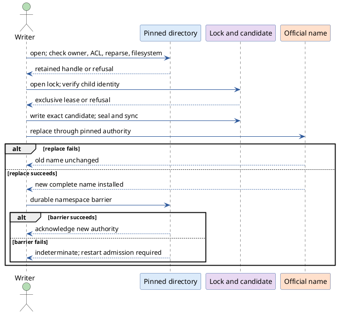

# Windows durable authority contract for RSpace

This contract bounds pgmcp leaf `rspace-windows-authority-contract` (7946). It
specifies the native Windows replacement for the filesystem authority seam in
`rspace++/src/rspace/persistence/durable/io.rs`; implementing that replacement
and qualifying it on Windows belong to leaf 7947. The Merkle DAG, catalog wire
format, journal owner, and consensus semantics do not change here.

The current adapter permits Windows positioned reads and writes through
`FileExt::seek_read` and `seek_write`. It rejects Windows durable-directory
opening, child opens, unlink, replacement, owner-only permission setting,
file validation, and child-name identity checks through the `not(unix)`
branches. Thus the matrix below reports **no qualified native Windows
filesystem today**. A passing finite-state model or a cross-platform build
does not change that runtime status.

## Terms and trust boundary

A **durable directory** is the directory containing `catalog.v1`, pack files,
index files, `writer.lock.v1`, and temporary rebuild files. A **protected
name** is one generated single-component filename in that directory. A
**directory handle** is an already-open kernel handle to that specific
directory object; the diagnostic `PathBuf` must never become authority after
the handle opens. A **child handle** is an already-open handle to one regular
file under the pinned directory. A **file identity** is the pair of volume
serial number and 128-bit file ID obtained from a handle; Microsoft documents
this pair as identifying the same file on one computer
([`FILE_ID_INFO`](https://learn.microsoft.com/en-us/windows/win32/api/winbase/ns-winbase-file_id_info)).
A **writer lease** is the exclusive, nonblocking lock on `writer.lock.v1`
retained across mutation. A **sealed candidate** has its exact extent and
contents synchronized before a name-replacement attempt. **Acknowledgment**
means returning a successful durable-publication result to the caller;
installation without proven name durability is not acknowledgment.

The adversary can create or replace unprotected path components and child
entries, install reparse points, hard-link a child, change access-control
lists (ACLs) where authorized, contend for the writer lock, and force any
I/O or synchronization step to fail. The invariant assumes that a different
security principal cannot mutate a directory once its owner and ACL pass
validation. A malicious process running as the same security principal, a
privileged administrator, a kernel driver, or a failed storage device lies
outside this ACL boundary. The adapter must not silently claim safety against
those actors. An advisory or byte-range lock coordinates cooperating writers;
it cannot replace directory access control. Microsoft notes that byte-range
locks do not constrain memory-mapped views
([`LockFileEx`](https://learn.microsoft.com/en-us/windows/win32/api/fileapi/nf-fileapi-lockfileex)).

## Authority laws

1. **Qualified directory.** Open the final directory component without
   following a reparse point, retain its handle, require the expected owner,
   and reject ACLs granting another non-trusted principal the ability to
   create, delete, rename, or replace children. Reject unknown filesystem
   behavior before mutation. A reparse-aware open alone is insufficient:
   Windows may return the handle *to the reparse point*, so the adapter must
   inspect and reject its reparse attribute
   ([Microsoft reparse guidance](https://learn.microsoft.com/en-us/windows/win32/fileio/reparse-points-and-file-operations)).
2. **Bound child.** Accept only a generated single component. Open or create
   relative to the pinned directory handle without reparse traversal; reject
   nonregular, reparse, multi-link, wrong-owner, and overbroad-ACL children
   using handle-derived metadata. No pathname precheck may stand in for the
   handle check. Reopen a name without following reparses and compare its
   volume-and-file ID with the retained child handle before unlink or
   replacement. If exact same-object checking or race exclusion cannot be
   established, refuse the mutation.
3. **Exclusive writer.** Require a successful exclusive, nonblocking OS lock
   before any durable mutation. Retain the lock handle through publication;
   release it explicitly on lease drop, including when another handle has
   been duplicated. Lock contention or lock errors leave catalog authority
   unchanged. The Windows adapter must validate the actual `File::try_lock`
   behavior; its Rust API signature alone is not the evidence.
4. **Handle-bound mutation.** Unlink and replacement must address the pinned
   directory and the verified child identity, with no reinterpretation of
   the original diagnostic path. Replacing a name requires a sealed candidate
   and an atomic same-directory result, or fails closed. The Windows rename
   information structure has a directory-handle field and a replace flag,
   but its network protocol specifies a zero root-directory handle for
   network operations; this does not qualify SMB for this contract
   ([`FileRenameInformationEx`](https://learn.microsoft.com/en-us/openspecs/windows_protocols/ms-fscc/4217551b-d2c0-42cb-9dc1-69a716cf6d0c)).
   The pinned-directory pathname-replacement property requires opening that
   directory with sharing compatible with renames (`FILE_SHARE_DELETE`);
   Windows otherwise rejects later delete-access opens while the handle is
   live ([`CreateFile` sharing modes](https://learn.microsoft.com/en-us/windows/win32/api/fileapi/nf-fileapi-createfilea)).
5. **Durable publication.** Sync exact candidate data and metadata, install
   the new name, then establish durable namespace metadata on the qualified
   filesystem before acknowledging. `FlushFileBuffers` is documented for an
   open file handle; a successful file flush alone is not evidence that an
   enclosing directory rename is crash durable
   ([`FlushFileBuffers`](https://learn.microsoft.com/en-us/windows/win32/api/fileapi/nf-fileapi-flushfilebuffers)).
   If the OS/filesystem cannot provide and validate the required metadata
   barrier, the operation must return an error or indeterminate outcome, not
   success. A pre-install failure retains the old official name. A failure
   after atomic installation may leave either complete old or complete new
   authority at restart, or a rejectable state; it must never claim success
   or synthesize a third mixed authority. Once synchronization succeeds,
   restart must select the new complete authority.

The critical sequence is:



In literate pseudocode, `D` and `C` remain handles, and `old` and `new` are
complete catalog-authorized images:

```text
D := open_directory_no_reparse(path)
require qualified_filesystem(D) and owner_acl_protects_names(D)
L := lock_exclusive_nonblocking(open_child_no_reparse(D, "writer.lock.v1"))
C := create_new_child_no_reparse(D, generated_candidate_name)
require regular_single_link_owner_only(C)
write_exact(C); require exact_length(C); sync_file(C)
require child_name_identity(D, candidate_name) = file_identity(C)
atomic_replace_within(D, C, official_name)
if replace failed: return failure with old authority
if namespace_barrier(D) failed: return indeterminate without acknowledgment
return acknowledged new authority
```

The namespace barrier is an *obligation*, not an assumed implementation of
`File::sync_all` on a Windows directory. The exact native operation and its
failure/crash semantics must be established under 7947 for each qualified
filesystem.

## Formal model and executable extraction

`formal/tlaplus/stack_safe_pda/RSpaceWindowsDurableAuthority.tla` enumerates
qualified versus unqualified filesystems; good and bad owner, ACL, reparse,
regular-file, link-count, and name-identity observations; and available or
contended locks. Its transitions include pre-install refusal, synchronized
candidate installation, directory-sync success and failure, acknowledgment,
and restart. The base configuration checks these invariants:

| Model invariant | Observable Windows property |
| --- | --- |
| `PinnedDirectoryIsTrusted` | Bad owner, writable ACL, reparse directory, or unqualified filesystem cannot yield a usable directory capability. |
| `LeasePrecedesChildAuthority` | A child handle cannot authorize mutation without the pinned directory, exclusive lease, safe child metadata, and exact name identity. |
| `PublishedNameIsSealedAndBound` | Name installation requires a synced child and the same retained directory/child authority. |
| `RefusalPreservesAuthority` | Every pre-install failure leaves the old official authority unchanged. |
| `AcknowledgmentRequiresDurability` | No return of publication success follows an omitted or failed namespace barrier. |
| `RestartNeverSelectsThirdAuthority` | Uncertain restart selects old, new, or reject; successful durability forces new. |

Three single-defect configurations must produce counterexamples: omitted
directory security check, omitted child-name identity check, and premature
acknowledgment before directory durability. These controls show that the
invariants discriminate their intended failures; they are not evidence of a
working Windows adapter.

`rspace++/tests/persistence/windows_durable_authority.rs` contains the
native-only executable properties at the current `DurableDirectoryV1` seam.
The tests require a Windows CI worker with a qualified private NTFS scratch
directory; creating symlinks also needs Developer Mode or the corresponding
privilege. They assert lock contention and release, reparse and hard-link
refusal, overbroad ACL refusal, pinned-directory identity after pathname
replacement, and old-name preservation versus indeterminate post-install
sync failure. They are expected to fail while the non-Unix seam remains
fail-closed; passing them on a native Windows worker is an implementation
gate for 7947, not evidence produced by this specification leaf.

Still-required executable cases for 7947 include wrong-owner tokens, denied
metadata queries, name-swap races under an allowed same-principal threat
model, nonregular child types, lock-handle duplication, actual crash/restart
injection at each publication barrier, and unsupported-filesystem refusal.
These need Windows-native fixture construction or a controlled filesystem
worker and cannot be inferred from the pure model.

## Filesystem support and qualification matrix

| Platform and filesystem | Current durable authority | 7947 target | Qualification needed |
| --- | --- | --- | --- |
| Unix local filesystem with existing handle-relative semantics | Existing dormant Unix implementation | Preserve current behavior | Existing Unix tests, then campaign cutover gates. |
| Windows local NTFS | Fail closed | Candidate for native support | Windows worker: ACL/owner/reparse/file-ID/lock tests, exact replace and crash durability, recovery, mutation and failure injection. |
| Windows local ReFS | Fail closed | Unqualified | Same complete evidence as NTFS, separately; API availability alone is insufficient. |
| Windows FAT/FAT32/exFAT | Fail closed | Unqualified | Demonstrate all authority and durability laws or retain refusal. FAT does not support reparse points in Microsoft's filesystem notes, which does not by itself establish safe authority ([reparse-point support](https://learn.microsoft.com/en-us/windows-hardware/drivers/ifs/reparse-points)). |
| Windows SMB, CSV, remote or redirected filesystem | Fail closed | Unqualified | Handle-relative namespace identity, ACL and lock behavior, server acknowledgment, power-loss semantics, and reconnect/replay evidence per backend. |
| WASI and other non-Unix, non-Windows targets | Fail closed | No native target in this leaf | Retain typed unsupported-platform refusal. |

Supported means *observed and accepted at runtime*, not merely a row on a
roadmap. Until 7947 establishes those checks and a Windows qualification
receipt, **the current supported native Windows set is empty**. Native
Windows qualification must not be inferred from WASI's fail-closed behavior,
from Linux TLC execution, or from a Rust cross-compile.
