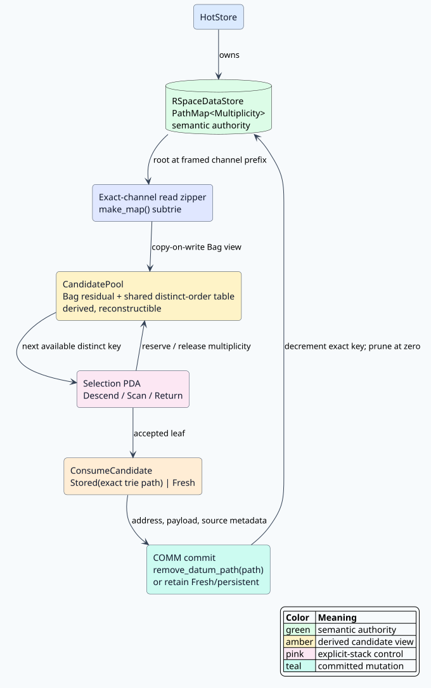
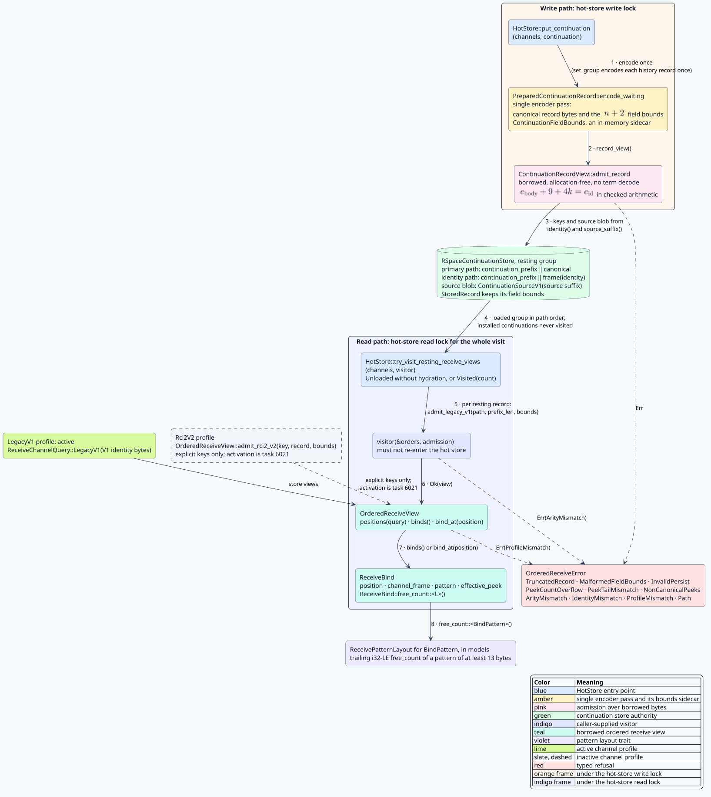

# PathMap Bag and RSpace matching integration

Status: implementation in progress and living engineering report

Campaign: `campaign-4131-rspace-pathmap-integration`

Historical experiment reference: `rspace-pathmap-end-to-end-layout-2026-08-15`
Last updated: 2026-09-07
Current implementation checkpoint: exact-channel two-level authority (introduced by this change set)

The [baseline acceptance ledger](#baseline-acceptance-ledger-2026-09-07) distinguishes
preserved historical results from currently retrievable evidence and remaining requirements.
Historical experiment numbers and passing-test counts below are not current campaign verdicts.

Chronological PathMap findings and negative results are maintained in the
[PathMap engineering journal](../pathmap/pathmap-engineering-journal-2026-08-23.md).

## Purpose and scope

This report specifies how RSpace can use a prefix-compressed `PathMap` bag without changing the observable contracts of Rholang communication, replay, persistence, or consensus. It is the implementation design for the `f1r3node-rust-mettail` campaign. The separate `reified-rspaces-mettatron-migration` epic consumes the interfaces produced here; it owns public Rholang `EBag` syntax and the later MeTTaTron-to-Rholang bridge. `EBag` names the language/schema expression consistently with `ESet`, `EMap`, and `EPathMap`; the internal RSpace `Bag` remains the storage-level `PathMap<Multiplicity>` abstraction.

The work has three separable layers:

| Layer | Authoritative representation | Responsibility |
|---|---|---|
| Bag algebra | `PathMap<Multiplicity>` | Unique byte paths, multiplicities, prefix compression, lattice operations, copy-on-write forks, and optional structural sharing |
| RSpace index | RhoPathV1 keys in one or more Bags | Candidate discovery, retained pattern indexes, deterministic reservation, and reversible projection to existing RSpace records |
| Matcher | Explicit pushdown automata over PathMap zippers | Directional spatial matching, ordered matching, associative-commutative matching, guard backtracking, and replay-equivalent selection |

Neither a `Vec<Par>` nor a hash table is an authoritative substitute for a trie layer. Compatibility vectors may be materialized only at legacy API boundaries, and their cost must be measured and removed from hot paths.

## Terms and notation

| Term | Meaning in this report |
|---|---|
| Bag | A multiset: each distinct element has a strictly positive multiplicity. |
| ACT | Arena Compact Tree: PathMap's compact physical trie snapshot family. |
| CAS | Compare-and-swap: an atomic conditional update that publishes a new value only when the observed old value is unchanged. |
| CBR | Consensus-Breaking Register: the stable identifier series in the living consensus-change report. |
| COMM | A Rholang communication event pairing a compatible produce with a waiting consume. |
| DFS | Depth-first search: traversal that completes one branch before moving to its sibling. |
| EPM | EPathMap: the PathMap-backed Rholang expression representation. |
| EPM1 | EPathMap format version 1: the direct compact trie image used at its versioned byte boundary. |
| PDA | Pushdown automaton: an iterative state machine with an explicit stack. |
| RMP | Rholang Match Path: the generated structural token format used by matcher queries. |
| RMP1 | Rholang Match Path format version 1: the self-delimiting structural token stream used by generated matcher queries. |
| RMP2 | Rholang Match Path format version 2: the current derived structural token stream, whose ParBag token hashes semantic constructor-tag/multiplicity/canonical-protobuf records rather than an ACT snapshot. |
| RPB3 | Rholang Par Bag key format version 3: one canonical PathMap endpoint containing a component-family tag, canonical score, canonical protobuf body, and big-endian score-length trailer. |
| RCI2 | Rholang Channel Image format version 2, represented in Rust by `ChannelImageV2`: the canonical logical image of one channel's RPB3 component Bag and root `connective_used` flag. |
| RSS | Resident set size: the physical-memory footprint attributed to a process by the operating system. |
| RSpace | The tuple-space implementation that stores Rholang data and waiting continuations and selects COMMs. |
| SHA | Secure Hash Algorithm: SHA-256 identifies the exact retained log bytes cited by this report. |
| mCRL2 | A process-algebra toolset used here for branching-bisimulation and modal reachability checks. |
| SMT | Satisfiability modulo theories, used to discharge bounded logical obligations. |
| TLA | Temporal Logic of Actions; its TLA+ language is used here to model state transitions and invariants. |

## Frozen pre-migration RSpace contract

The behavioral baseline is the target worktree at commit `dcc4600d4`, recorded by
`6a1c4341d`. This is a
source coordinate, not a second checkout: reproduce a historical observation
with `git show dcc4600d4:<path>`. The campaign does not maintain a shadow legacy
implementation. Instead, control arms disable the derived PathMap selector and
run the same production `consume` or `produce` entry point, while differential
tests compare the selected COMM, event log, and post-state. Those later control
arms isolate selector cost in their own production revision; they are not timings
of `dcc4600d4`, the `dev` branch, or the entire former RSpace implementation.

At the frozen coordinate, `RSpace<C, P, A, K>` owns the synchronization and
consensus-visible side effects, while `HotStoreState<C, P, A, K>` stores five
hash-indexed collections. Datum and continuation buckets are ordered `Vec`
values, so multiplicity is occurrence expansion and removal uses an integer
position. The history repository remains the checkpoint authority. The
event-log and produce-counter locks are separate from the hot-store lock, and
channel operations acquire phase-A and phase-B locks in sorted, deduplicated
channel-hash order.

| Frozen authority | Representation at `dcc4600d4` | Semantic responsibility | Replacement constraint |
|---|---|---|---|
| Resting data | `HashMap<C, Vec<Datum<A>>>` | multiplicity, candidate materialization, source metadata, persistence | `PathMap<Multiplicity>` may quotient identical complete records only if exact selected identities and historical order remain reproducible |
| Waiting continuations | `HashMap<Vec<C>, Vec<WaitingContinuation<P, K>>>` plus installed singleton map | bind patterns, continuation, peeks, persistence, source metadata | retained automata are derived indexes; they never become the continuation authority |
| Joins | `HashMap<C, Vec<Vec<C>>>` plus installed joins | discover channel groups that a produce can complete | updates remain inside the existing selected-match transaction boundary |
| History | radix-history repository over cold-store leaves | checkpoint roots, reset, export/import, replay state | cold bytes and roots are consensus surfaces until an explicitly versioned migration is approved |
| Event log and replay multimap | ordered IO/COMM events plus multiplicities | deterministic replay and ambiguity refusal | a PathMap selector may prune candidates but cannot change the recorded event or its multiplicity |
| Installs | RSpace install map plus installed hot-store collections | blessed/persistent system continuations | derived-index invalidation must preserve install availability across reset |
| Locks | sorted phase-A/phase-B channel locks; hot-store and log locks | atomic multi-channel reservation and publication | no retryable whole-state compare-and-swap loop may repeat matcher or event effects |

### Observable contract matrix

The matrix is the review index for the frozen contract, audited against source
at `329240271` on 2026-09-07. Its current witnesses test specific contracts; a file
reference is not a claim that its complete target was rerun during this audit.
“Control” means the
production matcher with derived RhoPath pruning disabled. “Treatment” means the
same public operation with the derived index enabled; the spatial matcher still
decides acceptance.

| Observable invariant | Frozen source seam | Executable evidence retained in the current tree | Required equality |
|---|---|---|---|
| Produce-driven COMM: consumes are already waiting | `RSpace::locked_produce` and `SpaceMatcher::extract_first_match` | `candidate_path_pruning_spec::datum_first_retained_queries_filter_waiting_continuations_before_spatial_match`; `rspace_comm` benchmark filter `waiting_receive` | equal selected result, event log and post-state; the named test separately counts spatial calls |
| Consume-driven COMM: data are already resting | `RSpace::locked_consume` and `SpaceMatcher::find_matching_data_candidate` | `candidate_path_pruning_spec::indexed_and_full_scans_have_identical_results_traces_and_post_states`; `rspace_comm` benchmark filter `distinct_` | equal selected result, event log and post-state, including absence of a match |
| Multi-channel join | phase-A/phase-B acquisition and candidate recursion | `storage_actions_test::consuming_on_two_channels_then_producing_on_each_should_return_cont_with_both_data`; `enabled_rendezvous_spec::t8_a_join_enumerates_its_cross_product` | atomic all-or-nothing reservation and the same binding order |
| Repeated channel | per-bind candidate selection and positional removal | `guarded_matching_tests::a_receive_taking_two_data_from_one_channel_removes_both` and `guarded_matching_tests::two_identical_occurrences_fill_two_binds_without_expansion` | enough multiplicity is required; indistinguishable occurrences do not create factorially distinct outcomes |
| Peek | selected indices retained or restored according to the peek set | `replay_rspace_tests::creating_a_comm_event_with_peek_consume_first_should_replay_correctly` and `replay_rspace_tests::creating_a_comm_event_with_peek_produce_first_should_replay_correctly` | same retained data and same peek metadata in the COMM |
| Persistent datum/continuation | `Datum::persist`, `WaitingContinuation::persist` | `storage_actions_test::persistent_produce_should_be_available_for_multiple_matches`; `storage_actions_test::doing_persistent_consume_and_producing_multiple_times_should_work`; `replay_rspace_tests::picking_n_continuations_from_m_persistent_waiting_continuations_should_replay_correctly` | persistent records remain available for later matches without duplicated effects |
| Guard timing and backtracking | `Match::check_commit` after a complete spatial assignment | `guarded_matching_tests::the_produce_path_backtracks_across_a_join` and `guarded_matching_tests::a_failed_guarded_search_restores_the_candidate_pools` | guard rejection restores reservations; the next canonical assignment is tried |
| Candidate order | `order_candidates_with_index` and stable serialized candidate hashes | `guarded_matching_tests::the_canonical_candidate_order_is_a_pure_function_of_the_candidates`; `replay_comm_order::distinct_projection_is_canonical_across_all_insertion_orders` and `replay_comm_order::comm_order_is_total_and_consistent_with_identity` | preserve canonical candidate ordering and the specified total replay-COMM projection; this does not make concurrent event emission order globally deterministic |
| Source and random metadata | `Datum::source`, `WaitingContinuation::source`, `ListParWithRandom::random_state` | `serializer_byte_goldens`; `serializer_par_byte_goldens`; `event_hash_encoder_differential::generated_encoder_matches_legacy_over_the_shared_corpora`; `record_index::continuation_join_lifecycle_equivalence::legacy_and_pathmap_continuation_join_lifecycles_are_identical` | preserve complete serialized records and random state; continuation deduplication uses source-free identity and retains its first source representative, rather than treating every serialized-byte difference as a new identity |
| Event history and replay | `log_comm`, replay COMM multimap, `ReplayRSpace` | `guarded_matching_tests::play_and_replay_agree_on_a_guarded_selection`; `guarded_matching_tests::play_and_replay_agree_when_the_guard_permutes_a_repeated_channel`; `epathmap_replay_equivalence_spec::epathmap_heavy_record_then_replay_reproduces_the_log` | selected assignment, event multiplicities, replay consumption and final state follow the recorded execution; runtime comparison is not an archived ordered-log golden |
| Checkpoint and reset | `create_checkpoint`, `reset`, soft checkpoint/revert | `storage_actions_test::create_checkpoint_on_an_empty_store_should_return_the_expected_hash`; `storage_actions_test::reset_should_change_the_state_of_the_store_and_reset_the_trie_updates_log`; `storage_actions_test::revert_to_soft_checkpoint_should_inject_the_event_log`; task 7941's coupled-identity fixtures | identical exact frozen ordered/compatibility state has the same legacy root; equal semantic DAG roots alone do not imply equal legacy roots |
| Export and import | history exporter/importer over cold-store leaves | `export_import_tests::export_and_import_of_one_page_should_works_correctly`, `export_import_tests::multipage_export_should_work_correctly`, `export_import_tests::multipage_export_with_skip_should_work_correctly`, `export_import_tests::empty_checkpoint_import_is_one_zero_object_terminal_page`, `export_import_tests::invalid_pages_leave_no_root_authority_and_the_same_session_can_retry`, and `export_import_tests::imported_state_can_be_reexported_and_mixed_with_a_new_checkpoint` | imported root and post-import behavior equal the exported source; invalid pages do not publish root authority |
| Malformed input | public `consume`/`install` arity guard before mutation | `consume_arity_refusal::play_consume_refuses_the_malformed_and_accepts_the_control`, `consume_arity_refusal::the_refusal_does_not_half_write`, `consume_arity_refusal::play_install_refuses_the_arity_mismatch_and_accepts_the_control`, `consume_arity_refusal::replay_consume_refuses_the_malformed_and_accepts_the_control`, and `consume_arity_refusal::play_and_replay_agree_on_every_malformed_shape` | literal refusal and no half-write for arity mismatch/empty-channel shapes, with a well-formed control; not an exhaustive arbitrary-byte decoder claim |
| Cold bytes and hashes | serializers and `StableHashSerialize` | `serializer_byte_goldens`, `serializer_par_byte_goldens`; `epathmap_canonical_fixtures::event_hash_goldens_produce` and `epathmap_canonical_fixtures::event_hash_goldens_consume` | byte-identical encodings within the pinned fixture epoch and therefore unchanged corresponding hashes; later format epochs must not be substituted for the frozen one |

The two arrival rows use the operation that completes a rendezvous, avoiding the
ambiguous older “datum-first”/“receive-first” shorthand. Existing test identifiers
are preserved. In particular, the test named `datum_first_retained_queries_...`
first stores consumes and then calls `produce`.

Task 7941's [coupled-identity result](../pathmap/pathmap-engineering-journal-2026-08-23.md#j-071--2026-09-07-bind-legacy-identity-to-coupled-state-not-a-presumed-root-projection)
supersedes the former unqualified phrase “stable root for identical logical state.”
Its concrete string-typed counterexample does not prove the whole Rholang trace
relation. The compatibility bridge implementation remains task 7942.

### Corpus and groundness audit

The executable corpus spans exact and wildcard single-channel matches,
datum-first and receive-first arrival, 2-by-2 joins, repeated channels,
duplicate multiplicity, peeks, persistence, guards, canonical-order reversal,
malformed arity, checkpoint/reset, export/import, and replay. The generated
Rholang corpus adds deep and wide `Par`, every descriptor root, ordered and
unordered collections, binders, remainders, and random-state variants. The
benchmark corpus adds shared-prefix and diverse-prefix cardinalities 1, 16,
256, and 4,096, duplicate multiplicities, and join arities.

Stored data are **not proven ground at the generic RSpace boundary**.
`ISpace<C, P, A, K>::produce` accepts an arbitrary `A`, `HotStore::put_datum`
performs no closedness validation, and the type system does not refine
`ListParWithRandom` to a ground-only form. Normal Rholang evaluation generally
supplies closed data, but direct Rust callers, imported historical state, and
malformed or future producers prevent treating that as an RSpace invariant.
This is a missing boundary guarantee, not a demonstrated accepted malformed
Rholang deployment. A query compiler must conservatively retain candidates it
cannot safely exclude. Spatial matching and guard backtracking remain authoritative;
fallback does not imply exactly one matcher invocation for an entire search.

| Corpus axis | Concrete retained witness | Evidence boundary |
|---|---|---|
| Ground/open terms and full schema | `models/tests/par_corpus/mod.rs`: `par_corpus`, `bind_pattern_corpus`, `tagged_continuation_corpus`; `serializer_par_byte_goldens` | Constructed oneof/root coverage and non-ground EPathMap fixtures; not proof that generic stored data are ground. |
| Linear/nonlinear captures | `rholang/tests/matcher/retained_path_index_test.rs`; `rholang/tests/matcher_state_isolation.rs` | Query admission/fallback and binding-state laws; full generated COMM lifecycle coverage remains 7964. |
| Deep/wide/shared structures | `par_corpus::deep_par`, `deep_mixed_par`, the `wide_sends` fixture; `matcher_recursive_family_cursor::recursive_family_cursors_match_at_depth_4096_on_a_fixed_native_stack`; the shared-prefix measurement files below | Shallow recursive-oracle comparison, separate deep-machine checks, and prefix-sharing workloads are different evidence classes; none proves all depth/width combinations. |
| Ordered/unordered collections, binders and remainders | `par_corpus::all_par_fields`, `bind_pattern_corpus`; `matcher_recursive_family_cursor::encoded_unordered_collections_preserve_backtracking_and_remainders` | Codec fixtures and direct matcher assertions, including captured remainders; not an all-pattern RSpace schedule matrix. |
| Multiplicity and churn | Repeated-channel rows above; `guarded_matching_tests::a_failed_guarded_search_restores_the_candidate_pools`; the continuation/join lifecycle witness | Exact reservations, rollback, first-source retention, checkpoint/reset/import and replay at the tested boundary. |
| Genesis | `casper/tests/genesis/genesis_vaults_order_determinism.rs::default_genesis_post_state_hash_is_pinned_across_processes` | An absolute current-epoch root pin; it is not a deployment-log corpus or the original frozen root. |
| Archived Rholang programs | `casper/tests/util/rholang/async_driver_differential.rs` and `async_driver_goldens.json` | Seven fixed-source programs and partial cross-process observations; the versioned limitations are recorded below. |

### Golden fixture epochs

An **epoch** here is the source/codec/contract coordinate at which an expected
observation was fixed, not a new consensus protocol number. Existing expected
values are not regenerated by this audit.

| Retained artifact | Capture or revision coordinate | What is pinned, and what is not |
|---|---|---|
| `rspace++/tests/serializer_byte_goldens.rs` | Captured from the value-shaped encoder `4e422b6b`; test introduced by `60aaa02e3` | String-typed datum/continuation serialized lengths and digests. This does not instantiate Rholang payloads. |
| `models/tests/serializer_par_byte_goldens.rs` | Introduced by `be6c90f37`; later ParBag revisions include `cd2a8bf6e` and `034f164a6` | Actual Rholang cold-record shapes, metadata and EPathMap encodings. Retrieve the file at `dcc4600d4` for that epoch; the current file is not automatically a pre-migration capture. |
| `casper/tests/util/rholang/async_driver_goldens.json` | Introduced by `6cd0a27c3`, narrowed by `2f56fac88`; present at `dcc4600d4` | Seven programs' failure, cost, COMM count/fingerprint and balanced-state flag. At `dcc4600d4` the fingerprint hashes sorted COMM debug renderings; there are no archived raw events, event ordering or absolute post-state roots. |
| Same async-driver golden | `3f0cd7339`, then `8701f470b` | The current fingerprint hashes sorted length-delimited canonical COMM protobuf. Sorting removes order and excludes standalone Produce/Consume events. These later fingerprints are not the original baseline. |
| `casper/tests/fixtures/genesis_state_hash_golden.json` at `dcc4600d4` | Original `33dddee17` revision | Historical genesis-only pin `cb7480d13e774ef931c0d22379cbe4deb6fed0f096d7ff93d507a2b3276d7efe`. This is a retained baseline artifact, but not a captured deployment log or its ordered events. |
| `casper/tests/genesis/genesis_vaults_order_determinism.rs` and the current genesis JSON revision | Test pin refreshed by `8701f470b`; JSON updated by `3f0cd7339` | Literal later-epoch genesis roots. The current JSON identifies a 2026-08-18 semantic epoch and must not be substituted for its historical `dcc4600d4` revision. |
| `rspace++/tests/state/atomic_state_authority.rs` | Retained-root fixture `e4d969741` | Empty/rollback/latest roots, history/cold/catalog inventory, page ordering, abrupt child exit and fresh-reader rollback/recovery. This is a later string-typed persistence-action fixture, not captured Rholang COMM events. |

No complete archived replay input with exact recorded events/order and pinned
final-root expectations was located in the bounded source/history audit. The
async-driver full-log projection was explicitly withdrawn by `2f56fac88` as an
unstable cross-process quantity; restoring that assertion would be incorrect for
parallel Rholang. A valid captured-log gate must consume the archived replay
rigging and reproduce its required selected COMMs and post-state. Preserved
capture order is evidence, not a new global emission-order invariant or a
requirement to reproduce a total thread schedule. This original
acceptance gap remains owned by 5636; dynamic play/replay equality and separate
partial goldens do not discharge it.

### Current-epoch replay archive (2026-09-07)

The subsequent capture adds `casper/tests/util/rholang/async_driver_replay_v1.json`
and its separate `.blake2b256` seal. It preserves all seven programs' complete signed
`ProcessedDeploy` protobuf payloads, including every archived Produce/Consume/COMM
position, cost, status and metadata, literal pre/final roots, complete replay context,
ordered public genesis inputs and the full genesis configuration. It does **not**
retroactively create a historical `dcc4600d4` archive or regenerate the earlier goldens.

The capture passed with seven plays and seven uncached self-replays; the archive is
156,228 bytes with BLAKE2b-256
`75bb293f49cb2a9e2c6f989924403b2edf6d825351c952288936759ae08232fc`
and SHA-256 `f61a0f6a99a0e17a1d2e805ec3b5625c55116a9872b678b12d950cf178b648cf`.
The capture identifies source HEAD `c57ba7fa7479093a81624cd2877e653e50cf3041`, exact
harness/schema/configuration file digests, the tracked-diff digest, the clean local
parser dependency `02cef80d32214ecdac3ee7d3b91c3786a34174d5`, compiler version and
build environment. The new harness was uncommitted at capture: its recorded content
digest, not HEAD alone, identifies that source. A tracked-diff digest by itself cannot
reconstruct a dirty checkout; the fixture is not a clean-HEAD benchmark observation.

V1 verification reads the fixture and seal, rejects missing/changed bytes and
incomplete context, checks typed protobuf decode/re-encode fixed points, attempts to
rebuild the exact pre-root and replays archived input without first playing its source. Both
`RuntimeManager` replay caches are disabled and independently checked. Full archive
order is separate from the runtime's intentionally order-insensitive rigging. The
formal contract and RA01–RA11 implementation obligations are in the
[existing proof report](../../../formal/rocq/stack_safe_pda/README.md#captured-replay-archive-contract-2026-09-07),
committed with the twenty contract checks and twelve example/control checks at
`ce333d452ff9bd8e6f32afd0c154d3e93920abce`. These conditional abstract proofs do not
verify the concrete runtime, codec, genesis construction or cryptography.

The first capture completed its runtime work but failed to publish because Cargo's
test working directory is `casper/`. The corrected capture resolves its explicit
destination against the repository root, validates the parent before execution and
uses exclusive creation; no old artifact was overwritten. The corrected test took
294.99 seconds, excluding its 77-second incremental build. Both commands used
systemd limits of 8 GiB memory-high, 12 GiB memory-max, zero swap, four build jobs
and 400% CPU quota, with database scratch under `target/campaign-5636-scratch`.
These are qualification run details, not a performance experiment or measured
per-operation RSS improvement.

Source and archive checkpoint `498f401a65f9a90a63357ce855983c965f5c52c6` preserves
the exact capture harness: its BLAKE2b-256 matches the recorded
`7a2b6f9aaf12dbb413636bdbbcb0b769709feacaf24018d17b1c2ec6bfbf994d`.
Fresh-process qualification passed five format/integrity tests, failed three runtime
tests at the pre-root check, and ignored the explicit capture entry (281.82 seconds).
The three runtime failures share the process-cached genesis construction; they are
not three independent root observations and did not reach the cost/status/COMM
mutation checks. The captured pre-root is
`ffd6bbbf7e48e9e6a062eef22d82e3559d298cd72e316748a8cbdf24b82b36f8`,
which differs from the existing default-genesis test's `87b8dede…846da87b` literal.
The original pin's exact test separately **passed** in 324.66 seconds under a
6 GiB/zero-swap cap, using the same compiled release binary. By source, both paths
use the same default test genesis parameters; they differ in wrapper/caching,
store scope and runtime thread configuration. This is an unresolved construction
discrepancy, not an approved successor epoch. Existing root-reachable task 5304
(`rederive-and-repair-blessed-normalized-term-pin-drift-2026-08-11`) owns attribution.
An additional fresh diagnostic process failed after 283.95 seconds and recorded
the regenerated pre-root
`0f19169db09e269dadc4094f5c6832b52a4c53f3ee61541130dd97f84987126a`.
It used a 6 GiB memory-max, zero swap and four workers; its diagnostic log has
SHA-256 `3a52f2eff5cf1798157587e8c8a7054459bda288ace6eeaeefdbb877b4adafc7`.
The current archive contains genesis configuration but neither the genesis
`ProcessedDeploy` traces nor an exported pre-state. Consequently, configuration
equality alone has not established the formal genesis-realization premise.
The bounded repair is to preserve the exact genesis replay input in a new archive
version and qualify reconstruction through the existing uncached genesis replay
API. It must preserve this v1 observation and the independent determinism obligation;
a fresh construction cannot retroactively supply the original capture's missing trace.
pgmcp artifact 489 preserves the capture, verification and diagnostic observations.
Neither the archive nor the old pin is rewritten, and the archive is not accepted
as a portable replay baseline yet. The original golden's SHA-256 remains
`d6772d138ee1d3a2cdab79de9c76dac0da40516e686d8cbfd02608f6669878c1`.

#### V2: establish the starting state through archived genesis replay

The reviewed refinement keeps v1 unchanged and adds a distinct
`async_driver_replay_v2.json` archive format. Its mandatory `genesis_replay` section
contains the exact bootstrap and genesis-final roots, complete invocation context,
and every genesis block `ProcessedDeploy` protobuf payload. Admission compares the
entire signed deploy envelope, including cosigners and threshold, in the order
produced by `Genesis::default_blessed_terms`; matching names or a nonempty count is
insufficient. Genesis event logs are the existing canonicalized block payloads,
whereas workload logs retain the order captured during workload execution.

Verification opens an isolated store through existing test helpers and materializes
the registry bootstrap through `RuntimeOps::empty_state_hash`. It checks that actual
root against the existing bootstrap pin and the archive, replays the captured genesis
with both caches disabled, and requires its resulting root to equal every workload
pre-root. It then replays the seven workloads from that root. Verification does not
call the cached genesis constructor or play any workload source first. Both stages
share the same runtime/state domain and default services/tags, but their distinct
genesis/workload flags, timestamps and senders are checked rather than conflated.

Formal-first checkpoint `b60f97259` proves the composition under explicit realization
premises and records the complete BR01–BR14 executable obligations. The two existing
Rocq modules passed thirty-four and twenty-one printed closed checks and combined
kernel checking under a 2 GiB/zero-swap cap. This is not a proof of deterministic
genesis construction or the concrete runtime. Independent source review found no
blocking implementation flaw. The release test build passed in 74 seconds.

Capture and complete restoration self-check **passed** in 582.09 seconds. The
1,954,666-byte archive binds fourteen genesis deploys and seven workloads with
BLAKE2b-256 `ffbafc7169cc2aa1b8c3ed39a4a0e3955138427b914dffbb787976ea44dafa3c`
and SHA-256 `269a9be9052a7deb299ac566a3ef6c18ea6a43011fef9ce4b38374079fe10598`.
The actual pinned bootstrap is
`382d0f2821eab27ac0163841f3838bc00a201bed6f8135e0a5746788420dbd51`;
archived genesis replay reproduces
`7599876cba4827ac9ce7eae1b534f6501ad06f4deca3403d73b7a229f2d811e8`.
Seven pure format/integrity tests also passed in 6.24 seconds, with explicit capture
ignored. The capture log's SHA-256 is
`7cbb67d0365467156124ed5f423c111bb76ed8c494b8856334c1f96f361fea00`.
These are qualification timings, not a backend speed or allocation comparison.

Fresh-process qualification with four test threads returned **eight passes, three
failures and one explicit capture ignored** in 322.16 seconds. The complete seven-program
positive replay passed, establishing actual reconstruction and workload replay in a
different process. The three runtime mutation/control cases instead failed while
restoring genesis: another scoped runtime advanced their shared physical authority
root. Their causal cost/status/COMM checks are not yet qualified.

Source review identified a campaign-introduced adapter regression at `f108c45c0f`:
`LmdbDirStoreManager::state_authority` ignores `Db.name_override` and opens literal
`rspace-history`, `rspace-cold` and `rspace-roots` for every scoped manager. Distinct
UUID scope labels therefore do not establish distinct state domains. The stale-root
refusal is correct. Required child 8283 (`rspace-authority-resolved-database-scope-isolation`)
under the original implementation owner 6094 now blocks 5636. Its repair must honor
the actual mapped database identities and retain concurrent tests; private directories
or test serialization must not conceal this scope-isolation regression. Artifact 491
records these results; the failed suite log has SHA-256
`9c9dc2a2a900eda42e0e64b24c775cf403cdf94ed7127a27436cb0b3eaebc898`.

Capture uses exclusive creation
and publishes the trace before attempting complete restoration, so a failed
restoration still leaves its exact input available for diagnosis. File existence is
not acceptance: both capture self-check and fresh-process verification must pass.
Checkpoint `61f83d73b` preserves the complete capture and exact harness. The harness
was not committed at capture HEAD `b60f97259`; its exact
BLAKE2b-256 is `4ea0d35e739f9a2861cfe2ceb9ac2e16d876d3f8036d4ed0f08f4407e6bfbbad`,
and the fixture also records configuration, tracked-diff and local-parser provenance.
The property test now explicitly uses its existing source-adjacent regression-seed
location: this integration-test tree has no `lib.rs` or `main.rs` ancestor. The
thirty-two-case test passed after a 75-second incremental build, without the previous
path-discovery warning; failure persistence remains enabled.
The current scope is 6 GiB memory-max, zero swap, four build jobs and 400% CPU quota,
with database scratch under `target/campaign-5636-scratch`. No blessed contract,
production runtime, old golden or original archive is changed. Task 5304's separate
construction discrepancy remains required even if archived replay succeeds.

#### Scoped-store repair and causal-control qualification

Formal-first checkpoint `64395f681` and implementation `52551503f` repair the
scope collision through exact independent physical database mappings and scoped
migration metadata. The twenty-invariant catalog, two failing pre-repair witnesses,
and **55/55** passing release state/migration tests are detailed in
[J-078](../pathmap/pathmap-engineering-journal-2026-08-23.md#j-078--2026-09-07-repair-physical-database-scope-isolation).
The unchanged concurrent archive suite then reaches **10 passed, 1 failed and
1 explicit capture ignored**: all seven workloads replay successfully, while a
COMM mutation is correctly refused under an unanticipated legacy error wrapper.
This is not yet a passing full gate. Artifact 498 and its log digest preserve the
result separately from the earlier scope collision.

Checkpoint `9308e7685` refines only the negative test's recognition of the complete
unused-COMM diagnostic with a canonical positive count. Unrelated internal errors
and malformed wrappers still fail the control; the two helper tests pass, including
32 generated cases. The successful control, actual `expect_err`, cost/status
checks and final-root checks remain. No runtime error semantics, archive bytes,
consensus pins, or fixture isolation change. The complete fresh-process concurrent
rerun at `9308e7685` passes **13 tests, 0 failures and 1 explicit capture ignored**
in 541.57 seconds; artifact 500 preserves log SHA-256
`0ad27f20209821fed1d71b26e3695b658b45800c2833d68b63b1f3569c64ecd5`.
This supplies the missing local runtime-control qualification for 8283 and the
v2 archive, but not independent CI verification or historical experiment provenance.
RA09 distinguishes the abstract refusal proof from this
concrete diagnostic evidence; no proof of the legacy failed-evaluation suppression
branch is inferred.

### Reproducible baseline evidence

The original source coordinate is pinned even though the measurement harness
was added later. The end-to-end Criterion controls invoke production RSpace and
disable only the derived selector. The table separates them from selector-only
or Bag-only microbenchmarks. “Recorded result” preserves a historical observation;
it is not a fresh statistical decision from this audit.

| Durable evidence | Production / harness coordinate | Recorded result and scope |
|---|---|---|
| [`rspace-retained-pathmap-prefilter-2026-08-15.tsv`](../stack-safety/measurements/rspace-retained-pathmap-prefilter-2026-08-15.tsv) | `ea8c39f92` / `7bc5c6994` | Six paired produce-driven COMM cells, 16/256/4,096 waiting consumes, shared/diverse prefixes; 51 samples and 99% confidence intervals; latency 18.828–30.835% lower. CPU 8 pinned, 5 GiB hard cap, zero swap. |
| [`rspace-resting-pathmap-prefix-2026-08-15.tsv`](../stack-safety/measurements/rspace-resting-pathmap-prefix-2026-08-15.tsv) | `564dac0b4` / same | Eight paired consume-driven COMM cells, cardinality 1/16/256/4,096; the singleton treatment regressed. Preserve the falsification rather than reporting every cell as a win. |
| [`rspace-resting-pathmap-singleton-repair-2026-08-15.tsv`](../stack-safety/measurements/rspace-resting-pathmap-singleton-repair-2026-08-15.tsv) | `0b601ce67` / same | Eight post-repair pairs under the same 51-sample, 99%-confidence, 5 GiB/zero-swap protocol. Singleton arms take the same direct scan: small point-estimate differences are not a new algorithmic speedup. |
| [`rspace-retained-bag-product-2026-08-16.tsv`](../stack-safety/measurements/rspace-retained-bag-product-2026-08-16.tsv) | Final production `61accc170`; replication checkpoint `304dc13e9` | Selector-only experiments 224/225 rejected and 226/229 historically accepted; 82 samples, recorded digests, 8 GiB/zero-swap cap. Small-cardinality fixed-cost losses remain visible. Not full COMM throughput. |

The committed files retain commands, host descriptions, resource settings, source
coordinates, per-cell estimates and run identifiers. The 2026-09-07 STDIO lookup
returned `experiment not found` for experiments 208, 218, 233 and 327; a listed
control record remained readable. A later read-only query of the current database
found no experiment, run, sample, hypothesis or result rows for those four IDs.
Thus the current service cannot supply their original provenance; its
`valid_to IS NULL` lookup filter is not the whole explanation.

On 2026-09-29, the existing pre-v86 pgmcp backup
`~/.local/share/pgmcp/backups/pgmcp-pre-v86-20260902T1658.dump`
(SHA-256 `afe3e1913c42001d3eba27de7f279e1c23d1d1e87e9bc449ab295ddd4be378c0`)
yielded original experiment, locked-hypothesis, run and sample rows for 208, 218
and 233. The tables were streamed with `pg_restore --data-only --table=... --file=-`;
the 9.6 GiB dump was neither copied nor restored. Every recovered run has command,
run-plan, host, source and time metadata. All 4,868 sample values are finite, and
replicate indexes are contiguous within each run/arm/metric/unit group.

| Original experiment | Recovered primary criterion and observations | Raw sample COPY-row SHA-256 |
|---|---|---|
| 208 | Locked 2026-08-15: increase `comm_operations_per_second`, Welch greater, α = 0.05, Cohen's d ≥ 0.5, planned n = 51. Forty-four complete runs × 51 samples = 2,244 observations; artifact 316 and heaptrack artifact 397 are in the dump. | `5516359d6967b378b3c2f4c2941c92f2272a31cda691b35c11d5f94de4b186a2` |
| 218 | Locked 2026-08-16: decrease singleton atomic-remove latency, Welch less with α = 0.01 and d ≥ 0.5, plus median improvement ≥ 5%, planned n = 82. Two finalized runs × 410 samples = 820 observations across five cardinalities; both original sealed run digests are present. | `d9c814f0a18b18b55f3d712b19266ab2e3d40773945bb9dcb5881f1939f2b73b` |
| 233 | Locked 2026-08-16: decrease mean exact EPathMap match latency, Welch less with α = 0.01 and relative change ≥ 5%, planned n = 33. Three complete runs contain 656, 656 and 492 samples, totaling 1,804; original artifact 321 is present. | `f2742e97912bda5ba3fc6a68c0ddfaa1504444a9dbf5d1761e25e6e77a1acaae` |

These digests cover each experiment's original PostgreSQL `COPY` sample rows, not a
new measurement or a claim that the current pgmcp service can query them. The
original run metadata records the benchmark command and host conditions, but the
audit has not established every observed compiler/Cargo version or environmental
override. The Criterion combined-metric caveat for 233 remains in force.

The retained September 5 Codex session transcript replays earlier pgmcp
call-and-response payloads for experiment 327. Its SHA-256 is
`65baa0891877faec9aa73ec0a08681a14f590bc2fc16ce95fb8c04ead5734775`;
the [bounded transcript extract](../stack-safety/measurements/rspace-act-lmdb-experiment-327-transcript-2026-09-29.json)
has SHA-256
`555566dc9cfced5b022da475588d970e664449b831406d2163e8478c3531d453`.
The preserved `experiment_open` result locked an **observational** criterion for a
shared-prefix, 128-byte-payload ACT/LMDB fixture at `87a9584b3`. Six successful
`experiment_record_measurement` calls preserve 18 size-labeled scalar values:
write throughput, lookup throughput and disk bytes for ACT and LMDB at 256,
4,096 and 16,384 entries. The ACT and LMDB run UUIDs are
`3dd6f37f-7709-4d2c-b3e4-97371382bcd9` and
`d0df5abd-1471-4a0b-85d6-44dfa5dd3d6e`; each received nine values.
Preserved artifact call-and-response payloads contain IDs 409–412 and their submitted
content. The retrieved historical snapshot still said `measuring`, with no
decision or sealed run digest. Its accepted disk-byte submissions carried a
unit-mismatch warning against the experiment's throughput unit. These 18
values are the original **pgmcp-submitted scalars**, not Criterion's ten
per-cell raw replicates; the transcript does not establish observed compiler
or Cargo versions. The transcript event timestamps mark the later replay, not
the benchmark or experiment creation times. This is retained original
call-and-response payload evidence, not a restored database export or a new
benchmark.

The earlier retrieval map (artifact 501) remains useful for cross-checking the
backup against committed summaries:

| Original record | Retrieval keys and remaining limits |
|---|---|
| Retained prefilter TSV | First evidence commit `609cfcab1`; 12 per-arm run UUIDs, beginning `8980971c-a0ba-41e4-8a6c-506f393f44b5`. |
| Resting-prefix TSV | First evidence commit `ebcb899f2`; 16 run UUIDs, beginning `dd32894e-5dd8-4992-9a26-b91aff58952e`. |
| Resting singleton-repair TSV | First evidence commit `a38d4ca8d`; 16 run UUIDs, beginning `adf842b0-7e4e-4e2e-8eac-1f8dfa9dae76`. |
| Single-root Bag publication, experiment 218 | `rspace-bag-single-root-commit-2026-08-16.tsv`, first evidence `2acd2b603`, retains both sealed digests. The backup now supplies the original two run UUIDs and 820 samples. |
| EPathMap byte-native algebra, experiment 233 | `epathmap-ac-byte-native-2026-08-16.tsv`; evidence commit `d65037977` identifies artifact 321, which is present in the backup. Preserve the invalid combined-metric disclosure after Criterion rotated its `base`; do not reconstruct controls from that directory. |
| Later retained-product replication | `0ed2274d8` identifies experiment **229**, artifact **320**, with the retained log digest in its TSV. This is not experiment 327 or a substitute for the original run. |
| ACT/LMDB comparison, experiment 327 | The September 2 dump predates this experiment. A later session transcript replays the original pgmcp payloads for the locked observational hypothesis, 18 submitted scalar values, two run UUIDs, artifact content/IDs **409–412**, and a `measuring` snapshot. The linked extract records exact source-line hashes, but its event timestamps are replay timestamps. Current pgmcp database rows, Criterion per-replicate samples, observed tool versions and a final experiment decision remain unavailable. |

All 44 original UUIDs remain in the first three linked TSVs and match the
recovered experiment 208 runs. Historical source declares Criterion 0.5.1 and
selects `nightly-2026-02-09`; those declarations do not establish actual compiler
versions or absence of overrides. Current get/list calls still fail to retrieve
the four experiments. The v2 replay archive separately passed 13 ordinary
concurrent checks with one capture-only ignore under task 5636; that archive is
not the remaining baseline blocker. Completion of the original provenance
obligation still requires reconciliation of the missing Criterion replicates,
observed tool versions and any required original database export against the
transcript-backed submission. No original data is declared deleted, and new
measurements cannot recreate historical preregistration.

The recorded 428-test package pass belongs to the August retained-product checkpoint,
not today's complete package. The later full-library failure and narrowly passing
repairs are classified below. A configured memory ceiling is not measured RSS;
scope peaks including compilation are not per-operation allocation measurements.

### Baseline acceptance ledger (2026-09-07)

| Original requirement | Evidence established by this audit | Remaining obligation / owner |
|---|---|---|
| Frozen authorities and observable contract | Source `dcc4600d4`, freeze `6a1c4341d`, corrected fourteen-row matrix, exact current test targets | Preserve ordered compatibility state and first-source retention through later implementations; concrete bridge 7942. |
| Captured and synthetic corpus | Named codec/matcher/lifecycle fixtures, preserved v1 failure and full genesis-backed v2 capture; the concurrent fresh-process suite passes all 13 ordinary checks, including causal runtime controls | Scope isolation is locally qualified under 8283; separate genesis-construction attribution remains 5304 and original baseline provenance remains 5636. Generated all-pattern lifecycle acceptance is separately 7964. |
| Reproducible capped measurements and preregistration | Committed source/harness coordinates, commands, resource envelope, run identifiers and summary files | Original preregistration, raw samples/artifacts and observed tool versions must be recovered and linked; 5636 remains open. No retroactive preregistration claim. |
| Failure classification | Finite inventory below, with existing reachable repair/acceptance owners | It is not an assertion that every workspace target currently passes. Whole-workspace qualification remains 5647. |
| Golden byte/order/root outputs | Independent literal serializer/genesis/history fixtures and a sealed full v2 replay capture, scoped to their epochs; the fresh-process concurrent suite passes 13 tests plus one capture-only ignore at `9308e7685` | The new archive cannot replace missing historical inputs. Actual v2 replay and causal controls are locally qualified; independent CI and separate genesis-construction attribution are not inferred. |
| Read and preserve the two living reports' semantics | Stack-safety report remains the dated measurement ledger with stable section identifiers; consensus register retains its may-change-consensus-only inclusion rule | This source/evidence correction changes no consensus surface or measured performance result. Activation, full resource measurements and independent verification remain open. |

#### Classified failure and non-acceptance inventory

This inventory covers the reviewed baseline measurements, the later known broad gate,
and the immediately preceding acceptance work. It does not substitute for running
the final workspace gate or silently change another task's disposition.

| Observation | Classification and evidence | Existing reachable owner |
|---|---|---|
| First resting-data singleton is slower | Historical performance defect, retained in the pre-repair TSV; exact singleton scan selected at `0b601ce67`, with the post-repair TSV retained. | 5642, `rspace-pathmap-index-layout`, retains final layout/resource acceptance. |
| Retained-query traversal trials and small-cardinality selector losses | Rejected intermediate treatments and explicitly scoped selector-only fixed costs; no inference that full COMM is slower or faster from these cells alone. | 5642; historical product experiments and final COMM comparisons remain distinct. |
| Valid dangling-path creation panics before ACT emission | J-057's release run passed 600, failed one, ignored one; the 2026-09-07 rerun at `9308e7685` passed 666, failed the same test, ignored one (artifact 499). Minimal sequence `[1]`, `[2]`, `[3]`, `[1,0]` reaches an empty sentinel; the regression seed is unchanged. It is not an ACT admission refusal or a memory-cap failure. | Existing 6023, `rpb3-single-parse-act-traversal-plan`, and 6038, `pathmap-upstream-integration-request-register` / PMU-006. No duplicate implementation task or upstream fork. |
| Structural removal loses a sibling in the superseded in-place proposal | Existing ownership-disjoint publication at `68534b6fc`, real-key witnesses `f4441c1d05`, and normalization qualification `329240271`. Task 6446 is `claimed_done`, not independently verified. | 6446, `guarded-pathmap-live-empty-root-write-safety`. |
| Whole-tree allocation costs during final guarded teardown | Dated scaling/ownership evidence is separate from the remaining allocation contract; normalization tests do not discharge it. | 6441, `guarded-pathmap-final-root-allocation-teardown`, and PMU-005. |
| Attempted normalizer-omission panic controls do not fail as hypothesized | Two expected-panic assertions were rejected during 6446. J-074 records the negative causal result; they are not passing regression evidence. | 6446's preserved verification history; no production fix inferred from either trial. |
| Captured pre-root differs from a fresh process's constructed genesis; separate old-pin test passes | Source/capture/verification evidence at `498f401a6`; the five pure archive checks pass but three runtime cases reject their shared regenerated pre-root. No root is silently refreshed and no causal attribution is claimed yet. | Existing 5304, `rederive-and-repair-blessed-normalized-term-pin-drift-2026-08-11`, through 4121 to root 4131; archive qualification stays 5636. |
| Independent database scopes share one physical RSpace authority | Original adapter `f108c45c0f` bypassed `Db.name_override` (artifact 491). Exact mapping/migration repair `52551503f` passes 55 state tests; strict test-only causal refinement `9308e7685` passes all 13 concurrent replay tests with one capture ignored (artifact 500). | Required child 8283 under 6094 is locally qualified, with independent verification separate. No isolated test directories or serialized-execution workaround. |
| Missing historical archive and currently unresolved experiment provenance | Historical acceptance-evidence gaps, not evidence that stored history was deleted. The new current-epoch capture is explicitly separate. | 5636, `rspace-pathmap-contract-baseline`. |

Remaining A/B/C layout qualification belongs to 5642, transactional matching to 5646,
generated matching/replay acceptance to 7964, full workspace/portability/closure to
5647, and equal-durability LMDB controls/measurement/decision to 7949/7950/7951 under
5693. These are required campaign work, not deferrals or implied completion of 5636.

## Current implementation checkpoint

The implementation has selected and built the exact-channel two-level PathMap authority. In the
terminology used below, an **authority** is the data structure whose contents define RSpace state; a
**derived view** is reconstructible from that authority and may be discarded without changing
semantics. The selected topology is an outer guarded `PathMap<ChannelSlot>` keyed by one exact
canonical channel marker. Every real endpoint owns a channel-relative `Bag`, itself a guarded
`PathMap<Multiplicity>`. A real empty `Bag` denotes loaded-empty; absence of the exact outer
endpoint denotes unloaded. `ChannelSlot::SyntheticBarrier` is teardown machinery and is never an
observable channel value.

The outer value stores `Bag` directly rather than `Arc<Bag>`: `Bag` already owns a guarded
copy-on-write PathMap root. Candidate catalogs clone that inner `Bag` in O(1) and therefore share
the authoritative root without rebuilding a relative trie. A multi-channel `BagDelta` is split at
validated `RhoPathV1` channel boundaries, applied to private channel-relative Bag candidates,
preflighted against final aggregate metadata, and published as one new outer root. Only touched
catalog entries are staged; untouched catalog `Arc` identities and untouched inner Bag roots remain
identical. Canonical egress visits exact outer endpoints and then traverses each inner Bag directly;
it does not flatten RSpace into `Vec<Par>` or sort a projection.

The in-memory topology is selected. Direct RBA1 checkpoint encoding, streaming, compatibility, and
restart recovery for this topology remain open production work and are not established merely by
the existing formal specifications or source-traceability registries.



| Stage | Commit | Current evidence | Disposition |
|---|---|---|---|
| Lawful `Bag` over `PathMap<Multiplicity>` | `a82288ae0`, `0d7a6a3f8`, `1560f4371`, `46aaa6472`, `7b3254573`, `8e4938ec6`, `cd01ea721`, `21ece399d`, `0f9beb5f0`, `87679597d`, `9a746f2bf`, `cd6099f50`, `4127119ea`, `281c1698a` | exact multiplicity laws, normalized reversible transaction deltas, direct canonical ACTree03 byte images, malformed-image refusal, a 200,000-byte compressed-key gate on a 256 KiB stack, 23 legacy/differential laws, multiplicity-independent construction allocation, clean comparative microbenchmarks, kernel-checked Rocq/Verus proofs, versioned atomic live accepted-match commits, exhaustive schedule invariants, branching-bisimulation evidence, one-root publication, and adaptive direct/cursor delta traversal selected from preregistered measurements | implemented as each channel's datum authority and as the accepted-match transition carrier; transaction-level allocation/RSS/instruction profiling is closed |
| Canonical framed `RhoPathV1` | `651f278aa` | exact-channel isolation, structural-prefix pruning, malformed-key refusal | implemented |
| Multiplicity-aware datum index | `5d4c5eca9` | one trie key per identical complete record; one decode per distinct key | implemented |
| Authoritative hot-store datum trie | `ccec9b730`, `bd55758e4` | history fill, loaded-empty state, snapshots, indexed compatibility removal, and package tests | implemented |
| Exact-channel two-level authority | introduced by this change set | exact outer endpoints own channel-relative Bags; loaded-empty is an explicit real endpoint; aggregate counts are checked; channel replacement and multi-channel deltas prepare privately and publish one outer CoW root; candidate pools share the selected inner Bag root; 18 focused topology/CoW/stack properties, eight replacement-invariant tests, and 25 public data-index tests pass under capped zero-swap execution | in-memory topology selected and implemented; direct RBA1/ACT persistence and full formal-to-property closure remain open |
| Multiplicity-native matching pools | `5329b27a3`, `173bf4e07`, `39bc0d999` | exact-path firing; immutable authority plus a separate multiplicity-aware reservation Bag; fresh-datum addressing; repeated-channel duplicate tests; explicit invalid/double-release and phase-boundary refusal | implemented; reservation-pressure performance comparison remains open |
| Atomic accepted-match commit | `cd01ea721`, `21ece399d`, `0f9beb5f0`, `87679597d`, `9a746f2bf`, `cd6099f50`, `4127119ea`, `281c1698a` | play and replay normalize every selected nonpersistent stored identity plus any unconsumed arrival into one exact-key `BagDelta`; an opaque group-scoped `Arc` epoch rejects a stale continuation address without counters or ABA; one hot-store write lock validates continuation identity and metadata, persistent datum witnesses, and the complete delta before publishing datum, continuation, epoch, and join state; effects are emitted only after acceptance; focused adversarial concurrency/reset/history cases and every `rspace_plus_plus` test target pass. Rocq proves deterministic acceptance/refusal and complete state, TLC checks 710,528 distinct states, and mCRL2 proves branching bisimulation plus no partial, pre-commit-log, or stale-commit observation. The exact release workspace passes 4,511/4,511 tests with 53 skipped under a 24 GiB, zero-swap cap. A frozen git-history control and ten-cell matrix show one lock/root in every accepted atomic cell, no stale mutation/allocation/root, hard narrow-cell CI guards below 1.05, and material repeated-16/join-32/arrival improvements; RSS is neutral and adverse persistent/singleton-tail observations are retained | implemented and transaction-level measured across datum removal, unconsumed-arrival insertion, continuation removal, and join cleanup in all four play/replay consume/produce paths; the broader CBR-053 generated schedule campaign remains independent and open |
| Shared canonical candidate catalogs | `2eb0d3871` | one canonical order and one lazy decode cell per distinct record across channel-pool snapshots; multiplicity-only updates do not rebuild the catalog | implemented |
| Single-lookup hot-store reads | `d50b1183d` | one encoded prefix and one loaded-store read lock per hot pool/data lookup; final performance verdict remains pending | implemented |
| Retained receive automaton, ordered query slice | `a89cbc294`, `f149cef2b`, `ea8c39f92`, `e1a587c9f`, `697db373b`, `ad395c357`, `61accc170`, `304dc13e9`, `4f63119c0`; benchmarks `7bc5c6994` and `rspace_retained_automaton_build`; pgmcp `rspace-retained-set-automaton` and experiment 241 | one `PathMap<TerminalId>` transition segment per bind position; supported queries reside at their longest exact structural prefix and residual wildcard/capture instructions run on canonical datum bytes; fixed-width terminal/candidate identifiers; root fallback terminals; immutable whole-revision rebuilds contain no dead transitions; group-local versioning; no trie clone on cache hits; the fresh path and authoritative resting Bag are both queried without flattening; 11/11 focused release automaton and 1/1 isolated allocation-slope gates pass, including one-million-byte depth and 20,000-terminal width on a 128 KiB stack; the 21-family ordered differential preserves play/replay results, event histories, stores, and roots; experiment 229 accepts the shared/256 primary and artifact 320 replicates the complete diverse/shared causal-selector matrix | ordered query prefilter and direct retained-automaton/Bag product implemented; experiment 241 rejected query hash-consing, so production retains the faster owned residual query per terminal; associative-commutative schedules, captured eligibility measurement, and the full equivalence campaign remain open |
| Receive-first Bag/query product | `564dac0b4`, `0b601ce67`, `f43858ec2`, `b6b53d1b3`, `697db373b`, `514659e2b`, `27557c374`; pgmcp `rspace-pattern-over-pathmap` and experiment 220 | synchronized borrowed read zippers over the authoritative `PathMap<Multiplicity>` Bag and derived fixed-width `PathMap<CandidatePosition>` index; exact terms, whole-term wildcard/free-variable captures, ordered list remainder, and nested variables across every ordered single-expression schema family use generated cursor events; exact nested instruction prefixes descend the trie before a stack-safe byte PDA skips subvalues; nonlinear Rholang capture levels and associative-commutative carriers fail closed to the authoritative spatial matcher; canonical order is restored before that oracle; 8/8 query/product cases, 64 generated differential corpora, and 11/11 query compiler cases pass; a structural zero/one-candidate base case removes the measured singleton regression without an empirical cutoff; post-repair throughput improves 48.7–53.4% at 16 entries and 239–257× at 4,096; experiment 220 rejects per-byte borrowed `TrieRef` focuses by 61.953% at the 256-candidate primary and retains the mutable read-zipper product | ordered nested product implemented; associative-commutative schema coverage and equivalence campaign open |
| Generated full-schema cursor | `71d378e73`, `697db373b`, `5f768e7ce`; pgmcp `rspace-shared-match-pda` | the shared descriptor pass emits tag-ordered `RhoMatchProgram` tables plus exhaustive `ParCursor` accessors for all 58 messages and five oneofs; `RhoPathCursor` traverses optional, sequence, map, scalar, and oneof shapes with a heap worklist; the Rholang query compiler now consumes that cursor for every ordered single-expression family; EPathMap is a native trie delegation event and does not force `trie_snapshot()`; Rocq proves exact/hole/ordered compilation preserves spatial success, and the executable compiler differential observes every generated root while checking recursive-oracle successes | schema traversal, ordered compiler soundness, and the direct retained-automaton/Bag product are implemented; associative-commutative instructions and complete generated schedules remain open |
| Generated structural match path | `155ecdf54`, `d858058d4`, `edd166671`, `b6b53d1b3`, `697db373b`; pgmcp `rhopath-v1-codec`, `rspace-shared-match-pda` | stable generated type IDs and field/oneof tags drive a self-delimiting `RMP1` token stream; datum, exact receive-pattern, and ordered nested-query literal runs use one event encoder; EPathMap contributes mode, cardinality, and a domain-separated BLAKE2b-256 digest streamed by a native logical zipper DFS; the zero-copy byte cursor validates descriptor-exact child types and oneof payloads and locates a subtree extent iteratively; nested query execution distinguishes one-layer in-memory frames from two-layer stored PathMap frames; map values deliberately remain a conservative oracle-checked lane | exact, whole-term, and all ordered single-expression nested instructions live; associative-commutative instructions remain open |
| AC element candidate Bag | `250e96c80`, `2d91c4394`, `bbe91b90f`, `3a70ddc58`, `ad5d37a59`, `26b72b096`, experiment `facfedf15`, retained control `eb5d4c580`; pgmcp `rspace-ac-multiplicity-matcher` and experiment 246 | the existing stack-safe augmenting-path PDA remains authoritative; every unordered `Par` field root now uses generated RhoPath queries against exact structural-plus-canonical-bincode identity paths in `Bag` (`PathMap<Multiplicity>`), including `Send`, `Receive`, `New`, `Expr`, `Match`, `Bundle`, `GUnforgeable`, and `ReceiveBind`; dynamic receives conservatively decline ordered pruning because their binds are AC; fixed-width nonzero `u64` group identifiers reach original positions only as ordering witnesses; unsupported/nonselective/nonlinear patterns use the complete domain and structural collisions reach the spatial oracle; adjacent byte-identical normalized targets reuse one encoded identity; true duplicates record search visitation as Bag multiplicities while all-distinct targets retain the smaller one-bit lane; indistinguishable universal remainder vertices are quotient-compressed into initial occupancy plus one generic heap-PDA displacement cursor, and the final remainder is the target Bag minus the term-consumed Bag; exact diagonal and 128-send controls require 128 edges, the width-128 remainder control requires one term edge, and the unchanged 51-sample displacement control remains exhaustive at 16,257 treatment edges versus 699,263 nominal calls; experiment 246 found that committed `BagDelta` occupancy changed the 4,096-target mean from 80.921 ms to 80.623 ms, only a 0.369% improvement with a one-sided p-value of 0.09776, so production retains the final scan | candidate membership, final residual multiplicity, duplicate search visitation, and compact remainder occupancy are Bag-authoritative; the measured incremental `BagDelta` reservation design is rejected and recoverable at `facfedf15`; alternative term-reservation designs require a new preregistered hypothesis, while constrained-first dynamic AC search, residual-state memoization, and full assurance remain open |
| Byte-native EPathMap AC algebra | `48e6f7d3c`, `92240a452`, `03685f4c7`, `1196fe2cc`, `d659157f2`; pgmcp experiment 233 | exact set/map pattern keys are classified from allocation-free canonical metadata; exact target subtraction and selection operate on raw encoded `PathMap<()>` masks; map values remain borrowed `Par` payloads; dynamic keys decode exactly once at their semantic boundary; one moving write zipper applies lexicographically ordered map-key subtraction to one copy-on-write root | implemented and measured; mean latency is 8.17–13.64× lower for sets and 3.00–3.63× lower for maps across 16/256/4,096 entries; dynamic semantic matching remains deliberately decoded |
| Retained-automaton/Bag product walk | `ad395c357`, `61accc170`; pgmcp `rspace-retained-set-automaton`; experiments 224, 225, 226, and 229; replication artifact 320 | an iterative synchronized zipper product intersects every retained-transition segment with the authoritative `PathMap<Multiplicity>` Bag in the same escaped byte domain; the unrelated fresh datum remains a zero-allocation byte stream; one distinct Bag key and at most one eligible non-root terminal depth use zero or one exact PathMap lookup, while multi-depth and multi-key cases retain the linear zipper product; no datum decode, Bag flattening, or occurrence expansion occurs; artifact 320 confirms 4.476× and 13.338× wins at shared/256 and shared/4,096, and records diverse-prefix wins of 1.059× and 7.803× at the same cardinalities; both cardinality-16 causal-selector cells retain fixed-cost losses, while existing end-to-end COMM measurements win at 16 because they include avoided spatial work | implemented and measured; shape-sensitive causal fixed costs and allocation/RSS comparison remain visible; no empirical cutoff is inferred from the selector-only microbenchmark |
| Layout selection and performance verdict | pgmcp experiments 208, 224, 225, 226, and 229 | retained-receive slice passes its preregistered five-percent throughput threshold at 99% confidence; resting-data pruning is non-regressing at one entry after the structural base-case repair and passes from 16 through 4,096; the direct datum-first product wins at the preregistered shared/256 and large cells after two rejected designs; the exact-channel two-level topology removes the flat authority's prefix-replacement and relative-subtrie reconstruction costs; a clean full-workload resource matrix for the new topology remains open | topology selected on semantic/architectural grounds with prior causal measurements retained; final post-selection performance verdict remains partial |

At `f43858ec2`, each exact channel produces a `CandidatePool`. Since `173bf4e07` and `39bc0d999`, its semantic
membership authority is a channel-local `Bag`, obtained as a copy-on-write PathMap subtrie through a
read zipper, while a second initially empty Bag records only speculative nonpersistent demand. Pools share a
derived `CandidateCatalog`: its `Arc` order table contains one lazy decode cell per distinct trie
key, not one record per occurrence. A single `PathMap<CandidatePosition>` maps the complete relative
RhoPathV1 key of every catalog entry to a fixed-width `u64` position. The same trie supplies both
known-path membership for persistent zero-to-one reactivation and structural-prefix candidate
positions; there is no duplicate unit-valued membership trie and no platform-width trie payload.
The position trie is built with the catalog, not against every lookup; it is non-authoritative and
is refreshed after a permanent membership change. The authority `PathMap<Multiplicity>` Bag remains
the sole membership authority.
The explicit matcher PDA increments and decrements the reservation Bag during descent and rollback;
it never rewrites authority during selection. Availability is the pointwise inequality
`authority.count(path) > reserved.count(path)`.
An accepted stored candidate carries its complete trie path; an arriving produce carries the
separate `Fresh` address. Firing therefore removes by exact path and cannot suffer positional-index
shifts.

For a compiled receive-first query, `CandidateProductCursor` keeps one borrowed read zipper on the
authoritative Bag and one on the position trie. Exact bytes descend both cursors together; wildcard
steps enumerate only the intersection of their child masks; a terminal position is emitted only
when both cursors carry a value. The query scanner validates the two framing layers iteratively,
including escaped zero bytes. The supported fragment comprises exact whole terms, whole-term
wildcard/free-variable captures, ordered list remainder, and whole-`Par` holes nested inside every
ordered single-expression schema family. A single `PathMap<()>` records capture levels across the
complete bind pattern. If a level repeats, the compiler rejects the derived query and preserves the
spatial matcher's historical accumulation semantics; it does not reinterpret the repetition as
generic RhoPath equality. For the nested fragment, the product first descends the doubly escaped
exact instruction prefix through both tries, then an iterative token PDA consumes one complete RMP1 subvalue per
wildcard or capture. Fixed-width positions are sorted before scanning, so product
pruning removes candidates without changing the predecessor's canonical order. A fresh datum is
tested through its retained path, and the Bag is checked again before every reservation; neither the
catalog nor the position trie can invent membership. The optimization is fail-closed for generic
matchers and unsupported associative-commutative or schema shapes. The existing spatial matcher
remains the final acceptance oracle, including for structural false positives.

The first retained receive automaton slice is also live. Each bind position owns a
prefix-compressed `PathMap<TerminalId>`. `TerminalId` and `CandidateId` are fixed-width `u64`
newtypes. A compact append-only terminal arena links candidates that share a path; it is secondary
payload storage, not a second transition authority, and neither candidate nor terminal identifiers
are reference-counted. `TerminalId` uses a nonzero one-based encoding so its optional predecessor is
one 64-bit word; each arena node is therefore two fixed-width words. Exact-ground `BindPattern`
values and supported `RhoPathQuery` prefixes use the same canonical structural path as
`ListParWithRandom` data. A supported non-ground pattern is installed at its longest exact prefix;
its residual query must accept the datum's canonical bytes before its terminal is selected. Every
unsupported remainder, connective, associative-commutative shape, or otherwise non-indexable
pattern is installed at the segment root as a universal fallback. The fresh datum is always walked
through the retained segment. When the target channel already contains data, the same segment is
also intersected directly with the authoritative Bag, because a valid COMM may consume only resting
data and leave the fresh produce in place. A reached resting terminal is retained conservatively;
its residual wildcard/capture query is evaluated later by the ordinary candidate scan. The PathMap
selection is therefore a conservative superset prefilter; the existing spatial matcher remains the
acceptance oracle and canonical candidate order remains the selection order.

Compiled automata are derived, sharded by channel group, and keyed by a pair consisting of the
store generation and that group's independent continuation revision. An unrelated receive does not
invalidate the group. State replacement and clear advance the generation; counter saturation
disables caching rather than accepting a stale automaton. Cache hits borrow the trie during the
iterative zipper query and never clone it. Empty groups remove their cache entry.

Every compiled value is an immutable projection of one complete live continuation slice. A version
change constructs a new projection and publishes it as one cache value; there is no incremental
tombstone state, so the live-terminal count always equals the terminal-arena length and the dead
count is exactly zero. Consequently the proposed `dead > live && dead >= 4096` rebuild rule is not a
missing threshold in this representation: its predicate is unreachable. Introducing it would first
require a different incremental identity and ordering design plus comparative evidence.

Experiment 241 tested whether identical residual `RhoPathQuery` programs should instead be
hash-consed. Its treatment placed one nonzero, fixed-width `QueryId` in each terminal and stored each
distinct query once in an append-only arena; a transient hash table used full equality to resolve
collisions. The causal control preserved the immediate predecessor's owned query per terminal. Both
arms built the same `PathMap<TerminalId>` chain in candidate order, selected the same vector, and used
distinct continuation bodies so the fixture represented a legal live group.

The arena was slower at every cardinality: **7,267.05 ns versus 5,651.18 ns** at 16 (**+28.59%**),
**111,798.36 ns versus 101,382.11 ns** at 256 (**+10.27%**), and **1,786,732.56 ns versus
1,685,976.60 ns** at 4,096 (**+5.98%**). The primary one-sided Welch test therefore rejected the
treatment ($`t = 173.2981`$, $`p = 1.0`$, Cohen's $`d = 27.0646`$), and both smaller cells exceeded
the preregistered five-percent regression guardrail. Production retains owned residual queries. The
benchmark keeps the rejected arena locally for reproducibility; no `QueryId`, hash table, or query
arena remains in the production compiler or selector.

`RetainedSetAutomatonStats` records indexed and fallback candidates/patterns, total and distinct
terminal paths, shared terminals, maximum terminal depth, and the live/dead invariant. RSpace
accumulates those values, cache hits, and compile time through operational metrics. Thus actual
eligibility and terminal-sharing fractions can be measured on captured workloads rather than
inferred from the supported schema roster. The focused gate compiles, selects, and drops a
one-million-byte terminal path and a 20,000-terminal shared chain on a 128 KiB worker stack. An
isolated counting allocator verifies that doubling 1,024 live terminals to 2,048 remains below a
threefold allocation-count and allocated-byte envelope. The complete evidence is recorded in
[`../stack-safety/measurements/rspace-retained-query-arena-2026-08-16.tsv`](../stack-safety/measurements/rspace-retained-query-arena-2026-08-16.tsv).

Checkpoint `e1a587c9f` makes the retained automaton consume the same query contract as the
receive-first product. It does not create a redundant Bag for the one fresh datum: the authoritative
waiting-pattern transition relation remains the existing prefix-compressed PathMap segment. Exact
prefixes perform trie cuts; residual wildcard and capture instructions inspect the already available
canonical datum bytes; unsupported patterns stay at the root. A 256-waiting-receive control/index
differential preserves the fired COMM, event trace, and post-state map while reducing calls to the
spatial matcher from 256 to 1. This is executable superset evidence, not the final formal proof or
the preregistered expanded workload/resource verdict.

Checkpoints `ad395c357` and `61accc170` close the distinct datum-first product gap. Every retained
segment and the authoritative resting Bag are traversed in their shared escaped structure-prefix
domain. Common child masks drive an iterative depth-first product; reaching a retained terminal
proves that some resting record has that prefix, without decoding the record or constructing a
`PathMap<()>` beside the Bag. The product may admit a residual-query false positive, but it cannot
accept a COMM; `CandidateScan` and the spatial matcher retain that authority. For a Bag with one
distinct key, multiplicity does not affect existence. A generated, deduplicated terminal-depth
schedule therefore performs no non-root lookup when the key is too short and one exact
`PathMap::get` when only one terminal depth can prefix it. Multiple eligible depths and all multi-key
Bags use the synchronized zipper product, which bounds traversal by the visited common trie edges
rather than a sum of repeated prefix searches. Zipper movement is executed outside `debug_assert!`,
so release and debug builds have the same state transitions.

The causal sequence is preserved rather than hindsight-edited. Experiment 224 rejected the initial
bytewise product because shared-prefix cardinality 256 was 2.104× slower than the full scan despite
large-cardinality wins. Experiment 225 cut that treatment by 43.6% with compressed-run descent but
remained 14.5% slower than control. Release preflight then exposed assertion-gated zipper movement
before any experiment-226 timing sample was collected. The repaired terminal-depth specialization
passed every equivalence preflight and experiment 226 accepted it. A final complexity review added
the multi-depth linear fallback; exact-source experiment 229 accepted **207.20 ns versus 840.48 ns**
at shared/256 and **1.183 µs versus 13.712 µs** at shared/4,096. Shared/16 remains an explicit
fixed-cost crossover, **136.23 ns versus 52.70 ns**, not a universal-win claim. Raw summaries and
sealed pgmcp digests are in
[`rspace-retained-bag-product-2026-08-16.tsv`](../stack-safety/measurements/rspace-retained-bag-product-2026-08-16.tsv).

Checkpoint `697db373b` removes the EList/ETuple-specific compiler gate. The generated
`RhoPathCursor` now supplies exact and hole events for all 16 ordered binary expression variants,
the ordered unary variants, `EMatches`, methods, and the previously supported list and tuple
families. Associative-commutative carriers, connectives, variables, and list remainders retain their
conservative lanes. Rholang receive binders are linear, but persisted or hand-built nonlinear
`BindPattern` values retain an older accumulation behavior; the capture registry therefore rejects
repeated levels and falls back before the generic query language can impose equality. This is an
eligibility refinement only: no spatial verdict, binding environment, serialized byte, or RSpace
ordering rule changes.

Checkpoint `250e96c80` reuses those generated queries inside unordered ESet/EMap element
selection without replacing `ListMachine`. A prefix-compressed target index maps each structural
path to a fixed-width nonzero `u64` arena head; the flat arena preserves every collision and
duplicate position, and the resulting boxed `u64` domains are sorted back into original target
order before the existing augmenting-path PDA observes them. A missing, unsupported, or
nonselective query returns the complete domain. An RMP1 collision is only a false positive and still
reaches the spatial matcher. This first AC slice therefore removes spatial edge evaluations but
does not yet make a PathMap Bag the mutable residual search state.

Checkpoints `bbe91b90f` and `3a70ddc58` generalize this lane without changing its verdict
authority. The generated cursor and the reused one-walk canonical-bincode encoder now give every
`MatchValue` variant an exact structural-plus-identity key. Dynamic `Receive` values decline an
ordered residual query because their `binds` sequence is matched associatively-commutatively;
ground receives can still take the exact-equality lane. A width-128 `Send` differential therefore
cuts 16,384 potential comparisons to 128 and produces the same 128 bindings as the frozen recursive
oracle. When a target contains byte-identical occurrences, the augmenting search records the
already-visited prefix of each identity as a `Bag` multiplicity and checks it as a subbag of the
target. Original positions remain ordering witnesses. When every target is distinct, a one-bit
position lane is strictly smaller and avoids a PathMap lookup that cannot compress any
multiplicity; the target `Bag` remains authoritative in both cases. This is an explicit
representation specialization, not an empirical cardinality cutoff.

Checkpoint `ad5d37a59` avoids rebuilding the exact identity of adjacent byte-identical normalized
targets. The generated stack-safe total order is the proof gate: unlike Rholang's value-oriented
`PartialEq`, its equality case includes transient `locally_free` metadata. A run of 64 identical
targets therefore performs one RMP1-plus-canonical-bincode identity encoding while values that
differ only in metadata remain distinct. The authoritative Bag lookup still handles identical
values that are not adjacent, so this optimization neither assumes global sorting nor changes
membership.

Checkpoint `26b72b096` removes the occurrence-expanded universal vertices formerly created for an
associative-commutative remainder. For `T` targets and `P` real term patterns, the predecessor
created `T-P` indistinguishable filler roots and initially scanned a dense artificial relation.
The replacement seeds the same first locally-free target positions in one linear pass, represents
all filler identities by one `Remainder` assignment variant, and uses one explicit heap-PDA cursor
when a real term displaces a remainder occupant. This quotient is observationally exact because a
filler has no binding delta and every displaced filler restarts the same predecessor-order scan.
Final multiplicities are computed as `target_bag.subtract(term_consumed_bag)`; positions select the
specific residual witnesses only to preserve canonical materialization order. The width-128 control
evaluates one real edge and returns 127 residual sends. A bounded exhaustive differential compares
the complete verdict and `FreeMap` with the frozen recursive oracle for all 651 binary target and
pattern sequences through width four, including a locally-free refusal. The complete spatial
differential module passes 12/12, affected matcher integration suites pass 81/81, and strict
production-library lint passes. These are semantic and deterministic-work observations, not an
uncontended latency, allocation, or RSS comparison.

Checkpoints `92240a452` and `03685f4c7` close the separate EPathMap exact-key projection defect.
The predecessor decoded every exact set key or map key into `Par`, built a mode-shaped EPathMap mask,
then converted that mask back into encoded trie paths before subtraction. The selected design keeps
the classification, mask, subtraction, and selection lanes in the canonical byte domain:

- `declared_canonical_path_flags` reads declared metadata without allocating a `locally_free`
  vector;
- the exact mask is always a `PathMap<()>`, independent of whether the target is a set or map;
- set difference uses native exact encoded-key subtraction;
- map difference mutates one copy-on-write root through a moving write zipper and prunes an empty
  terminal before advancing to the next sorted path; and
- map selection walks source and destination zippers together and borrows each existing `Par`
  value, preserving the target's value authority.

Only a dynamic pattern key crosses the semantic boundary into `Par`, and it is decoded exactly once
during pattern preparation. A concrete map key paired with a dynamic value compares the canonical
key bytes and runs the spatial matcher only on the already-stored value. A free remainder selects
the surviving raw entries directly; a wildcard remainder does not materialize them. This is the
same boundary used elsewhere in the design: bytes decide exact structure, while decoded terms are
reserved for language semantics that cannot be answered from structure alone.

Identical complete records are indistinguishable Bag occurrences. A repeated-channel receive may
reserve the same trie key repeatedly while its multiplicity remains positive, but exhaustive
enumeration emits one multiset-distinct rendezvous rather than factorially many permutations of
identical occurrences. Production selection, COMM contents, and the resulting Bag are unchanged by
which indistinguishable occurrence is imagined to have been selected.

## Bag algebra

A multiplicity is a strictly positive integer bounded by `u64`:

```math
\operatorname{Multiplicity} = \{n \in \mathbb{N} \mid 1 \le n \le 2^{64}-1\}.
```

A bag over byte paths is a finite-support function `B`:

```math
B : \{0,\ldots,255\}^{*} \rightarrow \mathbb{N}.
```

A missing PathMap value denotes multiplicity zero; zero is never stored. The operations are intentionally distinct:

| Operation | Pointwise multiplicity | Algebraic role |
|---|---:|---|
| Sum, `B.sum(C)` | `B(p) + C(p)` | Commutative-monoid addition; detects `u64` overflow |
| Join, `B.join(C)` | `max(B(p), C(p))` | Idempotent lattice union |
| Meet, `B.meet(C)` | `min(B(p), C(p))` | Idempotent lattice intersection |
| Difference, `B.subtract(C)` | `max(B(p) - C(p), 0)` | Truncated multiset subtraction |

Treating additive sum as lattice join is rejected because `B + B != B` for a nonempty bag, violating lattice idempotence. This design consequently does not copy MeTTaTron's current additive `Lattice::pjoin` spelling.

The Bag caches distinct and total cardinality as derived scalars while `PathMap<Multiplicity>` remains the sole authoritative membership representation:

```math
\operatorname{distinct}(B)=|\operatorname{keys}(B)|,
\qquad
\operatorname{cardinality}(B)=\sum_{p\in\operatorname{keys}(B)} B(p).
```

Bag's finite-support count algebra treats `[a]` and `[a, b]` as independent exact keys. The
historical native-PathMap candidate failed a randomized `BTreeMap<Vec<u8>, u64>` comparison on a
prefix-related fixture, but that failure alone does not establish that all PathMap lattice operations
have prefix-aware semantics. The current Bag therefore computes pointwise join, meet, and subtraction
with exact PathMap lookups and copy-on-write trie updates. A future native-operation substitution
requires a source-level equivalence argument and differential evidence for the pinned PathMap version.
The current operations preserve prefix compression and do not flatten the Bag or modify PathMap.

The current cursor boundary is narrower than the algebra proof. `Bag::iter()` delegates to a
guarded `ReadZipperIter`; each yielded path is an owned byte vector, while its positive
`Multiplicity` comes from a borrowed trie value. `Bag::visit_relative_prefix` instead lends each
cursor path to its callback, beginning with the root value when present and then advancing through
`to_next_get_val`. The callback must consume that path before the cursor moves. The Rocq
`cursor_walk_refines_pointwise_algebra` theorem assumes a duplicate-free visit of every occupied
key, and `cursor_subbag_walk_refines_finite_support` needs every occupied left key. The release
property checks that this guarded borrowed cursor emits precisely the same strictly ascending
endpoints as `Bag::iter()` for both inputs and all algebra results. Clone-based snapshots in that
property and the deep 128 KiB-stack gate check that construction leaves shared roots unchanged.
The existing guarded-ownership development covers the physical anchor boundary; the Bag algebra
proof does not claim to verify PathMap internals or Rust borrow checking. A replacement algorithm
must retain those concrete cursor and ownership checks while eliminating allocated-key hot walks.

The canonical standalone Bag byte image is the PathMap arena itself:

```text
BagBytes ::= ACTree03(PathMap<Multiplicity>)
```

Each terminal carries one native `u64` multiplicity slot. Zero-valued terminals and dangling
value-free endpoints are rejected. The typed empty Bag is the canonical empty ACTree03 arena, so it
has no EPathMap-style set-versus-map ambiguity. Serde, including bincode, transports this image as
one byte string; it does not project entries into a vector. A shared iterative ACTree03 reader
validates canonical topology and supplies zero-copy compressed-line key ranges to both Bag and
EPathMap decoding. Consequently the two integrations share the physical trie parser without
sharing their distinct value semantics.

## RhoPathV1 key model

RSpace needs structural prefixes for trie-pruned matching and a reversible identity for the complete stored record. RhoPathV1 therefore has two framed regions:

```text
RhoPathV1 := version || structural-length || structural-path || identity-bytes
```

Channel structure remains on the existing reversible canonical Rholang trie-key grammar. Datum
structure is a framed sequence whose elements are `RMP1` streams generated from the complete rhoapi
schema. Each stream uses fixed-width generated message identifiers, protobuf field and oneof tags,
explicit node/field/sequence/map delimiters, and length-prefixed scalar payloads. The identity region
remains the exact canonical record encoding required to reconstruct a `Datum`, including payload,
persistence, and source. Pattern automata operate only on the structural region; exact membership
and decoding use the complete key.

An EPathMap token never calls `trie_snapshot()` and never enumerates into a `Vec<Par>`. A read zipper
streams a canonical depth-first description of logical key topology into domain-separated
BLAKE2b-256 in $`O(e)`$ time for $`e`$ logical trie edges and $`O(d)`$ heap frontier for maximum key
depth $`d`$. The token also carries the EPathMap mode and distinct cardinality. Map values are not
folded into this pruning digest: equal key topology may therefore admit an extra candidate, but the
native EPathMap/spatial matcher remains the sole acceptance authority. PathMap's built-in
architecture-dependent hash is not used.

Identical records share one trie value whose `Multiplicity` counts occurrences. No tie breaker can distinguish identical record bytes semantically: choosing and removing any occurrence leaves the same record and decremented multiplicity. Unequal candidates retain the existing ordering by the Blake2b-256 digest of canonical candidate bytes, with the complete trie path providing a deterministic collision tie breaker. The vector candidate hot path is retired at `5329b27a3`; the bounded duplicate, exact-removal, and play/replay witnesses pass, while the campaign's exhaustive generated differential and formal quotient proof remain required before closure.

### Ordered receive byte view (task 8009)

The ordered receive byte view reads one resting continuation record of a RhoPathV1 continuation
group as a sequence of aligned *receive binds* without decoding a term. The bind at position
$`i`$ pairs the group's channel at position $`i`$ with the record's `BindPattern` image at the
same position, that pattern's signed `free_count`, and whether position $`i`$ peeks. The derived
receive accelerator of tasks 8010–8013 needs exactly these observations for every resting receive
on a channel. Decoding each `WaitingContinuation<BindPattern, TaggedContinuation>` to obtain them
would allocate and walk every pattern and body term. The view instead borrows the authoritative
trie bytes, checks them once in time linear in the arity and the peek count, and answers every
query by slicing those bytes.

Task 8009 was delivered in four slices. `f8f56212a` adds the Rocq model and its causal mutants;
`a824e7fd9` adds the view in
[`rspace++/src/rspace/ordered_receive.rs`](../../../rspace++/src/rspace/ordered_receive.rs);
`3d9a9d08b` integrates the view with the continuation store and the hot store, implements the
`BindPattern` layout in `models`, and adds the Rholang tests; and the fourth slice registers the
obligations, runs the twelve production source mutants and adds this subsection. The view
introduces no persisted format, history key, state root, or RhoPath version. The canonical record
bytes are the frozen encoder output, and the field offsets the view needs are an in-memory sidecar
captured by the encoder pass that already runs when a continuation is stored. Candidate selection
is unchanged; the observations that would change it are listed under
[consensus-visible observations left untouched](#consensus-visible-observations-left-untouched).



The figure follows one continuation from `HotStore::put_continuation` to a caller's visitor.
Numbered arrows give the order of operations. Dashed arrows lead to typed refusals or come from
the inactive RCI2 profile, and the two frames mark the spans of the hot-store write and read
locks. Under the write lock, one encoder pass emits the canonical record and its field bounds,
and admission over the borrowed record yields the identity and the source suffix from which the
store derives its keys. Under the read lock, a visit admits each resting record of a loaded group
as a LegacyV1 view and lends it to the visitor.

#### Notation

| Symbol | Meaning |
|---|---|
| $`R`$ | The canonical continuation record bytes. $`\lvert R\rvert`$ is its length, $`R[a]`$ the byte at offset $`a`$, and $`R[a, b)`$ the bytes at offsets $`a`$ through $`b-1`$. |
| $`x \Vert y`$ | The concatenation of the byte strings $`x`$ and $`y`$. |
| $`\mathrm{le}_8(x)`$ | The 8-byte little-endian encoding of an unsigned integer $`x`$. |
| $`n`$ | The arity: the number of `BindPattern`s in the record. An aligned view requires exactly $`n`$ channels. |
| $`c_i`$, $`f_i`$ | For $`0 \le i < n`$, the channel at bind position $`i`$ and its escaped RhoPath frame, terminator included. |
| $`p_i`$, $`b`$ | The frozen stable encoding (`StableHashSerialize`) of the `BindPattern` at position $`i`$ and of the `TaggedContinuation` body. |
| $`\pi`$ | The persist byte: 1 for a persistent receive and 0 otherwise. |
| $`k`$, $`w_j`$ | The number of raw peeks and, for $`0 \le j < k`$, the peek at index $`j`$ as a signed 32-bit little-endian word. |
| $`s`$ | The `Consume` source event recorded with the continuation. |
| $`e_i`$, $`e_{\mathrm{body}}`$, $`e_{\mathrm{id}}`$ | The field bounds: the end offsets of pattern $`i`$, of the body, and of the identity. |
| $`\mathrm{start}_i`$ | The start offset of pattern $`i`$ for $`i < n`$, and of the body for $`i = n`$. |
| $`I`$ | The identity: every byte of $`R`$ before the source suffix. |
| $`P`$ | The LegacyV1 continuation prefix of the channel group. |

#### Record layout and field bounds

The record is the frozen continuation encoding, which this task does not change: the source-free
identity followed by the bincode image of the source.

```math
R \;=\; \underbrace{\mathrm{le}_8(n) \,\Vert\, p_0 \,\Vert\, \cdots \,\Vert\, p_{n-1} \,\Vert\, b \,\Vert\, \pi \,\Vert\, \mathrm{le}_8(k) \,\Vert\, w_0 \,\Vert\, \cdots \,\Vert\, w_{k-1}}_{\text{identity } I} \;\Vert\; \underbrace{\mathrm{bincode}(s)}_{\text{source suffix}}
```

```text
┌─────────┬───────────┬─────┬───────────────┬──────────┬─────────┬─────────┬────────────┬─────────────────┐
│ le64(n) │ pattern_0 │ ... │ pattern_(n-1) │   body   │ persist │ le64(k) │ k × i32-LE │ bincode(source) │
├─────────┴───────────┴─────┴───────────────┴──────────┴─────────┴─────────┴────────────┼─────────────────┤
│                          identity I: every byte before e_id                           │  source suffix  │
└───────────────────────────────────────────────────────────────────────────────────────┴─────────────────┘
0         8           e_0   e_(n-2)         e_(n-1)    e_body    e_body+1  e_body+9     e_id              |R|
```

The field bounds are the $`n+2`$ offsets $`E = (e_0, \dots, e_{n-1}, e_{\mathrm{body}}, e_{\mathrm{id}})`$.
With $`\mathrm{start}_0 = 8`$ and $`\mathrm{start}_i = e_{i-1}`$ for $`0 < i \le n`$, pattern $`i`$
is $`R[\mathrm{start}_i, e_i)`$ and the body is $`R[\mathrm{start}_n, e_{\mathrm{body}})`$. The
persist byte is $`R[e_{\mathrm{body}}]`$, the peek count is
$`R[e_{\mathrm{body}}+1, e_{\mathrm{body}}+9)`$, the peek words are
$`R[e_{\mathrm{body}}+9, e_{\mathrm{id}})`$, the identity is $`I = R[0, e_{\mathrm{id}})`$, and the
source suffix is $`R[e_{\mathrm{id}}, \lvert R\rvert)`$. One persist byte, one 8-byte count and
$`k`$ four-byte words lie between the body end and the identity end, so every well-formed record
satisfies the *tail equation*

```math
e_{\mathrm{id}} \;=\; e_{\mathrm{body}} + 1 + 8 + 4k \;=\; e_{\mathrm{body}} + 9 + 4k .
```

**Why the bounds are a sidecar.** Pattern and body images are variable-length encodings of
arbitrarily deep terms. Finding their ends from the bytes alone would require parsing every term,
which is the decode the view exists to avoid, whereas the encoder knows each end as it writes it.
`encode_continuation_identity_observed_into`
(`rspace++/src/rspace/serializers/serializers.rs:138-165`) reports the length written after each
pattern, after the body, and after the last peek word. `encode_continuation_identity_into`
delegates to it with a no-op observer, so the two cannot emit different bytes.
`PreparedContinuationRecord::encode_waiting` (`ordered_receive.rs:81-101`) runs that pass once,
appends the source suffix, and keeps the $`n+2`$ ends in a preallocated
`ContinuationFieldBounds(Box<[usize]>)` (`ordered_receive.rs:65-72`). The bounds are never
persisted. A group hydrated from history is encoded once by `set_group`, as it was before this
task, and each of its records receives its bounds from that same pass.

#### Admission and its refusals

**Algorithm 3 (Ordered receive record admission).** `ContinuationRecordView::admit_record(R, E)`
(`ordered_receive.rs:128-188`) checks a borrowed record against its bounds. It allocates nothing
and decodes no term: each check reads a fixed-width field at an offset that the bounds supply.
Each check either passes or returns one typed refusal, so malformed bytes fail locally and
deterministically without panics, as the
[consensus and compatibility invariants](#consensus-and-compatibility-invariants) require. The
order of the checks determines which refusal a record with several defects reports. In the
procedure, `le64` reads an unsigned 64-bit little-endian integer.

```pseudocode
admit_record(R, E):
    require |R| >= 8                                      else TruncatedRecord
    require |E| >= 2                                      else MalformedFieldBounds
    let e_0 .. e_(n-1), e_body, e_id be the entries of E
    require le64(R[0, 8)) = n                             else MalformedFieldBounds
    require 8 <= e_0 <= ... <= e_(n-1) <= e_body <= e_id  else MalformedFieldBounds
    require |R| > e_body                                  else TruncatedRecord
    require R[e_body] is 0 or 1                           else InvalidPersist(R[e_body])
    require |R| >= e_body + 9                             else TruncatedRecord
    k := le64(R[e_body + 1, e_body + 9))
    t := e_body + 9 + 4 * k in checked usize arithmetic
    require no step of t overflows                        else PeekCountOverflow
    require t = e_id                                      else PeekTailMismatch
    require |R| >= e_id                                   else TruncatedRecord
    w_0 .. w_(k-1) := R[e_body + 9, e_id) as signed i32 little-endian words
    require w_0 < w_1 < ... < w_(k-1)                     else NonCanonicalPeeks
    return view(R, e_0 .. e_(n-1), e_body, e_id, persist = (R[e_body] = 1), w)
```

The procedure is literate pseudocode for the production function, not a second implementation.
Three of its checks exclude specific wrong implementations, each of which has a formal causal
witness in `OrderedReceiveByteViewMutants`:

- **Checked tail arithmetic.** The peek count is an untrusted 64-bit field. Under wrapping
  arithmetic, a count of $`2^{62}`$ after the empty body of an arity-0 record gives
  $`8 + 9 + 4 \cdot 2^{62} \equiv 17 \pmod{2^{64}}`$, so a record whose identity ends at offset 17
  would be admitted with no peek words while declaring $`2^{62}`$ of them (ORV-MUT-02). Checked
  arithmetic refuses it with `PeekCountOverflow` before any word is read.
- **Full-width header.** Comparing the header with $`n`$ after narrowing it to 32 bits would let a
  header of $`2^{32}+1`$ alias a one-pattern record (ORV-MUT-03).
- **Strict signed peek order.** The peek set is a `BTreeSet<i32>` encoded in ascending signed
  order, so strictly ascending signed words are its only image. Admitting $`(5, 1)`$ or $`(3, 3)`$
  would accept identities that no encoder emits (ORV-MUT-07). The order is signed: $`(-1, 1)`$ is
  canonical although the unsigned word of $`-1`$ exceeds 1.

Admission checks that the bounds are consistent with the record; it cannot check that they are the
encoder's bounds. A first pattern bound moved one byte earlier is still ordered and still satisfies
the tail equation, so it is admitted and reads a free count of 773 where the encoder wrote 3
(ORV-MUT-04). Exactness therefore comes from capture rather than admission: every continuation
record in the store carries the bounds of its own encoder pass, and ORV-RC-01 proves that encoded
bounds slice every field exactly.

| Refusal | Raised by | Condition |
|---|---|---|
| `TruncatedRecord` | record; LegacyV1 split | The record ends before its header, persist byte, peek count, or last peek word, or the prefix length exceeds the stored path. |
| `MalformedFieldBounds` | record | There are fewer than two bounds, the header differs from the number of pattern ends, or the bounds are not ordered from offset 8. |
| `InvalidPersist(b)` | record | The persist byte $`b`$ is neither 0 nor 1. |
| `PeekCountOverflow` | record | The tail end $`e_{\mathrm{body}} + 9 + 4k`$ is not representable in `usize`. |
| `PeekTailMismatch` | record | The tail end differs from $`e_{\mathrm{id}}`$. |
| `NonCanonicalPeeks` | record | The peek words are not strictly ascending as signed integers. |
| `Path(RhoPathError)` | view | The LegacyV1 group prefix or the RCI2 key is malformed; an empty RCI2 group is `Path(EmptyChannelGroup)`. |
| `IdentityMismatch` | RCI2 view | The key's identity frame differs from the record identity $`I`$. |
| `ArityMismatch { channels, patterns }` | view | The group's channel count differs from the record's pattern count $`n`$. |
| `ProfileMismatch` | `positions` | The query's profile differs from the view's profile. |

#### Channel profiles

A view is admitted under exactly one *channel profile*, which fixes the byte language of the
channel group and of every query against it:

```text
LegacyV1 continuation prefix :=
    "RHP" 0x01 0x02 0x01
    frame(identity_0) ... frame(identity_(n-1))
    0x00 0x01

Rci2V2 continuation key :=
    "RHP" 0x02 0x02 0x01
    count:u64-BE
    frame(image_0) ... frame(image_(n-1))
    0x00 0x01
    frame(record_identity)

frame(x)          := zero_escape(x) 0x00 0x00
zero_escape(0x00) := 0x00 0xFF
```

In both envelopes the `0x02` after the magic is the continuation kind, `0x01` is the collection
version, and `0x00 0x01` ends the channel group. A LegacyV1 channel identity is the channel's
`rho_path_identity`, which for `Par` is its stable encoding
(`models/src/rust/rspace_path.rs:74-78`). An RCI2 image is a `ChannelImageV2`, specified in the
[next subsection](#channelimagev2-logical-channel-identity).

- **LegacyV1, active.** `OrderedReceiveView::admit_legacy_v1(record_path, prefix_len, bounds)`
  (`ordered_receive.rs:239-251`) is the store's profile. It splits the stored path $`P \Vert R`$
  at $`\lvert P\rvert`$, refusing with `TruncatedRecord` if the path is shorter, parses $`P`$ with
  `RhoPathV1::parse_continuation_group` (`rho_path.rs:1113-1125`), admits $`R`$, and aligns. The
  group parser shares the frame loop and error order of `RhoPathV1::parse_continuation` but
  accepts an empty group and requires the prefix to end exactly at the group terminator.
- **Rci2V2, explicit keys only.** `OrderedReceiveView::admit_rci2_v2(key, record, bounds)`
  (`ordered_receive.rs:253-264`) parses an explicit V2 key with `RhoPathV2::parse_continuation`
  (`rho_path.rs:1651-1687`), which refuses an empty group with `EmptyChannelGroup`; admits the
  record; refuses with `IdentityMismatch` unless the key's identity frame equals $`I`$; and aligns.
  No store operation calls it, because activating RCI2 keys is task 6021.
- **Alignment.** `OrderedReceiveView::aligned` (`ordered_receive.rs:266-281`) refuses with
  `ArityMismatch { channels, patterns }` unless the group has exactly $`n`$ channels, before any
  position or bind can be observed, and records the group's profile.

Queries are typed by profile: `ReceiveChannelQuery::LegacyV1(raw)` carries V1 identity bytes and
`ReceiveChannelQuery::Rci2V2(raw)` carries RCI2 image bytes (`rho_path.rs:1416-1420`). A view
answers only queries of its own profile (`rho_path.rs:1446-1458`) and returns `ProfileMismatch`
for the other, so bytes from different channel languages are never compared.

#### Positions, peeks and binds

For raw query bytes $`q`$, the positions of $`q`$ in a view are the bind positions whose channel
is exactly $`q`$, in ascending order:

```math
\operatorname{positions}(q) \;=\; \bigl[\, i \;:\; 0 \le i < n \;\land\; c_i = q \,\bigr].
```

`OrderedReceiveView::positions(query)` (`ordered_receive.rs:287-294`) returns the lazy iterator
`RhoPathChannelPositions` (`rho_path.rs:1461-1497`). It walks the frames once in channel order,
advances its position counter by checked addition, and yields $`i`$ whenever
`frame_equals(f_i, q)` holds. `frame_equals` (`rho_path.rs:1499-1524`) matches only when the
escaped frame decodes to exactly $`q`$ and its terminator follows the last byte of $`q`$. Hence a
repeated channel yields every one of its positions, and a channel whose bytes are a proper prefix
of another's, such as `[01]` against `[01 00]`, is never an alias of it.

The effective peek of position $`i`$ is signed membership with an explicit range guard:

```math
\operatorname{peek}(i) \;=\; \bigl(i \le 2^{31}-1\bigr) \;\land\; \bigl(i \in \{w_0, \dots, w_{k-1}\}\bigr).
```

Positions are nonnegative while peeks are signed, so a negative peek never makes a position
peeking, and a position of $`2^{31}`$ or more is never peeking and never wraps onto a small signed
value. In Rust the position type is `RhoPathReceivePosition(u64)` (`rho_path.rs:1392-1408`).
`signed_peek_key` converts a position with `i32::try_from` and yields nothing above $`2^{31}-1`$;
`ContinuationRecordView::effective_peek` (`ordered_receive.rs:213-221`) binary-searches the
ascending words for that key in $`O(\log k)`$ time; and `index` and `at_index` convert between
`u64` and `usize` with checked conversions. The coarse flag `coarse_peek` records raw
nonemptiness, $`k > 0`$, which can hold when no position peeks: the raw set $`\{-1, 7\}`$ at arity
three is coarse-peeking although none of its positions peeks.

A `ReceiveBind` (`ordered_receive.rs:326-348`) holds a position $`i`$, the channel frame $`f_i`$,
the pattern slice $`p_i`$, and the effective peek of $`i`$. `binds()` (`ordered_receive.rs:307-323`)
is an `ExactSizeIterator` over all $`n`$ binds in position order, `bind_at(position)`
(`ordered_receive.rs:296-305`) addresses one bind, `channel_matches(raw)` applies frame equality
to the bind's frame, and `pattern()` borrows the pattern bytes. Nothing is copied: a view, its
iterators and its binds borrow the record and the group prefix.

#### Free-count layout

`ReceiveBind::free_count::<L>()` (`ordered_receive.rs:345-347`) reads the bind's signed
`free_count` through the layout trait `ReceivePatternLayout` (`ordered_receive.rs:350-352`).
`rspace_plus_plus` is generic in its pattern type and cannot name `BindPattern`, and `models`
depends on `rspace_plus_plus`, so the implementation for `BindPattern` lives in
`models/src/rust/rspace_path.rs:92-100`. The frozen stable encoding of a `BindPattern` is

```text
BindPattern image := term_count:u64-LE term* remainder_tag:u8 remainder_var? free_count:i32-LE
```

The free count is therefore always the last four bytes, and the shortest image, with no terms and
no remainder, has $`8 + 1 + 4 = 13`$ bytes. The implementation returns the trailing little-endian
`i32` when the image has at least 13 bytes and `None` otherwise, so a short slice is reported
rather than misread. The formal counterpart is `free_count_is_trailing_signed_word` (ORV-RC-14).

#### Store integration

`HotStore::put_continuation` (`hot_store.rs:997-1043`) encodes each new continuation exactly once:

1. Outside the write lock, it reads the group from history if the group is not loaded.
2. Under the write lock, if the group is still unloaded, `RSpaceContinuationStore::set_group`
   (`record_index.rs:1225-1245`) installs the history records, encoding each one once.
3. `PreparedContinuationRecord::encode_waiting` encodes the new continuation and captures its
   bounds.
4. `RSpaceContinuationStore::put_prepared` (`record_index.rs:1247-1295`) inserts it.

Both `set_group` and `put_prepared` derive every identity-dependent value from the admitted view
returned by `record_view()`, never from a second encoding:

| Derived value | Taken from | Used for |
|---|---|---|
| Primary record path $`P \Vert R`$ | the canonical bytes | the live trie key, ordered by canonical record bytes, and the pending `BagDelta` addition |
| Identity path $`P \Vert \mathrm{frame}(I)`$ | `identity()` | first-representative deduplication and the semantic content journal |
| Source reference and bytes | `source_suffix()`, wrapped as a `ContinuationSourceV1` canonical blob | the pending content transition and source bytes |

Because $`I`$ excludes the source, two continuations that differ only in source share one identity
path. The second put returns `Some(false)`, and the first representative's source suffix stays
observable. Each stored record keeps its bounds in `StoredRecord::field_bounds`
(`record_index.rs:364-373`). In test builds, `assert_coherent` re-admits every bounded record and
re-checks that its identity path is $`P \Vert \mathrm{frame}(I)`$ (`record_index.rs:1138-1145`).
`PreparedContinuationRecord::record_view` treats a refusal of the encoder's own bounds as a broken
invariant and panics through `expect`. ORV-RC-01 proves in the model that encoded bounds always
admit, and the 64-case property `prepared_record_bytes_equal_the_frozen_encoders` checks it for
the Rust encoder.

#### Resting receive visit

**Algorithm 4 (Resting receive visit).** `HotStore::try_visit_resting_receive_views(channels,
visitor)` (`hot_store.rs:1090-1099`) lends each resting record of a loaded group to a caller's
visitor as an admitted LegacyV1 view, together with the record's historical orders. It is a
required, object-safe `HotStore` method (`hot_store.rs:313-317`) that delegates to
`RSpaceContinuationStore::visit_resting_receive_records` (`record_index.rs:1307-1327`).

```pseudocode
try_visit_resting_receive_views(channels, visitor):
    acquire the hot-store read lock and hold it until return
    P := the RhoPathV1 continuation prefix of channels
    if the resting group at P is not loaded:
        return Unloaded
    visited := 0
    for each stored record under P, in ascending path order:
        admission := admit_legacy_v1(record.path, |P|, record.field_bounds)
        visitor(record.orders, admission)
        visited := visited + 1, checked
    return Visited(visited)
```

An unloaded group returns `Unloaded` without reading history, so a visit never hydrates a group.
The records come from the store's borrowed PathMap read zipper at $`P`$ (`record_index.rs:626-657`)
and therefore arrive in ascending primary-path order, which is ascending canonical record order
because every path in the group begins with $`P`$. That is not the `get_continuations` order.
Each record carries its orders, and a continuation record carries exactly one: an insertion
receives a single order (`record_index.rs:852`), and a repeated identity is skipped rather than
given another (`record_index.rs:548-552`, `816-820`). Larger orders are newer, and
`get_continuations` lists records by descending order (`record_index.rs:684-703`), so a caller
that needs the historical order sorts the visited records by descending order. Installed
continuations live in the separate `installed` trie and are never visited. Admission refusals are
passed to the visitor rather than raised: a group whose channel count differs from its record's
pattern count yields `Err(ArityMismatch { .. })` for a direct put and after hydration from
history alike.

The visitor's type, `&mut dyn FnMut(&[u64], Result<OrderedReceiveView<'_>, OrderedReceiveError>)`,
is higher-ranked in the view's lifetime. A view therefore cannot outlive the call that receives
it, which is required because it borrows trie bytes that only the read guard keeps alive.

#### Read-lock contract

The visit holds the `std::sync::RwLock` read guard of the hot-store state from its first record to
its last (`hot_store.rs:1095`; the lock is declared at `hot_store.rs:856`). Holding the guard is
what lets the view borrow the authoritative bytes without copying them. The code carries no
comments, so the contract is stated here:

1. **The visitor must not re-enter the hot store.** The standard library documents that `read`
   and `write` may panic when the current thread already holds the lock, and that a recursive
   `read` may deadlock while a writer waits
   ([`std::sync::RwLock`](https://doc.rust-lang.org/std/sync/struct.RwLock.html)). A visitor that
   calls a `HotStore` method can therefore panic or deadlock. It should record what it needs and
   act after the visit returns.
2. **A visit blocks writers for $`O(N)`$ records.** For a group of $`N`$ resting records, every
   writer of the hot-store state, such as `put_continuation`, `install_continuation` and
   `remove_continuation`, waits for all $`N`$ admissions and all $`N`$ visitor calls. A visitor
   should do bounded work per record.

#### Measured costs

The field-bounds sidecar is the only resident memory this task adds. Review decision 8 required a
measurement: the requested live bytes per stored continuation at `3d9a9d08b` were compared with
those of its parent in a release build, and three repeats gave identical results.

| Arity $`n`$ | Added requested bytes | $`16 + 8(n+2)`$ |
|---:|---:|---:|
| 1 | 40 | 40 |
| 3 | 56 | 56 |
| 16 | 160 | 160 |
| 65 | 552 | 552 |

The increase is about 2.2 to 2.6 percent of the requested live bytes per stored continuation, and
it equals $`16 + 8(n+2)`$ exactly. That matches the layout of the new field: a 16-byte
`Option<ContinuationFieldBounds>` in each `Arc`-allocated `StoredRecord` (a boxed-slice pointer
and length, with `None` in the pointer's null niche), plus the $`n+2`$ eight-byte offsets of the
boxed slice. The decomposition is inferred from the types; only the total was measured.

The view's allocation and stack behavior is enforced by tests in
[`rholang/tests/ordered_receive_view_rholang.rs`](../../../rholang/tests/ordered_receive_view_rholang.rs),
which count allocations with a counting global allocator:

- `view_admission_and_iteration_do_not_allocate`: admitting a LegacyV1 view of compiled
  `BindPattern`s and reading its binds, free counts, effective peeks and positions performs zero
  allocations at arities 1, 65 and 4097.
- `resting_visit_allocations_do_not_grow_with_group_size`: after a warm-up, a visit that admits and
  iterates every view performs the same number of allocations for 64 and for 4096 resting records.
- `deep_pattern_views_fit_a_256_kib_stack`: a pattern nested 20000 levels deep is admitted and
  iterated on a thread with a 256 KiB stack, because admission never descends into a term.

The cost of each operation follows from the procedures above, where $`\lvert K\rvert`$ is the
length of the group prefix or RCI2 key:

| Operation | Time | Heap allocation |
|---|---|---|
| `encode_waiting` | one encoder pass over $`R`$ | the record buffer and one preallocated $`(n+2)`$-entry bounds slice |
| `admit_record` | $`O(n + k)`$ | none |
| `admit_legacy_v1`, `admit_rci2_v2` | $`O(\lvert K\rvert + n + k)`$ | none |
| full `positions(q)` iteration | $`O\bigl(\sum_{i} \lvert f_i\rvert\bigr)`$ | none |
| full `binds()` iteration | $`O\bigl(\sum_{i} \lvert f_i\rvert + n \log k\bigr)`$ | none |
| `bind_at(i)` | $`O\bigl(\sum_{j \le i} \lvert f_j\rvert + \log k\bigr)`$ | none |
| `effective_peek(i)` | $`O(\log k)`$ | none |
| `free_count::<BindPattern>()` | $`O(1)`$ | none |
| visit of $`N`$ resting records | $`N`$ admissions, $`N`$ visitor calls and one zipper walk | independent of $`N`$, as measured above |

#### Formal bindings

[`TwoLevelRSpaceContinuationAuthority.v`](../../../formal/rocq/stack_safe_pda/theories/TwoLevelRSpaceContinuationAuthority.v),
module `OrderedReceiveByteView`, models the record over mathematical integers. Each pattern image
is an arbitrary prefix followed by its signed `free_count` word. `admit_record` checks the bound
count against the header, bound order from offset 8, a persist byte of at most 1, the tail
equation computed in $`\mathbb{Z}`$ together with $`e_{\mathrm{id}} \le 2^{64}-1`$, strictly
ascending signed peeks, and $`e_{\mathrm{id}} \le \lvert R\rvert`$. Channel groups carry an explicit
profile and use the verified RhoPathV1 zero-escape frame. The module's 15 closed theorems,
ORV-RC-01 through ORV-RC-15, and the 12 closed causal Examples ORV-MUT-01 through ORV-MUT-12 in
module `OrderedReceiveByteViewMutants` of
[`TwoLevelRSpaceContinuationAuthorityMutants.v`](../../../formal/rocq/stack_safe_pda/theories/TwoLevelRSpaceContinuationAuthorityMutants.v)
are mapped to their single executable owners and RECEIVE rows in the invariant catalog's
[TLRS-PROP-11](../pathmap/two-level-rspace-authority-invariant-catalog-2026-09-02.md#tlrs-prop-11--ordered-receive-fields-and-occurrence-identity-2026-09-06).
The bridge lemma `production_checks_are_admit_record` proves by reflexivity that the parameterized
admission `admit_with`, instantiated with the production checks, is `admit_record`, so each check
mutant differs from production in exactly one check.

`scripts/check-stack-safe-pda-proofs.sh` requires 54 closed `Print Assumptions` reports from the
authority file and 47 from its mutant companion, and `--ordered-receive-view` is its focused flag
for this family. `scripts/check-ordered-receive-view-obligations.py`, with `--check`, `--write`
and `--self-test`, maintains the registry `formal/ordered_receive_view_obligations.generated.json`,
which is the `ordered_receive_view` family of `scripts/build-pathmap-obligation-registry.py`.
`scripts/generate-ordered-receive-view-mutant.py` produces ORV-RS-01 through ORV-RS-12, the
production-source analogues of the twelve formal mutants; each is applied to an export of the tree
and must make one named test fail. The registry and checker establish traceability; the semantic
evidence is the executable tests named in the catalog.

The proofs do not extract or verify the Rust code, the stable and bincode encoders, PathMap
traversal, the `RwLock`, or allocation and stack use; those are executable evidence. The model
also refuses with a single `None`, whereas Rust distinguishes the ten refusals tabulated above.

#### Consensus-visible observations left untouched

Review decision 9 kept three consensus-visible observations unchanged and flagged them to tasks
8012 and 6021:

1. **Typed versus V1-byte positions.** Candidate selection computes bind positions by typed
   equality, `channel == bat_channel` in `retained_candidate_selection`
   (`rspace++/src/rspace/rspace.rs:1154-1158`), whereas a LegacyV1 view compares V1 identity
   bytes. The models test `ordered_receive_legacy_store_views_match_typed_par_positions` finds the
   two equal on a fixture that includes channels differing only in root `locally_free`, which are
   equal both ways, and channels differing only in nested `locally_free`, which are distinct both
   ways. A universal equality needs a proof, so byte positions are exposed only as a property of
   the view, and replacing the typed comparison is left to 8012 and 6021.
2. **RCI2 activation.** `admit_rci2_v2` accepts explicit keys only, and no store operation
   dispatches to it. Store views stay LegacyV1; activating RCI2 keys would change keys and roots
   and is the task-6021 stop point.
3. **The reducer's peek-set cast.** `DebruijnInterpreter::consume_inner` builds the peek set of a
   peeking receive as `0..sources.len() as i32` (`rholang/src/rust/interpreter/reduce.rs:1460`).
   The view's checked `signed_peek_key` never wraps, but the reducer is unchanged: the peek set is
   part of the continuation identity and therefore of the state root, so changing how it is built
   is consensus-visible.

Task 8012 was also told that the matcher pairs channels with patterns by `zip`
(`rspace++/src/rspace/space_matcher.rs:636-637` and `:832-833`), which silently truncates when the
two counts differ. The view refuses that case with `ArityMismatch`, so selection should use the
view's checked arity once it reads from the view. These flags are pgmcp progress notes 25670 to
25673. The durable path's `validate_continuation_record`
(`rspace++/src/rspace/persistence/semantic.rs:1082`) still checks arity after a full decode; it
belongs to task 7931.

No slice changes a file under `rholang/src`, `casper` or `persistence/`, nor `rspace.rs` or
`space_matcher.rs`, and no RhoPath `MAGIC`, `KIND` or `VERSION` constant changes. For the first
three slices this is `git diff --name-only f8f56212a~1 3d9a9d08b`; the fourth changes only scripts,
registries, one test file and documentation.

### ChannelImageV2 logical channel identity

The proposed outer RhoPathV2 envelope that will carry this image is specified separately in
[`rhopath-v2-wire-grammar.md`](rhopath-v2-wire-grammar.md). That document is non-activated until
its formal and lifecycle gates pass.

`ChannelImageV2`, abbreviated RCI2, is the versioned logical image proposed for channel-key
integration. Its version number is a format-domain discriminator, not a claim that a public
`ChannelImageV1` Rust type shipped: it prevents an earlier design sketch or the legacy bincode
identity from being silently accepted as the new language. The image is emitted from borrowed RPB3
PathMap zipper endpoints and has this exact grammar:

```text
ChannelImageV2 :=
    "RCI" 0x02
    endpoint*
    0x00 0x00
    distinct_count:u64-BE
    flags:u8

endpoint := zero_escape(rpb3_relative_key)
            0x00 0x00
            multiplicity:u64-BE

zero_escape(0x00) := 0x00 0xFF
flags.bit0         := connective_used
flags.bits1..7     := 0
```

An RPB3-relative key omits only the common `"RPB" 0x03` prefix. Its first byte is a nonzero
component-family tag, so `0x00 0x00` is an unambiguous endpoint-sequence terminator. The decoder
prepends the common prefix into one reusable key buffer, invokes the generated indexed RPB3
validator,
requires strictly ascending endpoints and positive multiplicities, and inserts the validated key
directly into the authoritative `ParBag` through one monotone write zipper. It never creates
`Vec<Par>`, expands occurrences, sorts projected entries, or serializes ACT topology. The encoder
does not decode component bodies. The generated admission PDA validates general RPB3 families,
nested EPathMap topology, score/body agreement, and canonical semantic shape directly over borrowed
bytes. Its focused corpus covers every component family and generated `Expr` arm without
constructing an abstract syntax tree (AST). Production RhoPathV2 cutover remains a separate gated
task: it must add the channel-specific V2 path adapter, collision-checked legacy bridge, and
complete play/replay/checkpoint/reset/export/import differential without changing the frozen V1
boundaries.

Let $`B(p)`$ be the RPB3 `PathMap<Multiplicity>` component Bag of a `Par` value $`p`$, let $`c(p)`$
be its root `connective_used` flag, and let $`\ell(p)`$ be its root `locally_free` summary. Current
`Par` equality deliberately ignores $`\ell`$:

```math
p = q \quad\Longleftrightarrow\quad B(p)=B(q)\;\land\;c(p)=c(q).
```

RCI2 therefore excludes top-level `locally_free` but retains nested locally-free bytes inside each
canonical RPB3 component body. Its required identity and order laws are:

```math
\operatorname{RCI2}(p)=\operatorname{RCI2}(q)
\quad\Longleftrightarrow\quad p=q,
```

```math
\operatorname{cmp}_{\mathrm{bytes}}(\operatorname{RCI2}(p),\operatorname{RCI2}(q))
=\operatorname{cmp}_{\mathrm{Par}}(p,q).
```

Zero escaping is lexicographically order-preserving. The endpoint terminator sorts before every
continuation of a longer key, the fixed-width big-endian counter preserves unsigned multiplicity
order, and the sequence terminator sorts before another nonzero family tag. The distinct count is a
trailer rather than a header precisely so cardinality metadata cannot precede and perturb content
order or shared prefixes.

ACT remains valuable for compact PathMap serialization and later persistence experiments, but its
arena offsets, line compression, node layout, and writer version are physical topology. Using ACT
bytes as the primary channel image would couple semantic channel equality to one physical writer
and make a logically neutral PathMap upgrade potentially change every channel key. RCI2 instead
commits to the logical endpoint sequence; a compact snapshot and an insertion-order-different CoW
root must produce the same image.

This codec checkpoint is deliberately a shadow boundary. It does not change `StableHashSerialize`,
event hashes, protobuf, legacy bincode, RhoPathV1, history keys, state roots, replay, or candidate
selection. Production activation requires a new RhoPath version and paired identity decoder. It
also requires the structural channel frame to factor through the same equality quotient: the
current reversible canonical-path encoder observes root `locally_free`, so replacing only the
identity suffix would still assign different complete RhoPath prefixes to equal `Par` channels.
That repair must be channel-specific; the public reversible canonical-path codec must continue to
round-trip root metadata.

## Matching architecture

The optimized path is staged and directional:

1. Compile a `BindPattern` into a retained set automaton whose authoritative transition index is one
   or more prefix-compressed `PathMap` segments keyed by RhoPathV1 structural bytes. Compact state
   identifiers and binding actions may be terminal values; a dense state arena may hold their
   payloads but must not replace or flatten the trie transition relation.
2. Product-walk the automaton PathMap and the Bag PathMap with iterative read zippers, pruning
   nonmatching prefixes before decoding complete records.
3. Use the current Rholang spatial semantics as the acceptance oracle while the byte automaton is established.
4. Enumerate multi-channel reservations with an explicit pushdown automaton whose frames contain zipper positions, residual multiplicities, bindings, and rollback state.
5. Evaluate the continuation guard only at complete leaves and backtrack iteratively after rejection.
6. Commit the least admissible reservation under the existing consensus order.

**Algorithm 2 (Byte-native exact EPathMap matching).** An exact-key constraint is already represented
in the same canonical byte language as the target trie. Decoding and re-encoding would add work
without adding information.

```pseudocode
prepare(pattern_entry):
    metadata := scan_canonical_key_metadata(pattern_entry.key_bytes)
    if metadata declares no dynamic matching:
        exact_mask.insert(pattern_entry.key_bytes)
        retain map value pattern, if any
    else:
        decode key exactly once
        retain decoded dynamic key pattern and value pattern

match(target):
    residual := target subtract_encoded_keys exact_mask
    for each prepared dynamic entry in source order:
        execute directional spatial semantics
        on success, remove the selected encoded key from residual
    materialize residual only when a free remainder binds it
```

The procedure is literate pseudocode for the production `PathMachine`, not a second implementation.
The actual driver retains explicit jobs and frames, so native-stack use is independent of term depth
and entry count.

Production matching is directional: receive patterns match produced data. Symmetric Martelli-Montanari unification is an experiment for contexts that genuinely require variables on both sides; it is not silently substituted for receive semantics. Ordered children use linear PDA traversal. Associative-commutative collections use multiplicity-aware residual Bags rather than expanded vectors.

### Matching lifecycle correspondence across arrival directions

The same rendezvous can be reached when a receive arrives after its data or when its final datum
arrives after the receive. A *candidate* pairs a datum with the exact ordered binding result
returned by the Rholang matcher; this binding result is the observable projection of its `FreeMap`
(the map from free-variable levels to matched terms). The canonical candidate sequence is ordered
by datum identity, and the commit guard chooses the first admissible complete selection. Replay
restricts that sequence to the data named by the recorded `COMM` (the communication event); it
does not reorder the survivors. The lemma
`replay_subsequence_preserves_first_admissible_bindings` in
[`RSpaceCommit.v`](../../../formal/rocq/stack_safe_pda/theories/RSpaceCommit.v) proves that this
restriction preserves the complete first accepted candidate, including its binding map, whenever
the recorded candidate survives. The accepted-match transition theorems then give one atomic
datum/continuation/join post-state and an event only after that commit.

The executable correspondence checks the two directions against a full-scan matcher oracle as
well as against each other. The operations that establish the background are identical; only the
last `produce` and `consume` are exchanged. Each direction has its own replay from the same empty
root. The `COMM` sequence and multiset of input/output events must agree; the chronology of the
last two input/output events differs by construction. The selected datum, bound terms in bind
order, complete hot-store state, content-derived checkpoint root, and replay result must agree
exactly.

| Case | Distinguishing obligation |
| --- | --- |
| Ordered list | Nested free-variable capture retains its exact term. |
| Associative-commutative set | A set capture agrees with the full-scan spatial oracle. |
| Remainder | The unconsumed ordered suffix becomes exactly one remainder binding. |
| Guard | An inadmissible resting datum survives while an admissible datum fires. |
| Peek | The `COMM` records the peek index; a selected nonpersistent datum is still removed, matching the existing storage contract. |
| Persistent datum | A selected persistent witness remains after the `COMM`. |
| Repeated channel | Two binds reserve distinct occurrences and preserve bind order. |

The [lifecycle acceptance test](../../../rholang/tests/matching_lifecycle_acceptance.rs)
executes those seven cells and a bounded property corpus that varies both guarded values and the
random-state bytes participating in candidate identity. Its replay checks exercise the formal
subsequence invariant against the actual RSpace selector and commit path.

```pseudocode
for each case and arrival direction:
    prepare the same background and one final rendezvous
    select with the indexed matcher and with the full-scan oracle
    compare the complete selected bindings and surviving data
    checkpoint, replay the recorded events, and compare the post-state root
compare directions after normalizing only the order of the final independent IO events
```

The current checkpoint implements the multiplicity-aware reservation and exact-path commit portions
of steps 4 and 6 over the existing spatial matcher, plus conservative slices of steps 1–3. The
fresh-datum query traverses a retained PathMap segment iteratively and preserves every non-indexable
candidate through its root fallback. A resting-data query now synchronizes the authoritative Bag
zipper with the derived position-trie zipper while executing exact, wildcard/capture,
coreferential-capture, ordered-remainder, and ordered nested EList/ETuple instructions; unsupported
associative-commutative and schema shapes retain the full canonical scan. The separate direct
product of a retained automaton zipper with the
authoritative Bag zipper remains the next datum-first production optimization;
catalog construction still visits each distinct resting channel record. Datum decoding is lazy and
shared across all pools derived from that catalog. Multiplicity-only changes update derived
cardinalities in constant time, and a hot pool lookup encodes the channel prefix once and reads the
loaded store under one outer lock.

Checkpoint `71d378e73` adds the schema-complete read-only traversal boundary required to replace the
supported-fragment compiler without hand-maintaining sixty type arms. The build script resolves the
descriptor once and emits a flat, ascending-tag `RhoMatchProgram` for every message, exhaustive
oneof accessors without wildcard match arms, typed sequence and map cursors, and a `ParCursor`
variant for every descriptor node. The format-neutral `RhoPathCursor` is an explicit heap-worklist
PDA: native stack use is independent of term depth and width. It deliberately yields EPathMap as a
native `PathMap` delegation event. It neither enumerates entries nor calls the serialization-only
`trie_snapshot()` accessor, so the existing EPathMap zipper/algebra/matcher PDA remains the semantic
authority for that associative-commutative node. This is infrastructure rather than a selection
change: no RSpace production caller consumes the cursor at this checkpoint, and nested match
instructions, binding rollback, and direct trie-product execution remain open.

Checkpoints `155ecdf54` and `d858058d4` activate that cursor for the derived RSpace datum structure
and exact receive-pattern paths. The encoder writes each top-level term directly into incremental
sequence framing, so it no longer retains a `Vec<Vec<u8>>` of completed term encodings. The same
bytes feed exact query atoms, preserving exact-pattern/data equality. Channel encoding, datum
identity bytes, cold-store records, event hashes, and protobuf/bincode encodings are unchanged. The
Those activation checkpoints alone did not compile nested variables or associative-commutative
residual instructions; those patterns still executed the unpruned spatial oracle at that point.

Checkpoint `edd166671` adds the byte-side consumer of that stream. Stable message identifiers are
one-based registry positions, so token dispatch is constant-time. The descriptor generator also
records the exact child type of every optional, sequence, and string-keyed map field, plus every
legal oneof tag and scalar-or-message payload shape. `EncodedRhoMatchPathCursor` borrows scalar and
string payloads directly from the input; `validate_match_path` uses explicit heap frames to reject
truncation, length overflow, invalid UTF-8 and booleans, field omission/reordering, wrong nested
message types, invalid oneof arms or payloads, framing/count errors, and invalid EPathMap modes.
After validation, a token-boundary query returns the encoded extent of one value without decoding
it. The exhaustive descriptor corpus passes, and validation plus deepest-subtree navigation over a
20,000-level term completes on a 256 KiB worker stack. This is the parsing boundary required by the
nested matcher; it does not itself add a match verdict or make the derived index authoritative.

Checkpoint `bbdd22887` closes the codec's lossless round-trip and platform-byte obligations at the
correct abstraction boundary. RMP1 is a derived structural search image, not a second `Par`
serialization: an EPathMap token intentionally carries a key-topology digest rather than the
original keys and values, so reconstructing a rhoapi object graph would be both lossy and needless.
Instead, `ValidatedRhoMatchPath::to_canonical_bytes` decodes the borrowed typed token stream and
re-emits every tag, fixed-width integer, length, scalar, and digest without recursive objects.
Validated paths compare and hash solely by those canonical bytes. An independent 66-shape
descriptor corpus pinned each encoded length and BLAKE2b-256 digest in the historical
`bbdd22887:models/tests/fixtures/goldens/rmp1-corpus-v1.tsv`; the same corpus round-tripped byte for
byte, and the 20,000-level case re-emitted on a 256 KiB worker stack. The retired RMP1 file is not a
live validation input: the current versioned successor is
[`rmp2-corpus-v1.tsv`](../../../models/tests/fixtures/goldens/rmp2-corpus-v1.tsv), whose tests reject
an RMP1 version prefix rather than silently reinterpreting it. These checks close the codec's
cross-platform golden and token round-trip gaps. They do not prove the still-open concrete
query-compiler superset premises or change RSpace matching semantics.

Checkpoint `b6b53d1b3` activates the first nested instruction slice. The Rholang compiler recognizes
whole-`Par` free-variable or wildcard holes inside ordered EList and ETuple values, emits literal
runs with the exact same generated event encoder as datum paths, and declines unordered ESet,
EMap, EPathMap, remainder-bearing, connective, and otherwise unsupported shapes. RSpace descends
the first exact nested instruction run directly through the Bag/position PathMap product. A
stack-safe byte PDA then skips precisely one self-delimiting RMP1 value for each hole and compares
repeated captures as canonical escaped slices. It does not decode a `Par`. In-memory structure
checks consume one framing layer; stored product paths consume two, and the tests cover zero-heavy
bytes in both representations. The 256-candidate control/index witness preserves the selected
result while reducing spatial-oracle calls from 256 to 1. The malformed-input and 20,000-level
128 KiB-stack gates establish executable robustness; formal superset and replay closure remain
open.

## Native PathMap operations

PathMap operations fall into two semantic families that must not be conflated:

- **Exact finite-support algebra** treats each complete byte path as one independent key. Bag
  multiplicity, EPathMap membership, and fixed-width candidate positions use this relation.
- **Prefix-language algebra** treats a value-bearing path as a prefix wildcard over every descendant.
  `restrict` intentionally implements this relation.

For a data trie $`D`$ and a value-bearing prefix trie $`Q`$, restriction is:

```math
\operatorname{restrict}(D,Q)
=
\{(k,v)\in D\mid \exists q\in\operatorname{dom}(Q):q\preceq k\}.
```

Here $`q\preceq k`$ means that byte path $`q`$ is a prefix of byte path $`k`$. PathMap's current
implementation tests value-bearing paths, not merely dangling topology. A value at the restriction
root therefore admits the complete left operand. This rule is desirable for compiled wildcard
prefixes and wrong for exact Bag membership unless prefix-freedom is independently proved at the
specific boundary.

### Operation-by-operation decision matrix

This table is a living closure ledger. **Adopted** means the production integration already uses the
operation and executable semantic evidence exists. **Experiment** means a causal control/treatment
comparison is required before promotion. **Ineligible** means the operation's contract differs from
the Rholang/RSpace contract; it is not a performance judgment.

| PathMap operation family | Required semantics and current production use | Decision and next evidence |
|---|---|---|
| `get`, `contains`, exact zipper descent | One complete encoded path identifies one Bag occurrence class, EPathMap member, or associated value. | **Adopted.** Bag count/update, EPathMap membership, retained terminals, and candidate catalogs use direct encoded-key lookup; no decoded entry vector or membership memo is permitted. |
| Borrowed read zipper plus one sorted write zipper | Walk complete exact Bag endpoints in ascending order and publish one checked result root without allocating a path per visited key. | **Adopted for multi-key Bag meet and subtraction; borrowed read zipper adopted for subbag.** Bag cursor completeness is bound to the public iterator by prefix-related, empty-root, maximum-count, CoW, and deep-stack properties. Experiment 371 accepts the full 39-cell frozen-control matrix: maximum one-sided 99% upper median wall ratio 1.044359991 against a 1.05 ceiling, with no allocation-call increase. Empty and singleton cases use the measured direct-point/share crossover. The [raw run](../stack-safety/measurements/bag-cursor-algebra-2026-09-30-steady-warmup.log.gz), [fits](../stack-safety/measurements/bag-cursor-algebra-2026-09-30-steady-warmup-fits.tsv), and PathMap journal J-241 preserve rejected precursors and the final operation decision matrix. |
| Prefix-rooted read zipper | Enumerate or test only descendants below one known structural prefix without constructing a result trie. | **Adopted.** Bag `visit_prefix`, AC target queries, RSpace catalogs, and EPathMap navigation use the focused zipper. It is the control for single-prefix `restrict`, because allocating a restricted result may add work when no bulk prefix algebra is needed. |
| Whole-map `join` / `meet` | Union/intersection of value-bearing paths, with value collision behavior supplied by the value lattice. | **Adopted where lawful.** EPathMap sets and fixed-width `u64` candidate masks use native `PathMap<()>`; experiment 248 accepts candidate join/meet with a 97.435% primary mean-latency reduction. Experiment 312 further quotients occurrence masks by canonical-identity group, performs the same native algebra while compressed, schedules pure operands by retention pressure, and expands selected groups to ordered positions once at the root; its width-4,096 OR median improves 99.6578%. `Par` has deliberately no invented lattice. Map union uses the experiment-252 zipper/graft traversal, while experiment 255 selects a synchronized three-zipper map intersection that retains equal shared values and common value-free endpoints without same-shaped topology masks; all nine cells improve by 18.89%–99.65%. |
| Whole-map `subtract` | Remove exact members when all stored keys at the boundary are prefix-independent. | **Adopted for `PathMap<()>` EPathMap key masks.** Map values use one moving write zipper so a dummy `Par` lattice is unnecessary. Standalone Bag remains exact-key and uses its own pointwise operation because arbitrary Bag keys may prefix one another. |
| Whole-map/zipper `restrict` and inverse `restricting` | Keep every left value beneath any value-bearing right prefix; `restricting` instead populates destination stems with corresponding source subtries. Preserve source values and compressed subtries. | **`restrict` adopted with an exact cardinality dispatch; `restricting` ineligible at current boundaries.** Experiment 250 accepts the byte-native member-prefix mask builder. Experiment 254 then covers the complete preregistered frontier: one value-bearing selector uses a focused zipper graft because it is 116.4 ns faster; zero or at least two selectors use native `restrict`, which improves every bulk/empty/root/no-hit cell by 35.96%–98.82%. No EPathMap, Bag, candidate-mask, or retained-automaton operation requires inverse population of destination stems, so a `restricting` benchmark would measure an uncalled transformation. A future caller that truly requires that relation must establish its own evidence. |
| Zipper `join_into` / `join_map_into` / `join_into_take` | Merge a borrowed focused source or consume an owned temporary union operand into a private destination. | **No replacement selected for candidate-position masks.** Experiment 249 rejects the owned `join_map_into` variant: it slowed every cell, including the width-4,096 primary by 2.432%, so production retains whole-map `join`. The borrowed `join_into` and consuming `join_into_take` variants have no current focused destination/source use site with the same contract; an actual owned or focused caller would require separate exact-result and causal resource evidence. This ruling does not transfer the measured result between distinct overloads. |
| Zipper `meet_into` / `meet_2` | Destructively intersect a private temporary trie at its current focus. | **Rejected for candidate-position masks by experiment 249.** `meet_into` likewise participated in an all-cells regression, so production retains whole-map `meet`. `meet_2` remains experimental in PathMap and is not production-eligible without an API-stability justification and a distinct measured advantage. |
| Zipper `subtract_into` | Destructively subtract a mask from one private copy-on-write subtrie. | **Rejected for root set-mode EPathMap subtraction by experiment 256.** Cloning the left root and applying `subtract_into` is slower in all six value-bearing cells by 0.46%–2.66%, with five paired 99% intervals excluding zero; two topology-only cells are indistinguishable. Production retains whole-map `PathMap::subtract`. A genuinely focused derived-mask mutation remains a different workload, not grounds to generalize this rejection. Map-mode exact values still require explicit removal and stack-safe dismantling of removed `Par` values. |
| `graft`, `graft_map`, `take_map` | Replace, consume, or extract a complete subtrie in one structural operation. | **Graft adopted; `take_map` ineligible at current boundaries.** Experiment 251 selects COW zipper graft for `setSubtrie`; experiment 252 selects synchronized map-union zippers that graft right-only compressed branches and explicitly compare overlap values. Public EPathMap operations borrow their sources, Bag commits publish one completed root, and retained automata move complete segment maps into an immutable revision; none owns a positioned source zipper whose focus must be extracted. Graft is not itself a merge: every overlap still requires exact value-conflict checks, and root-focus value behavior remains executable rather than assumed. |
| `graft_child_maps` | Consume one child map for each set bit in a child mask, optionally replacing all existing children. | **Unselected current-boundary candidate.** The stable PathMap 0.3.4 API builds a direct dense node only when more than two child bits are set and `remove_unset` is true; otherwise it descends once per child. No integration call currently supplies that exact owned-per-byte set of child maps. Retained automaton segment publication may furnish a real future caller, but adopting this API requires child-mask/map-count and root-value equivalence, failure/ownership tests, and a measured advantage over its current segment move. |
| `insert_prefix`, `remove_prefix`, `join_k_path_into`, `meet_k_path_into` | Shift or quotient a common byte prefix, or collapse a fixed number of bytes across every descendant. | **Ineligible at current encoded boundaries.** RMP1/EPM1 segments are self-delimiting and variable-length, so EPathMap `drop_head(count)` cannot substitute a fixed byte count. Retained paths are individually escaped structural prefixes with no nonempty constant byte prefix that can be inserted once after construction. Generated fixed-width state quotients remain future candidates only if a real caller appears with executable boundary alignment. |
| `remove_branches` at a positioned zipper | Remove descendants below one exact prefix while retaining the value at that focus. | **Adopted through guarded subtree removal.** Bag `remove_prefix` must also remove the prefix endpoint and update distinct/cardinality metrics, so this primitive is only one part of its ownership-safe transaction. EPathMap and RSpace record-index removal likewise use exact subtree boundaries. A faster Bag removal still requires a separate proof of count conservation and bounded destruction; the native primitive alone does not authorize dropping a detached deep trie recursively. |
| `remove_unmasked_branches` plus `child_mask` | Retain only byte-labelled children allowed by a transition mask without visiting excluded branches. | **Ineligible at both named current boundaries.** Retained-automaton/Bag matching is read-only and already iterates `transitions.child_mask() & data.child_mask()` without cloning or allocating a durable restricted trie. ACT/EPM/RMP malformed-input readers must reject a forbidden or missing branch; deleting it would turn invalid bytes into a different accepted value. A future mutable frontier may justify an experiment, but neither current contract calls this mutation. |
| Persistent `PathMap::clone` plus moving write zipper | Fork one root, reuse the longest common prefix across sorted updates, and publish only after complete validation. | **Adopted.** Experiments 218 and 219 select one Bag COW root and an adaptive direct/singleton versus moving/multi-key update. Experiment 253 additionally uses a mutation-invalidated shared `EntryTrie` snapshot cell as an $`O(1)`$ proof that two map-union operands are unchanged aliases; independently equal maps take the full exact path. Clone is structural sharing, not occurrence expansion, and the identity check does not force serialization. |
| Read-zipper pair / `TrieRef` | Traverse two heterogeneous-value tries over their common byte topology. | **Adopted paired zippers.** Experiment 220 rejects rebuilding a borrowed `TrieRef` focus per byte by 55.5–83.0%. Native `restrict` requires equal value types, so it cannot directly replace the `PathMap<Multiplicity>` × `PathMap<CandidatePosition>` or `PathMap<TerminalId>` products. |
| `PrefixZipper` | Present an existing trie below a virtual prefix without copying or rewriting its paths. | **Ineligible at current framing boundaries.** RMP1 channel selection already focuses a real subtrie; EPM1 and ACTree03 serialize the authoritative root directly; retained paths require per-query escaping rather than one common virtual prefix. Introducing a virtual re-rooted view would add an adapter with no current consumer and must not become a second serialization. |
| `OverlayZipper` | Traverse the union topology of heterogeneous tries with borrowed value mapping. | **Not currently eligible for a production dependency.** Its `val_count` is unimplemented and PathMap describes the API as awaiting algebra-policy redesign. A narrow benchmark may remain an experimental control. |
| `ProductZipper` / `DependentProductZipperG` | Form Cartesian concatenations of tries, not same-path intersections. | **Conditionally eligible** for generated term/set-automaton composition. They do not replace the current heterogeneous synchronized intersection. The dependent form is explicitly experimental and currently clones its enrolment closure, so it requires stronger evidence than the stable manual PDA. |
| `ZipperHead` and forked zippers | Create simultaneous disjoint readers/writers with runtime exclusivity checks. | **Not selected for ordinary updates.** PathMap documents a high runtime cost; RSpace's atomic Bag publication already owns one private COW root under one lock. Evaluate only for a genuinely parallel, disjoint-subtree workload. |
| Cached jumping catamorphism | Compute a pure subtree fold once per structurally shared DAG node and skip monotone path bytes. | **Experiment** for Bag `(distinct_len, cardinality)`, topology summaries, allocation accounting, and immutable snapshot hashes. It is preferable to logical-path iteration only if shared subtries make the fold cheaper and the result remains exactly equal. |
| Side-effecting catamorphism / anamorphism | Visit every logical path in deterministic order or construct a trie from a seed. | **Conditionally eligible** for codecs and generated tries. Direct ACT zipper serialization and existing one-pass builders are controls; a morphism must not add value-stack growth, duplicate canonical encoding, or unpredictable callback order. |
| `ArenaCompactTree::from_zipper` | Emit one prefix-compressed ACTree03 image directly from a read zipper. | **Adopted.** EPathMap and Bag snapshots contain no `Vec<Par>`/entry-list projection. Canonical iterative readers reject malformed, alternate, value-free, and zero-multiplicity images. |
| `merkleize` | Hash-cons identical physical subtries to improve DAG sharing after construction. | **Experiment only.** Measure construction time, peak allocation/RSS, lookup and mutation cost, compact-image size, and retained-state lifetime for EPathMap, Bag, and automata. Do not merkleize a hot mutable trie merely because the operation exists. |

The current-boundary ineligibility rulings above are source-derived at `4bb132d5c`, not performance
guesses. `RetainedSetAutomaton::compile` constructs only live transition maps and moves every
complete segment into one immutable revision; `collect_product_prefix_terminals` owns read zippers
and intersects their child masks at each focus. `pathmap_codec::branch_children` rejects a child
that the ACT parser did not retain. Public EPathMap algebra borrows both operands, Bag publication
moves one completed root, and repository-wide use-site enumeration finds no integration-side call
to `restricting`, `take_map`, `graft_child_maps`, `join_into`, `insert_prefix`, `remove_prefix`, either fixed-$`k`$ collapse, or
`remove_unmasked_branches`. Timing a fabricated owning/mutating caller would not establish a
production benefit and would weaken the audit by confusing API availability with contract demand.

This matrix classifies every stable algebra, subtree, zipper-composition, compact-image, and
Merkle operation in the PathMap 0.2.2 inventory against the named present integration
boundaries. It does not promote experimental morphisms or fabricate callers for unused stable
operations. PathMap 0.3.4 adds `graft_masked_branches`, `ArenaCompactTree::from_zipper_cached`,
`merge_zipper_into_file`, `root_history`, `iter` and `ACTOutputStream`, which are not yet
classified, and moves `PathMap::hash` to the `Catamorphism::hash` and `hash_with` trait methods.
Bag's selected borrowed-cursor treatment leaves the separate single-key mutation,
`remove_prefix`, and sink-oriented serialization costs open to their own formal and measured
work items; no historical experiment is treated as evidence for those later implementations.

### Audit closure rule

No operation is selected from API reputation alone. For every **Experiment** row, the exact current
implementation is frozen as the control, the operation's semantic preconditions are executable
tests, and the run is preregistered in pgmcp before samples exist. Every accepted treatment must
preserve result values, `FreeMap`, candidate order, COMM choice, event history, play/replay roots,
protobuf and bincode bytes, EPM1/RMP1 images, hashing, cost accounting, malformed-input behavior,
and bounded native-stack use. Accepted and rejected results remain in the scientific ledger so an
unsuccessful operation is not repeatedly rediscovered.

No production operation may flatten the trie merely to perform an operation already supplied by
PathMap. The decoded-object catalog is derived, shared, and invalidatable rather than a second
authoritative store: dropping the catalog and reconstructing it from the Bag cannot change a
candidate, multiplicity, ordering decision, COMM, or serialized byte.

The same representation rule applies to the retained set automaton. `HashMap`, `BTreeMap`, and
expanded `Vec` transition indexes are scientific controls, not eligible default implementations.
Generated flat dispatch may be promoted only if an end-to-end preregistered comparison demonstrates
a principled advantage while preserving trie-to-trie product pruning, prefix sharing, deterministic
ordering, and bounded native-stack use.

## Consensus and compatibility invariants

- Candidate order remains a total order derived from canonical candidate bytes and existing tie semantics.
- Play and replay select the same COMM and leave byte-identical post-state roots.
- Persistent produces and consumes preserve reuse semantics.
- Peek reservations observe data without consuming multiplicity.
- Multi-channel joins reserve atomically and roll back without leaking decrements.
- Cold-store and event-hash bytes remain unchanged until a separately versioned migration is approved.
- Malformed bytes fail locally and deterministically without panics, partial mutation, native recursion, or unbounded allocation relative to input.
- There is no artificial term-depth, receive-arity, expression-width, or traversal-depth limit.
- Clone and Drop remain bounded in native-stack use for adversarially deep paths and terms.

The old and new implementations remain simultaneously executable in differential tests until these invariants are proved. The old implementation may remain only as a test oracle after the production switch.

## Scientific evaluation

The preregistered primary metric is completed COMM operations per second. The hypothesis requires at least a five-percent improvement at ninety-nine-percent confidence over baseline commit `dcc4600d4`, with every correctness gate passing and no critical latency or memory metric regressing by more than five percent.

The workload matrix crosses distinct cardinality, duplicate multiplicity, shared-prefix density, term depth, receive arity, join overlap, match density, guard rejection, backtracking width, persistence, peek, replay, and associative-commutative patterns. Secondary observations include p50, p95, and p99 latency; allocations per COMM; peak resident memory; cache and branch misses; snapshot size; and construction cost.

Benchmarks run only after a preflight confirms enough idle physical cores and no competing compiler or benchmark process. Each run follows the pgmcp-prescribed warm-up, sample count, CPU affinity, hardware record, and statistical test.

The first post-`5329b27a3` benchmark window was deliberately not used: the host preflight showed
multiple concurrent release/coverage test processes consuming more than one core each. Later
exploratory measurements exposed avoidable catalog reconstruction and duplicate PathMap lookup work;
those observations guided `2eb0d3871` and `d50b1183d` but are not the preregistered verdict. The
attempted final control/treatment pair is also invalid: another agent was running a large unit-test
workload, and the host load average was measured at 58.62 when the interference was identified. Both
arms are quarantined from the report and pgmcp measurement table. This is a negative scheduling
result, not performance evidence.

Commit `7bc5c6994` repairs a defect in that instrument: the former matrix invoked `consume` against
already-resting data, whereas retained receive automata are consulted by `produce` against waiting
receives. Merely making that matcher's paths indexable did not measure this optimization. The
accepted matrix stores persistent receives, chooses the matching receive last in canonical legacy
order, and measures completed produce-driven COMMs with path hooks disabled and enabled in the same
production implementation. The 2026-08-15 run began at load 5.38 on the 32-core, SMT-disabled host,
with no competing Cargo, rustc, nextest, or benchmark process, and was pinned to CPU 8 under a 5 GiB
resident-memory limit and zero swap. A later Casper test began after the benchmark log's 20:05:58
completion timestamp and did not overlap. All six 99% confidence intervals are disjoint: PathMap
lowers latency by **18.8–30.8%** and raises throughput by **23.2–44.6%** across 16, 256, and 4,096
waiting receives with diverse and shared prefixes. In every pair, the treatment's upper latency
bound is also below 95% of the control's lower bound, so the preregistered five-percent threshold is
met without relying only on point estimates. Raw estimates and run metadata are recorded in
[`rspace-retained-pathmap-prefilter-2026-08-15.tsv`](../stack-safety/measurements/rspace-retained-pathmap-prefilter-2026-08-15.tsv).

The standalone Bag microbenchmark at harness commit `7b3254573` was then run after a fresh
preflight found 74% aggregate idle capacity on the 32-physical-core, SMT-disabled host and no
competing Rust test process. The release executable ran for 4 min 50.69 s under an 8 GiB
resident-memory cap and zero swap; its peak process RSS was 39,912 KiB. PathMap construction was
20.5–54.6% lower latency than the legacy `HashMultiSet` control from 1 through 16,384 distinct
shared-prefix keys. The full exact-lookup sweep was 3.5–37.8% lower latency at 1, 16, 256, and 16,384 keys; at
4,096 keys PathMap was a statistically disjoint but operationally neutral 0.236% slower. A
copy-on-write clone followed by one update was 55.1% lower latency at 16 keys and 98.1–99.975%
lower at 256 through 16,384, but its fixed cost made the singleton 65.9% slower. That singleton
result is retained as a falsification, not hidden by an empirical cutoff. One-key Bag construction latency
remained flat at approximately 76 ns when one key's logical multiplicity ranged from 1 through
`u64::MAX`, establishing that occurrences are not expanded. The aggregate process RSS is not a
per-operation or comparative memory result; the separate counting-allocator gate establishes only
that multiplicities 1 and `u64::MAX` have the same construction allocation shape. Raw estimates,
confidence intervals, resource bounds, and the excluded interrupted-run declaration are recorded in
[`pathmap-bag-microbench-2026-08-16.tsv`](../stack-safety/measurements/pathmap-bag-microbench-2026-08-16.tsv).

Checkpoint `0f9beb5f0` then removes a second, redundant PathMap root clone from the live accepted-match
commit. `RSpaceDataStore::apply_delta` first validates every RhoPath without mutation and delegates
the transition directly to `BagDelta`, whose one private copy-on-write root remains the atomic
publication boundary. It derives catalog transitions from the post-count and delta rather than
copying marker and relative paths into a second transition vector. This is not an in-place partial
update: a late underflow, overflow, or malformed path still leaves the authoritative root unchanged.

Pgmcp experiment 218 compared that implementation with a faithful two-root predecessor in one
preregistered, CPU-pinned release run. Each arm had 82 raw samples. At one key, the median fell from
245.370 ns to 231.454 ns, a **5.671%** improvement; Welch's test reports
`p = 1.1743230270934331e-138` and Cohen's `d = -15.668`. Median improvements at 16, 256, 4,096, and
16,384 keys were **3.008%**, **0.977%**, **1.436%**, and **0.950%**, so none violated the
preregistered five-percent regression guard. The process peaked at 570,124 KiB RSS under an 8 GiB
cap with zero swap; that scope-wide high-water mark is not a per-operation allocation comparison.
Raw estimates, sealed sample digests, and resource metadata are recorded in
[`rspace-bag-single-root-commit-2026-08-16.tsv`](../stack-safety/measurements/rspace-bag-single-root-commit-2026-08-16.tsv).

Experiment 219 then tested whether a multi-key `BagDelta` should replay every exact path from the
root or retain one PathMap write zipper and move it between lexicographically ordered paths. Commit
`87679597d` is the exact cursor-only treatment. Its private COW root, multiplicity metrics, and
publication-last rule are unchanged; `move_to_path` merely reuses the longest common prefix of
successive keys. Deleting a leaf uses `remove_val(false)` followed by `prune_ascend`, so no
value-free terminal remains in the Bag image and the next move starts at the surviving prefix.

The one preregistered, CPU-pinned run had 51 samples per arm and cardinality. At the primary
256-change fixture, the raw median fell from 22,924.652 ns to 22,650.136 ns (**1.197%**) and the mean
fell **1.929%**. Pgmcp accepts its locked statistical criterion: Welch `t = -5.301`,
`p = 4.5845472558e-7`, Cohen's `d = -1.050`, and a mean-difference 95% confidence interval of
[-608.701, -276.586] ns. Robustness analysis also favors the treatment, with Cliff's
`delta = -0.472` and Mann-Whitney `p = 4.0848091004e-5`. However, a singleton has no adjacent key
whose prefix it can reuse and regressed **8.289%** at the median. Cardinalities 16 and 4,096 improved
**10.058%** and **8.172%**; the primary improvement is statistically clear but below the campaign's
separate five-percent end-to-end selection threshold.

Checkpoint `9a746f2bf` therefore encodes the causal crossover rather than applying the cursor
dogmatically: empty deltas return without forking; singleton deltas retain the lower-overhead direct
exact-key path; multi-key deltas retain the moving cursor. All 23 Bag tests pass, including the
randomized legacy/BTreeMap oracles, late underflow/overflow rollback, deep/wide stack gates, and an
explicit exact-prefix-overlap test that deletes a leaf between adjacent updates. The complete
measurement ledger is
[`rspace-bag-delta-cursor-2026-08-16.tsv`](../stack-safety/measurements/rspace-bag-delta-cursor-2026-08-16.tsv).

Experiment 233 isolates exact EPathMap matching inside the general associative-commutative
`PathMachine`. Each fixture has 16, 256, or 4,096 exact entries plus a wildcard remainder, so the
benchmark cannot take the trivial exact-whole-value equality path. Construction and fixture cloning
remain outside the timed interval. The control decodes exact keys and rebuilds a typed mask; the
treatment classifies canonical metadata without allocation, constructs one raw unit-valued key
mask, and executes native encoded-key subtraction/selection. Map subtraction additionally reuses one
moving write zipper across sorted keys.

| mode | cardinality | decoded control mean | final byte-native mean | speedup |
|---|---:|---:|---:|---:|
| set | 16 | 28.193 µs | 3.452 µs | 8.17× |
| set | 256 | 440.098 µs | 41.904 µs | 10.50× |
| set | 4,096 | 6.488 ms | 475.806 µs | 13.64× |
| map | 16 | 40.253 µs | 13.403 µs | 3.00× |
| map | 256 | 678.119 µs | 215.935 µs | 3.14× |
| map | 4,096 | 11.228 ms | 3.096 ms | 3.63× |

All six comparisons pass the locked one-sided Welch decision at the one-percent significance level;
the two cardinality-256 primary cells reduce mean latency by **90.48%** for sets and **68.16%** for
maps. The first byte-native checkpoint and final zipper checkpoint were run separately. Unchanged set
work shows a four-to-six-percent run-level shift between them, so the final treatment is compared
causally with the original control rather than claiming that all between-treatment movement is due
to the zipper alone.

Criterion rotated the first treatment into its on-disk `base` before the final run. A subsequently
synthesized combined metric therefore duplicated treatment observations in both arms and is invalid;
it is excluded from every decision. Pgmcp retains the valid per-cell controls recorded before that
rotation. Pgmcp also issued a later 8,030-sample power recommendation despite the preregistered
82-sample protocol; the measurements are accepted under the locked protocol but are not represented
as satisfying that later recommendation. Raw means, confidence intervals, provenance, and the
correctness matrix are retained in
[`epathmap-ac-byte-native-2026-08-16.tsv`](../stack-safety/measurements/epathmap-ac-byte-native-2026-08-16.tsv).

### Cross-project PathMap implementation review

A read-only review of libdictenstein commits `ba004a4`, `86e658c`, and `0abeae4` identified four
techniques that apply to the remaining matcher work. Libdictenstein atomically publishes a coherent
immutable PathMap root and exact cardinality; captures an owned `TrieRef` at query start in $`O(1)`$;
carries focus-local handles so descent does not replay a path from the root; and evaluates an edge
predicate before cloning or constructing the accepted child handle. Its node interface also offers
a fused finality-plus-edge visit so boundary-backed dictionaries need not observe the same focus
twice.

The review yields the following campaign decisions:

1. **Adopt now for Bag batches.** The moving write-zipper treatment is implemented by `87679597d`
   and selected adaptively by `9a746f2bf`, with experiment 219 preserving the negative singleton
   result rather than hiding it.
2. **Reject per-byte `TrieRef` matching; retain the benchmark.** Child experiment
   `rspace-trieref-fused-query-traversal` remains reachable through
   `rspace-pattern-over-pathmap` and the campaign epic. Pgmcp experiment 220 compares a frozen
   synchronized read-zipper control with paired borrowed `TrieRef` focuses that construct one
   descendant per accepted byte. Exact candidate vectors agree, but the treatment regresses the
   primary 256-candidate mean by **61.953%**, with secondary regressions of **83.041%** at 16 and
   **55.549%** at 4,096. Production checkpoint `27557c374` therefore retains the read zippers.
   Query-start `TrieRef` snapshots and fused focus observations remain distinct future hypotheses;
   experiment 220 does not justify per-byte focus reconstruction.
3. **Preserve one semantic revision.** A query snapshot may bind a Bag root and its exact metrics,
   but decoded catalogs or other derived state join that revision only if they are proved coherent
   with it. Memoizing an immutable view by revision is an experiment, not an assumed win, because a
   retained snapshot can extend memory lifetime.
4. **Do not transplant writer CAS blindly.** Libdictenstein can rerun a pure PathMap mutation after a
   losing compare-and-swap. RSpace matching, continuations, random-state evolution, and event
   publication are not retryable effects. Any future CAS-published datum lane must remain inside the
   existing selected-match linearization boundary and first prove schedule, replay, and post-state
   equivalence.
5. **Prove Bag algebra against exact-key counts.** Bag join, meet, and subtraction are pointwise
   finite-support operations. Native zippers and product traversals are eligible only when their
   endpoint semantics agree with those equations, including keys that prefix other keys.

Experiment 220 used one preregistered, CPU-pinned run with 82 raw samples per arm and cardinality.
At the primary cardinality 256, control and treatment means were 71,177.181 ns and 115,273.666 ns.
The locked one-sided alternative was treatment below control; Welch's test therefore reports
`t = 1355.572`, `p = 1`, and signed pooled Cohen's `d = +211.705` in the wrong direction.
The nonparametric robustness result agrees: Cliff's `delta = +1`, and Mann-Whitney `p` rounds to
zero. An earlier interrupted attempt did not reach the paired primary endpoint and is explicitly
excluded. The six valid arms, confidence intervals, hashes, resource bounds, and sealed pgmcp
digests are recorded in
[`rspace-query-product-trieref-2026-08-16.tsv`](../stack-safety/measurements/rspace-query-product-trieref-2026-08-16.tsv).

The following table accumulates historical implementation checkpoints. Counts
belong to the named source/experiment, not to the current checkout. In particular,
the old 428-test package pass does not override the later broad-gate failure in
the baseline acceptance ledger.

| Gate | Result | Interpretation |
|---|---:|---|
| `data_index_spec` | 15/15 | Bag subtries, multiplicity, exact paths, fresh rollback, cross-pool lazy decode reuse, persistent reactivation, and permanent removal behave as specified |
| `guarded_matching_tests` | 17/17 | selector rollback, repeated channels, 20,000-bind stack gate, and production PathMap ordering pass |
| `enabled_rendezvous_spec` | 10/10 | play/replay enumeration and duplicate-occurrence normalization pass |
| complete `rspace_plus_plus` package checkpoint | 372 passed / 0 failed | no package-level behavioral regression at the shared-catalog and hot-lookup checkpoint |
| retained automaton selection and lifecycle | 11/11 focused plus 1/1 isolated allocation | exact terminals, longest-exact query prefixes, post-wildcard residual filtering, root fallbacks, repeated bind positions, the direct-match-superset law, eligibility/terminal-sharing accounting, immutable zero-dead-state rebuilds, a 4,096-candidate shared-terminal chain, one-million-byte depth, 20,000-terminal width on 128 KiB, and a linear construction-allocation envelope pass from `tests/` sources; experiment 241 rejects query hash-consing and confirms the retained owned-query representation |
| continuation-version lifecycle | 2/2 | unrelated groups remain valid; insert/remove, state replacement, and clear invalidate exactly the required derived cache |
| Rholang retained-path contract | 11/11 focused plus 61/61 complete matcher group | matching exact-ground pattern/data paths agree; unequal ground values differ; every ordered binary/unary/method/matches/list/tuple family shares the generated cursor path; AC and nonlinear patterns fail closed; supported results agree with the spatial oracle |
| RSpace action suite with indexing enabled | 41/41 | consume/produce, joins, repeated channels, persistence, checkpoint, reset, and soft-revert behavior remain unchanged |
| receive-first Bag/query product | 8/8 query/product cases plus 64 generated corpora | worst-order flat and nested 256-candidate witnesses reduce spatial calls from 256 to 1; exact, wildcard, repeated capture, ordered remainder, nested ordered holes, embedded-zero/double-escape framing, structural false positives, and singleton base case pass; full-scan and indexed result, event trace, and post-state maps agree |
| datum-first retained query automaton | 9/9 combined production pruning cases | a canonically last 256-waiting-receive witness reduces spatial calls from 256 to 1 while the COMM result, event trace, and post-state map agree; the same suite retains all receive-first and fallback witnesses |
| retained-filter formal composition | Rocq plus the complete bounded formal bundle | `5a56376b4` factors soundness into exact-prefix and residual-query superset obligations, proves their conjunction cannot remove a spatial success, and proves filtering preserves the first spatially accepted candidate in canonical order; `5f768e7ce` proves exact/hole/ordered query compilation preserves spatial success and binds that theorem to a concrete differential covering all 58 generated root programs plus every successful case in the independent recursive-oracle corpus; Rocq, Verus `--no-cheating` 6/6, Z3, TLC PDA equivalence (2,816 states), TLC spatial-matcher equivalence (478 states), the accepted-match TLC model (710,528 distinct states), and the mCRL2 commit checks pass; AC compilation and generated end-to-end schedules remain open |
| framed-query stack gate | 1/1 | a million-byte structural sequence scans on a 128 KiB worker stack without native recursion or an artificial depth/width cap |
| Rholang query compilation | 11/11 | compiled queries and the spatial oracle agree for whole-term and every ordered single-expression family; unordered ESet and other AC shapes fall back; repeated capture levels across all placements also fall back rather than changing legacy accumulation semantics |
| generated full-schema cursor | 4/4 plus 21/21 related gates and checkpoint `304dc13e9` | registry equals the 58-message descriptor closure; every arm of all five oneofs is observed; EPathMap remains a borrowed native trie with a cold snapshot; 20,000-deep and 20,000-wide walks complete on a 256 KiB worker stack; the 21 currently eligible ordered expression families produce identical control/treatment results, event logs, stores, and checkpoint roots in play and replay, with replay data exhausted; associative-commutative schedules remain open |
| generated structural match path | 3/3 encoder gates, 6/6 token-codec gates, 4/4 models RSpace-path, and 11/11 Rholang compiler gates | exhaustive-corpus determinism and adjacent-term distinction; all 66 descriptor shapes have platform-independent length/digest goldens and decode/re-encode byte identities; canonical EPathMap digest golden; insertion-order independence; set/map separation; deliberate map-value false-positive lane; snapshot remains cold; 20,000-deep/wide encoding and 20,000-level token round trip on 256 KiB; exact, whole-term, and ordered nested query behavior preserved |
| nested RMP1 instruction PDA | 9/9 framing/query cases plus the 8/8 product suite | one- and two-layer escaping agree; every tested shallow token truncation fails closed; a 20,000-level nested value matches on a 128 KiB worker stack; a zero-heavy 256-candidate production differential preserves the result with 256-to-1 spatial pruning |
| AC element candidate Bag | 53/53 matcher-library tests plus 22/22 affected RSpace suites at the candidate-cut checkpoint; 17/17 focused matcher-library and 10/10 RhoPath after `2d91c4394`; 18/18 focused matcher-library and strict production lint after `bbe91b90f`; duplicate/permutation and semantic-oracle controls after `3a70ddc58`; adjacent-identity controls after `ad5d37a59`; 12/12 spatial differential and 81/81 matcher integrations after `26b72b096` | exact diagonal, ordered nested ESet, and generalized unordered-Send controls each require 128 successful edges at width 128 and agree with the recursive oracle; one run of 64 byte-identical targets requires one exact identity encoding; the width-128 remainder control evaluates one term edge and captures 127 residual sends; exact target identity follows framed RMP1 structure in an authoritative Bag, residuals use native Bag subtraction, and byte-identical search visitation uses multiplicities; all 651 bounded binary target/pattern cases agree with the recursive oracle; the unchanged 51-sample adversarial displacement gate remains exhaustive at 16,257 treatment edges versus 699,263 nominal calls; contended earlier runs invalidate comparative debug durations, so no post-Bag throughput or RSS claim is made |
| semantic-group candidate algebra and retention pressure | 57/57 complete matcher-equivalence cases in both debug and release; pgmcp experiment 312 accepted over 13 fixtures × 2 arms × 51 retained samples; exact release workspace 4,502/4,502 at `8035ba826` | canonical-identity groups, not repeated target occurrences, are the `PathMap<()>` endpoints consumed by native join/meet; pure candidate operands use Sethi–Ullman-style pressure order and retained trie roots are released after parent consumption; one root read-zipper expansion restores the exact ascending occurrence vector. Opposing depth/width, encoded/resident, mixed-duplicate, universal, sparse/dense, and deterministic randomized layouts preserve exact domains, verdicts, complete `FreeMap`, remainder, and order. Width-4,096 OR improves 5,513,777.071 to 18,869.671 ns; report-only Heaptrack reduces opposing peak heap from 3.57 MiB to 742.19 KiB; paired Cachegrind/Massif and headless uProf corroborate eliminated mutable trie construction and retained endpoints. The frozen occurrence control and probe require a non-default feature. The lifecycle repair binds canonical protobuf child cursors to their exact immutable regions without allocation, restores the 64-byte matcher frame, and preserves both 20,000-level encoded connective gates; a benchmark-only constructor rename restores all 108 exact recursion dispositions without weakening analysis. |
| byte-native EPathMap AC algebra | pgmcp experiment 233; 8/8 model algebra, 6/6 focused EPathMap spatial, 50/50 legacy matcher, 6/6 fusion differential, 1/1 replay, 5/5 live COMM, and 2,013/2,013 release models+rholang tests | exact keys remain canonical bytes through metadata classification, mask construction, subtraction, selection, and remainder capture; dynamic keys decode once; final mean latency is 87.76–92.67% lower for set fixtures and 66.70–72.42% lower for map fixtures; changed-source strict lint passes, while aggregate all-target lint remains blocked by unrelated pre-existing warnings |
| standalone Bag algebra and compact image | 23/23 Bag integration tests; 1/1 isolated allocation gate; 183/183 EPathMap codec and representation tests; strict `-D warnings` lint for the affected RSpace and models libraries | reversible normalized deltas apply and revert atomically; exact-key join/meet/subtraction agree with randomized `BTreeMap` and legacy `HashMultiSet` oracles even when one key prefixes another; raw ACTree03 and bincode byte images round-trip canonically; malformed, noncanonical, zero-valued, and dangling-terminal images are refused; a 200,000-byte compressed key round-trips on a 256 KiB stack; multiplicity 1 and `u64::MAX` allocate one trie entry with the same construction-allocation count; adjacent exact-prefix deletion verifies cursor pruning and subsequent navigation; the shared reader leaves EPathMap behavior unchanged |
| Bag algebra and accepted-match formal laws | complete bounded formal bundle | Rocq proves exact-key Bag laws and candidate projection; the equality-only epoch transaction proves deterministic acceptance/refusal, stale and missing-witness exclusion, exact accepted state, unrelated-group preservation, post-commit COMM publication, and play/replay agreement. Verus `--no-cheating` proves the executable `u64` delta boundary. TLC checks 710,528 distinct accepted-match states in addition to the PDA and matcher models. mCRL2 proves branching bisimulation with the atomic reference plus no partial publication, pre-commit logging, or stale-ticket commit |
| standalone Bag microbenchmark | 15/15 comparative treatment pairs plus 6 logical-multiplicity points | construction wins at every tested cardinality; the full exact-lookup sweep wins or is operationally neutral; clone/update wins from 16 keys but regresses at one; one-key construction time is flat through `u64::MAX`; 39,912 KiB aggregate process RSS is recorded but is not a comparative memory claim |
| live Bag single-root publication experiment | pgmcp experiment 218 accepted; 82 samples per arm and cardinality | removing the redundant outer root clone lowers singleton median latency 5.671%; all four secondary cardinalities also improve; the one `BagDelta`-owned private root preserves all-or-nothing publication |
| Historical BagDelta moving-cursor experiment | pgmcp experiment 219 recorded as statistically accepted; 51 samples per arm and cardinality | the 256-change primary mean improves 1.929% and median 1.197%; 16 and 4,096 changes improve 10.058% and 8.172% at the median, but one change regresses 8.289%. The then-selected adaptive in-place design was superseded for structural changes by ownership-disjoint publication at `68534b6fc`; see J-074 and task 6446. These timings do not measure that successor. |
| AC remainder term-reservation experiment | pgmcp experiment 246 rejected; 82 samples per arm at 16, 256, and 4,096 targets; artifact 324 | the treatment maintained term occupancy as a normalized `BagDelta` only while unwinding a proven-successful augmenting root; 14/14 semantic preflights passed, but the primary 4,096-target mean improved only 0.369% (one-sided p-value 0.09776, Cohen's effect size $`-0.203`$, 95% CI crosses zero), while 16 regressed 2.140% and 256 improved 1.269%; `eb5d4c580` therefore retains the predecessor's allocation-free assignment writes and final consumed-Bag scan |
| receive-first query-product `TrieRef` experiment | pgmcp experiment 220 rejected; 82 samples per arm and cardinality; 31/31 focused and 419/419 complete package tests; changed library/benchmark strict lint passes | exact sorted candidate vectors agree, but per-byte borrowed `TrieRef` focuses regress mean latency by 83.041% at 16 candidates, 61.953% at the primary 256, and 55.549% at 4,096; production retains paired mutable read zippers and the falsified treatment remains in the benchmark ledger |
| datum-first retained-automaton/Bag experiments | pgmcp experiments 224 and 225 rejected; 226 and exact-final-source 229 accepted; replication artifact 320; 82 samples per arm/cell | bytewise and compressed-unary intermediate traversals remain in the scientific record; the selected bounded schedule performs zero/one exact prefix lookup only when zero/one terminal depth is eligible and otherwise uses the linear zipper product; the replication confirms shared/256 at 206.99 ns versus 926.39 ns (4.476×) and shared/4,096 at 1.179 µs versus 15.720 µs (13.338×); diverse/256 wins 1.059× and diverse/4,096 wins 7.803×; shared/16 and diverse/16 transparently record selector-only fixed-cost losses |
| encoded structural-path validation | 6/6 byte-cursor gates plus 4/4 generated-schema gates | all 58 message programs use one-based constant-time type dispatch; child type IDs and every oneof arm/payload are descriptor-derived; malformed token/length/UTF-8/boolean/field/nesting/type/oneof/PathMap cases fail closed; exhaustive subtrees validate; all 66 corpus shapes decode and canonically re-encode byte for byte; validated values compare/hash by canonical bytes; a 20,000-level path validates, navigates, and re-emits on a 256 KiB stack |
| waiting-receive COMM throughput | 6/6 treatment pairs pass | 51 samples per arm at 99% confidence; 23.2–44.6% more completed COMMs/s; intervals are disjoint |
| resting-data COMM throughput | 8/8 treatment pairs do not regress after repair | at 16/256/4,096 distinct entries, throughput improves 48.7–25,589.8%; the one-entry base case is 2.2% faster on diverse input and statistically neutral at a +0.6% point estimate on shared input |
| August retained-product `rspace_plus_plus` package checkpoint | 428 passed / 0 failed | historical complete-package pass after the direct retained-automaton/Bag product under an 8 GiB no-swap cap; not current full-package acceptance |
| modified production libraries and focused rspace/models targets strict lint | pass | strict `-D warnings` passes for the production library and the touched retained-automaton test and causal benchmark; aggregate all-target lint remains blocked by pre-existing warnings in unrelated legacy test targets, which this checkpoint does not edit |
| formatter and all changed test/benchmark target compilation | pass | both libraries, their tests, and their benchmark targets compile after the retained-automaton integration |

These gates establish the measured exact-ground retained-receive slice, executable evidence for the
ordered retained-query extension, and the correctness and measured scaling behavior of the first
resting-datum prefix cut, but they do not select the final end-to-end
RSpace layout. The resting-data matrix measured 51 samples per arm at 99% confidence. PathMap
throughput was 43.9–55.0% higher at 16 entries, 12.39–13.30 times control at 256, and 239–259 times
control at 4,096. The first one-entry measurement was instead 7.1–11.4% slower, correctly falsifying
the no-regression hypothesis for that implementation. Raw pre-repair estimates and pgmcp run
identifiers are recorded in
[`rspace-resting-pathmap-prefix-2026-08-15.tsv`](../stack-safety/measurements/rspace-resting-pathmap-prefix-2026-08-15.tsv).

Checkpoint `0b601ce67` applies the exact partition base case: a physical pool with at most one
candidate has no proper subset for an index to select, so it uses the canonical direct scan without
constructing a retained path, descending a zipper, allocating a position vector, or sorting. This
is a proof-derived boundary, not a benchmark-tuned threshold. The post-repair matrix reports 2.2%
higher throughput for the diverse singleton and a statistically neutral +0.6% point estimate for
the shared singleton; because both arms execute the same scan, no singleton speedup is claimed.
At 16/256/4,096 entries, throughput is 48.7–53.4%, 12.22–13.01 times, and 238.8–256.9 times control.
Those raw estimates are
[`rspace-resting-pathmap-singleton-repair-2026-08-15.tsv`](../stack-safety/measurements/rspace-resting-pathmap-singleton-repair-2026-08-15.tsv).
Experiment 208 is the historical reference for the full workload matrix, resource profiles, and
final layout verdict; task 5642 remains the current work-item owner.
Neither scope-wide peak is an allocation-per-COMM measurement.

## Verification ladder

| Level | Evidence |
|---|---|
| Algebra | Property tests for identity, commutativity, associativity, idempotence, absorption, subtraction, and multiplicity conservation |
| Codec | Canonical round trips, malformed-frame rejection, tiny-stack deep inputs, and generated-versus-oracle differential tests |
| Matcher | Bounded exhaustive comparison of vector and PathMap candidate sets, bindings, selection order, and residual multiplicities |
| Replay | Play/replay trace equivalence and identical post-state roots over generated schedules |
| Model | TLA+/Apalache or Maude exploration of reservation, rollback, persistence, and multiplicity conservation |
| Rust | Verus proofs for arithmetic and PDA invariants where supported; SMT obligations otherwise |
| Robustness | Mutation tests demonstrating that equivalence and non-vacuity gates reject representative faults |

**Algorithm 1 (Reversible Bag demand).** The selector records one unit of speculative demand for a
nonpersistent occurrence while descending. Keeping the selected position on the explicit PDA frame
makes a failed branch remove exactly that demand, without mutating authority or expanding either Bag
into repeated values. Peeks reserve capacity during search; their accepted-commit consumption rule
remains a separate consensus decision.

```pseudocode
reserve(position, key, persistent):
    if not persistent:
        require reserved.count(key) < authority.count(key)
        reserved.increment(key)
        frame.reserved_position = position
    return candidate(key)

rollback_all():
    while a frame has reserved_position:
        key = catalog.key_at(frame.reserved_position)
        require reserved.count(key) > 0
        reserved.decrement(key)
```

The procedure notation specifies the transaction law rather than a second implementation. Nested
matching and multi-channel search use the same operations inside loop-driven state machines rather
than native recursion.

## Migration and completion

The typed authority foundation is now concrete rather than hypothetical. Checkpoint `7ea86db75`
exposes the generated stack-safe decoder machine at each top-level component root; `6fcbb520e`
defines the single `RPB1` `PathMap<Multiplicity>` authority with typed byte-native operations and a
direct ACT/bincode image; and `6807be503` streams protobuf component fields without a production
entry-vector materialization. The generated repeated-field `Par` remains authoritative until root
metadata, all production callers, equality/order/hash/debug/clone/drop behavior, cold storage, and
play/replay have crossed the same verified boundary. This staging is not a permanent hybrid design.

Pgmcp experiment 257 supplies the first causal membership result. Including canonical query-key
encoding, the `ParBag` takes 4.81%–5.72% of legacy scan time at 256 elements and 0.32%–0.48% at
4,096, while cardinalities 1 and 16 expose fixed-cost losses. The accepted primary result supports
the trie authority at realistic cardinalities but does not settle small-cardinality dispatch,
construction, mutation, algebra, serialization, matching, or COMM throughput. Those remain
separately preregistered decisions; no empirical cutoff enters production without an independently
justified representation law and experiment.

The migration order is lawful Bag, RhoPathV1 codec, authoritative index, multiplicity-native
reservation PDA, retained automaton, direct pattern-over-trie traversal, replay/cold-store
integration, and final removal of compatibility materializations. Through `697db373b`, the first
four steps, the live play/replay exact-path flow, and the conservative ordered retained-query
automaton slice are implemented. The first receive-first synchronized Bag/query product is also
implemented for exact, wildcard/capture, ordered-remainder, and all ordered single-expression
instructions, with repeated Rholang capture levels conservatively excluded, without claiming the
datum-first product. Checkpoints `ad395c357` and `61accc170` now implement that product directly
against the authoritative Bag; experiments 224 and 225 reject two higher-fixed-cost traversal
shapes, while experiments 226 and 229 accept the bounded singleton/single-depth specialization.
Schema-derived cursor generation, the first nested byte-PDA slice, and reuse of its queries in the
datum-first retained PathMap automaton are implemented, while both the abstract retained-filter
composition theorem and the exact/hole/ordered generated-compiler preservation theorem are machine
checked. Associative-commutative
instruction execution now has a conservative ordered-element candidate-trie slice. Checkpoint
`2d91c4394` replaces its structure-only arena authority with injective structural-plus-canonical-
identity paths in `Bag` (`PathMap<Multiplicity>`) and computes ESet/EMap remainders by native Bag
subtraction. Checkpoints `bbe91b90f`, `3a70ddc58`, and `ad5d37a59` extend exact Bag indexing to every
unordered `Par` field root, make duplicate visitation multiplicity-native, and reuse adjacent exact
target identities while retaining a smaller set-shaped visitation lane for all-distinct targets.
Checkpoint `26b72b096` quotient-compresses universal remainder fillers into one explicit heap-PDA
state and computes the residual by authoritative Bag subtraction. Original positions survive only
as consensus-order witnesses for materialization and displacement order. Checkpoint `e3f3b4831`
extends that quotient through connective candidate algebra: a canonical-identity group contributes
one `PathMap<()>` endpoint, native join/meet remain compressed, Sethi–Ullman-style pressure orders
only pure domain operands, and one read-zipper root expansion restores the same ascending original
positions. Experiment 312 accepts this treatment across every locked cell; its complete frozen-
control differential preserves exact domains, verdicts, complete bindings, and remainders, while
report-only Heaptrack, paired Cachegrind/Massif, and headless uProf establish the reduction in
mutable trie work and live heap. Checkpoint `0d7a6a3f8`
adds normalized reversible Bag deltas with atomic apply/revert, and `1560f4371` gives the Bag a
direct canonical ACTree03 image through the shared iterative trie reader. It also corrects the Bag
lattice boundary to exact-key finite-support semantics without assuming equivalence from PathMap's
generic lattice API. The standalone algebra, delta, codec, malformed-input, property, tiny-stack,
allocation-shape, comparative-microbenchmark, and core Rocq/Verus law gates pass. Checkpoint
`cd01ea721` makes the normalized delta the live commit carrier for accepted datum selections in both
play and replay: fresh and persistent candidates contribute no removal, repeated exact identities
contribute multiplicity, and one hot-store write lock publishes one PathMap copy-on-write root only
after the whole transition and every RhoPath have validated. Candidate catalogs advance from exact
before/after counts and invalidate only when a delta introduces an identity absent from the retained
catalog. Checkpoint `0f9beb5f0` removes the redundant enclosing RSpaceDataStore root clone while
retaining `BagDelta`'s private atomic root; experiment 218 accepts the preregistered singleton
latency hypothesis and observes no secondary-cardinality regression. Checkpoints `87679597d` and
`9a746f2bf` then measure and encode an adaptive delta traversal: a direct exact-key update for a
singleton, and one moving write zipper for multi-key deltas where adjacent sorted paths can reuse
their longest common prefix. Experiment 219 accepts its locked statistical criterion but records
the smaller 1.197% primary median gain and the 8.289% singleton loss explicitly; the then-selected
choice followed that causal crossover. Later actual-key failures superseded structural in-place
removal: `68534b6fc` preflights the complete delta and privately constructs the structural successor
before publication, while value-only changes retain the guarded cursor route. `f4441c1d05` and
`329240271` qualify actual sibling/alias and write-ready-root behavior. The historical moving-cursor
figures must not be attributed to this later structural publication implementation.
The libdictenstein review contributes a separate, reachable
query-scoped `TrieRef`/fused-observation experiment rather than an unmeasured production claim.
End-to-end comparative
allocation/RSS and the concrete Rust-to-formal correspondence beyond
the reviewed transition abstraction remain open. `21ece399d` proves the live candidate projection,
permutation-invariant play/replay delta, and atomic publication equations in Rocq; exhaustively checks
2,628 reachable commit states in TLA+; and proves branching bisimulation plus no reachable partial
publication in mCRL2. Those results close the abstract live-commit obligation, but they do not prove
the generated query compiler or every complete RSpace schedule and post-state. Term-assignment and
reservation deltas during augmenting search, constrained-first dynamic search, residual-state
memoization, concrete generated-compiler soundness, complete schedule/replay equivalence, remaining
dynamic EPathMap search, experiment selection, full formal closure, and legacy-boundary retirement remain open
and visible in the pgmcp subtree. Set, Map, and
merkleization experiments are independent treatments and cannot be promoted merely because the Bag
treatment succeeds.

Checkpoint `cd6099f50` closes the concrete split-publication gap above that earlier Bag-root proof.
A `ProduceCandidate` is now an opaque proposal carrying an equality-only continuation epoch and
exact datum witnesses. `HotStore::apply_accepted_match` revalidates the current continuation and
persistent data, applies the normalized delta, and publishes continuation and join changes under one
state write lock. If the arriving datum is not selected, its insertion is part of the same delta.
All four play/replay consume-first/produce-first paths publish COMM or replay effects only after an
accepted transaction and retry stale proposals without a traversal cap. Same-group mutation,
byte-equal state replacement, and a competing firing invalidate the proposal; unrelated-group
mutation does not. The Bag remains the sole PathMap authority and is never projected to a record
vector for this operation.

Formal checkpoint `4127119ea` models freshness as abstract equality rather than a machine integer.
Rocq proves deterministic acceptance, exact refusal, stale and missing-witness exclusion, complete
accepted datum/continuation/join state, unrelated-group preservation, post-commit COMM publication,
and play/replay agreement. TLC checks 901,376 generated and 710,528 distinct states through depth 5.
mCRL2 proves branching bisimulation and independently excludes partial publication, pre-commit
logging, and stale-ticket commit. These are proofs of the reviewed transition relation, not of
Rust's `Arc`, mutex, allocator, compiler, or every external schedule; focused adversarial tests and
the bounded release lifecycle bind those executable boundaries. The exact release workspace gate
passes 4,511/4,511 tests with 53 declared skips in 139.239 seconds under a 24 GiB, zero-swap scope;
its retained log SHA-256 is
`0a54810b516ed516f70ba9cf43a02ffe4db2f4ed8c27981d919add1fe1cf7bbe`.

Checkpoint `281c1698a` adds a non-default frozen-control experiment around that exact linearization
boundary. The control reproduces the former split store sequence rather than substituting a
different collection. Criterion's 99% intervals keep the conservative atomic-upper/control-lower
ratios below the preregistered 1.05 guard at singleton (1.0442) and join-2 (1.0351). Atomic
repeated-16 improves from 8.4383–8.4692 to 6.0909–6.1725 microseconds, join-32 from
64.820–65.786 to 55.952–59.312 microseconds, and the unconsumed-arrival case from
3.4042–3.5157 to 3.0465–3.1512 microseconds. Persistent continuation remains approximately 4–7%
slower and the fixed singleton p99 is 5.4% higher, so the decision is a width-scaling and
correctness result, not a claim that every cell accelerates.

Pgmcp experiment 313 adds one powered join-32 replication to the task-frozen matrix, producing 102
observations per arm. Its locked Welch guard accepts with $`p=4.0138\times10^{-68}`$, Cohen's
$`d=-4.2261`$, and a 95% treatment-minus-control CI of
$`[-8{,}770.689,-7{,}693.311]`$ ns/op. Both arms are nonnormal, and the parallel Mann–Whitney and
Cliff's $`\delta=-0.980392`$ checks agree. The replication strengthens that primary cell only; it
does not erase the matrix's adverse narrow observations.

Instrumentation establishes the mechanism without contaminating the latency build. Every accepted
atomic cell acquires one write lock and publishes one PathMap root; the split control reaches 18
locks at repeated-16 and 34 at join-32, while split unconsumed-arrival publication uses two roots.
Atomic allocation calls fall by 15, approximately 31, and 11 per operation in those three cells.
Fresh-process RSS remains within 4,088–4,216 KiB across the matrix. Headless uProf, `perf stat`, and
Heaptrack `--record-only` plus `heaptrack_print` corroborate lower wide-transition instruction,
branch, and allocation churn without supporting a universal cache or peak-memory claim. The full
scientific ledger is
[`accepted-match-transaction-profiles-2026-08-24.md`](../stack-safety/measurements/accepted-match-transaction-profiles-2026-08-24.md).

The campaign completes only when the selected implementation is active end to end, old-path references are removed or test-only, every reachable pgmcp task has trusted evidence, the stack-safety report contains final profiles, the consensus register records the exact wire and state disposition, and the release workspace suite passes under a bounded resident-memory scope without `RUST_MIN_STACK`, `stacker`, or traversal caps.
