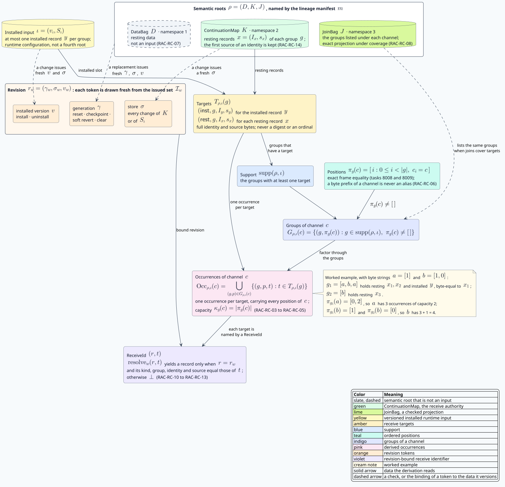
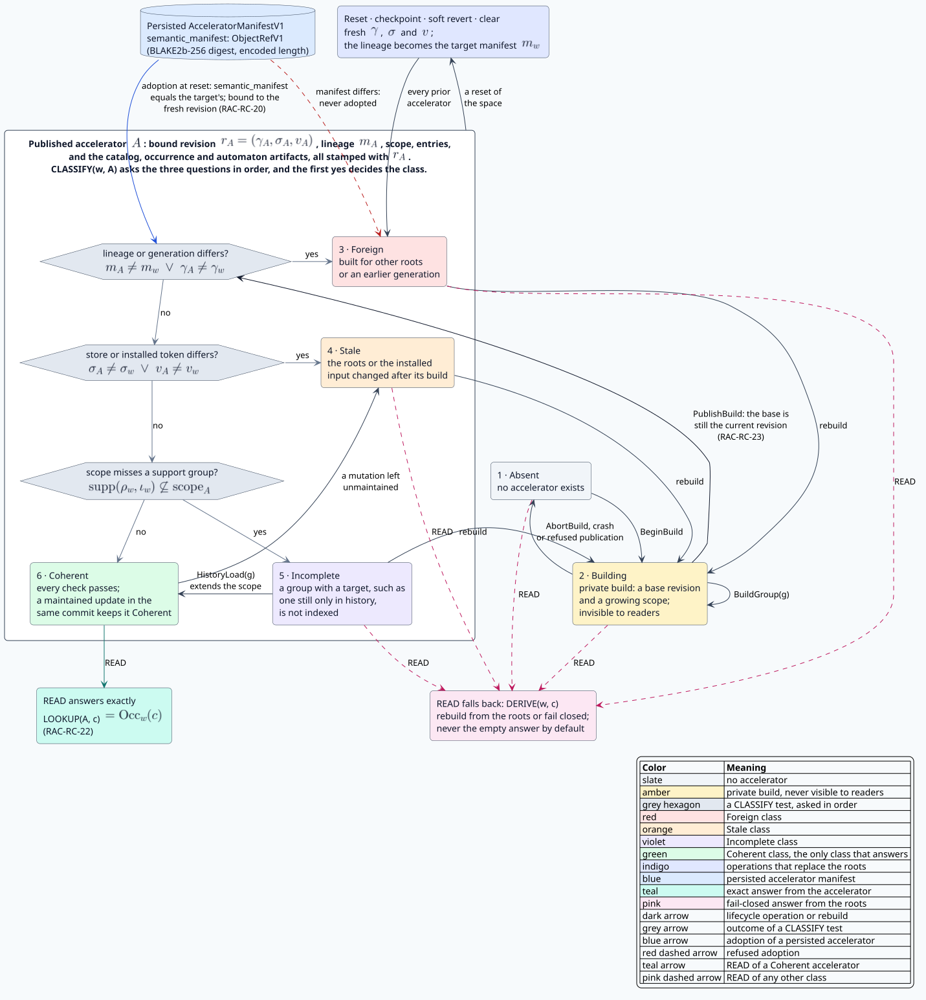
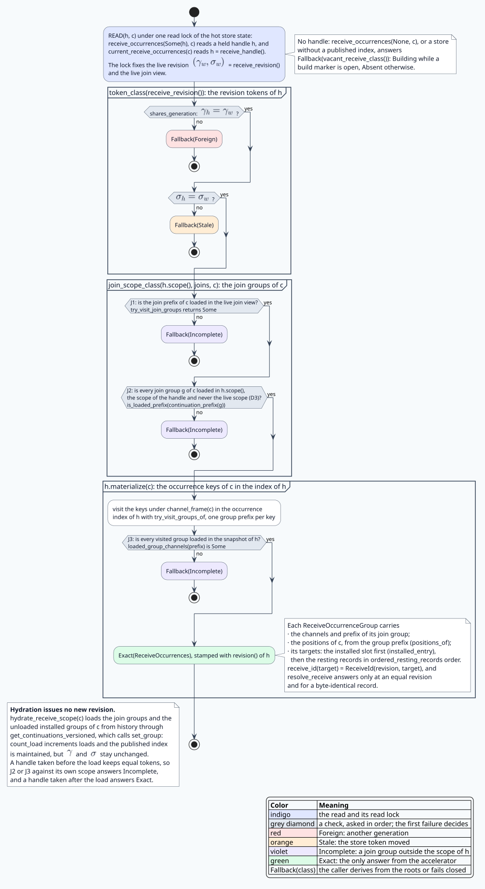
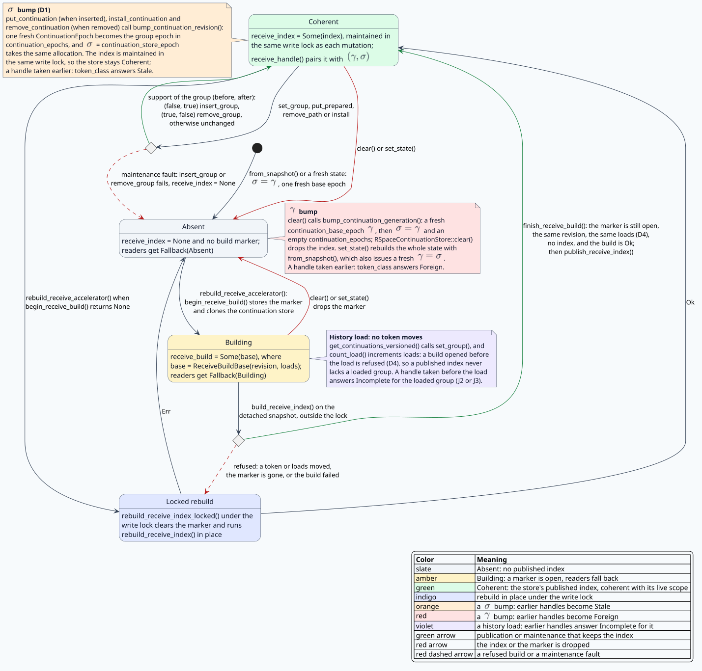

# PathMap Bag and RSpace matching integration

Status: implementation in progress and living engineering report

Campaign: `campaign-4131-rspace-pathmap-integration`

Historical experiment reference: `rspace-pathmap-end-to-end-layout-2026-08-15`
Last updated: 2026-09-07
Current implementation checkpoint: exact-channel two-level authority (introduced by this change set)

The [baseline acceptance ledger](#baseline-acceptance-ledger-2026-09-07) distinguishes
preserved historical results from currently retrievable evidence and remaining requirements.
Historical experiment numbers and passing-test counts below are not current campaign verdicts.

Chronological PathMap findings and negative results are maintained in the
[PathMap engineering journal](../pathmap/pathmap-engineering-journal-2026-08-23.md).

## Purpose and scope

This report specifies how RSpace can use a prefix-compressed `PathMap` bag without changing the observable contracts of Rholang communication, replay, persistence, or consensus. It is the implementation design for the `f1r3node-rust-mettail` campaign. The separate `reified-rspaces-mettatron-migration` epic consumes the interfaces produced here; it owns public Rholang `EBag` syntax and the later MeTTaTron-to-Rholang bridge. `EBag` names the language/schema expression consistently with `ESet`, `EMap`, and `EPathMap`; the internal RSpace `Bag` remains the storage-level `PathMap<Multiplicity>` abstraction.

The work has three separable layers:

| Layer | Authoritative representation | Responsibility |
|---|---|---|
| Bag algebra | `PathMap<Multiplicity>` | Unique byte paths, multiplicities, prefix compression, lattice operations, copy-on-write forks, and optional structural sharing |
| RSpace index | RhoPathV1 keys in one or more Bags | Candidate discovery, retained pattern indexes, deterministic reservation, and reversible projection to existing RSpace records |
| Matcher | Explicit pushdown automata over PathMap zippers | Directional spatial matching, ordered matching, associative-commutative matching, guard backtracking, and replay-equivalent selection |

Neither a `Vec<Par>` nor a hash table is an authoritative substitute for a trie layer. Compatibility vectors may be materialized only at legacy API boundaries, and their cost must be measured and removed from hot paths.

## Terms and notation

| Term | Meaning in this report |
|---|---|
| Bag | A multiset: each distinct element has a strictly positive multiplicity. |
| ACT | Arena Compact Tree: PathMap's compact physical trie snapshot family. |
| CAS | Compare-and-swap: an atomic conditional update that publishes a new value only when the observed old value is unchanged. |
| CBR | Consensus-Breaking Register: the stable identifier series in the living consensus-change report. |
| COMM | A Rholang communication event pairing a compatible produce with a waiting consume. |
| DFS | Depth-first search: traversal that completes one branch before moving to its sibling. |
| EPM | EPathMap: the PathMap-backed Rholang expression representation. |
| EPM1 | EPathMap format version 1: the direct compact trie image used at its versioned byte boundary. |
| PDA | Pushdown automaton: an iterative state machine with an explicit stack. |
| RMP | Rholang Match Path: the generated structural token format used by matcher queries. |
| RMP1 | Rholang Match Path format version 1: the self-delimiting structural token stream used by generated matcher queries. |
| RMP2 | Rholang Match Path format version 2: the current derived structural token stream, whose ParBag token hashes semantic constructor-tag/multiplicity/canonical-protobuf records rather than an ACT snapshot. |
| RPB3 | Rholang Par Bag key format version 3: one canonical PathMap endpoint containing a component-family tag, canonical score, canonical protobuf body, and big-endian score-length trailer. |
| RCI2 | Rholang Channel Image format version 2, represented in Rust by `ChannelImageV2`: the canonical logical image of one channel's RPB3 component Bag and root `connective_used` flag. |
| RSS | Resident set size: the physical-memory footprint attributed to a process by the operating system. |
| RSpace | The tuple-space implementation that stores Rholang data and waiting continuations and selects COMMs. |
| SHA | Secure Hash Algorithm: SHA-256 identifies the exact retained log bytes cited by this report. |
| mCRL2 | A process-algebra toolset used here for branching-bisimulation and modal reachability checks. |
| SMT | Satisfiability modulo theories, used to discharge bounded logical obligations. |
| TLA | Temporal Logic of Actions; its TLA+ language is used here to model state transitions and invariants. |

## Frozen pre-migration RSpace contract

The behavioral baseline is the target worktree at commit `dcc4600d4`, recorded by
`6a1c4341d`. This is a
source coordinate, not a second checkout: reproduce a historical observation
with `git show dcc4600d4:<path>`. The campaign does not maintain a shadow legacy
implementation. Instead, control arms disable the derived PathMap selector and
run the same production `consume` or `produce` entry point, while differential
tests compare the selected COMM, event log, and post-state. Those later control
arms isolate selector cost in their own production revision; they are not timings
of `dcc4600d4`, the `dev` branch, or the entire former RSpace implementation.

At the frozen coordinate, `RSpace<C, P, A, K>` owns the synchronization and
consensus-visible side effects, while `HotStoreState<C, P, A, K>` stores five
hash-indexed collections. Datum and continuation buckets are ordered `Vec`
values, so multiplicity is occurrence expansion and removal uses an integer
position. The history repository remains the checkpoint authority. The
event-log and produce-counter locks are separate from the hot-store lock, and
channel operations acquire phase-A and phase-B locks in sorted, deduplicated
channel-hash order.

| Frozen authority | Representation at `dcc4600d4` | Semantic responsibility | Replacement constraint |
|---|---|---|---|
| Resting data | `HashMap<C, Vec<Datum<A>>>` | multiplicity, candidate materialization, source metadata, persistence | `PathMap<Multiplicity>` may quotient identical complete records only if exact selected identities and historical order remain reproducible |
| Waiting continuations | `HashMap<Vec<C>, Vec<WaitingContinuation<P, K>>>` plus installed singleton map | bind patterns, continuation, peeks, persistence, source metadata | retained automata are derived indexes; they never become the continuation authority |
| Joins | `HashMap<C, Vec<Vec<C>>>` plus installed joins | discover channel groups that a produce can complete | updates remain inside the existing selected-match transaction boundary |
| History | radix-history repository over cold-store leaves | checkpoint roots, reset, export/import, replay state | cold bytes and roots are consensus surfaces until an explicitly versioned migration is approved |
| Event log and replay multimap | ordered IO/COMM events plus multiplicities | deterministic replay and ambiguity refusal | a PathMap selector may prune candidates but cannot change the recorded event or its multiplicity |
| Installs | RSpace install map plus installed hot-store collections | blessed/persistent system continuations | derived-index invalidation must preserve install availability across reset |
| Locks | sorted phase-A/phase-B channel locks; hot-store and log locks | atomic multi-channel reservation and publication | no retryable whole-state compare-and-swap loop may repeat matcher or event effects |

### Observable contract matrix

The matrix is the review index for the frozen contract, audited against source
at `329240271` on 2026-09-07. Its current witnesses test specific contracts; a file
reference is not a claim that its complete target was rerun during this audit.
“Control” means the
production matcher with derived RhoPath pruning disabled. “Treatment” means the
same public operation with the derived index enabled; the spatial matcher still
decides acceptance.

| Observable invariant | Frozen source seam | Executable evidence retained in the current tree | Required equality |
|---|---|---|---|
| Produce-driven COMM: consumes are already waiting | `RSpace::locked_produce` and `SpaceMatcher::extract_first_match` | `candidate_path_pruning_spec::datum_first_retained_queries_filter_waiting_continuations_before_spatial_match`; `rspace_comm` benchmark filter `waiting_receive` | equal selected result, event log and post-state; the named test separately counts spatial calls |
| Consume-driven COMM: data are already resting | `RSpace::locked_consume` and `SpaceMatcher::find_matching_data_candidate` | `candidate_path_pruning_spec::indexed_and_full_scans_have_identical_results_traces_and_post_states`; `rspace_comm` benchmark filter `distinct_` | equal selected result, event log and post-state, including absence of a match |
| Multi-channel join | phase-A/phase-B acquisition and candidate recursion | `storage_actions_test::consuming_on_two_channels_then_producing_on_each_should_return_cont_with_both_data`; `enabled_rendezvous_spec::t8_a_join_enumerates_its_cross_product` | atomic all-or-nothing reservation and the same binding order |
| Repeated channel | per-bind candidate selection and positional removal | `guarded_matching_tests::a_receive_taking_two_data_from_one_channel_removes_both` and `guarded_matching_tests::two_identical_occurrences_fill_two_binds_without_expansion` | enough multiplicity is required; indistinguishable occurrences do not create factorially distinct outcomes |
| Peek | selected indices retained or restored according to the peek set | `replay_rspace_tests::creating_a_comm_event_with_peek_consume_first_should_replay_correctly` and `replay_rspace_tests::creating_a_comm_event_with_peek_produce_first_should_replay_correctly` | same retained data and same peek metadata in the COMM |
| Persistent datum/continuation | `Datum::persist`, `WaitingContinuation::persist` | `storage_actions_test::persistent_produce_should_be_available_for_multiple_matches`; `storage_actions_test::doing_persistent_consume_and_producing_multiple_times_should_work`; `replay_rspace_tests::picking_n_continuations_from_m_persistent_waiting_continuations_should_replay_correctly` | persistent records remain available for later matches without duplicated effects |
| Guard timing and backtracking | `Match::check_commit` after a complete spatial assignment | `guarded_matching_tests::the_produce_path_backtracks_across_a_join` and `guarded_matching_tests::a_failed_guarded_search_restores_the_candidate_pools` | guard rejection restores reservations; the next canonical assignment is tried |
| Candidate order | `order_candidates_with_index` and stable serialized candidate hashes | `guarded_matching_tests::the_canonical_candidate_order_is_a_pure_function_of_the_candidates`; `replay_comm_order::distinct_projection_is_canonical_across_all_insertion_orders` and `replay_comm_order::comm_order_is_total_and_consistent_with_identity` | preserve canonical candidate ordering and the specified total replay-COMM projection; this does not make concurrent event emission order globally deterministic |
| Source and random metadata | `Datum::source`, `WaitingContinuation::source`, `ListParWithRandom::random_state` | `serializer_byte_goldens`; `serializer_par_byte_goldens`; `event_hash_encoder_differential::generated_encoder_matches_legacy_over_the_shared_corpora`; `record_index::continuation_join_lifecycle_equivalence::legacy_and_pathmap_continuation_join_lifecycles_are_identical` | preserve complete serialized records and random state; continuation deduplication uses source-free identity and retains its first source representative, rather than treating every serialized-byte difference as a new identity |
| Event history and replay | `log_comm`, replay COMM multimap, `ReplayRSpace` | `guarded_matching_tests::play_and_replay_agree_on_a_guarded_selection`; `guarded_matching_tests::play_and_replay_agree_when_the_guard_permutes_a_repeated_channel`; `epathmap_replay_equivalence_spec::epathmap_heavy_record_then_replay_reproduces_the_log` | selected assignment, event multiplicities, replay consumption and final state follow the recorded execution; runtime comparison is not an archived ordered-log golden |
| Checkpoint and reset | `create_checkpoint`, `reset`, soft checkpoint/revert | `storage_actions_test::create_checkpoint_on_an_empty_store_should_return_the_expected_hash`; `storage_actions_test::reset_should_change_the_state_of_the_store_and_reset_the_trie_updates_log`; `storage_actions_test::revert_to_soft_checkpoint_should_inject_the_event_log`; task 7941's coupled-identity fixtures | identical exact frozen ordered/compatibility state has the same legacy root; equal semantic DAG roots alone do not imply equal legacy roots |
| Export and import | history exporter/importer over cold-store leaves | `export_import_tests::export_and_import_of_one_page_should_works_correctly`, `export_import_tests::multipage_export_should_work_correctly`, `export_import_tests::multipage_export_with_skip_should_work_correctly`, `export_import_tests::empty_checkpoint_import_is_one_zero_object_terminal_page`, `export_import_tests::invalid_pages_leave_no_root_authority_and_the_same_session_can_retry`, and `export_import_tests::imported_state_can_be_reexported_and_mixed_with_a_new_checkpoint` | imported root and post-import behavior equal the exported source; invalid pages do not publish root authority |
| Malformed input | public `consume`/`install` arity guard before mutation | `consume_arity_refusal::play_consume_refuses_the_malformed_and_accepts_the_control`, `consume_arity_refusal::the_refusal_does_not_half_write`, `consume_arity_refusal::play_install_refuses_the_arity_mismatch_and_accepts_the_control`, `consume_arity_refusal::replay_consume_refuses_the_malformed_and_accepts_the_control`, and `consume_arity_refusal::play_and_replay_agree_on_every_malformed_shape` | literal refusal and no half-write for arity mismatch/empty-channel shapes, with a well-formed control; not an exhaustive arbitrary-byte decoder claim |
| Cold bytes and hashes | serializers and `StableHashSerialize` | `serializer_byte_goldens`, `serializer_par_byte_goldens`; `epathmap_canonical_fixtures::event_hash_goldens_produce` and `epathmap_canonical_fixtures::event_hash_goldens_consume` | byte-identical encodings within the pinned fixture epoch and therefore unchanged corresponding hashes; later format epochs must not be substituted for the frozen one |

The two arrival rows use the operation that completes a rendezvous, avoiding the
ambiguous older “datum-first”/“receive-first” shorthand. Existing test identifiers
are preserved. In particular, the test named `datum_first_retained_queries_...`
first stores consumes and then calls `produce`.

Task 7941's [coupled-identity result](../pathmap/pathmap-engineering-journal-2026-08-23.md#j-071--2026-09-07-bind-legacy-identity-to-coupled-state-not-a-presumed-root-projection)
supersedes the former unqualified phrase “stable root for identical logical state.”
Its concrete string-typed counterexample does not prove the whole Rholang trace
relation. The compatibility bridge implementation remains task 7942.

### Corpus and groundness audit

The executable corpus spans exact and wildcard single-channel matches,
datum-first and receive-first arrival, 2-by-2 joins, repeated channels,
duplicate multiplicity, peeks, persistence, guards, canonical-order reversal,
malformed arity, checkpoint/reset, export/import, and replay. The generated
Rholang corpus adds deep and wide `Par`, every descriptor root, ordered and
unordered collections, binders, remainders, and random-state variants. The
benchmark corpus adds shared-prefix and diverse-prefix cardinalities 1, 16,
256, and 4,096, duplicate multiplicities, and join arities.

Stored data are **not proven ground at the generic RSpace boundary**.
`ISpace<C, P, A, K>::produce` accepts an arbitrary `A`, `HotStore::put_datum`
performs no closedness validation, and the type system does not refine
`ListParWithRandom` to a ground-only form. Normal Rholang evaluation generally
supplies closed data, but direct Rust callers, imported historical state, and
malformed or future producers prevent treating that as an RSpace invariant.
This is a missing boundary guarantee, not a demonstrated accepted malformed
Rholang deployment. A query compiler must conservatively retain candidates it
cannot safely exclude. Spatial matching and guard backtracking remain authoritative;
fallback does not imply exactly one matcher invocation for an entire search.

| Corpus axis | Concrete retained witness | Evidence boundary |
|---|---|---|
| Ground/open terms and full schema | `models/tests/par_corpus/mod.rs`: `par_corpus`, `bind_pattern_corpus`, `tagged_continuation_corpus`; `serializer_par_byte_goldens` | Constructed oneof/root coverage and non-ground EPathMap fixtures; not proof that generic stored data are ground. |
| Linear/nonlinear captures | `rholang/tests/matcher/retained_path_index_test.rs`; `rholang/tests/matcher_state_isolation.rs` | Query admission/fallback and binding-state laws; full generated COMM lifecycle coverage remains 7964. |
| Deep/wide/shared structures | `par_corpus::deep_par`, `deep_mixed_par`, the `wide_sends` fixture; `matcher_recursive_family_cursor::recursive_family_cursors_match_at_depth_4096_on_a_fixed_native_stack`; the shared-prefix measurement files below | Shallow recursive-oracle comparison, separate deep-machine checks, and prefix-sharing workloads are different evidence classes; none proves all depth/width combinations. |
| Ordered/unordered collections, binders and remainders | `par_corpus::all_par_fields`, `bind_pattern_corpus`; `matcher_recursive_family_cursor::encoded_unordered_collections_preserve_backtracking_and_remainders` | Codec fixtures and direct matcher assertions, including captured remainders; not an all-pattern RSpace schedule matrix. |
| Multiplicity and churn | Repeated-channel rows above; `guarded_matching_tests::a_failed_guarded_search_restores_the_candidate_pools`; the continuation/join lifecycle witness | Exact reservations, rollback, first-source retention, checkpoint/reset/import and replay at the tested boundary. |
| Genesis | `casper/tests/genesis/genesis_vaults_order_determinism.rs::default_genesis_post_state_hash_is_pinned_across_processes` | An absolute current-epoch root pin; it is not a deployment-log corpus or the original frozen root. |
| Archived Rholang programs | `casper/tests/util/rholang/async_driver_differential.rs` and `async_driver_goldens.json` | Seven fixed-source programs and partial cross-process observations; the versioned limitations are recorded below. |

### Golden fixture epochs

An **epoch** here is the source/codec/contract coordinate at which an expected
observation was fixed, not a new consensus protocol number. Existing expected
values are not regenerated by this audit.

| Retained artifact | Capture or revision coordinate | What is pinned, and what is not |
|---|---|---|
| `rspace++/tests/serializer_byte_goldens.rs` | Captured from the value-shaped encoder `4e422b6b`; test introduced by `60aaa02e3` | String-typed datum/continuation serialized lengths and digests. This does not instantiate Rholang payloads. |
| `models/tests/serializer_par_byte_goldens.rs` | Introduced by `be6c90f37`; later ParBag revisions include `cd2a8bf6e` and `034f164a6` | Actual Rholang cold-record shapes, metadata and EPathMap encodings. Retrieve the file at `dcc4600d4` for that epoch; the current file is not automatically a pre-migration capture. |
| `casper/tests/util/rholang/async_driver_goldens.json` | Introduced by `6cd0a27c3`, narrowed by `2f56fac88`; present at `dcc4600d4` | Seven programs' failure, cost, COMM count/fingerprint and balanced-state flag. At `dcc4600d4` the fingerprint hashes sorted COMM debug renderings; there are no archived raw events, event ordering or absolute post-state roots. |
| Same async-driver golden | `3f0cd7339`, then `8701f470b` | The current fingerprint hashes sorted length-delimited canonical COMM protobuf. Sorting removes order and excludes standalone Produce/Consume events. These later fingerprints are not the original baseline. |
| `casper/tests/fixtures/genesis_state_hash_golden.json` at `dcc4600d4` | Original `33dddee17` revision | Historical genesis-only pin `cb7480d13e774ef931c0d22379cbe4deb6fed0f096d7ff93d507a2b3276d7efe`. This is a retained baseline artifact, but not a captured deployment log or its ordered events. |
| `casper/tests/genesis/genesis_vaults_order_determinism.rs` and the current genesis JSON revision | Test pin refreshed by `8701f470b`; JSON updated by `3f0cd7339` | Literal later-epoch genesis roots. The current JSON identifies a 2026-08-18 semantic epoch and must not be substituted for its historical `dcc4600d4` revision. |
| `rspace++/tests/state/atomic_state_authority.rs` | Retained-root fixture `e4d969741` | Empty/rollback/latest roots, history/cold/catalog inventory, page ordering, abrupt child exit and fresh-reader rollback/recovery. This is a later string-typed persistence-action fixture, not captured Rholang COMM events. |

No complete archived replay input with exact recorded events/order and pinned
final-root expectations was located in the bounded source/history audit. The
async-driver full-log projection was explicitly withdrawn by `2f56fac88` as an
unstable cross-process quantity; restoring that assertion would be incorrect for
parallel Rholang. A valid captured-log gate must consume the archived replay
rigging and reproduce its required selected COMMs and post-state. Preserved
capture order is evidence, not a new global emission-order invariant or a
requirement to reproduce a total thread schedule. This original
acceptance gap remains owned by 5636; dynamic play/replay equality and separate
partial goldens do not discharge it.

### Current-epoch replay archive (2026-09-07)

The subsequent capture adds `casper/tests/util/rholang/async_driver_replay_v1.json`
and its separate `.blake2b256` seal. It preserves all seven programs' complete signed
`ProcessedDeploy` protobuf payloads, including every archived Produce/Consume/COMM
position, cost, status and metadata, literal pre/final roots, complete replay context,
ordered public genesis inputs and the full genesis configuration. It does **not**
retroactively create a historical `dcc4600d4` archive or regenerate the earlier goldens.

The capture passed with seven plays and seven uncached self-replays; the archive is
156,228 bytes with BLAKE2b-256
`75bb293f49cb2a9e2c6f989924403b2edf6d825351c952288936759ae08232fc`
and SHA-256 `f61a0f6a99a0e17a1d2e805ec3b5625c55116a9872b678b12d950cf178b648cf`.
The capture identifies source HEAD `c57ba7fa7479093a81624cd2877e653e50cf3041`, exact
harness/schema/configuration file digests, the tracked-diff digest, the clean local
parser dependency `02cef80d32214ecdac3ee7d3b91c3786a34174d5`, compiler version and
build environment. The new harness was uncommitted at capture: its recorded content
digest, not HEAD alone, identifies that source. A tracked-diff digest by itself cannot
reconstruct a dirty checkout; the fixture is not a clean-HEAD benchmark observation.

V1 verification reads the fixture and seal, rejects missing/changed bytes and
incomplete context, checks typed protobuf decode/re-encode fixed points, attempts to
rebuild the exact pre-root and replays archived input without first playing its source. Both
`RuntimeManager` replay caches are disabled and independently checked. Full archive
order is separate from the runtime's intentionally order-insensitive rigging. The
formal contract and RA01–RA11 implementation obligations are in the
[existing proof report](../../../formal/rocq/stack_safe_pda/README.md#captured-replay-archive-contract-2026-09-07),
committed with the twenty contract checks and twelve example/control checks at
`ce333d452ff9bd8e6f32afd0c154d3e93920abce`. These conditional abstract proofs do not
verify the concrete runtime, codec, genesis construction or cryptography.

The first capture completed its runtime work but failed to publish because Cargo's
test working directory is `casper/`. The corrected capture resolves its explicit
destination against the repository root, validates the parent before execution and
uses exclusive creation; no old artifact was overwritten. The corrected test took
294.99 seconds, excluding its 77-second incremental build. Both commands used
systemd limits of 8 GiB memory-high, 12 GiB memory-max, zero swap, four build jobs
and 400% CPU quota, with database scratch under `target/campaign-5636-scratch`.
These are qualification run details, not a performance experiment or measured
per-operation RSS improvement.

Source and archive checkpoint `498f401a65f9a90a63357ce855983c965f5c52c6` preserves
the exact capture harness: its BLAKE2b-256 matches the recorded
`7a2b6f9aaf12dbb413636bdbbcb0b769709feacaf24018d17b1c2ec6bfbf994d`.
Fresh-process qualification passed five format/integrity tests, failed three runtime
tests at the pre-root check, and ignored the explicit capture entry (281.82 seconds).
The three runtime failures share the process-cached genesis construction; they are
not three independent root observations and did not reach the cost/status/COMM
mutation checks. The captured pre-root is
`ffd6bbbf7e48e9e6a062eef22d82e3559d298cd72e316748a8cbdf24b82b36f8`,
which differs from the existing default-genesis test's `87b8dede…846da87b` literal.
The original pin's exact test separately **passed** in 324.66 seconds under a
6 GiB/zero-swap cap, using the same compiled release binary. By source, both paths
use the same default test genesis parameters; they differ in wrapper/caching,
store scope and runtime thread configuration. This is an unresolved construction
discrepancy, not an approved successor epoch. Existing root-reachable task 5304
(`rederive-and-repair-blessed-normalized-term-pin-drift-2026-08-11`) owns attribution.
An additional fresh diagnostic process failed after 283.95 seconds and recorded
the regenerated pre-root
`0f19169db09e269dadc4094f5c6832b52a4c53f3ee61541130dd97f84987126a`.
It used a 6 GiB memory-max, zero swap and four workers; its diagnostic log has
SHA-256 `3a52f2eff5cf1798157587e8c8a7054459bda288ace6eeaeefdbb877b4adafc7`.
The current archive contains genesis configuration but neither the genesis
`ProcessedDeploy` traces nor an exported pre-state. Consequently, configuration
equality alone has not established the formal genesis-realization premise.
The bounded repair is to preserve the exact genesis replay input in a new archive
version and qualify reconstruction through the existing uncached genesis replay
API. It must preserve this v1 observation and the independent determinism obligation;
a fresh construction cannot retroactively supply the original capture's missing trace.
pgmcp artifact 489 preserves the capture, verification and diagnostic observations.
Neither the archive nor the old pin is rewritten, and the archive is not accepted
as a portable replay baseline yet. The original golden's SHA-256 remains
`d6772d138ee1d3a2cdab79de9c76dac0da40516e686d8cbfd02608f6669878c1`.

#### V2: establish the starting state through archived genesis replay

The reviewed refinement keeps v1 unchanged and adds a distinct
`async_driver_replay_v2.json` archive format. Its mandatory `genesis_replay` section
contains the exact bootstrap and genesis-final roots, complete invocation context,
and every genesis block `ProcessedDeploy` protobuf payload. Admission compares the
entire signed deploy envelope, including cosigners and threshold, in the order
produced by `Genesis::default_blessed_terms`; matching names or a nonempty count is
insufficient. Genesis event logs are the existing canonicalized block payloads,
whereas workload logs retain the order captured during workload execution.

Verification opens an isolated store through existing test helpers and materializes
the registry bootstrap through `RuntimeOps::empty_state_hash`. It checks that actual
root against the existing bootstrap pin and the archive, replays the captured genesis
with both caches disabled, and requires its resulting root to equal every workload
pre-root. It then replays the seven workloads from that root. Verification does not
call the cached genesis constructor or play any workload source first. Both stages
share the same runtime/state domain and default services/tags, but their distinct
genesis/workload flags, timestamps and senders are checked rather than conflated.

Formal-first checkpoint `b60f97259` proves the composition under explicit realization
premises and records the complete BR01–BR14 executable obligations. The two existing
Rocq modules passed thirty-four and twenty-one printed closed checks and combined
kernel checking under a 2 GiB/zero-swap cap. This is not a proof of deterministic
genesis construction or the concrete runtime. Independent source review found no
blocking implementation flaw. The release test build passed in 74 seconds.

Capture and complete restoration self-check **passed** in 582.09 seconds. The
1,954,666-byte archive binds fourteen genesis deploys and seven workloads with
BLAKE2b-256 `ffbafc7169cc2aa1b8c3ed39a4a0e3955138427b914dffbb787976ea44dafa3c`
and SHA-256 `269a9be9052a7deb299ac566a3ef6c18ea6a43011fef9ce4b38374079fe10598`.
The actual pinned bootstrap is
`382d0f2821eab27ac0163841f3838bc00a201bed6f8135e0a5746788420dbd51`;
archived genesis replay reproduces
`7599876cba4827ac9ce7eae1b534f6501ad06f4deca3403d73b7a229f2d811e8`.
Seven pure format/integrity tests also passed in 6.24 seconds, with explicit capture
ignored. The capture log's SHA-256 is
`7cbb67d0365467156124ed5f423c111bb76ed8c494b8856334c1f96f361fea00`.
These are qualification timings, not a backend speed or allocation comparison.

Fresh-process qualification with four test threads returned **eight passes, three
failures and one explicit capture ignored** in 322.16 seconds. The complete seven-program
positive replay passed, establishing actual reconstruction and workload replay in a
different process. The three runtime mutation/control cases instead failed while
restoring genesis: another scoped runtime advanced their shared physical authority
root. Their causal cost/status/COMM checks are not yet qualified.

Source review identified a campaign-introduced adapter regression at `f108c45c0f`:
`LmdbDirStoreManager::state_authority` ignores `Db.name_override` and opens literal
`rspace-history`, `rspace-cold` and `rspace-roots` for every scoped manager. Distinct
UUID scope labels therefore do not establish distinct state domains. The stale-root
refusal is correct. Required child 8283 (`rspace-authority-resolved-database-scope-isolation`)
under the original implementation owner 6094 now blocks 5636. Its repair must honor
the actual mapped database identities and retain concurrent tests; private directories
or test serialization must not conceal this scope-isolation regression. Artifact 491
records these results; the failed suite log has SHA-256
`9c9dc2a2a900eda42e0e64b24c775cf403cdf94ed7127a27436cb0b3eaebc898`.

Capture uses exclusive creation
and publishes the trace before attempting complete restoration, so a failed
restoration still leaves its exact input available for diagnosis. File existence is
not acceptance: both capture self-check and fresh-process verification must pass.
Checkpoint `61f83d73b` preserves the complete capture and exact harness. The harness
was not committed at capture HEAD `b60f97259`; its exact
BLAKE2b-256 is `4ea0d35e739f9a2861cfe2ceb9ac2e16d876d3f8036d4ed0f08f4407e6bfbbad`,
and the fixture also records configuration, tracked-diff and local-parser provenance.
The property test now explicitly uses its existing source-adjacent regression-seed
location: this integration-test tree has no `lib.rs` or `main.rs` ancestor. The
thirty-two-case test passed after a 75-second incremental build, without the previous
path-discovery warning; failure persistence remains enabled.
The current scope is 6 GiB memory-max, zero swap, four build jobs and 400% CPU quota,
with database scratch under `target/campaign-5636-scratch`. No blessed contract,
production runtime, old golden or original archive is changed. Task 5304's separate
construction discrepancy remains required even if archived replay succeeds.

#### Scoped-store repair and causal-control qualification

Formal-first checkpoint `64395f681` and implementation `52551503f` repair the
scope collision through exact independent physical database mappings and scoped
migration metadata. The twenty-invariant catalog, two failing pre-repair witnesses,
and **55/55** passing release state/migration tests are detailed in
[J-078](../pathmap/pathmap-engineering-journal-2026-08-23.md#j-078--2026-09-07-repair-physical-database-scope-isolation).
The unchanged concurrent archive suite then reaches **10 passed, 1 failed and
1 explicit capture ignored**: all seven workloads replay successfully, while a
COMM mutation is correctly refused under an unanticipated legacy error wrapper.
This is not yet a passing full gate. Artifact 498 and its log digest preserve the
result separately from the earlier scope collision.

Checkpoint `9308e7685` refines only the negative test's recognition of the complete
unused-COMM diagnostic with a canonical positive count. Unrelated internal errors
and malformed wrappers still fail the control; the two helper tests pass, including
32 generated cases. The successful control, actual `expect_err`, cost/status
checks and final-root checks remain. No runtime error semantics, archive bytes,
consensus pins, or fixture isolation change. The complete fresh-process concurrent
rerun at `9308e7685` passes **13 tests, 0 failures and 1 explicit capture ignored**
in 541.57 seconds; artifact 500 preserves log SHA-256
`0ad27f20209821fed1d71b26e3695b658b45800c2833d68b63b1f3569c64ecd5`.
This supplies the missing local runtime-control qualification for 8283 and the
v2 archive, but not independent CI verification or historical experiment provenance.
RA09 distinguishes the abstract refusal proof from this
concrete diagnostic evidence; no proof of the legacy failed-evaluation suppression
branch is inferred.

### Reproducible baseline evidence

The original source coordinate is pinned even though the measurement harness
was added later. The end-to-end Criterion controls invoke production RSpace and
disable only the derived selector. The table separates them from selector-only
or Bag-only microbenchmarks. “Recorded result” preserves a historical observation;
it is not a fresh statistical decision from this audit.

| Durable evidence | Production / harness coordinate | Recorded result and scope |
|---|---|---|
| [`rspace-retained-pathmap-prefilter-2026-08-15.tsv`](../stack-safety/measurements/rspace-retained-pathmap-prefilter-2026-08-15.tsv) | `ea8c39f92` / `7bc5c6994` | Six paired produce-driven COMM cells, 16/256/4,096 waiting consumes, shared/diverse prefixes; 51 samples and 99% confidence intervals; latency 18.828–30.835% lower. CPU 8 pinned, 5 GiB hard cap, zero swap. |
| [`rspace-resting-pathmap-prefix-2026-08-15.tsv`](../stack-safety/measurements/rspace-resting-pathmap-prefix-2026-08-15.tsv) | `564dac0b4` / same | Eight paired consume-driven COMM cells, cardinality 1/16/256/4,096; the singleton treatment regressed. Preserve the falsification rather than reporting every cell as a win. |
| [`rspace-resting-pathmap-singleton-repair-2026-08-15.tsv`](../stack-safety/measurements/rspace-resting-pathmap-singleton-repair-2026-08-15.tsv) | `0b601ce67` / same | Eight post-repair pairs under the same 51-sample, 99%-confidence, 5 GiB/zero-swap protocol. Singleton arms take the same direct scan: small point-estimate differences are not a new algorithmic speedup. |
| [`rspace-retained-bag-product-2026-08-16.tsv`](../stack-safety/measurements/rspace-retained-bag-product-2026-08-16.tsv) | Final production `61accc170`; replication checkpoint `304dc13e9` | Selector-only experiments 224/225 rejected and 226/229 historically accepted; 82 samples, recorded digests, 8 GiB/zero-swap cap. Small-cardinality fixed-cost losses remain visible. Not full COMM throughput. |

The committed files retain commands, host descriptions, resource settings, source
coordinates, per-cell estimates and run identifiers. The 2026-09-07 STDIO lookup
returned `experiment not found` for experiments 208, 218, 233 and 327; a listed
control record remained readable. A later read-only query of the current database
found no experiment, run, sample, hypothesis or result rows for those four IDs.
Thus the current service cannot supply their original provenance; its
`valid_to IS NULL` lookup filter is not the whole explanation.

On 2026-09-29, the existing pre-v86 pgmcp backup
`~/.local/share/pgmcp/backups/pgmcp-pre-v86-20260902T1658.dump`
(SHA-256 `afe3e1913c42001d3eba27de7f279e1c23d1d1e87e9bc449ab295ddd4be378c0`)
yielded original experiment, locked-hypothesis, run and sample rows for 208, 218
and 233. The tables were streamed with `pg_restore --data-only --table=... --file=-`;
the 9.6 GiB dump was neither copied nor restored. Every recovered run has command,
run-plan, host, source and time metadata. All 4,868 sample values are finite, and
replicate indexes are contiguous within each run/arm/metric/unit group.

| Original experiment | Recovered primary criterion and observations | Raw sample COPY-row SHA-256 |
|---|---|---|
| 208 | Locked 2026-08-15: increase `comm_operations_per_second`, Welch greater, α = 0.05, Cohen's d ≥ 0.5, planned n = 51. Forty-four complete runs × 51 samples = 2,244 observations; artifact 316 and heaptrack artifact 397 are in the dump. | `5516359d6967b378b3c2f4c2941c92f2272a31cda691b35c11d5f94de4b186a2` |
| 218 | Locked 2026-08-16: decrease singleton atomic-remove latency, Welch less with α = 0.01 and d ≥ 0.5, plus median improvement ≥ 5%, planned n = 82. Two finalized runs × 410 samples = 820 observations across five cardinalities; both original sealed run digests are present. | `d9c814f0a18b18b55f3d712b19266ab2e3d40773945bb9dcb5881f1939f2b73b` |
| 233 | Locked 2026-08-16: decrease mean exact EPathMap match latency, Welch less with α = 0.01 and relative change ≥ 5%, planned n = 33. Three complete runs contain 656, 656 and 492 samples, totaling 1,804; original artifact 321 is present. | `f2742e97912bda5ba3fc6a68c0ddfaa1504444a9dbf5d1761e25e6e77a1acaae` |

These digests cover each experiment's original PostgreSQL `COPY` sample rows, not a
new measurement or a claim that the current pgmcp service can query them. The
original run metadata records the benchmark command and host conditions, but the
audit has not established every observed compiler/Cargo version or environmental
override. The Criterion combined-metric caveat for 233 remains in force.

The retained September 5 Codex session transcript replays earlier pgmcp
call-and-response payloads for experiment 327. Its SHA-256 is
`65baa0891877faec9aa73ec0a08681a14f590bc2fc16ce95fb8c04ead5734775`;
the [bounded transcript extract](../stack-safety/measurements/rspace-act-lmdb-experiment-327-transcript-2026-09-29.json)
has SHA-256
`555566dc9cfced5b022da475588d970e664449b831406d2163e8478c3531d453`.
The preserved `experiment_open` result locked an **observational** criterion for a
shared-prefix, 128-byte-payload ACT/LMDB fixture at `87a9584b3`. Six successful
`experiment_record_measurement` calls preserve 18 size-labeled scalar values:
write throughput, lookup throughput and disk bytes for ACT and LMDB at 256,
4,096 and 16,384 entries. The ACT and LMDB run UUIDs are
`3dd6f37f-7709-4d2c-b3e4-97371382bcd9` and
`d0df5abd-1471-4a0b-85d6-44dfa5dd3d6e`; each received nine values.
Preserved artifact call-and-response payloads contain IDs 409–412 and their submitted
content. The retrieved historical snapshot still said `measuring`, with no
decision or sealed run digest. Its accepted disk-byte submissions carried a
unit-mismatch warning against the experiment's throughput unit. These 18
values are the original **pgmcp-submitted scalars**, not Criterion's ten
per-cell raw replicates; the transcript does not establish observed compiler
or Cargo versions. The transcript event timestamps mark the later replay, not
the benchmark or experiment creation times. This is retained original
call-and-response payload evidence, not a restored database export or a new
benchmark.

The earlier retrieval map (artifact 501) remains useful for cross-checking the
backup against committed summaries:

| Original record | Retrieval keys and remaining limits |
|---|---|
| Retained prefilter TSV | First evidence commit `609cfcab1`; 12 per-arm run UUIDs, beginning `8980971c-a0ba-41e4-8a6c-506f393f44b5`. |
| Resting-prefix TSV | First evidence commit `ebcb899f2`; 16 run UUIDs, beginning `dd32894e-5dd8-4992-9a26-b91aff58952e`. |
| Resting singleton-repair TSV | First evidence commit `a38d4ca8d`; 16 run UUIDs, beginning `adf842b0-7e4e-4e2e-8eac-1f8dfa9dae76`. |
| Single-root Bag publication, experiment 218 | `rspace-bag-single-root-commit-2026-08-16.tsv`, first evidence `2acd2b603`, retains both sealed digests. The backup now supplies the original two run UUIDs and 820 samples. |
| EPathMap byte-native algebra, experiment 233 | `epathmap-ac-byte-native-2026-08-16.tsv`; evidence commit `d65037977` identifies artifact 321, which is present in the backup. Preserve the invalid combined-metric disclosure after Criterion rotated its `base`; do not reconstruct controls from that directory. |
| Later retained-product replication | `0ed2274d8` identifies experiment **229**, artifact **320**, with the retained log digest in its TSV. This is not experiment 327 or a substitute for the original run. |
| ACT/LMDB comparison, experiment 327 | The September 2 dump predates this experiment. A later session transcript replays the original pgmcp payloads for the locked observational hypothesis, 18 submitted scalar values, two run UUIDs, artifact content/IDs **409–412**, and a `measuring` snapshot. The linked extract records exact source-line hashes, but its event timestamps are replay timestamps. Current pgmcp database rows, Criterion per-replicate samples, observed tool versions and a final experiment decision remain unavailable. |

All 44 original UUIDs remain in the first three linked TSVs and match the
recovered experiment 208 runs. Historical source declares Criterion 0.5.1 and
selects `nightly-2026-02-09`; those declarations do not establish actual compiler
versions or absence of overrides. Current get/list calls still fail to retrieve
the four experiments. The v2 replay archive separately passed 13 ordinary
concurrent checks with one capture-only ignore under task 5636; that archive is
not the remaining baseline blocker. Completion of the original provenance
obligation still requires reconciliation of the missing Criterion replicates,
observed tool versions and any required original database export against the
transcript-backed submission. No original data is declared deleted, and new
measurements cannot recreate historical preregistration.

The recorded 428-test package pass belongs to the August retained-product checkpoint,
not today's complete package. The later full-library failure and narrowly passing
repairs are classified below. A configured memory ceiling is not measured RSS;
scope peaks including compilation are not per-operation allocation measurements.

### Baseline acceptance ledger (2026-09-07)

| Original requirement | Evidence established by this audit | Remaining obligation / owner |
|---|---|---|
| Frozen authorities and observable contract | Source `dcc4600d4`, freeze `6a1c4341d`, corrected fourteen-row matrix, exact current test targets | Preserve ordered compatibility state and first-source retention through later implementations; concrete bridge 7942. |
| Captured and synthetic corpus | Named codec/matcher/lifecycle fixtures, preserved v1 failure and full genesis-backed v2 capture; the concurrent fresh-process suite passes all 13 ordinary checks, including causal runtime controls | Scope isolation is locally qualified under 8283; separate genesis-construction attribution remains 5304 and original baseline provenance remains 5636. Generated all-pattern lifecycle acceptance is separately 7964. |
| Reproducible capped measurements and preregistration | Committed source/harness coordinates, commands, resource envelope, run identifiers and summary files | Original preregistration, raw samples/artifacts and observed tool versions must be recovered and linked; 5636 remains open. No retroactive preregistration claim. |
| Failure classification | Finite inventory below, with existing reachable repair/acceptance owners | It is not an assertion that every workspace target currently passes. Whole-workspace qualification remains 5647. |
| Golden byte/order/root outputs | Independent literal serializer/genesis/history fixtures and a sealed full v2 replay capture, scoped to their epochs; the fresh-process concurrent suite passes 13 tests plus one capture-only ignore at `9308e7685` | The new archive cannot replace missing historical inputs. Actual v2 replay and causal controls are locally qualified; independent CI and separate genesis-construction attribution are not inferred. |
| Read and preserve the two living reports' semantics | Stack-safety report remains the dated measurement ledger with stable section identifiers; consensus register retains its may-change-consensus-only inclusion rule | This source/evidence correction changes no consensus surface or measured performance result. Activation, full resource measurements and independent verification remain open. |

#### Classified failure and non-acceptance inventory

This inventory covers the reviewed baseline measurements, the later known broad gate,
and the immediately preceding acceptance work. It does not substitute for running
the final workspace gate or silently change another task's disposition.

| Observation | Classification and evidence | Existing reachable owner |
|---|---|---|
| First resting-data singleton is slower | Historical performance defect, retained in the pre-repair TSV; exact singleton scan selected at `0b601ce67`, with the post-repair TSV retained. | 5642, `rspace-pathmap-index-layout`, retains final layout/resource acceptance. |
| Retained-query traversal trials and small-cardinality selector losses | Rejected intermediate treatments and explicitly scoped selector-only fixed costs; no inference that full COMM is slower or faster from these cells alone. | 5642; historical product experiments and final COMM comparisons remain distinct. |
| Valid dangling-path creation panics before ACT emission | J-057's release run passed 600, failed one, ignored one; the 2026-09-07 rerun at `9308e7685` passed 666, failed the same test, ignored one (artifact 499). Minimal sequence `[1]`, `[2]`, `[3]`, `[1,0]` reaches an empty sentinel; the regression seed is unchanged. It is not an ACT admission refusal or a memory-cap failure. | Existing 6023, `rpb3-single-parse-act-traversal-plan`, and 6038, `pathmap-upstream-integration-request-register` / PMU-006. No duplicate implementation task or upstream fork. |
| Structural removal loses a sibling in the superseded in-place proposal | Existing ownership-disjoint publication at `68534b6fc`, real-key witnesses `f4441c1d05`, and normalization qualification `329240271`. Task 6446 is `claimed_done`, not independently verified. | 6446, `guarded-pathmap-live-empty-root-write-safety`. |
| Whole-tree allocation costs during final guarded teardown | Dated scaling/ownership evidence is separate from the remaining allocation contract; normalization tests do not discharge it. | 6441, `guarded-pathmap-final-root-allocation-teardown`, and PMU-005. |
| Attempted normalizer-omission panic controls do not fail as hypothesized | Two expected-panic assertions were rejected during 6446. J-074 records the negative causal result; they are not passing regression evidence. | 6446's preserved verification history; no production fix inferred from either trial. |
| Captured pre-root differs from a fresh process's constructed genesis; separate old-pin test passes | Source/capture/verification evidence at `498f401a6`; the five pure archive checks pass but three runtime cases reject their shared regenerated pre-root. No root is silently refreshed and no causal attribution is claimed yet. | Existing 5304, `rederive-and-repair-blessed-normalized-term-pin-drift-2026-08-11`, through 4121 to root 4131; archive qualification stays 5636. |
| Independent database scopes share one physical RSpace authority | Original adapter `f108c45c0f` bypassed `Db.name_override` (artifact 491). Exact mapping/migration repair `52551503f` passes 55 state tests; strict test-only causal refinement `9308e7685` passes all 13 concurrent replay tests with one capture ignored (artifact 500). | Required child 8283 under 6094 is locally qualified, with independent verification separate. No isolated test directories or serialized-execution workaround. |
| Missing historical archive and currently unresolved experiment provenance | Historical acceptance-evidence gaps, not evidence that stored history was deleted. The new current-epoch capture is explicitly separate. | 5636, `rspace-pathmap-contract-baseline`. |

Remaining A/B/C layout qualification belongs to 5642, transactional matching to 5646,
generated matching/replay acceptance to 7964, full workspace/portability/closure to
5647, and equal-durability LMDB controls/measurement/decision to 7949/7950/7951 under
5693. These are required campaign work, not deferrals or implied completion of 5636.

## Current implementation checkpoint

The implementation has selected and built the exact-channel two-level PathMap authority. In the
terminology used below, an **authority** is the data structure whose contents define RSpace state; a
**derived view** is reconstructible from that authority and may be discarded without changing
semantics. The selected topology is an outer guarded `PathMap<ChannelSlot>` keyed by one exact
canonical channel marker. Every real endpoint owns a channel-relative `Bag`, itself a guarded
`PathMap<Multiplicity>`. A real empty `Bag` denotes loaded-empty; absence of the exact outer
endpoint denotes unloaded. `ChannelSlot::SyntheticBarrier` is teardown machinery and is never an
observable channel value.

The outer value stores `Bag` directly rather than `Arc<Bag>`: `Bag` already owns a guarded
copy-on-write PathMap root. Candidate catalogs clone that inner `Bag` in O(1) and therefore share
the authoritative root without rebuilding a relative trie. A multi-channel `BagDelta` is split at
validated `RhoPathV1` channel boundaries, applied to private channel-relative Bag candidates,
preflighted against final aggregate metadata, and published as one new outer root. Only touched
catalog entries are staged; untouched catalog `Arc` identities and untouched inner Bag roots remain
identical. Canonical egress visits exact outer endpoints and then traverses each inner Bag directly;
it does not flatten RSpace into `Vec<Par>` or sort a projection.

The in-memory topology is selected. Direct RBA1 checkpoint encoding, streaming, compatibility, and
restart recovery for this topology remain open production work and are not established merely by
the existing formal specifications or source-traceability registries.


| Stage | Commit | Current evidence | Disposition |
|---|---|---|---|
| Lawful `Bag` over `PathMap<Multiplicity>` | `a82288ae0`, `0d7a6a3f8`, `1560f4371`, `46aaa6472`, `7b3254573`, `8e4938ec6`, `cd01ea721`, `21ece399d`, `0f9beb5f0`, `87679597d`, `9a746f2bf`, `cd6099f50`, `4127119ea`, `281c1698a` | exact multiplicity laws, normalized reversible transaction deltas, direct canonical ACTree03 byte images, malformed-image refusal, a 200,000-byte compressed-key gate on a 256 KiB stack, 23 legacy/differential laws, multiplicity-independent construction allocation, clean comparative microbenchmarks, kernel-checked Rocq/Verus proofs, versioned atomic live accepted-match commits, exhaustive schedule invariants, branching-bisimulation evidence, one-root publication, and adaptive direct/cursor delta traversal selected from preregistered measurements | implemented as each channel's datum authority and as the accepted-match transition carrier; transaction-level allocation/RSS/instruction profiling is closed |
| Canonical framed `RhoPathV1` | `651f278aa` | exact-channel isolation, structural-prefix pruning, malformed-key refusal | implemented |
| Multiplicity-aware datum index | `5d4c5eca9` | one trie key per identical complete record; one decode per distinct key | implemented |
| Authoritative hot-store datum trie | `ccec9b730`, `bd55758e4` | history fill, loaded-empty state, snapshots, indexed compatibility removal, and package tests | implemented |
| Exact-channel two-level authority | introduced by this change set | exact outer endpoints own channel-relative Bags; loaded-empty is an explicit real endpoint; aggregate counts are checked; channel replacement and multi-channel deltas prepare privately and publish one outer CoW root; candidate pools share the selected inner Bag root; 18 focused topology/CoW/stack properties, eight replacement-invariant tests, and 25 public data-index tests pass under capped zero-swap execution | in-memory topology selected and implemented; direct RBA1/ACT persistence and full formal-to-property closure remain open |
| Multiplicity-native matching pools | `5329b27a3`, `173bf4e07`, `39bc0d999` | exact-path firing; immutable authority plus a separate multiplicity-aware reservation Bag; fresh-datum addressing; repeated-channel duplicate tests; explicit invalid/double-release and phase-boundary refusal | implemented; reservation-pressure performance comparison remains open |
| Atomic accepted-match commit | `cd01ea721`, `21ece399d`, `0f9beb5f0`, `87679597d`, `9a746f2bf`, `cd6099f50`, `4127119ea`, `281c1698a` | play and replay normalize every selected nonpersistent stored identity plus any unconsumed arrival into one exact-key `BagDelta`; an opaque group-scoped `Arc` epoch rejects a stale continuation address without counters or ABA; one hot-store write lock validates continuation identity and metadata, persistent datum witnesses, and the complete delta before publishing datum, continuation, epoch, and join state; effects are emitted only after acceptance; focused adversarial concurrency/reset/history cases and every `rspace_plus_plus` test target pass. Rocq proves deterministic acceptance/refusal and complete state, TLC checks 710,528 distinct states, and mCRL2 proves branching bisimulation plus no partial, pre-commit-log, or stale-commit observation. The exact release workspace passes 4,511/4,511 tests with 53 skipped under a 24 GiB, zero-swap cap. A frozen git-history control and ten-cell matrix show one lock/root in every accepted atomic cell, no stale mutation/allocation/root, hard narrow-cell CI guards below 1.05, and material repeated-16/join-32/arrival improvements; RSS is neutral and adverse persistent/singleton-tail observations are retained | implemented and transaction-level measured across datum removal, unconsumed-arrival insertion, continuation removal, and join cleanup in all four play/replay consume/produce paths; the broader CBR-053 generated schedule campaign remains independent and open |
| Shared canonical candidate catalogs | `2eb0d3871` | one canonical order and one lazy decode cell per distinct record across channel-pool snapshots; multiplicity-only updates do not rebuild the catalog | implemented |
| Single-lookup hot-store reads | `d50b1183d` | one encoded prefix and one loaded-store read lock per hot pool/data lookup; final performance verdict remains pending | implemented |
| Retained receive automaton, ordered query slice | `a89cbc294`, `f149cef2b`, `ea8c39f92`, `e1a587c9f`, `697db373b`, `ad395c357`, `61accc170`, `304dc13e9`, `4f63119c0`; benchmarks `7bc5c6994` and `rspace_retained_automaton_build`; pgmcp `rspace-retained-set-automaton` and experiment 241 | one `PathMap<TerminalId>` transition segment per bind position; supported queries reside at their longest exact structural prefix and residual wildcard/capture instructions run on canonical datum bytes; fixed-width terminal/candidate identifiers; root fallback terminals; immutable whole-revision rebuilds contain no dead transitions; group-local versioning; no trie clone on cache hits; the fresh path and authoritative resting Bag are both queried without flattening; 11/11 focused release automaton and 1/1 isolated allocation-slope gates pass, including one-million-byte depth and 20,000-terminal width on a 128 KiB stack; the 21-family ordered differential preserves play/replay results, event histories, stores, and roots; experiment 229 accepts the shared/256 primary and artifact 320 replicates the complete diverse/shared causal-selector matrix | ordered query prefilter and direct retained-automaton/Bag product implemented; experiment 241 rejected query hash-consing, so production retains the faster owned residual query per terminal; associative-commutative schedules, captured eligibility measurement, and the full equivalence campaign remain open |
| Receive-first Bag/query product | `564dac0b4`, `0b601ce67`, `f43858ec2`, `b6b53d1b3`, `697db373b`, `514659e2b`, `27557c374`; pgmcp `rspace-pattern-over-pathmap` and experiment 220 | synchronized borrowed read zippers over the authoritative `PathMap<Multiplicity>` Bag and derived fixed-width `PathMap<CandidatePosition>` index; exact terms, whole-term wildcard/free-variable captures, ordered list remainder, and nested variables across every ordered single-expression schema family use generated cursor events; exact nested instruction prefixes descend the trie before a stack-safe byte PDA skips subvalues; nonlinear Rholang capture levels and associative-commutative carriers fail closed to the authoritative spatial matcher; canonical order is restored before that oracle; 8/8 query/product cases, 64 generated differential corpora, and 11/11 query compiler cases pass; a structural zero/one-candidate base case removes the measured singleton regression without an empirical cutoff; post-repair throughput improves 48.7–53.4% at 16 entries and 239–257× at 4,096; experiment 220 rejects per-byte borrowed `TrieRef` focuses by 61.953% at the 256-candidate primary and retains the mutable read-zipper product | ordered nested product implemented; associative-commutative schema coverage and equivalence campaign open |
| Generated full-schema cursor | `71d378e73`, `697db373b`, `5f768e7ce`; pgmcp `rspace-shared-match-pda`; two fresh release builds generate the same 18 files byte for byte: [`generated-match-tables-provenance-2026-11-13.tsv`](generated-match-tables-provenance-2026-11-13.tsv), written by `scripts/check-generated-match-tables.sh` | the shared descriptor pass emits tag-ordered `RhoMatchProgram` tables plus exhaustive `ParCursor` accessors for all 58 messages and five oneofs; `RhoPathCursor` traverses optional, sequence, map, scalar, and oneof shapes with a heap worklist; the Rholang query compiler now consumes that cursor for every ordered single-expression family; EPathMap is a native trie delegation event and does not force `trie_snapshot()`; Rocq proves exact/hole/ordered compilation preserves spatial success, and the executable compiler differential observes every generated root while checking recursive-oracle successes | schema traversal, ordered compiler soundness, and the direct retained-automaton/Bag product are implemented; associative-commutative instructions and complete generated schedules remain open |
| Generated structural match path | `155ecdf54`, `d858058d4`, `edd166671`, `b6b53d1b3`, `697db373b`; pgmcp `rhopath-v1-codec`, `rspace-shared-match-pda` | stable generated type IDs and field/oneof tags drive a self-delimiting `RMP1` token stream; datum, exact receive-pattern, and ordered nested-query literal runs use one event encoder; EPathMap contributes mode, cardinality, and a domain-separated BLAKE2b-256 digest streamed by a native logical zipper DFS; the zero-copy byte cursor validates descriptor-exact child types and oneof payloads and locates a subtree extent iteratively; nested query execution distinguishes one-layer in-memory frames from two-layer stored PathMap frames; map values deliberately remain a conservative oracle-checked lane | exact, whole-term, and all ordered single-expression nested instructions live; associative-commutative instructions remain open |
| AC element candidate Bag | `250e96c80`, `2d91c4394`, `bbe91b90f`, `3a70ddc58`, `ad5d37a59`, `26b72b096`, experiment `facfedf15`, retained control `eb5d4c580`; pgmcp `rspace-ac-multiplicity-matcher` and experiment 246 | the existing stack-safe augmenting-path PDA remains authoritative; every unordered `Par` field root now uses generated RhoPath queries against exact structural-plus-canonical-bincode identity paths in `Bag` (`PathMap<Multiplicity>`), including `Send`, `Receive`, `New`, `Expr`, `Match`, `Bundle`, `GUnforgeable`, and `ReceiveBind`; dynamic receives conservatively decline ordered pruning because their binds are AC; fixed-width nonzero `u64` group identifiers reach original positions only as ordering witnesses; unsupported/nonselective/nonlinear patterns use the complete domain and structural collisions reach the spatial oracle; adjacent byte-identical normalized targets reuse one encoded identity; true duplicates record search visitation as Bag multiplicities while all-distinct targets retain the smaller one-bit lane; indistinguishable universal remainder vertices are quotient-compressed into initial occupancy plus one generic heap-PDA displacement cursor, and the final remainder is the target Bag minus the term-consumed Bag; exact diagonal and 128-send controls require 128 edges, the width-128 remainder control requires one term edge, and the unchanged 51-sample displacement control remains exhaustive at 16,257 treatment edges versus 699,263 nominal calls; experiment 246 found that committed `BagDelta` occupancy changed the 4,096-target mean from 80.921 ms to 80.623 ms, only a 0.369% improvement with a one-sided p-value of 0.09776, so production retains the final scan | candidate membership, final residual multiplicity, duplicate search visitation, and compact remainder occupancy are Bag-authoritative; the measured incremental `BagDelta` reservation design is rejected and recoverable at `facfedf15`; alternative term-reservation designs require a new preregistered hypothesis, while constrained-first dynamic AC search, residual-state memoization, and full assurance remain open |
| Byte-native EPathMap AC algebra | `48e6f7d3c`, `92240a452`, `03685f4c7`, `1196fe2cc`, `d659157f2`; pgmcp experiment 233 | exact set/map pattern keys are classified from allocation-free canonical metadata; exact target subtraction and selection operate on raw encoded `PathMap<()>` masks; map values remain borrowed `Par` payloads; dynamic keys decode exactly once at their semantic boundary; one moving write zipper applies lexicographically ordered map-key subtraction to one copy-on-write root | implemented and measured; mean latency is 8.17–13.64× lower for sets and 3.00–3.63× lower for maps across 16/256/4,096 entries; dynamic semantic matching remains deliberately decoded |
| Retained-automaton/Bag product walk | `ad395c357`, `61accc170`; pgmcp `rspace-retained-set-automaton`; experiments 224, 225, 226, and 229; replication artifact 320 | an iterative synchronized zipper product intersects every retained-transition segment with the authoritative `PathMap<Multiplicity>` Bag in the same escaped byte domain; the unrelated fresh datum remains a zero-allocation byte stream; one distinct Bag key and at most one eligible non-root terminal depth use zero or one exact PathMap lookup, while multi-depth and multi-key cases retain the linear zipper product; no datum decode, Bag flattening, or occurrence expansion occurs; artifact 320 confirms 4.476× and 13.338× wins at shared/256 and shared/4,096, and records diverse-prefix wins of 1.059× and 7.803× at the same cardinalities; both cardinality-16 causal-selector cells retain fixed-cost losses, while existing end-to-end COMM measurements win at 16 because they include avoided spatial work | implemented and measured; shape-sensitive causal fixed costs and allocation/RSS comparison remain visible; no empirical cutoff is inferred from the selector-only microbenchmark |
| Layout selection and performance verdict | pgmcp experiments 208, 224, 225, 226, and 229 | retained-receive slice passes its preregistered five-percent throughput threshold at 99% confidence; resting-data pruning is non-regressing at one entry after the structural base-case repair and passes from 16 through 4,096; the direct datum-first product wins at the preregistered shared/256 and large cells after two rejected designs; the exact-channel two-level topology removes the flat authority's prefix-replacement and relative-subtrie reconstruction costs; a clean full-workload resource matrix for the new topology remains open | topology selected on semantic/architectural grounds with prior causal measurements retained; final post-selection performance verdict remains partial |

The canonical egress work, tracked as pgmcp item `rspace-trie-native-canonical-egress`, was
delivered by the commits listed here, one entry per closed child item. Each commit was found by
searching the history with `git log -S` for an identifier that the change introduced, or with
`git log` for a file that it added or changed; the entry names that identifier or file.

- `rspace-datum-identity-cold-store-stream`: `2d95619cf` streams resident datum identities into
  checkpoint leaves (`rspace++/src/rspace/data_index.rs`), `583f21e44` hashes a history leaf from
  two borrowed chunks (`rspace++/src/rspace/hashing/blake2b256_hash.rs`), and `3061b2501` streams
  canonical DATA into the final persisted value (`rspace++/src/rspace/history/cold_store.rs`).
- `rspace-continuation-join-native-egress`: `ba7a8b3bd` adds `CanonicalRecordPlan` and its replay
  to `rspace++/src/rspace/record_index.rs`, and `77f6c8fe2` adds the lifecycle differential
  `rspace++/tests/record_index/continuation_join_lifecycle_equivalence.rs`.
- `rspace-canonical-egress-equivalence-and-formal-gates`: `9ed605a81` adds the checkpoint egress
  and publication proofs (`formal/verus/rspace_canonical_egress.rs`), `70fae0a9d` extends them to
  the publication of complete DATA values
  (`formal/tlaplus/stack_safe_pda/RSpaceCanonicalEgress.tla`), `df8e0cf81` adds `ParOwnerCensus`
  and `CertifiedLengthTranscript` to `models/src/rust/rholang/protobuf_schema.rs` together with
  their proofs, and `0065278e3` restores the identity insertion that release builds had removed
  (`models/src/rust/rholang/canonical_par_identity.rs`).
- `rspace-egress-versioned-cursor-horizon-admission`: `f108c45c0` adds the cursor protocol
  discriminator `StoreItemsCursorProtocolProto` to `models/src/main/protobuf/CasperMessage.proto`.
- `rspace-affine-state-authority-atomic-migration`: the same commit, `f108c45c0`, adds the affine
  import session, `rspace++/src/rspace/state/import_session.rs`.
- `rspace-authority-resolved-database-scope-isolation`: `64395f681` proves the scope and layout
  contract (`formal/rocq/stack_safe_pda/theories/RSpaceCallerAuthority.v`), `52551503f` repairs
  the adapter (`rspace++/src/rspace/shared/lmdb_dir_store_manager.rs`), `9308e7685` qualifies the
  replay refusal that the archive test expects
  (`casper/tests/util/rholang/async_driver_replay_archive.rs`), and `ebe2fd5b9` records the local
  acceptance in `docs/design/pathmap/pathmap-engineering-journal-2026-08-23.md`.

At `f43858ec2`, each exact channel produces a `CandidatePool`. Since `173bf4e07` and `39bc0d999`, its semantic
membership authority is a channel-local `Bag`, obtained as a copy-on-write PathMap subtrie through a
read zipper, while a second initially empty Bag records only speculative nonpersistent demand. Pools share a
derived `CandidateCatalog`: its `Arc` order table contains one lazy decode cell per distinct trie
key, not one record per occurrence. A single `PathMap<CandidatePosition>` maps the complete relative
RhoPathV1 key of every catalog entry to a fixed-width `u64` position. The same trie supplies both
known-path membership for persistent zero-to-one reactivation and structural-prefix candidate
positions; there is no duplicate unit-valued membership trie and no platform-width trie payload.
The position trie is built with the catalog, not against every lookup; it is non-authoritative and
is refreshed after a permanent membership change. The authority `PathMap<Multiplicity>` Bag remains
the sole membership authority.
The explicit matcher PDA increments and decrements the reservation Bag during descent and rollback;
it never rewrites authority during selection. Availability is the pointwise inequality
`authority.count(path) > reserved.count(path)`.
An accepted stored candidate carries its complete trie path; an arriving produce carries the
separate `Fresh` address. Firing therefore removes by exact path and cannot suffer positional-index
shifts.

For a compiled receive-first query, `CandidateProductCursor` keeps one borrowed read zipper on the
authoritative Bag and one on the position trie. Exact bytes descend both cursors together; wildcard
steps enumerate only the intersection of their child masks; a terminal position is emitted only
when both cursors carry a value. The query scanner validates the two framing layers iteratively,
including escaped zero bytes. The supported fragment comprises exact whole terms, whole-term
wildcard/free-variable captures, ordered list remainder, and whole-`Par` holes nested inside every
ordered single-expression schema family. A single `PathMap<()>` records capture levels across the
complete bind pattern. If a level repeats, the compiler rejects the derived query and preserves the
spatial matcher's historical accumulation semantics; it does not reinterpret the repetition as
generic RhoPath equality. For the nested fragment, the product first descends the doubly escaped
exact instruction prefix through both tries, then an iterative token PDA consumes one complete RMP1 subvalue per
wildcard or capture. Fixed-width positions are sorted before scanning, so product
pruning removes candidates without changing the predecessor's canonical order. A fresh datum is
tested through its retained path, and the Bag is checked again before every reservation; neither the
catalog nor the position trie can invent membership. The optimization is fail-closed for generic
matchers and unsupported associative-commutative or schema shapes. The existing spatial matcher
remains the final acceptance oracle, including for structural false positives.

The first retained receive automaton slice is also live. Each bind position owns a
prefix-compressed `PathMap<TerminalId>`. `TerminalId` and `CandidateId` are fixed-width `u64`
newtypes. A compact append-only terminal arena links candidates that share a path; it is secondary
payload storage, not a second transition authority, and neither candidate nor terminal identifiers
are reference-counted. `TerminalId` uses a nonzero one-based encoding so its optional predecessor is
one 64-bit word; each arena node is therefore two fixed-width words. Exact-ground `BindPattern`
values and supported `RhoPathQuery` prefixes use the same canonical structural path as
`ListParWithRandom` data. A supported non-ground pattern is installed at its longest exact prefix;
its residual query must accept the datum's canonical bytes before its terminal is selected. Every
unsupported remainder, connective, associative-commutative shape, or otherwise non-indexable
pattern is installed at the segment root as a universal fallback. The fresh datum is always walked
through the retained segment. When the target channel already contains data, the same segment is
also intersected directly with the authoritative Bag, because a valid COMM may consume only resting
data and leave the fresh produce in place. A reached resting terminal is retained conservatively;
its residual wildcard/capture query is evaluated later by the ordinary candidate scan. The PathMap
selection is therefore a conservative superset prefilter; the existing spatial matcher remains the
acceptance oracle and canonical candidate order remains the selection order.

Compiled automata are derived, sharded by channel group, and keyed by a pair consisting of the
store generation and that group's independent continuation revision. An unrelated receive does not
invalidate the group. State replacement and clear advance the generation; counter saturation
disables caching rather than accepting a stale automaton. Cache hits borrow the trie during the
iterative zipper query and never clone it. Empty groups remove their cache entry.

Every compiled value is an immutable projection of one complete live continuation slice. A version
change constructs a new projection and publishes it as one cache value; there is no incremental
tombstone state, so the live-terminal count always equals the terminal-arena length and the dead
count is exactly zero. Consequently the proposed `dead > live && dead >= 4096` rebuild rule is not a
missing threshold in this representation: its predicate is unreachable. Introducing it would first
require a different incremental identity and ordering design plus comparative evidence.

Experiment 241 tested whether identical residual `RhoPathQuery` programs should instead be
hash-consed. Its treatment placed one nonzero, fixed-width `QueryId` in each terminal and stored each
distinct query once in an append-only arena; a transient hash table used full equality to resolve
collisions. The causal control preserved the immediate predecessor's owned query per terminal. Both
arms built the same `PathMap<TerminalId>` chain in candidate order, selected the same vector, and used
distinct continuation bodies so the fixture represented a legal live group.

The arena was slower at every cardinality: **7,267.05 ns versus 5,651.18 ns** at 16 (**+28.59%**),
**111,798.36 ns versus 101,382.11 ns** at 256 (**+10.27%**), and **1,786,732.56 ns versus
1,685,976.60 ns** at 4,096 (**+5.98%**). The primary one-sided Welch test therefore rejected the
treatment ($`t = 173.2981`$, $`p = 1.0`$, Cohen's $`d = 27.0646`$), and both smaller cells exceeded
the preregistered five-percent regression guardrail. Production retains owned residual queries. The
benchmark keeps the rejected arena locally for reproducibility; no `QueryId`, hash table, or query
arena remains in the production compiler or selector.

`RetainedSetAutomatonStats` records indexed and fallback candidates/patterns, total and distinct
terminal paths, shared terminals, maximum terminal depth, and the live/dead invariant. RSpace
accumulates those values, cache hits, and compile time through operational metrics. Thus actual
eligibility and terminal-sharing fractions can be measured on captured workloads rather than
inferred from the supported schema roster. The focused gate compiles, selects, and drops a
one-million-byte terminal path and a 20,000-terminal shared chain on a 128 KiB worker stack. An
isolated counting allocator verifies that doubling 1,024 live terminals to 2,048 remains below a
threefold allocation-count and allocated-byte envelope. The complete evidence is recorded in
[`../stack-safety/measurements/rspace-retained-query-arena-2026-08-16.tsv`](../stack-safety/measurements/rspace-retained-query-arena-2026-08-16.tsv).

Checkpoint `e1a587c9f` makes the retained automaton consume the same query contract as the
receive-first product. It does not create a redundant Bag for the one fresh datum: the authoritative
waiting-pattern transition relation remains the existing prefix-compressed PathMap segment. Exact
prefixes perform trie cuts; residual wildcard and capture instructions inspect the already available
canonical datum bytes; unsupported patterns stay at the root. A 256-waiting-receive control/index
differential preserves the fired COMM, event trace, and post-state map while reducing calls to the
spatial matcher from 256 to 1. This is executable superset evidence, not the final formal proof or
the preregistered expanded workload/resource verdict.

Checkpoints `ad395c357` and `61accc170` close the distinct datum-first product gap. Every retained
segment and the authoritative resting Bag are traversed in their shared escaped structure-prefix
domain. Common child masks drive an iterative depth-first product; reaching a retained terminal
proves that some resting record has that prefix, without decoding the record or constructing a
`PathMap<()>` beside the Bag. The product may admit a residual-query false positive, but it cannot
accept a COMM; `CandidateScan` and the spatial matcher retain that authority. For a Bag with one
distinct key, multiplicity does not affect existence. A generated, deduplicated terminal-depth
schedule therefore performs no non-root lookup when the key is too short and one exact
`PathMap::get` when only one terminal depth can prefix it. Multiple eligible depths and all multi-key
Bags use the synchronized zipper product, which bounds traversal by the visited common trie edges
rather than a sum of repeated prefix searches. Zipper movement is executed outside `debug_assert!`,
so release and debug builds have the same state transitions.

The causal sequence is preserved rather than hindsight-edited. Experiment 224 rejected the initial
bytewise product because shared-prefix cardinality 256 was 2.104× slower than the full scan despite
large-cardinality wins. Experiment 225 cut that treatment by 43.6% with compressed-run descent but
remained 14.5% slower than control. Release preflight then exposed assertion-gated zipper movement
before any experiment-226 timing sample was collected. The repaired terminal-depth specialization
passed every equivalence preflight and experiment 226 accepted it. A final complexity review added
the multi-depth linear fallback; exact-source experiment 229 accepted **207.20 ns versus 840.48 ns**
at shared/256 and **1.183 µs versus 13.712 µs** at shared/4,096. Shared/16 remains an explicit
fixed-cost crossover, **136.23 ns versus 52.70 ns**, not a universal-win claim. Raw summaries and
sealed pgmcp digests are in
[`rspace-retained-bag-product-2026-08-16.tsv`](../stack-safety/measurements/rspace-retained-bag-product-2026-08-16.tsv).

Checkpoint `697db373b` removes the EList/ETuple-specific compiler gate. The generated
`RhoPathCursor` now supplies exact and hole events for all 16 ordered binary expression variants,
the ordered unary variants, `EMatches`, methods, and the previously supported list and tuple
families. Associative-commutative carriers, connectives, variables, and list remainders retain their
conservative lanes. Rholang receive binders are linear, but persisted or hand-built nonlinear
`BindPattern` values retain an older accumulation behavior; the capture registry therefore rejects
repeated levels and falls back before the generic query language can impose equality. This is an
eligibility refinement only: no spatial verdict, binding environment, serialized byte, or RSpace
ordering rule changes.

Checkpoint `250e96c80` reuses those generated queries inside unordered ESet/EMap element
selection without replacing `ListMachine`. A prefix-compressed target index maps each structural
path to a fixed-width nonzero `u64` arena head; the flat arena preserves every collision and
duplicate position, and the resulting boxed `u64` domains are sorted back into original target
order before the existing augmenting-path PDA observes them. A missing, unsupported, or
nonselective query returns the complete domain. An RMP1 collision is only a false positive and still
reaches the spatial matcher. This first AC slice therefore removes spatial edge evaluations but
does not yet make a PathMap Bag the mutable residual search state.

Checkpoints `bbe91b90f` and `3a70ddc58` generalize this lane without changing its verdict
authority. The generated cursor and the reused one-walk canonical-bincode encoder now give every
`MatchValue` variant an exact structural-plus-identity key. Dynamic `Receive` values decline an
ordered residual query because their `binds` sequence is matched associatively-commutatively;
ground receives can still take the exact-equality lane. A width-128 `Send` differential therefore
cuts 16,384 potential comparisons to 128 and produces the same 128 bindings as the frozen recursive
oracle. When a target contains byte-identical occurrences, the augmenting search records the
already-visited prefix of each identity as a `Bag` multiplicity and checks it as a subbag of the
target. Original positions remain ordering witnesses. When every target is distinct, a one-bit
position lane is strictly smaller and avoids a PathMap lookup that cannot compress any
multiplicity; the target `Bag` remains authoritative in both cases. This is an explicit
representation specialization, not an empirical cardinality cutoff.

Checkpoint `ad5d37a59` avoids rebuilding the exact identity of adjacent byte-identical normalized
targets. The generated stack-safe total order is the proof gate: unlike Rholang's value-oriented
`PartialEq`, its equality case includes transient `locally_free` metadata. A run of 64 identical
targets therefore performs one RMP1-plus-canonical-bincode identity encoding while values that
differ only in metadata remain distinct. The authoritative Bag lookup still handles identical
values that are not adjacent, so this optimization neither assumes global sorting nor changes
membership.

Checkpoint `26b72b096` removes the occurrence-expanded universal vertices formerly created for an
associative-commutative remainder. For `T` targets and `P` real term patterns, the predecessor
created `T-P` indistinguishable filler roots and initially scanned a dense artificial relation.
The replacement seeds the same first locally-free target positions in one linear pass, represents
all filler identities by one `Remainder` assignment variant, and uses one explicit heap-PDA cursor
when a real term displaces a remainder occupant. This quotient is observationally exact because a
filler has no binding delta and every displaced filler restarts the same predecessor-order scan.
Final multiplicities are computed as `target_bag.subtract(term_consumed_bag)`; positions select the
specific residual witnesses only to preserve canonical materialization order. The width-128 control
evaluates one real edge and returns 127 residual sends. A bounded exhaustive differential compares
the complete verdict and `FreeMap` with the frozen recursive oracle for all 651 binary target and
pattern sequences through width four, including a locally-free refusal. The complete spatial
differential module passes 12/12, affected matcher integration suites pass 81/81, and strict
production-library lint passes. These are semantic and deterministic-work observations, not an
uncontended latency, allocation, or RSS comparison.

Checkpoints `92240a452` and `03685f4c7` close the separate EPathMap exact-key projection defect.
The predecessor decoded every exact set key or map key into `Par`, built a mode-shaped EPathMap mask,
then converted that mask back into encoded trie paths before subtraction. The selected design keeps
the classification, mask, subtraction, and selection lanes in the canonical byte domain:

- `declared_canonical_path_flags` reads declared metadata without allocating a `locally_free`
  vector;
- the exact mask is always a `PathMap<()>`, independent of whether the target is a set or map;
- set difference uses native exact encoded-key subtraction;
- map difference mutates one copy-on-write root through a moving write zipper and prunes an empty
  terminal before advancing to the next sorted path; and
- map selection walks source and destination zippers together and borrows each existing `Par`
  value, preserving the target's value authority.

Only a dynamic pattern key crosses the semantic boundary into `Par`, and it is decoded exactly once
during pattern preparation. A concrete map key paired with a dynamic value compares the canonical
key bytes and runs the spatial matcher only on the already-stored value. A free remainder selects
the surviving raw entries directly; a wildcard remainder does not materialize them. This is the
same boundary used elsewhere in the design: bytes decide exact structure, while decoded terms are
reserved for language semantics that cannot be answered from structure alone.

Identical complete records are indistinguishable Bag occurrences. A repeated-channel receive may
reserve the same trie key repeatedly while its multiplicity remains positive, but exhaustive
enumeration emits one multiset-distinct rendezvous rather than factorially many permutations of
identical occurrences. Production selection, COMM contents, and the resulting Bag are unchanged by
which indistinguishable occurrence is imagined to have been selected.

## Bag algebra

A multiplicity is a strictly positive integer bounded by `u64`:

```math
\operatorname{Multiplicity} = \{n \in \mathbb{N} \mid 1 \le n \le 2^{64}-1\}.
```

A bag over byte paths is a finite-support function `B`:

```math
B : \{0,\ldots,255\}^{*} \rightarrow \mathbb{N}.
```

A missing PathMap value denotes multiplicity zero; zero is never stored. The operations are intentionally distinct:

| Operation | Pointwise multiplicity | Algebraic role |
|---|---:|---|
| Sum, `B.sum(C)` | `B(p) + C(p)` | Commutative-monoid addition; detects `u64` overflow |
| Join, `B.join(C)` | `max(B(p), C(p))` | Idempotent lattice union |
| Meet, `B.meet(C)` | `min(B(p), C(p))` | Idempotent lattice intersection |
| Difference, `B.subtract(C)` | `max(B(p) - C(p), 0)` | Truncated multiset subtraction |

Treating additive sum as lattice join is rejected because `B + B != B` for a nonempty bag, violating lattice idempotence. This design consequently does not copy MeTTaTron's current additive `Lattice::pjoin` spelling.

The Bag caches distinct and total cardinality as derived scalars while `PathMap<Multiplicity>` remains the sole authoritative membership representation:

```math
\operatorname{distinct}(B)=|\operatorname{keys}(B)|,
\qquad
\operatorname{cardinality}(B)=\sum_{p\in\operatorname{keys}(B)} B(p).
```

Bag's finite-support count algebra treats `[a]` and `[a, b]` as independent exact keys. The
historical native-PathMap candidate failed a randomized `BTreeMap<Vec<u8>, u64>` comparison on a
prefix-related fixture, but that failure alone does not establish that all PathMap lattice operations
have prefix-aware semantics. The current Bag therefore computes pointwise join, meet, and subtraction
with exact PathMap lookups and copy-on-write trie updates. A future native-operation substitution
requires a source-level equivalence argument and differential evidence for the pinned PathMap version.
The current operations preserve prefix compression and do not flatten the Bag or modify PathMap.

The current cursor boundary is narrower than the algebra proof. `Bag::iter()` delegates to a
guarded `ReadZipperIter`; each yielded path is an owned byte vector, while its positive
`Multiplicity` comes from a borrowed trie value. `Bag::visit_relative_prefix` instead lends each
cursor path to its callback, beginning with the root value when present and then advancing through
`to_next_get_val`. The callback must consume that path before the cursor moves. The Rocq
`cursor_walk_refines_pointwise_algebra` theorem assumes a duplicate-free visit of every occupied
key, and `cursor_subbag_walk_refines_finite_support` needs every occupied left key. The release
property checks that this guarded borrowed cursor emits precisely the same strictly ascending
endpoints as `Bag::iter()` for both inputs and all algebra results. Clone-based snapshots in that
property and the deep 128 KiB-stack gate check that construction leaves shared roots unchanged.
The existing guarded-ownership development covers the physical anchor boundary; the Bag algebra
proof does not claim to verify PathMap internals or Rust borrow checking. A replacement algorithm
must retain those concrete cursor and ownership checks while eliminating allocated-key hot walks.

The canonical standalone Bag byte image is the PathMap arena itself:

```text
BagBytes ::= ACTree03(PathMap<Multiplicity>)
```

Each terminal carries one native `u64` multiplicity slot. Zero-valued terminals and dangling
value-free endpoints are rejected. The typed empty Bag is the canonical empty ACTree03 arena, so it
has no EPathMap-style set-versus-map ambiguity. Serde, including bincode, transports this image as
one byte string; it does not project entries into a vector. A shared iterative ACTree03 reader
validates canonical topology and supplies zero-copy compressed-line key ranges to both Bag and
EPathMap decoding. Consequently the two integrations share the physical trie parser without
sharing their distinct value semantics.

## RhoPathV1 key model

RSpace needs structural prefixes for trie-pruned matching and a reversible identity for the complete stored record. RhoPathV1 therefore has two framed regions:

```text
RhoPathV1 := version || structural-length || structural-path || identity-bytes
```

Channel structure remains on the existing reversible canonical Rholang trie-key grammar. Datum
structure is a framed sequence whose elements are `RMP1` streams generated from the complete rhoapi
schema. Each stream uses fixed-width generated message identifiers, protobuf field and oneof tags,
explicit node/field/sequence/map delimiters, and length-prefixed scalar payloads. The identity region
remains the exact canonical record encoding required to reconstruct a `Datum`, including payload,
persistence, and source. Pattern automata operate only on the structural region; exact membership
and decoding use the complete key.

An EPathMap token never calls `trie_snapshot()` and never enumerates into a `Vec<Par>`. A read zipper
streams a canonical depth-first description of logical key topology into domain-separated
BLAKE2b-256 in $`O(e)`$ time for $`e`$ logical trie edges and $`O(d)`$ heap frontier for maximum key
depth $`d`$. The token also carries the EPathMap mode and distinct cardinality. Map values are not
folded into this pruning digest: equal key topology may therefore admit an extra candidate, but the
native EPathMap/spatial matcher remains the sole acceptance authority. PathMap's built-in
architecture-dependent hash is not used.

Identical records share one trie value whose `Multiplicity` counts occurrences. No tie breaker can distinguish identical record bytes semantically: choosing and removing any occurrence leaves the same record and decremented multiplicity. Unequal candidates retain the existing ordering by the Blake2b-256 digest of canonical candidate bytes, with the complete trie path providing a deterministic collision tie breaker. The vector candidate hot path is retired at `5329b27a3`; the bounded duplicate, exact-removal, and play/replay witnesses pass, while the campaign's exhaustive generated differential and formal quotient proof remain required before closure.

### Ordered receive byte view (task 8009)

The ordered receive byte view reads one resting continuation record of a RhoPathV1 continuation
group as a sequence of aligned *receive binds* without decoding a term. The bind at position
$`i`$ pairs the group's channel at position $`i`$ with the record's `BindPattern` image at the
same position, that pattern's signed `free_count`, and whether position $`i`$ peeks. The derived
receive accelerator of tasks 8010–8013 needs exactly these observations for every resting receive
on a channel. Decoding each `WaitingContinuation<BindPattern, TaggedContinuation>` to obtain them
would allocate and walk every pattern and body term. The view instead borrows the authoritative
trie bytes, checks them once in time linear in the arity and the peek count, and answers every
query by slicing those bytes.

Task 8009 was delivered in four slices. `f8f56212a` adds the Rocq model and its causal mutants;
`a824e7fd9` adds the view in
[`rspace++/src/rspace/ordered_receive.rs`](../../../rspace++/src/rspace/ordered_receive.rs);
`3d9a9d08b` integrates the view with the continuation store and the hot store, implements the
`BindPattern` layout in `models`, and adds the Rholang tests; and the fourth slice registers the
obligations, runs the twelve production source mutants and adds this subsection. The view
introduces no persisted format, history key, state root, or RhoPath version. The canonical record
bytes are the frozen encoder output, and the field offsets the view needs are an in-memory sidecar
captured by the encoder pass that already runs when a continuation is stored. Candidate selection
is unchanged; the observations that would change it are listed under
[consensus-visible observations left untouched](#consensus-visible-observations-left-untouched).


The figure follows one continuation from `HotStore::put_continuation` to a caller's visitor.
Numbered arrows give the order of operations. Dashed arrows lead to typed refusals or come from
the inactive RCI2 profile, and the two frames mark the spans of the hot-store write and read
locks. Under the write lock, one encoder pass emits the canonical record and its field bounds,
and admission over the borrowed record yields the identity and the source suffix from which the
store derives its keys. Under the read lock, a visit admits each resting record of a loaded group
as a LegacyV1 view and lends it to the visitor.

#### Notation

| Symbol | Meaning |
|---|---|
| $`R`$ | The canonical continuation record bytes. $`\lvert R\rvert`$ is its length, $`R[a]`$ the byte at offset $`a`$, and $`R[a, b)`$ the bytes at offsets $`a`$ through $`b-1`$. |
| $`x \Vert y`$ | The concatenation of the byte strings $`x`$ and $`y`$. |
| $`\mathrm{le}_8(x)`$ | The 8-byte little-endian encoding of an unsigned integer $`x`$. |
| $`n`$ | The arity: the number of `BindPattern`s in the record. An aligned view requires exactly $`n`$ channels. |
| $`c_i`$, $`f_i`$ | For $`0 \le i < n`$, the channel at bind position $`i`$ and its escaped RhoPath frame, terminator included. |
| $`p_i`$, $`b`$ | The frozen stable encoding (`StableHashSerialize`) of the `BindPattern` at position $`i`$ and of the `TaggedContinuation` body. |
| $`\pi`$ | The persist byte: 1 for a persistent receive and 0 otherwise. |
| $`k`$, $`w_j`$ | The number of raw peeks and, for $`0 \le j < k`$, the peek at index $`j`$ as a signed 32-bit little-endian word. |
| $`s`$ | The `Consume` source event recorded with the continuation. |
| $`e_i`$, $`e_{\mathrm{body}}`$, $`e_{\mathrm{id}}`$ | The field bounds: the end offsets of pattern $`i`$, of the body, and of the identity. |
| $`\mathrm{start}_i`$ | The start offset of pattern $`i`$ for $`i < n`$, and of the body for $`i = n`$. |
| $`I`$ | The identity: every byte of $`R`$ before the source suffix. |
| $`P`$ | The LegacyV1 continuation prefix of the channel group. |

#### Record layout and field bounds

The record is the frozen continuation encoding, which this task does not change: the source-free
identity followed by the bincode image of the source.

```math
R \;=\; \underbrace{\mathrm{le}_8(n) \,\Vert\, p_0 \,\Vert\, \cdots \,\Vert\, p_{n-1} \,\Vert\, b \,\Vert\, \pi \,\Vert\, \mathrm{le}_8(k) \,\Vert\, w_0 \,\Vert\, \cdots \,\Vert\, w_{k-1}}_{\text{identity } I} \;\Vert\; \underbrace{\mathrm{bincode}(s)}_{\text{source suffix}}
```

```text
┌─────────┬───────────┬─────┬───────────────┬──────────┬─────────┬─────────┬────────────┬─────────────────┐
│ le64(n) │ pattern_0 │ ... │ pattern_(n-1) │   body   │ persist │ le64(k) │ k × i32-LE │ bincode(source) │
├─────────┴───────────┴─────┴───────────────┴──────────┴─────────┴─────────┴────────────┼─────────────────┤
│                          identity I: every byte before e_id                           │  source suffix  │
└───────────────────────────────────────────────────────────────────────────────────────┴─────────────────┘
0         8           e_0   e_(n-2)         e_(n-1)    e_body    e_body+1  e_body+9     e_id              |R|
```

The field bounds are the $`n+2`$ offsets $`E = (e_0, \dots, e_{n-1}, e_{\mathrm{body}}, e_{\mathrm{id}})`$.
With $`\mathrm{start}_0 = 8`$ and $`\mathrm{start}_i = e_{i-1}`$ for $`0 < i \le n`$, pattern $`i`$
is $`R[\mathrm{start}_i, e_i)`$ and the body is $`R[\mathrm{start}_n, e_{\mathrm{body}})`$. The
persist byte is $`R[e_{\mathrm{body}}]`$, the peek count is
$`R[e_{\mathrm{body}}+1, e_{\mathrm{body}}+9)`$, the peek words are
$`R[e_{\mathrm{body}}+9, e_{\mathrm{id}})`$, the identity is $`I = R[0, e_{\mathrm{id}})`$, and the
source suffix is $`R[e_{\mathrm{id}}, \lvert R\rvert)`$. One persist byte, one 8-byte count and
$`k`$ four-byte words lie between the body end and the identity end, so every well-formed record
satisfies the *tail equation*

```math
e_{\mathrm{id}} \;=\; e_{\mathrm{body}} + 1 + 8 + 4k \;=\; e_{\mathrm{body}} + 9 + 4k .
```

**Why the bounds are a sidecar.** Pattern and body images are variable-length encodings of
arbitrarily deep terms. Finding their ends from the bytes alone would require parsing every term,
which is the decode the view exists to avoid, whereas the encoder knows each end as it writes it.
`encode_continuation_identity_observed_into`
(`rspace++/src/rspace/serializers/serializers.rs:138-165`) reports the length written after each
pattern, after the body, and after the last peek word. `encode_continuation_identity_into`
delegates to it with a no-op observer, so the two cannot emit different bytes.
`PreparedContinuationRecord::encode_waiting` (`ordered_receive.rs:81-101`) runs that pass once,
appends the source suffix, and keeps the $`n+2`$ ends in a preallocated
`ContinuationFieldBounds(Box<[usize]>)` (`ordered_receive.rs:65-72`). The bounds are never
persisted. A group hydrated from history is encoded once by `set_group`, as it was before this
task, and each of its records receives its bounds from that same pass.

#### Admission and its refusals

**Algorithm 3 (Ordered receive record admission).** `ContinuationRecordView::admit_record(R, E)`
(`ordered_receive.rs:128-188`) checks a borrowed record against its bounds. It allocates nothing
and decodes no term: each check reads a fixed-width field at an offset that the bounds supply.
Each check either passes or returns one typed refusal, so malformed bytes fail locally and
deterministically without panics, as the
[consensus and compatibility invariants](#consensus-and-compatibility-invariants) require. The
order of the checks determines which refusal a record with several defects reports. In the
procedure, `le64` reads an unsigned 64-bit little-endian integer.

```pseudocode
admit_record(R, E):
    require |R| >= 8                                      else TruncatedRecord
    require |E| >= 2                                      else MalformedFieldBounds
    let e_0 .. e_(n-1), e_body, e_id be the entries of E
    require le64(R[0, 8)) = n                             else MalformedFieldBounds
    require 8 <= e_0 <= ... <= e_(n-1) <= e_body <= e_id  else MalformedFieldBounds
    require |R| > e_body                                  else TruncatedRecord
    require R[e_body] is 0 or 1                           else InvalidPersist(R[e_body])
    require |R| >= e_body + 9                             else TruncatedRecord
    k := le64(R[e_body + 1, e_body + 9))
    t := e_body + 9 + 4 * k in checked usize arithmetic
    require no step of t overflows                        else PeekCountOverflow
    require t = e_id                                      else PeekTailMismatch
    require |R| >= e_id                                   else TruncatedRecord
    w_0 .. w_(k-1) := R[e_body + 9, e_id) as signed i32 little-endian words
    require w_0 < w_1 < ... < w_(k-1)                     else NonCanonicalPeeks
    return view(R, e_0 .. e_(n-1), e_body, e_id, persist = (R[e_body] = 1), w)
```

The procedure is literate pseudocode for the production function, not a second implementation.
Three of its checks exclude specific wrong implementations, each of which has a formal causal
witness in `OrderedReceiveByteViewMutants`:

- **Checked tail arithmetic.** The peek count is an untrusted 64-bit field. Under wrapping
  arithmetic, a count of $`2^{62}`$ after the empty body of an arity-0 record gives
  $`8 + 9 + 4 \cdot 2^{62} \equiv 17 \pmod{2^{64}}`$, so a record whose identity ends at offset 17
  would be admitted with no peek words while declaring $`2^{62}`$ of them (ORV-MUT-02). Checked
  arithmetic refuses it with `PeekCountOverflow` before any word is read.
- **Full-width header.** Comparing the header with $`n`$ after narrowing it to 32 bits would let a
  header of $`2^{32}+1`$ alias a one-pattern record (ORV-MUT-03).
- **Strict signed peek order.** The peek set is a `BTreeSet<i32>` encoded in ascending signed
  order, so strictly ascending signed words are its only image. Admitting $`(5, 1)`$ or $`(3, 3)`$
  would accept identities that no encoder emits (ORV-MUT-07). The order is signed: $`(-1, 1)`$ is
  canonical although the unsigned word of $`-1`$ exceeds 1.

Admission checks that the bounds are consistent with the record; it cannot check that they are the
encoder's bounds. A first pattern bound moved one byte earlier is still ordered and still satisfies
the tail equation, so it is admitted and reads a free count of 773 where the encoder wrote 3
(ORV-MUT-04). Exactness therefore comes from capture rather than admission: every continuation
record in the store carries the bounds of its own encoder pass, and ORV-RC-01 proves that encoded
bounds slice every field exactly.

| Refusal | Raised by | Condition |
|---|---|---|
| `TruncatedRecord` | record; LegacyV1 split | The record ends before its header, persist byte, peek count, or last peek word, or the prefix length exceeds the stored path. |
| `MalformedFieldBounds` | record | There are fewer than two bounds, the header differs from the number of pattern ends, or the bounds are not ordered from offset 8. |
| `InvalidPersist(b)` | record | The persist byte $`b`$ is neither 0 nor 1. |
| `PeekCountOverflow` | record | The tail end $`e_{\mathrm{body}} + 9 + 4k`$ is not representable in `usize`. |
| `PeekTailMismatch` | record | The tail end differs from $`e_{\mathrm{id}}`$. |
| `NonCanonicalPeeks` | record | The peek words are not strictly ascending as signed integers. |
| `Path(RhoPathError)` | view | The LegacyV1 group prefix or the RCI2 key is malformed; an empty RCI2 group is `Path(EmptyChannelGroup)`. |
| `IdentityMismatch` | RCI2 view | The key's identity frame differs from the record identity $`I`$. |
| `ArityMismatch { channels, patterns }` | view | The group's channel count differs from the record's pattern count $`n`$. |
| `ProfileMismatch` | `positions` | The query's profile differs from the view's profile. |

#### Channel profiles

A view is admitted under exactly one *channel profile*, which fixes the byte language of the
channel group and of every query against it:

```text
LegacyV1 continuation prefix :=
    "RHP" 0x01 0x02 0x01
    frame(identity_0) ... frame(identity_(n-1))
    0x00 0x01

Rci2V2 continuation key :=
    "RHP" 0x02 0x02 0x01
    count:u64-BE
    frame(image_0) ... frame(image_(n-1))
    0x00 0x01
    frame(record_identity)

frame(x)          := zero_escape(x) 0x00 0x00
zero_escape(0x00) := 0x00 0xFF
```

In both envelopes the `0x02` after the magic is the continuation kind, `0x01` is the collection
version, and `0x00 0x01` ends the channel group. A LegacyV1 channel identity is the channel's
`rho_path_identity`, which for `Par` is its stable encoding
(`models/src/rust/rspace_path.rs:74-78`). An RCI2 image is a `ChannelImageV2`, specified in the
[next subsection](#channelimagev2-logical-channel-identity).

- **LegacyV1, active.** `OrderedReceiveView::admit_legacy_v1(record_path, prefix_len, bounds)`
  (`ordered_receive.rs:239-251`) is the store's profile. It splits the stored path $`P \Vert R`$
  at $`\lvert P\rvert`$, refusing with `TruncatedRecord` if the path is shorter, parses $`P`$ with
  `RhoPathV1::parse_continuation_group` (`rho_path.rs:1113-1125`), admits $`R`$, and aligns. The
  group parser shares the frame loop and error order of `RhoPathV1::parse_continuation` but
  accepts an empty group and requires the prefix to end exactly at the group terminator.
- **Rci2V2, explicit keys only.** `OrderedReceiveView::admit_rci2_v2(key, record, bounds)`
  (`ordered_receive.rs:253-264`) parses an explicit V2 key with `RhoPathV2::parse_continuation`
  (`rho_path.rs:1651-1687`), which refuses an empty group with `EmptyChannelGroup`; admits the
  record; refuses with `IdentityMismatch` unless the key's identity frame equals $`I`$; and aligns.
  No store operation calls it, because activating RCI2 keys is task 6021.
- **Alignment.** `OrderedReceiveView::aligned` (`ordered_receive.rs:266-281`) refuses with
  `ArityMismatch { channels, patterns }` unless the group has exactly $`n`$ channels, before any
  position or bind can be observed, and records the group's profile.

Queries are typed by profile: `ReceiveChannelQuery::LegacyV1(raw)` carries V1 identity bytes and
`ReceiveChannelQuery::Rci2V2(raw)` carries RCI2 image bytes (`rho_path.rs:1416-1420`). A view
answers only queries of its own profile (`rho_path.rs:1446-1458`) and returns `ProfileMismatch`
for the other, so bytes from different channel languages are never compared.

#### Positions, peeks and binds

For raw query bytes $`q`$, the positions of $`q`$ in a view are the bind positions whose channel
is exactly $`q`$, in ascending order:

```math
\operatorname{positions}(q) \;=\; \bigl[\, i \;:\; 0 \le i < n \;\land\; c_i = q \,\bigr].
```

`OrderedReceiveView::positions(query)` (`ordered_receive.rs:287-294`) returns the lazy iterator
`RhoPathChannelPositions` (`rho_path.rs:1461-1497`). It walks the frames once in channel order,
advances its position counter by checked addition, and yields $`i`$ whenever
`frame_equals(f_i, q)` holds. `frame_equals` (`rho_path.rs:1499-1524`) matches only when the
escaped frame decodes to exactly $`q`$ and its terminator follows the last byte of $`q`$. Hence a
repeated channel yields every one of its positions, and a channel whose bytes are a proper prefix
of another's, such as `[01]` against `[01 00]`, is never an alias of it.

The effective peek of position $`i`$ is signed membership with an explicit range guard:

```math
\operatorname{peek}(i) \;=\; \bigl(i \le 2^{31}-1\bigr) \;\land\; \bigl(i \in \{w_0, \dots, w_{k-1}\}\bigr).
```

Positions are nonnegative while peeks are signed, so a negative peek never makes a position
peeking, and a position of $`2^{31}`$ or more is never peeking and never wraps onto a small signed
value. In Rust the position type is `RhoPathReceivePosition(u64)` (`rho_path.rs:1392-1408`).
`signed_peek_key` converts a position with `i32::try_from` and yields nothing above $`2^{31}-1`$;
`ContinuationRecordView::effective_peek` (`ordered_receive.rs:213-221`) binary-searches the
ascending words for that key in $`O(\log k)`$ time; and `index` and `at_index` convert between
`u64` and `usize` with checked conversions. The coarse flag `coarse_peek` records raw
nonemptiness, $`k > 0`$, which can hold when no position peeks: the raw set $`\{-1, 7\}`$ at arity
three is coarse-peeking although none of its positions peeks.

A `ReceiveBind` (`ordered_receive.rs:326-348`) holds a position $`i`$, the channel frame $`f_i`$,
the pattern slice $`p_i`$, and the effective peek of $`i`$. `binds()` (`ordered_receive.rs:307-323`)
is an `ExactSizeIterator` over all $`n`$ binds in position order, `bind_at(position)`
(`ordered_receive.rs:296-305`) addresses one bind, `channel_matches(raw)` applies frame equality
to the bind's frame, and `pattern()` borrows the pattern bytes. Nothing is copied: a view, its
iterators and its binds borrow the record and the group prefix.

#### Free-count layout

`ReceiveBind::free_count::<L>()` (`ordered_receive.rs:345-347`) reads the bind's signed
`free_count` through the layout trait `ReceivePatternLayout` (`ordered_receive.rs:350-352`).
`rspace_plus_plus` is generic in its pattern type and cannot name `BindPattern`, and `models`
depends on `rspace_plus_plus`, so the implementation for `BindPattern` lives in
`models/src/rust/rspace_path.rs:92-100`. The frozen stable encoding of a `BindPattern` is

```text
BindPattern image := term_count:u64-LE term* remainder_tag:u8 remainder_var? free_count:i32-LE
```

The free count is therefore always the last four bytes, and the shortest image, with no terms and
no remainder, has $`8 + 1 + 4 = 13`$ bytes. The implementation returns the trailing little-endian
`i32` when the image has at least 13 bytes and `None` otherwise, so a short slice is reported
rather than misread. The formal counterpart is `free_count_is_trailing_signed_word` (ORV-RC-14).

#### Store integration

`HotStore::put_continuation` (`hot_store.rs:997-1043`) encodes each new continuation exactly once:

1. Outside the write lock, it reads the group from history if the group is not loaded.
2. Under the write lock, if the group is still unloaded, `RSpaceContinuationStore::set_group`
   (`record_index.rs:1225-1245`) installs the history records, encoding each one once.
3. `PreparedContinuationRecord::encode_waiting` encodes the new continuation and captures its
   bounds.
4. `RSpaceContinuationStore::put_prepared` (`record_index.rs:1247-1295`) inserts it.

Both `set_group` and `put_prepared` derive every identity-dependent value from the admitted view
returned by `record_view()`, never from a second encoding:

| Derived value | Taken from | Used for |
|---|---|---|
| Primary record path $`P \Vert R`$ | the canonical bytes | the live trie key, ordered by canonical record bytes, and the pending `BagDelta` addition |
| Identity path $`P \Vert \mathrm{frame}(I)`$ | `identity()` | first-representative deduplication and the semantic content journal |
| Source reference and bytes | `source_suffix()`, wrapped as a `ContinuationSourceV1` canonical blob | the pending content transition and source bytes |

Because $`I`$ excludes the source, two continuations that differ only in source share one identity
path. The second put returns `Some(false)`, and the first representative's source suffix stays
observable. Each stored record keeps its bounds in `StoredRecord::field_bounds`
(`record_index.rs:364-373`). In test builds, `assert_coherent` re-admits every bounded record and
re-checks that its identity path is $`P \Vert \mathrm{frame}(I)`$ (`record_index.rs:1138-1145`).
`PreparedContinuationRecord::record_view` treats a refusal of the encoder's own bounds as a broken
invariant and panics through `expect`. ORV-RC-01 proves in the model that encoded bounds always
admit, and the 64-case property `prepared_record_bytes_equal_the_frozen_encoders` checks it for
the Rust encoder.

#### Resting receive visit

**Algorithm 4 (Resting receive visit).** `HotStore::try_visit_resting_receive_views(channels,
visitor)` (`hot_store.rs:1090-1099`) lends each resting record of a loaded group to a caller's
visitor as an admitted LegacyV1 view, together with the record's historical orders. It is a
required, object-safe `HotStore` method (`hot_store.rs:313-317`) that delegates to
`RSpaceContinuationStore::visit_resting_receive_records` (`record_index.rs:1307-1327`).

```pseudocode
try_visit_resting_receive_views(channels, visitor):
    acquire the hot-store read lock and hold it until return
    P := the RhoPathV1 continuation prefix of channels
    if the resting group at P is not loaded:
        return Unloaded
    visited := 0
    for each stored record under P, in ascending path order:
        admission := admit_legacy_v1(record.path, |P|, record.field_bounds)
        visitor(record.orders, admission)
        visited := visited + 1, checked
    return Visited(visited)
```

An unloaded group returns `Unloaded` without reading history, so a visit never hydrates a group.
The records come from the store's borrowed PathMap read zipper at $`P`$ (`record_index.rs:626-657`)
and therefore arrive in ascending primary-path order, which is ascending canonical record order
because every path in the group begins with $`P`$. That is not the `get_continuations` order.
Each record carries its orders, and a continuation record carries exactly one: an insertion
receives a single order (`record_index.rs:852`), and a repeated identity is skipped rather than
given another (`record_index.rs:548-552`, `816-820`). Larger orders are newer, and
`get_continuations` lists records by descending order (`record_index.rs:684-703`), so a caller
that needs the historical order sorts the visited records by descending order. Installed
continuations live in the separate `installed` trie and are never visited. Admission refusals are
passed to the visitor rather than raised: a group whose channel count differs from its record's
pattern count yields `Err(ArityMismatch { .. })` for a direct put and after hydration from
history alike.

The visitor's type, `&mut dyn FnMut(&[u64], Result<OrderedReceiveView<'_>, OrderedReceiveError>)`,
is higher-ranked in the view's lifetime. A view therefore cannot outlive the call that receives
it, which is required because it borrows trie bytes that only the read guard keeps alive.

#### Read-lock contract

The visit holds the `std::sync::RwLock` read guard of the hot-store state from its first record to
its last (`hot_store.rs:1095`; the lock is declared at `hot_store.rs:856`). Holding the guard is
what lets the view borrow the authoritative bytes without copying them. The code carries no
comments, so the contract is stated here:

1. **The visitor must not re-enter the hot store.** The standard library documents that `read`
   and `write` may panic when the current thread already holds the lock, and that a recursive
   `read` may deadlock while a writer waits
   ([`std::sync::RwLock`](https://doc.rust-lang.org/std/sync/struct.RwLock.html)). A visitor that
   calls a `HotStore` method can therefore panic or deadlock. It should record what it needs and
   act after the visit returns.
2. **A visit blocks writers for $`O(N)`$ records.** For a group of $`N`$ resting records, every
   writer of the hot-store state, such as `put_continuation`, `install_continuation` and
   `remove_continuation`, waits for all $`N`$ admissions and all $`N`$ visitor calls. A visitor
   should do bounded work per record.

#### Measured costs

The field-bounds sidecar is the only resident memory this task adds. Review decision 8 required a
measurement: the requested live bytes per stored continuation at `3d9a9d08b` were compared with
those of its parent in a release build, and three repeats gave identical results.

| Arity $`n`$ | Added requested bytes | $`16 + 8(n+2)`$ |
|---:|---:|---:|
| 1 | 40 | 40 |
| 3 | 56 | 56 |
| 16 | 160 | 160 |
| 65 | 552 | 552 |

The increase is about 2.2 to 2.6 percent of the requested live bytes per stored continuation, and
it equals $`16 + 8(n+2)`$ exactly. That matches the layout of the new field: a 16-byte
`Option<ContinuationFieldBounds>` in each `Arc`-allocated `StoredRecord` (a boxed-slice pointer
and length, with `None` in the pointer's null niche), plus the $`n+2`$ eight-byte offsets of the
boxed slice. The decomposition is inferred from the types; only the total was measured.

The view's allocation and stack behavior is enforced by tests in
[`rholang/tests/ordered_receive_view_rholang.rs`](../../../rholang/tests/ordered_receive_view_rholang.rs),
which count allocations with a counting global allocator:

- `view_admission_and_iteration_do_not_allocate`: admitting a LegacyV1 view of compiled
  `BindPattern`s and reading its binds, free counts, effective peeks and positions performs zero
  allocations at arities 1, 65 and 4097.
- `resting_visit_allocations_do_not_grow_with_group_size`: after a warm-up, a visit that admits and
  iterates every view performs the same number of allocations for 64 and for 4096 resting records.
- `deep_pattern_views_fit_a_256_kib_stack`: a pattern nested 20000 levels deep is admitted and
  iterated on a thread with a 256 KiB stack, because admission never descends into a term.

The cost of each operation follows from the procedures above, where $`\lvert K\rvert`$ is the
length of the group prefix or RCI2 key:

| Operation | Time | Heap allocation |
|---|---|---|
| `encode_waiting` | one encoder pass over $`R`$ | the record buffer and one preallocated $`(n+2)`$-entry bounds slice |
| `admit_record` | $`O(n + k)`$ | none |
| `admit_legacy_v1`, `admit_rci2_v2` | $`O(\lvert K\rvert + n + k)`$ | none |
| full `positions(q)` iteration | $`O\bigl(\sum_{i} \lvert f_i\rvert\bigr)`$ | none |
| full `binds()` iteration | $`O\bigl(\sum_{i} \lvert f_i\rvert + n \log k\bigr)`$ | none |
| `bind_at(i)` | $`O\bigl(\sum_{j \le i} \lvert f_j\rvert + \log k\bigr)`$ | none |
| `effective_peek(i)` | $`O(\log k)`$ | none |
| `free_count::<BindPattern>()` | $`O(1)`$ | none |
| visit of $`N`$ resting records | $`N`$ admissions, $`N`$ visitor calls and one zipper walk | independent of $`N`$, as measured above |

#### Formal bindings

[`TwoLevelRSpaceContinuationAuthority.v`](../../../formal/rocq/stack_safe_pda/theories/TwoLevelRSpaceContinuationAuthority.v),
module `OrderedReceiveByteView`, models the record over mathematical integers. Each pattern image
is an arbitrary prefix followed by its signed `free_count` word. `admit_record` checks the bound
count against the header, bound order from offset 8, a persist byte of at most 1, the tail
equation computed in $`\mathbb{Z}`$ together with $`e_{\mathrm{id}} \le 2^{64}-1`$, strictly
ascending signed peeks, and $`e_{\mathrm{id}} \le \lvert R\rvert`$. Channel groups carry an explicit
profile and use the verified RhoPathV1 zero-escape frame. The module's 15 closed theorems,
ORV-RC-01 through ORV-RC-15, and the 12 closed causal Examples ORV-MUT-01 through ORV-MUT-12 in
module `OrderedReceiveByteViewMutants` of
[`TwoLevelRSpaceContinuationAuthorityMutants.v`](../../../formal/rocq/stack_safe_pda/theories/TwoLevelRSpaceContinuationAuthorityMutants.v)
are mapped to their single executable owners and RECEIVE rows in the invariant catalog's
[TLRS-PROP-11](../pathmap/two-level-rspace-authority-invariant-catalog-2026-09-02.md#tlrs-prop-11--ordered-receive-fields-and-occurrence-identity-2026-09-06).
The bridge lemma `production_checks_are_admit_record` proves by reflexivity that the parameterized
admission `admit_with`, instantiated with the production checks, is `admit_record`, so each check
mutant differs from production in exactly one check.

`scripts/check-stack-safe-pda-proofs.sh` requires 54 closed `Print Assumptions` reports from the
authority file and 47 from its mutant companion, and `--ordered-receive-view` is its focused flag
for this family. `scripts/check-ordered-receive-view-obligations.py`, with `--check`, `--write`
and `--self-test`, maintains the registry `formal/ordered_receive_view_obligations.generated.json`,
which is the `ordered_receive_view` family of `scripts/build-pathmap-obligation-registry.py`.
`scripts/generate-ordered-receive-view-mutant.py` produces ORV-RS-01 through ORV-RS-12, the
production-source analogues of the twelve formal mutants; each is applied to an export of the tree
and must make one named test fail. The registry and checker establish traceability; the semantic
evidence is the executable tests named in the catalog.

The proofs do not extract or verify the Rust code, the stable and bincode encoders, PathMap
traversal, the `RwLock`, or allocation and stack use; those are executable evidence. The model
also refuses with a single `None`, whereas Rust distinguishes the ten refusals tabulated above.

#### Consensus-visible observations left untouched

Review decision 9 kept three consensus-visible observations unchanged and flagged them to tasks
8012 and 6021:

1. **Typed versus V1-byte positions.** Candidate selection computes bind positions by typed
   equality, `channel == bat_channel` in `retained_candidate_selection`
   (`rspace++/src/rspace/rspace.rs:1154-1158`), whereas a LegacyV1 view compares V1 identity
   bytes. The models test `ordered_receive_legacy_store_views_match_typed_par_positions` finds the
   two equal on a fixture that includes channels differing only in root `locally_free`, which are
   equal both ways, and channels differing only in nested `locally_free`, which are distinct both
   ways. A universal equality needs a proof, so byte positions are exposed only as a property of
   the view, and replacing the typed comparison is left to 8012 and 6021.
2. **RCI2 activation.** `admit_rci2_v2` accepts explicit keys only, and no store operation
   dispatches to it. Store views stay LegacyV1; activating RCI2 keys would change keys and roots
   and is the task-6021 stop point.
3. **The reducer's peek-set cast.** `DebruijnInterpreter::consume_inner` builds the peek set of a
   peeking receive as `0..sources.len() as i32` (`rholang/src/rust/interpreter/reduce.rs:1460`).
   The view's checked `signed_peek_key` never wraps, but the reducer is unchanged: the peek set is
   part of the continuation identity and therefore of the state root, so changing how it is built
   is consensus-visible.

Task 8012 was also told that the matcher pairs channels with patterns by `zip`
(`rspace++/src/rspace/space_matcher.rs:636-637` and `:832-833`), which silently truncates when the
two counts differ. The view refuses that case with `ArityMismatch`, so selection should use the
view's checked arity once it reads from the view. These flags are pgmcp progress notes 25670 to
25673. The durable path's `validate_continuation_record`
(`rspace++/src/rspace/persistence/semantic.rs:1082`) still checks arity after a full decode; it
belongs to task 7931.

No slice changes a file under `rholang/src`, `casper` or `persistence/`, nor `rspace.rs` or
`space_matcher.rs`, and no RhoPath `MAGIC`, `KIND` or `VERSION` constant changes. For the first
three slices this is `git diff --name-only f8f56212a~1 3d9a9d08b`; the fourth changes only scripts,
registries, one test file and documentation.

### Receive occurrence index coherence (task 8010)

A *receive accelerator* is derived, discardable state that answers one question faster than the
authoritative path: for a channel, which waiting receives mention it, in which channel groups,
and at which bind positions. RSpace answers that question today from authority. It reads the
channel's joins and then the continuations of each listed group, and the
[ordered receive byte view](#ordered-receive-byte-view-task-8009) of task 8009 exposes those
continuations without decoding a term. Tasks 8011 to 8013 will build PathMap-derived catalogs, an
occurrence index and set automata over the continuation store, select COMMs through them, and
qualify the result. Task 8010 is the proof-and-specification leaf beneath them. It defines the
relation that every such index must equal, the revision to which every copy of the index is
bound, the six classes into which a reader sorts a copy, and the fail-closed read rule under which
no copy can hide an enabled receive. It adds no production source.

Journal entry
[J-068](../pathmap/pathmap-engineering-journal-2026-08-23.md#j-068--2026-09-06-preserve-ordered-receive-positions-in-derived-channel-indexes)
set the requirements that this subsection makes precise. The semantic manifest keeps exactly its
three roots. The installed runtime continuations enter the revision binding without becoming a
fourth root. A missing, stale, incomplete or foreign accelerator is rebuilt or rejected and never
silently omits an enabled receive. A coherent private copy-on-write update publishes the catalog,
the occurrence relation and the automaton for one authoritative revision. The existing
accepted-match validation of task 6013 remains responsible for the final commit. A receive
identifier resolves an exact admitted record at an exact revision; it is never a digest and never
a reusable ordinal.

The obligation identifiers of this family begin with RAC, for *receive accelerator*. The next
component names the kind of evidence: RC is a Rocq capstone theorem, MUT a Rocq refutation of a
wrong implementation, TLA a TLA+ invariant, TMUT a TLA+ mutant configuration, and RS a negative
control applied to source code. Task 8010 was delivered in four slices:

| Slice | Deliverable | Commit |
|---|---|---|
| 8010.1 | The Rocq model [`TwoLevelRSpaceReceiveAccelerator.v`](../../../formal/rocq/stack_safe_pda/theories/TwoLevelRSpaceReceiveAccelerator.v), capstones RAC-RC-01 to RAC-RC-26, and its companion [`TwoLevelRSpaceReceiveAcceleratorMutants.v`](../../../formal/rocq/stack_safe_pda/theories/TwoLevelRSpaceReceiveAcceleratorMutants.v), a bridge lemma and refutations RAC-MUT-01 to RAC-MUT-15 | `b9b34f56b` |
| 8010.2 | The TLA+ lifecycle model `RSpaceReceiveAcceleratorCoherence`, invariants RAC-TLA-01 to RAC-TLA-11, and ten mutant configurations, RAC-TMUT-01 to RAC-TMUT-10 | `1c59adbd9` |
| 8010.3 | The test-only reference oracle, 31 property and witness tests over real `HotStore` and `RSpace` instances, five Rholang tests, the persisted-manifest library test, and the generator of the source controls RAC-RS-01 to RAC-RS-25 | `c8971c915` |
| 8010.4 | The obligation registry and its checker, the runner's `--receive-accelerator` flag, this subsection and its two figures, the catalog rows, and journal entry J-255 | the commit that adds this subsection |

No slice adds a semantic root, persisted format, history key, state root, RhoPath version or wire
message, and `AcceleratorManifestV1` keeps its bytes
(`rspace++/src/rspace/persistence/manifest.rs:303-341`). The observations that would change
candidate selection are listed under
[consensus-visible observations the index leaves untouched](#consensus-visible-observations-the-index-leaves-untouched).

#### Occurrence index notation

The Rocq model, the TLA+ model and the reference oracle share this notation. A byte string is
written as the list of its byte values, $`\lvert x\rvert`$ is the length of a byte string or a
list $`x`$, and $`[\,]`$ is the empty list. A *token* is an opaque value that is compared only by
identity: `EqualityEpoch.t` in Rocq, and an `Arc` compared with `Arc::ptr_eq` in Rust.

| Symbol | Meaning |
|---|---|
| $`\rho = (D, K, J)`$ | The three semantic roots as logical maps, fixed by journal entry [J-034](../pathmap/pathmap-engineering-journal-2026-08-23.md#j-034--2026-08-27-persist-logical-pathmap-tries-not-an-act-implementation-snapshot): $`D`$ is the DataBag, $`K`$ the ContinuationMap and $`J`$ the JoinBag, namespaces 1, 2 and 3 of `SemanticNamespace` (`manifest.rs:75-79`). |
| $`g = [c_0, \dots, c_{n-1}]`$ | A group key: the ordered channel identity images, in RhoPath identity bytes, of one receive group. Its arity is $`n = \lvert g\rvert`$. |
| $`x = (I_x, s_x)`$ | A continuation record: its source-free identity bytes $`I_x`$ and its source bytes $`s_x`$, which are task 8009's identity $`I`$ and source suffix. |
| $`K(g)`$ | The resting records of group $`g`$. A group holds at most one record per identity, and that record keeps the first source inserted with it. |
| $`\iota = (v_\iota, S_\iota)`$ | The installed runtime input: a version token $`v_\iota`$ and the installed slots $`S_\iota`$, which hold at most one installed record per group. $`S_\iota(g)`$ is the installed record of $`g`$, if there is one. |
| $`\pi_g(c)`$ | The positions of a channel image $`c`$ in $`g`$: the ascending list $`[\, i : 0 \le i < n \land c_i = c \,]`$ of tasks 8008 and 8009. |
| $`t = (\theta, g, I, s)`$ | A receive target: its kind $`\theta`$, which is $`\mathsf{inst}`$ for an installed record and $`\mathsf{rest}`$ for a resting one, its group $`g`$, and the identity bytes $`I`$ and source bytes $`s`$ of its record. The fields are written $`t.\theta`$, $`t.g`$, $`t.I`$ and $`t.s`$. |
| $`T_{\rho,\iota}(g)`$ | The targets of $`g`$: $`(\mathsf{inst}, g, I_y, s_y)`$ for the installed record $`y = S_\iota(g)`$, if there is one, and $`(\mathsf{rest}, g, I_x, s_x)`$ for each resting record $`x`$ of $`K(g)`$. |
| $`\mathrm{supp}(\rho, \iota)`$ | The support: the groups that have at least one target. |
| $`\mathcal{I}`$ | The set of tokens issued so far. It only grows, so a token that was once issued is never issued again. |
| $`r = (\gamma, \sigma, v)`$ | A revision: a generation token $`\gamma`$, a store token $`\sigma`$ and an installed-version token $`v`$. |
| $`m`$ | The lineage manifest: the semantic roots named by the last reset or checkpoint target. |
| $`w`$ | A world: roots $`\rho_w = (D_w, K_w, J_w)`$, installed input $`\iota_w`$, revision $`r_w = (\gamma_w, \sigma_w, v_w)`$, issued tokens $`\mathcal{I}_w`$, lineage manifest $`m_w`$, and a per-group epoch $`\epsilon_w(g)`$ for each group $`g`$. A subscript $`w`$ abbreviates $`\rho_w, \iota_w`$; for example, $`\mathrm{Occ}_w = \mathrm{Occ}_{\rho_w,\iota_w}`$. |
| $`A`$ | An accelerator state, defined under [accelerator classes](#accelerator-classes). A published accelerator has a bound revision $`r_A = (\gamma_A, \sigma_A, v_A)`$, a lineage $`m_A`$, a *scope*, which is the set of groups it has indexed, entries, and three artifacts. |
| $`\bot`$ | The result of a resolution that finds no record. |

The TLA+ model indexes sequences from 1, so its position $`i`$ is position $`i - 1`$ here and in
Rocq and Rust. Its definition `Members("aba") = <<"a", "b", "a">>` places `"a"` at 1 and 3,
which are the positions $`[0, 2]`$.

#### Derived relation

For a channel image $`c`$, the *occurrence relation* lists, for every supported group in which
$`c`$ occurs, one occurrence for each target of that group, and every occurrence carries all of
the positions of $`c`$ in the group:

```math
\mathrm{Occ}_{\rho,\iota}(c) \;=\; \bigl\{\, (g, \pi_g(c), t) \;:\; g \in \mathrm{supp}(\rho, \iota),\ \pi_g(c) \neq [\,],\ t \in T_{\rho,\iota}(g) \,\bigr\}.
```

The relation factors through the *groups of the channel*, which do not depend on the targets, and
the *capacity* of an occurrence is the multiplicity of the channel in its group:

```math
G_{\rho,\iota}(c) \;=\; \bigl\{\, (g, \pi_g(c)) \;:\; g \in \mathrm{supp}(\rho, \iota),\ \pi_g(c) \neq [\,] \,\bigr\},
```

```math
\mathrm{Occ}_{\rho,\iota}(c) \;=\; \bigcup_{(g,\,p) \,\in\, G_{\rho,\iota}(c)} \bigl\{\, (g, p, t) \;:\; t \in T_{\rho,\iota}(g) \,\bigr\},
\qquad
\kappa_g(c) \;=\; \lvert \pi_g(c) \rvert .
```



The figure follows one query channel $`c`$ from authority to its occurrences. Solid arrows are
data that the derivation reads. Dashed arrows are a check, or the binding of a revision token to
the data it versions. The DataBag is drawn dashed because the relation never reads it. Targets
come from the ContinuationMap and the installed input, the support keeps the groups that have a
target, the positions select the groups in which $`c`$ occurs, and each occurrence pairs one such
group, every position of $`c`$ in it, and one target. A receive identifier names a target together
with the revision at which it was derived. The note works the example that the formal mutant
witnesses use.

Each clause of the definition is a capstone of the Rocq model:

1. **Exact association.** An occurrence of $`c`$ exists exactly when its group is supported, its
   target belongs to that group, and $`c`$ occurs in the group: soundness is RAC-RC-01 and
   completeness RAC-RC-02. Both reuse `positions_exact`.
2. **One occurrence per target, with every position.** The derivation is a flat map over the
   groups of the channel (RAC-RC-03). A channel repeated in a group yields one occurrence per
   target that carries every repeated position, and under valid roots the derived list has no
   duplicate (RAC-RC-04).
3. **Capacity.** $`\kappa_g(c)`$ is the number of times $`c`$ occurs in $`g`$ (RAC-RC-05). A COMM
   of the receive needs a datum on $`c`$ at each of those positions: for the group `[a, b, a]`,
   one datum on `a` enables no COMM and two enable one.
4. **No prefix aliasing.** Two different channel images have disjoint positions in every group,
   including when one image is a byte prefix of the other (RAC-RC-06).
5. **The roots that matter.** The relation is a function of $`K`$ and $`\iota`$ alone. Changing
   $`D`$ leaves it unchanged, and the split record index's insertion orders, ordinals and
   counters, which are internal copy-on-write state of task 6079 and not semantic roots, are not
   inputs (RAC-RC-07). The JoinBag is an exact projection of the relation when the joins cover the
   targets: $`g`$ is a derived group of $`c`$ exactly when $`J`$ lists $`g`$ under $`c`$ and $`g`$
   has a target (RAC-RC-08). The condition on targets is needed because `remove_continuation`
   leaves joins in place, so the JoinBag can transiently list a group without targets.
6. **Order neutrality.** Two valid association lists that are permutations of each other derive
   membership-equal relations (RAC-RC-09), so construction order is not an input.

**Example.** Let $`a = [1]`$ and $`b = [1, 0]`$, so $`a`$ is a byte prefix of $`b`$. Group
$`g_1 = [a, b, a]`$ holds the resting records $`x_1 = (I_1, s_1)`$ and $`x_2 = (I_2, s_2)`$ with
$`\lvert I_1\rvert = \lvert I_2\rvert`$, and an installed record $`y`$ that is byte-identical to
$`x_1`$. Group $`g_2 = [b]`$ holds the resting record $`x_3 = (I_3, s_3)`$. Then
$`\pi_{g_1}(a) = [0, 2]`$, $`\pi_{g_1}(b) = [1]`$ and $`\pi_{g_2}(b) = [0]`$, and

```math
\begin{aligned}
T(g_1) &= \bigl\{ (\mathsf{inst}, g_1, I_1, s_1),\ (\mathsf{rest}, g_1, I_1, s_1),\ (\mathsf{rest}, g_1, I_2, s_2) \bigr\},
\qquad T(g_2) = \bigl\{ (\mathsf{rest}, g_2, I_3, s_3) \bigr\}, \\
\mathrm{Occ}(a) &= \bigl\{ (g_1, [0, 2], t) : t \in T(g_1) \bigr\}, \\
\mathrm{Occ}(b) &= \bigl\{ (g_1, [1], t) : t \in T(g_1) \bigr\} \cup \bigl\{ (g_2, [0], (\mathsf{rest}, g_2, I_3, s_3)) \bigr\}.
\end{aligned}
```

Channel $`a`$ therefore has three occurrences of capacity $`\kappa_{g_1}(a) = 2`$, and channel
$`b`$ has four. These are the fixed witnesses of the Rocq mutants: collapsing the positions of
$`a`$ to $`[0]`$ (RAC-MUT-07), merging $`y`$ with $`x_1`$ (RAC-MUT-08), or answering from a
scope that lacks $`g_2`$, which loses $`x_3`$ (RAC-MUT-06), each changes a relation above.

#### ReceiveId

A `ReceiveId` is the pair $`(r, t)`$ of a revision and a target. The target carries the kind and
the complete identity and source bytes of its record, so a receive identifier is never a digest
and never an ordinal, and it is bound to all three tokens of the revision. It resolves only at the
revision it names, and only to a record whose bytes equal its own:

```math
\mathrm{resolve}_w(r, t) \;=\;
\begin{cases}
x & \text{if } r = r_w \text{ and } x \text{ is a record of kind } t.\theta \text{ in group } t.g \text{ of } w \text{ with } I_x = t.I \text{ and } s_x = t.s, \\
\bot & \text{otherwise.}
\end{cases}
```

The definition rules out five wrong designs:

- **A digest.** A digest or hash bucket may be used to find candidates, but not to decide which
  record is meant. RAC-RC-12 proves that for every bucket function $`h`$ from byte strings to
  natural numbers, resolution through the buckets of $`h`$ equals exact resolution, because the
  full bytes are compared inside a bucket. RAC-MUT-01 takes the identity length as the bucket and
  shows that an implementation that compares only buckets resolves the identifier of $`x_1`$ to
  $`x_2`$.
- **An ordinal.** The position of a record in its group shifts when an earlier record is removed:
  after $`x_1`$ is removed, ordinal 0 names $`x_2`$ (RAC-MUT-02). The split index also renumbers
  its insertion orders when the order counter would overflow (`record_index.rs:715-741`, triggered
  at `:833-839`).
- **A concatenated path.** The model's `canonical_continuation_path` concatenates the group
  prefix, the identity and the source, and that concatenation is not injective: $`I = [1]`$ with
  $`s = [2, 3]`$ and $`I = [1, 2]`$ with $`s = [3]`$ concatenate to the same bytes. The target
  therefore keeps the identity and the source as separate fields.
- **A kindless target.** An installed record and a byte-identical resting record are distinct
  receives with distinct identifiers (RAC-RC-11, which reuses
  `installed_and_resting_positions_are_distinct`; refutation RAC-MUT-08).
- **A metadata-erasing target.** The identity bytes contain the patterns, the body, the persist
  flag and the raw peek set, and the source bytes are separate. Records that differ only in their
  peeks, persistence, random state or source keep distinct identifiers (RAC-RC-11), and
  RAC-MUT-15 refutes a target that collapses records differing only in their peeks.

Resolution is exact: a successful resolution implies that the revision is current and that the
identity and source bytes are equal (RAC-RC-10). A revision other than the current one never
resolves, which includes every identifier bound to a token issued before a later bump
(RAC-RC-13). The source of a target is the first source of its identity. Inserting a record whose
identity is already present in its group changes neither the roots, the installed input nor the
revision (RAC-RC-14): `OrderedGroupStore::insert_in_place` returns `Ok(false)` for a known
identity (`record_index.rs:816-820`), and `HotStore::put_continuation` then returns
`Some(false)` without a bump. RAC-MUT-13 refutes the rule in which the last source wins.

#### Revision binding

The three tokens of a revision record three different kinds of change:

- $`\gamma`$, the generation, is issued fresh when the roots are replaced wholesale: by a reset, a
  checkpoint, a soft revert or a clear.
- $`\sigma`$, the store token, is issued fresh by every change of $`K`$ or of the installed slots
  $`S_\iota`$.
- $`v`$, the installed version, is issued fresh by every install and uninstall, together with a
  fresh $`\sigma`$.

Every fresh token is drawn with `EqualityEpoch.fresh_from` applied to the issued set and is then
added to it, and `EqualityEpoch.fresh_from_rejects_every_prior`
(`TwoLevelRSpaceContinuationAuthority.v:68`) proves that a fresh token differs from every token
issued before it. Revision equality is therefore a sound test for "nothing has changed". Write
$`w_0 \to^{*} w`$ when $`w`$ is reached from $`w_0`$ by zero or more operations. RAC-RC-21,
`same_revision_same_derivation`, states

```math
w_0 \to^{*} w \;\land\; \sigma_{w_0} \in \mathcal{I}_{w_0} \;\land\; \sigma_w = \sigma_{w_0}
\;\;\Longrightarrow\;\; \rho_w = \rho_{w_0} \;\land\; S_{\iota_w} = S_{\iota_{w_0}},
```

and hence $`\mathrm{Occ}_w = \mathrm{Occ}_{w_0}`$. The proof keeps the invariant that an issued
token stays issued, so no later bump can draw it again. The model has no datum operation, and in
production a datum write does not touch the continuation epochs; by RAC-RC-07 such a write cannot
change the relation. RAC-RC-21 proves for this model the property that the continuation-authority
file takes as the hypothesis `reachable_same_epoch_group`
(`TwoLevelRSpaceContinuationAuthority.v:266-270`).

Production has epochs per group but no store-level revision:

| Token | Issued fresh by | Production signal today |
|---|---|---|
| $`\gamma`$ | reset, checkpoint, soft revert, clear | `bump_continuation_generation` replaces `continuation_base_epoch` and clears the per-group epoch map (`rspace++/src/rspace/hot_store.rs:773-776`), and `clear` calls it (`:1972-1973`). `set_state` builds its replacement with `from_snapshot`, which allocates a fresh base epoch (`:2020-2030`, `:593`). In `RSpace`, a checkpoint, a reset and a clear install a new hot store through `create_new_hot_store`, and a soft revert installs one built from its snapshot; every new hot store allocates a fresh base epoch (`:593`, `:742`), and both paths also clear the retained-set automaton cache (`rspace++/src/rspace/rspace.rs:271-332`, `:373-375`, `:448-476`, `:1642-1649`). |
| $`\sigma`$ | every change of $`K`$ or $`S_\iota`$ | None store-wide. `bump_continuation_revision` inserts a fresh epoch for the changed group only (`:766-771`): `put_continuation` when it inserted (`:1034-1035`), `install_continuation` always (`:1045-1050`), `remove_continuation` when it removed a record (`:1084-1086`), and an accepted ordinary removal (`:1593`). |
| $`v`$ | install, uninstall | None of its own. An install bumps its group's epoch (`:1045-1050`), and the only ways to uninstall are `set_state`, `clear` and a revert, all of which replace the generation. |

A `ContinuationVersion` equals another exactly when both hold the same epoch allocation, compared
with `Arc::ptr_eq`, and the same group prefix (`hot_store.rs:431-451`). A reader that recorded the
versions of the groups it saw has no version for a group created afterwards, so per-group epochs
cannot reveal a new group to a channel-level observation. The reference oracle therefore observes
the whole group universe: its observation revision is the complete map from each group to its
`ContinuationVersion`, read from a full snapshot (decision R2, recorded in journal entry J-255).
The first obligation of task 8011 is a store-level $`\sigma`$ for the production accelerator.

#### Accelerator classes

An accelerator state is one of three shapes:

- `Absent`: no accelerator exists.
- `Building(base, scope)`: a private build in progress, started at the base revision and covering
  the groups in its scope so far. No reader sees it.
- `Published(bound, lineage, scope, entries, artifacts)`: a visible accelerator. `bound` is the
  revision $`r_A`$ it was built or last updated for, `lineage` is the manifest $`m_A`$ it was built
  under, `scope` is the set of groups it has indexed, `entries` maps each channel to its
  occurrences, and `artifacts` are the catalog, the occurrence relation and the set automata.

A reader sorts the pair of the current world and an accelerator into exactly one of six classes.
The classes are tested in a fixed order, and the first test that applies decides:

1. **Absent**: there is no accelerator.
2. **Building**: only a private build exists.
3. **Foreign**: the accelerator was built for other roots or for an earlier generation,
   $`m_A \neq m_w`$ or $`\gamma_A \neq \gamma_w`$.
4. **Stale**: the roots or the installed input have changed since it was built,
   $`\sigma_A \neq \sigma_w`$ or $`v_A \neq v_w`$.
5. **Incomplete**: its revision is current, but its scope misses a group of the support,
   $`\mathrm{supp}(\rho_w, \iota_w) \not\subseteq \mathrm{scope}_A`$. The typical case is a group
   that exists only in history and was never loaded into the hot store.
6. **Coherent**: every test passes. This is the only class that answers.

The order matters. Absent and Building come first because they have no bound revision. Foreign
precedes Stale because store tokens of different generations are unrelated, so comparing them
would mean nothing. Stale precedes Incomplete because a scope can be compared with the support
only when both describe the same revision.

The four algorithms of this subsection are written as literate pseudocode in Knuth's sense
(Knuth, 1984): each procedure is introduced by its purpose, and the prose after it justifies each
step by the theorem that proves it. The procedures specify the model's functions; they are not a
second implementation.

**Algorithm 5 (Accelerator classification).** `CLASSIFY` reads the accelerator and the current
world and changes neither. Each test compares tokens by identity or compares a scope with the
support, so classification costs one comparison per token plus one subset test. In the
procedure, `w.revision.generation`, `w.revision.store` and `w.revision.installed` are
$`\gamma_w`$, $`\sigma_w`$ and $`v_w`$, `w.manifest` is $`m_w`$, and `support(w)` is
$`\mathrm{supp}(\rho_w, \iota_w)`$.

```pseudocode
CLASSIFY(w, A):
    match A:
        Absent:
            return Absent
        Building(base, scope):
            return Building
        Published(bound, lineage, scope, entries, artifacts):
            if lineage != w.manifest or bound.generation != w.revision.generation:
                return Foreign
            if bound.store != w.revision.store or bound.installed != w.revision.installed:
                return Stale
            if support(w) is not a subset of scope:
                return Incomplete
            return Coherent
```

`CLASSIFY` does not inspect the artifacts. Publication installs all three in one step stamped
with one revision (RAC-RC-24), so comparing the bound revision classifies all of them.

**Algorithm 6 (Fail-closed receive read).** A reader that wants the occurrences of a channel
asks the accelerator only when it is Coherent. In every other class the reader derives the answer
from the roots, which is the current production path of joins followed by group continuations, or
it rebuilds the accelerator first. It never answers the empty set by default, because the empty
set would hide every enabled receive on the channel. The answer records which path produced it,
so that tests and metrics can observe a fallback.

```pseudocode
READ(w, A, c):
    k := CLASSIFY(w, A)
    if k = Coherent:
        return Exact(LOOKUP(A.entries, c))      -- equals Occ_w(c) by RAC-RC-22
    return Fallback(k, DERIVE(w, c))            -- a rebuild or the authoritative path
```

RAC-RC-22, `read_never_hides_an_enabled_receive`, proves that for every pair reachable from a
world and an absent accelerator, `READ` returns exactly $`\mathrm{Occ}_w(c)`$, and that an `Exact`
answer implies the class Coherent. RAC-MUT-03 refutes the rule that reads an absent accelerator as
empty: reading $`a`$ in the example would return $`[\,]`$ although $`\mathrm{Occ}(a)`$ has three
occurrences. A reader may hold a snapshot of an accelerator, but it classifies that snapshot
against the world at the time of its answer: a snapshot taken before an insert is Stale after the
insert and cannot answer (RAC-MUT-04).



The figure shows the six classes and the transitions between them. Grey arrows are the outcomes
of the three tests of Algorithm 5, asked in order inside the published accelerator. Dark arrows
are lifecycle operations and rebuilds. A private build becomes visible only through
`PublishBuild`, and an abort, a crash or a refused publication returns to Absent. A rebuild of a
Foreign, Stale or Incomplete accelerator is also a private build: until it is published, readers
still classify the old accelerator and fall back, and an aborted rebuild leaves it in place. The
Building class itself applies only while no accelerator is published. A mutation that
the accelerator does not maintain makes it Stale, a reset makes every prior accelerator Foreign,
and loading a missing group from history can complete an Incomplete one. The blue arrow is the
adoption of a persisted accelerator at a reset, which happens only when its bound semantic
manifest equals the target. Every class except Coherent reads through the pink fail-closed path.

#### Lifecycle table

Each operation has a semantic effect on the roots or the installed input, an effect on the
revision, and an effect on an accelerator that is maintained when the operation commits. The last
column is the production code that already realizes the semantic effect and its signal.

| Operation | Semantic effect | Revision | Maintained accelerator (when current) | Production evidence |
|---|---|---|---|---|
| Insert, new identity | Add the record to $`K(g)`$; add the joins of $`g`$ | fresh $`\sigma`$ | Add the target to the entries of every $`c`$ with $`\pi_g(c) \neq [\,]`$ | `hot_store.rs:1034-1039` |
| Insert, known identity (byte-equal or alias source) | None; the first source is kept | none | none | `record_index.rs:816-820` |
| Removal that is not final: another resting record of the group remains | Remove the record | fresh $`\sigma`$ | Remove its occurrences | `hot_store.rs:1084-1086`, `:1588-1613` |
| Final removal: the group's last resting record | Remove the record; clean the group's resting joins | fresh $`\sigma`$ | Remove its occurrences; no resting occurrence of $`g`$ remains | Rocq `final_nonpersistent_removal_cleans_exact_resting_join_group` (`TwoLevelRSpaceContinuationAuthority.v:1298`) |
| Install or reinstall | Replace the installed slot of $`g`$ | fresh $`\sigma`$ and $`v`$ | Replace the installed occurrences of $`g`$ | `hot_store.rs:1045-1050` |
| Uninstall | Clear the installed slot of $`g`$ | fresh $`\sigma`$ and $`v`$ | Remove the installed target | Only through `set_state`, `clear` or a revert, which replace the generation |
| History load | None; the hot view of the roots grows | none | Extend the scope with $`g`$ | `hot_store.rs:967-994` |
| Reset, checkpoint, soft revert or clear | Replace $`\rho`$ and $`\iota`$ | fresh $`\gamma`$, $`\sigma`$ and $`v`$ | The accelerator becomes Foreign: rebuild, or adopt a persisted accelerator only if its manifest equals the target | `hot_store.rs:1970-1976`, `:2020-2030`, `:593`, `:742`; `rspace.rs:271-332`, `:373-375`, `:448-476`, `:1642-1649` |
| Failed update (a fault) | None | none | none | `record_index.rs:521`, `:620` |

Two rows need a remark. An install issues fresh tokens even when it reinstalls byte-equal bytes,
which costs a rebuild or an update but is never unsafe. A history load changes no root and no
token: it copies a group that already belongs to the roots from history into the hot store, so the
accelerator can extend its scope without a new revision.

**Algorithm 7 (Atomic maintained commit).** `COMMIT` applies one operation to the world and, when
the accelerator is current, maintains it in the same atomic step. The step either happens
completely or not at all, so no reader can observe a new world with an old accelerator marked
current.

```pseudocode
COMMIT(op, w, A, fault):
    if fault:
        return (w, A)                                         -- step 1
    w2 := STEP_WORLD(op, w)                                   -- step 2
    k := CLASSIFY(w, A)
    if op = HistoryLoad(g) and k in {Coherent, Incomplete}:
        return (w2, EXTEND_SCOPE(A, w2, g))                   -- step 3
    if k = Coherent and op is not a reset:
        return (w2, UPDATE(op, w2, A))                        -- step 4
    return (w2, A)                                            -- step 5

UPDATE(op, w2, A):
    let Published(bound, lineage, scope, entries, artifacts) = A
    match op:
        InsertResting(g, x) whose identity is new in g:
            for each channel c with positions(g, c) != []:
                add (g, positions(g, c), (rest, g, I_x, s_x)) to entries[c]
            add g to scope
        InsertResting(g, x) whose identity is already in g:
            nothing changes, because w2 = w
        RemoveResting(g, x):
            for each channel c with positions(g, c) != []:
                remove (g, positions(g, c), (rest, g, I_x, s_x)) from entries[c]
        Install(g, y):
            remove every installed occurrence of g
            for each channel c with positions(g, c) != []:
                add (g, positions(g, c), (inst, g, I_y, s_y)) to entries[c]
            add g to scope
        Uninstall(g):
            remove every installed occurrence of g
    stamp the catalog, occurrence and automaton artifacts with w2.revision
    return Published(w2.revision, lineage, scope, entries, artifacts)

EXTEND_SCOPE(A, w2, g):
    let Published(bound, lineage, scope, entries, artifacts) = A
    for each target t of g and each channel c with positions(g, c) != []:
        add (g, positions(g, c), t) to entries[c]
    return Published(bound, lineage, scope + {g}, entries, artifacts)
```

Step 1 makes a failed update non-mutating: the faulted commit returns the old pair (RAC-RC-23).
Step 2 computes the semantic successor with `STEP_WORLD`, which takes no accelerator argument, so
the semantic state cannot depend on the accelerator (RAC-RC-26). Step 3 is the history load:
the roots and the revision are unchanged, and extending the scope equals the scoped rebuild
(RAC-RC-19). Step 4 is the maintained update, and for each operation the result is equivalent to
a full build of the successor world: RAC-RC-15 for an insertion, RAC-RC-16 for a removal that is
not final, RAC-RC-17 for a final removal, which removes the last resting record of its group,
and RAC-RC-18 for install and uninstall. After a final removal the group holds no resting
record, so every remaining occurrence of $`g`$ carries its installed target, and when $`g`$ has
no installed receive no occurrence of $`g`$ remains at all. The group's resting joins are
cleaned, so the joins still cover the targets. `UPDATE` may add $`g`$ to the
scope because step 4 runs only on a Coherent accelerator, whose scope contains the support: a
group outside the scope had no target before the operation, so after its first insertion or
install the entries hold every occurrence of the group.

Step 5 leaves the accelerator unchanged, which is safe because no accelerator that reaches it is
Coherent afterwards. A Coherent accelerator reaches step 5 only through a reset, which issues a
fresh generation and makes it Foreign (RAC-RC-20). Any other accelerator was not Coherent
before, and the operation cannot make it Coherent. An operation that changes the roots or the
installed input issues a fresh $`\sigma`$, which differs from every bound store token, so a
published accelerator stays Foreign or becomes Stale (RAC-RC-13, RAC-RC-21) and an Absent or
Building one keeps its class; an operation that changes neither changes no class. An
implementation may also skip step 4 and leave a Coherent accelerator unmaintained; it then
becomes Stale, which is the same safe outcome.

#### Publication and failure atomicity

A new accelerator is built privately. `BeginBuild` records the current revision as the base,
`BuildGroup` indexes one group at a time and adds it to the private scope, and `AbortBuild` or a
crash discards the private build. No reader sees a build until it is published.

**Algorithm 8 (Publication and adoption).** Publication makes a private build visible in one
step. Adoption binds a persisted accelerator to the fresh revision that a reset creates.

```pseudocode
PUBLISH_BUILD(w, Building(base, scope)):
    if base != w.revision or support(w) is not a subset of scope:
        refuse                                                -- RAC-RC-23
    entries := the occurrences of every target of every group in scope
    artifacts := (catalog, occurrence relation, set automata), each stamped with w.revision
    return Published(w.revision, w.manifest, scope, entries, artifacts)

ADOPT(w, P):
    -- w is the world just after a reset whose target manifest is w.manifest
    -- P is a persisted accelerator whose AcceleratorManifestV1 names P.semantic_manifest
    if P.semantic_manifest != object_ref(w.manifest):
        return REBUILD(w)                                     -- P is Foreign
    return P bound to w.revision, with lineage w.manifest
```

`PUBLISH_BUILD` is the Rocq model's `publish_build`, which refuses a stale base and a scope that
misses the support (RAC-RC-23). The TLA+ model's `PublishBuild` checks only that the base
revision and the lineage are still current, because its builds index only groups already loaded
into the hot store; it can therefore publish an Incomplete accelerator, and RAC-TLA-07 checks
that such an accelerator never answers. The model's maintenance is also more conservative than
`UPDATE`: it applies an operation only inside the scope and never widens it, so a mutation that
gives a group outside the scope its first target leaves the accelerator Incomplete until a
rebuild, whereas `UPDATE` adds the group to the scope (RAC-RC-15, RAC-RC-18). Both choices are
safe, because `CLASSIFY`, not publication or maintenance, decides whether an accelerator
answers.

The three artifacts are published together and carry one revision, so a reader can never combine
a catalog of one revision with an automaton of another (RAC-RC-24; RAC-TLA-02). RAC-MUT-10 refutes
a publication in which the automaton's revision lags. Production already has a precedent for an
automaton keyed by version: the retained-set automaton cache reuses a cached automaton only when
`cached.version == version` and the candidate count is unchanged (`rspace.rs:1165-1167`). Spec
test 24 is the first executable witness for that predicate, and RAC-RS-24, which removes the
version comparison, is its production control. Task 8010 persists no artifact. If the three are
persisted later, the matching kinds of `AcceleratorArtifactKind` are `ChannelReceives`,
`CandidateCatalog` and `SetAutomata` (`manifest.rs:303-312`), whose bytes task 8010 leaves
unchanged.

A failed update publishes nothing: the faulted commit returns the old world and the old
accelerator (RAC-RC-23; RAC-TLA-10). RAC-MUT-11 refutes an implementation whose faulted roots
change while its accelerator stays marked current. The production precedent is the copy-on-write
replacement of task 6079: when the split index's `OrderedGroupStore` replaces a group, it clones
its state, mutates the clone, and assigns it only after every step has succeeded
(`record_index.rs:521`, `:620`). The production
accelerator root must join that same private replacement (see the
[obligations](#obligations-for-tasks-8011-and-8012)).

A reset makes every prior accelerator Foreign, because it issues a fresh generation. A persisted
accelerator is adopted only when the semantic manifest it is bound to equals the target's,
compared as an `ObjectRefV1`, that is, as a BLAKE2b-256 digest together with the encoded length;
otherwise it is Foreign and the relation is rebuilt (RAC-RC-20; RAC-TLA-08). The Rocq model
idealizes `ObjectRefV1` identity as equality of the roots themselves. The executable witness is the
persisted-manifest library test described under
[executable properties and controls](#executable-properties-and-controls), whose control RAC-RS-25
makes adoption ignore the bound manifest.

The semantic identity never depends on the accelerator. Two worlds that differ only in their
accelerators commit the same successor, and their reads coincide on reachable pairs (RAC-RC-26;
RAC-TLA-11). RAC-MUT-12 refutes an identity that includes the accelerator.

#### Commit through task 6013

The accelerator proposes candidates and the continuation authority of task 6013 decides. A
candidate found through the accelerator commits only through the accepted-match path that every
candidate already uses. In the model, the commit goes through
`resolve_exact_continuation (authority_of w_obs) (authority_of w_c)`, where `authority_of` maps a
world to the `ContinuationAuthority` of the authority file, $`w_{\mathrm{obs}}`$ is the world in
which the candidate was observed, and $`w_c`$ is the world at commit time. If the group's epoch
changed between the two worlds, $`\epsilon_{w_c}(g) \neq \epsilon_{w_{\mathrm{obs}}}(g)`$,
resolution gives `None`; if it did not, resolution gives exactly the observed record (RAC-RC-25,
which reuses `stale_epoch_cannot_resolve` and `resolve_exact_continuation`,
`TwoLevelRSpaceContinuationAuthority.v:362-398` and `:504-518`).

Production implements the same rule in `HotStore::apply_accepted_match`
(`hot_store.rs:1488-1618`). Under the hot-store write lock it compares the version carried by the
candidate's ticket with the group's current `ContinuationVersion` and returns
`AcceptedMatchOutcome::Stale` without any mutation when they differ (`:1517-1520`). An accepted
ordinary removal then bumps the group's epoch (`:1593`), so every other held ticket of the group
becomes stale. RAC-MUT-14 refutes a commit of a removed record, and RAC-RS-23, which deletes the
version comparison from production source, is killed by spec test 25. Consequently the accelerator
never needs to be trusted at commit time: a stale accelerator can at worst propose a candidate
that the authority refuses, and the refusal is the existing, failure-atomic `Stale` outcome.

#### Occurrence index formal bindings

[`TwoLevelRSpaceReceiveAccelerator.v`](../../../formal/rocq/stack_safe_pda/theories/TwoLevelRSpaceReceiveAccelerator.v)
is a new file rather than an extension of the continuation-authority file, because
`scripts/check-ordered-receive-view-obligations.py` hashes that file and its companion and pins
their closed counts at 54 and 47. It imports `PathMapCanonicalStreamPublicationBase`,
`TwoLevelRSpaceAuthority`, `RhoPathV1Datum` and `TwoLevelRSpaceContinuationAuthority`, and it
opens `TwoLevelRSpaceContinuationAuthority` and `OrderedReceivePositions`, whose positions,
first-identity lemmas and epochs it reuses. Its definitions are:

- **targets and identifiers:** `ReceiveKind`; `ReceiveTarget` with the fields `kind`, `group`,
  `identity` and `source`; `Revision` over `EqualityEpoch.t`; and `ReceiveId`;
- **roots and input:** `SemanticRoots` as association lists for the data, the continuations of
  each group and the joins; `roots_valid`, which requires duplicate-free keys and a unique first
  identity per group; and `InstalledInput` with a version and at most one slot per group;
- **derivation:** `receive_support`, `group_targets`, `Occurrence` with the fields `channel`,
  `group`, `positions` and `target`, `derive`, `channel_groups` and `joins_of`;
- **world and accelerator:** `World`, whose manifest is the exact roots value and whose epochs map
  each group to an `EqualityEpoch.t`; `AcceleratorState` with `Absent`, `Building` and
  `Published`; and `classify`, `answer` and `read`;
- **transitions:** `Op` with `InsertResting`, `RemoveResting`, `Install`, `Uninstall`,
  `HistoryLoad` and `Reset`; `step_world`, which takes no accelerator; `update`; the atomic
  `commit op w A fault`; `build_scoped`, `publish_build` and `adopt`; and `authority_of`, the
  bridge to task 6013.

The file proves 26 capstones and ends with one `Print Assumptions` command for each, so its closed
count is 26:

| ID | Capstone | Statement |
|---|---|---|
| RAC-RC-01 | `derived_occurrence_is_sound` | Every derived occurrence of $`c`$ has channel $`c`$, a supported group $`g`$, positions $`\pi_g(c) \neq [\,]`$ and a target of $`g`$. Reuses `positions_exact`. |
| RAC-RC-02 | `derived_occurrence_is_complete` | If $`g`$ is supported, position $`p`$ of $`g`$ holds $`c`$ and $`t \in T(g)`$, then $`(g, \pi_g(c), t)`$ is derived for $`c`$. Reuses `positions_exact`. |
| RAC-RC-03 | `derived_positions_factor_through_group` | The derivation is the flat map of the targets over `channel_groups`, and every occurrence of $`g`$ carries $`\pi_g(c)`$. |
| RAC-RC-04 | `repeated_channel_is_one_occurrence_with_all_positions` | Under `roots_valid` the derived list has no duplicate, each target has one occurrence, and every repeated position is in it. Reuses `positions_are_unique`. |
| RAC-RC-05 | `occurrence_capacity_is_position_multiplicity` | $`\lvert \pi_g(c)\rvert`$ is the number of occurrences of $`c`$ in $`g`$. |
| RAC-RC-06 | `prefix_aliased_channels_have_disjoint_occurrences` | $`c_1 \neq c_2`$ implies that $`\pi_g(c_1)`$ and $`\pi_g(c_2)`$ are disjoint. Reuses `escaped_channel_occurrences_are_exact`. |
| RAC-RC-07 | `derivation_ignores_data_and_runtime_order` | Changing $`D`$ leaves the derivation unchanged, and runtime orders are not an input. |
| RAC-RC-08 | `join_root_projection_is_exact` | Under `joins_cover_targets`, $`g`$ is a derived group of $`c`$ exactly when `joins_of` lists $`g`$ under $`c`$ and $`g`$ has a target. |
| RAC-RC-09 | `derivation_is_order_neutral` | Two valid association lists that are permutations of each other derive membership-equal relations. |
| RAC-RC-10 | `receive_id_resolution_is_exact` | $`\mathrm{resolve}_w(r, t) = x`$ implies $`r = r_w`$, $`I_x = t.I`$ and $`s_x = t.s`$. |
| RAC-RC-11 | `distinct_records_have_distinct_receive_ids` | Records that differ in identity or source, and an installed record and a byte-identical resting record, have distinct targets. Reuses `installed_and_resting_positions_are_distinct`. |
| RAC-RC-12 | `hash_bucket_resolution_is_collision_checked` | For every bucket function $`h`$, resolution through the buckets of $`h`$ equals exact resolution. |
| RAC-RC-13 | `stale_revision_never_resolves` | A revision other than $`r_w`$ never resolves, including every revision bound to a token issued before a bump. Reuses `EqualityEpoch.fresh_from_rejects_every_prior`. |
| RAC-RC-14 | `first_identity_representative_is_preserved` | Inserting a known identity leaves the roots, the installed input and the revision unchanged. Reuses `first_identity` and `appending_aliases_preserves_first_identity`. |
| RAC-RC-15 | `insertion_update_equals_rebuild` | For a Coherent accelerator that equals the build of $`w`$, the commit of an insertion yields an accelerator equivalent to the build of the successor. |
| RAC-RC-16 | `nonfinal_removal_update_equals_rebuild` | The same for a removal that is not final. Reuses `nonfinal_nonpersistent_removal_preserves_resting_joins`. |
| RAC-RC-17 | `final_removal_update_equals_rebuild` | The same for a final removal, which removes the group's last resting record. In addition the group holds no resting record, every remaining occurrence of $`g`$ has an installed target, join coverage is preserved, and when $`g`$ has no installed receive no occurrence of $`g`$ remains. Reuses `final_nonpersistent_removal_cleans_exact_resting_join_group`. |
| RAC-RC-18 | `install_and_uninstall_update_equals_rebuild` | The same for install and uninstall, which both issue fresh $`\sigma`$ and $`v`$; installed and resting targets stay distinct. |
| RAC-RC-19 | `history_load_and_byte_equal_replacement_preserve_derivation` | The roots and the revision are unchanged, and extending the scope equals the scoped rebuild. |
| RAC-RC-20 | `reset_issues_fresh_generation_and_rebuilds` | $`\gamma`$, $`\sigma`$ and $`v`$ are fresh, every prior accelerator is Foreign, and a build, or an adoption whose manifest equals the target, is Coherent. Reuses `EqualityEpoch.fresh_from_rejects_every_prior`. |
| RAC-RC-21 | `same_revision_same_derivation` | Along any run from $`w_0`$, $`\sigma_{w_0} \in \mathcal{I}_{w_0}`$ and $`\sigma_w = \sigma_{w_0}`$ imply that the roots and the installed slots of $`w`$ equal those of $`w_0`$. |
| RAC-RC-22 | `read_never_hides_an_enabled_receive` | For every pair reachable from $`(w_0, \mathtt{Absent})`$, `read` equals the derivation, and an `Exact` answer implies Coherent. Composes RAC-RC-15 to RAC-RC-21. |
| RAC-RC-23 | `failed_or_stale_update_publishes_nothing` | A faulted commit returns the old pair, and `publish_build` refuses a stale base or an incomplete scope. |
| RAC-RC-24 | `published_artifacts_share_one_revision` | The catalog, occurrence and automaton artifacts carry one revision and are usable only together. |
| RAC-RC-25 | `accelerator_candidate_commit_refines_accepted_match` | A commit goes only through `resolve_exact_continuation`; a changed epoch gives `None`, and an unchanged one gives exactly the observed record. Reuses `stale_epoch_cannot_resolve`. |
| RAC-RC-26 | `semantic_successor_is_accelerator_free` | The committed world is the same for any two accelerator states, and reads coincide on reachable pairs. |

[`TwoLevelRSpaceReceiveAcceleratorMutants.v`](../../../formal/rocq/stack_safe_pda/theories/TwoLevelRSpaceReceiveAcceleratorMutants.v)
follows the pattern of the ordered-receive mutants. A record `Switches` holds fifteen booleans, and
the implementations `impl_read`, `impl_resolve`, `impl_commit` and `impl_identity` are
parameterized by it. The bridge lemma `implementation_with_correct_switches_is_the_model` proves by
reflexivity that the correct switches give the model pointwise, so each mutant differs from the
model in exactly one switch. Each refutation flips one switch and is closed by computation
(`vm_compute` and `discriminate`) on the fixed witnesses of the example above. The closed count is
16, the fifteen refutations and the bridge:

| ID | Refutation | Witness |
|---|---|---|
| RAC-MUT-01 | `hash_only_receive_id_is_refuted` | With the identity length as the bucket, the identifier of $`x_1`$ resolves to $`x_2`$. |
| RAC-MUT-02 | `ordinal_receive_id_is_refuted` | After $`x_1`$ is removed, ordinal 0 resolves to $`x_2`$. |
| RAC-MUT-03 | `absent_as_empty_is_refuted` | Reading $`a`$ with an absent accelerator gives $`[\,]`$, but the derivation is not empty. |
| RAC-MUT-04 | `stale_snapshot_answer_is_refuted` | A snapshot taken before an insert misses the new receive. |
| RAC-MUT-05 | `foreign_accelerator_adoption_is_refuted` | An accelerator built for other roots answers. |
| RAC-MUT-06 | `incomplete_scope_answer_is_refuted` | The scope lacks $`g_2`$, so $`x_3`$ is missed. |
| RAC-MUT-07 | `collapsed_repeated_positions_are_refuted` | The positions of $`a`$ in $`g_1`$ become $`[0]`$ instead of $`[0, 2]`$. |
| RAC-MUT-08 | `installed_resting_collapse_is_refuted` | $`y`$ and $`x_1`$ give one occurrence instead of two. |
| RAC-MUT-09 | `order_sensitive_derivation_is_refuted` | Permuted roots give a different relation. |
| RAC-MUT-10 | `split_artifact_publication_is_refuted` | The automaton's revision lags. |
| RAC-MUT-11 | `failed_update_leak_is_refuted` | The faulted roots change while the accelerator stays marked current. |
| RAC-MUT-12 | `accelerator_in_semantic_identity_is_refuted` | Equal roots with different accelerators get different identities. |
| RAC-MUT-13 | `last_source_wins_is_refuted` | An alias insert replaces $`s_1`$. |
| RAC-MUT-14 | `unchecked_candidate_commit_is_refuted` | A removed record is committed. |
| RAC-MUT-15 | `metadata_erasing_target_is_refuted` | Records that differ only in their peeks collapse. |

Neither file contains `Admitted`, `Axiom`, `Axioms`, `Parameter`, `Parameters`, `admit`, `TODO`
or `FIXME`, in code, names or comments, which is the runner's placeholder pattern.
`TwoLevelRSpaceAuthority.v` imports `FunctionalExtensionality`, so equalities of functions and of
worlds are stated pointwise or by component, and every report reads "Closed under the global
context". `vm_compute` runs only on the small witnesses. The two files are not listed in
`formal/rocq/stack_safe_pda/_CoqProject`; the runner compiles them with
`coqc -Q theories StackSafePDA`. Independent `coqchk` checks the compiled modules.

The TLA+ model `RSpaceReceiveAcceleratorCoherence`
([`.tla`](../../../formal/tlaplus/stack_safe_pda/RSpaceReceiveAcceleratorCoherence.tla) and
[`.cfg`](../../../formal/tlaplus/stack_safe_pda/RSpaceReceiveAcceleratorCoherence.cfg)) checks the
interleavings that the functional Rocq model abstracts away: readers that hold snapshots, private
builds, aborts and crashes, adoption of a persisted accelerator at a reset, per-group tickets, and
the publication of the three artifacts. TLA+ is the specification language of the Temporal Logic
of Actions (Lamport, 1994), and TLC is its explicit-state model checker (Yu, Manolios and Lamport,
1999). The constants are `Records = {r1, r2}`, `NoRecord`,
`MaxToken = 6` and `MaxSteps = 5`, and the model defines `Channels = {"a", "b"}`,
`Groups = {"aba", "b"}` and `Members("aba") = <<"a", "b", "a">>`. Its actions are `Insert`,
`DuplicateInsert`, `RemoveNonfinal`, `RemoveFinal`, `Install`, `Uninstall`, `HistoryLoad`,
`Reset` (which includes the adoption of a persisted accelerator with an equal lineage),
`BeginBuild`, `BuildGroup`, `PublishBuild`, `AbortBuild`, `FailUpdate`, `AcquireSnapshot`,
`Answer(c)`, `TakeCandidate(c)` and `Commit`. A maintained accelerator is updated in the same
action as the mutation it reflects. The configuration declares `CONSTRAINT StateBound` and
`CHECK_DEADLOCK FALSE`.

[`RSpaceReceiveAcceleratorCoherenceMutants.tla`](../../../formal/tlaplus/stack_safe_pda/RSpaceReceiveAcceleratorCoherenceMutants.tla)
extends the model with one wrong action per mutant and defines each mutant specification as
`Init /\ [][Next \/ X]_vars` for its wrong action `X`, as `RSpaceBagCommitMutants.tla` does. Each
configuration `RSpaceReceiveAcceleratorCoherence<Name>Mutant.cfg` lists its specification, the
invariant `TypeInvariant` and its single target invariant, which TLC must report as violated:

| ID | Invariant | Mutant configuration that violates it |
|---|---|---|
| RAC-TLA-01 | `TypeInvariant` | none: typing |
| RAC-TLA-02 | `PublishedArtifactsShareOneRevision` | RAC-TMUT-01 `SplitPublication` |
| RAC-TLA-03 | `CoherentAcceleratorEqualsDerivation` | RAC-TMUT-02 `PartialRebuild` |
| RAC-TLA-04 | `AnswerIsSound` | RAC-TMUT-03 `UnsoundAnswer`, which adds every entry of the held snapshot to the answer |
| RAC-TLA-05 | `NoEnabledReceiveHidden` | RAC-TMUT-04 `AbsentAsEmpty` |
| RAC-TLA-06 | `StaleAcceleratorNeverAnswers` | RAC-TMUT-05 `StaleAnswer` |
| RAC-TLA-07 | `IncompleteAcceleratorNeverAnswers` | RAC-TMUT-06 `IncompleteAnswer` |
| RAC-TLA-08 | `ForeignAcceleratorNeverAdopted` | RAC-TMUT-07 `ForeignAdoption` |
| RAC-TLA-09 | `StaleCandidateNeverCommits` | RAC-TMUT-08 `StaleCandidateCommit` |
| RAC-TLA-10 | `FailedUpdateIsNonMutating` | RAC-TMUT-09 `FailedUpdateLeak` |
| RAC-TLA-11 | `SemanticIdentityIsAcceleratorFree` | RAC-TMUT-10 `SemanticPollution` |

The bound was preregistered: if the base model exceeds 1800 seconds with two TLC workers and a
1 GiB heap, `MaxSteps` becomes 4, both attempts are recorded, and no invariant is weakened. The
recorded run used `MaxSteps = 5`
and explored 202,406 distinct states (534,006 generated, search depth 6) with no violation.

`scripts/check-stack-safe-pda-proofs.sh --receive-accelerator` is the focused flag for this family,
with seed 41318010. It runs the checker's self-test, then compiles the four imports in order:
`PathMapCanonicalStreamPublicationBase.v` with plain `coqc -Q theories StackSafePDA`;
`TwoLevelRSpaceAuthority.v` and `RhoPathV1Datum.v` through the closed-count helper, with closed
counts 5 and 21; and `TwoLevelRSpaceContinuationAuthority.v` with plain
`coqc -Q theories StackSafePDA` and no closed-count line, because the ordered-receive checker
requires that file's closed-count line to occur exactly twice in the runner. Each plain compile runs
under `tlc_bounded`, the memory-capped wrapper of
[`scripts/lib/tlc-run.sh`](../../../scripts/lib/tlc-run.sh). The flag then rejects placeholders;
requires 26 and 16 closed reports; runs `coqchk`; runs TLC on the base model and the ten mutants;
runs the runtime suites listed under
[executable properties and controls](#executable-properties-and-controls); and ends with
"focused receive accelerator proof, model and runtime gates passed". The main suite compiles
and kernel-checks both theories, runs the TLC model and its ten mutants, and runs
`scripts/check-receive-accelerator-obligations.py` with `--check` and `--self-test`. That checker,
with `--check`, `--write` and `--self-test`, maintains the registry
[`formal/receive_accelerator_obligations.generated.json`](../../../formal/receive_accelerator_obligations.generated.json),
which is the `receive_accelerator` family of `scripts/build-pathmap-obligation-registry.py`. The
registry records the 87 identifiers (26 RC, 15 MUT, 11 TLA, 10 TMUT and 25 RS) with their
evidence modes. The 22 `executable_refinement` identifiers are RAC-RC-05, RAC-RC-07 to
RAC-RC-09, RAC-RC-14 to RAC-RC-21, RAC-RC-24, RAC-RC-25 and the eight production controls. The 54
`concrete_witness` identifiers are the other twelve capstones, the fifteen refutations, RAC-TLA-02
to RAC-TLA-11 and the seventeen harness controls. The 11 `proof_only` identifiers are the typing
invariant RAC-TLA-01 and the ten TLA+ mutants. The invariant catalog's
[TLRS-PROP-11](../pathmap/two-level-rspace-authority-invariant-catalog-2026-09-02.md#tlrs-prop-11--ordered-receive-fields-and-occurrence-identity-2026-09-06)
maps them to rows TLRS-RECEIVE-18 to TLRS-RECEIVE-28 and to its receive accelerator control
table. The registry and the checker establish traceability; the semantic evidence is the named
executable tests.

The proofs do not extract or verify Rust code. They do not verify `Arc::ptr_eq`, the hot-store
`RwLock`, PathMap traversal, the split record index, the canonical encoders or BLAKE2b-256; the
model idealizes `ObjectRefV1` identity as equality of the roots. The TLA+ model is checked only up
to its bound. Those boundaries are covered by executable evidence, below, and by the obligations
handed to task 8011.

#### Executable properties and controls

**The reference oracle.**
[`rspace++/tests/support/receive_occurrence_reference.rs`](../../../rspace++/tests/support/receive_occurrence_reference.rs)
is a test-only reference for the relation and the accelerator. It lives in test support for five
reasons: task 6079 set the precedent with `legacy_continuation_join_oracle.rs`; the recursion census
scans only production source roots and prefers oracles in test support
(`rholang/tests/handwritten_recursion_census.rs:76-115`); it stays independent of task 8011's
implementation; it creates no production copy of continuation bodies; and the public `HotStore`
API is sufficient. That API comprises `get_continuations_versioned`, `snapshot` and `set_state`,
the separate `installed_continuations` of `HotStoreState`, the public `ContinuationVersion`, the
prepared record's `identity` and `source_suffix`, and `OrderedReceiveView::positions`. The Rholang
tests include the oracle with a `#[path]` attribute.

The oracle defines `ChannelImage`, `GroupKey`, `ReceiveKind`, `ReceiveTarget` with `kind`, `group`,
`identity` and `source`, a pointer-equality `Token(Arc<()>)`, `Revision` with `generation`, `store`
and `installed`, `ReceiveId`, and `Occurrence` with `channel`, `group`, `positions: Vec<u64>` and
`target`. `observe(store, universe, hydrate)` reads the store through
`get_continuations_versioned` when it may hydrate, and otherwise through `snapshot()` and
`try_visit_resting_receive_views`, which reports a group that is not loaded as `Unloaded`. It
computes positions independently and cross-checks them against the byte view. `derive` and
`channel_groups` implement the relation; `AcceleratorClass`, `ReferenceAccelerator`, the answer
type with `Exact` and `Fallback(class)`, and `read` implement Algorithms 5 and 6. The trait
`AcceleratorUnderTest`, with `rebuild`, `apply`, which maintains the accelerator for one
operation and returns `Result<(), Fault>`, `answer` and `artifact_revisions`, and the driver
`check_trace` form the harness that task 8011 will implement for its production accelerator. The target always keeps the full identity and source bytes, and
the oracle is iterative.

**The specification tests.**
[`rspace++/tests/receive_accelerator_spec.rs`](../../../rspace++/tests/receive_accelerator_spec.rs)
runs over real `HotStore` and `RSpace` instances. Its property tests are randomized
property-based tests in the style of QuickCheck (Claessen and Hughes, 2000). They are written
with the `proptest` crate, seeded with `PROPTEST_RNG_SEED=41318010`, and run 256 cases for each
store-level property and 64 for each `RSpace` trace. The generated channel images include the
prefix-alias set of the ordered-receive tests. Each test owns the obligations listed beside it,
and each obligation has exactly one owner:

| # | Test | Owns |
|---:|---|---|
| 1 | `reference_occurrences_are_sound_over_generated_groups` | RAC-RC-01 |
| 2 | `reference_occurrences_are_complete_over_generated_groups` | RAC-RC-02 |
| 3 | `occurrence_positions_factor_through_the_group` | RAC-RC-03 |
| 4 | `repeated_channels_yield_one_occurrence_with_every_position`, over `[a, b, a]` and `[a, a, b]` | RAC-RC-04 |
| 5 | `prefix_aliased_channel_images_never_share_occurrences` | RAC-RC-06 |
| 6 | `derivation_ignores_data_and_authority_orders`, where `set_state(snapshot())` renumbers the orders | RAC-RC-07 |
| 7 | `join_bag_projection_matches_derived_groups` | RAC-RC-08 |
| 8 | `construction_order_does_not_change_the_relation_or_ids`; the ordered lookup also equals the historical order of `get_continuations` | RAC-RC-09 |
| 9 | `receive_ids_resolve_only_to_byte_identical_records` | RAC-RC-10 |
| 10 | `metadata_distinct_records_keep_distinct_ids`, over peeks, persistence, random state and source | RAC-RC-11 |
| 11 | `colliding_buckets_resolve_by_full_bytes` | RAC-RC-12 |
| 12 | `ids_from_a_prior_revision_or_generation_never_resolve` | RAC-RC-13 |
| 13 | `first_source_representative_survives_alias_insertion`: the put returns `Some(false)` and the version is unchanged | RAC-RC-14 |
| 14 | `incremental_insertion_equals_rebuild` | RAC-RC-15 |
| 15 | `incremental_nonfinal_removal_equals_rebuild` | RAC-RC-16 |
| 16 | `incremental_final_removal_equals_rebuild_and_clears_the_group` | RAC-RC-17 |
| 17 | `install_and_generation_uninstall_equal_rebuild` | RAC-RC-18 |
| 18 | `history_load_and_duplicate_put_are_relation_and_version_neutral` | RAC-RC-19 |
| 19 | `clear_and_set_state_invalidate_every_held_version_and_rebuild_equal` | RAC-RC-20 |
| 20 | `equal_versions_imply_equal_group_relation`, over random traces and every group | RAC-RC-21 |
| 21 | `reference_reads_equal_derivation_in_every_accelerator_state` | RAC-RC-22, RAC-TLA-05 |
| 22 | `failed_update_leaves_store_and_accelerator_unchanged` | RAC-RC-23, RAC-TLA-10 |
| 23 | `catalog_occurrence_and_automaton_publish_at_one_revision` | RAC-TLA-02 |
| 24 | `same_count_group_replacement_never_reuses_a_stale_automaton` | RAC-RC-24 |
| 25 | `stale_accelerator_candidates_never_commit`: an old ticket makes `apply_accepted_match` return `Stale` and leaves the snapshot unchanged | RAC-RC-25, RAC-TLA-09 |
| 26 | `enabled_and_disabled_acceleration_select_identically` | RAC-RC-26, RAC-TLA-11 |
| 27 | `incremental_maintenance_equals_rebuild_over_generated_traces` | RAC-TLA-03 |
| 28 | `reference_answers_never_include_absent_receives` | RAC-TLA-04 |
| 29 | `stale_accelerators_fall_back_after_every_mutation` | RAC-TLA-06 |
| 30 | `unloaded_history_groups_make_the_accelerator_incomplete`, with a history group reported as `Unloaded` | RAC-TLA-07 |
| 31 | `foreign_generation_or_manifest_accelerators_are_never_adopted` | RAC-TLA-08 |

RAC-RC-05 is owned by a Rholang test, below, and RAC-TLA-01 is a typing invariant with no
executable owner. Test 24 is the first executable witness for the retained-set automaton cache. It
runs `RSpace` with a matcher that implements `retained_datum_path`. A group holds a persistent
receive $`P_0`$ and a receive $`P_1`$; $`P_1`$ fires; $`P_2`$ is added, so the candidate count is
the same as before; and a datum that matches only $`P_2`$ must then fire. A
`metrics_util::debugging::DebuggingRecorder` confirms through `rspace.retained_automaton.cache_hit`
that the cached path was taken. If the cache ignored the version, it would reuse the automaton
built for $`P_0`$ and $`P_1`$ and hide $`P_2`$.

**The Rholang tests.**
[`rholang/tests/receive_accelerator_rholang.rs`](../../../rholang/tests/receive_accelerator_rholang.rs)
compiles real Rholang through the production normalizer and reducer and runs it on
`RSpace::create_with_replay`. The second test owns RAC-RC-05; each of the others is an
integration witness for obligations owned by a specification test, and names them:

1. `compiled_repeated_joins_derive_exact_occurrences` compiles
   `match ["join-a", "join-b", "join-a"] { [p, q, r] => for (@1 <<- @p & @x <- @q & @2 <- @r) { Nil } }`,
   whose binds are asymmetric and which peeks only at position 0, together with persistent and
   metadata-distinct variants. It refines RAC-RC-03 and RAC-RC-04.
2. `compiled_join_capacity_agrees_with_occurrence_multiplicity` owns RAC-RC-05. One datum on the
   repeated channel gives no COMM and two give one, with the bindings compared by position, in
   both arrival directions.
3. `installed_and_resting_receives_derive_distinct_occurrences` installs a receive with
   `space.install` beside an identical resting consume and finds two distinct targets. It refines
   RAC-RC-11.
4. `checkpoint_reset_and_soft_revert_rebuild_identical_occurrences` rebuilds the relation after a
   checkpoint, a reset and a soft revert and finds it unchanged. It refines RAC-RC-20.
5. `both_matching_directions_maintain_the_derived_relation` checks the maintained relation after
   COMMs triggered by a produce and by a consume. It refines RAC-RC-15 to RAC-RC-17.

**The persisted-manifest test.** The library test module
[`rspace++/tests/persistence/receive_accelerator_manifest_binding.rs`](../../../rspace++/tests/persistence/receive_accelerator_manifest_binding.rs)
is compiled into the `rspace_plus_plus` library test binary through one `mod` line in
`rspace++/tests/persistence/mod.rs`, so its tests run under the path
`rspace::persistence::tests::receive_accelerator_manifest_binding`. It is the real
persisted-manifest witness required by decision R1, recorded in journal entry J-255: synthetic
manifest references and opaque-byte equality are not concrete witnesses. It builds two real
semantic state manifests from the production canonical encoding of two different real
continuation states, each stored as a real object with a real `ObjectRefV1`, and binds an
`AcceleratorManifestV1` to each through the production encode and parse round trip. It checks that
the reference adoption rule adopts a persisted accelerator exactly when its bound
`semantic_manifest` equals the current one as an `ObjectRefV1`, digest and encoded length, and that
otherwise the accelerator is Foreign and the rebuilt relation equals the derivation.

**Negative controls.** A property that cannot fail proves nothing, so every control is a single
fault that its named test must detect, in the sense of mutation testing (DeMillo, Lipton and
Sayward, 1978).
`scripts/generate-receive-accelerator-mutant.py`, which follows the command-line interface of the
ordered-receive generator and refuses to modify its own checkout, applies each control to an export
of the tree only; nothing mutated is committed, and each control runs in a debug build. The 25
controls fall into two classes, and the catalog keeps them apart:

- **Harness controls**, RAC-RS-01 to RAC-RS-16 and RAC-RS-25, change the reference oracle or,
  for RAC-RS-25, its adoption module `rspace++/tests/support/receive_accelerator_adoption.rs`. Sixteen
  of them are the executable analogues of the Rocq refutations RAC-MUT-01 to RAC-MUT-15 and of an
  unmaintained removal, and RAC-RS-25 makes the reference adoption rule ignore the bound semantic
  manifest. They show that each test can observe the property it owns. They are classified as
  `concrete_witness` and are not production evidence, because no production accelerator exists
  before task 8011.
- **Production controls**, RAC-RS-17 to RAC-RS-24, change production source that the relation's
  soundness already depends on. Each anchor must occur exactly once, which the checker enforces.
  They are classified as `executable_refinement`:

| ID | Production fault | Anchor | Killing test |
|---|---|---|---|
| RAC-RS-17 | an insertion keeps the group's epoch | `hot_store.rs:1034-1035` | 14 |
| RAC-RS-18 | an install keeps the group's epoch | `hot_store.rs:1047-1048` | 17 |
| RAC-RS-19 | a removal keeps the group's epoch | `hot_store.rs:1084-1086` | 15 |
| RAC-RS-20 | an accepted removal keeps the group's epoch | `hot_store.rs:1593` | 20 |
| RAC-RS-21 | `clear` keeps the generation | `hot_store.rs:1972-1973` | 19 |
| RAC-RS-22 | `set_state` copies the old base epoch into its replacement | after `hot_store.rs:2027` | 12 |
| RAC-RS-23 | the stale-ticket check accepts a changed version | `hot_store.rs:1518` | 25 |
| RAC-RS-24 | the retained-automaton cache ignores the version | `rspace.rs:1166-1167` | 24 |

The receive accelerator control table of the invariant catalog's
[TLRS-PROP-11](../pathmap/two-level-rspace-authority-invariant-catalog-2026-09-02.md#tlrs-prop-11--ordered-receive-fields-and-occurrence-identity-2026-09-06)
lists all 25 controls with their formal counterparts, killing tests and logs. Besides the 31
specification tests and the five Rholang tests, the focused flag runs the existing suites that
pin the behavior this family relies on: `hot_store_spec` (57 tests),
`ordered_receive_view_spec` (13), the `rspace::record_index` library tests (20), the
`accepted_match_formal_bindings` library tests (17), the continuation and join lifecycle
equivalence (1), `guarded_matching_tests` (18), `replay_comm_order` (3),
`ordered_receive_view_rholang` (4) and `matching_lifecycle_acceptance` (3).

#### Obligations for tasks 8011 and 8012

Task 8011 implements the production accelerator against this specification. It must:

1. **Provide the store revision $`\sigma`$.** Either a store-level `Arc<ContinuationEpoch>` that
   `bump_continuation_revision` and `bump_continuation_generation` replace
   (`hot_store.rs:766-776`), which is the recommended option, or the publication of the
   accelerator root inside the private replacement of task 6079, so that it changes together with
   the continuation store.
2. **Handle an incomplete scope.** Hydrate a group that exists only in history before answering,
   or fall back when the visit reports `Unloaded`.
3. **Pass the harness.** Implement `AcceleratorUnderTest` for the production accelerator, pass
   tests 1 to 31 through `check_trace`, and add production analogues of the harness controls
   RAC-RS-01 to RAC-RS-16.
4. **Bind adoption to the semantic manifest.** Implement production adoption by the rule that the
   persisted-manifest test fixes for the reference: adopt exactly when the bound
   `semantic_manifest` equals the current one as an `ObjectRefV1`, and pass that test and the
   analogue of RAC-RS-25 through `AcceleratorUnderTest`.
5. **Resolve compressed targets to full bytes.** A target may be stored compressed, but it must
   resolve to the full identity and source bytes.
6. **Copy no bodies.** Refer to stored continuations through the `Arc` paths of `StoredRecord`.

Task 8012 integrates selection. It reads through Algorithm 6, so every class except Coherent
falls back. It commits every candidate through `apply_accepted_match`, so a stale candidate ends
in the existing `Stale` outcome. It also owns the consensus-visible observations below. Task 8013
qualifies the shared lifecycle, positional, metadata, identity and resource corpus.

#### Production receive accelerator (task 8011)

Task 8011 implements the receive accelerator that task 8010 specified and shows that the
implementation refines the specification. The accelerator is a PathMap set of *occurrence keys*,
one for each channel of each continuation group that holds a receive. It lives inside the
continuation store, and the store's five mutators maintain it in the same critical section as the
mutation. A reader takes a *handle*, which pairs an $`O(1)`$ persistent snapshot of the continuation
store with the store's revision tokens, and asks it for the occurrences of one channel. The handle
answers `Exact` only when its tokens are current and every group that could hold a receive on that
channel lies inside its snapshot. Otherwise it answers `Fallback` with the class that refused, and
the caller derives the answer from authority, as RSpace does today. Nothing in production builds
the accelerator yet, so it is Absent by default and production behaviour is unchanged. Task 8012
will decide when to build it and will select COMMs through it.

The review of the task-8011 plan fixed the decisions below, which this subsection names where they
apply. A seventh, D7, governs only how the evidence was produced.

- **D1, one store token.** The store revision $`\sigma`$ is the fresh epoch allocation that a
  continuation change gives its group
  ([production revision tokens](#production-revision-tokens)).
- **D2, no installed token.** An install bumps $`\sigma`$ like every other continuation change, so
  the model's installed-version token $`v`$ has no production field, and a refinement mapping
  supplies it.
- **D3, a handle answers only for its own scope.** The scope test of a read inspects the groups
  loaded in the handle's snapshot, never those of the live store
  ([channel-scoped classification and read](#channel-scoped-classification-and-read)).
- **D4, the load count.** A private build is published only if no history load happened while it
  was built ([two-phase publication and maintenance](#two-phase-publication-and-maintenance)).
- **D5, Absent by default.** Task 8011 adds no production caller that builds the accelerator, so
  it runs no performance experiment; measurement belongs with selection in task 8012.
- **D6, channel scope.** Task 8010's global Incomplete test becomes a test of the read channel's
  groups, proved in Rocq, and the TLA+ model stays unchanged
  ([why the TLA+ model is unchanged](#why-the-tla-model-is-unchanged)).

Task 8011 was delivered in seven slices:

| Slice | Deliverable | Commits |
|---|---|---|
| 8011.1 | The channel-scope Rocq model [`TwoLevelRSpaceReceiveAcceleratorChannelScope.v`](../../../formal/rocq/stack_safe_pda/theories/TwoLevelRSpaceReceiveAcceleratorChannelScope.v), capstones RAC-CS-01 to RAC-CS-07, and its companion [`TwoLevelRSpaceReceiveAcceleratorChannelScopeMutants.v`](../../../formal/rocq/stack_safe_pda/theories/TwoLevelRSpaceReceiveAcceleratorChannelScopeMutants.v), a bridge theorem and refutations RAC-CSMUT-01 to RAC-CSMUT-04 | `101a6db47` |
| 8011.2 | The store revision token $`\sigma`$ and its five library tests | `ce366d25e` |
| 8011.3 | The framed occurrence index inside the continuation store, maintained by its five mutators | `6221a8271` |
| 8011.4 | Fault containment that leaves the index Absent when its maintenance fails, handles, channel-scoped reads, receive identifiers, scope hydration and two-phase publication | `26457c364`, `7fc00fab4`, `445b62acc`, `b58ec3bb3`, `1724e5671` |
| 8011.5 | The production adapter of the 8010 harness and the 31 production specification tests | `9c7d95270`, `11c1b9eb0`, `4129b4fb5`, `2556105e6`, `ab8df3f38`, `7c433958d` |
| 8011.6 | Adoption bound to the semantic manifest, and the five production Rholang tests | `bfd6aad90`, `c5dc35be4`, `6743154da`, `8f806951b` |
| 8011.7 | The runner flag, the registry entries and their checker, the isolation check, the production controls RAC-RS-26 to RAC-RS-50, the two figures, this subsection, the catalog rows and the journal entry | `8dfacd194` to `a0217225b`, the commit that adds this subsection, and the two that follow it |

Task 8011 adds no semantic root, persisted format, history key, state root, RhoPath version or
wire message, and `AcceleratorManifestV1` keeps its bytes. The evidence for this identity
neutrality is listed under [discharge of the 8010 obligations](#discharge-of-the-8010-obligations).

##### Production placement and API

The accelerator is confined to five production files, which form the whole production difference
between `a95dd3a06`, the commit that completed task 8010, and task 8011:

| File | Role |
|---|---|
| `rspace++/src/rspace/receive_accelerator.rs` (new) | The occurrence index `ReceiveOccurrenceIndex` (`receive_accelerator.rs:15-75`); the classes, handles, targets, receive identifiers and answers (`receive_accelerator.rs:77-358`); the join-scope test (`receive_accelerator.rs:360-380`); adoption (`receive_accelerator.rs:382-407`); and the key helpers (`receive_accelerator.rs:409-441`) |
| `rspace++/src/rspace/hot_store.rs` | The trait methods and their fail-closed defaults (`hot_store.rs:323-363`); `ReceiveRevision` (`hot_store.rs:520-538`); the store token and the build marker (`hot_store.rs:628-643`); handles, reads and two-phase publication (`hot_store.rs:686-772`); and the overrides of `InMemHotStore` (`hot_store.rs:1289-1359`) |
| `rspace++/src/rspace/record_index.rs` | The index slot and the load count of `RSpaceContinuationStore` (`record_index.rs:1192-1206`); maintenance inside its mutators; build and publication (`record_index.rs:1531-1654`) |
| `rspace++/src/rspace/mod.rs` | Declares the new module (`rspace++/src/rspace/mod.rs:42`) |
| `rspace++/src/rspace/persistence/mod.rs` | Makes `AcceleratorManifestView` visible to the crate, so that adoption can parse a persisted manifest (`rspace++/src/rspace/persistence/mod.rs:54`) |

`HotStore` gains eight methods. Every default reports that no accelerator exists, except the
default of hydration, which loads the join groups of the channel, so an implementor that does not
override them always reads through the authoritative path. `InMemHotStore`, the trait's only
implementor (`hot_store.rs:1101`), overrides all eight:

| Method | Default | `InMemHotStore` |
|---|---|---|
| `receive_revision()` | `None` | the current $`(\gamma, \sigma)`$ (`hot_store.rs:1289-1292`) |
| `rebuild_receive_accelerator()` | `Absent` | Algorithm 10: an optimistic build, else a rebuild under the write lock (`hot_store.rs:1294-1304`) |
| `receive_accelerator()` | `None` | a handle on the published index (`hot_store.rs:1306-1309`) |
| `detached_receive_accelerator()` | `None` | a handle on a private index, built from a snapshot and never published (`hot_store.rs:1311-1320`) |
| `receive_occurrences(held, c)` | `Fallback(Absent)` | Algorithm 9 on the held handle, or `Fallback(Building)` or `Fallback(Absent)` without one (`hot_store.rs:1322-1332`) |
| `current_receive_occurrences(c)` | `Fallback(Absent)` | Algorithm 9 on a handle taken under the same lock (`hot_store.rs:1334-1340`) |
| `resolve_receive(id)` | `None` | the current byte-identical target, if there is one (`hot_store.rs:1342-1345`) |
| `hydrate_receive_scope(c)` | load the join groups of the channel (`hot_store.rs:359-363`) | also load the installed groups of the channel that are not loaded, which it finds through the published index (`hot_store.rs:1347-1359`) |

**Absent by default (D5).** No production code outside these files calls a method that builds or
reads the accelerator, so every production read still takes the authoritative path. While the
index is Absent, a mutation pays for the accelerator two `Option` tests, in `receive_support`
(`record_index.rs:1608-1612`) and in the early return of `maintain_receive_index`
(`record_index.rs:1622-1625`), and a history load or a `clear` also increments the load counter.

**Handles.** `ReceiveAcceleratorHandle` (`receive_accelerator.rs:99-108`) holds a
`ReceiveRevision` and a clone of the continuation store, and its constructor refuses a store that
has no published index (`receive_accelerator.rs:116-122`). Taking a handle costs $`O(1)`$: the
revision is two `Arc` clones, and cloning the store copies the root reference of each of its
PathMap tries, so the clone shares every node. A later mutation of the store copies the nodes it
changes and leaves the handle's version intact; this is persistence by path copying (Driscoll et
al., 1989). A handle therefore reads one fixed version without holding a lock between calls.

**Targets.** A `ReceiveTarget` (`receive_accelerator.rs:192-202`) refers to a resting record by its
`Arc<StoredRecord>` or to an installed slot by that slot's `Arc`, and it shares the group prefix as
an `Arc<[u8]>`. No body is copied. `identity_bytes` and `source_bytes` return the full bytes,
borrowed from the admitted record view for a resting record and encoded on demand for an
installed one (`receive_accelerator.rs:227-248`).

##### Production revision tokens

Task 8010's revision is the triple $`r = (\gamma, \sigma, v)`$. Production keeps two of its
tokens. `ReceiveRevision` (`hot_store.rs:520-538`) holds the generation $`\gamma`$, which is
`continuation_base_epoch`, and the store token $`\sigma`$, which is the new field
`continuation_store_epoch` (`hot_store.rs:639`). Both are `Arc<ContinuationEpoch>` values compared
with `Arc::ptr_eq`, that is, by allocation identity, and `shares_generation` compares $`\gamma`$
alone (`hot_store.rs:535-537`). Decision D1 issues $`\sigma`$ exactly where the 8010 model issues a
fresh store token:

| Event | Production code | $`\gamma`$ | $`\sigma`$ | Group epochs | Model step |
|---|---|---|---|---|---|
| A fresh state, which every `set_state` and every new hot store creates | `Default` (`hot_store.rs:905-925`) and `from_snapshot` (`hot_store.rs:652-684`) | a fresh epoch $`e`$ | $`e`$ | every group uses $`\gamma`$ | `reset_world`: one fresh token for $`\gamma`$, $`\sigma`$ and $`v`$ |
| A continuation change: an insertion (`hot_store.rs:1223`), an install (`hot_store.rs:1236`), a removal (`hot_store.rs:1273`) or an accepted removal (`hot_store.rs:1853`) | `bump_continuation_revision` (`hot_store.rs:944-951`) | unchanged | a fresh epoch $`e`$ | the changed group's epoch becomes $`e`$ | `bump_group`: one fresh token for $`\sigma`$ and the group's epoch |
| `clear` (`hot_store.rs:2233`) | `bump_continuation_generation` (`hot_store.rs:953-957`) | a fresh epoch $`e`$ | $`e`$ | every group falls back to $`\gamma`$ | `reset_world` |
| A history load, a duplicate put, a refused removal, a datum operation or a join operation | none | unchanged | unchanged | unchanged | a stutter |

`bump_continuation_revision` stores one fresh allocation both as $`\sigma`$ and as the epoch of
the changed group, just as the model's `bump_group` gives both one fresh token
(`TwoLevelRSpaceReceiveAccelerator.v:1164-1174`), and `reset_world` gives all three tokens one fresh
token (`TwoLevelRSpaceReceiveAccelerator.v:1176-1183`). The library tests of
`rspace++/tests/hot_store/receive_revision_tokens.rs`, compiled as the module
`rspace::hot_store::receive_revision_tokens_tests`, check the rows of the table:
`fresh_states_issue_their_base_epoch_as_the_store_token`,
`every_continuation_change_issues_the_bumped_group_epoch_as_a_fresh_store_token`,
`clear_and_set_state_issue_a_fresh_generation_whose_base_epoch_is_the_store_token` and
`history_loads_duplicates_refusals_datum_and_join_operations_keep_the_receive_revision`.
RAC-RS-49 deletes the assignment of $`\sigma`$ in `bump_continuation_revision`
(`hot_store.rs:947-948`), so a continuation change bumps its group epoch but keeps the previous
store token, and `every_continuation_change_issues_the_bumped_group_epoch_as_a_fresh_store_token`
fails.

**No ABA under pointer equality.** Each `Arc::new(ContinuationEpoch)` allocates a new block. The
block holds the reference counts, so it is not empty even though `ContinuationEpoch` has no
fields. An allocator cannot hand out a block while an `Arc` to it lives, and every holder of a
token (a handle, an answer, a `ReceiveId` or a `ContinuationVersion` ticket) holds such an `Arc`.
A token issued later is therefore never pointer-equal to a token that is still held, so the
comparison cannot suffer the ABA problem, in which a reused address makes a stale value look
current. The documentation comment of `ContinuationEpoch` makes the same argument for group epochs
(`hot_store.rs:477-484`).

**The refinement mapping for the missing token (D2).** The model's installed-version token $`v`$
changes on an install, an uninstall and a reset. Production stores no such token, and it never
uninstalls outside a reset: the installed trie changes only through `install` and `clear`
(`record_index.rs:1422-1428`, `record_index.rs:1521-1529`), and `set_state` and a soft-checkpoint
revert replace the whole state, which issues a fresh generation. Define the *history variable*
$`\hat v`$, which production does not store, as the value of $`\sigma`$ just after the last install
or generation change, so that a step updates it by

```math
\hat v' \;=\; \begin{cases} \sigma' & \text{if the step is an install or changes } \gamma, \\ \hat v & \text{otherwise,} \end{cases}
```

where a primed symbol is the value after the step. A history variable is the standard device that
makes a refinement mapping exist when a specification records more than its implementation
(Abadi and Lamport, 1991). The mapping sends a production state with tokens $`(\gamma, \sigma)`$
and history variable $`\hat v`$ to the model revision $`(\gamma, \sigma, \hat v)`$, and it maps
each production step to a model step:

1. An install sets $`\sigma'`$ to a fresh token and $`\hat v' = \sigma'`$. This is the model's
   `bump_group` with `installed_changed` true, which gives $`\sigma`$ and $`v`$ the same fresh
   token.
2. An insertion or a removal sets $`\sigma'`$ to a fresh token and keeps $`\hat v`$. This is
   `bump_group` with `installed_changed` false.
3. `clear` and a fresh state set $`\gamma' = \sigma' = \hat v'`$ to one fresh token. This is
   `reset_world`, which also covers every uninstall that production performs.
4. Every other step keeps all three tokens. This is a stutter.

Production compares $`(\gamma, \sigma)`$ where the model compares $`(\gamma, \sigma, v)`$, and the
two comparisons agree on every pair of revisions of one run. Equal triples have equal pairs.
Conversely, let a revision $`r_1`$ be taken before a revision $`r_2`$ of the same run, with
$`\sigma_1 = \sigma_2`$. Every store token is a fresh allocation and the holder of $`r_1`$ keeps
$`\sigma_1`$ alive, so no step between them issued a store token. Every install and every
generation change issues one, so none happened, and therefore $`\gamma_1 = \gamma_2`$ and
$`\hat v_1 = \hat v_2`$. RAC-CS-07, `equal_store_tokens_imply_equal_revisions`
(`TwoLevelRSpaceReceiveAcceleratorChannelScope.v:600`), proves this converse in the model: along a
`WorldRun` from a world whose store token has been issued, an equal store token implies an equal
revision. Its executable counterpart,
`store_token_equality_implies_equal_receive_state_across_generated_traces`, checks on generated
traces that an equal store token implies equal resting records, installed slots and group
versions. The model's Foreign test also compares the lineage manifest, but a handle needs no
lineage: every change of lineage is a reset, which issues a fresh $`\gamma`$ and so fails the
generation test. The lineage matters only when a persisted accelerator is adopted.

##### Framed occurrence keys

The index is a `PathMap<()>` of keys (`receive_accelerator.rs:15-18`). It stores no positions,
targets, orders, identities, sources or typed channels. Write $`x \mathbin{+\!\!+} y`$ for the
concatenation of byte strings $`x`$ and $`y`$, and `00`, `01`, `FF` and so on for bytes in
hexadecimal. For a channel identity image $`x`$, the escape $`\mathrm{esc}(x)`$ replaces every byte
`00` of $`x`$ by the pair `00 FF`, and the frame of $`x`$ is

```math
\mathrm{frame}(x) \;=\; \mathrm{esc}(x) \mathbin{+\!\!+} [\mathtt{00}, \mathtt{00}],
```

which is what `append_frame` writes (`rho_path.rs:1710-1723`). The group prefix of
$`g = [c_0, \dots, c_{n-1}]`$ is the existing RhoPath continuation prefix (`continuation_prefix`,
`rho_path.rs:1047-1057`):

```math
\mathrm{prefix}(g) \;=\; [\mathtt{52}, \mathtt{48}, \mathtt{50}, \mathtt{01}, \mathtt{02}, \mathtt{01}] \mathbin{+\!\!+} \mathrm{frame}(c_0) \mathbin{+\!\!+} \cdots \mathbin{+\!\!+} \mathrm{frame}(c_{n-1}) \mathbin{+\!\!+} [\mathtt{00}, \mathtt{01}],
```

that is, the magic `RHP\x01`, the continuation kind `02`, the byte `01`, the channel frames and the
group terminator `00 01` (`rho_path.rs:7-17`). The *occurrence key* of position $`i`$ of $`g`$ is

```math
\kappa(c_i, g) \;=\; \mathrm{frame}(c_i) \mathbin{+\!\!+} \mathrm{prefix}(g).
```

`insert_group` parses the group prefix and inserts the key of every position
(`receive_accelerator.rs:27-33`, with the key built by `occurrence_key` at
`receive_accelerator.rs:409-414`), and `remove_group` removes them (`receive_accelerator.rs:35-41`).
The parser yields each frame together with its terminator (`take_frame`, `rho_path.rs:1725-1744`),
and `channel_frame` takes the one frame of a one-channel prefix (`receive_accelerator.rs:434-441`),
so both sides of every comparison are complete frames.
A channel that is repeated in a group yields the same key again, which leaves the set unchanged,
so the index holds one key for each distinct channel of each indexed group. With the images
$`a = [\mathtt{01}]`$ and $`b = [\mathtt{01}, \mathtt{00}]`$, the group $`g = [a, b, a]`$ is
indexed as follows:

```text
frame(a)  = 01 00 00
frame(b)  = 01 00 FF 00 00
prefix(g) = 52 48 50 01 02 01 | 01 00 00 | 01 00 FF 00 00 | 01 00 00 | 00 01
key(a, g) = 01 00 00       ++ prefix(g)      positions of a in g: [0, 2]
key(b, g) = 01 00 FF 00 00 ++ prefix(g)      positions of b in g: [1]
```

**Why the lookup is exact.** The image $`a`$ is a prefix of the image $`b`$, but
$`\mathrm{frame}(a)`$ is not a prefix of $`\mathrm{frame}(b)`$: the two part at their third byte,
`00` against `FF`. In general, frames are prefix-free, because inside $`\mathrm{esc}(x)`$ every
byte `00` is followed by `FF`, so the pair `00 00` first occurs at the end of the frame. RAC-CS-06,
`framed_occurrence_keys_enumerate_exactly_the_channel_groups`
(`TwoLevelRSpaceReceiveAcceleratorChannelScope.v:550`), proves both halves of the consequence for
valid identity bytes. First, $`\mathrm{frame}(c) \mathbin{+\!\!+} u = \mathrm{frame}(c') \mathbin{+\!\!+} u'`$
implies $`c = c'`$ and $`u = u'`$. Second, a key $`\mathrm{frame}(c) \mathbin{+\!\!+} u`$ belongs
to the keys built from a list of pairs $`(c_i, u_i)`$ exactly when $`u`$ is the suffix of a pair
whose channel is $`c`$. So the keys under $`\mathrm{frame}(c)`$ are exactly the keys of $`c`$, and
their suffixes are the prefixes of the indexed groups that contain $`c`$.

`try_visit_groups_of` (`receive_accelerator.rs:43-59`) opens a read zipper at
$`\mathrm{frame}(c)`$ and walks every key below it in trie order (Fredkin, 1960); each path
relative to $`\mathrm{frame}(c)`$ is one group prefix. `positions_of`
(`receive_accelerator.rs:416-432`) recovers every position of $`c`$ by comparing the frames of the
group prefix with $`\mathrm{frame}(c)`$, so positions are never stored. RAC-RC-06 states that
prefix-aliased images never share occurrences; its production witnesses are
`production_prefix_aliased_images_never_share_occurrences` and the library test
`occurrence_keys_are_exact_under_prefix_aliased_images`, which checks that every key has exactly
one owning pair of channel and group and that the zipper visit of every probe channel equals a
brute-force selection of its groups. RAC-CSMUT-03, `unframed_occurrence_keys_are_refuted`
(`TwoLevelRSpaceReceiveAcceleratorChannelScopeMutants.v:561`), refutes raw keys in the model: with
$`a = [1]`$ and $`b = [1, 0]`$, the raw key of an occurrence of $`b`$ begins with the raw image of
$`a`$, so a read of $`a`$ answers an occurrence of a group that does not contain $`a`$. RAC-RS-45
applies the same fault to production by building the key from the decoded raw channel image
instead of its escaped frame (`receive_accelerator.rs:411`), and the library test fails.

##### Channel-scoped classification and read

Task 8010's Incomplete test is global: a published accelerator answers only when its scope contains
the whole support. Production refines the test to the channel being read (D6). The symbols below
extend the [occurrence index notation](#occurrence-index-notation):

| Symbol | Meaning |
|---|---|
| $`s`$ | The state of one `InMemHotStore` (`InMemHotStoreState`, `hot_store.rs:628-643`), read and written only under the store's lock. |
| $`r_s = (\gamma_s, \sigma_s)`$ | The receive revision of $`s`$, as `receive_revision()` returns it. |
| $`S`$ | A continuation store, that is, an `RSpaceContinuationStore`. $`S_s`$ is the live store of $`s`$; a snapshot is a clone of it. |
| $`h = (r_h, S_h)`$ | A handle: a revision and a snapshot taken together under one lock. |
| $`L(S)`$ | The groups *loaded* in $`S`$: those whose prefix is a key of the `groups` trie of its resting store (`is_loaded_prefix`, `record_index.rs:1573`). Every resting record of a loaded group is in $`S`$; a group that is not loaded may have resting records in history only. |
| $`\mathrm{sup}(S)`$ | The groups *supported* in $`S`$: the loaded groups that hold a resting record, and the groups that hold an installed slot (`supports_receive_group`, `record_index.rs:1614-1620`). |
| $`X(S)`$ | The key set of the index published in $`S`$, when there is one. |
| $`V_s(c)`$ | The live join view of a channel $`c`$: the installed and resting join groups that the join store of $`s`$ lists for $`c`$, or $`\mathsf{unloaded}`$ when the resting join prefix of $`c`$ is not loaded (`try_visit_join_groups`, `record_index.rs:1780-1795`). |

**Index invariant $`I_{\mathrm{idx}}`$.** Whenever a store $`S`$ has a published index, its keys
are exactly the occurrence keys of its supported groups:

```math
X(S) \;=\; \bigl\{\, \kappa(c_i, g) \;:\; g = [c_0, \dots, c_{n-1}] \in \mathrm{sup}(S),\ 0 \le i < n \,\bigr\}.
```

`build_receive_index` establishes the invariant: it inserts the keys of every loaded group that
holds a resting record and of every installed slot (`record_index.rs:1531-1546`). The maintenance
of Algorithm 11 preserves it. In test builds, `assert_receive_index_coherent`
(`record_index.rs:1643-1654`) rebuilds the index after every maintained mutation and every
publication and asserts that the two key sets are equal. A snapshot never changes, so the
snapshot of a handle keeps the invariant it had when the handle was taken.

Besides the tokens, a read tests three scope conditions:

- **J1.** $`V_s(c) \neq \mathsf{unloaded}`$: the live join view knows the join groups of $`c`$.
- **J2.** Every group of $`V_s(c)`$ is loaded in the handle's snapshot, $`V_s(c) \subseteq L(S_h)`$.
  By decision D3 the scope is the handle's, never the live $`L(S_s)`$.
- **J3.** Every group visited under $`\mathrm{frame}(c)`$ in $`X(S_h)`$ is loaded in $`S_h`$. A
  supported group that is not loaded holds an installed slot, and its resting records may still
  be in history.

Algorithms 9 to 11 are written as literate pseudocode in Knuth's sense (Knuth, 1984), like the
algorithms of task 8010: each procedure is introduced by its purpose, and the prose after it names
the production function that implements each step and the theorem or test that justifies it.

**Algorithm 9 (Channel-scoped read).** `READ_C` answers the occurrences of one channel from a
handle, and `CLASSIFY_C` decides whether the handle may answer for that channel. `READ_C` runs
under one read lock of the hot store, so it reads the tokens, the join view and the snapshot at
one instant, and no mutation can intervene.

```pseudocode
READ_C(s, h, c):                                   -- under one read lock of s
    if h is None:
        return Fallback(VACANT(s))                 -- Building while a marker is open, else Absent
    k := CLASSIFY_C(s, h, c)
    if k != None:
        return Fallback(k)
    return MATERIALIZE(h, c)                       -- applies J3 while it visits

CLASSIFY_C(s, h, c):
    k := TOKEN_CLASS(h.revision, s.revision)
    if k = None:
        k := JOIN_SCOPE_CLASS(h.snapshot, s.joins, c)
    return k

TOKEN_CLASS(rh, rs):
    if rh.generation is not rs.generation:         -- pointer inequality of the Arcs
        return Foreign
    if rh.store is not rs.store:
        return Stale
    return None

JOIN_SCOPE_CLASS(S, joins, c):
    view := the join groups of c in joins          -- installed groups first, then resting ones
    if view = unloaded:
        return Incomplete                          -- J1
    for j in view:
        if prefix(j) is not loaded in S:
            return Incomplete                      -- J2, against the snapshot S of the handle
    return None

MATERIALIZE(h, c):
    groups := []
    for each key under frame(c) in the index of h.snapshot, in trie order:
        p := the key's path relative to frame(c)    -- a group prefix
        if p is not loaded in h.snapshot:
            return Fallback(Incomplete)            -- J3
        targets := the installed slot of p, if any, then the resting records of p
                   in get_continuations order
        groups.append((the channels of p, p, POSITIONS(p, frame(c)), targets))
    return Exact(h.revision, groups)
```

`READ_C` is `receive_occurrences` (`hot_store.rs:1322-1332`) followed by
`read_receive_occurrences` (`hot_store.rs:690-702`), and `current_receive_occurrences`
(`hot_store.rs:1334-1340`) runs it on the handle that `receive_handle()` takes under the same lock.
`VACANT` is `vacant_receive_class` (`hot_store.rs:704-709`), and `CLASSIFY_C` is the chain of the
two tests in `read_receive_occurrences` (`hot_store.rs:695-697`). `TOKEN_CLASS` is `token_class`
(`receive_accelerator.rs:128-134`); it tests Foreign before Stale for the reason given under
[accelerator classes](#accelerator-classes). `JOIN_SCOPE_CLASS` is `join_scope_class`
(`receive_accelerator.rs:360-380`):
`try_visit_join_groups` answers `None` for an unloaded join prefix, which is J1, and the visitor
stops at the first join group whose continuation prefix is not loaded in the handle's snapshot,
which is J2. `MATERIALIZE` is `materialize` (`receive_accelerator.rs:136-159`), with J3 at
`receive_accelerator.rs:144-149`; `occurrence_group` builds the targets
(`receive_accelerator.rs:161-189`), and `POSITIONS` is `positions_of`. Every answer carries the
handle's revision. `receive_id` pairs a target with that revision
(`receive_accelerator.rs:346-352`), and `resolve` succeeds only at an equal revision and for a
current record whose kind, prefix, identity bytes and source bytes are all equal to the target's
(`receive_accelerator.rs:251-264`, `receive_accelerator.rs:306-316`).

**The model.** The Rocq channel-scope model refines the 8010 classification for one channel.
`channel_scope_check` (`TwoLevelRSpaceReceiveAcceleratorChannelScope.v:64`) is J1, J2 and J3 over a
join view, a scope and the published entries, and `channel_classify`
(`TwoLevelRSpaceReceiveAcceleratorChannelScope.v:80`) applies it after the 8010 Foreign and Stale
tests. The entries that a production build publishes are modelled by `production_index`
(`TwoLevelRSpaceReceiveAcceleratorChannelScope.v:36`): the occurrences of every group in the scope
and of every installed group outside it, which is what $`I_{\mathrm{idx}}`$ gives for the scope
$`L(S_h)`$. The capstones are:

| ID | Theorem | Statement |
|---|---|---|
| RAC-CS-01 | `join_coverage_completes_the_channel_scope` (`TwoLevelRSpaceReceiveAcceleratorChannelScope.v:357`) | Under `joins_cover`, a scope that contains every join group of $`c`$ contains every group of $`c`$ that has a target. |
| RAC-CS-02 | `complete_channel_scope_lookup_is_derivation` (`TwoLevelRSpaceReceiveAcceleratorChannelScope.v:378`) | Over production entries and a scope that is complete for $`c`$, the lookup of $`c`$ stays inside the scope and has exactly the members of $`\mathrm{Occ}_w(c)`$. |
| RAC-CS-03 | `exact_channel_read_is_current_sound_and_group_complete` (`TwoLevelRSpaceReceiveAcceleratorChannelScope.v:409`) and `covered_exact_channel_read_is_the_derivation` (`TwoLevelRSpaceReceiveAcceleratorChannelScope.v:441`) | An `Exact` answer is bound to the current revision and lineage. Over production entries it is sound, and it contains every occurrence of each group it answers. Under `joins_cover` and an exact join view it equals $`\mathrm{Occ}_w(c)`$. |
| RAC-CS-04 | `global_coherence_implies_channel_coherence` (`TwoLevelRSpaceReceiveAcceleratorChannelScope.v:466`) | Under `joins_cover`, with an exact join view that knows $`c`$, an accelerator that satisfies the 8010 invariant and that the 8010 rule calls Coherent is channel-Coherent for $`c`$ and gives the same answer, so the channel rule never refuses where the global rule answers. |
| RAC-CS-05 | `exact_channel_read_contains_the_joins_derivation` (`TwoLevelRSpaceReceiveAcceleratorChannelScope.v:518`) | Without `joins_cover`: an `Exact` answer over production entries and an exact join view contains every occurrence of $`c`$ in every join group of $`c`$. |
| RAC-CS-06 | `framed_occurrence_keys_enumerate_exactly_the_channel_groups` (`TwoLevelRSpaceReceiveAcceleratorChannelScope.v:550`) | Frames are prefix-free, and the keys under $`\mathrm{frame}(c)`$ enumerate exactly the groups of $`c`$ ([framed occurrence keys](#framed-occurrence-keys)). |
| RAC-CS-07 | `equal_store_tokens_imply_equal_revisions` (`TwoLevelRSpaceReceiveAcceleratorChannelScope.v:600`) | Along a run, an equal store token implies an equal revision ([production revision tokens](#production-revision-tokens)). |

`Print Assumptions` reports every one of the eight theorems closed
(`TwoLevelRSpaceReceiveAcceleratorChannelScope.v:621-628`).

**Premise $`P_J`$ (joins cover targets).** For every channel $`c`$ with
$`V_s(c) \neq \mathsf{unloaded}`$, every group that contains $`c`$ and holds a resting record lies
in $`V_s(c)`$. This is the cover direction of the model's `joins_cover`
(`TwoLevelRSpaceReceiveAccelerator.v:904-907`), and it is the only direction that the proof of
RAC-CS-01 uses: that proof reaches `joins_cover` only through the forward half of
`join_root_projection_is_exact` (`TwoLevelRSpaceReceiveAccelerator.v:909`), and the forward half
applies only this direction. RSpace maintains $`P_J`$:

- `store_waiting_continuation` writes the group's join for each of its channels after it stores
  the continuation (`rspace.rs:1485-1495`), and an install writes its joins through
  `install_join` (`rspace.rs:1630-1632`);
- `remove_join` removes a join only when its group holds no installed or resting continuation,
  history included (`hot_store.rs:1956-1997`);
- an accepted removal removes a group's joins only when the group is left without a target, in the
  critical section of the removal (`hot_store.rs:1855-1872`).

The converse direction, that every listed group holds a target, fails transiently, because
`remove_continuation` removes no join. A listed group without a target only adds a J2 requirement,
which can make a read fall back but never makes it answer. $`P_J`$ itself fails only inside
`store_waiting_continuation`, for the group just stored, between `put_continuation` and the joins
written after it. That group is loaded in every handle that is current at that moment, because a
handle taken before the put is Stale, and the argument below uses $`P_J`$ only for groups outside
the handle's snapshot.

**Why an Exact answer is the derivation.** Let `READ_C(s, h, c)` return `Exact`, and let $`w`$ be
the world that $`s`$ represents.

1. *The snapshot is current.* `TOKEN_CLASS` returned `None`, so $`r_h = r_s`$, and by the
   refinement argument of the previous section no continuation change happened after $`h`$ was
   taken. Only history loads can separate $`S_h`$ from $`S_s`$, and a history load adds a loaded
   group without changing any resting record or installed slot (RAC-RC-19). So every group loaded
   in $`S_h`$ holds in $`S_h`$ exactly its targets in $`w`$, and every installed slot of $`S_h`$
   is current.
2. *Soundness and group completeness* (RAC-CS-03, RAC-CS-06). Every answered group was visited
   under $`\mathrm{frame}(c)`$, so by $`I_{\mathrm{idx}}`$ and RAC-CS-06 it is a supported group of
   $`S_h`$ that contains $`c`$. J3 makes it loaded in $`S_h`$, so by step 1 its listed targets are
   all of its targets in $`w`$, and `positions_of` gives every position of $`c`$ in it.
3. *Completeness* (RAC-CS-01, RAC-CS-02). Let a group $`g`$ contain $`c`$ and have a target in
   $`w`$.
   - If $`g \in L(S_h)`$, step 1 makes $`g`$ supported in $`S_h`$, so
     $`\kappa(c, g) \in X(S_h)`$, `MATERIALIZE` visits $`g`$, and step 2 lists all of its targets.
   - If $`g \notin L(S_h)`$ and $`g`$ holds a resting record, then J1 holds and $`P_J`$ puts $`g`$
     in $`V_s(c)`$, so J2 would have failed. This case cannot occur.
   - If $`g \notin L(S_h)`$ and $`g`$ holds only an installed slot, then $`g`$ is supported in
     $`S_h`$, so `MATERIALIZE` visits it and J3 would have failed. This case cannot occur either.

So the answer lists exactly $`\mathrm{Occ}_w(c)`$. Without $`P_J`$, steps 1 and 2 still hold, and
the first case of step 3 still covers every join group of $`c`$, because J2 makes it loaded. The
answer therefore contains everything that the joins-based derivation finds, which is the current
RSpace path of joins followed by continuations. That is RAC-CS-05: even a broken $`P_J`$ could not
make the accelerator hide a receive that production finds today.

**Decision D3 and its counterexample.** Suppose J2 inspected the live store's loaded groups
$`L(S_s)`$ instead of $`L(S_h)`$. Take the images $`a = [\mathtt{01}]`$ and
$`b = [\mathtt{01}, \mathtt{00}]`$, a resident group $`g_1 = [a]`$ with one record, and a group
$`g_2 = [b, a]`$ whose only record is in history; the joins of $`a`$ list $`g_1`$ and $`g_2`$. A
handle $`h`$ is taken while only $`g_1`$ is loaded, so $`X(S_h)`$ holds $`\kappa(a, g_1)`$ and no
key of $`g_2`$. Then `hydrate_receive_scope(a)` loads $`g_2`$. A history load issues no token, so
$`r_h = r_s`$ still holds and $`h`$ passes `TOKEN_CLASS`. With the live scope, J2 would pass,
because $`g_2 \in L(S_s)`$, and `MATERIALIZE` would visit only $`\kappa(a, g_1)`$ in the handle's
index and answer `Exact` without the record of $`g_2`$: an enabled receive would be hidden. With
the handle's own scope, J2 finds $`g_2 \notin L(S_h)`$, and the read answers
`Fallback(Incomplete)`; a handle taken after the load answers `Exact` with both groups.
RAC-CSMUT-04 refutes the live-scope variant in the model with the smallest such world: the
snapshot is published over an empty scope, one group is then loaded, and the variant answers
`Exact []` while the derivation is not empty. RAC-RS-50 applies the fault to production
(`hot_store.rs:697`), and
`production_held_handles_never_answer_for_groups_loaded_after_they_were_taken` fails. The library
test `held_handles_never_answer_for_groups_loaded_after_they_were_taken` shows the channel scoping
directly: after a join group of $`a`$ is loaded behind a held handle at an unchanged revision, the
held handle falls back as Incomplete for $`a`$, still answers `Exact` for another channel, and a
handle taken after the load answers `Exact` for $`a`$ with the loaded group.

**Refutations.** The companion file states each scope test's failure as a wrong implementation
with one switch flipped. `channel_scope_implementation_with_correct_switches_is_the_model`
(`TwoLevelRSpaceReceiveAcceleratorChannelScopeMutants.v:229`) shows that the implementation with
every switch off is the model and that each mutant flips exactly one switch:

| ID | Theorem | Wrong implementation | Counterexample | Production control |
|---|---|---|---|---|
| RAC-CSMUT-01 | `skipped_join_scope_check_is_refuted` (`TwoLevelRSpaceReceiveAcceleratorChannelScopeMutants.v:467`) | J2 is skipped | under `joins_cover` and an exact join view, a group outside the scope holds a target of the channel, and the mutant answers `Exact` without it | RAC-RS-31 |
| RAC-CSMUT-02 | `skipped_lookup_scope_check_is_refuted` (`TwoLevelRSpaceReceiveAcceleratorChannelScopeMutants.v:503`) | J3 is skipped | the join view omits a group outside the scope that holds an installed slot; the mutant answers one occurrence of that group and misses another occurrence of the same group | RAC-RS-32 |
| RAC-CSMUT-03 | `unframed_occurrence_keys_are_refuted` (`TwoLevelRSpaceReceiveAcceleratorChannelScopeMutants.v:561`) | keys use raw images | a read of $`a`$ answers an occurrence of a group of $`b`$ | RAC-RS-45 |
| RAC-CSMUT-04 | `live_scope_join_check_is_refuted` (`TwoLevelRSpaceReceiveAcceleratorChannelScopeMutants.v:607`) | J2 inspects the live scope | after a history load, the mutant answers `Exact []` while the derivation is not empty | RAC-RS-50 |

RAC-RS-33 has no model counterpart: it treats an unloaded join view as one without join groups
(`receive_accelerator.rs:377-378`), whereas the model's check rejects an unloaded view by
definition. RAC-RS-31 skips the join groups outside the handle's scope
(`receive_accelerator.rs:371-374`), and RAC-RS-32 skips an installed-only group outside it instead
of refusing (`receive_accelerator.rs:149`). The production test
`production_scope_gaps_fall_back_as_incomplete_until_the_channel_is_hydrated` kills all three. It
builds a fresh store for each of three gaps: `UnloadedJoins` reads a channel whose joins are not
loaded (J1), `UnloadedJoinGroup` reads a channel whose joins are loaded but whose join group is
only in history (J2), and `UnloadedInstalledGroup` reads a channel whose only group is an installed
slot that was never loaded and that wrote no join (J3). Each read is Incomplete for a current
handle. The library tests
`unloaded_joins_make_the_channel_incomplete`,
`join_groups_outside_the_handle_scope_make_the_channel_incomplete` and
`installed_only_groups_outside_the_handle_scope_make_the_channel_incomplete` check the three
conditions one at a time.

**Hydration.** `hydrate_receive_scope(c)` (`hot_store.rs:1347-1359`) is the caller's remedy for
Incomplete. It loads the join groups of $`c`$, and the installed groups of $`c`$ that are not loaded
(`unloaded_installed_groups`, `hot_store.rs:757-772`), through `get_continuations_versioned`, whose
history fill calls `set_group` (`hot_store.rs:1160-1164`). These are history loads, so they issue
no token, and a reader that retries with a fresh handle at the same revision gets `Exact`. The
production scope-gap test checks, after each gap, that hydration leaves the revision unchanged and
that fresh published and detached handles then answer `Exact` with the derivation, and the library
tests
`hydration_makes_join_incomplete_channels_exact_at_the_same_revision` and
`hydration_loads_installed_only_groups_without_an_installed_join` check the two kinds of load.



The figure follows one read through Algorithm 9 under one read lock. The red and orange exits are
the two token tests, the violet exits are the scope tests J1, J2 and J3, and the green exit is the
only answer that the accelerator gives. The note beside the read records the fallback when there is
no handle or no published index. The floating note records that hydration issues no new revision,
which is why J2 and J3 must inspect the handle's own snapshot.

##### Two-phase publication and maintenance

A store's index becomes published in one of two ways. Algorithm 10 builds it from a snapshot outside
the lock and validates the result under the write lock before publishing it. This is optimistic
concurrency control in the sense of Kung and Robinson (1981): a read phase on a private copy, a
validation phase, and a write phase. If validation refuses, the store falls back to a build under
the write lock, which always publishes unless a group prefix fails to parse.

**Algorithm 10 (Two-phase publication).** `REBUILD` publishes an index for the store's current
version. `BEGIN` and `FINISH` each run under the write lock; the build between them runs on the
snapshot with no lock held.

```pseudocode
REBUILD(store):
    build := BEGIN(store.state)                    -- under the write lock
    if build is not None:
        index := BUILD_INDEX(build.snapshot)       -- no lock held
        if FINISH(store.state, build.base, index): -- under the write lock
            return Coherent
    return REBUILD_LOCKED(store.state)             -- under the write lock

BEGIN(state):
    if state.continuations.index is None and state.marker is None:
        base := (state.revision, state.continuations.loads)
        state.marker := base
        return (base, a clone of state.continuations)
    return None

FINISH(state, base, index):
    open := (state.marker = base)
    if open:
        state.marker := None                       -- the marker is consumed only when it matches
    if open
       and base.revision = state.revision          -- no continuation change and no reset
       and base.loads = state.continuations.loads  -- no history load (D4)
       and state.continuations.index is None       -- no other publication
       and index is not a failure:
        state.continuations.index := index
        return true
    return false

REBUILD_LOCKED(state):
    state.marker := None
    state.continuations.index := BUILD_INDEX(state.continuations), or None if it fails
    return Coherent if state.continuations.index is not None, else Absent
```

`REBUILD` is `rebuild_receive_accelerator` (`hot_store.rs:1294-1304`). `BEGIN` is
`begin_receive_build` (`hot_store.rs:711-726`), `FINISH` is `finish_receive_build`
(`hot_store.rs:728-747`), `REBUILD_LOCKED` is `rebuild_receive_index_locked`
(`hot_store.rs:749-755`), and `BUILD_INDEX` is `build_receive_index` (`record_index.rs:1531-1546`).
While the marker is open the store's index is Absent, so readers get `Fallback(Building)`. Each
validation of `FINISH` has a reason:

- **The revision.** A continuation change or a reset during the build would make the built index
  describe an older version, and a stale base must publish nothing (RAC-RC-23). `clear` also drops
  the marker (`hot_store.rs:2237`).
- **The load count (D4).** A history load issues no token but adds a loaded group whose keys the
  build did not insert. Publishing such a build would break $`I_{\mathrm{idx}}`$: a handle taken
  afterwards would pass J2 for the loaded group, which is loaded in its snapshot, and would answer
  without that group's receives. The private counter `loads` (`record_index.rs:1205`) counts every
  `set_group` and every `clear` with checked arithmetic (`count_load`,
  `record_index.rs:1601-1606`). RAC-RS-46 makes the comparison always succeed
  (`hot_store.rs:738`), and `publication_refuses_a_stale_base_or_a_history_load` fails at the
  coherence assertion that `publish_receive_index` runs in test builds
  (`record_index.rs:1649-1652`), which shows that the published index lacks the loaded group.
- **Vacancy.** No other index may have been published in the meantime. A rebuild under the lock,
  the only other publisher, also drops the marker, so this test guards the same case a second time.
- **The marker.** It identifies this build; `clear` and a rebuild under the lock drop it.

Publication assigns the index in one step, and `receive_handle` (`hot_store.rs:686-688`) pairs it
with the revision that is current at that moment, so the index that a handle answers from and the
revision it reports always belong to one version (RAC-RC-24, RAC-TLA-02). RAC-RS-37 stamps every
handle with the generation's base epoch as its store token (`hot_store.rs:687`), and
`production_index_and_catalog_publish_at_one_revision` fails. `detached_receive_accelerator`
(`hot_store.rs:1311-1320`) builds an index on a clone and returns a handle over the clone without
publishing it, and the production adapter can run a property with either kind of handle
(`enum Build`, `rspace++/tests/support/receive_accelerator_production.rs:105`). The library tests
`open_builds_report_building_until_they_publish`,
`publication_refuses_a_stale_base_or_a_history_load`, which disturbs a build with a continuation
change, a `clear` and a history load, `detached_handles_answer_without_publishing` and
`rebuilds_publish_optimistically_and_fall_back_under_the_lock` check the protocol.

**Algorithm 11 (Maintained mutation).** `MUTATE` is the frame that each of the four group mutators
of `RSpaceContinuationStore` puts around its change to the authoritative tries; `SUPPORTED` decides
membership in $`\mathrm{sup}(S)`$.

```pseudocode
MUTATE(S, op, g):                                  -- op is set_group, put_prepared, remove_path or install
    before := SUPPORTED(S, g) if S.index is not None, else None
    apply op to the authoritative tries of S       -- the semantic effect, never rolled back
    if op = set_group:
        S.loads := S.loads + 1                     -- checked; a history load issues no token
    if before is None:
        return                                     -- Absent: nothing to maintain
    after := SUPPORTED(S, g)
    replacement := a clone of S.index              -- O(1); it shares every node
    ok := match (before, after):
              (false, true): INSERT_GROUP(replacement, prefix(g))
              (true, false): REMOVE_GROUP(replacement, prefix(g))
              otherwise:     true
    S.index := replacement if ok, else None        -- a failed maintenance leaves the index Absent

SUPPORTED(S, g):
    return (g is loaded in S and holds a resting record) or (g holds an installed slot)
```

The fifth mutator, `clear`, empties the tries, sets the index to `None` and counts a load
(`record_index.rs:1521-1529`). `SUPPORTED` is `supports_receive_group`, `before` is
`receive_support` (`record_index.rs:1608-1612`), and the rest of `MUTATE` is
`maintain_receive_index` (`record_index.rs:1622-1641`). Maintenance runs inside the mutator, so it
runs in the same write-lock critical section as the mutation and the token bump that follows it,
and it follows the clone-then-assign pattern of task 6079: the replacement is assigned only after
every step has succeeded. A failed maintenance, which is a group prefix that does not parse or the
fault that test builds can inject (`receive_accelerator.rs:443-454`), leaves the index Absent
instead of rolling the mutation back. A rollback would make the semantic state depend on the
accelerator (RAC-RC-26), whereas an Absent index only makes readers fall back. RAC-RS-38 publishes
the replacement even when maintenance failed (`record_index.rs:1637`), and
`faulted_maintenance_publishes_nothing` fails.

The five mutators are the only code that changes the continuation tries, and the hot store calls
them at eleven sites:

| Mutator | Call sites | Support transition | Effect on the index |
|---|---|---|---|
| `set_group` (`record_index.rs:1240-1263`) | `from_snapshot` (`hot_store.rs:655`), `get_continuations_versioned` (`hot_store.rs:1163`), `put_continuation` (`hot_store.rs:1208`), `remove_continuation` (`hot_store.rs:1246`), `create_from_durable` (`hot_store.rs:2665`) | the group's support before and after the load | insert or remove the group's keys; `loads` grows by one and no token moves (RAC-RC-19) |
| `put_prepared` (`record_index.rs:1265-1315`) | `put_continuation` (`hot_store.rs:1219`) | unsupported to supported when the first resting record arrives and the group has no installed slot | insert the group's keys; a known identity changes nothing (RAC-RC-14, RAC-RC-15) |
| `remove_path` (`record_index.rs:1388-1420`) | `remove_continuation` (`hot_store.rs:1265`), `apply_accepted_match` (`hot_store.rs:1851`) | supported to unsupported when the last resting record leaves and the group has no installed slot | remove the group's keys (RAC-RC-16, RAC-RC-17) |
| `install` (`record_index.rs:1422-1428`) | `from_snapshot` (`hot_store.rs:658`), `install_continuation` (`hot_store.rs:1235`) | unsupported to supported when the group had no slot and no loaded resting record | insert the group's keys; a reinstall replaces the slot and leaves the keys unchanged (RAC-RC-18) |
| `clear` (`record_index.rs:1521-1529`) | `clear` (`hot_store.rs:2234`) | every group | the index becomes Absent and `loads` grows by one (RAC-RC-20) |

Because maintenance lives in the mutators, every site maintains the index by construction, and so
will any future site that calls them. The production tests
`production_insertions_maintain_the_published_accelerator`,
`production_nonfinal_removals_maintain_the_published_accelerator`,
`production_final_removal_clears_the_maintained_group`,
`production_installs_maintain_and_set_state_retires_the_published_accelerator`,
`production_history_loads_extend_the_maintained_scope` and
`production_maintenance_equals_rebuild_over_generated_traces`, and the library test
`maintained_index_equals_a_fresh_build_across_generated_mutator_sequences`, compare the maintained
index with a rebuild. RAC-RS-27 treats the removal of a group's first ordered record as final
(`hot_store.rs:1265`), RAC-RS-43 keeps a group's keys after its final removal
(`record_index.rs:1631`), and RAC-RS-44 skips maintenance on a history load
(`record_index.rs:1261-1262`); each makes its named test fail.



The figure shows the states of a store's published index. A build opened by
`rebuild_receive_accelerator` moves from Absent to Building, and its validation either publishes it
(green) or refuses it (red, dashed) and falls back to the rebuild under the lock. The four group
mutators keep a Coherent index Coherent unless their maintenance fails, and `clear` or `set_state`
drops the index and the marker. The three notes give the effect on a handle that was taken before
each event: a $`\sigma`$ bump makes it Stale, a $`\gamma`$ bump makes it Foreign, and a history load
makes it answer Incomplete for the loaded group.

##### Why the TLA+ model is unchanged

Decision D6 keeps `RSpaceReceiveAcceleratorCoherence` and its ten mutant configurations exactly as
task 8010 left them. The model checks the global protocol over a bounded state space: publication,
maintenance, adoption, resets, held snapshots, reads and commits. Production changes nothing that
its invariants can observe, for five reasons.

1. **Two tokens instead of three.** The refinement mapping with the history variable $`\hat v`$
   maps every production step to a model step or a stutter, and the production comparisons agree
   with the model's (RAC-CS-07). A TLA+ specification is invariant under stuttering (Lamport,
   1994), so the model's behaviours include the image of every production behaviour.
2. **The channel rule refines only the Incomplete test.** The model's `Class` calls an accelerator
   Incomplete when the support is not a subset of its scope, which is a global test; production's
   J1, J2 and J3 test only the groups of the channel being read. An `Exact` answer nevertheless has
   the content that the model answers: it equals $`\mathrm{Occ}_w(c)`$ (RAC-CS-02, RAC-CS-03 and
   RAC-CS-05), which is the model's `Answer(c)` result in every class, the derivation in a fallback
   and the entries of a coherent snapshot otherwise, which equal the derivation by RAC-TLA-03. So
   production refines the model's answers, and `AnswerIsSound` and `NoEnabledReceiveHidden`
   (RAC-TLA-04, RAC-TLA-05) hold for it, but it does not refine the model's class tags: production
   may answer for one channel where the model's global test calls the snapshot Incomplete.
   RAC-TLA-07's production counterpart is accordingly channel-scoped: no answer comes from a handle
   that is Incomplete for the channel read, and its production witnesses check exactly that.
3. **Held snapshots are classified against their own scope.** The model's `Answer(c)` classifies the
   reader's snapshot, whose scope a later `HistoryLoad` does not extend, since only the live
   accelerator's scope grows. The model therefore already embodies decision D3, and production's
   J2 applies the same rule per channel.
4. **`loads` and failed maintenance only remove answers.** The load-count validation refuses
   publications that the model would allow. That removes transitions, and removing transitions
   preserves every invariant, because an invariant is a predicate on reachable states. A failed
   maintenance is the one production step without an exact model counterpart. The mutation stands,
   as RAC-RC-26 requires, and the store's index becomes Absent, whereas the model's `FailUpdate`
   changes nothing and the Rocq model's faulted `COMMIT` returns the old world (Algorithm 7,
   step 1). The production result is closest to step 5 of Algorithm 7, which commits the world and
   leaves the accelerator unmaintained, except that the index is Absent instead of Stale. In both,
   every read of the live store falls back. A handle taken earlier keeps its own snapshot, which
   the failure does not touch, and the argument for `Exact` above uses only that snapshot and its
   invariant $`I_{\mathrm{idx}}`$, the tokens, J1 to J3 and $`P_J`$. So the answer invariants
   RAC-TLA-04 to RAC-TLA-08 still hold,
   RAC-TLA-02 and RAC-TLA-03 constrain only published accelerators, and RAC-TLA-10's production
   witnesses check what production promises instead: a refused update changes nothing, and a
   failed maintenance publishes nothing.
5. **Commits are unchanged.** A candidate still commits only through `apply_accepted_match`, so
   RAC-TLA-09 keeps its production witness, and `resolve_receive` adds a check that refuses an
   identifier of another revision.

So the bounded model needs no new variable or action. The step from the model's global
classification to the per-channel classification is proved in Rocq (RAC-CS-01 to RAC-CS-05) rather
than model-checked.

##### Production accelerator complexity

These are the bounds of the code as built. For a channel $`c`$, $`f_c = \lvert\mathrm{frame}(c)\rvert`$
is the length of its frame. For a group $`g = [c_0, \dots, c_{n_g - 1}]`$:

- $`n_g`$ is its arity and $`d_g \le n_g`$ the number of distinct channels among its positions;
- $`P_g = \lvert\mathrm{prefix}(g)\rvert = 8 + \sum_{i < n_g} f_{c_i}`$ is the length of its prefix;
- $`T_g`$ is the number of its targets;
- $`R_g`$ is the total length of the paths of its resting records in the `records` trie, which a
  visit of the group materializes.

For a read of $`c`$, $`J(c)`$ is the set of join groups in $`V_s(c)`$, and for $`j \in J(c)`$,
$`B_j`$ is the length of its frozen join record, an 8-byte channel count followed by the frozen
encoding of each channel (`encode_join_record`). $`G_h(c)`$ is the set of groups whose keys lie
under $`\mathrm{frame}(c)`$ in $`X(S_h)`$, and $`I`$ and $`\mathit{src}`$ are the identity and
source bytes of a target. The bounds rest on four assumptions:

- **A1.** Computing a channel's identity image, and so its frame, takes time linear in its length.
- **A2.** A PathMap lookup, insertion or removal of a key of length $`k`$ takes $`O(k)`$ time,
  including the copy-on-write copying of the shared nodes on its path.
- **A3.** A read-zipper walk takes time linear in the number of path bytes it materializes.
- **A4.** Cloning a PathMap copies one root reference.

| Operation | Bound | Where the cost comes from |
|---|---|---|
| Build | $`O\bigl(\sum_{g \in L(S)} P_g + \sum_{g \in \mathrm{sup}(S)} n_g P_g\bigr)`$ | `build_receive_index` walks every loaded group, then parses each supported prefix and inserts one key per position, each of length $`f_{c_i} + P_g \le 2 P_g`$ |
| Index space | $`\sum_{g \in \mathrm{sup}(S)} \sum_{c \in g} (f_c + P_g) < \sum_{g \in \mathrm{sup}(S)} (d_g + 1) P_g`$ key bytes before trie sharing, the inner sum ranging over distinct channels | one key per distinct channel, and $`\sum_{c \in g} f_c \le P_g - 8`$ |
| Maintenance, index Absent | $`O(1)`$ | two `Option` tests, plus the load-counter increment of `set_group` and `clear` |
| Maintenance, no support transition | $`O(P_g)`$ | two support lookups by prefix and an $`O(1)`$ clone of the index |
| Maintenance, support transition | $`O(n_g P_g)`$ | a parse, then one key inserted or removed per position |
| `clear` | $`O(1)`$ for the slot, plus releasing the nodes that no snapshot shares | |
| Taking a handle | $`O(1)`$ | two `Arc` clones and a clone of the store (A4) |
| Read of $`c`$ | $`O(f_c) + \sum_{j \in J(c)} O(B_j + P_j) + \sum_{g \in G_h(c)} O(P_g + R_g + T_g \log T_g)`$, plus the output | J1 and J2 walk the join records of $`c`$ and look each group up; the visit materializes each group prefix, looks it up, walks its records and sorts its targets into the order of `get_continuations` |
| Resolve | $`O(P_g + \lvert I\rvert + \lvert\mathit{src}\rvert)`$ | an exact lookup, then a comparison of the identity and source bytes |

The sort compares orders, which are unique within a group (`record_index.rs:1129`), so each
comparison costs $`O(1)`$. The store gains the field $`\sigma`$, an `Arc`
(`hot_store.rs:639`), and the build marker (`hot_store.rs:642`), and the continuation store gains
the index slot and the load count (`record_index.rs:1204-1205`). A handle adds two `Arc`s and an
$`O(1)`$ snapshot. No body, identity, source or order is copied.

##### Discharge of the 8010 obligations

Each obligation that task 8010 set for task 8011
([obligations for tasks 8011 and 8012](#obligations-for-tasks-8011-and-8012)) is discharged as
follows:

| Obligation | Discharge |
|---|---|
| 1. Provide the store revision $`\sigma`$ | The recommended option: the store-level `Arc<ContinuationEpoch>` field `continuation_store_epoch`, which `bump_continuation_revision` and `bump_continuation_generation` replace (D1, D2; [production revision tokens](#production-revision-tokens)). Evidence: the five revision-token tests, RAC-CS-07 and RAC-RS-49. |
| 2. Handle an incomplete scope | Both options: a read falls back as Incomplete through J1, J2 and J3, and `hydrate_receive_scope` loads the missing groups without a new revision ([channel-scoped classification and read](#channel-scoped-classification-and-read)). Evidence: RAC-CS-01 to RAC-CS-05, the four refutations, and RAC-RS-31, RAC-RS-32, RAC-RS-33 and RAC-RS-50. |
| 3. Pass the harness | `ProductionAccelerator` implements `AcceleratorUnderTest` (`rspace++/tests/support/receive_accelerator_production.rs:148`) for published and detached handles. The 31 tests of `rspace++/tests/receive_accelerator_production_spec.rs` carry the properties of tests 1 to 31 to the production accelerator: every capstone RAC-RC-01 to RAC-RC-26 and every invariant RAC-TLA-02 to RAC-TLA-11 names at least one production witness in the registry, and `production_maintenance_equals_rebuild_over_generated_traces` drives the production accelerator through `check_trace`. The production controls RAC-RS-26 to RAC-RS-50 include an analogue of each of RAC-RS-01 to RAC-RS-16 (table below). |
| 4. Bind adoption to the semantic manifest | `receive_accelerator_adoption` adopts exactly when the bound manifest equals the current one, and `persisted_receive_accelerator_adoption` parses an `AcceleratorManifestV1` and compares the `semantic_manifest` it binds with the current `ObjectRefV1`; bytes that do not parse are Foreign (`receive_accelerator.rs:382-407`). Only unit tests call the persisted form until task 7931 adopts persisted accelerator manifests. Evidence: `production_adoption_requires_the_stored_bound_semantic_manifest`, `production_foreign_generation_or_manifest_accelerators_are_never_adopted`, RAC-RS-47 (the analogue of RAC-RS-25) and RAC-RS-48, which compares only the digests and is killed by a bound manifest with a forged length. |
| 5. Resolve compressed targets to full bytes | A target keeps shared handles to its record and returns the full identity and source bytes (`receive_accelerator.rs:227-248`); resolution compares kind, prefix, identity and source (`receive_accelerator.rs:251-264`, `receive_accelerator.rs:306-316`). Evidence: `production_receive_ids_resolve_only_to_byte_identical_records`, `forged_alias_source_targets_never_resolve_at_current_tokens`, RAC-RS-26, RAC-RS-40, RAC-RS-41 and RAC-RS-42. |
| 6. Copy no bodies | Targets hold the record's `Arc<StoredRecord>` or the installed slot's `Arc` (`receive_accelerator.rs:198-202`), the index holds only keys, and a handle clones persistent tries. |

**Production controls.** Each production control is a single fault in production source whose
anchor occurs exactly once, applied by `scripts/generate-receive-accelerator-mutant.py` to an export
of the tree, in the sense of mutation testing (DeMillo, Lipton and Sayward, 1978). Each was run in a
debug build with `PROPTEST_RNG_SEED=41318011`: each made its killing test fail, and each killing
test passes on the unmutated tree. Sixteen controls are the analogues of the harness controls
RAC-RS-01 to RAC-RS-16, RAC-RS-47 is the analogue of RAC-RS-25, three are the analogues of the
channel-scope refutations, and five have no earlier analogue.

| ID | Analogue | Production fault | Anchor | Killing test |
|---|---|---|---|---|
| RAC-RS-26 | RAC-RS-01 | `resolve` accepts a target whose identity has the same length | `receive_accelerator.rs:315` | `production_receive_ids_resolve_only_to_byte_identical_records` |
| RAC-RS-27 | RAC-RS-02 | the removal of a group's first ordered record is treated as final | `hot_store.rs:1265` | `production_nonfinal_removals_maintain_the_published_accelerator` |
| RAC-RS-28 | RAC-RS-03 | a read without a handle on an Absent store answers the exact empty set, materialized from an empty rebuilt store | `hot_store.rs:1329-1330` | `production_reads_equal_derivation_in_every_accelerator_state` |
| RAC-RS-29 | RAC-RS-04 | the store-token test is ignored, so a stale handle answers from its old index | `receive_accelerator.rs:131` | `production_held_handles_fall_back_after_every_mutation` |
| RAC-RS-30 | RAC-RS-05 | the generation test is ignored | `receive_accelerator.rs:129` | `production_clear_and_set_state_retire_held_handles_and_rebuilds_equal_the_derivation` |
| RAC-RS-31 | RAC-RS-06 | J2 skips the join groups outside the handle's scope | `receive_accelerator.rs:371-374` | `production_scope_gaps_fall_back_as_incomplete_until_the_channel_is_hydrated` |
| RAC-RS-32 | RAC-CSMUT-02 | J3 skips an installed-only group outside the handle's scope, so the channel answers without it | `receive_accelerator.rs:149` | `production_scope_gaps_fall_back_as_incomplete_until_the_channel_is_hydrated` |
| RAC-RS-33 | none | J1 treats an unloaded join view as one without join groups | `receive_accelerator.rs:377-378` | `production_scope_gaps_fall_back_as_incomplete_until_the_channel_is_hydrated` |
| RAC-RS-34 | RAC-RS-07 | a repeated channel keeps only its first position | `receive_accelerator.rs:429` | `production_repeated_channels_yield_one_occurrence_per_target` |
| RAC-RS-35 | RAC-RS-08 | an installed target is dropped beside a resting record with the same identity and source bytes | `receive_accelerator.rs:175-182` | `production_metadata_distinct_records_keep_distinct_ids` |
| RAC-RS-36 | RAC-RS-09 | resting targets are answered in reverse historical order | `receive_accelerator.rs:179` | `production_construction_order_does_not_change_answers_or_ids` |
| RAC-RS-37 | RAC-RS-10 | a handle is stamped with the generation's base epoch as its store token | `hot_store.rs:687` | `production_index_and_catalog_publish_at_one_revision` |
| RAC-RS-38 | RAC-RS-11 | a failed maintenance publishes its replacement | `record_index.rs:1637` | `faulted_maintenance_publishes_nothing` |
| RAC-RS-39 | RAC-RS-12 | a rebuild clears the pending journals | `hot_store.rs:1295` | `production_accelerator_never_changes_semantic_identity` |
| RAC-RS-40 | RAC-RS-13 | target equality ignores the source bytes | `receive_accelerator.rs:261-262` | `forged_alias_source_targets_never_resolve_at_current_tokens` |
| RAC-RS-41 | RAC-RS-14 | `resolve` skips the revision test | `receive_accelerator.rs:311` | `production_ids_and_handles_from_a_prior_revision_or_generation_never_answer` |
| RAC-RS-42 | RAC-RS-15 | a resting target's identity is its continuation body, which erases the persist flag and the peeks | `receive_accelerator.rs:238` | `production_metadata_distinct_records_keep_distinct_ids` |
| RAC-RS-43 | RAC-RS-16 | a final removal keeps the group's keys | `record_index.rs:1631` | `production_final_removal_clears_the_maintained_group` |
| RAC-RS-44 | none | a history load skips maintenance | `record_index.rs:1261-1262` | `production_history_loads_extend_the_maintained_scope` |
| RAC-RS-45 | RAC-CSMUT-03 | a key is built from the raw image instead of its frame | `receive_accelerator.rs:411` | `occurrence_keys_are_exact_under_prefix_aliased_images` |
| RAC-RS-46 | none (D4) | publication ignores the load count | `hot_store.rs:738` | `publication_refuses_a_stale_base_or_a_history_load` |
| RAC-RS-47 | RAC-RS-25 | adoption ignores the bound manifest | `receive_accelerator.rs:388` | `production_foreign_generation_or_manifest_accelerators_are_never_adopted` |
| RAC-RS-48 | none | persisted adoption compares only the manifest digests | `receive_accelerator.rs:404` | `production_adoption_requires_the_stored_bound_semantic_manifest` |
| RAC-RS-49 | none | a continuation change bumps its group epoch but keeps the previous store token | `hot_store.rs:947-948` | `every_continuation_change_issues_the_bumped_group_epoch_as_a_fresh_store_token` |
| RAC-RS-50 | RAC-CSMUT-04 (D3) | J2 inspects the live store's scope | `hot_store.rs:697` | `production_held_handles_never_answer_for_groups_loaded_after_they_were_taken` |

**Registry and runner.** The family's registry, `formal/receive_accelerator_obligations.generated.json`,
holds 123 obligations: 26 RAC-RC, 15 RAC-MUT, 11 RAC-TLA, 10 RAC-TMUT, 50 RAC-RS, 7 RAC-CS and
4 RAC-CSMUT. Task 8011 bound all 26 capstones and RAC-TLA-02 to RAC-TLA-11 to production witnesses,
which moved 12 capstones and those ten invariants from `concrete_witness` to
`executable_refinement`. Of the 123, 69 are executable refinements (the 26 RAC-RC,
the ten RAC-TLA, RAC-RS-17 to RAC-RS-24 and RAC-RS-26 to RAC-RS-50), 32 are concrete witnesses (the
15 RAC-MUT and the 17 harness controls), and 22 are proof-only (RAC-TLA-01, the ten RAC-TMUT, the
seven RAC-CS and the four RAC-CSMUT). The runner's `--receive-accelerator` flag
(`scripts/check-stack-safe-pda-proofs.sh:718`) rejects placeholders in the two channel-scope files,
compiles them with closed counts 8 and 5 and checks them with `coqchk`
(`scripts/check-stack-safe-pda-proofs.sh:728-749`).
Besides the 8010 suites, it runs the production specification (31 tests), the occurrence-index,
binding and revision-token library tests (14, 18 and 5;
`scripts/check-stack-safe-pda-proofs.sh:791-794`) and the production Rholang tests (5;
`scripts/check-stack-safe-pda-proofs.sh:803`). The main suite compiles and checks the same files
(`scripts/check-stack-safe-pda-proofs.sh:1252-1257`, `scripts/check-stack-safe-pda-proofs.sh:1291-1292`,
`scripts/check-stack-safe-pda-proofs.sh:1321-1322`), and the checker pins every suite count
(`scripts/check-receive-accelerator-obligations.py:84-93`). The production property tests are
randomized property-based tests (Claessen and Hughes, 2000) that run 256 cases for each store-level
property and 64 for each trace, with the fixed seed `PROPERTY_SEED` of 41318011
(`rspace++/tests/receive_accelerator_production_spec.rs:52-54`,
`rspace++/tests/receive_accelerator_production_spec.rs:396-403`); the flag's
`PROPTEST_RNG_SEED=41318010` (`scripts/check-stack-safe-pda-proofs.sh:719`) seeds the `proptest!`
properties of the library tests.

**Identity neutrality and isolation.** `production_accelerator_never_changes_semantic_identity`
witnesses RAC-RC-26 and RAC-TLA-11 for production: building, maintaining and reading the
accelerator leave the canonical plans, the snapshots and the pending journals unchanged, and
RAC-RS-39 makes it fail. The library test
`canonical_plans_snapshots_and_journals_are_identical_with_the_index_on_and_off` checks the same
property at the level of the continuation store. The registry's `accelerator_isolation` entry makes
the checker refuse any file under `rspace++/src/rspace/persistence` or
`rspace++/src/rspace/history`, and any of `pathmap_codec.rs`, `data_index.rs`,
`hot_store_action.rs` and `checkpoint.rs` in `rspace++/src/rspace`, whose text matches a name of
the accelerator such as `ReceiveRevision`, `receive_index` or `hydrate_receive_scope`, so no
persistence, history, codec, candidate-index, hot-store-action or checkpoint code can depend on it.
The invariant catalog's
[TLRS-PROP-11](../pathmap/two-level-rspace-authority-invariant-catalog-2026-09-02.md#tlrs-prop-11--ordered-receive-fields-and-occurrence-identity-2026-09-06)
is the register of this family's obligations, witnesses and controls.

Cited works: M. Abadi and L. Lamport, "The existence of refinement mappings", *Theoretical
Computer Science* 82(2):253–284, 1991,
[doi:10.1016/0304-3975(91)90224-P](https://doi.org/10.1016/0304-3975(91)90224-P); K. Claessen and
J. Hughes, "QuickCheck: a lightweight tool for random testing of Haskell programs", *Proceedings of
the Fifth ACM SIGPLAN International Conference on Functional Programming (ICFP '00)*, 268–279, 2000,
[doi:10.1145/351240.351266](https://doi.org/10.1145/351240.351266); R. A. DeMillo, R. J. Lipton
and F. G. Sayward, "Hints on test data selection: help for the practicing programmer", *Computer*
11(4):34–41, 1978, [doi:10.1109/C-M.1978.218136](https://doi.org/10.1109/C-M.1978.218136);
J. R. Driscoll, N. Sarnak, D. D. Sleator and R. E. Tarjan, "Making data structures persistent",
*Journal of Computer and System Sciences* 38(1):86–124, 1989,
[doi:10.1016/0022-0000(89)90034-2](https://doi.org/10.1016/0022-0000(89)90034-2); E. Fredkin,
"Trie memory", *Communications of the ACM* 3(9):490–499, 1960,
[doi:10.1145/367390.367400](https://doi.org/10.1145/367390.367400); D. E. Knuth, "Literate
programming", *The Computer Journal* 27(2):97–111, 1984,
[doi:10.1093/comjnl/27.2.97](https://doi.org/10.1093/comjnl/27.2.97); H. T. Kung and
J. T. Robinson, "On optimistic methods for concurrency control", *ACM Transactions on Database
Systems* 6(2):213–226, 1981, [doi:10.1145/319566.319567](https://doi.org/10.1145/319566.319567);
L. Lamport, "The temporal logic of actions", *ACM Transactions on Programming Languages and
Systems* 16(3):872–923, 1994, [doi:10.1145/177492.177726](https://doi.org/10.1145/177492.177726).

#### Consensus-visible observations the index leaves untouched

Task 8010 changes no production code, so each of these observations is unchanged and flagged to
the task that owns it:

1. **Typed positions in selection.** `retained_candidate_selection` computes bind positions by
   typed equality, `channel == bat_channel` (`rspace.rs:1154-1158`), whereas the relation uses
   identity bytes. Replacing the typed comparison belongs to tasks 8012 and 6021.
2. **The selection filter.** Retained selection keeps a candidate only when
   `selection.get(index)` is `Some(true)`, through `unwrap_or(false)` (`rspace.rs:1093-1101`), so a
   selection vector shorter than the candidate list silently drops candidates. Task 8012 owns it.
3. **The reducer's peek set.** `consume_inner` builds the peek set of a peeking receive as
   `0..sources.len() as i32` (`rholang/src/rust/interpreter/reduce.rs:1460`); the peek set is part
   of the continuation identity and therefore of the state root.
4. **Zip truncation.** The matcher pairs channels with patterns by `zip`
   (`rspace++/src/rspace/space_matcher.rs:636-637` and `:832-833`), which truncates silently when
   the counts differ.
5. **RCI2 activation** remains the task-6021 stop point.
6. **The durable path.** The durable continuation validation, `validate_continuation_record`
   (`rspace++/src/rspace/persistence/semantic.rs:1082-1221`), still checks arity after a full
   decode; it belongs to task 7931.
7. **The accelerator manifest.** The bytes of `AcceleratorManifestV1` are unchanged.

No slice changes a file under `rholang/src`, `casper` or `rspace++/src`. For the first three
slices this is `git diff --name-only cb49a78e4 c8971c915`, whose production entries are empty; the
fourth changes only scripts, registries and documentation.

Cited works: K. Claessen and J. Hughes, "QuickCheck: a lightweight tool for random testing of
Haskell programs", *Proceedings of the Fifth ACM SIGPLAN International Conference on Functional
Programming (ICFP '00)*, 268–279, 2000,
[doi:10.1145/351240.351266](https://doi.org/10.1145/351240.351266); R. A. DeMillo, R. J. Lipton
and F. G. Sayward, "Hints on test data selection: help for the practicing programmer", *Computer*
11(4):34–41, 1978, [doi:10.1109/C-M.1978.218136](https://doi.org/10.1109/C-M.1978.218136);
D. E. Knuth, "Literate programming", *The Computer Journal* 27(2):97–111, 1984,
[doi:10.1093/comjnl/27.2.97](https://doi.org/10.1093/comjnl/27.2.97); L. Lamport, "The temporal
logic of actions", *ACM Transactions on Programming Languages and Systems* 16(3):872–923, 1994,
[doi:10.1145/177492.177726](https://doi.org/10.1145/177492.177726); Y. Yu, P. Manolios and
L. Lamport, "Model checking TLA+ specifications", *Correct Hardware Design and Verification
Methods (CHARME 1999)*, Lecture Notes in Computer Science 1703, 54–66, 1999,
[doi:10.1007/3-540-48153-2_6](https://doi.org/10.1007/3-540-48153-2_6).

### ChannelImageV2 logical channel identity

The proposed outer RhoPathV2 envelope that will carry this image is specified separately in
[`rhopath-v2-wire-grammar.md`](rhopath-v2-wire-grammar.md). That document is non-activated until
its formal and lifecycle gates pass.

`ChannelImageV2`, abbreviated RCI2, is the versioned logical image proposed for channel-key
integration. Its version number is a format-domain discriminator, not a claim that a public
`ChannelImageV1` Rust type shipped: it prevents an earlier design sketch or the legacy bincode
identity from being silently accepted as the new language. The image is emitted from borrowed RPB3
PathMap zipper endpoints and has this exact grammar:

```text
ChannelImageV2 :=
    "RCI" 0x02
    endpoint*
    0x00 0x00
    distinct_count:u64-BE
    flags:u8

endpoint := zero_escape(rpb3_relative_key)
            0x00 0x00
            multiplicity:u64-BE

zero_escape(0x00) := 0x00 0xFF
flags.bit0         := connective_used
flags.bits1..7     := 0
```

An RPB3-relative key omits only the common `"RPB" 0x03` prefix. Its first byte is a nonzero
component-family tag, so `0x00 0x00` is an unambiguous endpoint-sequence terminator. The decoder
prepends the common prefix into one reusable key buffer, invokes the generated indexed RPB3
validator,
requires strictly ascending endpoints and positive multiplicities, and inserts the validated key
directly into the authoritative `ParBag` through one monotone write zipper. It never creates
`Vec<Par>`, expands occurrences, sorts projected entries, or serializes ACT topology. The encoder
does not decode component bodies. The generated admission PDA validates general RPB3 families,
nested EPathMap topology, score/body agreement, and canonical semantic shape directly over borrowed
bytes. Its focused corpus covers every component family and generated `Expr` arm without
constructing an abstract syntax tree (AST). Production RhoPathV2 cutover remains a separate gated
task: it must add the channel-specific V2 path adapter, collision-checked legacy bridge, and
complete play/replay/checkpoint/reset/export/import differential without changing the frozen V1
boundaries.

Let $`B(p)`$ be the RPB3 `PathMap<Multiplicity>` component Bag of a `Par` value $`p`$, let $`c(p)`$
be its root `connective_used` flag, and let $`\ell(p)`$ be its root `locally_free` summary. Current
`Par` equality deliberately ignores $`\ell`$:

```math
p = q \quad\Longleftrightarrow\quad B(p)=B(q)\;\land\;c(p)=c(q).
```

RCI2 therefore excludes top-level `locally_free` but retains nested locally-free bytes inside each
canonical RPB3 component body. Its required identity and order laws are:

```math
\operatorname{RCI2}(p)=\operatorname{RCI2}(q)
\quad\Longleftrightarrow\quad p=q,
```

```math
\operatorname{cmp}_{\mathrm{bytes}}(\operatorname{RCI2}(p),\operatorname{RCI2}(q))
=\operatorname{cmp}_{\mathrm{Par}}(p,q).
```

Zero escaping is lexicographically order-preserving. The endpoint terminator sorts before every
continuation of a longer key, the fixed-width big-endian counter preserves unsigned multiplicity
order, and the sequence terminator sorts before another nonzero family tag. The distinct count is a
trailer rather than a header precisely so cardinality metadata cannot precede and perturb content
order or shared prefixes.

ACT remains valuable for compact PathMap serialization and later persistence experiments, but its
arena offsets, line compression, node layout, and writer version are physical topology. Using ACT
bytes as the primary channel image would couple semantic channel equality to one physical writer
and make a logically neutral PathMap upgrade potentially change every channel key. RCI2 instead
commits to the logical endpoint sequence; a compact snapshot and an insertion-order-different CoW
root must produce the same image.

This codec checkpoint is deliberately a shadow boundary. It does not change `StableHashSerialize`,
event hashes, protobuf, legacy bincode, RhoPathV1, history keys, state roots, replay, or candidate
selection. Production activation requires a new RhoPath version and paired identity decoder. It
also requires the structural channel frame to factor through the same equality quotient: the
current reversible canonical-path encoder observes root `locally_free`, so replacing only the
identity suffix would still assign different complete RhoPath prefixes to equal `Par` channels.
That repair must be channel-specific; the public reversible canonical-path codec must continue to
round-trip root metadata.

## Matching architecture

The optimized path is staged and directional:

1. Compile a `BindPattern` into a retained set automaton whose authoritative transition index is one
   or more prefix-compressed `PathMap` segments keyed by RhoPathV1 structural bytes. Compact state
   identifiers and binding actions may be terminal values; a dense state arena may hold their
   payloads but must not replace or flatten the trie transition relation.
2. Product-walk the automaton PathMap and the Bag PathMap with iterative read zippers, pruning
   nonmatching prefixes before decoding complete records.
3. Use the current Rholang spatial semantics as the acceptance oracle while the byte automaton is established.
4. Enumerate multi-channel reservations with an explicit pushdown automaton whose frames contain zipper positions, residual multiplicities, bindings, and rollback state.
5. Evaluate the continuation guard only at complete leaves and backtrack iteratively after rejection.
6. Commit the least admissible reservation under the existing consensus order.

**Algorithm 2 (Byte-native exact EPathMap matching).** An exact-key constraint is already represented
in the same canonical byte language as the target trie. Decoding and re-encoding would add work
without adding information.

```pseudocode
prepare(pattern_entry):
    metadata := scan_canonical_key_metadata(pattern_entry.key_bytes)
    if metadata declares no dynamic matching:
        exact_mask.insert(pattern_entry.key_bytes)
        retain map value pattern, if any
    else:
        decode key exactly once
        retain decoded dynamic key pattern and value pattern

match(target):
    residual := target subtract_encoded_keys exact_mask
    for each prepared dynamic entry in source order:
        execute directional spatial semantics
        on success, remove the selected encoded key from residual
    materialize residual only when a free remainder binds it
```

The procedure is literate pseudocode for the production `PathMachine`, not a second implementation.
The actual driver retains explicit jobs and frames, so native-stack use is independent of term depth
and entry count.

Production matching is directional: receive patterns match produced data. Symmetric Martelli-Montanari unification is an experiment for contexts that genuinely require variables on both sides; it is not silently substituted for receive semantics. Ordered children use linear PDA traversal. Associative-commutative collections use multiplicity-aware residual Bags rather than expanded vectors.

**Ruling (task 5638): ordinary RSpace matching needs no symmetric unification.** The question was
whether any legal RSpace path needs open/open symmetric unification, that is, a most-general
unifier: one substitution for the variables of both the pattern and the datum that makes the two
equal and of which every other such substitution is an instance. Three facts already in the record
settle it.

1. Stored data are not proven ground at the generic RSpace boundary
   ([corpus and groundness audit](#corpus-and-groundness-audit)), so a datum may be open: its
   `locally_free` set, the de Bruijn indices of the variables it uses but does not bind, may be
   nonempty.
2. The spatial matcher binds pattern variables only and treats target variables as data. A target
   `EVar` meets a pattern `EVar` by equality
   (`rholang/src/rust/interpreter/matcher/spatial_matcher_pda.rs:3595-3597`; in the frozen
   recursive oracle, `rholang/tests/support/spatial_matcher_oracle/spatial_matcher.rs:788`), and
   every FreeMap write is keyed by a free-variable level of the pattern
   (`spatial_matcher_pda.rs:1128`, `:1916`, `:2697`, `:3232`, `:5660`, `:6118` and `:6518`).
3. A free-variable remainder captures only closed surplus. `ordered_pairs`
   (`spatial_matcher_pda.rs:3481`) admits a `FreeVar` remainder only when every surplus `Par` has
   an empty `locally_free` (lines 3493-3498), and a `Par`-level remainder refuses every target
   component whose `locally_free` is not empty (`spatial_matcher_pda.rs:5646-5654` and
   `:6072-6078`; in the list matcher the oracle shares,
   `rholang/src/rust/interpreter/matcher/list_match.rs:96-105` and `:317`).

Since every legal path matches a receive pattern against produced data with this matcher, an open
datum is matched as data: no step solves for its variables, and no pattern variable captures them.
No legal RSpace path requires a most-general unifier, so no unification kernel is selected and no
kernel tournament is run; Martelli-Montanari unification
([Martelli and Montanari, 1982](https://doi.org/10.1145/357162.357169)) remains the reference
definition only. The test `free_variable_pattern_refuses_an_open_target_without_binding` in
`rholang/tests/support/spatial_matcher_pda_equivalence.rs` pins the case: against a target whose
`locally_free` is not empty, a free-variable pattern is refused by the PDA and by the frozen
recursive oracle alike, and the PDA binds no variable.

### Matching lifecycle correspondence across arrival directions

The same rendezvous can be reached when a receive arrives after its data or when its final datum
arrives after the receive. A *candidate* pairs a datum with the exact ordered binding result
returned by the Rholang matcher; this binding result is the observable projection of its `FreeMap`
(the map from free-variable levels to matched terms). The canonical candidate sequence is ordered
by datum identity, and the commit guard chooses the first admissible complete selection. Replay
restricts that sequence to the data named by the recorded `COMM` (the communication event); it
does not reorder the survivors. The lemma
`replay_subsequence_preserves_first_admissible_bindings` in
[`RSpaceCommit.v`](../../../formal/rocq/stack_safe_pda/theories/RSpaceCommit.v) proves that this
restriction preserves the complete first accepted candidate, including its binding map, whenever
the recorded candidate survives. The accepted-match transition theorems then give one atomic
datum/continuation/join post-state and an event only after that commit.

The executable correspondence checks the two directions against a full-scan matcher oracle as
well as against each other. The operations that establish the background are identical; only the
last `produce` and `consume` are exchanged. Each direction has its own replay from the same empty
root. The `COMM` sequence and multiset of input/output events must agree; the chronology of the
last two input/output events differs by construction. The selected datum, bound terms in bind
order, complete hot-store state, content-derived checkpoint root, and replay result must agree
exactly.

| Case | Distinguishing obligation |
| --- | --- |
| Ordered list | Nested free-variable capture retains its exact term. |
| Associative-commutative set | A set capture agrees with the full-scan spatial oracle. |
| Remainder | The unconsumed ordered suffix becomes exactly one remainder binding. |
| Guard | An inadmissible resting datum survives while an admissible datum fires. |
| Peek | The `COMM` records the peek index; a selected nonpersistent datum is still removed, matching the existing storage contract. |
| Persistent datum | A selected persistent witness remains after the `COMM`. |
| Repeated channel | Two binds reserve distinct occurrences and preserve bind order. |

The [lifecycle acceptance test](../../../rholang/tests/matching_lifecycle_acceptance.rs)
executes those seven cells and a bounded property corpus that varies both guarded values and the
random-state bytes participating in candidate identity. Its replay checks exercise the formal
subsequence invariant against the actual RSpace selector and commit path.

```pseudocode
for each case and arrival direction:
    prepare the same background and one final rendezvous
    select with the indexed matcher and with the full-scan oracle
    compare the complete selected bindings and surviving data
    checkpoint, replay the recorded events, and compare the post-state root
compare directions after normalizing only the order of the final independent IO events
```

The current checkpoint implements the multiplicity-aware reservation and exact-path commit portions
of steps 4 and 6 over the existing spatial matcher, plus conservative slices of steps 1–3. The
fresh-datum query traverses a retained PathMap segment iteratively and preserves every non-indexable
candidate through its root fallback. A resting-data query now synchronizes the authoritative Bag
zipper with the derived position-trie zipper while executing exact, wildcard/capture,
coreferential-capture, ordered-remainder, and ordered nested EList/ETuple instructions; unsupported
associative-commutative and schema shapes retain the full canonical scan. The separate direct
product of a retained automaton zipper with the
authoritative Bag zipper remains the next datum-first production optimization;
catalog construction still visits each distinct resting channel record. Datum decoding is lazy and
shared across all pools derived from that catalog. Multiplicity-only changes update derived
cardinalities in constant time, and a hot pool lookup encodes the channel prefix once and reads the
loaded store under one outer lock.

Checkpoint `71d378e73` adds the schema-complete read-only traversal boundary required to replace the
supported-fragment compiler without hand-maintaining sixty type arms. The build script resolves the
descriptor once and emits a flat, ascending-tag `RhoMatchProgram` for every message, exhaustive
oneof accessors without wildcard match arms, typed sequence and map cursors, and a `ParCursor`
variant for every descriptor node. The format-neutral `RhoPathCursor` is an explicit heap-worklist
PDA: native stack use is independent of term depth and width. It deliberately yields EPathMap as a
native `PathMap` delegation event. It neither enumerates entries nor calls the serialization-only
`trie_snapshot()` accessor, so the existing EPathMap zipper/algebra/matcher PDA remains the semantic
authority for that associative-commutative node. This is infrastructure rather than a selection
change: no RSpace production caller consumes the cursor at this checkpoint, and nested match
instructions, binding rollback, and direct trie-product execution remain open.

Checkpoints `155ecdf54` and `d858058d4` activate that cursor for the derived RSpace datum structure
and exact receive-pattern paths. The encoder writes each top-level term directly into incremental
sequence framing, so it no longer retains a `Vec<Vec<u8>>` of completed term encodings. The same
bytes feed exact query atoms, preserving exact-pattern/data equality. Channel encoding, datum
identity bytes, cold-store records, event hashes, and protobuf/bincode encodings are unchanged. The
Those activation checkpoints alone did not compile nested variables or associative-commutative
residual instructions; those patterns still executed the unpruned spatial oracle at that point.

Checkpoint `edd166671` adds the byte-side consumer of that stream. Stable message identifiers are
one-based registry positions, so token dispatch is constant-time. The descriptor generator also
records the exact child type of every optional, sequence, and string-keyed map field, plus every
legal oneof tag and scalar-or-message payload shape. `EncodedRhoMatchPathCursor` borrows scalar and
string payloads directly from the input; `validate_match_path` uses explicit heap frames to reject
truncation, length overflow, invalid UTF-8 and booleans, field omission/reordering, wrong nested
message types, invalid oneof arms or payloads, framing/count errors, and invalid EPathMap modes.
After validation, a token-boundary query returns the encoded extent of one value without decoding
it. The exhaustive descriptor corpus passes, and validation plus deepest-subtree navigation over a
20,000-level term completes on a 256 KiB worker stack. This is the parsing boundary required by the
nested matcher; it does not itself add a match verdict or make the derived index authoritative.

Checkpoint `bbdd22887` closes the codec's lossless round-trip and platform-byte obligations at the
correct abstraction boundary. RMP1 is a derived structural search image, not a second `Par`
serialization: an EPathMap token intentionally carries a key-topology digest rather than the
original keys and values, so reconstructing a rhoapi object graph would be both lossy and needless.
Instead, `ValidatedRhoMatchPath::to_canonical_bytes` decodes the borrowed typed token stream and
re-emits every tag, fixed-width integer, length, scalar, and digest without recursive objects.
Validated paths compare and hash solely by those canonical bytes. An independent 66-shape
descriptor corpus pinned each encoded length and BLAKE2b-256 digest in the historical
`bbdd22887:models/tests/fixtures/goldens/rmp1-corpus-v1.tsv`; the same corpus round-tripped byte for
byte, and the 20,000-level case re-emitted on a 256 KiB worker stack. The retired RMP1 file is not a
live validation input: the current versioned successor is
[`rmp2-corpus-v1.tsv`](../../../models/tests/fixtures/goldens/rmp2-corpus-v1.tsv), whose tests reject
an RMP1 version prefix rather than silently reinterpreting it. These checks close the codec's
cross-platform golden and token round-trip gaps. They do not prove the still-open concrete
query-compiler superset premises or change RSpace matching semantics.

Checkpoint `b6b53d1b3` activates the first nested instruction slice. The Rholang compiler recognizes
whole-`Par` free-variable or wildcard holes inside ordered EList and ETuple values, emits literal
runs with the exact same generated event encoder as datum paths, and declines unordered ESet,
EMap, EPathMap, remainder-bearing, connective, and otherwise unsupported shapes. RSpace descends
the first exact nested instruction run directly through the Bag/position PathMap product. A
stack-safe byte PDA then skips precisely one self-delimiting RMP1 value for each hole and compares
repeated captures as canonical escaped slices. It does not decode a `Par`. In-memory structure
checks consume one framing layer; stored product paths consume two, and the tests cover zero-heavy
bytes in both representations. The 256-candidate control/index witness preserves the selected
result while reducing spatial-oracle calls from 256 to 1. The malformed-input and 20,000-level
128 KiB-stack gates establish executable robustness; formal superset and replay closure remain
open.

#### Termination and resource accounting of the AC search

A pattern collection can match an unordered target collection (the members of one `Par` field,
the binds of a receive, the elements of an `ESet`, the entries of an `EMap`) only if its members
can be assigned to pairwise distinct target members so that every assigned pair matches. The
order and the grouping of the members carry no meaning, which makes this an
associative-commutative (AC) matching problem. The matcher decides it as a maximum bipartite
matching: one side of the graph holds the pattern members, the other side the target members, and
the patterns are taken one at a time, each by a search for an *augmenting path*, a chain of
reassignments that frees a target for it (Berge 1957; the comments in the code call the traversal
Kuhn's, a name that goes back to Kuhn 1955). The search keeps its frames in a heap vector instead
of on the native stack, and it evaluates the match relation lazily: two members are matched
against each other when a frame first needs the answer. This subsection states why the search
terminates without a depth, arity, iteration or backtrack cap, and what bounds the memory that it
holds.

**Status of the argument.** This is a paper argument. It was derived by reading the Rust sources
at commit `70e7dbbe8`, to which every line number below refers. Nothing in it is mechanised, and
no test was run for it. The cited tests were read at the same commit; each citation says what the
test asserts and where that is weaker than the bound beside it.

**Which code is covered.** The code holds an augmenting search with heap frames in three places.
The argument covers the first two, which share the lazy relation of
[`lazy_relation.rs`](../../../rholang/src/rust/interpreter/matcher/lazy_relation.rs) and whose
loops have the same arms.

- The *production search* is `step_list` (`spatial_matcher_pda.rs:5840-5989`) over the state
  `ListMachine` (`spatial_matcher_pda.rs:5600-5614`) in
  [`spatial_matcher_pda.rs`](../../../rholang/src/rust/interpreter/matcher/spatial_matcher_pda.rs).
  That file is the pushdown automaton (PDA) behind all spatial matching: a *driver* loop over
  jobs with an explicit heap stack of *driver frames* (`drive_job`,
  `spatial_matcher_pda.rs:970-1020`). Every `SpatialMatcher::spatial_match` implementation
  delegates to it (`spatial_matcher.rs:83-120` in
  [`spatial_matcher.rs`](../../../rholang/src/rust/interpreter/matcher/spatial_matcher.rs)). It
  turns the members of a `Par` field (eight of its fields, `spatial_matcher_pda.rs:2963-3091`),
  the binds of a receive, the elements of an `ESet` and the entries of an `EMap` into a list
  request (`ListRequest`, `spatial_matcher_pda.rs:4754-4778`), which `init_list`
  (`spatial_matcher_pda.rs:5616-5750`) answers at once or hands to `step_list`.
- The *compatibility search* is `MaximumBipartiteMatch::augment`
  (`maximum_bipartite_match.rs:161-242`) in
  [`maximum_bipartite_match.rs`](../../../rholang/src/rust/interpreter/matcher/maximum_bipartite_match.rs),
  driven by `find_indexed_matches` (`maximum_bipartite_match.rs:96-152`) and called by
  `ListMatch::list_match` (`list_match.rs:115-205`) in
  [`list_match.rs`](../../../rholang/src/rust/interpreter/matcher/list_match.rs). At this commit
  `list_match` is reached only from tests and from the recursive reference matcher that the tests
  keep under `rholang/tests/support/spatial_matcher_oracle`.
- The *EPathMap search* is `step_path` (`spatial_matcher_pda.rs:6384-6469`) over the state
  `PathMachine` (`spatial_matcher_pda.rs:6158-6167`); it matches the entries of an `EPathMap`.
  Its loop has the same arms, but it uses no lazy relation and keeps its visited set and its
  assignments in `PathMap`s keyed by the target key. The argument does not cover it; the last
  part of this subsection says what would be needed.

The
[D-E4 ledger](../../scientific-ledger/d-e4-lazy-relational-ac-edge-reuse-2026-08-09-2026-08-10.md)
records the division between the first two: "production uses `spatial_matcher_pda::ListMachine`"
and "`MaximumBipartiteMatch` is a compatibility surface that now shares the same `LazyRelation`
utility". The argument is therefore stated once, for Algorithm 12 below, and every step names the
lines of both instances.

**Definitions.** The input of one search is a list of *term patterns* and a list of *targets*,
optionally with a *remainder variable* that captures the targets which no term pattern takes. A
wildcard in the place of the remainder variable discards those targets and adds nothing to the
search.

- *Sizes.* $`P`$ is the number of term patterns and $`T`$ the number of targets. The entry points
  `list_match_single_` and `init_list` refuse the match before any search when there are more
  term patterns than targets (`list_match.rs:86-91`, `spatial_matcher_pda.rs:5621-5626`), so
  $`P \le T`$ in every search that they start.
- *Remainder occurrences.* A target is *locally closed* when its set of locally free variables is
  empty; only such a target can be captured. With a remainder variable, exactly $`T - P`$ targets
  are left to it, and each of them must be locally closed. $`\rho`$ is the number of these
  remainder occurrences: $`\rho = T - P`$ with a remainder variable and $`\rho = 0`$ without
  one.
- *Pattern vertices.* The term patterns and the remainder occurrences are the pattern vertices of
  the bipartite graph, and $`V = P + \rho`$ is their number.
- *Assignment table.* `assignments` has one slot per target. A slot is *free*, or it is
  *occupied* by one pattern vertex, in which case it also stores the bindings that the matched
  pair contributes.
- *Roots.* The search handles its *roots* one after another, and $`n`$ is their number. The
  compatibility search turns every remainder occurrence into a filler pattern in front of the
  term patterns, so every pattern vertex is a root and $`n = V`$ (`list_match.rs:127-131`). The
  production search makes only the term patterns roots, $`n = P`$, and represents the remainder
  occurrences as `Remainder` marks, which it writes into the assignment table before the first
  root (`spatial_matcher_pda.rs:5718-5732`).
- *Target identities.* Two targets with byte-identical canonical encodings have the same
  *identity*. $`G`$ is the number of distinct identities among the targets, and $`m(g)`$ is the
  number of targets with identity $`g`$. A `Bag` is a `PathMap` from keys to multiplicities. The
  production search may build a *target index* that groups the target positions by identity and
  holds a `Bag` with multiplicity $`m(g)`$ at the key of $`g`$ (`ListTargetIndex`,
  `spatial_matcher_pda.rs:4830-4901`).
- *Candidate domain.* The candidate domain of term pattern $`i`$ is the list of target positions
  that the search may test against it, and $`d_i`$ is its length. In the compatibility search it
  is the list of all positions. In the production search it is the list of all positions or a
  list of pairwise distinct positions in ascending order that the target index selected for the
  pattern (`ListCandidateDomain`, `spatial_matcher_pda.rs:4780-4800`,
  `spatial_matcher_pda.rs:5691-5703`, `spatial_matcher_pda.rs:5393-5479`). $`C`$ is the number of
  *candidate pairs*, the sum of all $`d_i`$, and $`C_{\mathrm{idx}}`$ is the part of that sum
  which belongs to domains stored as explicit position lists.
- *Edge predicate, edges.* Evaluating the *edge predicate* on a pattern vertex and a target
  decides whether the two match and, if they do, yields the *edge result*, the bindings that the
  pair contributes. A candidate pair of a term pattern whose evaluation succeeded is an *edge*,
  and $`E`$ is the number of edges found so far.
- *Lazy relation, frontier.* `LazyRelation` keeps one *row* per pattern vertex that it is given.
  A row is its *frontier* `scanned_targets`, the number of candidates of the row's domain that
  have been evaluated, together with `edges`, the successful ones in the order of their
  evaluation (`lazy_relation.rs:81-85`). A failed pair leaves nothing behind except the advanced
  frontier. The rows of term patterns are *retaining*: they keep their edges. A filler pattern of
  the compatibility search has a row that keeps nothing (`list_match.rs:153-155`), and a
  `Remainder` mark of the production search has no row (`spatial_matcher_pda.rs:5714`); both are
  called *plain* vertices below.
- *Frame.* A frame is one record of the explicit stack of the search: a pattern vertex, a cursor
  over the candidates of that vertex, and a *pending edge*, the edge by which the frame asks for
  an occupied target (`SearchFrame`, `maximum_bipartite_match.rs:30-37`; `ListSearchFrame`,
  `spatial_matcher_pda.rs:5497-5510`). The stack is a `Vec`, so the frames live on the heap.
- *Root search, visited set.* A root search is the run of the frame loop for one root. Its
  *visited set* `seen_targets` holds the targets to which a frame of this root search has
  accepted an edge. It is emptied when the next root starts.
- *Augmenting path.* The frames from the bottom of the stack to its top form a path: the bottom
  frame holds the root, and every other frame holds the vertex that occupies the target of the
  pending edge of the frame below it. The path is *augmenting* when the top frame accepts an edge
  to a free target; committing all pending edges then moves every displaced vertex to its new
  target and gives the root a target.
- *Search state, frontier memory.* The search state is everything that the search holds beyond
  its inputs: the frames, the visited set, the relation, the assignment table and, in the
  production search, the candidate domains and the target index. Its size is the *frontier
  memory* of the search, the cost that grows with the width of the collection.

In formulae:

```math
P \le T, \qquad
\rho \in \{0,\, T - P\}, \qquad
V = P + \rho \le T, \qquad
n \in \{P,\, V\}, \qquad
d_i \le T, \qquad
C = \sum_{i=1}^{P} d_i \le P\,T, \qquad
C_{\mathrm{idx}} \le C, \qquad
E \le C, \qquad
G \le T, \qquad
\sum_{g} m(g) = T .
```

**Algorithm 12 (Heap-frame augmenting search).** `SEARCH` decides one unordered collection match.
It is presented in the literate style of Knuth (1984), in six numbered steps that mirror the
control flow of both instances; each step is followed by the lines that implement it and by the
sentence of the argument that rests on it. `assign` is the assignment table, `rel` the lazy
relation, `seen` the visited set and `stack` the frame stack.

*Step 1: enter a root.*

```pseudocode
SEARCH(patterns, targets):
    assign[t] := free for every target t
    -- production search with a remainder variable: mark the first T - P locally closed targets
    rel[v] := (frontier 0, no edges) for every vertex v that has a row
    for root := 0, 1, ..., n - 1:
        seen := {}
        stack := [FRAME(root)]
        if LOOP() = fail: return no match
    return FINISH(assign)

FRAME(v):
    return (vertex v, next := 0, limit := number of edges of rel[v] now, plain := 0, pending := none)
```

Implemented by the loop over the patterns and the entry of `augment`
(`maximum_bipartite_match.rs:102-117`, `maximum_bipartite_match.rs:169-179`), and by `init_list`
with `start_next_root` (`spatial_matcher_pda.rs:5714-5749`, `spatial_matcher_pda.rs:5776-5781`).
A production frame holds only the cursor that its kind of vertex uses (`ListSearchCursor`).
`init_list` builds no `ListMachine` in six cases: the sizes rule the match out; one pattern faces
one target and there is neither a remainder variable nor a wildcard; both lists are empty; there
is no term pattern and the remainder variable takes every target; a candidate domain is empty;
fewer than $`\rho`$ targets are locally closed (`spatial_matcher_pda.rs:5621-5663`,
`spatial_matcher_pda.rs:5708-5713`, `spatial_matcher_pda.rs:5729-5731`). `list_match_single_`
answers the first, third and fourth of these cases itself (`list_match.rs:86-105`). `FINISH`
folds the bindings of the matching into the binding map and collects the remainder
(`maximum_bipartite_match.rs:119-151` with `list_match.rs:170-204`; `finish_list`,
`spatial_matcher_pda.rs:6011-6122`). *The argument uses:* a root is entered once, after every
earlier root has been matched, and entering a root is the only way to empty the visited set or to
put a frame on an empty stack.

*Step 2: the frame loop.*

```pseudocode
LOOP():
    loop:
        if stack is empty: return fail
        f := top of stack
        e := ADVANCE(f)                                   -- step 3
        if e = none:
            FAIL_AND_POP()                                -- step 6
        else:
            (t, result) := e
            seen := seen + {t}
            if assign[t] is free:
                return SUCCEED_AND_UNWIND(f, t, result)   -- step 5
            DESCEND(f, t, result)                         -- step 4
```

Implemented by the loop of `augment` (`maximum_bipartite_match.rs:181-241`) and by the loop of
`step_list` (`spatial_matcher_pda.rs:5849-5988`), whose accepting half is `accept_edge`
(`spatial_matcher_pda.rs:5802-5837`). *The argument uses:* the loop has no other arm. Every
iteration runs step 3 and then exactly one of the steps 4, 5 and 6; the loop is left only through
`return fail` and through step 5; and nothing in it reads a depth, a width, an iteration count or
a budget.

*Step 3: advance to the next candidate.*

```pseudocode
ADVANCE(f):
    v := f.vertex
    if v is plain:                                        -- 3c: a vertex without retained edges
        while f.plain < T:
            t := f.plain;  f.plain := f.plain + 1
            if t is not in seen:
                result := EVALUATE(v, t)                  -- remainder: is t locally closed?
                if result is a match: return (t, result)
        return none
    while f.next < f.limit:                               -- 3a: replay the edges known at the push
        (t, result) := rel[v].edges[f.next];  f.next := f.next + 1
        if t is not in seen: return (t, result)
    while rel[v].frontier < d_v:                          -- 3b: scan the unevaluated suffix
        k := rel[v].frontier;  rel[v].frontier := k + 1
        t := domain_v[k]
        result := EVALUATE(v, t)                          -- lazy edge evaluation, assumption H1
        if result is a match:
            append (t, result) to rel[v].edges
            if t is not in seen: return (t, result)
    return none
```

Implemented by `next_edge` (`maximum_bipartite_match.rs:249-299`, with 3c at
`maximum_bipartite_match.rs:257-273`, 3a at `maximum_bipartite_match.rs:275-282` and 3b at
`maximum_bipartite_match.rs:284-296`) over the row operations `next_cached`, `next_unscanned` and
`record_success` (`lazy_relation.rs:128-181`), and inline in `step_list` (3c at
`spatial_matcher_pda.rs:5854-5890`, 3a at `spatial_matcher_pda.rs:5906-5937`, 3b at
`spatial_matcher_pda.rs:5939-5973`). `EVALUATE` is the edge predicate. The production search
cannot evaluate in place a pattern that needs the full matcher: it moves the whole machine into a
driver frame `Frame::ListEdge`, returns the job that matches the two members
(`spatial_matcher_pda.rs:5974-5987`), and continues when the driver hands the verdict to that
frame (`spatial_matcher_pda.rs:1150-1193`). On a match it appends the edge; it then yields the
edge if the candidate was unvisited when it was claimed, and re-enters the loop otherwise. *The
argument uses:* every iteration of each of the three loops consumes one candidate of the top
frame, because `f.plain`, `f.next` or the frontier of the row grows by one and nothing else
changes. A frame consumes at most $`T`$ candidates while it lives: a plain frame because
`f.plain` runs from zero to $`T`$; a frame with a retaining row because every edge was appended
by a scan that had advanced the frontier, so that `f.limit` is at most the frontier at the push,
and replay and scan together consume at most $`d_v \le T`$ candidates. The frontier never moves
back, so no candidate pair of a retaining row is evaluated twice.

*Step 4: descend.*

```pseudocode
DESCEND(f, t, result):
    f.pending := (t, result)
    push FRAME(the vertex that occupies assign[t])
```

Implemented at `maximum_bipartite_match.rs:213-228` and at `spatial_matcher_pda.rs:5828-5835`
with `push_search` (`spatial_matcher_pda.rs:5753-5774`). *The argument uses:* a descent always
follows the insertion into the visited set of a target that was outside it and that is occupied,
and the pushed frame belongs to the vertex that occupies that target.

*Step 5: succeed and unwind.*

```pseudocode
SUCCEED_AND_UNWIND(f, t, result):
    assign[t] := (f.vertex, result)
    pop f
    while stack is not empty:
        g := pop
        assign[g.pending.target] := (g.vertex, g.pending.result)
    return matched
```

Implemented at `maximum_bipartite_match.rs:192-211` and at `spatial_matcher_pda.rs:5814-5826`,
where the production search also advances `root_pattern` and enters the next root. *The argument
uses:* this is the only step that writes the assignment table. It commits the augmenting path,
so that every occupied target stays occupied and one free target becomes occupied, and it ends
the root search.

*Step 6: fail and pop.*

```pseudocode
FAIL_AND_POP():
    pop the top frame
    if stack is not empty: (top of stack).pending := none
```

Implemented at `maximum_bipartite_match.rs:235-240`, and at `spatial_matcher_pda.rs:5894-5899`
for a `Remainder` frame and `spatial_matcher_pda.rs:5944-5949` for a `Term` frame. *The argument
uses:* the popped frame had consumed all its candidates, and it is not pushed again in this root
search, because the target through which it was reached stays in the visited set.

The figure shows the third root search of the smallest chain: three patterns and three targets,
where pattern $`p_0`$ matches $`t_0`$ and $`t_1`$, pattern $`p_1`$ matches $`t_1`$ and $`t_2`$,
and pattern $`p_2`$ matches only $`t_0`$. The first two roots took $`t_0`$ and $`t_1`$ without a
descent.

```text
          stack (heap vector)          pending edge     assignment table
                                                        before step 5    after step 5
        ┌──────────────────────┐
   top  │ frame 2: vertex p1   │─────► t2               t2: free         t2: p1
        ├──────────────────────┤
        │ frame 1: vertex p0   │─────► t1               t1: p1           t1: p0
        ├──────────────────────┤
 bottom │ frame 0: vertex p2   │─────► t0               t0: p0           t0: p2
        └──────────────────────┘

   visited set after each accepted edge:   {t0}   {t0, t1}   {t0, t1, t2}
```

Legend: each box is one frame of the root search for $`p_2`$; the frames were pushed from the
bottom up. An arrow is the pending edge of its frame; for the top frame it is the edge that
step 5 has just accepted. The two columns on the right show every slot of the assignment table
before and after step 5 commits the path.

**The measure.** A state of the search is the content of its variables between two transitions.
Four natural numbers describe it, each a function of the Rust fields in the table.

| Component | Meaning | Compatibility search | Production search |
|---|---|---|---|
| $`R`$ | roots that are not yet matched | `patterns.len()` minus the loop variable `pattern_index` while `augment` runs for it (`maximum_bipartite_match.rs:107`) | `patterns.len()` minus `root_pattern` (`spatial_matcher_pda.rs:5606`, `spatial_matcher_pda.rs:5824`) |
| $`U`$ | targets outside the visited set | number of `false` entries of `seen_targets` (`maximum_bipartite_match.rs:169`) | number of `false` entries of `ListSeenTargets::Positions`, or $`T`$ minus the cardinality of the `Multiplicities` Bag (`spatial_matcher_pda.rs:5530-5598`) |
| $`D`$ | live frames | `stack.len()` | `search.len()` |
| $`K`$ | candidates that the top frame can still consume | from `next_target`, `relation_cursor` and the row's `scanned_targets` | from `next_target` of a `Remainder` cursor, or from `relation_cursor` of a `Term` cursor and the row's `scanned_targets` |

With the names of Algorithm 12, for the top frame $`f`$ and its vertex $`v`$:

```math
K =
\begin{cases}
T - f.\mathit{plain} & \text{if } v \text{ is plain,} \\
(f.\mathit{limit} - f.\mathit{next}) + (d_v - \mathit{frontier}_v) & \text{if } v \text{ has a retaining row,} \\
0 & \text{if the stack is empty.}
\end{cases}
```

The measure is the quadruple $`\mu = (R, U, D, K)`$. Quadruples are ordered lexicographically:
$`\mu' \prec \mu`$ holds when the first component in which the two differ is smaller in
$`\mu'`$.

```math
(R', U', D', K') \prec (R, U, D, K)
\iff
R' < R
\;\lor\; (R' = R \land U' < U)
\;\lor\; (R' = R \land U' = U \land D' < D)
\;\lor\; (R' = R \land U' = U \land D' = D \land K' < K) .
```

A transition *decreases* the measure when the measure after it precedes, in this order, the
measure before it. In the root search of the figure ($`n = 3`$, $`T = 3`$, every row retaining,
root 2, hence $`R = 1`$) the measure takes the following values: a scan by $`p_2`$, a descent, a
replay and a scan by $`p_0`$, a descent, a replay and a scan by $`p_1`$, and the success.

```math
(1,3,1,3) \succ (1,3,1,2) \succ (1,2,2,3) \succ (1,2,2,2) \succ (1,2,2,1)
\succ (1,1,3,2) \succ (1,1,3,1) \succ (1,1,3,0) \succ (0,\cdot,\cdot,\cdot)
```

**Assumptions.** The results below use two assumptions. This subsection states them and does not
prove them.

- **H1 (edge evaluations return).** Every evaluation of the edge predicate that step 3 starts
  ends after finitely many steps of its own and delivers exactly one verdict to the step that
  started it. For a remainder occurrence the evaluation is one query whether the target is
  locally closed (`list_match.rs:316-317`, `spatial_matcher_pda.rs:5883`). For a term pattern
  whose `connective_used` flag is false it is one comparison of the two members for equality
  (`list_match.rs:286`, `spatial_matcher_pda.rs:5959-5960`). For every other term pattern it is
  a full spatial match of the two members: a nested call of `spatial_match` in the compatibility
  search (`list_match.rs:302`), and a job that the driver runs above the suspended machine in the
  production search (`spatial_matcher_pda.rs:5974-5987`). Such a match can enter every job kind
  of the driver, including a new AC search for a collection nested inside the two members. H1 is
  left open here for all three kinds. A proof would be an induction on the size of the pattern
  member whose step case needs a termination argument for every job kind of the driver;
  Theorem AC-5 supplies the case of the AC search and no other.
- **H2 (preparation and finalization return).** Before the first root, `init_list` compiles a
  candidate plan for every term pattern, builds at most one target index and expands the
  candidate domains (`spatial_matcher_pda.rs:5674-5713`), and `list_match` builds the filler
  patterns and the matcher object (`list_match.rs:127-160`). After the last root, `FINISH` runs.
  Both run once per search, outside the frame loop. The finalization was read as a fixed number
  of passes over the $`T`$ slots, one sort and one fold over at most $`P`$ results; the compiler
  of the candidate plans was not analysed. Neither is proved to return here, and the transient
  memory of neither is part of the bounds below.

**Lemma AC-1 (the order is well-founded).** There is no infinite sequence
$`\mu_0 \succ \mu_1 \succ \mu_2 \succ \cdots`$ of quadruples of natural numbers.

*Proof.* Suppose that there is one. From each quadruple to the next the first component decreases
or stays equal, so the first components form a non-increasing sequence of natural numbers, which
is constant from some index on. From that index on the second component decreases or stays equal
at every step, so it is constant from some later index on, and by the same argument so is the
third. From then on every step keeps the first three components and must therefore decrease the
fourth, which no infinite sequence of natural numbers can do. ∎

**Lemma AC-2 (an accepted edge visits exactly one new target).** Step 2 inserts a target into the
visited set only if step 3 found it outside the set, and after the insertion the set contains
that target and no other new one. When the production search represents the visited set by a
Bag, the visited targets of identity $`g`$ are the first $`s(g)`$ positions of its group, where
$`s(g)`$ is the multiplicity of $`g`$ in that Bag, and $`0 \le s(g) \le m(g)`$ holds at all
times.

*Proof.* Every `return (t, result)` of step 3 is guarded by the test that $`t`$ is outside the
visited set: at `maximum_bipartite_match.rs:261`, `maximum_bipartite_match.rs:279` and
`maximum_bipartite_match.rs:293`, and at `spatial_matcher_pda.rs:5875-5880`,
`spatial_matcher_pda.rs:5921-5925` and `spatial_matcher_pda.rs:5953-5955`. The result of the last
test is used at `spatial_matcher_pda.rs:5970` or, after a suspended evaluation, at
`spatial_matcher_pda.rs:1184`; the suspended driver frame owns the machine in between, so the
visited set cannot have changed. The insertion is one assignment of `true`
(`maximum_bipartite_match.rs:189`) or one call of `ListSeenTargets::insert`
(`spatial_matcher_pda.rs:5803-5804`), which proves the claim for the two representations by
flags. In the Bag representation let $`o(q)`$ be the rank of position $`q`$ within its group,
counted from zero in ascending order of position. A position $`q`$ of identity $`g`$ is reported
visited exactly when $`o(q) < s(g)`$ (`spatial_matcher_pda.rs:5552-5567`). Suppose
$`s(g) \le m(g)`$, which holds for the empty Bag. Then the visited positions of $`g`$ are its
first $`s(g)`$, and an unvisited position $`q`$ has $`s(g) \le o(q) \le m(g) - 1`$. The insertion
asserts $`o(q) = s(g)`$ with `assert_eq!`, which is compiled in every build profile
(`spatial_matcher_pda.rs:5586-5590`), and then adds one unit at the key of $`g`$
(`spatial_matcher_pda.rs:5591`). After it $`s(g) \le m(g)`$ holds again, and the one position
that newly counts as visited is $`q`$. A run in which the assertion failed would end there with
a panic; this subsection does not prove that it cannot fail. ∎

**Lemma AC-3 (the assignments form a matching that only grows).** At every moment of a run of
`SEARCH`:

1. only step 5 writes the assignment table, apart from the marks that the production search
   writes before the first root;
2. no pattern vertex occupies two targets, and in the production search exactly $`\rho`$ targets
   carry a `Remainder` mark;
3. step 5 leaves every occupied target occupied and occupies exactly one target that was free.

Consequently the number $`a_r`$ of occupied targets is constant during root search $`r`$, with
roots numbered from zero: $`a_r = r`$ in the compatibility search and $`a_r = r + \rho`$ in the
production search. In both,

```math
1 + a_r \le V \qquad \text{for } 0 \le r < n .
```

*Proof.* Part 1 is read off the code: the table is written at
`maximum_bipartite_match.rs:193-196` and `maximum_bipartite_match.rs:206-209`, and at
`spatial_matcher_pda.rs:5815` and `spatial_matcher_pda.rs:5822`, all inside step 5, and by the
marks at `spatial_matcher_pda.rs:5725`. For parts 2 and 3 let the stack at the start of step 5
hold the frames $`g_0, \dots, g_k`$ from bottom to top. Every frame below the top has a pending
edge, because step 4 sets it when it pushes the frame above and only step 6 clears it, after it
has popped that frame. Let $`t_j`$ be the target of the pending edge of $`g_j`$ for $`j < k`$,
and let $`t_k`$ be the free target that $`g_k`$ has just accepted. The targets
$`t_0, \dots, t_k`$ are pairwise distinct, because each was outside the visited set when it was
accepted and entered the set at once (Lemma AC-2). For $`j < k`$, step 4 pushed $`g_{j+1}`$ for
the vertex that occupied $`t_j`$, and by part 1 that vertex still occupies $`t_j`$. Step 5
writes the vertex of $`g_j`$ into the slot of $`t_j`$ for every $`j \le k`$. Hence every $`t_j`$
with $`j < k`$ stays occupied, $`t_k`$ becomes occupied and no other slot changes, which is
part 3. Assume part 2 before the step. The vertex of $`g_{j+1}`$ then occupies $`t_j`$ and no
other target; after the step it occupies $`t_{j+1}`$ and no other target. The root was never
written into the table before, because a root is entered once; it now occupies $`t_0`$ and no
other target. A `Remainder` frame writes a `Remainder` mark
(`spatial_matcher_pda.rs:5798-5800`), so the number of marks is unchanged. Part 2 therefore
holds after the step; it holds before the first root, when the table is empty or holds $`\rho`$
marks on $`\rho`$ distinct targets (`spatial_matcher_pda.rs:5717-5728`). Every matched root adds
one occupied target, which gives the value of $`a_r`$. Finally $`1 + a_r \le V`$ because
$`r \le n - 1`$, with $`n = V`$ in the compatibility search and $`n + \rho = V`$ in the
production search. ∎

**Lemma AC-4 (one live frame per occupied target).** Root search $`r`$ pushes at most
$`1 + a_r`$ frames. In particular, at every moment,

```math
D \le 1 + a_r \le V \le T .
```

*Proof.* Step 1 pushes one frame. Every other push is step 4, which follows the insertion into
the visited set of a target that was outside it (Lemma AC-2) and that is occupied. During a root
search the visited set only grows, and by Lemma AC-3 the set of occupied targets does not change
before step 5, which ends the root search. Step 4 therefore runs at most once per occupied
target, that is, at most $`a_r`$ times. ∎

The lemma uses $`P \le T`$ only for its last inequality. `MaximumBipartiteMatch` itself does not
check the sizes; a direct caller that passes more patterns than targets, as one of the tests
cited below does, gets $`D \le 1 + a_r \le T + 1`$ by the same proof, and the first root search
that finds every target occupied fails.

The chain of the figure exists for every width $`w`$: pattern $`p_{w-1}`$ matches only $`t_0`$,
and every other pattern $`p_i`$ matches $`t_i`$ and $`t_{i+1}`$. The first $`w - 1`$ roots take
their own targets without a descent, and the last root search pushes one frame for every pattern
before it reaches the free target $`t_{w-1}`$. There $`D`$ reaches $`w = V`$, so the bound of
the lemma is attained. The test `a_deep_augmenting_chain_uses_heap_frames` in
[`rholang/tests/maximum_bipartite_match_stack.rs`](../../../rholang/tests/maximum_bipartite_match_stack.rs)
runs the compatibility search on this family with $`w = 4096`$, every row retaining, on a thread
whose native stack is 64 KiB, and asserts that a matching is returned and that it has 4,096
entries (`maximum_bipartite_match_stack.rs:21-51`). It exercises the lemma at equality, with
4,096 live frames by the derivation above, and shows that such a path completes on a small native
stack. It asserts neither the number of frames nor any heap size, so it is weaker than the
lemma: it would not notice a stack that grew beyond the bound.

**Theorem AC-5 (termination).** Assume H1. Then every transition of the frame loop decreases the
measure, every root search ends after finitely many transitions with `matched` or with `fail`,
and a run of `SEARCH` performs at most $`n`$ root searches. The search needs no cap on depth,
arity, iterations or backtracking. Root search $`r`$ performs at most $`(1 + a_r)(T + 2)`$
transitions, so that for the whole run

```math
\#\mathrm{transitions} \;\le\; \sum_{r=0}^{n-1} (1 + a_r)(T + 2) \;\le\; n\,V\,(T + 2) .
```

If H2 also holds, `SEARCH` returns.

*Proof.* The components of the measure are natural numbers. $`R`$ is not negative because
`pattern_index` ranges over the patterns and `root_pattern` grows only in step 5, which needs a
frame, and frames exist only while `root_pattern` is below the number of patterns
(`spatial_matcher_pda.rs:5776-5781`). $`U`$ is not negative by Lemma AC-2, $`D`$ is a length, and
$`K`$ is not negative because `f.plain`, `f.next` and the frontier grow only under the test that
they are below their limits (`maximum_bipartite_match.rs:258-260`,
`spatial_matcher_pda.rs:5864-5869`, `lazy_relation.rs:133-137`, `lazy_relation.rs:150-154`).
The steps of Algorithm 12 are of five kinds.

1. *Enter:* step 1. For root 0 it runs before the first transition and produces the initial
   state, with $`R = n`$, $`U = T`$, $`D = 1`$ and $`K \le T`$. For every later root it runs
   directly after step 5, with no other step between the two (`maximum_bipartite_match.rs:211`,
   then the loop at `maximum_bipartite_match.rs:107` and the entry at
   `maximum_bipartite_match.rs:169-179`; `spatial_matcher_pda.rs:5824-5825`), and it is counted
   as the second half of kind 4.
2. *Advance:* one iteration of a loop of step 3. Exactly one of `f.plain`, `f.next` and the
   frontier of the row of the top frame grows by one, so $`K`$ decreases by one, and $`R`$,
   $`U`$ and $`D`$ do not change. The edge that 3b appends does not change $`K`$, because
   `f.limit` was fixed when the frame was pushed (`lazy_relation.rs:121-126`). An iteration that
   evaluates the edge predicate completes by H1.
3. *Descend:* the insertion of step 2 followed by step 4. By Lemma AC-2 the visited set gains
   one target, so $`U`$ decreases by one, and $`R`$ does not change. $`D`$ grows by one and
   $`K`$ takes the value of the new frame; both are less significant than $`U`$.
4. *Succeed and unwind, then enter:* the insertion of step 2 followed by step 5 and, if a root
   is left, by step 1 for it. By Lemma AC-3 one more root is matched, so $`R`$ decreases by one
   (`maximum_bipartite_match.rs:211` with the loop at `maximum_bipartite_match.rs:107`;
   `spatial_matcher_pda.rs:5824`); the new values of $`U`$, $`D`$ and $`K`$ are less
   significant. When $`R`$ reaches zero the search leaves through `FINISH`.
5. *Fail and pop:* step 6. It runs only after step 3 returned `none`, removes the top frame and
   changes neither $`R`$ nor $`U`$, so $`D`$ decreases by one. If the stack is then empty the
   search leaves with `fail` (`maximum_bipartite_match.rs:238-240` and
   `maximum_bipartite_match.rs:115`; `spatial_matcher_pda.rs:5899`,
   `spatial_matcher_pda.rs:5949`).

By step 2 the transitions of the frame loop are exactly the kinds 2 to 5, and each of them
decreases the measure, so by Lemma AC-1 the transitions of a run are finitely many. For the
count, charge every advance to the frame that performs it, every push to the frame that is pushed
and every removal to the frame that is removed. A frame is pushed once, is removed once and
performs at most $`T`$ advances (step 3), so it is charged at most $`T + 2`$ transitions, and
root search $`r`$ pushes at most $`1 + a_r \le V`$ frames (Lemma AC-4). ∎

**Proposition AC-6 (edge evaluations).** In one run of `SEARCH`:

1. the edge predicate is evaluated at most once for every candidate pair of a retaining row,
   hence at most $`C`$ times for all retaining rows together, and $`E \le C`$;
2. a plain frame evaluates it at most $`T`$ times, and a search that the list matcher started
   has at most $`\rho`$ plain frames per root search, hence at most $`n \rho T`$ evaluations of
   the remainder predicate in all.

*Proof.* Part 1. Only 3b evaluates a pair of a retaining row, and it evaluates the pair at index
$`k`$ of the row's domain in the iteration that moves the frontier from $`k`$ to $`k + 1`$. The
frontier is written by its initialisation to zero (`lazy_relation.rs:108`) and by that increment
(`lazy_relation.rs:154`) and by nothing else: `clear` (`lazy_relation.rs:185-189`) empties
`edges` only, and it runs after the last root (`maximum_bipartite_match.rs:119`,
`spatial_matcher_pda.rs:6022`). So no index is claimed twice. Every edge is a successful
evaluation, so $`E \le C`$. Part 2. A plain frame evaluates only in 3c, at most once per
iteration, and 3c iterates at most $`T`$ times in the life of the frame. In a search that the
list matcher started, the plain vertices are the $`\rho`$ remainder occurrences, and each has at
most one frame per root search: a filler pattern is the root or occupies one target, a
`Remainder` frame belongs to one marked target, and step 4 runs at most once per occupied target
(Lemma AC-4). ∎

The test `production_list_pda_relational_counters_meet_preregistered_controls` in
[`rholang/tests/support/spatial_matcher_pda_equivalence.rs`](../../../rholang/tests/support/spatial_matcher_pda_equivalence.rs)
measures part 1 for the production search (`spatial_matcher_pda_equivalence.rs:1755-1834`). It
starts the driver at `init_list` with 128 patterns and 128 targets and reads the work counters
that the test build increments where step 3 claims and replays candidates. On the diagonal
family, the integers 0 to 127 against themselves, it requires exactly 128 edge evaluations, one
build of the target index, no reused row and no replayed edge. On the chain family, where
pattern 0 is the integer 1, pattern $`i`$ is the disjunction of the integers $`i`$ and
$`i + 1`$, and the target 0 therefore has no edge, the match must fail, and each of 51
repetitions requires exactly $`254 = 1 + 2 \cdot 126 + 1`$ edge evaluations, which the comment
of the test derives as the sum of the sizes of the candidate domains, that is $`C`$; it also
requires at least one reused row, at least one replayed edge and at most 256 successful
evaluations. Both families must stay below the count of a reference traversal without a
relation, which the test computes itself. The chain reaches the bound of part 1 with equality
although its last root search walks the whole chain of displacements before it fails, and the
limit on successful evaluations keeps $`E`$ at most 256 where a dense table would hold 16,384
entries. The test counts evaluations; it measures no memory. For the compatibility search with
every row retaining, the test `exhaustive_bounded_graphs_preserve_the_exact_nominal_assignment`
in
[`rholang/tests/maximum_bipartite_match_relational.rs`](../../../rholang/tests/maximum_bipartite_match_relational.rs)
requires, for every bipartite graph with at most four patterns and at most four targets, no more
calls of the edge predicate than there are pairs of a pattern and a target, and the same matching
as a reference traversal without a relation (`maximum_bipartite_match_relational.rs:133-155`).

**Proposition AC-7 (frontier memory).** Call an *element* one record whose size is fixed at
compile time: an assignment slot, a visited flag, a frame, a row header, an edge record, a
domain header, a position, a group identifier, a group record, or one value cell of a `PathMap`.
At every moment of the frame loop the search state holds at most

```math
N_{\mathrm{compat}}
= \underbrace{T}_{\text{slots}} + \underbrace{T}_{\text{flags}} + \underbrace{V}_{\text{frames}}
+ \underbrace{V}_{\text{rows}} + \underbrace{E}_{\text{edges}}
= 2T + 2V + E
```

elements in the compatibility search and at most

```math
N_{\mathrm{prod}}
= \underbrace{T}_{\text{slots}} + \underbrace{T}_{\text{visited}} + \underbrace{V}_{\text{frames}}
+ \underbrace{P + E}_{\text{relation}} + \underbrace{P + C_{\mathrm{idx}}}_{\text{domains}}
+ \underbrace{2T + 3G}_{\text{index}}
= 4T + 3G + 2P + V + E + C_{\mathrm{idx}}
```

elements in the production search. Because $`G`$, $`P`$ and $`V`$ are at most $`T`$, and $`E`$
and $`C_{\mathrm{idx}}`$ are at most $`C`$, both numbers are at most $`10T + 2C`$: linear in the
number of targets plus the number of candidate pairs, and at most $`10T + 2PT`$.

| Structure | Compatibility search | Production search | Elements | Lifetime |
|---|---|---|---|---|
| Assignment table | `assignments` (`maximum_bipartite_match.rs:102-103`) | `assignments` (`spatial_matcher_pda.rs:5717`) | $`T`$ slots | the whole search |
| Visited set | `seen_targets`, a new vector for every root (`maximum_bipartite_match.rs:169`) | `seen_targets`, reset in place for every root (`spatial_matcher_pda.rs:5536-5550`): flags, or a Bag when a target index exists and some target repeats | $`T`$ flags, or at most $`G`$ cells | one root search |
| Frames | `stack` (`maximum_bipartite_match.rs:174-179`, `maximum_bipartite_match.rs:222-227`) | `search` (`spatial_matcher_pda.rs:5753-5774`) | at most $`V`$ (Lemma AC-4) | one root search |
| Relation rows | one per pattern vertex (`maximum_bipartite_match.rs:104-105`) | one per term pattern (`spatial_matcher_pda.rs:5714`) | $`V`$, respectively $`P`$ | the whole search |
| Retained edges | one record in the vector of the row for every successful pair of a retaining row (`lazy_relation.rs:170-181`) | the same (`spatial_matcher_pda.rs:5965-5969`, `spatial_matcher_pda.rs:1173-1183`) | $`E`$ | until `clear` after the last root |
| Failed pairs | nothing | nothing | none | not applicable |
| Candidate domains | none | `candidate_domains` (`spatial_matcher_pda.rs:5691-5703`) | $`P`$ headers and $`C_{\mathrm{idx}}`$ positions | the whole search |
| Target index | none | `ListTargetIndex` (`spatial_matcher_pda.rs:4830-4901`), built when a remainder variable is present or a candidate plan asks for it (`spatial_matcher_pda.rs:5680-5690`) | $`T`$ group identifiers, $`T`$ positions, $`G`$ group records and $`2G`$ cells | the whole search |

*Proof.* Each row of the table names the lines that create the structure. The assignment table,
the flags, the group identifiers and the positions have length $`T`$ by construction; every
position belongs to exactly one group (`spatial_matcher_pda.rs:4844-4889`). The frames are
bounded by Lemma AC-4 and the edges by Proposition AC-6. A domain that is stored as a list has
$`d_i`$ positions. The Bag and the map from keys to group identifiers of the index hold one cell
per identity, and so does a visited Bag at most. No structure grows with the number of failed
pairs, of transitions or of root searches: the frames are popped, the visited set is replaced or
reset, and the relation only gains edges. ∎

The formulae count elements. The following are not elements and are bounded separately.

- *Edge results.* A compatibility search that `list_match` started holds at most
  $`E + 2\rho + 1`$ results at once: one per retained edge, shared by `Rc` with the assignment or
  pending edge that uses it (`lazy_relation.rs:159-166`), one owned by every assignment of a
  filler pattern and by every pending edge of a filler frame, and one in transit. Each of them
  is a copy of the whole binding map (`list_match.rs:286`, `list_match.rs:308-309`,
  `list_match.rs:317`). The production search holds at most $`E + 1`$: one binding delta per
  retained edge, which contains only the bindings that the evaluation of that edge wrote
  (`free_map_transaction.rs:289-353` in
  [`free_map_transaction.rs`](../../../rholang/src/rust/interpreter/matcher/free_map_transaction.rs))
  and is shared by `Rc` in the same way, and one empty delta that all edges without bindings
  share (`spatial_matcher_pda.rs:5743`). The size of one result is not bounded by $`P`$, $`T`$
  and $`E`$.
- *Keys.* For each of the $`G`$ identities the target index stores the canonical key and its
  structure prefix in the group record, and the key again as a path of its Bag and of its map
  from keys to group identifiers (`spatial_matcher_pda.rs:4868-4884`); a visited Bag stores the
  keys of the identities visited in the current root search. These byte strings depend on the
  encoded size of the distinct targets and on nothing else.
- *Inputs.* The production machine takes ownership of the two lists
  (`spatial_matcher_pda.rs:5733-5737`); `list_match` copies its lists and its matcher context
  once (`list_match.rs:127-135`, `list_match.rs:165`).
- *Capacity.* A vector may reserve more capacity than its length; the counts are lengths.

What the code allocates, and when:

- *Per frame:* nothing of its own. A frame is one element of the stack vector, which reallocates
  as it grows. In the production search every accepted edge and every suspended evaluation also
  moves the machine record into a new box (`spatial_matcher_pda.rs:5826`,
  `spatial_matcher_pda.rs:5834`, `spatial_matcher_pda.rs:5979`), which is freed when the machine
  is taken out again (`spatial_matcher_pda.rs:1008`, `spatial_matcher_pda.rs:1187`): a transient
  block of constant size that leaves the live state unchanged.
- *Per successful pair of a retaining row:* one edge record, and one `Rc` that holds the result
  (`lazy_relation.rs:165`); production edges with an empty delta share one `Rc`
  (`spatial_matcher_pda.rs:1173-1178`, `spatial_matcher_pda.rs:5965-5969`).
- *Per failed pair:* nothing.
- *Per target:* one assignment slot and one visited flag and, with a target index, one group
  identifier and one position; per identity, one group record with its key.
- *Per root search:* the compatibility search allocates one vector of $`T`$ flags and one stack
  vector and frees both when the root search ends (`maximum_bipartite_match.rs:169-179`). The
  production search resets its flags in place or replaces its visited Bag by an empty one
  (`spatial_matcher_pda.rs:5545-5550`).
- *Per evaluation:* whatever the edge predicate allocates while it runs, in the production
  search including copies of the two members (`spatial_matcher_pda.rs:5975-5976`) and the
  journal entries of the bindings that it writes, which are rolled back when the verdict arrives
  (`spatial_matcher_pda.rs:1157`, `spatial_matcher_pda.rs:1190`). This memory belongs to the
  evaluation and not to the search state.

**Nested searches.** The evaluation of an edge can start another AC search, for an unordered
collection nested inside the two members. The outer search is then suspended: in the production
search its machine is owned by its `Frame::ListEdge`, a driver frame of fixed size of which a
machine has at most one, and in the compatibility search its loop waits for a native call.
Proposition AC-7 holds for each search separately, with its own sizes, and the live total is the
sum over the chain of suspended searches and the innermost one. By reading the constructors of
the jobs, each search of the chain is started for a collection inside a member of the search
before it; this is not proved here. The test
`recursive_family_cursor_allocation_growth_is_subquadratic` in
[`rholang/tests/matcher_recursive_family_cursor.rs`](../../../rholang/tests/matcher_recursive_family_cursor.rs)
measures the direction of nesting (`matcher_recursive_family_cursor.rs:546-607`). For each of 15
recursive families, each a nest of one constructor around a terminal capture and among them
`ESet` and `EMap`, it matches a nest of depth 128 and a nest of depth 1,024 with the production
matcher under a counting allocator. It requires that the number of allocations and the number of
allocated bytes of the deeper match are each at most 12 times those of the shallower match, that
is, 1.5 times the factor 8 by which the depth grows, and that the same rule rejects a synthetic
quadratic control. The quantity is cumulative allocation, which bounds the live heap from above.
The nests of `ESet` and of `EMap` have one member on every level and no remainder
(`matcher_recursive_family_cursor.rs:892-957`); at that size `init_list` compares the single
pair directly (`spatial_matcher_pda.rs:5627-5642`) and builds no `ListMachine`. The test
therefore shows that a nest of collections of width one costs heap linear in its depth. It is
weaker than Proposition AC-7: it varies none of $`P`$, $`T`$, $`E`$ and $`C`$, and it exercises
none of the structures of the table.

**Proposition AC-8 (multiplicity deltas and remainders).** A *multiplicity delta* is a Bag that
records, for each identity, how many of its occurrences a part of the search has taken out of the
target Bag. The multiplicity deltas and the remainder occurrences stay inside the terms $`T`$,
$`G`$ and $`V`$ of Proposition AC-7; they add no term that depends on $`C`$, on the number of
transitions or on the number of root searches.

1. *Visited multiplicities.* The visited Bag of a root search of the production search is a
   multiplicity delta with $`s(g) \le m(g)`$ for every identity and with cardinality $`T - U`$,
   at most $`T`$, over at most $`G`$ keys. It is the term for the visited set of
   $`N_{\mathrm{prod}}`$.
2. *Consumed and residual multiplicities.* When a remainder variable is present and the target
   index exists, `finish_list` builds the consumed Bag, one unit for every target that a term
   pattern occupies, and subtracts it from the target Bag (`spatial_matcher_pda.rs:6024-6038`).
   The consumed Bag has cardinality $`P`$, the residual Bag has cardinality $`T - P = \rho`$,
   and each has at most $`G`$ keys. Both exist only inside `finish_list`, after the last root.
   The frame loop itself keeps no delta of the targets that term patterns occupy.
3. *Remainder occurrences in the production search.* The $`\rho`$ marks are slots of the
   assignment table. They have no row, no edge and no result, and step 5 conserves their number
   (Lemma AC-3). A displaced mark is one plain frame, inside the bound of Lemma AC-4.
   `finish_list` collects the marked targets with $`T`$ flags and $`\rho`$ target values, which
   become the remainder binding (`spatial_matcher_pda.rs:6040-6071`,
   `spatial_matcher_pda.rs:6109-6121`).
4. *Remainder occurrences in the compatibility search.* The $`\rho`$ filler patterns are
   $`\rho`$ of the $`V`$ rows and keep no edge. They are roots, so they count among the $`n`$
   root searches and the $`V`$ frames, and their results are the $`2\rho + 1`$ owned results
   named above. `list_match` collects the remainder with $`T`$ flags and $`\rho`$ target values
   (`list_match.rs:180-193`).

*Proof.* Part 1 is Lemma AC-2, summed over the identities: the cardinality of the visited Bag is
the number of visited targets, and the Bag has a key only for an identity of a visited target.
Part 2. `finish_list` runs when all $`P`$ roots are matched (`spatial_matcher_pda.rs:5845-5847`),
so by Lemma AC-3 exactly $`P`$ distinct targets are occupied by term patterns, and the loop at
`spatial_matcher_pda.rs:6027-6034` inserts one unit for each of them. Distinct positions of one
identity are distinct occurrences, so the consumed Bag has at most $`m(g)`$ units at the key of
$`g`$, and the subtraction leaves $`T - P`$ units. `ListMachine` has no field for a delta of
occupied targets (`spatial_matcher_pda.rs:5600-5614`). Parts 3 and 4 are read off the lines that
they cite, together with Lemma AC-3 for the number of marks and Lemma AC-4 for the frames. ∎

The test `production_list_pda_computes_remainder_as_bag_difference_without_filler_edges`, in the
same file as the counter test above, measures part 3 on one input
(`spatial_matcher_pda_equivalence.rs:3356-3403`): 128 distinct sends, one term pattern equal to
the last of them, and a remainder variable. It requires one build of the target index, exactly
one edge evaluation, exactly one successful evaluation and a remainder binding that holds the
other 127 sends. On this input no mark is displaced, so the test shows that 127 remainder
occurrences cost no row, no edge and no evaluation; it does not exercise a `Remainder` frame.

**Summary of the bounds and of what measures them.**

| Quantity | Bound | Result | Measured by |
|---|---|---|---|
| Live frames | $`D \le 1 + a_r \le V \le T`$ | Lemma AC-4 | `a_deep_augmenting_chain_uses_heap_frames`: one input at equality; the frames are not counted |
| Transitions of the frame loop | $`n V (T + 2)`$ | Theorem AC-5 | no test |
| Evaluations by retaining rows | $`C \le P T`$ | Proposition AC-6 | `production_list_pda_relational_counters_meet_preregistered_controls`: two inputs, the chain at equality with $`C`$ |
| Elements of the search state | $`N_{\mathrm{compat}}`$ and $`N_{\mathrm{prod}}`$, at most $`10T + 2C`$ | Proposition AC-7 | no test of the width; `recursive_family_cursor_allocation_growth_is_subquadratic` measures nesting depth at width one |
| Multiplicity deltas and remainder occurrences | inside the terms $`T`$, $`G`$ and $`V`$ | Proposition AC-8 | `production_list_pda_computes_remainder_as_bag_difference_without_filler_edges`: one input without a displaced mark |

**What the argument does not cover.**

- *A mechanised model.* The argument was not mechanised. A case-insensitive search of `formal/`
  at this commit for `ListMachine`, `step_list`, `LazyRelation`, `seen_targets`, `augment` and
  `bipartite` finds only the word "augmented", in two files that do not concern matching. The
  search was by name only. The theorem `spatial_match_pda_equivalent_to_recursive_match` of
  [`SpatialMatcher.v`](../../../formal/rocq/stack_safe_pda/theories/SpatialMatcher.v) relates the
  PDA to a recursive matcher for exact, binding, sequence, conjunction, disjunction and negation
  patterns and has no case for an unordered collection. The D-E4 ledger cites a Rocq theory of
  single relation rows, `LazyRelationalAcEdges.v`, which is kept in another repository. It
  concerns the evaluated prefix and the unseen suffix of one row, it was not rechecked for this
  subsection, and nothing above depends on it.
- *Constrained-first search and residual memoization.* Neither is implemented. Both instances
  take their roots in list order (`maximum_bipartite_match.rs:107`,
  `spatial_matcher_pda.rs:5776-5781`). The candidate domains filter the candidates of a row and
  refuse a match early when one of them is empty (`spatial_matcher_pda.rs:5708-5713`), but they
  do not order the roots. No structure records a residual state that has already failed: the
  visited set is discarded at every root. The owner question of 2026-11-12 on these two
  techniques is open, and this argument says nothing about a search that used them.
- *What the search finds.* This is an argument about termination and resources. That a failed
  root search means that no assignment of all patterns exists is the augmenting-path theorem
  (Berge 1957), which is not derived again here. The search computes one matching; when the edge
  results of that matching do not merge into one binding map, the collection match is refused
  and no other matching is tried (`spatial_matcher_pda.rs:6105-6107`, `list_match.rs:175`).
- *The assumptions.* The evaluation of an edge (H1) and the preparation and finalization (H2)
  are assumed to return. Their time and their transient memory are outside every bound above.
- *Aborts.* The search contains assertions and `expect` calls, among them the assertion of
  Lemma AC-2 (`spatial_matcher_pda.rs:5586-5590`). The argument treats a failed assertion as the
  end of the run and does not prove that none can fail.
- *The EPathMap search.* `step_path` has the arms of Algorithm 12: it enters a root
  (`spatial_matcher_pda.rs:6319-6339`), advances a key cursor past visited keys
  (`spatial_matcher_pda.rs:6397-6408`), descends (`spatial_matcher_pda.rs:6371-6379`), succeeds
  and unwinds (`spatial_matcher_pda.rs:6352-6370`), and fails and pops
  (`spatial_matcher_pda.rs:6397-6404`). Every vertex of it is plain in the sense above. The
  measure would carry over with $`K`$ the number of target keys after the cursor of the top
  frame, provided that the cursor only moves forward through finitely many keys. That proviso,
  the memory of the two `PathMap`s and the repeated evaluation of one pair in different frames
  were not examined, and none of the tests cited here drives this search.
- *Other enumerations.* The splits of a `Par` that a connective pattern is tried against are
  enumerated by `sub_pars` in
  [`sub_pars.rs`](../../../rholang/src/rust/interpreter/matcher/sub_pars.rs) and stepped by the
  driver (`spatial_matcher_pda.rs:2901-2961`). That enumeration is not Algorithm 12, and its
  size is not bounded here; it is part of what H1 assumes.
- *Bytes and measurements.* The bounds count elements, not bytes, and they are derived, not
  measured. The cited tests check one instance of the frame bound, counts of evaluations, and
  cumulative allocation along nesting depth. None of them measures the heap of the search state
  against $`P`$, $`T`$, $`E`$ or $`C`$.

Cited works: C. Berge, "Two theorems in graph theory", *Proceedings of the National Academy of
Sciences* 43(9):842–844, 1957,
[doi:10.1073/pnas.43.9.842](https://doi.org/10.1073/pnas.43.9.842); D. E. Knuth, "Literate
programming", *The Computer Journal* 27(2):97–111, 1984,
[doi:10.1093/comjnl/27.2.97](https://doi.org/10.1093/comjnl/27.2.97); H. W. Kuhn, "The Hungarian
method for the assignment problem", *Naval Research Logistics Quarterly* 2(1–2):83–97, 1955,
[doi:10.1002/nav.3800020109](https://doi.org/10.1002/nav.3800020109).

## Native PathMap operations

PathMap operations fall into two semantic families that must not be conflated:

- **Exact finite-support algebra** treats each complete byte path as one independent key. Bag
  multiplicity, EPathMap membership, and fixed-width candidate positions use this relation.
- **Prefix-language algebra** treats a value-bearing path as a prefix wildcard over every descendant.
  `restrict` intentionally implements this relation.

For a data trie $`D`$ and a value-bearing prefix trie $`Q`$, restriction is:

```math
\operatorname{restrict}(D,Q)
=
\{(k,v)\in D\mid \exists q\in\operatorname{dom}(Q):q\preceq k\}.
```

Here $`q\preceq k`$ means that byte path $`q`$ is a prefix of byte path $`k`$. PathMap's current
implementation tests value-bearing paths, not merely dangling topology. A value at the restriction
root therefore admits the complete left operand. This rule is desirable for compiled wildcard
prefixes and wrong for exact Bag membership unless prefix-freedom is independently proved at the
specific boundary.

### Operation-by-operation decision matrix

This table is a living closure ledger. **Adopted** means the production integration already uses the
operation and executable semantic evidence exists. **Experiment** means a causal control/treatment
comparison is required before promotion. **Ineligible** means the operation's contract differs from
the Rholang/RSpace contract; it is not a performance judgment. **Not adopted: not measured** means
no causal measurement compares the operation with the current implementation, so the current
implementation stays; the row gives the reason.

| PathMap operation family | Required semantics and current production use | Decision and next evidence |
|---|---|---|
| `get`, `contains`, exact zipper descent | One complete encoded path identifies one Bag occurrence class, EPathMap member, or associated value. | **Adopted.** Bag count/update, EPathMap membership, retained terminals, and candidate catalogs use direct encoded-key lookup; no decoded entry vector or membership memo is permitted. |
| Point writes: `set_val_at`, `insert`, `remove_val_at`, `remove`, `get_val_mut_at`, `get_val_or_set_mut_at`, `create_path`, `prune_path`, and the zipper forms `set_val`, `remove_val`, `get_val_mut`, `get_val_or_set_mut`, `prune_ascend` | Insert, replace, or remove the value at one complete encoded path; create a value-free path; or prune the value-free path that a removal leaves. | **Adopted for single-path updates.** A Bag count change at one resident or new endpoint is a `get` followed by `set_val_at`; removing an endpoint's last copy takes the singleton path of Bag `subtract`; ACT decoders recreate value-free endpoints with `create_path`. **Bag single-key mutation: not adopted: not measured.** Folding the lookup and the write into one positioned access (`get_val_or_set_mut`, or `remove_val` with pruning) has not been measured against that path, which therefore stays. |
| Borrowed read zipper plus one sorted write zipper (`read_zipper`, `write_zipper`) | Walk complete exact Bag endpoints in ascending order and publish one checked result root without allocating a path per visited key. | **Adopted for multi-key Bag meet and subtraction; borrowed read zipper adopted for subbag.** Bag cursor completeness is bound to the public iterator by prefix-related, empty-root, maximum-count, CoW, and deep-stack properties. Experiment 371 accepts the full 39-cell frozen-control matrix: maximum one-sided 99% upper median wall ratio 1.044359991 against a 1.05 ceiling, with no allocation-call increase. Empty and singleton cases use the measured direct-point/share crossover. The [raw run](../stack-safety/measurements/bag-cursor-algebra-2026-09-30-steady-warmup.log.gz), [fits](../stack-safety/measurements/bag-cursor-algebra-2026-09-30-steady-warmup-fits.tsv), and PathMap journal J-241 preserve rejected precursors and the final operation decision matrix. |
| Prefix-rooted read zipper (`read_zipper_at_borrowed_path`, `read_zipper_at_path`) | Enumerate or test only descendants below one known structural prefix without constructing a result trie. | **Adopted.** Bag `visit_prefix`, AC target queries, RSpace catalogs, and EPathMap navigation use the focused zipper. It is the control for single-prefix `restrict`, because allocating a restricted result may add work when no bulk prefix algebra is needed. |
| Whole-map `join` / `meet` | Union/intersection of value-bearing paths, with value collision behavior supplied by the value lattice. | **Adopted where lawful.** EPathMap sets and fixed-width `u64` candidate masks use native `PathMap<()>`; experiment 248 accepts candidate join/meet with a 97.435% primary mean-latency reduction. Experiment 312 further quotients occurrence masks by canonical-identity group, performs the same native algebra while compressed, schedules pure operands by retention pressure, and expands selected groups to ordered positions once at the root; its width-4,096 OR median improves 99.6578%. `Par` has deliberately no invented lattice. Map union uses the experiment-252 zipper/graft traversal, while experiment 255 selects a synchronized three-zipper map intersection that retains equal shared values and common value-free endpoints without same-shaped topology masks; all nine cells improve by 18.89%–99.65%. |
| Whole-map `subtract` | Remove exact members: a left key survives unless the right operand holds that exact key, even when a longer right key passes through it. | **Adopted for `PathMap<()>` EPathMap key masks.** PathMap 0.3.4 computes this relation for prefix-related keys, where 0.2.2 deleted a left member that a longer right key passed through, or panicked in a line-list node ([CBR-077](../../consensus/consensus-change-register.md#cbr-077)), and it prunes the location of a removed member instead of leaving a value-free path behind ([CBR-079](../../consensus/consensus-change-register.md#cbr-079)). Map values use one moving write zipper so a dummy `Par` lattice is unnecessary. Standalone Bag subtraction remains the exact-key borrowed-cursor walk of the second row, which experiment 371 selects: on 0.2.2 the native operation was wrong for Bag keys that prefix one another, and replacing the walk with the corrected 0.3.4 operation has not been measured. |
| Whole-map/zipper `restrict` and inverse `restricting` | Keep every left value beneath any value-bearing right prefix; `restricting` instead populates destination stems with corresponding source subtries. Preserve source values and compressed subtries. | **`restrict` adopted with an exact cardinality dispatch; `restricting` ineligible at current boundaries.** On PathMap 0.3.4 a member whose exact key the selector holds survives even when the selector also holds a longer key through it; 0.2.2's lookup dropped it ([CBR-078](../../consensus/consensus-change-register.md#cbr-078)). Experiment 250 accepts the byte-native member-prefix mask builder. Experiment 254 then covers the complete preregistered frontier: one value-bearing selector uses a focused zipper graft because it is 116.4 ns faster; zero or at least two selectors use native `restrict`, which improves every bulk/empty/root/no-hit cell by 35.96%–98.82%. No EPathMap, Bag, candidate-mask, or retained-automaton operation requires inverse population of destination stems, so a `restricting` benchmark would measure an uncalled transformation. A future caller that truly requires that relation must establish its own evidence. |
| Zipper `join_into` / `join_map_into` / `join_into_take` | Merge a borrowed focused source or consume an owned temporary union operand into a private destination. | **No replacement selected for candidate-position masks.** Experiment 249 rejects the owned `join_map_into` variant: it slowed every cell, including the width-4,096 primary by 2.432%, so production retains whole-map `join`, and its committed [samples](../stack-safety/measurements/rspace-ac-candidate-mask-consuming-algebra-2026-08-17.tsv) record that rejection. The borrowed `join_into` and consuming `join_into_take` variants have no current focused destination/source use site with the same contract; an actual owned or focused caller would require separate exact-result and causal resource evidence. This ruling does not transfer the measured result between distinct overloads. |
| Zipper `meet_into` / `meet_2` | Destructively intersect a private temporary trie at its current focus, or replace the focus subtrie with the intersection of two borrowed sources. | **Rejected for candidate-position masks by experiment 249** ([samples](../stack-safety/measurements/rspace-ac-candidate-mask-consuming-algebra-2026-08-17.tsv)). `meet_into` likewise participated in an all-cells regression, so production retains whole-map `meet`. `meet_2`, an undocumented experiment in 0.2.2, is a documented method in 0.3.4 that never reads the destination's prior contents. **`meet_2`: not adopted: not measured.** Sets and candidate masks already intersect two borrowed operands with whole-map `meet` (row above), and map values have no lattice, which `meet_2` requires. |
| Zipper `subtract_into` | Destructively subtract a mask from one private copy-on-write subtrie. | **Rejected for root set-mode EPathMap subtraction by experiment 256.** Cloning the left root and applying `subtract_into` is slower in all six value-bearing cells by 0.46%–2.66%, with five paired 99% intervals excluding zero; two topology-only cells are indistinguishable. Production retains whole-map `PathMap::subtract`. A genuinely focused derived-mask mutation remains a different workload, not grounds to generalize this rejection. Map-mode exact values still require explicit removal and stack-safe dismantling of removed `Par` values. |
| `graft`, `graft_map`, `take_map` | Replace, consume, or extract a complete subtrie in one structural operation. | **Graft adopted; `take_map` ineligible at current boundaries.** Experiment 251 selects COW zipper graft for `setSubtrie`; experiment 252 selects synchronized map-union zippers that graft right-only compressed branches and explicitly compare overlap values. Public EPathMap operations borrow their sources, Bag commits publish one completed root, and retained automata move complete segment maps into an immutable revision; none owns a positioned source zipper whose focus must be extracted. Graft is not itself a merge: every overlap still requires exact value-conflict checks, and root-focus value behavior remains executable rather than assumed. |
| `graft_child_maps` | Consume one child map for each set bit in a child mask, optionally replacing all existing children. | **Not adopted: not measured.** The stable PathMap 0.3.4 API builds a direct dense node only when more than two child bits are set and `remove_unset` is true; otherwise it descends once per child. No integration call currently supplies that exact owned-per-byte set of child maps. Retained automaton segment publication may furnish a real future caller, but adopting this API requires child-mask/map-count and root-value equivalence, failure/ownership tests, and a measured advantage over its current segment move. |
| `graft_masked_branches`, `graft_src_at` | Graft the children of a borrowed source that a byte mask selects, or the source subtrie at a relative path, without moving the source zipper. Both are new in PathMap 0.3.4. | **Not adopted: not measured.** The experiment-252 map union grafts each right-only branch, with its root value, as its synchronized walk reaches it; grafting all right-only children of one focus with one masked graft is unmeasured. EPathMap's one-member restriction positions a read zipper at the selector prefix and grafts it (`focused_subtrie_clone`), which is the effect of `graft_src_at`; replacing it is unmeasured. The retained candidate-product lane may not use `graft_src_at` at all: its source gate, `production_candidate_lane_cannot_regain_owned_subtree_checkpoints`, forbids it by name. |
| `make_map`, `get_trie_ref`, `try_make_map`, `trie_ref`, `native_subtries` | Copy the subtrie below a zipper's focus into a new map, or borrow it as a `TrieRef`: infallibly through `ZipperInfallibleSubtries`, whose subtrie access is constant-time and cannot fail, or fallibly through `ZipperSubtries`. PathMap 0.3.4 splits the former `ZipperSubtries::make_map` this way. | **Ineligible at current boundaries.** No integration call copies a focused subtrie into a new map: public EPathMap algebra borrows its operands, positioned results are grafted, and Bag publication moves one completed root. The retained candidate-product lane must not hold owned subtrie captures; its source gate (row above) forbids `make_map(`, `try_make_map`, `trie_ref`, and both subtrie traits by name. |
| `insert_prefix`, `remove_prefix`, `join_k_path_into`, `meet_k_path_into` | Shift or quotient a common byte prefix, or collapse a fixed number of bytes across every descendant. | **Ineligible at current encoded boundaries.** RMP1/EPM1 segments are self-delimiting and variable-length, so EPathMap `drop_head(count)` cannot substitute a fixed byte count. Retained paths are individually escaped structural prefixes with no nonempty constant byte prefix that can be inserted once after construction. Generated fixed-width state quotients remain future candidates only if a real caller appears with executable boundary alignment. |
| `remove_branches` at a positioned zipper, or `remove_branches_at` on a map | Remove descendants below one exact prefix while retaining the value at that focus. | **Adopted through guarded subtree removal.** Bag `remove_prefix` must also remove the prefix endpoint and update distinct/cardinality metrics, so this primitive is only one part of its ownership-safe transaction. EPathMap and RSpace record-index removal likewise use exact subtree boundaries. A faster Bag removal still requires a separate proof of count conservation and bounded destruction; the native primitive alone does not authorize dropping a detached deep trie recursively. Bag `remove_prefix` therefore keeps its single-pass ownership-safe rebuild (`rebuild_without_prefix`); **a faster Bag `remove_prefix`: not adopted: not measured.** Detaching the selected subtrie destructively from an exclusive anchor is a teardown optimization that belongs with the guarded final teardown of row PMU-005 in the [PathMap journal's upstream request register](../pathmap/pathmap-engineering-journal-2026-08-23.md#upstream-pathmap-integration-request-register). |
| `remove_unmasked_branches` plus `child_mask` | Retain only byte-labelled children allowed by a transition mask without visiting excluded branches. | **Ineligible at both named current boundaries.** Retained-automaton/Bag matching is read-only and already iterates `transitions.child_mask() & data.child_mask()` without cloning or allocating a durable restricted trie. ACT/EPM/RMP malformed-input readers must reject a forbidden or missing branch; deleting it would turn invalid bytes into a different accepted value. A future mutable frontier may justify an experiment, but neither current contract calls this mutation. |
| Persistent `PathMap::clone` plus moving write zipper | Fork one root, reuse the longest common prefix across sorted updates, and publish only after complete validation. | **Adopted.** Experiments 218 and 219 select one Bag COW root and an adaptive direct/singleton versus moving/multi-key update. Experiment 253 additionally uses a mutation-invalidated shared `EntryTrie` snapshot cell as an $`O(1)`$ proof that two map-union operands are unchanged aliases; independently equal maps take the full exact path. Clone is structural sharing, not occurrence expansion, and the identity check does not force serialization. |
| Read-zipper pair / `TrieRef` | Traverse two heterogeneous-value tries over their common byte topology. | **Adopted paired zippers.** Experiment 220 rejects rebuilding a borrowed `TrieRef` focus per byte by 55.5–83.0%. Native `restrict` requires equal value types, so it cannot directly replace the `PathMap<Multiplicity>` × `PathMap<CandidatePosition>` or `PathMap<TerminalId>` products. |
| `PrefixZipper` | Present an existing trie below a virtual prefix without copying or rewriting its paths. | **Ineligible at current framing boundaries.** RMP1 channel selection already focuses a real subtrie; EPM1 and ACTree03 serialize the authoritative root directly; retained paths require per-query escaping rather than one common virtual prefix. Introducing a virtual re-rooted view would add an adapter with no current consumer and must not become a second serialization. |
| `OverlayZipper` | Traverse the union topology of heterogeneous tries with borrowed value mapping. | **Not currently eligible for a production dependency.** Its `val_count` is unimplemented (`todo!()` in 0.3.4) and PathMap describes the API as awaiting algebra-policy redesign. A narrow benchmark may remain an experimental control. |
| `ProductZipper` / `ProductZipperG` / `DependentProductZipperG` | Form Cartesian concatenations of tries, not same-path intersections. | **Conditionally eligible** for generated term/set-automaton composition. They do not replace the current heterogeneous synchronized intersection. The dependent form is explicitly experimental and currently clones its enrolment closure, so it requires stronger evidence than the stable manual PDA. |
| `ZipperHead`, `ZipperHeadOwned`, and forked zippers | Create simultaneous disjoint readers/writers with runtime exclusivity checks. | **Not selected for ordinary updates.** PathMap documents a high runtime cost; RSpace's atomic Bag publication already owns one private COW root under one lock. Evaluate only for a genuinely parallel, disjoint-subtree workload. |
| `EmptyZipper` and polymorphic-zipper derives | A zipper that moves over a completely empty trie; and the `PolyZipper` and `PolyZipperExplicit` derive macros of the `pathmap-derive` crate, which implement the read-side zipper traits on an enum whose variants are zippers over one value type and dispatch to the variant at run time. | **Ineligible at current boundaries.** No boundary needs a zipper over no trie: an empty operand is an empty `PathMap`, read through its ordinary zippers. The one run-time choice between zippers, the EPM1 decoder's pending writer (`PendingWriterState`), holds owned write zippers of two value types, `()` for a set and the payload type for a map, while the derives support neither `ZipperWriting` nor variants of different value types. |
| Cached jumping catamorphism (`into_cata_jumping_cached`, `into_cata_cached`) | Compute a pure subtree fold once per structurally shared DAG node and skip monotone path bytes. | **Not adopted: not measured.** It was the candidate for Bag `(distinct_len, cardinality)`, topology summaries, allocation accounting, and immutable snapshot hashes. Bag already maintains `distinct_len` and its exact cardinality on every write, and EPathMap identity is its EPM1 snapshot rather than a fold's hash. For the remaining summaries a fold is preferable to logical-path iteration only if shared subtries make it cheaper and its result remains exactly equal, and that has not been measured. |
| `Catamorphism::hash`, `Catamorphism::hash_with` | Hash a logical trie and its values. They replace the inherent `PathMap::hash` that PathMap 0.3.4 removes. | **Ineligible.** Both consume their receiver and hash with the `gxhash` crate's AES-based hasher, which PathMap replaces by an XOR hasher on `riscv64` and under Miri, Rust's interpreter for detecting undefined behaviour, so the value depends on the machine. EPathMap equality and hashing are functions of its EPM1 snapshot (`models/tests/epathmap_identity_is_epm1_snapshot.rs`, which also forbids these hashes and `merkleize` for identity, ordering, or any hash preimage), and no integration code imports `Catamorphism`. |
| Side-effecting catamorphism / anamorphism (`into_cata_side_effect`, `into_cata_jumping_side_effect`, `new_from_ana`) | Visit every logical path in deterministic order or construct a trie from a seed. | **Conditionally eligible** for codecs and generated tries. Direct ACT zipper serialization and existing one-pass builders are controls; a morphism must not add value-stack growth, duplicate canonical encoding, or unpredictable callback order. |
| `PathMap::iter`, `ArenaCompactTree::iter` | Iterate a map's (path, value) pairs, or a compact image's paths with their `u64` values, returning each path as an owned `Vec<u8>`; the image iterator is new in PathMap 0.3.4. | **Ineligible on production paths.** Each step returns an owned `Vec<u8>` path, and PathMap documents `PathMap::iter` as much less efficient than a read zipper; the audit closure rule below forbids flattening the trie for an operation that PathMap supplies. The public `Bag::iter` remains only as an explicitly allocating API. |
| `ArenaCompactTree::from_zipper` | Emit one prefix-compressed ACTree03 image directly from a read zipper. | **Adopted.** EPathMap and Bag snapshots contain no `Vec<Par>`/entry-list projection. Canonical iterative readers reject malformed, alternate, value-free, and zero-multiplicity images. |
| `ArenaCompactTree::from_zipper_cached` | Emit an ACTree03 image that reuses the bytes below structurally shared subtries; new in PathMap 0.3.4. | **Ineligible.** For a trie with shared subtries it emits a different, smaller image than `from_zipper` (its own documentation example asserts the shorter length), while EPM1 and Bag images are consensus bytes whose one canonical form is `from_zipper`'s output, the form that the canonical readers of the row above accept. |
| `ArenaCompactTree::dump_from_zipper`, `ACTOutputStream`, `ArenaCompactTree::merge_zipper_into_file`, `ArenaCompactTree::root_history` | Write an ACT image to a named file from a zipper or from a stream of ordered paths, or append a zipper's changes to an existing image file whose superseded roots `root_history` lists. All but `dump_from_zipper` are new in PathMap 0.3.4. | **Ineligible at current boundaries.** Production images are in-memory `from_zipper` buffers (`Bag::compact_bytes`, EPM1), and no production code writes an ACT file; only the ACT/LMDB benchmark writes `dump_from_zipper` files. A merged file also keeps the superseded nodes and appends a root trailer, so its bytes are not the canonical image of the merged trie, and where both tries hold a value the zipper's value wins instead of the value's algebra deciding. |
| `serialize_paths`, `deserialize_paths`, `paths_serialization_sink`, `act_serialization_sink`, `act_serialization_sink_with_vals` | Stream a trie's paths into a writer: `serialize_paths` writes `.paths` data, PathMap's compressed value-free path format, into any `io::Write`, and `deserialize_paths` reads it back; the nightly coroutine sinks accept pushed paths and write `.paths` data or, through an `ACTOutputStream`, an ACT file. | **Sink serialization: not adopted: not measured.** The candidate is row PMU-002 of the [PathMap journal's upstream request register](../pathmap/pathmap-engineering-journal-2026-08-23.md#upstream-pathmap-integration-request-register): a canonical ACT writer that streams exactly `from_zipper`'s bytes into fallible byte, `io::Write`, hash, WAL, or chunk sinks without a second complete buffer. Its ACT-specific measurement is pending. No 0.3.4 writer meets that contract: `.paths` data is a different format from ACTree03, and the coroutine sinks need the `nightly` feature, which this build does not enable, and write only `.paths` data or an `ACTOutputStream` file. Bag and EPM1 images therefore stay one `from_zipper` buffer. |
| `merkleize` | Hash-cons identical physical subtries to improve DAG sharing after construction. | **Not adopted: not measured.** The owner's ruling of 2026-11-12 holds the merkleization work. Adoption would first measure construction time, peak allocation/RSS, lookup and mutation cost, compact-image size, and retained-state lifetime for EPathMap, Bag, and automata; a hot mutable trie is not merkleized merely because the operation exists. |
| `ZipperAlgebraExt`, `zipper_merge_dnf` | Compute the join, meet, subtraction, symmetric difference, majority, or disjunctive-normal-form (DNF) merge of borrowed zippers into an output writer; new in PathMap 0.3.4. | **Ineligible while experimental.** These operations live in PathMap's `experimental` module, whose documentation says it may or may not become permanent, behind the `zipper_alg` feature, which this build does not enable. Production use would need a stable API and a distinct measured advantage over the rows above. |

The current-boundary ineligibility rulings above are source-derived at `4bb132d5c`, not performance
guesses. `RetainedSetAutomaton::compile` constructs only live transition maps and moves every
complete segment into one immutable revision; `collect_product_prefix_terminals` owns read zippers
and intersects their child masks at each focus. `pathmap_codec::branch_children` rejects a child
that the ACT parser did not retain. Public EPathMap algebra borrows both operands, Bag publication
moves one completed root, and repository-wide use-site enumeration, repeated on PathMap 0.3.4 at
`d7c330b54`, finds no integration-side call to the PathMap operations `restricting`, `take_map`,
`graft_child_maps`, `graft_masked_branches`, `graft_src_at`, `join_into`, `meet_2`,
`insert_prefix`, `remove_prefix`, either fixed-$`k`$ collapse, `remove_unmasked_branches`,
`make_map`, `try_make_map`, `trie_ref`, `from_zipper_cached`, `merge_zipper_into_file`, or
`ACTOutputStream`, and none outside benchmarks and tests to `dump_from_zipper` or `merkleize`.
Timing a fabricated owning/mutating caller would not establish a production benefit and would
weaken the audit by confusing API availability with contract demand.

This matrix classifies every stable operation of its families against the named present
integration boundaries. It does not promote experimental morphisms or fabricate callers for unused
stable operations. It was reconciled against PathMap 0.2.2 at `e026de54c` and re-checked, row by
row, against the pinned crates.io release `=0.3.4`, built with its default features and
`arena_compact`, when task 5682 closed it. The move to 0.3.4 at `ac4d77609` changes the operations
above in four ways:

- `PathMap::hash` is removed. The provided trait methods `Catamorphism::hash` and `hash_with`
  replace it, and their row classifies them.
- The borrowed source of `graft`, `graft_src_at`, `graft_masked_branches`, `join_into`,
  `join_into_take`, `meet_into`, `meet_2`, `subtract_into`, `restrict`, and `restricting` must now
  implement `ZipperInfallibleSubtries`. Read zippers, `TrieRef`s, and prefix zippers over such
  sources implement it.
- `ZipperSubtries::make_map` is split into the infallible `ZipperInfallibleSubtries::make_map` and
  the fallible `ZipperSubtries::try_make_map`, `trie_ref`, and `native_subtries`; the subtrie-copy
  row classifies them.
- `meet_2`, an undocumented experiment in 0.2.2, becomes a documented method, which the
  `meet_into` row classifies.

The move also corrects three algebra results, registered as corrective consensus entries:
[CBR-077](../../consensus/consensus-change-register.md#cbr-077) and
[CBR-079](../../consensus/consensus-change-register.md#cbr-079) for `subtract`, and
[CBR-078](../../consensus/consensus-change-register.md#cbr-078) for `restrict`. The `subtract` and
`restrict` rows cite them.

The re-check also compared the items declared `pub` in the two releases' sources. In this
matrix's families, 0.3.4 adds `graft_masked_branches`, `graft_src_at`, the split subtrie-copy
methods, `ArenaCompactTree::iter`, `from_zipper_cached`, `ACTOutputStream`,
`merge_zipper_into_file`, `root_history`, the nightly sinks `act_serialization_sink` and
`act_serialization_sink_with_vals`, the two `Catamorphism` hashes, and the experimental zipper
algebra; each has a row. Its other additions are byte-mask utilities (`ByteMask::from_range`,
`range_iter`, `subset`, `fmt_binary`, and `BitMask::toggle_bit`), value accessors at a relative
path (`val_at`, `get_val_at`), the movement primitive `descend_until_max_bytes`,
`PrefixZipper::prefix_path_below_focus`, the allocator accessor `ZipperSubtries::alloc`, the
temporary comparison method `goat_val_count`, integer encodings in `utils::ints`, internal node
references and focus accessors, and counter, timing, random-trie, and visualization
instrumentation. Apart from the changes listed above, it removes
`DependentProductZipperG::factor_count`, the internal `ZipperPriv` trait, whose focus accessors move
to `ZipperInfallibleSubtries`, the helper types `OwnedOrBorrowed` and `PayloadRef`, and random-trie
generator and histogram items.

Bag's selected borrowed-cursor treatment left single-key mutation, `remove_prefix`, and
sink-oriented serialization to their own work items. Each now has an explicit disposition above, as
do the cached catamorphism, `merkleize`, and `graft_child_maps`; no historical experiment is
treated as evidence for those later implementations.

**Closure.** The matrix's families are the operations that combine, restructure, copy, fold,
serialize, or hash-cons tries, iterate them as owned paths, or write single paths: algebra, point
writes, subtree and subtrie operations, zipper composition, morphisms, compact images, path
serialization, and Merkle sharing. Every such operation that the pinned build compiles is named in
the first column of a row above, and every name in that column resolves in the PathMap 0.3.4
sources to an inherent method, a method that a trait impl defines, a trait-declared method, a free
function, or a public type. A method that a trait only provides by default does not resolve an
inherent name, so a row that names `PathMap::hash` as available fails that check.

The other public methods of `PathMap`, `ZipperWriting`, `ZipperSubtries`,
`ZipperInfallibleSubtries`, `Catamorphism`, and `ArenaCompactTree`, and the other public functions
of the compact-image, path-serialization, morphism, and Merkle modules, are examined with the
operations above or lie outside the families:

- variants of a named operation: the fallible (`_fallible`), allocator (`_in`), and auxiliary-data
  (`_with_auxdata`) forms, and the callback forms `get_val_or_set_mut_with_at`,
  `get_val_or_set_mut_with`, `serialize_paths_from_funcs`, and `for_each_deserialized_path`;
- the deprecated aliases, all present in 0.2.2: `get_value_mut`, `get_value_or_insert`,
  `get_value_or_insert_with`, `set_value`, and `remove_value` of the point writes, and `join`,
  `join_map`, `meet`, `subtract`, and `drop_head` of `join_into`, `join_map_into`, `meet_into`,
  `subtract_into`, and `join_k_path_into`;
- constructors of the maps, images, and zippers that the rows name: `new`, `new_in`, `single`,
  `single_in`, `ArenaCompactTree::open_mmap`, `write_zipper_at_path`, `into_read_zipper`,
  `into_write_zipper`, `zipper_head`, `into_zipper_head`, `trie_ref_at_path`, and the image's
  `read_zipper` forms;
- navigation, value access, and counting: `get_val_at`, `get_mut`, `path_exists_at`,
  `contains_path`, `is_empty`, `val_count`, `goat_val_count`, and the image's `get`, `get_val_at`,
  `get_data`, and `counters`;
- accessors and internals: `ZipperSubtries::alloc`; `get_focus`, `get_focus_at`, and
  `try_borrow_focus`, which PathMap hides as internal-use-only; and the ACT varint helpers
  `push_varint_u64` and `read_varint_u64`;
- `PathMap::cursor` and `all_dense_cursor`, deprecated and compiled only with the `old_cursor`
  feature, which this build does not enable.

The methods of a type that a row names, such as the constructors of the zipper kinds and
`ACTOutputStream::push`, are examined with that row, and companion types with the rows of the
operations they serve: the `ZipperProduct` trait and `OneFactor` with the product zippers,
`TrieRefBorrowed` and `TrieRefOwned` with `TrieRef`, `ZipperCreation` with `ZipperHead`, the
catamorphism adapters `SplitCata`, `SplitCataJumping`, and `TrieBuilder` with the morphisms,
`MerkleizeResult` with `merkleize`, and the serialization statistics with path serialization.
Outside the families lie the value-algebra traits of `ring`, which values implement rather than
tries; the byte-mask and integer utilities; the `experimental` module, whose documentation says
its extensions may or may not become permanent: its zipper algebra, which the row above
classifies, and its serialization submodules `experimental::serialization` and
`experimental::tree_serialization`, which the default `serialization` feature compiles and no
integration code uses; and the modules this build does not compile: the `nightly` sinks, which the
sink row classifies nonetheless, and the `counters`, `random`, `viz`, and `zipper_tracking`
instrumentation. No stable PathMap operation is therefore unexamined: each is classified by a row
above, examined with one, or recorded here as outside the families.

### Audit closure rule

No operation is selected from API reputation alone. For every **Experiment** row, the exact current
implementation is frozen as the control, the operation's semantic preconditions are executable
tests, and the run is preregistered in pgmcp before samples exist. Every accepted treatment must
preserve result values, `FreeMap`, candidate order, COMM choice, event history, play/replay roots,
protobuf and bincode bytes, EPM1/RMP1 images, hashing, cost accounting, malformed-input behavior,
and bounded native-stack use. Accepted and rejected results remain in the scientific ledger so an
unsuccessful operation is not repeatedly rediscovered.

No production operation may flatten the trie merely to perform an operation already supplied by
PathMap. The decoded-object catalog is derived, shared, and invalidatable rather than a second
authoritative store: dropping the catalog and reconstructing it from the Bag cannot change a
candidate, multiplicity, ordering decision, COMM, or serialized byte.

The same representation rule applies to the retained set automaton. `HashMap`, `BTreeMap`, and
expanded `Vec` transition indexes are scientific controls, not eligible default implementations.
Generated flat dispatch may be promoted only if an end-to-end preregistered comparison demonstrates
a principled advantage while preserving trie-to-trie product pruning, prefix sharing, deterministic
ordering, and bounded native-stack use.

## Consensus and compatibility invariants

- Candidate order is a function of the state: within one state, the order of every read, and with it a selector's choice, the results and the cost, is determined by that state (the read-order condition of [Correctness criterion: the Rho calculus](#correctness-criterion-the-rho-calculus)). No particular order is required; the order may differ from the existing canonical candidate order and from LMDB mode as long as the criterion holds.
- Play and replay of one event log perform the same COMMs and end on byte-identical post-state roots of the backend (the replay conditions of [Correctness criterion: the Rho calculus](#correctness-criterion-the-rho-calculus)); replay performs the COMM that each logged event names, whichever of the COMMs enabled at that point play chose ([Claim 3: replay and the canonical selection](#claim-3-replay-and-the-canonical-selection)). No root, byte, candidate order or COMM choice of LMDB mode is required.
- Persistent produces and consumes preserve reuse semantics.
- Peek reservations observe data without consuming multiplicity.
- Multi-channel joins reserve atomically and roll back without leaking decrements.
- Cold-store and event-hash bytes remain unchanged until a separately versioned migration is approved.
- Malformed bytes fail locally and deterministically without panics, partial mutation, native recursion, or unbounded allocation relative to input.
- There is no artificial term-depth, receive-arity, expression-width, or traversal-depth limit.
- Clone and Drop remain bounded in native-stack use for adversarially deep paths and terms.

The old and new implementations remain executable side by side in differential tests while the obligations of [Correctness criterion: the Rho calculus](#correctness-criterion-the-rho-calculus) are being established. The test oracle is the eager reference of that section (tasks 14305 to 14311), not the old implementation: a difference between the two implementations is a defect only when the new one breaks the criterion, for example by firing a COMM that is not enabled or by resting where a COMM is enabled. A different choice among enabled COMMs, a different candidate order, or roots that differ from the old implementation's are not defects. Until the ruling of 2026-11-11 these invariants required one candidate order derived from canonical candidate bytes and existing tie semantics, the same COMM in play and replay with byte-identical post-state roots, and the old implementation as the test oracle after the production switch.

## Correctness criterion: the Rho calculus

This section states when the PathMap durable backend of RSpace is correct. It defines the
criterion, five obligations that a backend must meet, the eight labels that task 7932 asks every
witness to name, and three claims. It changes no code. The only proofs it adds are paper proofs,
marked as such; none of them is mechanised. For every claim, label and obligation it says which
artefact at the base commit proves it, which only tests it, and which only states it. The base
commit is the parent of the commit that adds this section to the repository; every "at the base
commit" statement and every recorded search holds on that tree.

The owner set the criterion on 2026-11-11. The three rulings, quoted exactly:

> "I never approved identical LMDB behavior, what needs bisimilarity is F1r3node/Rholang with the new PathMap backend, not PathMap with LMDB! Bisimilarity must take nondeterminism into account!"

> "We are not re-implementing LMDB in PathMap, we are replacing the RSpace backend implementation with PathMap from LMDB."

> "(a,b) and (b,a) should have different prefixes and the order of iteration may absolutely diverge from the behavior of LMDB so long as it honors Rho Calculus; do not go out of your way to make it behave identically to LMDB so long, which will introduce unnecessary complexity, as long as its Rho Calculus correctness is not compromised! We need maximum performance (time and space) and process equivalence / bisimilarity should respect the native nondeterminism of Rho Calculus!"

On 2026-11-12 the owner added a fourth ruling, quoted exactly:

> "the main thing is that the rholang/f1r3lang interpreter continues to behave as expected with the new pathmap backend, not that the behavior of the pathmap backend is identical to that of the lmdb backend. They can differ at the backend level without changing the expected behavior of the interpreter."

Three consequences of the rulings shape the rest of the section.

1. LMDB mode is not a reference. No root, byte, candidate order or COMM choice of LMDB mode is
   required of the PathMap backend.
2. Nondeterminism is part of the semantics that the rulings name: when an operation can complete
   several COMMs, each of them is a correct outcome. A backend is judged by whether every outcome it
   produces is a correct one and whether every correct outcome stays available to it, not by whether
   it makes the same choice as another backend. The rulings of 2026-11-11 name the Rho calculus
   (Meredith and Radestock 2005), and the ruling of 2026-11-12 the expected behaviour of the
   interpreter. Claim 1 below compares a backend with an eager reference, and claim 2 compares that
   reference with the calculus. The reading that this report applies to the rulings, which is the
   report's reading and not the owner's words, takes as the reference Rholang's eager reduction as
   the interpreter realises it; it is stated in
   [Which semantics the criterion names](#which-semantics-the-criterion-names).
3. An ordered channel list is literal: a receive on (a, b) and a receive on (b, a) wait under
   different key prefixes.

Passages of this report written before the rulings that still require the existing candidate
order, COMM choice or roots, namely the [audit closure rule](#audit-closure-rule) and the rows
`Candidate order` and `Checkpoint and reset` of the
[observable contract matrix](#observable-contract-matrix), are not restated by this section; where
they conflict with it, the rulings govern. The
[consensus and compatibility invariants](#consensus-and-compatibility-invariants) are restated under
this criterion.

Every claim, label and obligation below carries one of four status words.

| Status | Meaning |
|---|---|
| Proved | A named theorem of the Rocq proof assistant under `formal/rocq` states it, or a paper proof in this section does. |
| Model-checked | A named TLA+ invariant (Lamport 1994) states it, and the named finite configuration lists it for the TLC model checker (Yu, Manolios and Lamport 1999), which checks it in every reachable state of that configuration. Larger configurations are not covered. |
| Tested | A named test checks instances of it. The store the test runs on is named. |
| Stated | No artefact at the base commit proves, model-checks or tests it. |

This section did not compile the Rocq files, run TLC or run any test. At the base commit it checked
that every cited theorem, invariant, test and code item exists under the cited name (see
[Recorded searches](#recorded-searches)). For the three Rocq files whose theorems it cites,
`RSpaceCommit.v`, `TwoLevelRSpaceMatchTransaction.v` and `RSpaceDirectManifestIdentity.v`, it also
checked that each cited declaration lies outside comments, that each cited theorem ends in `Qed`,
that the three files are listed in `formal/rocq/stack_safe_pda/_CoqProject`, and that neither they
nor any file they import from that project contains `Admitted`, `admit`, `Axiom`, `Parameter`,
`Conjecture` or `Abort` outside comments. The imported files do use the standard library's axiom of
functional extensionality (in `Bag.v`, for example) and section hypotheses (in `SpatialMatcher.v`);
which axioms a cited theorem rests on is what `Print Assumptions` reports, and this section did not
run it. For the TLA+ model `RSpaceBagCommit`, `formal/rocq/stack_safe_pda/README.md` records a TLC
run of 710,528 distinct states reaching depth 5.

The diagram shows the three systems the claims compare and where each claim sits.

```text
┌───────────────────────────────┐    claim 2    ┌───────────────────────────────┐
│ Rho calculus (rho_step):      │ ◀───────────▶ │ eager reference: an           │
│ any enabled COMM may fire     │               │ operation fires any member    │
└───────────────────────────────┘               │ of its enabled set and        │
                                                │ rests only when that set      │
                                                │ is empty                      │
                                                └───────────────────────────────┘
                                                                ▲
                                                                │ claim 1, under the
                                                                │ backend's obligations
                                                                ▼
                                                ┌───────────────────────────────┐
                                                │ PathMap durable backend       │
                                                │ ┌──────┐ event log ┌──────┐   │
                                                │ │ play │ ────────▶ │replay│   │
                                                │ └──────┘           └──────┘   │
                                                └───────────────────────────────┘
                                                  claim 3: replay performs the
                                                  COMM that its log names
```

Legend: boxes are the systems the claims compare; a two-headed arrow is a comparison of two systems
and carries the number of the claim that states it; the arrow inside the backend box carries the
event log that play writes for replay.

### Terms and symbols

The table defines the terms of this section. Each definition uses only terms defined above it or
in [Terms and notation](#terms-and-notation).

| Term | Meaning |
|---|---|
| Name | A Rholang name, used as a channel. In the implementation a name is a `Par` value, the Rust representation of a process. Two names are equal when `Par::eq` holds (`models/src/rust/par.rs:1102`): the same components and the same `connective_used` flag. `Par::eq` ignores the root `locally_free` summary, the bit set that records which variables occur free in the term. |
| Datum | A send at rest: a channel, a value (the list of processes sent) and a persistence flag. A persistent datum, written with `!!` in Rholang, stays after it is used. |
| Ordered channel list | The channels of a receive in the order of its binds, written $`\vec{c} = (c_1, \dots, c_n)`$. Two lists are equal only when they hold equal names in the same order. |
| Continuation | A receive at rest: an ordered channel list $`\vec{c}`$, patterns $`p_1, \dots, p_n`$, an optional guard (the `where` clause), a body, a persistence flag and a set of peeked positions. Position $`i`$ reads from channel $`c_i`$ with pattern $`p_i`$. A peeked position reads its datum without consuming it; [The eager reference](#the-eager-reference) says how. |
| Contents | $`S = (D, K)`$. $`D(c)`$ is the multiset of data resting on channel $`c`$ and $`K(\vec{c})`$ the multiset of continuations waiting on the ordered channel list $`\vec{c}`$. A multiset counts repeated occurrences. |
| Pending terms | $`T`$, the multiset of terms that the interpreter holds and has not yet evaluated. |
| Root | A 32-byte digest that names one recorded contents. |
| Recorded roots | $`H`$, a finite map from roots to the contents recorded at them. $`\operatorname{dom} H`$ is the set of recorded roots. |
| Configuration | $`\kappa = (T, S, H)`$: pending terms, contents and recorded roots. |
| Operation | A request to the tuple space: a produce (from evaluating a send), a consume (from evaluating a receive) or an install (the placement, by the runtime and never by a Rholang term, of the continuation of a system process, a process built into the interpreter such as the one that serves `rho:io:stdout`). An install never completes a COMM; [The eager reference](#the-eager-reference) says why. |
| Selection | For a continuation on $`\vec{c}`$, one datum occurrence for each position $`i`$, taken from those on channel $`c_i`$: the resting data $`D(c_i)`$ and, when a produce arrives, its datum. A non-persistent occurrence fills at most one position. |
| Admissible | Said of a selection whose datum at every position $`i`$ matches the pattern $`p_i`$ under Rholang's matcher, and whose combined bindings the guard, if there is one, accepts. |
| Rendezvous | A continuation together with an admissible selection. |
| COMM event | The record of a rendezvous in the event log: the `COMM` struct of `rspace++/src/rspace/trace/event.rs`, which holds the consume reference, the produce references, the peeked positions and the repetition counts of the produces. |
| Class | $`[e]`$, the set of rendezvous whose COMM event is $`e`$. |
| Enabled set | $`E(S, \mathit{op})`$: the COMM events of the rendezvous that the arriving operation $`\mathit{op}`$ completes with items resting in $`S`$; the arriving datum or continuation takes part in each of them. $`E(S)`$: the COMM events of the rendezvous among the resting items of $`S`$ alone. |
| Play, replay | Play executes deploys and writes an event log (`RSpace`). Replay re-executes a block from its event log (`ReplayRSpace`). |
| Backend | The storage under `RSpace` and `ReplayRSpace`: the PathMap durable backend, or the existing radix-history store. |
| Hot store | The in-memory store through which `RSpace` reads and changes the contents (`HotStore` and `HotStoreState` in `rspace++/src/rspace/hot_store.rs`); the backend loads it and records its contents at roots. |
| In-memory store | `RSpace` and `ReplayRSpace` over `InMemoryStoreManager`: the radix-history store over in-memory key-value stores. Every cited test that runs `RSpace` or the interpreter runs on it. |
| Key profile | The byte layout of the store's keys: RhoPathV1 ([RhoPathV1 key model](#rhopathv1-key-model)) or the proposed RhoPathV2 ([`rhopath-v2-wire-grammar.md`](rhopath-v2-wire-grammar.md)). |
| Canonical candidate order | The total order on candidates defined in `rspace++/src/rspace/candidate_order.rs`; it depends only on the candidates' canonical bytes. Continuations are sorted by the BLAKE2b-256 digest (Aumasson et al. 2013) of their ordering bytes, then by those bytes, then, for byte-identical repetitions only, by store index (`order_candidates_with_index`). Data are sorted by a digest and then by their canonical identity bytes (`RSpaceDataIndex::ordered_channel_entries`). |
| Selector | A function that picks one member of every non-empty enabled set. Play in `RSpace` uses one today: it tries the waiting continuations in a fixed canonical order and, for a continuation, takes the lexicographically least admissible selection, comparing selections position by position in the continuation's bind order and each position by the canonical candidate order (`extract_guarded_data_candidates` in `rspace++/src/rspace/space_matcher.rs`). |

### Configurations and their decoding

A configuration is everything that the interpreter and the tuple space hold between two steps. Its
decoding is the Rholang process it stands for: the pending terms in parallel with one send for
every resting datum and one receive for every resting continuation. The calculus sees a
configuration only through its decoding.

```math
\operatorname{dec}(T, S, H) \;=\; t_1 \mid \cdots \mid t_m \;\mid\; \operatorname{send}(d_1) \mid \cdots \mid \operatorname{send}(d_a) \;\mid\; \operatorname{recv}(k_1) \mid \cdots \mid \operatorname{recv}(k_b)
```

Here $`t_1, \dots, t_m`$ are the occurrences of the pending terms, $`d_1, \dots, d_a`$ those of the
resting data, $`k_1, \dots, k_b`$ those of the resting continuations, and $`\mid`$ is parallel
composition. The order of the components does not matter, because parallel composition is
commutative and associative up to structural equivalence; the empty composition is the stopped
process `Nil`. The recorded roots $`H`$ do not appear: they are bookkeeping of the store, not part
of the process. The table gives $`\operatorname{send}`$ and $`\operatorname{recv}`$ in schematic
Rholang, where `c`, `c1` and `c2` stand for channels, `v` for a value, `p1` and `p2` for patterns,
`P` for a body and `g` for a guard.

| Resting item | Its decoding |
|---|---|
| Datum on `c` with value `v`, not persistent | `c!(v)` |
| Datum on `c` with value `v`, persistent | `c!!(v)` |
| Continuation on `(c1, c2)` with patterns `p1`, `p2` and body `P`, not persistent | `for(p1 <- c1 & p2 <- c2){P}` |
| The same continuation, persistent | `for(p1 <= c1 & p2 <= c2){P}` |
| The same continuation, peeking | `for(p1 <<- c1 & p2 <<- c2){P}` |
| The same continuation with guard `g` | `for(p1 <- c1 & p2 <- c2 where g){P}` |

Lists of other lengths decode in the same way, with one bind per position. A join lists its binds
with `&` inside one receipt. Receipts separated by `;` are not a join: the normalizer turns them
into nested receives (`rholang/src/rust/interpreter/compiler/normalizer/processes/p_input_normalizer.rs`).
Rholang's reducer marks every position of a peeking receive as peeked
(`rholang/src/rust/interpreter/reduce.rs`); the RSpace interface accepts any set of peeked
positions.

```text
 configuration (T, S, H)                               decoded process
┌──────────────────────────────────────────┐
│ pending terms T                          │ ──────▶  t1 | t2 | ...
├──────────────────────────────────────────┤
│ contents S                               │
│   data D: channel ↦ multiset of data     │ ──────▶  c!(v) | c!!(w) | ...
│   continuations K: ordered channel       │ ──────▶  for(p1 <- c1 & p2 <- c2){P} | ...
│   list ↦ multiset of continuations       │
├──────────────────────────────────────────┤
│ recorded roots H: root ↦ contents        │ ──────▶  not decoded
└──────────────────────────────────────────┘
```

Legend: the box lists the parts of a configuration; each arrow shows what one part contributes to
the decoded process; `|` is parallel composition and `↦` reads "maps to".

### Steps and labels

A step changes a configuration. Which steps count as visible depends on who observes them: the
calculus observes only COMMs, while the obligations below also need the result that the store
returns. The section therefore uses two views of the same steps.

- **Calculus view.** A step is visible exactly when it is a COMM, that is, one application of the
  COMM rule to the decoded process. Every other step is internal: a term coming to rest (a pending
  send or receive becomes a resting one, so the decoding does not change), journal writes, soft and
  hard checkpoints, activation (making a recorded root the current one), reopen (closing and
  opening the store), compaction (rewriting stored objects without changing what they denote) and
  transfer (export and import of recorded states). A reset replaces the contents by those recorded
  at a root; it is not a step of the calculus, and claim 2 compares runs between resets.
- **Store view.** The visible labels are those of the Rocq model planned by task 14305
  (`rspace-eager-reference-rocq`): an operation with its result, a checkpoint with the root it
  returns, and a reset to a root.

```math
\ell \;::=\; \mathit{op} \mapsto \mathsf{Rested} \;\mid\; \mathit{op} \mapsto \mathsf{Fired}(e) \;\mid\; \mathsf{checkpoint} \mapsto r \;\mid\; \mathsf{reset}(r)
```

Here $`\mathit{op}`$ is an operation, $`e`$ the COMM event it fired and $`r`$ a root. In the store
view the remaining steps are of two kinds: interpreter steps, written $`\iota`$, which rewrite
pending terms that are neither sends nor receives (`new`, `match`, expressions), and internal steps
of the backend, written $`\tau`$. For a backend state $`s`$, $`s \xrightarrow{\ell} s'`$ is a visible
step, $`s \xrightarrow{\iota} s'`$ an interpreter step, $`s \xrightarrow{\tau} s'`$ an internal step,
and $`s \xrightarrow{\tau^{*}} s''`$ a sequence of zero or more internal steps.

| Step | Effect on the configuration | Calculus view | Store view |
|---|---|---|---|
| Interpreter step on a term that is neither a send nor a receive | rewrites pending terms | internal | $`\iota`$, the same on every backend |
| Operation that completes no COMM | the datum or continuation comes to rest | internal | $`\mathit{op} \mapsto \mathsf{Rested}`$ |
| Produce or consume that completes a COMM | one COMM; the continuation's body becomes pending | visible | $`\mathit{op} \mapsto \mathsf{Fired}(e)`$ |
| Hard checkpoint | records the root of the contents | internal | $`\mathsf{checkpoint} \mapsto r`$ |
| Reset to a recorded root | the contents become those recorded at the root | not a calculus step | $`\mathsf{reset}(r)`$ |
| Soft checkpoint | records a snapshot of the contents without a root | internal | $`\tau`$ |
| Revert to a soft checkpoint | the contents become the snapshot | not a calculus step | treated as a reset to the snapshot |
| Clear | the contents become empty | not a calculus step | treated as a reset to the empty contents |
| Journal, activation, reopen, compaction, transfer | none on the contents or the recorded roots | internal | $`\tau`$ |

A process kill is not a step of either view. What a store must present after a kill and a reopen
is the subject of task 14311 (`rspace-durable-restart-lifecycle`, rows RL-01 and RL-02).

### Labels C1 to C4 and K1 to K4

Task 7932 requires that "C1 to C4 and K1 to K4 each name their witness". The repository did not
define the labels before this section. C1 to C4 describe the tuple space; K1 to K4 describe what
consensus needs from it. None of them compares a backend with LMDB mode.

| Label | Definition |
|---|---|
| C1, COMM soundness | Every COMM pairs one continuation on an ordered channel list $`(c_1, \dots, c_n)`$ with exactly one datum per position, the pattern $`p_i`$ matching the datum taken from channel $`c_i`$ and the guard accepting the bindings. Non-persistent data and a non-persistent continuation are consumed exactly once, persistent items remain, and the data that a peeking receive takes are available again after the COMM. |
| C2, COMM completeness at rest | After every produce, consume or install returns, no rendezvous is enabled: $`E(S) = \emptyset`$. The executable oracle is `enabled_rendezvous()` (`RSpace::enabled_rendezvous`, `ReplayRSpace::enabled_rendezvous`). |
| C3, ordered channel lists are literal | (a, b) and (b, a) are different ordered channel lists, stored under different key prefixes; a continuation stored for one is never returned for the other. |
| C4, channel identity | The backend identifies channels exactly as the active production key profile does (RhoPathV1 at the base commit). How each profile relates to name equality is stated in [Channel identity per key profile](#channel-identity-per-key-profile). |
| K1, roots | The state root is a function of the contents alone. |
| K2, replay | Replay is fully determined by the event log, so a validator reaches the proposer's post-state root. |
| K3, play then replay | Play followed by replay of the log that play produced agree on roots and results. |
| K4, read order | Within one state, the order of every read is a function of that state, so a selector's choice, the results and the cost do not depend on timing. No particular order is required. |

Which obligation carries each label to a backend is stated after the obligations below, and which
artefact witnesses each label is in [Evidence and gaps](#evidence-and-gaps).

### The eager reference

The eager reference is the tuple space (Gelernter 1985), together with the interpreter, against
which the criterion judges a backend. It does what Rholang's tuple-space semantics allows and
nothing more: it has no candidate order, no selector, no hash order and no key profile, it compares
channels by name equality, and it never sorts a channel list. Its root function $`\rho`$, which
maps contents to roots, is the backend's. Task 14305 owns its Rocq model and task 14306
(`rspace-executable-reference-tuplespace`) its executable form; neither exists at the base commit.

The reference takes one step at a time. A step first picks any pending term: the order of
evaluation is open, and an implementation's scheduler resolves it. A term that is neither a send nor
a receive takes an interpreter step. A send or a receive becomes an operation, and the reference
computes the operation's enabled set by exhaustive enumeration with Rholang's matcher. The
pseudocode follows the literate style of Knuth (1984): every line carries its reason as a comment.

```pseudocode
reference_step(T, S, H):
    t := any pending term of T                 // the evaluation order is open
    T := T - {t}
    if t is neither a send nor a receive:
        return (T + interpret(t), S, H) with label iota
    op := operation(t)                         // produce for a send, consume for a receive
    E := enabled(S, op)                        // every COMM event that op completes with resting items
    if E is empty:
        return (T, rest(S, op), H) with label (op -> Rested)
    e := any member of E                       // open choice: no member is preferred
    sel := canonical_selection(e)              // one selection per COMM event (claim 3)
    S := perform(S, sel)                       // C1: consumes what sel uses; persistent items stay
    T := T + {body(sel)}                       // the continuation's body with the bindings of sel
    if sel peeks:
        T := T + sends_again(sel)              // a peek reads its data: they are sent again
    if op is persistent:
        T := T + {t}                           // a persistent operation is issued again
    return (T, S, H) with label (op -> Fired(e))
```

An operation rests only when its enabled set is empty; `rest` then adds the arriving datum or
continuation to the contents. Otherwise the reference fires any member of the set; no member is
preferred. `canonical_selection` is defined under claim 3: a COMM event can stand for several
selections that bind differently only when a channel list repeats a channel, and the reference
performs every event through one of them. `perform` applies the selection as C1 requires: it
removes every resting non-persistent datum occurrence that the selection uses, and the continuation
if it was resting and is not persistent; persistent items stay, and the arriving datum or
continuation does not come to rest. `body(sel)` is the continuation's body with the bindings that the
patterns of the selection produce.

An install is an operation that no term issues, so `reference_step` never meets one. The runtime
places one install for every system process: `introduce_system_process` in
`rholang/src/rust/interpreter/rho_runtime.rs` does so when a runtime is created, and
`restore_installs` places them again after every hard checkpoint and every reset
(`RSpace::create_checkpoint`, `RSpace::reset` and the methods of `ReplayRSpace` with the same
names). Each install has one channel, a catch-all pattern of the process's arity (as many free
variables as the process takes arguments; no built-in definition adds a remainder) and no guard
(`guard: None`). No Rholang term issues an install: the reducer
(`rholang/src/rust/interpreter/reduce.rs`) issues only produces and consumes. Rholang code cannot
even receive on a system channel: the address of the channel, such as `rho:io:stdout`, gives it the
channel as a write-only bundle, a name on which it can send but not receive
(`Definition::to_urn_map` in `rholang/src/rust/interpreter/system_processes.rs`). An install rests
when its enabled set is empty, and the code refuses it otherwise. `RSpace::locked_install_internal`
and `ReplayRSpace::locked_install_internal` store the continuation exactly when no resting datum
matches its pattern, which for an install without a guard is exactly when its enabled set is
empty; otherwise they return a `BugFoundError` whose message reads
"RUST ERROR: Installing can be done only on startup", and `restore_installs` turns that error into
a panic, as `introduce_system_process` does. The reference therefore gives an install the label
$`\mathit{op} \mapsto \mathsf{Rested}`$ only, and only from contents in which its enabled set is
empty. Task 14305's Rocq model, `formal/rocq/stack_safe_pda/theories/RSpaceEagerReference.v`,
added after the base commit, proves both facts for its reference: `install_never_fires` (no
reference step fires an install) and `install_rests_exactly_when_nothing_is_enabled` (an install
rests exactly when its enabled set is empty, and has no step at all while the set has a member).

The precondition of an install, that its enabled set is empty when the runtime
places it, is a property of recorded contents. A hard checkpoint records the resting
items but not the installed continuations, which the hot store keeps apart from the
resting ones (`HotStore::install_continuation` and `HotStore::checkpoint_changes` in
`rspace++/src/rspace/hot_store.rs`), so the installs that `introduce_system_process`
or `restore_installs` places meet exactly the data recorded at a root. For play, and
for replay of an event log that play wrote, the log that labels K2 and K3 presuppose,
no datum that matches an installed continuation is at rest in recorded contents, so
the precondition holds. This is an argument from the code with the citations below,
not a mechanised proof. It goes by cases on the datum.

- A non-persistent datum. In play, a produce whose datum matches the pattern of an installed
  continuation finds that continuation among the waiting continuations of its channel, so its
  enabled set is not empty and `RSpace::locked_produce` fires a COMM: the datum is consumed and
  never rests, and the installed continuation, which is persistent, stays. Play's event log holds
  the COMM, and replay of that log performs it
  (`an_install_should_be_available_after_resetting_to_a_checkpoint` in
  `rspace++/tests/replay_rspace_tests.rs` replays such a COMM).
- A persistent datum. Its produce fires in the same way, and the arriving datum is
  not stored; the reducer then issues the send again (`continue_produce_process` in
  `rholang/src/rust/interpreter/reduce.rs`), and the send fires again. A matching persistent datum
  therefore never rests while the install is in place, in play or in replay of play's log.
- A datum produced before the install exists. A runtime places its installs when it is created,
  before it evaluates any term: `create_runtime` calls `create_rho_env`, which calls
  `introduce_system_process`, before `bootstrap_registry` and before any deploy. A datum at rest
  when the installs are placed was therefore recorded by an earlier checkpoint and comes with the
  state that the runtime starts from, which is the next case.
- Data restored by a reset. A reset, and the creation of a runtime at a recorded root (the `spawn`
  method of either space), restore the data that a checkpoint recorded at rest. The runtimes that
  play and replay blocks place the same installs (`RuntimeManager::spawn_runtime` and
  `RuntimeManager::spawn_replay_runtime` add no system process to the built-in ones), so a datum
  that one of them recorded came to rest while those installs were in place, and the first two
  cases exclude a matching one. By induction over the checkpoints, starting from the empty contents
  of a new store, no recorded contents holds one. A revert to a soft checkpoint restores a snapshot
  that already holds the installs and does not place them again.

Task 14306's conformance driver, also added after the base commit,
tests the first two cases on the in-memory store. Its generated programs
(`generate_program` in `rspace++/tests/reference_tuplespace/mod.rs`)
place unguarded installs before their sends and receives, and
`rc_01_every_comm_is_a_member_of_the_reference_enabled_set_and_rests_only_when_it_is_empty`
(`rspace++/tests/reference_conformance.rs`) checks after every operation of play, and of the replay
of play's log, that the space rests only when the reference's enabled set is empty; the driver
takes no checkpoint. Replay of an event log that play did not write is outside the statement:
`ReplayRSpace::locked_produce` and `ReplayRSpace::locked_consume` store, without a search, an
operation that the log binds to no COMM, so the precondition is not established there, and tracker
item 14367 (`rspace-replay-unlogged-comm-rests-datum-on-install`) records it.

For an install with a guard, the refusal would no longer coincide with a non-empty enabled
set. `SpaceMatcher::extract_data_candidates` (`rspace++/src/rspace/space_matcher.rs`), which
`locked_install_internal` uses, looks for matching data without consulting the guard, so once
the guard had rejected a resting datum that the pattern matches, the enabled set would be
empty and yet the next `restore_installs` would refuse the install and panic. The conformance
driver avoids this case: `generate_program` generates only unguarded installs. The node
cannot reach it, because it never installs a guarded continuation. Outside tests, the tuple
space's `install` is called by `introduce_system_process`, which passes `guard: None`, by
`ReportingRspace::install`, which only passes its arguments on to `ReplayRSpace::install`
and is itself called only by `introduce_system_process`, and by the function that the
library `rspace_plus_plus_rhotypes` exports to C callers (`pub extern "C" fn install` in
`rspace++/libs/rspace_rhotypes/src/lib.rs`). That function installs whatever continuation it
decodes, a guarded one included, and no code in this repository calls it.

The paragraphs on installs above were added after the base commit. What the opening of
[Correctness criterion: the Rho calculus](#correctness-criterion-the-rho-calculus) says was
checked at the base commit, and the [Recorded searches](#recorded-searches), therefore do not
cover the names that those paragraphs cite. The names were found by fixed-string searches on the
tree of the commit that adds the paragraphs, and on that tree `RSpaceEagerReference.v` passed the
checks that the opening lists for the three Rocq files it names: both cited theorems lie outside
comments and end in `Qed`, `formal/rocq/stack_safe_pda/_CoqProject` lists the file, the file
imports only the standard library, and it contains none of the listed words outside comments.

Two kinds of item are issued again after a COMM, both as the reducer does it. A peeking receive reads
its data without consuming them: `perform` removes the non-persistent data of the selection as for
any other COMM, and `sends_again(sel)` issues each of them again as a pending, non-persistent send
(`produce_peeks` in `rholang/src/rust/interpreter/reduce.rs`, whose comment reads "to preserve peek
semantics (data should remain after peek read)"). A persistent operation that fires is issued again
(`continue_produce_process` and `continue_consume_process` in the same file), so a persistent
operation also rests only when it enables nothing.

Checkpoints and resets act only on the contents and the recorded roots.

```pseudocode
checkpoint(T, S, H):
    r := rho(S)                                // the backend's root function
    return (T, S, H + {r -> S}) with label (checkpoint -> r)

reset(T, S, H, r):
    require r in dom(H)
    return (T, H(r), H) with label reset(r)    // the contents recorded at r
```

The flow of one operation through the reference, and the place where play and replay make their
choice, is shown below.

```text
                    ┌────────────────────────────────┐
                    │ a pending send or receive is   │
                    │ evaluated: the operation op    │
                    └───────────────┬────────────────┘
                                    ▼
                    ┌────────────────────────────────┐
                    │ compute the enabled set: every │
                    │ COMM event that op completes   │
                    │ with resting items             │
                    └───────────────┬────────────────┘
                           empty    │  not empty
            ┌───────────────────────┴───────────────────────┐
            ▼                                               ▼
┌───────────────────────┐                   ┌───────────────────────────────┐
│ rest: the datum or    │                   │ choose any member e: play     │
│ continuation joins S  │                   │ takes its selector's member   │
│ label: op ↦ Rested    │                   │ or a named one; replay takes  │
└───────────────────────┘                   │ the member its log names      │
                                            └───────────────┬───────────────┘
                                                            ▼
                                            ┌───────────────────────────────┐
                                            │ perform the canonical         │
                                            │ selection of e (C1); the      │
                                            │ body, peeked data and a       │
                                            │ persistent op become pending  │
                                            │ label: op ↦ Fired(e)          │
                                            └───────────────────────────────┘
```

Legend: boxes are actions of the reference on one operation; arrows give their order; the two
branches are labelled with the condition on the enabled set that selects them.

Because the reference fires whenever it can, it never leaves two resting items that could react.

**Lemma CC-1 (rest states).** In every configuration that the reference reaches from empty contents
and no recorded root, $`E(S) = \emptyset`$.

*Proof.* $`E(S)`$ is empty exactly when no rendezvous exists among the resting items of $`S`$. The
proof is by induction on the number of steps. Empty contents hold no rendezvous. Assume that no
rendezvous exists among the resting items of any configuration before the step, and consider the
step.

- Interpreter step or checkpoint: $`S`$ does not change.
- Rest: $`S' = S + \{x\}`$, where $`x`$ is the arriving datum or continuation, and the step is
  taken only when $`E(S, \mathit{op}) = \emptyset`$. A rendezvous among the items of $`S'`$ either
  uses $`x`$, and is then completed by $`\mathit{op}`$ with items resting in $`S`$, so that its COMM
  event lies in $`E(S, \mathit{op})`$, or does not use $`x`$, and is then a rendezvous among the
  items of $`S`$. Neither exists.
- Fire: `perform` only removes resting occurrences, and everything the step issues (the body, data
  sent again after a peek, a persistent operation) is pending, not resting. Hence $`S'`$ is
  contained in $`S`$ as a multiset. Admissibility depends only on the items of a selection, so a
  rendezvous among the items of $`S'`$ is a rendezvous among the items of $`S`$, and none exists.
- Reset to $`r`$: $`S' = H(r)`$ is the contents of an earlier configuration, recorded there by a
  checkpoint, and by the induction hypothesis no rendezvous exists among its items. Revert and clear
  are the same case with the snapshot of an earlier configuration and with the empty contents.

In every case no rendezvous exists among the resting items after the step, so
$`E(S') = \emptyset`$. ∎

### Obligations O1 to O5

The obligations are what a backend must meet for claim 1. They are stated in the store view. A
backend state $`s`$ has an abstraction $`\pi(s) = (T(s), S(s), H(s))`$: its pending terms, the
contents read back through the backend, and its recorded roots with the contents recorded at them.
The abstraction plays the part of a refinement mapping (Abadi and Lamport 1991): the first three
obligations relate the backend's steps to the reference's through it. A step of the eager reference
is written $`\kappa \xrightarrow{\ell}_{\mathrm{ref}} \kappa'`$, and $`\rho`$ is the root function
that the reference shares with the backend. The first column of the table gives the wording of task
14304; the second states the obligation precisely.

| Obligation | Wording | Precise statement |
|---|---|---|
| O1 | Internal steps preserve contents and recorded roots. | $`s \xrightarrow{\tau} s' \implies \pi(s') = \pi(s)`$. |
| O2 | Every visible step is a reference step with the same label and result. | $`s \xrightarrow{\ell} s' \implies \pi(s) \xrightarrow{\ell}_{\mathrm{ref}} \pi(s')`$. |
| O3 | Every reference result is available. | $`\pi(s) \xrightarrow{\ell}_{\mathrm{ref}} \kappa' \implies \exists\, s'', s'.\; s \xrightarrow{\tau^{*}} s'' \xrightarrow{\ell} s' \,\land\, \pi(s') = \kappa'`$. |
| O4 | Reset to a recorded root yields its contents. | $`r \in \operatorname{dom} H(s) \implies \exists\, s'.\; s \xrightarrow{\mathsf{reset}(r)} s' \,\land\, S(s') = H(s)(r)`$. |
| O5 | Equal contents give equal roots and different contents different roots. | Every checkpoint of a state $`s`$ returns $`\rho(S(s))`$, and $`S_1 \neq S_2 \implies \rho(S_1) \neq \rho(S_2)`$ for all contents that the backend records. |

O1 also covers the parts of $`\pi(s)`$ other than contents and recorded roots: an internal step of
the backend leaves the pending terms alone, so the precise statement asks for all of $`\pi(s)`$.
O2 and O3 speak of whole steps: the evaluation of a pending send or receive together with what the
store does with it. O3 therefore also asks that the backend can evaluate any pending send or
receive next, as the reference can; in Rholang that freedom belongs to the interpreter's scheduling,
which every backend shares.

Claim 1 also needs one condition on the setup rather than on the backend: both sides run the same
interpreter. Written (I), it says that for every backend state $`s`$, each step
$`s \xrightarrow{\iota} s'`$ gives $`\pi(s) \xrightarrow{\iota}_{\mathrm{ref}} \pi(s')`$, each step
$`\pi(s) \xrightarrow{\iota}_{\mathrm{ref}} \kappa'`$ has a step $`s \xrightarrow{\iota} s'`$ with
$`\pi(s') = \kappa'`$, and interpreter steps change neither the contents nor the recorded roots.

O4 follows from O2 and O3 up to internal steps. It is listed separately because the durable backend
has no reset operation at the base commit (searches below). On 2026-11-12 the owner decided how its
reset is to work. The question on reset put to the owner, numbered Q1, recommended one option, and
the owner's answer, quoted exactly, was "For Q1, go with your recommendation." In this report's
words, the recommended option is this: a reset is local to the runtime and writes nothing durable,
and a checkpoint names its own base, the state it builds on, and publishes its successor in one
durable transaction. Task 14294 (`rspace-durable-history-repository`) adds the operation: its
`reset(root)` returns a view at the resolved state and writes nothing. O4 asks that the contents of
that view be those recorded at the root.

The second half of O5 cannot hold as a mathematical fact: a 256-bit digest of unbounded contents has
collisions. It holds under the assumption that nobody finds a BLAKE2b-256 collision (Aumasson et al.
2013); the durable objects, and with them the roots, are BLAKE2b-256 digests (`canonical_digest` in
`rspace++/src/rspace/persistence/canonical.rs`). A formal model may take $`\rho`$ injective as the
idealisation of that assumption. O5 is what lets the reference use the backend's roots: because
$`\rho`$ is a function, the reference's checkpoint label is the backend's; because it is injective,
the reference never records two different contents under one root.

The labels of [Labels C1 to C4 and K1 to K4](#labels-c1-to-c4-and-k1-to-k4) relate to the reference
and to the obligations as follows.

- C1 holds for every COMM of the reference, by the definitions of `perform` and `sends_again`; O2
  carries it to a backend.
- C2 holds for the reference by Lemma CC-1; O2 carries it to a backend, which rests only where the
  reference rests.
- C3 is part of the reference's state, which keys continuations by ordered channel lists. A backend
  that returned a continuation stored for (a, b) to a request for (b, a) would take a step that the
  reference does not take, and O2 would fail.
- C4 fixes which channels a backend treats as one. The reference compares channels by name
  equality, and the two agree exactly when the key profile identifies equal names.
- K1 is the first half of O5.
- K2 rests on claim 3 at every operation of a block, and on K1 for the root.
- K3 is K2 for the log that play wrote; its root half is K1 applied to equal contents.
- K4 is not required by the calculus. Consensus needs it so that every node computes the same choice
  and the same cost from the same state.

### Claims

The claims are numbered 1 to 3. They are not the labels C1 to C4. Under the reading that this
report applies ([Which semantics the criterion names](#which-semantics-the-criterion-names)), claim 1
is the whole criterion for a backend, and claim 2 is not an obligation on a backend.

| Claim | Systems compared | Strength | Status |
|---|---|---|---|
| 1 | PathMap backend against the eager reference, internal steps hidden | Branching bisimilar when the choice is left open; with a fixed selector, a refinement that resolves the choice. | Stated for the PathMap backend. Proved on paper in this section for any backend that meets (I) and O1 to O5 (Theorems CC-2 and CC-3); not mechanised (task 14305). Whether the PathMap backend meets them is not established (tasks 14306 to 14311). |
| 2 | Eager reference plus interpreter against `rho_step` (`formal/rocq/cost_accounted_rho/theories/RhoReduction.v:68`) | Weak barbed bisimilar on the fragment without patterns and joins; with pattern matching, only soundness and progress hold in general. | Stated. The counterexample with patterns is proved on paper (Proposition CC-4); task 14309 is to witness it on Rholang runs. |
| 3 | Replay against the event log | Replay performs the logged COMM whichever member it is; selections that build one COMM event are resolved by one canonical rule. | Proved in a Rocq model and tested on the in-memory store for the member that play's selector takes; stated for every other member and for the durable backend (task 14308). |

#### Claim 1: the backend against the eager reference

Branching bisimilarity (van Glabbeek and Weijland 1996) compares two systems whose internal steps
are hidden, while still requiring that an internal step decides no choice that the other system
cannot match. Let $`\mathcal{R}`$ be a relation between the states of two labelled transition
systems with internal steps, and say that a relation has the transfer property when, whenever
$`p \mathrel{\mathcal{R}} q`$ and $`p \xrightarrow{\alpha} p'`$, either

1. $`\alpha`$ is internal and $`p' \mathrel{\mathcal{R}} q`$, or
2. there are $`q''`$ and $`q'`$ with $`q \xrightarrow{\tau^{*}} q'' \xrightarrow{\alpha} q'`$,
   $`p \mathrel{\mathcal{R}} q''`$ and $`p' \mathrel{\mathcal{R}} q'`$.

$`\mathcal{R}`$ is a branching bisimulation when both $`\mathcal{R}`$ and its inverse have the
transfer property, and two states are branching bisimilar when some branching bisimulation relates
them. Here the internal steps are the backend's $`\tau`$ steps; the reference has none, and
$`\iota`$ steps and the store-view labels are visible on both sides.

A backend leaves the choice open when every member of every enabled set can be fired from the same
state: in play by naming it (`RSpace::process_match_found` fires a named member of
`enabled_rendezvous()`), and in replay by a log that names it (claim 3). A backend with a fixed
selector fires, in play, the member $`f(S, \mathit{op}) \in E(S, \mathit{op})`$ that a function
$`f`$ picks.

**Theorem CC-2 (the obligations give branching bisimilarity).** Let a backend satisfy (I) and O1 to
O5, and let the eager reference use the backend's root function. Then the relation
$`\mathcal{R}`$ that relates every reachable backend state $`s`$ to $`\pi(s)`$ is a branching
bisimulation. Hence every reachable backend state is branching bisimilar to its abstraction.

*Proof.* The transfer property is checked for $`\mathcal{R}`$ and for its inverse, and within each
for every kind of step.

$`\mathcal{R}`$, backend steps. Let $`s \mathrel{\mathcal{R}} \pi(s)`$ and $`s \xrightarrow{\alpha} s'`$.

- $`\alpha = \tau`$. By O1, $`\pi(s') = \pi(s)`$, so $`s' \mathrel{\mathcal{R}} \pi(s)`$: clause 1.
- $`\alpha = \iota`$. By (I), $`\pi(s) \xrightarrow{\iota}_{\mathrm{ref}} \pi(s')`$. Clause 2 holds
  with $`q'' = \pi(s)`$, reached by zero internal steps, and $`q' = \pi(s')`$.
- $`\alpha = \ell`$ visible. By O2, $`\pi(s) \xrightarrow{\ell}_{\mathrm{ref}} \pi(s')`$. Clause 2
  holds with $`q'' = \pi(s)`$ and $`q' = \pi(s')`$.

In each case $`s'`$ is reachable because $`s`$ is.

The inverse of $`\mathcal{R}`$, reference steps. Let $`\pi(s) \xrightarrow{\alpha}_{\mathrm{ref}} \kappa'`$.
The reference has no internal steps, so $`\alpha`$ is $`\iota`$ or visible.

- $`\alpha = \iota`$. By (I), there is $`s'`$ with $`s \xrightarrow{\iota} s'`$ and
  $`\pi(s') = \kappa'`$. Clause 2 holds with $`q'' = s`$, reached by zero internal steps, and
  $`q' = s'`$: $`s \mathrel{\mathcal{R}} \pi(s)`$ and $`s' \mathrel{\mathcal{R}} \kappa'`$.
- $`\alpha = \ell`$ visible. By O3 there are $`s''`$ and $`s'`$ with
  $`s \xrightarrow{\tau^{*}} s'' \xrightarrow{\ell} s'`$ and $`\pi(s') = \kappa'`$. O1, applied to
  each internal step from $`s`$ to $`s''`$, gives $`\pi(s'') = \pi(s)`$. So
  $`s'' \mathrel{\mathcal{R}} \pi(s)`$ and $`s' \mathrel{\mathcal{R}} \kappa'`$, which is clause 2.
  The states $`s''`$ and $`s'`$ are reachable because $`s`$ is.

O4 is the case $`\ell = \mathsf{reset}(r)`$ of the two visible cases. O5 makes the reference well
defined with the backend's roots: in the cases $`\ell = \mathsf{checkpoint} \mapsto r`$ it makes the
reference's root $`\rho(S)`$ the root that the backend returns, and it keeps $`H`$ a function from
roots to contents. Every case satisfies clause 1 or clause 2, so $`\mathcal{R}`$ is a branching
bisimulation. ∎

**Theorem CC-3 (a fixed selector gives a refinement, not a bisimulation).** Let a backend satisfy
(I), O1, O2 and O5, and let it fire in play the member $`f(S, \mathit{op})`$ of a selector $`f`$.

1. Every run of the backend from a state $`s`$ is matched by a run of the reference from
   $`\pi(s)`$ with the same sequence of $`\iota`$ steps and visible labels. In particular the backend
   rests an operation only when its enabled set is empty.
2. If an operation $`\mathit{op}`$ of a pending term of a backend state $`s`$ has two different
   members in $`E(S(s), \mathit{op})`$, then $`s`$ and $`\pi(s)`$ are not branching bisimilar.

*Proof.* Part 1. The three cases for backend steps in the proof of Theorem CC-2 use only (I), O1 and
O2. By induction on the length of a backend run, a $`\tau`$ step keeps the abstraction, and an
$`\iota`$ step or a visible step from a state $`s_k`$ to $`s_{k+1}`$ is a reference step with the
same label from $`\pi(s_k)`$ to $`\pi(s_{k+1})`$. A label $`\mathit{op} \mapsto \mathsf{Rested}`$ is a
reference label only when the enabled set is empty, by the definition of the reference.

Part 2. Write $`\kappa = \pi(s)`$ and $`S = S(s)`$, and let $`e`$ be a member of
$`E(S, \mathit{op})`$ other than $`f(S, \mathit{op})`$. Suppose a branching bisimulation
$`\mathcal{B}`$ relates $`s`$ and $`\kappa`$. The reference has the step
$`\kappa \xrightarrow{\mathit{op} \mapsto \mathsf{Fired}(e)}_{\mathrm{ref}} \kappa'`$, because the
pending term of $`\mathit{op}`$ may be evaluated next and $`e`$ is a member of its enabled set. The
inverse of $`\mathcal{B}`$ has the transfer property, and the label is visible, so there must be
$`s \xrightarrow{\tau^{*}} s'' \xrightarrow{\mathit{op} \mapsto \mathsf{Fired}(e)} s'`$. By O1,
$`S(s'') = S`$, so every step of $`s''`$ that fires $`\mathit{op}`$ fires
$`f(S, \mathit{op}) \neq e`$, and no step of $`s''`$ carries the label
$`\mathit{op} \mapsto \mathsf{Fired}(e)`$. Hence no branching bisimulation relates $`s`$ and
$`\kappa`$. ∎

Such states are reachable. From empty contents, let the pending terms be `c!(1)`, `c!(2)` and
`for(@y <- c){P}`, and consider a backend run that evaluates the two sends before the receive. Every
run does so when the receive belongs to a later deploy than the sends, because
`play_deploys_for_state` (`casper/src/rust/rholang/runtime.rs`) evaluates the deploys of a block one
after another, awaiting each before it starts the next (by reading). Each send then completes no
COMM, so by O2 its step is a rest, and the run reaches a state in which both data rest and the
receive is pending. The receive's operation has two members in its enabled set, the COMM with the
datum 1 and the COMM with the datum 2, and part 2 applies.

Status: Theorems CC-2 and CC-3 are paper proofs in this section; task 14305 is to mechanise them in
Rocq. For the PathMap backend, claim 1 is stated: the durable backend is not wired into `RSpace` at
the base commit (`rspace++/src/rspace/hot_store.rs`: "until task 7931 wires it into RSpace"), and
whether it meets (I) and O1 to O5 is the subject of tasks 14306 to 14311
([Evidence and gaps](#evidence-and-gaps)). Below the `RSpace` seam, tests of the durable store
check parts of O1, O4 and O5 on examples, and theorems of a Rocq model of the durable store prove
parts of O4 and O5 for that model; the same table lists them.

#### Claim 2: the eager reference against the calculus

`rho_step` (`formal/rocq/cost_accounted_rho/theories/RhoReduction.v`) is the reduction relation of
the pure Rho calculus over the syntax of `RhoSyntax.v`: the stopped process, input, output, parallel
composition, dereference and replication (`PNil`, `PInput`, `POutput`, `PPar`, `PDeref`,
`PReplicate`). Its COMM rule `rs_comm` reduces an input and an output on the same channel and
substitutes the quoted sent process for the bound name:

```math
\mathtt{for}(y \leftarrow x)\,P \;\mid\; x!(Q) \;\longrightarrow\; P\{@Q/y\}
```

The other rules close reduction under parallel composition, structural equivalence and
replication. An input binds one name variable; there are no patterns and no joins.

A barb is what an observer sees of a process without interacting with it. $`P \downarrow x`$ holds
when $`P`$ has an input or an output on $`x`$ that is reached through parallel composition and
replication only (`barb` in `RhoReduction.v`). $`P \Downarrow x`$ holds when $`P`$ reaches by zero or
more steps a process with an input or an output on a name structurally equivalent to $`x`$
(`weak_barb_input` and `weak_barb_output` in
`formal/rocq/cost_accounted_rho/theories/WeakBarbedEquiv.v`). A weak barbed bisimulation (Milner and
Sangiorgi 1992) between two systems is a relation $`\mathcal{R}`$ such that both $`\mathcal{R}`$
and its inverse satisfy, whenever $`P \mathrel{\mathcal{R}} Q`$: (a) $`P \downarrow x`$ implies
$`Q \Downarrow x`$; (b) whenever $`P \to P'`$, there is $`Q'`$ with $`Q \to^{*} Q'`$ and
$`P' \mathrel{\mathcal{R}} Q'`$. Two states are weakly barbed bisimilar when such a relation relates
them. A configuration $`\kappa`$ of the reference is observed through its decoding: its barbs are
those of $`\operatorname{dec}(\kappa)`$, and its steps are the steps of the reference other than
resets, reverts and clears, because claim 2 compares runs between resets.

With patterns the calculus is extended by Rholang's matcher. Write $`\to_{\mathrm{m}}`$ for the
relation whose COMM rule reduces `for(p <- x){P} | x!(v)` to $`P`$ with the bindings of the match
whenever the value `v` matches the pattern `p`, closed under parallel composition and structural
equivalence as `rho_step` is. $`\to_{\mathrm{m}}`$ is not defined in `RhoReduction.v`; it is the
relation that the soundness and progress statements below and the counterexample refer to.

Claim 2, as task 14304 words it, has two parts.

- On the fragment without patterns and joins, a configuration of the eager reference and its
  decoding under `rho_step` are weakly barbed bisimilar. The fragment consists of the configurations
  whose terms the syntax of `RhoSyntax.v` expresses, so every receive binds one name and matches
  every send on its channel. The claim relies on the open evaluation order of the reference: an
  arriving term must be able to wait while another pending term is evaluated first.
- With pattern matching, only soundness and progress hold in general. Soundness: every COMM of the
  reference is a step of $`\to_{\mathrm{m}}`$ on the decoded process. Progress: the reference rests
  only when the arriving term completes no COMM, and at rest no COMM is enabled among the resting
  items (Lemma CC-1).

Status: stated. `rho_step`, `barb`, `weak_barb_input` and `weak_barb_output` exist, but no artefact
relates the eager reference to `rho_step`. A proof would be the task
`rho-eager-machine-calculus-rocq`. The criterion does not require it, because claim 2 is not an
obligation on a backend ([Which semantics the criterion names](#which-semantics-the-criterion-names));
the task has not been created and would be created only at the owner's request.

With patterns, bisimilarity fails. Start from contents in which `x!(1)` and `for(@2 <- x){P}` rest:
the datum 1 does not match the pattern `@2`, so neither has fired. Let the terms `x!(2)` and
`for(@y <- x){Q}` arrive.

```text
resting:   x!(1)  and  for(@2 <- x){P}       neither matches the other
arriving:  x!(2)  and  for(@y <- x){Q}

eager: x!(2) evaluated first     eager: for(@y <- x){Q} first     calculus: a third run
────────────────────────────     ─────────────────────────────    ─────────────────────────────
x!(2) meets for(@2 <- x){P}      for(@y <- x){Q} meets x!(1)      x!(2) meets for(@y <- x){Q}
  ──▶ P runs                       ──▶ Q runs with y = 1            ──▶ Q runs with y = 2
for(@y <- x){Q} meets x!(1)      x!(2) meets for(@2 <- x){P}      x!(1) and for(@2 <- x){P}
  ──▶ Q runs with y = 1            ──▶ P runs                       stay: 1 does not match @2
end: P and Q with y = 1          end: P and Q with y = 1          end: Q with y = 2, x!(1) and
                                                                       for(@2 <- x){P}
```

Legend: each column is one run from the same configuration; `──▶` is one COMM followed by the term
it starts. The two eager columns are the only eager runs, because whichever term arrives first finds
its resting partner and fires at once. The third column is a run of $`\to_{\mathrm{m}}`$ that no
eager run produces: the arriving send and the arriving receive react with each other.

**Proposition CC-4 (eager matching with patterns is not weakly barbed bisimilar to the calculus).**
Take $`P`$ and $`Q`$ to be `Nil`, and let $`\kappa_0`$ be the configuration with the two arriving
terms pending and the two resting items above. Then $`\kappa_0`$ and
$`\operatorname{dec}(\kappa_0)`$ under $`\to_{\mathrm{m}}`$ are not weakly barbed bisimilar.

*Proof.* Every run of the reference from $`\kappa_0`$ fires as in one of the two eager columns,
possibly interleaved with interpreter steps on the `Nil` bodies and with checkpoints, which add no
term and change no contents. So every configuration reachable from $`\kappa_0`$ can continue to a
configuration $`\kappa_{\mathrm{end}}`$ with no pending term and empty contents, and every
configuration reachable from $`\kappa_{\mathrm{end}}`$ also has no pending term and empty contents;
its decoding is `Nil`, which has no barb. Hence $`\kappa_{\mathrm{end}} \Downarrow x`$ does not hold.
In the calculus, $`\operatorname{dec}(\kappa_0)`$ reduces by the third column to
$`X`$ = `x!(1) | for(@2 <- x){Nil}`, which takes no step, because 1 does not match `@2`, and has the
barb $`X \downarrow x`$. Suppose a weak barbed bisimulation $`\mathcal{R}`$ relates
$`\operatorname{dec}(\kappa_0)`$ and $`\kappa_0`$. By (b), the step to $`X`$ is matched by some
$`\kappa`$ reachable from $`\kappa_0`$ with $`X \mathrel{\mathcal{R}} \kappa`$. Follow a run from
$`\kappa`$ to $`\kappa_{\mathrm{end}}`$. By (b) for the inverse of $`\mathcal{R}`$, each of its steps
is matched by zero or more steps of $`X`$, which can only be zero, so
$`X \mathrel{\mathcal{R}} \kappa_{\mathrm{end}}`$. Then (a), applied to the barb
$`X \downarrow x`$, requires $`\kappa_{\mathrm{end}} \Downarrow x`$, which does not hold. ∎

The divergence comes from firing on arrival, which every RSpace backend does, LMDB mode included. As
Rholang deploys on public names, the case reads `@"x"!(1) | for (@2 <- @"x") { @"p"!(0) }` followed
by `@"x"!(2) | for (@y <- @"x") { @"q"!(y) }`; task 14309 (`rholang-durable-outcome-set-witness`,
row OS-04) is to record on the durable backend that every run ends in the eager outcome and that the
calculus outcome is not reached.

#### Which semantics the criterion names

The rulings of 2026-11-11 name "Rho Calculus" and its "native nondeterminism", and the ruling of
2026-11-12 asks that the interpreter "continues to behave as expected" with the new backend. The
name "Rho Calculus" admits two readings.

- **Eager reading.** The semantics is Rholang's eager tuple-space reduction: an operation fires one
  of the COMMs it enables and rests only when none is enabled.
- **Calculus reading.** The semantics is the calculus in which any enabled COMM may fire, extended
  with Rholang's matcher.

The reading that this report applies is the following. It is the report's reading of the rulings,
not the owner's words.

- The criterion is the eager reading.
- The reference is Rholang's eager reduction as the interpreter realises it. The eager reference of
  this section models it.
- Claim 1 is the whole criterion for a backend.
- Claim 2 keeps its content and its status. It describes how the language relates to the calculus
  and is not an obligation on a backend.
- The counterexample of Proposition CC-4 is a property of the language on every backend. It comes
  from firing on arrival, which `RSpace` does above every backend, and no change confined to the
  storage backend removes it.

O1 to O5, claim 1 and claim 3 do not depend on the reading. The reading decides whether claim 2 is
part of the criterion, and under the reading applied here it is not.

#### Claim 3: replay and the canonical selection

The event log records COMM events, and replay re-executes a block from it. At each operation replay
must perform the COMM that the log names, whichever member of the enabled set play chose. Replay in
`ReplayRSpace` does four things:

1. it keeps, for each position, only the data that the logged COMM lists, with the logged repetition
   counts (`ReplayRSpace::matches`);
2. it orders them by the canonical candidate order, as play does;
3. it runs the guard-aware search that play runs (`extract_guarded_data_candidates` in
   `rspace++/src/rspace/space_matcher.rs`) and takes the lexicographically least admissible
   selection (`ReplayRSpace::run_matcher_consume`);
4. it refuses a COMM that it builds but the log does not contain, with `BugFoundError`
   (`ReplayRSpace::try_handle_match`).

`COMM::new` sorts the produce references of a COMM by channel hash, produce hash and persistence
(`rspace++/src/rspace/trace/event.rs`), so the event does not record which position received which
datum. Each produce reference records the hash of its channel, so when the channels of a
continuation are pairwise distinct the event still determines which datum went to which position, up
to identical data. Two selections that build the same event but bind differently therefore need a
channel list that repeats a channel. For example, let a continuation on (c, c) have patterns `@x` and
`@y` and body `P`, and let `c!(1)` and `c!(2)` rest. The selections that give `x` the value 1 and `y`
the value 2, and the reverse, build the same COMM event but run `P` with different bindings.

**Definition (canonical selection).** For a COMM event $`e`$, the canonical selection is the
lexicographically least admissible selection, positions in the continuation's bind order and each
position in the canonical candidate order, among the selections that use only data that
`ReplayRSpace::matches` keeps for $`e`$. It is the selection that replay performs.

Play must perform the canonical selection of whatever event it fires. If it performed another
member of the class, replay would build the same event, pass the check against the log and bind the
other way, which diverges the post-state silently; the documentation of
`ReplayRSpace::run_matcher_consume` describes this defect. Play's present selector already meets
the rule.

**Lemma CC-5 (play's selector performs canonical selections).** If play's selector fires the COMM
event $`e`$ through the selection $`\sigma`$, then $`\sigma`$ is the canonical selection of $`e`$,
judged on the state from which play fired $`e`$.

*Proof.* By the definition of the selector, $`\sigma`$ is the least admissible selection of its
continuation. Because $`\sigma`$ builds $`e`$, every datum of $`\sigma`$ is one that the filter of
$`e`$ keeps. Every admissible selection that uses only data the filter keeps is in particular an
admissible selection, so $`\sigma`$ is not greater than any of them, and $`\sigma`$ is one of them.
Hence $`\sigma`$ is the least of them, which is the canonical selection of $`e`$. ∎

With this rule the members of an enabled set are COMM events, as the eager reference has them, and
every member is performed through its canonical selection. The rule removes choice only inside a
class, that is, only for a continuation whose channel list repeats a channel. Such a list needs a
join, which lies outside the fragment of claim 2. The Rholang normalizer refuses a join whose binds
have channels that normalize to equal terms (`ReceiveOnSameChannelsError`); whether a repeated list
reaches the tuple space at run time, through channel variables bound to equal names, is not
established here. The RSpace interface accepts such lists, and the tests
`a_receive_taking_two_data_from_one_channel_removes_both` and
`play_and_replay_agree_when_the_guard_permutes_a_repeated_channel` build them directly.

Status of claim 3:

- Proved in a Rocq model: `replay_subsequence_preserves_first_admissible_bindings`
  (`formal/rocq/stack_safe_pda/theories/RSpaceCommit.v`) shows that if the first admissible
  candidate of a list is kept by a filter, it is also the first admissible candidate of the filtered
  list. The lemma covers one candidate list; the extension to the lexicographic search over several
  positions is argued in the documentation of `ReplayRSpace::run_matcher_consume`, not proved.
  `play_replay_same_ticket_same_result` (same file) shows that two accepted match transitions from
  the same inputs, the ticket among them, publish the same outcome; its proof rewrites with
  `transition_is_deterministic`.
- Proved in a Rocq model, for play's selector: `certified_acceptance_is_first_lexicographically_admissible`
  (`formal/rocq/stack_safe_pda/theories/TwoLevelRSpaceMatchTransaction.v`) shows that a certified
  acceptance of the modelled match search is the selection that the recursive search oracle returns,
  the lexicographically first admissible one. By Lemma CC-5 it is the canonical selection of the
  event it builds.
- Tested on the in-memory store, for the member that play's selector takes:
  `play_and_replay_agree_on_a_guarded_selection` and
  `play_and_replay_agree_when_the_guard_permutes_a_repeated_channel` (the class case) record a COMM
  in play, replay its log, and check the same selection and the same post-state root.
  `t6_play_and_replay_enumerate_identically` checks that play and replay enumerate the same enabled
  set in the same order from one state.
- Stated: replay of a member other than the selector's, the refusal of a logged COMM that is not
  enabled, and every part of the claim on the durable backend. Task 14308
  (`rspace-durable-replay-every-choice`, rows RP-01 to RP-05) is to test them; its body calls this
  claim "claim C3", which here means claim 3, not the label C3.

### Channel identity per key profile

Contents are keyed by channel, so the key profile decides which channels the store treats as one.
Under the decoding, two equal names are one channel of the calculus. If the store kept a datum on
one of them and a continuation on the other under different keys, the decoded process would have an
enabled COMM that the store never fires.

For a `Par` value, `impl RhoPathEncode for Par` (`models/src/rust/rspace_path.rs`) defines two byte
strings. The identity is `stable_hash_bytes()`, the bincode encoding, whose field program
`PAR_PROGRAM` (`models/src/rust/rholang/bincode_schema.rs`) writes the components, an empty root
`locally_free` and `connective_used`; the identity therefore ignores the root `locally_free`, as
`Par::eq` does. The structure is `encode_trie_path` (`models/src/rust/canonical_path.rs`). It takes
its escape arm for every `Par` that `eval_stable_par` rejects, which includes every `Par` with a
non-empty root `locally_free`, and the escape arm writes the protobuf encoding, which keeps
`locally_free` (`models/src/rust/rholang/protobuf_schema.rs`: "`locally_free` is NOT blanked
here"). The section
[ChannelImageV2 logical channel identity](#channelimagev2-logical-channel-identity) records the same
mismatch. RCI2, the channel image of RhoPathV2, is defined in [Terms and notation](#terms-and-notation).
The table compares the keys that the two profiles build; both key builders, `RhoPathV1` and
`RhoPathV2`, are defined in `rspace++/src/rspace/rho_path.rs`.

| | RhoPathV1, active at the base commit | RhoPathV2, not active |
|---|---|---|
| Datum key of a datum on channel $`c`$ | `RHP\x01`, the datum kind, a frame with the structure of $`c`$ and one with its identity (`RhoPathV1::datum_prefix`), then the datum's own frames | `RHP\x02`, the datum kind, a frame with the RCI2 image of $`c`$, then frames with the datum's structure and identity (`RhoPathV2::datum_key`) |
| Continuation prefix of $`(c_1, \dots, c_n)`$ | `RHP\x01`, the continuation kind, a version byte, a frame with the identity of each channel in order, a group end (`RhoPathV1::continuation_prefix`) | `RHP\x02`, the continuation kind, a version byte, the count $`n`$ as eight big-endian bytes, a frame with the RCI2 image of each channel in order, a group end (`RhoPathV2::continuation_prefix`) |
| Join prefix of $`c`$ | `RHP\x01`, the join kind, a version byte, a frame with the identity of $`c`$, a group end (`RhoPathV1::join_prefix`) | `RHP\x02`, the join kind, a frame with the RCI2 image of $`c`$, a group end (`RhoPathV2::join_prefix`) |
| Agreement with name equality | continuation and join keys agree; datum keys are finer, because their structure frame also separates root `locally_free` | every key agrees, as far as the RCI2 image does |
| (a, b) against (b, a) | different prefixes | different prefixes |
| Evidence | by reading the code above; the tests below check single values | by reading; `image_is_exactly_a_function_of_par_equality` over a test corpus |

Can two terms that are equal names reach the store under different keys?

- **RhoPathV1.** For datum keys, yes, if a channel with a non-empty root `locally_free` reaches a
  produce or a consume. No test at the base commit establishes or refutes that the interpreter ever
  presents such a channel. If it did, a produce on one name would still find continuations waiting
  on the other, because continuation keys agree, but a datum resting under one name would be
  invisible to a consume on the other: the COMM would be missed exactly when the datum rests first,
  a failure of C2 measured by name equality. The hot store's data index keys data the same way
  (`RSpaceDataIndex::ordered_channel_entries` reads under `RhoPathV1::datum_prefix`), so the
  question applies to the present store as well as to the durable backend. The durable admission
  check `validate_data_key` (`rspace++/src/rspace/persistence/semantic.rs`) recomputes the structure
  frame from the decoded channel and refuses a key whose frame differs ("channel structure disagrees
  with decoded channel"). By reading, it refuses every datum key built from a channel with a
  non-empty root `locally_free`; no test checks this.
- **RhoPathV2.** No, as far as the RCI2 image is a function of name equality. Every key carries only
  the RCI2 image of each channel. `image_is_exactly_a_function_of_par_equality`
  (`models/tests/channel_image_v2.rs`) checks, for every value of its test corpus, that changing only
  the root `locally_free` leaves the image unchanged and that flipping `connective_used` changes it.
  RhoPathV2 is not active: outside tests and benchmarks, its key functions are called only by the
  adapters of `models/src/rust/rspace_path.rs` and by `OrderedReceiveView::admit_rci2_v2`
  (`rspace++/src/rspace/ordered_receive.rs`), and nothing calls those (searches below). Its
  activation is task 6021.

Supporting tests, each on one value: `equality_hashing_and_ordering_ignore_only_root_locally_free`
(`models/tests/pathmap_par.rs`) checks that `Par` equality, ordering and hashing do not distinguish
a different root `locally_free`, and
`paired_identity_keeps_structural_image_separate_from_legacy_digest`
(`models/tests/channel_image_v2.rs`) checks that the image and the legacy digest of the identity do
not distinguish it either. The durable backend reads continuations through
`RhoPathV1::continuation_prefix` in `continuations_for_channels_at`
(`rspace++/src/rspace/persistence/durable/mod.rs`), to which the view's `continuations_for_channels`
and the `get_continuations_canonical` method of the durable view reader `DurableViewReaderV1`
(`rspace++/src/rspace/persistence/durable/view_reader.rs`) both delegate.

The durable backend uses RhoPathV1 at the base commit. A measurement of both key grammars (pgmcp
experiment 487, 2026-11-12) gave, by its pre-registered rule, the outcome that the key grammar
becomes a parameter of the store's semantic profile (the identifier of the types and encodings of a
store, which every state of the store records), and that the choice between the grammars is
made at cutover with a workload benchmark. The owner expects RhoPathV2 to prove superior. This
section therefore describes both profiles, and C3 and C4 are stated for whichever profile is active.
Both keep ordered channel lists literal, so C3 does not separate them.

### Cost

Cost here means the consensus cost of a deploy. `RuntimeBudget::total_cost`
(`rholang/src/rust/interpreter/accounting/mod.rs`) reports it as the number of committed
`BillableKind::Comm` events, because `RuntimeBudget::consensus_cost_unit` counts 1 for that kind and
0 for every other kind (`Reduction`, `Primitive`, `Substitution`). The reducer reserves one such
event at the start of every evaluated send and every evaluated receive
(`self.metering.reserve_comm(send_eval_cost())` and
`self.metering.reserve_comm(receive_eval_cost())` in `rholang/src/rust/interpreter/reduce.rs`;
`reserve_comm` in `rholang/src/rust/interpreter/metering.rs`); outside tests these are its only
callers (searches below). On the in-memory store, `consensus_cost_excludes_per_op_gas`
(`rholang/tests/accounting/cost_accounting_spec.rs`) checks that a deploy of one send costs 1
whether the value sent is a literal or an arithmetic expression that charges many primitive
operations.

Which sends and receives a run evaluates depends on which continuation bodies run, that is, on the
members fired. Two runs that fire different members of one enabled set can cost different amounts.
Cost is therefore observable only along one log: a validator that replays the log performs the same
members (claim 3) and, by reading of the reducer, evaluates the same sends and receives. On the
in-memory store,
`concurrent_rspace_architecture_repro_play_replay_costs_must_match_for_interacting_bodies`
(`rholang/tests/concurrent_rspace_architecture_repro_spec.rs`) checks that play and replay of one
term whose bodies interact charge the same, and
`concurrent_rspace_architecture_repro_comm_cost_must_be_trigger_order_independent` (same file)
checks that one COMM costs the same whether the send or the receive comes first in the term. Task
14309 (row OS-03) is to compare the cost of play and replay on the durable backend.

Candidate visit order, recorded as required: at the base commit, by reading, no charged quantity
depends on the order in which candidates are visited, except through the member that a selector
fires.

- The matcher charges nothing: `rholang/src/rust/interpreter/matcher/list_match.rs` says "there is
  no cost accounting anywhere in this module", and no file of the matcher directory refers to the
  metering except that comment (searches below).
- RSpace charges nothing: `RSpace::enabled_rendezvous` documents "Costs matcher time, not
  phlogiston", and no file under `rspace++/src` refers to the metering (searches below).
- Guards are evaluated once for every complete assignment that the search tries, so the number of
  guard evaluations does depend on the visit order. They are evaluated by `guard_passes`
  (`rholang/src/rust/interpreter/matcher/match.rs`), which receives only the guard and the bound
  values and has no access to the metering, so the evaluations are not charged.
- The member that a selector fires decides which bodies run, and with them which sends and
  receives are charged. K4 requires that member to be a function of the state. The present selector
  visits candidates in the canonical candidate order, which
  `the_canonical_candidate_order_is_a_pure_function_of_the_candidates` tests to be a function of the
  candidates (row K4 of [Evidence and gaps](#evidence-and-gaps)).
- The diagnostic substitution weight, the encoded length of the substituted term
  (`substitute_and_charge` in `rholang/src/rust/interpreter/substitute.rs`), depends on the member,
  not on the visit order, and counts 0 towards the consensus cost. A comment in the same file still
  says that changing it would be "a consensus fork"; the accounting code read here does not bear
  that out, and this section does not resolve the difference.
- `RuntimeBudget::cost_trace_digest` is called only from tests and from two fuzz targets under
  `fuzz/fuzz_targets` (searches below), so it is not consensus-visible at the base commit.

This section found no test that checks the statements of this list (searches below); the test
named in the list checks the candidate order, not the cost.

### Evidence and gaps

The table maps every label and obligation to the artefacts that exist at the base commit and to the
tasks that close the gap. "In-memory" names the store of the test; "sealed DAG" names tests that
drive durable transactions directly, without `RSpace`. "Durable store" names tests that run the
durable backend on a store in a scratch directory, also without `RSpace`: they publish contents from
a hot store through the backend's single writer (`DurableRSpaceAuthorityV1`), install a hand-built
checkpoint image, or create an empty store (`create_empty_store_v1`), and read the result through a
view that they recover from the directory (`recover_read_authority`); the channels they write are
strings, and the tests of an empty store write none. DI-01 to DI-04, VR-02, VR-03, VR-07, SG-01 and
SG-02 are the IDs that these tests carry in
[`generation-checkpoint-invariant-catalog-2026-08-28.md`](../pathmap/generation-checkpoint-invariant-catalog-2026-08-28.md).

| Label | Artefacts at the base commit | Status | Gap, and the task that closes it |
|---|---|---|---|
| C1 | `certified_acceptance_has_exact_channel_vector` (`TwoLevelRSpaceMatchTransaction.v`): the channels of the selected candidates are the requested channels, position by position. `CommittedMultiplicityAndArrivalAreExact` (`RSpaceBagCommit.tla`, configuration `RSpaceBagCommit.cfg` with two keys and counts from 0 to 2). In-memory: `t5_a_named_non_least_selection_fires_exactly_itself` (the named datum is consumed and the continuation removed), `a_receive_taking_two_data_from_one_channel_removes_both`, `persistent_produce_should_be_available_for_multiple_matches` (one persistent datum fills both positions of a receive on (c, c)), `producing_then_consuming_on_same_channel_with_peek_should_return_continuation_and_data_and_remove_peeked_data` (RSpace alone removes peeked data), `eval_of_send_pipe_receive_with_peek_should_meet_in_the_tuple_space_and_proceed` (through the reducer, the peeked data are on the channel again in both arrival orders). | Proved in a Rocq model; model-checked; tested in-memory. Not tested on the durable backend. | 14306 (RC-01, in-memory first), 14307 (RC-01 to RC-03 on the durable backend), 14310 (JO-01). |
| C2 | Oracle `enabled_rendezvous()` (`RSpace::enabled_rendezvous`, `ReplayRSpace::enabled_rendezvous`, `enumerate_enabled_rendezvous`). In-memory, on planted states: `t2_the_enumeration_is_complete` (every datum a bind can match is enumerated, and a guard removes exactly the data it rejects), `t8_a_join_enumerates_its_cross_product`, `t7_teeth_an_unsatisfiable_state_enumerates_to_nothing`. Lemma CC-1 for the reference. | Oracle tested in-memory. An empty enabled set after operations is asserted only by t7, in states where nothing can fire; no test asserts it after operations that could fire (searches below). Proved on paper for the reference; stated for every backend, for play and for replay of an event log that play wrote. | 14306 (RC-02), 14307, 14310 (JO-02); 14305 for the Rocq model. |
| C3 | Key grammar: `RhoPathV1::continuation_prefix` and `RhoPathV2::continuation_prefix` frame the channels in the given order; `continuations_for_channels_at` reads by `RhoPathV1::continuation_prefix(channels)`. Durable store: `a_receive_group_is_read_only_at_its_literal_ordered_prefix` (VR-07: with continuations stored under (a, b), under (b, a) or under both, a read of (a, b), (b, a), (a), (b) or (a, a) returns exactly the continuations stored under that list). Sealed DAG: `ordered_endpoint_insertions_commute_but_legacy_group_checkpoints_do_not` stores a continuation under (a, b) and another under (b, a); both insertion orders give the same DAG version and manifest roots, while the legacy radix history returns the latest continuation for both lists. | Holds by construction of the keys, by reading. Tested on the durable store, below the `RSpace` seam (VR-07). Not tested through `RSpace` on the durable backend. | 14310 (JO-03 and its red control), 14306 (RC-04). |
| C4 | `impl PartialEq for Par`, `impl RhoPathEncode for Par`, `RhoPathV1::datum_prefix`, `PAR_PROGRAM`, `eval_stable_par`; `equality_hashing_and_ordering_ignore_only_root_locally_free`, `paired_identity_keeps_structural_image_separate_from_legacy_digest`, `image_is_exactly_a_function_of_par_equality`. | The durable backend uses RhoPathV1, by reading. RhoPathV1 datum keys separate equal names that differ in root `locally_free`, by reading, untested; whether such a name reaches a produce or a consume is not established. | No task is named here. The choice between the key grammars is made at cutover with a workload benchmark (pgmcp experiment 487), and a witness of C4 for the chosen profile follows it. |
| K1 | The durable state root (`DurableStateRootV1`) is the digest of the state's semantic manifest (`SemanticStateManifestV1`), which holds the schema epoch, the semantic profile and three namespace roots, the roots of the data, of the continuations and of the joins. Durable store: `durable_state_root_is_a_function_of_contents_across_insertion_orders_and_reopen` (DI-01: fourteen stores build one contents of seven items, three data, two continuations and two joins, in eleven insertion orders, eight stores with one checkpoint and six with one checkpoint for each of three units taken in every order; all publish one durable state root, and each reopened store recovers that root and resolves it to the same namespace roots). `independently_created_empty_stores_share_the_empty_state_manifest_digest` (SG-02, the empty contents: two stores that `create_empty_store_v1` creates in two directories, each with its own store identifier, record the same manifest digest, and with it the same durable state root, which equals the digest of the manifest of the empty contents as the test encodes it; both stores reopen at the same state). A manifest can also carry a `legacy_history_root`; `resolve_retained_state` refuses a root whose manifest carries one (`a_manifest_with_a_legacy_history_root_does_not_resolve`, DI-04, on stores installed from hand-built checkpoint images). Rocq model of the durable store (`RSpaceDirectManifestIdentity.v`), to whose theorems the catalog binds DI-01 to DI-04 as partially entailed, with executable obligations that the Rust code refines the model: a digest is an injective code, so the collision resistance of BLAKE2b-256 is part of the model and not proved, and the namespace roots are opaque numbers. `direct_root_is_function_of_semantic_roots`: two stores of one semantic profile whose current manifests have schema epoch 1, that profile and no legacy history root have equal published roots, the digests of their current manifests, exactly when their current namespace roots are equal; nothing else of the two stores enters. `direct_resolution_is_exact` and `direct_and_preserved_sessions_cannot_resolve_each_other`: no manifest that carries a legacy history root resolves in any store of the model. Sealed DAG: `ordered_endpoint_insertions_commute_but_legacy_group_checkpoints_do_not` (two insertion orders, same version and roots) and `same_base_and_payload_seal_to_identical_objects` (same base and payload, identical objects). `validate_node_shape` refuses non-canonical node shapes. In-memory: `clear_should_reset_to_the_same_hash_on_multiple_runs` (after a clear, the checkpoint root is the empty root again). | Proved in a Rocq model for the step from the namespace roots to the root (`direct_root_is_function_of_semantic_roots`). Tested on examples: on the durable store, below the `RSpace` seam, for one contents across insertion orders, checkpoint schedules and reopen (DI-01) and for the empty contents across two independently created stores (SG-02); on sealed DAGs; and, for the empty contents, in-memory. Not established in general: the model treats the namespace roots as opaque, and the catalog leaves to executable obligations that each namespace root is a function of the items it holds and that the Rust code refines the model. | 14307 (LC-03), 14308 (RP-03). |
| K2 | `ReplayRSpace::run_matcher_consume`, `ReplayRSpace::matches`, `ReplayRSpace::try_handle_match`; `replay_subsequence_preserves_first_admissible_bindings` (`RSpaceCommit.v`); `certified_acceptance_is_first_lexicographically_admissible` (`TwoLevelRSpaceMatchTransaction.v`: a certified acceptance of the modelled match search is the lexicographically first admissible selection, by Lemma CC-5 the canonical selection of its event). In-memory: `play_and_replay_agree_on_a_guarded_selection`, `play_and_replay_agree_when_the_guard_permutes_a_repeated_channel`, `t6_play_and_replay_enumerate_identically`. Through the interpreter, in-memory: `epathmap_heavy_record_then_replay_reproduces_the_log`. | Proved in a Rocq model for one candidate list and for the modelled search of play's selector; tested in-memory, for the member that play's selector takes. Stated for other members and on the durable backend. | 14308 (RP-01 to RP-05). |
| K3 | `play_replay_same_ticket_same_result` with `transition_is_deterministic` (`RSpaceCommit.v`); `PlayReplayTraceEquivalent` (`RSpaceBagCommit.tla`, the same configuration as C1). In-memory: `play_and_replay_agree_on_a_guarded_selection`, `creating_a_comm_event_with_peek_consume_first_should_replay_correctly` (a peek COMM replays to the same root), `picking_n_continuations_from_m_persistent_waiting_continuations_should_replay_correctly`. Through the interpreter, in-memory: `epathmap_heavy_record_then_replay_reproduces_the_log` (logs and checkpoint roots compared). | Proved in a Rocq model for one accepted transition; model-checked; tested in-memory. Not tested on the durable backend. | 14307 (LC-04), 14310 (JO-05), 14309 (OS-03). |
| K4 | In-memory: `t4_the_enumeration_is_deterministic` (the enumeration does not depend on the order in which channels were written, and repeats identically), `the_canonical_candidate_order_is_a_pure_function_of_the_candidates`. Replay's COMM order: `distinct_projection_is_canonical_across_all_insertion_orders`, `comm_order_is_total_and_consistent_with_identity`. Durable store: `lazy_reads_equal_the_eager_enumerations_of_every_key` (VR-02: for 3 seeded and 64 generated published states, the view's eager enumerations return the contents written, and each per-key read of the durable view reader returns, in the same order, what the eager enumeration of the same state returns for that key). | Tested in-memory and on the ordering functions. On the durable store, below the `RSpace` seam, the per-key reads agree, in order, with the eager enumerations of the same state (VR-02); that this order is a function of the state is not tested there. | 12399 (`rspace-hotstore-from-durable-reader`, VR-04). |
| O1 | None at the RSpace seam: the durable backend is not wired into `RSpace`. Durable store, reopen at a published state: in DI-01 each reopened store recovers the root published before it was closed and resolves it to the same namespace roots; in `every_retained_state_resolves_to_its_own_roots_and_nothing_else_resolves` (DI-02) every state recorded before a reopen resolves to its own namespace roots after it; in `an_empty_store_reopens_at_generation_one_with_empty_namespaces` (SG-01) a store that `create_empty_store_v1` creates opens from its directory at the state that its creation published, whose manifest is that of the empty contents, and its three namespaces enumerate nothing. | Stated at the `RSpace` seam. Below it, reopen at a published state is tested on examples (DI-01, DI-02, SG-01). | 14307 (LC-01), 14311 (RL-01, RL-02). |
| O2 | No executable reference exists. The C1 evidence covers single COMMs; `t2_the_enumeration_is_complete` covers the oracle. | Stated. | 14306 (RC-01, in-memory), 14307 (durable backend), 14305 (Rocq). |
| O3 | In-memory: `t5_a_named_non_least_selection_fires_exactly_itself` (play fires a named member other than the selector's through `RSpace::process_match_found`). | Tested for one named member in play. Replay of every member is not tested. | 14308 (RP-01, RP-05), 14305. |
| O4 | In-memory: `reset_should_change_the_state_of_the_store_and_reset_the_trie_updates_log` (no change survives a reset to an earlier root), `revert_to_soft_checkpoint_should_revert_the_state_of_the_store_to_the_given_checkpoint` (no change survives a revert), `clear_should_reset_to_the_same_hash_on_multiple_runs`. The durable backend has no reset operation (searches below). Durable store, the resolution of a recorded root and reads at it: DI-02 (each of three retained states resolves to exactly its own manifest and namespace roots, and seven digests that name no retained state are refused, among them a manifest that is still indexed but no longer retained); `read_handle_at_leases_the_view_generation_and_reads_the_resolved_state` (a read handle that the view issues at each of two resolved states reads that state's namespace roots, and a state resolved in another store is refused); `lazy_reads_return_the_pinned_state_after_a_successor_is_published` (VR-03: a reader given the roots of a published state returns that state while the writer holds a published successor and after the writer is torn down, and so does a reader on a view recovered after the successor was published, given the same roots). Rocq model of the durable store (row K1): `direct_resolution_is_exact`: on a store that counts as naming a state exactly the roots of its current and retained states, each of whose manifests has schema epoch 1 and is stored under its own digest, the root of each such state resolves after one read to that state's namespace roots when its manifest has the store's profile and no legacy history root, and to a refusal otherwise, and every other root is refused with no read. | Tested in-memory. On the durable store, below the `RSpace` seam, the resolution of a retained root and reads at its roots are tested (DI-02, VR-03); the resolution is proved in the Rocq model (`direct_resolution_is_exact`). The reset itself is stated: the operation does not exist at the base commit. | 14294 (`rspace-durable-history-repository`: `reset(root)` returns a view at the resolved state and writes nothing), 14307 (LC-02), 14311 (RL-01). |
| O5 | Equal contents: as K1. Different contents: `states_that_differ_in_one_endpoint_have_different_roots` (DI-03, durable store: from a state with one datum, one continuation and one join, four checkpoints each change one endpoint, namely a new datum, that datum's multiplicity from 1 to 2, a new continuation and a new join, and each changes the durable state root and, of the three namespace roots, only that endpoint's). The roots are BLAKE2b-256 digests (`canonical_digest`). Rocq model of the durable store (row K1): by `direct_root_is_function_of_semantic_roots`, two stores of one semantic profile whose current manifests have schema epoch 1, that profile and no legacy history root, and whose current namespace roots differ, have different published roots. | Equal contents: as row K1. Different contents: tested on the four single-endpoint differences of DI-03, on the durable store, below the `RSpace` seam; proved in the Rocq model for different namespace roots (`direct_root_is_function_of_semantic_roots`); in general stated, and true at best under collision resistance. | 14307 (LC-03), 14308 (RP-03). |

Some existing artefacts pin the present selector or the legacy store. This section marks them as
regressions of the present implementation, not acceptance evidence for this criterion; a correct
backend that chooses differently may fail them.

- Selector regression: `t1_the_enumeration_head_is_the_selector_choice` checks that the first
  member of the enumeration is the selection that `consume` takes; it pins the selector.
- Selector regression: `certified_acceptance_is_first_lexicographically_admissible`, read as a
  statement about which member play fires, pins the selector. Read as a statement about the
  selection inside one class, it remains evidence for the canonical selection of claim 3 (row K2).
- Store regression: the two legacy roots that
  `ordered_endpoint_insertions_commute_but_legacy_group_checkpoints_do_not` asserts in hexadecimal
  pin the radix-history store.

### Recorded searches

Every cited theorem, invariant, test and code item was found at the base commit by the fixed-string
search on its line below, run from the repository root with ripgrep. A line that prints nothing
means that the cited name does not exist under that name; a cited name replaced by one that does
not exist therefore makes its search print nothing.

```bash
# Formal models
rg -n -F 'Inductive name : Type :=' formal/rocq/cost_accounted_rho/theories/RhoSyntax.v
rg -n -F 'PReplicate : proc -> proc' formal/rocq/cost_accounted_rho/theories/RhoSyntax.v
rg -n -F 'Inductive rho_step :' formal/rocq/cost_accounted_rho/theories/RhoReduction.v
rg -n -F '| rs_comm :' formal/rocq/cost_accounted_rho/theories/RhoReduction.v
rg -n -F 'Inductive barb :' formal/rocq/cost_accounted_rho/theories/RhoReduction.v
rg -n -F 'Definition weak_barb_input (' formal/rocq/cost_accounted_rho/theories/WeakBarbedEquiv.v
rg -n -F 'Definition weak_barb_output (' formal/rocq/cost_accounted_rho/theories/WeakBarbedEquiv.v
rg -n -F 'Theorem transition_is_deterministic :' formal/rocq/stack_safe_pda/theories/RSpaceCommit.v
rg -n -F 'Theorem play_replay_same_ticket_same_result :' formal/rocq/stack_safe_pda/theories/RSpaceCommit.v
rg -n -F 'Lemma replay_subsequence_preserves_first_admissible_bindings :' formal/rocq/stack_safe_pda/theories/RSpaceCommit.v
rg -n -F 'Corollary certified_acceptance_has_exact_channel_vector :' formal/rocq/stack_safe_pda/theories/TwoLevelRSpaceMatchTransaction.v
rg -n -F 'Theorem certified_acceptance_is_first_lexicographically_admissible :' formal/rocq/stack_safe_pda/theories/TwoLevelRSpaceMatchTransaction.v
rg -n -F 'Theorem direct_root_is_function_of_semantic_roots :' formal/rocq/stack_safe_pda/theories/RSpaceDirectManifestIdentity.v
rg -n -F 'Theorem direct_resolution_is_exact :' formal/rocq/stack_safe_pda/theories/RSpaceDirectManifestIdentity.v
rg -n -F 'Theorem direct_and_preserved_sessions_cannot_resolve_each_other :' formal/rocq/stack_safe_pda/theories/RSpaceDirectManifestIdentity.v
rg -n -F 'theories/RSpaceCommit.v' formal/rocq/stack_safe_pda/_CoqProject
rg -n -F 'theories/TwoLevelRSpaceMatchTransaction.v' formal/rocq/stack_safe_pda/_CoqProject
rg -n -F 'theories/RSpaceDirectManifestIdentity.v' formal/rocq/stack_safe_pda/_CoqProject
rg -n -F 'apply functional_extensionality' formal/rocq/stack_safe_pda/theories/Bag.v
rg -n -F 'CommittedMultiplicityAndArrivalAreExact ==' formal/tlaplus/stack_safe_pda/RSpaceBagCommit.tla
rg -n -F 'PlayReplayTraceEquivalent ==' formal/tlaplus/stack_safe_pda/RSpaceBagCommit.tla
rg -n -F 'Bags == [Keys -> 0..MaxCount]' formal/tlaplus/stack_safe_pda/RSpaceBagCommit.tla
rg -n -F 'INVARIANT CommittedMultiplicityAndArrivalAreExact' formal/tlaplus/stack_safe_pda/RSpaceBagCommit.cfg
rg -n -F 'INVARIANT PlayReplayTraceEquivalent' formal/tlaplus/stack_safe_pda/RSpaceBagCommit.cfg
rg -n -F 'Keys = {key0, key1}' formal/tlaplus/stack_safe_pda/RSpaceBagCommit.cfg
rg -n -F 'MaxCount = 2' formal/tlaplus/stack_safe_pda/RSpaceBagCommit.cfg
rg -n -F 'The checked model has 710,528 distinct states and reaches depth 5.' formal/rocq/stack_safe_pda/README.md
# Tests
rg -n -F 'fn t1_the_enumeration_head_is_the_selector_choice(' rspace++/tests/enabled_rendezvous_spec.rs
rg -n -F 'fn t2_the_enumeration_is_complete(' rspace++/tests/enabled_rendezvous_spec.rs
rg -n -F 'fn t4_the_enumeration_is_deterministic(' rspace++/tests/enabled_rendezvous_spec.rs
rg -n -F 'fn t5_a_named_non_least_selection_fires_exactly_itself(' rspace++/tests/enabled_rendezvous_spec.rs
rg -n -F 'fn t6_play_and_replay_enumerate_identically(' rspace++/tests/enabled_rendezvous_spec.rs
rg -n -F 'fn t7_teeth_an_unsatisfiable_state_enumerates_to_nothing(' rspace++/tests/enabled_rendezvous_spec.rs
rg -n -F 'fn t8_a_join_enumerates_its_cross_product(' rspace++/tests/enabled_rendezvous_spec.rs
rg -n -F 'InMemoryStoreManager::new()' rspace++/tests/enabled_rendezvous_spec.rs
rg -n -F 'fn a_receive_taking_two_data_from_one_channel_removes_both(' rspace++/tests/guarded_matching_tests.rs
rg -n -F 'fn play_and_replay_agree_on_a_guarded_selection(' rspace++/tests/guarded_matching_tests.rs
rg -n -F 'fn play_and_replay_agree_when_the_guard_permutes_a_repeated_channel(' rspace++/tests/guarded_matching_tests.rs
rg -n -F 'fn the_canonical_candidate_order_is_a_pure_function_of_the_candidates(' rspace++/tests/guarded_matching_tests.rs
rg -n -F 'InMemoryStoreManager::new()' rspace++/tests/guarded_matching_tests.rs
rg -n -F 'fn distinct_projection_is_canonical_across_all_insertion_orders(' rspace++/tests/replay_comm_order.rs
rg -n -F 'fn comm_order_is_total_and_consistent_with_identity(' rspace++/tests/replay_comm_order.rs
rg -n -F 'fn persistent_produce_should_be_available_for_multiple_matches(' rspace++/tests/storage_actions_test.rs
rg -n -F 'fn producing_then_consuming_on_same_channel_with_peek_should_return_continuation_and_data_and_remove_peeked_data(' rspace++/tests/storage_actions_test.rs
rg -n -F 'fn reset_should_change_the_state_of_the_store_and_reset_the_trie_updates_log(' rspace++/tests/storage_actions_test.rs
rg -n -F 'fn revert_to_soft_checkpoint_should_revert_the_state_of_the_store_to_the_given_checkpoint(' rspace++/tests/storage_actions_test.rs
rg -n -F 'fn clear_should_reset_to_the_same_hash_on_multiple_runs(' rspace++/tests/storage_actions_test.rs
rg -n -F 'InMemoryStoreManager::new()' rspace++/tests/storage_actions_test.rs
rg -n -F 'fn creating_a_comm_event_with_peek_consume_first_should_replay_correctly(' rspace++/tests/replay_rspace_tests.rs
rg -n -F 'fn picking_n_continuations_from_m_persistent_waiting_continuations_should_replay_correctly(' rspace++/tests/replay_rspace_tests.rs
rg -n -F 'InMemoryStoreManager::new()' rspace++/tests/replay_rspace_tests.rs
rg -n -F 'fn eval_of_send_pipe_receive_with_peek_should_meet_in_the_tuple_space_and_proceed(' rholang/tests/reduce_spec.rs
rg -n -F 'InMemoryStoreManager::new()' rholang/tests/reduce_spec.rs
rg -n -F 'fn epathmap_heavy_record_then_replay_reproduces_the_log(' rholang/tests/epathmap_replay_equivalence_spec.rs
rg -n -F 'InMemoryStoreManager::new()' rholang/tests/epathmap_replay_equivalence_spec.rs
rg -n -F 'fn ordered_endpoint_insertions_commute_but_legacy_group_checkpoints_do_not(' rspace++/tests/persistence/transaction_sealing.rs
rg -n -F 'fn same_base_and_payload_seal_to_identical_objects(' rspace++/tests/persistence/transaction_sealing.rs
rg -n -F 'fn durable_state_root_is_a_function_of_contents_across_insertion_orders_and_reopen(' rspace++/tests/persistence/durable_state_root.rs
rg -n -F 'fn every_retained_state_resolves_to_its_own_roots_and_nothing_else_resolves(' rspace++/tests/persistence/durable_state_root.rs
rg -n -F 'fn states_that_differ_in_one_endpoint_have_different_roots(' rspace++/tests/persistence/durable_state_root.rs
rg -n -F 'fn a_manifest_with_a_legacy_history_root_does_not_resolve(' rspace++/tests/persistence/durable_state_root.rs
rg -n -F 'fn read_handle_at_leases_the_view_generation_and_reads_the_resolved_state(' rspace++/tests/persistence/durable_state_root.rs
rg -n -F 'install_checkpoint_image(scratch.path(), &checkpoint_image_from_source(source));' rspace++/tests/persistence/durable_state_root.rs
rg -n -F 'recover_read_authority::<P>(' rspace++/tests/persistence/durable_state_root.rs
rg -n -F 'fn lazy_reads_equal_the_eager_enumerations_of_every_key(' rspace++/tests/persistence/durable_view_reader.rs
rg -n -F 'fn lazy_reads_return_the_pinned_state_after_a_successor_is_published(' rspace++/tests/persistence/durable_view_reader.rs
rg -n -F 'fn a_receive_group_is_read_only_at_its_literal_ordered_prefix(' rspace++/tests/persistence/durable_view_reader.rs
rg -n -F 'recover_read_authority::<Profile>(' rspace++/tests/persistence/durable_view_reader.rs
rg -n -F 'fn an_empty_store_reopens_at_generation_one_with_empty_namespaces(' rspace++/tests/persistence/durable_store_genesis.rs
rg -n -F 'fn independently_created_empty_stores_share_the_empty_state_manifest_digest(' rspace++/tests/persistence/durable_store_genesis.rs
rg -n -F 'recover_read_authority::<Profile>(' rspace++/tests/persistence/durable_store_genesis.rs
rg -n -F 'pub(super) type Profile = RSpaceSemanticProfile<String, String, String, String>;' rspace++/tests/persistence/durable_rspace_authority.rs
rg -n -F 'HotStoreInstances::create_from_durable(&view, DurableHotStoreBootstrapLimits::default())' rspace++/tests/persistence/durable_rspace_authority.rs
rg -n -F 'pub(super) fn poll_checkpoint_with(' rspace++/tests/persistence/durable_rspace_authority.rs
rg -n -F 'owner: &mut DurableRSpaceAuthorityV1<Profile>,' rspace++/tests/persistence/durable_rspace_authority.rs
rg -n -F 'type Channel = String;' rspace++/tests/persistence/support.rs
rg -n -F 'mod durable_state_root;' rspace++/tests/persistence/mod.rs
rg -n -F 'mod durable_view_reader;' rspace++/tests/persistence/mod.rs
rg -n -F 'mod durable_store_genesis;' rspace++/tests/persistence/mod.rs
rg -n -F '("VR-02", "lazy_reads_equal_the_eager_enumerations_of_every_key"),' rspace++/tests/persistence/property_support.rs
rg -n -F '("VR-03", "lazy_reads_return_the_pinned_state_after_a_successor_is_published"),' rspace++/tests/persistence/property_support.rs
rg -n -F '("VR-07", "a_receive_group_is_read_only_at_its_literal_ordered_prefix"),' rspace++/tests/persistence/property_support.rs
rg -n -F '("DI-01", "durable_state_root_is_a_function_of_contents_across_insertion_orders_and_reopen"),' rspace++/tests/persistence/property_support.rs
rg -n -F '("DI-02", "every_retained_state_resolves_to_its_own_roots_and_nothing_else_resolves"),' rspace++/tests/persistence/property_support.rs
rg -n -F '("DI-03", "states_that_differ_in_one_endpoint_have_different_roots"),' rspace++/tests/persistence/property_support.rs
rg -n -F '("DI-04", "a_manifest_with_a_legacy_history_root_does_not_resolve"),' rspace++/tests/persistence/property_support.rs
rg -n -F '("SG-01", "an_empty_store_reopens_at_generation_one_with_empty_namespaces"),' rspace++/tests/persistence/property_support.rs
rg -n -F '("SG-02", "independently_created_empty_stores_share_the_empty_state_manifest_digest"),' rspace++/tests/persistence/property_support.rs
rg -n -F '| DI-01 | Content-determined root.' docs/design/pathmap/generation-checkpoint-invariant-catalog-2026-08-28.md
rg -n -F '| VR-07 | Literal ordered groups.' docs/design/pathmap/generation-checkpoint-invariant-catalog-2026-08-28.md
rg -n -F '| SG-01 | Empty store genesis.' docs/design/pathmap/generation-checkpoint-invariant-catalog-2026-08-28.md
rg -n -F '| SG-02 | Deterministic empty state.' docs/design/pathmap/generation-checkpoint-invariant-catalog-2026-08-28.md
rg -n -F '| DI-01 | `EXEC_ONLY` | `RSpaceDirectManifestIdentity.direct_root_is_function_of_semantic_roots`, `RSpaceDirectManifestIdentity.direct_resolution_is_exact` | P | Partially entailed (task 14301):' docs/design/pathmap/generation-checkpoint-invariant-catalog-2026-08-28.md
rg -n -F '| DI-02 | `EXEC_ONLY` | `RSpaceDirectManifestIdentity.direct_resolution_is_exact` | P | Partially entailed (task 14301):' docs/design/pathmap/generation-checkpoint-invariant-catalog-2026-08-28.md
rg -n -F '| DI-03 | `EXEC_ONLY` | `RSpaceDirectManifestIdentity.direct_root_is_function_of_semantic_roots` | P | Partially entailed (task 14301):' docs/design/pathmap/generation-checkpoint-invariant-catalog-2026-08-28.md
rg -n -F '| DI-04 | `EXEC_ONLY` | `RSpaceDirectManifestIdentity.direct_resolution_is_exact`, `RSpaceDirectManifestIdentity.direct_and_preserved_sessions_cannot_resolve_each_other` | P | Partially entailed (task 14301):' docs/design/pathmap/generation-checkpoint-invariant-catalog-2026-08-28.md
rg -n -F 'The executable refinement obligations are that the canonical radix DAG makes each namespace root a function of the endpoints it holds' docs/design/pathmap/generation-checkpoint-invariant-catalog-2026-08-28.md
rg -n -F 'fn image_is_exactly_a_function_of_par_equality(' models/tests/channel_image_v2.rs
rg -n -F 'fn paired_identity_keeps_structural_image_separate_from_legacy_digest(' models/tests/channel_image_v2.rs
rg -n -F 'fn equality_hashing_and_ordering_ignore_only_root_locally_free(' models/tests/pathmap_par.rs
# Code
rg -n -F 'impl PartialEq for Par {' models/src/rust/par.rs
rg -n -F 'impl RhoPathEncode for Par {' models/src/rust/rspace_path.rs
rg -n -F 'fn rho_path_structure(&self) -> Vec<u8> { encode_trie_path(self) }' models/src/rust/rspace_path.rs
rg -n -F 'fn rho_path_identity(&self) -> Vec<u8> { self.stable_hash_bytes() }' models/src/rust/rspace_path.rs
rg -n -F 'fn eval_stable_par(root: &Par)' models/src/rust/pathmap_crate_type_mapper.rs
rg -n -F 'if !root.locally_free().is_empty() || root.connective_used() {' models/src/rust/pathmap_crate_type_mapper.rs
rg -n -F 'pub fn encode_trie_path(par: &Par)' models/src/rust/canonical_path.rs
rg -n -F 'is NOT blanked here' models/src/rust/rholang/protobuf_schema.rs
rg -n -F 'pub static PAR_PROGRAM' models/src/rust/rholang/bincode_schema.rs
rg -n -F 'impl StableHashSerialize for Par {' models/src/rust/event_hash_bytes.rs
rg -n -F 'pub struct RhoPathV1;' rspace++/src/rspace/rho_path.rs
rg -n -F 'pub struct RhoPathV2;' rspace++/src/rspace/rho_path.rs
rg -n -F 'const MAGIC: [u8; 4] = *b"RHP\x01";' rspace++/src/rspace/rho_path.rs
rg -n -F 'pub fn datum_prefix<C: RhoPathEncode>(channel: &C)' rspace++/src/rspace/rho_path.rs
rg -n -F 'fn continuation_prefix<C: RhoPathEncode>(channels: &[C])' rspace++/src/rspace/rho_path.rs
rg -n -F 'fn join_prefix<C: RhoPathEncode>(channel: &C)' rspace++/src/rspace/rho_path.rs
rg -n -F 'pub const MAGIC: [u8; 4] = *b"RHP\x02";' rspace++/src/rspace/rho_path.rs
rg -n -F 'pub fn datum_key(' rspace++/src/rspace/rho_path.rs
rg -n -F 'pub fn continuation_prefix(channels: &[&[u8]])' rspace++/src/rspace/rho_path.rs
rg -n -F 'pub fn join_prefix(channel: &[u8])' rspace++/src/rspace/rho_path.rs
rg -n -F 'pub struct OrderedReceiveView' rspace++/src/rspace/ordered_receive.rs
rg -n -F 'pub fn admit_rci2_v2(' rspace++/src/rspace/ordered_receive.rs
rg -n -F 'fn validate_data_key<C, A, E>(' rspace++/src/rspace/persistence/semantic.rs
rg -n -F 'channel structure disagrees with decoded channel' rspace++/src/rspace/persistence/semantic.rs
rg -n -F 'fn continuations_for_channels(' rspace++/src/rspace/persistence/durable/mod.rs
rg -n -F 'fn continuations_for_channels_at<P: SemanticProfile, E: Copy>(' rspace++/src/rspace/persistence/durable/mod.rs
rg -n -F 'let prefix = RhoPathV1::continuation_prefix(channels);' rspace++/src/rspace/persistence/durable/mod.rs
rg -n -F 'pub(crate) fn resolve(' rspace++/src/rspace/persistence/durable/mod.rs
rg -n -F 'pub(crate) fn read_handle_at(' rspace++/src/rspace/persistence/durable/mod.rs
rg -n -F 'pub(crate) struct DurableViewReaderV1<P: SemanticProfile> {' rspace++/src/rspace/persistence/durable/view_reader.rs
rg -n -F 'impl<P: SemanticProfile> HistoryReaderBase<P::Channel, P::Pattern, P::Datum, P::Continuation>' rspace++/src/rspace/persistence/durable/view_reader.rs
rg -n -F 'fn get_continuations_canonical(' rspace++/src/rspace/persistence/durable/view_reader.rs
rg -n -F 'continuations_for_channels_at(' rspace++/src/rspace/persistence/durable/view_reader.rs
rg -n -F 'pub(crate) struct DurableStateRootV1(ObjectDigest);' rspace++/src/rspace/persistence/durable/state_root.rs
rg -n -F 'pub(crate) const fn of_manifest(manifest: ObjectRefV1) -> Self { Self(manifest.digest()) }' rspace++/src/rspace/persistence/durable/state_root.rs
rg -n -F 'pub(crate) fn resolve_retained_state<' rspace++/src/rspace/persistence/durable/state_root.rs
rg -n -F 'names a manifest with a legacy history provenance root' rspace++/src/rspace/persistence/durable/state_root.rs
rg -n -F 'pub(crate) fn create_empty_store_v1<P: SemanticProfile>(' rspace++/src/rspace/persistence/durable/startup.rs
rg -n -F 'schema_epoch: u64,' rspace++/src/rspace/persistence/manifest.rs
rg -n -F 'profile_id: SemanticProfileId,' rspace++/src/rspace/persistence/manifest.rs
rg -n -F 'fn validate_node_shape(' rspace++/src/rspace/persistence/object.rs
rg -n -F 'pub struct SemanticStateManifestV1 {' rspace++/src/rspace/persistence/manifest.rs
rg -n -F 'legacy_history_root: Option<LegacyHistoryRoot>,' rspace++/src/rspace/persistence/manifest.rs
rg -n -F 'fn canonical_digest(&self) -> ObjectDigest {' rspace++/src/rspace/persistence/canonical.rs
rg -n -F 'let mut sink = DigestSink(Blake2b::<U32>::new());' rspace++/src/rspace/persistence/canonical.rs
rg -n -F 'until task 7931 wires it into RSpace' rspace++/src/rspace/hot_store.rs
rg -n -F 'pub trait HotStore<C: Clone + Hash + Eq, P: Clone, A: Clone, K: Clone>: Sync + Send {' rspace++/src/rspace/hot_store.rs
rg -n -F 'pub struct HotStoreState<C, P, A, K>' rspace++/src/rspace/hot_store.rs
rg -n -F 'pub struct COMM {' rspace++/src/rspace/trace/event.rs
rg -n -F '.cmp(&b.channel_hash)' rspace++/src/rspace/trace/event.rs
rg -n -F 'pub fn enabled_rendezvous(&self)' rspace++/src/rspace/rspace.rs
rg -n -F 'Costs matcher time, not phlogiston' rspace++/src/rspace/rspace.rs
rg -n -F 'pub fn process_match_found(' rspace++/src/rspace/rspace.rs
rg -n -F 'pub fn enabled_rendezvous(&self)' rspace++/src/rspace/replay_rspace.rs
rg -n -F 'fn run_matcher_consume(' rspace++/src/rspace/replay_rspace.rs
rg -n -F 'fn matches(&self, comm: &COMM' rspace++/src/rspace/replay_rspace.rs
rg -n -F 'fn try_handle_match(' rspace++/src/rspace/replay_rspace.rs
rg -n -F 'was not contained in the trace' rspace++/src/rspace/replay_rspace.rs
rg -n -F 'fn enumerate_enabled_rendezvous(' rspace++/src/rspace/space_matcher.rs
rg -n -F 'fn extract_guarded_data_candidates(' rspace++/src/rspace/space_matcher.rs
rg -n -F 'pub fn order_candidates_with_index<D>(' rspace++/src/rspace/candidate_order.rs
rg -n -F 'pub fn ordered_channel_entries<C, A>(' rspace++/src/rspace/data_index.rs
rg -n -F 'ReceiveOnSameChannelsError' rholang/src/rust/interpreter/compiler/normalizer/processes/p_input_normalizer.rs
rg -n -F 'BTreeSet::from_iter((0..sources.len() as i32).collect::<Vec<i32>>())' rholang/src/rust/interpreter/reduce.rs
rg -n -F 'pub async fn play_deploys_for_state(' casper/src/rust/rholang/runtime.rs
rg -n -F 'res.push(self.play_deploy_with_cost_accounting(deploy).await?);' casper/src/rust/rholang/runtime.rs
rg -n -F 'async fn produce_peeks(' rholang/src/rust/interpreter/reduce.rs
rg -n -F 'to preserve peek semantics (data should remain after peek read).' rholang/src/rust/interpreter/reduce.rs
rg -n -F 'async fn continue_produce_process(' rholang/src/rust/interpreter/reduce.rs
rg -n -F 'async fn continue_consume_process(' rholang/src/rust/interpreter/reduce.rs
rg -n -F 'self.metering.reserve_comm(send_eval_cost())' rholang/src/rust/interpreter/reduce.rs
rg -n -F 'self.metering.reserve_comm(receive_eval_cost())' rholang/src/rust/interpreter/reduce.rs
rg -n -F 'pub fn reserve_comm(' rholang/src/rust/interpreter/metering.rs
rg -n -F 'fn guard_passes(condition: &Par, bound_pars: &[Par]) -> bool {' rholang/src/rust/interpreter/matcher/match.rs
rg -n -F 'pub fn substitute_and_charge<A>(' rholang/src/rust/interpreter/substitute.rs
rg -n -F 'consensus fork, not a performance regression' rholang/src/rust/interpreter/substitute.rs
rg -n -F 'pub struct RuntimeBudget {' rholang/src/rust/interpreter/accounting/mod.rs
rg -n -F 'pub enum BillableKind {' rholang/src/rust/interpreter/accounting/mod.rs
rg -n -F 'fn consensus_cost_unit(kind: &BillableKind)' rholang/src/rust/interpreter/accounting/mod.rs
rg -n -F 'BillableKind::Comm => 1,' rholang/src/rust/interpreter/accounting/mod.rs
rg -n -F 'pub fn total_cost(&self) -> Cost {' rholang/src/rust/interpreter/accounting/mod.rs
rg -n -F 'async fn consensus_cost_excludes_per_op_gas(' rholang/tests/accounting/cost_accounting_spec.rs
rg -n -F 'async fn concurrent_rspace_architecture_repro_play_replay_costs_must_match_for_interacting_bodies(' rholang/tests/concurrent_rspace_architecture_repro_spec.rs
rg -n -F 'async fn concurrent_rspace_architecture_repro_comm_cost_must_be_trigger_order_independent(' rholang/tests/concurrent_rspace_architecture_repro_spec.rs
rg -n -F 'pub fn cost_trace_digest(&self)' rholang/src/rust/interpreter/accounting/mod.rs
rg -n -F 'there is no cost accounting anywhere in' rholang/src/rust/interpreter/matcher/list_match.rs
```

The statements of absence above rest on these searches, run from the same root. A search cannot
show what a match means, so each comment states what reading the matches showed at the base commit.
The searches over the whole tree leave out `formal/verus`, whose Rust files are Verus proofs, not
code or tests of the node.

```bash
# Emptiness of the enabled set is asserted only inside t7_teeth_an_unsatisfiable_state_enumerates_to_nothing.
rg -n -F 'enabled_rendezvous()' --glob '*.rs' --glob '!formal/verus/**' .
# Only resets of instrumentation counters; the durable backend has no reset of its state.
rg -n 'fn reset' rspace++/src/rspace/persistence
# Only the adapters rho_path_v2_* of models/src/rust/rspace_path.rs (their definitions and the RhoPathV2 calls inside them) and the RhoPathV2 parse in admit_rci2_v2 of rspace++/src/rspace/ordered_receive.rs.
rg -n -e 'RhoPathV2::' -e 'rho_path_v2_' --glob '*.rs' --glob '!**/tests/**' --glob '!**/benches/**' --glob '!formal/verus/**' .
# Outside tests and benchmarks, only the definition of admit_rci2_v2.
rg -n -F 'admit_rci2_v2' --glob '*.rs' --glob '!**/tests/**' --glob '!**/benches/**' --glob '!formal/verus/**' .
# Outside tests, only the definition and comments in accounting/mod.rs, the test module of metering.rs, and assertions in two fuzz targets.
rg -n -F 'cost_trace_digest' --glob '*.rs' --glob '!formal/verus/**' .
# Only the two calls in reduce.rs, the definition in metering.rs, and calls in the test module of metering.rs.
rg -n -F 'reserve_comm(' --glob '*.rs' --glob '!**/tests/**' --glob '!formal/verus/**' .
# Names that tie cost to guards, candidates, selections or order: the two guarded-search tests count matcher calls, not charges; the others concern record indexes, the order of evaluation or of reservation, deploy merging, a matcher query that ignores cost metadata, encoding, pretty-printing, the demand traversal of delta_sigma.rs, or the order in which a durable read meets a channel's records while it sums their multiplicities (durable_view_reader.rs), not the candidate visit order.
rg -n -i -e 'visit.order' -e 'fn [a-z0-9_]*(guard|candidate|selection|order)[a-z0-9_]*cost' -e 'fn [a-z0-9_]*cost[a-z0-9_]*(guard|candidate|selection|order)' --glob '*.rs' rholang rspace++ casper models node
# Only the comment in list_match.rs; nothing under rspace++/src.
rg -n -e 'metering' -e 'reserve_cost' -e 'reserve_comm' -e 'reserve_substitution' rholang/src/rust/interpreter/matcher rspace++/src
# No match: none of the three cited theorem files contains these words.
rg -n -w -e Admitted -e admit -e Axiom -e Parameter -e Conjecture -e Abort formal/rocq/stack_safe_pda/theories/RSpaceCommit.v formal/rocq/stack_safe_pda/theories/TwoLevelRSpaceMatchTransaction.v formal/rocq/stack_safe_pda/theories/RSpaceDirectManifestIdentity.v
```

Cited works: M. Abadi and L. Lamport, "The existence of refinement mappings", *Theoretical Computer
Science* 82(2):253–284, 1991,
[doi:10.1016/0304-3975(91)90224-P](https://doi.org/10.1016/0304-3975(91)90224-P); J.-P. Aumasson,
S. Neves, Z. Wilcox-O'Hearn and C. Winnerlein, "BLAKE2: simpler, smaller, fast as MD5", *Applied
Cryptography and Network Security (ACNS 2013)*, Lecture Notes in Computer Science, 119–135, 2013,
[doi:10.1007/978-3-642-38980-1_8](https://doi.org/10.1007/978-3-642-38980-1_8); D. Gelernter,
"Generative communication in Linda", *ACM Transactions on Programming Languages and Systems*
7(1):80–112, 1985, [doi:10.1145/2363.2433](https://doi.org/10.1145/2363.2433); D. E. Knuth,
"Literate programming", *The Computer Journal* 27(2):97–111, 1984,
[doi:10.1093/comjnl/27.2.97](https://doi.org/10.1093/comjnl/27.2.97); L. Lamport, "The temporal
logic of actions", *ACM Transactions on Programming Languages and Systems* 16(3):872–923, 1994,
[doi:10.1145/177492.177726](https://doi.org/10.1145/177492.177726); L. G. Meredith and M. Radestock,
"A reflective higher-order calculus", *Electronic Notes in Theoretical Computer Science*
141(5):49–67, 2005, [doi:10.1016/j.entcs.2005.05.016](https://doi.org/10.1016/j.entcs.2005.05.016);
R. Milner and D. Sangiorgi, "Barbed bisimulation", *Automata, Languages and Programming (ICALP
1992)*, Lecture Notes in Computer Science, 685–695, 1992,
[doi:10.1007/3-540-55719-9_114](https://doi.org/10.1007/3-540-55719-9_114); R. J. van Glabbeek and
W. P. Weijland, "Branching time and abstraction in bisimulation semantics", *Journal of the ACM*
43(3):555–600, 1996, [doi:10.1145/233551.233556](https://doi.org/10.1145/233551.233556); Y. Yu,
P. Manolios and L. Lamport, "Model checking TLA+ specifications", *Correct Hardware Design and
Verification Methods (CHARME 1999)*, Lecture Notes in Computer Science 1703, 54–66, 1999,
[doi:10.1007/3-540-48153-2_6](https://doi.org/10.1007/3-540-48153-2_6).

## Scientific evaluation

The preregistered primary metric is completed COMM operations per second. The hypothesis requires at least a five-percent improvement at ninety-nine-percent confidence over baseline commit `dcc4600d4`, with every correctness gate passing and no critical latency or memory metric regressing by more than five percent.

The workload matrix crosses distinct cardinality, duplicate multiplicity, shared-prefix density, term depth, receive arity, join overlap, match density, guard rejection, backtracking width, persistence, peek, replay, and associative-commutative patterns. Secondary observations include p50, p95, and p99 latency; allocations per COMM; peak resident memory; cache and branch misses; snapshot size; and construction cost.

Benchmarks run only after a preflight confirms enough idle physical cores and no competing compiler or benchmark process. Each run follows the pgmcp-prescribed warm-up, sample count, CPU affinity, hardware record, and statistical test.

The first post-`5329b27a3` benchmark window was deliberately not used: the host preflight showed
multiple concurrent release/coverage test processes consuming more than one core each. Later
exploratory measurements exposed avoidable catalog reconstruction and duplicate PathMap lookup work;
those observations guided `2eb0d3871` and `d50b1183d` but are not the preregistered verdict. The
attempted final control/treatment pair is also invalid: another agent was running a large unit-test
workload, and the host load average was measured at 58.62 when the interference was identified. Both
arms are quarantined from the report and pgmcp measurement table. This is a negative scheduling
result, not performance evidence.

Commit `7bc5c6994` repairs a defect in that instrument: the former matrix invoked `consume` against
already-resting data, whereas retained receive automata are consulted by `produce` against waiting
receives. Merely making that matcher's paths indexable did not measure this optimization. The
accepted matrix stores persistent receives, chooses the matching receive last in canonical legacy
order, and measures completed produce-driven COMMs with path hooks disabled and enabled in the same
production implementation. The 2026-08-15 run began at load 5.38 on the 32-core, SMT-disabled host,
with no competing Cargo, rustc, nextest, or benchmark process, and was pinned to CPU 8 under a 5 GiB
resident-memory limit and zero swap. A later Casper test began after the benchmark log's 20:05:58
completion timestamp and did not overlap. All six 99% confidence intervals are disjoint: PathMap
lowers latency by **18.8–30.8%** and raises throughput by **23.2–44.6%** across 16, 256, and 4,096
waiting receives with diverse and shared prefixes. In every pair, the treatment's upper latency
bound is also below 95% of the control's lower bound, so the preregistered five-percent threshold is
met without relying only on point estimates. Raw estimates and run metadata are recorded in
[`rspace-retained-pathmap-prefilter-2026-08-15.tsv`](../stack-safety/measurements/rspace-retained-pathmap-prefilter-2026-08-15.tsv).

The standalone Bag microbenchmark at harness commit `7b3254573` was then run after a fresh
preflight found 74% aggregate idle capacity on the 32-physical-core, SMT-disabled host and no
competing Rust test process. The release executable ran for 4 min 50.69 s under an 8 GiB
resident-memory cap and zero swap; its peak process RSS was 39,912 KiB. PathMap construction was
20.5–54.6% lower latency than the legacy `HashMultiSet` control from 1 through 16,384 distinct
shared-prefix keys. The full exact-lookup sweep was 3.5–37.8% lower latency at 1, 16, 256, and 16,384 keys; at
4,096 keys PathMap was a statistically disjoint but operationally neutral 0.236% slower. A
copy-on-write clone followed by one update was 55.1% lower latency at 16 keys and 98.1–99.975%
lower at 256 through 16,384, but its fixed cost made the singleton 65.9% slower. That singleton
result is retained as a falsification, not hidden by an empirical cutoff. One-key Bag construction latency
remained flat at approximately 76 ns when one key's logical multiplicity ranged from 1 through
`u64::MAX`, establishing that occurrences are not expanded. The aggregate process RSS is not a
per-operation or comparative memory result; the separate counting-allocator gate establishes only
that multiplicities 1 and `u64::MAX` have the same construction allocation shape. Raw estimates,
confidence intervals, resource bounds, and the excluded interrupted-run declaration are recorded in
[`pathmap-bag-microbench-2026-08-16.tsv`](../stack-safety/measurements/pathmap-bag-microbench-2026-08-16.tsv).

Checkpoint `0f9beb5f0` then removes a second, redundant PathMap root clone from the live accepted-match
commit. `RSpaceDataStore::apply_delta` first validates every RhoPath without mutation and delegates
the transition directly to `BagDelta`, whose one private copy-on-write root remains the atomic
publication boundary. It derives catalog transitions from the post-count and delta rather than
copying marker and relative paths into a second transition vector. This is not an in-place partial
update: a late underflow, overflow, or malformed path still leaves the authoritative root unchanged.

Pgmcp experiment 218 compared that implementation with a faithful two-root predecessor in one
preregistered, CPU-pinned release run. Each arm had 82 raw samples. At one key, the median fell from
245.370 ns to 231.454 ns, a **5.671%** improvement; Welch's test reports
`p = 1.1743230270934331e-138` and Cohen's `d = -15.668`. Median improvements at 16, 256, 4,096, and
16,384 keys were **3.008%**, **0.977%**, **1.436%**, and **0.950%**, so none violated the
preregistered five-percent regression guard. The process peaked at 570,124 KiB RSS under an 8 GiB
cap with zero swap; that scope-wide high-water mark is not a per-operation allocation comparison.
Raw estimates, sealed sample digests, and resource metadata are recorded in
[`rspace-bag-single-root-commit-2026-08-16.tsv`](../stack-safety/measurements/rspace-bag-single-root-commit-2026-08-16.tsv).

Experiment 219 then tested whether a multi-key `BagDelta` should replay every exact path from the
root or retain one PathMap write zipper and move it between lexicographically ordered paths. Commit
`87679597d` is the exact cursor-only treatment. Its private COW root, multiplicity metrics, and
publication-last rule are unchanged; `move_to_path` merely reuses the longest common prefix of
successive keys. Deleting a leaf uses `remove_val(false)` followed by `prune_ascend`, so no
value-free terminal remains in the Bag image and the next move starts at the surviving prefix.

The one preregistered, CPU-pinned run had 51 samples per arm and cardinality. At the primary
256-change fixture, the raw median fell from 22,924.652 ns to 22,650.136 ns (**1.197%**) and the mean
fell **1.929%**. Pgmcp accepts its locked statistical criterion: Welch `t = -5.301`,
`p = 4.5845472558e-7`, Cohen's `d = -1.050`, and a mean-difference 95% confidence interval of
[-608.701, -276.586] ns. Robustness analysis also favors the treatment, with Cliff's
`delta = -0.472` and Mann-Whitney `p = 4.0848091004e-5`. However, a singleton has no adjacent key
whose prefix it can reuse and regressed **8.289%** at the median. Cardinalities 16 and 4,096 improved
**10.058%** and **8.172%**; the primary improvement is statistically clear but below the campaign's
separate five-percent end-to-end selection threshold.

Checkpoint `9a746f2bf` therefore encodes the causal crossover rather than applying the cursor
dogmatically: empty deltas return without forking; singleton deltas retain the lower-overhead direct
exact-key path; multi-key deltas retain the moving cursor. All 23 Bag tests pass, including the
randomized legacy/BTreeMap oracles, late underflow/overflow rollback, deep/wide stack gates, and an
explicit exact-prefix-overlap test that deletes a leaf between adjacent updates. The complete
measurement ledger is
[`rspace-bag-delta-cursor-2026-08-16.tsv`](../stack-safety/measurements/rspace-bag-delta-cursor-2026-08-16.tsv).

Experiment 233 isolates exact EPathMap matching inside the general associative-commutative
`PathMachine`. Each fixture has 16, 256, or 4,096 exact entries plus a wildcard remainder, so the
benchmark cannot take the trivial exact-whole-value equality path. Construction and fixture cloning
remain outside the timed interval. The control decodes exact keys and rebuilds a typed mask; the
treatment classifies canonical metadata without allocation, constructs one raw unit-valued key
mask, and executes native encoded-key subtraction/selection. Map subtraction additionally reuses one
moving write zipper across sorted keys.

| mode | cardinality | decoded control mean | final byte-native mean | speedup |
|---|---:|---:|---:|---:|
| set | 16 | 28.193 µs | 3.452 µs | 8.17× |
| set | 256 | 440.098 µs | 41.904 µs | 10.50× |
| set | 4,096 | 6.488 ms | 475.806 µs | 13.64× |
| map | 16 | 40.253 µs | 13.403 µs | 3.00× |
| map | 256 | 678.119 µs | 215.935 µs | 3.14× |
| map | 4,096 | 11.228 ms | 3.096 ms | 3.63× |

All six comparisons pass the locked one-sided Welch decision at the one-percent significance level;
the two cardinality-256 primary cells reduce mean latency by **90.48%** for sets and **68.16%** for
maps. The first byte-native checkpoint and final zipper checkpoint were run separately. Unchanged set
work shows a four-to-six-percent run-level shift between them, so the final treatment is compared
causally with the original control rather than claiming that all between-treatment movement is due
to the zipper alone.

Criterion rotated the first treatment into its on-disk `base` before the final run. A subsequently
synthesized combined metric therefore duplicated treatment observations in both arms and is invalid;
it is excluded from every decision. Pgmcp retains the valid per-cell controls recorded before that
rotation. Pgmcp also issued a later 8,030-sample power recommendation despite the preregistered
82-sample protocol; the measurements are accepted under the locked protocol but are not represented
as satisfying that later recommendation. Raw means, confidence intervals, provenance, and the
correctness matrix are retained in
[`epathmap-ac-byte-native-2026-08-16.tsv`](../stack-safety/measurements/epathmap-ac-byte-native-2026-08-16.tsv).

### Cross-project PathMap implementation review

A read-only review of libdictenstein commits `ba004a4`, `86e658c`, and `0abeae4` identified four
techniques that apply to the remaining matcher work. Libdictenstein atomically publishes a coherent
immutable PathMap root and exact cardinality; captures an owned `TrieRef` at query start in $`O(1)`$;
carries focus-local handles so descent does not replay a path from the root; and evaluates an edge
predicate before cloning or constructing the accepted child handle. Its node interface also offers
a fused finality-plus-edge visit so boundary-backed dictionaries need not observe the same focus
twice.

The review yields the following campaign decisions:

1. **Adopt now for Bag batches.** The moving write-zipper treatment is implemented by `87679597d`
   and selected adaptively by `9a746f2bf`, with experiment 219 preserving the negative singleton
   result rather than hiding it.
2. **Reject per-byte `TrieRef` matching; retain the benchmark.** Child experiment
   `rspace-trieref-fused-query-traversal` remains reachable through
   `rspace-pattern-over-pathmap` and the campaign epic. Pgmcp experiment 220 compares a frozen
   synchronized read-zipper control with paired borrowed `TrieRef` focuses that construct one
   descendant per accepted byte. Exact candidate vectors agree, but the treatment regresses the
   primary 256-candidate mean by **61.953%**, with secondary regressions of **83.041%** at 16 and
   **55.549%** at 4,096. Production checkpoint `27557c374` therefore retains the read zippers.
   Query-start `TrieRef` snapshots and fused focus observations remain distinct future hypotheses;
   experiment 220 does not justify per-byte focus reconstruction.
3. **Preserve one semantic revision.** A query snapshot may bind a Bag root and its exact metrics,
   but decoded catalogs or other derived state join that revision only if they are proved coherent
   with it. Memoizing an immutable view by revision is an experiment, not an assumed win, because a
   retained snapshot can extend memory lifetime.
4. **Do not transplant writer CAS blindly.** Libdictenstein can rerun a pure PathMap mutation after a
   losing compare-and-swap. RSpace matching, continuations, random-state evolution, and event
   publication are not retryable effects. Any future CAS-published datum lane must remain inside the
   existing selected-match linearization boundary and first prove schedule, replay, and post-state
   equivalence.
5. **Prove Bag algebra against exact-key counts.** Bag join, meet, and subtraction are pointwise
   finite-support operations. Native zippers and product traversals are eligible only when their
   endpoint semantics agree with those equations, including keys that prefix other keys.

Experiment 220 used one preregistered, CPU-pinned run with 82 raw samples per arm and cardinality.
At the primary cardinality 256, control and treatment means were 71,177.181 ns and 115,273.666 ns.
The locked one-sided alternative was treatment below control; Welch's test therefore reports
`t = 1355.572`, `p = 1`, and signed pooled Cohen's `d = +211.705` in the wrong direction.
The nonparametric robustness result agrees: Cliff's `delta = +1`, and Mann-Whitney `p` rounds to
zero. An earlier interrupted attempt did not reach the paired primary endpoint and is explicitly
excluded. The six valid arms, confidence intervals, hashes, resource bounds, and sealed pgmcp
digests are recorded in
[`rspace-query-product-trieref-2026-08-16.tsv`](../stack-safety/measurements/rspace-query-product-trieref-2026-08-16.tsv).

The following table accumulates historical implementation checkpoints. Counts
belong to the named source/experiment, not to the current checkout. In particular,
the old 428-test package pass does not override the later broad-gate failure in
the baseline acceptance ledger.

| Gate | Result | Interpretation |
|---|---:|---|
| `data_index_spec` | 15/15 | Bag subtries, multiplicity, exact paths, fresh rollback, cross-pool lazy decode reuse, persistent reactivation, and permanent removal behave as specified |
| `guarded_matching_tests` | 17/17 | selector rollback, repeated channels, 20,000-bind stack gate, and production PathMap ordering pass |
| `enabled_rendezvous_spec` | 10/10 | play/replay enumeration and duplicate-occurrence normalization pass |
| complete `rspace_plus_plus` package checkpoint | 372 passed / 0 failed | no package-level behavioral regression at the shared-catalog and hot-lookup checkpoint |
| retained automaton selection and lifecycle | 11/11 focused plus 1/1 isolated allocation | exact terminals, longest-exact query prefixes, post-wildcard residual filtering, root fallbacks, repeated bind positions, the direct-match-superset law, eligibility/terminal-sharing accounting, immutable zero-dead-state rebuilds, a 4,096-candidate shared-terminal chain, one-million-byte depth, 20,000-terminal width on 128 KiB, and a linear construction-allocation envelope pass from `tests/` sources; experiment 241 rejects query hash-consing and confirms the retained owned-query representation |
| continuation-version lifecycle | 2/2 | unrelated groups remain valid; insert/remove, state replacement, and clear invalidate exactly the required derived cache |
| Rholang retained-path contract | 11/11 focused plus 61/61 complete matcher group | matching exact-ground pattern/data paths agree; unequal ground values differ; every ordered binary/unary/method/matches/list/tuple family shares the generated cursor path; AC and nonlinear patterns fail closed; supported results agree with the spatial oracle |
| RSpace action suite with indexing enabled | 41/41 | consume/produce, joins, repeated channels, persistence, checkpoint, reset, and soft-revert behavior remain unchanged |
| receive-first Bag/query product | 8/8 query/product cases plus 64 generated corpora | worst-order flat and nested 256-candidate witnesses reduce spatial calls from 256 to 1; exact, wildcard, repeated capture, ordered remainder, nested ordered holes, embedded-zero/double-escape framing, structural false positives, and singleton base case pass; full-scan and indexed result, event trace, and post-state maps agree |
| datum-first retained query automaton | 9/9 combined production pruning cases | a canonically last 256-waiting-receive witness reduces spatial calls from 256 to 1 while the COMM result, event trace, and post-state map agree; the same suite retains all receive-first and fallback witnesses |
| retained-filter formal composition | Rocq plus the complete bounded formal bundle | `5a56376b4` factors soundness into exact-prefix and residual-query superset obligations, proves their conjunction cannot remove a spatial success, and proves filtering preserves the first spatially accepted candidate in canonical order; `5f768e7ce` proves exact/hole/ordered query compilation preserves spatial success and binds that theorem to a concrete differential covering all 58 generated root programs plus every successful case in the independent recursive-oracle corpus; Rocq, Verus `--no-cheating` 6/6, Z3, TLC PDA equivalence (2,816 states), TLC spatial-matcher equivalence (478 states), the accepted-match TLC model (710,528 distinct states), and the mCRL2 commit checks pass; AC compilation and generated end-to-end schedules remain open |
| framed-query stack gate | 1/1 | a million-byte structural sequence scans on a 128 KiB worker stack without native recursion or an artificial depth/width cap |
| Rholang query compilation | 11/11 | compiled queries and the spatial oracle agree for whole-term and every ordered single-expression family; unordered ESet and other AC shapes fall back; repeated capture levels across all placements also fall back rather than changing legacy accumulation semantics |
| generated full-schema cursor | 4/4 plus 21/21 related gates and checkpoint `304dc13e9` | registry equals the 58-message descriptor closure; every arm of all five oneofs is observed; EPathMap remains a borrowed native trie with a cold snapshot; 20,000-deep and 20,000-wide walks complete on a 256 KiB worker stack; the 21 currently eligible ordered expression families produce identical control/treatment results, event logs, stores, and checkpoint roots in play and replay, with replay data exhausted; associative-commutative schedules remain open |
| generated structural match path | 3/3 encoder gates, 6/6 token-codec gates, 4/4 models RSpace-path, and 11/11 Rholang compiler gates | exhaustive-corpus determinism and adjacent-term distinction; all 66 descriptor shapes have platform-independent length/digest goldens and decode/re-encode byte identities; canonical EPathMap digest golden; insertion-order independence; set/map separation; deliberate map-value false-positive lane; snapshot remains cold; 20,000-deep/wide encoding and 20,000-level token round trip on 256 KiB; exact, whole-term, and ordered nested query behavior preserved |
| nested RMP1 instruction PDA | 9/9 framing/query cases plus the 8/8 product suite | one- and two-layer escaping agree; every tested shallow token truncation fails closed; a 20,000-level nested value matches on a 128 KiB worker stack; a zero-heavy 256-candidate production differential preserves the result with 256-to-1 spatial pruning |
| AC element candidate Bag | 53/53 matcher-library tests plus 22/22 affected RSpace suites at the candidate-cut checkpoint; 17/17 focused matcher-library and 10/10 RhoPath after `2d91c4394`; 18/18 focused matcher-library and strict production lint after `bbe91b90f`; duplicate/permutation and semantic-oracle controls after `3a70ddc58`; adjacent-identity controls after `ad5d37a59`; 12/12 spatial differential and 81/81 matcher integrations after `26b72b096` | exact diagonal, ordered nested ESet, and generalized unordered-Send controls each require 128 successful edges at width 128 and agree with the recursive oracle; one run of 64 byte-identical targets requires one exact identity encoding; the width-128 remainder control evaluates one term edge and captures 127 residual sends; exact target identity follows framed RMP1 structure in an authoritative Bag, residuals use native Bag subtraction, and byte-identical search visitation uses multiplicities; all 651 bounded binary target/pattern cases agree with the recursive oracle; the unchanged 51-sample adversarial displacement gate remains exhaustive at 16,257 treatment edges versus 699,263 nominal calls; contended earlier runs invalidate comparative debug durations, so no post-Bag throughput or RSS claim is made |
| semantic-group candidate algebra and retention pressure | 57/57 complete matcher-equivalence cases in both debug and release; pgmcp experiment 312 accepted over 13 fixtures × 2 arms × 51 retained samples; exact release workspace 4,502/4,502 at `8035ba826` | canonical-identity groups, not repeated target occurrences, are the `PathMap<()>` endpoints consumed by native join/meet; pure candidate operands use Sethi–Ullman-style pressure order and retained trie roots are released after parent consumption; one root read-zipper expansion restores the exact ascending occurrence vector. Opposing depth/width, encoded/resident, mixed-duplicate, universal, sparse/dense, and deterministic randomized layouts preserve exact domains, verdicts, complete `FreeMap`, remainder, and order. Width-4,096 OR improves 5,513,777.071 to 18,869.671 ns; report-only Heaptrack reduces opposing peak heap from 3.57 MiB to 742.19 KiB; paired Cachegrind/Massif and headless uProf corroborate eliminated mutable trie construction and retained endpoints. The frozen occurrence control and probe require a non-default feature. The lifecycle repair binds canonical protobuf child cursors to their exact immutable regions without allocation, restores the 64-byte matcher frame, and preserves both 20,000-level encoded connective gates; a benchmark-only constructor rename restores all 108 exact recursion dispositions without weakening analysis. |
| byte-native EPathMap AC algebra | pgmcp experiment 233; 8/8 model algebra, 6/6 focused EPathMap spatial, 50/50 legacy matcher, 6/6 fusion differential, 1/1 replay, 5/5 live COMM, and 2,013/2,013 release models+rholang tests | exact keys remain canonical bytes through metadata classification, mask construction, subtraction, selection, and remainder capture; dynamic keys decode once; final mean latency is 87.76–92.67% lower for set fixtures and 66.70–72.42% lower for map fixtures; changed-source strict lint passes, while aggregate all-target lint remains blocked by unrelated pre-existing warnings |
| standalone Bag algebra and compact image | 23/23 Bag integration tests; 1/1 isolated allocation gate; 183/183 EPathMap codec and representation tests; strict `-D warnings` lint for the affected RSpace and models libraries | reversible normalized deltas apply and revert atomically; exact-key join/meet/subtraction agree with randomized `BTreeMap` and legacy `HashMultiSet` oracles even when one key prefixes another; raw ACTree03 and bincode byte images round-trip canonically; malformed, noncanonical, zero-valued, and dangling-terminal images are refused; a 200,000-byte compressed key round-trips on a 256 KiB stack; multiplicity 1 and `u64::MAX` allocate one trie entry with the same construction-allocation count; adjacent exact-prefix deletion verifies cursor pruning and subsequent navigation; the shared reader leaves EPathMap behavior unchanged |
| Bag algebra and accepted-match formal laws | complete bounded formal bundle | Rocq proves exact-key Bag laws and candidate projection; the equality-only epoch transaction proves deterministic acceptance/refusal, stale and missing-witness exclusion, exact accepted state, unrelated-group preservation, post-commit COMM publication, and play/replay agreement. Verus `--no-cheating` proves the executable `u64` delta boundary. TLC checks 710,528 distinct accepted-match states in addition to the PDA and matcher models. mCRL2 proves branching bisimulation with the atomic reference plus no partial publication, pre-commit logging, or stale-ticket commit |
| standalone Bag microbenchmark | 15/15 comparative treatment pairs plus 6 logical-multiplicity points | construction wins at every tested cardinality; the full exact-lookup sweep wins or is operationally neutral; clone/update wins from 16 keys but regresses at one; one-key construction time is flat through `u64::MAX`; 39,912 KiB aggregate process RSS is recorded but is not a comparative memory claim |
| live Bag single-root publication experiment | pgmcp experiment 218 accepted; 82 samples per arm and cardinality | removing the redundant outer root clone lowers singleton median latency 5.671%; all four secondary cardinalities also improve; the one `BagDelta`-owned private root preserves all-or-nothing publication |
| Historical BagDelta moving-cursor experiment | pgmcp experiment 219 recorded as statistically accepted; 51 samples per arm and cardinality | the 256-change primary mean improves 1.929% and median 1.197%; 16 and 4,096 changes improve 10.058% and 8.172% at the median, but one change regresses 8.289%. The then-selected adaptive in-place design was superseded for structural changes by ownership-disjoint publication at `68534b6fc`; see J-074 and task 6446. These timings do not measure that successor. |
| AC remainder term-reservation experiment | pgmcp experiment 246 rejected; 82 samples per arm at 16, 256, and 4,096 targets; artifact 324 | the treatment maintained term occupancy as a normalized `BagDelta` only while unwinding a proven-successful augmenting root; 14/14 semantic preflights passed, but the primary 4,096-target mean improved only 0.369% (one-sided p-value 0.09776, Cohen's effect size $`-0.203`$, 95% CI crosses zero), while 16 regressed 2.140% and 256 improved 1.269%; `eb5d4c580` therefore retains the predecessor's allocation-free assignment writes and final consumed-Bag scan |
| receive-first query-product `TrieRef` experiment | pgmcp experiment 220 rejected; 82 samples per arm and cardinality; 31/31 focused and 419/419 complete package tests; changed library/benchmark strict lint passes | exact sorted candidate vectors agree, but per-byte borrowed `TrieRef` focuses regress mean latency by 83.041% at 16 candidates, 61.953% at the primary 256, and 55.549% at 4,096; production retains paired mutable read zippers and the falsified treatment remains in the benchmark ledger |
| datum-first retained-automaton/Bag experiments | pgmcp experiments 224 and 225 rejected; 226 and exact-final-source 229 accepted; replication artifact 320; 82 samples per arm/cell | bytewise and compressed-unary intermediate traversals remain in the scientific record; the selected bounded schedule performs zero/one exact prefix lookup only when zero/one terminal depth is eligible and otherwise uses the linear zipper product; the replication confirms shared/256 at 206.99 ns versus 926.39 ns (4.476×) and shared/4,096 at 1.179 µs versus 15.720 µs (13.338×); diverse/256 wins 1.059× and diverse/4,096 wins 7.803×; shared/16 and diverse/16 transparently record selector-only fixed-cost losses |
| encoded structural-path validation | 6/6 byte-cursor gates plus 4/4 generated-schema gates | all 58 message programs use one-based constant-time type dispatch; child type IDs and every oneof arm/payload are descriptor-derived; malformed token/length/UTF-8/boolean/field/nesting/type/oneof/PathMap cases fail closed; exhaustive subtrees validate; all 66 corpus shapes decode and canonically re-encode byte for byte; validated values compare/hash by canonical bytes; a 20,000-level path validates, navigates, and re-emits on a 256 KiB stack |
| waiting-receive COMM throughput | 6/6 treatment pairs pass | 51 samples per arm at 99% confidence; 23.2–44.6% more completed COMMs/s; intervals are disjoint |
| resting-data COMM throughput | 8/8 treatment pairs do not regress after repair | at 16/256/4,096 distinct entries, throughput improves 48.7–25,589.8%; the one-entry base case is 2.2% faster on diverse input and statistically neutral at a +0.6% point estimate on shared input |
| August retained-product `rspace_plus_plus` package checkpoint | 428 passed / 0 failed | historical complete-package pass after the direct retained-automaton/Bag product under an 8 GiB no-swap cap; not current full-package acceptance |
| modified production libraries and focused rspace/models targets strict lint | pass | strict `-D warnings` passes for the production library and the touched retained-automaton test and causal benchmark; aggregate all-target lint remains blocked by pre-existing warnings in unrelated legacy test targets, which this checkpoint does not edit |
| formatter and all changed test/benchmark target compilation | pass | both libraries, their tests, and their benchmark targets compile after the retained-automaton integration |

These gates establish the measured exact-ground retained-receive slice, executable evidence for the
ordered retained-query extension, and the correctness and measured scaling behavior of the first
resting-datum prefix cut, but they do not select the final end-to-end
RSpace layout. The resting-data matrix measured 51 samples per arm at 99% confidence. PathMap
throughput was 43.9–55.0% higher at 16 entries, 12.39–13.30 times control at 256, and 239–259 times
control at 4,096. The first one-entry measurement was instead 7.1–11.4% slower, correctly falsifying
the no-regression hypothesis for that implementation. Raw pre-repair estimates and pgmcp run
identifiers are recorded in
[`rspace-resting-pathmap-prefix-2026-08-15.tsv`](../stack-safety/measurements/rspace-resting-pathmap-prefix-2026-08-15.tsv).

Checkpoint `0b601ce67` applies the exact partition base case: a physical pool with at most one
candidate has no proper subset for an index to select, so it uses the canonical direct scan without
constructing a retained path, descending a zipper, allocating a position vector, or sorting. This
is a proof-derived boundary, not a benchmark-tuned threshold. The post-repair matrix reports 2.2%
higher throughput for the diverse singleton and a statistically neutral +0.6% point estimate for
the shared singleton; because both arms execute the same scan, no singleton speedup is claimed.
At 16/256/4,096 entries, throughput is 48.7–53.4%, 12.22–13.01 times, and 238.8–256.9 times control.
Those raw estimates are
[`rspace-resting-pathmap-singleton-repair-2026-08-15.tsv`](../stack-safety/measurements/rspace-resting-pathmap-singleton-repair-2026-08-15.tsv).
Experiment 208 is the historical reference for the full workload matrix, resource profiles, and
final layout verdict; task 5642 remains the current work-item owner.
Neither scope-wide peak is an allocation-per-COMM measurement.

## Verification ladder

| Level | Evidence |
|---|---|
| Algebra | Property tests for identity, commutativity, associativity, idempotence, absorption, subtraction, and multiplicity conservation |
| Codec | Canonical round trips, malformed-frame rejection, tiny-stack deep inputs, and generated-versus-oracle differential tests |
| Matcher | Bounded exhaustive comparison of vector and PathMap candidate sets, bindings, selection order, and residual multiplicities |
| Replay | Play/replay trace equivalence and identical post-state roots over generated schedules |
| Model | TLA+/Apalache or Maude exploration of reservation, rollback, persistence, and multiplicity conservation |
| Rust | Verus proofs for arithmetic and PDA invariants where supported; SMT obligations otherwise |
| Robustness | Mutation tests demonstrating that equivalence and non-vacuity gates reject representative faults |

**Algorithm 1 (Reversible Bag demand).** The selector records one unit of speculative demand for a
nonpersistent occurrence while descending. Keeping the selected position on the explicit PDA frame
makes a failed branch remove exactly that demand, without mutating authority or expanding either Bag
into repeated values. Peeks reserve capacity during search; their accepted-commit consumption rule
remains a separate consensus decision.

```pseudocode
reserve(position, key, persistent):
    if not persistent:
        require reserved.count(key) < authority.count(key)
        reserved.increment(key)
        frame.reserved_position = position
    return candidate(key)

rollback_all():
    while a frame has reserved_position:
        key = catalog.key_at(frame.reserved_position)
        require reserved.count(key) > 0
        reserved.decrement(key)
```

The procedure notation specifies the transaction law rather than a second implementation. Nested
matching and multi-channel search use the same operations inside loop-driven state machines rather
than native recursion.

### RPB3 admission publication invariants

`RSpaceRPB3CanonicalAdmissionPublication` is a TLA+ model of the steps by which RSpace takes in new
state and makes it readable, and of what must stay unchanged while those steps are under way or
after the new state is refused. The model is
`formal/tlaplus/stack_safe_pda/RSpaceRPB3CanonicalAdmissionPublication.tla`; its baseline
configuration, `formal/tlaplus/stack_safe_pda/RSpaceRPB3CanonicalAdmissionPublication.cfg`, lists
ten invariants, which are conditions that the TLC model checker verifies in every reachable state
of the model. `bash scripts/check-rpb3-publication-model.sh` runs that check and then four mutant
configurations, each of which adds one faulty step and must be reported as violating one named
invariant.

The table below defines the terms this section uses. Each definition uses only terms defined above
it.

| Term | Meaning |
|---|---|
| Root | A 32-byte hash that names one complete RSpace state. The state that a root names never changes. A reader opened at a root returns the records of that state. |
| Authority | The RSpace state authority, `RSpaceStateAuthority`: the component that owns the stored RSpace state. |
| Namespace | One of the three key-value stores of an authority. `rspace-history` holds history objects, the tree nodes that lead from a root to its records. `rspace-cold` holds cold objects, the records themselves. `rspace-roots` holds root records, which only the authority writes. |
| Closure | Every history object and cold object that can be reached from a root. A closure is complete when all of those objects are stored. |
| Known root | A root that the authority has recorded in `rspace-roots` as readable. A reader opens only at a known root. |
| Current root | The one known root that the authority presents as the present state of RSpace. One root record in `rspace-roots` names it. |
| Activation | A step that sets the current root. |
| Generation | A counter stored with the current root. It is 0 when the authority is created and grows by one at every activation after that. |
| Request | One attempt to add a root, called the candidate root of the request, to the known roots. A checkpoint request builds the candidate root from local changes to the state at the current root. An import request receives the closure of the candidate root in pages, and either activates that root (`import-activate`) or leaves the current root as it is (`import-preserve`). |
| Admission | The check that the input bytes of a request are a canonical encoding, that is, the single byte sequence that stands for their value. Input that passes is admitted and the request is accepted. Input that fails is malformed and the request is rejected. |
| Staging | Storing the history objects and the cold objects of an import while its candidate root is not yet a known root. The model stores the history objects first. |
| Seal | The check, made after staging, that the closure of the candidate root of an import is complete. |
| Publication | The single step that makes the candidate root of a request a known root. For a checkpoint the same step stores its history objects and cold objects and activates the root. For an import the same step activates the root only in `import-activate` mode. |
| Observation | What a reader returns at a root. The model keeps one abstract value per root; the tests use the encoded data read at that root. |
| Typed oracle | The root and the observation obtained when the same value is built from typed Rust values instead of from input bytes. |

The model follows one request at a time and records how far it has come as a phase. `idle` is the
phase before the first request and after a known root has been activated.

The model has no step for a checkpoint request that changes nothing, that is, one whose candidate
root is the root that is already current: the only step it has for an accepted checkpoint is
publication, which always advances the generation. The implementation publishes nothing for such a
request and leaves the known roots, the current root and the generation as they are; the tests
bound to `UnpublishedCheckpointPreservesEveryNamespace`, `CurrentRootIsKnown` and
`GenerationAdvancesOnlyOnActivation` in the table below check this.

```text
┌──────┐  begin   ┌───────────┐   admitted   ┌──────────┐     checkpoint: publish      ┌───────────┐
│ idle │ ───────▶ │ submitted │ ───────────▶ │ accepted │ ───────────────────────────▶ │ published │
└──────┘          └─────┬─────┘              └────┬─────┘                              └───────────┘
                        │ malformed               │ import: stage history                     ▲
                        ▼                         ▼                           import: publish │
                   ┌──────────┐           ┌────────────────┐ stage cold ┌────────┐  seal  ┌───┴────┐
                   │ rejected │           │ history-staged │ ─────────▶ │ staged │ ─────▶ │ sealed │
                   └──────────┘           └────────────────┘            └────────┘        └────────┘

begin, for the next request:    rejected ──▶ submitted    published ──▶ submitted
activate a known root:          idle ──▶ idle    rejected ──▶ idle    published ──▶ idle
```

Legend: boxes are phases, arrows are steps of the model, and a `checkpoint:` or `import:` label limits a step to that kind of request.

The next table states each invariant of the baseline configuration, in the order of the
configuration, and names the test in `models/tests/rpb3_publication_acceptance.rs` that is bound to
it. "When the request began" means the state at the step that made the request submitted.

| Invariant | Statement | Bound test |
|---|---|---|
| `TypeInvariant` | Every variable of the model holds a value of its declared type. | None; checked by the model only. |
| `MalformedInputCannotBeAdmitted` | A request with malformed input is never accepted, history-staged, staged, sealed or published. | `generated_full_par_bincode_wire_matches_typed_oracle_and_refusal` |
| `MalformedRefusalPreservesEveryNamespace` | When a request is rejected, the history objects, the cold objects, the known roots, the current root and the generation are the same as when the request began. | `authenticated_malformed_compact_par_refuses_before_durable_publication` |
| `UnpublishedImportHasNoRootAuthority` | While an import is accepted, history-staged, staged or sealed, the known roots, the current root and the generation are the same as when the request began. | `generated_lifecycle_keeps_unpublished_imports_without_root_authority` |
| `UnpublishedCheckpointPreservesEveryNamespace` | While a checkpoint is submitted or accepted, the history objects, the cold objects, the known roots, the current root and the generation are the same as when the request began. | `generated_lifecycle_keeps_unpublished_checkpoints_out_of_every_namespace` |
| `PublicationRequiresAdmissionAndSeal` | A published request has canonical input that was admitted, has been sealed if it is an import, and has been published exactly once. | `generated_authenticated_full_wire_par_import_seals_publishes_and_reopens` |
| `PublicationMatchesTypedOracle` | After publication the candidate root and its observation are those of the typed oracle for the input, the candidate root is a known root, and it is the current root if the request is a checkpoint or an `import-activate` import. | `compact_admission_refusal_and_typed_publication_survive_lmdb_reopen` |
| `EveryKnownRootHasCompleteClosureAndExactObservation` | Every known root has a complete closure, and the observation at it is exactly the one that belongs to that root. | `generated_lifecycle_keeps_every_known_root_closed_and_exactly_observable` |
| `CurrentRootIsKnown` | The current root is always a known root. | `generated_lifecycle_keeps_the_current_root_known` |
| `GenerationAdvancesOnlyOnActivation` | The generation always equals the number of activations so far. | `generated_lifecycle_advances_the_generation_only_on_activation` |

The test `publication_invariant_bindings_cover_the_model_configuration` in the same file reads the
configuration and its own source and fails if an `INVARIANT` line other than `TypeInvariant` has no
row or more than one row in the table `PUBLICATION_INVARIANT_BINDINGS`, if a row names an invariant
that the configuration does not check, or if a row names a test that is not defined exactly once as
a test function in that file.

### RPB3 admission finish invariants

`formal/verus/rpb3_finish_handle_transcript.rs` is a proof file for Verus, a tool that checks
proofs about Rust code. The file is about the step with which the RPB3 admission of the `models`
crate ends the reading of one message. It declares 70 items: four predicates, which name conditions
on a state of the admission, and 66 lemmas, each of which
`bash scripts/check-rpb3-admission-cursor-verus.sh` has Verus check. Together they say that this
step attaches to the message the handle of its score, that the handle is bound to the bytes from
which the score was derived, and that this stays so when the message returns to the message that
contains it or to the caller. Each of the 70 items is bound to one property test of
`models/tests/support/rpb3_finish_invariant_properties.rs`. A property runs the production
admission on generated input and checks the statement of its item on what the admission did.

The table below defines the terms this section uses. Each definition uses only terms defined above
it.

| Term | Meaning |
|---|---|
| Message | One value of a protobuf message type of `RhoTypes.proto`, such as `Par`, `Send` or `Expr`, in its encoded form. A message consists of fields. A field holds a scalar or another message, which is then nested in the first. |
| Admission run | One execution of the RPB3 admission on the encoded bytes of a message, which is the root message of the run. The run reads the bytes, refuses them unless they are a canonical encoding, and returns a summary of the root message. |
| Frame | The record that an admission run keeps for one part of its input while it reads that part. A message frame reads one message. The other frames read the entries of a map field, the source of a path map (the content of an `EPathMap` message), or one path of such a source; they are the map frames, the EPathMap frames and the canonical path frames. The run keeps its frames on a stack of its own. The frame of a nested part lies directly above the frame of the part it is nested in, which is its parent frame. The lowest frame belongs to the root message and is the root frame; every other frame is a child frame. The highest frame is the top frame, the one being read. |
| Score | The sort key of a message, by which the parts of a `Par` and the elements of a set or a map are put in their canonical order: a tree whose leaves are integers, strings and byte strings. |
| Score arena | The list in which an admission run stores the scores it derives. Entries are only appended. An entry is an integer, a string, a byte string, or a node that names earlier entries as its children. |
| Handle | The position of an entry in the score arena. A handle stands for the score whose tree starts at that entry. |
| Transcript | The byte sequence that an entry of the score arena stands for. An integer, a string or a byte string gives a tagged encoding of its value. A node gives the transcripts of its children, in order, between a start byte and an end byte. The transcript list is the list of the transcripts of all entries; in the Verus model it is a separate component beside the score arena. |
| Finish | The step that a message frame takes, as the top frame, when the bytes of its message end. A scored finish appends the entries of the score of the message to the score arena and attaches the handle of the last of them to the frame. An unscored finish appends nothing and attaches no handle. |
| Top handle | The handle that a scored finish attaches to the top frame. |
| Finish kind | One of the 43 ways to derive a score that the Verus model distinguishes. The type of the message and the fields that were present decide which kind applies. The model numbers the kinds from 1 to 43; the number of a kind is its route. |
| EPathMap owner | The message frame of an `EPathMap` message. Its child, an EPathMap frame, reads the source of the path map and hands the owner a snapshot of it, which is a byte string. The scored finish of the owner appends four entries: the snapshot, an integer that is 1 when the field `connective_used` of the message is set and 0 otherwise, the integer 13, which marks the score of a path map, and a node whose children are, in this order, the 13, the snapshot and that integer. |
| Summary | What a message frame hands on after its finish: the result of reading the message, the top handle if the finish was scored, and for some message types a semantic flag. |
| Semantic flag | A truth value in the summary of a process component such as a send or a receive, of a receive bind, and of a match case. It says whether every part that the message type requires was present. |
| Completeness | The truth value that the Verus model computes for a frame from the fields the frame has seen and from the summaries its children handed on (`admission_family_complete`). |
| Pop | The step after a finish that removes the top frame. The pop of a child frame is a child return: the parent frame records the summary of the child as a new return. The pop of the root frame is a root return: the caller receives the summary and the score arena. |
| Pre-pop state | The state of an admission run between a finish and the pop that follows it. |
| Origin | For an entry of the score arena, the finish that appended it. |
| Handle facts | The eight conditions that the predicate `finish_handle_facts` states about a frame and a handle. The list below gives them. |
| Runtime model | The part of the Verus model that describes one step of the production driver on the top frame. |
| Live model | The part of the Verus model, in the root module of the proofs, that relates the states before and after one operation of the production driver. |

For a frame and a handle, `finish_handle_facts` states that:

1. the handle is a position of the score arena;
2. the handle is a position of the transcript list;
3. the entry at the handle originates from the frame: the finish of the frame appended it, or the
   frame handed on, unchanged, the score of its one returned child (the kinds
   `cost_atom_bound_forward` and `expr_payload_forward` do that);
4. the semantic flag that the score arena records for the entry equals the completeness of the
   frame;
5. the length that the score arena records for the entry equals the length of its transcript;
6. the bytes that the score arena records for the entry are its transcript;
7. the entry of the transcript list is well formed: a node names only earlier entries as its
   children, the transcript is the byte sequence that the entry stands for, and the recorded
   length is the number of its bytes;
8. every entry of the transcript list is well formed in that way, and the transcript list returns
   those bytes, and their number, for the handle.

A lemma of the file has the form "if this step of the model applies to a state, the state after it
satisfies a condition". Its property reads the lemma as a statement about the production
admission: at every finish of a run to which the step applies, what the run did satisfies the
condition. A property fails when one finish of one generated run does not.

#### What a property reads from an admission run

A property encodes a generated message with the production encoder and runs the production driver
`drive_admission` of `models/src/rust/rholang/protobuf_admission.rs` on the bytes. It reads what
the run did from the trace of `models/tests/support/rpb3_root_finish_trace.rs`, which the
production code fills in test builds only. The diagram shows the steps of one frame from the end
of its input, and beside each step what the trace records of it.

```text
┌──────────────────────────────────────────────┐
│ top frame at the end of its input            │   recorded: the frame and the reducer that
└───────────────────────┬──────────────────────┘   production selects
                        │ finish
                        ▼
┌──────────────────────────────────────────────┐
│ scored: entries appended to the score arena, │   recorded: the entries appended in the step
│ handle of the last entry attached            │   and the summary reduced for the frame
│ unscored: nothing appended, no handle        │
└───────────────────────┬──────────────────────┘
                        │
                        ▼
┌──────────────────────────────────────────────┐
│ pre-pop state: the finished frame is still   │   recorded: the summary before the pop and
│ the top frame                                │   the length of the score arena
└──────────┬────────────────────────┬──────────┘
           │ pop of a child         │ pop of the root
           ▼                        ▼
┌────────────────────┐  ┌──────────────────────┐
│ child return: the  │  │ root return: the     │   recorded: the parent frame before and after,
│ parent frame gains │  │ caller receives the  │   or the returned summary, the number of
│ the summary as a   │  │ summary and the      │   frames left and the score arena
│ new return         │  │ score arena          │
└────────────────────┘  └──────────────────────┘
```

Legend: boxes are states of the admission run, arrows are its steps, and the text to the right of
a box is what the trace records there.

The Verus model speaks of state that the production code does not keep in one place. The next
table says what a property reads in its stead.

| In the model | Read from the production run |
|---|---|
| The record of the score arena for a handle: length, bytes, semantic flag and origin | The summary that production reduces for the frame gives the handle, and the length and the bytes that the production score arena serves for it. The origin is the finish in whose step the entry was appended. The semantic flag is the flag in the summary of that finish, and true when that summary has no flag. |
| The transcript of an entry | The trace records the entries of the score arena at the root return. The property replays the transcript of each entry from them. |
| The completeness of a frame | The property computes `admission_family_complete` from the frame that the trace records at the end of its input. |
| The finish kind | The property computes the route of the model from the same frame, and requires that production selected the reducer that belongs to that kind. |
| The state after a finish | The summary reduced for the frame, and the length of the score arena after the step. |
| The pre-pop state | The record of the pop: the summary before the pop, the length of the score arena before and after it, and the parent frame before and after it. |
| The new return of the parent | The one return that the parent frame gained at the field it was waiting on. |
| A root return | The summary before the pop of the root, the returned summary, the number of frames left, and the summary that `drive_admission` hands to its caller. |

The two computations taken from the model, completeness and route, are transcriptions in the test
file. They say which lemma applies to a finish and what to expect of it. A wrong transcription
shows as a failing property, because the reducer that production selected and the flag that
production reported are compared with them.

The parent of a message frame need not be a message frame. A `Par` that is the value of a map
entry returns to a map frame; `child_return_carries_handle` is checked there as well, and requires
that the map frame holds the summary of the `Par` with its handle and its body bytes. The child
step of the model does not describe the return of a child to an EPathMap frame or to a canonical
path frame. The properties check the top handle of a child of an EPathMap frame and count it, under
`@epathmap` in the line described below, but check no child return for it. The generated inputs
make no message the child of a canonical path frame.

A property draws its input row by row. A row fixes a message and a position. At the root position
the message is the root message. At the child position it is nested in the message that usually
contains it. The values drawn fill the leaves: integers, truth values, strings, byte strings and
small counts. There are rows for each of the 43 finish kinds, for 19 messages whose finish is
unscored, for a `Par` that returns as the value of a map entry, for a nested term, and for the
witness input of the model. Each row has its own fixed seed; the environment variable
`PROPTEST_RNG_SEED` replaces it. A property fails if its rows never reach a finish that it is meant
to cover. When it passes it prints one line that starts with `finish-property-census` and counts
the finishes it checked by kind and by position.

#### Bindings

For each finish kind the Verus file has one lemma, named `handle_after_` followed by the kind: if
the finish of that kind applies to a state, the state after it satisfies `finish_top_handle`. The
first table lists these 43 lemmas by route.

| Route | Kind | Message that the property generates | Lemma | Bound property |
|---|---|---|---|---|
| 1 | `raw_par` | A `Par` with one ground expression | `handle_after_raw_par` | `raw_par_finish_has_the_top_handle_facts` |
| 2 | `cost_atom_absent` | A `CostSignatureAtom` without a form | `handle_after_cost_atom_absent` | `cost_atom_absent_finish_has_the_top_handle_facts` |
| 3 | `cost_atom_bytes` | A `CostSignatureAtom` with a ground, quote or runtime-name form | `handle_after_cost_atom_bytes` | `cost_atom_bytes_finish_has_the_top_handle_facts` |
| 4 | `cost_bound` | A `CostBoundSignature` | `handle_after_cost_bound` | `cost_bound_finish_has_the_top_handle_facts` |
| 5 | `cost_atom_bound_forward` | A `CostSignatureAtom` with a bound form | `handle_after_cost_atom_bound_forward` | `cost_atom_bound_forward_finish_has_the_top_handle_facts` |
| 6 | `cost_signature` | A `CostSignature` with one ground atom | `handle_after_cost_signature` | `cost_signature_finish_has_the_top_handle_facts` |
| 7 | `cost_region` | A `CostRegion` | `handle_after_cost_region` | `cost_region_finish_has_the_top_handle_facts` |
| 8 | `cost_token_stack` | A `CostTokenStack` with one layer | `handle_after_cost_token_stack` | `cost_token_stack_finish_has_the_top_handle_facts` |
| 9 | `bundle` | A `Bundle` with a body | `handle_after_bundle` | `bundle_finish_has_the_top_handle_facts` |
| 10 | `if` | An `If` with a condition and both branches | `handle_after_if` | `if_finish_has_the_top_handle_facts` |
| 11 | `send` | A `Send` with a channel and one datum | `handle_after_send` | `send_finish_has_the_top_handle_facts` |
| 12 | `match_component` | A `Match` with a target and one case | `handle_after_match_component` | `match_component_finish_has_the_top_handle_facts` |
| 13 | `absent_specialized` | An `Expr` or a `GUnforgeable` without an instance | `handle_after_absent_specialized` | `absent_specialized_finish_has_the_top_handle_facts` |
| 14 | `absent_connective` | A `Connective` without an instance | `handle_after_absent_connective` | `absent_connective_finish_has_the_top_handle_facts` |
| 15 | `receive_bind` | A `ReceiveBind` with a source | `handle_after_receive_bind` | `receive_bind_finish_has_the_top_handle_facts` |
| 16 | `match_case` | A `MatchCase` with a source | `handle_after_match_case` | `match_case_finish_has_the_top_handle_facts` |
| 17 | `bool_oneof` | An `Expr` with a truth value, or a `Connective` with one of its five type flags | `handle_after_bool_oneof` | `bool_oneof_finish_has_the_top_handle_facts` |
| 18 | `expr_atom` | An `Expr` with a string, a URI, a byte array or a big integer | `handle_after_expr_atom` | `expr_atom_finish_has_the_top_handle_facts` |
| 19 | `expr_numeric` | An `Expr` with an integer or a double | `handle_after_expr_numeric` | `expr_numeric_finish_has_the_top_handle_facts` |
| 20 | `expr_big_rational` | An `Expr` with a big rational | `handle_after_expr_big_rational` | `expr_big_rational_finish_has_the_top_handle_facts` |
| 21 | `expr_fixed_point` | An `Expr` with a fixed-point number | `handle_after_expr_fixed_point` | `expr_fixed_point_finish_has_the_top_handle_facts` |
| 22 | `sys_auth_token` | A `GUnforgeable` with a system authorization token | `handle_after_sys_auth_token` | `sys_auth_token_finish_has_the_top_handle_facts` |
| 23 | `new_empty_collections` | A `New` without URIs and without injections | `handle_after_new_empty_collections` | `new_empty_collections_finish_has_the_top_handle_facts` |
| 24 | `new_one_injection` | A `New` with one injection | `handle_after_new_one_injection` | `new_one_injection_finish_has_the_top_handle_facts` |
| 25 | `new_one_absent_injection` | A `New` with one injection whose value is the empty `Par` | `handle_after_new_one_absent_injection` | `new_one_absent_injection_finish_has_the_top_handle_facts` |
| 26 | `new_one_uri` | A `New` with one URI | `handle_after_new_one_uri` | `new_one_uri_finish_has_the_top_handle_facts` |
| 27 | `new_collections` | A `New` with two URIs, a URI and an injection, or two injections | `handle_after_new_collections` | `new_collections_finish_has_the_top_handle_facts` |
| 28 | `expr_payload_forward` | An `Expr` with a list, a tuple, a variable or a negation | `handle_after_expr_payload_forward` | `expr_payload_forward_finish_has_the_top_handle_facts` |
| 29 | `expr_structural` | One of the 19 operator messages, `ENot` to `EMinusMinus`, with its operands | `handle_after_expr_structural` | `expr_structural_finish_has_the_top_handle_facts` |
| 30 | `evar` | An `EVar` with a variable | `handle_after_evar` | `evar_finish_has_the_top_handle_facts` |
| 31 | `ordered_sequence` | An `EList`, an `ETuple` or an `ESet` | `handle_after_ordered_sequence` | `ordered_sequence_finish_has_the_top_handle_facts` |
| 32 | `emethod` | An `EMethod` with a target | `handle_after_emethod` | `emethod_finish_has_the_top_handle_facts` |
| 33 | `emap_finish` | An `EMap` with two entries | `handle_after_emap_finish` | `emap_finish_finish_has_the_top_handle_facts` |
| 34 | `connective_not` | A `Connective` with a negation | `handle_after_connective_not` | `connective_not_finish_has_the_top_handle_facts` |
| 35 | `connective_varref` | A `Connective` with a variable reference | `handle_after_connective_varref` | `connective_varref_finish_has_the_top_handle_facts` |
| 36 | `connective_collection` | A `Connective` with a conjunction or a disjunction | `handle_after_connective_collection` | `connective_collection_finish_has_the_top_handle_facts` |
| 37 | `unforgeable_bytes` | A `GUnforgeable` with a private name, a deploy identifier or a deployer identifier | `handle_after_unforgeable_bytes` | `unforgeable_bytes_finish_has_the_top_handle_facts` |
| 38 | `receive_present_condition` | A `Receive` with a condition | `handle_after_receive_present_condition` | `receive_present_condition_finish_has_the_top_handle_facts` |
| 39 | `receive_absent_condition` | A `Receive` without a condition | `handle_after_receive_absent_condition` | `receive_absent_condition_finish_has_the_top_handle_facts` |
| 40 | `nonsemantic` | A `Send`, `Receive`, `New`, `Match`, `Bundle`, `If` or negation that lacks a required part | `handle_after_nonsemantic` | `nonsemantic_finish_has_the_top_handle_facts` |
| 41 | `var` | A `Var` | `handle_after_var` | `var_finish_has_the_top_handle_facts` |
| 42 | `epathmap_owner` | An `EPathMap` | `handle_after_epathmap_owner` | `epathmap_owner_finish_has_the_top_handle_facts` |
| 43 | `ezipper` | An `EZipper` with a path map | `handle_after_ezipper` | `ezipper_finish_has_the_top_handle_facts` |

The second table states the four predicates and the other 23 lemmas, in the order of the file. The
property bound to a predicate checks the predicate at every finish to which it applies.

| Predicate or lemma | Statement | Bound property |
|---|---|---|
| `finish_handle_facts` | Predicate. For a frame and a handle: the handle is a position of the score arena and of the transcript list, its entry originates from the frame, the semantic flag bound to it equals the completeness of the frame, and the length and the bytes recorded for it are those of its well-formed transcript. | `scored_finish_handle_has_the_handle_facts` |
| `finish_top_handle` | Predicate. The state has a top frame, and that frame carries a handle with the handle facts. | `selected_finish_leaves_a_top_handle_with_its_facts` |
| `finish_child_return_facts` | Predicate. After the pop of a child, the parent's last return carries the child's handle, body identity and body bytes; without a handle it names no origin; with a handle it names the origin of the entry, and the handle has the handle facts of the child. | `child_pop_return_has_the_child_return_facts` |
| `finish_root_return_facts` | Predicate. A root return leaves no frame, comes from a pre-pop state with one frame whose handle is the handle of the returned summary, returns the transcript of that handle as the score bytes, and that handle has the handle facts. | `scored_root_return_has_the_root_return_facts` |
| `handle_facts_from_agreement` | If the score arena and the transcript list are consistent and the handle of a frame agrees with the frame in origin and semantic flag, the frame has a handle with the handle facts. | `score_body_agreement_gives_the_handle_facts` |
| `top_handle_from_agreement` | If the handle of the top frame agrees with it in that way, the state satisfies `finish_top_handle`. | `top_frame_agreement_gives_the_top_handle` |
| `attach_agreement_holds` | Attaching a handle to the top frame, when it succeeds, keeps the number of frames and the score arena, leaves that handle on the top frame, and leaves the frame in agreement with it. | `attached_finish_handle_agrees_with_its_frame` |
| `attach_agreement_everywhere` | The same holds for every attach step, whatever the state, the handle and the body, so that it applies to the attach inside each finish. | `every_attach_of_a_nested_run_agrees_with_its_frame` |
| `handle_routed_group_1` | If the finish that the model routes among the kinds 1 to 8 applies to a state, the state after it satisfies `finish_top_handle`. | `finish_group_1_routes_have_the_top_handle_facts` |
| `handle_routed_group_2` | If the finish that the model routes among the kinds 9 to 16 applies to a state, the state after it satisfies `finish_top_handle`. | `finish_group_2_routes_have_the_top_handle_facts` |
| `handle_routed_group_3` | If the finish that the model routes among the kinds 17 to 24 applies to a state, the state after it satisfies `finish_top_handle`. | `finish_group_3_routes_have_the_top_handle_facts` |
| `handle_routed_group_4` | If the finish that the model routes among the kinds 25 to 33 applies to a state, the state after it satisfies `finish_top_handle`. | `finish_group_4_routes_have_the_top_handle_facts` |
| `handle_routed_group_5` | If the finish that the model routes among the kinds 34 to 40 applies to a state, the state after it satisfies `finish_top_handle`. | `finish_group_5_routes_have_the_top_handle_facts` |
| `handle_routed_group_6` | If the finish that the model routes among the kinds 41 to 43 applies to a state, the state after it satisfies `finish_top_handle`. | `finish_group_6_routes_have_the_top_handle_facts` |
| `handle_after_selected_finish` | Whichever of the 43 kinds the model selects for a state, the state after the finish satisfies `finish_top_handle`. | `every_selected_finish_route_has_the_top_handle_facts` |
| `handle_after_epm_source_finish` | The scored finish of an EPathMap owner, as the runtime model states it, leaves a state that satisfies `finish_top_handle`. | `epathmap_source_finish_has_the_top_handle_facts` |
| `handle_after_product_epm_finish` | The same finish, in the form in which the root module of the proofs states it, leaves a state that satisfies `finish_top_handle`. | `epathmap_product_finish_has_the_top_handle_facts` |
| `child_return_carries_handle` | The pop of a child keeps the score arena, gives the parent a new return of the kind of the child's summary, has a score exactly when the child carries a handle, and satisfies `finish_child_return_facts`. | `child_step_return_carries_the_child_handle` |
| `pre_pop_return_carries_handle` | Every pop of a child in the runtime model keeps the transcript list and the score arena and satisfies `finish_child_return_facts`. | `pre_pop_child_accept_carries_the_child_handle` |
| `eof_score_child_carries_handle` | The pop of a child that follows a scored finish keeps the transcript list and the score arena of the finished state and satisfies `finish_child_return_facts` for the finished frame. | `scored_child_eof_accept_carries_the_child_handle` |
| `root_return_from_top_handle` | A root return from a pre-pop state with one frame that satisfies `finish_top_handle`, whose summary carries the handle of that frame and whose score bytes are the bytes recorded for the handle, satisfies `finish_root_return_facts`. | `root_return_follows_from_the_top_handle` |
| `runtime_eof_finish_facts` | Every outcome of the runtime model at the end of a message has the facts of its finish: a scored child return, an unscored child return, a scored root return or an unscored root return. | `message_eof_outcomes_have_the_finish_facts` |
| `runtime_epathmap_eof_finish_facts` | Every outcome of the runtime model at the end of the input of an EPathMap owner has the facts of that finish, as a child return or as a root return. | `epathmap_eof_outcomes_have_the_finish_facts` |
| `live_root_score_has_top_handle` | The step of the live model that scores the root frame leaves a state that satisfies `finish_top_handle`. | `live_root_score_step_has_the_top_handle` |
| `live_child_score_has_top_handle` | The step of the live model that scores a child frame before its pop leaves a state that satisfies `finish_top_handle`. | `live_child_score_step_has_the_top_handle` |
| `live_root_complete_carries_handle` | The step of the live model that scores and returns the root in one operation leaves a state that satisfies `finish_top_handle`, returns from that state, and satisfies `finish_root_return_facts`. | `live_root_complete_carries_the_handle_to_the_return` |
| `handle_owner_witness` | The lemmas are not vacuous: for the EPathMap owner that the model constructs, at the end of its input and with two frames on the stack, a finish is selected and the state after it satisfies `finish_top_handle`. | `nested_epathmap_owner_reaches_the_witness_finish` |

The table `FINISH_INVARIANT_BINDINGS` of the test file holds the 70 pairs. The test
`every_finish_invariant_has_exactly_one_bound_property` of the same file reads the Verus file and
its own source. It fails if a predicate or lemma that the Verus file declares has no row or more
than one row, if a row names an item that the Verus file does not declare or that the test file
cannot check, if a row names a test that is not defined exactly once as a test function, if two
rows name the same test, or if the test that a row names does not check the item of that row.

A property can also be run on a forged observation. After the production run, one recorded value
of the first finish that the item covers is changed so that the statement of the item is false of
it: for example the handle is removed, one served byte is flipped, or the score arena is recorded
as longer after the pop than before it. The test
`every_finish_property_rejects_its_forged_observation` runs all 70 properties in that way and fails
unless each of them reports a violation.

`cargo test -p models --lib rpb3_finish_invariant_properties::` runs the 72 tests: the 70
properties and the two tests just named.

## Migration and completion

The typed authority foundation is now concrete rather than hypothetical. Checkpoint `7ea86db75`
exposes the generated stack-safe decoder machine at each top-level component root; `6fcbb520e`
defines the single `RPB1` `PathMap<Multiplicity>` authority with typed byte-native operations and a
direct ACT/bincode image; and `6807be503` streams protobuf component fields without a production
entry-vector materialization. The generated repeated-field `Par` remains authoritative until root
metadata, all production callers, equality/order/hash/debug/clone/drop behavior, cold storage, and
play/replay have crossed the same verified boundary. This staging is not a permanent hybrid design.

Pgmcp experiment 257 supplies the first causal membership result. Including canonical query-key
encoding, the `ParBag` takes 4.81%–5.72% of legacy scan time at 256 elements and 0.32%–0.48% at
4,096, while cardinalities 1 and 16 expose fixed-cost losses. The accepted primary result supports
the trie authority at realistic cardinalities but does not settle small-cardinality dispatch,
construction, mutation, algebra, serialization, matching, or COMM throughput. Those remain
separately preregistered decisions; no empirical cutoff enters production without an independently
justified representation law and experiment.

The migration order is lawful Bag, RhoPathV1 codec, authoritative index, multiplicity-native
reservation PDA, retained automaton, direct pattern-over-trie traversal, replay/cold-store
integration, and final removal of compatibility materializations. Through `697db373b`, the first
four steps, the live play/replay exact-path flow, and the conservative ordered retained-query
automaton slice are implemented. The first receive-first synchronized Bag/query product is also
implemented for exact, wildcard/capture, ordered-remainder, and all ordered single-expression
instructions, with repeated Rholang capture levels conservatively excluded, without claiming the
datum-first product. Checkpoints `ad395c357` and `61accc170` now implement that product directly
against the authoritative Bag; experiments 224 and 225 reject two higher-fixed-cost traversal
shapes, while experiments 226 and 229 accept the bounded singleton/single-depth specialization.
Schema-derived cursor generation, the first nested byte-PDA slice, and reuse of its queries in the
datum-first retained PathMap automaton are implemented, while both the abstract retained-filter
composition theorem and the exact/hole/ordered generated-compiler preservation theorem are machine
checked. Associative-commutative
instruction execution now has a conservative ordered-element candidate-trie slice. Checkpoint
`2d91c4394` replaces its structure-only arena authority with injective structural-plus-canonical-
identity paths in `Bag` (`PathMap<Multiplicity>`) and computes ESet/EMap remainders by native Bag
subtraction. Checkpoints `bbe91b90f`, `3a70ddc58`, and `ad5d37a59` extend exact Bag indexing to every
unordered `Par` field root, make duplicate visitation multiplicity-native, and reuse adjacent exact
target identities while retaining a smaller set-shaped visitation lane for all-distinct targets.
Checkpoint `26b72b096` quotient-compresses universal remainder fillers into one explicit heap-PDA
state and computes the residual by authoritative Bag subtraction. Original positions survive only
as consensus-order witnesses for materialization and displacement order. Checkpoint `e3f3b4831`
extends that quotient through connective candidate algebra: a canonical-identity group contributes
one `PathMap<()>` endpoint, native join/meet remain compressed, Sethi–Ullman-style pressure orders
only pure domain operands, and one read-zipper root expansion restores the same ascending original
positions. Experiment 312 accepts this treatment across every locked cell; its complete frozen-
control differential preserves exact domains, verdicts, complete bindings, and remainders, while
report-only Heaptrack, paired Cachegrind/Massif, and headless uProf establish the reduction in
mutable trie work and live heap. Checkpoint `0d7a6a3f8`
adds normalized reversible Bag deltas with atomic apply/revert, and `1560f4371` gives the Bag a
direct canonical ACTree03 image through the shared iterative trie reader. It also corrects the Bag
lattice boundary to exact-key finite-support semantics without assuming equivalence from PathMap's
generic lattice API. The standalone algebra, delta, codec, malformed-input, property, tiny-stack,
allocation-shape, comparative-microbenchmark, and core Rocq/Verus law gates pass. Checkpoint
`cd01ea721` makes the normalized delta the live commit carrier for accepted datum selections in both
play and replay: fresh and persistent candidates contribute no removal, repeated exact identities
contribute multiplicity, and one hot-store write lock publishes one PathMap copy-on-write root only
after the whole transition and every RhoPath have validated. Candidate catalogs advance from exact
before/after counts and invalidate only when a delta introduces an identity absent from the retained
catalog. Checkpoint `0f9beb5f0` removes the redundant enclosing RSpaceDataStore root clone while
retaining `BagDelta`'s private atomic root; experiment 218 accepts the preregistered singleton
latency hypothesis and observes no secondary-cardinality regression. Checkpoints `87679597d` and
`9a746f2bf` then measure and encode an adaptive delta traversal: a direct exact-key update for a
singleton, and one moving write zipper for multi-key deltas where adjacent sorted paths can reuse
their longest common prefix. Experiment 219 accepts its locked statistical criterion but records
the smaller 1.197% primary median gain and the 8.289% singleton loss explicitly; the then-selected
choice followed that causal crossover. Later actual-key failures superseded structural in-place
removal: `68534b6fc` preflights the complete delta and privately constructs the structural successor
before publication, while value-only changes retain the guarded cursor route. `f4441c1d05` and
`329240271` qualify actual sibling/alias and write-ready-root behavior. The historical moving-cursor
figures must not be attributed to this later structural publication implementation.
The libdictenstein review contributes a separate, reachable
query-scoped `TrieRef`/fused-observation experiment rather than an unmeasured production claim.
End-to-end comparative
allocation/RSS and the concrete Rust-to-formal correspondence beyond
the reviewed transition abstraction remain open. `21ece399d` proves the live candidate projection,
permutation-invariant play/replay delta, and atomic publication equations in Rocq; exhaustively checks
2,628 reachable commit states in TLA+; and proves branching bisimulation plus no reachable partial
publication in mCRL2. Those results close the abstract live-commit obligation, but they do not prove
the generated query compiler or every complete RSpace schedule and post-state. Term-assignment and
reservation deltas during augmenting search, constrained-first dynamic search, residual-state
memoization, concrete generated-compiler soundness, complete schedule/replay equivalence, remaining
dynamic EPathMap search, experiment selection, full formal closure, and legacy-boundary retirement remain open
and visible in the pgmcp subtree. Set, Map, and
merkleization experiments are independent treatments and cannot be promoted merely because the Bag
treatment succeeds.

Checkpoint `cd6099f50` closes the concrete split-publication gap above that earlier Bag-root proof.
A `ProduceCandidate` is now an opaque proposal carrying an equality-only continuation epoch and
exact datum witnesses. `HotStore::apply_accepted_match` revalidates the current continuation and
persistent data, applies the normalized delta, and publishes continuation and join changes under one
state write lock. If the arriving datum is not selected, its insertion is part of the same delta.
All four play/replay consume-first/produce-first paths publish COMM or replay effects only after an
accepted transaction and retry stale proposals without a traversal cap. Same-group mutation,
byte-equal state replacement, and a competing firing invalidate the proposal; unrelated-group
mutation does not. The Bag remains the sole PathMap authority and is never projected to a record
vector for this operation.

Formal checkpoint `4127119ea` models freshness as abstract equality rather than a machine integer.
Rocq proves deterministic acceptance, exact refusal, stale and missing-witness exclusion, complete
accepted datum/continuation/join state, unrelated-group preservation, post-commit COMM publication,
and play/replay agreement. TLC checks 901,376 generated and 710,528 distinct states through depth 5.
mCRL2 proves branching bisimulation and independently excludes partial publication, pre-commit
logging, and stale-ticket commit. These are proofs of the reviewed transition relation, not of
Rust's `Arc`, mutex, allocator, compiler, or every external schedule; focused adversarial tests and
the bounded release lifecycle bind those executable boundaries. The exact release workspace gate
passes 4,511/4,511 tests with 53 declared skips in 139.239 seconds under a 24 GiB, zero-swap scope;
its retained log SHA-256 is
`0a54810b516ed516f70ba9cf43a02ffe4db2f4ed8c27981d919add1fe1cf7bbe`.

Checkpoint `281c1698a` adds a non-default frozen-control experiment around that exact linearization
boundary. The control reproduces the former split store sequence rather than substituting a
different collection. Criterion's 99% intervals keep the conservative atomic-upper/control-lower
ratios below the preregistered 1.05 guard at singleton (1.0442) and join-2 (1.0351). Atomic
repeated-16 improves from 8.4383–8.4692 to 6.0909–6.1725 microseconds, join-32 from
64.820–65.786 to 55.952–59.312 microseconds, and the unconsumed-arrival case from
3.4042–3.5157 to 3.0465–3.1512 microseconds. Persistent continuation remains approximately 4–7%
slower and the fixed singleton p99 is 5.4% higher, so the decision is a width-scaling and
correctness result, not a claim that every cell accelerates.

Pgmcp experiment 313 adds one powered join-32 replication to the task-frozen matrix, producing 102
observations per arm. Its locked Welch guard accepts with $`p=4.0138\times10^{-68}`$, Cohen's
$`d=-4.2261`$, and a 95% treatment-minus-control CI of
$`[-8{,}770.689,-7{,}693.311]`$ ns/op. Both arms are nonnormal, and the parallel Mann–Whitney and
Cliff's $`\delta=-0.980392`$ checks agree. The replication strengthens that primary cell only; it
does not erase the matrix's adverse narrow observations.

Instrumentation establishes the mechanism without contaminating the latency build. Every accepted
atomic cell acquires one write lock and publishes one PathMap root; the split control reaches 18
locks at repeated-16 and 34 at join-32, while split unconsumed-arrival publication uses two roots.
Atomic allocation calls fall by 15, approximately 31, and 11 per operation in those three cells.
Fresh-process RSS remains within 4,088–4,216 KiB across the matrix. Headless uProf, `perf stat`, and
Heaptrack `--record-only` plus `heaptrack_print` corroborate lower wide-transition instruction,
branch, and allocation churn without supporting a universal cache or peak-memory claim. The full
scientific ledger is
[`accepted-match-transaction-profiles-2026-08-24.md`](../stack-safety/measurements/accepted-match-transaction-profiles-2026-08-24.md).

The campaign completes only when the selected implementation is active end to end, old-path references are removed or test-only, every reachable pgmcp task has trusted evidence, the stack-safety report contains final profiles, the consensus register records the exact wire and state disposition, and the release workspace suite passes under a bounded resident-memory scope without `RUST_MIN_STACK`, `stacker`, or traversal caps.
