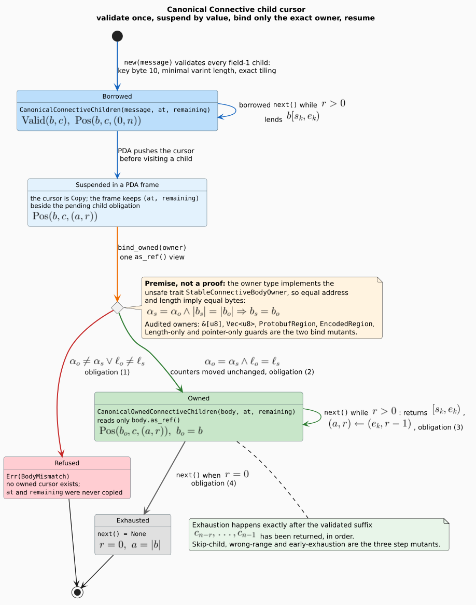
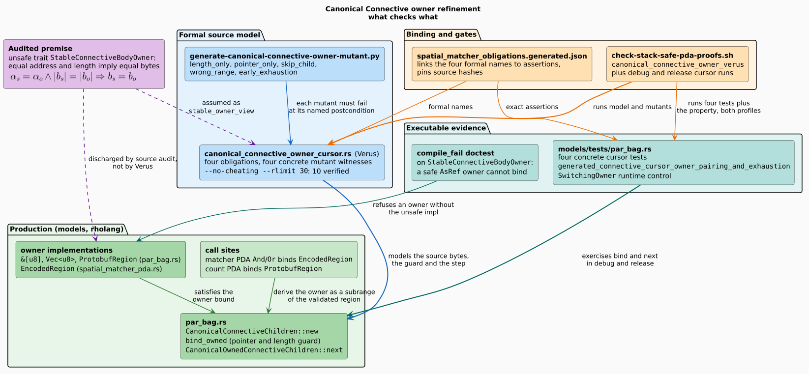

# Canonical Connective cursor owner refinement

The byte-native matcher and count PDA suspend a cursor while they visit a
canonical `ConnectiveBody` child. The cursor must resume against the same body
that was validated before suspension. If a same-length replacement or copied
body could be attached to its saved offset, the next child could come from a
different term even though the cursor still appears in bounds.

The production contract lives in
[`CanonicalConnectiveChildren` and `CanonicalOwnedConnectiveChildren`](../../../models/src/rust/par_bag.rs).
Construction validates every field-1 child in the complete borrowed body. A
borrowed cursor retains that body, its next byte offset, and the number of
children left. `bind_owned` compares the owner's byte-slice pointer and length
with the retained body **before** transferring either cursor counter. An owned
cursor then reads only its stored owner and returns a range relative to that
owner. No child `Par` is decoded or collected during this transition.

| Stage | Source value | Required relationship |
|---|---|---|
| Validate | borrowed `message: &[u8]` | Canonical field-1 headers and minimally encoded lengths cover the entire body in order. |
| Suspend | `at`, `remaining` | `at` is the next validated header, or the body end after the last child; `remaining` is the validated suffix count. |
| Bind | `body.as_ref()` | Both pointer and length equal the borrowed body; mismatch returns `BodyMismatch` before a position is transferred. |
| Resume | owned `body`, `at`, `remaining` | Each `next` returns the next validated payload range, advances to its end, and decrements the count once. Exhaustion occurs only after the validated suffix is consumed. |

The figure follows one cursor through these stages. Blue marks validation,
amber the binding guard, green the owned cursor, red the refusal, and grey
exhaustion. The numbers (1) to (4) are the obligations defined in the next
section.



## Notation and the four obligations

The Verus model and this document use the following symbols. Each one names
a value that exists in the Rust source.

| Symbol | Meaning | Rust source |
|---|---|---|
| $`b`$ | the validated body: a byte sequence of length $`\lvert b \rvert`$ | `CanonicalConnectiveChildren.message` |
| $`n`$ | the number of field-1 children in $`b`$ | `remaining` right after `new` |
| $`c_i = (h_i, s_i, e_i)`$ | child $`i`$, for $`0 \le i < n`$: header start, payload start and payload end | `ChildRegion` in the model |
| $`p = (a, r)`$ | a cursor position: the next header offset $`a`$ and the number $`r`$ of children left | `at`, `remaining` |
| $`\alpha_s, \ell_s`$ | the address and length of the validated slice | `message.as_ptr()`, `message.len()` |
| $`\alpha_o, \ell_o`$ | the address and length of the owner's view | `body.as_ref().as_ptr()`, `body.as_ref().len()` |
| $`b_o`$ | the bytes of the owner's view | `body.as_ref()` |

**Canonical child.** Child $`c_i`$ is canonical in $`b`$, written
$`\mathrm{Canonical}(b, c_i)`$, when its key byte is
$`b[h_i] = 10`$ (field 1 with wire type 2, that is
$`(1 \ll 3) \mid 2`$), and the bytes from $`h_i + 1`$ up to $`s_i`$ are a
minimal base-128 varint of at most ten bytes whose value is the payload
length $`e_i - s_i`$, with $`s_i \le e_i \le \lvert b \rvert`$. "Minimal"
means that a multi-byte encoding never ends in a zero group, so every length
has exactly one encoding.

**Validated source.** The children tile the body exactly, in order:

```math
\mathrm{Valid}(b, c) \iff
  \bigl(n = 0 \Rightarrow \lvert b \rvert = 0\bigr)
  \;\land\; \bigl(n > 0 \Rightarrow e_{n-1} = \lvert b \rvert\bigr)
  \;\land\; \forall i \in [0, n).\;
    \mathrm{Canonical}(b, c_i)
    \land \bigl(i = 0 \Rightarrow h_i = 0\bigr)
    \land \bigl(i > 0 \Rightarrow h_i = e_{i-1}\bigr)
```

**Valid position.** A position points at the header of the first child not
yet returned, or at the end of the body once every child is returned:

```math
\mathrm{Pos}(b, c, (a, r)) \iff
  \mathrm{Valid}(b, c) \land r \le n
  \land \bigl(r = 0 \Rightarrow a = \lvert b \rvert\bigr)
  \land \bigl(r > 0 \Rightarrow a = h_{n - r}\bigr)
```

**Binding and stepping.** `bind_owned` compares address and length and
moves the position unchanged; `next` returns the payload range of child
$`k = n - r`$ and moves to its end:

```math
\mathrm{bind}(\alpha_s, \ell_s, \alpha_o, \ell_o, p) =
  \begin{cases}
    \mathrm{Some}(p) & \text{if } \alpha_s = \alpha_o \land \ell_s = \ell_o \\
    \mathrm{None} & \text{otherwise}
  \end{cases}
```

```math
\mathrm{next}(c, (a, r)) =
  \begin{cases}
    \mathrm{None} & \text{if } r = 0 \\
    \mathrm{Some}\bigl((e_k, r - 1),\ [s_k, e_k)\bigr) & \text{if } r > 0, \text{ where } k = n - r
  \end{cases}
```

**Stable-owner premise.** The contract of the unsafe trait, as the model's
`stable_owner_view` states it: an owner view with the validated slice's
address and length has the validated slice's bytes.

```math
\mathrm{Stable}(\alpha_s, b, \alpha_o, b_o) \iff
  \bigl(\alpha_s = \alpha_o \land \lvert b \rvert = \lvert b_o \rvert\bigr) \Rightarrow b = b_o
```

**The four obligations.** Each is a Verus proof function of the same name in
the [model](../../../formal/verus/canonical_connective_owner_cursor.rs).

1. `mismatched_owner_refused_before_position_transfer`: a different address
   or length is refused, and no position is produced.

   ```math
   \alpha_s \neq \alpha_o \lor \ell_s \neq \ell_o
   \;\Rightarrow\; \mathrm{bind}(\alpha_s, \ell_s, \alpha_o, \ell_o, p) = \mathrm{None}
   ```

2. `exact_owner_preserves_validated_position`: under the premise, the exact
   owner has the validated bytes, the position stays valid against them, and
   binding succeeds with that position.

   ```math
   \mathrm{Pos}(b, c, p) \land \mathrm{Stable}(\alpha_s, b, \alpha_o, b_o)
   \land \alpha_s = \alpha_o \land \lvert b \rvert = \lvert b_o \rvert
   \;\Rightarrow\; b_o = b \land \mathrm{Pos}(b_o, c, p)
   \land \mathrm{bind}(\alpha_s, \lvert b \rvert, \alpha_o, \lvert b_o \rvert, p) = \mathrm{Some}(p)
   ```

3. `next_returns_exact_validated_region`: a step from a valid position with a
   child left returns that child's exact payload range and a valid successor
   position with one child fewer.

   ```math
   \mathrm{Pos}(b, c, (a, r)) \land r > 0
   \;\Rightarrow\; \mathrm{next}(c, (a, r)) = \mathrm{Some}\bigl((a', r'),\ [s_k, e_k)\bigr)
   \land \mathrm{Pos}(b, c, (a', r')) \land s_k \le e_k \le \lvert b \rvert \land r' + 1 = r
   ```

4. `exhaustion_iff_all_validated_children_consumed`: a step returns nothing
   exactly when no child is left, and then the position is the body's end.

   ```math
   \mathrm{Pos}(b, c, (a, r))
   \;\Rightarrow\; \bigl(\mathrm{next}(c, (a, r)) = \mathrm{None} \iff r = 0\bigr)
   \land \bigl(r = 0 \Rightarrow a = \lvert b \rvert\bigr)
   ```

**Corollary (resumption returns exactly the validated suffix).** If
$`\mathrm{Pos}(b, c, (a, r))`$ holds, then $`r`$ successive calls of
$`\mathrm{next}`$ return the ranges $`[s_{n-r}, e_{n-r}), \ldots, [s_{n-1}, e_{n-1})`$
in this order, and the following call returns $`\mathrm{None}`$.

*Proof.* By induction on $`r`$.

- *Base case,* $`r = 0`$. Obligation 4 gives
  $`\mathrm{next}(c, (a, 0)) = \mathrm{None}`$, and the claimed sequence of
  ranges is empty.
- *Step,* $`r > 0`$. Let $`k = n - r`$. Obligation 3 gives
  $`\mathrm{next}(c, (a, r)) = \mathrm{Some}((a', r - 1), [s_k, e_k))`$ with
  $`\mathrm{Pos}(b, c, (a', r - 1))`$. The induction hypothesis for
  $`r - 1`$ says the next $`r - 1`$ calls return
  $`[s_{k+1}, e_{k+1}), \ldots, [s_{n-1}, e_{n-1})`$, because
  $`n - (r - 1) = k + 1`$, and the call after them returns
  $`\mathrm{None}`$. Prefixing $`[s_k, e_k)`$ gives the claim for $`r`$. ∎

Obligations 1 and 2 decide *which* bytes an owned cursor reads: none unless
the owner is the validated slice, and then exactly $`b`$. The corollary
decides *where* it reads: exactly the children that were validated and not
yet returned. A cursor that resumes after suspension therefore continues the
same term.

## Stable-owner boundary

The generic bound is
[`StableConnectiveBodyOwner`](../../../models/src/rust/par_bag.rs), an explicit
unsafe trait. Its implementor promises that every shared `as_ref()` call yields
the same pointer, length, and byte values from binding until the owned cursor
is dropped, including after the owner is moved. Plain `AsRef<[u8]>` does not
make this promise: a safe owner can use `Cell` to choose between two immutable
buffers on successive calls. The
[`SwitchingOwner` runtime control](../../../models/tests/par_bag.rs) and
[compile-fail trait example](../../../models/src/rust/par_bag.rs) exhibit that
gap; the switching owner cannot satisfy the new binding API without an
explicit unsafe implementation of the trait.

The audited implementations cover `&[u8]`, `Vec<u8>`,
[`ProtobufRegion`](../../../models/src/rust/rholang/protobuf_cursor.rs) (`Bytes` and
a fixed range), and the matcher's private
[`EncodedRegion`](../../../rholang/src/rust/interpreter/matcher/spatial_matcher_pda.rs)
(`Arc<Vec<u8>>` and fixed offsets). The owned cursor exposes only a shared
reference to its owner. Safe mutation of a different `Arc` clone uses
copy-on-write and does not change this cursor's view. A zero-length slice may
share a pointer value with another empty allocation; the validated empty body
has no child to read, so this does not grant an incorrect continuation. Pointer
equality is therefore an operational binding check, not a general claim of
allocation identity.

## Formal source model and extraction

The [Verus model](../../../formal/verus/canonical_connective_owner_cursor.rs)
takes its byte sequence from the exact borrowed `message`. Its child table is
constrained by the field-1 key byte, canonical varint length bytes, contiguous
child framing, and complete body coverage. `CursorPosition` represents the
Rust `at` and `remaining` fields. `checked_bind` models the production
pointer-and-length guard, while `modeled_next` returns the next validated
payload range and updated position. The model's `stable_owner_view` predicate
is the audited unsafe-trait premise; Verus does not derive byte immutability
from a raw address or verify the Rust borrow checker.

| Named invariant | Production transition | Executable extraction | Causal control |
|---|---|---|---|
| `mismatched_owner_refused_before_position_transfer` | `CanonicalConnectiveChildren::bind_owned` compares the retained slice pointer and length before copying `at` or `remaining` into the owned cursor. | The generated property refuses a different equal-length allocation, a copied body, truncation, and a wrong owner after exhaustion. | Length-only and pointer-only bind mutants violate `checked_bind`'s postcondition. |
| `exact_owner_preserves_validated_position` | The borrowed cursor stores its source slice and counters; `bind_owned` transfers both counters without advancing the parser, and `CanonicalOwnedConnectiveChildren::len` reports the retained suffix count. | A generated consumed-prefix split binds the original body after any number of borrowed child steps and checks the retained count. | The owner switch control shows why a merely safe `AsRef` bound is insufficient. |
| `next_returns_exact_validated_region` | `CanonicalConnectiveChildren::new` validates the complete field-1 sequence; `CanonicalOwnedConnectiveChildren::next` reads only its stored owner and returns the next payload range. | The generated property derives each owner-relative range from the child length and canonical header width, checks full body coverage, and compares the bytes at that range with the prebinding borrowed child. It repeats these checks after an arbitrary consumed prefix. A separate test compares independently encoded child bytes across the 127/128 and 16,383/16,384 length-header boundaries. | Skip-child and wrong-range mutants violate the exact-next postcondition. |
| `exhaustion_iff_all_validated_children_consumed` | The borrowed and owned `next` methods decrement `remaining` once per child and return `None` only when it is zero. | Both generated cursors return `None` only after their expected suffixes, including empty and fully consumed prefixes. | Early-exhaustion mutant violates next and exhaustion postconditions. |

### The two transitions, in literate form

`bind_owned` is the only way to obtain an owned cursor. It takes one view of
the owner, refuses unless that view is the validated slice, and only then
moves the counters:

```text
procedure BIND_OWNED(cursor = (message, at, remaining), owner)
    view ← owner.as_ref()                     ▷ one shared view; the trait premise keeps it stable
    if address(view) ≠ address(message) or length(view) ≠ length(message) then
        return Err(BodyMismatch)              ▷ obligation 1: refused before any counter moves
    end if
    return Ok((owner, at, remaining))         ▷ obligation 2: counters move unchanged
end procedure
```

Replacing the two comparisons with only the length comparison, or only the
address comparison, gives the `length_only` and `pointer_only` mutants. Each
admits a wrong owner, and Verus rejects both at `checked_bind`'s
postcondition.

`next` re-reads the header that `new` already validated. The re-read is not
a second validation: `new` guarantees the key and the length are present and
canonical, so a failure here is an internal invariant violation, reported by
`expect` or `assert_eq!`, never malformed-input handling.

```text
procedure NEXT(owned = (owner, at, remaining))
    if remaining = 0 then
        return None                           ▷ obligation 4: only when no child is left
    end if
    bytes ← owner.as_ref()
    key ← READ_CANONICAL_VARINT(bytes, at)    ▷ advances at past the key byte
    assert key = (1 << 3) | 2                 ▷ field 1, length-delimited
    len ← READ_CANONICAL_VARINT(bytes, at)    ▷ advances at to the payload start s_k
    start ← at
    end ← start + len                         ▷ checked addition; bytes[start, end) is bounds-checked
    at ← end
    remaining ← remaining − 1
    return Some([start, end))                 ▷ obligation 3: exactly [s_k, e_k)
end procedure
```

Keeping $`r`$ unchanged, returning the range from the header start instead
of the payload start, or reporting exhaustion while $`r = 1`$ gives the
`skip_child`, `wrong_range` and `early_exhaustion` mutants. The first two
break the successor or the range inside obligation 3's match on
`modeled_next`. The third breaks obligation 3, whose step no longer returns
`Some`, and obligation 4, whose $`\mathrm{None} \iff r = 0`$ clause no
longer holds.

The second figure shows which artefact checks which. Green is production
code, blue the formal model and its mutant generator, teal the executable
properties and controls, amber the registry and the proof runner, and purple
the audited premise that no tool discharges.



The [SpatialMatcher obligation registry](../../../formal/spatial_matcher_obligations.generated.json)
links all four formal names to the exact assertions in
[`models/tests/par_bag.rs`](../../../models/tests/par_bag.rs), checks that the
production owner implementations and normal gate are registered, and pins
source hashes. The [normal stack-safe PDA runner](../../../scripts/check-stack-safe-pda-proofs.sh)
requires ten successful no-cheating Verus verifications, rejects all five
mutants generated by
[`generate-canonical-connective-owner-mutant.py`](../../../scripts/generate-canonical-connective-owner-mutant.py),
and runs the four concrete cursor tests plus the generated property in both
debug and release profiles.

This is a source-linked refinement, not a machine-checked compilation proof
of `read_canonical_varint`, pointer provenance, or the four unsafe trait
implementations. The byte-header-to-child-table extraction and stable-owner
premise are checked by the Rust source audit and executable properties. The
production [matcher PDA](../../../rholang/src/rust/interpreter/matcher/spatial_matcher_pda.rs)
binds an `EncodedRegion` in both its `And` and `Or` branches. The
[count PDA](../../../rholang/src/rust/interpreter/matcher/par_count.rs) binds a
`ProtobufRegion` for those branch bodies. Both call sites derive the owner as a
subrange of the region from which the borrowed cursor was validated; no
generic untrusted owner reaches them.

## Commit-bound evidence and final boundary

The owner cursor, its Verus model and its tests landed in commit `6e3c74d6e`.
Between that commit and `fc1745c1e`, no cursor source changed:
`git diff --stat 6e3c74d6e fc1745c1e` is empty for `models/src/rust/par_bag.rs`,
`models/tests/par_bag.rs`, `models/src/rust/rholang/protobuf_cursor.rs`, the
Verus model, the mutant generator, `spatial_matcher_pda.rs` and `par_count.rs`.
The results below were taken at `fc1745c1e`, so they also hold at `6e3c74d6e`.
The model's SHA-256 is
`1883e5782f84bf33959ca15e1c3d28f79116a07bb707ae7ea4f751a7fc9ca9c7` at both
commits.

| Check | What ran | Result |
|---|---|---|
| Owner-cursor proof | the runner's `canonical_connective_owner_verus`, which calls `verus --no-cheating --num-threads 1 --rlimit 30` | 10 verified, 0 errors |
| `length_only`, `pointer_only` | the same function, on each generated mutant | 9 verified, 1 error each, at `checked_bind`'s `ensures result == bind_spec(` |
| `skip_child`, `wrong_range` | the same | 9 verified, 1 error each, in obligation 3's `match modeled_next(children, position)` |
| `early_exhaustion` | the same | 8 verified, 2 errors: obligation 3 (its `is_some()` clause and its match) and obligation 4 |
| Concrete cursor tests | `cargo test -p models --test par_bag canonical_connective_cursor_`, then with `--release` | 4 passed in debug, 4 passed in release |
| Generated pairing and exhaustion property | `cargo test -p models --test par_bag generated_connective_cursor_owner_pairing_and_exhaustion`, then with `--release` | 1 passed in debug, 1 passed in release |
| Stable-owner compile-fail control | `cargo test --release --doc -p models StableConnectiveBodyOwner` | 1 passed |
| The whole `par_bag` binary | release nextest in commit `6e3c74d6e`'s gate | 40 passed |

The runner accepts a mutant only if Verus reports `postcondition not
satisfied`, at least one error, and the mutant's pinned clause: the two bind
mutants at `ensures result == bind_spec(`, the two step mutants at
`match modeled_next(children, position) {`, and early exhaustion at
`modeled_next(children, position).is_some(),`. A mutant that fails for an
unrelated reason therefore does not count.

Three things remain outside the machine-checked part, and each is stated
rather than hidden:

- **The stable-owner premise.** It is the contract of an unsafe trait. It is
  discharged by auditing the four implementations listed above, not by
  Verus.
- **Byte extraction.** The model starts from the child table. Reading that
  table out of the header bytes (`read_canonical_varint`) and pointer
  provenance are checked by the Rust source and the executable properties,
  not by a proof about the compiled code.
- **The campaign-wide RPB3 admission gate.** That is a separate leaf.

The commands, logs and source hashes for these runs are recorded on the
pgmcp leaf `canonical-connective-cursor-owner-formal-refinement`.
