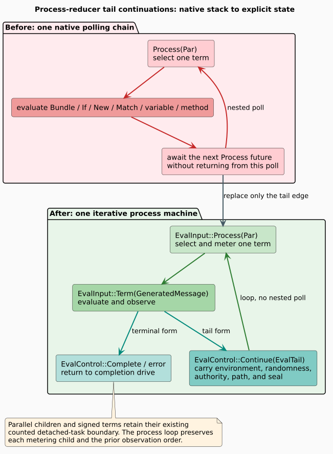

# Process reducer native-stack overflow

## Outcome and scope

A Rholang process containing 4,096 nested `Bundle` terms exhausted a 256 KiB native thread stack. The process reducer now carries tail continuations in an explicit state machine. The original fixed-stack regression passes, and a second regression covers mixed `Bundle`, `If`, and `New` continuations. This report concerns the process evaluator, not the separate expression evaluator or parser.



## Evidence and root cause

The isolated test `async_reducer_scc_depth_4096_uses_a_fixed_small_native_stack` reproduced the crash. In the debugger, the signal was `SIGSEGV` while dropping a `Par` during `GeneratedMessage::encoded_len`. At that point, the thread's stack pointer was approximately 1,352 bytes above the mapped stack boundary. The repeating caller chain included `eval_inner`, `generated_message_eval`, `eval_bundle`, and `eval_with_path_authority`. The protobuf operation was the first observed call to need more stack; this trace does not establish a protobuf defect.

The old single-term path boxed the next evaluator future and awaited it. `Box::pin` places a future's state on the heap, but polling the outer future still polls the awaited inner future on the same native call stack. A chain of tail-process terms therefore accumulated native poll frames. The periodic `tokio::task::yield_now()` helped scheduling fairness; it did not unwind the chain of parent futures.

For process depth `n`, the old path could require native polling depth proportional to `n`. The replacement keeps native polling depth independent of the number of tail-process terms. The process term, environment, randomness, cost authority, causal path, metering-child path, and residue seal are explicit state transferred to the next loop iteration.

## Why it was missed

The expression evaluator already had an explicit `EvWork`/`EvKont` machine, and parallel process branches already used counted detached tasks. Neither mechanism covered a *single* process term whose own body was the next process. This architectural gap was easy to overlook because the process evaluator also had a yield interval and boxed futures, neither of which guarantees stack safety.

The fixed-stack regression existed, but the earlier full-library verification aborted at this test after other failures. A test that aborts a large suite does not provide a clean green gate, and investigation of the earlier reduction-domain leak did not establish this separate cause. The introducing commit has not been identified; the debugger evidence establishes the mechanism, not its historical origin.

## Repair and preservation argument

The process machine alternates between two input states:

```text
Process(par):
  split terms using the existing order and metering-child indices
  evaluate cost-stack declarations using the existing declaration path
  if one reduction term remains, set Term(term) and continue
  otherwise spawn the existing counted parallel children and complete

Term(term):
  charge reduction step and encoded bytes as before
  perform the term's existing work and observation
  if terminal, complete or return its error
  if a tail process is produced, transfer its context to Process and continue
```

`Bundle`, `If`, `New`, `Match`, variable dereference, and method re-entry now return a tail state instead of recursively awaiting process evaluation. The selected `If` branch and `Match` case retain their existing observation point. `New` and `Match` transfer their extended environments. Dereference and method re-entry clear the residue seal only where the old path did. Each single term still creates the same metering child and randomness split; parallel children still use the existing counted detached completion drive. Cost-signed terms intentionally remain at their separate counted detached-task boundary.

The [Rocq model](../../../formal/rocq/node_authority/theories/ReducerTailMachine.v) proves that an explicit tail machine and a recursive reference semantics produce the same event trace and outcome when both use the same per-step transition. It also proves failure stops the machine, one-step advancement, the Bundle charge-before-observation order, runtime-context preservation across all six tail forms, selected-environment transfer for `New` and `Match`, and seal clearing for variable and method re-entry. The theorem is a control-flow refinement, not a proof that every Rust term helper has the modeled per-step behavior. Focused Rust tests and the public integration gate check that remaining refinement boundary.

## Similar-path audit and prevention

The production process-evaluation call sites were inspected for a path back into `eval_inner` without a detached task. The six tail-producing forms above now feed the loop. The only remaining `eval_with_path_authority` calls are root entry and the cost-signed child inside `spawn_detached`; an unused crate-local wrapper was removed. The parallel reduction path also enters `eval_machine` only in a counted detached child. The `produce`/`consume`/`dispatch` continuation cycle reaches `eval_continuation`, which forks a detached child rather than awaiting a new process evaluator in the same polling chain. Test-only recursive expression oracles remain bounded comparison tools; production expression evaluation uses its pre-existing explicit machine.

The mixed-form audit exposed a second, distinct small-stack limitation. On a 256 KiB test stack, an `If` condition entered `descend_to_expr` and faulted with only one `eval_machine` frame and one `eval_if` frame in the debugger. The mapped stack began at `0x7ffff7688000`; the debugger could not read an expression argument at `0x7ffff7685b50`, below that boundary. The expression evaluator is an iterative machine, but its debug-build dispatcher has a large *constant* native frame. This is not evidence of an unbounded process-tail recursion. The mixed-depth regression therefore uses a fixed 512 KiB stack, while the original Bundle-only test retains 256 KiB. Reducing expression-dispatcher frame pressure is separately tracked; this report does not claim that every expression fits on a 256 KiB stack.

The first mixed-form probe stopped after exactly 1,024 terms with `OutOfPhlogistonsError`, although the token budget remained untouched at `i64::MAX`. This matches `MAX_COST_TRACE_SOURCE_PATH_COMPONENTS = 1024`: metered `If` and `New` work cannot extend its source path indefinitely. The passing regression therefore places 960 mixed `Bundle`/`If`/`New` terms before a 3,072-Bundle suffix, exercising 4,032 process continuations without crossing that independent cost-trace bound for metered mixed terms. The test asserts all 4,032 terms were evaluated; reducing the source-path limit was neither required nor attempted.

This is a bounded audit of the reducer and its dispatch entry, not a claim that every recursive path in the repository has been ruled out. A broader call-graph strongly connected component analysis should distinguish recursive polling, detached task re-entry, recursive ownership/drop, and intentional bounded test oracles before assigning further fixes.

The prevention rule is to classify every evaluator back-edge by **where its parent future remains**. Boxing and yielding are not evidence of stack safety. An unbounded semantic tail edge must become an explicit transition or a counted detached child. A regression must combine a fixed small native stack, depth well above ordinary usage, representative mixed forms, and an assertion that evaluation actually exhausted all terms. Focused gates must report a nonzero executed-test count; a filter that silently runs zero tests is not coverage.

## Verification boundary

The strengthened six-form Rocq file compiles under a 512 MiB memory cap. `cargo check -q -p rholang --lib` passes. The original 4,096-Bundle fixed-stack test passes 1/1 at 256 KiB, the mixed-form 4,032-tail test passes 1/1 at 512 KiB, the complete reducer differential group passes 10/10, and the economic-failure group passes 10/10. The public Regex gate passes 1/1 in 398.96 seconds and reports 25 mixed-lookahead successes, `full-match = true`, and the expected search/replacement observations. A broad Node test command also exposed an unrelated stale `grpc_message_size_spec` mock that omits `get_pending_deploys`; the correct library-only Regex gate avoids that unrelated test target while the mock is tracked separately.
