# Stack Safety in the F1r3node Rholang Interpreter

### A design and results report on the elimination of depth-proportional native-stack consumption over the `Par` term family

> **Reader orientation.** This document is the campaign's **evidentiary ledger and experiment log
> of record**: machine-oriented, complete, provenance-tagged per clause, and living (new evidence
> is appended here first). For the human-readable technical report — control and final treatment
> results only — see
> [`docs/technical-reports/stack-safety/stack-safety-technical-report-2026-08-12.md`](../../technical-reports/stack-safety/stack-safety-technical-report-2026-08-12.md).
> Section numbers below are externally cited ([Appendix H](#appendix-h--external-citation-map)) and
> must not be renumbered.

**Repository** `f1r3node-rust-mettail`, branch `feature/mettail`
**Companion repository** `mettail-rust`, branch `feature/rho-native-set-automata` (§5.6)
**Report date** 2026-07-29, revised through 2026-08-31
**Measurement anchor** `f1r3node-rust-mettail@e67a6aaa` · `mettail-rust@b0aa4e09` (original measurement tree `8853f839`)
**Living closure head** this checkpoint, based on `f1r3node-rust-mettail@3061b2501`
(certified frame-local ParBag protobuf egress with typed atomic replay following final
persisted-value canonical DATA egress and borrowed cold-store admission following
presence-safe protobuf-region rendering and proof-carrying post-zipper EPathMap decode following
drive-local `FreeMap` journaling and byte-native exact FreeVar capture following complete byte-native
recursive matcher-family coverage, and complete transient `ParConstruction` planning across normalization, substitution, and evaluation,
following canonical-protobuf `ParBag` keys with prepared typed lookup, direct trie-to-protobuf
emission, canonical ACT import validation, and byte-native exact-key EPathMap
subtraction/selection with one moving map write zipper, following adaptive exact-key/moving-zipper
Bag deltas over one privately forked PathMap root and atomic accepted-match Bag publication,
PathMap-pruned ordered elements inside the stack-safe associative-commutative matcher, and generated ordered-expression datum-first/receive-first
RhoPath queries in retained PathMap automata and the Bag/position product, following sparse relational-row reuse in the
production spatial-matcher pushdown automaton (PDA), complete-message protobuf ingress bounds, `InterpreterError`
lifecycle machine, reducer method-replay machine, exact recursion census, production lint gate,
prior matcher/PathMap closure, D-E4 evidence reconciliation, and positional AC-remainder repair)
**Companion decision head** `mettail-rust@1fa828bd` (certified persistent-root R3 production
specialization, exact contraction metadata, closed recursive/general-driver equivalence, D-E5
slotted-state and indexed-channel implementation, exact communication-accounting witness,
admission-free relational-row equivalence, retained FLT candidate matching,
recursive-carrier lifecycle verification, and operational,
Rholang, abstract-syntax-tree (AST) grammar, token-codec, observation-surface, linear-temporal-logic
(LTL) parser, reflected-metadata, Dovetail metapattern, Dovetail set-automaton, runtime observation,
correlated-matching, numeric-cast, Delta-one matching, nested optional/binder-list weighted
pushdown-automaton (WPDA) generation, and Rho-network code-generation closure;
§5.18)
**Companion report** — the PathMap/EPathMap representation, wire format, and performance results
live in the [PathMap report](../pathmap/pathmap-report-2026-08-03.md); the `SS-C5`…`SS-C12` and
`SS-Y6` register rows below point there, while SS-C13 records the subsequent native-cursor consumer
closure and SS-C14 records the dormant canonical `ParBag` successor in this report.
**Audit ledgers superseded by nothing; this report *cites* them** —
`docs/design/audits/theta-depth-traversals-2026-07-26.md`,
`docs/design/audits/four-quadrant-s0-baseline-2026-07-28.md`,
`docs/design/audits/four-quadrant-s2-protobuf-encoder-2026-07-28.md`

**Format and systems terms.**

| Short form | Expansion |
|---|---|
| **RPB1** | *resident ParBag key format, version 1* |
| **RPB2** | *resident ParBag key format, version 2* |
| **RPB3** | *resident ParBag key format, version 3* |
| **RCI2** | *Rholang Channel Image, version 2* — the shadow logical channel-identity format |
| **EPM1** | *EPathMap format, version 1* — the current compact homogeneous trie encoding |
| **EPM** | *EPathMap format* — the family prefix used for EPM1-specific processing |
| **BLAKE2** | the BLAKE2 cryptographic hash family standardized by RFC 7693 |
| **WAL** | *write-ahead log* — the durable transaction journal used by the planned PathMap-DAG persistence backend |
| **CRC** | *cyclic redundancy check* — a physical corruption detector, not a cryptographic identity |
| **CRC32C** | the 32-bit cyclic redundancy check using the Castagnoli polynomial |
| **NUL** | *null byte* |
| **AVL** | *Adelson-Velsky–Landis* tree balancing |
| **URI** | *uniform resource identifier* |
| **FFI** | *foreign function interface* |
| **ABBA** | *alternating A-before-B / B-before-A* paired execution order, used to cancel measurement-window drift |

**Verified living status.** The node gate contains **37 converted depth subjects + 8
converted width subjects and zero production tripwire subjects**; the independent SS-B5 lifecycle
gate adds one non-`Par` recursive error forest at depth 20,000. The strengthened hand-written
recursion census finds **566** recursive components, **41** term-family components across **24** files,
**18** mutual components, and zero `Unmeasured` dispositions; MeTTaIL's generated traversal table likewise
has no unmeasured traversal. The hardened lifecycle gate at `mettail-rust@a58d0925` scans **549**
production Rust files, indexes **2,279** type definitions, derives a trait-specific maximum of **84**
recursively owned types in **80** components, and reports zero recursive derive or implicit-`Drop`
exposures. It resolves crate/module/import/re-export identity, models `Arc`, `Rc`, references, and
`ManuallyDrop` per operation, checks enclosing-owner dispositions exactly, and includes a failing
recursive-derive mutation. `mettail-rust@e831c2ab` adds the admission-free continuation theorem and
exact once-per-node lifecycle-visit laws. At that checkpoint, the lifecycle result did **not** by
itself close the wider function-call strongly connected component (SCC) census.
`mettail-rust@e0086c93` subsequently closes
the operational `AnyAlgebra::{is_satisfiable,witness}` re-entry with one heap-frame decision
executor. `mettail-rust@338d8263` additionally closes the Rholang type-inference variable-use and
receive-collection SCCs; the remaining non-term-family census was still live at that checkpoint and
is closed by the subsequent checkpoints summarized below (§5.18.6, §8.5).
`mettail-rust@b76c5773` closes every production
recursion cluster in `rholang-runtime/src/rholang_ast.rs`; its one analyzer residual is a deliberate
`#[cfg(test)]` recursive oracle. `mettail-rust@2a972436`, `580896f3`, and `fec84ffb` close every
genuine production recursion cluster in `rholang-runtime/src/guard_par_substrate.rs`: formula
construction, opaque-atom substitution, operand normalization, and bound-value substitution.
`mettail-rust@44f899b8` applies the corresponding ordered formula and operand machines to the
surface `Proc` guard encoder in `languages/src/rholang/guard_substrate.rs`. `mettail-rust@d9fbc777`
then aliases the imported substrate-verdict free function in both modules, removing the two
same-name call-resolution false positives; fresh file-scoped analysis reports zero direct and zero
mutual recursion in each file.
`mettail-rust@5cd89526` closes the direct name, quote, three-valued guard-disposition, and parallel-
flattening traversals in `languages/src/rholang/receive.rs`; `mettail-rust@0aaac1c0` closes the
heterogeneous collection-pattern matcher in the same file. Fresh file-scoped analysis reports zero
production direct or mutual recursion there. `mettail-rust@2e3ae94d` then makes `HashBag` hashing a
constant-time read of incrementally maintained, byte-identical lanes, retains owned parallel bags
across binary folds, and carries multiplicity in the flattening worklist rather than expanding it into
repeated jobs. `mettail-rust@2fe2a2c4` closes the surface `runtime.rs` send-sugar canonicalizer SCC
with one heterogeneous post-order machine; fresh file-scoped analysis reports zero production direct
or mutual recursion there. `mettail-rust@c875ab94` then removes the AST grammar-shape and token-tree
recursion, replaces nested token-codec scratch copies with one backpatched buffer, and makes malformed
decode and format-length failures explicit. `mettail-rust@0e508621` closes the Dovetail metapattern
analysis and lowering family: five direct traversals plus the mutually recursive pattern/term lowering
and substitution components now use explicit work/value machines. Fresh file-scoped analysis reports
zero production direct or mutual recursion in `dovetail_report.rs`. `mettail-rust@39e4b024` then
closes the mutually recursive Dovetail set-automaton state/application evaluator with one explicit
cache-preserving machine. Fresh whole-project analysis reports **100 direct findings and 6 mutual
clusters**, with no residual in `dovetail/src/set_automaton.rs`. `mettail-rust@da638fe3` then
qualifies explicit `std::mem::drop` calls in the already-iterative lifecycle implementations,
removing 14 false direct findings and one false mutual cluster; the current census is **86 direct
findings and 5 mutual clusters**. `mettail-rust@d1ce352b` next factors the regex quantifier's
primitive Thompson constructors, removing a semantically one-reentry helper cycle while preserving
the exact nondeterministic-finite-automaton (NFA) topology; the current census is **86 direct
findings and 4 mutual clusters**. `mettail-rust@2c2cbb95` applies the same bounded-cycle factoring
to set-type Top lowering and empty-automaton complementation; the current census is **86 direct
findings and 3 mutual clusters**. `mettail-rust@ae3256d6` then disambiguates the already-iterative
Kleene algebra with tests (KAT) expression-nullability helper and its star-arm residual binding.
This removes one false direct
finding and one false mutual cluster without changing a derivative, residual order, or decision;
the current census is **85 direct findings and 2 mutual clusters**. `mettail-rust@8f5a434a` then
specializes the generated parser's SEP, projection, and infix isolation selectors, removes a
five-member dispatch cycle, and returns each derived shape without repeating its grammar scan. The
current census is **85 direct findings and 1 mutual cluster**; that remaining cluster is the
deliberately recursive positive control in the stack-depth test probe. `mettail-rust@09460a20`
refreshes the corresponding stale empty-EPathMap parser golden to the distinct unresolved `Empty`
mode and changes no production source. `mettail-rust@626d1d3b` relocates both main-thread probe
programs from `src/bin` to `tests/support` while retaining their explicit Cargo binary targets. The
deliberate recursive control remains live, but fresh production analysis now reports **85 direct
findings and zero mutual clusters**. `mettail-rust@211df16c` next closes the runtime observation
binder scan, mobility scan, and bag flattening traversals, while replacing the mobility scan's
multiplicity-expanded temporary vector with a lazy occurrence iterator; the census becomes **82
direct findings and zero mutual clusters**. `mettail-rust@c958355c` then replaces generic correlated
matching recursion with explicit ordered backtracking and the three nested numeric-cast recursions
with one shared width-continuation architecture. Fresh production analysis reports **78 direct
findings and zero mutual clusters**, with no direct residual anywhere under `runtime/`.
`mettail-rust@99f54158` next closes Delta-one matching with ordered branch-and-bound search and an
indexed active-right set. `mettail-rust@d3e675d3` closes nested schedule collection, both
associative-commutative-template collectors, and fragment-pattern encoding; `mettail-rust@250f0929`
closes the remaining shift-chain and template-rebuild recursion and removes cloning from the shared
parallel-`Par` fold. `mettail-rust@ba6e0367` then closes reflected host shift and bound nested-AC
template reflection with two bottom-up machines, and reuses the move-based fold for wide AC soups.
`mettail-rust@d3ff8dcb` next closes closed-ground-value validation and the deadlock analyzer's
Tarjan depth-first search (DFS), preserving validation verdicts and deterministic component order.
`mettail-rust@af2d984d` then closes the four remaining recursive walks in the feature-quarantined
naive reference backend: automaton-tag collection, both ground-term site locators, and constructor-
arity admission. `mettail-rust@67f73e3d` next disambiguates six conservative source-graph cycles
caused by overloaded `From`/`from_iter`/`Scope` names and a shadowed comparator binding; source
inspection proves that none was a recursive runtime call. `mettail-rust@dd024d94` then replaces
the capture-layout declaration, lookup, and nested-pattern recursion with ordered worklists while
preserving exact field-slot identity and first-match order. `mettail-rust@f2b544c4` factors the
common term-parameter leaf machine and applies it to native-evaluator dependency and
pushdown-automaton (PDA) field
classification. `mettail-rust@ea39023b` then reuses the term-parameter PDA across display, binder,
parser, substitution, and simulation consumers and centralizes their common terminal-base type
walk. `mettail-rust@9e613bea` next closes the parser pattern/token walks, both recursive type-token
emitters, and the binder-scope schema consumers with shared parameter/type machines and a
linear-output token emitter. `mettail-rust@675a47a9` then shares raw token-tree traversal, frames AC
template emission, and replaces repeated projection-FIRST reconstruction with one boolean closure
and indexed category frames. `mettail-rust@659c36e5` next replaces behavioral-predicate reference,
quantified-premise, and stratification Tarjan recursion with explicit work, cursor, and graph frames.
`mettail-rust@98dc72ad` removes the generated WPDA's artificial one-level OptionalGroup and
BinderList restriction: typed heap-backed continuation frames and dense markers now carry arbitrary
nesting, while test-only recursive equations and Rocq laws preserve frame identity and resume order.
`mettail-rust@c95d9e73` subsequently replaces each depth-indexed generated shift chain with one
fixed-size system-process call and applies the composed shift in one iterative traversal, discharging
the quadratic retained-metadata defect SS-Y7 without changing the reflected result.
Fresh pgmcp classic whole-project analyses completed on 2026-08-08 over **202/202** production files
in `f1r3node-rust-mettail` and **1,910/1,910** production files in `mettail-rust`. Each reports
**zero direct-recursion functions and zero mutual-recursion clusters**. **MEASURED**, analysis runs
`a68a8ca1-6e07-4030-a923-eb0ecb60a511` and `fa00b67e-f056-4cd8-b163-6ecfd28496ab`; this supersedes
the prior source-derived 27/0 interim ledger. The separate semantic ownership, representation, and
consensus-reachability refresh remains an independent closure gate rather than evidence for this
classic call-graph result.

**Living revalidation (2026-08-12).** Fresh classic runs
`573791ba-b176-481b-8409-1256ecf576c4` (`mettail-rust`) and
`cf4a150e-e99c-4167-be85-5c0b67d7e445` (`f1r3node-rust-mettail`) again report **zero direct
recursion and zero mutual-recursion clusters**, with zero failed files. The mettail scan analyzed
1,589 supported production files (335 unsupported-language files and one oversized file are
reported explicitly); the f1r3node scan analyzed 226 supported production files (12
unsupported-language files are reported explicitly). Fresh default-profile semantic snapshots
`21c0f93b-7012-4c76-9ef8-58e96bf00388` and
`8b4279d0-fa40-4e22-8956-a20e133cbdae` add typed call, ownership, representation, memory-slope, and
consensus-reachability inventories. Source inspection found no new production recursion: their
apparent residuals are test-only recursive oracles or receiver-resolution aliases such as an
overloaded trait method treated as a self-call, `Printer::cap` treated as `PrettyPrinter::cap`, and
`HashMap::remove` treated as the enclosing type's `remove`. The representation and slope selectors
also label ordinary `Vec::push`, `Iterator::collect`, tuple construction, and canonical key encoding
as PathMap materialization; those findings are analyzer heuristics, not evidence that an EPathMap
left its native `PathMap<()>` / `PathMap<Par>` representation. These limitations are recorded in the
campaign's pgmcp follow-up items rather than converted into source work.
No production path uses
`contains_par`, `RUST_MIN_STACK`, `stacker`, or a
traversal-depth ceiling. Resident-set-size (RSS)-capped verification (`MemoryMax=4G`, `MemorySwapMax=0`, one Cargo job): the focused
EPathMap/codec/formal-manifest matrix passed **84/84**; the recursion census and retired-mechanism
registry passed **7/7**; the complete stack gate passed **8/8 active** with **4 ignored = 3
measurement-only probes + 1 forked-child driver** (**DERIVED** from the four `#[ignore]` attributes
in `rholang/tests/stack_depth_gate.rs`); Rocq, Z3, and TLC passed, with TLC exploring 2,816 distinct
states to depth 8. The subsequent SS-C12 checkpoint kernel-checks all four Rocq theories, verifies
**6/6** Verus obligations with `--no-cheating`, and runs the canonical-key/value worklist through
depth **20,000** on a **256 KiB** worker stack; §5.19 records the distinct time, heap, and
acceptance evidence rather than folding it into the older 84-test measurement.
The SS-G43/SS-C13 checkpoint then closes the refreshed vendored-syntax, constructor, and benchmark-
visitor residues. Its shared borrowed/owned model visitor holds later EPathMap entries in native
zippers, and its 20,000-level gates, 48-test constructor suite, 55-test promoted corpus, 18-test
Ascent package, and admission-free worklist theorem are reported separately in §5.20. Pgmcp's
semantic, representation, and consensus analyses must still be refreshed after the checkpoint is
committed; this paragraph does not substitute the source-index closure gate with a test result.
The subsequent `mettail-rust@4fa08387` SS-G44 checkpoint removes two heap/work slopes inside the
already stack-safe generated parser: repeated first-parent graph-structured stack (GSS) ancestry walks and copied k-best
decision/packing prefixes. The complete 31-case deep traversal binary now passes under a 2 GiB cap
on the default native stack; §5.21 records the exact predecessor/successor and profiler evidence.
`mettail-rust@adc76524` then closes the remaining measured canonical generalized LL (GLL) ancestry
amplification:
515,500 cross-category boundary queries had revisited 336,387,001 GSS nodes in the 1,000-binder
workload. An incremental monotone target-category lattice reduces that exact workload from 248.42 s
to 10.83 s while the positive path retains the exhaustive cycle-safe walk. §5.22 records the
admission-free equivalence proof, independent oracle, complete regressions, and AMD uProf result.
`mettail-rust@c63c6ca8` subsequently closes D-E5. Dense first-occurrence slots quotient
alpha-equivalent matcher states while entry-local boundary maps restore exact substitution names;
repeated-variable partitions and structurally deeper binders remain distinct. One iterative
`SubjectLocationIndex` gives the production automaton, ruleset, spread, and benchmark reference
driver exact collision-free fixed-width position identities instead of repeatedly materializing
absolute prefixes. The production spread scales approximately linearly through depth 1,024 and
passes depth 20,000 on a 256 KiB worker stack; §5.23 records the independent nominal oracle,
zero-admission Rocq theorems, exact state/channel counters, runtime trace, and profiler evidence.
`mettail-rust@57239207` then promotes the finite-route persistent-root R3 matcher from a benchmark
arm to a generated production specialization. An iterative certificate admits only positive
identity-beta root spines whose terminal subtree is globally rewrite-normal; every other subject
retains the general congruence-capable quiescence PDA. The certificate reaches depth 20,000 on a
256 KiB stack, the live nine-test runtime suite compares complete observation sets between the two
routes, and Rocq proves equality with both the bounded recursive oracle and the general driver.
Section 5.24 records the experiment-174 performance decision, exact resource envelopes, and
consensus boundary.
`f1r3node-rust-mettail@c1feaf36` then closes a separate ingress-envelope defect: configured gRPC
limits now bound complete protobuf messages rather than individual HTTP/2 frames. §5.13.8 records
the black-box rejection and containment evidence. This is a byte-work boundary before the first
COMM, not a traversal-depth cap or substitute for a stack-safe implementation.

---

## Evidentiary convention

Every factual claim in this report carries one of two tags.

| tag | meaning |
|---|---|
| **DERIVED** | read from source, from a build artefact, or from a commit body. The provenance is named inline (`file:line`, commit hash, or `crate-version/path`). |
| **MEASURED** | observed by executing something. Either **(q)** *quoted* from a recorded measurement, with the commit or document that recorded it named, or **(f)** *freshly measured for this report* on 2026-07-29, with the teed log named. |

A claim with no tag is a definition or an argument, not a fact about the system.
Where a number could **not** be obtained it is written **NOT MEASURED**, with the reason. There are seven such entries; they are collected in §5.9 and §7.

---

## 0. THE FIX REGISTER — the scannable index

★ **This is a living document.** It is maintained on the same standing obligation as the consensus register: when a stack-safety fix lands, it is added here. The register below is the index a reader scans without opening a single body; the identifiers are **stable and never reused**, so a fix may be cited as *"SS-C1"* from a commit message, an issue, or another document and the citation will still resolve after the document is reorganised.

**Adding a fix is filling in a form, not inventing a shape.** The blank form is [Appendix F](#appendix-f--the-per-fix-template-fill-this-in-do-not-invent-a-shape); the mechanism that is supposed to notice when this register goes stale is [Appendix G](#appendix-g--the-maintenance-contract).

**Conventions.** $`B_0 \rightarrow B_1`$ is bytes of native stack per nesting level before and after, release profile unless the row says otherwise. **0** means *measured flat at both ends of a 4 $`\rightarrow`$ 4,096 ladder in both profiles*. "—" means the axis does not apply; **⌀** means **no measurement exists** (every ⌀ is itemised in [§5.9](#59-measurements-that-could-not-be-obtained)).

Abbreviations used throughout are ABI (application binary interface), CBR (consensus behavior register), EPM1 (EPathMap version 1), RMP2 (Rholang Match Path format version 2), PDA (pushdown automaton), WPDA (weighted pushdown automaton), SMT (satisfiability modulo theories), TLA (Temporal Logic of Actions), LRU (least-recently-used), SHA (Secure Hash Algorithm), RHOLANG (reflective higher-order language), MSO (monadic second-order logic), KAT (Kleene algebra with tests), LTL (linear temporal logic), REPL (read-evaluate-print loop), Ir (instruction references), Dr (data reads), Dw (data writes), and TSV (tab-separated values).

★★ **`SS-Y…` is a family added by this revision, and it exists because the register had no way to spell the thing it most needed to say.** The prior families — `SS-A…` core traversals, `SS-B…` evaluator/async, `SS-C…` codecs, `SS-D…` deploy path, `SS-E…` instrument, `SS-F…`/`SS-G…` `mettail-rust`, `SS-X…` rejected — could record a *fix*, a *partial* fix, or a *rejected candidate*, but **not a live unrepaired defect introduced by a fix in this very register**. A register that can only hold good news is a register that reports coverage it does not have. **`SS-Y…` rows are allocated while defects are open**, they are never "class change: yes", and a row is discharged only by a commit that repairs it — never by deletion. Repaired rows remain in the register with their repair SHA and status, preserving the defect history. The allocation rule is added to [Appendix F](#appendix-f--the-per-fix-template-fill-this-in-do-not-invent-a-shape) with the others.

| ID | commit | repo | traversal | $`B_0 \rightarrow B_1`$ | class change? | § |
|---|---|---|---|---|:---:|---|
| **SS-A1** | `f0894109` | f1r3node | substitution SCC (strongly connected component), leg-1 de-clone | 36,416 $`\rightarrow`$ 27,179 | **no** ($`-`$ 25.4 % only) | [5.1](#51-family-a--the-substitution-sorting-normalisation-and-evaluation-cores) |
| **SS-A2** | `f11ffb54` | f1r3node | substitution SCC $`\rightarrow`$ explicit worklist | 195,728 $`\rightarrow`$ **0** *(debug)* | **yes** | [5.1](#51-family-a--the-substitution-sorting-normalisation-and-evaluation-cores) |
| **SS-A3** | `6ce7c5b9` | f1r3node | score tree: comparator, sibling walk, `Clone`, `Drop`, `PartialEq` | 1,329 / 201 / 1,578 / 370 / 719 $`\rightarrow`$ **0** | **yes** | [5.1](#51-family-a--the-substitution-sorting-normalisation-and-evaluation-cores) |
| **SS-A4** | `6ce7c5b9` | f1r3node | `ParSortMatcher` — `sort`, `sort_wide` | 78,592 $`\rightarrow`$ **0** *(debug)* | **yes** | [5.1](#51-family-a--the-substitution-sorting-normalisation-and-evaluation-cores) |
| **SS-A5** | `a3fd6fe4` | f1r3node | `rho-pure-eval`'s `eval_with` SCC | 3,359 $`\rightarrow`$ **0** | **yes** | [5.1](#51-family-a--the-substitution-sorting-normalisation-and-evaluation-cores) |
| **SS-A6** | `6675fc06`, completed for owned canonical collections by `50756ec2` | f1r3node | `PrettyPrinter` pushdown driver, including `ESet` / `EMap` owned canonical intermediates | ⌀ $`\rightarrow`$ **0** | **yes**; SS-Y8 retains the repaired evidence gap | [5.1](#51-family-a--the-substitution-sorting-normalisation-and-evaluation-cores) |
| **SS-A7** | Stage G | f1r3node | `normalize_ann_proc`'s 26-fn SCC $`\rightarrow`$ `norm_drive` | 7,261 $`\rightarrow`$ **0** | **yes** | [5.1](#51-family-a--the-substitution-sorting-normalisation-and-evaluation-cores) |
| **SS-A8** | `26876b65` | f1r3node | generated recursive `Par` family surfaces: `Clone`, `Drop`, `PartialEq`, `Hash`, `Ord`, `Debug`, protobuf `Message` encode/length/merge/clear, and `Oneof` encode/length/merge | recursive derive/host calls $`\rightarrow`$ **generated explicit PDAs** | **yes** | [5.12](#512-generated-par-pda-closure-ss-a8-ss-e2) |
| **SS-A9** | `e2cf939f`, `26d3e3b9` | f1r3node | node JSON boundary: `Par`/`Expr`/`Bundle`/`EPathMap` $`\rightarrow`$ `RhoExpr`, plus `RhoExpr` `Clone`, `Drop`, `Serialize`, and `Debug` | recursive calls/derives $`\rightarrow`$ explicit PDAs; depth 16,384 on a 256 KiB stack | **yes** | [5.13](#513-the-node-json-boundary-ss-a9) |
| **SS-A10** | `78611b11`, `6799b406`, `fc497f94`, `98bb3d5e`, `acfd194f`, `714d618c`, `6f1412ee`, `3a3db311`, `4f022ad9b`, `efc48ab0d` | f1r3node | heterogeneous spatial-matcher SCC, including concrete binders, connective rollback, subset retry, sparse relational-row reuse, PathMap connective-domain algebra, `PathMap<()>` and `PathMap<Par>` | ~70,237 B/level debug on the recursive binding path $`\rightarrow`$ **0**; depth 4,096 and width 65,536; retained matcher RSS slope eliminated; the AND/OR depth-20,000 gate completes in 0.18 s on 256 KiB; the width-128 connective displacement witness falls from 699,263 nominal edge visits to 254 authoritative visits; width-4,096 rejecting-OR mean latency falls 97.44% | **yes** | [5.16](#516-spatial-matcher-and-pathmap-native-retry-pda-ss-a10) |
| **SS-A11** | `8b81f223` | f1r3node | RSpace guarded candidate selector and enabled-rendezvous enumerator $`\rightarrow`$ one shared explicit-frame depth-first-search PDA | host recursion $`\Theta(b)`$ in receive-bind count $`b \rightarrow O(1)`$ native stack; **20,000 binds** on **256 KiB** in **2.61 s / 96,216 KiB RSS** | **yes** | [5.16.5](#5165-rspace-candidate-selection-and-enumeration-pda-ss-a11) |
| **SS-A12** | this checkpoint | f1r3node | normalization, substitution, and evaluator recursive-result construction $`\rightarrow`$ one transient `ParConstruction` arena with planned score/protobuf graphs and persistent Bag occurrence roots | repeated resident ancestor materialization $`\Theta(d^2) \rightarrow \Theta(d)`$ bytes emitted for a depth-$`d`$ unary term; native stack remains $`O(1)`$; all eight recursive component families reach depth **8,192**, schema planning reaches **16,384**, and planned EPathMap value nesting reaches **4,096**, each on **256 KiB** | **yes**; recursive-oracle protobuf, stable-bincode, metadata, charge, and exact-PathMap-snapshot differentials | [5.28](#528-transient-parconstruction-closure-ss-a12) |
| **SS-A13** | this checkpoint | f1r3node | complete the existing spatial-matcher PDA and its PathMap Bag algebra for the ninth `If` family; replace the artificial `ParCount` top 1,000 with the logical `u64::MAX` top intersected with the finite target | omitted family / cardinality ceiling $`\rightarrow`$ explicit three-child PDA and multiplicity-lazy eight-family partitions; depth **4,096** on **128 KiB** after SS-A14; compressed multiplicity **1,001** for every partitioned family | **no** — semantic and limit completeness on the existing PDA | [5.29](#529-parbag-family-and-count-domain-completeness-ss-a13-ss-a14-ss-y9) |
| **SS-A14** | this checkpoint | f1r3node | nested `If` matching: repeated decoded suffix materialization $`\rightarrow`$ canonical-protobuf byte cursor over one shared immutable ParBag endpoint buffer | predecessor depth 128 match **4.277937 s** debug $`\rightarrow`$ release **55.002 µs**; treatment depth **4,096** **1.5387 ms**; allocated-byte and allocation-count ladders remain linear in encoded input; **128 KiB** native stack | **no** — heap/time repair inside the existing matcher PDA; exact verdict, complete `FreeMap`, rollback, schema, and unordered-`Par` semantics retained | [5.29](#529-parbag-family-and-count-domain-completeness-ss-a13-ss-a14-ss-y9) |
| **SS-A15** | this checkpoint | f1r3node | generalize the shared canonical-protobuf matcher cursor through recursive New/Send/Receive/Match/Expr/Connective families and feed borrowed ESet/EMap members into the existing unordered Bag/PathMap ListPDA | all **15** named recursive families reach depth **4,096** on **128 KiB**; AND/OR additionally reach depth **20,000** on **256 KiB** in debug and release; allocation count and bytes remain subquadratic from depth 128 to 1,024; ESet depth-128 debug diagnostic **3.009 s $`\rightarrow`$ 0.825 ms**, EMap **1.609 s $`\rightarrow`$ 1.099 ms**; exact scalar children are **6.67×** faster than the decoder control at AND depth 4,096 | **no** — exact matcher verdict, complete `FreeMap`, rollback, unordered backtracking/remainders, canonical bytes, and parallel semantics retained | [5.30](#530-general-recursive-family-byte-cursor-and-unordered-collection-closure-ss-a15-ss-y10) |
| **SS-A16** | this checkpoint | f1r3node | whole-`FreeMap` backtracking snapshots $`\rightarrow`$ one drive-local undo journal; sole-FreeVar eight-family reconstruction $`\rightarrow`$ one exact write; repeated target ownership in encoded Connective frames $`\rightarrow`$ one thread-local `Rc<Par>` | retained rollback state $`\Theta(d^2) \rightarrow \Theta(d)`$ on the depth-$`d`$ binding spine; depth **20,000** succeeds and deepest refusal restores the root on **256 KiB** with exactly one journal write per level; depth-1,024 allocations **168,188 $`\rightarrow`$ 240** and requested bytes **83,963,573 $`\rightarrow`$ 2,022,886** | **no** — the journal refines snapshots and the target owner is matcher-local only; CBR-065 records atomic root refusal as a corrective nonconsensus ruling | [5.31](#531-drive-local-freemap-undo-journal-and-exact-freevar-capture-compression-ss-a16) |
| **SS-A17** | this checkpoint; pgmcp `accounting-demand-local-occurrence-linear-walk`; experiment 303 | f1r3node | accounting-demand traversal over resident `Par` suffixes $`\rightarrow`$ one borrowed canonical-protobuf-region PDA fed directly by the authoritative ParBag/PathMap endpoint visitor | exact suffix control **145.317 ms $`\rightarrow`$ 12.683 µs** at depth 128 and **8.210 s $`\rightarrow`$ 49.497 µs** at depth 512; treatment endpoint exponent **1.015** through depth 20,000; **20,000** levels on **128 KiB**; compressed scalar multiplicity 1 through $`2^{32}-1`$ remains **0.728–0.750 µs** | **no** — exact recursive trace, callback order, saturation, unknown propagation, schema, and lane differentials; Rocq/Verus/TLA+ closure; CBR-066 | [5.32](#532-accounting-demand-canonical-protobuf-region-pda-ss-a17-ss-y11) |
| **SS-A18** | this checkpoint; pgmcp experiment 306 | f1r3node | wide recursive pretty-print planning $`\rightarrow`$ presence-safe compact protobuf shells, consumed cut storage, region-native Expr planning, and one n-ary output rope | native stack remains **0 B/level**; width 65,536 mean treatment/control ratio **0.984332**, one-sided 95% upper **0.998872** | **no** — exact recursive-oracle text, printer state, malformed-field disposition, and fallback semantics retained; CBR-068 | [5.33](#533-canonical-protobuf-width-refinement-for-the-printer-and-epathmap-matcher-ss-a18-ss-a19-ss-x2-ss-y12-ss-y13) |
| **SS-A19** | this checkpoint; pgmcp experiment 309 | f1r3node | wide EPathMap route preparation $`\rightarrow`$ one proof-carrying owned canonical Expr per endpoint, zipper release, trusted deferred decode, and direct native PathMap PDA dispatch | native stack remains **0 B/level**; worst-subject ratio mean **0.885350**, one-sided 95% upper **0.904244**; allocations **7,674,833 rejected $`\rightarrow`$ 4,660,158 selected** | **no** — exact verdict, complete `FreeMap`, rollback, remainder, malformed-input precedence, EPM1, and PathMap semantics retained; CBR-067 | [5.33](#533-canonical-protobuf-width-refinement-for-the-printer-and-epathmap-matcher-ss-a18-ss-a19-ss-x2-ss-y12-ss-y13) |
| **SS-A20** | this checkpoint; pgmcp #5983/#5984 | f1r3node | resident and canonical-protobuf-region RMP2 semantic events share one generated byte cursor; unchanged ParBag clone families memoize only the versioned 32-byte transcript digest | direct projection remains $`O(1)`$ native stack; warm digest is approximately **29 instructions / 13 reads / 9 writes** independent of 69 B–4.21 MiB transcript size; largest-cell median **7.221 ms $`\rightarrow`$ 175.5 ns**; warm allocation calls **0** | **no** — exact event/transcript/digest, mutation, CoW, concurrency, schema, malformed-input, and formal semantic-boundary gates; CBR-053 continuation | [5.34](#534-rmp2-byte-native-projection-cache-and-candidate-product-continuations-ss-a20-ss-a21-ss-y14) |
| **SS-A21** | this checkpoint; pgmcp #5985/#5990 | f1r3node | retained paired PathMap read-zipper clones and accepted-branch CoW suffix snapshots $`\rightarrow`$ one guarded paired cursor plus flat append-only continuation arena and lowest-common-ancestor rebase | selected v3 wins all 50 paired cells, minimum median **1.059×**, maximum **88.085×**; every 99% bootstrap upper bound is below parity; treatment time slopes **0.920–1.090**; exact/repeated/wildcard depth **16,384 on 256 KiB** | **no** — frozen legacy/byte-oracle equality, randomized tries, 31-invariant Rocq proof, headless allocation attribution, transactional zipper restoration, and source-capability exclusions; CBR-053 continuation | [5.34](#534-rmp2-byte-native-projection-cache-and-candidate-product-continuations-ss-a20-ss-a21-ss-y14) |
| **SS-B1** | `a929a2d6` | f1r3node | expression-evaluator SCC $`\rightarrow`$ `eval_drive` | overflow $`\approx`$ 1.5k $`\rightarrow`$ OK at 50,000 | **yes** | [5.2.1](#521-the-expression-evaluator-trampoline-a929a2d6) |
| **SS-B2** | `29856679`, `55b97f84`, `a0a50473` | f1r3node | five async join sites detached | 300 s $`\rightarrow`$ **93.7 s CPU** | **yes** (heap chain) | [5.2.2](#522--the-tokio-fire-and-forget-driver--establishing-the-mechanism-not-assuming-it) |
| **SS-B3** | `9843e4b6` | f1r3node | `StackGrowingFuture` + `stacker` **deleted** | — | dependency removed | [5.2.2](#522--the-tokio-fire-and-forget-driver--establishing-the-mechanism-not-assuming-it) |
| **SS-B4** | `d1086fdc` | f1r3node | native-method second-pass operand replay $`\rightarrow`$ typed continuations on `eval_drive`; per-call 55-method table construction deleted | recursive control overflows at depth 16; production depth 4,096 succeeds on 256 KiB in **0.49 s / 118,276 KiB RSS / zero swap** | **yes** | [5.2.1](#521-the-expression-evaluator-trampoline-a929a2d6) |
| **SS-B5** | `d03939cc`, `382c53d0` | f1r3node | recursive `InterpreterError` forest: `Clone`, `PartialEq`, compact/pretty `Debug`, `Display`, `root_cause`, and `Drop` $`\rightarrow`$ explicit work stacks | host stack $`\Theta(d) \rightarrow O(1)`$; **20,000** mixed levels and **20,000** `Located` wrappers on **256 KiB**; runtime-only **0.03 s / 24,056 KiB RSS / zero swap** | **yes**; bounded recursive oracle preserves values and bytes | [5.2.1a](#521a-interpretererror-lifecycle-closure-ss-b5) |
| **SS-C1** | `9a5521a2` | f1r3node | cold-store **decoder** (`bincode_decoder`) | 12,894 $`\rightarrow`$ **0** | **yes** | [5.3.3](#533-the-cold-store-decoder--an-obligation-stack-with-eighteen-value-stacks-9a5521a2) |
| **SS-C2** | `c28f4cf6`, `a169cc61` | f1r3node | cold-store **encoder** (`bincode_encoder`) | ~224 $`\rightarrow`$ **0** | **yes** | [5.3.2](#532-the-cold-store-encoder--a-single-walk-trampolined-serializer-c28f4cf6-a169cc61) |
| **SS-C3** | `7c74260d` | f1r3node | schema-code generator (one walk, four outputs) | — | enabling | [5.3.2](#532-the-cold-store-encoder--a-single-walk-trampolined-serializer-c28f4cf6-a169cc61) |
| **SS-C4** | `56fb1fd0` | f1r3node | prost encoder: $`\Theta(d^2) \rightarrow \Theta(n)`$ **work** | 302 $`\rightarrow`$ 302 | ⚠ **no** — and **dormant** | [5.3.5](#535-the-prost-network-encoder-56fb1fd0--converted-in-work-not-in-stack-and-dormant) |
| **SS-C5** | `1b576c90` | f1r3node | prost `EPathMap`: the tag-1 **entry walk is DELETED**, not converted — every map emits the trie's own byte array `U(m)` at field 8 | — (traversal removed) | **yes** — by deletion | [PathMap §5.2](../pathmap/pathmap-report-2026-08-03.md#52-the-wire-lineage-and-the-epm1-format) |
| **SS-C6** | `698406a3` | f1r3node | `U(m)` becomes a memo on the trie; the warm encode is one `memcpy` | $`\Theta(\text{entries}) \rightarrow`$ **0** *(amortised)* | — (work, not stack) | [PathMap §5.2](../pathmap/pathmap-report-2026-08-03.md#52-the-wire-lineage-and-the-epm1-format) |
| **SS-C7** | `3a32cf07` | f1r3node | bincode `EPathMap`: the same byte array, **FORM ②** — $`U(m)`$ verbatim and contiguous, then the values, so the reader never calls `decode_trie_path` | — (reader unchanged, ceiling **not** inherited) | superseded by SS-C9 | [PathMap §5.2](../pathmap/pathmap-report-2026-08-03.md#52-the-wire-lineage-and-the-epm1-format) |
| **SS-C8** | `8cf0b770` | f1r3node | …applied to the entries that surface **WRITES**. FORM ② keyed lf-blanked values by the *unblanked* entries; the blanked trie is memoized, so the warm encode is still one `memcpy` | — (reader unchanged; blanking runs on the **trampolined** codecs, so it is bounded too) | ★ **CBR-043** | [PathMap §5.2–§5.3](../pathmap/pathmap-report-2026-08-03.md#53-negative-results) |
| **SS-C9** | `26876b65` | f1r3node | `EPathMapRepr = Empty | Set(PathMap<()>) | Map(PathMap<Par>)`; EPM1 carries PathMap's compact ACTree03 topology and a generated-PDA value table directly on protobuf and bincode | depth 4,096 succeeds on a 256 KiB stack; no entry projection | **yes** | [PathMap §5.1–§5.5](../pathmap/pathmap-report-2026-08-03.md#51-the-homogeneous-representation) |
| **SS-C10** | `7b25df5a` | f1r3node | expression-evaluator PDA: forward `Vec<&Par>` projection $`\rightarrow`$ direct reverse PathMap visitor | projected pointer payload $`n \operatorname{sizeof}(\&\mathrm{Par})`$ (set) / $`2n \operatorname{sizeof}(\&\mathrm{Par})`$ (map) $`\rightarrow 0`$; traversal remains $`\Theta(n)`$ | stack safety inherited from SS-B1; heap refinement | [PathMap §5.7](../pathmap/pathmap-report-2026-08-03.md#57-reverse-zipper-totality) |
| **SS-C11** | `b30a1568`; mettail harness `bb98055b`, `9dccb346` | cross-repository | reducer-identity EPathMaps retain their native root; shared clone-family teardown releases one root without PathMap copy-on-write; E-6a binds the index once per phase | 4,119,482 $`\rightarrow`$ 278,527 allocation events; treatment 18.730 ms vs 32.281 ms control; PathMap clone/drop ladders remain **0 B/level** | measured-neutral optimization; no new traversal or PathMap change | [5.17](#517-epathmap-evaluator-and-clone-family-teardown-integration-ss-c11) |
| **SS-C12** | this checkpoint; pgmcp #5193, #5282, #5283 | f1r3node | direct ACTree03 replay, range-backed canonical-key/value worklist, and exact deferred EPathMap fold construction; exhaustive comparison residues and malformed-gate resource closure | decoder/canonicalizer host re-entry $`\Theta(d) \rightarrow O(1)`$ native stack; repeated trie reconstruction/hash $`\Theta(d^2) \rightarrow \Theta(d)`$; depth **20,000** on **256 KiB**; malformed gate **6.12 GiB $`\rightarrow`$ 682,548 KiB** peak | **yes** for the decoder SCC; byte/acceptance neutral under CBR-044 and retired CBR-023 | [5.19](#519-direct-epm1-canonical-validation-and-fold-construction-closure-ss-c12) |
| **SS-C13** | this checkpoint; pgmcp #5192 | cross-repository | one shared borrowed/owned canonical-`Par` PDA suspends native read/owned EPathMap zippers directly; set keys remain `PathMap<()>`, map values remain `PathMap<Par>` until their entry is current | all-entry decoded-key/value-pointer frontier $`\rightarrow O(1)`$ live trie cursors plus the current decoded key and structural frontier; **20,000** levels on **256 KiB**; integration **3/3** | **yes**; borrowed/owned preorder equality, independent recursive receive-count oracle, and existing forward/reverse raw-zipper order gates | [5.20](#520-semantic-scc-constructor-and-pathmap-streaming-closure-ss-g43-ss-c13) |
| **SS-C14** | `2142b2273`; pgmcp experiment 258 | f1r3node | dormant `ParBag` RPB2 key: family tag + prefix-free score-order key + canonical protobuf body; ACT import decodes, canonicalizes, and re-keys one current endpoint; protobuf output traverses trie order and copies stored bodies without a `Vec`, decoded shadow, or element sort | native stack remains $`O(1)`$ through the existing hand-written sorter worklist, generated protobuf PDAs, and iterative score-key parser; exact lookup is one PathMap probe after $`O(k)`$ prepared-key construction for key length $`k`$ | **yes**; all-family byte oracle, malformed/noncanonical ACT rejection, nested-metadata witness, depth 4,096, and experiment 258's 1,312 checksum-guarded observations | [5.27](#527-canonical-protobuf-key-parbag-and-prepared-key-closure-ss-c14) |
| **SS-C15** | `bdaf93a5f`; pgmcp #6023 | f1r3node | Bag/EPathMap canonical ACT admission and every production endpoint/topology consumer share one validated preorder plan; generated EPM1 decoding retains only the current borrowed value body | physical primary-record parses $`4S-2 \rightarrow S`$, wrapper parses $`2W \rightarrow W`$, node reparses and event-time metadata reads $`\rightarrow 0`$; native stack remains $`O(1)`$ | **yes for the ACT replay slope**; 12/12 plan, 24/24 EPM1, 28/28 Bag, 74/74 rspace library, and 279/279 models library gates | [5.42](#542-single-admission-act-plan-and-epm1-consumer-closure-ss-c15) |
| **SS-C16** | `583f21e44`; pgmcp #6026 | f1r3node | frozen single-`Vec<u8>` history leaves: second complete bincode wrapper buffer $`\rightarrow`$ two borrowed hash chunks | secondary $`8+|p|`$-byte allocation $`\rightarrow 0`$ by construction; native stack remains $`O(1)`$ | **yes for exact leaf hashes**; all three leaf types, framing negative control, and 76/76 rspace library gate | [5.43](#543-chunked-history-leaf-hashing-ss-c16) |
| **SS-C17** | `3061b2501`, `70fae0a9d`; pgmcp #6026/#6030 | f1r3node | canonical DATA: PathMap $`\rightarrow`$ leaf payload $`\rightarrow`$ second final-value serialization; reads/imports: final value $`\rightarrow`$ copied payload | one checked allocation constructs the final envelope; reader/importer lend canonically admitted ranges; treatment/control median-time ratio **0.0323–0.3745**, with **24 to 36,878 fewer allocation calls**; native stack remains $`O(1)`$ | **yes for final persisted DATA bytes**; exact framing/admission, three lifecycle mutants, two final-byte mutants, formal gates, and 497/497 package tests | [5.44](#544-final-persisted-value-egress-and-borrowed-admission-ss-c17) |
| **SS-C18** | `df8e0cf81`, `0065278e3`; pgmcp #6025/#6027/#6030 | f1r3node | repeated ParBag owner occurrences in one protobuf frame: repeated PathMap zipper walks $`\rightarrow`$ one exact owner census, direct first emission, and certified typed-range replay | native stack remains $`O(1)`$; reuse-1 99% ratio upper bound **1.024510**; reuse-16 median ratio **0.174705**, traversals **16 $`\rightarrow`$ 1**, allocation calls **99,235 $`\rightarrow`$ 8,455** in the profile-only loop | **no** — heap/time refinement of the generated stack-safe codec; exact Prost bytes, owner-shape/fault differentials, seven transcript mutants, eleven owner-memo mutants, and full formal bundle | [5.45](#545-certified-parbag-protobuf-egress-and-atomic-replay-ss-c18) |
| **SS-C19** | `f108c45c0`; campaign 4131 authenticated-egress/import slice | f1r3node | implicit node-derived pagination and independent history/DATA/root mutators $`\rightarrow`$ authenticated pages, iterative closure verification, typed immutable leaves, and one consuming `open -> sealed -> published` capability | native stack remains $`O(1)`$; decoded-node cache fixed at 1,024 entries/8 MiB, verified-leaf cache fixed at 4,096 addresses, horizon network window fixed at 32; no traversal-depth ceiling or full-state leaf visited set | **yes for transfer lifecycle and resource bounds**; 64 focused requester/import/catalog/FFI cases, caller type-check, one passing TLA+ model, and three required failing mutants | [5.46](#546-authenticated-rspace-egress-and-affine-import-lifecycle-ss-c19) |
| **SS-C20** | `ba7a8b3bd`, `77f6c8fe2`; pgmcp #6029/#6030/#6079 | f1r3node | continuation/join cold egress: repeated record materialization $`\rightarrow`$ immutable checked CoW-root plan and fallible zipper-to-sink replay; retained occurrence-expanded order tries rejected | native stack remains $`O(1)`$; depth **20,000** on **256 KiB**; zero record decode, `Vec<Par>` projection, or element sort; one exactly reserved buffer only at the legacy Lightning Memory-Mapped Database (LMDB) action boundary | **yes for the complete continuation/join lifecycle**; independent HashMap/Vec differential through bind/select/checkpoint/reset/export/import/play/replay/post-state, nine killed mutants, 165/165 integration cases, and the full Rocq/Verus/Z3/TLC/mCRL2 gate | [5.47](#547-continuationjoin-pathmap-authority-and-rejected-retained-order-indexes-ss-c20) |
| **SS-C21** | this checkpoint; pgmcp #6098 | f1r3node | canonical three-root PathMap-DAG closure and semantic admission $`\rightarrow`$ separate explicit-worklist validators with adaptive child lookup and exact logical-path attribution | native stack $`O(1)`$ in graph/key depth; **20,000** objects on **256 KiB**; heap $`O(n+k+f)`$ under explicit total-resource budgets | **yes for dormant format admission**; 29/29 focused malformed, collision, branch, semantic, coherence, and depth cases | [5.48](#548-canonical-pathmap-dag-structural-and-semantic-admission-pdas-ss-c21) |
| **SS-C22** | this checkpoint; pgmcp #6099 | f1r3node | normalized three-namespace mutation journal $`\rightarrow`$ immutable CoW PathMap compare-and-swap (CAS) tries with zipper preflight/replay and a zero-copy borrowed recovery view | native stack $`O(1)`$ in path depth; **100,000-byte** key on **256 KiB**; no entry vector, semantic sort, or arithmetic replay | **yes for dormant mutation bytes**; 14/14 mutation and 43/43 combined persistence cases | [5.49](#549-normalized-pathmap-mutation-journal-cursor-ss-c22) |
| **SS-C23** | this checkpoint; pgmcp #6099 | f1r3node | whole-state rebuild/direct admission $`\rightarrow`$ transaction-private affected-frontier radix editor with adjacent-key cursor, CoW child reuse, and enter/exit finalization PDA | native stack $`O(1)`$; **20,000** endpoint-bearing nodes on **256 KiB**; cost follows changed key bytes and opened/emitted frontier, not total state | **yes for dormant canonical rewrite**; 22/22 rewrite, 4/4 staging, and 69/69 combined persistence cases | [5.50](#550-iterative-affected-frontier-radix-dag-rewrite-ss-c23) |
| **SS-C24** | this checkpoint; pgmcp #6190 | f1r3node | unsealed private rewrite $`\rightarrow`$ profile-typed `verified -> open -> content-ready -> rewritten -> manifested -> validated -> sealed` transaction with path-exact inherited-boundary proof | native stack $`O(1)`$; **100,000-byte** seal and independent rebuild oracle on **256 KiB**; one update reads at most **8 objects** through base cardinality 4,096; exact-path/provenance/staging budgets aggregate | **yes for dormant transaction sealing**; 96/96 persistence cases including authority, portability, determinism, semantic coherence, hostile budgets, exact-path failure atomicity, and 20,000-level gates | [5.51](#551-profile-typed-differential-transaction-sealing-ss-c24) |
| **SS-C25** | this checkpoint; pgmcp #6189 | f1r3node | sealed in-memory delta $`\rightarrow`$ preflighted DATA/REUSE plan, single-copy streaming prepare, fixed authenticated commit, and zero-copy bounded recovery view | native stack $`O(1)`$ in path/object depth; **100,000-byte** transition on **256 KiB**; $`O(n)`$ one-disposition plan and $`O(1)`$ writer state for $`n`$ sealed objects; no body copy, frame buffer, entry projection, or semantic sort | **yes for dormant log-pack codecs**; 14/14 focused cases, including warm reuse/full-byte collision refusal, checked-u64 checksums, every prepare/commit truncation, sink/invariant nonpublication, frozen V1 bytes, exact prepared offsets, and negative commit-field binding | [5.52](#552-single-copy-transactional-log-pack-codecs-ss-c25) |
| **SS-C26** | this checkpoint; pgmcp #6189 | f1r3node | retained-root vector/catalog ambiguity $`\rightarrow`$ canonical borrowed retention iterator plus exact two-slot catalog/commit authority | native stack $`O(1)`$; iterator retains one current 56-byte state record; fixed 336-byte catalog slots and 384-byte commit; total retained roots/bytes are checked `u64` work budgets, never depth caps | **yes for dormant formats**; catalog 6/6 and retention 4/4, including every truncation/observable tear, strict root order, reserved/checksum/index/tail mutants, and exact terminal-commit binding | [5.53](#553-retained-root-manifest-and-exact-catalog-authority-ss-c26) |
| **SS-C27** | this checkpoint; pgmcp #6189 | f1r3node | duplicated pack/index offset arithmetic $`\rightarrow`$ one prepared WAL object-layout iterator plus fixed portable pack and rebuildable index codecs | native stack $`O(1)`$; exact 128-byte pack header, 64-byte index header, and 72-byte index records; index append is one lazy pass with no body copy, record reparse, entry projection, or sort | **yes for dormant physical layouts**; aggregate persistence 134/134 after authenticated 240-byte prefix preflight, exact 672-byte catalog CAS token, explicit aggregate work limits, and CoW PathMap recovery-index duplicate refusal | [5.54](#554-portable-log-pack-and-rebuildable-object-index-layouts-ss-c27) |
| **SS-C28** | this checkpoint; pgmcp #6189/#6100 | f1r3node | unbound filesystem recovery $`\rightarrow`$ pinned-directory affine lease plus mandatory exact index verification or synchronized atomic rebuild | native stack $`O(1)`$; ordinary startup one WAL pass, repair three pre-admitted passes; exactly one $`O(d)`$ PathMap for $`d`$ DATA records and $`O(1)`$ replay state | **yes for dormant Unix physical recovery**; I/O 11/11, startup/failpoints 7/7, persistence 153/153; semantic/inventory admission, Windows handles, compaction, LMDB cutover, and comparative performance remain open | [5.55](#555-affine-durable-startup-and-single-pathmap-index-repair-ss-c28) |
| **SS-C29** | this checkpoint; campaign-root-4131 | f1r3node | partially specified generation checkpoint $`\rightarrow`$ formally verified affine publisher with exact inventory receipts, proof-derived pre-mutation resource admission, restart-path readmission, and deterministic derived-index repair | native stack $`O(1)`$ in trie depth, key length, retained-state depth, and object count; inventories and WAL/index emission remain streaming; one $`O(d)`$ recovery PathMap; every retained work slope has an explicit total-resource certificate | **yes for dormant checkpoint publication**; 74/74 invariant bindings, 17 Rocq capstones, 7,896 TLA+ states, 28 rejected mutants, 14 reached witnesses, 392/392 library and 817/817 package tests | [5.56](#556-formally-verified-generation-checkpoint-publication-ss-c29) |
| **SS-C30** | this checkpoint; campaign-root-4131 | f1r3node | record-sized kind-1 PREPARE recovery buffer $`\rightarrow`$ formally refined phase-split streaming PDA with one reusable 64 KiB scratch region and source-authenticated replay | native stack $`O(1)`$ in record/key/object depth; fixed scratch plus boxed constant state; two WAL scans for index repair rather than three | **yes for dormant physical recovery**; 89/89 invariant bindings, 53 generated properties, fixed 128/256 KiB stack matrix, 452/452 library and 877/877 package tests | [5.57](#557-formally-refined-kind-1-prepare-streaming-and-fixed-native-stack-envelope-ss-c30) |
| **SS-C31** | this checkpoint; campaign-root-4131 | f1r3node | target-root equality and FFI response success mistaken for authority $`\rightarrow`$ generation-scoped replay reactivation plus affine capability publication and failure closure | native stack remains $`O(1)`$; no recursive traversal, stack-growth shim, or depth cap; exhaustive six-operation by three-fault-phase matrix | **no production consensus change**; 26/26 formal bindings, 7 rejected safety/liveness controls, one two-publication witness, 78/78 boundary tests, and exact release workspace 5,122/5,122 | [5.58](#558-formally-verified-replay-authority-and-affine-ffi-failure-closure-ss-c31) |
| **SS-C32** | this checkpoint; pgmcp `rspace-set-channel-prefix-local-transaction` | f1r3node | whole-store clone/mutate/publish for each newly loaded channel $`\rightarrow`$ private relative Bag plus prefix-rooted insertion into one unique guarded trie | measured new-channel construction exponent **1.99273 $`\rightarrow`$ 1.00258** through 16,000 channels; exact 20,000-bind release gate **7.52 s / 151,408 KiB / zero swap** | **yes for new-channel construction**; 27 Rocq invariants, 20 rejected mutants, frozen-success differential, and exact state metrics | [5.59](#559-prefix-local-rspace-channel-publication-ss-c32) |
| **SS-C33** | `c3d48beb1`, `68534b6fc`, `a5c08c87c`, `e94735461`, `9ab98a331`; pgmcp `guarded-pathmap-final-root-allocation-teardown` | f1r3node | shallow CoW candidate pruning and $`O(k)`$ pending detached payloads $`\rightarrow`$ ownership-disjoint streaming structural rebuild plus byte-preorder payload disposal and value-free one-edge teardown | native stack $`O(1)`$ in trie depth; detached-payload retention $`O(1)`$; depth **65,536** on **256 KiB**; loaded replacement slope **0.99925**; four final-teardown slopes **0.95785–0.98911** | **yes for ownership/stack/time-scaling closure**; final topology remained allocation-heavy pending PMU-005 until the barrier-free cut of [5.60.6](#5606-barrier-free-phase-b-of-the-final-teardown) (2026-11-13) removed the barrier writes behind its key splits (re-measurement pending); absolute concurrent-load latency is provisional; an exhausting single-key Bag removal on an exclusive anchor prunes in place instead of rebuilding ([5.60.7](#5607-in-place-exclusive-single-key-bag-removal), 2026-11-14) | [5.60](#560-ownership-disjoint-structural-publication-and-two-phase-pathmap-teardown-ss-c33) |
| **SS-C36** | `941ff07d` (measured), `9ba5bc24d` (data); pgmcp experiment 446 | f1r3node | per-commit cost of a trusted commit against the current state and the retained history; a scaling measurement, no traversal converted | no stack figure: thread CPU exponents U **0.1964** [0.1881, 0.2086] and R **0.1363** [0.1333, 0.1395]; allocated bytes fail G4 at U **0.4130** and R **0.3186** | **no** (no stack claim) | [5.63](#563-fixed-delta-trusted-commit-scaling-ss-c36) |
| **SS-D1** | `d2591fa1` | f1r3node | task-spawn boundary per-branch deep clone | 2,867 $`\rightarrow`$ **0** *(this site)* | **yes** | [5.5.3](#553-the-three-repairs) |
| **SS-D2** | `94dc983f` | f1r3node | ownership to the substitution; **15** deep copies | incl. $`O(n^2)`$ $`\rightarrow`$ $`O(n)`$ | **yes** | [5.5.3](#553-the-three-repairs) |
| **SS-D3** | `9082d12c` | f1r3node | `inj_attempt` read-back clone $`\rightarrow`$ by-move | 2,852 $`\rightarrow`$ **0** | **yes** | [5.5.3](#553-the-three-repairs) |
| **SS-D4** | `a09f1de2`, `3b265eb7` | f1r3node | gRPC ingress teardown | 96.0 $`\rightarrow`$ **0** | **yes** | [5.5.3](#553-the-three-repairs) |
| **SS-D5** | `64a5d2bc` | f1r3node | metered wrappers take term by value | 2,852 $`\rightarrow`$ **146** | **no** — `encoded_len` remains | [5.5.4](#554-results-and-a-control-that-behaved-exactly-as-predicted) |
| **SS-F1** | `3c0c3585` | mettail | 87-member lowering component $`\rightarrow`$ one worklist | 2,157 $`\rightarrow`$ **1** | **yes** | [5.6.1](#561-the-lowering-component-3c0c3585) |
| **SS-G1** | `9c55d81d`, `651499e2` | mettail | ★★ AST (abstract syntax tree) children `Box` $`\rightarrow`$ `Arc`; `Clone` becomes a refcount bump | 30 GB $`\rightarrow`$ **112 MB**; **0 B/level**; **0 bytes allocated** | **yes**, by *representation* | [5.11](#511--ss-g1--the-arc-fix-eliminating-a-traversal-instead-of-converting-it) |
| **SS-G3** | `ecbe352c`, `f8f71f4c` | mettail | the eight UNMEASURED generated drivers get subjects | ⌀ $`\rightarrow`$ **measured: 8 of 9 SLOPED** | ⚠ **defect found** | [5.10.10](#51010--the-nine-generated-drivers-measured--the-2--2-that-identified-the-mechanism) |
| **SS-G2** | generator | mettail | nine generated `*_iterative` drivers (`Hash`, `Ord`, `Drop`, `Debug`, `Display`, …) | **flat on a pure chain; 1,215–10,592 debug on an alternating one** | ⚠ **only within one category** — ★ **now HISTORICAL, see SS-G4** | [5.10.10](#51010--the-nine-generated-drivers-measured--the-2--2-that-identified-the-mechanism) |
| **SS-G4** | `fab6de24`, `6e4abbd8`, `a21b0bf9`, `dc104aa3`, `4ee48db9` (#162); `844364d2` (#189) | mettail | ★★ **ALL ELEVEN generated `ast_*` drivers** — the `CollectionLiteral` arm divergence repaired at the classifier | `ast_cmp` 10,590 · `ast_debug` 10,542 · `ast_eq` 6,144 · `ast_match_pattern` 6,136 · `ast_term_depth` 3,408 · `ast_is_ground` 2,225 $`\rightarrow`$ **0, every one, both profiles** | **yes** — SS-Y1 is retained below as a repaired defect | [8.6.1](#861--162189--the-eleven-generated-drivers-converted-and-the-root-cause-that-unifies-154-with-162) |
| **SS-Y1** | introduced `fab6de24`; repaired `6248f156` | mettail | The optional-collection generator defect inside SS-G4: `Option::len` on `Option<Vec<Proc>>` (**E0624**) and `&Vec<Proc>` cast as `*const Proc` (**E0606**) | — | ★ **repaired**; the generated carrier is classified once and `--all-targets` is no longer blocked | [8.6.1a](#86-the-issue-keyed-residuals-at-their-final-dispositions) |
| **SS-G5** | `ed44c429` | mettail | ★ **the TWELFTH generated driver, `try_eval`** — `CrossKind::OptionalSameCat` replaces a same-category optional child's host recursion with a presence flag; a `compile_error!` refuses the capture-rule shape that would reintroduce it | `ast_try_eval` / `ast_try_eval_cast` **0**, both profiles | **yes** | [5.6.5](#565--the-twelfth-generated-driver-and-the-seven-numerals-beside-it-ed44c429) |
| **SS-G7** | `b0aa4e09` | mettail | native-evaluator category cycles $`\rightarrow`$ one heterogeneous `Visit`/Reduce PDA per dependency SCC; capture terms and auto projections use the same classifier, and the recursive fallback is deleted | host recursion $`\Theta(d) \rightarrow O(1)`$ native stack; **20,000** alternating edges on a **256 KiB** thread stack | **yes** | [5.6.11](#5611-ss-g7--native-evaluator-cycles-become-one-pda-per-dependency-scc-b0aa4e09) |
| **SS-G8** | campaign set bookended by `c03e9e04` and `ce60f76f`; hardened gate `a58d0925`; proof `e831c2ab` | mettail | recursively owned production carriers and the final PraTTaIL logic families: lifecycle traits, folds, analysis, Boolean evaluation, compilation, and second-order subset traversal | host recursion $`\Theta(d) \rightarrow O(1)`$ native stack for the named operations; **20,000** levels on **256 KiB**; **2,279 definitions / 84 types / 80 components / 549 files / zero lifecycle exposures**; composed gate **23.73 s / 163,844 KiB RSS / zero swap** | **yes** for the named operations; the then-wider call-SCC obligation is closed by later rows and the living revalidation above | [5.18](#518-recursive-carrier-lifecycle-and-weighted-logic-closure-ss-g8) |
| **SS-G9** | `mettail-rust@8b4644e8`, `e3f2812f`, `e0086c93` | mettail | one cross-combinator `AnyAlgebra` continuation family for evaluation, satisfiability, and witness construction; exact KAT partial-derivative subset decision; arbitrary-width Boolean witness search | **20,000** alternating wrappers / KAT nodes on **256 KiB**; final `AnyAlgebra` decision gate **0.25 s / 46,168 KiB**; old KAT budget false-positive deleted; pipeline case **0.12 s / 59.8 MiB** | **yes for the named decision SCC**; the then-wider census is closed by subsequent checkpoints | [5.18.8](#5188-post-census-operational-decision-closure-ss-g9) |
| **SS-G10** | `mettail-rust@338d8263` | mettail | Rholang type inference: mutually recursive `Proc` / `Name` / `InputBind` / `ForRow` variable-use predicates and receive-variable collection | host recursion $`\Theta(d) \rightarrow O(1)`$ native stack; **20,000** continuation levels on **256 KiB**; direct gate **0.05 s / 36,428 KiB** | **yes for the named inference SCCs**; the then-wider census is closed by subsequent checkpoints | [5.18.9](#5189-rholang-type-inference-closure-ss-g10) |
| **SS-G11** | `mettail-rust@b76c5773` | mettail | Rholang AST analysis and rewrite: `Proc`/`Name` machine-effect classification, innermost fold discovery, and fold replacement/rebuild | host recursion $`\Theta(d) \rightarrow O(1)`$ native stack; **20,000** levels on **256 KiB**; direct gate **0.42 s / 59,172 KiB** | **yes for every production SCC in `rholang_ast.rs`**; the then-wider census is closed by subsequent checkpoints | [5.18.10](#51810-rholang-ast-analysis-and-fold-rewrite-closure-ss-g11) |
| **SS-G12** | `mettail-rust@2a972436` | mettail | lowered guard formulas: `Par`/`Expr` connective encoding and opaque-atom formula substitution | host recursion $`\Theta(d) \rightarrow O(1)`$ native stack; **20,000** levels on **256 KiB**; direct gate **0.27 s / 77,100 KiB** | **yes for the named formula SCCs**; historical operand and bound-value residuals close in SS-G13/SS-G14 | [5.18.11](#51811-lowered-guard-formula-closure-ss-g12) |
| **SS-G13** | `mettail-rust@580896f3` | mettail | lowered guard operands: optional-`Par` dispatch, integer-form normalization, arithmetic, multiplication, division, and remainder | host recursion $`\Theta(d) \rightarrow O(1)`$ native stack; **20,000** levels on **256 KiB**; direct gate **0.15 s / 113,112 KiB** | **yes for the operand SCC**; ordered variable interning and failure classes preserved | [5.18.12](#51812-lowered-guard-operand-closure-ss-g13) |
| **SS-G14** | `mettail-rust@fec84ffb` | mettail | bound-`Par` substitution through evaluator-owned guard positions | host recursion $`\Theta(d) \rightarrow O(1)`$ native stack; **20,000** levels on **256 KiB**; direct gate **0.20 s / 131,632 KiB** | **yes**; every genuine production SCC in `guard_par_substrate.rs` is closed | [5.18.13](#51813-lowered-guard-bound-substitution-closure-ss-g14) |
| **SS-G15** | `mettail-rust@44f899b8` | mettail | surface `Proc` guard formulas and operands: connectives, ordered variable/opaque allocation, arithmetic, multiplication, division, and remainder | host recursion $`\Theta(d) \rightarrow O(1)`$ native stack; **20,000** levels on **256 KiB**; direct gate **0.03 s / 29,560 KiB** | **yes**; zero genuine production recursion in surface `guard_substrate.rs` | [5.18.14](#51814-surface-rholang-guard-closure-ss-g15) |
| **SS-G16** | `mettail-rust@5cd89526` | mettail | direct surface receive traversals: parenthesized-name conversion, quote normalization, three-valued guard disposition, and nested parallel flattening | host recursion $`\Theta(d) \rightarrow O(1)`$ native stack; **20,000** levels on **256 KiB**; direct gate **0.05 s / 30,960 KiB** | **yes for the named direct traversals**; collection-pattern matcher remains live | [5.18.15](#51815-direct-surface-receive-traversal-closure-ss-g16) |
| **SS-G17** | `mettail-rust@0aaac1c0` | mettail | receive collection patterns: lists, ordinary maps, surface path-map set/map modes, read/write zippers, greedy sets, and backtracking bags | host recursion $`\Theta(d) \rightarrow O(1)`$ native stack; **20,000** list/map/path-map levels and **4,096** bag elements on **256 KiB**; direct gate **0.25 s / 51,216 KiB** | **yes**; zero production recursion in `receive.rs` | [5.18.16](#51816-receive-collection-pattern-closure-ss-g17) |
| **SS-G18** | `mettail-rust@2e3ae94d` | mettail | `HashBag` structural hash summaries, owned `PPar` merge, and multiplicity-compressed parallel flattening | completed-bag hash $`\Theta(n) \rightarrow \Theta(1)`$; left-fold merge $`\Theta(n^2) \rightarrow \Theta(n)`$ expected; **20,000** merges on **256 KiB** in **0.11 s / 39,096 KiB** | **yes** for the former merge recursion; hash stream and multiset unchanged | [5.18.17](#51817-parallel-hash-and-multiplicity-closure-ss-g18) |
| **SS-G19** | `mettail-rust@2fe2a2c4` | mettail | surface send-sugar canonicalization: `Proc`/`Name`, query desugaring, binders, collections, and parallel normalization | host recursion $`\Theta(d) \rightarrow O(1)`$ native stack; **20,000** unary/list/parallel levels on **256 KiB**; direct gate **0.09 s / 51,660 KiB** | **yes**; zero production direct or mutual recursion in `runtime.rs` | [5.18.18](#51818-surface-send-canonicalizer-closure-ss-g19) |
| **SS-G20** | `mettail-rust@c875ab94` | mettail | AST grammar-shape `syn::Expr` walks, regex token rendering, and compact token-tree encode/decode | host recursion $`\Theta(d) \rightarrow O(1)`$ native stack; nested codec copy work $`\Theta(d^2) \rightarrow \Theta(d)`$; three **20,000**-depth gates on **256 KiB** | **yes**; zero production direct or mutual recursion in all three files | [5.18.19](#51819-ast-grammar-and-token-codec-closure-ss-g20) |
| **SS-G21** | `mettail-rust@aebba39b` | mettail | REPL observation de-reflection: constructor/lambda/bag surface rendering, free-name collection, and Peano decoding | host recursion $`\Theta(d) \rightarrow O(1)`$ native stack; unary-spine string copying $`\Theta(d^2) \rightarrow \Theta(d)`$; bound lookup $`\Theta(d) \rightarrow O(1)`$; **20,000** levels on **256 KiB** | **yes**; renderer SCC and three direct functions absent from the fresh production call graph | [5.18.20](#51820-observation-surface-de-reflection-closure-ss-g21) |
| **SS-G22** | `mettail-rust@0dc135a4` | mettail | PraTTaIL LTL precedence parser: implication, disjunction, conjunction, temporal operators, unary prefixes, and parenthesized primaries | host recursion $`\Theta(d) \rightarrow O(1)`$ native stack; $`\Theta(t)`$ time and heap for $`t`$ tokens; four **20,000**-depth gates on **256 KiB** | **yes**; six-function parser SCC and three direct-recursion findings absent from the fresh production call graph | [5.18.21](#51821-ltl-precedence-parser-closure-ss-g22) |
| **SS-G23** | `mettail-rust@6e0e414a`, `2286ac57` | mettail | reflected metadata rendering: mutually recursive `Pattern`/`PatternTerm` and `SyntaxExpr`/`PatternOp` families plus recursive `TypeExpr` spelling | host recursion $`\Theta(d) \rightarrow O(1)`$ native stack; direct output $`\Theta(n+b)`$ time and $`O(d+b)`$ heap for $`n`$ nodes and $`b`$ output bytes; four **20,000**-depth gates on **256 KiB** | **yes**; zero direct or mutual recursion remains in `metadata.rs` | [5.18.22](#51822-reflected-metadata-renderer-closure-ss-g23) |
| **SS-G24** | `mettail-rust@0e508621` | mettail | Dovetail metapattern analysis and lowering: binder discovery/collapse, collection and substitution detection, constructor collection, ordinary application lowering, and associative-commutative (AC) bag lowering | host recursion $`\Theta(d) \rightarrow O(1)`$ native stack; $`\Theta(n+b)`$ time and $`O(n+b)`$ output-plus-machine heap; **20,000** levels on **256 KiB**; direct gate **0.70 s / 117,260 KiB** | **yes**; zero direct or mutual recursion remains in `dovetail_report.rs` | [5.18.23](#51823-dovetail-metapattern-analysis-and-lowering-closure-ss-g24) |
| **SS-G25** | `mettail-rust@39e4b024` | mettail | Dovetail positional set-automaton evaluation: mutually recursive compiled-state and application evaluation | host recursion $`\Theta(d) \rightarrow O(1)`$ native stack; exact match/cache/statistics semantics; **20,000** levels on **256 KiB**; direct gate **0.16 s / 33,528 KiB** | **yes**; no direct or mutual recursion remains in `set_automaton.rs` | [5.18.24](#51824-dovetail-set-automaton-evaluator-closure-ss-g25) |
| **SS-G26** | `mettail-rust@211df16c` | mettail | decoded-observation binder and guarded-mobility scans plus multiplicity-preserving bag flattening | host recursion $`\Theta(d) \rightarrow O(1)`$ native stack; multiplicity snapshot $`\Theta(m) \rightarrow O(1)`$ auxiliary space for $`m`$ logical occurrences; **20,000** levels on **256 KiB**; direct gate **0.03 s / 24,364 KiB** | **yes**; all three direct findings are absent | [5.18.27](#51827-runtime-observation-scan-and-flatten-closure-ss-g26) |
| **SS-G27** | `mettail-rust@c958355c` | mettail | correlated zip/map matching plus nested integer and floating-point casts | host recursion $`\Theta(d) \rightarrow O(1)`$ native stack; speculative payload clones deleted; **20,000** groups/wrappers on **256 KiB**; direct gates **0.03 s / 8,520 KiB** and **0.02 s / 8,148 KiB** | **yes**; zero production direct recursion remains under `runtime/` | [5.18.28](#51828-generic-matching-and-numeric-cast-closure-ss-g27) |
| **SS-G28** | `mettail-rust@99f54158` | mettail | Delta-one matching over left/right candidate families | host recursion $`\Theta(d) \rightarrow O(1)`$ native stack; active-right membership $`\Theta(d)`$ scan $`\rightarrow O(1)`$ expected lookup; **20,000** levels on **256 KiB**; direct gate **0.02 s / 15,436 KiB** | **yes**; exact ordered branch-and-bound oracle | [5.18.29](#51829-delta-one-matching-closure-ss-g28) |
| **SS-G29** | `mettail-rust@d3e675d3` | mettail | nested schedule collection, AC-template metadata collection, and fragment-pattern encoding | host recursion $`\Theta(d) \rightarrow O(1)`$ native stack; first-seen scans $`\Theta(n^2) \rightarrow \Theta(n)`$ expected; **20,000** levels on **256 KiB** (schedule **4,096**, whose output paths grow with depth) | **yes**; preorder, depth, and exact encoded bytes preserved | [5.18.30](#51830-rho-network-schedule-template-and-fragment-closure-ss-g29) |
| **SS-G30** | `mettail-rust@250f0929` | mettail | generated shift-chain and AC-template reconstruction PDAs; shared parallel-`Par` construction | host recursion $`\Theta(d) \rightarrow O(1)`$ native stack; cloning parallel fold $`\Theta(n^2) \rightarrow \Theta(n)`$ amortized; **20,000** levels/components on **256 KiB**; wide fold **0.24 s / 57,372 KiB** | **partial resource closure** — exact bytes/hash preserved except the ruled `__t` bug fix; its shift-metadata slope was subsequently repaired by SS-G41 | [5.18.31](#51831-rho-network-shift-and-template-rebuild-closure-ss-g30) |
| **SS-G31** | `mettail-rust@ba6e0367` | mettail | reflected host `oshift` and bound nested-AC template reflection; wide AC soup construction | host recursion $`\Theta(d) \rightarrow O(1)`$ native stack; wide soup cloning $`\Theta(n^2) \rightarrow \Theta(n)`$ amortized; **20,000** levels/elements on **256 KiB**; focused gates **0.83 s / 94,260 KiB** and **0.80 s / 102,088 KiB** | **yes for both named traversals**; recursive protobuf-byte oracles and existing generated-program goldens preserve bytes/hash | [5.18.32](#51832-reflected-host-shift-and-bound-ac-template-closure-ss-g31) |
| **SS-G32** | `mettail-rust@d3ff8dcb` | mettail | closed-ground collection validation and deadlock-graph Tarjan DFS | host recursion $`\Theta(d) \rightarrow O(1)`$ native stack; Tarjan remains $`\Theta(V+E)`$ time and uses indexed $`O(V)`$ state; **20,000** values/vertices on **256 KiB**; focused gates **0.37 s / 93,564 KiB** and **0.32 s / 94,104 KiB** | **yes for both named traversals**; recursive oracles preserve exact Boolean verdicts and ordered SCC vectors | [5.18.33](#51833-closed-ground-validation-and-deadlock-scc-closure-ss-g32) |
| **SS-G33** | `mettail-rust@af2d984d` | mettail | naive Knotted-Topoi reference-backend automaton, location, and arity walks | host recursion $`\Theta(d) \rightarrow O(1)`$ native stack; shared mutable-location zipper retains one path buffer; **20,000** levels on **256 KiB** | **yes for all four named traversals**; exact ordered values and first refusal preserved by recursive oracles | [5.18.34](#51834-naive-reference-backend-walk-closure-ss-g33) |
| **SS-G34** | `mettail-rust@dd024d94`, refined `f2b544c4` | mettail | macro capture-layout declaration flattening, name lookup, and nested optional-pattern walk | host recursion $`\Theta(d) \rightarrow O(1)`$ native stack; shared term-parameter leaf PDA plus specialized syntax PDA; **20,000** levels on **256 KiB**; focused gate **0.05 s / 27,764 KiB** | **yes for all three named traversals**; exact slot identity, order, optionality, and first match preserved by recursive oracles | [5.18.36](#51836-macro-capture-layout-recursion-closure-ss-g34) |
| **SS-G35** | `mettail-rust@f2b544c4` | mettail | native-evaluator dependency collection and PDA-field classification over nested term parameters | host recursion $`\Theta(d) \rightarrow O(1)`$ native stack; one shared borrowed leaf iterator; **20,000** levels on **256 KiB**; focused gate **0.01 s / 28,692 KiB** | **yes for both named traversals**; exact dependency order, field classification, and refusal preserved by recursive oracle | [5.18.37](#51837-native-evaluator-term-parameter-recursion-closure-ss-g35) |
| **SS-G36** | `mettail-rust@ea39023b` | mettail | display, binder, parser, substitution, and simulation term-parameter/type-schema walks | nine host-recursive components $`\Theta(d) \rightarrow O(1)`$ native stack; shared borrowed leaf/type PDAs; **20,000** levels on **256 KiB**; focused gates **0.01 s / 26,484 KiB** and **0.02 s / 23,236 KiB** | **yes for all nine components**; recursive equations preserve leaf pointer/order/optionality and terminal-base identity | [5.18.38](#51838-shared-macro-schema-walk-closure-ss-g36) |
| **SS-G37** | `mettail-rust@9e613bea` | mettail | parser pattern/token walks, type-token emission, and binder-scope schema analysis | eight host-recursive components $`\Theta(d) \rightarrow O(1)`$ native stack; linear-output token PDA; **20,000** levels on **256 KiB**; oracle matrix **0.70 s / 133,972 KiB** | **yes for all eight components**; recursive equations preserve item order/nesting, exact type-token spelling, base-category order, and constructor-label set | [5.18.39](#51839-macro-parser-and-type-emission-closure-ss-g37) |
| **SS-G38** | `mettail-rust@675a47a9` | mettail | raw token counters, AC template emission, and projection `Ident`-FIRST classification | five host-recursive components $`\Theta(d) \rightarrow O(1)`$ native stack; shared token leaves and indexed category PDA; **20,000** levels on **256 KiB**; oracle matrix **0.71 s / 209,632 KiB** | **yes for all five components**; recursive equations and complete FIRST sets preserve tokens, template spelling/order, and category verdicts | [5.18.40](#51840-token-template-and-projection-first-closure-ss-g38) |
| **SS-G39** | `mettail-rust@659c36e5` | mettail | stratification predicate references, quantified-premise spine, and ordered Tarjan SCC discovery | three host-recursive components $`\Theta(d) \rightarrow O(1)`$ native stack; Tarjan remains $`\Theta(V+E)`$; **20,000** levels/vertices on **256 KiB**; focused matrix **0.14 s / 40,392 KiB** | **yes for all three components**; recursive equations preserve polarity, edge order, SCC order, and SCC member order exactly | [5.18.41](#51841-stratification-predicate-premise-and-scc-closure-ss-g39) |
| **SS-G40** | `mettail-rust@4770cc0e`, optimized by `2f65391f` | mettail | shared-prefix factoring-trie construction and deterministic wide-node partitioning | host recursion $`\Theta(d) \rightarrow O(1)`$ native stack; expected-amortized $`\Theta(p)`$ prefix grouping; **20,000** levels on **256 KiB**; focused matrix **0.07 s / 35,608 KiB** | **yes**; bounded recursive equations preserve the exact forest, branch/accept/refusal order, and 1,024-way first-occurrence order | [5.18.42](#51842-shared-prefix-factoring-trie-closure-ss-g40) |
| **SS-G41** | `mettail-rust@c95d9e73` | mettail | depth-composed binder shift: constant-size call plus one-pass native PDA | generated carrier $`\Theta(k^2) \rightarrow \Theta(1)`$ bytes/allocation; runtime traversal $`\Theta(kn) \rightarrow \Theta(n)`$ for reflected size $`n`$; **20,000** levels on **256 KiB**; carrier **85 B / 17 allocations / 4,164 allocated B** at every ladder point | **yes**; Rocq fusion theorem, recursive differential, live RSpace/Ambient witnesses, and exact refusal-domain tests preserve the reflected result and verdict; bytes/COMM intentionally move under CBR-L20 | [5.18.43](#51843-one-pass-native-shift-fusion-and-constant-size-carrier-closure-ss-g41-ss-y7) |
| **SS-G42** | `mettail-rust@98dc72ad` | mettail | arbitrarily nested generated OptionalGroup/BinderList WPDA traversal, action extraction, and model lifecycle | artificial nesting limit and recursive generator-model walk $`\rightarrow O(1)`$ native stack with $`O(d)`$ typed heap frames; **20,000** alternating levels on **256 KiB**; focused matrix **53/53**, **0.62 s / 178,064 KiB** | **yes**; bounded recursive forest oracle, exact generated-marker/action assertions, dense-marker round trips, lifecycle gates, and admission-free Rocq continuation laws | [5.18.44](#51844-nested-optional-and-binder-list-wpda-closure-ss-g42) |
| **SS-G43** | this checkpoint; pgmcp #5192 | mettail | vendored Ascent disjunction/macro/token lifecycle and analysis, plus testkit constructor emission and historical-corpus migration $`\rightarrow`$ typed work/value PDAs | input-shaped recursion and macro-expansion depth ceiling $`\rightarrow O(1)`$ native stack; nested constructor string copying $`\Theta(d^2) \rightarrow \Theta(W)`$ direct output for $`W`$ bytes; **20,000** levels on **256 KiB** | **yes**; bounded recursive Ascent/constructor oracles, complete mode/error matrix, promoted corpus, and admission-free generic worklist-fold theorem | [5.20](#520-semantic-scc-constructor-and-pathmap-streaming-closure-ss-g43-ss-c13) |
| **SS-G44** | `mettail-rust@4fa08387` | mettail | generated generalized-parser GSS ancestry queries and k-best election prefixes $`\rightarrow`$ compact per-node prefix summaries, persistent decision vectors, and borrowed immutable shared packed parse forest (SPPF) families | native stack remains $`O(1)`$; ancestry probes $`\Theta(d^2) \rightarrow \Theta(d)`$; copied decision payload $`\Theta(d^2) \rightarrow`$ structurally shared prefixes with $`O(\log d)`$ update; unary depth **20,000**: **8,286,196 $`\rightarrow`$ 188,924 KiB RSS** | heap/work refinement; **3,654** library tests plus **31/31** deep traversal cases preserve results | [5.21](#521-generated-parser-ancestry-and-election-prefix-closure-ss-g44) |
| **SS-G45** | `mettail-rust@adc76524` | mettail | canonical-GLL cross-category boundary reachability: repeated exhaustive caller-ancestry DFS $`\rightarrow`$ incremental target-category lattice with exact positive fallback | native stack remains $`O(1)`$; 1,000-binder boundary visits **336,387,001 $`\rightarrow`$ 0**; exact workload **248.42 $`\rightarrow`$ 10.83 s** (**22.94×**); peak RSS **609,152 $`\rightarrow`$ 605,132 KiB** | heap/work refinement; admission-free path and multi-caller equivalence, 1,000-case independent oracle, **3,654** library tests, every integration target, **21** doc tests, and **31/31** deep cases preserve results | [5.22](#522-canonical-gll-boundary-summary-closure-ss-g45) |
| **SS-G46** | `mettail-rust@c63c6ca8`; evidence `2a626e50` | mettail | D-E5 matcher identity and location ABI: nominal binder names $`\rightarrow`$ dense slot interfaces; repeated absolute channel prefixes $`\rightarrow`$ one shared indexed subject arena | native stack remains $`O(1)`$; channel construction $`\Theta(d^2) \rightarrow \Theta(d)`$ on a unary depth-$`d`$ subject; alpha-pair state count **6 $`\rightarrow`$ 2**; production depth **20,000** passes on **256 KiB** at **248,892 KiB** peak RSS | yes; independent nominal oracle, exact specificity and state laws, runtime differentials, **11** admission-free slot audits, indexed-channel injectivity proof, and complete capped gates | [5.23](#523-slotted-state-and-indexed-channel-closure-ss-g46) |
| **SS-G47** | `mettail-rust@57239207`; experiment 174 | mettail | generated Lambda root-identity-beta driver: general whole-term quiescence network $`\rightarrow`$ statically certified finite-route persistent R3 PDA, with general fallback outside the proof envelope | native stack $`O(1)`$; exact contraction rank, no traversal cap; certificate depth **20,000** on **256 KiB**; live runtime **9/9**, **59,760 KiB** peak RSS; R3/SA wall ratio **0.7354 $`\rightarrow`$ 0.1866** across depths 2–64 | yes for the certified result; complete observation-set differential, bounded recursive oracle, deterministic counted semantics, and **3** admission-free Rocq audits; generated bytes/COMM intentionally move under CBR-L24 | [5.24](#524-certified-persistent-root-production-driver-closure-ss-g47) |
| **SS-G48** | this checkpoint; pgmcp #5300 | cross-repository | associative-commutative remainder reconstruction: structural value-membership $`\rightarrow`$ exact target-position identity in both the production spatial-matcher PDA and its compatibility equation | native stack remains $`O(1)`$; reconstruction $`\Theta(nr)`$ worst-case $`\rightarrow \Theta(n+r)`$ for $`n`$ targets and $`r`$ remainder assignments; one selected duplicate no longer expands to every equal target; generated float worklists recover strict descent | **yes for the corrected semantics**; direct multiplicity witness, complete legacy matcher suite, recursive-oracle/PDA corpus, live Ambient and nine-cell co-install gates, and an admission-free Rocq deletion theorem; retired as bug-fix CBR-052 | [5.25](#525-positional-ac-remainder-reconstruction-and-co-install-progress-closure-ss-g48) |
| **SS-G49** | `mettail-rust@1fa828bd`; pgmcp #5298 | cross-repository | repeated FLT candidate matching through the spatial oracle $`\rightarrow`$ one matcher-owned retained Dovetail set automaton plus an append-only flat PDA; unsupported shapes still delegate verbatim | native stack remains $`O(1)`$; **20,000** reflected levels on **256 KiB**; retained matching is **6.46–8.30×** faster in two paired runs; 256 shared-suffix patterns occupy **266** states versus an independent upper bound of **2,816** | **yes**; exact f1r3node `Matcher` differential, 128-case property corpus, five fallback classes, deterministic state/layout gates, and admission-free Rocq correspondence; retired under CBR-023 | [5.26](#526-retained-flt-candidate-matcher-integration-ss-g49) |
| **SS-Y7** | exposed by `mettail-rust@250f0929`; repaired by `c95d9e73`; pgmcp task 5101 | mettail | the stack-safe generated $`k`$-shift continuation repeated growing byte-per-index `locally_free` prefixes | **before:** depth 20,000 fit 256 KiB but peaked at **1,395,560 KiB RSS / 2.04 s**, $`\Theta(k^2)`$ metadata; **after:** **85 B / 17 allocations / 4,164 allocated B**, depth-independent, direct-test process **15,380 KiB RSS** | ✅ **repaired by SS-G41**; no cap, enlarged stack, stack switch, or repeated-COMM substitution | [5.18.43](#51843-one-pass-native-shift-fusion-and-constant-size-carrier-closure-ss-g41-ss-y7) |
| **SS-G6** | `3276c1ee`; closed by `26876b65` | cross-repository | **#174's hash-keyed collection cost, ATTRIBUTED then converted** — `par_hash` / `par_hashmap` isolated `models`' `impl Hash for Par`; the schema-generated trait PDA removed the mechanism | 625 / 113 recorded historically with ceilings $`\rightarrow`$ **0**; the two ceilings are deleted | **yes**, by SS-Y2; the mettail integration gate now requires zero slope too | [5.6.6](#566--174-attributed-to-models-impl-hash-for-par-3276c1ee) |
| **SS-Y2** | named `3276c1ee`; repaired `26876b65` | f1r3node | The hand-written host-recursive `impl Hash for Par` / `impl PartialEq for Par` defect named by SS-G6 on a consensus-adjacent canonical-sort path | 625 debug / 113 release B/level $`\rightarrow`$ **0** | ★ **repaired** by schema-generated Eq/Hash PDAs and independent PathMap set/map hash gates | [5.6.6](#566--174-attributed-to-models-impl-hash-for-par-3276c1ee) |
| **SS-Y12** | exposed after `efa9aaa0b`; repaired by SS-A18; pgmcp experiment 306 | f1r3node | the first protobuf-region printer retained per-child planning/projection and binary concatenation work on the width axis | diagnostic smoke ~0.28 s control / ~0.33 s treatment; selected n=30 ratio upper bound **0.998872** | ✅ **REPAIRED** — one compact shell, consumed cuts, region-native planning, and one bounded n-ary rope | [5.33](#533-canonical-protobuf-width-refinement-for-the-printer-and-epathmap-matcher-ss-a18-ss-a19-ss-x2-ss-y12-ss-y13) |
| **SS-Y13** | exposed by experiments 307–308; repaired by SS-A19; pgmcp experiment 309 | f1r3node | the nominally width-independent EPathMap matcher first built proportional cut plans, then redundantly rebuilt every canonical path after ParBag had already validated the resident endpoint | rejected treatment allocations **7,674,833** versus **5,222,542** control; selected treatment **4,660,158**, with no `validate_canonical_path` frame beneath endpoint preparation | ✅ **REPAIRED** — admission proof crosses the zipper boundary and trusted decoding starts only after both borrowed cursors are released | [5.33](#533-canonical-protobuf-width-refinement-for-the-printer-and-epathmap-matcher-ss-a18-ss-a19-ss-x2-ss-y12-ss-y13) |
| **SS-Y14** | exposed by pgmcp experiment 5990 v1; repaired by SS-A21 | f1r3node | creating a bounded CoW suffix checkpoint after every deterministic exact or already-bound-capture atom removed clone slope but doubled ordinary exact/repeated-query latency | v1 exact median control/treatment ratio about **0.487** and repeated about **0.536**; the negative 3,000-observation matrix is retained | ✅ **REPAIRED** — v2 first limited checkpoints to accepted branches; v3 removes candidate-product checkpoints entirely through a flat continuation arena | [5.34](#534-rmp2-byte-native-projection-cache-and-candidate-product-continuations-ss-a20-ss-a21-ss-y14) |
| **SS-Y15** | exposed by the exact release workspace gate after `253d17545`; repaired `1afd4791e`; pgmcp bugs 5994/5995 and experiment 311 | f1r3node | two stack-safe boundaries still rebuilt every recursively shorter resident suffix: generated nested-`Send` child attachment before evaluation, then loss of the stable-ground structural proof and PathMap CoW root at reducer `Join` | `plain_deploy` control **2.91 / 10.79 / 44.21 s** at depths 8,192/16,384/32,768; pre-Join `env_get_deploy` **2.59 / 9.94 s** at 8,192/16,384 and >146.9 s at 131,072; depth-8,192 environment profile **53,747,932 $`\rightarrow`$ 963,802** allocation calls | ✅ **REPAIRED** — generated-schema immediate-child regions, typed stable-ground proof, substitution CoW identity, and the general additive-zero resident Bag Join; selected times **0.13 / 0.25 / 0.48 / 2.03 s** through depth 131,072; unchanged 2 MiB/120 s gate and exact 4,495-test release workspace pass | [5.35](#535-resident-send-projection-and-proof-preserving-reducer-join-ss-y15) |
| **SS-Y16** | exposed by pgmcp task 5907; repaired `e3f3b4831`; experiment 312 | f1r3node | candidate algebra expanded every byte-identical target occurrence into every query leaf and fixed postorder retained all sibling masks, giving $`\Theta(dw)`$ live endpoints at connective depth $`d`$ and duplicate width $`w`$ | primary width-4,096 OR median **5,513,777.071 $`\rightarrow`$ 18,869.671 ns**; opposing depth-8/width-256 OR **9,277,837.667 $`\rightarrow`$ 548,836.738 ns**; opposing Heaptrack peak **3.57 MiB $`\rightarrow`$ 742.19 KiB** | ✅ **REPAIRED** — semantic-group `PathMap<()>` masks, native join/meet, Sethi–Ullman retention-pressure scheduling, and one adaptive root expansion; 57/57 debug and release differentials preserve exact ordered domains, verdicts, complete `FreeMap`, and remainder | [5.36](#536-semantic-group-candidate-masks-and-retention-pressure-ss-y16) |
| **SS-E1** | `5a744c66`, `ad468163`, `08e876fd`, `6a264e05` | f1r3node | ★ **Phase 3b's PREREQUISITE instrument** — the identical-total-order argument, the sorter golden's first depth-$`\geq 2`$ rows, and the re-entry ladder probe. ⚠ **No traversal was converted**, so this is deliberately not a class change | ⌀ — an instrument, not a traversal | **no** — by construction | [5.6.7](#567-ss-e1--3bs-prerequisite-instrument-and-the-two-checks-that-were-blind) |
| **SS-E2** | `26876b65`, `87e514b6` | f1r3node | generated traversal registry $`\leftrightarrow`$ proof/oracle manifest; Rocq generic PDA equivalence, EPathMap algebra, and structural EPM1 framing/value-table laws; SMT mode dispatch; TLA+ transition model | 30 depth + 6 width production subjects, **zero tripwire subjects** | enabling and closure evidence | [5.12](#512-generated-par-pda-closure-ss-a8-ss-e2) |
| **SS-E3** | `b2d84064`, `68e8290d` | f1r3node | Phase 7 resource closure: independent PathMap set/map hash and `Message::clear` ladders; derived-register Cachegrind axis; matched-control Massif axis | **40** converted subjects, all subquadratic; four stack-to-heap transfers measured linear | enabling and closure evidence | [5.14](#514-resource-closure--heap-and-deterministic-time-ss-e3); PathMap slice: [PathMap §5.6](../pathmap/pathmap-report-2026-08-03.md#56-hash-and-clear-ladders) |
| **SS-E4** | `0e487d4a` | f1r3node | Phase 7 subject-specific entry-depth histograms; production-shaped reverse PathMap zipper totality repair | four non-vacuous populations; allocation-free reverse walk preserved without a PathMap fork | enabling, measurement, and corrective evidence | [5.15](#515-subject-depth-distributions-ss-e4); PathMap slice: [PathMap §5.7](../pathmap/pathmap-report-2026-08-03.md#57-reverse-zipper-totality) |
| **SS-E5** | this checkpoint; pgmcp #6019 | f1r3node | descriptor-derived protobuf/bincode equivalence and strict byte-native admission gate for the complete `rhoapi` message closure | 56 generated messages + 2 PathMap-backed externs; 5 oneofs / 54 arms; 329 canonical witnesses; 48 explicit-default mutants; depth 20,000 and width 4,096 on 256 KiB | enabling evidence, **not** a class change; no production PathMap projection or wire change | [5.41](#541-descriptor-complete-codec-and-byte-native-admission-equivalence-ss-e5) |
| **SS-Y3** | measured `6a264e05`; repaired `26876b65` | f1r3node | The three collection arms formerly re-scored each element three times per nesting level on the canonical-form path | $`\Theta(3^d)`$; $`3.016\times`$/level $`\rightarrow`$ generated sorter PDA, **Ir exponent 1.0068 set / 1.0023 map** | ★ **repaired**; stack flat and linear observed | [5.6.8](#568-ss-y3--the-collection-arms-re-score-every-element-three-times-per-level) |
| **SS-Y6** | `c0385b79` | f1r3node | ★★★ **DISSOLVED, not repaired** — the `TRIE_INTERN` LRU dropped a deep `Par` through the recursive destructor **inside a global mutex, on an arbitrary thread**. The store is deleted, so the site no longer exists | ⌀ — the fault has no site; the destructor itself was later converted by SS-A8 | **n/a** — discharged by deletion | [PathMap §5.8](../pathmap/pathmap-report-2026-08-03.md#58-the-dissolved-intern-store) |
| **SS-Y4** | *(pre-existing; PINNED by `6bdd6ad7`, REPAIRED by `HEAD`)* | f1r3node | ⛔★★★ **A live consensus SAFETY FORK** — sibling order is not a total function of the term. `combine_emap` chains only the **key's** score, so distinct canonical terms share a score tree; `sort_vec` is **stable**, so tied siblings keep their input order | seeded: **20/20** split over 40 processes · deterministic: `{3:30} \| {3:90}` $`\neq`$ `{3:90} \| {3:30}` | ★ **repaired** — sibling order is now TOTAL | [5.6.9](#569-ss-y4--sibling-order-is-not-a-total-function-of-the-term) |
| **SS-Y8** | exposed by the 2026-08-08 source/evidence audit; repaired `50756ec2` | f1r3node | SS-A6's `ESet` / `EMap` printer arms still opened nested drives over owned canonical intermediates; re-canonicalizing each nested suffix also made the canonicalization component quadratic | native stack $`\Theta(d) \rightarrow O(1)`$; canonicalization $`\Theta(d^2) \rightarrow \Theta(d)`$ for a unary collection chain; depth **4,096** on **256 KiB**: set **0.12 s / 28,444 KiB**, map **0.23 s / 42,696 KiB**, zero swap | ✅ **repaired**; 27 recursive-oracle differential cases preserve replay-visible text | [5.1.3a](#513a-ss-y8--owned-canonical-collections-complete-the-printer-pda) |
| **SS-Y9** | exposed by SS-A13's 2026-08-20 fixed-stack gate; repaired by SS-A14; pgmcp `spatial-matcher-byte-native-nested-if-decoding` | f1r3node | the stack-safe matcher repeatedly decoded the remaining inline protobuf suffix of a nested `If` component instead of advancing one generated byte cursor over the authoritative ParBag endpoint | one-sample predecessor debug match-only ladder: depth 32 **110.005 ms**, 64 **646.553 ms**, 128 **4.277937 s**; treatment release ladder: depth 128 **55.002 µs**, 512 **193.100 µs**, 2,048 **752.600 µs**, 4,096 **1.5387 ms** | ✅ **REPAIRED** — canonical byte ranges, terminal-only decode, linear allocation gate, recursive-oracle and rollback equivalence, depth 4,096 on 128 KiB | [5.29](#529-parbag-family-and-count-domain-completeness-ss-a13-ss-a14-ss-y9) |
| **SS-Y10** | exposed while generalizing SS-A14; repaired by SS-A15; pgmcp `spatial-matcher-byte-native-nested-if-decoding`, `spatial-matcher-flat-candidate-plan`; experiment 302 | f1r3node | the same repeated-suffix decode remained behind New, Send, Receive, Match, recursive Expr/Connective, and the ESet/EMap unordered-list boundary; the latter projected each remaining collection suffix to owned `Par` values before matching | predecessor depth-128 one-sample debug diagnostics: New **~1.936 s**, Send **~1.804 s**, Receive **~2.749 s**, Match **~1.556 s**, ENot **~2.106 s**, ESet **3.009 s**, EMap **1.609 s**; permanent treatment allocation ladders are subquadratic for all 15 families; exact-scalar experiment 302 accepted **10.640 ms $`\rightarrow`$ 1.596 ms** at AND depth 4,096 | ✅ **REPAIRED** — borrowed encoded regions, flat candidate-plan arena, explicit AND/OR/NOT frames, validated scalar-byte equality, existing Bag/PathMap relation, terminal/remainder-only decode, oracle/rollback/backtracking equivalence, depth 4,096 on 128 KiB and branching depth 20,000 on 256 KiB | [5.30](#530-general-recursive-family-byte-cursor-and-unordered-collection-closure-ss-a15-ss-y10) |
| **SS-Y11** | exposed by the SS-A16 release-policy rerun; repaired by SS-A17; pgmcp `accounting-demand-local-occurrence-linear-walk`; experiment 303 | f1r3node | the nominally stack-safe accounting worklist retained a complete remaining `Par` clone for local `EVar` inspection and repeatedly decoded/materialized every nested suffix instead of advancing borrowed canonical byte regions | the interrupted depth-20,000 release gate consumed one core for **1,905.63 s** without completing; exact release control grows **20.718 ms, 145.317 ms, 1.062 s, 8.210 s** over depths 64–512, empirical exponent **2.877**; treatment reaches depth 20,000 in **2.138 ms** mean with exponent **1.015** | ✅ **REPAIRED** — no suffix clone or decode/materialize loop; 42 $`\rightarrow`$ 54 allocations and 460,096 $`\rightarrow`$ 3,671,360 requested bytes for depth 512 $`\rightarrow`$ 4,096; focused Heaptrack attributes only two allocation calls to the treatment PDA | [5.32](#532-accounting-demand-canonical-protobuf-region-pda-ss-a17-ss-y11) |

⚠ **`SS-E1` and `SS-Y3` are a second instance of [Appendix F](#appendix-f--the-per-fix-template-fill-this-in-do-not-invent-a-shape)'s rule 4, in the same *revealed-by* form as `SS-G6`/`SS-Y2`**: `SS-E1`'s commits did not create the defect; they **measured** one that was already live and unquantified. `26876b65` discharged SS-Y3 by repair, and the row remains so the defect and its evidence cannot disappear.

⚠ **`SS-G6` and `SS-Y2` are the mandatory pair required by [Appendix F](#appendix-f--the-per-fix-template-fill-this-in-do-not-invent-a-shape)'s rule 4**, in its *revealed-by* rather than *introduced-by* form: `SS-G6`'s commit did not create the defect; it **named** one that was already live and unattributed. `26876b65` discharged SS-Y2 by generating the traversal PDAs; the row remains as the repair history.

★ **`SS-Y2` is the strongest available argument for the derived call-graph census**, and it arrived before the census was built. `DERIVE_DISPOSITIONS` closes over derive **tokens** and these impls are hand-written; `GENERATED_FILE_CENSUS` closes over generated **files** and these are not generated. Neither could ever have seen them — which is exactly the three-way split [§5.7.8](#578-the-read-ceiling-registry-and-a-fifth-site-it-can-detect) argues the third leg of. `models/build.rs`'s own fail-on-`None` message already carries the lesson in one line: *"a hand-picked list of four missed `Hash` entirely."*

**Rejected candidates** (kept in the register so they are not re-proposed): **SS-X1** `cf35ab53` — exhaustive `PartialEq`/`Hash`; not stack safety, see [§5.8](#58-the-rejected-candidate). **SS-X2** — experiments 307 and 308: route-hint-only and decode-inside-zipper EPathMap treatments; both failed the locked width noninferiority guard, see [§5.33](#533-canonical-protobuf-width-refinement-for-the-printer-and-epathmap-matcher-ss-a18-ss-a19-ss-x2-ss-y12-ss-y13).

⚠★ **Read `SS-D3` and `SS-D5` correctly.** Both eliminate a **call to** `<Par as Clone>::clone`; **neither converts the impl**. The campaign's strategy at those two sites is **call-site elimination**, argued in [§5.10.5a](#5101-the-strategy-and-the-figures-it-retired). Two one-line task summaries read otherwise and are corrected in [§5.10.5](#5101-the-strategy-and-the-figures-it-retired).

**`<Par as Clone>::clone` was converted by stage F-4** (`0eac9c3a`): `models/build.rs` strips the
derive and `models/codegen/schema.rs` generates the impl over `drive_with`; its tripwire
ceiling was **deleted rather than relaxed** — the subject left the tripwire list by being converted.
**MEASURED (q)**, `0eac9c3a`, both profiles, ladder $`16 \rightarrow 128`$, subject and
derived-oracle control in the *same binary* (`clone_oracle` re-emits the deleted derive's body;
`clone` is the generated driver):

| profile | `clone_oracle` (the derive, re-emitted) | `clone` (the generated driver) |
|---|---:|---:|
| debug | 276 $`\rightarrow`$ 2,040 KiB = **16,128 B/level** | 48 $`\rightarrow`$ 48 KiB = **0** |
| release | 124 $`\rightarrow`$ 892 KiB = **7,021 B/level** | 12 $`\rightarrow`$ 12 KiB = **0** |

The oracle's 7,021 is a *semantic* reproduction of the derive (byte-identical on eight axes over 67
shapes), not a frame-layout one — free functions inline differently from one monolithic impl — so
neither 7,021 nor the historical 3,254 is a live figure; the live figure is **0** (§7 records the
oracle-artefact gap as a threat). At the anchor the tripwire lists are **empty**.

---

## Abstract

A `Par` — the term representation of the Rholang interpreter — is a mutually recursive family of 37 protobuf message types whose every cycle passes through `Par` itself (**MEASURED (q)**, `7c74260d`: 58 nodes, 95 edges, 22 strongly connected components, exactly one cyclic). Until 2026-07-26, essentially every traversal of that family was written as recursive descent, so each consumed native stack in proportion to the *nesting depth of an attacker-chosen term*. Because a native-stack overflow in Rust is a `SIGSEGV` on the guard page and not a catchable panic, program-controlled nesting depth controlled node liveness. The worst reachable instance measured **8.8 kB of source text aborting a node** through the term *destructor* alone (**MEASURED (q)**, `291bc217`), and a second, on unauthenticated pre-consensus gRPC ingress, at **43,565 bytes** (**MEASURED (q)**, `3b265eb7`).

The term-family register contains **45 converted production subjects — 37 on the depth axis and 8 on
the width axis — and zero production tripwire subjects**. SS-B5 separately closes one recursive
non-`Par` lifecycle family. Every converted subject is driven on the ordinary
execution architecture, without `RUST_MIN_STACK`, `stacker`, or a traversal-depth ceiling. The
strengthened hand-written recursion census (566 recursive components, 41 mentioning the term family,
18 mutual, 24 dispositioned files including `node/src`) carries **zero unmeasured dispositions**. The
40-subject Phase-7 deterministic-time cohort observes no quadratic subject: Ir exponents range from 0.9462
to 1.0970, and the largest data-counter exponent is 1.4007 Dw. **MEASURED**, §5.12–§5.15;
the five later matcher subjects have independent depth/width stack and elapsed-time evidence in §5.16.
**DERIVED** from the living `CONVERTED_DEPTH`, `CONVERTED_WIDTH`, `TRIPWIRE_DEPTH`, and
`TRIPWIRE_WIDTH` registers.

Headline results, all **MEASURED** (each row's before and after are the same subject on the same
instrument; the instrument per family is named in §4.4):

| what | before | after | factor |
|---|---:|---:|---:|
| substitution driver, `substitute_no_sort` (debug) | 195,728 B/level | **0** | class change |
| the normalizer, `normalize` (debug / release) | 43,542 / 7,261 B/level | **0 / 0** | class change |
| cold-store **decoder** (debug / release) | 28,362 / 12,894 B/level | **0 / 0** | class change |
| cold-store **encoder** (release, in-binary control) | ~224 B/level | **0** | class change |
| `inj_attempt` metering handshake (release) | 2,852 B/level, $`D_{\max}=729`$ | **0**, $`D_{\max} \geq 1{,}048{,}576`$ | $`\geq 1438\times`$ |
| gRPC ingress teardown (release) | 96.0 B/level, $`D_{\max}=21{,}781`$ | **0**, no ceiling $`< 262{,}144`$ | $`\geq 12\times`$ |
| metered wrapper `subst_and_charge` (release) | 2,852 B/level | **0** B/level after generated `Clone` + `encoded_len`; intermediate 146 | class change |
| end-to-end `plain_deploy` on a 2 MiB worker | 286 levels | **6,831** levels | $`23.9\times`$ |
| end-to-end `env_get_deploy` — **the control** | 283 levels | **274** levels | **$`\approx 1\times`$, as predicted** |
| cold-store encode, production-weighted wall clock | 1.0 (derived encoder) | **faster**, bracketed $`1.07\times`$–$`1.19\times`$ (paired instrument floor 1.073×) | see §5.4.1 — sign confirmed by two instruments; magnitude a bracket, not an interval |
| cold-store encode, allocations (reused-buffer form) | 20,022 blocks / 20k calls | **26** blocks / 20k calls | $`770\times`$ fewer |
| node JSON `RhoExpr` boundary, mixed unary/map chain | recursive conversion/traits | depth **16,384** on a **256 KiB** test stack | class change |
| E-6a native `PathMap<Par>` integration, allocation events | 4,119,482 | **278,527** | **93.2 % fewer** |
| E-6a `swap_comb`, $`n=16`$ injection mean | 32.280954 ms control | **18.730472 ms treatment** | **41.98 % lower**; locked E-8b accepted |

The costs are reported with the same candour. The single-walk encoder performs **$`3.25\times`$ more
heap writes** than the derive it replaces and **doubles peak heap** on the production shape, because
it retains two thread-local arenas (**MEASURED (f)**, DHAT (dynamic heap analysis tool)). The
protobuf network encoder's memoized rewrite trades $`O(1)`$ space for $`\Theta(n)`$ space to buy
$`\Theta(d^2) \rightarrow \Theta(n)`$ work; SS-A8 activated the generated `prost::Message`
implementations that carry it. The stack-safe canonical-key classifier is **3.79× slower at depth
1**, the production-common case (PathMap report §5.5). On one sibling bench (`term_ops_bench`) the
converted encoder is **slower** (0.954×–0.962×, paired) — reported beside the win, not instead of it.

Three predictions were **falsified by measurement and are reported as results**: that `Env::get` was
the deploy path's bound (§5.5.1), that the ingress slope was 84.3 B/level (§5.5.2), and — in the
companion repository — that the Rholang parser was depth-independent (§5.6.3).

The PathMap/EPathMap half of the campaign — the homogeneous representation, the EPM1 wire format,
their benchmarks, and the intern-store deletion — is reported in the
[PathMap companion report](../pathmap/pathmap-report-2026-08-03.md); this report keeps their
register rows (SS-C5…SS-C14, SS-Y6) and the stack-safety consequences.

---

## Table of contents

- [Evidentiary convention](#evidentiary-convention)
- [0. THE FIX REGISTER — the scannable index](#0-the-fix-register--the-scannable-index)
- [Abstract](#abstract)
- [1. Introduction](#1-introduction)
  - [1.1 The problem is liveness, not performance](#11-the-problem-is-liveness-not-performance)
  - [1.2 What makes a fix a fix](#12-what-makes-a-fix-a-fix)
  - [1.3 Contributions](#13-contributions)
- [2. Background](#2-background)
  - [2.1 The term family](#21-the-term-family)
  - [2.2 The two wire formats](#22-the-two-wire-formats)
  - [2.3 The observable: `B/level`](#23-the-observable-blevel)
  - [2.4 Glossary — every term defined before first use](#24-glossary--every-term-defined-before-first-use)
- [3. Related work](#3-related-work)
- [4. Methods](#4-methods)
  - [4.1 Hardware](#41-hardware)
  - [4.2 Machine state at measurement time](#42-machine-state-at-measurement-time)
  - [4.3 Toolchain and build configuration](#43-toolchain-and-build-configuration)
  - [4.4 Instruments, and which produced which number](#44-instruments-and-which-produced-which-number)
  - [4.5 Procedure](#45-procedure)
  - [4.7 The bisection instrument, and its floor](#47-the-bisection-instrument-and-its-floor)
  - [4.8 The paired timing design](#48-the-paired-timing-design)
  - [4.6 Anti-vacuity discipline](#46-anti-vacuity-discipline)
- [5. Results](#5-results)
  - [5.1 Family A — the substitution, sorting, normalisation and evaluation cores](#51-family-a--the-substitution-sorting-normalisation-and-evaluation-cores)
  - [5.2 Family B — the expression evaluator and the `tokio` fire-and-forget driver](#52-family-b--the-expression-evaluator-and-the-tokio-fire-and-forget-driver)
  - [5.3 Family C — the codecs, and the malloc profile](#53-family-c--the-codecs-and-the-malloc-profile)
  - [5.4 Throughput and CPU profile of the codec conversion](#54-throughput-and-cpu-profile-of-the-codec-conversion)
  - [5.5 Family D — the deploy path](#55-family-d--the-deploy-path)
  - [5.6 Family F — fixes originating in `mettail-rust`](#56-family-f--fixes-originating-in-mettail-rust)
  - [5.7 Family E — the instrument, and what it caught in itself](#57-family-e--the-instrument-and-what-it-caught-in-itself)
  - [5.8 The rejected candidate](#58-the-rejected-candidate)
  - [5.9 Measurements that could not be obtained](#59-measurements-that-could-not-be-obtained)
  - [5.10 ★★ The generated trait implementations, and the `Clone` question](#510--the-generated-trait-implementations-and-the-clone-question)
  - [5.11 ★★ SS-G1 — the Arc fix: eliminating a traversal instead of converting it](#511--ss-g1--the-arc-fix-eliminating-a-traversal-instead-of-converting-it)
  - [5.12 Generated `Par` PDA closure [SS-A8, SS-E2]](#512-generated-par-pda-closure-ss-a8-ss-e2)
  - [5.13 The node JSON boundary [SS-A9]](#513-the-node-json-boundary-ss-a9)
  - [5.14 Resource closure — heap and deterministic time [SS-E3]](#514-resource-closure--heap-and-deterministic-time-ss-e3)
  - [5.15 Subject depth distributions [SS-E4]](#515-subject-depth-distributions-ss-e4)
  - [5.16 Spatial matcher and PathMap-native retry PDA [SS-A10]](#516-spatial-matcher-and-pathmap-native-retry-pda-ss-a10)
    - [5.16.7 Byte-native exact-key EPathMap algebra inside the production PDA](#5167-byte-native-exact-key-epathmap-algebra-inside-the-production-pda)
  - [5.17 EPathMap evaluator and clone-family teardown integration [SS-C11]](#517-epathmap-evaluator-and-clone-family-teardown-integration-ss-c11)
  - [5.18 Recursive-carrier lifecycle and weighted-logic closure [SS-G8]](#518-recursive-carrier-lifecycle-and-weighted-logic-closure-ss-g8)
  - [5.19 Direct EPM1 canonical validation and fold-construction closure [SS-C12]](#519-direct-epm1-canonical-validation-and-fold-construction-closure-ss-c12)
  - [5.20 Semantic-SCC, constructor, and PathMap-streaming closure [SS-G43, SS-C13]](#520-semantic-scc-constructor-and-pathmap-streaming-closure-ss-g43-ss-c13)
  - [5.21 Generated-parser ancestry and election-prefix closure [SS-G44]](#521-generated-parser-ancestry-and-election-prefix-closure-ss-g44)
  - [5.22 Canonical-GLL boundary-summary closure [SS-G45]](#522-canonical-gll-boundary-summary-closure-ss-g45)
  - [5.23 Slotted-state and indexed-channel closure [SS-G46]](#523-slotted-state-and-indexed-channel-closure-ss-g46)
  - [5.24 Certified persistent-root production-driver closure [SS-G47]](#524-certified-persistent-root-production-driver-closure-ss-g47)
  - [5.25 Positional AC remainder reconstruction and co-install progress closure [SS-G48]](#525-positional-ac-remainder-reconstruction-and-co-install-progress-closure-ss-g48)
  - [5.26 Retained FLT candidate-matcher integration [SS-G49]](#526-retained-flt-candidate-matcher-integration-ss-g49)
  - [5.27 Canonical-protobuf-key `ParBag` and prepared-key closure [SS-C14]](#527-canonical-protobuf-key-parbag-and-prepared-key-closure-ss-c14)
  - [5.28 Transient `ParConstruction` closure [SS-A12]](#528-transient-parconstruction-closure-ss-a12)
  - [5.29 ParBag family and count-domain completeness [SS-A13, SS-A14, SS-Y9]](#529-parbag-family-and-count-domain-completeness-ss-a13-ss-a14-ss-y9)
  - [5.30 General recursive-family byte cursor and unordered-collection closure [SS-A15, SS-Y10]](#530-general-recursive-family-byte-cursor-and-unordered-collection-closure-ss-a15-ss-y10)
  - [5.31 Drive-local `FreeMap` undo journal and exact FreeVar capture compression [SS-A16]](#531-drive-local-freemap-undo-journal-and-exact-freevar-capture-compression-ss-a16)
  - [5.32 Accounting-demand canonical protobuf-region PDA [SS-A17, SS-Y11]](#532-accounting-demand-canonical-protobuf-region-pda-ss-a17-ss-y11)
  - [5.33 Canonical-protobuf width refinement for the printer and EPathMap matcher [SS-A18, SS-A19, SS-X2, SS-Y12, SS-Y13]](#533-canonical-protobuf-width-refinement-for-the-printer-and-epathmap-matcher-ss-a18-ss-a19-ss-x2-ss-y12-ss-y13)
  - [5.34 RMP2 byte-native projection, cache, and candidate-product continuations [SS-A20, SS-A21, SS-Y14]](#534-rmp2-byte-native-projection-cache-and-candidate-product-continuations-ss-a20-ss-a21-ss-y14)
  - [5.35 Resident Send projection and proof-preserving reducer Join [SS-Y15]](#535-resident-send-projection-and-proof-preserving-reducer-join-ss-y15)
  - [5.36 Semantic-group candidate masks and retention pressure [SS-Y16]](#536-semantic-group-candidate-masks-and-retention-pressure-ss-y16)
  - [5.42 Single-admission ACT plan and EPM1 consumer closure [SS-C15]](#542-single-admission-act-plan-and-epm1-consumer-closure-ss-c15)
  - [5.43 Chunked history-leaf hashing [SS-C16]](#543-chunked-history-leaf-hashing-ss-c16)
  - [5.44 Final persisted-value egress and borrowed admission [SS-C17]](#544-final-persisted-value-egress-and-borrowed-admission-ss-c17)
  - [5.45 Certified ParBag protobuf egress and atomic replay [SS-C18]](#545-certified-parbag-protobuf-egress-and-atomic-replay-ss-c18)
  - [5.46 Authenticated RSpace egress and affine import lifecycle [SS-C19]](#546-authenticated-rspace-egress-and-affine-import-lifecycle-ss-c19)
  - [5.47 Continuation/join PathMap authority and rejected retained order indexes [SS-C20]](#547-continuationjoin-pathmap-authority-and-rejected-retained-order-indexes-ss-c20)
  - [5.48 Canonical PathMap-DAG structural and semantic admission PDAs [SS-C21]](#548-canonical-pathmap-dag-structural-and-semantic-admission-pdas-ss-c21)
  - [5.49 Normalized PathMap mutation-journal cursor [SS-C22]](#549-normalized-pathmap-mutation-journal-cursor-ss-c22)
  - [5.50 Iterative affected-frontier radix-DAG rewrite [SS-C23]](#550-iterative-affected-frontier-radix-dag-rewrite-ss-c23)
  - [5.51 Profile-typed differential transaction sealing [SS-C24]](#551-profile-typed-differential-transaction-sealing-ss-c24)
  - [5.52 Single-copy transactional log-pack codecs [SS-C25]](#552-single-copy-transactional-log-pack-codecs-ss-c25)
  - [5.53 Retained-root manifest and exact catalog authority [SS-C26]](#553-retained-root-manifest-and-exact-catalog-authority-ss-c26)
  - [5.54 Portable log-pack and rebuildable object-index layouts [SS-C27]](#554-portable-log-pack-and-rebuildable-object-index-layouts-ss-c27)
  - [5.55 Affine durable startup and single-PathMap index repair [SS-C28]](#555-affine-durable-startup-and-single-pathmap-index-repair-ss-c28)
  - [5.56 Formally verified generation checkpoint publication [SS-C29]](#556-formally-verified-generation-checkpoint-publication-ss-c29)
  - [5.57 Formally refined kind-1 PREPARE streaming and fixed native-stack envelope [SS-C30]](#557-formally-refined-kind-1-prepare-streaming-and-fixed-native-stack-envelope-ss-c30)
  - [5.58 Formally verified replay authority and affine FFI failure closure [SS-C31]](#558-formally-verified-replay-authority-and-affine-ffi-failure-closure-ss-c31)
  - [5.63 Fixed-delta trusted commit scaling [SS-C36]](#563-fixed-delta-trusted-commit-scaling-ss-c36)
- [6. Discussion](#6-discussion)
  - [6.1 Why the explicit-worklist shape, and why it is *smaller* than what it replaces](#61-why-the-explicit-worklist-shape-and-why-it-is-smaller-than-what-it-replaces)
  - [6.2 Why the SCC is the unit of conversion](#62-why-the-scc-is-the-unit-of-conversion)
  - [6.3 Neutrality is the hard part, not the driver](#63-neutrality-is-the-hard-part-not-the-driver)
  - [6.4 ★ The write/read asymmetry — one section, because it is one class](#64--the-writeread-asymmetry--one-section-because-it-is-one-class)
  - [6.5 How the asymmetry was closed](#65-how-the-asymmetry-was-closed)
- [7. Threats to validity](#7-threats-to-validity)
  - [7.1 The observable is a proxy](#71-the-observable-is-a-proxy)
  - [7.2 Measurement environment](#72-measurement-environment)
  - [7.3 Workload representativeness](#73-workload-representativeness)
  - [7.4 Enumeration completeness](#74-enumeration-completeness)
  - [7.5 DERIVED-but-not-MEASURED claims](#75-derived-but-not-measured-claims)
  - [7.5a ⚠★ A measurement's provenance includes its BUILD OVERLAY — and this repo's overlay is deliberately untracked](#75a--a-measurements-provenance-includes-its-build-overlay--and-this-repos-overlay-is-deliberately-untracked)
  - [7.5b ★★ When a premise looks refuted, suspect the instrument ONCE before suspecting the claim](#75b--when-a-premise-looks-refuted-suspect-the-instrument-once-before-suspecting-the-claim)
  - [7.6 The instrument shares the codebase it measures](#76-the-instrument-shares-the-codebase-it-measures)
- [8. Residuals and future work](#8-residuals-and-future-work)
  - [8.1 The prost network format — the historical ceiling and its closure](#81-the-prost-network-format--the-historical-ceiling-and-its-closure)
  - [8.2 The derived `Drop` — the refuted direct route, and the route taken](#82-the-derived-drop--the-refuted-direct-route-and-the-route-taken)
  - [8.3 `<Par as Clone>::clone` — closed](#83-par-as-cloneclone--closed)
  - [8.4 The one heap measurement that remains unobtainable](#84-the-one-heap-measurement-that-remains-unobtainable)
  - [8.5 The `mettail-rust` measured-slope registry — zero measured slopes and closed wider SCC census](#85-the-mettail-rust-measured-slope-registry--zero-measured-slopes-and-closed-wider-scc-census)
- [8.6 The issue-keyed residuals, at their final dispositions](#86-the-issue-keyed-residuals-at-their-final-dispositions)
  - [8.6.1 ★★ #162/#189 — the eleven generated drivers converted, and the root cause that unifies #154 with #162](#861--162189--the-eleven-generated-drivers-converted-and-the-root-cause-that-unifies-154-with-162)
  - [8.6.2 The group-skip trap — why the read cap had to outlive the reader](#862-the-group-skip-trap--why-the-read-cap-had-to-outlive-the-reader)
- [9. Conclusions](#9-conclusions)
- [References](#references)
- [Appendix A — reproduction commands](#appendix-a--reproduction-commands)
- [Appendix B — raw data locations](#appendix-b--raw-data-locations)
- [Appendix C — historical July inventory snapshot](#appendix-c--historical-july-inventory-snapshot)
  - [C.1 Historical code fixes](#c1-historical-code-fixes)
  - [C.2 Instrument commits](#c2-instrument-commits)
  - [C.3 Rejected](#c3-rejected)
- [Appendix E — documentation-guideline conformance](#appendix-e--documentation-guideline-conformance)
  - [E.1 The colour mapping, so it can be checked](#e1-the-colour-mapping-so-it-can-be-checked)
  - [E.2 The rendered assets — method](#e2-the-rendered-assets--method)
  - [E.3 The four editorially-judged guidelines](#e3-the-four-editorially-judged-guidelines)
  - [E.4 The per-slug audit at this revision](#e4-the-per-slug-audit-at-this-revision)
- [Appendix F — the per-fix template (fill this in; do not invent a shape)](#appendix-f--the-per-fix-template-fill-this-in-do-not-invent-a-shape)
- [Appendix G — the maintenance contract](#appendix-g--the-maintenance-contract)
- [Appendix H — external citation map](#appendix-h--external-citation-map)

---

## 1. Introduction

### 1.1 The problem is liveness, not performance

Rholang is a concurrent language in the reflective higher-order calculus tradition [[Meredith & Radestock 2005](#ref-meredith2005)], itself descended from the $`\pi`$-calculus [[Milner, Parrow & Walker 1992](#ref-milner1992)]. Its terms nest without bound: `[[[[0]]]]` is a legal list, and so is the same expression with a million brackets. A node accepts such terms from the network, normalises them, evaluates them, serialises them, and stores them.

Every one of those verbs was, until this campaign, implemented as **recursive descent** — a function that calls itself (or a mutually recursive partner) once per nesting level. In Rust, that consumes the **native call stack**: a fixed-size region, allocated at thread creation, terminated by a **guard page**. Running off the end raises `SIGSEGV`, which the Rust runtime converts to

```text
thread '<name>' has overflowed its stack
fatal runtime error: stack overflow, aborting
```

followed by `abort()`. Shell status **134** = `128 + SIGABRT`.

★ **This is not a panic.** `catch_unwind` cannot intercept it. An enclosing `Err(e) => …` arm cannot observe it. The whole **process** dies, not one worker task. So the question *"how deep may an incoming term be?"* is not a performance question; it is the question *"can an unauthenticated party stop this node?"*, and in a consensus system that is a liveness and availability property.

**MEASURED (q)** — `f0894109`: a **30-character** Rholang program with no guest language and no $`\lambda`$-calculus, `@"OUT"!([[[[[[[[[[0]]]]]]]]]])` at nesting depth 10, aborted the reducer on the 2 MiB stack a `tokio` worker gets.

### 1.2 What makes a fix a fix

A constant-factor improvement is not a fix. Reducing a traversal from 195,728 B/level to 27,179 B/level multiplies the maximum admissible depth by seven and leaves the class — and therefore the vulnerability — exactly where it was. The campaign therefore adopted a **binary criterion**, enforced mechanically:

> A traversal is **converted** when its minimum surviving native stack is *identical* at nesting depth 4 and at nesting depth 4,096, in **both** build profiles.

and a matching admission rule, stated at the definition of the register itself (**DERIVED**, `rholang/tests/stack_depth_gate.rs:725-728`):

> *"Membership is the deliverable; it only ever grows. A traversal enters only by being converted, never by having a ceiling raised."*

Everything not yet converted sits in a **tripwire** list under a per-profile ceiling that certifies only *"not worse"*. §5 reports both lists in full, because a document that lists conversions without listing the residual reads as far more finished than the code is.

### 1.3 Contributions

1. A **complete inventory** of the stack-safety work in this worktree — 20 code fixes, 18 instrument commits, 1 rejected candidate — each with its defect, its repair architecture, and the alternatives that architecture was chosen over (§5, Appendix C).
2. **Fresh measurements** of the whole gate, the S0 baseline, and the end-to-end deploy ceiling on the report tree (§5, Appendix A), which reproduce the recorded figures **exactly** in ten of twelve cases and disagree in two, both reported (§5.5.4, §5.5.5).
3. The **first heap profile** of the codec conversion — massif and DHAT — answering the question *where did the allocations move?* quantitatively (§5.3.4).
4. A first-class treatment of the **`tokio` fire-and-forget** family, including the establishment — rather than the assumption — of its relationship to stack safety (§5.2.2).
5. An account of the **write/read asymmetry** that the campaign kept re-discovering, and of why only one of the two wire formats was repaired (§6.4).

---

## 2. Background

### 2.1 The term family

`Par` is the Rholang process term. It is defined in `models/src/main/protobuf/RhoTypes.proto` and compiled by `prost` into `models`.

**DERIVED** (`7c74260d`, cross-checked at build time by `models/build.rs`, and re-verified for this report against `target/release/build/models-949e215e3c72bc99/out/rhoapi.rs`): the schema has **57** messages carrying `::prost::Message` and **5** carrying `::prost::Oneof`. The child relation over them has **58 nodes and 95 edges**, decomposing into **22 strongly connected components** by Tarjan's algorithm [[Tarjan 1972](#ref-tarjan1972)], of which **exactly one is cyclic**, with **37 members**.

★ **$`\{\mathtt{Par}\}`$ is a feedback vertex set of size one.** Removing `Par` and recomputing leaves nothing cyclic (**MEASURED (q)**, `7c74260d`, test `par_is_a_feedback_vertex_set_of_size_one`). This was *computed*, not assumed: the incoming analysis asserted "the cycle is $`\mathtt{Par} \rightarrow \mathtt{Expr} \rightarrow \mathtt{ExprInstance} \rightarrow \mathtt{Par}`$, so about three frames", and a 37-member component may contain sub-cycles avoiding any given vertex. It does not — but that is a theorem about this schema, not a general fact.

Two consequences follow and are used throughout:

* the longest chain of derived traversal that can run **before** reaching a `Par` is **3 edges**, attained uniquely by $`\mathtt{Expr} \rightarrow \mathtt{EMap} \rightarrow \mathtt{KeyValuePair} \rightarrow \mathtt{Par}`$ (**MEASURED (q)**, `7c74260d`) — so the per-level cost of any derived traversal is bounded by the schema, not by the input; and
* one iterative teardown of `Par` would bound the whole schema — which is why `impl Drop for Par` keeps being proposed, and why §8.2 records precisely what it would break.

### 2.2 The two wire formats

A `Par` is serialised **two different ways**, by two different codecs, for two different purposes. This is the single most load-bearing structural fact in the report.

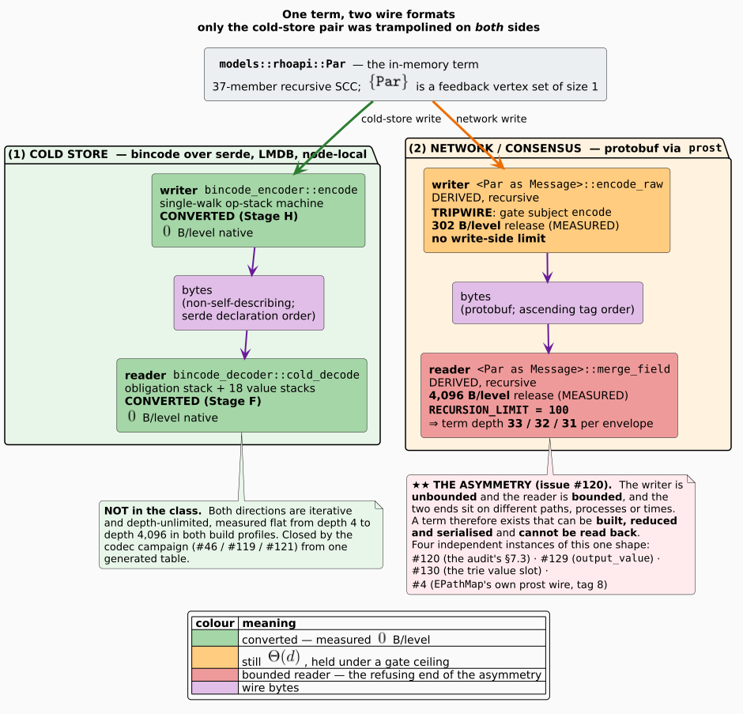

**Figure 1** — *`figures/two-wire-formats.puml`*. One term, two wire formats. Only the cold-store pair was trampolined on both sides.

| | **cold store** | **network / consensus** |
|---|---|---|
| codec | `bincode` 1.3.3 over `serde` | protobuf via `prost` 0.13.5 |
| direction of travel | node-local, into LMDB (lightning memory-mapped database) | between nodes, and into blocks |
| writer | `bincode_encoder::encode` — **CONVERTED** | `<Par as Message>::encode_raw` — recursive |
| reader | `bincode_decoder::cold_decode` — **CONVERTED** | `<Par as Message>::merge_field` — recursive |
| writer depth limit | none | none |
| reader depth limit | none | **`RECURSION_LIMIT = 100`** |

**DERIVED**: `prost`'s `RECURSION_LIMIT` is `const RECURSION_LIMIT: u32 = 100;` at `prost-0.13.5/src/lib.rs:30`. It is **private and unconfigurable**. Because the `Par` cycle costs three message levels per Rholang nesting level, and an envelope of wrapper depth $`W`$ consumes $`W`$ of the budget, the admissible term depth is

```math
D_{\max}(W) \;=\; \left\lfloor \frac{100 - 1 - W}{3} \right\rfloor
```

which yields **three distinct ceilings — 33, 32 and 31** across the nine real envelopes the gate drives (**MEASURED (f)**, `/tmp/sd_gate_release.log`: `read ceiling: 9 envelopes, 3 distinct ceilings {31, 32, 33} (bare 33)`). The gate's test *fails if it ever yields fewer than three*, because it exists to refute the sentence "the ceiling is one number".

**DERIVED** (`9a5521a2`): `bincode` has no recursion limit — **1.3.3, 2.0.1 and `bincode-next` 3.1.1 alike** offer only a *byte* limit defaulting to `NoLimit`. That is why the cold-store reader was a $`\Theta(d)`$ traversal with **no ceiling other than the stack**, and why its failure mode was uniquely bad: `rspace_importer` writes cold-store bytes to LMDB *without deep-decoding them*, so a too-deep datum enters storage through a path that structurally cannot observe its depth, and then aborts the node **on every read-back, on every restart, on every peer that synced the same state**. Every other member of the family is a transient worker fault; this one is **permanent and replicated**.

### 2.3 The observable: `B/level`

Let $`S(d)`$ be the smallest thread stack, in bytes, on which a given traversal survives an input of nesting depth $`d`$. Empirically every traversal in this family is affine in $`d`$:

```math
S(d) \;=\; c \;+\; B \cdot d
```

where $`c`$ is a fixed **intercept** (the traversal's own set-up: parser tables, driver frame, the deepest non-recursive prelude) and $`B`$ is the **slope**, in *bytes of native stack per nesting level* — written **B/level** throughout. The estimator is a two-point difference over a ladder $`[d_{\mathrm{lo}}, d_{\mathrm{hi}}]`$:

```math
\hat{B} \;=\; \frac{S(d_{\mathrm{hi}}) - S(d_{\mathrm{lo}})}{d_{\mathrm{hi}} - d_{\mathrm{lo}}}
```

with each $`S`$ obtained by **bisecting the thread's `stack_size`** to a 4,096 B resolution, in a **forked child process** (an overflow aborts and cannot be caught, so an in-process probe would take every already-passing assertion down with it).

**Why this observable and not wall-clock or peak RSS (resident set size).** The quantity that decides liveness is $`D_{\max} = \lfloor (S_{\text{avail}} - c)/B \rfloor`$, and only $`B`$ distinguishes the complexity classes. A conversion must drive **$`B`$ to zero**; it is explicitly *not* required to reduce $`c`$, and in several cases it raises $`c`$ (§5.1.2). Asserting a *shape* — "the two ends are equal" — rather than a byte count also makes the criterion **profile-independent by construction**, which matters because the debug-to-release ratio in this family ranges from $`2.2\times`$ to $`12.1\times`$ and is *per traversal*, not uniform (**MEASURED (q)**, `f0894109`).

⚠ **Two symmetric hazards of this estimator**, both encountered and both recorded:

1. **A large intercept masks a small slope.** If both ladder ends sit inside $`c`$, the measured growth is zero and the traversal reads as converted when it is not. This produced a *retracted claim* about the Rholang parser (§5.6.3).
2. **A short ladder quantises to noise.** Release `par_drop` at ~144 B/level bisects to 12,288 B at *both* ends of a 16 $`\rightarrow`$ 128 ladder — inside the bisector's initial 16 KiB probe window — and reports 36 B/level, which is quantisation, not measurement. The S0 harness therefore **doubles its deep end until the growth exceeds $`8 \times`$ the resolution**, and fails loudly at the cap with a message that distinguishes *"the traversal is depth-independent"* from *"the ladder is too short"*, because those need opposite responses (**MEASURED (q)**, `44535d75`).

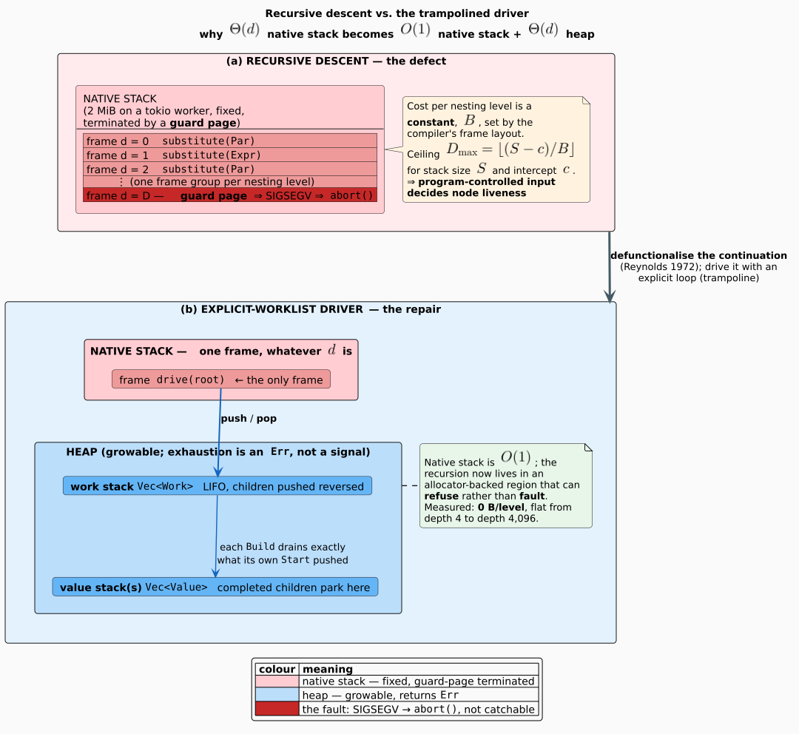

**Figure 2** — *`figures/recursive-vs-trampolined.puml`*. The central picture: why recursive descent grows the native stack and an explicit-worklist driver does not.

### 2.4 Glossary — every term defined before first use

| term | definition |
|---|---|
| **stack-safe** | a traversal whose native-stack consumption is $`O(1)`$ in the nesting depth of its input, i.e. $`B = 0`$. It may still be $`\Theta(d)`$ in *heap*; that is the point of the transformation, not a failure of it. |
| **B/level** | bytes of native stack consumed per additional nesting level; the slope $`B`$ of §2.3. |
| **guard page** | an unmapped page placed immediately past the end of a thread's stack by the operating system. Touching it raises `SIGSEGV`; Rust's handler prints `fatal runtime error: stack overflow` and calls `abort()`. Not a panic, not unwindable. |
| **trampoline** | a control structure in which a function, instead of calling its continuation, *returns* a description of the remaining work to a driver loop that performs it. The loop's single frame replaces the recursion's $`d`$ frames [[Ganz, Friedman & Wand 1999](#ref-ganz1999)]. |
| **explicit continuation** | the "rest of the computation", represented as a **first-class data value** on the heap rather than implicitly as the return address and live locals of a stack frame. |
| **defunctionalisation** | Reynolds's transformation replacing higher-order continuation *functions* with a first-order *data type* plus an `apply` function [[Reynolds 1972](#ref-reynolds1972); [Danvy & Nielsen 2001](#ref-danvy2001)]. The work-item enums in §5 are defunctionalised continuations. |
| **CEK** | *machine* — an abstract machine for the $`\lambda`$-calculus whose state is a triple of $`C`$ ontrol, $`E`$ nvironment and $`K`$ ontinuation, with the continuation an explicit stack of frames [[Felleisen & Friedman 1987](#ref-felleisen1987)]; the ancestor, via [[Ager et al. 2003](#ref-ager2003)], of every driver in §5. |
| **worklist / work stack** | the concrete `Vec` holding pending work items. LIFO gives depth-first order, matching what recursive descent did. |
| **value stack** | a companion `Vec` holding *completed* children, parked until their parent's combining step is reached. Only *bottom-up* (post-order) drivers need one. |
| **fire-and-forget** | of a spawned asynchronous task: the spawner does **not** hold or await its `JoinHandle`. Completion and errors are conveyed by some other channel — here an atomic counter and an error sink (§5.2.2). |
| **SCC** | strongly connected component of the call graph or of the type-child graph; the unit at which a conversion must be scoped, because converting a proper subset leaves the class intact. |
| **ASLR** | address-space layout randomization, the operating-system mechanism that varies process memory addresses between runs. It can shift a stack probe by a small fixed amount without producing growth with input depth. |
| **CLI** | command-line interface, here the user-facing executable path whose observation rendering must share the same stack-safe traversal as the library/runtime path. |
| **converted / tripwire** | the two registers in `rholang/tests/stack_depth_gate.rs`. *Converted* = measured $`B = 0`$ at both ladder ends in both profiles. *Tripwire* = measured $`B > 0`$, held under a ceiling. |
| **anti-vacuity** | a check that the *checker* can fail: a control the assertion must reject, run in-suite, so that a green result cannot be produced by a probe that measures nothing. |
| **$`D_{\max}`$** | the greatest nesting depth a traversal survives on a given stack: $`\lfloor (S_{\text{avail}} - c)/B \rfloor`$. |
| **slope** | the *estimated* $`B`$ of a traversal, obtained by differencing two bisected endpoint measurements rather than by reading a frame size: $`\widehat{B} = \dfrac{S(d_{hi}) - S(d_{lo})}{d_{hi} - d_{lo}}`$, where $`S(d)`$ is the minimum surviving stack at depth $`d`$. **A slope is a difference, so any constant common to both endpoints cancels** — which is exactly why a slope survives the *instrument floor* below while the endpoint values do not. Quantised to `RESOLUTION` (4,096 B). |
| **flat ladder** | a *ladder* is the ordered set of depths a subject is measured at (this report uses $`4 \rightarrow 4{,}096`$ on the depth axis and $`4 \rightarrow 65{,}536`$ on the width axis). The ladder is **flat** when $`S(d_{lo}) = S(d_{hi})`$ to bisection resolution, i.e. slope $`= 0`$ — the operational definition of *converted*. ⚠ Flatness is a claim about **two** measured rungs, not about the shape of the code between them. |
| **instrument floor** | the smallest value a measuring procedure can *emit*, independent of the subject. Here it is **12,288 B**, forced by `min_stack_for`'s `PROBE_START = 16 KiB` and `RESOLUTION = 4096` (derived in [§8.6.8](#47-the-bisection-instrument-and-its-floor)). A reading *at* the floor carries **no subject information** and must never be divided by. Distinct from a *measurement* of 12,288 B, which is why `MinStack::BelowResolution` exists: the floor is now **unspellable as a number**. |
| **ratchet** | a pinned integer constant asserting the *count* of some known-bad population, so the population cannot grow silently. `UNMEASURED_TRAVERSALS = 7` was the historical example at `mettail-rust@7fad51db`; the current generated traversal table derives the population and rejects any unmeasured member directly. A ratchet is useful only while the population is not enumerable ([§7.4](#74-enumeration-completeness)). |
| **`SIGSEGV` vs `SIGABRT`** | the two ways a stack-exhausted Rust process dies, and the distinction is the whole reason this report exists. A native-stack overflow touches the **guard page** and raises **`SIGSEGV`** (signal 11) — *not* a Rust panic, *not* catchable by `catch_unwind`, no unwinding, no destructors. Rust's runtime handler recognises the fault address, prints `fatal runtime error: stack overflow`, and calls `abort()`, which raises **`SIGABRT`** (signal 6, shell status **134**). $`\Rightarrow`$ The *observable* is usually 134, the *cause* is always 11, and **neither is a failed deploy** — both take the whole node process. A heap exhaustion, by contrast, is an `Err` a caller can handle. |

---

## 3. Related work

The transformation applied throughout §5 is not novel and was not treated as such; its value here is that it was applied at the **SCC** granularity, with **differential oracles**, to a **consensus-critical** codebase.

**Explicit continuations and abstract machines.** Landin's SECD (stack, environment, control, dump) machine [[Landin 1964](#ref-landin1964)] introduced the idea of making the control state of an evaluator an explicit data structure. Felleisen and Friedman's CEK (control, environment, kontinuation) machine [[Felleisen & Friedman 1987](#ref-felleisen1987)] gave the modern three-component form in which the continuation is a *stack of frames*. Ager, Biernacki, Danvy and Midtgaard [[Ager et al. 2003](#ref-ager2003)] established the *functional correspondence*: a compositional evaluator, CPS-transformed and then defunctionalised, **is** an abstract machine. That correspondence is exactly the recipe used here — every driver in §5 is a defunctionalised continuation over a term walk — and it is also why each conversion could be paired with a *retained recursive oracle* and checked differentially: the two are meant to be equal by construction, so any divergence is a bug in the mechanisation rather than a design question.

**Defunctionalisation.** Reynolds [[Reynolds 1972](#ref-reynolds1972)] introduced the transformation; Danvy and Nielsen [[Danvy & Nielsen 2001](#ref-danvy2001)] gave the systematic account. The `Op`, `Work`, `Kont` and `EvWork` enumerations of §5 are first-order representations of the continuations that recursive descent left implicit in return addresses.

**Trampolining.** Ganz, Friedman and Wand [[Ganz et al. 1999](#ref-ganz1999)] define *trampolined style*, in which a computation returns a thunk to a driver loop rather than calling its continuation. The interpreter's expression evaluator (§5.2.1) is trampolined in exactly this sense; the codecs (§5.3) go further and are *fully defunctionalised*, carrying no closures at all.

**Iterative traversal of recursive structures.** The problem is old in garbage collection, where a collector may not itself allocate stack. Schorr and Waite [[Schorr & Waite 1967](#ref-schorr1967)] traverse an arbitrary list structure in constant auxiliary space by **pointer reversal**, temporarily overwriting the very pointers being followed. Cheney [[Cheney 1970](#ref-cheney1970)] achieves constant auxiliary space differently, by using the *to-space itself* as the queue.

★ **Both were considered and neither was adopted**, and the reasons are worth recording because they explain the shape actually chosen:

* **Pointer reversal** requires mutating the structure during traversal. Several traversals here run on `&`-borrowed terms (the encoder walks `&dyn BincodeNode`), several run on terms shared behind `Arc`, and the sorter's output is *signed* — a traversal that transiently mutates a term another thread may observe is not admissible in this setting. Constant auxiliary space was also never the requirement: $`\Theta(d)`$ **heap** is entirely acceptable, because the heap can refuse.
* **Cheney's trick** presumes the output region is being built contiguously and can double as the queue. The encoder's output *is* contiguous — and, notably, the encoder needs no value stack at all for that reason (§5.3.2) — but the decoder must reassemble a pointer-rich `Par` whose children are not adjacent, so there is no to-space to borrow.

**Statistics.** Throughput comparisons use the **paired** $`t`$-test on the per-repetition
difference [[Student 1908](#ref-student1908)] plus the median-of-repetition ratio as the load-robust
point estimate, implemented in the shared `models/benches/paired.rs` with per-repetition A/B
interleaving and order rotation. The design rationale — why a blocked (disjoint-window) design with
an unpaired test such as Welch's [[Welch 1947](#ref-welch1947)] cannot resolve effects of this size
on a shared host — is derived in §4.8; the measurement-bias class is
[[Mytkowicz et al. 2009](#ref-mytkowicz2009)] and the design discipline that avoids it is
[[Georges et al. 2007](#ref-georges2007)]. Stack-depth figures are not timings and do not depend on
the timing design.

**Instruments.** Heap measurements use Valgrind's massif and DHAT tools [[Nethercote & Seward 2007](#ref-nethercote2007)].

**Presentation.** Algorithms are given in Knuth's literate style [[Knuth 1984](#ref-knuth1984)]: a captioned block, then prose that walks its steps and says why each exists.

---

## 4. Methods

### 4.1 Hardware

**DERIVED** — from `/home/dylon/.claude/hardware-specifications.md`, cross-checked against `lscpu` on the measurement host.

| | |
|---|---|
| CPU | AMD Ryzen Threadripper PRO 5975WX, Zen 3 (Chagall), family 25 model 8 stepping 2 |
| cores / threads | 32 physical / 64 logical, 4 CCDs $`\times`$ 8 cores |
| clocks | base $`\approx`$ 3.6 GHz, max boost **4,561.833 MHz**, min 412.214 MHz |
| caches | L1d 32 KiB/core, L1i 32 KiB/core, L2 512 KiB/core, L3 32 MiB/CCD (128 MiB total) |
| memory | 128 GiB, 8 $`\times`$ 16 GiB DDR4-2933 ECC (error-correcting code) RDIMM (registered dual in-line memory module), 8 channels, 1 NUMA (non-uniform memory access) node |
| storage | NVMe, `/home` on `/dev/nvme0n1p4` |
| frequency driver | `amd-pstate-epp` (active mode) |

### 4.2 Machine state at measurement time

**MEASURED (f)**, recorded at each measurement cell.

* **Governor**: `performance` on every core (`/sys/devices/system/cpu/cpu*/cpufreq/scaling_governor`).
* **Swappiness**: `vm.swappiness = 0`.
* ⚠ **Frequency**: the measurement host was **shared with concurrent agent workloads throughout**. At the timing cell, core 8 (the pinned core) read `scaling_cur_freq = 3,520,772 kHz` against `scaling_max_freq = 4,561,833 kHz` — i.e. **77.2 % of maximum boost**. The bench harness printed cpu0 at `3,433,018 kHz` in its own environment block. **The cores were therefore *not* at maximum frequency**, and this is recorded as a fact rather than asserted away. It is a threat to the *absolute* timings (§7.2) and not to the *relative* ones, because the harness interleaves the two arms within each repetition.
* ⚠ **Load**: 1-minute load average was **35.70** when the session began, **13.22 / 13.37 / 14.14** at the starts of timing runs 1 / 2 / 3. This is a 32-core machine, so a load of ~13 is roughly 40 % subscription — not an idle machine.
* **Settle**: a settle interval was started at 14:22:36 and the first timing cell began at 14:27:38 — **302 s**, satisfying the $`\geq 300`$ s discipline, though the machine was never *quiescent* in the interval, only quieter.

### 4.3 Toolchain and build configuration

**DERIVED**.

| | |
|---|---|
| rustc | `1.95.0-nightly (6efa357bf 2026-02-08)` |
| cargo | `1.95.0-nightly (fe2f314ae 2026-01-30)` |
| profile for all measurements in §5 | **release** (`[profile.release]`, `opt-level = 3`), unless a row says *debug* |
| `[profile.dev]` | `debug = true` only — ⚠ **no `codegen-backend = "cranelift"` is configured in this workspace**; verified by grep over `Cargo.toml`, every member `Cargo.toml`, and `.cargo/config.toml`. Every debug figure quoted here is therefore an ordinary `-O0` figure from LLVM (the compiler back end rustc emits through). |
| `rustflags` | `-C target-cpu=native` (from `.cargo/config.toml`) |
| `RUST_MIN_STACK` | **At the original measurement pin:** `8388608` from `.cargo/config.toml`. It affected spawned threads only, never a main thread, and every stack probe overrode it with an explicit stack size. **Current living status (2026-08-01):** the repository override is deleted; production correctness requires no enlarged stack. Probes retain explicit 2 MiB or 256 KiB stacks so an ambient environment variable or harness-default change cannot mask a regression. |
| feature flags | workspace defaults; no `--features` passed |

⚠ **A pre-existing `-D warnings` break, reported and not repaired.** CI runs `cargo test --release -p rholang`; at HEAD that fails to compile because `NormKont::arity` / `filled` are dead under `-D warnings`. All builds for this report were therefore made **without** `-D warnings`. The break is in a file owned by concurrent in-flight work and was deliberately not touched. A parallel instance of the same hazard is recorded in `56fb1fd0` for `models`.

### 4.4 Instruments, and which produced which number

| instrument | what it produced | invocation |
|---|---|---|
| `rholang/tests/stack_depth_gate.rs` | every **B/level** figure and every *converted* / *tripwire* verdict, by forked-child `stack_size` bisection at 4,096 B resolution | §A.1 |
| `four_quadrant_s0_baseline` (an `#[ignore]`d test in the same file) | the eight-traversal baseline table of §5.3.1 | §A.2 |
| `rholang/tests/deploy_depth_ceiling.rs` | the **end-to-end** deploy ceilings, from source text through the real runtime on an explicit 2 MiB `tokio` worker | §A.3 |
| `valgrind --tool=massif --time-unit=B` | **peak heap** and the heap-over-time series of §5.3.4 | §A.4 |
| `valgrind --tool=dhat` | **allocation counts**, total bytes, and heap read/write traffic | §A.5 |
| `models/benches/bincode_encoder_bench.rs` over the shared paired harness (`models/benches/paired.rs`) | wall-clock throughput: 60 measured repetitions after 10 warm-up, **per-repetition A/B interleaving with order rotated by repetition parity**, paired $`t`$ + median-of-repetition ratio (§4.8) | §A.6, §5.4.1 |
| `perf record -e cpu-clock --call-graph dwarf` | the CPU profile of §5.4.2 | §A.7 |

⚠ **`perf record --call-graph lbr` could not be used.** The observed failure was:

```text
Failure to open event 'cpu/cycles/Pu' on PMU 'cpu'
The sys_perf_event_open() syscall failed for event (cpu/cycles/Pu): Invalid argument
```

with `kernel.perf_event_paranoid = 2`. The profile was taken with the **software** `cpu-clock` event and DWARF unwinding instead. This is a deviation from the standing measurement discipline and is recorded as such; the substitution costs sampling fidelity (software timer rather than cycle counter) but not symbol attribution, which is what §5.4.2 uses.

**PMU capabilities of this host, characterised before use.** PMU (Performance Monitoring Unit) —
the CPU's hardware counter block. The `:P` *precise* modifier is implemented on Intel by PEBS (Precise Event-Based Sampling);
this host is AMD Zen 3, on which **PEBS does not exist** — its
counterpart, IBS (Instruction-Based Sampling), exposed as the `ibs_op` PMU, refuses per-thread mode and wants
system-wide `-a`. Consequently `mem-stores` (an Intel PEBS event) cannot be opened at all,
`--call-graph lbr` is unavailable, and plain `cycles`, `instructions`, and the AMD
`ls_dispatch.*` dispatch counters all count normally (**MEASURED** on this host, same binary, same
session). The rule this fixes in place:

> ★ **Make the deterministic instrument primary and wall-clock corroboration only.**
> `valgrind --tool=cachegrind --cache-sim=yes` is deterministic — no sampling, no skid, no
> run-to-run variation — and its `Dw` column counts exactly the write references a byte-movement
> hypothesis is denominated in. On the clone-conversion question it resolved what wall-clock could
> not: cachegrind gave **1.1740×** instructions per node and the hardware `instructions` counter
> corroborated at **1.1742×** — two instruments, four significant figures, on a host whose
> wall-clock could not distinguish 1.07× from 0.95× on the same binary minutes apart. And
> characterise what actually opens before designing a measurement around an event name.

### 4.5 Procedure

* **Pinning.** Every measurement cell ran under `taskset`: the gate on cores 16–23, the deploy bisection on 24–27, massif and DHAT on cores 4–8 and 10–14 (one arm per core, run in parallel — heap metrics are deterministic under Valgrind's serialised execution and unaffected by co-residency), the timing bench on **core 8 alone**, `perf` on core 12.
* **Resource limits.** Every build and every heavy test ran under `systemd-run --user --scope -p MemoryMax=28G`.
* **`n` and warm-up.** The timing bench performs `REPS = 60` measured repetitions after `WARMUP = 10` discarded ones, per arm, per cell; the whole bench was then run **3 times** end-to-end, so the between-run figures in §5.4.1 are $`n = 3`$ over means each of which is itself $`n = 60`$.
* **Teeing.** Every command's output was written to a file and the file analysed; no benchmark was re-run to see a different part of its output. Locations in Appendix B.
* **Decision rule.** For **wall-clock** rows the criterion is the **paired** $`t`$
  [[Student 1908](#ref-student1908)] on per-repetition differences with the median-of-repetition
  ratio as the point estimate (§4.8); where an effect is smaller than the instrument's measured
  run-to-run spread, the row reports a **bracket** rather than a magnitude — an absence and an
  unknown are different dispositions. **Non-timing** rows (B/level, $`D_{\max}`$, DHAT block
  counts, cachegrind counters) are deterministic; a difference is reported when the values differ
  at instrument resolution.

### 4.7 The bisection instrument, and its floor

Every **B/level** figure comes from `min_stack_for`: an exponential probe upward from
`PROBE_START = 16 KiB` until the forked subject survives, then bisection of the bracketing interval
to `RESOLUTION = 4,096 B`. The instrument has a provable **floor**: a subject that survives the
first probe never enters the doubling loop, so the bisection runs on $`[8{,}192,\ 16{,}384]`$ and
terminates on its first midpoint,

```math
\mathrm{mid} \;=\; \frac{8{,}192 + 16{,}384}{2} \;=\; 12{,}288 ,
```

so **12,288 B is the smallest value the bisection can ever emit, for any subject**. A reading *at*
the floor carries no subject information and must never be divided by. What survives the floor:
a **slope** is a difference of two endpoint readings, so a constant common to both cancels — when
both ends read the floor the slope is exactly 0, which is correct. Endpoint byte values at the
floor are not measurements. In **both** repositories the floor is now **unspellable as a number**:
`min_stack_for` returns a typed `MinStack::{Bytes, BelowResolution}` and a floor reading renders
`<12 KiB (BELOW THE INSTRUMENT FLOOR)` — never a number (**DERIVED**: `mettail-rust@125065a8`,
`rholang-runtime/tests/stack_depth_gate.rs:334–343`; f1r3node's gate carries the same type at the
anchor, `rholang/tests/stack_depth_gate.rs:951–973`). Historical endpoint figures recorded at
12,288 B before the typed refusal existed are floor readings and are treated as such.

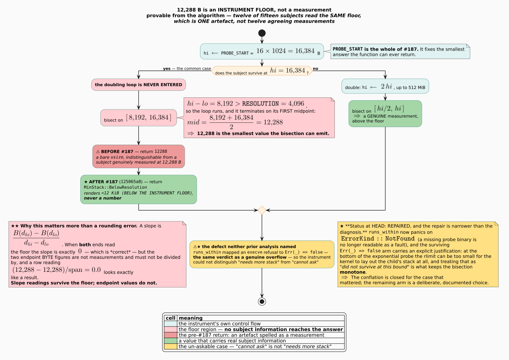

**Figure 3** — *[`figures/bisection-instrument-floor.puml`](figures/bisection-instrument-floor.puml)*.
**Diagram type: an activity diagram over an annotated interval ladder**, because the floor is a
control-flow fact — a subject that survives the first probe never enters the doubling loop — and
the claim is only visible if the branch not taken is drawn.

**Algorithm 1 (MIN-STACK-BISECT).** *The instrument itself — exponential probe, bisection, and the
refusal that makes the floor unspellable.*

```pseudocode
⟨Measure the minimum surviving stack of a subject at a depth⟩ ≡
    ⟨Probe upward until the subject survives⟩
    ⟨Bisect the bracketing interval to RESOLUTION⟩
    ⟨Refuse to answer below the instrument floor⟩

⟨Probe upward until the subject survives⟩ ≡
    hi ← PROBE_START                        ── 16 * 1024.  THE FLOOR'S CAUSE.
    while hi ≤ 512 MiB ∧ ¬ runs_within(hi, depth, subject):
        hi ← 2 · hi
    if hi > 512 MiB: fail "needed more than 512 MiB"
    lo ← hi / 2                             ── survives at hi, unknown at lo

⟨Bisect the bracketing interval to RESOLUTION⟩ ≡
    while hi − lo > RESOLUTION:             ── RESOLUTION = 4096
        mid ← (lo + hi) / 2
        if runs_within(mid, depth, subject) then hi ← mid else lo ← mid
    ── ⚠ When the FIRST probe already succeeded, lo = 8192 and hi = 16384, so
    ── the very first mid is 12288 and the loop ends there.  NO SUBJECT
    ── INFORMATION reaches that answer.

⟨Refuse to answer below the instrument floor⟩ ≡
    if hi ≤ SMALLEST_POSEABLE_STACK then
        return BelowResolution              ── renders "<12 KiB (BELOW THE
                                            ── INSTRUMENT FLOOR)", never a
                                            ── number.  Unspellable ⇒ un-divisible.
    else
        return Bytes(hi)

⟨Decide whether the subject survived a given bound⟩ ≡        ── runs_within
    spawn the probe binary with RLIMIT_STACK = bound, RLIMIT_CORE = 0
    case exit:
        clean exit                    ⇒ true
        fault / non-zero              ⇒ false
        ErrorKind::NotFound           ⇒ PANIC       ── a MISSING probe binary is
                                                    ── not a measurement
        other spawn error             ⇒ false       ── execve refused the rlimit:
                                                    ── still "did not survive at
                                                    ── this bound"; keeps the
                                                    ── bisection MONOTONE
```

*Walkthrough.* The probe (first block) doubles until survival, so the bracketing invariant —
survives at `hi`, unknown at `lo = hi/2` — holds on entry to the bisection. The bisection preserves
it and narrows to `RESOLUTION`; the annotated comment is the floor derivation above, in place. The
refusal block is what turns the floor from a hazard into a type: below the smallest poseable stack
the instrument answers `BelowResolution`, which no arithmetic can consume. `runs_within` runs the
subject in a **forked child** because an overflow is a `SIGSEGV` and cannot be caught in-process; a
missing probe binary panics rather than reading as a fault, and an `execve` refusal at tiny rlimits
is deliberately read as "did not survive at this bound" to keep the search monotone.

### 4.8 The paired timing design

Model one repetition's time as $`t_{X,i} = \mu_X + \delta(w_i) + \varepsilon_{X,i}`$, where
$`\mu_X`$ is arm $`X`$'s true mean, $`\delta`$ is drift belonging to the **time window** $`w_i`$
rather than to the code, and $`\varepsilon`$ is independent noise with variance
$`\sigma_\varepsilon^2`$. Then

```math
\operatorname{Var}\big(\widehat{\Delta}_{\text{blocked}}\big) \;=\; \frac{2\sigma_\varepsilon^2}{n} \;+\; 2\sigma_\delta^2,
\qquad\qquad
\operatorname{Var}\big(\widehat{\Delta}_{\text{paired}}\big) \;=\; \frac{2\sigma_\varepsilon^2}{n} .
```

The window term $`2\sigma_\delta^2`$ contains no $`n`$: repetitions shrink $`\sigma_\varepsilon`$
and do nothing to it, so a **blocked** design (each arm timed in its own window) reports
tight-looking results whose dominant error is never estimated, and an unpaired statistic built from
within-arm variances certifies a quiet window rather than a real difference. This is the
measurement-bias class of [[Mytkowicz et al. 2009](#ref-mytkowicz2009)];
[[Georges et al. 2007](#ref-georges2007)] sets out the design discipline. The shared harness
(`models/benches/paired.rs`) therefore interleaves A/B **within each repetition**, rotates order by
repetition parity, and decides with the paired $`t`$ on per-repetition differences.

**MEASURED** — the design difference on this host, same benches, comparable sessions
(three whole-bench runs each; *spread* = max/min of the three run-level ratios):

| bench | blocked design: three runs | spread | paired design: three runs | spread |
|---|---|---|---|---|
| `bincode_encoder_bench`, weighted owned `Vec` | 1.261×, 1.471×, 1.154× | **27 %** at loadavg 16.7 | 1.092×, 1.078×, 1.073× | **1.9 %** at loadavg **31–37** |
| `term_ops_bench` | 1.0748× then 0.9461× — a **verdict flip** | **13 %** at loadavg 15.7 | 0.962×, 0.956×, 0.954× | **0.8 %** at loadavg 19.8–23.8 |

Fourteen-times less spread at roughly double the machine load: a quieter host would have narrowed
both columns; only one narrowed, which identifies the design rather than the host as the dominant
term. The decision rule this yields: **whether a wall-clock figure is quotable is decided by effect
size against instrument spread** — an effect smaller than the spread can still be *signed* when two
instruments agree on direction, but its magnitude is a bracket, not a number.

Experiments 306–309 use the corresponding ratio-form noninferiority statistic. For paired
treatment/control times $`T_i`$ and $`C_i`$, define

```math
R_i = \frac{T_i}{C_i},
\qquad
U_{0.95}=\bar R+t_{0.95,n-1}\frac{s_R}{\sqrt n}.
```

The locked acceptance rule is $`U_{0.95}<1.05`$. Matcher experiments first compute
$`\max(R_{\mathrm{set},i},R_{\mathrm{map},i})`$ inside each pair, so a fast map cell cannot hide a
set regression. Each run uses three discarded warmups, odd AB/even BA ordering, width 65,536,
`GATE_STACK=262144`, one pinned physical core, an 8 GiB cgroup ceiling, zero swap, and no optional
stopping. Experiments 306/307 retained 30 pairs fixed by their original locked protocols;
experiments 308/309 retained the later prescribed 51 pairs.

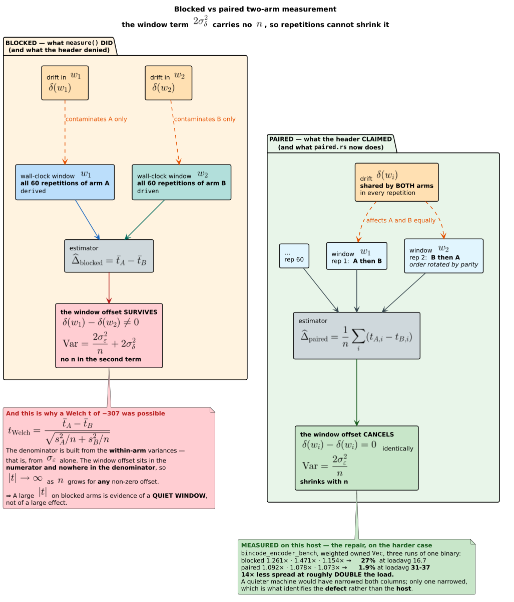

**Figure 4** — *[`figures/blocked-vs-paired.puml`](figures/blocked-vs-paired.puml)*.
**Diagram type: a two-lane timing diagram**, because the defect is about *when* each arm runs
relative to the drifting host: the blocked lanes put all of one arm inside one window, the paired
lanes alternate within each repetition so the window term cancels in the difference.

### 4.6 Anti-vacuity discipline

Every measurement in §5 comes from a harness that has been **shown to fail**. This is not decoration; four false zeros in this campaign came from probes that measured nothing (a decode probe with a wrong proto field number, so `prost` skipped the payload as unknown; a generator whose collection sizes were `0..1`, meaning *exactly zero elements, always*; a scan rule that discarded 97 % of the largest interpreter file; a `zsh` `set --` that does not word-split). The gate accordingly carries **synthetic controls that its own checkers must reject** — `synthetic_recurse` at **111 B/level** release and `synthetic_drop` at **31 B/level** release — alongside their iterative twins at **0**, and the tripwire refuses to finish unless the set of subjects it actually drove is *exactly* the declared `TRIPWIRE_DEPTH` (**MEASURED (f)**, `/tmp/sd_gate_release.log`).

---

## 5. Results

**The Phase-7 anchor contains 40 converted production subjects — 34 depth + 6 width — and
zero tripwire subjects on either axis** (**DERIVED** from `CONVERTED_DEPTH`, `CONVERTED_WIDTH`,
`TRIPWIRE_DEPTH`, `TRIPWIRE_WIDTH` at `e67a6aaa`; **MEASURED** by the capped 8/8-active gate run
recorded in the header). *Converted* means the minimum surviving stack is identical at depth 4 and
depth 4,096 (width 4 and width 65,536 on the width axis) in both profiles; the per-subject
deterministic-time fits for all 40 are the
[cachegrind TSV](measurements/phase7-cachegrind-fits-2026-08-03.tsv). Sections 5.1–5.6 report each
family's defect, repair architecture, and before/after result; §5.12–§5.15 carry the closure and
resource results. **The living extension is 45 = 37 + 8 with zero tripwires**; §5.16 reports the
five matcher additions separately so the historical 40-subject Cachegrind population is not silently
rewritten as though it had measured them.

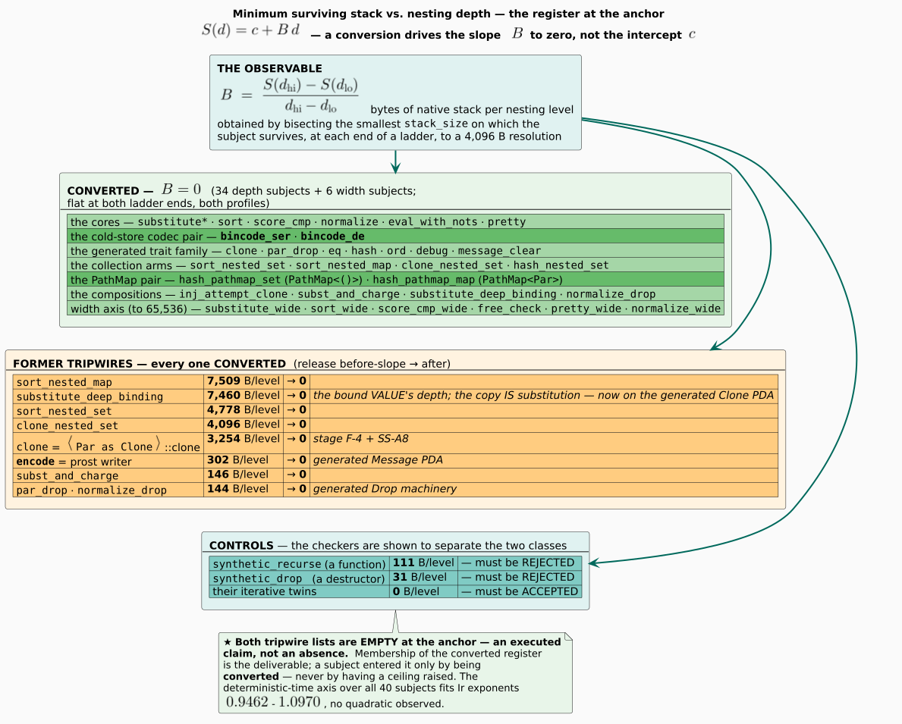

**Figure 5** — *`figures/depth-vs-stack-ladder.puml`*. The register at the anchor: 40 converted
subjects, flat ladders on both axes, and empty tripwire lists.

---

### 5.1 Family A — the substitution, sorting, normalisation and evaluation cores

#### 5.1.1 The defect

**DERIVED** — `rholang/src/rust/interpreter/substitute.rs`. `Substitute::substitute` and its partners formed a mutually recursive strongly connected component that descended one call per term level. Enumeration was **derived, not recalled**: Tarjan over `RhoTypes.proto` gave the 37-member type family; a per-`(file, name)` call-graph search over **4,503 functions**, with an explicit cross-file trait-dispatch pass, yielded **153 candidates in 53 files**, each of which was read, dispositioned and — where genuine — measured in both profiles (**MEASURED (q)**, `f0894109`).

**MEASURED (q)** — `f0894109`, by bisection on threads with explicit `stack_size`, no parser, no reducer, no tuple space, no `tokio`:

```math
S(N) \;=\; 225{,}280 \;+\; 194{,}970 \cdot N \quad \text{bytes (debug)}
```

against a relayed 194,694 B/level — agreement to **0.14 %**. Under `gdb` the per-level delta is a dead-constant **194,992 B** across ten consecutive levels. The fit predicts that depth 9 fits in 2 MiB and depth 10 does not; Rust's default spawned-thread stack is *exactly* 2 MiB, so **the measurement recovers the reported threshold without having been shown it**.

★ **Why one level cost 195 kB.** `gdb` per-frame attribution over the 20-frame cycle put **169,728 B — 87 % — in `SubstituteTrait<Expr>::substitute_no_sort` alone**. It is a 40-arm `match` over `ExprInstance`, and rustc does not overlap the stack slots of mutually exclusive arms at `-O0` (**MEASURED (q)**, `f0894109`). This is the single most useful diagnostic in the campaign: it explains why debug-to-release ratios are large and per-traversal, and why a hand-written work item is *smaller* than the frame it replaces (§6.1).

#### 5.1.2 Architecture of the repair, and why this shape

The chosen shape is an **explicit LIFO work stack of defunctionalised continuations, over borrowed sub-terms, with the environment carried as a delta into a borrowed root**.

Three design decisions, each with its rejected alternative.

**(a) Work items borrow; they do not own.** The recursion's frames held `&`-references into the input; a worklist of *owned* sub-terms would have had to clone them, and `<Par as Clone>::clone` is itself $`\Theta(d)`$ at 3,254 B/level release. Borrowing keeps the conversion honest: the heap grows by the *size of a work item* per level, not by the size of a subtree.

**(b) ★ The environment rides as a delta, and this was measured before it was designed.** `Env::shift(j)` is `Env { shift: self.shift + j, ..(*self).clone() }` — a full `HashMap<i32, Par>` clone, hence a $`\Theta(d)`$ `Par` clone of *every bound value*, *at every binder level*. **A worklist storing an owned `Env` per item would therefore have stayed $`\Theta(d)`$ however the traversal itself was written.**

**MEASURED (q)** — `f11ffb54`, *before* the conversion: **48,878 B/level** under a deep binding against **33,242 B/level** under a ground one. The difference, **15,636 B/level**, is `Par::clone`'s 15,875 to within **1.5 %**. Diagnosis confirmed.

The repair reads the SCC's *entire* use of `Env` — `get`, the `shift` field, and `shift(j)`; **there is no `put`** — and replaces it with a work item carrying `(depth, shift_delta)` plus **one borrowed root environment**, resolving

```rust
// ELIDED — the resolution rule, not compilable in isolation.
// Production form: rholang/src/rust/interpreter/substitute_drive.rs
root.env_map[(root.level + root.shift + shift_delta) - k - 1]
```

Equality with a chain of owned `Env::shift`s is *by construction*, and two guards keep it so: a source scan asserting `.put(` never appears in the SCC, and a test comparing the view against an actual chain of `Env::shift`s. **MEASURED (q)** — after the conversion the deep-environment and ground-environment readings are **identical (0 B/level both)**, which is the mechanism confirmed rather than assumed.

**(c) A hand-written driver, not one mode-flagged driver over a shared table.** The conversion removed a *dead* `SubstituteTrait<Expr>::substitute` that had silently diverged from its live twin — its `EMinusBody` arm rebuilt the term as an `EPlusBody`. A single mode-flagged driver would have made the dead method's behaviour a *configuration* of the live one and quietly promoted it (**DERIVED**, `f11ffb54`).

**Algorithm 1 (SUBSTITUTE-DRIVE).** *The shape shared by every driver in Family A.*

```pseudocode
 1  procedure DRIVE(root, env_root)
 2      work  ← [ Descend(root, depth 0, shift 0) ]      ▷ LIFO; the only frame is this one
 3      vals  ← [ ]                                       ▷ completed children, in order
 4      while work is not empty do
 5          item ← POP(work)
 6          case item of
 7            Descend(t, d, s) →
 8                (children, k) ← SPLIT(t)                ▷ the canonical child-slot table
 9                PUSH(work, Combine(SHELL(t), k))        ▷ the resume point, pushed FIRST
10                for c in REVERSE(children) do           ▷ reversed, so POP yields left-to-right
11                    PUSH(work, Descend(c, d', s'))      ▷ d', s' per the binder rule of t
12            Combine(shell, k) →
13                kids ← SPLIT_OFF(vals, |vals| − k)      ▷ takes exactly what this Descend pushed
14                PUSH(vals, REBUILD(shell, kids))
15      return POP(vals)
```

Read line by line. Line 2 seeds the work stack with the root; line 3 the value stack, which exists because this is a *bottom-up* fold — a node cannot be rebuilt until its children are. Line 9 is the whole trick: **the resume point is pushed before the children**, so it is popped after them, which is what "return to the parent" meant in the recursive form. Line 10's reversal makes `POP` yield children left to right, reproducing the recursive traversal order **exactly** — and order matters, because a differential that only compared final values would pass on a driver that visited children in the wrong order for every commutative operator. Line 13's `split_off` is the invariant that makes the two stacks agree: *every `Descend` eventually pushes exactly one value, and every `Combine` removes exactly the values its own `Descend` pushed*. Line 8's `SPLIT` is not written per driver; it is the **canonical child-slot table** of §5.7.2, whose matches are exhaustive with no `_` arm, so a schema change is a compile error rather than a silently skipped child.

#### 5.1.3 Results

| subject | before (debug) | after (debug) | before (release) | after (release) | provenance |
|---|---:|---:|---:|---:|---|
| `substitute_no_sort` | 195,728 | **0** | 27,179 | **0** | **(q)** `f11ffb54`; **(f)** flat 28 KiB↔28 KiB |
| `substitute` (sorted entry) | 195,754 | **0** | — | **0** | **(q)** `f11ffb54`; **(f)** flat 32 KiB↔32 KiB |
| `substitute_binders`, deep env | 48,878 | **0** | — | **0** | **(q)** `f11ffb54`; **(f)** flat 28 KiB↔28 KiB |
| `substitute_binders`, ground env | 33,242 | **0** | — | **0** | **(q)** `f11ffb54` |
| `sort` (ParSortMatcher) | 78,592 | **0** | 6,485 | **0** | **(q)** `9ab6b0eb`, `f11ffb54`; **(f)** flat 12 KiB |
| `score_cmp` | 1,329 | **0** | 128 | **0** | **(q)** `6ce7c5b9`; **(f)** flat 12 KiB |
| `score_cmp_wide` (**width** axis) | 201 | **0** | 0 | **0** | **(q)** `6ce7c5b9`; **(f)** flat to width 65,536 |
| `tree_clone` | 1,578 | **0** | 485 | **0** | **(q)** `6ce7c5b9`; **(f)** flat 12 KiB |
| `tree_drop` | 370 | **0** | 204 | **0** | **(q)** `6ce7c5b9`; **(f)** flat 12 KiB |
| `Tree`'s derived `PartialEq` | 719 | **0** | — | **0** | **(q)** `6ce7c5b9` |
| `normalize` | 43,542 | **0** | 7,261 | **0** | **(q)** `CONVERTED_DEPTH` note; **(f)** flat 32 KiB |
| `eval_with_nots` | 21,584 | **0** | 3,359 | **0** | **(q)** `a3fd6fe4`; **(f)** flat 12 KiB |
| `pretty`, `pretty_wide` | — | **0** | — | **0** | **(f)** flat 12 KiB both axes |
| `pretty_nested_set`, `pretty_nested_map` | residual nested-drive slope | **0** | residual nested-drive slope | **0** | **(f)** depth 4,096 on 256 KiB; 28,444 / 42,696 KiB peak RSS |

**The reported reproducer is fixed.** `@"OUT"!([[[[[[[[[[0]]]]]]]]]])` at depth 10 now survives the 2 MiB stack a `tokio` worker gets, and `reported_reproducer_depth_survives_a_default_worker_stack` is no longer `#[ignore]`d — **MEASURED (f)**: it passes in the fresh release run.

#### 5.1.3a SS-Y8 — owned canonical collections complete the printer PDA

**The evidence gap.** SS-A6's original `pretty` subject nested `EList` values. It proved the generic
printer driver but could not enter the two arms that still called public printer entry points from
inside `inline_expr`: `ESetBody` and `EMapBody`. Each arm first produced an owned, recursively
canonical `Par` tree through `ParSetTypeMapper` or `ParMapTypeMapper`, then rendered every member by
opening a fresh drive. A chain of collection intermediates therefore placed one native printer frame
per collection level. Re-canonicalizing the already-canonical suffix at every level independently
made the canonicalization component quadratic as well. **DERIVED** from the pre-`50756ec2` source;
the stale module documentation stated the nested-drive disposition explicitly.

**The machine.** `50756ec2` stores canonical roots in the printer's existing traversal-local arena
and schedules their members on the same work and value stacks as every borrowed child. One
`CanonicalCollections` registry walks each arena-owned canonical `Par` at most once, records nested
set/map addresses, and lets their later continuations consume the canonical order already produced
by the sorter. The registry and arena share a lifetime, so an address cannot outlive or be reused
while it remains authoritative.

**Algorithm 23 (SCHEDULE-CANONICAL-COLLECTION).** *Keep owned canonical descendants on the
printer's existing machine and register each canonical root once.*

```pseudocode
procedure SCHEDULE-CANONICAL-COLLECTION(collection)
    if collection is recorded canonical then
        schedule its stored children in reverse order
    else
        canonical_roots <- CANONICALIZE(collection)
        for each root in canonical_roots do
            arena_root <- ARENA-ALLOCATE(root)
            MARK-CANONICAL-DESCENDANTS-ITERATIVELY(arena_root)
            schedule arena_root
```

The first branch is the complexity repair: the recursive canonicalizer has already established the
nested order, so invoking it again would compute the same suffix repeatedly. Rendering still uses
the pre-existing string continuations; this row claims linear **canonicalization work** and flat
native stack, not a new bound for output-string copying.

**Equivalence and anti-vacuity.** The recursive oracle remains under `tests/support`. The expanded
27-case differential compares both the message and channel entry points byte-for-byte, including
depth-8 deliberately unsorted nested sets and maps. The production-only gates independently render
all 4,096 levels and count the emitted `Set(` or `{` delimiters, so returning a fallback or truncating
the traversal cannot pass.

**MEASURED (f), 2026-08-08.** Direct execution of the compiled debug gate, excluding Cargo and
compiler memory, under a 768 MiB zero-swap cgroup:

| subject | depth | native thread stack | elapsed | peak RSS | swap |
|---|---:|---:|---:|---:|---:|
| `pretty_nested_set` | 4,096 | 256 KiB | 0.12 s | 28,444 KiB | 0 |
| `pretty_nested_map` | 4,096 | 256 KiB | 0.23 s | 42,696 KiB | 0 |

**Consensus disposition.** Pretty-printer text is replay-visible, so this is not dismissed as a
cosmetic refactor. The recursive differential proves exact string identity; no parser value,
protobuf or bincode byte, hash, COMM, charge, EPathMap mode, PathMap topology, or PathMap operation
moves. The checkpoint therefore extends retired CBR-023's `EQUIVALENCE_PROVEN` evidence and creates
no active may-change-consensus entry.

#### 5.1.4 What it cost, and what leg-1 did *not* buy

★ **Leg-1 was honest about being insufficient, and that is a result.** Before any conversion, a de-cloning pass removed deep copies from `prepend_expr`/`_connective`/`_new`/`_bundle`, from four `Par::prepend_*` methods, from `sub_exp`'s discriminant read, from both `SubstituteTrait<Expr>` entries, and from twelve `.iter().map(p.clone())` sites.

**MEASURED (q)** — `f0894109`: debug **194,970 $`\rightarrow`$ 195,728 B/level** (+0.4 %, within bisection resolution — i.e. **unchanged**); release **36,416 $`\rightarrow`$ 27,179 B/level** (**$`-`$ 25.4 %**). Its own verdict: *it removes $`O(D^2)`$ heap churn and a real slice of the constant, and it cannot change the class.* Reported here because a report that showed only the successful leg would misrepresent how much work a class change actually takes.

**A latent bug surfaced by the unification.** `reduce.rs`'s private `expr_locally_free_ref` hard-coded depth 0 in its `EVar` arm where the by-value trait threads `depth` through — sound at its only call site, **wrong** at `prepend_expr`, which `sub_exp` calls at pattern depth $`> 0`$ (**DERIVED**, `f0894109`).

**Intercepts rose.** The converted subjects sit at 12–32 KiB minimum stack where several pre-conversion subjects sat at 12 KiB. The criterion is slope, not intercept (§2.3), and this is the expected direction: a driver frame holding two `Vec`s and a match on a work item is bigger than a leaf call.

**A scope correction that changed the enumeration method.** The audit's original enumeration was a Tarjan SCC over `RhoTypes.proto`. That method **structurally cannot see a recursive Rust type that is not a proto message** — and `models/src/rust/rholang/sorter/score_tree.rs` defines one, `Tree<T>`, carrying four $`\Theta`$ traversals plus a fifth on the width axis (**MEASURED (q)**, `6ce7c5b9`). The lesson is methodological and is recorded in §7.4.

⚠ **A trap the gate's own probe would have fallen into.** A linear chain sorts as a **one-element** vector, and `Vec::sort_by` on one element performs **zero** comparisons — so `compare_score` is *never entered* by the `sort` subject. Converting `sort_match` alone would have left the comparator $`\Theta(d)`$ **and the gate would still have passed**. The comparator is therefore a subject in its own right, driven by a *pair* of terms that differ only at the leaf (**DERIVED**, `6ce7c5b9`).

⚠ **A width-axis defect that only `-O0` could see.** `compare_score_nodes` recursed on the list *tail* (`&left[1..]`). At `-O2` LLVM turns that into a loop and the measured slope is **0**; at `-O0` it is **201 B per sibling**. Relying on a codegen accident for a consensus-liveness property is not acceptable, so it was made an explicit loop, which holds by construction in both profiles (**MEASURED (q)**, `6ce7c5b9`).

#### 5.1.5 The semantic clone of Family A, before and after

`Env::get` returns its value **cloned**, because substituting a `BoundVar` splices the bound term
into the result — the copy *is* the meaning of substitution, so the call site cannot be removed.
What could change is the traversal performing the copy. **Before**: the derived
`<Par as Clone>::clone` put the whole bound value's depth on the native stack — **MEASURED (q)**
`f11ffb54`: 15,850 B/level debug (`Par::clone` to within 0.2 %), 7,460 B/level release as the
`substitute_deep_binding` tripwire subject, bounded by the depth of the **bound value** rather than
of the term traversed. **After**: the clone runs on the generated `Clone` PDA (SS-A8), the subject
is in `CONVERTED_DEPTH`, and the cost is the linear heap transfer of §5.14 — substitution's
fixture-subtracted live heap is 6,341.25 B/level with native stack **0**. The two collection sorter
arms that measured 4,778 and 7,509 B/level release at the same pin (`sort_nested_set`,
`sort_nested_map`) were likewise converted by the generated sorter PDA (SS-Y3) and fit linear at Ir
exponents 1.0068 and 1.0023 (§5.14.3).

---

### 5.2 Family B — the expression evaluator and the `tokio` fire-and-forget driver

#### 5.2.1 The expression-evaluator trampoline (`a929a2d6`)

**The defect. DERIVED** — six mutually recursive evaluators in `rholang/src/rust/interpreter/reduce.rs` — `eval_expr`, `eval_expr_to_par`, `eval_expr_to_expr`, `eval_single_expr`, `eval_to_bool`, `eval_to_i64` — form a post-order fold whose native call depth is $`\Theta`$(term nesting).

**MEASURED (q)** — `a929a2d6`, `rholang/examples/so_probe.rs` on a **default 8 MiB** thread stack, release: arithmetic nesting (`EPlus`) overflowed at depth **$`\approx`$ 1,500**; list nesting (`EList`) at **$`\approx`$ 750**.

**The architecture.** The six become **thin wrappers over a single explicit-worklist driver `eval_drive`**: an `EvWork` heap stack (LIFO DFS (depth-first search), children pushed reversed so they pop left to right) and an `EvVal` value stack, with each arm's post-order body factored into a shared `combine_*` helper **used verbatim by both the driver and a retained recursive twin**.

★ **Why a *shared* combining helper rather than two independent implementations.** The differential oracle is only worth running if the two sides can actually disagree about the thing under test. Sharing the arm bodies makes the differential test the **driving** — push order, pop order, fold resumption, error position — which is what a worklist conversion can actually get wrong, while arm *semantics* are guarded separately by a round-trip identity test. §5.7.5 shows this was not theoretical: a later structural check found that the twins share **18 `combine_*` helpers**, every one of which is also called from outside the twin family.

**Owned intermediates remain inside the same machine.** The original conversion started a fresh
`eval_drive` whenever evaluation exposed a newly owned `Par`. That is safe only when the exposed value
has an external depth bound. A native method can instead reveal an arbitrary stored `Par`—for example,
`getLeaf` can return another method expression—so a chain of method applications nested one native
driver inside another. The retained recursive control overflows its test thread at only **16** such
links.

Commit `d1086fdc` makes replay an ordinary continuation. `MethodEvalRequest` names the target or an
argument and the exact historical coercion (`Par`, single `Expr`, or `i64`); `MethodInvocation` owns
the already-evaluated operands in the traversal arena; and `ApplyPreparedMethod` resumes the method
only after those typed requests complete on the existing work/value stacks. Collection and PathMap
intermediates use the same arena-and-continuation rule. No evaluator wrapper is called from a native
method core; the only remaining direct helper, `eval_single_unforgeable`, is a constant-depth shape
check.

**Algorithm 24 (SCHEDULE-METHOD-REPLAY).** *Encode each historical second-pass coercion as work on
the current evaluator machine.*

```pseudocode
plan := descriptor(method-name, arity)
push ApplyPreparedMethod(invocation, plan.length)
for request in reverse(plan):
    push Eval(request.source, request.coercion)
```

Reversing the plan preserves left-to-right execution on the last-in-first-out work stack. The `nth`
plan is intentionally argument-then-target, matching the old implementation rather than the common
target-first plans. Its and `last`'s primitive charge remains after the arity check and before operand
replay. Unknown-method spelling, wrong-arity errors, coercion failures, and charge-before-error order
are unchanged. Direct name selection also deletes construction of the complete 55-entry native-
method dispatch map on every call; only the selected method implementation is constructed.

**★ The interleaving a naïve post-order would have silently broken.** The five binary-operator helpers do **not** evaluate both operands and then check them:

```rust
// ELIDED — the pre-conversion shape, quoted for its ORDER, from `a929a2d6`.
let v1 = single_expr_instance(&eval_with(p1)?)?;   // check p1 HERE
let v2 = single_expr_instance(&eval_with(p2)?)?;   // only then touch p2
```

so if `p1` evaluates but is not a single value, **`p2` is never evaluated**. A machine that evaluated both children and then extracted would report `p2`'s error where the recursive form reports `p1`'s — an observable divergence in `EvalError`, on the path that decides `where`-clause guards. The machine therefore carries an `extract` flag on the operand work item and applies `single_expr_instance` through an `Extract` continuation pushed **before** that operand's `ParK`, so it runs the instant that operand finishes and strictly before the next is popped (**DERIVED**, `a3fd6fe4`).

⚠ **And the differential proves the order matters.** A binary `Combine` that pops its two children in the wrong order yields the same **multiset** of operands — indistinguishable from correct for every commutative operator (`+`, `*`, `==`, `&&`). The corpus therefore runs all 13 binary arms at 12 operand pairs, **each pair in both orders**, and `swapping_operands_actually_changes_the_answer` asserts that at least seven operators genuinely disagree under swap. Without it, an ordered-equality differential could pass on a corpus where order never mattered — *rigorous-looking and worthless*.

**The charge freeze.** Every `reserve_primitive` / `substitute_and_charge` / `Cost::` call is **relocated whole** — same count, order, operands, and charge-before-error ordering. Pre-order charges run in the descend handler before any child push; post-order charges run in `Combine` after all child values are available. Production `reserve_` site count **unchanged at 108** (**DERIVED**, `a929a2d6`).

**Results. MEASURED (q)** — `a929a2d6`, `so_probe`, default 8 MiB stack, release:

| family | before | after |
|---|---:|---|
| `plus` (nested `EPlus`) | overflow at $`\approx`$ 1,500 | **OK at 20,000 and 50,000** |
| `list` (nested `EList`) | overflow at $`\approx`$ 750 | **OK at 20,000 and 50,000** |
| `methodchain` (deep `EMethod` target) | *(new subject)* | **OK at 20,000** |
| adversarial method replay (`getLeaf` reveals the next `length`) | recursive control overflows at depth **16** | **OK at 4,096 on a 256 KiB stack** |

**SS-B4 results. MEASURED**, `d1086fdc`: the complete reducer differential passes **9/9**, including
the shallow independent recursive oracle; the full `rholang` library passes **308/308**; and the
EPathMap collection/fusion/replay integration group passes **6/6**. The exact 4,096-link gate completes
in **0.49 s** test time with **118,276 KiB** maximum process RSS and zero swap inside a 4 GiB
systemd scope. Native stack is $`O(1)`$ in replay depth; work/value/arena storage is $`O(d)`$ for
$`d`$ suspended method links, which is the continuation information the computation necessarily
retains.

#### 5.2.1a `InterpreterError` lifecycle closure (SS-B5)

**The recursive carrier. DERIVED**, `d03939cc`: `InterpreterError` is a heterogeneous error forest.
`AggregateError` owns an ordered `Vec<InterpreterError>`; `NonDeterministicProcessFailure` and
`ProduceFailureWithOutput` each own one boxed cause; and `Located` owns one boxed source. The prior
derived `Clone`, `PartialEq`, and `Debug`, implicit drop glue, recursive `Display` forwarding, and
recursive `root_cause` therefore consumed native stack proportional to error depth. This family is
not part of the protobuf `Par` SCC, so the schema generator and the term-family census could not
close it.

**The machine.** One exhaustive borrowed leaf view centralizes every nonrecursive variant. The six
recursive operations then specialize over the same four recursive edges:

- `Clone` is a post-order work/value fold that rebuilds each node after its children.
- `PartialEq` is an ordered pair worklist; it compares scalar fields before scheduling children.
- `Debug` and `Display` stream formatter tasks directly, so compact nested output does not build and
  repeatedly copy one intermediate string per ancestor. Alternate `Debug` preserves Rust's derived
  indentation and trailing commas.
- `root_cause` follows `Located` links with a constant-space cursor. `Error::source` continues to
  expose exactly one borrowed `Located` edge per call.
- `Drop` detaches owned children into an explicit destruction worklist before each shell falls out of
  scope. No recursive child remains for compiler drop glue to traverse.

**Algorithm 25 (FOLD-ERROR-FOREST).** *Evaluate an operation over the recursively owned error forest
without recursive host calls.*

```pseudocode
work := [Visit(root)]
values := []
while work is not empty:
    task := pop(work)
    if task is Visit(leaf):
        push(values, operation_on_leaf(leaf))
    if task is Visit(branch):
        push(work, Rebuild(branch.scalar_fields, branch.child_count))
        push_reverse(work, Visit(branch.children))
    if task is Rebuild(metadata, child_count):
        children := pop_last(values, child_count)
        push(values, rebuild(metadata, children))
return pop(values)
```

The specialized equality, formatting, cursor, and destruction machines omit the value stack where
their operation does not need reconstructed nodes. For $`n`$ error nodes, each operation performs
$`\Theta(n)`$ node visits; the explicit frontier is $`O(d+w)`$ for depth $`d`$ and maximum scheduled
sibling width $`w`$. `root_cause` is $`\Theta(\ell)`$ time and $`O(1)`$ auxiliary space for
$`\ell`$ leading `Located` wrappers. Pretty-format output can itself contain
$`\Theta(nd)`$ indentation bytes; that is an output-size property rather than retained traversal
state.

**Equivalence and resource evidence. MEASURED**, `d03939cc`, `382c53d0`: the bounded recursive
oracle under `rholang/tests/support/interpreter_error_oracle.rs` agrees on clone structure, ordered
equality, compact `Debug`, alternate `Debug`, `Display`, root-cause selection, and one-edge
`Error::source` behavior. The focused integration suite passes **3/3**. Independent production-only
execution drives both a 20,000-level mixed forest and 20,000 consecutive `Located` wrappers on a
**256 KiB** worker stack; the compiled test binary completes in **0.03 s** at **24,056 KiB** maximum
RSS with zero swap under a 768 MiB hard systemd limit. Production `clippy -D warnings` is clean, and
the complete rholang library suite passes **308/308** in **380.94 s** under the 4 GiB cap. No
`RUST_MIN_STACK`, `stacker`, artificial depth limit, changed error value, changed diagnostic byte, or
new consensus-path operation is involved.

**MEASURED (q)** — `a3fd6fe4`, the separate `rho-pure-eval` SCC: `eval_with_nots` **21,584 $`\rightarrow`$ 0** debug, **3,359 $`\rightarrow`$ 0** release; `the_machine_survives_a_depth_the_oracle_could_not` evaluates **20,000 nested negations** on an ordinary test thread, where at the old constant the recursive form would have needed **$`\approx`$ 412 MiB**. **MEASURED (f)**: flat at 12 KiB, both ends.

**Cost. DERIVED**, `a929a2d6`: the residual ceiling of ~75k–100k is `drop_in_place::<Par>` — the *inherent* recursive `Drop` of a 100k-deep data structure, `gdb`-confirmed, with the evaluator **absent** from the overflow trace. That is a property of the data depth, not of the evaluator, and it is Family D's problem (§8.2).

⚠ **Named, not fixed** (**MEASURED (q)**, `a3fd6fe4`): the `eval_with` subject on a nested `EList` chain still measures **15,872 B/level**, which is `<Par as Clone>::clone` exactly. That is *not* this SCC — the `EListBody` arm returns `par_with_expr(expr.clone())` **without descending** — so on that shape the probe measures the derived class and nothing else. The gate subject is `eval_with_nots` precisely because it is the shape that actually recurses.

**Living closure revalidation (2026-08-11; `c0cb7a45`; MEASURED (q/f)).** The two paragraphs immediately above are historical residues, not live ceilings: the generated schema now provides stack-safe `Clone for Par` and `Drop for Par`, with the destructor delegating to `par_children::dismantle_in_place`. The fixed-stack `rho-pure-eval` child gate now exercises the production composition directly rather than ending in fixture-only `dismantle`: the recursive evaluator fails at depth 4,096 as required, while `eval_with` followed by ordinary generated `Par::drop` survives depth **131,072** on a **1 MiB** thread stack. A fresh debug run of `converted_traversals_are_depth_independent` measured `eval_with_nots` at **76 / 76 KiB**, `par_drop` at **48 / 48 KiB**, and `normalize_drop` at **196 / 196 KiB** for depth **4 / 4,096**; the full registered depth/width ladder passed **1/1** in **187.73 s**. This closure uses no `RUST_MIN_STACK`, `stacker`, traversal-depth cap, or fixture-side teardown obligation.

#### 5.2.2 ★ The `tokio` fire-and-forget driver — establishing the mechanism, not assuming it

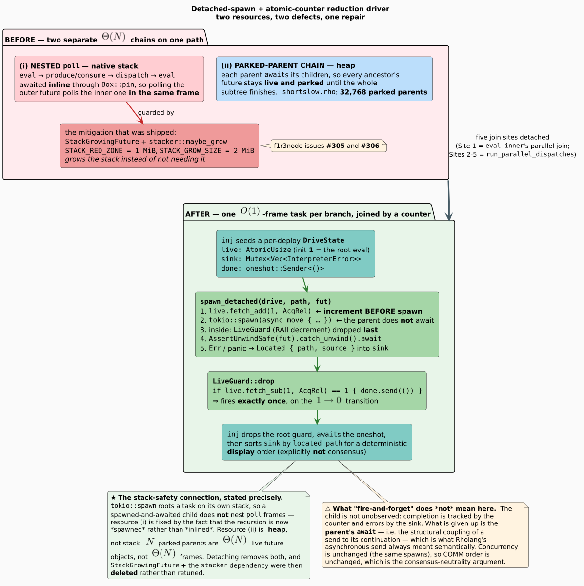

**Figure 6** — *`figures/async-detached-driver.puml`*. Two resources, two defects, one repair.

**The relationship to stack safety had to be established rather than assumed, and it turns out there were *two* distinct $`\Theta(N)`$ chains on this path, in two different resources.**

**Chain (i) — nested `poll`, in the native stack. DERIVED** from the deleted code, `git show 9843e4b6 -- rholang/src/rust/interpreter/reduce.rs`. The reduction path $`\mathtt{eval} \rightarrow \mathtt{produce}/\mathtt{consume} \rightarrow \mathtt{dispatch} \rightarrow \mathtt{eval}`$ was a chain of futures **awaited inline** through `Box::pin`. Awaiting a future inline means the outer future's `poll` calls the inner future's `poll` **in the same native frame**. A depth-$`N`$ chain of inline awaits is therefore a depth-$`N`$ chain of `poll` frames — recursion wearing an `async` costume. The mitigation that had been shipped is the evidence:

```rust
// VERBATIM, deleted by 9843e4b6 from rholang/src/rust/interpreter/reduce.rs.
const STACK_RED_ZONE: usize = 1024 * 1024;      // 1 MB
const STACK_GROW_SIZE: usize = 2 * 1024 * 1024; // 2 MB

struct StackGrowingFuture<F> { inner: F }

impl<F: Future> Future for StackGrowingFuture<F> {
    type Output = F::Output;
    fn poll(self: Pin<&mut Self>, cx: &mut Context<'_>) -> Poll<Self::Output> {
        let inner = unsafe { self.map_unchecked_mut(|s| &mut s.inner) };
        stacker::maybe_grow(STACK_RED_ZONE, STACK_GROW_SIZE, || inner.poll(cx))
    }
}
```

Its own doc comment named the mechanism: *"Each poll of this recursive future chain adds stack frames. In debug builds, unoptimized async state machines consume ~1–2 kB per recursion level, causing stack overflow with the default 2 MB thread stack."* ★ **The red zone had already been raised from 128 kB to 1 MB** because *"a single recursion frame in the Rholang interpreter consumes more than 128 kB between stacker checks"*. That is a $`\Theta(d)`$ native-stack traversal being **fed** rather than removed.

**Chain (ii) — parked parents, in the heap. DERIVED**, `reduce.rs:96-99`: *"`tokio::spawn` already gives an $`O(1)`$ async stack, but each parent `await`ing its children pins an $`O(N)`$ parked-parent chain (`shortslow`: 32,768 parked parents)."* This is a **different resource**. A parent that awaits a *spawned* child does not nest `poll` frames — the child is rooted in its own task — but the parent's future object stays **live and parked on the heap** until the whole subtree finishes. 32,768 nested continuations meant 32,768 simultaneously live future objects.

$`\Rightarrow`$ **The two are genuinely distinct and both were real.** Conflating them would have produced either a wrong fix or a wrong claim; the report keeps them apart.

**The architecture of the repair.** A **per-deploy atomic completion counter** with an error sink, and **detached** spawns at all five join sites.

```rust
// VERBATIM — rholang/src/rust/interpreter/reduce.rs:112-158, quoted in full
// because the ordering of the three fields' operations is the whole design.
pub(crate) struct DriveState {
    /// Outstanding tasks (root + all live detached children). Initialised to 1 (the root eval task).
    live: AtomicUsize,
    /// Flat, `Located`-wrapped errors pushed by detached tasks.
    sink: Mutex<Vec<InterpreterError>>,
    /// Fired exactly once, on the 1->0 transition, to wake `inj`.
    done: Mutex<Option<tokio::sync::oneshot::Sender<()>>>,
}

/// RAII decrement of `live`. Dropped LAST inside each detached task (after the error push), so the
/// sink is complete when `done` fires. Covers Ok / Err / `?` / panic — no missed decrement.
struct LiveGuard(Arc<DriveState>);

impl Drop for LiveGuard {
    fn drop(&mut self) {
        if self.0.live.fetch_sub(1, Ordering::AcqRel) == 1 {
            if let Some(tx) = self.0.done.lock()
                .expect("DriveState.done mutex poisoned").take()
            {
                let _ = tx.send(());
            }
        }
    }
}
```

**Algorithm 2 (SPAWN-DETACHED).** *The counted, unawaited spawn.* Production form at `reduce.rs:345-379`.

```pseudocode
 1  procedure SPAWN-DETACHED(drive, child_path, fut)
 2      FETCH-ADD(drive.live, 1, AcqRel)          ▷ ★ INCREMENT BEFORE SPAWN
 3      spawn detached task:
 4          guard ← LiveGuard(drive)              ▷ dropped LAST, after line 8
 5          outcome ← AWAIT(CATCH-UNWIND(fut))
 6          case outcome of
 7            Ok(Ok(_))  → ()                     ▷ the child's value is DISCARDED
 8            Ok(Err(e)) → PUSH(drive.sink, Located{path: child_path, source: e})
 9            Err(panic) → PUSH(drive.sink, Located{path: child_path, source: ReduceError})
10      return immediately                        ▷ the parent does NOT await
```

Line 2 is not an optimisation, it is a correctness requirement: incrementing **inside** the spawned task would allow `live` to reach 0 between the parent's return and the child's first poll, firing `done` while work remains. Line 4's guard is RAII (resource acquisition is initialisation) so that **`Ok`, `Err`, `?`-propagation and panic** all decrement — there is no path that misses one. Line 5's `catch_unwind` is **mandatory** rather than defensive: a panicking deploy must still record an error, or `is_failed` would flip to *success*. Line 7 discards the child's `Ok`: these five sites only ever conveyed `Skip`/error upward, and both the old aggregate and this sink discard `Ok(_)` and capture only `Err` — so the error plumbing is byte-identical (**DERIVED**, `a0a50473`).

The complementary half is in `inj`: seed a fresh `DriveState` with `live = 1` (the root eval), install it on `self.drive`, run the root eval, **drop the root guard**, await the `oneshot`, then sort the sink by `located_path` for a deterministic **display** order — explicitly *not* consensus (**DERIVED**, `reduce.rs:664-692`).

**Why this shape rather than the alternatives.**

* **`FuturesUnordered`** — the previously required architecture — still has the parent awaiting the join, so it keeps chain (ii) intact. The repro spec was updated to *forbid* it and require `spawn_detached`, and it records why: detaching is *"a strictly stronger form of the non-blocking, completion-order branch draining this repro spec guards"* (**DERIVED**, `53b8a85f`).
* **`stacker`-based stack growth** attacks chain (i) only, by *feeding* the recursion, and does nothing about chain (ii). It was deleted, not retuned.
* **A `JoinSet`** would reintroduce the awaiting parent.

**Consensus neutrality.** Concurrency is *unchanged* — the same spawns happen — so COMM order is unchanged. The differential harness checks this rather than arguing it: **MEASURED (q)**, `55b97f84` (5/5 fresh-genesis) and `a0a50473` (6/6): cost, `is_failed`, balance and the **COMM multiset** byte-identical old-vs-new, with Layer-1 replay $`=`$ play exactly.

**Results. MEASURED (q)** — `857c62fe`, the `deep_recursion_{long,short}slow` contracts (32,768 self-calls), debug:

| condition | load | wall | thread CPU | %CPU |
|---|---:|---:|---:|---:|
| idle | ~6 | 95.96 s | 93.66 s | 97 % |
| 32 spinners ($`2\times`$) | ~40 | 121.91 s | **93.73 s** | 77 % |
| 96 spinners ($`4\times`$) | ~108 | **609.6 s** | 93.4 s | — |

The pre-conversion parked-parent chain required a **300 s** budget for the same work; the heap-bound driver needs **93.7 s of CPU** (**DERIVED**, `857c62fe`, from the budget the file used to carry). That is the throughput result of the async conversion: **$`\approx 3.2\times`$ less work for the same contract**, measured in the one clock that is invariant to contention.

**What it cost.** The error sink's **push order is non-deterministic** (that is inherent to detachment), so `inj` sorts it; the ordering is documented as *display* only. And `catch_unwind` on every child is not free — **NOT MEASURED**: no isolated benchmark of `spawn_detached`'s per-spawn overhead exists, and none was constructed for this report (§5.9).

⚠ **A methodology defect found in this family and fixed as an instrument.** The two contract tests carried a single 180 s `tokio::time::timeout` doing two jobs — liveness *and* work. Wall time is computation divided by the share of a CPU the scheduler granted, and that denominator belongs to every other process on the machine. It caused **one false attribution**: a full-suite run at load ~125 recorded both RED, they were investigated as a regression, and they passed in isolation on the same tree. ★ **No larger wall budget fixes it**: a budget $`B`$ is safe iff $`B \geq T_{\text{idle}} \cdot C`$ where $`C`$ is contention imposed by *other* processes, and $`C`$ is unbounded. The instrument was therefore changed, not the number: `LIVENESS_TIMEOUT = 900 s` wall, `CPU_WORK_BUDGET = 180 s` **thread CPU**, read from `/proc/thread-self/stat` fields 14/15. **MEASURED (q)**, `857c62fe`: the two in-process readings sum to 189.4 s against `/usr/bin/time`'s 189.43 s — **0.02 %** agreement, which validates the field indices, the ticks-per-second constant and the single-thread attribution simultaneously.

---

### 5.3 Family C — the codecs, and the malloc profile

#### 5.3.1 The baseline: what had never been measured

★★ **Four of the eight traversals over the `Par` family had never been measured at all.** `eq`, `hash`, `ord` and `debug` appeared **nowhere** in the gate at that point — not in `CONVERTED_DEPTH`, not in `TRIPWIRE_DEPTH`, and in no `assert_slope_below` call. **Their absence meant *unmeasured*, not *flat*, and the two are indistinguishable from outside.**

**MEASURED (f)** — re-run in full for this report: `/tmp/sd_s0_release.log`, release, 2026-07-29. It reproduces the recorded S0 table **to the byte in every row**:

| subject | four-quadrant label | ladder | $`S_{\mathrm{lo}}`$ (B) | $`S_{\mathrm{hi}}`$ (B) | growth (B) | **B/level** |
|---|---|---|---:|---:|---:|---:|
| `clone` | `clone` | 16 $`\rightarrow`$ 128 | 65,536 | 430,080 | 364,544 | **3,254** |
| `par_drop` | `par_drop` | 16 $`\rightarrow`$ 256 | 12,288 | 45,056 | 32,768 | **136** |
| `eq` | `eq` | 16 $`\rightarrow`$ 256 | 12,288 | 65,536 | 53,248 | **221** |
| `hash` | `hash` | 16 $`\rightarrow`$ 256 | 12,288 | 45,056 | 32,768 | **136** |
| `ord` | `ord` | 16 $`\rightarrow`$ 128 | 12,288 | 61,440 | 49,152 | **438** |
| `debug` | `debug` | 16 $`\rightarrow`$ 128 | 28,672 | 167,936 | 139,264 | **1,243** |
| `encode` | `protobuf_ser` | 16 $`\rightarrow`$ 128 | 12,288 | 45,056 | 32,768 | **292** |
| `protobuf_de` | `protobuf_de` | 4 $`\rightarrow`$ 32 | 12,288 | 126,976 | 114,688 | **4,096** |
| `par_drop` | `par_drop@gate` | 256 $`\rightarrow`$ 4096 | 45,056 | 598,016 | 552,960 | **144** |
| `encode` | `protobuf_ser@gate` | 64 $`\rightarrow`$ 1024 | 28,672 | 319,488 | 290,816 | **302** |

Three facts the table makes visible:

1. **`protobuf_de` is the most expensive per level of the eight**, by $`\approx 1.26\times`$ over `clone` — and it is the **only** one of the eight that `prost` itself caps.
2. **`hash` is the cheapest**, at parity with `par_drop`. It had never been measured, and reading *unmeasured* as *unimportant* would have been supported by this number — while the *reason* it is cheap (the hand-written impl walks the same field set as `PartialEq` and allocates nothing) is exactly why it is also the easiest to convert.
3. **`ord` costs $`\approx 2\times`$ `eq`** despite comparing the same structure, because rustc's derived `cmp` materialises an `Ordering` per field and cannot reuse `eq`'s early-exit shape.

★ **The three columns are themselves the finding.** A driver list read off a `#[derive]` scan sees only the derived column: `PartialEq` and `Hash` are **stripped** from `prost`'s output by `models/build.rs` and written **by hand** in `models/src/lib.rs` — where `<Par as PartialEq>::eq` deliberately ignores `locally_free`, which no derive would do — and `Drop` is rustc's implicit glue with **no `impl` anywhere**. That is why the generated `DERIVE_DISPOSITION_REGISTRY` states in its own doc comment that it is a **lower bound**, and why a hand-picked list of four already missed `Hash` once (**DERIVED**, `7c74260d`, `44535d75`).

#### 5.3.2 The cold-store **encoder** — a single-walk trampolined serializer (`c28f4cf6`, `a169cc61`)

**The defect. DERIVED** — the derived `Serialize` recursed once per level, *and* `bincode::serialize` **traverses the term twice**: `serialized_size` then `serialize_into` (`bincode-1.3.3 src/internal.rs:25-37`). **MEASURED (q)**, `a169cc61`, by an in-binary control: `bincode_ser_derived` needed 8,191 B at depth 4 and **925,688 B at depth 4,096** — ~**224 B/level** release.

**The architecture: a pre-order op stack over borrows, with no value stack at all.**

```rust
// VERBATIM — models/src/rust/rholang/bincode_encoder.rs:150-170 (comments elided).
#[derive(Clone, Copy)]
enum Op<'a> {
    Node { node: &'a dyn BincodeNode, field: u16 },
    Seq { seq: &'a dyn BincodeSeq, index: u32, len: u32 },
    MapEntries,
}
```

★ **Why *no* value stack, when §5.1's driver needs one.** Serialisation is **pre-order into a contiguous buffer**: a node's bytes are complete the moment its last child has been written, so nothing has to be parked and recombined. This is the same structural observation that makes Cheney's algorithm work [[Cheney 1970](#ref-cheney1970)] — the output region *is* the accumulator — and it is why the encoder's per-level heap cost (**64 B**, §5.3.4) is a quarter of the decoder's (**304.7 B**).

★ **Why the table is generated from the protobuf `FileDescriptorSet` rather than from `#[prost(...)]` attributes.** The attributes describe the *protobuf* wire. This encoding is `bincode` over `serde`, whose layout is serde's **declaration order**, which serde's derive exposes **nowhere at run time**. The descriptor is the only artefact carrying it (**DERIVED**, `c28f4cf6`).

**Three bugs the suite found, each recorded where it was made** (**DERIVED**, `c28f4cf6`) — reported because they are the actual difficulty of this transformation:

1. **`prost` does not interleave oneofs with plain fields.** It emits every plain field first, then every oneof (`prost-build-0.14.3 code_generator.rs:270-291`). `TaggedContinuation` declares its oneof *before* `guard`, so the intuitive rule produced a **95-byte encoding with its halves exchanged — same length, same byte multiset**. No round-trip could see it; the *write* differential did.
2. **`&'static` slices with identical contents are merged by the linker.** `EPATHMAP_PROGRAM` is byte-for-byte `ELIST_PROGRAM`, so a downcast keyed on the program's *address* reinterpreted an `EList` as an `EPathMap` — **SIGSEGV (the segmentation-fault signal)**. Replaced by an explicit `BincodeNode::bincode_as_pathmap`; the merge is now an asserted fact.
3. **A global allocation counter counts other test threads.** Made per-thread — the assertion had passed at `--test-threads=1` and failed in the suite.

**Why round-trip is not the property.** *A codec that encodes differently but decodes its own output round-trips — and forks.* The derived `Serialize` therefore **stays compiled** as the encode oracle, for the same reason `bincode_decoder_differential` keeps the derived `Deserialize`: it is generated by the compiler and **cannot drift**. Anti-vacuity is executed, not asserted: `the_encode_differential_can_go_red` perturbs two field emissions and one variant index and requires the verdict to **reject**, naming the clause, with a control passing before and after.

**Results — space. MEASURED (q)**, `a169cc61`, release, by bisection with the pre-conversion body in the **same binary**:

| subject | depth 4 | depth 4,096 | slope |
|---|---:|---:|---:|
| `bincode_ser` (converted) | 8,191 B | **8,191 B** | **0 B/level** |
| `bincode_ser_derived` (control) | 8,191 B | 925,688 B | ~224 B/level |
| `bincode_de` (converted, Stage F) | 8,191 B | **8,191 B** | **0 B/level** |

**MEASURED (f)**: `bincode_ser` and `bincode_de` both flat at **12 KiB** at depth 4 and depth 4,096, release.

**MEASURED (q)**, `c28f4cf6`, `models/tests/bincode_encoder_space.rs`: the op stack is $`\Theta(\text{depth})`$ **not** $`\Theta(\text{size})`$ — **5 entries at width 4 and at width 65,536**; **2.000 entries per nesting level** (down from 4.000, because *a sequence's last element is a tail call, exactly as a node's last field is*); `size_of::<Op>() = 32` B.

★ **Independently confirmed for this report.** §5.3.4's massif series gives the op stack at depth 4,096 as **524,288 B** = 16,384 entries $`\times`$ 32 B for a high-water of ~8,194 entries — i.e. **2.00 entries per level**, arrived at by a completely different instrument.

#### 5.3.3 The cold-store **decoder** — an obligation stack with eighteen value stacks (`9a5521a2`)

**The defect. MEASURED (q)**, `9a5521a2`: `Par` decode is $`\Theta(d)`$ at **28,362 B/level debug / 12,894 release** — $`D_{\max}`$ **73 / 161** on a 2 MiB worker, **the shallowest member of the whole family**, 1.8–4.5 $`\times`$ below `<Par as Clone>::clone`. And, as §2.2 records, the only member whose failure is **permanent and replicated**.

★★ **Leg-2 made it reachable.** Before the substitution conversion, `substitute` capped the reducer at depth 75; afterwards `substitute` and the sorter are unbounded, so terms deep enough to break the decoder can now be *produced*. **A conversion can promote a latent defect to a live one**, and this is the campaign's worked example.

★ **Why a hand-written parser, and why wrapping `serde` cannot work.** The reduction is short and decisive: to *defer* a child you need its **byte extent**; in a **non-self-describing** format an extent requires a **schema-driven parser**; *that parser is this decoder*. Confirmed independently rather than argued: `bincode`'s `deserialize_ignored_any` returns `Err("Bincode does not support Deserializer::deserialize_ignored_any")`, killing `IgnoredAny`; and `DeserializeSeed` passes state *into* a child and never returns control *out of* a partially-completed visitor. ⚠ The one `serde` wrapper the ecosystem shipped for this problem, `serde_stacker`, **grows the stack** — the same non-solution as `stacker` in §5.2.2 (**DERIVED**, `9a5521a2`).

**Algorithm 3 (COLD-DECODE).** *An obligation stack of bounded opcodes plus per-type value stacks.*

```pseudocode
 1  procedure COLD-DECODE(bytes)
 2      ops  ← [ ParStart ]                    ▷ bounded opcode alphabet, LIFO
 3      vals ← 18 per-TYPE value stacks        ▷ pars, sends, receives, exprs, …
 4      while ops is not empty do
 5          op ← POP(ops)
 6          case op of
 7            XStart →                          ▷ read X's own scalar fields NOW
 8                (flags, counts) ← READ-HEADER(bytes)
 9                PUSH(ops, XBuild(flags, counts))          ▷ the resume point FIRST
10                for each child slot s of X, in REVERSE do
11                    PUSH(ops, Rep(kind(s), count(s)))
12            Rep(kind, n) →
13                if n > 0 then
14                    PUSH(ops, Rep(kind, n − 1))           ▷ ★ n ops are NEVER materialised
15                    PUSH(ops, START-OP(kind))
16            XBuild(flags, counts) →
17                kids ← SPLIT-OFF(vals[kind], |vals[kind]| − counts)
18                PUSH(vals[X], CONSTRUCT-X(flags, kids))   ▷ COMPLETE struct literal
19      assert exactly one value remains, on vals[Par]
20      return POP(vals[Par])
```

Line 14 is the hostile-input defence and deserves its own sentence. A counted repeat is re-pushed with $`\mathtt{remaining} - 1`$ **rather than expanded into $`n`$ opcodes**, so a declared `n = u64::MAX` costs $`O(1)`$ memory and dies on the first element that runs out of input. Combined with the fact that **every value costs at least one input byte**, allocation is $`O(\text{input})`$ for *every* input, including malformed ones. Line 17's `split_off` both preserves sibling **order** and is the same one-value-per-`Start` invariant as Algorithm 1. Line 18's *complete* struct literal — no `..Default::default()` anywhere in any decode path — makes a new schema field a **compile error** rather than a silently defaulted one.

**★ Teardown is iterative too, and that is not an afterthought.** `<Par as Drop>` is $`\Theta(d)`$ at 470 B/level, so a decode that **failed at the last byte of a deep term** would abort *while rejecting a hostile input* — the same `SIGSEGV`, on the error path. `Drop for Machine` funnels every value stack through `par_children::dismantle_all`.

**The obligation is language identity, not round-trip.** For every byte string $`b`$, `cold_decode` and `bincode::deserialize` must agree: same `Ok` value, **or both `Err`**. ★ The `Err` half is the consensus-visible one — *a node that accepts a byte string another rejects forks*.

**Validation. MEASURED (q)**, `9a5521a2`:

* differential against the **retained derived oracle** (compiler-generated, so it cannot drift) over an exhaustive corpus — one representative of all **36** `ExprInstance` and all **9** `ConnectiveInstance` arms, every `Par` field, both `EPathMap` serialize arms, every root type;
* a falsification experiment confirmed the differential **fails** on a single-field drift (`ETuple` reading a `remainder` it does not have) — **and that the three `generate_par` proptests stayed GREEN through it**, which is precisely why the constructed corpus exists;
* **1.88 M malformed inputs**, all agreeing: 117,601 truncations at every byte offset; 472,568 byte substitutions; 586,455 out-of-range variant indices; 701,898 hostile `u64` lengths (the family that would abort one side with an OOM (out-of-memory) kill without serde's `size_hint::cautious` cap, reproduced verbatim); trailing bytes **accepted** by both, because tightening that would *narrow the language*;
* depth 4,096 decoded on a **256 KiB** stack, and a *truncated* depth-4,096 term **rejected** on a 256 KiB stack — the error path proved too.

**A partition that is guarded, not asserted.** 47 types go on the machine; **16 keep the derived impl as bounded leaf calls**, on the principled ground that a type outside the `Par` SCC has fixed maximum nesting hence fixed maximum stack — the §2.1 result put to work.

⚠ **A trap worth recording**: the serde oneof numbering is **declaration order, not proto tag**. `EPathmapBody` is proto tag 32 and serde index 25, so reading tags as indices mis-decodes **12 of 36** arms.

#### 5.3.4 ★★ The malloc profile — where the allocations moved

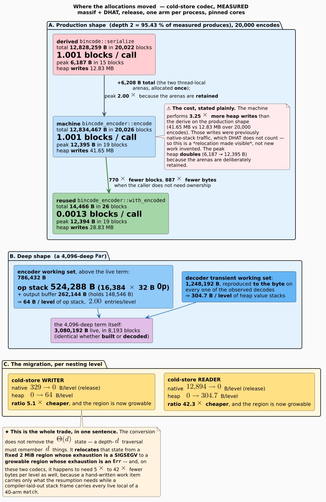

**Figure 7** — *`figures/heap-where-allocations-moved.puml`*. The heap result, from massif and DHAT.

All figures in this section are **MEASURED (f)**, 2026-07-29, one arm per process, pinned, via `models/benches/bincode_encoder_massif.rs`. Raw data in Appendix B.

**(a) Production shape** — the datum is depth 2, which is **95.43 %** of measured produces (**MEASURED (q)**, the distribution instrumented over five interpreter suites, 1,773 datums, `models/benches/bincode_encoder_bench.rs`). 20,000 encodes per arm.

| arm | total bytes | total blocks | blocks / call | peak heap (`t-gmax`) | heap **reads** | heap **writes** |
|---|---:|---:|---:|---|---:|---:|
| `derived` = `bincode::serialize` | 12,828,259 | 20,022 | **1.0011** | 6,187 B in 15 blocks | 39.88 MB | 12.83 MB |
| `machine` = `bincode_encoder::encode` | 12,834,467 | 20,026 | **1.0013** | **12,395 B** in 19 blocks | 45.74 MB | **41.65 MB** |
| `machine_reused` = `bincode_encoder::with_encoded` | **14,466** | **26** | **0.0013** | 12,394 B in 19 blocks | 32.92 MB | 28.83 MB |

Reading the table:

* **Block count per call is *identical* between the derive and the like-for-like replacement — one allocation each.** `bincode::serialize` sizes then writes into a single exactly-sized `Vec`; `bincode_encoder::encode` writes into a pooled buffer and hands back one `to_vec`. The conversion is **malloc-neutral** in the like-for-like form.
* **Total bytes differ by exactly +6,208 B over the whole run** — the two thread-local arenas (`OUT` at 4,096 B and `OPS` at 2,048 B), allocated **once**, plus 64 B. Not per call.
* ★ **The peak heap doubles, 6,187 $`\rightarrow`$ 12,395 B, and that is deliberate.** The arenas are *retained*, which is the mechanism that makes the third row possible.
* ★★ **The third row is the actual malloc result.** Where the caller does not need ownership, 20,000 encodes cost **26 blocks and 14,466 bytes in total** — $`770\times`$ fewer blocks and $`887\times`$ fewer bytes than the derive. The pooling policy is bounded on purpose: `MAX_POOLED_OPS = 4096` entries (128 KiB, covering a 2,048-deep term), so *a single pathological encode cannot pin its high-water mark for the life of the thread*.
* ⚠ **The cost, stated plainly: the machine performs $`3.25\times`$ more heap writes** (41.65 MB vs 12.83 MB). Those writes are the op stack. They were previously **native-stack** traffic, which DHAT does not count — so this is a **relocation made visible**, not new work invented. It is nonetheless real memory traffic against real caches, and §5.4 shows it does not cost wall-clock time on this workload.

**(b) Deep shape** — a 4,096-deep `Par`, from the massif time series.

The encoder's working set decomposes **exactly**:

```math
\underbrace{4{,}133{,}992}_{\text{peak}} \;-\; \underbrace{3{,}347{,}560}_{\text{term alone}} \;=\; \underbrace{786{,}432}_{768\ \mathrm{KiB}} \;=\; \underbrace{524{,}288}_{\text{op stack}} \;+\; \underbrace{262{,}144}_{\text{output buffer}}
```

* **op stack 524,288 B** = 16,384 `Op` entries $`\times`$ 32 B, for a high-water of ~8,194 entries — **2.00 entries per level**, confirming `bincode_encoder_space.rs` by an independent instrument;
* **output buffer 262,144 B**, holding an encoding of **148,546 B** (from the arm's own printed `sink`, $`9{,}506{,}944 / 64`$) — a `Vec` doubling from 4,096 reaches 262,144 at that size, exactly;
* and the massif series shows a **524,288 B sawtooth** thereafter, which is the op-stack allocation being *freed and reallocated* every iteration — the `MAX_POOLED_OPS` policy working as designed, because 16,384 entries exceeds the 4,096-entry pooling cap.

The decoder's transient working set is **1,248,192 B**, obtained as the difference between each decode's peak and the plateau it settles to, and **reproduced to the byte on every observed decode**: peaks 8,364,155 / 11,444,347 / 14,524,539 against plateaux 7,115,963 / 10,196,155 / 13,276,347. That is **304.7 B per nesting level** of heap value stacks.

Also measured, and worth recording: a decoded 4,096-deep term occupies **3,080,192 B in 8,193 blocks** — *bit-for-bit the same heap footprint as one built directly*, which is a useful sanity check on the decoder's construction.

**(c) The migration, per nesting level — the number the user asked for**

| codec | native stack **before** | native **after** | heap **before** | heap **after** | bytes/level ratio |
|---|---:|---:|---:|---:|---:|
| cold-store **writer** | 329 B/level (release, `q`) | **0** | 0 | **64 B/level** | $`5.1\times`$ cheaper |
| cold-store **reader** | 12,894 B/level (release, `q`) | **0** | 0 | **304.7 B/level** | $`42.3\times`$ cheaper |

★ **This is the whole trade in one line.** The conversion does not *remove* the $`\Theta(d)`$ state — a depth-$`d`$ traversal must remember $`d`$ things. It **relocates** that state from a fixed 2 MiB region whose exhaustion is a `SIGSEGV` to a growable region whose exhaustion is an `Err` — and on these two codecs it happens to need **5–42 $`\times`$ fewer bytes per level** as well, because a hand-written work item carries only what the resumption needs, where a compiler-laid-out frame carries every live local of a 40-arm `match` (§5.1.1).

#### 5.3.5 The prost network encoder (`56fb1fd0`) — converted in *work*, not in *stack*, and dormant

★ **This fix is included because it is on the ser/de path and because its honest description is unusual: it does not make anything stack-safe.**

**The defect. DERIVED**, from `prost` source: `Message::encode_to_vec` calls `encoded_len()` — a full recursive walk — and then `encode_raw`; and `encoding::message::encode` calls `msg.encoded_len()` **again for every nested message it writes**. A node's subtree is therefore measured **once per ancestor**:

```math
\sum_{v} |\mathrm{subtree}(v)| \;=\; \Theta(d^2) \quad\text{on a depth-}d\text{ chain}
```

**The repair.** A memoised bottom-up pass measures each node **once** — $`\Theta(n)`$ work at $`\Theta(n)`$ **space** (4 B per message node) where prost's is $`O(1)`$ space. **That is the whole trade, stated as a trade.**

★ **One monotonic cursor suffices, and that is structural rather than lucky.** Pass 1 allocates pre-order ids *at the moment of descent*; pass 2 descends in the same order through the same generated walk, the same counted repeat and the same `BTreeMap` iterator — so the sequence of nodes needing a length prefix **is** the sequence in which ids were allocated. It is bounded on both sides: `open_child` panics naming the slot if the cursor runs **past** the table, and `finish_emit` panics if it stops **short** — the latter being what a pass-2 walk that skipped a child would do, producing a perfectly well-formed protobuf message **with a field missing**.

⚠ **Both passes were still $`\Theta(\text{depth})`$ in native stack** — this fix converted work, not
stack, and no stack-safety claim attaches to it. At `56fb1fd0` the module was additionally
**dormant** (`protobuf_encoder::` appeared in no `src/` tree, verified mechanically). **Final
state**: the network serialization surface is the schema-**generated** `prost::Message`
implementation family of SS-A8 (§5.12) — explicit-PDA encode/length/merge with flat native stack —
and `EPathMap` crosses it as the EPM1 snapshot (PathMap report §5.2) rather than as an opaque
three-arm leaf. The single-cursor length-table architecture and the generator-level mutation
discipline below carried forward into that generated family.

★★ **The mutation proof runs at the generator, not at the verdict** — and this is the strongest methodological result in the campaign. Two near-misses earlier in this work were mutations that *reported green because they had not applied*. A byte-level mutation proves the **judge** can reject; only a generator-level one proves the **encoder** would have been caught. Three generator mutations, each rebuilt and each required to change `OUT_DIR/rhoapi_protobuf_schema.rs` before its verdict was accepted (**MEASURED (q)**, `56fb1fd0`):

| mutation | lines | verdict | why it is invisible to weaker checks |
|---|---:|---|---|
| M1 `sort_by_key(min_tag)` removed (declaration order) | 34 | **REJECTED** | `Par::all_par_fields` differs first at byte 925 — **both are 1,031 bytes**, a pure permutation. No length check, no round-trip, and **no protobuf decoder anywhere** can see it. |
| M2 sort key `(is_oneof, min_tag)` | 10 | **REJECTED** | `TaggedContinuation::par_body` differs at byte 0 — **both 1,140 bytes, same byte multiset, halves exchanged**. ⚠⚠ The mirror of the serde defect of §5.3.2(1) — and for protobuf the correct order is **the opposite** of that fix. |
| M3 skip-if-default $`\rightarrow`$ `if true` for `bool` | 68 | **REJECTED** | lengths 18 vs 14, 11 vs 9, 17 vs 11, 8 vs 6 across the corpus. |

⚠ **The $`\Theta(d^2) \rightarrow \Theta(n)`$ claim is checked structurally, never by timing** — a timing assertion in a test suite is a flake. The length table must grow **linearly** across $`d \in \{4, 8, 16, 32\}`$, i.e. constant entries per level; a growing per-level cost **is** the quadratic. **NOT MEASURED**: no wall-clock benchmark of `protobuf_encoder` against `prost`'s own encoder exists, and none was constructed for this report, because the code is dormant and benchmarking a dormant path would report a number nobody can collect (§5.9).

---

#### 5.3.6 The prost `EPathMap` arm — the traversal is DELETED, not converted [SS-C5…SS-C8]

Every other row in Family C converts a recursive walk into an iterative one; this one **removed**
the walk: the tag-1 per-entry encode traversal was deleted (`1b576c90`) and every non-empty map
emits the trie's own byte array at field 8, later superseded by the versioned EPM1 snapshot
(SS-C9). The wire lineage, the `U(m)` memo, the FORM ② interlude and its measured costs, the
`locally_free` single-sourcing repair (CBR-043), and the byte-golden controls are reported in the
[PathMap report §5.2–§5.3](../pathmap/pathmap-report-2026-08-03.md#52-the-wire-lineage-and-the-epm1-format).
The stack-safety consequence retained here: the deleted traversal has no remaining caller, and the
per-key read ceiling it fed died with it.

---

### 5.4 Throughput and CPU profile of the codec conversion

#### 5.4.1 Wall clock

**The three arms, defined before any number** (the same names are used in §5.3.4's heap profile):

| arm | what it is | role |
|---|---|---|
| `derived` | the serde-derive bincode encoder the campaign replaced: `serialized_size` (a full sizing walk) followed by `serialize_into` (a second full walk) | **before** |
| `machine` | the single-walk trampolined encoder (SS-C2): one defunctionalised walk emitting into an owned `Vec<u8>` allocated per call | **after**, like-for-like contract |
| `machine_reused` | the same machine writing into a caller-reused output buffer, so the per-call allocation disappears | **after**, with a contract change the caller must opt into |

**Workload.** The production-weighted mix (95.43 % of production datums are depth 2; nothing deeper
than 6 was observed), 2,001 datums per pass at 693 B/datum — deliberately the shallow mix, where a
per-node dispatch cost would show up worst. The hypothesis stated in the harness header before
measurement: *"2× faster at depth 6,000 and 20 % slower at depth 3 is a NET LOSS"* — i.e. the
acceptance criterion was **no regression on the production mix**, not a speed-up.

**MEASURED** — the paired instrument (§4.8: per-repetition A/B interleaving, order rotation, paired
$`t`$, median-of-repetition ratio; 60 repetitions after 10 warm-up per run; three whole-bench runs):

| comparison | run-level ratios (3 runs) | spread | verdict |
|---|---|---:|---|
| `derived` $`\rightarrow`$ `machine` (owned `Vec`, production mix) | 1.092×, 1.078×, 1.073× | 1.9 % at loadavg 31–37 | **machine faster** |
| `derived` $`\rightarrow`$ `machine` on the sibling `term_ops_bench` | 0.962×, 0.956×, 0.954× | 0.8 % at loadavg 19.8–23.8 | **machine slower** on that workload — reported beside the win |

**Magnitude discipline.** An earlier blocked-design instrument produced fine-looking intervals on
this bench that §4.8's spread measurement showed to be window artifacts; its runs are not quotable
as magnitudes. What survives every instrument is the **sign** on the production mix (machine
faster — even the least favourable blocked draw exceeded 1, and the paired instrument agrees), and
the honest magnitude statement is a **bracket**:

| quantity | bracket | endpoint definitions |
|---|---|---|
| `derived` $`\rightarrow`$ `machine` (owned `Vec`) | **1.07× – 1.19×** | lower end = the paired instrument's floor reading (1.073×); upper end = the most favourable blocked draw. A bracket the true value lies in — **not** a confidence interval |
| `derived` $`\rightarrow`$ `machine_reused` | **1.07× – 1.25×** | same construction |

Per-shape magnitudes (depth 1…1,024, wide, map shapes) were taken only under the blocked instrument
and are therefore not quoted; §7 records them as unmeasured under the paired design.

**The deterministic rows** (DHAT; no timing component, unaffected by any design question — the
instrument is §5.3.4's):

| quantity | `derived` | `machine_reused` | factor |
|---|---:|---:|---:|
| allocation blocks per 20k-call pass | 20,022 | **26** | **770× fewer** |
| heap **writes** (the cost, reported with the win) | 1.0 | **3.25×** | the machine writes more per byte emitted |
| peak heap on the production shape | 1.0 | **$`\approx 2`$×** | two retained thread-local arenas |

#### 5.4.2 CPU profile — where the derived path's time actually goes

**MEASURED (f)** — `perf record -e cpu-clock -F 9999 --call-graph dwarf,16384` over the bench (⚠ described here as *"the interleaved A/B bench"*; it was **blocked** — see §5.4.1), 29,436 samples, 0 lost. Full flat profile at `/tmp/sd_perf/report.flat.txt`. ★ **A flat profile is a SHARE-of-samples attribution within one arm, so the blocking defect does not reach it**: it says where an arm spends its time, not how two arms compare, and the window term cancels in a ratio taken inside a single run.

⚠ **The gross per-arm totals are *not* a valid A/B comparison** and are not presented as one: the bench runs `derived` once but `machine` **and** `machine_reused`, so the `bincode_encoder` bucket covers two arms. The wall clock of §5.4.1 is the comparison. What the profile *does* establish is the **internal structure of the derived arm**, which no timing can show:

| bucket within the derived arm | % of total samples |
|---|---:|
| `SizeChecker` pass — i.e. `serialized_size` | **19.40 %** |
| `Serializer` pass — i.e. `serialize_into` | 14.54 % |
| `drop_in_place::<bincode::error::ErrorKind>` | **9.23 %** |
| derived total | 43.17 % |

Two findings:

1. ★★ **The traversal the single-walk machine deletes is the *more expensive* of bincode's two** — $`19.40 / 14.54 = 1.334\times`$. The claim in `c28f4cf6` that *"the win is deleting a whole traversal, not shaving a loop"* is thereby confirmed by profile, and it explains §5.4.1's direction: a $`1.33/2.33 \approx 57\%`$ reduction in serde work comfortably absorbs the per-node dispatch the op stack adds.
2. ★ **`drop_in_place::<bincode::error::ErrorKind>` accounts for 9.23 % of the whole profile — 21 % of the derived arm's own cost — on the *success* path.** Every `serde` call returns a `Result<_, Box<ErrorKind>>` and every one of them is destroyed. The op-stack machine returns `()` from its emit steps and pays none of it. This was not a designed win and is recorded as an observation.

The machine's own hot symbols are `encode_into` (21.89 %), `<Par as BincodeNode>::bincode_emit` (16.96 %) and `<Expr as BincodeNode>::bincode_emit` (8.25 %) — i.e. the driver loop and the two generated emit tables, which is what a well-behaved defunctionalised walk should look like.

---

### 5.5 Family D — the deploy path

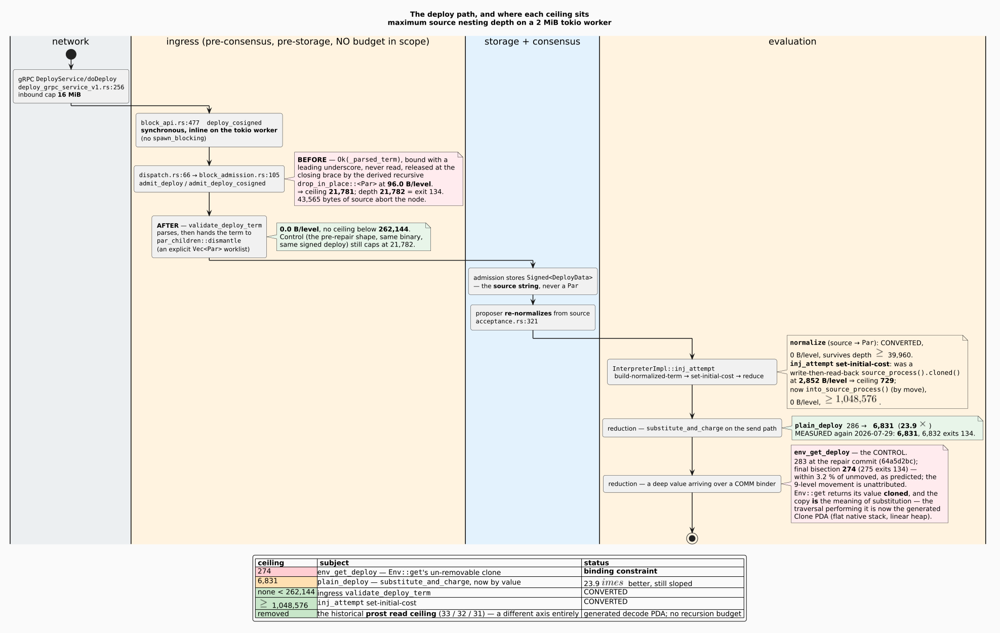

**Figure 8** — *`figures/deploy-path-ceilings.puml`*. The deploy path end-to-end, with each traversal's measured ceiling.

#### 5.5.1 ★ A refuted hypothesis, reported as a result

**Hypothesis (E86, recorded before the measurement):** the deploy path's binding constraint is `Env::get`'s un-removable clone, because that is where a deep term enters the environment.

**MEASURED (q)**, `e72dcae8`, release, explicit 2 MiB worker, real runtime, deploy driven from source:

* `@"out"!([[…[0]…]])` — no binder at all — max depth **286**;
* `for(@x <- @"c"){@"out"!(x)} | @"c"!(…)` — the COMM'd binder — max depth **283**.

★★ **The hypothesis is refuted.** The binder shape costs **three levels of headroom**, not a new ceiling. Both shapes measure the *same* 7,253 B/level (identical growth, 1,740,800 B over 16 $`\rightarrow`$ 256); they differ only in a 20,480 B **intercept**. And the arithmetic estimate of ~289 levels ($`2\ \mathrm{MiB} / 7{,}247`$) lands near the right number **for the wrong reason**.

**What was actually binding, and nobody had recorded it.** `Substitute::substitute_and_charge` took `term: &A` and opened with `self.substitute(term.clone(), …)` — so **every substitution copied its input** through `<Par as Clone>::clone`, on the **ordinary send path**, with no binder, no COMM and no environment. Established by `gdb` at the overflow: a clean 3-frame repetition

```text
<Par as Clone>::clone
  → <ExprInstance as Clone>::clone
    → <Expr as ConvertVec>::to_vec
```

under frame #103 `substitute_and_charge::<Par>`, called from `eval_send`'s data-substitution `map`, on a `spawn_detached` worker.

#### 5.5.2 ★ A withdrawn claim, reported as a result

**Claim as recorded (E89):** the gRPC ingress teardown costs **84.3 B/level**, and the ingress ceiling *depends on the spelling of the discard* — `mk_term(..).map(drop)` measuring 135.5 B/level against the literal `match … Ok(_parsed_term) => …` at 84.3, a $`1.6\times`$ spread from source form alone.

**WITHDRAWN. MEASURED (q)**, `ee1dfdad`. The 84.3 came from a **two-point min-stack ladder whose low point is clamped at the 77,824 B parse/normalise floor**, which biases the estimate downward — hazard (1) of §2.3. Four fixed-stack depth bisections resolve it:

| stack | ceiling | pairwise B/level |
|---:|---:|---:|
| 256 KiB | 2,667 | — |
| 512 KiB | 5,398 | 95.988 |
| 1 MiB | 10,859 | 96.006 |
| 2 MiB | 21,782 | 95.997 |

Least squares: **95.999 B/level at $`r^2 = 1.0000`$**, intercept 6,106 B, largest residual **21 B**. The disassembly gives the same number independently: 48 B + 48 B per level across the two frames of the `Par` $`\leftrightarrows`$ `ExprInstance` cycle.

★ **And the shape-sensitivity conclusion is superseded too.** The *identical* function `drop_in_place::<models::rhoapi::Par>` is emitted with **5 pushes and no `sub rsp` (48 B)** in casper's binary and **7 pushes (64 B)** in rholang's, and the cycles bisect to **96 vs 144 B/level** — a $`1.5\times`$ spread from **register allocation alone, with no source difference**. E89's $`1.6\times`$ between two spellings sits inside that. The conclusion "the call shape matters" was an artefact of ordinary per-build codegen variance.

★ **Corrected record: 84.3 $`\rightarrow`$ 96.0 B/level.**

#### 5.5.3 The three repairs

**(a) The ingress discard (`a09f1de2` + `3b265eb7`).** `admit_deploy` and `admit_deploy_cosigned` validated a deploy by parsing its term and throwing the result away — `Ok(_parsed_term)`, bound with a leading underscore, never read, released when the match arm ends. `Par` is prost-generated, so that release is the derived `drop_in_place::<Par>` $`\leftrightarrows`$ `drop_in_place::<ExprInstance>` cycle across the `EList.ps: Vec<Par>` edge.

⚠ **The severity was *reachability*, not depth.** Ingress was the **highest** of the deploy path's three ceilings, not the binding one:

```text
env_get_deploy (reduction)          283   ← the binding constraint
plain_deploy   (reduction)        6,831
ingress admit_deploy_cosigned    21,781
```

What made it worth fixing first is *where it sat*. Every hop was read: `DeployService/doDeploy` $`\rightarrow`$ `deploy_grpc_service_v1.rs:256` $`\rightarrow`$ `block_api.rs:477 deploy_cosigned` (**synchronous, inline on the tokio worker, no `spawn_blocking`**) $`\rightarrow`$ `dispatch.rs:66` $`\rightarrow`$ `block_admission.rs:105`. So it fired **on unauthenticated network input, on the receiving node, before the deploy was stored, before consensus, and with no `RuntimeBudget` in scope** — cost accounting could not bound it, not because the charge would be too small but because **no charge exists yet**. The inbound cap is 16 MiB, **385 $`\times`$ more headroom than the attack needed**, and the signature is trivially generated with a fresh keypair.

The repair is one owner, `validate_deploy_term`, which parses the same way and hands the term to `par_children::dismantle` — an explicit `Vec<Par>` worklist. It is a **function** rather than three copies of one discard because there are two production call sites *and a measurement probe that must stay the same shape as production or its numbers describe something else*.

★ **Nothing observable moves, for three independent and individually sufficient reasons** (**DERIVED**, `3b265eb7`): the signature is over the **source** (`DeployData::to_message`'s `term` field is the source string, so the normalised `Par` is never in the signed payload); storage is the source (admission persists `Signed<DeployData>` plus the cosigner sidecar, and **no `Par` is written**); and the term is rebuilt later anyway (the proposer re-normalises at `acceptance.rs:321`).

**(b) The metering handshake (`9082d12c`).** `InterpreterImpl::inj_attempt`'s set-initial-cost phase handed the freshly normalised `Par` to `SignedProcess::metered`, then **eleven lines later asked for it back** with `source_process().cloned()`, and dropped the original at the closing brace. Two $`\Theta(d)`$ traversals of native stack where a **move** suffices.

★ **And neither bought anything.** `RuntimeBudget::reset_from_signed_process` reads only `SignedProcess::token()`, and `token()` returns `None` on the `Signed` arm — **so the metering handshake never observes `process` at all**. The clone was a read-back of the line above it.

The repair is `SignedProcess::into_source_process`, the by-move twin: it walks the `Par(Box, Box)` spine with an explicit worklist, **pushes RIGHT before LEFT so `pop` reproduces `source_process`'s left-biased `.or_else` order exactly**, returns the first `Signed`'s `process` **by move**, and hands any further `Signed` arms to `par_children::dismantle_all`.

**(c) The metered wrappers take their term by value (`64a5d2bc`, `94dc983f`, `d2591fa1`).** The `substitute_and_charge` copy of §5.5.1 is removed by making the wrapper take ownership, which requires ownership to run all the way from the task-spawn boundary. `d2591fa1` deletes the per-branch `Par` deep clone in `eval_par` — the spawned future is `'static` so the branch term must be **owned**, but it does not have to be **copied** — by re-typing `split` to take `term_count: usize` (its entire body read `terms.len()`) and `into_iter()`-ing the terms. `94dc983f` then carries ownership through `generated_message_eval`, removing **15 deep copies**, seven named by the plan and **eight more that fell out of the same plumbing because the sibling arms had the identical shape**.

★ **And one that was worse than a clone.** `eval_match`'s loop held `(Par, Vec<MatchCase>)` as state and rebuilt the tail with `case_rem.to_vec()` on every failed case: a deep copy of every **remaining** case, once per case tried — $`\Theta(n^2)`$ `Par` clones over an $`n`$-case `match`. Draining an owning iterator removes it.

#### 5.5.4 Results, and a control that behaved exactly as predicted

**MEASURED (q)** — `64a5d2bc`, `ee1dfdad`, `9082d12c`:

| subject | before | after | factor |
|---|---:|---:|---:|
| `subst_and_charge` (release) | 2,852 B/level | **146** | 19.5 $`\times`$ |
| `subst_and_charge` (debug) | 15,872 B/level | **1,462** | 10.9 $`\times`$ |
| `inj_attempt_clone` (release) | 2,852 B/level, $`D_{\max}=729`$ | **0**, $`\geq 1{,}048{,}576`$ | class change |
| ingress teardown (release) | 96.0 B/level, ceiling 21,781 | **0**, no ceiling $`< 262{,}144`$ | class change |
| ingress teardown (debug) | 429.9 B/level, ceiling 4,503 | **0** | class change |
| **`plain_deploy`**, end-to-end, 2 MiB worker | 286 levels | **6,831** (reproduced exactly at `8853f839`) | **23.9 $`\times`$** |
| **`env_get_deploy`**, end-to-end — **the control** | 283 levels (at `64a5d2bc`) | **274** (final bisection, `8853f839`: depth 274 runs, 275 aborts with status 134) | **$`\approx 1\times`$, as predicted** |

★★ **The control is the reason this result is credible.** `env_get_deploy` exercises `Env::get`'s
clone, which *nothing in this repair touches*. It was predicted to be unmoved and it stayed within
3.2 % (283 $`\rightarrow`$ 274; the 9-level movement tracks four subsequently-landed matcher/binder
commits and its attribution was not established — the asserted result is only that the repair left
this shape's ceiling in place while multiplying the other by 23.9×). A report quoting only
`plain_deploy` would be false: what changed is **which shape is worst** — `Env::get`'s clone went
from 3 levels of headroom on a 286-level ceiling to the sole ceiling of its shape, 24× below the
other. Any deploy whose deep value arrives over a channel was unimproved *by this repair*; that
shape's traversal was later converted with the generated `Clone` PDA (§5.1.5). The transcribed 283
inside `stack_depth_gate.rs`'s `BUILD_DEPTH_INVENTORY` is recorded as a threat in §7.

#### 5.5.5 A second correction to the record

**MEASURED (q)**, `291bc217`: the recorded **219 B/level** release figure for `par_drop` *does not reproduce*; direct bisection gives **144** (debug's 470 reproduces at 464), making the profile ratio **3.22**, not the 2.1 that had been derived from the 219. **MEASURED (f)**: `par_drop` **144** B/level release at HEAD, on the gate's own 256 $`\rightarrow`$ 4,096 ladder, and **136** on the S0 16 $`\rightarrow`$ 256 ladder. **The 219 is withdrawn.**

#### 5.5.6 How bad it was before — the severity of what was fixed

Two numbers, both **MEASURED (q)**, that the "after" column would otherwise flatter:

* `291bc217`: on a 2 MiB worker, `normalize` survives depth $`\geq 39{,}960`$ but `par_drop` **aborts at 4,453**. $`\Rightarrow`$ **A source of 4,415 bracket levels — 8,831 bytes, one TCP (transmission control protocol) segment — normalises without difficulty and then aborts the process on teardown**, via `SIGSEGV` on the guard page. Not a panic, so no `catch_unwind` sees it; `inj_attempt`'s `ParserError` arm cannot run; and `build-normalized-term` precedes `set-initial-cost`, so **no budget exists to charge**. At 8 MiB the boundary is 17,929 / 17,987, which reproduces the originally reported "16,000 ok / 32,000 aborts" exactly.
* `3b265eb7`: a **depth-21,782 deploy — 43,565 bytes of source** — sent to `doDeploy` aborted the node with `SIGABRT`, exit 134, pre-storage and pre-consensus.

⚠ **And a bound on the severity, from the same measurement**: the **wire** path was *not* affected, because prost's `RECURSION_LIMIT` caps a network-delivered term at depth 33. **A `Par` too deep to arrive over the network can be built from source text.** That sentence is the asymmetry of §6.4, first observed here.

---

### 5.6 Family F — fixes originating in `mettail-rust`

`mettail-rust` is the companion repository that lowers guest-language terms into `rhoapi::Par`. Two of its findings are in scope because the fix originates there; three more are included because they are methodological results this report depends on.

#### 5.6.1 The lowering component (`3c0c3585`)

**The defect. MEASURED (q)**: `@"OUT"!([[[…1…]]])` aborted the `rhocalc` binary with `SIGSEGV` on the guard page at nesting depth **169**.

★ **The scope was the *component*, not the self-calls.** The reproducer never recurses through a self-call: its cycle is `lower_proc ▸ CastList ▸ lower_list ▸ lower_proc`, with twelve `core::iter` adapter monomorphisations in between. A Tarjan decomposition puts **87** functions in one component. **Converting the 18 direct self-call sites would have left the reported reproducer exactly as it was.**

⚠ **An earlier attempt is the control.** M-1 split `lower_proc`'s 89 arms into per-arm frames and bought **$`3.20\times`$ in debug and $`1.07\times`$ in release** — because at `opt-level=3` LLVM was *already* overlaying the arms M-1 hoisted. **The class was untouched.** This is §5.1.4's lesson in a second costume.

**Results. MEASURED (q)**, `3c0c3585`, by direct bisection of `RLIMIT_STACK` on the probe's **main thread** — not a spawned thread with a `stack_size`, because the member runs on the main thread and `RUST_MIN_STACK` cannot reach it — debug / release B/level:

| subject | before | after |
|---|---:|---:|
| `lower_depth` | 15,132 / 2,157 | **1 / 0** |
| `lower_leak` (the lowering *alone*) | — | **0 / 1** |
| `lower_add`, `lower_par`, `lower_neg` | — | 0–1 / 0–1 |
| `lower_width` (65,536 siblings) | — | 1 / 0 |
| whole `rhocalc` binary | — / 7,277 | — / **2,567** |

★ **Anti-vacuity changed a conclusion here.** `lower_depth` first read **252 B/level**, and the obvious reading — *"the conversion is incomplete"* — was **wrong**: `ast_drop`, which lowers nothing at all, read **254**. The slope was the teardown of the AST (abstract syntax tree) itself. `lower_leak` (lower, then `mem::forget` both sides) isolates the conversion and reads **0**.

**The named residue at this measurement anchor, with owners** (**MEASURED (q)**, debug / release): `par_drop` 368 / 95 · `ast_drop` 270 / 96 · `render` 3,665 / 911 · `lower_formula` 4,094 / 978. **Living disposition (2026-08-03): both production-reachable mettail rows are converted.** `render` is replaced by the observation PDA (`mettail-rust` `19ac6f21`, gated by `f2a7711f`): a main-thread probe over a directly constructed nested `Par` now finds a common reliable bound of approximately 58 KiB in debug and 28 KiB in release at both depth 512 and depth 4,096; variation below those bounds is ASLR noise rather than growth with depth. `lower_formula`'s one-pass PDA (`3316adaf`) is checked against its recursive oracle by an executable import of the exact generated-Rholang adapter (`ed46fbc9`) and closed by the zero-slope gate plus Rocq proof (`4fb9c30f`). Commit `c21b0efa` extracts the representation-independent production machine into `runtime/src/formula_pda.rs`; the imported adapter and the real generated-`Proc` adapter therefore call the same implementation. Repeated debug and release bisections keep depth-512 and depth-4,096 endpoints between 20 and 24 KiB, a single 4 KiB instrument bucket rather than growth with depth. Rocq proves recursive/PDA equality for every constructor, continuation, and arbitrary-arity separation with no admissions. The two historical `Drop`s are the derived-impl class and **were not reachable by the pushdown transform applied at this anchor: `drop_in_place` has no text to rewrite.**

**Closure-audit extension (2026-08-03).** The flat neutral renderer did not by itself close every observation path: the CLI guest renderer still recursed through a child callback, while `RuntimeObservationValue` still derived recursive `Clone`, `Drop`, equality, ordering, hashing, and debugging and implemented recursive `Display`. These were absent from the anchor's measured register. `mettail-rust` `c99bd722` makes guest notation a layout-only hook whose children remain inside the renderer PDA; `9ee2f85f` replaces the observation-value trait family with explicit PDAs; and `3f35226b` adds a main-thread zero-slope gate. The combined trait subject has the same reliable **24 KiB** bound at depth 512 and 4,096 in both debug and release. A test-only mirror enum retains the old derives as a bounded oracle: `Clone`, equality/order, `DefaultHasher` images, compact and alternate `Debug`, and `Display` are identical across every variant and same-variant field-order controls. A 32,768-level witness exercises the deep implementations and ordinary teardown.

**Living correction for the historical `Drop` rows.** They were not reachable by the
pushdown transform at that anchor because compiler-derived `drop_in_place` had no text to
rewrite. The later generators changed that premise: f1r3node emits `Drop` over the shared
explicit PDA, while mettail's collection-element PDA closes its AST destructor. Both production
destructors now have direct zero-slope subjects.

⚠ **`ast_drop` was that class with a twist worth recording.** The `language!` macro did emit a
pooled iterative `Drop`, and a pure `Proc::Add(Arc<Proc>, …)` chain was flat under it. The old
escape was not the alternating-type hop, however: the generated collection arm delegated the
whole `Vec<Proc>` to a trait method that could not see the worklist. The collection-element PDA
closed that escape; the current `ast_drop` row is flat.

#### 5.6.2 The environment-as-delta result, reproduced independently

`3c0c3585`'s `BoundEnv` rides as a **delta** into an arena whose root is borrowed, materialised once per **binder site** — because *"an owned env per work item clones a `HashMap` per level and leaves the traversal $`\Theta(d)`$ in heap anyway"*. That is §5.1.2(b) arrived at independently in a different repository, which is the strongest available evidence that it is the *right* shape for this transformation rather than a local trick.

#### 5.6.3 ★★ A retracted claim — the parser is **not** depth-independent (`1339c1e2`, then `6275b0e2`)

**Claim as published (`1339c1e2`):** `Proc::parse_via_wpda` is depth-**independent**, on a ladder at depths 16 / 32 / 64 / 128 that read **471,040 bytes at every rung — identical to the byte**.

**RETRACTED within the hour.** `assert_no_slope`, which bisects at both ends of a 4 $`\rightarrow`$ 4,096 ladder rather than sampling a narrow one, failed with

```text
ZERO-SLOPE GATE FAILED for `parse_depth`: minimum stack grew 5264 KiB between
depth = 4 (460 KiB) and depth = 4096 (5724 KiB), which is 1317 B per step.
```

**MEASURED (q)**, `6275b0e2` — widening the ladder resolves it cleanly:

| depth | min stack (B) | pairwise B/level |
|---:|---:|---:|
| 128 | 471,040 | — |
| 256 | 499,712 | 224 |
| 512 | 815,104 | 1,232 |
| 1,024 | 1,536,000 | **1,408** |
| 2,048 | 2,977,792 | **1,408** |
| 4,096 | 5,861,376 | **1,408** |

Asymptote **1,408 B/level**, stable to the byte across the last three intervals. Flat to depth ~256, linear thereafter; ⚠ **the mechanism behind the knee is not established and is deliberately not guessed at.**

★ **Why the first measurement lied.** 471,040 B is the parser's **own fixed intercept** — ~460 KiB of generated recogniser tables and driver frame. It is not a harness artefact: the cheapest subject in the same binary bisects to 98,304 B. Below depth ~256 the per-level cost is entirely **masked** by that intercept.

★★ **The rule adopted, which generalises past this subject:** *both probe points of a slope measurement must sit clear of the subject's own floor, or the derived slope is understated — here, all the way to zero.* This is hazard (1) of §2.3, and it is the dual of the hazard the same file's header already warned about. **The superseded claim is left standing in the previous commit message rather than rewritten, because the retraction is part of the record.**

**Living disposition (2026-08-03).** A fresh mettail integration build against f1r3node
`26876b65` requires 476 KiB at depth 4 and 472 KiB at depth 4,096: **zero growth within the
4 KiB instrument resolution**. Later generated semantic-hash and collection-element driver
conversions removed the native-stack growth exercised by this parse-and-teardown fixture; the
parser algorithm itself was not rewritten in this closure. The historical 1,408 B/level table
therefore remains a before-measurement, while `parsing_is_depth_independent` now enforces the
wide $`4 \rightarrow 4{,}096`$ zero-slope invariant. No parser ceiling remains.

#### 5.6.4 Two further methodology corrections from the same repository

**A guessed ceiling, corrected by measuring (`d72740e6`).** `lowering_theta_depth_tripwire` carried `ceiling(23_000, 6_000)`; the 6,000 was extrapolated from a `ulimit` bisection of the **whole binary** before any release gate run existed. Measured release slopes at the tripwire's own probe points: `lower_depth` **2,157**, `lower_add` **2,450**, `lower_par` **1,206** B/level $`\Rightarrow`$ the correct release ceiling is ~4,000. **The committed 6,000 was both too loose for the subjects it gates and derived from the wrong scope.**

★★ **The binary's slope is not the lowering's slope**, and recording that in advance prevented a false claim later:

| measurement | release B/level |
|---|---:|
| gate `lower_depth` (lowering alone) | 2,157 |
| gate `parse_depth` (parser alone) | 304 |
| gate `reproducer` (parse + lower + iterative teardown) | 2,128 |
| `bisect_ulimit` on `target/release/rhocalc` (whole main thread) | **7,266** |

the `reproducer` subject and the `lower_depth` subject agree to within measurement noise, so parse and lower **do not sum** — the deeper dominates. But the **binary** costs ~5,100 B/level *more* than parse + lower together, and that residue is neither: it is rendering the observation, and the derived recursive `Drop` of the deep `Par`. $`\Rightarrow`$ *"The lowering is fixed" and "`rhocalc` is depth-independent" are different claims, and only the first was made.*

**An inert remedy retired (`73c774a3`).** Every run line in a demo run-sheet carried `RUST_MIN_STACK=134217728`, and a gate asserted the prefix was **present**. **MEASURED (q)**: all thirteen committed demos run to their documented exit status with **no `RUST_MIN_STACK` set**, at the default `ulimit -s`. ★ **And the prefix was never a correct remedy here**: `RUST_MIN_STACK` is read only by `std::thread`'s spawn path, so **it cannot resize a main thread** — and the binary is `#[tokio::main] async fn main`, which is where parsing and lowering run. *A sheet that recommends an inert knob teaches a presenter to mis-diagnose, which is worse than silence.* The gate was **inverted** rather than deleted, so that restoring the prefix under presentation pressure fails the build and points at the real gate.

**A gate that was red because it did not finish (`21c51d10`).** One test bisected four residue subjects at depths 512 and 4,096; at ~20 child processes per bisection it ran ~500 s and `cargo nextest` **terminated it at its 300 s per-test cap**. *A gate that is red because it did not finish is worse than no gate: it reports failure without having measured anything, and the natural response under pressure is to delete it.* Split one-per-test: 3.3 s, 3.4 s, 171 s, 206 s.

#### 5.6.5 ★ The twelfth generated driver, and the seven numerals beside it (`ed44c429`)

##### 5.6.5.1 The defect

**MEASURED.** `macros/src/gen/native/eval.rs` emitted `Some(__b) => Some(__b.as_ref().try_eval()?)` inside the `Visit` arm for a same-category optional child. The branch `continue`s before any Reduce frame is built, so the descent ran on the **host stack in both the recursive form and the PDA form** — a $`\Theta(\text{depth})`$ path inside a driver that advertised itself as converted. A user input reaching it is any term nesting through such a field; the workspace's one instance is `optsmoke::Int::IfElse`'s `*opt(e:Int)`.

**DERIVED.** A classifier-side census of the emitter — not of the generated artefacts — finds only **four** rules workspace-wide that put anything in a term-context `*opt(...)`: one same-category, two `Vec(Proc)` (no `native_type`, so the emitter `continue`s), one wrapping `?g:Guard`. Reading the classifier rather than `target/generated/` is what makes this total: it sees grammars whose output never reaches the tree.

##### 5.6.5.2 The architecture of the repair, and why THIS shape

**Shape: representation change** (a presence flag) **plus a refusal**, not a driver conversion.

`CrossKind::OptionalSameCat` replaces the recursive child with a `bool`, because the arm needs to know only *whether* the optional was present — the child's value is already reachable through the worklist. A Reduce frame would have been the alternative and was rejected: it widens `Step` for one instance of one shape in one language.

★ **The alternatives, and why each was rejected.** *Convert the arm to a worklist frame* — costs a `Step` widening for a single site. *Leave it and record a residual* — the residual is a live overflow path, not a cap. *Refuse the whole optional-same-category shape* — too broad; the shape is legitimate when the child is not a term.

The **capture-rule refusal** is a different judgement: a capture rule whose syntax binds token text *and* carries a same-category `Term` field would be $`\Theta(\text{depth})`$ with no way to express the presence flag. ⚠ **Its blast radius is provably zero** — the refused shape **fails to compile in the baseline too** (`E0061`, wrong arity from `term_generation.rs:68` / `random_generation.rs:101`). It never compiled. The refusal replaces an incomprehensible generated-code error with a named one.

**Invariant that keeps the stacks in step:** the presence flag is consumed in the same arm that would have consumed the recursive result, so the worklist's push/pop balance is unchanged.

##### 5.6.5.3 How the fix was made

VERBATIM, the discriminator (`macros/src/gen/native/eval.rs`):

```rust
fn capture_term_field_is_same_category(ty: &TypeExpr, category: &syn::Ident) -> bool {
    matches!(ty, TypeExpr::Base(base) if base == category)
}
```

The `CrossKind` variant and its three arms (`quote!{ #n: bool }`, `quote!{}`, `None`) are ELIDED; the refusal emits `compile_error!` via `quote_spanned!` on the rule label's span.

##### 5.6.5.4 Results

| metric | before | after | provenance |
|---|---|---|---|
| B/level, release | host recursion, unbounded | **0** | gate `ast_try_eval`, `ast_try_eval_cast` |
| B/level, debug | host recursion, unbounded | **0** | same |
| max depth, 2 MiB worker | overflow | no overflow | RED-then-GREEN, below |
| wall clock | **NOT MEASURED — no throughput claim is made** | | |
| heap: peak / blocks | **n/a — not a ser/de conversion** | | |
| where the allocations moved | nowhere; a `bool` replaces a recursive call | | |

**Byte-identity control CLEAN**: two detached worktrees, empty `target/` in both so `write_if_changed` could skip nothing, 2,281 files × 54 languages each — **exactly one generated file differs**, the intended target.

##### 5.6.5.5 What it cost

Throughput: unmeasured, and no claim is made. Allocation: none. Complexity: one enum variant and one refusal arm. Intercept: unchanged. ★ **A stack-safety fix that is slower is still correct — here the number simply does not exist, and saying so is the point.**

##### 5.6.5.6 What is still recursive

⚠⚠ **HISTORICAL AT `ed44c429`; superseded by SS-G7.** The cast-lattice bound was
RHOLANG-scoped and measured, not a property of the generator. Rholang's twelve `try_eval` sites
were all cast arms and therefore bounded at five host frames (`BigRat ▸ BigInt ▸ Int ▸ UInt32 ▸
Bool`), while the workspace-wide classifier census found 63 eager non-cast sites, including the
live `Int::BoolToInt` ⇄ `Bool::EqInt` and `Num::PredToNum` ⇄ `Pred::EqNum` cycles. The proposed
"refuse any cycle" repair was not selected: SS-G7 instead computes the post-auto-injection category
dependency graph and puts every strongly connected component in one typed PDA. Its remaining 30
direct calls across 55 generated `eval.rs` artefacts are all edges of the acyclic condensation
graph, so their native-call depth is bounded by the finite category graph rather than input depth.
**DERIVED**, `mettail-rust@b0aa4e09`, `evaluator_component_ids` and the complete generated-artifact
census recorded in `measurements/evaluator-scc-pda-2026-08-04.tsv`.

##### 5.6.5.7 Anti-vacuity

**The checker must reject the old emitter, and it was shown doing so.** The new test run against the pre-change emitter aborts with `fatal runtime error: stack overflow`, exit **101**. Against the new emitter: 18/18.

★ **A second anti-vacuity result, on the register itself.** `flat_generated_drivers_are_depth_independent` was a hand-written 26-name array beside a 33-row table that already knew the answer; `ast_try_eval` and `ast_try_eval_cast` reached the table and not the array, so both were held to an **8× looser bar** ($`\approx 32`$ vs $`\approx 4`$ B/level) with no slope printed. The array is **deleted and derived**. ⚠ The predicate is *"the shape asserts depth-independence"*, **not** `Shape::Flat` — `FlatAndItsEqFreeTwinAgrees` is a flat assertion carrying an extra obligation, so matching `Shape::Flat` alone would have silently **dropped** `ast_subst` and `ast_normalize`: a narrowing disguised as a derivation. Measured: 30 + 2 = **32** checked against the array's 26; six gained, none lost. Its floor is derived from `MIN_DRIVER_SUBJECTS` minus the sloped rows, and its message prints count **and** membership.

★ Six further stale numerals in the same file were the same failure — *a transcribed count beside a table that can compute it* — and are repaired as one mechanism rather than six edits. Superseded readings are **annotated, never overwritten**.

#### 5.6.6 ★★ #174 attributed to `models`' `impl Hash for Par` (`3276c1ee`)

##### 5.6.6.1 The defect

#174 stood as *"hash-keyed collection literals cost 11.0× a list literal, and the figure matches no driver measured in isolation."* **Both halves were wrong**, and the second was the clue: it matched no driver because **it is not a driver**.

⚠ **Both filed figures are WITHDRAWN.** Re-measured on this build, on the very ladder the old numbers were taken on ($`16 \rightarrow 1{,}024`$): `map_pair_lower` **10,491 $`\rightarrow`$ 227** B/level (a 46× reduction) and `list_pair_lower` **950 $`\rightarrow`$ 0**. #162 and #189 converted the drivers stacked on top of the hash. ★ **A ratio against a control that now reads zero is not a number** — the 11.0× is withdrawn, not restated. The superseded values are kept here, named as superseded, per [Appendix G.4](#appendix-g--the-maintenance-contract) rule 2.

**It was never a parse-phase cost.** `list_pair_parse` / `map_pair_parse` / `set_pair_parse` read **0 / 1 / 0** debug and **$`-1`$ / $`-1`$ / 1** release. The whole residue is in the LOWER phase.

##### 5.6.6.2 The architecture of the repair, and why THIS shape

**Shape: measurement, not conversion.** The deliverable is an *attribution* plus a ceiling, because the traversal is not mettail's to convert — it is `models`'. DERIVED, following the one structural difference between an `EList` and an `EMap`/`ESet`:

```text
rholang_ast.rs:2460 new_emap_par → utils.rs:715 new_emap_expr
  → ParMapTypeMapper::par_map_to_emap(ParMap::new(…))
  → par_map.rs:18 ParMap::new → sorted_par_map.rs:30 SortedParMap::create_from_vec
        let map: HashMap<Par, Par> = vec.into_iter().collect();
  → models/src/lib.rs:284  impl Hash for Par     ← HAND-WRITTEN, HOST-RECURSIVE
```

`EList` takes the other branch — `EListBody(EList { ps: Vec<Par>, … })`, a plain vector: no hash, no sort, no `Ord`.

★ **The alternatives, and why each was rejected.** *Apportion the measured total across candidate sub-traversals* — refused; [§5.7](#57-family-e--the-instrument-and-what-it-caught-in-itself) records apportionment as the move that manufactures false zeros. *Convert the lowering* — wrong subject; the lowering is already flat. *Leave it unattributed* — it was, for as long as the figure stood.

##### 5.6.6.3 How the fix was made

Four probe subjects and a `lower_depth` control were added, plus two ceilinged gate rows and one
**subtraction** assertion. That was the historical attribution instrument. After SS-Y2 converted
the mechanism, the subtraction and both ceilings were deleted; `par_hash` and `par_hashmap` now
carry independent zero-slope gates.

##### 5.6.6.4 Results

Discriminating window $`512 \rightarrow 4{,}096`$, where the parser's depth-independent ~483 KB floor no longer compresses the slope. B/level, debug / release:

| subject | what it runs | debug | release | provenance |
|---|---|---:|---:|---|
| `list_pair_lower` | parse + lower, **no hash** (the control) | 0 | $`-1`$ | gate |
| `par_hash` | `lower_depth` + `Hash for Par`, alone | **625** | **113** | gate |
| `par_hashmap` | the `HashMap<Par,Par>` collect | **636** | **113** | gate |
| `map_pair_lower` | the original #174 rung | 597 | 144 | gate |
| `set_pair_lower` | the #174 rung, plus the sort | 572 | 144 | gate |
| `lower_depth` | the identical pipeline, hash removed | 1 | 0 | gate |

Four subjects that share **only** that impl agree inside **±5.3 %** in debug.
wall clock: **NOT MEASURED — no throughput claim.** heap: **NOT MEASURED — n/a, no allocation moved.**

##### 5.6.6.5 What it cost

Nothing in production: the commit adds probe subjects and assertions only.

##### 5.6.6.6 What is still recursive

**Historical status at `3276c1ee`.** `impl Hash for Par` and `impl PartialEq for Par` were still
host-recursive and consensus-adjacent; `SortedParMap` feeds the canonical sort that
`cost_accounting/sig.rs` signs. **Current status:** `26876b65` replaced both with schema-generated
PDAs. Independent `hash`, `hash_nested_set`, `hash_pathmap_set`, and `hash_pathmap_map` subjects are
native-stack flat through depth 4,096; the PathMap set/map Ir exponents are 0.9918 and 1.0175.

##### 5.6.6.7 Anti-vacuity

★★ **Historical anti-vacuity.** `par_hash_excess_over_the_unhashed_pipeline_is_the_whole_slope`
asserted `lower_depth` stayed flat, so the two then-ceilinged rows could not pass while their
attribution quietly became false. Measured debug $`512 \rightarrow 4{,}096`$: `par_hash`
339,968 $`\rightarrow`$ 2,580,480 against `lower_depth` flat at ~73,728, so the excess was the
whole slope and belonged to hashing.

⚠ `par_hash` and `par_hashmap` remain **two** rows rather than being folded into one:
`par_hash` runs the hash alone, while `par_hashmap` also reaches `Eq for Par` on collision. Both
are now required to be independently flat, which detects a regression in either generated trait
path without preserving the old byte budgets. Fresh integration readings are 88 KiB at depth 4
and 84 KiB at depth 4,096 for `par_hash`, and 84 KiB at both ends for `par_hashmap`.

#### 5.6.7 `SS-E1` — 3b's prerequisite instrument, and the two checks that were blind

**The defect.** Phase 3b converts the three self-contained sorter arms. Sorting is *order-defining*, so the usual "evaluation order is unobservable" argument does not apply, and `SortedParMap` feeds the canonical sort that `cost_accounting/sig.rs` signs. The epic therefore required an explicit identical-total-order argument **before** any conversion. It did not exist, and — measured here — **neither existing check could have gated the conversion.**

**Architecture, and why this shape.** The order is established in two places, not one. `combine_eset` never sorts: it maps elements through `sort_match` in the iteration order of `par_set.ps.sorted_pars`, `split_scored_terms` preserves that order into both halves, `SortedParHashSet::create_from_vec` then establishes the **term** order, and the score `Tree` keeps the **input** order. $`\Rightarrow`$ Terms and scores are ordered by two different permutations.

Three obligations follow, and one is already discharged:

| # | obligation | status |
|---|---|---|
| **O1** | the score `Tree` must chain in *input* order, which a LIFO stack does not preserve | ★ **already mechanised** — `SortNode.idx`/`IxKont.idx` carry the source index and `SortTraversal::combine` runs `assert_children_are_in_source_order` **before any pop** |
| **O2** | the container's constructor is part of the canonical form; sorting elements directly is a second opinion | human obligation |
| **O3** | `sort_key_value_pair` keeps **only** the key's score and discards the value's | human obligation |

★ **Rejected alternative — a new `NodeKind` variant.** `NodeKind` has twelve variants and none is `ESet`/`EMap`/`EPathMap`, which suggested one was needed. It is not: `descend_expr` is already generic (children via `expr_child_pars`, pushed as `NodeKind::Par` under the existing `ExprK` kont). Recorded in `08e876fd`, superseding the earlier reading.

⛔ **Rejected alternative — using the existing checks as the gate.** Both are blind, for opposite reasons, and the composition is exactly 3b's target:

| check | sees | blind to |
|---|---|---|
| `sort_recursive.rs` (frozen oracle) | traversal shape | ⛔ the arms — *"the oracle shares `sort_combine` with the driver… cannot catch an error transcribed into the shared table itself"* (its own header). **These three arms are that shared table.** |
| `sorter_canonical_golden.rs` | the arms, incl. the **score** column | ⛔ depth $`\geq 2`$ — every collection in it was depth-1 and scalar-only, and its `EMap` was **monotone** |

**How the instrument was built.** `ad468163` adds three depth-$`\geq 2`$ rows — a set inside a map inside a set (the map nesting on *both* sides, so key and value descent are each exercised), an **anti-monotone** map ($`3 \mapsto 90`$, $`9 \mapsto 30`$), and a pathmap over a set — captured from the **pre-conversion** implementation.

**Results, with provenance.**

| quantity | value | provenance |
|---|---|---|
| corpus size, before / after | 114 $`\rightarrow`$ 120 entries | gate output, shown **RED before blessing** |
| golden fixture diff | **6 insertions, 0 deletions** | `git diff --numstat`; $`\Rightarrow`$ every pre-existing canonical form byte-identical |
| anti-monotone row's score render | `(i9 i-1 (i999 (i2 i3) i0) (i999 (i2 i9) i0) i0)` | the fixture; chains **only** key scores $`\Rightarrow`$ O3's defect would add atoms to this line |
| nesting depth reached | 3 levels (`i8` $`\rightarrow`$ `i9` $`\rightarrow`$ `i8`) | the fixture's set row |

**What it cost.** One example binary and three fixture rows. ⌀ on every runtime axis — nothing in `models/src` changed.

**Historical status at `6a264e05`.** All three arms were still recursive. `SS-E1` was an instrument,
not a conversion, and deliberately carried `class change: no`. **Current status:** `26876b65`
converted the collection arms as children of the generated sorter PDA; SS-Y3 records the repair.

**Anti-vacuity.** The golden was shown RED (120 vs 114) before blessing; the register exemption was shown RED by perturbing its `reason`, which failed two clauses naming `UntypedExemption { commit: "5a744c66" }`. ⚠ Capture order is load-bearing and not recoverable: blessing **after** a conversion would pin whatever that conversion produced.

#### 5.6.8 `SS-Y3` — the collection arms re-score every element THREE times per level

**The defect.** `Ordering::sort_pars` (`ordering.rs:13-20`) is not a sort. It calls `ParSortMatcher::sort_match` on **every element** and returns the *sorted terms*, not its inputs. `combine_eset` reaches it three times for the same elements:

1. `eset_to_par_set(eset.clone())` $`\rightarrow`$ `ParSet::new` $`\rightarrow`$ `SortedParHashSet::create_from_vec` $`\rightarrow`$ `sort_pars` $`\rightarrow`$ `sort_match` per element;
2. `par_set.ps.sorted_pars.iter().map(ParSortMatcher::sort_match)` — again;
3. `create_from_vec(element_terms)` $`\rightarrow`$ `sort_pars` $`\rightarrow`$ a third time.

Each of those descends into that element's own collections, where the same three passes recur. $`\Rightarrow`$ the re-entry is **multiplicative** in nesting depth. `combine_emap`/`combine_epathmap` have the same shape.

**Method.** `models/examples/sort_collection_reentry_probe.rs` builds $`\{\{\{\ldots\{0\}\ldots\}\}\}`$ — `depth` nested **single-element** `ESet`s — and calls `sort_match` on it exactly once. Under `callgrind`, total Ir is an exact deterministic function of depth with no timer involved. ⚠ One element per level is deliberate: width would confound the question, which is how many times a *single* element is re-scored as a function of how deep it sits.

★ **Invariant control.** `--control` builds the same shape from nested `EList`s. `EListBody` is **not** one of the three self-contained arms — its children go through `expr_child_pars` like any other node — so its cost must be linear.

**Results, with provenance.** Ir via `valgrind --tool=callgrind`; baseline is the control at $`d{=}1`$ (461,526 Ir of process startup).

| depth | subject Ir | control Ir | control ratio | subject $`-`$ baseline | **subject ratio** |
|---:|---:|---:|---:|---:|---:|
| 1 | 501,371 | 461,526 | — | 39,845 | — |
| 2 | 668,922 | 478,061 | 1.03 | 207,396 | 5.205 |
| 3 | 1,163,222 | 493,935 | 1.03 | 701,696 | 3.383 |
| 4 | 2,636,296 | 510,249 | 1.03 | 2,174,770 | 3.099 |
| 5 | 7,030,393 | 526,476 | 1.03 | 6,568,867 | 3.020 |
| 6 | 20,279,660 | 542,322 | 1.03 | 19,818,134 | **3.016** |

$`\Rightarrow`$ the ratio converges to **3.0** — one factor per pass, the three passes compounding per level — while the control holds flat at **1.03×** across the whole ladder. Fitted: $`\Theta(3^d)`$.

Native wall clock (no valgrind) tracks it, each $`+2`$ levels multiplying cost by $`\approx 9`$:

| depth | wall clock | ratio |
|---:|---:|---:|
| 10 | 0.16 s | — |
| 12 | 1.51 s | 9.4 |
| 14 | 13.63 s | 9.0 |
| 16 | **> 120 s** (killed) | — |

**What it cost.** ⌀ — nothing was changed; this row measures existing behaviour.

**Historical status at the measurement commit:** all three arms were recursive and the defect was
open. **Current status:** repaired by `26876b65`. The complete deterministic-time rerun observes Ir
exponents 1.0068 for `sort_nested_set` and 1.0023 for `sort_nested_map`, with both native-stack slopes
flat. The original $`\Theta(3^d)`$ table remains above because it is the before-measurement.

**Anti-vacuity.** The control is the load-bearing part: a harness artefact would move both arms of the ladder, and the control's ratio is flat to within $`0.03`$ at every rung while the subject's climbs from $`1.33`$ to $`2.88`$ raw. The probe also consumes its result so the subject cannot be dead-code-eliminated.

⚠ **Scope of the claim.** The exponent is measured on a **single-element-per-level** chain. Width is a separate axis and is **NOT MEASURED** here; a wider collection multiplies the per-level factor and the composed figure is unknown. $`\Rightarrow`$ Do not quote a cost for a real term from this table.

★ **The conversion design that repaired it.** `sorted_pars` holds `sort_match`ed terms — normalized
values, not the message's elements — so no message-borrowed `&'t Par` corresponds to a sorted
element in `sorted_pars` order. The design that resolves this without an owning driver was already
in the same file: `combine_ezipper` (`sort_combine.rs:1150-1182`) pushes children in **wire** order
and lets the *combine* apply the permutation once it holds every child's `ScoredTerm`, with the
container constructor still establishing the order (O2 honoured) and each element scored **exactly
once**. The generated sorter PDA generalises that precedent to all three collection arms. The
score-tie question this analysis surfaced — whether two distinct canonical terms can share a score
tree — is SS-Y4, measured and repaired in §5.6.9.

#### 5.6.9 `SS-Y4` — sibling order is not a total function of the term

**The defect.** Siblings are ordered by score. The score is **not injective on canonical terms**, and `ScoredTerm::sort_vec` is a **stable** sort — so where two distinct terms tie, their relative order is inherited from whatever fed the input vector. Two independent things feed it, and both are defects.

| site | input order | consequence |
|---|---|---|
| `SortedParHashSet::create_from_vec` (`sorted_par_hash_set.rs:22-24`) | `HashSet<Par>` iteration — `RandomState`, seeded **per process** | canonical form is a **coin flip** |
| `combine_par` (`sort_combine.rs:447-455`) | the message's own **field order** | ⛔ **deterministic**, and two spellings of one process sign differently |

**Method.** `models/examples/score_tie_witness.rs`, pinned as a test in `6bdd6ad7`.

**Results, with provenance.**

| claim | measurement |
|---|---|
| the score does not separate $`\{3 \mapsto 30\}`$ from $`\{3 \mapsto 90\}`$ | score trees byte-identical — both $`(999\ (9\ {-1}\ (999\ (2\ 3)\ 0)\ 0)\ 0)`$; the key `3` appears, the values appear nowhere |
| seeded nondeterminism | 40 independent processes, identical binary and term $`\Rightarrow`$ **20 / 20** split across two byte strings |
| ⛔ deterministic fork | `{3:30} \| {3:90}` $`\rightarrow`$ `2a11ba010e…3c2a12ba010f…b401`; `{3:90} \| {3:30}` $`\rightarrow`$ `2a12ba010f…b4012a11ba010e…3c`. **Identical across runs**, different from each other |

**After the repair, both measured again on the same instruments:**

| claim | before | after |
|---|---|---|
| seeded — 40 processes, one term | **20 / 20** split | ★ **40 / 40 identical** |
| deterministic — `{3:30} \| {3:90}` vs `{3:90} \| {3:30}` | different bytes | ★ **byte-identical** |
| `sorter_canonical_golden` (tie-free by construction) | — | **UNMOVED**, both columns |
| `bincode_decoder_differential` · `bincode_encoder_differential` · `serializer_par_byte_goldens` | — | **13/13 · 13/13 · 7/7**, unmoved |

★ The golden being unmoved is not a happy accident — the tie-break **refines and never reorders**, being consulted only where `compare_score` returns `Equal`, so byte-neutrality on any tie-free corpus holds *by construction*. A move there would have been a bug in the implementation, not a legitimate change.

$`\Rightarrow`$ **These are two different faults.** The seeded one moves bytes that are currently **undefined**; the deterministic one moves bytes that **are defined today**, since `|` is commutative and the two spellings denote one process. `permutation_collapse_survives_nesting` already asserts the property the second violates, and both are reachable from an ordinary deploy — `@"c"!({3:30} | {3:90})`.

**Why nothing caught it.** `sorter_canonical_golden.rs:88-101` uses pairwise-**distinct** scores *by construction*, saying so ("otherwise it would flake"); the frozen oracle shares `sort_combine` with the driver; and the one test that should have caught it asserted an **iff whose reverse is false**, passing on sampling luck. $`\Rightarrow`$ The corpus was chosen to exclude the input class that breaks the property — the same shape [§5.7.3](#573-the-harness-prerequisite-that-was-totally-vacuous) records for the three tests that test replaced.

**How the fix was made.** ★ **LANDED.** `ScoredTerm::sort_vec` now orders siblings by $`(\text{score},\ \text{the bytes the element emits})`$ — a **total** order. The key is *derived, not chosen*: consensus observes exactly one thing about a sibling, the bytes it contributes, so ordering by those is the unique key for which *"swapping two siblings is invisible"* and *"the two are equal under the key"* are the same statement. $`\Rightarrow`$ Totality **without** requiring the encoding to be injective: if two distinct terms encode identically, swapping them is byte-invisible.

The bound on `sort_vec` became `T: EmittedBytes`, so **a sortable type that has not answered this question does not compile** — no list to keep current. ★ That forcing function fired during implementation: a `ScoredTerm<usize>` in the sorter's own permutation oracle failed the build until it was given an answer.

⚠ **All eleven `sort_vec` call sites were left untouched**, and that is the evidence the repair sits at the right level rather than a convenience: a sibling-blind repair is structurally impossible here.

★ The owner ruled the network **pre-production**, so this lands unconditionally with no activation height. ★ Rejected alternatives are recorded now rather than after: **γ** (make the score injective) is a *complete-the-list* repair over at least three lossy paths (`EMap` values, `EZipper` cursor, `ReceiveBind.free_count`) and the list is not derivable; **δ** (drop the `HashSet`) is actively harmful **first**, because it greens the cross-process gate while leaving the permutation fork live — the same seeded-ordering hazard class the register's retired Surface-L entry on `EMap` pair order recorded ([exemption appendix](../../consensus/consensus-change-register.md#b1-retired-register-entries)), inverted.

**What it cost.** ⌀ — nothing changed; this row measures and pins existing behaviour.

**What is still recursive.** n/a — this is an ordering fault, not a depth fault.

**Anti-vacuity.** The pinned assertions are written in **current-state polarity**: they assert the *fault*, because the fault is what is true at the commit that pins them. The `assert_ne!` on the permutation pair becomes `assert_eq!` in the same commit as the repair, so that diff carries its own RED-to-GREEN evidence, and the failure message says not to delete the test to make the suite green. ⚠ The witness also carries a **vacuity assertion**: if $`\{3 \mapsto 30\}`$ and $`\{3 \mapsto 90\}`$ ever reach the same canonical term, it fails saying so rather than passing silently.

#### 5.6.10 `SS-Y6` — the LRU eviction crash, dissolved with its store

The `InternedEPathMap` LRU store dropped deep `Par` values through the recursive destructor inside
a global mutex on an arbitrary thread; the store was **deleted** (`c0385b79`) rather than repaired —
a defect discharged by removing its site. The full account — the two-walks-to-avoid-one economics,
the zero-golden-movement simulation, the constant-false `contains_par`, and the historical
$`\Theta(d^2)`$ time cost of its dispatch — is the
[PathMap report §5.8](../pathmap/pathmap-report-2026-08-03.md#58-the-dissolved-intern-store). The
stack-safety consequence retained here: the arbitrary-thread, lock-held recursive teardown site no
longer exists, and the recursive destructor it fell through was itself converted by SS-A8's
generated `Drop` PDA.

#### 5.6.11 `SS-G7` — native-evaluator cycles become one PDA per dependency SCC (`b0aa4e09`)

##### 5.6.11.1 The defect

**DERIVED**, `mettail-rust` before `b0aa4e09`. The generated `try_eval` driver owned one
work-stack alphabet per native category. It could therefore schedule an Int child of Int as a
`VisitInt` task, but it could not spell the Int-to-Bool edge: that edge called `Bool::try_eval`
directly. A term
alternating `Int::BoolToInt(Bool::EqInt(Int, Int))` repeated the cycle once per input layer and
therefore consumed $`\Theta(d)`$ native stack at depth $`d`$. `ledtest` carried the independent
isomorphic witness `Num::PredToNum(Pred::EqNum(Num, Num))`; `PredToNum` is an auto-injected rule,
so a grammar-source-only census does not contain the complete graph.

The failure was architectural, not a list of bad constructors. The SS-G5 census at its historical
anchor found 63 eager non-cast sites. Any hand-maintained inventory could remove those sites and
miss the next cross-category cycle introduced by a grammar transformation.

##### 5.6.11.2 The architecture of the repair, and why THIS shape

**Shape: an explicit-continuation pushdown automaton (PDA) per strongly connected component (SCC).**
An SCC is a maximal category set in which every category is reachable from every other category.
The generator first builds the native-category dependency graph from the **post-auto-injection**
rule set, then computes its SCCs with an iterative two-pass graph walk. Every same-SCC edge gets a
typed `Visit<Category>` task and typed value alternative; an edge between SCCs may retain one
direct call because the SCC condensation graph is acyclic. Its call depth is bounded by the number
of native categories in the language, never by term depth.

★ **Alternatives rejected.** A category-local PDA is the defective baseline: it cannot represent a
heterogeneous cycle. One language-wide machine is semantically sufficient but makes every category
pay the enum and match complexity of all unrelated categories; the SCC is the minimal closed unit.
Refusing cyclic grammars rejects valid language definitions rather than
implementing them. Converting a census of named constructors is non-general and cannot see future
auto-injected edges. The SCC partition is the smallest alphabet that is closed over every possible
unbounded call cycle.

The work item carries a borrowed term reference or the opaque data needed by its Reduce action;
the separate value stack carries native results. Children are pushed in reverse declaration order,
so the leftmost child is visited first and values are popped in the same order as the recursive
semantic. Optional fields carry a presence bit. Capture text and guest bodies remain opaque frame
payloads, while capture terms use the same SCC classification. This is the stack-balance invariant:
every scheduled native child contributes exactly one typed value, and exactly one Reduce action
consumes each contribution.

##### 5.6.11.3 How the fix was made

The old cross-category step was, **ELIDED**:

```rust
let child = child.as_ref().try_eval()?;
apply(child)
```

The cyclic case is now, **ELIDED**:

```rust
work.push(Frame::ReduceParent);
work.push(Frame::VisitChild(child.as_ref()));
```

In literate pseudocode, the generated algorithm is:

```text
derive all native-category edges after grammar synthesis
partition the graph into strongly connected components, iteratively
for each component:
    generate one heterogeneous task alphabet and one typed value alphabet
    for each native child of each constructor:
        if child and parent are in this component, schedule Visit(child)
        otherwise, call the child's component once across the acyclic condensation graph
    execute Visit and Reduce tasks until the explicit work stack is empty
return the one typed root value, or None at the first unevaluable constructor
```

The previous recursive `match self` implementation and its silent fallback were deleted. A rule
shape the PDA classifier cannot represent now produces a labelled macro error instead of silently
reintroducing native-stack recursion.

##### 5.6.11.4 Results

The durable measurement rows are in
[`measurements/evaluator-scc-pda-2026-08-04.tsv`](measurements/evaluator-scc-pda-2026-08-04.tsv).
The runtime numbers include term construction, evaluation, and teardown in the test process.

| metric | before | after | provenance |
|---|---|---|---|
| B/level, release | **NOT MEASURED** — the filed reproducer recorded overflow, not frame bytes | $`O(1)`$ native stack by the SCC-condensation invariant; exact bytes **NOT MEASURED** | DERIVED, generator control graph |
| B/level, debug | $`\Theta(d)`$ host recursion; exact bytes **NOT MEASURED** | $`O(1)`$ native stack; exact bytes **NOT MEASURED** | DERIVED, generator control graph |
| max depth, 2 MiB worker | overflow reported near 4,096 layers by pgmcp #4109; not re-measured | **20,000 cross-category edges on a 256 KiB thread stack**, both witnesses | MEASURED (f), five-test regression command |
| wall clock | NOT MEASURED | **NOT MEASURED —** the single 0.01 s process readings are resource sanity checks, not a throughput estimate | `/usr/bin/time -v`, one run per witness |
| heap: process peak | n/a — no retained baseline binary | Calculator **9,568 KiB**; LedTest **7,696 KiB** | MEASURED (f), `/usr/bin/time -v` |
| where the allocations moved | native call frames | amortised `Vec` growth for explicit work and native-value stacks, $`\Theta(d)`$ heap in the worst traversal frontier | DERIVED, `__mettail_try_eval_c*` |

The generated-code census contains **55** `eval.rs` artefacts and **30** remaining direct
`try_eval()?` calls: Calculator 14, Rholang 12, OptSmoke 2, Json 1, and MixedMath 1. **Zero** is a
same-SCC edge, by construction of `ExternalNative`; the Calculator and LedTest source-shape gate
also asserts the four cycle edges are typed `Visit` tasks and contain no direct call. **DERIVED**,
`mettail-rust@b0aa4e09`.

Executable equivalence compared the generated machine with independent recursive oracles at every
depth from 0 through 256 for both cycle families. The deeper tests traversed 20,000 alternating
edges on 256 KiB stacks. Focused compatibility results were 103/103 Calculator, 143/143 LedTest,
18/18 optional-group, and 24/24 capture tests; the Rholang feature check passed. The continuation-
parametric Rocq theorem `evaluator_scc_pda_equivalence` compiled with no axioms or admissions; the
incremental capped `rocq-trampoline` run that compiled the new file peaked at **206.8 MiB**, with
swap disabled. **MEASURED (f)**, 2026-08-04.

##### 5.6.11.5 What it cost

The native-stack class change transfers the pending traversal frontier to two heap vectors. That is
$`\Theta(d)`$ heap for a depth-$`d`$ skewed term, with amortised constant-time pushes and pops; the
measured whole-process peaks above include the term itself and test harness. The generated Rust is
larger because every SCC has typed frame and value enums. The Rholang compatibility compile peaked
at **3,480,391,680 bytes (3.3 GiB)**. Its 9 min 28 s wall time is **not a compile-throughput result**:
the first run used a 3 GiB `MemoryHigh` threshold and spent most of that interval in kernel reclaim;
raising the live scope to 5 GiB soft / 7 GiB hard let it finish, with swap still disabled.

The complexity is centralized in one generator. Grammar authors add no annotations, constructor
lists, stack ceilings, `RUST_MIN_STACK`, or `stacker` calls. The semantic intercept remains
`try_eval`; callers and native result types are unchanged.

##### 5.6.11.6 What is still recursive

Thirty generated direct calls remain across SCC boundaries. They cannot form a cycle: otherwise
their endpoints would be members of the same SCC. Their maximum native-call depth is consequently
bounded by the finite condensation directed acyclic graph, independent of input depth. The shallow
recursive functions in `evaluator_cross_category_stack_safety.rs` are test-only semantic oracles
and are never called by the deep tests. No generated native-evaluator edge that can repeat with
input depth remains on the host stack.

This claim is scoped to generated native evaluation. It does not claim that every parser, rewrite,
serializer, or application traversal is implemented by this machine; those surfaces have their own
register rows and derived censuses.

##### 5.6.11.7 Anti-vacuity

The generated-source assertion is polarity-opposed to the old emitter: it requires `BoolToInt` and
`PredToNum` to contain the corresponding heterogeneous `Visit` task, requires both comparison
children to be scheduled, and rejects `.try_eval()?` in each constructor arm. The former emitted
arms have the forbidden call and lack those visits, so the check cannot pass unchanged on the old
mechanism. The 256 KiB deep tests independently exercise the runtime consequence.

The semantic oracle also demonstrated sensitivity during implementation: an incorrectly nested
generator branch omitted ordinary Rust-code arms, and all four semantic/deep tests returned `None`;
the oracle failed at depth 1 before the branch was corrected. The Rocq file is part of `_CoqProject`,
the capped target compiled it, and a source census found no `Admitted`, `admit`, `Axiom`, `Parameter`,
or `Hypothesis`. pgmcp #4109 freezes the five-test capped command as its machine-checkable repair
criterion and records `b0aa4e09` as the fixing commit.

---

### 5.7 Family E — the instrument, and what it caught in itself

The measurements above are only admissible because the instrument is itself under test. Eight results from the instrument are load-bearing for this report.

#### 5.7.1 The register became DERIVED, because every transcription drifted

**MEASURED (q)**, `291bc217`: the converted list existed in **four places** and every copy had drifted — §11.4 named 7 subjects, §12.6 and §12.9 named 13, the gate carried 17, and §12.9 claimed two subjects were "commented out" when they were not. *Both prose copies had gone stale within the hour of being reconciled, twice.*

The direction of truth is now declared and **checked**: the gate's constants are the source, the audit carries one generated block, and `the_audit_agrees_with_the_gate` **fails at the commit that separates them**. The register cannot lie about itself either — `theta_depth_tripwire` **records** every subject it drives and refuses to finish unless that set is *exactly* `TRIPWIRE_DEPTH`.

★ **It was shown red four times before green**, and the fourth is the interesting one: *in the gate but not the audit `[normalize_drop, par_drop]`; in the audit but not the gate `[drop, pretty]`.* **Both counts were 9, so a count check would have missed it entirely.**

★ **A naming defect that hid a subject.** `drop_in_place::<Par>` had been a gate subject since the gate was written — under the name **`drop`**, which says *which operation* and never says *on what*. `mettail-rust`'s twin gate calls the identical traversal **`par_drop`**, so a cross-repository search for `par_drop` found the twin and **missed this one**. One name for one traversal, in both repositories.

★ **And the gate's own headline test was fixture-dependent.** `the_577_byte_reproducer_is_a_deploy_and_not_a_node_abort` certified source depth 100,000 **only because its fixture ended in `par_children::dismantle`**. No production caller does that. *The distance between "100,000 is fine" and "4,415 aborts the node" was one call in a fixture.*

#### 5.7.2 The canonical child-slot table

Four independent enumerations of the 36-variant `ExprInstance` schema already existed — substitute, the sorter family, the pretty printer, and a `collect_nodes` in a test — and **each worklist driver would have added another**. `models/src/rust/rholang/par_children.rs` makes drift a **compile error**: every match lists every variant with no `_` arm. It provides the structural children by reference, a by-move twin kept in step by `move_and_borrow_tables_agree`, the generalised iterative `dismantle`/`dismantle_all`, and `substitute_descends_into` — a *checkable record* that `EPathmapBody` and `EZipperBody` are **not** descended into by substitution today, because reproducing that verbatim is a requirement (descending would change substituted bytes, hence **signed** bytes), not an oversight.

#### 5.7.3 The harness prerequisite that was totally vacuous

★★ **MEASURED (q)**, `550b967a`: `generate_par` sized every collection with an **exclusive `0..1`**. proptest's `SizeRange::end_incl()` is `end - 1`, so `0..1` means **exactly zero elements, always**. `generate_par(d)` therefore produced, for every `d`, one of only **two** values — the empty `Par`, and the empty `Par` with `connective_used = true` — and `generate_send`/`_receive`/`_new`/`_match`/`_bundle`/`_connective` were **never invoked at all**. Everything driven by these generators was quantifying over a two-element set, **including the sorter's only property tests**.

⚠ **A finding that follows**: the sorter is a **normaliser** and is therefore **not injective**. Directly measured — `Par{exprs:[GInt 1, GInt 2]}` and `Par{exprs:[GInt 2, GInt 1]}` are `!=` yet sort to equal terms **and equal scores**. Three tests assert an *iff* that is consequently false; they pass only because two independent draws are unlikely to be permutations of each other. **They must not be relied on to gate the sorter's own conversion.**

#### 5.7.4 The checkers were given subjects they must reject (`dd0ba13f`)

Until this commit, **every assertion in the gate was a rejecter and none had ever been shown to refuse anything**. `theta_width_tripwire`'s *entire body* was a `println!` — and a `println!` cannot fail.

The prerequisite was a refactor: `assert_no_slope` and `assert_slope_below` welded their verdict to their measurement, so a verdict could only be run on data the gate could still produce — **and every real $`\Theta(d)`$ traversal had been converted**. Splitting them into pure `zero_slope_verdict` / `slope_below_verdict` over a `Ladder` observation is what made the rest possible.

| checker | `synthetic_sloped` (111 B/level) | `synthetic_flat` (0) |
|---|---|---|
| fixed-stack half (1 MiB) | **ACCEPTS** ⚠ | accepts |
| `zero_slope_verdict` | rejects ✓ | accepts ✓ |
| `slope_below_verdict` | rejects ✓ | accepts ✓ |

★ **The first row is not a defect — it is the measurement the gate had described in prose and never run**: a $`\Theta(d)`$ subject **passes** the fixed-stack half at depths 4..256, which is precisely why the zero-slope half exists.

Verified red by four controlled mutations, all reverted, each failing at a *named* assertion.

⚠ **One unexplained transient is recorded as unexplained**: a single early `theta_depth_tripwire` failure, never reproduced across 12 consecutive passes including under a concurrent release build, with every ladder bit-stable. The message was not captured. What *was* found is that the leg had a **zero-margin comparison** — two independent bisections required to land in the same 4 KiB bucket — and that is now bounded explicitly. *A guard whose margin is one bucket is a guard waiting to flake for a reason that is not a regression.*

#### 5.7.5 The trampoline-twin check stopped counting lines (`5dc1aad7`)

The check that the recursive twin is *"a rewrite, not a copy"* pinned `(name, pre lines, twin lines)` and read the **pre** column out of git and the **twin** column out of the **working tree**. A frozen blob cannot move; the live file moves whenever anyone edits it. An unrelated 1,057-line change to `reduce.rs` turned `11, 44, 167, 20, 28, 28` into `17, 47, 226, 24, 32, 32` and the test failed **having found nothing wrong with the twin**.

⚠ **The repair is not to update the numbers.** *A count is a proxy: it is not the property the test's name asserts, it merely correlated with it once. Updating it buys one refactor's worth of silence and costs the next reader the same afternoon.* (The numbers were verified correct at HEAD, so "just bump it" was available and was **declined on purpose**.)

The live claim is now checked structurally, three ways, none reading a line number: **token-for-token non-identity** per function (strictly stronger than byte identity — a twin re-copied and then reformatted is byte-different and token-identical); **the sharing, positively** — the pre-trampoline `reduce.rs` contains the token `combine_` **zero** times, while the twin calls **18** helpers every one of which is also called from **outside** the twin family; and **the lifting, as an inequality on tokens** — `eval_expr_to_expr` was **8,737** tokens and its twin is **2,320** ($`3.77\times`$), floored at $`3\times`$.

Both directions are demonstrated permanently in-suite: reformatting the twin leaves the verdict **green** (the case the line count failed), and replacing it with a renamed copy of the pre-trampoline body turns it **red on all three claims**, asserted individually so no single check carries the result.

#### 5.7.6 A control calibrated in the wrong profile (`0a7be7f4`)

`theta_depth_tripwire` was **red in release and green in debug**, at the leg demanding that the destructor control clear $`8 \times`$ the zero-slope tolerance.

★ **Not a regression: the two controls never shared a slope.** What a ladder *produces* is $`\text{slope} \times \text{span}`$, and the destructor control had borrowed the *function* control's span:

| control | debug | release |
|---|---:|---:|
| `synthetic_recurse` (a function) | 159 B/level | **111 B/level** |
| `DropChain`'s glue (a destructor) | 95 B/level | **32 B/level** |

At 32 B/level the destructor delivers 126,976 B over a 4 $`\rightarrow`$ 4,096 span — short of the 131,072 B bar by **exactly one 4,096 B bisection bucket, $`0.97\times`$**. Debug delivered $`2.97\times`$, which is why the leg had been calibrated there and shipped green.

★ **The gap is structural and could not be closed by enlarging the ballast.** `synthetic_recurse` observes its ballast with `black_box` **after** the recursive call, so the array is live across it and must hold a frame slot; `drop_in_place::<DropChain>` **never reads the ballast at all** (`[u8; N]` has no destructor), so at `-O2` the frame carries the tail pointer and the saved registers and nothing else — **32 B whatever $`N`$ is**.

So the **calibration** was fixed and the bar untouched: `DESTRUCTOR_CONTROL_HI = 16_384` restores parity of evidence ($`3.97\times`$ against the function control's $`3.47\times`$). ★ Lengthening a ladder raises every growth reading, so the hazard introduced is that the clause becomes satisfiable by **any** subject — the leg therefore runs the same clause on the **iterative twin over the same 16,384-rung ladder** and requires `false`, watched red before being trusted. **MEASURED (f)**:

```text
synthetic DESTRUCTOR (depth): recursive 31 B/level (12 KiB -> 520 KiB over 4 -> 16384), iterative 0 B/level -- checkers separate them
```

#### 5.7.7 The gate had never been run in release (`9ab6b0eb`)

Doing so produced the more interesting result:

| subject | debug B/level | release B/level |
|---|---:|---:|
| `substitute` | 195,754 | 27,136 |
| `sort` | 78,592 | 6,485 |
| `clone` | 15,872 | 2,852 |
| `encode` | 1,932 | 302 |
| `drop` | 464 | 144 |
| `reported_reproducer_…` | **RED at depth 10** | **PASSES at depth 70** |

★ **The reproducer fails in debug and passes in release. The class is present in both; only the constant decides which profile notices.** A gate validated in one profile would have reported success here — which is precisely why the real assertion asserts a **shape** and never a byte count.

The same commit settled the `RUST_MIN_STACK=134217728` workaround question **with data rather than caution**: measured depth ceilings, post-leg-1, bisecting depth at fixed stack — 2 MiB: 9 / 75 · 8 MiB: 41 / 307 · 128 MiB: 684 / >4,095 (debug / release). Derived and measured agree exactly: $`\lfloor (2{,}097{,}152 - 34{,}905)/27{,}179 \rfloor = 75`$.

#### 5.7.8 The read-ceiling registry, and a fifth site it can detect

`rholang/tests/par_read_ceiling_site_registry.rs` **scans production** for every bounded read of a `Par` and requires each to declare what feeds it: **22 sites, 11 file/reader pairs, 6 asymmetric**. It is a *scan* rather than a list precisely so that a fifth instance cannot be added without someone deciding what it is.

⚠ **Its exclusion rule is where the test could have quietly died.** The first rule tried was *"truncate each file at its first `#[cfg(test)]` module"*. `reduce.rs` has such a module at **line 225 of 10,053**, so that rule discarded **97 %** of the largest interpreter file — including all five of its `decode_trie_path` sites — and *the scan came back clean and wrong*. A calibration test now pins both directions.

---

### 5.8 The rejected candidate

**`cf35ab53` — "six `PartialEq` impls stop being exhaustive by fiat" — is NOT a stack-safety fix, and is excluded.**

**DERIVED**, from the commit and from `models/src/lib.rs`. The defect is that `_ => false` makes a `match` exhaustive **to the compiler**, so a 37th `ExprInstance` variant would compile, fall through to `false`, and compare **unequal to itself** — while `#[derive(Eq, Ord, PartialOrd)]` sits over the hand-written `PartialEq`, asserting $`x = x`$ for exactly the code that would stop honouring it. Live consumers are `HashSet<Par>` and `impl Eq for EPathMap`. The repair is a per-variant *residue* arm below the same-variant arms.

That is a **reflexivity and hashing correctness** defect. It has no depth axis, no `B/level`, no recursion, and no interaction with the stack. It belongs to a different family and is documented in its own commit. Including it here would have diluted the report's subject.

★ It is nonetheless **methodologically adjacent** in one respect worth a sentence: its sibling enumeration found **seven** catch-alls across all 1,089 `.rs` files, fixed six, and **allowlisted the seventh with its reason** (`DispatcherMessage`'s catch-all *delegates* rather than answering `false`, so a new variant keeps $`x = x`$ true by construction). That is the same discipline §5.7 applies to gate subjects, and it is why the exclusion is stated rather than silent.

### 5.9 Measurements that could not be obtained

Ten remain unobtained at the anchor, each with its reason. None is estimated. (Three items this
list once carried were later obtained and are reported where they belong: the conversion heap
profiles in §5.14, the generated-driver slopes in §5.10.10, and the Arc-clone DHAT profile in
§5.11.4.)

| # | what | why not |
|---|---|---|
| 1 | **`spawn_detached` per-spawn overhead** (`catch_unwind`, the atomic, the `Arc` clone) | No isolated micro-benchmark exists in the tree and none was constructed. The end-to-end CPU figure of §5.2.2 includes it but cannot separate it. |
| 2 | **Wall-clock of the generated network encoder vs `prost`'s derive** | No paired throughput harness drives the generated `prost::Message` family; the $`\Theta(d^2) \rightarrow \Theta(n)`$ work claim is checked structurally (§5.3.5) and the deterministic counters of §5.14 bound its complexity class, but no timing figure exists. |
| 3 | **`perf record --call-graph lbr`** | Unavailable on this part; the precise modifier `cycles:P` is Intel PEBS, which does not exist on this AMD Zen 3 host (§4.4). Substituted with software `cpu-clock` + DWARF — a recorded deviation. |
| 4 | **A cycle-accurate CPU profile of the decoder** | A cycle-accurate instrument is available (§4.4), but **no decode benchmark harness exists** (only the massif arm). |
| 5 | **Attribution of the `env_get_deploy` 283 $`\rightarrow`$ 274 movement** | Requires bisecting four `rholang` commits through a 6-second end-to-end runtime bisection each; the movement is *reported* (§5.5.4) and its cause is **not** asserted. |
| 6 | **The falsified prediction the commissioning brief cited as `#103`** (*"predicted d=6 at 55–60 ms, measured 103.57 ms"*) | **Not found in this worktree** — `grep` over all `*.md` and `*.rs` returns nothing outside `target/`. The three falsified predictions that were found are reported (§5.5.1, §5.5.2, §5.6.3). |
| 7 | **A bisected $`D_{\max}`$ for the historical standalone `clone` subject** | §5.10.6's **640 levels** was an *extrapolation* from the S0 two-point ladder, not a bisection; the comparable bisected **729** belongs to the `inj_attempt_clone` *composition*. Moot at the anchor (the traversal measures 0) and unreconstructable without the pre-conversion tree. |
| 8 | **A settling ladder for `ast_semantic_hash_add`** | It reads **2.0 B/level** (two bisection buckets) on the pure chain — flat within the gate's four-bucket tolerance, but not decisively. A $`512 \rightarrow 32{,}768`$ ladder would settle it; not run. |
| 9 | ★★ **Heap profiles for the two fixes that removed QUADRATIC copying** — `SS-A1` (12 `.iter().map(p.clone())` sites, four `..p.clone()` FRUs) and `SS-D2` (the $`O(n^2)`$ `case_rem.to_vec()`) | Both were gated on **native stack only**. `SS-A1`'s own verdict claims it *"removes $`O(D^2)`$ heap churn"* — **quoted, never measured** — and reproducing a before-profile needs the pre-conversion tree, which no longer exists. |
| 10 | **Deploy-reachability of the historical sloped `ast_*` drivers** | The slopes were measured and the drivers then converted to 0 (SS-G4), which mooted the severity question before reachability was established; recorded so the method gap (measure the write side before asserting severity) is not read as having been closed. |

---

### 5.10 ★★ The generated trait implementations, and the `Clone` question

#### 5.10.1 The strategy, and the figures it retired

For most of the campaign the design decision on `Par`'s derived `Clone` was **call-site
elimination, not impl conversion**: a converted clone still copies the term — $`O(1)`$ native stack
but still $`\Theta(n)`$ time and allocation — whereas deleting a call saves the traversal *and* the
allocation *and* the peak heap. Two sites were eliminated and measured (`inj_attempt`'s
set-initial-cost read-back: 2,852 B/level, ceiling 729 $`\rightarrow`$ **0**, $`\geq 1{,}048{,}576`$,
`9082d12c`; `substitute_and_charge`'s internal `term.clone()`: 2,852 release
$`\rightarrow`$ **146**, `64a5d2bc` — the residual 146 being `encoded_len`, whose return value *is*
the charge). The impl itself was later closed from the other side: stage F-4 (`0eac9c3a`) generated
`Clone` over `drive_with` (§0), and SS-A8 generalised the mechanism to the whole trait family, so at
the anchor **every figure in this thread's history measures 0**.

Four historical figures from this thread remain citable and are defined here so they resolve
(all superseded — the live figure for each subject is 0):

| figure | subject | what it was |
|---:|---|---|
| **735** | arithmetic | $`\lfloor 2\,097\,152 / 2852 \rfloor`$ — an upper bound circulated before any bisection |
| **729** | `inj_attempt_clone` — the *composition* (clone + the derived drop of the original) | **MEASURED (q)**, `9082d12c`, bisected; depth 730 aborted with status 134 |
| **2,852** | the same composition's slope at that call site | **MEASURED (q)** — the clone dominated it |
| **3,254** | `clone` — the *standalone* gate subject, 16 $`\rightarrow`$ 128 ladder | **MEASURED (q)** 2026-07-29 by two instruments in one binary; the 2,852-vs-3,254 gap is inlining context, not disagreement |

The technique that finally converted the impl was in-tree all along as `SS-A3`
(`score_tree::Tree<T>`'s hand-written iterative `Clone`, 1,578 / 485 B/level $`\rightarrow`$ 0);
what stopped its direct application to `Par` was maintenance economics — hand-writing `Clone` for
57 schema-generated message types — which the schema-driven **generator** of SS-A8 dissolved by
deriving the impls from the same source the messages come from. ★ The tracker-summary drift this
thread surfaced (a call-site elimination compressed to the bare word "clone", then read as an impl
conversion) is an instance of §5.7.1's transcription class; the executable artefacts were
consistent throughout, and the gate's own doc comment carries the disambiguation.

#### 5.10.7 ★ What the `mettail-rust` generator emits through a stack-safe driver — the complete list

The companion generator solves the same problem for a *different* term family, and it solves it for more traversals. **DERIVED** from `macros/src/gen/term_ops/mod.rs`, `macros/src/gen/mod.rs`'s `spill_and_include` call list, and the emitted tree at `target/generated/rholang/`.

**Nine generated modules, each carrying a task enum, a thread-local pool and a `*_iterative` driver:**

| generated file | traits / operations implemented | driver entry point |
|---|---|---|
| `iterative_cmp.rs` | `PartialEq`, `Eq`, `PartialOrd`, `Ord` | `eq_iterative`, `cmp_iterative` |
| `iterative_hash.rs` | `std::hash::Hash` | `hash_iterative` |
| `iterative_drop.rs` | `Drop` | *(driver inlined in the impl)* |
| `debug.rs` | `std::fmt::Debug` | `debug_iterative` |
| `display.rs` | `std::fmt::Display` | `display_iterative` |
| `semantic_hash.rs` | $`\alpha`$-canonical identity (inherent) | `semantic_hash_iterative` |
| `subst.rs` | capture-avoiding substitution (inherent) | `subst_iterative` |
| `normalize.rs` | collection canonicalisation (inherent) | `normalize_iterative` |
| `match_pattern.rs` | pattern matching (inherent) | `match_pattern_iterative` |

**Count: 9 modules, covering 6 standard traits (`PartialEq`, `Eq`, `PartialOrd`, `Ord`, `Hash`, `Drop`, `Debug`, `Display` — 8 counting each separately) and 4 inherent term operations.** Emitted once per language; the tree carries **76** copies of each of `iterative_cmp.rs`, `iterative_drop.rs` and `iterative_hash.rs`, one per generated language.

★★ **`Clone` is deliberately NOT among them, and that is the interesting part.**

#### 5.10.8 ★★ `Clone` was converted — and then the conversion was *deleted*, because the representation made it unnecessary

**DERIVED**, `macros/src/gen/types/enums.rs:249-263`, quoted verbatim from the generator:

> NOTE: Clone IS derived (ARC refactor, 2026-05-28). Recursive AST children are now `std::sync::Arc<Cat>` (was `Box<Cat>`), so derived `Clone` is `Arc::clone` per child — $`O(1)`$ and NON-recursive (it stops at the Arc boundary, never descending the subtree). … The old iterative work-stack clone (`gen/term_ops/iterative_clone.rs`) existed solely to avoid stack overflow on deep `Box` chains — obsolete now that `Arc::clone` does not recurse; that module was removed (2026-06-22).

**Confirmed in the emitted tree** (**DERIVED**, `target/generated/rholang/ast_enums.rs`): `#[derive(Clone, mettail_runtime::BoundTerm)]`, **206** occurrences of `Arc<Proc>`, and **`Box<` occurs 0 times**. `iterative_clone.rs` was removed by `651499e2`, whose body records it was already *"uncompiled"*.

★ **So mettail's `Clone` is stack-safe by *representation*, not by a driver.** A refcount increment cannot recurse. That is a strictly better answer than a trampoline — no driver to maintain, no differential oracle to keep in step, no work item to allocate — and it is available only because the AST is *shared*, which a term rewriter can be and a protobuf message cannot.

**And the arc it took is a two-step scientific record worth preserving in full**, because the first step reached the *opposite* conclusion and was right to.

| date | commit | verdict |
|---|---|---|
| 2026-05-23 | `ff506dc5` | **HYPOTHESIS FALSIFIED.** A Stage-1 profile gate measured AST clone at **0.78 % of total runtime** on `rhocalc_bench::replication/basic`, the rewrite-heaviest workload in the workspace — $`\approx 13\times`$ below the 10 % gate threshold. *"Even at 100 % elimination … the maximum achievable speedup is < 0.78 % wall-clock — below Criterion's intra-sample noise floor."* Do **not** proceed. Effort: 2 h against the 17–20 h the implementation would have cost. |
| 2026-05-28 | `9c55d81d` | **DONE ANYWAY — on the other axis.** `heaptrack` proved **96 % of `chain_1000` peak heap (288 / 300 MB)** was `clone_iterative` deep-copying the accumulated subtree at every chain step, $`N^2`$ calls, because children were `Box<Cat>`. |

★★ **The methodological lesson, and it generalises past this subject: the same hypothesis was correctly *refused* on the time axis and correctly *accepted* on the space axis.** A gate that profiles only wall clock will refuse a fix worth two orders of magnitude in memory. Neither decision was wrong; the first gate simply measured the wrong resource for the defect that was actually there.

**Results, MEASURED (q), `9c55d81d`, release:**

| workload | before | after | factor |
|---|---:|---:|---:|
| `chain_10000` peak memory | $`\approx`$ 30 GB (OOM) | **112 MB** | $`\approx 270\times`$ |
| `chain_2000` peak memory | 1.53 GB | **26.5 MB** | $`57\times`$ |
| `chain_2000` wall clock | 4.34 s | **0.11 s** | $`39\times`$ |
| asymptotic memory | $`O(N^2)`$ | $`O(N)`$ | class change |

★ It also **overturned a prior conclusion**: *"the 44.7 GB architectural ceiling requires a different parser algorithm"* was wrong — *"it was AST-clone, fixed by representation, no algorithm substitution."*

#### 5.10.9 Why the same fix does not transfer to `Par` — two types, two layers

| | `mettail`'s `Proc` | `f1r3node`'s `Par` |
|---|---|---|
| defined by | the `language!` macro | `prost-build` from `RhoTypes.proto` |
| recursive child | `std::sync::Arc<Cat>` (**206**, `Box<` = **0**) | `Box<T>` / `Vec<T>`, as prost emits |
| `Clone` | derived — `Arc::clone`, **non-recursive** | derived — **deep copy, recursive** |
| measured | $`O(1)`$ per node by construction | **3,254 B/level** |
| `PartialEq` / `Hash` | generated iterative drivers | **62 + 62 hand-written impls** in `models/src/lib.rs` |
| `Drop` | generated iterative driver ⚠ (see below) | rustc's implicit glue, **144 B/level** |

$`\Rightarrow`$ **The repair that fixed `Clone` in `mettail` is a change of *data representation*, and on the `f1r3node` side that means changing what `prost-build` emits.** `Box` $`\rightarrow`$ `Arc` for recursive protobuf fields is a codegen change in a third-party crate, and it would alter the public type signature of every `Par` field — consensus-adjacent and upstream. It is the one repair that would retire `clone` (3,254), `par_drop` (144), `eq` (221), `hash` (136) and `ord` (438) **simultaneously**, and it is not this campaign's to take. Recorded in [§8.3](#83-par-as-cloneclone--closed) as the standing alternative to converting five traversals one at a time.

#### 5.10.10 ★★ The nine generated drivers, measured — the 2 × 2 that identified the mechanism

Before this measurement the eight undriven generated modules were **DERIVED**-safe only. The
measurement found **eight of nine sloped on the alternating shape** — the before-state of the
SS-G4 conversion that then drove all of them to 0 (§8.6.1).

**Instrument.** Eighteen new subjects in `rholang-runtime/src/bin/stack_depth_probe.rs` (commits `ecbe352c`, `f8f71f4c`), driven by `RLIMIT_STACK` bisection on the **child's main thread** at 4 KiB resolution — the idiom the gate's existing fifteen subjects use, because `RUST_MIN_STACK` cannot reach a main thread. Ladder $`16 \rightarrow 4{,}096`$, **both profiles**. Every subject `mem::forget`s its terms so no ladder carries `ast_drop`'s own slope, and every subject carries an anti-vacuity assertion forced by its own shape (`eq` twins must compare **equal** or the walk short-circuits; `cmp` twins differ **only at the leaf**; `hash` must give two digests for two leaves; the printers must emit more bytes than the depth; `subst`'s variable sits at the **leaf**; `match_pattern` must **match**).

★★ **The experiment is a 2 $`\times`$ 2: nine drivers $`\times`$ two ladders that differ only in the SHAPE walked.**

| ladder | shape | does a cross-type hop exist? |
|---|---|---|
| **A — alternating** | `nested_list`: `Proc::CastList(Arc<List>)` then `List::ListLit(Vec<Proc>)` | **yes, at every level** |
| **B — pure chain** | `nested_add`: `Proc::Add(Arc<Proc>, Arc<Proc>)` | **no** |

⚠ **The polarity matters and is stated because it is easy to invert:** the *list* ladder is the alternating one — `Proc` $`\rightarrow`$ `List` $`\rightarrow`$ `Proc` at every level, confirmed from `target/generated/rholang/ast_enums.rs:52` (`CastList(Arc<List>)`) and `:3014` (`ListLit(Vec<Proc>)`) — and the *add* ladder is the pure one (`:81`, `Add(Arc<Proc>, Arc<Proc>)`).

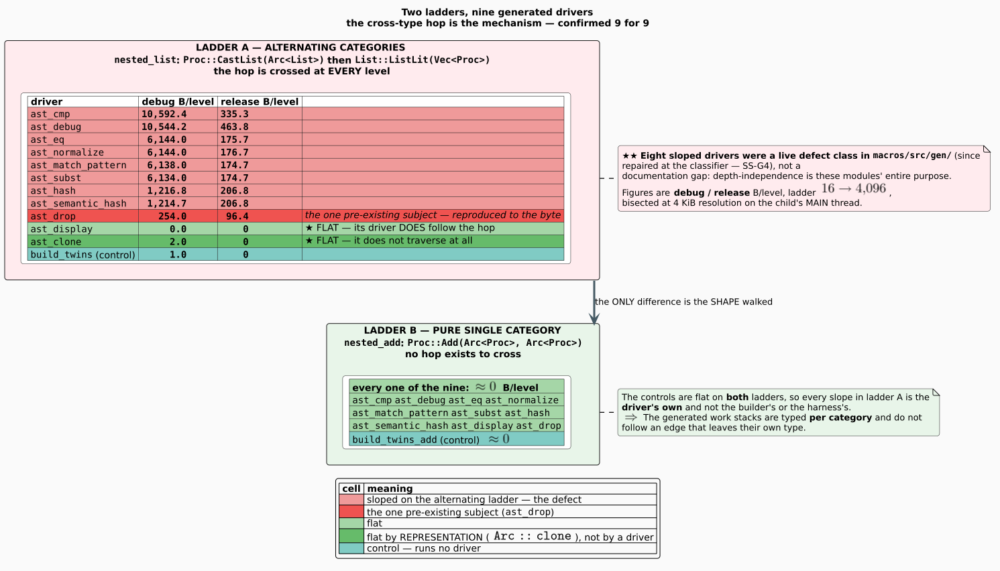

**Figure 9** — *`figures/generated-drivers-two-ladders.puml`*. The 2 $`\times`$ 2 that identifies the mechanism.

**MEASURED (f)**, 2026-07-29. B/level, **debug / release**. Logs: `/tmp/sd_mettail_debug_alt.log`, `/tmp/sd_mettail_release.log`, `/tmp/sd_mettail_debug_pure.log`, `/tmp/sd_mettail_release_add.log`, `/tmp/sd_mettail_debug_clone.log`, `/tmp/sd_mettail_release_clone.log`.

| driver / module | **ladder A — alternating** | **ladder B — pure chain** | verdict |
|---|---:|---:|---|
| `ast_cmp` — `iterative_cmp.rs` (`Ord`) | **10,592.4 / 335.3** | $`\approx 0`$ / 0.0 | ⚠ **SLOPED** |
| `ast_debug` — `debug.rs` | **10,544.2 / 463.8** | $`\approx 0`$ / 0.0 | ⚠ **SLOPED** |
| `ast_eq` — `iterative_cmp.rs` (`PartialEq`) | **6,144.0 / 175.7** | $`\approx 0`$ / 0.0 | ⚠ **SLOPED** |
| `ast_normalize` — `normalize.rs` | **6,144.0 / 176.7** | $`\approx 0`$ / 0.0 | ⚠ **SLOPED** |
| `ast_match_pattern` — `match_pattern.rs` | **6,138.0 / 174.7** | $`\approx 0`$ / 0.0 | ⚠ **SLOPED** |
| `ast_subst` — `subst.rs` | **6,134.0 / 174.7** | $`\approx 0`$ / 0.0 | ⚠ **SLOPED** |
| `ast_hash` — `iterative_hash.rs` | **1,216.8 / 206.8** | $`\approx 0`$ / 0.0 | ⚠ **SLOPED** |
| `ast_semantic_hash` — `semantic_hash.rs` | **1,214.7 / 206.8** | 2.0 / 0.0 | ⚠ **SLOPED** |
| `ast_drop` — `iterative_drop.rs` | **254.0 / 96.4** | $`\approx 0`$ / 0.0 | ⚠ **SLOPED** *(already on record)* |
| `ast_display` — `display.rs` | **0.0 / 0** | $`\approx 0`$ / 0.0 | ★ **FLAT on both** |
| `ast_clone` — **no driver**, `Arc::clone` | **2.0 / 0** | 1.0 / 0.0 | ★ **FLAT on both** |
| `build_twins` — **control, runs no driver** | 1.0 / 0.0 | $`\approx 0`$ / 0.0 | control flat |
| `build_one` — **control, no clone** | — | 0.0 / 0 | control flat |

#### 5.10.10a ★★★ The mechanism is confirmed, 9 for 9 — and this is a live defect class

**Every driver is sloped on ladder A and flat on ladder B. The controls are flat on both.** So the slope is the **driver's own**, not the builder's, not the `Arc` bumps', and not the harness's.

$`\Rightarrow`$ **The generated work stacks are typed per category and do not follow an edge that leaves their own type.** The hypothesis stated in `ast_drop`'s own note is confirmed for **nine of nine** drivers, not merely for `Drop`.

★ **Instrument validated against the one figure already on record.** `ast_drop` bisects to **254.0 B/level debug**, reproducing `3c0c3585`'s recorded 254 **to the byte**, and **96.4 release** against the recorded 96. A harness that disagreed with the one pre-existing measurement would have produced a table nobody could reconcile.

⚠ **At the time of measurement these eight were a live defect class in `macros/src/gen/`** —
depth-independence is these modules' entire purpose, and `ast_cmp` at 10,592 B/level debug reached
its 2 MiB ceiling at roughly **198 levels**. **Final state**: the SS-G4 conversion repaired the
class at the classifier (the `CollectionLiteral` arm divergence) and all eleven `ast_*` drivers —
including the twelfth, `try_eval` (SS-G5) — measure **0 in both profiles** (§8.6.1).

★★ **`ast_display` is the most valuable cell in the experiment.** It is flat on **both** ladders — so `display.rs`'s driver **does** follow the cross-type hop. The defect is therefore **not inherent to the generator's approach**, and there is an **in-tree reference implementation** to copy. That converts "eight drivers are broken" into "eight drivers should be rewritten the way the ninth already is", which is a far more actionable finding.

⚠ **One cell needs a wider ladder to settle.** `ast_semantic_hash_add` reads **2.0 B/level** (growth 8,192 B = two bisection buckets). The gate's own zero-slope tolerance is **four** buckets, so it is flat within resolution; it is recorded as *flat within tolerance* rather than silently rounded, and a $`512 \rightarrow 32{,}768`$ ladder would decide it. Added to [§5.9](#59-measurements-that-could-not-be-obtained).

The mechanism statement that survives: **a per-category work stack is safe only on shapes that
stay inside one category**, and the family's most common shape — a collection literal — does not.
That is the root cause SS-G4 repaired at the classifier rather than per driver.

### 5.11 ★★ SS-G1 — the Arc fix: eliminating a traversal instead of converting it

Every other fix in this report **converts** a recursive traversal into an iterative one. This one **removes the traversal**, and it is the most effective fix in the corpus by two orders of magnitude. It earns its own section because its mechanism is unique here and because the way it was decided is the report's best methodological lesson.

#### 5.11.1 The defect

**MEASURED (q)**, `9c55d81d`: `heaptrack` attributed **96 % of `chain_1000`'s peak heap — 288 MB of 300 MB —** to `clone_iterative` deep-copying the accumulated subtree at **every chain step**, i.e. $`\Theta(N)`$ calls each costing $`\Theta(N)`$, hence $`\Theta(N^2)`$ total. **Root cause, DERIVED**: the generated AST enums held recursive children as `Box<Cat>`, so every `.clone()` deep-copied the whole subtree.

★ At `chain_10000` this was **~30 GB and an OOM (out-of-memory) kill** — and it had been *misdiagnosed as an architectural limit*: a standing conclusion held that *"the 44.7 GB ceiling requires a different parser algorithm."*

#### 5.11.2 The architecture of the repair, and why this shape

Recursive AST children become `std::sync::Arc<Cat>`. Derived `Clone` is then `Arc::clone` per child — **$`O(1)`$, non-recursive, stopping at the `Arc` boundary and never descending**. `iterative_clone.rs`, the work-stack driver that existed *solely* to keep deep `Box` chains off the native stack, became dead and was deleted (`651499e2`, its body recording that the module was already *"uncompiled"*).

**Why representation rather than a driver — and this is the general point:** a converted clone is still $`O(1)`$ in native stack and still $`\Theta(n)`$ in **time** and in **allocation**, because it still copies. Sharing makes the copy *not happen*. There is no driver to maintain, no differential oracle to keep in step, and no work item to allocate.

⚠ **It is available only because the AST is immutable and shared.** A term rewriter can share subterms; §5.11.6 is why a protobuf message cannot.

**DERIVED**, `target/generated/rholang/ast_enums.rs`: `#[derive(Clone, mettail_runtime::BoundTerm)]`, **206** occurrences of `Arc<Proc>`, and **`Box<` occurs ZERO times**.

#### 5.11.3 ★★ How it was decided — falsified on time, accepted on space

This is the pedagogical centrepiece of the report.

| date | commit | axis | verdict |
|---|---|---|---|
| 2026-05-23 | `ff506dc5` | **time** | **HYPOTHESIS FALSIFIED.** A Stage-1 profile gate measured AST clone at **0.78 % of total runtime** on `rhocalc_bench::replication/basic`, the rewrite-heaviest workload in the workspace — $`\approx 13\times`$ below the 10 % gate threshold. *"Even at 100 % elimination … the maximum achievable speedup is < 0.78 % wall-clock — below Criterion's intra-sample noise floor."* Do **not** proceed. Cost: 2 h, against the 17–20 h the implementation would have taken. |
| 2026-05-28 | `9c55d81d` | **space** | **DONE, and it won two orders of magnitude.** `heaptrack` on the memory axis found the 96 % attribution above. |

★★ **The same hypothesis was correctly refused on the time axis and correctly accepted on the space axis. Neither decision was wrong.** The first gate was a well-run experiment that measured *the wrong resource for the defect that was actually there*.

> **The general lesson: a wall-clock-only acceptance gate will refuse a fix worth $`270\times`$ in memory.** An acceptance gate must name the resource it is gating, and a "no motivation" verdict is only as broad as the resource profiled.

⚠★ **So the question this raises has to be asked of the rest of the register, not just admired here.** Which other fixes were gated on **time alone** and might deserve a space re-examination?

| fix | what gated it | space-examined? |
|---|---|---|
| **SS-C2** cold-store encoder | wall clock **and** massif **and** DHAT ([§5.3.4](#534--the-malloc-profile--where-the-allocations-moved)) | ✅ yes — that is where the $`770\times`$ block-count win was found, and it was **not** the reason the fix was undertaken |
| **SS-C1** cold-store decoder | native stack; heap measured here for the first time | ✅ yes — 304.7 B/level of value stacks |
| **SS-A1** substitution leg-1 de-clone | native stack B/level only | ⚠ **NO** — and it is the strongest candidate: it removed 12 `.iter().map(p.clone())` sites and four `..p.clone()` functional-record-updates from a $`\Theta(d)`$ type. Its own verdict says it *"removes $`O(D^2)`$ heap churn"* — **quoted, never measured.** |
| **SS-D2** ownership to the substitution | native stack; the $`O(n^2)`$ `case_rem.to_vec()` reasoned about, not profiled | ⚠ **NO** — same shape as the Arc defect: a quadratic *copy* pattern |
| **SS-A2/A5/A7, SS-B1** the worklist conversions | native stack B/level only | ⚠ **NO** — [§5.9](#59-measurements-that-could-not-be-obtained) #3 |

$`\Rightarrow`$ **Two fixes in this register removed quadratic copying and neither has a heap profile.** That is now the highest-value unobtained measurement in the document, and it is recorded in [§8.4](#84-the-one-heap-measurement-that-remains-unobtainable) as such rather than as a nice-to-have.

#### 5.11.4 Results — space, time, and the malloc analysis

**MEASURED (q)**, `9c55d81d`, release:

| workload | before | after | factor |
|---|---:|---:|---:|
| `chain_10000` peak memory | $`\approx`$ 30 GB (OOM kill) | **112 MB** | $`\approx 270\times`$ |
| `chain_2000` peak memory | 1.53 GB | **26.5 MB** | $`57\times`$ |
| `chain_2000` wall clock | 4.34 s | **0.11 s** | $`39\times`$ |
| asymptotic memory | $`O(N^2)`$ | $`O(N)`$ | class change |

★ **MEASURED (f)** — the allocation analysis, obtained for this report and not previously available. Valgrind DHAT, debug, comparing `ast_clone` (build a term **and clone it**) against `build_one` (build the identical term, **no clone**), so the cost of one clone is a **subtraction** rather than an inference from the type:

| subject | depth | total bytes | total blocks |
|---|---:|---:|---:|
| `build_one` | 16 | 4,487 | 44 |
| `ast_clone` | 16 | **4,487** | **44** |
| `build_one` | 4,096 | 461,449 | 8,204 |
| `ast_clone` | 4,096 | **461,449** | **8,204** |

★★ **Byte-for-byte and block-for-block identical at both depths. Cloning a depth-4,096 term allocates ZERO additional bytes in ZERO additional blocks.** The clone is refcount increments and nothing else — the mechanism confirmed by measurement, not by reading `Arc`'s documentation.

**And the native stack, MEASURED (f)** (ladder $`16 \rightarrow 4{,}096`$, debug / release): `ast_clone` **2.0 / 0** B/level on the **alternating** ladder — flat within the gate's four-bucket tolerance — where on that same ladder `ast_eq` is **6,144.0** and `ast_cmp` is **10,592.4**. `Clone` is flat on the shape that defeats every generated driver, *because it does not traverse at all*.

#### 5.11.5 What it cost

* **Sharing is now observable.** `Hash`/`Eq`/`semantic_hash` had to be deref-transparent, and binder operations became copy-on-write via `Arc::make_mut` (**DERIVED**, `9c55d81d`).
* **`Drop` had to change with it** — `iterative_drop` uses `Arc::into_inner`, which is $`O(1)`$ for a *shared* subtree. ⚠ And [§5.10.10](#51010--the-nine-generated-drivers-measured--the-2--2-that-identified-the-mechanism) shows that teardown is still **254.0 / 96.4** B/level across the cross-type hop, so the Arc fix did not make `Drop` flat; it made the *clone* free.
* **A secondary residual was named at the time and not fixed:** `emit_sppf_subforest` recurses $`\approx N/2`$ deep, so `chain_10000` needed a large stack (**DERIVED**, `9c55d81d`).
* **Blast radius.** It touched `enums.rs`, the semantic actions, `subst`, `normalize`, `iterative_drop`, the binder and congruence passes, `eval`, `ast::pattern`, every `test_gen` emitter, a hand-written grammar, `numeric_dispatch`, and 12 test files.

#### 5.11.6 ⚠ Why it does NOT transfer to f1r3node's `Par` — three independent reasons

Each is sufficient on its own, and [§8.3](#83-par-as-cloneclone--closed)'s residual depends on all three.

1. **`Par`'s recursion runs through `Vec<T>`, not `Box<T>`.** The Arc trick collapses `Box` *chains*; a `Vec<Send>` clone must clone **every element** regardless of what wraps `Send`. The repeated fields are the recursion, and sharing the wrapper does not remove the element copies.
2. **`Par` is mutated in place.** `Message::clear` and `merge_field` mutate, and there are **38** `Par { .., ..Default::default() }` functional-record-update sites in `models` **alone** (**MEASURED (q)**, `44535d75`'s E0509 probe). Every one would need copy-on-write.
3. **`prost-build` cannot emit it.** `Config` offers **`boxed(path)`** and **no `arc` equivalent**, and prost's generated `Message` impl is written against the concrete field types — an `Arc` rewrite would not compile.

$`\Rightarrow`$ **The representation route is closed for `Par`.** The traversal route is the one being taken; [§8.3](#83-par-as-cloneclone--closed) records the programme.

#### 5.11.7 What is still recursive

`Drop` across the cross-type hop (254.0 / 96.4 B/level, [§5.10.10](#51010--the-nine-generated-drivers-measured--the-2--2-that-identified-the-mechanism)); the eight sloped generated drivers, which the Arc fix does not touch because they *traverse* rather than copy; and `emit_sppf_subforest`'s $`N/2`$ recursion.

---

### 5.12 Generated `Par` PDA closure [SS-A8, SS-E2]

Landed as `26876b65` (2026-08-01) with the 2026-08-03 refinements `9b3792ac` and `2902f0d0`.
Claims tagged **MEASURED** below were run under systemd memory scopes: focused work at 1 GiB RSS
maximum, broader linkage at 2 GiB, one Cargo job, zero swap; the cross-repository conformance run
used a 6 GiB hard maximum.

#### 5.12.1 The defect

The generated mutually recursive `Par` family still delegated `Drop`, `PartialEq`, `Hash`, `Ord`,
`Debug`, protobuf `Message`, and `Oneof` work to recursive derive or host calls. Increasing
`RUST_MIN_STACK`, using `stacker`, or retaining depth cut-offs would only move the failure
threshold. **DERIVED** from the generated disposition registry and
`models/tests/formal_equivalence_manifest.rs`. (The integration boundary's second defect — the
`EPathMap` list projection — and its repair are the
[PathMap report §5.1–§5.2](../pathmap/pathmap-report-2026-08-03.md#51-the-homogeneous-representation).)

#### 5.12.2 Architecture of the repair

All generated recursive traits use explicit work/program/value stacks. The driver and work-item
utilities are generated from the same schema metadata that generates the traversal registry, so a
new recursive surface cannot be omitted by updating a hand list. The canonical-key ground-domain
classifier is likewise a pure explicit-state traversal with no artificial descent threshold; its
design and measured price are the [PathMap report §5.5](../pathmap/pathmap-report-2026-08-03.md#55-pathmap-native-operations).

The clone-budget measurement oracle is stack-safe as well: its independent suspension predictor
walks pending roots explicitly, and the retained derive-shaped clone oracle is intentionally
bounded to 16 fixture levels — deeper products are compared with the generated equality PDA while
the independent worklist checks the exact suspension count, keeping the recursive specification
useful without letting a test-only oracle restore an ambient `RUST_MIN_STACK` dependency.

#### 5.12.3 Results

The focused closure matrix is **MEASURED** (the EPathMap-specific suites are reported in the
[PathMap report §5.9](../pathmap/pathmap-report-2026-08-03.md#59-formal-evidence); the rows below
are the term-family closure):

| suite or model | result |
|---|---:|
| `formal_equivalence_manifest` | 5 passed; the closed inventory binds all six node boundary surfaces to production markers, Rocq theorems, and executable evidence |
| `clone_descend_budget` | 6 passed on the ordinary test stack |
| `par_protobuf_stack_safety` | 6 passed |
| `par_read_stack_safety_registry` | 4 passed; production dispatch uses the generated PDA; retired limits and workarounds absent |
| `replay_output_value_stack_safety` | 1 passed; the former depth-34 boundary and depth 4,096 both play and replay clean |
| `output_value_write_side_reachability` | 3 passed |
| `absent_required_child_reachability` | 5 passed; the malformed-shape axis remains independently witnessed |
| `stack_depth_gate` | 8 passed active; **4 ignored = 3 measurement-only probes + 1 forked-child driver** |
| stack gate production matrix | 40 depth+width subjects at the original anchor; **45 current = 37 depth + 8 width** after SS-A10; zero tripwire subjects |
| Rocq | all three files kernel-checked; no `Admitted`, `admit`, or `Axiom` |
| Z3 | mode-dispatch counterexample query unsatisfiable |
| TLC | 422 initial roots; 3,238 states generated; 2,816 distinct; depth 8; no error |
| MeTTaIL `rho_rholang_conformance` | 64 passed, 0 failed, 5 intentional ignores |

#### 5.12.4 What is still recursive

For the generated/hand-written `Par` traversal registry exercised by `stack_depth_gate`: **none**.
The production tripwire registries are empty. The three ignored gate cases are measurement-only
probes, not production traversals, and are not accepted as closure evidence. Semantic/resource
limits remain only where they are not traversal-depth proxies. The last audited integration-side
cut set, `STABILITY_DESCEND_BUDGET`, was replaced on 2026-08-01 by the allocation-minimal explicit
classifier PDA and is guarded against reintroduction by `par_read_stack_safety_registry`.

The whole-worktree audit found one production consumer outside the generated/hand-written `Par`
registry — the node JSON boundary in `web_api.rs` — converted by SS-A9 (§5.13). Commit `26d3e3b9`
then closed the audit boundary itself: `node/src` is an input to the derived hand-written recursion
census. The overloaded-method correction `e485a567` superseded the anchor count; the current
exact-set census at `d1086fdc` reports **566 recursive components, 41 mentioning the term family,
18 mutual components, and 24 dispositioned files**, with **zero unmeasured files**. It requires every
declared crate root to exist, compares the active and disposition sets in both directions, and
independently recovers a 31-member recursive normalizer control whose maintained oracle lists 26
required members. A successful conversion therefore no longer requires lowering a magic
minimum-file count, while an empty, partial, or under-resolving scan still fails.

#### 5.12.5 Anti-vacuity and equivalence

The manifest compares the generated traversal registry and the proof/oracle evidence table in
**both** directions, then resolves every theorem and executable marker. Rocq proves the parametric
post-order PDA fold equivalent to recursive folding for every finite tree. Commit `87e514b6`
replaces the former six-byte-header-plus-opaque-suffix EPM1 lemma with the actual structural
envelope: canonical base-128 lengths, a framed ACTree03 arena, an ordered count-delimited value
table, exact end-of-input checks, mode well-formedness, ordinal uniqueness/range, and equality of
the generated-PDA and recursive value bodies. The proof preserves the topology arena byte-for-byte
and states ordinal extraction parametrically; PathMap's internal ACTree03 parser therefore remains
an explicit executable-library obligation rather than being misrepresented as a Rocq-verified
parser. TLC independently checks stack
orientation, arity, program-counter progress, and completion over every configured tree; and the
executable differentials retain bounded recursive or generated-reference oracles for bytes, rebuild
order, errors, Eq/Hash/Ord/Debug, Clone, Drop, and Message behavior. The node-boundary inventory is
independently closed over six named surfaces (conversion, EPathMap mode conversion, `Clone`,
`Serialize`, `Debug`, `Drop`); every row must resolve the production entry point, the generic Rocq
theorem it instantiates, and the executable oracle or shape witness — so a theorem and a test
cannot stay green after the implementation they justify has moved.

### 5.13 The node JSON boundary [SS-A9]

#### 5.13.1 The defect

**DERIVED**, before `e2cf939f`: `expr_from_par_proto`, `expr_from_expr_proto`, `par_to_expr`, and the
bundle and EPathMap helpers formed a recursive conversion over user-controlled `Par` nesting. The
response enum then derived recursive `Clone`, `Drop`, `Serialize`, `Deserialize`, and `Debug` behavior.
The EPathMap map arm also borrowed each trie value and cloned its complete `Par` before conversion. A
nested unary or map value therefore consumed native stack both while converting and again while cloning,
formatting, serializing, or destroying the response.

#### 5.13.2 The architecture of the repair, and why this shape

The conversion is now a defunctionalized work/value machine. Work items own protobuf nodes; finish items
carry only arity and scalar metadata; a value stack reconstructs `RhoExpr` bottom-up. `EPathMap` is never
flattened to a `Vec<Par>`: set mode consumes `PathMap<()>` keys, map mode consumes `PathMap<Par>` keys and
**moves** values, and neutral empty remains an explicit third state. Trie order is reversed only on the
machine's work stack so LIFO execution reproduces the same forward PathMap order.

`RhoExpr::Clone`, `Drop`, JSON `Serialize`, and `Debug` use explicit machines as well. The legacy
`HashMap<String, RhoExpr>` arm preserves the source map's capacity and cloned `RandomState` while cloning
children through continuations; delegating to `HashMap::clone` was rejected because a map-inside-map chain
would synchronously re-enter `RhoExpr::clone`. Response-only `Deserialize` implementations were removed
rather than replaced by a new recursive parser that has no production caller.

The rejected alternatives are the same ones excluded elsewhere in this report: no enlarged thread stack,
no `stacker`, no artificial depth limit, and no EPathMap list projection. A `Vec<Par>` projection would
discard prefix compression, allocate and decode every key, and clone every map value before the PDA even
began.

#### 5.13.3 How the fix was made

Production code lives in `node/src/rust/api/rho_expr_pda.rs`. The bounded recursive specification was
moved to `node/tests/support/rho_expr_conversion_oracle.rs`, and the pre-existing inline web API tests were
moved to `node/tests/support/web_api_tests.rs`; test recursion is not compiled into production. Models
gained consuming raw-entry visitors whose implementation delegates to PathMap's owned zipper iterator;
the PathMap crate itself was not modified.

Commit `26d3e3b9` adds the boundary to both closure instruments. The repository recursion census now scans
`node/src`, while `BOUNDARY_PDA_EQUIVALENCE_EVIDENCE` binds the six production surfaces to the generic
Rocq fold/drop theorems and their executable evidence. A new three-case differential separately exercises
neutral empty, `PathMap<()>`, and `PathMap<Par>` conversion; the value-bearing branch is therefore no
longer inferred from a set-only corpus.

#### 5.13.4 Results

All commands below ran with one Cargo job, `MemoryMax=4G`, and `MemorySwapMax=0`.

| metric | before | after | provenance |
|---|---:|---:|---|
| conversion semantics | recursive implementation | **36/36** `ExprInstance` arms, **3/3** Par boundary fixtures, and neutral/set/map EPathMap modes equal to the retained recursive oracle | **MEASURED**, `rho_expr_pda_tests` |
| JSON shape | derived serializer | all **40** `RhoExpr` arms match their derived JSON shape; Clone preserves bytes | **MEASURED**, `stack_safe_traits_preserve_derived_json_shapes` |
| deep lifecycle | recursive conversion and traits | conversion + Clone + Serialize + Debug + Drop at depth **16,384** on a **256 KiB** stack | **MEASURED**, mixed unary/map chain |
| focused node gate | — | **6/6**, 4 GiB cgroup peak, zero swap | **MEASURED**, capped run including all three EPathMap modes |
| full node library | 113/113 before the conversion | **119/119**, 4 GiB cgroup peak, zero swap | **MEASURED**, final capped run |
| owned trie visitor | borrowed forward view | owned set/map stream equals borrowed trie order; wrong mode rejected; neutral empty accepted by both | **MEASURED**, 1/1; warm peak 87.8 MiB |
| whole-worktree recursion census | node crate absent from source roots | anchor 580/54/20/30; ★ current **566** recursive components, **41** term-family components, **18** mutual, **24** exactly dispositioned files, **0** unmeasured | **MEASURED**, census calibration and 5/5 gate; zero swap |
| formal binding | no row for this boundary | six production surfaces resolve to the generic Rocq theorem and executable evidence; manifest **5/5** | **MEASURED**, 1.4 GiB peak RSS, zero swap |
| complete stack-depth gate | boundary outside census | **36** converted subjects (30 depth + 6 width) at `26d3e3b9`; **40** (34 + 6) at the Phase-7 resource anchor; ★ current register **45** (37 + 8) after SS-A10, zero tripwires | **MEASURED**, original 2.3 GiB peak RSS; current matcher-inclusive debug/release gates 206 s / 27 s, zero swap ([§5.16](#516-spatial-matcher-and-pathmap-native-retry-pda-ss-a10)) |
| deductive and finite-state checks | generic artifacts existed but were not bound to this boundary | Rocq kernel checks all three files with no admissions or axioms; Z3 returns unsatisfiable; TLC explores 3,238 generated / 2,816 distinct states to depth 8 with no error | **MEASURED**, capped proof script; structural EPM1 refinement re-run 2026-08-04 |
| B/level | NOT MEASURED — no pre-change frame bisection was retained for this boundary | NOT MEASURED — the explicit-loop class and 256 KiB deep probe establish bounded execution but not a byte slope | stated limitation |
| throughput / allocation profile | NOT MEASURED — no stable boundary benchmark exists | NOT MEASURED — correctness and depth closure were gated first | stated limitation |

#### 5.13.5 What it cost

The machines use $`\Theta(d)`$ heap work/value storage and $`O(1)`$ native stack in nesting depth. JSON
serialization builds one contiguous JSON string and validates it iteratively before handing it to serde's
raw-value adapter; this is bounded but allocates proportional to output size. Map conversion removes the
larger prior cost: it no longer constructs a compatibility entry projection or clones `Par` values.

#### 5.13.6 What is still recursive

Within this boundary: **none in production**. The recursive conversion oracle is test-only, shallow-bounded,
and deliberately excluded from the deep test. The repository-wide census now includes `node/src`, and
the production retired-token gate finds no traversal-depth ceiling, `stacker` call, `StackGrowingFuture`,
or configured `RUST_MIN_STACK`. Explicit small stacks remain test instruments, not workarounds.

#### 5.13.7 Anti-vacuity

The corpus asserts the exact **36-arm** oneof count, so silently omitting a protobuf variant fails before
comparison. The deep witness alternates unary and legacy-map nodes; a unary-only witness would not detect
the `HashMap::clone` re-entry defect found during review. The owned EPathMap visitor checks both wrong-mode
errors and neutral-empty dual validity, while the conversion differential independently asserts exactly
three cases—neutral, `PathMap<()>`, and `PathMap<Par>`—so neither the map branch nor the empty-mode edge can
be represented by set-only evidence. The formal manifest compares its closed six-surface inventory in
both directions and resolves the production marker as well as the proof and executable markers.

#### 5.13.8 Complete-message ingress boundary [pgmcp #4107]

Stack-safe decoding and teardown remove native-stack dependence on term depth; they do not make an
unbounded unauthenticated byte stream free. Before `c1feaf36`, the configured API and peer
`max_message_size` values were passed to tonic's HTTP/2 `max_frame_size`. A sender could therefore
split one oversized protobuf across individually legal frames: the configured value bounded each
transport frame, not the complete message presented to prost. This was a resource-envelope defect,
not a recursive traversal.

Every generated API service now receives `max_decoding_message_size(max_message_size)`. The peer
`TransportLayerServer` receives the same complete-message decoder bound before the transport-layer
security (TLS) request
interceptor wraps it. API unary ingress defaults to 16 MiB and peer unary ingress to 256 KiB; the
peer stream circuit retains its independent 256 MiB reconstructed-message bound. No depth ceiling,
`RUST_MIN_STACK`, stack switch, `stacker` integration, synthetic COMM, or PathMap projection was
introduced.

Two black-box tests run real tonic routers. Each sends one under-limit request and observes exactly
one handler invocation, then sends one over-limit request and observes gRPC `OutOfRange` with the
handler count unchanged. **MEASURED (f)** under `MemorySwapMax=0`: the peer gate passed **1/1** in
36.74 s at **1,401,836 KiB** peak RSS; the API gate passed **1/1** in 23.59 s at **3,078,992 KiB**
peak RSS. Those peaks include test-profile compilation and are command-containment observations,
not per-message heap measurements or steady-state server requirements.

The accepted byte envelope now matches the advertised work agreement: a finite message within it
continues into depth-independent PDA/worklist machinery, while an oversized message is rejected
before application dispatch. This preserves the stack-safety rule that input shape is not privately
narrowed by a validator. It changes neither protobuf encoding nor any normalized term, COMM count,
consensus charge, EPathMap mode, EPM1 snapshot, PathMap topology, zipper/algebra/lattice result,
post-state, or event hash; CBR-051 records the consensus review and TM-CA-167 the threat-model result.

---

### 5.14 Resource closure — heap and deterministic time [SS-E3]

#### 5.14.1 Instrument and anti-vacuity

Commit `68e8290d` adds `scripts/bench/stack-safety-phase7.sh`; commit `b2d84064` adds the
independent `hash_nested_set`, `hash_pathmap_set`, `hash_pathmap_map`, and `message_clear` subjects. The
harness does not carry a second traversal list: the ignored `phase7_measurement_manifest` test exports
`CONVERTED_DEPTH` and `CONVERTED_WIDTH`, emits their derived count, and the harness refuses a missing row.
The resulting population is **40** subjects: 34 depth and 6 width, with zero tripwires.

Every run self-relaunches under `MemoryMax=4G`, `MemorySwapMax=0`, `TasksMax=256`, and one Cargo job.
Cachegrind supplies deterministic Ir, Dr, and Dw counters at parameters 128, 256, 512, and 768. A
parameter-invariant child is measured and subtracted at every rung. Its complete observed span was
**142 Ir (0.0176 %), 26 Dr (0.0131 %), and 12 Dw (0.0129 %)**, below the predeclared 0.1 % instrument
validity ceiling. Thus the control was both rebuilt and live; an input-shaped startup cost could not be
silently fitted as traversal work.

Massif uses two rungs, depth 256 and 1,024, one arm per process. Each operation has a matched fixture-only
control: substitution and sorting share the same nested `Par`; normalization's control retains only the
source text; evaluation's control retains the same ENot input without calling the evaluator. Reported heap
growth is operation peak minus the matched control peak at the same rung. Raw fitted time data and heap
peaks are retained in
[`phase7-cachegrind-fits-2026-08-03.tsv`](measurements/phase7-cachegrind-fits-2026-08-03.tsv) and
[`phase7-massif-2026-08-03.tsv`](measurements/phase7-massif-2026-08-03.tsv).

#### 5.14.2 Heap transfer, beside the native stack it replaced

**MEASURED**, release instrument, 2026-08-03:

| traversal | prior native stack B/level, debug / release | current native stack | fixture-subtracted live heap B/level | net live heap at depth 256 $`\rightarrow`$ 1,024 |
|---|---:|---:|---:|---:|
| substitution | 195,728 / 27,179 | **0 B/level** | **6,341.25** | 1,875,352 $`\rightarrow`$ 6,745,432 |
| sorting | 78,592 / 6,495 | **0 B/level** | **1,440.00** | 393,048 $`\rightarrow`$ 1,498,968 |
| normalization | 43,542 / 7,261 | **0 B/level** | **3,640.42** | 909,368 $`\rightarrow`$ 3,705,208 |
| evaluation | 21,584 / 3,359 | **0 B/level** | **128.00** | 42,712 $`\rightarrow`$ 141,016 |

The transfer is therefore linear and finite for all four conversions. The largest replacement is
substitution at about 6.19 KiB/level, **30.9 times smaller** than its former debug native frame and
**4.29 times smaller** than its former release frame. This does not prove a universal process-memory
ceiling—the term and output themselves remain input-sized—but it falsifies the feared failure mode in
which stack elimination merely moved a superlinear traversal state to the heap.

#### 5.14.3 Deterministic time axis over the complete converted register

The predeclared failure bar is a fitted exponent at least 1.80 on any of Ir, Dr, or Dw: evidence of
quadratic-or-worse growth is red and cannot be rounded down to “linear.” All 40 subjects passed. Ir fits
range from **0.9462 to 1.0970**; the largest data-counter fit is **1.4007 Dw** for `score_cmp_wide`, still
below the quadratic bar. The full per-subject table is the linked TSV; the most integration-sensitive
rows are:

| subject | axis | Ir exponent | Dr exponent | Dw exponent | disposition |
|---|---|---:|---:|---:|---|
| `sort_nested_set` | depth | 1.0068 | 1.0323 | 1.0375 | linear observed |
| `sort_nested_map` | depth | 1.0023 | 1.0143 | 1.0168 | linear observed |
| `hash_pathmap_set` (`PathMap<()>`) | depth | 0.9918 | 0.9948 | 0.9882 | linear observed |
| `hash_pathmap_map` (`PathMap<Par>`) | depth | 1.0175 | 1.0190 | 1.0152 | linear observed |
| `message_clear` | depth | 0.9892 | 0.9914 | 0.9881 | linear observed |
| `score_cmp_wide` | width | 1.0970 | 1.3921 | 1.4007 | subquadratic observed; largest data-counter fit |

The EPathMap rows are representation-specific. Set mode hashes canonical PathMap byte paths without
decoding a `Par` projection. Map mode borrows each `Par` value from the PathMap zipper and schedules it on
the generated Hash PDA. Neither route constructs a `Vec<Par>`, and the two modes are not inferred from one
another.

#### 5.14.4 Command-level resource result

The complete Cachegrind campaign finished in **91.398 s**, peaked at **119.7 MiB**, and used zero swap.
The complete Massif campaign finished in **8.309 s**, peaked at **170.5 MiB**, and used zero swap. The
preceding complete native-stack register run passed in **123.47 s**, peaked at **406.6 MiB**, and used zero
swap: 40 converted subjects, zero tripwires.

---

### 5.15 Subject depth distributions [SS-E4]

#### 5.15.1 One population per subject

Commit `0e487d4a` adds the feature-gated `scripts/bench/stack-safety-phase7-histograms.sh`. Normal builds
contain no counter, structural measurement walk, environment read, lock, or file output. The support
implementation lives under `models/tests/support`; production entry points include it only with the
explicit `phase7-depth-histograms` feature.

The subject selector is load-bearing. It prevents an encoder call reached incidentally while measuring a
decoder corpus from entering the wrong population. The four corpora are consequently independent:

| subject | production-facing corpus | observations | observed depth distribution |
|---|---|---:|---|
| EPathMap escape-arm protobuf payload | `drop_head_spec`, through the ordinary evaluator | 9 | depth 1: 4 (44.44 %); depth 2: 5 (55.56 %) |
| bincode encoder | the exact five interpreter suites used by `903cefb3` | 9,655 | depth 0: 951; 1: 8,608; 2: 58; 3: 17; 4: 12; 5: 5 |
| bincode decoder | organic reads in the same five suites plus EPathMap checkpoint/replay | 1 | depth 1: 1 |
| generated protobuf decoder | the workspace's foreign-function protobuf ingress tests | 6 | depth 2: 6 |

Depth zero means that a root such as an empty `BindPattern` or `TaggedContinuation` contains no `Par`
child; it does not mean an unexecuted hook. Every subject must emit at least one row or the harness fails.
Dedicated depth ladders are excluded because inserting adversarial depths into a typical-depth population
would manufacture the result. The complete root-kind histogram and corpus denominator are retained in
[`phase7-depth-histograms-2026-08-03.tsv`](measurements/phase7-depth-histograms-2026-08-03.tsv) and
[`phase7-depth-corpora-2026-08-03.tsv`](measurements/phase7-depth-corpora-2026-08-03.tsv).

#### 5.15.2 Capacity decision

No capacity is inherited from `903cefb3`'s datum-only 95.43 % figure. The escape arm's former statement
that a typical payload is shallow now has its own measured population: all nine observed payloads were
depth 1 or 2. The bincode encoder likewise has its own current root-complete distribution, whose maximum
was 5. The bincode and protobuf decoder samples are disclosed as small rather than presented as precise
frequency estimates.

The initial vector capacities are **not** changed from depth alone. A `Par` level can contain several
schema-message resume points, so semantic depth is not an operation-stack high-water mark; the protobuf
encoder's length table is proportional to message-node count and therefore depends on width as well as
depth. All affected vectors grow geometrically and impose no traversal ceiling. Resizing them from this
table without a node-count or machine-high-water measurement would turn an observed depth distribution
into an unsupported space claim—the exact inheritance error Phase 7 was opened to remove.

#### 5.15.3 The measurement found a production totality defect

The first corpus run failed before its fourth subject: the EPathMap pretty-print walk reached
PathMap 0.2.2's optimized `to_prev_sibling_byte` override on a dense zero mask word and panicked —
a production totality defect found by the instrument, not caused by it. The repair
(`to_prev_sibling_byte_composed`, spelled from public zipper primitives without modifying or
forking PathMap) and its regressions are the
[PathMap report §5.7](../pathmap/pathmap-report-2026-08-03.md#57-reverse-zipper-totality).

#### 5.15.4 Capped result

The subject-separated campaign passed every constituent test in **112.836 s** service time and
**127.425 s** CPU time. The systemd scope reached its **4 GiB** hard memory ceiling and used **zero swap**;
the command completed successfully. The default-build focused matrix then passed **126/126** tests across
both codec differentials, generated protobuf encoder/decoder differentials, EPM1 snapshots, canonical
fixtures, and full PathMap integration at **1.8 GiB** peak and zero swap. No change was made in the PathMap
repository.

#### 5.15.5 Generated `Ord` is consensus-reachable

Phase 7's `Ord::cmp` question is not answered by the canonical sorter. That sorter compares its structural
score and then the generated protobuf byte stream; it does not call `Par::cmp`. The production reachability
edge is EPathMap map algebra instead. `EntryTrie::exact_map_value_eq` compares overlapping `PathMap<Par>`
values through the generated `Par` ordering. The ordinary metered evaluator reaches that predicate through
pathmap `union`, `intersection`, `graft`, and `joinInto`. A non-equal value at an overlapping key changes the
operation from a successful algebraic result to `ReduceError`. The generated ordering therefore affects
both computed value and verdict on a consensus path.

This is not a new consensus change beside [CBR-044](../../consensus/consensus-change-register.md#cbr-044).
It is a reachability result for one of that transition's generated PDAs. At the registered commit,
`exact_map_value_eq` is the direct comparison seam and the evaluator's `union` method is a production
caller; the machine register pins both coordinates. The same generated cut set is checked in three
independent ways:

1. `generated_ord_matches_the_recursive_oracle` compares every pair in a deterministic 48-term corpus
   against the descriptor-generated recursive oracle;
2. `generated_ord_is_stack_safe_at_depth_4096` runs the generated comparator on a 256 KiB thread stack;
3. the generic Rocq `compile_run_equivalence` theorem proves that compilation to the explicit PDA
   preserves the recursive specification, with no admissions.

The classification consequence is conservative: `Ord` stays inside the consensus-visible generated-PDA
closure and its deep ladder remains mandatory. The audit found no reason to change the sorter, flatten an
EPathMap, or add a PathMap-side comparison.

#### 5.15.6 Legacy #57 and #114 scope closure

The two one-line legacy summaries in Phase 7 were deliberately insufficient; the full records and current
sources give the following disposition:

| legacy item | full finding | stack-safety disposition | reachable campaign home |
|---|---|---|---|
| **#57** | A numbered display/parse series: projection-constructor borrowing (`f23e4418`) and the display-fixpoint loop (`d04e6160`) are landed; the remaining member is the same three-way eval-equal reading collision tracked as #38. | **Not depth-related.** It concerns elected syntax and term-preserving rendering. Its remaining work is not a recursive traversal and is not duplicated here. | E5, `e5-display-printer-render-fidelity-absorbs-38-57-202-177-ebd338`, whose parent and root are epic 4131. |
| **#114** | `SepSeam::Single` is a symptom amplifier for two distinct transparent-grouping classes tied on all five grammar-weight components. Candidate reordering can silently re-elect a representative while preserving the reading set. | **Not depth-related.** It is a grammar-priority stability defect and cannot reach a block in the recorded model. | E3, `e3-grammar-surface-method-api-collapse-early-disambiguation-kv-slot-carriers-absorbs-123-132-122-151-828661`, whose parent and root are epic 4131. |

This closes Phase 7's classification obligation without losing either residual and without importing
grammar/rendering work into the stack-safety acceptance set. The production pretty-printer's separate
historical allocation finding is already bounded by a test-only mutation refusal; its recursive oracle
lives under `rholang/tests/support`, and the formerly suspected `nested_list_expr` helper is live in
`stack_depth_probe`. None is an unclassified production recursion site.

---

### 5.16 Spatial matcher and PathMap-native retry PDA [SS-A10]

#### 5.16.1 The defect

The recursive `SpatialMatcherContext` component crossed `Par`, `Expr`, binder records, ordered and
unordered collections, connectives, and EPathMap values. A free-variable pattern forced the semantic
path and measured approximately **70,237 B/level in debug** before conversion; a concrete pattern could
bypass that path and therefore was not a valid witness by itself. The same component contained two
additional depth/width mechanisms: concrete `Receive`/`New` matching re-entered through `match_pars`, and
subset search recursively retried candidate pairings while carrying mutable binding state.

Flattening EPathMap would have hidden rather than repaired the defect. Set mode is `PathMap<()>`, map
mode is `PathMap<Par>`, and prefix topology, algebra, zipper navigation, and compact ACTree03 storage are
part of the representation. A `Vec<Par>` or hash collection would discard those properties and add
allocation before matching began.

#### 5.16.2 Architecture of the repair

Commits `78611b11`, `6799b406`, and `fc497f94` compile the complete heterogeneous matcher dependency
component into one explicit machine. Work items represent target/pattern pairs, result reductions,
collection cursors, connective snapshots, and retry continuations. A `FreeMap` snapshot belongs to the
frame that may roll back: failed disjunction alternatives, negation, and augmenting-path retries restore
their entry state; successful sequential/conjunctive children commit in source order.

EPathMap matching remains trie-native. Exact set/map members are removed with PathMap subtraction before
dynamic matching. Set entries stream as owned byte keys from `PathMap<()>`; map entries stream as owned
key/value pairs from `PathMap<Par>`. The singleton fast path (`98bb3d5e`) removes the sole pair through
owned zippers and moves the `Par` value directly into the matcher PDA. Larger ambiguous sets retain the
general retry-capable augmenting machine. No PathMap crate change, list projection, or mixed set/map
carrier was introduced.

Commit `714d618c` closes the memory-layout residual without changing the abstract machine. Large
heterogeneous states are boxed at the `Job`/`Frame` boundary, reducing the two contiguous enum slots
from **1,504 / 1,112 bytes to 64 / 64 bytes**. A unit test makes those ceilings executable. For the
singleton `PathMap<Par>` shape, a concrete key is compared in its canonical encoded PathMap form and
the PDA descends directly into the dynamic value; only a connective-bearing key is decoded and spatially
matched. This is a trie specialization, not a list projection, and the general ambiguous-key retry
machine remains available.

Commit `6f1412ee` removes the remaining singleton preflight lookup and redundant pattern-key decode.
Every exact singleton is moved through the owned PathMap entry stream: concrete `PathMap<()>` members
compare their canonical key bytes; concrete `PathMap<Par>` keys compare those bytes and concrete values
compare directly; only connective-bearing keys or values enter the matcher PDA. Empty remains the
neutral `EPathMapRepr::Empty` state until the first set or map insertion selects a homogeneous mode.
The recursive-oracle corpus now pins empty behavior and concrete singleton set/map equality plus key and
value refusal. No entry projection or PathMap crate change is involved.

#### 5.16.3 Results

All stack commands used one Cargo job, zero swap, and a systemd RSS ceiling. **MEASURED**:

| subject | axis and ladder | debug minimum stack | release minimum stack | verdict |
|---|---|---:|---:|---|
| `spatial_binding` | depth 4 $`\rightarrow`$ 4,096 | about 80 KiB at both ends | about 36 KiB at both ends | **0 B/level**; free binding committed |
| `spatial_concrete_binders` | depth 4 $`\rightarrow`$ 4,096 | about 88 KiB at both ends | about 32 KiB at both ends | **0 B/level**; concrete binder path reached |
| `spatial_epathmap_map_depth` | depth 4 $`\rightarrow`$ 4,096 | 72 KiB at both ends | 28 KiB at both ends | **0 B/level**; deepest map value binds |
| `spatial_epathmap_set_wide` | width 4 $`\rightarrow`$ 65,536 | 164 KiB at both ends | 92 KiB at both ends | **0 B/member**; `PathMap<()>` specialization |
| `spatial_epathmap_map_wide` | width 4 $`\rightarrow`$ 65,536 | 80 KiB at both ends | 36 KiB at both ends | **0 B/member**; `PathMap<Par>` specialization |

The complete matcher-inclusive register is **45 converted subjects = 37 depth + 8 width**, with empty
production tripwire lists. Post-layout full debug/release gate runs completed in **172.07 s / 26.30 s**.
Final `6f1412ee` revalidation completed with the same **8/8 active, 4 intentionally ignored** result in
**200.40 s / 26.83 s** debug/release; elapsed variation is not used as a performance claim.
The initially correct but clone-heavy nested map witness took **97.29 s** at depth 4,096 in debug;
moving the singleton value through the owned zipper reduced it to **0.31 s** (about **314×**) without
specializing away the general retry path.

The bounded recursive oracle under `rholang/tests/support/spatial_matcher_oracle` compares both verdict
and final `FreeMap`; the corpus now executes 32 explicit target/pattern comparisons, including the six
empty/concrete-singleton additions. The generated boundary manifest
passes **5/5**. Rocq's admission-free `spatial_match_pda_equivalent_to_recursive_match` instantiates the
generic PDA theorem with state transformers and separately proves binding consistency/conflict, ordered
retry, negation isolation, and singleton ownership equivalence. The independent TLA+ matcher model
explores **607 generated / 478 distinct states** to depth 4 without error; the generic model explores
**3,238 generated / 2,816 distinct states** to depth 8.

#### 5.16.4 Complexity, allocation, and residuals

Native stack is $`O(1)`$ in match depth and candidate width. Explicit control storage is
$`O(d + w + r)`$ in the live depth, collection frontier, and retry frontier; candidate enumeration is
necessarily data-dependent, but exact PathMap subtraction and singleton moves avoid manufacturing a
dense bipartite problem for the common shapes. The measured 314× singleton improvement establishes the
dominant clone removal.

The previously missing allocator/RSS measurement is now closed with a matched fixture-only control.
Both processes construct and validate the same nested `PathMap<Par>` target/pattern pair; only the
subject enters the matcher. Heaptrack and `/usr/bin/time -v` ran at depths 512 and 4,096 in release,
one Cargo job, `MemoryMax=9G`, and zero swap. Raw rows are versioned in
[`measurements/spatial-matcher-heap-2026-08-04.tsv`](measurements/spatial-matcher-heap-2026-08-04.tsv).
Heap columns below preserve heaptrack's own `M` display unit; RSS columns are the exact KiB emitted by
GNU `time`.

| metric | before `714d618c` | after `714d618c` | final `6f1412ee` | result |
|---|---:|---:|---:|---|
| matcher-minus-control allocation calls, depth 512 / 4,096 | 17,434 / 139,293 | 15,384 / 122,907 | 11,288 / 90,139 | slope **34.001 $`\rightarrow`$ 30.001 $`\rightarrow`$ 22.001 calls/level** |
| matcher-minus-control temporary allocations, depth 512 / 4,096 | 2,561 / 20,481 | 1,537 / 12,289 | 1,025 / 8,193 | slope **5.000 $`\rightarrow`$ 3.000 $`\rightarrow`$ 2.000 calls/level** |
| heaptrack peak heap, subject / control at 512 | 11.58 / 1.03 M | 1.03 / 1.03 M | 1.03 / 1.03 M | matcher does not raise the fixture peak |
| heaptrack peak heap, subject / control at 4,096 | 91.98 / 7.63 M | 7.63 / 7.63 M | 7.63 / 7.63 M | matcher does not raise the fixture peak |
| unprofiled maximum RSS, subject at 512 / 4,096 | 23,452 / 79,676 KiB | 23,276 / 23,240 KiB | 23,016 / 23,024 KiB | positive RSS slope eliminated |
| unprofiled matcher-minus-control RSS, 512 / 4,096 | 628 / 56,780 KiB | 608 / 40 KiB | -536 / 48 KiB | no positive retained-work-stack slope; endpoint differences are process noise |
| heaptrack runtime, depth 4,096 | 0.332 s | 0.097 s | 0.088 s | **3.77× faster than the pre-layout run** |

The post-change negative fitted RSS difference is allocator/process noise, not a claim that deeper
matching releases memory. The scientifically supported claim is narrower: subject RSS is flat across
the ladder, the matched control sets the heap peak, and no positive retained-work-stack slope is visible.
Allocation counts remain linear because every trie level must still be visited and decoded; the change
removes oversized *live capacity*, not the necessary $`\Theta(d)`$ traversal work.

Within the audited matcher component, no production recursive traversal remains. The recursive oracle is
test-only and shallow-bounded. The strengthened source census keys functions by file, name, and source
offset so overloaded impl methods cannot overwrite each other; its current exact-set result is **566**
recursive components, **41** term-family components across **24** files, **18** mutual components, and
zero unmeasured dispositions. No `RUST_MIN_STACK`, `stacker`, traversal-depth limit, or PathMap fork is
part of the repair.

#### 5.16.5 RSpace candidate selection and enumeration PDA [SS-A11]

##### 5.16.5.1 The defect

The RSpace commit selector filled a receive's binds with a recursive depth-first search in
`rspace++/src/rspace/space_matcher.rs`. The enabled-rendezvous query contained a second recursive copy
of the same search. **DERIVED:** each descent filled exactly one bind, so a receive with $`b`$ binds
consumed $`\Theta(b)`$ native call frames even when every channel held one datum and the search itself
was linear. Receive arity is controlled by source text; it has no trustworthy native-stack bound.
The duplicated selector/enumerator walks also made candidate ordering, residual-pool rollback, and
guard consultation two implementations of one consensus-visible rule.

##### 5.16.5.2 Architecture of the repair, and why this shape

One explicit-frame PDA now owns both modes. Its states are `Descend`, `Scan`, and `Return`; a frame
stores the current channel/pattern pair, a resumable `CandidateScan`, an optional reserved position,
and whether any complete leaf reached the guard. `CandidateScan::All` stores the next canonical
position; `CandidateScan::Indexed` stores a sorted fixed-width position slice and its next index.
The scan is constructed once when the frame is entered rather than rebuilding a prefix query at
each retry. The selector supplies a leaf callback
that stops at the first admissible selection. The enumerator supplies a callback that clones the
accepted selection and continues. Thus the enumeration head is the selector result by construction,
not by coordination between sibling algorithms.

Each channel has one `CandidatePool`: a copy-on-write `PathMap<Multiplicity>` Bag subtrie is the
immutable selection authority, and a separate initially empty `PathMap<Multiplicity>` Bag records
only speculative nonpersistent demand. A derived `CandidateCatalog` shares canonical order and one
lazy decode cell per distinct trie key across pool snapshots. A catalog-local
`PathMap<CandidatePosition>` maps each complete relative RhoPathV1 key to a fixed-width `u64`
position. That one trie serves known-path membership for persistent zero-to-one reactivation and
indexed structural-prefix scans; no duplicate `PathMap<()>` and no platform-width trie value remain.
It is constructed once with the catalog, refreshed after permanent membership changes, and never
substitutes for the `PathMap<Multiplicity>` authority. The chosen-candidate stack and reservation
Bag obey the transaction law: an accepted early stop leaves nonpersistent demand recorded; an
exhausted subtree removes its parent's demand; exhaustive enumeration restores the entry state.
The authority is never decremented by selection, and persistent records never enter the reservation
Bag. A `Vec<Par>`, expanded occurrence list, per-frame pool clone, traversal-depth cap,
enlarged `RUST_MIN_STACK`, `stacker`, and a second enumerator were rejected.

##### 5.16.5.3 How the fix was made

The former `search_candidate_selection` and `enumerate_admissible_selections` recursive bodies were
replaced by calls to private `walk_candidate_selections`. The machine preserves pool order, advances a
parent cursor only after the selected child returns, and emits the pre-existing
`GuardRejected`/`NoSpatialMatch` backtrack counters at the same return boundary. Refinement
`5329b27a3` removes expanded datum pools and per-frame residual copies: descent originally
decremented the channel-local Bag, return incremented it, and accepted candidates carried either an
exact stored trie path or the distinct `Fresh` address. Firing removes exact paths, so same-channel
batches cannot shift one another. `173bf4e07` then separates that overloaded residual into immutable
authority plus a multiplicity-aware reservation Bag: descent increments demand, return decrements
demand, and exact cardinality makes the empty test constant-time without the public `u64` saturation
boundary. `2eb0d3871` shares the canonical catalog and decode cells across pool construction;
`d50b1183d` encodes the channel prefix once and holds one loaded-store read lock across the hot
PathMap lookup. Retained-automaton checkpoints `a89cbc294`, `f149cef2b`, and `ea8c39f92` add one
`PathMap<TerminalId>` transition segment per receive-bind position. `TerminalId` and `CandidateId`
are fixed-width `u64` newtypes; an append-only linked terminal arena represents multiple candidates
at one path without reference-counting primitive identifiers. The terminal identifier uses a
nonzero one-based encoding, so an optional predecessor occupies one 64-bit word and each arena node
is two fixed-width words. A lookup descends the fresh datum path
with an iterative read zipper and marks terminals at each visited prefix; non-indexable
patterns live at the root and therefore cannot be pruned. The automaton cache is sharded by channel
group, versioned independently per group, invalidated by whole-store generation changes, and
borrowed during lookup rather than cloned. Counter saturation disables the derived cache instead of
introducing a correctness or traversal limit. No event hash, serialized record, PathMap crate code,
or cost-accounting rule changed.

Checkpoint `564dac0b4` adds the complementary resting-data exact-ground slice. A matcher opts in only
when its retained pattern and datum paths satisfy the RhoPath prefix-superset contract. The PDA then
uses a borrowed read zipper at the framed structural prefix to collect catalog positions, sorts
those positions to restore canonical selection order, and resumes through `CandidateScan::Indexed`.
Unsupported matchers and patterns use `CandidateScan::All`. The Bag is checked before reservation,
fresh data is checked through its retained path, and the spatial matcher remains the final oracle;
therefore a prefix false positive costs work but cannot become an accepted match.

Checkpoint `f43858ec2` replaces the one-sided prefix cut with a synchronized receive-first product
cursor. One borrowed read zipper remains on the authoritative `PathMap<Multiplicity>` Bag while a
second remains on the derived `PathMap<CandidatePosition>` structural index. Exact transitions move
both zippers together; wildcard transitions enumerate the intersection of their child masks; a
candidate position is emitted only when both terminal values exist. The iterative query scanner
validates both framing layers and escaped zeros, and a `PathMap` capture environment enforces
repeated-variable equality without a hash-table or expanded-term authority. The compiled fragment
at that checkpoint included exact whole terms, whole-term wildcard/free-variable captures, repeated
captures, and ordered list remainder. Unsupported nested schema arms still took the canonical full
scan. This is a Bag/position-index product for receive-first lookup, not the separately required
retained-automaton/Bag product for datum-first lookup.

Checkpoint `71d378e73` supplies the generated schema traversal boundary for the next conversion.
The existing descriptor pass now emits one ascending-tag `RhoMatchProgram` and exhaustive
`ParCursor` accessor per message, with typed scalar, optional, sequence, map, and oneof values.
`RhoPathCursor` advances those values with an explicit heap worklist. The small-stack gate traverses
20,000 nested EList nodes and 20,000 siblings on a 256 KiB worker stack. EPathMap is not interpreted
as a message sequence: the cursor yields the borrowed EPathMap once for native PathMap zipper/PDA
delegation, and a cold snapshot remains cold before and after the walk. No RSpace caller uses this
cursor yet, so the checkpoint changes no match verdict or COMM and does not close the still-open
nested-instruction or retained-automaton/Bag-product obligations.

Checkpoints `155ecdf54` and `d858058d4` activate the generated cursor as the datum-side and exact
receive-pattern structural encoder. `RMP1` is emitted in one pass from the heap worklist; an
incremental outer framer consumes each completed top-level term immediately instead of retaining a
`Vec<Vec<u8>>`. EPathMap contributes mode, cardinality, and a domain-separated BLAKE2b-256 digest
computed by an iterative read-zipper depth-first walk. That walk visits each logical trie edge once,
stores only the heap traversal frontier, does not include map values, and never forces
`trie_snapshot()`. Omitting values is conservative because this digest can only prune candidates;
the native EPathMap/spatial matcher decides acceptance. The architecture-dependent
`PathMap::hash` is not used. Exact and whole-term query paths are live; nested binding instructions
and associative-commutative residual execution remain open.

Checkpoint `edd166671` adds a zero-copy `RMP1` token cursor and descriptor-exact validator. Message
dispatch indexes the generated registry in constant time; generated field metadata carries child
type identifiers and complete oneof tag/payload schemas. Validation is a single forward token pass
whose nested control resides in a heap `Vec<ValidationFrame>`. Subtree extent discovery is a second
iterative scan from a validated token boundary with a heap closer stack. Neither path recursively
calls itself, reconstructs `Par`, forces an EPathMap snapshot, sets `RUST_MIN_STACK`, uses
`stacker`, or imposes an input depth/width cap. The focused byte-cursor suite passes **3/3** in
**0.67 seconds** and the generated-schema suite passes **4/4** in **0.28 seconds**; the former
includes validation and deepest-subtree navigation through a 20,000-level term on a 256 KiB worker
stack. These are test-harness elapsed times under a 5 GiB zero-swap cap, not standalone RSS
measurements.

Checkpoint `bbdd22887` adds the lossless inverse at the token layer. A validated path iterates its
borrowed typed tokens and re-emits canonical **Rholang Match Path format version 1 (RMP1)** bytes
into one output buffer; it never rebuilds a
recursive `Par`. This boundary is deliberate because the EPathMap token contains a
domain-separated key-topology digest and is not an invertible serialization of map values. The
complete 66-shape descriptor corpus now passes encode/validate/token-re-encode byte identity, and a
committed manifest pins every encoded length and BLAKE2b-256 digest independently of host pointer
width. The 20,000-level re-encode also passes on the existing 256 KiB worker stack. Focused
`match_path_cursor` tests pass **6/6**, and strict Clippy for the library and target passes under an
8 GiB zero-swap scope. This closes the codec round-trip and cross-platform-byte gaps without a
native-stack slope, `RUST_MIN_STACK`, `stacker`, or an artificial traversal bound.

Checkpoint `b6b53d1b3` activates an ordered nested-query PDA without decoding `Par`. The compiler
reuses the generated event encoder to divide an EList or ETuple pattern into exact RMP1 byte runs and
whole-`Par` capture or wildcard instructions. Unsupported unordered, associative-commutative,
remainder-bearing, connective, or otherwise unrecognized shapes fail closed to the existing spatial
scan. At execution, the first exact instruction run is escaped twice and descended directly through
the synchronized Bag/position PathMap product. Wildcards and captures use an explicit heap closer
stack to consume one self-delimiting RMP1 subvalue; repeated captures compare canonical escaped
slices. The same machine handles once-escaped in-memory structure frames and twice-escaped stored
product frames through explicit modes rather than format guessing.

The focused framing suite passes **9/9**, including rejection of every tested shallow token
truncation and a
20,000-level nested value on a 128 KiB worker stack. The production product suite passes **8/8**; a
zero-heavy 256-candidate nested differential preserves the control result while reducing calls into
the spatial matcher from 256 to 1. Focused `rspace_plus_plus` and `models` strict lint and the
production `rholang` library strict lint pass. The aggregate Rholang `mod` test lint remains blocked
by 70 pre-existing `useless_vec` findings in unrelated legacy tests. No standalone RSS or comparative
latency result is inferred from these executable gates.

Checkpoint `e1a587c9f` reuses that stack-safe query machine in the datum-first retained automaton.
Each waiting pattern is stored at its longest exact structural prefix in the existing
`PathMap<TerminalId>` segment. The iterative zipper walk reaches only terminals on the fresh datum's
prefix chain; a residual query then validates wildcard/capture structure on borrowed canonical bytes
before the spatial matcher. Unsupported patterns remain root terminals. There is no fresh-datum Bag,
query-trie clone, recursive traversal, or decoded `Par` projection. The combined production pruning
suite passes **9/9**; its canonically last 256-receive witness preserves the COMM result, event trace,
and post-state map while reducing spatial calls from 256 to 1. Focused strict lint passes. Resource
slopes and the expanded benchmark matrix remain open and are not inferred from test elapsed time.

Checkpoint `5a56376b4` adds the retained-filter composition proof to `SpatialMatcher.v`. It models
the production filter as the conjunction of an exact-prefix predicate and a residual-query
predicate for eligible patterns, with root fallback represented by unconditional retention. From
the two local superset obligations—every successful spatial match accepts both predicates—it proves
that filtering has no false negatives and preserves the first spatially accepted candidate in the
predecessor's canonical list order. The complete bounded proof bundle passes: all four Rocq
theories, Verus `--no-cheating` (**6/6**), Z3, the PDA TLC model (**3,238 generated / 2,816 distinct
states**), and the spatial-matcher TLC model (**607 generated / 478 distinct states**). This closes
the abstract composition law only. The generated Rust compiler must still discharge both premises
over every eligible schema family; unordered/multiplicity-aware matching and generated schedule
replay remain open. Consequently, no consensus-equivalence or final resource conclusion is inferred
from the theorem alone.

Checkpoint `697db373b` discharges the variant-specific portion of the ordered compiler boundary.
`compile_ordered_nested_query` consumes the already-generated `RhoPathCursor` for all 16 ordered
binary expression variants, ordered unary expressions, `EMatches`, methods, lists, and tuples. The
same explicit byte-query PDA executes every resulting program; no variant adds native recursion,
decoded-term materialization, or a traversal limit. One `PathMap<()>` capture registry spans all
top-level atoms and nested holes. A repeated Rholang free-variable level rejects the derived query
because the legacy spatial matcher accumulates nonlinear occurrences rather than imposing generic
RhoPath equality. Associative-commutative carriers remain on the separate open workstream. The
focused compiler suite passes **11/11**, the complete matcher group passes **61/61**, and the three
RSpace product/automaton/path suites pass **22/22**; formatting and strict production-library lint
also pass. These are functional and stack-architecture gates, not new RSS or throughput samples.

Checkpoint `5f768e7ce` closes the concrete no-false-negative premise for the supported generated
compiler slice. `SpatialMatcher.v` models exact, hole, and ordered RMP1 compilation and proves that
every spatial success is accepted by the compiled query; unsupported patterns have no compilation
derivation and therefore retain the production fallback. The executable differential observes all
**58** generated root programs, checks exact identity queries for every visited node, and subjects
every successful case in the independent recursive-oracle corpus to the production compiler. The
matcher group passes **23/23**, the formal manifest and RMP1 cursor suites pass **12/12**, and Rocq
kernel checking succeeds under a 4 GiB / zero-swap cap. This is a semantic and constant-native-stack
result; it adds no benchmark sample and does not close AC compilation or generated play/replay.

Checkpoint `304dc13e9` supplies the missing generated play/replay schedule for the supported ordered
slice. Each of the 21 eligible expression families drives the real control and PathMap-indexed
RSpaces through two negative data, a waiting receive, and one matching datum. Play results, event
histories, stores, and checkpoint roots agree; rigged replay reproduces the play roots and exhausts
the replay data. The complete focused retained-path module passes **12/12** under an 8 GiB,
zero-swap scope. The test adds no native recursion, artificial traversal bound, or benchmark sample.
Associative-commutative compilation and generated schedules remain open.

Checkpoint `250e96c80` adds a PathMap-native candidate domain in front of the already-iterative
`ListMachine` augmenting-path PDA. Each compatible unordered target is encoded through the shared
RMP1 structural sequence and inserted into `PathMap<ListTargetId>`. Its fixed-width nonzero `u64`
payload names a node in one flat collision arena; candidate domains are owned boxed `u64` arrays,
not reference-counted platform-width primitives or per-trie-node vectors. Generated exact or
ordered nested queries cut the trie, query matches reject false structural candidates, and original
target-position sorting restores the predecessor's search order before the existing PDA runs.
Unsupported, nonselective, and nonlinear patterns use the full domain. The spatial matcher remains
the verdict authority, so value-insensitive EPathMap structural hashes can only add work.

At width 128, exact diagonal matching falls from the frozen nominal **8,256** spatial edge
evaluations to **128**. An ordered-nested ESet witness likewise performs **128** successful edges
and agrees with the recursive oracle. The unchanged 51-sample displacement control remains
exhaustive at **16,257** treatment edges versus **699,263** nominal calls in every sample. Its
isolated process completes in **56.90 s** and peaks at **100.8 MiB RSS** under a 4 GiB zero-swap
scope. These deterministic edge and resource observations are not a latency or throughput
comparison. The complete matcher-library group passes **53/53**, the affected RSpace
query/product/automaton group passes **22/22**, and strict production lint passes. Live consumption
of multiplicity deltas, constrained-first dynamic AC search, EPathMap-native lattice/algebra
integration, small-stack search-width measurement, and formal completeness remain open.

Checkpoint `2d91c4394` makes that inner-AC catalog multiplicity-authoritative. Each supported target
is keyed by one complete channel-relative RhoPath: the framed RMP1 structural sequence is the trie
prefix and a generated, stack-safe canonical-bincode sequence is the injective identity suffix.
Equal values therefore occupy one `Bag` (`PathMap<Multiplicity>`) cell; a parallel nonzero `u64`
group identifier reaches original positions only when predecessor ordering must be reconstructed.
Final ESet/EMap remainders are computed as the native Bag difference between the target Bag and
term-consumed Bag, then materialized in predecessor order. The recursive oracle agrees on the new
residual case; RhoPath framing is 10/10, the focused matcher-library group is 17/17, compile and
strict production lint pass under 8 GiB/zero-swap scopes. No native recursion, depth cap,
`RUST_MIN_STACK`, `stacker`, platform-width trie payload, or reference-counted primitive is added.
Competing host `rustc` processes made this an invalid benchmark window, so no latency, throughput,
or new RSS comparison is inferred. Search-time consumption of Bag assignment/reservation deltas and
the concrete compiler superset proof remained open at that checkpoint.

Checkpoint `bbe91b90f` makes the generated candidate catalog total across the unordered `Par` field
families. `Send`, `Receive`, `New`, `Expr`, `Match`, `Bundle`, `GUnforgeable`, and `ReceiveBind`
roots use the same iterative RMP1 cursor and the reused one-walk canonical-bincode encoder as
`Par`/map-entry roots. The compiler declines a dynamic `Receive` query because its bind sequence is
AC even though protobuf stores it in an ordered vector; this is a deliberate no-false-negative
fallback. A 128-send differential performs exactly 128 successful spatial edges rather than the
16,384 Cartesian pairs and returns the recursive oracle's 128 bindings. The complete focused
matcher group passes **18/18**, and strict production lint passes.

Checkpoint `3a70ddc58` makes visitation of byte-identical targets multiplicity-native inside the
augmenting-path PDA. The seen-target state for a true multiset is a `Bag`; the count for an identity
is the visited prefix of that group's predecessor-order positions, and every update is checked to
remain a subbag of the target. Set-shaped all-distinct targets retain one bit per position because
there is no multiplicity to compress and a PathMap lookup on every rejected edge would add work.
The existing three-element permutation/duplicate/nonlinearity differential and the semantic corpus,
including the three-identical-send remainder, pass without changing the 51-sample edge schedule.
An initial all-target Bag treatment took **120.59 s** in a debug control versus an earlier
approximately **58 s** run, but a competing multi-core pgmcp test and several other `rustc`
processes make that wall time scientifically invalid. The implementation nevertheless removed that
unnecessary all-distinct trie lane on structural grounds. No throughput, RSS, or allocation claim
is made until an uncontended release experiment compares the duplicate lane.

Checkpoint `ad5d37a59` removes repeated structural and canonical-bincode walks for adjacent
byte-identical normalized targets. The equality gate is the generated stack-safe total order, whose
comparison includes `locally_free` metadata; Rholang's metadata-insensitive `PartialEq` is not used.
A 64-occurrence duplicate control records one target-key encoding, whereas values that differ only
in metadata retain two identities. No recursive traversal, auxiliary stack, or traversal cap is
introduced.

Checkpoint `26b72b096` removes the `T-P` occurrence-expanded universal remainder vertices from the
associative-commutative matching graph. It seeds their predecessor-equivalent occupancy in one
linear pass and quotient-compresses their identity into a single `Remainder` assignment kind. If a
real term displaces an occupant, one explicit heap-PDA cursor restarts the same locally-free target
scan that the displaced filler root formerly performed. Search backtracking, pending assignments,
and displacement chains remain heap state; native call depth is independent of target and pattern
width. Final remainder multiplicities are the authoritative target Bag minus the term-consumed Bag,
with original positions retained solely as deterministic witnesses. No `RUST_MIN_STACK`, `stacker`,
alternate stack, or depth/width limit is used.

The width-128 remainder witness evaluates one real edge and captures the other 127 sends rather than
constructing a dense filler relation. Full verdict and `FreeMap` equality with the frozen recursive
oracle holds for all 651 binary target/pattern sequences through width four and for the
locally-free refusal edge case. The complete spatial differential module passes 12/12, five
affected matcher integration suites pass 81/81, and strict production-library lint passes. These
are stack architecture, semantic, and deterministic-work results. They are not a release latency,
allocation, or RSS comparison; that resource evidence remains open.

Pgmcp experiment 246 subsequently tested one precise search-time reservation design. The control
kept the predecessor's allocation-free augmenting-path assignment writes and scanned final
assignments once to build the term-consumed Bag. The treatment updated a normalized `BagDelta`
only while unwinding a complete, already-successful augmenting root; speculative edges never
mutated it. A displacement witness recorded three additions, one cancellation removal, and final
cardinality two, while the complete focused differential passed **14/14**, including all **651**
bounded oracle cases. The one-shot CPU-8 Criterion run used 82 samples per arm at 16, 256, and
4,096 targets under 8 GiB and zero swap. At the 4,096-target primary, the mean changed from
**80.921 ms** to **80.623 ms**, an improvement of only **0.369%**; Welch's one-sided p-value was
**0.09776**, Cohen's effect size was $`-0.203`$, and the 95% treatment-minus-control interval
**[-0.751 ms, 0.155 ms]** cross zero. The 16-target cell regressed **2.140%** and the 256-target
cell improved **1.269%**. This fails the preregistered primary requirement of at least 5% and is
rejected. Checkpoint `facfedf15` preserves the exact falsified implementation; `eb5d4c580`
restores the measured control, whose postflight passes **13/13** plus strict production-library
Clippy. No stack-safety or consensus claim depends on the rejected treatment.

Checkpoint `0d7a6a3f8` supplies the standalone Bag transaction primitive required by that open
search integration. A normalized `BagDelta` records exact-key additions and removals, validates the
whole transition before mutation, and applies or reverts without partially changing the trie on
overflow or underflow. Checkpoint `1560f4371` then serializes the Bag as the canonical raw ACTree03
arena of its authoritative `PathMap<Multiplicity>`. A shared iterative reader validates canonical
topology and streams zero-copy compressed-line key ranges; EPathMap now uses the same physical
reader without sharing Bag value semantics or projecting entries into a vector.

The compact-image gate round-trips one 200,000-byte compressed key on a **256 KiB** worker stack.
Malformed, noncanonical, zero-valued, and value-free terminal images fail closed. The complete Bag
suite passes **22/22**, the isolated construction-allocation gate passes **1/1**, the affected
EPathMap matrix passes **183/183**, and strict lint passes for both production libraries. Randomized
`BTreeMap<Vec<u8>, u64>` and legacy `HashMultiSet` oracles distinguish the Bag's exact-key pointwise
lattice from PathMap's generic prefix-aware lattice; exact PathMap lookups and copy-on-write updates
preserve Bag laws without changing PathMap. Multiplicities 1 and `u64::MAX` allocate the same one
trie entry and have the same construction-allocation count; the largest ACTree03 scalar image is
only eight bytes larger because the branchless `u64` varint occupies one through nine bytes. Rocq
kernel-checks exact-key independence, the sum monoid, distributive lattice, subtraction, and
normalized/canonical delta laws. Verus with `--no-cheating` verifies the executable `u64`
underflow/overflow boundary and successful normalized reversal. The complete Rocq, Verus, Z3, TLC,
and mCRL2 bundle passes. This is constant-native-stack, semantic-equivalence, allocation-shape, and
formal evidence for the standalone Bag.

Checkpoint `cd01ea721` then makes the normalized delta the live datum-consumption commit carrier for
both play and replay. The accepted candidate vector is scanned iteratively; fresh and persistent
candidates are skipped, and each nonpersistent stored PathMap identity records one exact removal.
Repeated identities collapse into a multiplicity rather than an occurrence vector. `BagDelta`
clones the authoritative PathMap root once, mutates only changed trie frontiers, and publishes only
after every exact removal, checked addition, and RhoPath validation succeeds. The hot store holds one
write lock for that publication. No recursion, traversal cap, `RUST_MIN_STACK`, `stacker`, or
alternate stack is introduced. End-to-end comparative memory remains open.

Checkpoint `21ece399d` binds that live transition to three complementary formal models. Rocq proves
that only stored nonpersistent candidates contribute exact removals, permutation of the same
accepted candidates produces the same play/replay delta, and rejected publication exposes the
unchanged Bag. TLC exhaustively checks **3,942 generated / 2,628 distinct states** at depth 3 for
exact multiplicity, persistent/fresh exclusion, accepted-result equality, rejected-state
immutability, and whole-root publication. mCRL2 proves the implementation process
branching-bisimilar to its atomic reference contract and independently proves that observable
partial-key publication is unreachable. The full bounded proof script passes Rocq, Verus
`--no-cheating`, Z3, all three TLC models, and both mCRL2 obligations under **1 GiB per-tool caps and
zero swap**. This closes the abstract live-commit transition obligation; concrete generated-query
soundness and full RSpace schedule/post-state equivalence remain open consensus obligations.

Checkpoint `0f9beb5f0` removes the redundant enclosing `RSpaceDataStore` root clone without weakening
that publication model. The store validates every delta path before mutation, then `BagDelta` owns
the one private copy-on-write root and publishes it only after the complete normalized transition
succeeds. Late underflow, overflow, and malformed-path controls include an earlier valid operation
and still observe the complete pre-state. Pgmcp experiment 218 accepts the preregistered singleton
latency hypothesis: 245.370 ns control median versus 231.454 ns treatment median (**5.671% lower**),
82 raw samples per arm, Welch `p = 1.1743230270934331e-138`, and Cohen's `d = -15.668`. The four
secondary cardinalities improve by 0.950–3.008% rather than regressing. This microbenchmark closes
the duplicate-root cost it isolates; it is not an end-to-end RSpace allocation or RSS result.

Checkpoint `87679597d` next measures one moving PathMap write zipper across the sorted exact-key
operations of a `BagDelta`. The zipper moves through each successive longest common prefix rather
than replaying every path from the root; leaf deletion prunes value-free structure before the next
move. Experiment 219's preregistered 256-change primary has 51 samples per arm: median latency falls
from 22,924.652 ns to 22,650.136 ns (**1.197%**) and mean latency falls **1.929%**. Welch's
`p = 4.5845472558e-7`, Cohen's `d = -1.050`, Cliff's `delta = -0.472`, and Mann-Whitney
`p = 4.0848091004e-5` support the direction, but the primary effect does not clear the campaign's
separate five-percent end-to-end selection threshold. More importantly, the singleton treatment
regresses **8.289%** at the median because there is no adjacent prefix to reuse, while cardinalities
16 and 4,096 improve **10.058%** and **8.172%**.

Checkpoint `9a746f2bf` therefore makes the mechanism adaptive: an empty delta returns without a COW
fork, a singleton uses the lower-overhead direct exact-key mutation, and a multi-key delta uses the
moving zipper. All **23/23** Bag tests pass, including randomized legacy and `BTreeMap` oracles,
late-failure rollback, the deep/wide small-stack gates, and an exact-prefix case that deletes a leaf
between adjacent updates. The change alters physical traversal only: exact counts, publication,
failure atomicity, ordering, and byte images are unchanged. It is not an end-to-end memory result;
the enclosing scope was capped at 8 GiB with zero swap, but a post-exit RSS high-water mark was not
available and is not inferred.

##### 5.16.5.4 Results

The original SS-A11 depth measurements ran under a user systemd scope with **3 GiB `MemoryHigh`, 4
GiB `MemoryMax`, and zero swap**. The `5329b27a3` refinement gates ran with **8 GiB `MemoryMax`, zero
swap, and two-core CPU quota**. **MEASURED:**

| metric | recursive baseline | explicit-frame PDA | provenance |
|---|---:|---:|---|
| native stack versus bind count | $`\Theta(b)`$ (**DERIVED**, one Rust call per bind) | 20,000 binds complete on 256 KiB | public `consume` plus `enabled_rendezvous` gate |
| focused deep gate | NOT MEASURED — the unsafe baseline was not restored | **1/1 in 2.62 s** | `selector_and_enumerator_are_stack_safe_at_twenty_thousand_binds` |
| profiled deep gate | NOT MEASURED — no baseline process | **2.61 s; 96,216 KiB maximum RSS; 0 major faults** | GNU `time -v` around the capped test process |
| guarded-selection suite | same semantic corpus | **17/17** | adds two identical occurrences satisfying two binds without occurrence expansion |
| enabled-rendezvous suite | same semantic corpus | **10/10** | adds one multiset-distinct rendezvous for indistinguishable duplicate occurrences |
| data-index suite | pre-PathMap candidate pool absent | **15/15** | subtrie multiplicity, exact addresses, reversible Fresh reservation, cross-pool lazy-decode reuse, persistent reactivation, and permanent removal |
| complete `rspace_plus_plus` package checkpoint | n/a — acceptance total | **372 passed / 0 failed** | all package test binaries at the shared-catalog and hot-lookup checkpoint |
| retained PathMap automaton selection | no production prefilter | **4/4** | exact terminals, longest-exact query prefixes, post-wildcard residual filters, root fallbacks, repeated positions, direct-match-superset gate, and 4,096-candidate shared-terminal chain |
| continuation-version lifecycle | no compiled automaton cache | **2/2** | group-local insert/remove invalidation plus generation invalidation on replace/clear |
| Rholang structural-path contract | no retained path hook | **3/3** | exact-ground equality/inequality and binding/connective fallback |
| RSpace actions with retained indexing enabled | same 41-case semantic corpus | **41/41** | consume/produce, joins, persistence, checkpoint, reset, and soft-revert |
| receive-first Bag/query product | full canonical scan | **8/8 query/product cases plus 64 generated corpora** | flat and nested 256-to-1 spatial-call witnesses, exact/wildcard/repeated-capture/ordered-remainder/nested ordered traversal, embedded-zero and double-escape framing, structural false-positive oracle check, singleton zero-query base case, and identical result/event/post-state maps |
| framed-query native stack | recursive framing not admitted | **one million encoded bytes on a 128 KiB worker stack** | iterative double-frame scanner; no recursion, depth/width cap, `RUST_MIN_STACK`, or `stacker` |
| Rholang query compiler | spatial oracle only | **12/12 focused retained-path cases; 61/61 complete matcher group** | every ordered binary/unary/method/matches/list/tuple family uses the generated cursor and agrees with the spatial oracle; all 21 eligible families additionally preserve play/replay results, event histories, stores, and checkpoint roots; unordered/AC shapes and repeated capture levels fall back |
| generated Rholang matching cursor | no schema-complete cursor | **4/4 cursor cases plus 21/21 schema/exhaustiveness/registration cases** | all 58 descriptor messages and five oneofs are generated from one pass; a 20,000-deep EList spine and a 20,000-wide term traverse on 256 KiB; EPathMap yields one native-trie delegation event without forcing its snapshot |
| generated Rholang structural match path | canonical-path exact terms only | **3/3 encoder cases; 6/6 token-codec cases; 4/4 models RSpace-path cases; 11/11 Rholang compiler cases** | complete-schema deterministic tokens; all 66 descriptor-corpus shapes have fixed length/digest goldens and token round trips; canonical EPathMap digest golden and insertion-order witness; deliberate value-insensitive false-positive lane; 20,000-deep/wide encoding and 20,000-level re-encoding on 256 KiB; exact/whole-term/ordered-nested production query paths agree with the spatial oracle |
| encoded `RMP1` validation/navigation | no byte-side schema validator | **6/6 byte-cursor cases plus 4/4 generated-schema cases** | descriptor-exact fields, child types, and oneof payloads; malformed classes fail closed; all exhaustive-corpus node subtrees validate and all 66 complete paths re-encode identically; validated paths compare and hash by canonical bytes; 20,000-level validation, deepest-subtree extent discovery, and token re-emission complete on 256 KiB |
| nested `RMP1` instruction PDA | unpruned nested spatial scan | **9/9 framing/query cases plus the 8/8 product suite** | one- and two-layer escaping; every tested shallow token truncation rejected; 20,000 levels on 128 KiB; zero-heavy 256-candidate result equivalence with 256-to-1 spatial pruning |
| datum-first retained structural queries | root fallback for every non-ground pattern | **9/9 combined production pruning cases** | identical COMM result/event trace/post-state map and 256-to-1 spatial calls for a canonically last waiting receive; unsupported patterns remain root fallbacks |
| retained-filter and generated compiler soundness | no theorem connecting both prefilters to canonical selection | **Rocq composition and exact/hole/ordered compiler theorems plus complete bounded formal bundle and 21-family ordered play/replay differential** | exact-prefix and residual-query superset premises imply no false negatives and preservation of the first canonical spatial success; supported generated compilation preserves every spatial success, all 58 generated roots are exercised, every recursive-oracle success that compiles is accepted by the production query, and the supported ordered schedule preserves results, event histories, stores, and roots through play and replay; Rocq, Verus 6/6, Z3, all three exhaustive TLC models, and the live-commit mCRL2 checks pass; associative-commutative compilation and schedules remain open |
| AC element candidate Bag | full unordered target scan | **8,256 to 128 exact diagonal spatial edges; 128 ordered-nested ESet edges; 128 generalized Send edges from 16,384 possible pairs; one real edge for a width-128 remainder; 254 connective-displacement edges versus 699,263 nominal visits in each of 51 exact-counter samples; experiment 246 rejected incremental term reservations; experiment 248 accepted PathMap connective domains with a 97.435% primary mean-latency reduction** | the initial fixed-width candidate cut passed 53/53 matcher and 22/22 RSpace tests; `2d91c4394` makes exact multiplicity and residual subtraction Bag-authoritative; `bbe91b90f` extends exact stack-safe keys/queries to every unordered `Par` field root and passes 18/18 focused matcher plus strict lint; `3a70ddc58` uses Bag visitation only for true duplicates; `ad5d37a59` encodes one identity for 64 adjacent duplicates without merging metadata-distinct values; `26b72b096` quotient-compresses universal remainder vertices, passes all 651 bounded recursive-oracle cases, 12/12 spatial differential tests, and 81/81 matcher integrations; experiment 246's semantically equivalent `BagDelta` treatment improved the 4,096-target mean only 0.369% with a one-sided p-value of 0.09776, and `eb5d4c580` retains the final assignment scan; `4f022ad9b` intersects/joins conservative PathMap candidate masks before deterministic position materialization and removes quadratic connective ownership/bound recomputation; [reservation measurements](measurements/rspace-ac-term-reservation-delta-2026-08-17.tsv) and [connective-domain measurements](measurements/rspace-ac-connective-domain-algebra-2026-08-17.tsv) remain part of this living report |
| standalone Bag delta and compact-trie codec | no direct Bag codec or normalized reversible transition carrier | **200,000-byte compressed key round-trips on 256 KiB; 23/23 Bag tests; 1/1 allocation gate; 183/183 affected EPathMap tests** | `0d7a6a3f8` adds atomic exact-key delta apply/revert; `1560f4371` uses raw canonical ACTree03 with native `u64` value slots and a shared iterative reader; `46aaa6472` adds legacy parity, prefix, algebra, delta, deep/wide, Merkle-image, and multiplicity-allocation evidence; `87679597d` adds the exact-prefix cursor/pruning regression; malformed/noncanonical/zero/dangling images fail closed and strict lint passes |
| live accepted-match Bag transaction | per-selected-datum hot-store lock and removal | **23/23 Bag; 18/18 data index; 17/17 guarded play/replay; 146/146 broad RSpace integration; Rocq/TLC/mCRL2 live-commit proof; experiments 218 and 219 accepted under their locked statistical criteria** | `cd01ea721` normalizes exact selected identities, commits one COW root under one lock, preserves fresh/persistent candidates, and rejects underflow or malformed paths without mutation; `21ece399d` proves candidate projection, play/replay delta equality, atomic publication, all seven invariants over 2,628 TLC states, branching bisimulation, and no partial-publication reachability; `0f9beb5f0` removes the redundant outer root clone while retaining the `BagDelta`-owned atomic root, lowering singleton median latency 5.671% with no secondary-cardinality regression; `87679597d` measures one moving write zipper and `9a746f2bf` selects it only for multi-key deltas after the singleton regressed 8.289%; broad gate 3 min 6.13 s, 489,848 KiB peak RSS, zero swap under 12 GiB `MemoryMax` and four-core quota; affected strict Clippy passes, while the intentionally broader all-test Clippy reaches unrelated pre-existing warnings and is not claimed |
| receive-first query-product `TrieRef` experiment | synchronized mutable read zippers | **pgmcp experiment 220 rejected; 82 samples per arm at 16, 256, and 4,096 candidates; exact sorted candidate vectors agree; 31/31 focused and 419/419 complete package tests; strict changed-target lint passes** | `514659e2b` freezes the zipper control and tests per-byte borrowed `TrieRef` focuses; the treatment regresses mean latency 83.041%, 61.953%, and 55.549%, respectively; `27557c374` restores the control in production while retaining the falsified treatment as a benchmark; both machines remain iterative heap PDAs with constant native-stack use |
| owned candidate-mask consuming algebra | immutable whole-map `PathMap::join` / `meet` | **pgmcp experiment 249 rejected; 30 samples per arm in five cells; exact verdict/FreeMap differential, feature-free build, and release benchmark build pass** | `join_map_into` / `meet_into` slow every measured cell: +2.432% at the width-4,096 primary and +0.438% to +0.975% across four guards; production retains the immutable operations, the tested treatment is recoverable at `855004971`, and the rejected feature/benchmark is removed from the selected tree |
| EPathMap member-prefix restriction | decode each selector key to `Par`, rebuild its segment vector and prefix key, and clone map selector values into a same-typed mask | **pgmcp experiment 250 accepted; 180 samples per arm across three cells; exact EntryTrie differential, 67/67 codec/path integration, 8/8 algebra, feature-free build, and strict lint pass** | scan canonical segment extents in place, borrow each branch-prefix slice, use unit values or empty `Par` sentinels only to mark mask positions, and retain native `PathMap::restrict`; mean latency falls 11.31% for sets, 12.22% for maps with 64-byte selector values, and 9.27% for maps with 4,096-byte selector values; selected at `a351b82e5` |
| exact EPathMap map union | rebuild all right topology and then reinsert every right value | **pgmcp experiment 252 accepted; 300 paired samples across five cells; exact EntryTrie/EPM1 differential covers exhaustive small maps, deep prefixes, value-free topology, conflicts, and neutral operands** | traverse the right and a COW clone of the left with synchronized zippers, graft complete right-only compressed branches, and inspect only overlapping topology; means fall 99.93%–99.97% for disjoint roots, 49.59% at half overlap, and 20.36%–22.33% for equal maps; selected at `a6e62b76f` |
| unchanged EPathMap map-union clone family | repeat the exact zipper union even when both operands are unchanged aliases of one map | **pgmcp experiment 253 accepted; 180 paired samples across three cells; every map mutation class has an exact identity-detachment regression** | shared `EntryTrie::trie_snapshot` cell identity proves an unchanged clone family without forcing the snapshot; union returns a COW clone in 126–212 ns instead of 2.104–6.306 ms, while independently equal maps do not trigger and remain statistically neutral; selected at `15165852c` |
| EPathMap prefix-restriction frontier | construct a durable result by focusing and grafting each selector prefix independently | **pgmcp experiment 254 accepted for bulk restriction and rejected the blanket singleton treatment; 540 paired samples across nine cells; exact keys, `Par` associations, value-free endpoints, and ACTree03 topology agree** | dispatch exactly one value-bearing selector to one focused zipper graft and every other cardinality to native `PathMap::restrict`; the singleton specialization is 116.4 ns faster, while native bulk restriction lowers mean latency 35.96%–98.82%; selected at `c460eb922` |
| exact EPathMap map intersection | build two `PathMap<()>` topology masks, meet them, reconstruct a `PathMap<Par>`, and scan values again | **pgmcp experiment 255 accepted; 540 paired samples across nine cells; exact EntryTrie/error and ACTree03 differentials cover disjoint/equal/overlapping tries, sparse values, value-free topology, and early/late conflicts** | one synchronized left/right/destination zipper traversal intersects child masks, copies only equal shared values, and preserves the first canonical conflict; every cell improves by 18.89%–99.65%, strict models lint and 19 focused/algebra tests pass, and production checkpoint `b193ea746` removes the reconstruction path |
| set-mode EPathMap destructive subtraction | native whole-map `PathMap::subtract` | **pgmcp experiment 256 rejected root-focused `subtract_into`; 480 paired samples across eight cells; exact EntryTrie/EPM1 and operand non-mutation differentials include value-free topology** | retain whole-map subtraction: the treatment is slower in every value-bearing cell by 0.46%–2.66%, five paired 99% intervals exclude zero in the regressing direction, and the two topology-only cells are indistinguishable; experiment surface removed at `5ffcc7f70` |
| datum-first retained-automaton × Bag product | resting data disabled the retained prefilter and forced the full canonical continuation scan | **pgmcp experiments 224 and 225 rejected; 226 and exact-final-source 229 accepted; full-matrix replication artifact 320; 82 samples per arm/cell; 8/8 release regressions; 12/12 benchmark preflights; 428/428 complete package tests; strict changed-target lint; Rocq proof pass** | `ad395c357` adds the conservative fresh-or-resting product and `61accc170` selects the bounded traversal: zero/one exact PathMap prefix lookup for a singleton Bag with zero/one eligible terminal depth, otherwise the linear synchronized zipper product; artifact 320 confirms shared speedups of 4.476× at 256 and 13.338× at 4,096 and records diverse speedups of 1.059× and 7.803×; both cardinality-16 causal-selector cells lose to the trivial scan, but the existing end-to-end COMM experiments win at 16 because they include avoided spatial matching work; native-stack use is constant, no record is decoded or flattened, and no empirical cutoff is inferred |
| Bag formal laws | informal implementation equations | **Rocq and Verus `--no-cheating` plus TLC and mCRL2 pass inside the complete bounded bundle** | `8e4938ec6` proves exact-key multiplicity algebra and normalized/canonical deltas in Rocq, plus executable checked-`u64` apply/revert in Verus; `21ece399d` adds the live-commit Rocq bridge, a 2,628-state TLC model, branching bisimulation, and no-partial-publication proof; the earlier focused Rocq/Verus proofs used 351,028 KiB and 261,824 KiB peak RSS respectively with zero swap; Z3 and all three TLC models pass |
| standalone Bag microbenchmark | legacy `HashMultiSet` controls | **15/15 comparative pairs plus 6 logical-multiplicity points** | construction improves 20.5–54.6%; the full exact-lookup sweep improves except for an operationally neutral 0.236% loss at 4,096; copy-on-write clone/update improves from 16 keys but loses 65.9% at one; one-key construction remains approximately 76 ns through `u64::MAX`; aggregate benchmark-process RSS is 39,912 KiB, not a comparative per-operation memory result |
| retained waiting-receive throughput | full canonical candidate scan | **23.2–44.6% more COMMs/s** | six treatment pairs; 51 samples/arm; 99% confidence; 16/256/4,096 receives; diverse/shared prefixes |
| resting-data prefix throughput | full canonical candidate scan | **48.7–53.4% more COMMs/s at 16; 12.22–13.01× at 256; 238.8–256.9× at 4,096** | post-repair eight-pair matrix; 51 samples/arm; 99% confidence; singleton arms are non-regressing because zero/one physical candidates use the direct scan |
| singleton repair package gate | pre-repair indexed singleton | **392 passed / 0 failed** | full `rspace_plus_plus` package under 5 GiB, zero swap; focused pruning suite is 5/5 |
| exact source census | 574 recursive components before this conversion | **572** after the PDA; then **566 recursive / 42 term-family / 19 mutual / 25 production files** after relocating recursive oracles; current **566 / 41 / 18 / 24** after the fused evaluator cycle disappeared and its stale disposition was retired | `handwritten_recursion_census`, 5/5; independent normalizer control 31 members $`\geq`$ 26 required |

At the initial SS-A11 checkpoint, the guarded-search workload retained its expected algorithmic counts: the 1,000-datum single-bind
exhaustive guard performed 1,000 spatial matches and 1,000 guard checks in 17.303 ms; the 60-by-60
guarded join performed 3,660 spatial matches and 3,600 guard checks in 11.653 ms; the unguarded store
needed two spatial matches in 1.878 ms. These are one-run regression observations, not comparative
throughput claims.

The first post-catalog control/treatment pair is also **not a throughput claim**. Another agent ran a
large unit-test workload concurrently; once discovered, the host load average was 58.62. Both arms
are invalidated and excluded from pgmcp measurements, report conclusions, and optimization verdicts.
The preregistered 51-sample, 99%-confidence comparison remained pending until the corrected
instrument and clean run described below.

The first retained-automaton attempts likewise established no timing verdict. Intermittent test load
continued after the implementation landed, so no result from those attempts was admitted.
Benchmark checkpoint `7bc5c6994` then corrected a more fundamental instrument defect: the original
matrix timed `consume` against resting data, a path that never consults the produce-side retained
automaton. The accepted control/treatment matrix instead installs persistent waiting receives and
times the completed COMM caused by `produce`; the control disables only the matcher's retained-path
hooks while treatment enables them. It selects the canonically last matching receive so control
executes its complete candidate scan. Under 51 samples, 99% confidence, CPU-8 affinity, 5 GiB RSS,
zero swap, and preflight load 5.38/32 with no competing Rust build/test process, all six confidence
intervals are disjoint. Treatment latency is **18.8–30.8% lower** and throughput is
**23.2–44.6% higher** for 16, 256, and 4,096 waiting receives under both diverse and shared prefixes.
Each treatment upper latency bound is below 95% of its control lower bound, satisfying the
preregistered five-percent threshold without relying only on point estimates. A Casper
test observed later began after the benchmark file's completion timestamp. The retained-automaton
throughput hypothesis therefore passes for this exact-ground slice; at that checkpoint direct
automaton/Bag products, construction cost, allocations, and the broader workload matrix remained
open. The recorded estimates
are [`measurements/rspace-retained-pathmap-prefilter-2026-08-15.tsv`](measurements/rspace-retained-pathmap-prefilter-2026-08-15.tsv).

The paired resting-datum control/PathMap benchmark at `564dac0b4` is admitted to the measurement
ledger. The run used 51 samples per arm at 99% confidence under a 5 GiB no-swap scope on the
32-physical-core host. Approximately six cores were occupied at preflight, below the user-approved
stop threshold of 30; scheduler affinity was unrestricted. Treatment throughput is **43.9–55.0%
higher** at 16 distinct entries, **12.39–13.30 times** control at 256, and **239–259 times** control
at 4,096. Every treatment interval at those sizes is disjoint from control. At one entry the result
reverses: treatment throughput is **7.1% lower** for diverse and **11.4% lower** for shared prefixes,
also with disjoint intervals. The crossover supports structural prefix pruning for nontrivial pools
but rejects a blanket “never regresses” claim; a single-entry bypass or lower-fixed-cost query must
be tested before final layout selection. The scope's 1.5 GiB peak includes compilation and therefore
does not establish allocation or steady-state RSS. Raw estimates are
[`measurements/rspace-resting-pathmap-prefix-2026-08-15.tsv`](measurements/rspace-resting-pathmap-prefix-2026-08-15.tsv).

That falsifying singleton result was repaired at `0b601ce67` by recognizing a structural base case:
a physical pool with at most one candidate has no proper subset for an index to select. The PDA
therefore takes its existing canonical direct scan before any retained-path construction, zipper
descent, position allocation, or sort. The focused test observes one spatial match and zero retained-
path queries. All **392** package tests pass. In the repeated eight-pair matrix, the diverse
singleton is 2.2% faster and the shared singleton has a statistically neutral +0.6% point estimate;
both arms execute the same direct-scan code, so these small differences are not attributed to the
treatment. Treatment retains **48.7–53.4%** higher throughput at 16, **12.22–13.01 times** control
at 256, and **238.8–256.9 times** control at 4,096. Raw post-repair estimates are
[`measurements/rspace-resting-pathmap-singleton-repair-2026-08-15.tsv`](measurements/rspace-resting-pathmap-singleton-repair-2026-08-15.tsv).

The standalone Bag microbenchmark at harness commit `7b3254573` is a separate admitted result. A
first run was interrupted and discarded as soon as another session began unit tests; its Criterion
result directories were deleted before the accepted run. The clean preflight found **74% aggregate
idle** on the 32-physical-core, SMT-disabled host. The release executable completed in **4 min
50.69 s** under **8 GiB `MemoryMax`**, zero swap, and unrestricted affinity; postflight idle was
82%, and peak process RSS was **39,912 KiB**. Each arm used 51 samples, 2 s warm-up, a requested 5 s
measurement interval, 99% confidence, and 1% significance.

Against legacy `HashMultiSet`, PathMap Bag construction latency is **20.5–54.6% lower** across 1,
16, 256, 4,096, and 16,384 distinct shared-prefix keys. Full exact-lookup-sweep latency is **3.5–37.8% lower**
at every size except 4,096, where it is **0.236% higher** with disjoint confidence intervals; this
is recorded as operationally neutral rather than a universal-win claim. Clone followed by one
update is **55.1% lower latency** at 16 keys and **98.1–99.975% lower** from 256 through 16,384
because PathMap shares structure, but at one key its fixed cost is **65.9% higher**. That falsifying
singleton point remains in the ledger. With one distinct key, construction latency stays approximately
**76 ns** while logical multiplicity grows from 1 to `u64::MAX`; this agrees with the isolated
allocator gate that occurrences are not expanded. The 39,912 KiB figure covers the complete
benchmark process and is not a comparative heap or per-operation RSS measurement. Raw estimates
and resource metadata are
[`measurements/pathmap-bag-microbench-2026-08-16.tsv`](measurements/pathmap-bag-microbench-2026-08-16.tsv).

The live publication experiment is separate from that standalone HashMultiSet comparison. It asks
whether `RSpaceDataStore` needs an outer COW clone around `BagDelta`'s already-private atomic root.
The 32-core, SMT-disabled host was 59–64% idle immediately before the one accepted run; the process
was pinned to CPUs 0–7 in one shared-L3 CCD with the performance governor. It completed in 53.53 s,
peaked at 570,124 KiB RSS under an 8 GiB cap, and used zero swap. Each arm and cardinality has 82
samples. The singleton median improves **5.671%** (245.370 ns to 231.454 ns), satisfying both the
five-percent effect threshold and the locked Welch/effect-size criterion. Cardinalities 16, 256,
4,096, and 16,384 improve **3.008%**, **0.977%**, **1.436%**, and **0.950%**. Raw measurements and
sealed pgmcp digests are
[`measurements/rspace-bag-single-root-commit-2026-08-16.tsv`](measurements/rspace-bag-single-root-commit-2026-08-16.tsv).

The follow-on cursor experiment isolates whether a delta with sorted shared-prefix keys should
restart each exact mutation at the root or preserve one moving PathMap write-zipper focus. The one
accepted run began with 74% aggregate idle CPU on the same 32-core, SMT-disabled host, no competing
Cargo or rustc process, and CPUs 0–7 pinned under an 8 GiB cap with zero swap. Each arm and
cardinality has 51 samples. The primary 256-change median improves **1.197%**, while the 16- and
4,096-change medians improve **10.058%** and **8.172%**; the singleton median regresses **8.289%**.
The selected implementation consequently uses direct mutation for zero/one operation and the
cursor for multi-key deltas. No peak RSS is claimed because the enclosing scope's post-exit
high-water mark was unavailable. Raw measurements, full statistics, and sealed pgmcp digests are
[`measurements/rspace-bag-delta-cursor-2026-08-16.tsv`](measurements/rspace-bag-delta-cursor-2026-08-16.tsv).

The next experiment asks a different question: whether the receive-first product should replace its
two mutable read zippers with two borrowed `TrieRef` handles and construct a descendant focus for
every accepted byte. Commit `514659e2b` contains both the frozen zipper control and the treatment;
both return the exact same sorted candidate vector before timing. The one valid run used 82 samples
per arm and cardinality, CPUs 0–7, the performance governor, an 8 GiB cap, and zero swap. Preflight
showed 87–88% aggregate idle CPU and no Cargo or rustc process. One Apalache process occupied roughly
two cores, far below the user-approved 30-core stop threshold.

The treatment is slower throughout. At the primary 256-candidate fixture, mean latency moves from
71,177.181 ns to 115,273.666 ns, a **61.953% regression**. The locked
treatment-less-than-control Welch test gives `t = 1355.572`, `p = 1`, and Cohen's
`d = +211.705` in the wrong direction; Cliff's `delta = +1` and the Mann-Whitney result agree.
Mean regressions at 16 and 4,096 candidates are **83.041%** and **55.549%**. PathMap's borrowed
`TrieRef` is appropriate for stable query-start views, but its descendant operation reconstructs
in-node focus-key state; doing that for each byte loses to a zipper that moves and ascends in place.
Checkpoint `27557c374` therefore retains paired mutable read zippers in production. Native-stack
complexity remains $`O(1)`$; this decision changes the explicit heap control representation, not the
PDA or its accepted candidates.

An earlier attempt was stopped when the user clarified that another coverage suite was merely
between tests. It completed neither arm of the paired primary endpoint and is excluded from every
verdict. Its active Criterion directory was quarantined before the valid run. The complete accepted
ledger and that exclusion are
[`measurements/rspace-query-product-trieref-2026-08-16.tsv`](measurements/rspace-query-product-trieref-2026-08-16.tsv).

##### 5.16.5.5 Datum-first retained-automaton × Bag product

The predecessor used its retained waiting-pattern trie only against the arriving datum. If the
channel already contained data, it disabled that prefilter because a legal communication may
consume a resting datum and leave the arrival stored. Checkpoint `ad395c357` replaces that bypass
with a product over the retained `PathMap<TerminalId>` and authoritative
`Bag(PathMap<Multiplicity>)`. Both zippers occupy the same escaped structure-prefix byte domain.
Their child-mask intersection drives an explicit depth-first heap stack, so only byte edges present
in both tries are visited. Reaching a retained terminal admits its continuation to the ordinary
candidate scan; residual wildcard/capture instructions and the spatial matcher still decide the
verdict. The product can therefore preserve a false positive but cannot create an acceptance or
hide a prefix witness if its trie traversal is sound.

This closes the resting-only schedule without constructing a unit-valued copy of the Bag, decoding
records, enumerating occurrences, or converting either trie to a vector. Bag multiplicity remains
one `u64` value at the complete record key and is irrelevant to the existence question. The fresh
datum follows the same retained segment through an allocation-free framed-byte iterator. Canonical
candidate order is unchanged because the result remains a bitmap over the predecessor vector.

The first two measurements are retained failures. Experiment 224's byte-at-a-time product won at
diverse/256 and both 4,096-candidate cells, but the long shared-prefix primary at 256 moved from
888.96 ns to 1,870.04 ns and was rejected. Experiment 225 used compressed unary descent and cut that
treatment to 1,054.76 ns, but its contemporaneous 920.97 ns control still won by 14.5%; it too was
rejected. These results isolate the fixed cost of walking a long common byte prefix when the
authoritative exact matcher is unusually cheap.

The singleton-Bag specialization uses `Bag::distinct_len`, which is a cached derived scalar, to
borrow the sole complete trie path once. Compilation records one local `usize` per distinct
terminal byte depth, sorts it, and removes duplicates. This vector is a generated traversal
schedule, not a candidate collection, serialized surface, or alternative EPathMap/Bag
representation. If no non-root terminal depth can prefix the Bag key, selection returns after the
root fallback. If exactly one can, one exact `PathMap::get` visits it. If more than one can, the
zipper resets and the linear product runs. The dispatch therefore avoids a repeated-prefix-search
sum in the many-depth case: exact probing is bounded to one lookup, and the fallback visits common
trie edges once.

Release preflight caught an implementation defect before experiment 226 collected a timing sample:
`to_next_val` and two `ascend_byte` state changes were initially called inside `debug_assert!`.
Optimized Rust removes the assertion expression, so release traversal remained at the wrong focus.
Checkpoint `61accc170` executes every zipper movement unconditionally and checks only the resulting
invariant in a debug assertion. The release regression covers both singleton and multi-depth
fallbacks, diverse/shared 16/256/4,096 candidates, embedded zero bytes, and branching Bags.

Experiment 226 accepted the repaired schedule at 932.83 ns control versus 216.08 ns treatment for
shared/256. The final complexity-bounded source was then preregistered and measured separately as
experiment 229. It records **840.48 ns versus 207.20 ns** at shared/256, a **4.06× speedup**, and
**13.712 µs versus 1.183 µs** at shared/4,096, an **11.59× speedup**. Its locked primary Welch test
gives $`t = -1040.8646`$, $`p = 1.6872 \times 10^{-171}`$, Cohen's $`d = -162.5557`$, and a 95%
mean-difference confidence interval of $`[-634.4884, -632.0678]\,\mathrm{ns}`$. Shared/16 remains
slower, **136.23 ns versus 52.70 ns**, and is recorded as a fixed-cost crossover rather than hidden behind a universal-win
claim. All arms contain 82 post-warm-up samples from one CPU-8-pinned run under an 8 GiB, zero-swap
scope; no Cargo or rustc process competed at preflight. The scope cap is not a comparative RSS
measurement. Raw summaries, rejected designs, statistics, and sealed pgmcp digests are
[`measurements/rspace-retained-bag-product-2026-08-16.tsv`](measurements/rspace-retained-bag-product-2026-08-16.tsv).

##### 5.16.5.6 Immutable revision lifecycle and residual-query representation

Checkpoint `4f63119c0` makes the retained automaton's lifecycle and eligibility observable. Each
compiled value is an immutable projection of one complete live continuation-group revision. A
version change constructs and publishes a replacement; it does not mutate the old value or append
tombstones. Therefore $`L = T`$ and $`D = 0`$, where $`L`$ is the live-terminal count, $`T`$ is
the terminal-arena length, and $`D`$ is the dead-terminal count. A proposed dead/live rebuild
threshold cannot improve this representation because its predicate is unreachable. The focused
regression rebuilds slices from 1 through 512 candidates and observes the invariant at every size.

Operational counters now expose total and indexed candidates, total/indexed/fallback patterns,
total and distinct terminal paths, shared terminals, compile count/time, and cache hits. These
counters permit captured-workload eligibility and terminal-sharing measurements without decoding
stored records or retaining a second collection. They do not alter the authoritative
`PathMap<TerminalId>`, its candidate order, or the `Bag(PathMap<Multiplicity>)` product.

Experiment 241 asked whether identical residual `RhoPathQuery` programs should be hash-consed into
an append-only arena addressed by fixed-width `QueryId` values. The local treatment used a transient
hash table with full equality on collisions; the control kept one owned query per terminal. Both
arms constructed the same transition chain and passed an exact-selection preflight. The one-shot
CPU-8 run collected 82 post-warm-up samples per arm and cardinality under an 8 GiB, zero-swap scope.
The arena regressed mean construction latency by **28.59%** at 16 candidates, **10.27%** at 256,
and **5.98%** at 4,096. At the preregistered 4,096-candidate primary, control was
**1,685,976.60 ns** and treatment was **1,786,732.56 ns**. The one-sided Welch test rejected the
predicted decrease ($`t = 173.2981`$, $`p = 1.0`$, Cohen's $`d = 27.0646`$; 95% mean-difference
interval $`[99,607.55, 101,904.37],\mathrm{ns}`$). Production consequently retains owned residual
queries; the rejected arena exists only inside the reproducibility benchmark.

The resulting production automaton compiles, selects, and drops a one-million-byte-deep terminal
and a 20,000-terminal-wide chain on a 128 KiB worker stack. A separate counting allocator confirms
that doubling 1,024 live terminals to 2,048 remains below threefold growth in both allocation count
and allocated bytes. The focused release gate passes **11/11** automaton cases plus **1/1** isolated
allocation case, and strict Clippy passes for the production library, both tests, and the benchmark.
The raw summaries, sealed pgmcp run digests, preregistration, and rejection are recorded in
[`measurements/rspace-retained-query-arena-2026-08-16.tsv`](measurements/rspace-retained-query-arena-2026-08-16.tsv).

##### 5.16.5.7 What it cost

Native-stack complexity changes from $`\Theta(b)`$ to $`O(1)`$. Explicit control storage is
$`O(b)`$, which is the irreducible selected-candidate/frame frontier. Search time and output storage
remain proportional to the candidate combinations actually visited and, for enumeration, emitted.
The machine creates one frame per live bind, one chosen-candidate entry per selected bind, and one
copy-on-write authority Bag plus one initially empty reservation Bag per distinct channel. A frame
records only an optional reservation position; it does not clone either trie. Reservation space is
linear in the number of distinct identities simultaneously demanded, bounded by the live bind
frontier, rather than channel cardinality. The derived catalog is linear in distinct records rather than total
multiplicity. Its path topology and lazy decode cells are shared across pool snapshots;
multiplicity-only changes update derived counts without rebuilding it. The traversal does not
materialize a Cartesian product or expand duplicate trie keys. The retained automaton adds one trie
terminal relation per bind position and a temporary selection bit vector linear in the number of
waiting continuations. Cache hits perform no trie clone. The exact-ground slice walks the arriving
datum path, so its native stack remains $`O(1)`$. The direct automaton/Bag product also uses constant
native stack. Its explicit depth-first level vector is $`O(d)`$ for maximum common trie depth $`d`$,
and it visits $`O(e)`$ common byte edges for a multi-key or multi-depth query. The singleton/single-
depth specialization performs $`O(\log s)`$ schedule partitioning plus at most one exact lookup,
where $`s`$ is the number of distinct terminal depths. It never repeats exact lookup for multiple
eligible depths.

For a supported receive-first pattern, the synchronized product scan allocates one heap vector
containing only the matching fixed-width catalog positions and sorts it in $`O(m \log m)`$, where
$`m`$ is the number of surviving candidates, before the final spatial checks. The full-scan control
is $`O(n)`$ in distinct channel records. Native-stack use remains $`O(1)`$ in both cases because the
zipper and query machine are iterative. Product traversal visits only byte edges present in both
tries and never materializes their Cartesian product. The admitted curve shows that the original
prefix collection/sort decisively wins once the pool has 16 entries in the tested worst-order
workloads. The proof-derived zero/one-candidate base case removes the known fixed-cost loss without
choosing an empirical cutoff. Ordered nested instructions now descend their first exact byte run
before enumerating a complete frame; their explicit closer and capture maps use heap space linear in
the live nested frontier and repeated-capture count, while native-stack use remains constant. The
associative-commutative schema instructions and allocation-per-COMM
remeasurement remain open measured questions rather than settled claims.

##### 5.16.5.8 What is still recursive

No candidate-selection or enabled-rendezvous recursion remains. The first production-only pgmcp run
after SS-A11 reported two direct findings and three mutual clusters across the wider target. Source
inspection established that both direct findings and two clusters were `#[cfg(test)]` recursive
oracles still physically under `src/`. They now live under `models/tests/support` or
`rholang/tests/support`, reached only through `#[cfg(test)]` path declarations; the production census
therefore falls from 28 to 25 dispositioned files while an exact-path gate independently scans the
26-member normalizer oracle and the git-provenance suite verifies 23 cited blocks plus six declared
mechanical deviations. Five of those deviations preserve destructive `locally_free` cache transfers
after `Par` gained custom iterative `Drop`: move the whole `Par`, `mem::take` the byte vector, then
move the emptied child into its parent. A clone-only E0509 adaptation was rejected by the differential
gate with **4 failures / 300 passes** because it retained a duplicate `[1]` cache in the nested
`Par` and changed canonical protobuf bytes; the transfer-preserving form restores **9/9** focused
normalizer differential cases and **8/8** provenance checks. The one genuine classic-pgmcp residual
is the reducer's eleven-function evaluator SCC.
This repair introduces no depth limit, stack-growing dependency, PathMap fork, or non-trie fallback
representation.

##### 5.16.5.9 Anti-vacuity

The 20,000-bind test enters both public modes on a 256 KiB thread: `consume` must return all 20,000
data candidates, while `enabled_rendezvous` must enumerate exactly one 20,000-candidate selection.
That pair fails if either former recursive body is restored, if the selector short-circuits before the
deep leaf, or if enumeration omits the continuation. Existing guarded tests separately reject cursor,
rollback, ordering, guard-veto, and metric drift. The source census must count both removed recursive
components; its 574-to-572 change supplies the structural anti-vacuity witness.

The multiplicity refinement adds two orthogonal anti-vacuity witnesses. One test requires two
identical nonpersistent occurrences to fill two binds without an expanded occurrence vector. Another
requires exhaustive enumeration to emit exactly one rendezvous for those indistinguishable
occurrences, then fires it and observes cardinality zero. Exact-path data-index tests independently
remove one of two identical occurrences and observe multiplicity one before the final removal.

The resting-prefix refinement adds four more witnesses. A worst-canonical-order corpus requires the
control to call the spatial matcher 256 times and the indexed scan exactly once. A key containing an
embedded zero rejects delimiter-based prefix shortcuts. A deliberate prefix false positive must
still be rejected by the spatial oracle. Finally, 64 generated corpora compare the full and indexed
selector result, RSpace event trace, and post-state maps, so a vacuous empty scan, reordered scan, or
unchecked derived membership fails observably.

The nested refinement adds independent framing and traversal witnesses. Its RMP1 corpus contains
zeros that differ after one and two escaping layers; using the in-memory matcher on a stored product
frame therefore fails the production differential. The selected nested target is canonically last,
so the control must make 256 spatial calls while the product makes one and returns the same result.
Every proper truncation of a shallow token stream is rejected, and the 20,000-level/128 KiB test
fails if native recursion or a fixed traversal cap is reintroduced.

The datum-first refinement uses the same canonically-last construction against 256 persistent
waiting receives. The control arm must visit all 256; the retained-query arm must visit one; both
must return the same COMM and leave byte-equivalent event and state projections. A residual exact
term after a wildcard separately forces the terminal query to run rather than treating its retained
prefix as a complete verdict. Root fallback and the 4,096-terminal chain prevent unsupported or
shared-root candidates from being pruned vacuously.

##### 5.16.5.10 Authoritative `ParBag` exact-membership crossover

Checkpoint `6fcbb520e` adds the typed foundation for the final `Par` authority: one versioned
`PathMap<Multiplicity>` stores the nine unordered top-level component families. A complete key is
the `RPB1` domain, a protobuf-aligned family tag, and that component's canonical stack-safe bincode
bytes. Exact membership therefore remains byte-native after key construction; it neither scans nor
reconstructs a `Par`, component vector, hash set, or side index. Checkpoint `6807be503` also streams
protobuf component fields directly from distinct trie endpoints, decoding each endpoint once and
expanding only the protobuf-required multiplicity on output. The existing repeated fields remain
the migration oracle and production authority at this checkpoint; no runtime cutover is inferred
from a library foundation.

Pgmcp experiment 257 measures the full query cost, including canonical key encoding. Each timed
sample is the same deterministic 64-query batch: 32 present queries, biased toward late vector
positions, and 32 absent queries. Fixtures and both representations are built before timing. The
single admitted run used ten warmups and 82 retained samples per arm per cell, alternated arm order,
and covered shared-prefix and diverse-prefix payloads at 1, 16, 256, and 4,096 distinct components.
The preflight observed 89.06% aggregate CPU idle and no `cargo` or `rustc`; the run was pinned to CPU
8 under `MemoryMax=8G` and `MemorySwapMax=0`. It completed in 58.78 s with 1,039,692 KiB peak process
RSS and identical present-count checksums in every sample.

| topology / cardinality | vector mean (ns) | `ParBag` mean (ns) | median paired ratio | paired treatment minus control (ns), 99% half-width |
|---|---:|---:|---:|---:|
| shared / 1 | 325.354 | 2,813.195 | 8.676012 | +2,487.841 ± 13.173 |
| shared / 16 | 3,110.439 | 3,232.695 | 1.035530 | +122.256 ± 21.321 |
| shared / 256 | 71,291.988 | 3,424.500 | 0.048112 | $`-67{,}867.488 \mathbin{\pm} 427.588`$ |
| shared / 4,096 | 1,176,695.805 | 3,801.207 | 0.003213 | $`-1{,}172{,}894.598 \mathbin{\pm} 1{,}466.965`$ |
| diverse / 1 | 323.476 | 2,992.537 | 9.129283 | +2,669.061 ± 202.840 |
| diverse / 16 | 2,936.280 | 3,417.134 | 1.144153 | +480.854 ± 145.053 |
| diverse / 256 | 67,455.122 | 3,861.707 | 0.057160 | $`-63{,}593.415 \mathbin{\pm} 326.918`$ |
| diverse / 4,096 | 1,131,003.207 | 5,614.537 | 0.004830 | $`-1{,}125{,}388.671 \mathbin{\pm} 923.962`$ |

The preregistered primary cells are 256 and 4,096; all four independently satisfy the maximum
0.80 median-ratio guard and have a paired 99% interval wholly below zero. Pgmcp therefore accepts
the locked primary hypothesis (Welch $`t=-20.2480`$, $`p=5.8718\times10^{-60}`$, Cohen's
$`d=-1.5811`$, 328 samples per arm). The non-normality warning is retained: the corroborating
Mann–Whitney result is also positive and Cliff's delta is $`-1.0`$, but it does not replace the locked
test. Cardinalities 1 and 16 are diagnostics and expose a real fixed-cost crossover rather than a
universal win. They cannot veto or rescue the primary result, and they do not justify a hidden
empirical threshold. Any small-cardinality specialization must be a new preregistered treatment
with a representation-law rationale and its own correctness and memory guards.

The 1,312 raw observations, cell summaries, resource envelope, and log digest are preserved in
[`measurements/parbag-exact-membership-2026-08-17.tsv`](measurements/parbag-exact-membership-2026-08-17.tsv);
pgmcp artifact 336 and finalized experiment 257 hold the corresponding audit trail. This experiment
measures exact membership only. Construction, algebra, clone/update, protobuf streaming, complete
`Par` matching, and end-to-end RSpace COMM throughput remain separate causal questions.

Section 5.27 records the RPB2 successor. It replaces the bincode suffix with a canonical
score-order/protobuf key and closes the fixed key-construction cost for long-lived matcher plans;
the RPB1 results above remain the immutable experiment-257 baseline rather than being rewritten in
light of the successor.

#### 5.16.6 Sparse relational-row reuse inside the production PDA [SS-A10 refinement]

##### 5.16.6.1 The repeated-work defect

The stack-safe conversion had already removed native recursion, but the production
`spatial_matcher_pda::ListMachine` could still re-evaluate the same pattern/target edge whenever
an augmenting path displaced an earlier assignment. The compatibility `MaximumBipartiteMatch`
surface exhibits the same graph problem, but it is **not** the production driver; older task and
architecture prose that named it as production was stale. `sub_pars` remains upstream of the
list machine for connective remainder enumeration.

Let $`P`$ be the pattern-row count, $`T`$ the target count, and $`E`$ the number
of successful cacheable edges discovered. A dense table would require $`\Theta(PT)`$
retained cells even when the relation is sparse. Re-scanning would retain less memory but could
perform the same structural match many times. Neither choice is necessary.

##### 5.16.6.2 Sparse prefix-plus-delta relation

`f1r3node-rust-mettail@3a3db311` introduces one shared `LazyRelation` utility used by
both the production list PDA and the compatibility matcher. Every cacheable row stores:

1. one integer frontier delimiting the target prefix already evaluated; and
2. only its successful edges, in discovery order.

A resumed augmenting frame first consumes the successful edges that existed when the frame was
created and then evaluates only the unseen suffix. The cursor's snapshot bound prevents a frame from
immediately replaying an edge it just discovered. Failed edges need no bitmap: membership in the
evaluated prefix plus absence from the successful-edge vector is sufficient. Retained relation
storage is therefore $`O(P+E)`$, not $`O(PT)`$.

Remainder filler rows are deliberately non-cacheable because their cheap locally-free predicate is
dense and their result payloads would dominate the sparse relation. Concrete successful edges share
one empty binding delta. Structural edges retain only the binding **delta** produced relative to the
attempt baseline, not a clone of the complete `FreeMap`. Before final assignment
materialization, the relation releases its references so `Rc::try_unwrap` can move unique
deltas instead of cloning them.

This is an internal refinement of the existing PDA. PathMap-backed set and map carriers still enter
as `PathMap<()>` and `PathMap<Par>`; exact subtraction, owned/read zippers, canonical
byte keys, and the singleton paths described in §5.16.2 remain unchanged. No trie snapshot,
`Vec<Par>` projection, PathMap reconstruction, mixed-mode carrier, or PathMap crate
modification was added.

##### 5.16.6.3 Deterministic experiment

The preregistered D-E4 displacement graph has 128 pattern rows and 128 targets. Target zero has no
incoming edge, while every later row can displace the preceding assignment. Both arms execute from
the same production-shaped graph and binary. Because every exact-counter replicate is identical,
sample variance is zero; a Welch statistic is undefined. The frozen protocol therefore decides the
primary metric by exact inequality rather than inventing variance. **MEASURED:**

| control | samples | calls/sample | result |
|---|---:|---:|---|
| nominal no-cache displacement schedule | 51 | 699,263 | rejecting assignment, as constructed |
| production sparse relation | 51 | 16,384 | same rejecting assignment; every pair evaluated at most once |
| exact difference | 51 paired constants | 682,879 fewer | **42.67962646484375× fewer calls** |
| diagonal invariant, both implementations | one exact control each | 8,256 | same successful assignment; zero cached-edge visits and zero row reuse |

The displacement treatment additionally asserts positive row reuse and cached-edge visits,
$`\mathrm{evaluated\_pairs} \leq |P||T|`$, and at most $`2|P|`$ successful edge
evaluations. The diagonal control prevents a nominally easy graph from appearing faster merely
because instrumentation or traversal order changed. The 51 control and 51 treatment constants,
digests, commands, and gate rows are committed in
[`measurements/relational-ac-edge-reuse-2026-08-10.tsv`](measurements/relational-ac-edge-reuse-2026-08-10.tsv);
the human-readable experiment record is
[`../../scientific-ledger/d-e4-lazy-relational-ac-edge-reuse-2026-08-09-2026-08-10.md`](../../scientific-ledger/d-e4-lazy-relational-ac-edge-reuse-2026-08-09-2026-08-10.md).

##### 5.16.6.4 Equivalence and closure evidence

The executable relation differential exhausts every bipartite graph through four patterns/four
targets and checks 512 generated graphs through eight/eight. Independent controls cover the
rejecting displacement chain, the diagonal graph, the historical impure `FnMut` callback
schedule, and a deep explicit-frame chain. Production-PDA comparisons additionally cover all
three-element permutations, duplicate targets, nonlinear binders, nonempty baseline `FreeMap`
ownership, and 51 deterministic samples. The existing Stage-AC carrier, shuffle, corruption,
atomicity, and recursive spatial-matcher oracle suites remain green.

`mettail-rust@b6095533` adds the admission-free Rocq theory
`LazyRelationalAcEdges.v`. It proves prefix-plus-suffix row equality, exact membership,
prefix/suffix disjointness under a duplicate-free target partition, equivalence of every injective
assignment against the nominal full relation, and well-founded decrease of the unseen suffix. All
five printed assumption sets are closed under the global context.

`f1r3node-rust-mettail@0c5e297a` reconciles pre-existing stack-safe cache-transfer tests
exposed by the complete gate; it does not change production behavior. The final capped
`cargo test -p rholang` run passed 311 library tests, the 545-test aggregate integration
target with one intentional ignore, every standalone integration target, the
11-active/four-intentionally-ignored stack-depth gate, and documentation tests. The whole
multi-target gate reached the 12 GiB systemd scope ceiling during parallel compilation and
deliberate tripwire child runs; that number is **not** attributed to the D-E4 matcher. The focused
three-test production counter/equivalence run completed in 57.80 s and the systemd scope reported
approximately 1.2 GiB peak memory. Both runs used the ordinary Rust stack, zero swap, and no
`RUST_MIN_STACK`, `stacker`, or traversal-depth limit.

No new stack-fix identifier is allocated: D-E4 changes repeated heap work inside SS-A10's already
stack-safe PDA, not the traversal's native-stack complexity class.

##### 5.16.6.5 PathMap connective-domain algebra and ownership closure

Commit `f1r3node-rust-mettail@4f022ad9b` removes the next repeated-work layer without
changing the spatial matcher that decides an edge. Before the checkpoint, a list element whose sole
carrier was `ConnOr` or `ConnAnd` compiled to the universal candidate domain. The sparse relation
therefore avoided re-evaluating an edge, but it still had to ask the authoritative matcher about
every previously unseen target. The new compiler builds a conservative domain expression:

```text
exact structural atom       -> Query(RhoPathQuery)
OR(p1, ..., pn)             -> Union(compile(p1), ..., compile(pn))
AND(p1, ..., pn)            -> Intersection(compile(p1), ..., compile(pn))
NOT(p), unsupported carrier -> All
empty OR                    -> Empty
empty AND                   -> All
```

`All` means “do not prune”; it never means “accept.” An unsupported arm of an OR therefore makes
the whole union `All`, while an unsupported arm of an AND contributes no restriction. Negation is
not compiled by complementing a conservative query, because the complement of a superset is an
unsound subset. The original spatial PDA still evaluates every surviving edge and remains the sole
verdict and binding authority.

The target index maps each generated structural prefix to fixed-width, big-endian `u64` positions.
Those eight-byte keys are prefix-free: no encoded position is a proper prefix of another. Native
`PathMap<()>` lattice operations therefore implement exact finite position-set algebra at this
boundary despite PathMap's generally prefix-aware lattice semantics. Union uses `join`, intersection
uses `meet`, and only the final algebraic result is materialized and sorted into predecessor target
order. Query lookup retains the existing prefix zipper visit. The intermediate tries retain
PathMap's persistent copy-on-write sharing; no `Vec<Par>`, hash-set reconstruction, trie snapshot,
or PathMap crate change is introduced.

The implementation is an explicit work machine rather than a recursive compiler. In literate
pseudocode, its invariant is that the value stack contains exactly one compiled plan for every
completed `Enter` task:

```text
work <- [Enter(root)]
values <- []
while work is not empty:
    task <- pop(work)
    if task is Enter(pure OR children):
        push(ReduceUnion(number of children))
        push each child as Enter in reverse source order
    else if task is Enter(pure AND children):
        push(ReduceIntersection(number of children))
        push each child as Enter in reverse source order
    else if task is Enter(other pattern):
        push(conservative atom query or All/Empty)
    else if task is ReduceUnion(n):
        push(join of the last n values)
    else if task is ReduceIntersection(n):
        push(meet of the last n values)
assert values contains exactly one plan
```

The first depth-20,000 diagnostic exposed a separate ownership defect before this algorithm could be
called resource-safe. An OR continuation retained `Arc<[Par]>` and cloned the selected child, so a
singleton chain copied every recursive suffix. The 8 GiB, zero-swap systemd scope was OOM-killed
after **43.746 s** with an **8 GiB peak**. Replacing indexed clones with owning iterators removed the
heap explosion, but the next run was still interrupted after **98.768 s** at **208.1 MiB peak**:
each pure-connective `Par` recomputed cardinality bounds over its complete remaining suffix, giving
$`\Theta(d^2)`$ work at nesting depth $`d`$.

The final checkpoint moves connective plans, candidate/remainder pairs, and AND/OR children through
owning iterator frames. The final AND or OR branch consumes the remaining target owner instead of
cloning it. Cardinality analysis gains a borrowed entry, and a `Par` containing exactly one
connective with no remainder transitions directly to that connective. This transition is equivalent
to the general subset machine: every proper-subset candidate leaves a nonempty complement, which
must fail against the empty residual pattern, so only the whole target can succeed. Compound-target
positive and proper-subset negative cases compare both verdict and `FreeMap` with the independent
recursive oracle.

After both root causes were removed, one test builds, matches, and destroys a depth-20,000 singleton
OR chain and a depth-20,000 singleton AND chain on a **256 KiB** native thread stack in **0.18 s**.
The complete focused equivalence module passes **15/15**. Its width-128 rejecting connective chain
records **699,263** nominal edge visits and **254** production visits in each of 51 exact-counter
replicates, while the successful diagonal remains **128** production edges. Strict production-library
Clippy passes with warnings denied. The broader all-test lint reaches 107 pre-existing warnings in
unrelated normalizer and pretty-printer tests; no warning names an affected source.

The counters establish causal work reduction and non-vacuity. Commit `efc48ab0d` then isolates the
domain algebra in a default-disabled differential benchmark: the control forces the former `All`
domain, while the treatment uses the production `PathMap<()>` join/meet plan. Both arms retain the
same ownership, iterator, direct-transition, and stack-safety repairs, so the benchmark does not
confound the algebra with those common changes. Fixture construction and cloning occur outside the
timed interval.

Pgmcp experiment 248 is **accepted**. One CPU-8-pinned release run on the 32-physical-core,
SMT-disabled host recorded 30 samples per arm and cell under `MemoryMax=8G`, zero swap, and a
performance governor. At preflight the host was 86.25% idle in aggregate, CPU 8 was 99.33% idle, and
no Cargo or rustc process was running. The scope completed in 1,012.593 s wall / 999.044 s CPU with
251.7 MiB peak RSS. At the preregistered width-4,096 rejecting-OR primary, mean latency falls from
**28.660772087 s** to **0.735045683 s**: a **97.435360% reduction** and **38.991824× speedup**.
Welch's one-sided `p = 4.0078949761e-60`, Cohen's `d = -141.2628425324`, and the 95%
treatment-minus-control interval is **[-28.030114307 s, -27.821338501 s]**. Cliff's delta is -1.0
and Mann–Whitney `p = 3.0198510359e-11`.

| preregistered cell | control mean | treatment mean | change | verdict |
|---|---:|---:|---:|---|
| rejecting OR, width 4,096 | 28.660772 s | 0.735046 s | -97.435% | accepted primary |
| exact diagonal, width 256 | 2.291221 ms | 2.295469 ms | +0.185% | within 5% guardrail |
| successful OR, width 256 | 54.584446 ms | 3.672321 ms | -93.272% | improvement |
| successful AND, width 256 | 80.540737 ms | 5.111461 ms | -93.654% | improvement |
| duplicate exact, width 256 | 281.805356 ms | 281.425549 ms | -0.135% | improvement |
| Send remainder, width 256 | 3.033569 ms | 3.038645 ms | +0.167% | within 5% guardrail |

The finalized control and treatment runs contain 180 raw samples each with sealed SHA-256 digests;
pgmcp artifact 326 preserves the complete console report. Exact estimates, digests, resource
metadata, and command are committed in
[`measurements/rspace-ac-connective-domain-algebra-2026-08-17.tsv`](measurements/rspace-ac-connective-domain-algebra-2026-08-17.tsv).
Generated end-to-end associative-commutative RSpace schedule and post-state equivalence remains the
separate active CBR-053 obligation; the timing verdict does not claim that proof.

##### 5.16.6.6 Owned candidate-mask zipper algebra is slower

Pgmcp experiment 249 isolates a narrower question after experiment 248: both arms use the selected
native connective domains and the complete production PDA, while the treatment alone consumes
owned `PathMap<()>` operands through `join_map_into` and `meet_into` instead of immutable
whole-map `join` and `meet`. Candidate paths are nonempty fixed-width big-endian `u64` values,
so the treatment does not encounter PathMap's documented root-value ambiguity. A default-disabled
differential first proves identical verdicts and committed `FreeMap` values for nested union and
intersection, duplicate positions, an empty domain, and a universal capture. The feature-free
production build and release benchmark build also pass.

The single preregistered run was pinned to CPU 8. Preflight measured **84.22%** aggregate idle and
**97.99%** idle on CPU 8, with no Cargo, rustc, or nextest process. The capped scope completed in
**166.798 s wall / 165.646 s CPU**, peaked at **256.4 MiB**, and used no swap. Every cell is slower:

| preregistered cell | immutable control mean | consuming treatment mean | change |
|---|---:|---:|---:|
| rejecting OR, width 4,096 | 739.942321 ms | 757.935780 ms | +2.431738% |
| exact diagonal, width 256 | 2.305079 ms | 2.315884 ms | +0.468749% |
| finite unions, width 256 | 3.671828 ms | 3.706194 ms | +0.935929% |
| finite intersections, width 256 | 5.083697 ms | 5.105949 ms | +0.437720% |
| duplicate positions, width 256 | 331.125594 ms | 334.352737 ms | +0.974598% |

The locked one-sided Welch test rejects the predicted improvement
($`t = 0.1248076`$, $`p = 0.549620`$, Cohen's $`d = +0.014412`$, treatment-minus-control 95%
CI **[-62.8761246 ms, +71.3913346 ms]**). The nonparametric robustness result also does not support
the treatment (Cliff's $`\delta = +0.112978`$, Mann–Whitney $`p = 0.090802`$). Production therefore
retains immutable whole-map algebra. The tested treatment is recoverable at checkpoint
`855004971`, but its feature and benchmark are removed from the selected tree so a rejected
alternate path does not become a stale runtime artifact. Exact per-cell estimates, resource
metadata, pgmcp run digests, and artifact 328 are recorded in
[`measurements/rspace-ac-candidate-mask-consuming-algebra-2026-08-17.tsv`](measurements/rspace-ac-candidate-mask-consuming-algebra-2026-08-17.tsv).

#### 5.16.7 Byte-native exact-key EPathMap algebra inside the production PDA

##### 5.16.7.1 The projection defect

The general associative-commutative `PathMachine` was already an explicit heap-backed PDA, but its
exact EPathMap preparation discarded the representation advantage it had been given. Each exact set
or map key was decoded to `Par`; a second EPathMap was constructed as a typed mask; subtraction then
encoded those keys again to reach the target's trie. The implementation therefore paid decode,
allocation, and re-encoding cost for an equality fact already present in canonical bytes.

This defect did not consume depth-proportional native stack. It was nevertheless on the same hot
matcher path and retained allocation proportional to exact-key count. A larger stack, `stacker`, or
an artificial traversal limit could not repair it.

##### 5.16.7.2 Selected representation boundary

`f1r3node-rust-mettail@92240a452` makes exact-key matching byte-native. Allocation-free canonical
metadata distinguishes an exact key from one that requires semantic matching. Exact set and map keys
enter one mode-independent `PathMap<()>` mask. `EntryTrie::subtract_encoded_keys` and
`select_encoded_keys` apply that mask directly to the target's existing trie; map values remain
stored as `Par` payloads and are borrowed only when their value pattern is evaluated.

A dynamic key is different: Rholang matching can bind variables or evaluate connectives, which raw
equality cannot answer. It is decoded exactly once during pattern preparation and retained across
search. A concrete map key with a dynamic value compares raw key bytes and runs the spatial matcher
only on the value. A free remainder selects surviving raw entries, while a wildcard remainder
materializes nothing. This boundary is therefore semantic rather than cardinality-tuned:

```text
exact key       canonical bytes -> PathMap mask/algebra
dynamic key     canonical bytes -> one Par decode -> spatial semantics
stored map value PathMap<Par>    -> borrow existing Par -> spatial semantics
```

`f1r3node-rust-mettail@03685f4c7` then gives map subtraction one copy-on-write root and one moving
write zipper across lexicographically ordered encoded keys. Deletion uses `remove_val(false)` and
`prune_ascend`; selection advances paired read/write zippers and never clones a source value merely
to decide membership. Set subtraction already delegates the equivalent unit-valued PathMap
operation. Neither checkpoint modifies PathMap, EPM1, protobuf, bincode, or the homogeneous
`Empty | Set(PathMap<()>) | Map(PathMap<Par>)` model.

##### 5.16.7.3 Causal measurement

Pgmcp experiment 233 measures 16, 256, and 4,096 exact entries plus one wildcard remainder, which
forces the production general `PathMachine`. Criterion used 82 post-warm-up samples, 99% confidence,
one-percent significance, a two-second warm-up, and a five-second requested measurement interval.
The executable was pinned to CPU 8 on the 32-physical-core, simultaneous-multithreading-disabled AMD
Ryzen Threadripper PRO 5975WX host and ran under an 8 GiB resident-memory cap with zero swap. No
Cargo or rustc process competed at preflight.

| mode | cardinality | decoded control mean | final byte-native mean | reduction | speedup |
|---|---:|---:|---:|---:|---:|
| set | 16 | 28.193 µs | 3.452 µs | 87.76% | 8.17× |
| set | 256 | 440.098 µs | 41.904 µs | 90.48% | 10.50× |
| set | 4,096 | 6.488 ms | 475.806 µs | 92.67% | 13.64× |
| map | 16 | 40.253 µs | 13.403 µs | 66.70% | 3.00× |
| map | 256 | 678.119 µs | 215.935 µs | 68.16% | 3.14× |
| map | 4,096 | 11.228 ms | 3.096 ms | 72.42% | 3.63× |

All six final-treatment comparisons against the original control pass the locked one-sided Welch
decision with `p < 4.9e-122`; the exact cell statistics are in
[`measurements/epathmap-ac-byte-native-2026-08-16.tsv`](measurements/epathmap-ac-byte-native-2026-08-16.tsv).
The unchanged set lane moved four to six percent between the first byte-native run and the later
zipper run, so the table does not attribute every between-treatment difference to the zipper.

Criterion rotated the first treatment into its on-disk `base` before the final run. A synthesized
combined metric created afterward consequently contains treatment data in both arms and is invalid;
it is excluded. Pgmcp retains the valid per-cell controls recorded before that rotation. Pgmcp also
issued a later 8,030-sample power recommendation; this run satisfies the locked 82-sample protocol,
not that later recommendation.

##### 5.16.7.4 Equivalence, recursion census, and consensus disposition

The model algebra passes **8/8**; focused EPathMap spatial matching **6/6**; legacy matcher **50/50**;
fusion differential **6/6**; replay equivalence **1/1**; and live COMM **5/5**. The capped release
`models` plus `rholang` gate passes **2,013/2,013** with 11 skipped under `MemoryMax=12G` and zero
swap. Production libraries, affected tests, and the benchmark pass strict Clippy with warnings
denied. Aggregate all-target Clippy remains blocked by 105 pre-existing warnings in unrelated test
targets; no warning names an affected source.

The hand-written recursion census initially reported one component after 2,012 of 2,013 release
tests had passed. Inspection showed a conservative textual same-name collision involving generated
iterator methods such as `next`, not a runtime call cycle. Exact dispositions now record the
generated `Vec<RhoPathStep>` cursor, independent iterative fold loops, RMP1 compiler loop, spatial
leaf adapters, and the `Job`/`FrameStack` matcher PDA. Structural exact-set anti-vacuity replaces a
stale numerical floor. The repaired census and the full release rerun pass.

No new stack-fix identifier is allocated: the production machine was already stack-safe, and these
checkpoints remove projection and repeated-root heap work inside it. Matching verdicts, binding order,
remainder values, EPathMap mode, EPM1 bytes, protobuf/bincode bytes, event/post-state hashes, COMM
selection, and D3 communication-prefix accounting are unchanged. This is measured implementation
evidence within active CBR-053, not a new consensus decision and not closure of CBR-053's remaining
associative-commutative schedule obligations.

##### 5.16.7.5 Member-prefix restriction keeps `restrict` and removes its decoded mask builder

`EntryTrie::try_restrict_member_prefixes` asks a prefix question, not an exact-key question: every
entry in the left trie whose canonical byte key begins at a branch named by the right trie survives.
The operation already ended in PathMap's native `restrict`, which preserves prefix compression and
can return an identity that shares the left root by copy-on-write. The avoidable work was entirely in
building its mask. For every selector, the predecessor decoded a complete `Par`, re-split it into a
`Vec<Vec<u8>>`, allocated the concatenated prefix, and dismantled the decoded term. Map mode also
cloned the selector's associated `Par` even though `restrict` consults only the mask's value
**position** and takes every surviving value from the left map.

The selected conversion at `a1c5ff661` / `a351b82e5` parses the already-canonical key in place. Its
rule is exact for both top-level codec arms:

```text
procedure branch_prefix(canonical_entry_key):
    cursor := 0
    segment_count := 0
    loop:
        if key[cursor] is TERM at a codec-segment boundary:
            accept only when TERM is the final byte
            return key[0 .. cursor]                  // split-list branch
        if cursor equals key.length:
            accept only when segment_count equals 1
            return the complete key                  // bare-entry branch
        extent := canonical_segment_extent(key[cursor ..])
        reject when no complete segment exists
        cursor := cursor + extent
        segment_count := segment_count + 1
```

The boundary qualification is load-bearing: a bare `GString("\0")` legitimately ends in byte
`0x00`, so stripping the last byte would confuse it with a split-list terminator. The codec-law tests
cover bare integers, embedded-NUL strings, empty/singleton/multi-element lists, concatenated bare
segments, and bytes after a terminator. Set masks store `()`; map masks store `Par::default()` only
because `PathMap::restrict` has a homogeneous value type. The existing value-provenance test proves
that no sentinel can escape into the result.

Pgmcp experiment 250 compared the decoded predecessor with this byte-native builder while both arms
used the identical production `PathMap::restrict`. One preregistered run used 60 retained paired,
interleaved, order-rotated samples after 10 warmups per cell. The 4,096-entry base had 256 shared
prefix buckets and 64 selector prefixes. Preflight measured **82.35%** aggregate idle and **94.95%**
idle on pinned CPU 8; the 8 GiB zero-swap scope peaked at **317,480 KiB** and completed in **3.49 s**.

| cell | decoded control mean | byte-native mean | change | paired conclusion at $`\alpha=0.01`$ |
|---|---:|---:|---:|---|
| set | 920.859 µs | 816.719 µs | -11.31% | interval excludes zero; treatment faster |
| map, 64-byte selector values | 977.293 µs | 857.911 µs | -12.22% | interval excludes zero; treatment faster |
| map, 4,096-byte selector values | 948.610 µs | 860.682 µs | -9.27% | interval excludes zero; treatment faster |

The locked pooled verdict accepts the treatment ($`t=-44.4521`$,
$`p=9.6952\times10^{-147}`$, Cohen's $`d=-4.6857`$, treatment-minus-control 95% confidence
interval **[-108.410 µs, -99.223 µs]**). The nonparametric robustness result agrees (Cliff's
$`\delta=-1`$, Mann–Whitney $`p=0`$). Exact control/treatment `EntryTrie` equality is asserted before
timing; the selected 67/67 path integration tests, 8/8 algebra tests, and strict default-library lint
pass under the same resource policy. The benchmark-only decoded control and feature are removed from
the selected tree, but remain reproducible at `a1c5ff661`; pgmcp artifact 329 and
[`measurements/epathmap-member-prefix-restrict-2026-08-17.tsv`](measurements/epathmap-member-prefix-restrict-2026-08-17.tsv)
retain all 360 raw timings.

This result does **not** justify using prefix restriction for Bag exact membership: distinct Bag keys
may prefix one another, so multiplicity subtraction remains exact-key and pointwise. It also does not
justify replacing heterogeneous synchronized-zipper products such as `PathMap<Multiplicity>` ×
`PathMap<TerminalId>`; `restrict` requires one value type. The existing single-prefix `subtrie`
already delegates to native `restrict`, and no unmeasured zipper rewrite is selected. PathMap itself
is unchanged. No Rholang value, matching verdict, EPathMap mode, EPM1/protobuf/bincode byte, hash,
COMM, charge, or post-state changes.

##### 5.16.7.6 `setSubtrie` grafts the compressed source root instead of reconstructing it

`EntryTrie::replace_subtrie` replaces one destination branch with a complete source EPathMap.
The predecessor first removed the destination branch, enumerated every terminating source path to
recreate topology, then enumerated every value again to allocate a composed key and reinsert it.
Map mode consequently cloned every associated `Par`. That algorithm preserved neither PathMap's
compressed source root nor its copy-on-write (CoW) sharing.

The selected implementation at `cc6f7e94b` / `366786fdf` removes the destination branch and
grafts the source read zipper into a write zipper positioned at the destination prefix. PathMap can
therefore share the complete compressed source root until either alias is mutated. One canonical
codec distinction still requires a sparse normalization pass: a standalone bare source entry
`x` is stored at `enc(x)`, whereas every entry composed below a cursor is a child and is stored at
`enc(cursor) ++ enc(x) ++ TERM`. Split-list entries already contain their terminal byte and remain
at the grafted path.

```text
procedure graft_composed_subtrie(destination, prefix, source):
    destination.write_zipper_at(prefix).graft(source.read_zipper())

    for each source value position key:
        if key is a split-list key:
            continue

        bare_target  := prefix ++ key
        split_target := prefix ++ key ++ TERM
        value := destination.remove(bare_target)

        if source contains key ++ TERM:
            dispose value
            // The canonical singleton-split entry already occupies split_target.
        else:
            destination.insert(split_target, value)
```

Set mode specializes the value operation to `()`; map mode moves the existing `Par` between
PathMap slots and dismantles a displaced bare alias without recursively dropping it. If a source
contains both bare `x` and singleton split `[x]`, both compose to the same child key and the
singleton-split value wins, matching the predecessor's canonical source iteration. Value-free
topology is grafted unchanged. Neutral-empty behavior, set/map specialization, mode-mismatch errors,
and empty-source cursor naming retain their existing branches.

The experiment deliberately times only the predecessor's defined split-key domain. On a valid bare
source, its topology pass first created a terminal and its value pass then tried to extend that
terminal, causing PathMap to reject the impossible mutation. Crediting removal of that failure to a
latency result would be vacuous. Pgmcp experiment 251 therefore uses a 2,048-entry split source and
replaces 2,048 entries while preserving 2,048 unrelated destination entries. Exact `EntryTrie` and
EPM1 equality is asserted before timing. One preregistered run retained 60 paired, interleaved,
order-rotated samples after 10 warmups in each cell.

| cell | reconstructed mean | native-graft mean | reduction | speedup |
|---|---:|---:|---:|---:|
| set | 4.958 ms | 3.896 ms | 21.42% | 1.273× |
| map, 64-byte values | 6.159 ms | 3.928 ms | 36.22% | 1.568× |
| map, 4,096-byte values | 10.795 ms | 4.314 ms | 60.04% | 2.503× |

The locked pooled verdict accepts the treatment ($`t=-17.1799`$,
$`p=3.2614\times10^{-40}`$, Cohen's $`d=-1.8109`$, treatment-minus-control 95% confidence
interval **[-3.632 ms, -2.884 ms]**). Both arms fail the normality diagnostic, so the robustness
result is material: Cliff's $`\delta=-1`$ and Mann–Whitney $`p=0`$ agree. Every cell's paired
$`\alpha=0.01`$ interval excludes zero in the predicted direction. The increasing benefit with
larger map values supports the CoW/value-clone mechanism rather than an unrelated constant-factor
effect.

Preflight measured **53.30%** aggregate idle and **85.95%** idle on pinned CPU 8. The 8 GiB,
zero-swap scope completed in **2.89 s** and peaked at **106,596 KiB** resident set size. The selected
tree passes model zipper/algebra **8/8**, Rholang `setSubtrie` **5/5**, standalone exact trie-entry
invariants **8/8**, formatting, and strict model-library Clippy. The experimental differential passed
**9/9** before its control was removed. Pgmcp artifact 330 and
[`measurements/epathmap-setsubtrie-zipper-graft-2026-08-17.tsv`](measurements/epathmap-setsubtrie-zipper-graft-2026-08-17.tsv)
retain the log digest, resource envelope, run identifiers, and all 360 raw timings.

The split-domain optimization is byte- and verdict-neutral and continues retired CBR-023. The bare
source totality repair is not misclassified as equivalence: it replaces an implementation panic on
valid `setSubtrie` input with the already-ruled intended behavior and therefore continues retired
CBR-009's `BUG_FIX_RULED_NONCONSENSUS` evidence. No PathMap source, EPathMap representation, EPM1,
protobuf, or bincode format changes.

##### 5.16.7.7 Exact map union grafts right-only compressed branches

Map-mode EPathMap union has a stricter value law than an ordinary `PathMap` lattice. A key present
in only one operand is retained with its associated `Par`; a key present in both operands is retained
only when the two values are exactly equal under canonical `Par::cmp`; unequal values return
`EPathMapAlgebraError::ValueConflict`. Inventing `Lattice` for `Par` would weaken that contract.
The predecessor therefore reconstructed the right operand's complete topology and then iterated all
right values again to insert or compare them in a copy-on-write (COW) clone of the left operand.
That preserved semantics but discarded PathMap's ability to share a complete compressed branch.

The selected implementation at `a6e62b76f` performs one synchronized, iterative zipper traversal.
The source zipper reads the right operand, while a write zipper mutates a COW clone of the left.
At shared topology it compares only co-located values and descends into the union of relevant child
paths. At a right child absent from the destination, `graft` attaches the entire source subtrie and
the traversal skips its descendants. Value-free topology is retained because branch existence, not
only value positions, drives the walk.

```text
procedure exact_map_union(left, right):
    destination := COW_CLONE(left)
    source      := READ_ZIPPER(right)
    target      := WRITE_ZIPPER(destination)
    overlap     := 0

    compare_or_insert_focus(source, target, overlap)
    for each right child in an explicit depth-first frame stack:
        if target has no corresponding child:
            target.graft(source)
            continue with the next sibling

        compare_or_insert_focus(source, target, overlap)
        push the source child mask

    return (destination, len(left) + len(right) - overlap)
```

`compare_or_insert_focus` increments `overlap` for one exactly equal shared value, clones a right
value only when shared topology lacks that value, and rejects unequal shared values. When a complete
right-only branch is grafted, its compressed nodes and values remain structurally shared; no
entry-list, decoded key, topology mask, or serialization image is constructed. The explicit child-
mask frame vector makes native-stack use independent of trie depth.

Pgmcp experiment 252 compares that algorithm with the exact reconstructed predecessor. Each operand
contains 2,048 entries. Five cells cover disjoint roots with 64-byte and 4,096-byte map values,
half-overlapping roots, independently constructed equal maps, and unchanged clone-family maps. The
last cell was initially labelled “shared root,” but PathMap deliberately does not expose
`shared_node_id()` at the trie root; it therefore measured equal-map overlap rather than an identity
shortcut. Experiment 253 below supplies the correct identity proof. The differential asserts exact
`EntryTrie` and EPM1 equality before timing and additionally covers exhaustive small maps, deep
shared prefixes, value-free topology, unequal conflicts, and neutral operands.

| cell | reconstructed mean | zipper/graft mean | reduction |
|---|---:|---:|---:|
| disjoint roots, 64-byte values | 2.036245 ms | 0.001366 ms | 99.93% |
| disjoint roots, 4,096-byte values | 5.830758 ms | 0.001704 ms | 99.97% |
| half overlap, 64-byte values | 1.452944 ms | 0.732373 ms | 49.59% |
| independently equal, 64-byte values | 1.499339 ms | 1.194033 ms | 20.36% |
| unchanged clone family, 64-byte values | 1.485905 ms | 1.154147 ms | 22.33% |

The pooled locked verdict accepts the treatment ($`t=-17.8851`$,
$`p=8.5490\times10^{-52}`$, Cohen's $`d=-1.4603`$, treatment-minus-control 95% confidence
interval **[-2.047 ms, -1.642 ms]**). Both arms depart from normality; Cliff's
$`\delta=-1`$ and Mann–Whitney $`p=0`$ agree. Preflight measured **68.05%** aggregate idle and
**95.68%** idle on pinned CPU 8. The 8 GiB, zero-swap scope completed in **1.93 s**, peaked at
**106,504 KiB** resident set size, and retained 60 paired, interleaved, order-rotated samples after
10 warmups in each cell. Pgmcp artifact 331 and
[`measurements/epathmap-map-join-zipper-graft-2026-08-17.tsv`](measurements/epathmap-map-join-zipper-graft-2026-08-17.tsv)
preserve all 300 pairs, run identifiers, the source-log digest, and the classification correction.

##### 5.16.7.8 Mutation-invalidated clone identity makes unchanged map union constant-time

The general zipper union must still visit every shared value because independently constructed maps
can be equal or can hide one unequal value. An unchanged `EntryTrie::clone`, however, already has a
stronger witness. Clones share the same `Arc<OnceLock<Vec<u8>>>` snapshot cell, and every operation
that can mutate map topology, keys, or values replaces that `Arc` before the result can participate
in another union. Pointer equality of the cells therefore proves that both operands remain in the
same unchanged map clone family. Testing the pointer does **not** force or serialize the EPM1 image.

```text
procedure exact_map_union_with_identity(left, right):
    if left.mode = Map and right.mode = Map
       and ptr_eq(left.trie_snapshot_cell, right.trie_snapshot_cell):
        return COW_CLONE(left)

    return exact_map_union(left, right)
```

This is an identity proof, not an equality heuristic. Independently constructed equal maps have
different cells and execute the complete exact zipper algorithm. The permanent regression suite
starts with one clone family and proves detachment after every mutation class: insertion, value
replacement, exact removal, greatest-entry removal, value-free topology creation, branch pruning,
subtrie removal, and root subtrie replacement. It compares exact `EntryTrie` state and EPM1 bytes,
including the unequal-value conflict after mutation.

Pgmcp experiment 253 uses 2,048-entry maps and 60 retained paired samples after 10 warmups per cell.
Two clone-family cells vary associated-value size; an independently constructed equal-map cell is
the non-trigger guard.

| cell | exact zipper mean | identity mean | change |
|---|---:|---:|---:|
| unchanged clone family, 64-byte values | 2.104369 ms | 0.000126 ms | -99.9940% |
| unchanged clone family, 4,096-byte values | 6.305779 ms | 0.000212 ms | -99.9966% |
| independently equal, 64-byte values | 1.218417 ms | 1.219631 ms | +0.0996% |

The independently equal guard's paired interval includes zero; the optimization neither triggers
nor creates a material secondary regression. The pooled locked verdict accepts the treatment
($`t=-16.3444`$, $`p=3.5889\times10^{-39}`$, Cohen's $`d=-1.7229`$, 95% interval
**[-3.141 ms, -2.465 ms]**). Nonparametric robustness agrees (Cliff's
$`\delta=-0.8849`$, Mann–Whitney $`p=0`$). Preflight measured **73.61%** aggregate idle and
**92.23%** idle on pinned CPU 8. The 8 GiB, zero-swap scope completed in **1.24 s** and peaked at
**107,168 KiB** resident set size. One long-running Casper finalizer existed, but approximately 23
of 32 physical cores were idle, satisfying the campaign's benchmark admission rule. Pgmcp artifact
332 and
[`measurements/epathmap-map-join-clone-family-2026-08-17.tsv`](measurements/epathmap-map-join-clone-family-2026-08-17.tsv)
preserve all 180 pairs, run identifiers, and the source-log digest.

Both selected changes are byte- and verdict-neutral continuations of the existing EPathMap algebra.
They change no mode, Rholang result, conflict, EPM1/protobuf/bincode byte, hash, COMM, charge, or
post-state. They add no PathMap patch, stack-depth bound, decoded shadow collection, or artificial
`Par` lattice.

##### 5.16.7.9 Prefix restriction has a measured singleton/bulk frontier

`PathMap::restrict` implements a prefix language over all value-bearing selector paths. It is the
right algebraic primitive for a durable multi-prefix result because it traverses the source and mask
as compressed tries. A selector with exactly one value-bearing path is different: constructing a
singleton mask and entering the whole-map algebra can cost more than focusing one read zipper and
grafting that already-compressed source subtrie into the same absolute path of a new destination.
The hypothesis for pgmcp experiment 254 was therefore deliberately two-sided: native restriction
should win the pooled bulk workload, but a preregistered 3% per-cell guard would retain any
semantically justified specialization rather than hiding it in the pooled result.

The frozen control focuses a source read zipper at every selector prefix, creates the corresponding
destination path, and grafts the complete compressed subtrie. It explicitly transfers a value at the
focus because `graft_root_vals` is not an integration precondition. The treatment calls native
`PathMap::restrict` once with the same typed selector trie. Before timing, both arms must agree on
every encoded key, every associated map-mode `Par`, and the complete ACTree03 image. The last check
is necessary because a selected endpoint may have topology without a value. Nine 4,096-value cells
exercise one prefix, 64 disjoint prefixes with 64-byte and 4,096-byte values, nested overlaps, empty
and root masks, a disjoint no-hit mask, a 128-byte shared prefix, and a root-fallback-plus-exact mask.

| cell | focused-graft mean | native `restrict` mean | treatment change |
|---|---:|---:|---:|
| singleton prefix | 200.550 ns | 316.950 ns | **+58.04%** |
| 64 disjoint prefixes, 64-byte values | 8.356883 µs | 1.241500 µs | **-85.14%** |
| 64 disjoint prefixes, 4,096-byte values | 8.424700 µs | 1.373717 µs | **-83.69%** |
| nested overlapping prefixes | 25.858317 µs | 0.306917 µs | **-98.81%** |
| empty mask | 76.167 ns | 38.883 ns | **-48.95%** |
| root mask | 60.083 ns | 37.917 ns | **-36.89%** |
| disjoint no-hit mask | 3.567683 µs | 42.133 ns | **-98.82%** |
| 128-byte deep shared prefix | 14.304800 µs | 1.258833 µs | **-91.20%** |
| root fallback plus exact prefixes | 57.933 ns | 37.100 ns | **-35.96%** |

The pooled locked verdict accepts native restriction ($`t=-17.4912`$,
$`p=5.5466\times10^{-55}`$, Cohen's $`d=-1.0645`$, treatment-minus-control 95% confidence
interval **[-6.952 µs, -5.548 µs]**). Cliff's $`\delta=-0.5050`$ and Mann–Whitney $`p=0`$
agree. The singleton guard rejects a blanket treatment: its focused zipper is **116.4 ns faster**
and the paired interval excludes zero. This yields a semantic cardinality dispatch, not a fitted
threshold: exactly one value-bearing selector uses the focused zipper; zero or at least two use
native `restrict`. `EntryTrie::subtrie`, which is intrinsically a one-prefix request, uses the same
focused primitive.

The selected implementation at `c460eb922` supports `PathMap<()>` set mode and `PathMap<Par>` map
mode without a decoded projection or same-shaped shadow. The endpoint regression proves that a
value-free focus survives. Both nine-case EPathMap suites pass, the complete models strict-Clippy
surface passes, and the complete capped models test run reports **551 passed, 0 failed, 3 ignored**
across 45 binaries; the ignored tests are child-process entry points exercised by their parent
gates. Both algorithms remain iterative PathMap traversals, so the selection adds no recursion,
native-stack slope, depth cap, `RUST_MIN_STACK`, or `stacker` dependency.

One preregistered run retained 60 paired, interleaved, order-rotated samples after 10 warmups in each
cell. Preflight measured **81.87%** aggregate idle and **97.99%** idle on pinned CPU 8; **52 GiB** was
available. The 8 GiB, zero-swap scope peaked at **24,808 KiB** resident set size. Pgmcp artifact 333
and
[`measurements/epathmap-restrict-prefix-frontier-2026-08-17.tsv`](measurements/epathmap-restrict-prefix-frontier-2026-08-17.tsv)
preserve all 540 pairs, sealed run identifiers, the exact workload, and source-log digest. The
benchmark-only feature and control were removed after selection and remain recoverable at
`87f367b83`. No PathMap source or serialization format changes; the result extends retired CBR-023's
`EQUIVALENCE_PROVEN` evidence.

##### 5.16.7.10 Exact map intersection is one synchronized zipper product

Map-mode EPathMap intersection cannot call generic `PathMap::meet`: `Par` has equality but no lawful
lattice whose meet could stand for the requirement “retain an association only when both operands
store the same value.” The predecessor worked around that boundary in four passes. It projected
both `PathMap<Par>` operands into same-shaped `PathMap<()>` topology masks, met those masks,
reconstructed value-free topology in a fresh `PathMap<Par>`, and finally scanned the smaller value
set with two exact lookups per key. That implementation was correct, but it discarded prefix
compression twice and revisited the surviving domain to restore associations.

Pgmcp experiment 255 froze that predecessor and compared it with a three-zipper product. Read
zippers over the left and right tries descend only through the intersection of their child masks;
a destination write zipper follows the same path. At a shared focus, two values must compare equal
or the machine returns the same first canonical `ValueConflict`. An equal left value is copied into
the result. When neither side supplies a value, the destination retains an endpoint only if both
source foci terminate there, preserving common value-free topology without inventing a dummy
`Par`. The explicit child-iterator stack is proportional to common trie depth; native-stack use is
constant and there is no traversal limit.

Before timing, each fixture required exact equality of the resulting EntryTrie and ACTree03 image,
or exact equality of the conflict operation and encoded key. Nine cells use 2,048 nominal entries
per operand and vary root disjointness, value size, overlap, independently constructed equality,
deep shared prefixes, sparse associations, value-free endpoints, and early or late conflict.

| cell | reconstruction mean | zipper mean | change |
|---|---:|---:|---:|
| disjoint roots, 64-byte values | 370.618 µs | 1.413 µs | **-99.62%** |
| disjoint roots, 4,096-byte values | 369.909 µs | 1.286 µs | **-99.65%** |
| half overlap, 64-byte values | 1.451064 ms | 0.968044 ms | **-33.29%** |
| independently equal maps | 3.004076 ms | 2.436467 ms | **-18.89%** |
| 128-byte shared prefix | 3.575613 ms | 2.451679 ms | **-31.43%** |
| sparse associations, common topology | 615.364 µs | 189.570 µs | **-69.19%** |
| partially overlapping value-free topology | 515.972 µs | 99.595 µs | **-80.70%** |
| first shared value conflicts | 487.311 µs | 1.802 µs | **-99.63%** |
| last shared value conflicts | 1.755292 ms | 1.196004 ms | **-31.86%** |

The pooled locked Welch test accepts the zipper treatment ($`t=-8.2763`$,
$`p=1.9160\times10^{-16}`$, Cohen's $`d=-0.5037`$, treatment-minus-control 95% confidence
interval **[-659.693 µs, -406.831 µs]**). Both pooled arms reject normality, so the corroborating
Mann–Whitney result ($`p=0`$) and Cliff's $`\delta=-0.4074`$ remain part of the decision. Every
per-cell paired 99% interval excludes zero in the improving direction; no cell activates the
preregistered 3% regression guard.

The benchmark's ratio-consistency diagnostic labels several cells load-contaminated when a very
small treatment time makes an absolute outlier distort the comparison between ratio-of-means and
median-of-repetition ratios. The disposition is conservative: paired deltas and medians are the
effect estimators for those cells, the warning remains in the durable ledger, and the one-run
protocol was not rerun. It cannot reverse any paired interval or turn any cell into a regression.

One preregistered CPU-8-pinned run retained 60 paired, interleaved, order-rotated samples after ten
warmups per cell. Preflight measured **87.78%** aggregate idle, **99.00%** idle on CPU 8, **52 GiB**
available memory, and zero swap. The 8 GiB no-swap scope completed in **1.84 s** and peaked at
**106,052 KiB** resident set size. Pgmcp artifact 334 and
[`measurements/epathmap-map-meet-zipper-2026-08-17.tsv`](measurements/epathmap-map-meet-zipper-2026-08-17.tsv)
retain all 540 timing pairs, finalized run digests, resource metadata, and the source-log digest.

Production checkpoint `b193ea746` removes the topology-mask/reconstruction path, experiment-only
feature/API, and one-off benchmark. The permanent topology/conflict suite passes 10/10, the broader
algebra suite passes 9/9 including its deep-value small-stack gate, and strict models library/test
Clippy passes. Set mode still uses lawful native `PathMap<()>` meet. Map mode remains
`PathMap<Par>` and changes no public result, conflict order, EPM1/protobuf/bincode byte, hash, COMM,
charge, or post-state. PathMap itself is unmodified. The change is a `BYTE_NEUTRAL_MEASURED`
continuation of retired CBR-023.

##### 5.16.7.11 Whole-map subtraction already beats destructive root mutation

Set-mode EPathMap subtraction is eligible for PathMap's distributive-lattice algebra because its
carrier is `PathMap<()>`. Production called whole-map `PathMap::subtract`, which computes the
persistent difference directly. The remaining algebra audit asked whether a seemingly more
specialized route could reuse the left root more effectively: clone the left map, open one write
zipper at its root, and invoke `subtract_into` against a right read zipper. Map mode was excluded
before measurement because `Par` has no lawful distributive lattice, and manufacturing one merely
to call a generic operation would change the contract.

Pgmcp experiment 256 froze the whole-map call at `7b16eaa83` and introduced only an
experiment-gated treatment at `6ae89dd21`. Before timing, every fixture required exact EntryTrie
and EPM1 equality and byte-identical left and right operands after both operations. Eight cells use
2,048 nominal entries and cover disjoint roots, identical sets, half overlap, singleton and sparse
right operands, a 128-byte shared prefix, identical value-free topology, and partially overlapping
value-free topology.

| cell | whole-map mean | `subtract_into` mean | treatment change |
|---|---:|---:|---:|
| disjoint roots | 900.036 µs | 920.023 µs | **+2.22%** |
| identical sets | 67.883 µs | 68.195 µs | +0.46% |
| half overlap | 497.305 µs | 505.289 µs | **+1.61%** |
| singleton right | 918.101 µs | 926.065 µs | **+0.87%** |
| sparse right | 886.214 µs | 909.782 µs | **+2.66%** |
| 128-byte shared prefix | 478.102 µs | 490.755 µs | **+2.65%** |
| identical value-free topology | 68.482 µs | 68.052 µs | -0.63%, indistinguishable |
| partially overlapping value-free topology | 43.681 µs | 43.569 µs | -0.26%, indistinguishable |

Five of the six value-bearing cells have paired 99% intervals excluding zero in the regressing
direction; the identical-set cell and both topology-only cells are indistinguishable. The locked
pooled Welch criterion rejects the predicted improvement ($`t=0.3778`$, $`p=0.6472`$, Cohen's
$`d=0.0244`$, treatment-minus-control 95% confidence interval **[-37.711 µs, 55.693 µs]**).
Both pooled arms reject normality. The corroborating Mann–Whitney test detects a distribution shift
($`p=0.0008304`$, Cliff's $`\delta=0.1246`$), but its direction agrees with the value-bearing
paired evidence: the treatment is slower, not faster. No cell reaches the separate 3% severe-
regression guard; that guard does not convert a treatment with no demonstrated benefit into an
adoptable optimization.

The single preregistered run retained 60 paired, interleaved, order-rotated samples after ten
warmups in every cell. Preflight measured **81.53%** aggregate idle, **98.33%** idle on pinned CPU
8, **50 GiB** available memory, and zero swap. The 8 GiB no-swap scope completed in **0.87 s** and
peaked at **106,340 KiB** resident set size. Pgmcp artifact 335 and
[`measurements/epathmap-set-subtract-into-2026-08-17.tsv`](measurements/epathmap-set-subtract-into-2026-08-17.tsv)
retain every sample, finalized run digest, the exact resource envelope, and the source-log digest.

Production therefore retains whole-map `PathMap::subtract`. Checkpoint `5ffcc7f70` removes the
experiment-only feature, treatment API, differential test, and harness; the complete rejected
implementation remains recoverable at `6ae89dd21`. The selected ten-case EPathMap topology suite
passes. Neither candidate recurses or imposes a traversal-depth cap, and the experiment changes no
EPathMap value, mode, topology, EPM1/protobuf/bincode byte, hash, COMM, charge, post-state, or
PathMap source.


---

### 5.17 EPathMap evaluator and clone-family teardown integration [SS-C11]

#### 5.17.1 The defect was allocation work around the trie, not the trie

The first locked native `PathMap<Par>` E-6a treatment was **MEASURED** slower than control: pgmcp
experiment 170 averaged 804.187 ms against 32.083 ms over 51 samples per arm and was rejected. The
fixed-scale PathMap benchmark already measured indexed map lookup at 41.86 ns/key, so the result did not
support replacing the map with a pair-path set. Heaptrack and phase timers instead localized two target
integration defects and one harness multiplier:

- reducer `eval_expr` decoded every EPathMap key and rebuilt a complete `PathMap<Par>` before indexed
  lookup, even when evaluation was byte-identical;
- dropping a shared `EntryTrie` alias consumed the PathMap and triggered copy-on-write clones of every
  associated `Par` merely to release the alias;
- the E-6a phase rebound the same persistent index around each site query.

The representation remained `Empty | Set(PathMap<()>) | Map(PathMap<Par>)` throughout. No pair-path
encoding, `Vec<Par>` projection, map-to-set conversion, or PathMap source edit was used.

#### 5.17.2 Architecture and stack-safety invariant

Commit `b30a1568` maintains an $`\mathcal{O}(1)`$ reducer-identity fold independently of canonical
codec stability. A closed EPathMap whose keys and values are certified byte-identical under
`eval_expr` retains its native root; an open or dynamic map still enters the complete evaluating PDA.
This is a conservative fast path, not a replacement for the PDA. The same commit treats the existing
snapshot `Arc` as a clone-family witness: if another shared, unmodified root exists, teardown releases
this alias in $`\mathcal{O}(1)`$; the last owner still drains each `Par` into the generated iterative
`Drop` PDA. Every mutation invalidates the witness with the other derived caches.

The final release `converted_traversals_are_depth_independent` run passes all **45** production
subjects. `clone_pathmap_chain` and `pathmap_chain_drop` are both below the instrument's 12 KiB floor
at depths 4 and 4,096; `spatial_epathmap_map_depth` remains flat at 28 KiB. Focused evidence also passes:
evaluator root/dynamic fallback 2/2, recursive-oracle/PDA differential 1/1, native `EntryTrie`
semantics 4/4, PathMap integration 65/65, and cross-repository E-6a fired-result equivalence 5/5.
No enlarged stack, `stacker`, or artificial traversal limit participates.

#### 5.17.3 Allocation and locked timing results

**MEASURED**, release `swap_comb`, $`n=16`$. One profiled treatment repetition reported 4,119,482
allocation events before the target repairs, 1,351,335 after reducer root preservation, and 278,527
after shared-alias teardown: **93.2 % fewer** than the initial integration and **79.4 % fewer** than
the evaluator-only state. This is allocation count, not live-heap slope; the independent stack ladder
above establishes native-stack flatness.

Corrective pgmcp experiment 171 (E-8b) locked a one-sided Welch test at $`\alpha=0.05`$, minimum
Cohen effect 0.5, three warmups, and 51 measured samples per arm. Both arms ran on CPU 0 under the
`performance` governor with boost enabled, `MemoryMax=10G`, and swap disabled. Raw submitted samples
and finalized SHA-256 digests are retained in
[`measurements/e8b-native-pathmap-par-e6a-2026-08-04.tsv`](measurements/e8b-native-pathmap-par-e6a-2026-08-04.tsv).

| arm | mean | median | standard deviation | range |
|---|---:|---:|---:|---:|
| control | 32.280954 ms | 32.276612 ms | 0.044444 ms | 32.188405–32.436245 ms |
| native `PathMap<Par>` treatment | **18.730472 ms** | **18.712728 ms** | 0.053772 ms | 18.673604–18.931242 ms |

The mean difference is $`-13.550482\,\mathrm{ms}\;(-41.98\,\%)`$, with 95 % confidence interval
$`[-13.569871,-13.531093]\,\mathrm{ms}`$, one-sided $`p=9.8799\times10^{-210}`$, Cohen's
$`d=-274.697`$. Both samples reject normality, so the prescribed non-parametric robustness result is
material: Mann–Whitney $`p=0`$, Cliff's $`\delta=-1`$; every treatment sample is below every control
sample. Treatment phase means are 9.121150 ms for publication/discovery and 9.609322 ms for native
guard/value queries.

#### 5.17.4 Semantic and consensus boundary

Fired results are equal across the control and treatment, but their execution schedules deliberately
differ. Control records 79 matching-tau plus 16 visible COMMs and consumes 301 tokens; treatment records
2 PathMap-index plus 16 visible COMMs and consumes 33. Under the D3 model those COMM differences are
token differences, not noise. They belong to the E-6a algorithm comparison and predate `b30a1568`.
The target optimization itself preserves treatment values, COMM schedule, attempts, successes, and
tokens, so the consensus register retires it as measured-neutral CBR-050. Integrating the distinct E-6a
lowering into consensus execution would require a separate explicit token-model decision.

The first E-8b preflight was excluded before submission: its inherited header named experiment 170,
and 51 total iterations minus three warmups yielded only 48 measured samples. Pgmcp artifact 307 keeps
that negative procedural result. `mettail-rust@9dccb346` makes the experiment ID mandatory, records the
post-warmup count, and refuses a configuration with no measured samples; experiment 171 decided only
the corrected 54-total/51-measured capture.

---

### 5.18 Recursive-carrier lifecycle and weighted-logic closure [SS-G8]

#### 5.18.1 The defect

**DERIVED** at `mettail-rust@ce60f76f`, with exact identity and mutation calibration hardened at
`mettail-rust@a58d0925`: an ordinary source-call graph cannot see a compiler-generated
recursive `Clone`, `Debug`, equality, ordering, hashing, serialization, or implicit destructor. A
recursively owned carrier can therefore pass a function-recursion census while a deep input still
consumes native stack through its trait lifecycle. The production ownership graph spans wrappers such
as `Box`, `Vec`, product, sum, list, bag, tree, and map; shared pointers are operation-sensitive
because `Arc::clone` and `Rc::clone` do not traverse their referent while last-owner destruction
does.

The final lifecycle-exposed PraTTaIL families were `LogicT`, SMT constraints, `GuardFormula`, the mutually
recursive `AnyDomain` / `AnyPred` / `AnyAlgebra` carriers, and `WeightedMsoFormula`.
User-reachable shapes include a 20,000-wrapper alternating `Any*` value and a 20,000-node weighted
MSO formula. The former implementations also recursively classified,
collected free variables from, evaluated, and compiled weighted-MSO formulae. Second-order Boolean
quantification used a `u64` subset mask, adding a machine-word boundary unrelated to the language's
semantics.

#### 5.18.2 The architecture of the repair, and why this shape

Each converted recursive ownership or call SCC now has a typed heap-backed PDA whose work variants carry only
the continuation state needed by that family. The three `Any*` carriers share one cross-wrapper
lifecycle machine so an alternating product / sum / list / bag / tree / map chain cannot re-enter the
host stack at a wrapper boundary. Weighted MSO uses a postorder `FormulaSummary` pass, a
lexical-scope machine with exact shadow restoration, a continuation evaluator, a postorder compiler,
and a variable-length `Vec<bool>` subset odometer.

The invariant is: every unfinished parent contributes exactly one continuation; every continuation
consumes the exact number and type of completed child results it declares; a destructive traversal
detaches the owned child before queuing it. Lexical binders additionally save the former binding and
restore that exact value when their continuation completes. These invariants preserve visitation
order, short-circuit points, observable trait output, and variable shadowing while making native-stack
consumption independent of input depth.

Four alternatives were rejected:

1. Enlarging `RUST_MIN_STACK`, adding `stacker`, or imposing a depth ceiling leaves the
   $`\Theta(d)`$ mechanism and changes only the failure point.
2. Giving each wrapper an independent iterative loop still permits synchronous re-entry when its
   generic inner algebra is another `AnyAlgebra`; the lifecycle machine must cross those wrapper
   boundaries.
3. Replacing every recursive edge with `Arc` would change ownership, identity, and allocation
   behavior. Shared representation is used only where those semantics are already intended.
4. One type-erased workspace-wide driver would erase useful static payload types and centralize
   unrelated semantics. Sharing is kept within a structural family, while specialized work variants
   retain zero-cost dispatch.

#### 5.18.3 How the fix was made

The campaign set beginning at `c03e9e04` converted recursive carriers throughout `ast`, `macros`,
`runtime`, code generation, simulation, test support, and PraTTaIL. The final sequence
`5206d186`, `c5f68fac`, `59157371`, `f6b3463b`, and `ce60f76f` closed the remaining logic
families and committed the source-derived zero-state gate.

The transformation is summarized by this literate algorithm; both fragments are **ELIDED
pseudocode**, not copied Rust:

**Algorithm 4 (LIFECYCLE-DRIVE).** *Replace a host-recursive lifecycle walk with the equivalent typed
heap continuation while preserving child order and combining arity.*

```pseudocode
BEFORE — a host call or generated derive descends through each owned child
Lifecycle(node):
    for child in recursive_children(node):
        Lifecycle(child)
    combine(node)

AFTER — a typed continuation records the same pending combination on the heap
Drive(root):
    work := [Visit(root)]
    values := []
    while work is not empty:
        step := pop(work)
        if step is Visit(node):
            push its continuation, then its children in reverse visit order
        else:
            pop exactly the declared child results and combine them
    return the one remaining value
```

For weighted second-order quantification, the finite subset state is an arbitrary-length bit vector.
Increment clears the low true prefix and sets the first false bit; failure to find such a bit is the
only exhaustion condition. It therefore encodes the same subset order as the former mask without a
machine-word ceiling.

#### 5.18.4 Results

Fresh results at `mettail-rust@ce60f76f` are recorded in
[`measurements/mettail-recursive-lifecycle-closure-2026-08-06.tsv`](measurements/mettail-recursive-lifecycle-closure-2026-08-06.tsv).
Every command ran under `MemoryMax=4G`, `MemorySwapMax=0`, and eight Cargo jobs.

| metric | before | after | provenance |
|---|---:|---:|---|
| native B/level, release | **NOT MEASURED** — the former code was retained only as a shallow oracle | **NOT MEASURED** — this gate measures survival under a fixed small stack, not byte slope | ledger row `AnyAlgebra and weighted-MSO focused gates` |
| native B/level, debug | **NOT MEASURED** — same reason | **NOT MEASURED** — same reason | same ledger row |
| named traversal depth on a 256 KiB thread stack | **NOT MEASURED** — no deep recursive binary was retained | **20,000** | 11/11 focused tests; recursive-oracle differentials included |
| recursive lifecycle exposures | not a stable historical count | **0** across **84 recursive types / 80 ownership components / 542 production Rust files** | fresh census: 1/1, 8.96 s, 116.2 MiB cgroup peak, zero swap |
| wall clock, runtime traversal | **NOT MEASURED** — no paired runtime benchmark was designed for this heterogeneous set | **NOT MEASURED** — depth survival and equivalence are the acceptance axes | n/a |
| heap peak / allocation blocks | **NOT MEASURED** — these are not serializer/deserializer subjects | **NOT MEASURED** — worklist asymptotics are derived, not heap-profiled here | n/a |

Compile-time memory is a separate axis. A clean isolated `cargo check -p prattail --jobs 8`
completed in 18.32 s at **963,228 KiB maximum process RSS** and a rounded **1.1 GiB aggregate cgroup
peak**; the fully incremental check completed in 0.14 s at **75,712 KiB maximum process RSS** and
**55 MiB aggregate peak**. Both used zero swap. These are absolute post-rewrite observations. No
comparable pre-rewrite build was made, so they do **not** establish that recursive-to-iterative source
changes lower compiler RSS.

**MEASURED (f), 2026-08-07, hardened evidence refresh.** The composed `ast` gate ran
`recursive_lifecycle_census`, `handwritten_recursion_census`, `language_ast_lifecycle`, and
`refinement_lifecycle` under `MemoryMax=4G` and `MemorySwapMax=0`: **13/13** tests passed in
**23.73 seconds**, with **163,844 KiB maximum RSS** and zero swaps. The lifecycle census itself
scanned **2,279** definitions in **549** production files and found zero exposed recursive derives or
implicit destructors. The concrete suites independently exercise 20,000-level language,
refinement, and domain values on 256 KiB native stacks. The companion Rocq trampoline project at
`mettail-rust@e831c2ab` passed its capped gate; the new proof compiled directly below a 768 MiB hard
limit, while the complete already-built project gate measured **18.6 MiB** peak and zero swap.

#### 5.18.5 What it cost

The native continuation moved from $`\Theta(d)`$ stack frames to an explicit heap worklist whose
live space is $`O(d)`$ for a chain and $`O(d+w)`$ when a traversal retains a frontier of width
$`w`$. Typed work variants and manual lifecycle traits add source and compiler intermediate
representation; the clean-build observation above is therefore a baseline, not an optimization
claim. In return, the weighted-MSO summary removes repeated nested classification passes, and the
subset odometer removes both the `u64` ceiling and the undefined cost of attempting nearly
$`2^{64}`$ masks after saturation.

#### 5.18.6 What is still recursive

This row closes the **named lifecycle and weighted-MSO operations**, not every production call SCC.
SS-G9 subsequently closes the operational `AnyAlgebra::{is_satisfiable,witness}` re-entry that the
lifecycle census cannot see. One concrete obligation remains live:

- The wider source-call census remains live. The LTL parser, guard substrate, Rholang inference,
  Dovetail metapattern, and Dovetail set-automaton families are now closed by SS-G10–SS-G25.
  `mettail-rust@da638fe3` additionally resolves the lifecycle analyzer's name collision between an
  enclosing `Drop::drop` method and unqualified `std::mem::drop` calls. Fresh whole-project analysis
  reports **85 direct findings and zero mutual clusters** after `mettail-rust@d1ce352b` removes the
  regex quantifier's semantically bounded helper cycle and `mettail-rust@2c2cbb95` factors the
  corresponding set-type universal-automaton constructor. `mettail-rust@ae3256d6` further removes
  KAT analyzer-name collisions around two already-iterative helpers and `mettail-rust@8f5a434a`
  specializes the generated-parser isolation selectors. `mettail-rust@626d1d3b` moves the deliberate
  recursion-classifier control under `tests/support`, so it continues to calibrate the measurement
  without entering the production source graph. Every remaining direct entry must be converted or
  demonstrated to be non-production/source-resolution evidence before workspace closure.

The `AnyAlgebra::evaluate` and KAT-equivalence obligations originally recorded here are closed by
[SS-G9](#5188-post-census-operational-decision-closure-ss-g9); they remain in this living report as
negative-result and equivalence evidence, not open work.

Recursive functions retained under `tests/` are bounded reference oracles, not production
fallbacks. The lifecycle mutation-calibration and generic formal-equivalence residuals are closed by
`mettail-rust@a58d0925` and `mettail-rust@e831c2ab`, respectively.

#### 5.18.7 Anti-vacuity

The current census rejects an empty workspace scan, indexes exact crate/module/type identities,
resolves explicit imports and glob re-exports with an iterative worklist, and rejects an unresolved
foreign qualified path rather than falling back to a same-named local type. Trait-specific wrapper
controls verify that shared-pointer clone does not traverse its payload, last-owner destruction does,
`ManuallyDrop` suppresses only destruction, and references suppress owned clone, destruction, and
deserialization while retaining observational edges. Every private enclosing-owner disposition must
name one exact helper and owner, the helper must be in a recursive destructor component, the owner
must have an exact explicit `Drop` implementation, and an ownership path must connect them.

The mutation control injects `#[derive(Clone)] struct Recursive(Box<Recursive>)` and requires the
exact recursive-Clone diagnostic. Its paired negative control replaces `Box` with `Arc` and requires
that payload clone not be classified as recursive; both pass. Every derive-operation graph is also
required to contain at least one recursive component, so a globally empty edge classifier fails even
when the production exposure count is zero. An iterative Tarjan control handles a 20,000-vertex cycle
on a 256 KiB stack, and a property differential compares recursive and explicit-PDA enter/exit traces
over generated arbitrary-arity trees. The fresh production control line is:

```text
recursive lifecycle census: 2279 definitions, 549 source files; Clone=78/76, Debug=84/80,
PartialEq=84/80, PartialOrd=84/80, Ord=84/80, Hash=84/80, Serialize=84/80,
Deserialize=84/80, Message=84/80, Encode=84/80, Decode=84/80, BorrowDecode=84/80;
Display candidates=26; enclosing owners=3
```

The zero-admission Rocq theorem models mutually recursive tree/forest ownership and proves the
explicit work-stack trace equal to the recursive trace for arbitrary pending work and prior output.
A generic observer corollary covers order-sensitive lifecycle folds; separate count theorems prove
exactly one entry and one exit per owned node, the property required by iterative destruction. No
depth bound, ambient-stack enlargement, stack-switching dependency, or production recursive fallback
appears in this evidence chain.

#### 5.18.8 Post-census operational decision closure [SS-G9]

Three subsequent checkpoints close the named §5.18.6 operational obligations without changing the
source-derived lifecycle population. `mettail-rust@8b4644e8` replaces synchronous
`AnyAlgebra::evaluate` re-entry with one typed continuation driver spanning the outer Boolean
structure and product, sum, list/regular-expression, bag, map, and ranked-tree semantics. The list
lane is a resumable memoized span machine: it yields element queries to the same outer driver rather
than calling the inner `AnyAlgebra` on the native stack. The recursive test-only oracle covers every
regular-expression constructor, all six structured combinators, cross-sort projection, tree-universe
complement, and shallow mixed nesting. The production driver evaluates **20,000 alternating
combinators on a 256 KiB thread stack**.

`mettail-rust@e3f2812f` deletes the KAT checker's false-success boundary. The former implementation
returned `true` when a 100-pair budget expired and allocated $`2^n`$ valuations through
`1usize << n`. The replacement explores canonical Antimirov partial-derivative subsets to worklist
exhaustion, hash-conses residual expressions, and enumerates valuations with an arbitrary-width
odometer. `KatBooleanAlgebra` uses a separate iterative three-valued branch search, so a Boolean
witness does not allocate its complete truth table. The compatibility function named
`check_equivalence_bounded` now preserves source compatibility but intentionally performs the exact
decision; its numeric argument cannot alter the verdict.

`mettail-rust@ae3256d6` makes this already-iterative implementation unambiguous to the source-call
analyzer: the free expression-nullability machine no longer shares the `ExprInterner::nullable`
method's name, and the star arm no longer names a residual vector `derivative`. The reported call at
the latter site had been a local value followed by `.into_iter()`, not a function invocation. The
focused guarded-string differential passes **2/2**, the lifecycle/derivative stack target passes
**3/3** including both 20,000-level / 256 KiB subjects, and fresh file-scoped analysis reports zero
direct and zero mutual recursion in `prattail/src/kat.rs`. This checkpoint changes neither KAT
semantics nor asymptotic complexity; it records and removes conservative source-resolution noise.

`mettail-rust@e0086c93` closes the remaining `AnyAlgebra::{is_satisfiable,witness}` call cycle with a
single explicit heap-frame executor. A parent decision future yields an owned inner-algebra query to
a `DecisionOracle`; the executor parks that parent on a `Vec`, pushes the requested child future, and
delivers the completed value before polling the parent again. Product and sum predicates compile to
consuming postorder plans. List and ranked-tree decisions use detached symbolic automata whose guards
yield through the same oracle rather than owning or cloning an `AnyAlgebra`. Bag and map Boolean
combinations retain the exact minterm/count solver, while a single count atom takes a direct path that
does not construct a positive/negative minterm partition.

The direct collection lane and last-use moves are performance requirements, not cosmetic details. A
rejected intermediate retained whole nested predicate and witness suffixes while expanding an
epsilon-nondeterministic finite automaton (NFA) edge, a tree payload, and a single map value. It
remained stack-safe and peaked at only
59,476 KiB, but the depth-20,000 gate was still CPU-bound when interrupted after **141.38 seconds**.
Moving the final owner at those boundaries makes the same gate complete in **0.25 seconds** at
**46,168 KiB maximum RSS**, a greater-than-$`565\times`$ observed reduction in elapsed time relative
to the interrupted lower bound. No depth ceiling, native-stack enlargement, `stacker`, or recursive
fallback participates in either decision.

**Equivalence and negative-result evidence.** A one-action / two-action pair reproduces the former
one-step false equivalence and is now rejected. A test-only guarded-string interpreter exhaustively
agrees with the exact checker for all **144 pairs** in a two-atom, two-action, star-free corpus; a
separate exhaustive truth-table oracle agrees with the Boolean witness search, and an 80-atom gate
crosses the former machine-word boundary. A first attempt that merely removed the KAT budget while
retaining non-canonical Brzozowski syntax was rejected: the pipeline determinism subject exceeded
the **4 GiB** cgroup after 2 minutes 13 seconds. Canonical partial-derivative subsets reduce that same
subject to **0.12 seconds and 59.8 MiB**. The KAT 20,000-depth gate completes in **0.04 seconds**.

The complete `prattail` suite at `e3f2812f` passes **3,640 unit tests, every integration test, and 21
doctests** under `MemoryMax=4G`, `MemorySwapMax=0`, and eight Cargo jobs. Its **3.8 GiB** cgroup peak
is the parallel compile/link envelope, not traversal RSS; the focused oracle/runtime gate peaks at
436.1 MiB and uses zero swap. At `e0086c93`, the independent structural-decision differentials pass
**5/5**, the `AnyAlgebra` stack/lifecycle target passes **7/7**, and the library suite again passes
**3,640/3,640** tests under `MemoryMax=4G`, `MemorySwapMax=0`, and eight Cargo jobs. The differential
families compare product/sum, regular-expression, bag/map, ranked-tree, and carrier-level Boolean
projection decisions against the generic reference implementations; they require equal
satisfiability and witness existence, then independently evaluate every returned witness. The
At this checkpoint, the remaining call-SCC and performance obligations were explicit: the
non-term-family census and lifecycle mutation calibration were still open, while the list evaluator
did not yet have a paired production-shaped comparison against the compiled symbolic
finite-automaton lane. The later closure sequence in §5.18.10–§5.18.44 discharges the campaign's
production recursion, lifecycle, and measured-slope obligations; this paragraph remains the dated
SS-G9 checkpoint rather than a current open-work declaration.

#### 5.18.9 Rholang type-inference closure [SS-G10]

`mettail-rust@338d8263` replaces two input-shaped recursive regions in
`languages/src/rholang/type_inference.rs` with explicit heap worklists. The first driver spans the
mutually recursive `Proc`, `Name`, `InputBind`, and `ForRow` variable-use predicates in both name and
process modes. The second collects receive-bound variables without recursively descending through
receive patterns or continuations. Children are pushed in reverse source order, so the worklist
observes the same left-to-right order as the former recursive descent.

The receive continuation is represented by a range over the existing row slice. The machine pushes
those rows directly instead of cloning a suffix into a temporary `PForUser`; this removes a
quadratic suffix-materialization path while preserving the prior predicate and collection results.
A recursive oracle exists only under `languages/tests/support/`. Eight shallow receive cases compare
the exact ordered `(name, type)` output, while a depth-20,000 continuation completes on a **256 KiB**
native thread stack. The already-built focused gate completes in **0.05 seconds** at
**36,428 KiB maximum RSS** with zero swap.

The same checkpoint repairs the generator boundary exposed by the earlier iterative `ActionArg`
destructor. Consuming `BinderScope` and identifier accessors use `ManuallyDrop` plus `ptr::read`, so
generated binder code can move the selected payload without illegally destructuring a type with a
custom `Drop` implementation. The source generator owns this change; no generated artifact is
edited. Focused `ActionArg` tests pass **3/3**, the complete `prattail` library passes
**3,640/3,640**, and the macro binder/code-generation lifecycle tests pass. This is a source and
lifecycle compatibility repair, not a wire-format, acceptance, ruled-semantic, or token-metering
change.

At this checkpoint, the wider non-term-family call-SCC census and lifecycle mutation calibration
remained open. SS-G10 did not itself close those obligations; later checkpoints did. No PathMap
source was changed.

#### 5.18.10 Rholang AST analysis and fold-rewrite closure [SS-G11]

`mettail-rust@b76c5773` removes the remaining production call cycles from
`rholang-runtime/src/rholang_ast.rs`. Machine-effect classification and innermost fold discovery use
reference worklists whose surface-desugared nodes live in a function-local arena. A continuation
therefore holds a stable reference without cloning an input subtree. Left-to-right visitation and
innermost-before-enclosing fold order are explicit stack invariants.

Fold substitution is a bottom-up pushdown automaton with typed `Proc` and `Name` value stacks. Each
build continuation records both value-stack bases, so binary, parallel, list, quotation, and drop
reconstruction consume exactly their declared arity. Once the first liftable fold is replaced,
pending sibling visits retain the former short-circuit behavior by cloning their root carrier rather
than traversing it. Surface sugar is allocated in the same arena and is rebuilt in its canonical
desugared form, matching the superseded recursive implementation.

**Rejected intermediate and repair.** The first bottom-up version routed `PParInfix` through the
shared binary builder but omitted that constructor from the builder's reconstruction match. It set
the `replaced` flag while returning the original parallel node, so fold lifting rediscovered the
same fold indefinitely. Capped full-suite runs reached exact **4 GiB** and **8 GiB** cgroup limits
with zero swap. A direct `PParInfix(BigintCastProc(PZero), PZero)` oracle witness now binds this
constructor; after the missing arm was added, the previously unbounded 109-reading lowering
differential completes in **0.45 seconds** and the complete library completes in **0.86 seconds**.

The test-only recursive oracle compares all three production traversals over **109** parsed surface
readings and asserts identical machine-effect verdicts, fold-search results, replacement flags, and
alpha-stable semantic keys. The deep gate exercises effect discovery, fold discovery, fold rewrite,
and teardown at depth **20,000** on a **256 KiB** thread. Its already-built binary completes in
**0.42 seconds**, peaks at **59,172 KiB RSS**, and swaps zero bytes. The complete
`rholang-runtime` library passes **141/141** with eight test threads under `MemoryMax=4G` and
`MemorySwapMax=0`.

A fresh libcpg `analyze_code` pass reports zero production direct or mutual recursion in the file.
Its sole source-file residual is `alternative_collection_tests::collect_recursive`, explicitly
compiled only under `#[cfg(test)]`; that bounded recursive oracle already compares the iterative
production alternative collector. No PathMap source, wire format, acceptance rule, ruled semantic,
or token-metering behavior changes in SS-G11.

#### 5.18.11 Lowered guard-formula closure [SS-G12]

`mettail-rust@2a972436` replaces two lowered-guard recursive regions with explicit ordered
work/value stacks. The `ParEncoder` driver spans optional `Par`, single-expression dispatch, and
`and`/`or`/`not` reconstruction. Missing operands still allocate opaque atoms at the same
left-to-right positions, so atom identifiers and delegated fragments are unchanged. Non-connective
expressions enter the existing leaf compiler directly and cannot re-enter formula traversal.

Opaque-atom substitution uses a second postorder driver over `GuardFormula`. Its continuations call
the same discipline-safe `and`, `or`, `not`, and `implies` constructors as the superseded recursive
equations; this preserves the guard substrate's left-strict refusal semantics rather than applying
classical short cuts that could fire a communication after an undecidable left operand.

The recursive references live only under `rholang-runtime/tests/support/`. Shallow differentials
compare formulas, variable maps, ordered opaque fragments, and resolved substitutions. Both drivers
complete at depth **20,000** on a **256 KiB** thread; the direct gate takes **0.27 seconds**, peaks at
**77,100 KiB RSS**, and swaps zero bytes. The complete `rholang-runtime` library passes **143/143**
with eight test threads under `MemoryMax=4G` and `MemorySwapMax=0`.

A fresh libcpg pass confirms that both formula clusters disappeared. Its apparent
`ParGuardEncoding::static_verdict` self-call is a same-name resolution false positive: the method
calls the imported `mettail_prattail::guard_formula::static_verdict` free function with two
arguments. `mettail-rust@d9fbc777` later aliases that imported function as
`substrate_static_verdict`, so the source graph no longer has an ambiguous edge: fresh analysis
reports zero direct and zero mutual recursion here. The focused lowered guard selection passes
**30/30**, including all three recursive-oracle differentials and 20,000-level gates. At this
checkpoint, the genuine operand/int-form and bound-`Par` substitution SCCs remained open; SS-G13 and
SS-G14 subsequently close them. Neither SS-G12 nor the resolver disambiguation changes PathMap
source, wire format, acceptance rules, ruled semantics, or token metering.

#### 5.18.12 Lowered guard-operand closure [SS-G13]

`mettail-rust@580896f3` replaces the five-function
`opt_operand`/`operand`/`int_form`/`arithmetic`/`integer_division` SCC with one bottom-up machine.
Its `Visit` jobs schedule the right operand before the left on the last-in/first-out work stack, so
execution and `GuardVarMap` interning remain left-to-right. Typed builder jobs then reproduce the
superseded equations for negation, additive arithmetic, multiplication by a constant, and integer
division or remainder.

The distinction among `Uncovered`, `NonLinear`, a scalar variable, a literal, a structural value,
and an integer linear form is observable because it selects a different opaque-atom kind or
substrate predicate. The bounded recursive oracle therefore compares the complete classified
operand and variable map, including missing operands, coefficient overflow, division by zero,
variable-by-variable multiplication, structural collections, and unsupported constructors. The
20,000-level arithmetic gate runs on a **256 KiB** thread stack. Its already-built binary passes
**2/2** in **0.15 seconds**, peaks at **113,112 KiB RSS**, and swaps zero bytes. The complete
`rholang-runtime` library passes **145/145** in **1.13 seconds** of test-harness time, with
**200,168 KiB** command RSS under `MemoryMax=4G`, `MemorySwapMax=0`, eight Cargo jobs, and eight
test threads.

Compiler and runtime envelopes are reported separately. The eight-job generated-code rebuild was
cgroup-killed at the exact **1 GiB** and **4 GiB** limits with zero swap. The resumed **8 GiB**
run completed in **126.98 seconds**, with **6,196,376 KiB** maximum process RSS,
**7,541,415,936 bytes** peak aggregate cgroup memory, and zero swap. This measures generated-code
compilation, not the operand machine's runtime footprint; the direct already-built gate above is
the runtime measurement.

#### 5.18.13 Lowered guard bound-substitution closure [SS-G14]

`mettail-rust@fec84ffb` replaces the remaining
`substitute_bound_pars`/`substitute_opt_par`/`substitute_expr` cycle with one typed reconstruction
machine. Separate jobs visit required `Par` values, optional operands, and `Expr` nodes; builders
reassemble binary, unary, `matches`, and multi-expression `Par` nodes from value stacks. The
result preserves the concrete evaluator correspondence: it descends through logical, comparison,
and arithmetic operands and the target of `matches`, but it retains match patterns, collection
interiors, process-level slots, and unsupported-expression operands verbatim. A substituted
tuple-space payload is cloned once and never re-entered, preventing variable capture. Field-wise
`Par` reconstruction also retains the prior linear-work repair: it does not clone an expression
subtree merely to discard it.

The test-only recursive oracle covers every traversed constructor, optional operands,
out-of-range and free variables, target-versus-pattern asymmetry, structural values, and a
multi-expression `Par`. The **20,000**-level substitution gate runs on a **256 KiB** thread stack.
The already-built binary passes **2/2** in **0.20 seconds**, peaks at **131,632 KiB RSS**, and swaps
zero bytes. The complete library passes **147/147** in **0.87 seconds** of harness time and
**1.15 seconds** wall time, peaking at **273,032 KiB** under the 4 GiB zero-swap envelope.

A fresh source-derived pass reports zero genuine production mutual-recursion clusters in
`guard_par_substrate.rs`. The remaining `static_verdict` edge is the imported-free-function
same-name false positive described in §5.18.11. SS-G13 and SS-G14 change neither PathMap source nor
wire bytes, guard acceptance semantics, ruled semantics, or token metering.

#### 5.18.14 Surface Rholang guard closure [SS-G15]

`mettail-rust@44f899b8` applies the same continuation architecture to the surface `Proc` encoder in
`languages/src/rholang/guard_substrate.rs`. One postorder driver constructs `and`, `or`, `not`, and
`implies` formulas; another classifies scalar operands and reconstructs linear arithmetic,
constant scaling, and checked integer division or remainder. Both schedule the right child before
the left child on a last-in/first-out work stack, which executes the left subtree first and
therefore preserves binder interning, opaque-atom identifiers, and delegated-fragment order.

The bounded recursive references are kept outside production sources under
`languages/tests/support/`. Their differential corpus compares formulas, variable maps, ordered
opaque fragments, integer forms, scalar literals, structural and uncovered operands,
coefficient overflow, non-linear multiplication, and checked division failures. The direct
already-built binary passes **2/2**, traverses **20,000** connective and arithmetic levels on a
**256 KiB** thread stack, completes in **0.03 seconds**, peaks at **29,560 KiB RSS**, and swaps zero
bytes. The warm `languages` library passes **62/62** in **0.04 seconds** of harness time and
**0.89 seconds** wall time, peaking at **160,808 KiB** under a 4 GiB zero-swap envelope.

The generated `languages` crate has a distinct compile envelope: the eight-job rebuild completed
in **224.45 seconds**, peaked at **7,011,592 KiB** process RSS and the exact **8 GiB** aggregate
cgroup high-water mark, and swapped zero bytes. This compiler measurement is not attributed to
the guard machines; the already-built direct gate supplies their runtime measurement. Fresh
source-derived analysis reports zero genuine direct or mutual recursion in the file. As in the
lowered encoder, its sole residual is the imported `static_verdict` free function being mistaken
for a same-named method self-call. `mettail-rust@d9fbc777` aliases the imported function and removes
that ambiguity; fresh analysis now reports zero direct and zero mutual recursion. The narrowed
Rholang library check passes, and the surface guard selection passes **20/20**, including its
recursive-oracle differential and 20,000-level gate. SS-G15 and the resolver disambiguation change
no PathMap source, wire bytes, guard verdict, ruled semantics, or token metering.

#### 5.18.15 Direct surface receive-traversal closure [SS-G16]

`mettail-rust@5cd89526` removes four depth-proportional host traversals from
`languages/src/rholang/receive.rs`. Parenthesized name-pattern conversion now unwraps grouping in a
loop. Quote normalization counts that same spine, normalizes its leaf once, and rebuilds the exact
number of `NParen` wrappers iteratively. The three-valued guard evaluator uses `Visit`, binary
continuation, and negation jobs; a continuation observes the left result before it schedules the
right operand, retaining the former left-strict short circuit for conjunction, disjunction, and
material implication. Parallel flattening uses a reference worklist and inserts only leaf values
into the destination bag.

The parallel bag iterator's order is arbitrary but stable for one bag observation. The original
SS-G16 driver appended each multiplicity-expanded group to the worklist and reversed only that new
slice, so last-in/first-out execution saw the same order as the superseded recursive loop. SS-G18
retains that ordering while replacing repeated jobs by one `(term, multiplicity)` job and one
`insert_n` at the leaf. Binary parallel syntax pushes right before left, so it also executes left
first. This is a syntax-tree bag traversal, not an EPathMap conversion: it neither projects nor
reconstructs a target `PathMap<()>` or `PathMap<Par>`, and no PathMap source is changed.

Bounded recursive equations live only under `languages/tests/support/`. The shallow differential
corpus compares all four drivers, including decided, declining, and short-circuit guard rows and a
mixed bag/infix parallel tree. The deep gate exercises **20,000** name parentheses, negations, and
parallel-infix nodes on a **256 KiB** thread stack. The already-built focused binary passes **2/2**
in **0.05 seconds**, peaks at **30,960 KiB RSS**, and swaps zero bytes. The complete already-built
`languages` library passes **64/64** in **0.17 seconds**, peaks at **54,484 KiB RSS**, and swaps zero
bytes, both inside 1 GiB scopes.

Compilation is recorded separately: the eight-job generated-source build and focused gate completed
in **118.13 seconds** at **6,566,532 KiB maximum process RSS** inside an 8 GiB, zero-swap service.
That number is the compiler envelope and is not assigned to the runtime PDA. A fresh per-file pgmcp
`analyze_code` request accepted `receive.rs` but exhausted the service's fixed 30-second response
window, so SS-G16 does not claim file-wide SCC closure from an absent result. The collection-pattern
matcher is independently known to remain recursive and is the next receive slice.

SS-G16 preserves name grouping, normalized quote shape, guard verdicts and refusal order, bag
multiplicity, and parallel leaf order. It changes no wire bytes, acceptance rule, ruled semantic,
token-metering rule, target EPathMap representation, or PathMap implementation.

#### 5.18.16 Receive collection-pattern closure [SS-G17]

`mettail-rust@0aaac1c0` replaces the recursive `collect_pattern_bindings` family and the nested
recursive bag backtracker with one typed job machine. Lists, ordinary maps, surface path maps,
read/write zippers, greedy sets, and bags all yield child comparisons to the same `Match` job. Typed
`Next` and `After` continuations retain sequential short circuit. Set-candidate frames retain the
environment at the beginning of one greedy choice; bag frames additionally retain the chosen
candidate bit and restore both pieces of state when a recursive tail would have returned false.
Candidate order and the first successful environment are therefore the same as the superseded
depth-first equations.

The source `PathMapLit<Proc, Proc>` lane is deliberately direct. Its frame owns the existing
`PathMapIter`; each pattern key calls `value.entry(key)` and only map-mode values yield recursive
`Proc` work. The machine neither creates an entry vector nor converts this pre-lowering syntax
carrier into the target node's EPathMap representation. Set and bag search tables contain borrowed
`&Proc` references plus integer indices or `Cell<bool>` bits, replacing the old cloned
`Vec<Proc>` candidates. Target `EPathMapRepr::{Empty, Set(PathMap<()>), Map(PathMap<Par>)}` and the
PathMap crate remain unchanged.

The test-only recursive reference under `languages/tests/support/` checks exact Boolean results and
binding environments for nested lists and maps, surface path-map set/map mode agreement, read/write
zipper focus, greedy set selection, successful and exhausted bag permutation search, and a
heterogeneous list/map/path-map/bag composition. The small-stack gate traverses **20,000** list,
ordinary-map, and surface-path-map levels and a **4,096**-element bag on a **256 KiB** thread. The
already-built gate passes **2/2** in **0.25 seconds**, peaks at **51,216 KiB RSS**, and swaps zero
bytes. The complete already-built `languages` library passes **66/66** in **0.25 seconds**, peaks at
**78,304 KiB RSS**, and swaps zero bytes; both run inside 1 GiB scopes.

The eight-job generated-source build completes in **153.79 seconds**, peaks at **7,092,076 KiB
process RSS** and **7,181,299,712 bytes aggregate cgroup memory**, and swaps zero bytes inside an
8 GiB service. This is the compiler envelope, not matcher runtime. Fresh file-scoped pgmcp analysis
covers one of one selected production files, accepts 156 call edges, skips and fails zero files, and
reports **zero direct recursion and zero mutual clusters** in `receive.rs`.

SS-G17 preserves binding identity, repeated-variable equality, collection size and mode checks,
zipper focus equality, greedy set commitment, full bag backtracking, and child visitation order. It
changes no wire bytes, acceptance rule, ruled semantic, token-metering rule, target EPathMap
representation, or PathMap implementation. The source `languages/src/rholang/runtime.rs` child
scope closes in SS-G19.

#### 5.18.17 Parallel hash and multiplicity closure [SS-G18]

`mettail-rust@2e3ae94d` closes three coupled costs that were visible once the direct recursive
flatteners were removed. First, `HashBag::hash` formerly recomputed four commutative lanes by hashing
every distinct `(element, count)` pair on every call. A `Proc::PPar` hash therefore synchronously
re-entered a child bag hash, even though the generated `Proc` hash driver itself was iterative.
Second, `merge_pp_parallel` discarded an owned `PPar` bag and cloned every accumulated member into a
fresh table on every binary left fold. Third, the flatten worklist represented multiplicity by
repeating an identical pointer. These were not PathMap operations: `HashBag<Proc>` is the surface
parallel-process multiset, whereas target EPathMap remains
`Empty | Set(PathMap<()>) | Map(PathMap<Par>)`.

The repaired bag maintains the same summary tuple after each mutation. For element $`e`$ and count
$`c`$, let $`a(e,c)`$ and $`b(e,c)`$ be the two seeded and mixed `FxHasher` lanes used before this
change. The stored tuple is exactly

```math
\left(\sum a,\ \sum b,\ \bigoplus \operatorname{rotl}(a,b\bmod 64),\
\bigoplus \operatorname{rotl}(b,a\bmod 64)\right).
```

Insertion removes the old-count contribution when present and adds the new-count contribution;
removal performs the inverse operation. Binding mutations that rebuild keys recompute the tuple
once. `Hash::hash` still writes `total_count`, distinct count, and those same four lanes in the same
order, but reads the lanes in constant time. A test-only legacy oracle independently executes the
superseded whole-bag algorithm after empty, `insert`, `insert_n`, `remove`, and clone transitions and
observes byte-identical final hashes. A counting-key test observes **zero element-hash calls** from
two hashes of a completed bag.

The production algorithms are the following. The prose and pseudocode deliberately state ownership
and multiplicity because those are the two optimizations whose omission caused the slopes.

```text
MERGE-PARALLEL(left, right):
    take an owned bag out of each PPar operand, when present
    retain the larger bag and its allocation
    insert each (element, count) from only the smaller bag with insert_n
    if one operand is a leaf, insert only that leaf
    return PPar(retained bag)

FLATTEN(root, root_count):
    work := [(root, root_count)]
    while work is nonempty:
        (node, multiplicity) := pop(work)
        if node is PPar:
            push each child once with multiplicity * child_count
        else if node is binary parallel syntax:
            push right, then left, with the same multiplicity
        else:
            destination.insert_n(clone(node), multiplicity)
```

Consequently a completed bag hash changes from $`\Theta(n)`$ element hashes to $`\Theta(1)`$ lane
writes. A left fold of $`n`$ distinct parallel leaves changes from $`\Theta(n^2)`$ accumulated
re-insertion to expected $`\Theta(n)`$ hash-table work. A compressed bag walk allocates one job per
distinct structural child instead of one per occurrence; multiplicity remains exact through checked
products and `insert_n`.

The recursive merge oracle agrees on the bounded heterogeneous corpus. The restored deep gate runs
**20,000 consecutive production merges**, plus 20,000-level name, guard, and parallel-infix
traversals, on a **256 KiB** thread stack. The already-built focused binary passes **2/2** in **0.11
seconds**, peaks at **39,096 KiB RSS**, and swaps zero bytes. The complete already-built `languages`
library passes **66/66** in **0.26 seconds**, peaks at **93,440 KiB RSS**, and swaps zero bytes. The
complete `runtime` verification passes **274 executable tests plus 18 doctests** (one additional
doctest is ignored), takes **3.57 seconds**, peaks at **440,524 KiB RSS**, and swaps zero bytes.

The root-change eight-job generated build and focused gate completed in **165.62 seconds** at
**8,004,084 KiB maximum process RSS** inside an 8 GiB, zero-swap service. The final incremental
multiplicity build completed in **102.31 seconds** at **5,440,660 KiB maximum process RSS** under the
same cap. These are compiler envelopes, not runtime requirements. Fresh pgmcp analysis covers one of
one selected file and skips and fails zero files in each case: `receive.rs` accepts 154 call edges
and reports zero direct or mutual recursion; `runtime.rs` accepts 85 and reports only the still-live
four-function send-sugar canonicalizer SCC. SS-G18 changes no hash value, multiset, traversal order,
wire byte, ruled semantic, token charge, EPathMap representation, or PathMap implementation.

#### 5.18.18 Surface send-canonicalizer closure [SS-G19]

`mettail-rust@2fe2a2c4` replaces the four-function `Proc`/`Name` send-sugar canonicalizer SCC in
`languages/src/rholang/runtime.rs` with one heterogeneous post-order pushdown automaton (PDA). A
*job* is an explicit continuation: `VisitProc`, `FinishProc`, `VisitName`, `FinishNameQuote`,
`FinishNew`, `FinishQueryFor`, or `FinishParallel`. The job stack records what the native return
stack formerly remembered, while separate `Proc` and `Name` value stacks hold completed children.
Every scheduled visit produces exactly one value of its category; every finish job removes exactly
the arity it scheduled and produces one parent. This is the machine's balance invariant.

```text
CANONICALIZE(root):
    jobs := [VisitProc(root)]
    proc_values := []
    name_values := []
    while jobs is nonempty:
        job := pop(jobs)
        if job is Visit(node):
            push the node's Finish continuation
            push child visits in reverse recursive-call order
        else if job is Finish(template):
            take exactly the scheduled child results
            rebuild the template's canonical form
            push the single rebuilt result
    return the sole process result
```

The reversal is semantically relevant. Channel visits precede payload visits, receive bodies precede
their guards, map keys precede values, method receivers precede arguments, and binary operands remain
left-to-right. Query-shaped `PForUser` first canonicalizes its body, materializes the existing
`desugar_for_rows` result in a driver-owned typed arena, then schedules that result through the same
machine. Canonicalized quoted names use a second driver-owned typed arena, so borrowed jobs remain
valid without unsafe lifetime extension or repeated subtree clones; both arenas and every temporary
are released with one driver invocation.

`PNew` does not need the old freshen/open/close traversal. Canonicalization neither substitutes a
variable nor changes binder depth, so it visits the scope's already-closed body, retains the unchanged
closed pattern, and reconstructs those parts directly. The bounded recursive oracle deliberately
keeps the superseded `unbind` $`\rightarrow`$ recurse $`\rightarrow`$ `Scope::new` equation and
compares with alpha-aware `BoundTerm::term_eq`; agreement therefore checks this optimization rather
than sharing it.

Parallel syntax is handled as one region. An iterative collector records one `(leaf,
multiplicity)` pair per distinct structural leaf, checked multiplication composes nested bag counts,
and `FinishParallel` consumes each normalized representative once through `insert_n`. It neither
expands multiplicity into repeated jobs nor rebuilds an accumulated bag for every binary node. This
is `HashBag<Proc>` work, not an EPathMap projection: target representation remains exactly
`Empty | Set(PathMap<()>) | Map(PathMap<Par>)`, and no PathMap source changes.

For a syntax graph containing $`n`$ visited constructor occurrences and maximum pending frontier
$`f`$, the machine performs $`\Theta(n)`$ jobs, uses $`O(n)`$ result/arena storage in the worst case
and $`O(f)`$ pending jobs, and consumes $`O(1)`$ native stack. Pgmcp's syntactic complexity heuristic
labels the worklist-plus-child-loop shape quadratic because it counts lexical loop nesting; that is
not an asymptotic witness. Each child edge is pushed once and popped once, so the aggregate inner-loop
work is linear in the traversed edges.

The test-only recursive oracle covers all send-sugar arities, persistent and non-persistent sends,
quoted and process channels, every scheduled unary and binary operator family, methods, process
application, drop, list/set/bag/map literals, counted and binary parallel composition, `PNew`, guarded
receive rows, and query-row desugaring. Every corpus item agrees under alpha-aware equality and is
idempotent. The deep gate traverses **20,000** unary nodes, **20,000** nested list literals, and a
**20,000**-edge left-associated parallel spine on a **256 KiB** thread stack without
`RUST_MIN_STACK`, `stacker`, or a depth limit.

The already-built focused binary passes **2/2** in **0.09 seconds**, peaks at **51,660 KiB RSS**, and
swaps zero bytes inside a 1 GiB service. The complete already-built `languages` library passes
**68/68** in **0.26 seconds**, peaks at **119,340 KiB RSS**, and swaps zero bytes under the same cap.
The eight-job focused Cargo build and test completes in **163.58 seconds**, peaks at **7,006,148 KiB
maximum process RSS** inside an 8 GiB zero-swap service, and then executes the two tests in **0.09
seconds**. The build number is a compiler envelope, not a runtime requirement.

Fresh pgmcp analysis covers one of one selected production files, accepts **55** source-level call
edges, skips and fails zero files, and reports **zero direct recursion and zero mutual clusters** in
`runtime.rs`. SS-G19 changes no canonical process under alpha-equivalence, parallel multiplicity,
child evaluation order, wire byte, acceptance rule, ruled semantic, token charge, EPathMap
representation, or PathMap implementation.

#### 5.18.19 AST grammar and token-codec closure [SS-G20]

`mettail-rust@c875ab94` closes ten input-shaped recursive traversals in the `ast` crate. Seven
`syn::Expr` classifiers in `grammar_shapes.rs` inspect fold aliases and send-channel wrappers. Six
are unary spines and now advance a borrowed cursor in a loop. The branching purity classifier uses a
borrowed worklist; it reverses only each constructor's newly appended argument slice, so rejection
remains left-to-right and short-circuits on the same first inadmissible node as the recursive
`Iterator::all` equation. `language/parse.rs` renders nested regex token groups with explicit
`Visit`/`Close` jobs. No production walker retains a recursive fallback.

The compact `proc_macro2::TokenStream` codec receives a structural improvement as well as a stack
conversion. Its former group encoder recursively allocated a child scratch buffer, copied that
buffer into its parent scratch buffer, and repeated the copy at every nesting level. A depth-$`d`$
unary group spine therefore copied $`\Theta(d^2)`$ bytes. The replacement writes every token once to
one output buffer, leaves a four-byte group-length slot, and backpatches that slot from a
`FinishGroup` continuation after the children have been emitted:

```text
ENCODE(stream):
    output := []
    jobs := reverse(stream).map(Visit)
    while jobs is nonempty:
        if pop(jobs) is Visit(Group(delimiter, children)):
            write delimiter tag and reserve u32 length
            push FinishGroup(length_slot, child_start)
            push children in reverse source order
        else if it is FinishGroup(length_slot, child_start):
            backpatch output.length - child_start at length_slot
        else:
            write the leaf's tag, length where applicable, and bytes
```

Decoding uses a stack of frames `(end_offset, delimiter, completed_children)`. A group frame may
finish only at its declared end offset; a child length that crosses that boundary is rejected before
any slice access. `try_decode` reports malformed tags, spacing, punctuation, UTF-8, identifier and
literal spellings, truncated fields, arithmetic overflow, and parent-boundary violations with a byte
offset. `try_encode` reports the format's inherent `u16` leaf and `u32` group bounds instead of the
old unchecked `as` truncation. Compatibility `encode`/`decode` wrappers retain the established API,
but well-engineered callers can use the fallible surfaces without an unwind.

For $`n`$ token nodes and $`b`$ encoded bytes, encoding and decoding are $`\Theta(n+b)`$ time and
$`O(n+b)`$ output plus explicit frontier storage; both consume $`O(1)`$ native stack. The grammar
unary walkers are $`\Theta(d)`$ time and $`O(1)`$ auxiliary space. The branching classifier is
$`\Theta(n)`$ time and $`O(f)`$ heap frontier for maximum pending width $`f`$.

Three test-only recursive references under `ast/tests/support/` reproduce the superseded expression,
token-render, and codec equations on bounded corpora. Codec encoding bytes agree exactly, recursive
and iterative decoders reconstruct the same token stream, malformed parent lengths are refused, and
an oversized literal is reported rather than length-truncated. Independent production gates traverse
**20,000** nested expression wrappers, token groups, and encoded/decoded groups on **256 KiB** thread
stacks.

The already-built `ast` library passes **207/207** in **0.28 seconds**, peaks at **144,944 KiB RSS**,
and swaps zero bytes inside a 1 GiB service. The complete package run passes those 207 library tests
plus **29/29** integration tests across **12** executables (**236/236 total**) in **24.77 seconds**;
its maximum process RSS is **371,448 KiB**, its eight-job cgroup peak is **1.3 GiB**, and it swaps zero
bytes inside a 4 GiB service. Fresh pgmcp analysis accepts 80, 278, and 44 source-level call edges in
`grammar_shapes.rs`, `language/parse.rs`, and `token_codec.rs`, respectively, and reports **zero direct
recursion and zero mutual clusters** in every file.

The compact token codec is a proc-macro registry/cache format, not the target node's protobuf or
bincode surface. SS-G20 changes no generated term for representable input, EPathMap representation,
PathMap operation, consensus byte, ruled semantic, or token charge. Its only failure-domain change is
corrective: an unrepresentable leaf can no longer silently truncate its declared length, and malformed
bytes have an explicit fallible result.

---

#### 5.18.20 Observation-surface de-reflection closure [SS-G21]

`mettail-rust@aebba39b` closes the REPL's observation-surface recursion component. The superseded
`render_value` and `render_constructor` called each other through constructor children; lambda bodies
and bag elements re-entered the same pair. `peano_value` separately recursed through reflected
successors, and `collect_free_names` recursed through every `RuntimeObservationValue` collection.
All four paths were input-shaped: an observation supplied their depth, so none had a structural bound.

The replacement is one pushdown automaton (PDA) whose `RenderJob` continuation distinguishes a node
visit from lambda completion and from the next bag, context-production, or legacy-production slot.
Each multi-child continuation schedules one child at a time. This is semantically important: it
preserves the recursive equations' left-to-right failure and fresh-name allocation order rather than
pre-validating a later slot. The rendering algorithm is:

```text
RENDER(root):
    jobs := [Visit(root)]
    values := []
    arena := []
    while jobs is nonempty:
        if pop(jobs) is Visit(node):
            validate the node's local shape
            push its completion continuation
            push only the next child visit
        else if it is a continuation with another child:
            consume the completed child, advance the slot, and schedule the next child
        else:
            append one flat Text or Concat node to arena and push its integer identifier
    stream the sole result identifier into one exactly-sized String
```

The flat arena is a directed acyclic graph of `Text(Cow<str>)` and `Concat(Vec<RenderId>)` nodes.
Every node caches its byte length. A unary constructor therefore adds constant metadata instead of
copying the complete child string into every ancestor; one explicit final walk materializes the
output. For $`n`$ observation/arena nodes, $`b`$ output bytes, and maximum pending frontier $`f`$, the
renderer takes $`\Theta(n+b)`$ time, $`O(n+b+f)`$ heap space including the returned string, and
$`O(1)`$ native stack. The former nested `String` reconstruction could copy $`\Theta(d^2)`$ bytes on
a depth-$`d`$ unary spine. A reflected de Bruijn index now computes `binders.len() - depth - 1` with
checked direct indexing, reducing a successful name lookup from $`\Theta(d)`$ to $`O(1)`$. Peano
decoding is a cursor loop, and free-name collection is a reverse-push worklist that retains the old
term/list/tuple/set/bag/map visit order.

The superseded recursive equations live only in
`repl/tests/support/observation_surface_recursive_oracle.rs`. The bounded differential covers valid
lambda/application terms, free-name collisions, bags, dangling indices, malformed reflected leaves,
missing children, unknown constructors, and error precedence. The REPL library passes **27/27** tests
in **0.35 seconds**. Its deep witness renders and drops **20,000** nested lambdas whose leaf contains
an independently **19,999**-deep reflected Peano index on a **256 KiB** thread stack. The final A-S5.6
suite passes **6/6** alpha-aware Lambda/Ambient goldens in **5.57 seconds**, with **102,756 KiB** maximum
process RSS and zero swaps inside a 512 MiB service.

Compiler memory is a separate measurement. A cold invalidation of the generated language aggregate
peaked at **5.9 GiB** while building the REPL library tests; the final warm golden link peaked at
**2.5 GiB**. Neither is runtime traversal memory, and neither is presented as such. The source-derived
term-family census reports **112** recursive components, **49** touching the term family, **11** mutual
components, and **zero UNMEASURED** dispositions after deleting the stale renderer row. Fresh pgmcp
production analysis reports **113** direct and **12** mutual clusters for the whole project, down from
**116/13** immediately before this conversion: `render_value`, `peano_value`, `collect_free_names`, and
the renderer SCC are absent.

SS-G21 is a display-side, measured-neutral optimization. The bounded recursive oracle pins exact text
and exact error results; the end-to-end goldens pin parse-back alpha-equivalence and free-name
non-capture. It changes no generated term, reduction, COMM schedule, canonical byte, charge, EPathMap
representation, or PathMap operation. It adds no recursion cap, stack enlargement, `stacker` path, or
production recursive fallback.

---

#### 5.18.21 LTL precedence-parser closure [SS-G22]

`mettail-rust@0dc135a4` replaces PraTTaIL's six-function recursive-descent component with one
explicit-stack predictive parser. Linear temporal logic (LTL) is the property language compiled to
Buchi automata by `prattail/src/ltl.rs`. The retired component comprised `parse_implies`, `parse_or`,
`parse_and`, `parse_until`, `parse_unary`, and `parse_primary`. Three members directly self-recursed:
implication and the temporal operators to obtain right associativity, and unary parsing to consume a
prefix chain. Parenthesized primary parsing called back to implication parsing, completing the
six-member strongly connected component (SCC). Token-controlled depth was therefore native-call-stack
depth, with no semantic bound.

The replacement defunctionalizes those calls into a `Job` continuation enum and a formula-value
stack. A continuation records the exact suspended precedence equation: parse or finish implication,
continue the left folds for disjunction and conjunction, parse or finish a right-associative temporal
operator, finish a unary-prefix sequence, or close a parenthesized formula. The precedence order is
unchanged, from tightest to loosest: primary, unary, temporal, conjunction, disjunction, implication.
The parser retains left associativity for conjunction/disjunction and right associativity for temporal
operators/implication. In literate pseudocode, the machine is:

```text
PARSE-LTL(tokens):
    jobs := [ParseImplies]
    values := []
    while jobs is nonempty:
        job := pop(jobs)
        if job requests a precedence level:
            push its exact completion continuation
            push the next-tighter parse job
        else if job observes a binary operator:
            retain the completed left formula in the continuation
            push the required right parse job
        else if job consumes unary prefixes:
            scan the maximal prefix sequence and retain its operators
            push ParsePrimary
        else if job finishes a production:
            pop its completed child formula or formulas
            construct exactly one LtlFormula node and push it
    require exactly one value and no unconsumed token
```

For $`t`$ tokens and maximum pending parse depth $`d`$, tokenization and parsing take
$`\Theta(t)`$ time, $`O(t)`$ heap space (including tokens, continuations, and the output syntax tree),
and $`O(1)`$ native stack. The parser introduces no depth ceiling. It retains the original tokenizer,
token spellings, precedence, associativity, abstract-syntax-tree shape, and error strings. Its internal
continuations carry completed left operands by ownership, so no subtree clone or repeated prefix scan
is introduced.

The superseded recursive equations live only in
`prattail/tests/support/ltl_parser_recursive_oracle.rs`. A bounded differential compares the complete
`Result<LtlFormula, String>` on valid and malformed corpora, including mixed precedence, every temporal
operator, multiword atoms, missing operands and delimiters, trailing tokens, and generated depths
1 through 64. The production machine independently parses and drops **20,000** unary prefixes,
**20,000** nested parentheses, **20,000** right-associated implications, and **20,000**
right-associated until operators on a **256 KiB** thread stack. The two oracle/deep tests pass in
**0.06 seconds** with **30,904 KiB** maximum process resident set size (RSS); the 21 established parser
tests pass separately. The complete PraTTaIL library passes **3,642/3,642** tests in **1.55 seconds**
with **147,220 KiB** maximum RSS, inside a 512 MiB cgroup with swap disabled.

Compiler memory is again reported separately from runtime traversal memory. The focused eight-job
test build completed in **50.79 seconds** with **2,277,720 KiB** maximum RSS inside an 8 GiB cgroup,
with zero swap. Fresh pgmcp whole-project production analysis reports **110** direct and **11** mutual
recursion findings, down from **113/12** immediately before SS-G22. The three removed direct entries
are `parse_implies`, `parse_until`, and `parse_unary`; the removed mutual entry is the six-function LTL
parser SCC.

SS-G22 is a parser-control-flow conversion whose bounded oracle pins exact accepted formulas, rejected
inputs, tree shapes, and diagnostics. It changes no generated term, reduction, COMM schedule,
canonical byte, charge, EPathMap representation, or PathMap operation. It adds no production recursive
fallback, traversal cap, `RUST_MIN_STACK`, `stacker`, or enlarged-stack dependency.

---

#### 5.18.22 Reflected-metadata renderer closure [SS-G23]

`mettail-rust@6e0e414a` and `2286ac57` replace the recursive metadata-rendering families in
`macros/src/gen/runtime/metadata.rs` with explicit job machines. The first family rendered
`SyntaxExpr` through `PatternOp`; the second rendered `Pattern` through `PatternTerm`, constructor
syntax rules, grammar items, collection separators, and lambda-aware metavariable substitution. The
remaining direct traversal rendered nested `TypeExpr` values for reflected field metadata. All three
paths were controlled by grammar, pattern, or type depth and therefore placed unbounded source
nesting on the native call stack.

Each replacement appends into one output `String`. Its last-in-first-out job stack stores borrowed
nodes, punctuation, binding-power continuations, and the small amount of lambda state needed to
resume a constructor-syntax rule. Child renderings are not materialized as intermediate strings.
The former per-node vector of child binding powers is represented by the constant-size
`ChildBpPolicy` enum, which computes a slot's inherited binding power on demand. `TypeExpr` uses the
same direct-output architecture with a smaller `Visit`/`Text` job enum. In literate pseudocode, the
machines have the same kernel:

```text
RENDER(root):
    jobs := [Visit(root)]
    output := empty string
    while jobs is nonempty:
        job := pop(jobs)
        if job is punctuation or an identifier:
            append it directly to output
        else if job is a node:
            append its opening bytes
            push closing and child jobs in reverse display order
        else if job resumes a syntax or grammar rule:
            update its argument/lambda cursor and schedule the next exact slot
    return output
```

For $`n`$ visited syntax/pattern nodes, $`b`$ emitted bytes, and maximum pending depth $`d`$, the
machines take $`\Theta(n+b)`$ time, $`O(d+b)`$ heap space, and $`O(1)`$ native stack. They introduce
no traversal ceiling. Constructor lookup, binding-power bracketing, left-to-right argument
consumption, lambda substitution state, separators, chained operations, and refusal behaviour retain
their prior order.

The superseded equations live only in
`macros/tests/support/metadata_recursive_oracle.rs`. The differential checks every bundled syntax
pattern and both sides of every bundled equation and rewrite, then checks bounded mixed nested
patterns and operations. Independent deep gates render **20,000** precedence-bearing constructor
applications, **20,000** mixed `Pattern`/`PatternTerm` wrappers, and **20,000** optional syntax
operations and one **20,000**-level mixed `TypeExpr` chain on a **256 KiB** thread stack. The four
differential/deep tests pass in **0.31 seconds** with **63,656 KiB** maximum resident set size (RSS),
and the 14 established metadata tests pass in **0.42 seconds** with **128,976 KiB** maximum RSS; both
ran in 512 MiB cgroups with swap disabled.

Fresh pgmcp whole-project production analysis reports **107** direct and **9** mutual recursion
findings, down from **110/11** before SS-G23. The removed mutual entries are the six-member
pattern/grammar renderer component and the three-member syntax-operation component; the removed
direct entries are `render_pattern`, `type_expr_to_string`, and the test-only
`equal_modulo_transparent` comparator that the analyzer conservatively counted because it lived in a
production file. That bounded comparator now lives under `macros/tests/support`, in accordance with
its oracle role. No direct or mutual recursion finding remains in `metadata.rs`. The full macros test
binary reaches **468 passing, 2 ignored**, but its repository-wide gate remains red on three
pre-existing corpus/census assertions outside this renderer: the generatability ledger tuple, the
fold-rule census floor, and a withholding fixture parse. Running serially reproduces the same three
failures, while every renderer-specific and established metadata test remains green; this report does
not misstate that wider baseline as a passing gate.

SS-G23 is an exact-output compile-time traversal conversion. Its recursive oracles pin the complete
rendered byte strings, including every `TypeExpr` variant, so it changes no generated term, reduction, communication event (COMM)
schedule, canonical byte, charge, EPathMap representation, or PathMap operation. It adds no
production recursive fallback, traversal cap, `RUST_MIN_STACK`, `stacker`, or enlarged-stack
dependency.

---

#### 5.18.23 Dovetail metapattern analysis and lowering closure [SS-G24]

`mettail-rust@0e508621` converts the depth-controlled `AstPattern` / `PatternTerm` traversals in
`macros/src/gen/runtime/dovetail_report.rs`. The direct family consists of binder-scope discovery,
collection detection, application-constructor collection, substitution detection, and binder-scope
collapse. The mutually recursive family lowered ordinary constructor applications and AC
collection arguments to Dovetail rule tokens. Its helper in `dovetail_report/ac.rs` formerly called
back into the parent lowering function for every fixed bag element, so converting only the parent
would have left the same strongly connected component (SCC) intact.

The read-only analyses use reverse-pushed borrowed-node worklists, preserving the recursive
left-to-right visit and first-match order. Binder collapse uses a post-order `Visit` / `FinishApply`
machine with a value stack. Token lowering uses `Visit`, `FinishApp`, and `FinishAc` jobs: it resolves
the parent operator before visiting children, schedules fixed AC elements through the same machine,
and joins their token streams only when the parent continuation resumes. The AC helper is now a
non-recursive validator/preparer; it returns the operator, borrowed fixed-element slice, and exact
remainder token stream. No `Vec<Par>`-like projection, collection flattening, traversal cap, or
recursive callback remains.

The production kernels are summarized by the following literate pseudocode:

```text
LOWER(root):
    jobs := [Visit(root)]
    values := []
    while jobs is nonempty:
        job := pop(jobs)
        if job is Visit(application):
            resolve its operator before any child
            push the corresponding finish continuation
            push children in reverse source order
        else if job is Visit(leaf):
            append its exact token value or return its exact refusal
        else if job is Finish(parent):
            remove the parent's completed children from values
            append the exact application or AC token value
    return the sole root value
```

For $`n`$ visited nodes, $`b`$ emitted token bytes, and maximum pending frontier $`f`$, the read-only
machines take $`\Theta(n)`$ time and $`O(f)`$ heap; rebuilding takes $`\Theta(n)`$ time and $`O(n)`$
output space; token lowering takes $`\Theta(n+b)`$ time and $`O(n+b)`$ output-plus-machine heap. All
use $`O(1)`$ native stack. The heap bounds include the result being constructed rather than calling
an unavoidable result an accidental traversal slope.

The former recursive equations live only in
`macros/tests/support/dovetail_report_recursive_oracle.rs`. The differential visits both sides of
every bundled equation and rewrite and checks: both string-op and typed-op token streams; exact
refusals; collection and substitution predicates; constructor sets; binder search; and binder
collapse. A bounded 64-level application chain provides a structurally independent bridge between
the corpus and the deep witness. The production machines then lower, analyze, rebuild, and drop a
**20,000**-level constructor chain, plus find a substitution at the bottom of a second 20,000-level
chain, on a **256 KiB** thread stack.

The three oracle/deep tests pass in **0.70 seconds** with **117,260 KiB** maximum RSS inside a
512 MiB cgroup with swap disabled. Fresh pgmcp file-scoped production analysis accepts 157 source-
corroborated call edges and reports **zero direct and zero mutual recursion** in
`dovetail_report.rs`. The established Dovetail-report selection passes **34/36**; its only failures
are the pre-existing fold-census floor and withholding fixture parse also reported by SS-G23. The
complete clippy invocation succeeds with no new finding in the three changed files. Compiler memory
is separate evidence: a recompiling focused Cargo invocation peaked at **1,887,620 KiB** with zero
swap, whereas the already-built traversal binary produced the 117,260 KiB runtime value above.

The oracle pins the exact historical token trees, including AC trailing commas, typed/string
operator representation, left-to-right error order, and diagnostic text. Therefore SS-G24 changes
neither generated rule meaning nor generated bytes and consequently changes no term, reduction,
COMM schedule, charge, EPathMap representation, PathMap operation, protobuf byte, bincode byte, or
consensus hash. It adds no production recursive fallback, `RUST_MIN_STACK`, `stacker`, or artificial
depth limit.

#### 5.18.24 Dovetail set-automaton evaluator closure [SS-G25]

**Defect and scope.** The positional set automaton compiled patterns into a shared directed acyclic
graph (DAG), but evaluated that DAG through the mutually recursive
`SetAutomaton::eval_state` / `SetAutomaton::eval_app_state` pair. Pattern depth therefore consumed
$`\Theta(d)`$ native stack even though compiled states, e-classes, and memoized substitution arrays
already lived on the heap. The conversion changes only this evaluation mechanism; compilation,
root-key dispatch, state interning, substitution merging, e-graph canonicalization, and
associative-commutative matching remain unchanged.

**Architecture and algorithm.** `mettail-rust@39e4b024` replaces the two-function cycle with one
three-job pushdown automaton. `Evaluate` performs the canonical-class cache lookup or evaluates a
variable state; `ContinueApp` selects the next matching e-node and schedules its next child;
`MergeArg` resumes after that child and performs the historical left-to-right Cartesian merge. An
application frame retains only its state/class identity, node and argument cursors, partial
substitutions, and completed output. Completed state results retain the same `Rc<[Subst]>` cache
representation.

```text
EVALUATE(root_state, root_class):
    jobs := [Evaluate(root_state, root_class)]
    values := []
    while jobs is nonempty:
        if pop(jobs) is Evaluate(state, class):
            canonicalize class
            if cache contains (state, class): push the cached value
            else if state is a variable: cache and push its singleton substitution
            else: push ContinueApp(a fresh frame for this state and class)
        else if the job is ContinueApp(frame):
            select the next matching node, or cache and return frame.output
            push MergeArg(frame), then Evaluate(the next child)
        else if the job is MergeArg(frame):
            merge the completed child value into frame.partial in historical order
            resume ContinueApp(frame)
    return the sole root value
```

For a pattern state of depth $`d`$, $`O(1)`$ native stack replaces the former $`\Theta(d)`$ call
stack. The explicit job stack is $`O(d)`$ heap. The substitution cross-products, result storage,
cache key count, and asymptotic time are unchanged: the conversion neither materializes patterns as
lists nor changes the set automaton's shared-state DAG.

**Equivalence and anti-vacuity.** The former recursive equations now exist only in
`dovetail/tests/support/set_automaton_eval_recursive_oracle.rs`. A bounded differential compares the
complete `SetAutomatonRun` value, so it pins match order, root identifiers, substitutions, cache hits,
cache misses, root scans, and candidate counts—not merely set equality. Its corpus includes variable
roots, nullary applications, shared states, nonlinear variables, merged e-classes, and multiple
e-nodes in one class. The pre-existing property differential additionally compares positional
matches against a structurally independent recursive pattern matcher.

The deep witness compiles and evaluates one unique-root pattern over a **20,000**-node unary spine on
a **256 KiB** thread. It returns exactly one match and exactly 20,002 state evaluations. The focused
set-automaton selection passes **21/21**, including the pre-existing compile oracle and property
differential; the complete Dovetail library gate passes **115/115**. The isolated already-built deep
test completes in **0.16 seconds** at **33,528 KiB** maximum RSS inside a 512 MiB cgroup with swap
disabled. These are runtime figures; no compiler RSS is inferred from them. Clippy succeeds with no
finding in either changed file (its 21 warnings are pre-existing `mutable_key_type` findings in
unchanged `rules.rs`).

Fresh pgmcp whole-project production analysis reports **100 direct findings and 6 mutual clusters**,
down from 7 mutual clusters immediately before this conversion, and reports no direct or mutual
finding in `dovetail/src/set_automaton.rs`. SS-G25 preserves exact operational results and
observability and therefore changes no term, reduction, COMM schedule, charge, EPathMap
representation, PathMap operation, protobuf byte, bincode byte, or consensus hash. It introduces no
recursive fallback, `RUST_MIN_STACK`, `stacker`, or traversal-depth limit.

#### 5.18.25 Generated-parser isolation-selector decycling and empty-mode calibration

**Finding.** Fresh source-call analysis reported a five-member component in
`macros/src/gen/runtime/wpda_codegen/facade.rs`: projection eligibility derived a projection shape;
projection derivation asked whether SEP isolation owned the category; the SEP selector routed its
statically known family through the generic `IsoFamily` dispatcher; and the dispatcher's other arms
reached projection and infix eligibility. The dynamically selected SEP arm could re-enter none of
those functions, so this was not a depth-proportional runtime path. It was nevertheless unnecessary
cyclic architecture, and each public selector derived its accepted shape a second time after using
the first derivation only as a Boolean predicate.

**Specialized single-pass architecture.** `mettail-rust@8f5a434a` deletes the generic dispatcher.
The SEP selector now derives one `SepCombineShape`, validates its element-category reachability, and
returns that same value. Projection derivation receives the already computed `OperandReach`, caches
its category-wide SEP-ownership result, and shares one prefix-cohort predicate with the public
projection selector. The infix selector likewise retains its first derived shape while its operand
predicate consults the specialized projection and SEP tests. Thus each public selector constructs
its own result shape once, and projection's former per-rule SEP query becomes one lazy category-wide
query.

The equivalence argument is extensional. All derivation and reachability functions are pure. In the
old selector, a shape `s` was returned exactly when a first call produced `Some(s)`, its Boolean
eligibility predicate held, and an identical second call reproduced `s`. The new selector retains
the first `s` and applies the identical predicate. Reusing one immutable transitive closure and one
category-wide SEP Boolean cannot change the result because neither depends on a rule-loop cursor.
Consequently generated token streams, parser readings, representative order, and error behavior are
unchanged while redundant grammar scans are removed.

**Executable evidence and the empty-mode control.** The focused WPDA-codegen selection passes
**188/188**. Projection-isolation soundness passes **11/11**, and token-boundary conformance passes
**10/10**, under zero-swap cgroups with eight Cargo jobs. The complete macros library reached
**471 passed / 3 failed / 2 ignored**; all three failures are pre-existing corpus/generatability
calibration failures outside the changed file. Clippy succeeds with no finding on a changed line.
Fresh file-scoped analysis reports zero direct and zero mutual recursion in `facade.rs`; the
whole-project production census is **85 direct findings and 1 mutual cluster**.

The first soundness run also exposed an obsolete test value: the representative-election pin still
spelled `{| |}` as the retired `PathMapLit(HashMapLit({}))` projection. `mettail-rust@09460a20`
updates that exact golden and two nearby measurement notes to `PathmapLit(Empty)`, the distinct
unresolved mode used until insertion selects `PathMap<()>` set membership or `PathMap<Par>` map
membership. This is test/documentation calibration only; it changes no EPathMap constructor,
PathMap source, trie operation, term, reduction, COMM schedule, charge, protobuf byte, bincode byte,
or consensus hash.

#### 5.18.26 Test-probe ownership and the zero-mutual production census

The sole mutual cluster remaining after §5.18.25 was the gate's deliberate positive control,
`recursion_control_depth` / `recursion_control_depth_list`. It must remain host-recursive: the
classifier declares that subject `Sloped`, and the gate would become vacuous if its last known slope
were converted. The defect was ownership, not traversal. Although the helper exists only to support
`tests/stack_depth_gate.rs`, its main-thread requirement had placed the Cargo binary source under
`rholang-runtime/src/bin`, where production analysis correctly included it.

`mettail-rust@626d1d3b` moves `stack_depth_probe.rs` and the companion
`observation_depth_probe.rs` to `rholang-runtime/tests/support`. Their explicit `[[bin]]` declarations
now point there, so Cargo still provides `CARGO_BIN_EXE_stack_depth_probe` and
`CARGO_BIN_EXE_observation_depth_probe`; each child still runs its subject directly on the process
main thread under the parent's `RLIMIT_STACK`. The recursive control equations are byte-for-byte
unchanged. The classifier test passes **1/1**, and the observation-value depth gate passes **1/1**.

Fresh pgmcp whole-project production analysis reports **85 direct findings and zero mutual
clusters**. This source-layout correction changes no production artifact or behavior and therefore
changes no term, reduction, COMM schedule, charge, EPathMap mode, PathMap operation, protobuf byte,
bincode byte, or consensus hash.

#### 5.18.27 Runtime observation scan and flatten closure [SS-G26]

**Scope and architecture.** `mettail-rust@211df16c` replaces three depth-controlled traversals in
`rholang-runtime/src/run.rs`. The binder-redex and guarded associative-commutative mobility scans now
use explicit last-in/first-out reference worklists. Children are pushed in reverse source order, and
map values are pushed before their keys, so execution retains the former left-to-right depth-first
short circuit. The flattening function uses `Visit`, `Bag`, and `Term` continuations plus an owned
value stack. Each continuation schedules one child at a time and records its value-stack base, so a
wide node does not first duplicate every child into a pending-job vector.

The guarded scan formerly built a `Vec<&RuntimeObservationValue>` containing one pointer per logical
bag occurrence. It now exposes a cloneable lazy iterator over the compressed `(value, count)` entries.
Occurrence indices, rather than entry indices, still determine sibling inequality. Consequently two
occurrences of one compressed entry remain distinct siblings, a zero-count entry remains absent, and
Open/In/Out guards observe the same terms. If $`m`$ is the expanded multiplicity and $`d`$ is structural
depth, this removes $`\Theta(m)`$ snapshot space while the explicit traversal uses $`O(d)`$ heap and
$`O(1)`$ native stack. Output materialization remains unavoidable for flattening and is unchanged in
meaning: nested bag counts are expanded into ordered unit-count entries exactly as before.

**Equivalence and measurement.** The superseded recursive equations live only in
`rholang-runtime/tests/support/observation_scan_recursive_oracle.rs`. The bounded corpus compares
exact binder and guarded verdicts plus complete flattened values across terms, lists, tuples, sets,
maps, bags, multiplicities, and zero-count controls. A second test drives all three production paths
through **20,000** nested terms on a **256 KiB** thread stack. The already-built two-test binary passes
**2/2** in **0.03 seconds**, peaks at **24,364 KiB RSS** inside `MemoryMax=1G`, and swaps zero bytes.
The focused crate check also passes under `MemoryMax=10G`, `MemorySwapMax=0`, and eight Cargo jobs.
Fresh production analysis removes all three direct findings and reports **82 direct / 0 mutual**
project-wide at this checkpoint.

`RuntimeObservationValue` already has explicit iterative `Clone`, `Drop`, equality, ordering, hashing,
formatting, and encoding implementations, so the new value stack does not hide lifecycle recursion.
Exact value and verdict equivalence means SS-G26 changes no reduction, COMM schedule, charge, EPathMap
mode, PathMap operation, protobuf byte, bincode byte, or consensus hash. It adds no recursive fallback,
depth ceiling, `RUST_MIN_STACK`, or `stacker` dependency.

#### 5.18.28 Generic matching and numeric-cast closure [SS-G27]

**Correlated matching.** `mettail-rust@c958355c` replaces `enumerate_rec` with an explicit
depth-first backtracker. `next_candidate[group]` is the program counter that a recursive return
address formerly carried; `chosen` and `used` retain the active assignment. Candidate order, group
order, duplicate branches, distinct-context-index rejection, result order, and the empty-input
singleton result are unchanged. Speculative choices now borrow payloads and clone them only when an
assignment completes, deleting the former clone-on-edge followed by clone-on-result pattern.

**Nested casts.** The same checkpoint replaces the direct recursion in `numeric_int_bin_i32`,
`numeric_int_bin_i64`, and `numeric_float_bin`. Each driver peels a nested cast in a loop, records its
enclosing width, evaluates the innermost numeric/string/rational leaf with the existing typed pipeline,
and then applies the saved widths in reverse. The shared `apply_enclosing_widths` continuation therefore
preserves the observable inner-before-outer narrowing order; for example, a 16-bit inner integer cast
followed by an 8-bit outer cast is not collapsed into one width. String parsing, rational evaluation,
invalid-width refusal, nonnumeric deferral, and canonical floating-point conversion still call the
same pipeline functions in the same semantic order.

**Equivalence and measurement.** Recursive references exist only in `runtime/tests/support`. Matching
differentials compare the complete ordered result vector and each used-index set over empty groups,
overlap, duplicate candidates, and blocked branches. Numeric differentials cover integer and string
leaves, nested positive and negative narrowing, invalid widths, nonnumeric values, binary32/binary64
rounding, and multiple wrappers. Independent **20,000**-level tests run on **256 KiB** stacks. The
already-built matching binary passes **2/2** in **0.03 seconds** at **8,520 KiB RSS**; the numeric binary
passes **2/2** in **0.02 seconds** at **8,148 KiB RSS**; both use 1 GiB zero-swap scopes. The complete
runtime crate passes **261** unit tests plus every integration and documentation test under a 6 GiB,
zero-swap, eight-job envelope. Clippy completes with only pre-existing warnings.

Fresh pgmcp production analysis reports **78 direct findings and zero mutual clusters** and no direct
recursion under `runtime/`. Exact ordered-output and scalar-output equivalence means SS-G27 changes no
term, reduction, COMM schedule, charge, EPathMap representation, PathMap operation, protobuf byte,
bincode byte, or consensus hash. It adds no recursive fallback, depth ceiling, `RUST_MIN_STACK`, or
`stacker` dependency.

#### 5.18.29 Delta-one matching closure [SS-G28]

`mettail-rust@99f54158` replaces `DeltaOneMatcher`'s recursive ordered branch-and-bound search with
one explicit search stack. A frame retains the left position, next right candidate, and restoration
point; successful assignments are emitted in the same left-major, right-candidate order. The active
right indices are also mirrored in a `HashSet`: membership no longer scans a depth-proportional
`Vec`, while the vector remains the load-bearing ordered assignment. No speculative payload clone is
introduced.

The test-only recursive equation lives under `rholang-adapter/tests`. It compares exact ordered
solutions and refusal behavior, then drives **20,000** levels on a **256 KiB** native stack. The
complete adapter crate passes **25** unit and **7** integration tests under a 4 GiB zero-swap,
eight-job scope; the direct gate takes **0.02 seconds** and **15,436 KiB RSS**. This checkpoint changes
no term, COMM, charge, serialized byte, EPathMap representation, or PathMap operation.

#### 5.18.30 Rho-network schedule, template, and fragment closure [SS-G29]

`mettail-rust@d3e675d3` closes four code-generation traversals. `collect_nested_schedule` uses a
reverse-pushed preorder worklist; `collect_bag_element_vars` and `collect_shift_requirements` use
ordered work records, with an explicit post-elements rest continuation where the recursive equation
visited the bag remainder last. Their first-appearance deduplication is indexed rather than repeatedly
scanning the growing result. `encode_pattern` uses `Pattern` and `AcRest` instructions, so the
associative-commutative remainder tag is written after every fixed child without a recursive return.

Independent recursive oracles pin schedule order, channel paths, binder depths, first-appearance
order, and every encoded byte. Template collectors and the encoder run at **20,000** levels on
**256 KiB**; the schedule gate uses **4,096** because its required output contains the complete path
string for every descent and therefore grows intrinsically with accumulated path length. The complete
codegen library passed **354/354** under a 10 GiB zero-swap, eight-job scope. No generated term,
protobuf/bincode byte, COMM, charge, EPathMap mode, or PathMap operation changes.

#### 5.18.31 Rho-network shift and template-rebuild closure [SS-G30]

`mettail-rust@250f0929` replaces `chained_shift_node` and `rebuild_template_node` recursion with
explicit bottom-up continuations. The template machine distinguishes ordinary visits, bag-element
policy, tagged-node completion, bag completion, and wrapping, thereby preserving the former
same-operator splice, different-operator wrap, fragment-slot splice, rest-last, and binder-depth
rules. The shift builder constructs its continuation bottom-up and captures caller de Bruijn indices
before introducing private frames. That last point repairs one reachable code-generation bug: a
sigma slot literally named `__t` was formerly shadowed by the builder's fresh `__t`; the narrow
behavior movement is classified separately as CBR-L19.

The checkpoint also repairs a distinct width defect in the shared `Node` parallel combinator.
`Par::append(&self, rhs)` clones the complete accumulated left operand, so a left fold is quadratic.
The replacement moves each owned field vector and reproduces f1r3node's element-wise
`locally_free` byte OR—including hash-visible trailing clear bytes. A dedicated oracle compares exact
protobuf bytes and their `DefaultHasher` digest with the old append equation; the pre-existing SM-6
consensus golden passes unchanged. The **20,000**-component gate completes on **256 KiB** in **0.24
seconds / 57,372 KiB RSS** under a 1 GiB zero-swap scope. The complete codegen library passes
**359/359** under a 10 GiB zero-swap, eight-job scope.

**Historical resource finding SS-Y7 (closed by SS-G41).** Native-stack safety was already closed at
this checkpoint, but the generated direct $`k`$-shift network was not heap-optimal. At nesting level
$`i`$, its destination lay behind $`2i`$ binders;
protobuf represents `locally_free` as one byte per de Bruijn index, so the emitted continuation tree
repeats prefixes whose total length is

```math
\sum_{i=0}^{k-1} \Theta(i) = \Theta(k^2).
```

The exact **20,000**-level shift/template gate fits a **256 KiB** native stack but measures **2.04
seconds / 1,395,560 KiB RSS** under a 2 GiB zero-swap scope. This is not a residual stack-overflow
risk, but it was an open heap/time defect tracked by pgmcp task 5101 under epic 4131. Replacing the
network with the existing `^shiftk` call is not an accepted shortcut: it adds approximately $`k`$
internal COMMs, and accounting is COMM-based. Closure requires a subquadratic emitted-size and RSS
ladder while preserving shift results and either preserving COMM/charge behavior or explicitly
proving and registering the coordinated change. No depth cap, enlarged stack, `stacker`, or PathMap
change was permitted. SS-G41 (§5.18.43) later supplied that closure with one fixed-size carrier and
one native iterative shift traversal.

#### 5.18.32 Reflected host shift and bound AC-template closure [SS-G31]

`mettail-rust@ba6e0367` replaces the last two recursive reflected-`Par` builders visible in the
Rho-network code-generation path. `host_oshift` now precomputes its fingerprint-derived dispatch
tokens once, then drives `Visit` and `Assemble` records over an explicit work stack. The machine
retains the original dispatch order: hereditary-ground identity, bound-index shift, lambda descent
at cutoff $`c + 1`$, and generic same-cutoff descent. `reflect_ac_template_bound_par` uses the same
post-order architecture with separate positional-node and bag completions; variable and remainder
leaves still resolve to the same reverse de Bruijn slots.

**Algorithm 18 (REFLECTED-BOTTOM-UP).** *The common continuation skeleton; each caller supplies its
leaf policy and its node/bag assembly equation.*

```pseudocode
⟨Rebuild a recursively represented value without native recursion⟩ ≡
    work ← [Visit(root, initial_context)]
    values ← []
    while work is not empty:
        instruction ← pop(work)
        case instruction of
            Visit(leaf, context):
                push(values, apply_leaf_policy(leaf, context))
            Visit(node(children), context):
                push(work, Assemble(node, count(children), context))
                push each child in reverse order as Visit(child, child_context(context, node))
            Assemble(node, arity, context):
                children ← split_last(values, arity)
                push(values, rebuild(node, children, context))
    require count(values) = 1
    return pop(values)
```

The AC bag completion no longer left-folds `Par::append(&self, rhs)`, which cloned the accumulated
soup on every element. It calls the shared owned-`Par` composition primitive extracted from SS-G30:
field vectors move once in protobuf field order, and `locally_free` uses the same element-wise OR as
f1r3node, including hash-visible trailing clear bytes. This makes the width path amortized
$`\Theta(n)`$ while retaining the exact legacy protobuf image.

**Equivalence evidence.** Test-only recursive oracles live under `rholang-codegen/tests/support`,
separate from production sources. The host-shift differential covers ground short-circuiting,
generic branching, lambda cutoff changes, bound-index renaming, and scalar passthrough. The bound
AC-template differential covers positional nodes, nested bag sends, multiple reverse de Bruijn
slots, and remainder splicing. Both compare `prost::Message::encode_to_vec()` results, not merely
semantic projections. The pre-existing move-based-append byte/hash oracle and both A-S5.5/A-S5.6
generated-program goldens also pass unchanged. Consequently no computed value, protobuf byte, hash,
COMM, charge, acceptance verdict, EPathMap mode, or PathMap operation moves; the consensus register
extends retired CBR-023 rather than adding a may-change-consensus entry.

**MEASURED (f), 2026-08-06.** With `MemorySwapMax=0`, eight Cargo jobs, and a 4 GiB systemd scope,
the 20,000-lambda host-shift gate completed on a 256 KiB native stack in **0.83 s** at **94,260 KiB
peak RSS**. The combined 20,000-level bound-template and 20,000-element bag gate completed in **0.80
s** at **102,088 KiB peak RSS**, also on 256 KiB. The complete crate suite passed **361/361** library
tests plus every integration and documentation test under an 8 GiB zero-swap scope; `/usr/bin/time -v`
reported **5.72 s** elapsed and **1,530,196 KiB peak RSS** for the concurrent suite. These are
end-to-end test-command measurements, not isolated instruction-count benchmarks. At this checkpoint,
SS-Y7 remained independent and open: SS-G31 did not change the generated direct $`k`$-shift network
whose repeated `locally_free` prefixes caused that separate heap slope. SS-G41 (§5.18.43) later
removed it.

#### 5.18.33 Closed-ground validation and deadlock SCC closure [SS-G32]

`mettail-rust@d3ff8dcb` removes two more source-depth-controlled self calls. First,
`is_closed_ground_value` replaces recursive collection predicates with one borrowed-`Par` work
stack. Children are pushed in reverse so the last-in, first-out (LIFO) machine retains the old
left-to-right visit order; map values are pushed before their keys so keys are still validated first.
The accepted language is unchanged: scalar ground expressions and populated unforgeables remain
leaves, collection remainders and connective metadata remain refusals, and a map entry still requires
both a key and a value.

Second, the deadlock analyzer's Tarjan DFS stores each suspended call as `(vertex,
next_successor_index)`. Each `BTreeSet` adjacency row is materialized once as a sorted vector, so the
machine retains deterministic successor and SCC-emission order without repeatedly selecting the
$`i`$th tree element. An indexed Boolean vector replaces logarithmic `BTreeSet` membership for the
active Tarjan stack. The algorithm therefore remains $`\Theta(V+E)`$ time, where $`V`$ and $`E`$
denote vertices and edges, and uses $`O(V+E)`$ auxiliary storage including the sorted adjacency
view. No graph-depth limit is introduced.

**Algorithm 19 (Iterative Tarjan).** *Make the recursive return address explicit while preserving
the original sorted traversal.*

```pseudocode
⟨Enumerate strongly connected components without native recursion⟩ ≡
    adjacency ← sorted_vector_view(edges)
    for root in vertex_order:
        if root is unindexed:
            ENTER(root)
            frames ← [(root, 0)]
            while frames is not empty:
                (vertex, cursor) ← top(frames)
                if cursor < count(adjacency[vertex]):
                    successor ← adjacency[vertex][cursor]
                    advance top(frames).cursor
                    if successor is unindexed:
                        ENTER(successor)
                        push(frames, (successor, 0))
                    else if successor is on the Tarjan stack:
                        lowlink[vertex] ← min(lowlink[vertex], index[successor])
                else:
                    pop(frames)
                    propagate lowlink[vertex] to the suspended parent, if any
                    if lowlink[vertex] = index[vertex]:
                        emit the Tarjan-stack suffix ending at vertex
```

**Equivalence evidence.** Both retired implementations remain as shallow, test-only recursive
oracles under `rholang-codegen/tests/support`, separate from production source. The validator
differential covers every scalar leaf class through the production match, nested list/tuple/set/map
values, empty collections, invalid metadata, remainders, missing map values, and the empty `Par`.
The graph differential compares the entire ordered vector of ordered component sets over acyclic,
self-loop, multi-cycle, and cross-edge examples; it therefore proves more than equality of the SCC
partition. The conversions do not change protobuf bytes, hashes, generated code, EPathMap mode,
PathMap operations, COMM traces, or charge. Retired CBR-023 is extended; no active
may-change-consensus entry is created.

**MEASURED (f), 2026-08-06.** Each depth gate ran on a **256 KiB** native thread stack inside a 2
GiB, zero-swap systemd scope. A 20,000-level nested list validated in **0.37 s** at **93,564 KiB peak
RSS**. A 20,000-vertex single-cycle graph completed Tarjan analysis in **0.32 s** at **94,104 KiB
peak RSS**. The complete `rholang-codegen` package passed **365/365** library tests plus every
integration and documentation test under an 8 GiB, zero-swap scope with eight Cargo jobs;
`/usr/bin/time -v` reported **5.92 s** elapsed and **1,500,668 KiB peak RSS**. These figures measure
whole test commands and include process/toolchain overhead; they are resource gates, not
microbenchmarks.

#### 5.18.34 Naive reference-backend walk closure [SS-G33]

`mettail-rust@af2d984d` removes the four remaining recursive traversals in
`rho_net_naive_kt.rs`, the feature-quarantined Knotted-Topoi reference backend used for comparative
experiments. Automaton descendant-tag collection and constructor-to-arity admission now use LIFO
worklists whose children are pushed in reverse, retaining recursive preorder and first-refusal
behavior. The single-root and multi-root ground-term site locators reuse the shared
`walk_ground_term_locations` PDA from the optimized backend. That driver keeps one mutable path
buffer plus one small frame per active ancestor rather than retaining a separate, progressively
longer `String` for every pending sibling.

**Algorithm 20 (Reference preorder).** *The common ordered traversal; the location-aware
specialization additionally records the buffer length in each frame and truncates on return.*

```pseudocode
⟨Visit a reference tree in recursive preorder without native recursion⟩ ≡
    work ← [root]
    while work is not empty:
        node ← pop(work)
        apply the node equation; return its first error immediately
        push node.children in reverse source order
```

The site-locator specialization applies the same equation while appending `/constructor.index` to
one path buffer before descent and restoring the saved length on ascent. A path string is cloned
only when the node is actually selected as a site. No `GroundTerm` is cloned, flattened, or
converted to an intermediate node list.

**Equivalence evidence.** The retired recursive equations live only in
`rholang-codegen/tests/support/rho_net_naive_kt_recursive_oracle.rs`. Shallow differentials compare
the complete ordered non-root operator vector, both ordered site vectors, successful arity maps,
and the exact first arity-conflict error. The deep gate independently drives all four production
walkers over 20,000 automaton or ground-term levels on a 256 KiB stack. Because the module is
compiled only with `bench-naive-baseline` and does not participate in production generation,
metering, matching, serialization, or PathMap/EPathMap operations, no consensus quantity is
reachable. CBR-023 records the mechanically equivalent source conversion; no active register entry
is created.

**MEASURED (f), 2026-08-06.** The focused two-test command passed in **0.05 s** after build; the
complete command, including feature compilation and filtered integration binaries, took **6.52 s**
at **840,264 KiB peak RSS** under a 3 GiB zero-swap scope. The feature-enabled package suite then
passed **389/389** library tests plus every integration and documentation test in **5.77 s** at
**1,502,416 KiB peak RSS** under an 8 GiB zero-swap scope with eight Cargo jobs. The independently
rerun source census fell from **83** to **79** total recursive components and from **39** to **36**
term-family components, with the `rho_net_naive_kt.rs` file absent; its two tests passed in **11.01
s** at **163,472 KiB peak RSS** under a 2 GiB zero-swap scope. The production ledger remains a
separate derived quantity because the pgmcp project refresh still has not completed successfully.

#### 5.18.35 Overloaded-name call-graph resolution checkpoint

`mettail-rust@67f73e3d` removes six conservative source-graph cycles without replacing a runtime
traversal. The findings were name-resolution aliases:

1. the owned and borrowed `From::from` implementations of `CanonicalBigInt` and
   `CanonicalBigRat` shared one analyzer owner name;
2. `HashBag::from_iter` and `FromIterator::from_iter` shared one analyzer owner name;
3. the MeTTaIL `Scope` wrapper and `moniker::Scope` shared `new` and `term_eq`; and
4. the already-iterative observation comparator shadowed typed root parameters named `left` and
   `right`, causing primitive `.cmp` calls on pattern bindings to resolve to
   `RuntimeObservationValue::cmp`.

The repair gives the three construction families uniquely named private primitives, aliases the
foreign scope as `MonikerScope`, and names the comparator roots `left_root` and `right_root`.
Control flow, allocation, values, cache keys, comparison order, and public APIs are unchanged. This
is analyzer precision work rather than a stack-class change, so it receives no `SS-G` row and no
depth claim.

**MEASURED (f), 2026-08-06.** The complete `runtime` package passed **261/261** library tests, every
integration test, and **18/18 active** documentation tests (**1 ignored**) in **2.14 s** at **254,956
KiB peak RSS** under a 4 GiB, zero-swap scope with eight Cargo jobs. The source census then fell
from **79** to **73** recursive components, from **36** to **35** term-family components, and from
**6** to **5** mutual components across **16** files; its two gates passed in **11.43 s** at **163,832
KiB peak RSS** under a 2 GiB, zero-swap scope. The six removed components were therefore all
source-resolver artifacts named above, not latent stack traversals.

#### 5.18.36 Macro capture-layout recursion closure [SS-G34]

`mettail-rust@dd024d94` converts three compile-time walks in `macros/src/gen/capture.rs` from
host recursion to explicit ordered worklists. Declaration flattening carries only a borrowed
`TermParam` and the inherited optionality bit. Name lookup uses the same state but returns on the
first matching `Simple` or `GuardBody`, exactly where the recursive implementation returned.
Pattern walking carries a borrowed `SyntaxExpr` and the pattern optionality bit; entering an
`Opt` group pushes its children in reverse source order so last-in, first-out execution retains
the original left-to-right field order.

The work items borrow the grammar nodes and output `FieldSlot` values that still point directly at
the original `TermParam`; no term, syntax expression, or field list is cloned or projected. Nested
optionality is a Boolean property after the first `Optional`/`Opt`, so the PDA need not retain an
ancestor path. Its auxiliary heap is $`O(d+w)`$ in pending depth and sibling width, while native
stack use is $`O(1)`$ in grammar nesting depth. No traversal-depth ceiling, enlarged stack, or
stack-switching dependency is introduced.

Commit `f2b544c4` subsequently moves the declaration-flattening and lookup worklist into the shared
`gen::term_param_walk::TermParamLeaves` iterator used by SS-G35. The specialized syntax-pattern
machine remains in `capture.rs`; the equations, order, work-item payload, and SS-G34 measurements
are unchanged. This is shared architecture rather than a second traversal.

**Equivalence evidence.** The retired equations live only in
`macros/tests/support/capture_recursive_oracle.rs`. The shallow differential compares every emitted
slot's name, optionality, source discriminant, and—where the source is a declared parameter—the
exact borrowed node identity. It independently compares lookup success, first-match identity, and
optionality. The pattern corpus includes literals, named parameters, nested optional groups, token
captures, and guest-body captures. The deep gate executes only the production machines, so a
recursive oracle cannot make the low-stack result vacuous.

**MEASURED (f), 2026-08-06.** Both focused tests completed at 20,000 nested levels on a **256 KiB**
thread stack in **0.05 s** at **27,764 KiB peak RSS**, inside a 512 MiB zero-swap systemd scope.
The source census fell from **73** to **70** recursive components and from **35** to **32**
term-family components, retaining **5** mutual components across **15** files; its two tests passed
in **11.49 s**. The complete macro-crate command compiled under a 6 GiB zero-swap scope and recorded
**473 passed, 3 failed, 2 ignored**: the three failures are independently reproducible stale
fixture/corpus assertions (one invalid language fixture, one 149-versus-150 fold floor, and one
generator-gap measurement tuple), not capture-walker results. The initial dependency build reached
and was safely terminated by its 3 GiB cgroup; the already-built focused gate is the RSS figure of
record rather than that workspace build.

**Fold-corpus follow-up (2026-08-07).** `mettail-rust@26df15c6` closes the second of those three
independent failures without changing the corpus or lowering behavior. The former numeric floor
counted only executable folds and was therefore invalid for a corpus that explicitly records
declinations. The replacement independently derives the source-ordered declaration names and
proves exact equality with the collector's disposition names; it separately proves that emitted
folds correspond one-for-one with `Delivered` dispositions. The complete bundled corpus measures
**151 declared = 151 disposition records (149 Delivered/emitted + 2 Declined)**, and the focused
test passes under the 6 GiB, zero-swap scope. This is a test-oracle correction only: no generated
term, protobuf byte, hash, COMM, charge, stack traversal, EPathMap mode, or PathMap operation moves.

**Generator-matrix follow-up (2026-08-07).** `mettail-rust@40e1b586` closes the third original
failure by re-deriving the intersection instead of changing the expected tuple blindly. Commit
`438e3a3d` replaced 47 named Rholang method constructors with the grammar-derived
`Rholang::Proc::MethodCall` rule. That new collection-bearing rule is intentionally refused by the
unit generator as `CollectionElementSetup` and by the random and exhaustive generators as
`Class2CollectionArity`; the generators and classifier did not change. The derived matrix is
**(14, 36, 32, 10, 0, 4)**, its focused test passes, and
`the_intersection_matrix_is_computed_not_written_down` passes in the complete macro-library run.
The control-flow, serialization, hash, COMM, charge, EPathMap, and PathMap semantics are unchanged.

**Withholding/proof follow-up (2026-08-07).** `mettail-rust@98901e33` supplies the cited Rocq
development and executable withholding fixture; `mettail-rust@203a45ee` closes the remaining
fixture and documentation defects. The refusal witness now uses the genuine builtin grammar slot
`Integer`, which is already an opaque leaf, while a paired control proves that a native-backed
language category (`![i64] as Int`) remains a child term/e-class and is severable. All **6/6**
focused withholding cases pass. The Dovetail Rocq suite is current under a 4 GiB zero-swap cap
(**17.7 MiB peak RSS**), and the critical zero-admission gate passes under a 2 GiB zero-swap cap
(**11 MiB peak RSS**). The former congruence page, which described the retired Ascent generator and
linked deleted sources, now documents the live Dovetail classifier, typed carrier, reconstruction
inverse, Theorem W1, and named-refusal semantics; documentation validation passes **16/17**, with
only network DOI resolution deliberately not attempted.

**Macro-wide closure and newly separated gate (2026-08-07).** After all three original failures
were repaired, the complete macro **library** corpus passed **506/506 executed tests**, with **2**
intentional ignores, inside a 6 GiB zero-swap scope. The package command still exits nonzero in the
separate `expansion_panic_gate` integration target: **8 passed, 3 failed, 1 ignored**. Those three
failures are a refusal-census table drift, a stale disposition explanation, and prattail refusal
ratchets covering committed source outside the three follow-up changes; they are not fold,
generator-matrix, withholding, recursive-oracle, or low-stack failures. Peak RSS was not measured
for this package rerun; only the 6 GiB hard limit and zero-swap policy were enforced. This distinction
supersedes the historical “473/475/502 passed, 3 failed” snapshots above without rewriting them.

No generated process, protobuf byte, hash, COMM, charge, EPathMap mode, or PathMap operation moves:
the recursive oracle observes exact identity and order, not merely cardinality. Retired CBR-023 is
extended; no active may-change-consensus entry is created.

#### 5.18.37 Native-evaluator term-parameter recursion closure [SS-G35]

`mettail-rust@f2b544c4` removes the two recursive optional-group walks in
`macros/src/gen/native/eval.rs`. `collect_native_dependencies` now consumes the shared
`TermParamLeaves` iterator and emits native-category indices in declaration preorder.
`classify_term_params_for_pda` consumes the same stream, retaining the sticky optionality bit for
simple base-typed fields, treating guard bodies as opaque constructor positions, and returning
`None` at the first abstraction, multi-abstraction, or non-base simple type exactly as before.

The shared iterator stores only borrowed `(TermParam, is_optional)` work items, pushes nested group
children in reverse declaration order, and omits the structural `Optional` node from the yielded
stream. Four production consumers now share this equation: SS-G34's declaration layout and lookup,
plus SS-G35's dependency collection and field classification. This avoids four subtly divergent
flatteners without imposing a generic callback or cloning grammar nodes. Time is $`\Theta(n)`$ in
visited term parameters, pending heap is $`O(d+w)`$ in nesting depth and sibling width, and native
stack use is $`O(1)`$ in depth.

**Equivalence evidence.** `macros/tests/support/native_eval_recursive_oracle.rs` retains the two
retired recursive equations for bounded tests only. The differential compares the complete ordered
dependency vector, every classified field's kind, name, base type, and optionality, and the
unsupported-shape refusal. The deep gate drives both production consumers through 20,000 nested
optional groups on a 256 KiB stack; it does not invoke the oracle. SS-G34's recursive differentials
and deep gate were rerun against the shared iterator and remain green.

**MEASURED (f), 2026-08-06.** The two SS-G35 tests passed in **0.01 s** at **28,692 KiB peak RSS**
inside a 512 MiB zero-swap scope; both SS-G34 tests independently passed in **0.03 s** under the
same cap. The source census fell from **70** to **68** recursive components and from **32** to
**30** term-family components, retaining **5** mutual components across **14** files and zero
unmeasured dispositions; its two tests passed in **11.53 s**. The complete already-built macro
unit binary recorded **475 passed, 3 failed, 2 ignored** in **3.21 s** under a 1 GiB zero-swap
scope. Those three failures are the same pgmcp-tracked stale fixture/corpus assertions recorded in
SS-G34, not new results.

The dependency vector and classifier determine generated evaluator machine partitioning and
field frames, so their ordering is potentially generation-visible; the exact recursive
differential discharges that boundary. No generated token, process, protobuf byte, hash, COMM,
charge, EPathMap mode, or PathMap operation changes. Retired CBR-023 is extended without creating
an active may-change-consensus entry.

#### 5.18.38 Shared macro schema-walk closure [SS-G36]

`mettail-rust@ea39023b` applies the SS-G35 `TermParamLeaves` machine to five further recursive
consumers: display-context flattening, WPDA binder classification, PraTTaIL parameter lookup,
substitution `FieldInfo` expansion, and simulation parameter-category lookup. The simulation
type-category helper separately becomes a direct loop over only its historically admitted
`Base`/`Arrow` codomain/`MultiBinder`/`Collection` element path; refined and map types still return
`None` rather than being widened accidentally.

The same checkpoint introduces `type_expr_walk::terminal_base` for the three consumers whose
equation follows every payload-bearing type arm: substitution, display, and the PraTTaIL bridge.
It returns the original terminal `Ident` by reference; callers clone or stringify it exactly where
they did before. Arrow domains and map keys remain deliberately unvisited. Thus one shared loop
replaces three recursive copies without changing ownership or selecting a different type branch.

**Architecture and complexity.** Both drivers are borrowed preorder machines. `TermParamLeaves`
uses an explicit reversed-child work vector and carries the sticky optionality bit, with
$`\Theta(n)`$ time, $`O(d+w)`$ pending heap, and $`O(1)`$ native stack in nesting depth. A
`TypeExpr` has exactly one selected continuation at each step, so `terminal_base` needs only one
borrowed cursor: $`\Theta(d)`$ time, $`O(1)`$ auxiliary space, and $`O(1)`$ native stack. No
flattened grammar copy, callback layer, depth ceiling, enlarged stack, or stack-switching crate is
introduced.

**Equivalence and anti-vacuity.** The recursive specifications live only in
`macros/tests/support/term_param_walk_recursive_oracle.rs` and
`type_expr_walk_recursive_oracle.rs`. The first covers every `TermParam` discriminant and compares
the exact borrowed leaf identity, declaration order, and optionality. The second nests all six
`TypeExpr` discriminants and compares exact terminal-identifier identity; ignored arrow-domain and
map-key sentinels make a wrong branch observable. Each production driver has an independent
20,000-level / 256 KiB gate that excludes its recursive oracle. The complete macro binary also
executes the corpus-wide binder field-order and parser-generation cells, so an iterator that
preserved a shallow fixture but moved generated field order would fail outside the utility tests.

**MEASURED (f), 2026-08-06.** The term-parameter differential and deep gate passed in **0.01 s**
at **26,484 KiB peak RSS**; the terminal-base pair passed in **0.02 s** at **23,236 KiB peak RSS**.
Both ran inside 512 MiB zero-swap scopes. The source census fell from **68** to **59** recursive
components and from **30** to **21** term-family components, retaining **5** mutual components
across **10** files and zero unmeasured dispositions; its two tests passed in **11.06 s**. The
complete already-built macro unit binary recorded **479 passed, 3 failed, 2 ignored** in **2.77 s**
under a 1 GiB zero-swap scope. The three failures remain the same campaign-tracked stale
fixture/corpus assertions and are not suppressed.

Because the iterator equations preserve exact borrowed identity and order and the consumer bodies
are unchanged, generated fields, parser specifications, evaluator frames, processes, protobuf
bytes, hashes, COMMs, charges, EPathMap modes, and PathMap operations do not move. Retired CBR-023
is extended; no active may-change-consensus entry is created.

#### 5.18.39 Macro parser and type-emission closure [SS-G37]

`mettail-rust@9e613bea` closes eight further macro-time recursive components. The binder-scope
analysis reuses `TermParamLeaves` and a new `TypeExprBaseIdents` preorder iterator for category
references, scope detection, and abstraction domain/codomain extraction. The PraTTaIL bridge uses
explicit operation and expression tasks for nested `PatternOp::Map`/`Opt` conversion and retains a
parallel output-frame stack for optional groups. Its logic-block scanner holds an iterator per
nested `proc_macro2::Group` instead of recursing through group token streams.

Both enum type emitters are iterative. The field emitter first follows a refinement cursor and
then delegates at most once to the general type emitter. The general emitter appends constant-size
prefix and suffix fragments to one output stream; an arrow opens an inner stream and moves that
stream into a `Group` when its frame completes. Consequently a chain of collection or binder
wrappers is not repeatedly interpolated into a successively larger `TokenStream`.

**Architecture and complexity.** The borrowed base-category traversal is $`\Theta(n)`$ time,
$`O(d+w)`$ pending heap, and $`O(1)`$ native stack for type-tree size $`n`$, depth $`d`$, and pending
width $`w`$. Pattern conversion and token-group scanning have the same native-stack bound and use
$`O(d+w)`$ explicit state. Type emission is $`\Theta(n+b)`$ time and $`O(d+w+b)`$ heap for emitted
token count $`b`$; nested parenthesis streams are moved rather than copied. The implementation has
no traversal ceiling, enlarged stack, stack-switching dependency, flattened grammar copy, or
growing-substream interpolation loop.

**Equivalence and anti-vacuity.** Recursive specifications live only under `macros/tests/support/`
in `prattail_bridge_recursive_oracle.rs`, `type_expr_emit_recursive_oracle.rs`, and
`type_expr_walk_recursive_oracle.rs`. The differentials cover every relevant `PatternOp`,
`SyntaxExpr`, `TypeExpr`, `SyntaxItemSpec`, and collection-kind arm. They compare exact item nesting
and ordering, exact rendered Rust type tokens, exact borrowed base-identifier identity and order,
and exact constructor-label sets. Independent 20,000-level / 256 KiB tests exclude their recursive
oracles. The complete macro binary exercises the generated parser and enum consumers across the
bundled grammar corpus, preventing a shallow utility-only fixture from establishing the result.

**MEASURED (f), 2026-08-06.** The complete recursive-oracle filter passed **24/24** in **0.70 s** at
**133,972 KiB peak RSS** inside a 512 MiB zero-swap scope. The complete macro binary recorded **486
passed, 3 failed, 2 ignored** in **3.93 s** at **197,112 KiB peak RSS** inside a 1 GiB zero-swap
scope; all three failures are unchanged campaign-tracked stale fixture/corpus assertions. The
executable source census fell from **59** to **51** recursive components and from **21** to **14**
term-family components, retaining **5** mutual components across **7** files and zero unmeasured
dispositions; its two tests passed in **11.18 s**.

The recursive equations and corpus consumers therefore agree without moving parser specifications,
enum field types, generated processes, protobuf bytes, hashes, COMMs, charges, EPathMap modes, or
PathMap operations. Retired CBR-023 is extended; no active may-change-consensus entry is created.

#### 5.18.40 Token, template, and projection-FIRST closure [SS-G38]

`mettail-rust@675a47a9` introduces one owned `TokenTreeLeaves` driver and applies it to the parser's
constructor-label scan plus the grammar-generality identifier, integer-literal, and string-literal
counters. Nested groups contribute their non-group leaves in depth-first, left-to-right order; the
three consumers retain their original filtering and set/count operations. The AC reconstruction
template emitter separately uses postorder tasks and a value stack for `Var`, `Node`, `Bag`, and
`Binder`, draining each node's contiguous child range in declaration order.

The projection `Ident`-FIRST classifier now indexes rules by result category and computes the
boolean projection of FIRST once. Synthetic or explicit variable contributions seed the closure;
cross-category projections and parameter-led rules form its edges. An explicit category-frame PDA
then preserves the former optimistic cut for a pure projection cycle. This removes both native
recursion and the repeated construction of a complete transitive FIRST set at every projection
edge: a depth-$`d`$ chain changes from repeated graph reconstruction to one graph closure plus one
frame walk.

**Architecture and complexity.** Token traversal is $`\Theta(n)`$ time, $`O(d)`$ iterator state,
and $`O(1)`$ native stack. AC emission is $`\Theta(n+b)`$ time and $`O(d+w+b)`$ heap for template
size $`n`$, pending width $`w`$, and emitted token count $`b`$. Projection classification is
$`\Theta(T+C+E)`$ after the existing per-rule atomic classification, with $`O(T+C+E)`$ indexed
state for rule count $`T`$, category count $`C`$, and FIRST-projection edges $`E`$; it is no longer
quadratic in a projection chain. None of the drivers uses a depth ceiling, enlarged stack,
stack-switching dependency, flattened term collection, or recursive formatting assertion.

**Equivalence and anti-vacuity.** Recursive specifications live only in
`macros/tests/support/token_tree_walk_recursive_oracle.rs`,
`ac_template_recursive_oracle.rs`, and `prefix_ident_recursive_oracle.rs`. They preserve exact
leaf order and spelling, exact template token spelling and child order, and the former cycle-cut
equation. Every bundled category additionally compares the boolean FIRST closure with the complete
`first_set_of_category` result and compares the iterative var-only verdict with the recursive
oracle. Independent 20,000-level / 256 KiB gates cover nested token groups, binder templates, and
projection categories without calling a recursive oracle at depth.

**MEASURED (f), 2026-08-06.** The recursive-oracle filter passed **30/30** in **0.71 s** at
**209,632 KiB peak RSS** inside a 512 MiB zero-swap scope. The complete macro binary recorded **492
passed, 3 failed, 2 ignored** in **3.86 s** at **220,832 KiB peak RSS** inside a 1 GiB zero-swap
scope; the failures remain the same three campaign-tracked stale fixture/corpus assertions. The
executable source census fell from **51** to **46** recursive components and from **14** to **13**
term-family components, retaining **5** mutual components across **6** files and zero unmeasured
dispositions; its two tests passed in **11.20 s**.

The generated token/filter/template surfaces therefore remain equivalent without moving parser
specifications, generated processes, protobuf bytes, hashes, COMMs, charges, EPathMap modes, or
PathMap operations. Retired CBR-023 is extended; no active may-change-consensus entry is created.

#### 5.18.41 Stratification predicate, premise, and SCC closure [SS-G39]

`mettail-rust@659c36e5` closes the three recursive components in macro-time stratification. The
behavioral-predicate scanner carries `(predicate, polarity)` jobs and schedules right operands before
left operands on its last-in-first-out worklist, reproducing the former depth-first left-to-right
reference order. Implication flips only the antecedent polarity. Universal `Premise::ForAll`
wrappers form a unary spine and therefore use a cursor rather than an allocated frame. Tarjan
discovery stores each vertex, parent, and next-edge ordinal in an explicit frame; a component is
closed before its child's lowlink is returned to the parent, which is the recursive algorithm's
observable return order.

**Architecture and complexity.** For predicate size $`n`$, depth $`d`$, pending width $`w`$, and
emitted reference count $`r`$, reference collection remains $`\Theta(n+r)`$ time and uses
$`O(d+w+r)`$ heap with $`O(1)`$ native stack. A quantified-premise spine of depth $`d`$ is
$`\Theta(d)`$ time, $`O(1)`$ auxiliary space, and $`O(1)`$ native stack. For $`V`$ vertices and
$`E`$ edges, Tarjan remains $`\Theta(V+E)`$ time and $`O(V+E)`$ total graph/driver state while its
native-stack cost becomes $`O(1)`$. No machine has a depth ceiling, stack switch, enlarged stack,
flattened term projection, or alternate graph representation.

**Equivalence and anti-vacuity.** The bounded recursive specifications live only in
`macros/tests/support/stratification_recursive_oracle.rs`. Differentials compare exact ordered
`(relation, polarity)` vectors, exact dependency adjacency order and node sets, and exact ordered
SCC vectors including member pop order. Independent tests exclude those oracles while driving
20,001 predicate wrappers, 20,000 quantified-premise wrappers, and a 20,000-vertex dependency chain
on 256 KiB worker stacks. The existing stratification corpus continues to cover positive and
negative self-edges, double negation, implication polarity, two-node cycles, and acyclic graphs.

**MEASURED (f), 2026-08-06.** The focused matrix passed **6/6** in **0.14 s** at **40,392 KiB
peak RSS** inside a 512 MiB zero-swap scope. The complete macro binary recorded **498 passed, 3
failed, 2 ignored** in **2.82 s** at **381,400 KiB peak RSS** inside a 1 GiB zero-swap scope; the
failures are the same three campaign-tracked stale fixture/corpus assertions. The executable source
census fell from **46** to **43** recursive components and from **13** to **11** term-family
components, retaining **5** mutual components across **5** files and zero unmeasured dispositions;
its two tests passed in **11.42 s** at **158,068 KiB peak RSS** inside a 2 GiB zero-swap scope.

The stratification graph, diagnostics, and generated program are therefore unchanged. In
particular, no process, protobuf byte, hash, COMM, charge, EPathMap mode, PathMap topology, or
PathMap operation moves. Retired CBR-023 is extended; no active may-change-consensus entry is
created.

#### 5.18.42 Shared-prefix factoring-trie closure [SS-G40]

`mettail-rust@4770cc0e`, optimized by `mettail-rust@2f65391f`, removes the recursive
`build_tree` descent from macro-time WPDA shared-prefix factoring. A *factoring trie* is the
declaration-order-preserving prefix tree whose edges are emitted-action shapes and whose leaves
commit to the original grammar members. It is not an `EPathMap` and does not alter PathMap; the
shared word *trie* describes the data-structure family, not a representation conversion.

The replacement is a two-operation pushdown automaton. `Enter` consumes one trie node, finalizes
an earliest-unique leaf, or partitions the remaining members by their next `SpineItem`.
`Assemble` is the explicit return continuation: after every child forest has been produced, it
moves those forests into the parent's `Interior` node and appends proper-prefix accepts in the
same order as the recursive equation. Child `Enter` operations are pushed in reverse insertion
order so the last-in-first-out work stack observes the original first-occurrence order. The
parallel value stack stores forests rather than replaying or cloning completed subtries.

The initial conversion retained the old linear search through already-seen edge labels.
`2f65391f` removes that width-quadratic step with an insertion-ordered `IndexMap`. Hash lookup
selects the partition in expected amortized constant time, while insertion order—not hash-table
bucket order—continues to determine emitted branch order. Let $`p`$ be the total number of member
prefix positions inspected, $`d`$ the longest shared prefix, and $`o`$ the output-tree size.
Grouping is expected-amortized $`\Theta(p)`$, assembly is $`\Theta(o)`$, explicit driver state is
$`O(d+w)`$ for the live depth and completed sibling width $`w`$, and native-stack use is $`O(1)`$.
There is no traversal-depth ceiling, stack switch, enlarged stack, recursive fallback, or cloned
forest projection.

**Equivalence and anti-vacuity.** The bounded recursive specification lives only in
`macros/tests/support/factoring_tree_recursive_oracle.rs`. The differential compares the exact
debug-structural forest, ordered interior-accept vector, and ordered refusal vector. Its fixtures
exercise proper-prefix acceptance under both stances, twins, malformed mixfix coordinates, and
1,024 distinct branches whose first-occurrence order must survive ordered hashing. An independent
test constructs two 20,001-item members sharing 20,000 edge labels and completes on a 256 KiB
worker stack; the bounded oracle is deliberately not called on that depth.

**MEASURED (f), 2026-08-07.** The optimized focused matrix passed **4/4** in **0.07 s** at
**35,608 KiB peak RSS** inside a 512 MiB zero-swap scope. The complete macro binary recorded
**502 passed, 3 failed, 2 ignored** in **2.71 s** at **382,320 KiB peak RSS** inside a 1 GiB
zero-swap scope. The three failures are the unchanged campaign-tracked withholding parse,
fold-corpus floor, and generator-ledger measurement assertions. The executable source census fell
from **43** to **42** recursive components, retaining **11** term-family components, **5** mutual
components, **5** files, and zero unmeasured dispositions; its two tests passed in **10.63 s** at
**163,876 KiB peak RSS** inside a 512 MiB zero-swap scope.

The forest, generated parser program, diagnostics, and refusal order are therefore unchanged; only
host control flow and the asymptotic wide-node partition cost move. No process, protobuf byte,
hash, COMM, charge, EPathMap mode, PathMap topology, or PathMap operation changes. Retired CBR-023
is extended; no active may-change-consensus entry is created.

#### 5.18.43 One-pass native shift fusion and constant-size carrier closure [SS-G41, SS-Y7]

##### 5.18.43.1 The defect

`mettail-rust@250f0929` made construction of a binder-depth-$`k`$ shift chain native-stack safe, but
the constructed value remained $`k`$ nested `new/for/^shift` frames. Each enclosing protobuf `Par`
stored a `locally_free` bit vector long enough to address its deepest descendant. The accumulated
metadata was therefore $`\Theta(k^2)`$ even though the builder itself no longer recursed.
**MEASURED (q)** at task 5101's pre-repair baseline: depth **20,000** completed on a **256 KiB**
worker stack but the construction process reached **1,395,560 KiB peak RSS** and **2.04 s**. This
was a heap/time defect, not a residual native-stack overflow; SS-Y7 recorded that distinction while
it was open.

##### 5.18.43.2 The architecture of the repair, and why this shape

`mettail-rust@c95d9e73` fuses the composition algebraically. The generated carrier emits one send
with the fixed application binary interface (ABI) `[amount:u128-le, reflected-value, out]`;
`amount` always occupies 16 bytes. A
fingerprint-scoped system-process definition applies the same composed de Bruijn shift in one
explicit task/value-stack traversal. Bound leaves add `amount` exactly when their index is at or
above the current cutoff; a lambda increments that cutoff; ordinary reflected constructors retain
their declared arity; and declared HashBag soups traverse their send payloads without flattening the
soup. The driver rebuilds bottom-up and unions each child's `locally_free` bits into the destination
buffer in place.

Keeping the nested chain was rejected because stack safety alone does not bound its retained bytes.
Routing through the existing generated `^shiftk` receiver was rejected because that receiver
realizes the recursive rewrite cascade and repeated whole-value shifts rather than one traversal and
one dispatch. Flattening the reflected value to a generic list was rejected because it would erase
constructor arity, HashBag carrier shape, and the generated receiver's refusal domain. The native
definition instead carries a `NativeShiftSpec` derived from the language fingerprint, exact object
constructor arities, and declared HashBag operations. Unknown constructors, wrong arities, foreign
fingerprints, unsupported bags, and a `Nil` outside a bag-bearing language fail closed exactly where
the old receiver had no completing arm.

**Algorithm 21 (Fused reflected shift).** *Make the shift composition a scalar and the recursive
return address an explicit assemble operation.*

```pseudocode
⟨Shift one reflected value by amount at cutoff⟩ ≡
    tasks ← [VISIT(root, cutoff)]
    values ← []
    while tasks is not empty:
        task ← pop(tasks)
        if task is VISIT(value, c):
            if value is hereditary ground: push(values, value)
            else if value is bound index n: push(values, bound(n if n < c else n + amount))
            else if value is lambda(body):
                push(tasks, ASSEMBLE_LAMBDA)
                push(tasks, VISIT(body, c + 1))
            else if value is an admitted constructor or HashBag soup:
                push(tasks, ASSEMBLE(value's exact shape))
                push children in reverse source order as VISIT(child, c)
            else: refuse
        else:
            pop the exact child count from values
            rebuild the original shape and union child locally-free bits in place
            push(values, rebuilt)
    return the sole value
```

The task stack and value stack remain synchronized by the child count stored in each assemble task.
Reverse pushing preserves source order; HashBag semantics remain order-independent because the
original send carrier and send order are rebuilt, not projected through another collection.

##### 5.18.43.3 How the fix was made

The common `native_shift_call_par` constructor is used by production emission and the allocation
regression, preventing the test from profiling a cheaper surrogate. `NATIVE_SHIFT_BAND` allocates
band id 4 and channel tag `0xF3`; the channel contains the language fingerprint verbatim, while the
deterministic `body_ref` uses the existing checked band allocator. Macro expansion records the exact
language `NativeShiftSpec`; the invocation compiler brackets and drains that pending registry into
runtime `Definition`s. Direct test seams receive an explicit definition and therefore cannot succeed
because unrelated thread-local state happened to be present.

At runtime, the definition decodes the fixed-width amount, invokes `shift_reflected_par_by`, and
returns the rebuilt value on `out`. Production and tests use the target worktree's generated
stack-safe protobuf, `Clone`, and `Drop` implementations for every `Par`; no recursive prost path,
stack switch, `RUST_MIN_STACK`, `stacker`, or traversal cap is introduced.

##### 5.18.43.4 Results

| metric | before | after | provenance |
|---|---:|---:|---|
| generated carrier size at depths 1/10/100/1,000/10,000/20,000 | $`\Theta(k^2)`$ accumulated metadata | **85 protobuf bytes** at every point | **MEASURED (f)**, `native_shift_construction_profile` |
| construction allocation at the same ladder | depth-growing; exact allocator count not retained | **17 allocations / 4,164 allocated bytes** at every point | **MEASURED (f)**, counting allocator in the same production constructor |
| native stack per binder level | **0** after SS-G30 | **0** | **MEASURED (f)**, depth 20,000 on a 256 KiB worker stack |
| process peak RSS at depth 20,000 | **1,395,560 KiB** | **15,380 KiB** | **MEASURED (q/f)**, old task baseline versus the direct regression process in a 1 GiB zero-swap scope |
| one depth-20,000 carrier construction | **2.04 s** | **11,772 ns** | **MEASURED (q/f)**, one diagnostic observation at each revision; not a throughput estimate |
| asymptotic shift work for reflected size $`n`$ | $`\Theta(kn)`$ | $`\Theta(n)`$ | **DERIVED**, repeated shift equation versus one visit per reflected node/send |
| serializer/deserializer heap peak and blocks | n/a — the repaired subject is a generator/runtime shift, not a codec | n/a | subject classification |

The depth gate shifts a 20,000-lambda value by seven, inspects the resulting leaf, protobuf-encodes
the deep result, and drops it on the same 256 KiB thread. The live RSpace contract shifts by 20,000;
the live Ambient witness crosses two template binders. The complete `rholang-codegen` package passed
**368** unit tests plus every integration and documentation target in an 8 GiB zero-swap scope. The
Rocq rho bridge kernel-checks `oshift_by_is_oshiftk`; its first full post-edit build reached about
**405.1 MiB RSS** with zero swap.

##### 5.18.43.5 What it cost

The runtime now installs one additional fingerprint-scoped system-process definition per language
that generates binder-shifted carriers. The carrier's stored size and construction allocation are
$`\Theta(1)`$ in binder depth. The native traversal uses $`O(d+w)`$ explicit live state for reflected
depth $`d`$ and deferred sibling width $`w`$, produces one $`\Theta(n)`$ shifted value, and consumes
$`O(1)`$ native stack. It neither snapshots nor flattens the complete reflected tree.

This repair is intentionally not trace-neutral. It replaces the old generated process bytes and
depth-proportional shift COMM cascade with one fingerprint-scoped send and one cost-accounted
dispatch COMM. The final reflected value and success/refusal domain are equivalent; program bytes,
the persistent carrier body, and committed-COMM metering move. CBR-L20 records those integration
axes rather than hiding them inside a performance claim. No EPathMap mode, EPM1 byte, PathMap
topology, zipper, lattice, or algebra operation changes.

##### 5.18.43.6 What is still recursive

No production function introduced by this repair recursively traverses the reflected value. The
recursive shift implementation is retained only under `rholang-codegen/tests/support` as a bounded
oracle. Rocq's structural `oshift`, `oshiftk`, and `oshift_by` functions are specifications evaluated
by the proof kernel, not runtime Rust traversals. The target worktree's generated serializers and
lifecycle implementations remain the already-registered explicit PDAs.

##### 5.18.43.7 Anti-vacuity

The differential uses 256 generated shallow cases and compares the complete reflected `Par` against
the retired recursive equation. Separate controls require refusal for an unknown constructor, a
known constructor at the wrong arity, a foreign-language fingerprint, an undeclared HashBag
operation, an unsupported reserved term, and `Nil` in a binder-only language; hereditary ground
values must still pass before constructor dispatch. The live RSpace test fails unless the new
definition actually consumes the fixed channel and returns the shifted value. The Ambient witness
fails unless the generated carrier registers that definition and applies both binder levels. These
controls prevent a no-op, an over-permissive generic traversal, or a test-only registry shortcut
from satisfying the closure claim.

#### 5.18.44 Nested optional and binder-list WPDA closure [SS-G42]

##### 5.18.44.1 The defect

The generated binder WPDA was iterative only for the grammar shapes it admitted. In
`emit_optional_group_body`, a nested `BinderPosition::OptionalGroup` or `BinderListLoop` had no
emitted transition arm. In `emit_binder_action_entry`, a nested `ActionArgKind::Optional` was
replaced by a unit placeholder rather than extracting the nested semantic value. Consequently an
otherwise finite language definition acquired an artificial one-level nesting limit: adding an
optional group inside an optional group, or a binder-list loop inside either kind of frame, could
classify but could not be generated and resumed faithfully. Recursive walks over the same nested
generator models also left construction, cloning, and destruction exposed to source-controlled
schema depth.

##### 5.18.44.2 The architecture of the repair, and why this shape

`mettail-rust@98dc72ad` treats each nested grammar construct as a typed continuation in the
generated pushdown machine. `TraversalResume` distinguishes a containing rule, optional group, and
binder-list frame; entering a nested frame stores that caller continuation in the graph-structured
stack (GSS), and finishing the child restores it exactly. The current runtime state is therefore
frame-local. A generated `TraversalMarkerTable` assigns a dense 32-bit identifier to each
`(result category, rule, frame, sub-position)` coordinate. The identifier is packed into the two
existing 16-bit index lanes of `StackSymbolV2`, so the runtime symbol remains at most **14 bytes**.

The generator first flattens the finite `BinderPosition` forest with an explicit worklist. This
precomputation gives nested optional and binder-list emitters the same frame indices and resume
coordinates. Runtime transitions retain source order, emit optional TAKE before SKIP, finalize an
inner scope before resuming its parent, and drain collection slots in reverse source order to obey
the runtime collection stack's last-in-first-out (LIFO) contract. Nested `ActionArgKind::Optional`
extraction uses its own explicit pending/value frames and produces the actual nested option rather
than a placeholder.

Native recursion or a larger thread stack was rejected because the language definition controls
nesting depth. A depth ceiling was rejected because it would preserve the semantic hole. Enlarging
`StackSymbolV2` with caller-specific fields was rejected because every hot parser stack entry would
pay for a sparse feature. Reconstructing caller metadata in each state was rejected because it
would duplicate generated code and permit optional and binder-list coordinates to alias. The dense
marker table centralizes that mapping while the GSS remains the one continuation carrier.

**Algorithm 22 (Nested binder traversal generation).** *Flatten coordinates once; let the
generated WPDA restore typed continuations.*

```pseudocode
⟨Index and emit a nested binder-position forest⟩ ≡
    pending ← children(root) in reverse source order, each owned by RULE
    sites ← []
    while pending is not empty:
        (position, owner, next_position) ← pop(pending)
        resume ← typed continuation(owner, next_position)
        if position is OPTIONAL(children):
            record OPTIONAL(position.group, resume)
            push children in reverse source order, owned by this OPTIONAL
        else if position is BINDER_LIST(children):
            frame ← next dense binder-frame identifier
            record BINDER_LIST(frame, resume)
            push children in reverse source order, owned by this BINDER_LIST

    assign one dense marker identifier to every recorded resume coordinate
    emit each child entry as:
        replace caller marker with resume; push child marker; enter child state
    emit each child finish as:
        pop child marker; decode and restore the exact typed caller continuation
```

The same table drives marker construction and generated decoding. It is not a second grammar
representation and is not serialized into a runtime term.

##### 5.18.44.3 How the fix was made

The binder generator gained iterative `traversal_sites`, the three-way `TraversalResume`, and one
`TraversalMarkerTable` shared by optional-group and binder-list emission. `OptionalGroupAt` and
`BinderListLoopAt` are distinct `SymbolKind` values whose constructors split and whose accessors
reassemble the dense marker identifier. The GSS edge classifier and recovery dispatcher recognize
both kinds without treating them as ordinary rule or category returns. Generated metadata lookup
decodes each identifier to the exact result category, rule, frame/group index, and sub-position.

Optional classification and nested action extraction now use explicit heap frames. The lifecycle
model exercises `Clone`, `Debug`, and iterative destruction at the same deep shape used for
generation. Production source remains separate from its specifications: the recursive forest
equation lives under `macros/tests/support/binder_traversal_recursive_oracle.rs`, and the deep model
gate lives under `macros/tests/support/binder_model_lifecycle.rs`. The Rocq development
`BinderTraversalFrames.v` states marker round-trip/injectivity, kind disjointness, outer-binding-
power preservation, exact enter/finish restoration, parent-frame identity, and last-child resume.
It contains no `Admitted`, axiom, or assumption.

##### 5.18.44.4 Results

| metric | result | provenance |
|---|---:|---|
| focused Rust binder matrix | **53 passed, 0 failed, 0 ignored**; **0.62 s** test body, **178,064 KiB** process peak RSS | **MEASURED (f)**, `cargo test -p macros --lib binder` in an 8 GiB zero-swap scope |
| mixed Optional/BinderList generator depth | **20,000** on a **256 KiB** worker stack | **MEASURED (f)**, `binder_codegen_models_are_stack_safe_at_depth_20k` |
| nested optional action-extraction depth | **20,000** on a **256 KiB** worker stack | **MEASURED (f)**, `nested_optional_action_codegen_is_stack_safe_at_depth_20k` |
| marker identity and footprint | dense identifiers round-trip; `size_of::<StackSymbolV2>() <= 14` | **MEASURED (f)**, runtime/GSS marker tests |
| bounded semantic differential | every Optional/BinderList mask through depth 8 plus a branching forest | **MEASURED (f)**, recursive-oracle comparison of exact sites and typed resumes |
| focused Rocq theory | kernel-check passed in **0.14 s / 183,660 KiB peak RSS** | **MEASURED (f)**, direct `coqc` in a 512 MiB zero-swap scope |

The Rust matrix also checks nested optional field order, absence of the former unit placeholder,
binder-list entry and loop coordinates, optional TAKE/SKIP branch order, dense unique marker
decoding, and exact restoration of the containing optional or binder-list frame. The focused proof
result is intentionally reported as a focused result: a broader 2 GiB aggregate formal target did
not reach this theory before its resource-bounded command ended, so this row does not claim a fresh
full-suite result.

##### 5.18.44.5 What it cost

For $`s`$ nested traversal sites, generation stores $`\Theta(s)`$ coordinates and marker metadata.
For live nesting depth $`d`$, generation and model lifecycle use $`O(d)`$ heap work and $`O(1)`$
native stack. Runtime carries one existing-size GSS marker per live frame; lookup is a generated
dense-coordinate dispatch, and no source-depth scan occurs while parsing. Nested optional action
extraction allocates only its explicit pending/output structures and emits fields in source order.

The change enables previously unsupported meta-grammar shapes, but it does not alter the generated
program for the campaign's existing production grammars. It changes no reflected Rholang process,
protobuf or bincode bytes, hash, committed COMM count, charge, EPathMap mode, EPM1 snapshot, or
PathMap topology/zipper/algebra operation. It therefore extends retired CBR-023's equivalence set
rather than creating an active may-change-consensus entry.

##### 5.18.44.6 What is still recursive

No production generator or runtime path introduced by this closure recursively traverses nested
optional or binder-list models. The bounded recursive forest walker remains test-only as the direct
specification equation. Rocq's inductive data and functions are proof objects checked by the kernel,
not Rust execution paths. No `RUST_MIN_STACK`, `stacker`, alternate stack, traversal ceiling, or
PathMap modification was introduced.

##### 5.18.44.7 Anti-vacuity

The bounded oracle enumerates all $`2^d`$ mixtures of OptionalGroup and BinderList through depth
$`d = 8`$ and separately exercises a branching forest; it compares the complete ordered optional
and binder-list site traces, frame identifiers, and typed resumes rather than counts alone. Generated
fixtures require an optional nested inside an optional and a binder list nested inside an optional;
their assertions fail if the child arm is missing, the old unit placeholder survives, a marker kind
aliases another, a frame resumes its sibling or grandparent, TAKE/SKIP order reverses, or collection
drains cease to be LIFO. The independent 20,000-level controls omit the recursive oracle and fail on
native-stack re-entry, an artificial depth cap, or recursive lifecycle behavior.

---

### 5.19 Direct EPM1 canonical validation and fold-construction closure [SS-C12]

#### 5.19.1 The defect was a decoder SCC plus repeated trie reconstruction

EPM1 is the versioned snapshot of one homogeneous `EPathMap` representation:
`Empty`, `Set(PathMap<()>)`, or `Map(PathMap<Par>)`. Its topology payload is PathMap's compact
ACTree03 arena, and map mode appends a generated-protobuf-PDA value table. The representation did
not regress to a list, set of pairs, ordinary hash map, or shadow trie during this repair, and the
PathMap repository was not modified.

The first deferred-validation implementation nevertheless left two coupled defects around that
trie. First, validating an escape-form canonical key called the generated protobuf decoder; decoding
a nested EPathMap immediately validated its keys; validation of an escape key then called the decoder
again. The resulting decoder/canonicalizer strongly connected component (SCC) made source nesting a
native-stack control path even though each individual decoder was iterative. Second, the validator
reconstructed a temporary PathMap from the ACT arena and repeatedly derived the same semantic node
and line hash while walking deeper keys. **MEASURED (f)**, doubling a one-entry nested-map key from
depth 512 to 1,024 moved the decode phase from **15.799 s** to a **64.45 s** test body, approximately
the fourfold signature of quadratic work. The predecessor was stopped before a native-stack
bytes-per-level ladder because that time defect made the required depths impractical; its pre-fix
$`B/\mathrm{level}`$ is therefore **NOT MEASURED**, while the source SCC and the low-stack successor
establish the class change independently.

A third correctness defect was exposed while breaking the SCC: deferred construction initially
installed neutral defaults for `entries_stable`, reducer-evaluation identity, locally-free union,
and connective use. An accepted escape-form map could therefore later choose a serializer arm from
stale metadata. The repair had to construct all four folds exactly without recursively re-entering
the generated decoder.

#### 5.19.2 Architecture: parse once, replay the producer, finish folds bottom-up

The direct inspector parses the ACTree03 physical arena once and precomputes one semantic node per
reachable physical node. A physical line's `gxhash` is likewise computed once. Canonical replay then
follows PathMap's producer order, line-reuse rule, branch order, value ordinals, gap rules, and trailer
rules directly against those cached nodes. A key that occupies one physical line is represented as a
borrowed byte range into the original snapshot; only a key assembled from multiple branch pieces owns
a new byte vector. Validation never reconstructs a temporary PathMap and never converts the trie to
`Vec<Par>`.

The generated protobuf machine has two explicit modes. Ordinary public decode validates EPathMaps.
The canonical-key worker decodes a value with nested EPathMap key validation deferred, finishes the
generated child/value machine, and then drains one global key/value worklist. `EntryTrie` construction
computes the four maintained folds in both modes. Stable structural keys contribute their known
identity metadata directly; split unstable list paths contribute the exact unstable verdict; a
single escape shallow-scans only the top-level protobuf fields needed for the folds. That shallow scan
length-skips nested payloads and therefore cannot re-enter the decoder SCC.

The literate form of the algorithm is:

```text
DIRECT-VALIDATE-EPM1(snapshot)
    parsed := PARSE-ACT-ONCE(snapshot)
    for each reachable physical ACT node
        cache its semantic children, value ordinal, and one line hash

    jobs := REPLAY-PATHMAP-PRODUCER(parsed)
    while jobs is not empty
        job := jobs.pop()
        key := BORROW-RANGE-OR-ASSEMBLE-BRANCH-KEY(job)
        value := GENERATED-PROTOBUF-PDA-DEFERRED(job.value_range)
        validate key against value without decoder re-entry
        merge exact stability, reducer identity, locally-free, and connective folds

    return Empty | Set(PathMap<()>) | Map(PathMap<Par>)
```

For ACT arena size $`a`$, total canonical-key bytes $`k`$, and decoded value nodes $`v`$, the direct
pass performs $`\Theta(a+k+v)`$ work. It retains $`O(a)`$ semantic-node metadata plus the explicit
decode/validation frontier and owned bytes only for branched keys. Native stack is $`O(1)`$ in source
depth. The neutral `Empty` arm remains unresolved until a set member or map entry selects a homogeneous
mode; mixed set/map membership remains rejected.

#### 5.19.3 Equivalence and anti-vacuity

The proof and executable evidence deliberately use independent shapes:

- Rocq theorem `direct_act_replay_equivalent_to_reconstruction_oracle` relates direct producer replay
  to the former materialized writer-image oracle. `canonical_validation_worklist_equivalent_to_recursive_validation`
  proves the Boolean validation fold, and `canonical_fold_worklist_equivalent_to_recursive_fold`
  proves the four-field entry summary for arbitrary trees. Generated PDA value-body and value-table
  theorems connect snapshot framing to the recursive specification. All four theories kernel-check
  without admissions.
- Verus proves relative range containment and the cursor-worklist/recursive-suffix equivalence;
  `--no-cheating` reports **6 verified, 0 errors**.
- The Rust direct-replay differential reconstructs the writer image only in the test oracle and
  compares every accepted image and targeted mutation. Separate mutations independently perturb
  line reuse, unary compression, unreachable arena bytes, trailer bytes, sibling offsets, and value
  ordinals, so agreement cannot pass by accepting everything.
- The key/value differential covers bounded recursive values, split escape paths, neutral empty,
  set/map modes, unstable values, nested maps, and all four maintained folds. The empty-list seed that
  exposed the terminator-only split path is retained in `models/proptest-regressions/rust/canonical_path.txt`
  and as an ordinary regression.
- An independent depth-20,000 case runs on a 256 KiB worker stack without invoking a recursive oracle.
  Restoring decoder re-entry, a native recursive fold, or an artificial depth ceiling makes this case
  fail independently of the bounded equivalence corpus.

#### 5.19.4 Measured time, space, and proof results

**MEASURED (f)** under `MemorySwapMax=0`; durable rows are in
[`measurements/epathmap-canonical-worklist-2026-08-08.tsv`](measurements/epathmap-canonical-worklist-2026-08-08.tsv).

| measurement | result |
|---|---:|
| predecessor, depth 512 | **15.799 s decode** |
| predecessor, depth 1,024 | **64.45 s test body** |
| direct replay, depths 512 / 1,024 / 2,048 / 4,096 | **10.136 / 18.843 / 37.647 / 74.721 ms decode** |
| final five-test key/fold binary | **5/5**, **4.12 s**, **25,204 KiB peak RSS**, zero swap |
| depth witness | **20,000** levels on a **256 KiB** worker stack |
| pre-live-commit formal aggregate | **5.87 s**, four Rocq theories, Verus **6/6**, Z3, and two exhaustive TLC models |
| complete `models` package gate | **all targets passed**, **18 min 30.75 s**, **518,108 KiB peak process RSS**, zero swap |
| complete `rholang` library gate | **308/308**, **4 min 25.12 s**, **1,413,656 KiB peak process RSS**, zero swap |

The post-fix doubling ratios are close to two rather than four. Heap block count is **NOT MEASURED**
for the canonical ladder: the worklist's process RSS and exact allocation-owning branches were the
selected space observables, and running a sampling allocator would perturb millisecond decode phases.
This limitation is explicit rather than inferred as a zero.

#### 5.19.5 The malformed-input gate is resource-bounded without losing cases [SS-C12, #5283]

The complete bincode rejection-language differential was itself capable of exhausting the host.
Its seven families were already serialized, but one child processed 64 offsets; each offset expands
to five or six mutations, and every mutation invokes both decoders. Freed derived-decoder arenas
remained resident until that child exited. **MEASURED (f)**, one-worker execution reached a
**6,573,944,832-byte (6.12 GiB) cgroup peak** with zero swap.

The final scheduler makes allocator lifetime an explicit resource unit: four offsets per child,
at most 20–24 mutations or 40–48 decoder invocations, with two independent children at a time.
Workers are joined and aggregated in source order. The scheduler uses constant-size window state;
the operating system returns retained arenas between windows. No offset, replacement, decoder call,
rejection comparison, or anti-vacuity count is sampled or removed.

The complete post-fix target passed **7/7 active families** with one worker-only test ignored in
**1,098.39 s** test time (**1,099.40 s** command wall), used 176 % CPU, peaked at **682,548 KiB**
process RSS, and used zero swap under a 2 GiB cap. Comparing the pre-fix cgroup peak with the final
process peak gives a conservative **9.4-fold** reduction; the observables are named separately so the
comparison is not mistaken for a same-tool paired heap profile.

The same exhaustive target subsequently passed in its ordinary position inside the complete
`cargo test -p models` package gate. That end-to-end command completed in **18 min 30.75 s**, peaked
at **518,108 KiB** process RSS, and used zero swap under a 4 GiB cap. This second run proves that
resource isolation composes with the surrounding test targets rather than depending on a dedicated
single-target invocation.

#### 5.19.6 Consensus and compiler-exhaustiveness boundary [#5193, #5282]

SS-C12 refines the implementation of active CBR-044; it does not create another wire transition.
The EPM1 writer, version, ACTree03 bytes, value-table bytes, value ordinals, canonical key relation,
decoded `Par`, accepted/rejected language, and public error boundary are unchanged. Consequently no
protobuf byte, bincode byte, event hash, post-state hash, COMM schedule, charge, EPathMap mode, or
PathMap algebra/zipper operation moves. The direct-reconstruction differential, generated-decoder
differential, EPM1 mutation suite, and formal laws are the evidence for that neutrality.

The full-model gate also found five comparison-PDA catch-all arms in `Sig`, `Token`,
`SignedProcess`, and `InterpreterError`. They returned the same `false` result for every current
cross-variant pair, but a future enum variant could compile silently. `Sig`, `Token`, and
`SignedProcess` now enumerate every left-hand variant. `InterpreterError` instead uses one
compiler-exhaustive borrowed view shared by `Clone`, `PartialEq`, `Debug`, and `Display`; both the
source enum-to-view classification and every view consumer must disposition a future variant.
The scanner was repaired so a named-field struct pattern cannot be truncated to its trailing
wildcard; a synthetic negative control pins that distinction. The complete `rholang` library gate
passes **308/308** in **4 min 25.12 s**, at **1,413,656 KiB** peak process RSS and zero swap under a
4 GiB cap. Current equality, clone, debug, and display results do not move, so this extends retired
CBR-023's `EQUIVALENCE_PROVEN` set rather than opening a new entry.

No production path introduced here is recursively source-shaped. The only recursive equations are
test specifications and proof functions; no `RUST_MIN_STACK`, `stacker`, alternate stack, artificial
traversal limit, PathMap fork, list projection, shadow trie, or default-fold shortcut remains.

---

### 5.20 Semantic-SCC, constructor, and PathMap-streaming closure [SS-G43, SS-C13]

#### 5.20.1 The remaining source findings were three coupled implementation classes

The refreshed semantic strongly connected component (SCC) analysis exposed three classes not
covered by the earlier generated-driver closure.

1. The vendored Ascent syntax model recursively cloned, destroyed, summarized, desugared, and
   renamed nested disjunctions. Macro expansion recursively followed body/head macro links and used
   the literal depth budget 100, rejecting finite acyclic chains for their shape rather than their
   work. Nested `proc_macro2::Group` replacement was another host-recursive token-tree walk.
2. The testkit constructor rebuilt a recursive debug tree into one `String` through nested child
   strings. Its generic PathMap spelling could not preserve the semantic distinction among neutral
   `Empty`, `Set(PathMap<()>)`, and `Map(PathMap<Par>)`; treating every spelling as an ordinary map
   would make the constructor both slower and wrong for set membership.
3. The benchmark receive counter recursively traversed `Par`. An initial iterative draft replaced
   host recursion but queued every PathMap value pointer and decoded key root before resuming the
   trie. That draft was stack-safe but retained an avoidable entry-cardinality-proportional frontier.
   The supposedly raw forward accessors also called `PathMap::iter`, whose own documentation says it
   is less efficient than a read zipper and whose item type allocates a `Vec<u8>` key.

The third finding is why stack safety alone is not the completion criterion. Moving a complete
decoded-key projection from the native stack to a heap `Vec` removes overflow but preserves the
wrong representation and a positive retained-memory slope. SS-C13 eliminates that projection rather
than merely renaming it as the traversal frontier. The sibling PathMap crate remains unmodified.

#### 5.20.2 One canonical borrowed/owned driver keeps EPathMap native

`models::rust::rholang::par_children` now owns one canonical heterogeneous driver. Its task alphabet
contains borrowed `Par`, owned `Par`, borrowed EPathMap read cursors, and owned EPathMap zipper
cursors. The canonical child-slot table supplies ordinary children and the exact positions at which
an EPathMap cursor occurs. A last-in, first-out work stack reverses those tasks once, preserving
preorder without recursively re-entering the driver.

For an EPathMap task, one transition advances exactly one native zipper entry:

```text
STEP-EPATHMAP(cursor)
    entry := cursor.next()
    if entry is absent
        finish

    push cursor                         // later entries remain compressed
    if entry has a PathMap<Par> value
        push value                      // executes after its key
    decode entry.key                    // only the current key
    push decoded key
```

Set mode therefore suspends `PathMap<()>`; map mode suspends `PathMap<Par>` and does not move or
borrow a later value until that entry becomes current. Neutral `Empty` finishes without guessing a
future mode. Borrowed traversal keeps key bytes inside the zipper path buffer; owned traversal moves
only the current key. Neither path calls `trie_snapshot`, reconstructs a PathMap, makes a
`Vec<Par>`, builds a key-to-value side index, or forces EPM1 serialization. The forward raw-entry
accessors now use the same direct read-zipper loop as the reverse accessors, eliminating their former
per-entry key-vector allocation.

For $`n`$ visited model nodes, $`k`$ total encoded key bytes, structural frontier $`f`$, and largest
decoded key graph $`q`$, the traversal performs $`\Theta(n+k)`$ work, uses $`O(1)`$ native stack in
input depth, and retains $`O(f+q)`$ auxiliary heap beyond the input tries. Width or depth may enlarge
the necessary structural frontier; the eliminated term is the sum of *all* decoded-key graphs and
one projected pointer per map value. This is an algorithmic live-set bound, not a claim that a whole
feature build has constant RSS.

#### 5.20.3 Generated-source construction and Ascent use specialized PDAs

The testkit emitter is now a streaming pushdown automaton. Typed tasks append punctuation, fields,
collection entries, and leaves directly to one output buffer. A node never returns a child `String`
to its parent, so output construction is $`\Theta(W)`$ in the emitted byte length $`W`$ rather than
re-copying an ever-growing unary prefix. EPathMap construction is intentionally specialized:

- neutral empty emits `PathMapLit::new()`;
- set membership emits `PathMapLit::from_set_iter` and requires unit membership markers;
- key/value mode emits `PathMapLit::from_map_iter`;
- a non-empty legacy untagged `PathMapLit(HashMapLit(...))` is refused because its mode cannot be
  inferred without changing meaning.

The historical-corpus migration is another explicit worklist. It converts the complete 48-entry
legacy method-constructor manifest, the uniquely meaningful empty byte carrier, and the uniquely
neutral empty PathMap. The promoted Rholang test source accounts for all 54 stored seeds: 53 have an
exact constructor translation, while the single `PInputs` seed is proved non-isomorphic because its
historical binder layout cannot be reconstructed from the surviving debug form. Refusal preserves
information; guessing a term would not be migration.

The Ascent conversion uses specialized work/value machines for structural clone, lifecycle release,
summary folds, Cartesian disjunction expansion, bound/free-variable visits, macro expansion, and
token groups. Macro expansion carries an active-definition set: a repeated active name produces the
existing recursive-macro error, while every finite acyclic chain is accepted independent of depth.
This removes the artificial 100-link limit without replacing it with another traversal cap.

#### 5.20.4 Equivalence, formal model, and resource evidence

The executable and mechanized evidence separates exact-equivalence claims from the one ruled
acceptance repair:

- bounded recursive Ascent oracles compare desugared rule order, summaries, bound/free-variable
  order and mutation, macro token replacement, clone, and error results; independent 20,000-level
  cases cover disjunction lifecycle, head/body macro chains, and token groups on 256 KiB stacks;
- constructor tests compare every field family, all EPathMap modes, malformed/refusal classes, and
  recursive-oracle source text; constructor and corpus migration each survive 20,000 levels on a
  256 KiB stack;
- the receive counter agrees with an independent recursive oracle for `Empty`, set, map, and nested
  `New.injections`; borrowed and owned canonical visitors produce the same nested key/value preorder;
  an independent 20,000-level receive chain completes on 256 KiB;
- `WorklistFoldEquivalence.v` proves, for an arbitrary algebra, that the `VisitTree`, `VisitForest`,
  `BuildNode`, and `ConsForest` machine returns the mutually recursive tree/forest fold under every
  continuation. Observer equality is a corollary. The theorem kernel-checks with no admissions, and
  the zero-admission scanner now includes the trampoline suite.

**MEASURED (f)** validation used `MemorySwapMax=0` throughout. The Ascent package passed 16 unit and
2 documentation tests; its capped command peaked at **144,588 KiB**. The complete testkit target set
passed **48/48**; the final capped command took **24.56 s**, peaked at **1,338,380 KiB**, and used zero
swap, with compilation included. The promoted Rholang corpus passed **55/55**. The EPathMap benchmark
integration passed **3/3** in **0.07 s**; its feature-build command took **2 min 43.22 s**, peaked at
**6,531,456 KiB**, and used zero swap under an 8 GiB cap. The focused f1r3node model command passed
the shared borrowed/owned preorder gate, peaked at **1,197,368 KiB** including compilation, and used
zero swap. The direct forward/reverse/owned raw-zipper order gate passed **2/2** in **0.43 s** at
**101,820 KiB** peak RSS and zero swap; the complete models library then passed **118/118** in
**1.78 s** at **174,100 KiB** peak RSS and zero swap. Those command peaks establish containment, not
per-node heap slopes; the retained-live-set result above follows from the cursor state machine and
the absence of an all-entry collection.

The only intentional semantic delta is acceptance of finite acyclic Ascent macro chains longer than
100, isolated as retired non-consensus correction CBR-L21. For every formerly accepted input, the
oracles preserve emitted source, rule order, constructor value, error choice, EPathMap mode, and
visitor order. No production Rholang value, protobuf or bincode byte, post-state/event hash, COMM,
charge, EPM1 snapshot, PathMap topology, or zipper/algebra/lattice result changes.

---

### 5.21 Generated-parser ancestry and election-prefix closure [SS-G44]

#### 5.21.1 Stack-safe control still retained two input-depth amplification mechanisms

The generalized parser already used heap-backed descriptor and k-best machines, so these failures
were not host-recursive stack overflows. They were nevertheless violations of the campaign's
resource criterion: replacing a native stack with a quadratic heap is not closure.

The first mechanism recomputed collection, receiver, acceptor, separator, scope, and cross-category
context by walking a GSS node's deterministic first-parent chain for each descriptor. A depth-$`d`$
chain therefore performed $`\Theta(d^2)`$ hash-table probes. The 100,000-parenthesis probe ran for
more than 30 minutes and reached its 16 GiB cgroup ceiling before it was stopped; the equal-token
20,000-ternary control took 81.11 s.

The second mechanism was independent. Each unary parent copied its child's complete
`CgllKTuple::decisions` `Vec`, then candidate extraction cloned packing child vectors and optional
families. At unary depth 20,000 the unprofiled process took 8.57 s and peaked at 8,286,196 KiB RSS.
Heaptrack at depth 10,000 attributed a 1.86 GB peak heap principally to retained decision prefixes
and their candidate-key clones. The equal-token controls were essential: they separated ancestry
rewalks from election-prefix retention instead of assigning both slopes to token count.

#### 5.21.2 Prefix summaries and structural sharing remove the roots

`CgllPureParentCtx` now derives the first-parent prefix once when a GSS node is created. It stores
compact grammar indices for the nearest collection frame, direct separator frame, channel
receiver, and structured acceptor together with inherited scope depth and the cross-category
ancestor bit. Each former ancestry query is one map lookup plus, when required, one
`collection_spec` projection. The pure parser retains its existing first-insert-wins rule for a
shared GSS node and still counts divergent caller symbols; only the time at which the same derived
context is computed has changed.

`CgllKTuple::decisions` is now an `im::Vector`. Parent tuples structurally share child prefixes,
clone in constant time, and add a local decision with an $`O(\log d)`$ persistent-tree update rather
than copying $`\Theta(d)`$ payload bytes. K-best seed, successor, optional-present, and candidate-walk
frames borrow immutable SPPF packing/child slices directly. They preserve insertion order and
materialize the same ordered decision sequence only at the existing stable comparison/output
boundary.

Both repairs remain explicit-PDA operations. They add no traversal limit, enlarged native stack,
stack switch, `RUST_MIN_STACK`, `stacker`, recursion fallback, PathMap projection, or serializer
special case.

#### 5.21.3 Equivalence and measured resource result

The complete PraTTaIL package passes **3,654/3,654** library tests, every integration target, and
**21/21** documentation tests. The generated-language deep binary passes **31/31**, including
100,000 nested parentheses, 20,000 unary operators, 20,000 nested ternaries, and both 10,000-link
associativity directions. These gates cover the first-parent context choices, ambiguity ordering,
stable election order, realized terms, errors, and teardown. No test uses a stack-size override.

**MEASURED (f)** with `MemorySwapMax=0`:

| subject | predecessor | SS-G44 | containment |
|---|---:|---:|---|
| parentheses, depth 100,000 | >30 min; 16 GiB cgroup ceiling, stopped | **2.38 s / 255,736 KiB RSS** | 2 GiB |
| ternary, depth 20,000 | **81.11 s / 336,160 KiB RSS** | **5.50 s / 337,796 KiB RSS** | 2 GiB |
| unary, depth 20,000 | **8.57 s / 8,286,196 KiB RSS** | **2.22 s / 188,924 KiB RSS** | 1 GiB |
| complete 31-case binary | not previously completable within the intended envelope | **5.79 s / 964,384 KiB RSS**, 392% CPU, zero swap | 2 GiB |
| Heaptrack unary, depth 10,000 | **1.86 GB** peak heap | **75.90 MB** peak heap; **110.39 MB** profiler RSS | 1 GiB |

AMD uProf 5.3 time-based sampling of the repaired 20,000-unary case recorded 2.088 s total sampled
CPU time. `cgll_kbest_next` accounted for 0.062 s (2.97%); the hottest named function accounted for
0.077 s. The profile therefore does not expose a replacement parser hotspot after the retained
prefix was removed. This is hotspot evidence, not an instruction-count or cache-miss claim.

The durable rows are
[`measurements/generated-parser-prefix-closure-2026-08-09.tsv`](measurements/generated-parser-prefix-closure-2026-08-09.tsv).
SS-G44 changes neither parser results nor any generated process. Consequently no protobuf byte,
bincode byte, post-state/event hash, COMM schedule, charge, EPathMap mode, EPM1 snapshot, PathMap
topology, zipper/algebra/lattice result, or accepted-program set moves.

---

### 5.22 Canonical-GLL boundary-summary closure [SS-G45]

#### 5.22.1 The defect

The generated generalized parser was already stack-safe, but one canonical-GLL query still paid for
the same caller ancestry repeatedly. `cgll_pure_crosscat_boundaries` decides whether a pending
operator belongs to the current source category or to an enclosing cross-category projection. For
each eligible descriptor it performed a cycle-safe DFS over every caller edge until it found a
recognizing target or a re-scoping frame. The walk was semantically necessary; recomputing its
token-independent reachability component was not.

**MEASURED (f)** on `binders/output_width/1000`: 515,500 boundary queries examined 336,387,001 GSS
nodes. The unchanged complete workload took **248.42 s** wall, **246.52 s** user, **0.23 s** system,
and **609,152 KiB** peak process RSS with zero swap. AMD uProf 5.3 attributed **94.09% inclusive CPU
time** to `cgll_pure_crosscat_boundaries`; canonical-GLL edge lookup accounted for 4.41% self and
18.71% inclusive, while the parent/return maps each contributed approximately 2.2% self and 10.2%
inclusive. This was a repeated-work slope on the heap-backed GSS, not host recursion or a native-
stack risk.

#### 5.22.2 The architecture of the repair, and why this shape

Each GSS node now carries a monotone summary with three facts: the explicit target categories that
may equal the source, the inferred target categories that must differ from the source, and whether
the node inherits caller summaries. The first 256 category indices use four inline machine words;
larger `u16` indices use a sorted sparse overflow. Reverse caller-to-dependent edges drive a
semi-naive worklist. Every category bit changes only from absent to present, so propagation reaches
a fixed point without recursion or an iteration ceiling.

The summary deliberately forgets target order and binding-power floors. It therefore answers only
the negative existential question: if no reachable target category recognizes the lookahead, the
exact result is empty. A positive answer still executes the original cycle-safe exhaustive DFS,
which preserves first-recognizing-target, target-floor, and ANY-yield/ALL-suppress aggregation.

The alternatives were rejected for specific reasons. Memoizing whole query results by GSS node had
no reuse on the measured descriptor stream and required invalidation on every new caller edge.
Caching by token would multiply retained state by the operator alphabet. Replacing the positive walk
with the unordered summary would discard observable order and floor information. A depth limit or a
larger native stack would neither remove the repeated work nor establish semantic equivalence.

#### 5.22.3 How the fix was made

`crosscat_boundary::BoundaryTargetSummary::from_hop` projects the existing, independently tested
`classify_hop` verdict into the local lattice. `cgll_pure_boundary_refresh_summary` records current
callers after `gll_create`, joins their categories, and synchronously propagates every delta before a
descriptor can query the node. `cgll_pure_crosscat_boundaries` asks `may_recognize` first and returns
the empty boundary vector when the answer is false; every true answer enters the pre-existing exact
walk byte-for-byte.

The executable oracle is independent on the comparison side: it transcribes re-scoping, explicit
evidence, inferred evidence, same-category exclusion, and linear ancestry without calling
`classify_hop`. One thousand generated cases cover chains up to 79 hops and category indices through
511; direct cases cover 0, 63, 64, 255, 256, 4,095, and `u16::MAX`, plus join idempotence.

`CrossCatBoundarySummary.v` proves the stronger equality, not merely one-way safety: summary
recognition equals exhaustive recognition for every finite caller path and for the union of all
finite caller paths. It separately proves semantic join idempotence and monotonicity, the laws used
by the semi-naive worklist. All six audited theorems kernel-check **Closed under the global context**;
the repository-wide zero-admission scanner passes **222 registered/critical sources**.

#### 5.22.4 Results

**MEASURED (f)** on the same exact benchmark workload, default native stack, and no swap:

| metric | predecessor | SS-G45 | interpretation |
|---|---:|---:|---|
| wall clock | 248.42 s | **10.83 s** | **22.94×** faster |
| user / system CPU | 246.52 / 0.23 s | **10.56 / 0.17 s** | repeated ancestry work removed |
| peak process RSS | 609,152 KiB | **605,132 KiB** | 4,020 KiB lower; no heap-for-time substitution |
| boundary queries | 515,500 exact walks | **515,500 summary rejects; 0 exact walks** | every measured query proved empty |
| GSS ancestry nodes visited | 336,387,001 | **0** | root mechanism eliminated |
| summary growth events | n/a | 42,001 | finite monotone propagation receipt |
| core result counters | $`|U|=1{,}583{,}507`$; processed 1,607,507; accepts 1 | **identical** | semantic worklist/result invariant |
| GLL create / pop / replay | 42,004 / 1,030,001 / 7,000 | **identical** | control-flow invariant |
| collection-separator folds | 999 | **identical** | workload anti-vacuity |

The profiled successor took **11.35 s**, peaked at **615,272 KiB**, and used zero swap. AMD uProf
sampled 10.16 CPU seconds. No boundary-walk or boundary-summary function received a sample in the
detailed function report; the hottest named parser function was the ordinary `gll_pop` closure at
0.64 s self (6.30%). The formerly 94.09%-inclusive function is therefore absent rather than replaced
by another boundary-maintenance hotspot.

The complete PraTTaIL package passes **3,654/3,654** library tests, every integration target, and
**21/21** documentation tests. The complete generated-language all-targets command passes every
test, bench target, and example; its 31-case deep traversal binary passes **31/31**. The latter
all-targets command took **5 min 14.00 s**, peaked at **10,276,632 KiB** including compilation, and
used zero swap under a 16 GiB cap. The focused summary oracle passes all 1,000 generated cases.

#### 5.22.5 What it cost

Each live GSS node gains four inline `u64` words per lattice component, sparse-overflow vector
headers, and reverse-dependency bookkeeping. For $`C`$ reachable categories and $`E`$ dependency
edges, a category bit can cross an edge at most once; the common Rholang grammar stays inside the
allocation-free 0–255 category range. The measured workload's RSS decreased by 0.66%, so the new
state did not create a retained-memory slope at this scale. Categories above 255 remain fully
supported rather than being rejected or silently truncated.

#### 5.22.6 What is still recursive

No host-recursive production traversal is introduced. The positive boundary fallback remains an
explicit `Vec` frontier plus visited set over the GSS; the lattice propagation remains a
`VecDeque` worklist. Both are cycle-safe, have no artificial traversal-depth limit, and use the
default native stack. Wider whole-project classic recursion analyses remain the separate census
reported in the executive summary; this checkpoint changes only the named boundary query.

#### 5.22.7 Anti-vacuity

The predecessor's 515,500 walks and 336,387,001 visited nodes prove that the workload exercised the
removed mechanism. The successor retains the same accepted result, $`|U|`$, processed descriptors,
GLL creates, pops, replays, and 999 separator folds while reporting 515,500 summary rejects and zero
fallback visits. Positive-path semantics are not inferred from that all-negative benchmark: the
independent generated oracle deliberately includes recognizing explicit and inferred targets,
re-scoping stops, same-category accept/refuse cases, and sparse-overflow categories, while the full
3,654-test package exercises positive boundary behavior.

The durable rows are
[`measurements/canonical-gll-boundary-summary-2026-08-09.tsv`](measurements/canonical-gll-boundary-summary-2026-08-09.tsv).
SS-G45 changes no accepted program, generated process, protobuf or bincode byte, post-state/event
hash, COMM schedule, charge, EPathMap mode, EPM1 snapshot, PathMap topology, or
zipper/algebra/lattice result.

---

### 5.23 Slotted-state and indexed-channel closure [SS-G46]

#### 5.23.1 The defect

D-E5 exposed two independent representations of derivation history in the generated in-Rho
matcher. First, nominal variable names participated in the structural state graph even though an
entry's binder spelling is irrelevant to matching. Alpha-renamed patterns could therefore allocate
duplicate variable and application states. Second, a descendant channel copied its complete
`/constructor.index` ancestry. A unary subject of depth $`d`$ has only $`d`$ edges, but retaining a
prefix of length $`i`$ at every depth retained the triangular sum
$`\sum_{i=1}^{d} i = \Theta(d^2)`$ bytes.

Both implementations were stack-safe, so a larger stack could not repair either problem. The old
20,000-level schedule witness completed on a 256 KiB stack yet peaked at 1,010,408 KiB process RSS.
That row and the 248,892 KiB successor production-spread row exercise different harness subjects;
they identify the retired and successor mechanisms but are deliberately **not** presented as a
paired wall-clock or RSS experiment.

#### 5.23.2 Architecture and rationale

A canonical automaton state now owns a dense variable interface. `SlotId(0)` denotes the first
distinct variable encountered, `SlotId(1)` the second, and so on. `StateInvocation` carries the
child-local-to-parent-local slot map; the common identity map has a length-only representation.
`PatternEntry` alone retains source names in slot order. Thus state identity contains constructor
shape, arity, child state identities, and repeated-variable partition, but not source spelling or a
uniform de Bruijn shift.

For a pattern trace $`t`$, let $`S(t)`$ be its constructor skeleton and $`Q(t)`$ the
first-occurrence slot sequence of its variables. The shared key is

```math
K(t) = (S(t), Q(t)).
```

An injective alpha-renaming $`\alpha`$ preserves equality and inequality of names, hence
$`Q(\alpha(t)) = Q(t)`$ and $`K(\alpha(t)) = K(t)`$. Conversely, a linear pair has slot sequence
`[0,1]`, whereas a diagonal pair has `[0,0]`; the quotient cannot merge their different matching
specificity. Entry-local slot-to-name restoration returns the original substitution vocabulary at
the API boundary.

Subject locations use a separate exact representation. `SubjectLocationIndex` performs one
iterative preorder construction, retaining each node reference and parent-to-child edge once. A
channel encodes the tuple `(family, language fingerprint, byte-length-prefixed root site,
fixed-width position)`. Equality is exact and collision-free; it is not probabilistic hashing.
`u64::MAX` is reserved for a dead matcher continuation and is never assigned to a live position.
Associative-commutative collections remain leaves because their contents travel through the native
collection carrier rather than positional descent.

The same index instance is the numbering authority for automaton generation, ruleset redex-site
collection, subject spreading, and the benchmark-only persistent matcher. This shared authority is
what proves rendezvous by construction; independently rebuilding a path map or materializing a
second key/value index would reintroduce both work and disagreement risk. No EPathMap operation and
no PathMap crate source is involved in this repair.

#### 5.23.3 Implementation

The implementation is the following literate worklist algorithm; `pending` is the explicit
continuation and therefore does not consume native stack with input depth.

```text
index(root):
    nodes := [root]
    pending := [position 0]
    while pending is not empty:
        parent := pending.pop()
        if parent is a positional application:
            append each child once as a consecutive arena entry
            record (first_child, child_count) in parent
            push child positions in reverse preorder
    return nodes

channel(family, fingerprint, site, position):
    return scope(family, fingerprint,
                 "@i2:" + fixed_hex(byte_length(site)) +
                 ":" + site + ":" + fixed_hex(position))
```

The Dovetail set automaton interns `StateKey::Var` and
`StateKey::App { op, invocations }`. A child invocation composes slot interfaces without cloning a
subtree or re-matching it. The production Rho-network lowering consumes the same slotted view and
indexed positions. The R3 benchmark reference now uses a finite pattern-derived route PDA; it no
longer repeatedly re-spreads a growing absolute path or relies on the stale channel ABI.

#### 5.23.4 Results

**MEASURED (f)**, the production spread ladder is approximately linear:

| depth | protobuf bytes | allocations | allocated bytes | elapsed |
|---:|---:|---:|---:|---:|
| 128 | 68,628 | 18,044 | 3,328,640 | 12.53 ms |
| 256 | 136,852 | 35,968 | 6,645,248 | 23.91 ms |
| 512 | 273,300 | 71,812 | 13,278,464 | 45.00 ms |
| 1,024 | 546,196 | 143,496 | 26,544,896 | 89.22 ms |

The depth-20,000 production spread passes on a 256 KiB worker stack in 2.01 s test time, with
248,892 KiB peak process RSS and zero swap. The full-language size gate reports 77 entries / 77
states for Rholang (209 raw uninterned states) and 70 entries / 69 states for Calculator (188 raw).
The diagonal ladder satisfies the exact law $`\text{states}(n)=n+2`$ through 128 entries. In the
frozen alpha-pair control, the independent nominal name-bearing model has six states and the slot
quotient has two; adding a repeated-variable diagonal produces a third state rather than merging it.

The exact runtime accounting witness installs 13 `Send` and seven `Receive` prefixes. D3 therefore
records 20 `BillableKind::Comm` prefix events, while the independent RSpace trace records seven
committed rendezvous and returns outputs `A,A`. These are intentionally different counters: D3
charges evaluated communication prefixes, not matched RSpace rendezvous. The repaired benchmark R3
trace records matching/firing/substitution/respread counts 8/2/6/6, with zero joins of arity greater
than one; the historical trace was 14 matching, seven respread, and two such joins.

The focused D-E5 matrix passes 16/16, complete code generation passes 397 tests plus integrations,
runtime equivalence passes 34 production tests and 12 benchmark/reference tests, and Dovetail passes
120/120 including the independent nominal recursive oracle. AMD uProf 5.3 sampled the spread
construction for 0.208 CPU seconds; allocator and protobuf child/lifecycle functions dominate, and
the retired absolute-path helper is absent from the ten hottest functions.

#### 5.23.5 Cost and retained state

For $`n`$ positional subject nodes, the arena stores $`n`$ borrowed term references and one
`(first_child, child_count)` pair per node. Construction and traversal are $`\Theta(n)`$ time and
$`O(n)`$ heap; native-stack use is $`O(1)`$ in subject depth. Each materialized positional channel
contains the root-site bytes plus a fixed-width position field, so a unary chain performs
$`\Theta(d)`$ positional-channel work rather than retaining every ancestral prefix.

Slot maps are proportional to canonical state interfaces, not source-name count across every alpha
variant. Identity maps retain only their length; non-identity maps retain one dense `SlotId` per
child-local slot. Entry boundary maps necessarily retain each entry's exact names because those
names are observable in returned substitutions.

#### 5.23.6 Residual recursion and limits

No host-recursive production traversal is introduced. Index construction, index walking, pattern
route construction, and R3 matching use explicit work/value storage with no traversal-depth cap,
`RUST_MIN_STACK`, `stacker`, or alternate stack. The recursive nominal state compiler and matcher
are test-only oracles. EPathMap remains specialized as `PathMap<()>` for set mode and `PathMap<Par>`
for map mode, with neutral `Empty` preserved until mode is known; neither representation is
converted to `Vec<Par>`, a hash map, or a side index here. PathMap itself is untouched.

#### 5.23.7 Formal equivalence and anti-vacuity

`SlottedStateIdentity.v` proves alpha/shift invariance, quotient soundness and completeness,
specificity, slot-map composition, exact entry-name restoration, cross-language isolation, and
termination/size. Eleven `Print Assumptions` audits report **Closed under the global context**.
`IndexedSubjectChannels.v` proves exact wire-field injectivity, language/family isolation, live/dead
separation, and position-independent field width, without admissions.

Executable anti-vacuity is three-sided: the alpha control must shrink six states to two; the
diagonal control must remain a distinct third state; and the runtime witness must simultaneously
observe 20 D3 prefix events, seven actual RSpace rendezvous, and outputs `A,A`. The 20,000-level gate
exercises the indexed production path on the required small stack. The durable evidence is
[`measurements/slotted-state-indexed-channels-2026-08-10.tsv`](measurements/slotted-state-indexed-channels-2026-08-10.tsv).

SS-G46 intentionally changes the generated matcher process, positional channel ABI, protobuf and
bincode encodings of that installed `Par`, its persistent continuation identity, and D3 prefix-event
count. It does not change source acceptance, matching verdicts, returned substitutions, EPathMap
mode, EPM1 bytes, PathMap topology, or zipper/algebra/lattice behavior. The consensus consequences
are classified separately as CBR-L23 in the living consensus register.

---

### 5.24 Certified persistent-root production-driver closure [SS-G47]

#### 5.24.1 The measured opportunity and safety boundary

The D-E5 finite-route R3 matcher had removed the historical quadratic growing-path re-spread, but
it remained exposed only as a benchmark strategy. Generated Lambda invocations therefore always
entered the general `^drive` quiescence network, even for a root-only identity-beta spine on which
one persistent pattern receiver can make every contraction without descending through a
congruence context. Experiment 174 re-ran that exact production comparison instead of inferring a
decision from the old R3 implementation.

The promotion is not a language-wide replacement. A generated invocation selects persistent R3
only after an iterative certificate establishes all of the following:

1. the compiled ruleset has exactly one positional substitution entry and no native,
   associative-commutative, or structural dispatch family;
2. every deferred entry is congruence closure for that positional rewrite;
3. the compiled pattern is `R(^lambda(scope), replacement)` with two linear variable leaves;
4. the subject is a positive root spine of
   `R(^lambda(^bound(^Z)), rest)`; and
5. the terminal `rest` contains neither another `R` root nor a collection or reserved R3 label.

Failure of any clause is an ordinary routing result, not an execution error: the generated caller
uses the existing general quiescence PDA. Thus shared-root, non-identity substitution, nested
congruence, collection, native, and unclassified deferred work retain the previously verified
driver.

#### 5.24.2 Architecture and exact ranking function

The certificate and its production call are iterative. Let

```math
I_0(t)=t,
\qquad
I_{n+1}(t)=R(\lambda.\underline{0}, I_n(t)).
```

One persistent accept substitutes the argument for bound zero and therefore maps
$`I_{n+1}(t)`$ to $`I_n(t)`$. The certificate records $`n`$ as the exact number of contractions;
it is a decreasing semantic rank, not a defensive fuel ceiling. `RhoNetDriveInvocation` carries
the reflected subject, selected strategy, and exact per-path count explicitly, so runtime
observation code no longer parses those fields back out of an assumed `^drive` seed shape.

```text
certify(subject):
    reject unless the complete ruleset and compiled pattern satisfy clauses 1–3
    contractions := 0
    tail := subject
    while tail has the exact identity-redex root shape:
        contractions += 1
        tail := tail.argument
    reject if contractions = 0

    pending := [tail]
    while pending is not empty:
        node := pending.pop()
        reject if node is a rewrite root, collection, or reserved R3 label
        push node.children in reverse order

    return exact certificate(contractions)
```

The persistent call retains the same OUT, firing-ledger, typed-error, and fuel-observation channel
surface as the general route. Reserved re-spread labels participate in the production reflection
namespace census. The shared engine is consequently named `rho_net_pattern_guard`; only the
unshared Appendix-A oracle exports remain feature-quarantined, and the recursive equation lives
under `tests/support` rather than production source.

#### 5.24.3 Performance and resource results

**MEASURED (f)**, experiment 174 used three warmups and 51 measured repetitions per arm and size,
CPU affinity 0–7, a 12 GiB build cap, a 4 GiB run cap, zero swap, and ordinary Rust stacks. All
twelve cells returned the expected normal form and exact visible firing count.

| depth $`n`$ | SA match COMMs | R3 match COMMs | evaluated prefix cost SA / R3 | encoded bytes SA / R3 | wall ratio R3 / SA | upper 95 % |
|---:|---:|---:|---:|---:|---:|---:|
| 2 | 17 | 8 | 85 / 42 | 31,540 / 14,045 | 0.7354 | 0.7461 |
| 4 | 46 | 16 | 230 / 74 | 74,880 / 15,005 | 0.5874 | 0.5970 |
| 8 | 140 | 32 | 700 / 138 | 196,960 / 16,925 | 0.4766 | 0.4815 |
| 16 | 472 | 64 | 2,360 / 266 | 582,720 / 20,765 | 0.3899 | 0.3944 |
| 32 | 1,712 | 128 | 8,560 / 522 | 1,920,640 / 28,445 | 0.2908 | 0.2919 |
| 64 | 6,496 | 256 | 32,480 / 1,034 | 6,862,080 / 43,899 | 0.1866 | 0.1872 |

Every one-sided upper bound is below the frozen 1.05 non-inferiority threshold. The initial
analyzer incorrectly required both arms to emit one observation per firing; SA intentionally emits
$`n`$ step observations while R3 emits one combined normal-form observation and the same $`n`$
firing records. The derived analysis was corrected against these arm-specific contracts without
altering or repeating the authenticated raw samples.

The production admission test reaches depth 20,000 on a 256 KiB worker stack. The live runtime
binary passes 9/9 in 4.65 s with 59,760 KiB peak RSS under a 4 GiB zero-swap cap. Its production
compile/relink completed in 2 min 9 s with 7,619,156 KiB peak RSS under a 14 GiB zero-swap cap; that
is a build-envelope measurement, not a runtime requirement. The focused Rocq target completes at
234.5 MiB peak RSS under its capped zero-swap harness. No measurement or implementation uses
`RUST_MIN_STACK`, `stacker`, an alternate stack, or an artificial traversal-depth limit.

#### 5.24.4 Equivalence, anti-vacuity, and residuals

`PersistentRootDriveEquivalence.v` defines the counted persistent transition system and a bounded
copy of the former recursive root equation. The theorem
`certified_persistent_recursive_general_equivalence` proves that, for a beta-normal tail, persistent
R3, the recursive oracle, and the existing general `drives` relation return exactly the same tail
after the certificate's exact count. Separate theorems prove result uniqueness and exhibit a
non-vacuous two-fire execution. All three `Print Assumptions` audits report closure under the global
context.

Executable evidence compares complete OUT, firing, error, and fuel observation sets between the
persistent and general routes at depths 1–8. Route-selection tests pin both the certified case and
the congruence fallback; additional live cases cover binders, normal forms, nontermination/fuel,
and corrupted substitution state. The 20,000-level certificate test supplies the unbounded-depth
anti-vacuity witness on the required small stack.

The finite-route engine's subject traversal and generated re-spread continuations remain explicit
PDAs with $`O(1)`$ native-stack use. The certificate retains $`O(d)`$ heap only for the terminal
subtree worklist; its root-spine scan is constant auxiliary space. No EPathMap representation,
EPM1 byte, PathMap topology, zipper/algebra/lattice operation, or PathMap crate source changes in
SS-G47.

SS-G47 does intentionally change the generated invocation process, its protobuf and bincode bytes,
persistent continuation identity, evaluated communication-prefix schedule, and committed matching
COMMs inside the certified envelope. Source acceptance, final normalized value, firing labels and
count, and typed observation outcome are equivalent. These distinct semantic and integration axes
are classified separately as CBR-L24 in the living consensus register.

---

### 5.25 Positional AC remainder reconstruction and co-install progress closure [SS-G48]

#### 5.25.1 Defect, witness, and progress failure

The maximum bipartite matcher already treated each target as an indexed occurrence while finding a
deterministic assignment. Both consumers discarded that identity at the final associative-
commutative (AC) remainder boundary. They first collected the *values* assigned to remainder
patterns and then retained every original target for which `remainder_values.contains(target)`.
That equation is not a multiset projection: if one selected occurrence has two byte-identical
siblings, structural membership selects all three.

The direct witness has three identical sends, one fixed send pattern, and one `Par` remainder. The
correct remainder contains exactly the two unmatched occurrences; the old reconstruction returned
all three. The live generated witness is the Ambient reduction
`{open(n, 0) | n[{0}]} -> {0, 0}`. When the generated `^float` worklist peeled one of the two
identical nullary elements, the old value-membership reconstruction restored both. The explicit
machine therefore failed its strict-decrease invariant and repeated the same state until external
resource exhaustion. This was a heap/liveness failure in an otherwise stack-safe driver, not
native-stack recursion.

For $`n`$ targets and $`r`$ selected remainder values, the old reconstruction also performed
$`n`$ linear membership searches over a length-$`r`$ vector: $`\Theta(nr)`$ time and
$`\Theta(r)`$ retained values, with $`\Theta(n^2)`$ time in the ordinary proportional case.

#### 5.25.2 Positional repair and sibling enumeration

`MaximumBipartiteMatch::find_indexed_matches` now exposes the original target index to crate-local
consumers while the public `find_matches` result remains unchanged. The production PDA's
`finish_list` and the compatibility list equation each mark remainder assignments in a
`Vec<bool>` indexed by the original target position, then make one stable pass over the target
vector. This preserves target order and exact multiplicity. It also reduces reconstruction to
$`\Theta(n+r)`$ time with $`O(n)`$ auxiliary bits; the augmenting-path relation, assignment order,
free-map aggregation, and public matcher API do not move.

**DERIVED sibling census.** Axis: source sites that reconstruct an AC remainder after a positional
assignment. Count: **2** — `spatial_matcher_pda.rs::finish_list` and the compatibility equation in
`list_match.rs`. A complete call-site scan finds no third production remainder consumer. The shared
maximum-matching helper is the one index-retention authority, while each specialized driver retains
its existing traversal. No `PathMap` source, EPathMap representation, EPM1 snapshot, trie zipper,
algebraic operation, lattice operation, or `contains_par` cache participates in this defect or its
repair.

#### 5.25.3 Executable and formal evidence

All Rust executions below ran under a 24 GiB systemd memory cap with swap disabled. The cap is a
containment boundary, not a measured process-RSS claim.

| Evidence | Result | What it establishes |
|---|---:|---|
| `matcher_legacy_suite::par_remainder_preserves_the_exact_multiplicity_of_identical_sends` | **1/1** | three equal sends minus one fixed match yields exactly two remainder sends |
| recursive-oracle/PDA semantic corpus | **1/1**, 310 other library tests filtered | duplicate-target semantics agree between the independent bounded equation and production PDA |
| complete legacy matcher target | **50/50** | list, set, map, wildcard, nonlinear, connective, and remainder compatibility |
| maximum-bipartite relational and stack targets | **5/5 + 2/2** | indexed exposure preserves nominal assignment order and heap-backed augmenting paths |
| isolated live Ambient duplicate contractum | **1/1**, **0.39 s** execution | `{0, 0}` preserves multiplicity and reaches quiescence |
| two-language, one-RSpace co-install matrix | **1/1**, nine semantic cells, **3.31 s** execution | owner dispatch, foreign opacity, contractum re-entry, binder/fuel boundaries, disjoint ledgers, and empty-soup neutrality |
| co-installed native-shift matrix | **5/5** | declared foreign roots and soups are opaque; malformed and uninstalled ownership fails closed |
| complete `rholang-codegen` library | **403/403** | co-install dispatch, isolated byte identity, existing stack-depth gates, and all generator regressions remain green |
| `CrossLanguageSeparation.v` | success, **296.5 MiB** peak RSS, zero swap | positional deletion, strict soup-size descent, ownership separation, dispatch, opacity, and ledger partition |
| zero-admission audit | **227** registered/critical sources | the new proof and its dependencies contain no admission |

The Rocq lemma `remove_at_deletes_exactly_one_position` proves that any valid positional deletion
reduces list length by exactly one. `every_valid_soup_peel_strictly_decreases` lifts that result to
the generated soup measure, and the duplicate-nullary examples prove both preservation of one
remaining occurrence and strict descent. The executable oracle/PDA differential supplies the
implementation correspondence that the abstract deletion theorem intentionally does not assume.

#### 5.25.4 Consensus classification and residual boundary

The repair changes the previously incorrect duplicate-input behavior from nontermination or an
overlarge remainder to the exact multiset result. It does not alter parsing, source acceptance,
matching priority, wire schema, protobuf or bincode encoding, event hashing, the D3 prefix-event
model, EPathMap mode, or PathMap topology. Under the register's owner-ruled inclusion criterion this
is a bug fix, recorded permanently but retired as **CBR-052** rather than added to the active
may-change-consensus table.

There is no replacement depth cap, enlarged `RUST_MIN_STACK`, `stacker` integration, alternate
stack, retry limit, or value-deduplication workaround. The corrected worklist obtains progress from
the semantic rank it should always have had: one selected occurrence removes one position. FLT
Track B's runtime set-automaton interning and incremental receiver serialization remain a separate
integration stage and are not claimed by SS-G48.

---

### 5.26 Retained FLT candidate-matcher integration [SS-G49]

#### 5.26.1 Defect boundary and rejected receiver design

Before Track B, every eligible foreign-language-term (FLT) candidate was evaluated through the
general f1r3node spatial matcher. That oracle was already stack-safe; the defect was repeated
construction and interpretation work, not native-stack recursion. The integration also lacked a
retained representation in which structurally equal FLT subpatterns could share canonical states
across receives and across later injections.

An earlier design proposed persistent `sa:{state_id}` inspection receivers. That design is invalid
at the RSpace matching boundary: a spread subject is linear data, and competing persistent
inspectors could consume it or disturb the atomicity of a rejected receive. SS-G49 therefore adds
no receiver, channel, message, or retry protocol. The existing `Match::get` call is the ownership
seam, and the matcher answers there using ordinary Rust data that it alone retains.

#### 5.26.2 Architecture and eligibility partition

`SubstrateGuardMatcher` owns a Dovetail `SetAutomaton<ReflectedOp>` and a flat serialized PDA.
`build_runtime_with_definitions` gives RSpace and the injection driver handles to that same matcher;
there is no shadow index. Before an already-normalized program is injected,
`prepare_flt_patterns` uses the canonical stack-safe `Par` visitor, sorts eligible patterns by exact
model ordering, removes duplicates, and registers the resulting batch. A defensive lazy path
performs the same conversion when source evaluation keeps its normalized `Par` internal to
f1r3node.

The fast path accepts exactly one reflected positional `EList` message with an exact private-name
constructor tag, fixed ordered arity, wildcards, and single-occurrence free-variable levels.
Remainders, polyadic patterns, associative-commutative or native collections, malformed or mixed
FLT fingerprints, and ordinary Rholang structures return `Declined`; `Declined` invokes the
original f1r3node `Matcher::get(pattern, data)` verbatim. It is not a negative match. Thus the
accelerator cannot narrow the language accepted by the spatial oracle.

The retained interner assigns dense, prefix-stable state identifiers. Batch preparation appends
only new structural states. Serialization begins at the prior program length and reads the new
state-id suffix, so an extension neither renumbers nor reserializes the old prefix. The diagnostic
layout fingerprint covers instruction order, slot renamings, and entry boundaries but is not
computed by the matching hot path and is not placed on any consensus wire.

#### 5.26.3 Flat PDA and complexity

The executor uses one continuation vector and one flat slot arena. An application continuation is
four machine words: the state identifier, the target-child slice, the next-child index, and the
slot-base index. No visited node is hashed, reference-counted, protobuf-encoded, bincode-encoded, or
projected into an intermediate `Par` collection. Only the final successful captures are cloned.

**Algorithm 26 (RETAINED-FLT-CANDIDATE-MATCH).** *Execute the retained state program with explicit
continuations and borrowed captures.*

```pseudocode
Algorithm RetainedFltCandidateMatch(program, entry, target)
  Enter the entry root with target.
  While work remains:
    For a variable state, reject an open target or return its borrowed capture.
    For an application state, compare the exact operator and arity.
    Reserve its dense slot interface and push one four-word continuation.
    Visit children in order and copy captures through each invocation's slot renaming.
    Reject inconsistent repeated assignments; otherwise release the child slot suffix.
  Reorder root slots by Rholang free-variable level.
  Clone only the final captures and preserve the candidate random state.
```

For $`v`$ visited reflected nodes and $`b`$ returned bindings, matching is $`O(v+b)`$ time.
For target depth $`d`$ and $`s`$ simultaneously live slot-interface cells, auxiliary heap is
$`O(d+s+b)`$ and native-stack use is $`O(1)`$. Registration sorts and deduplicates the extracted
batch, then performs work proportional to the automaton states and transitions not already
retained. The syntax-based complexity heuristic that labels each nested loop quadratic or cubic is
not applicable: the nested loops consume disjoint serialized slices whose total length is the
program or active-slot size, rather than revisiting every element for every outer iteration.

#### 5.26.4 Executable and formal equivalence

The external `flt_automaton_matcher` suite compares successful bindings, misses, wildcards,
repeated captures, candidate random state, and each decline result against f1r3node's independent
spatial `Matcher`. Its five tests include 128 generated unary pattern/target pairs and a 20,000-level
prepare, match, oracle comparison, and teardown on a 256 KiB Rust worker stack. All five pass; the
deep test body completes in 1.64 s. The fallback test exercises five unsupported classes and
requires the matcher counter to record exactly five spatial delegations, which prevents a fast-path
success from making the fallback assertion vacuous.

The focused Dovetail target passes 25 unit tests plus its positional recursive-oracle property.
Minimal-feature and all-feature `rholang-runtime` library checks pass, as does the complete
Rho-native documentation validator. `FltRetainedSetAutomaton.v` proves recursive-specification/PDA
capture equality, the eligibility/delegation partition, append-only serialized-prefix preservation,
and absence of a persistent receiver. The complete Rho-bridge target succeeds, and the critical
zero-admission audit covers **228** registered sources with no admission, new axiom, or
uninstantiated parameter.

#### 5.26.5 Time, sharing, and resource results

The Criterion harness refuses to measure until the retained and spatial arms return exactly equal
results. Both paired runs used 20 samples, a one-second warm-up, and a two-second requested
measurement interval on an AMD Ryzen Threadripper PRO 5975WX with Rust
`1.99.0-nightly (87e5904f5 2026-07-20)`. The host was not isolated or frequency-pinned, so exact
equivalence and deterministic state counts are the primary evidence; wall time is secondary.

| reflected depth | retained median, run 1 | spatial median, run 1 | retained median, replicate | spatial median, replicate | replicate speedup |
|---:|---:|---:|---:|---:|---:|
| 1 | 1.3952 µs | 11.510 µs | 1.3811 µs | 11.461 µs | **8.30×** |
| 8 | 4.5801 µs | 31.759 µs | 4.5861 µs | 31.518 µs | **6.87×** |
| 64 | 30.638 µs | 204.23 µs | 30.641 µs | 205.55 µs | **6.71×** |
| 512 | 239.14 µs | 1.5794 ms | 241.29 µs | 1.5592 ms | **6.46×** |

The warm-cache replicate ran under `MemoryMax=4G`, `MemoryHigh=3G`, and
`MemorySwapMax=0`; the complete benchmark cgroup peaked at **186.9 MiB** with zero swap. The first
run included a cold release build and peaked at approximately **7.7 GiB** under a 10 GiB hard cap;
that compiler-inclusive peak is not attributed to the matcher itself.

The shared-suffix construction family has exactly $`n+10`$ retained states:

| patterns | retained states | independent-state upper bound | replicate preparation median |
|---:|---:|---:|---:|
| 1 | 11 | 11 | 15.352 µs |
| 8 | 18 | 88 | 124.78 µs |
| 64 | 74 | 704 | 1.0496 ms |
| 256 | 266 | 2,816 | 6.5323 ms |

The 256-pattern case stores **90.6% fewer states** than independent automata. Exact confidence
intervals, both timing runs, state counts, resource envelopes, and proof/test gates are retained in
[`measurements/flt-retained-candidate-matcher-2026-08-11.tsv`](measurements/flt-retained-candidate-matcher-2026-08-11.tsv).

#### 5.26.6 Residual recursion and integration boundary

The 883-line production matcher contains zero direct-recursion findings and zero mutual-recursion
clusters in pgmcp's fresh classic source analysis. Its continuation and slot arenas are heap-backed;
the 20,000-level small-stack witness covers construction, execution, oracle comparison, and
teardown. No `RUST_MIN_STACK` increase, `stacker` dependency, alternate stack, traversal cap, or
recursive fallback is present.

SS-G49 does not modify the PathMap crate or use a PathMap projection. EPathMap remains the
independent homogeneous representation `Empty | Set(PathMap<()>) | Map(PathMap<Par>)`; EPM1,
protobuf, bincode, zipper, algebraic, lattice, Merkle, and `contains_par` behavior do not participate
in this matcher. The retained FLT automaton shares structural pattern states in Dovetail rather than
misrepresenting either EPathMap mode as a vector, set, or hash map.

#### 5.26.7 Consensus classification and anti-vacuity

The exact spatial differential covers every accepted fast-path result and every decline class;
canonical preparation order, prefix-stable state identifiers, suffix-only serialization, and the
layout fingerprint separately prevent an order-dependent or rebuild-only implementation from
passing. The deep witness fails independently if native recursion returns. The recursive
specification and executable oracle remain bounded/test-only and cannot become a production
fallback.

Candidate enumeration, candidate order, matching priority, normalized `Par`, protobuf and bincode
bytes, block and event hashes, COMM choice, D3 communication-prefix accounting, charge, settlement,
EPathMap mode, EPM1 snapshot, and every PathMap operation remain unchanged. SS-G49 therefore extends
retired **CBR-023** as `EQUIVALENCE_PROVEN`; it creates no active may-change-consensus entry.

### 5.27 Canonical-protobuf-key `ParBag` and prepared-key closure [SS-C14]

#### 5.27.1 Defect boundary and representation law

RPB1 proved that a `Par`'s nine unordered top-level component families can inhabit one
`PathMap<Multiplicity>` without becoming a vector, hash set, or shadow index. Its bincode suffix was
nevertheless the wrong final key language. Canonical Rholang order is the lexicographic pair
*score tree, emitted protobuf body*, whereas RPB1 ordered equal-family endpoints by bincode bytes.
Protobuf emission therefore had to decode each endpoint and run the generated encoder again. That
kept the trie authoritative, but it failed to make its stored bytes simultaneously useful for
canonical ordering, exact lookup, and network serialization.

RPB2 defines one complete component key as

```math
K(t,x)=\mathtt{RPB\,02}\;\Vert\;t\;\Vert\;O(S(x))\;\Vert\;P(x),
```

where $`t`$ is the protobuf-aligned constructor-family tag, $`S(x)`$ is the existing canonical
score tree, $`O`$ is a prefix-free lexicographically order-preserving score encoding, and $`P(x)`$
is the canonical protobuf body. The PathMap endpoint stores the positive checked value
$`\mu(x)\in\mathbb{N}_{>0}`$ as `Multiplicity(u64)`. Prefix-freedom makes the protobuf bytes the
tie-break only after the complete score; ascending trie traversal is therefore the legacy canonical
component order by construction. The empty `ParBag` is the empty PathMap, so no mode discriminator
or ambiguous empty representation is introduced.

#### 5.27.2 Byte-native algorithms

The implementation uses three stack-safe algorithms over this single authority:

```text
PREPARE(x):
  canonical := existing_sort_drive_worklist(x)
  key := RPB2 || family_tag(x)
  append_prefix_free_score(key, canonical.score)
  generated_protobuf_pda_append(key, canonical.term)
  return typed CanonicalParBagKey(key)

STREAM_PROTOBUF(bag):
  for family in ascending protobuf-field order:
    for endpoint under RPB2 || family using the Bag zipper:
      body := suffix_after_iteratively_parsed_score_key(endpoint.path)
      emit protobuf_field_header(family, body.length)
      copy body exactly endpoint.multiplicity times

VALIDATE_ACT(image):
  bag := validate_and_import_canonical_ACTree03(image)
  for each endpoint in bag:
    parse family and score-key extent iteratively
    value := generated_protobuf_pda_decode(stored_body)
    require PREPARE(value).bytes == endpoint.path
  return bag
```

`STREAM_PROTOBUF` consumes PathMap's existing lexicographic zipper order; it performs no element
sort. It never decodes an endpoint and never constructs a repeated-field `Vec`, legacy `Par`, or
entry projection. `VALIDATE_ACT` decodes only the current endpoint, and exact re-keying
rejects unknown protobuf fields, noncanonical child order, invalid score encodings, invalid family
tags, and alternate encodings of an otherwise accepted value. Nested `locally_free` bytes remain in
the protobuf body and have a dedicated round-trip witness. The exact encoded-length pass uses the
same endpoint payloads and checked multiplicity arithmetic before allocation.

The general key constructor reuses a thread-local byte buffer, uses a private buffer under
re-entrancy, and releases exceptional capacity above 1 MiB. Ground `Expr` and `GUnforgeable`
families have allocation-avoiding shallow score/protobuf specializations; exhaustive leaf-family
tests require their bytes to equal the general sorter and generated protobuf PDA exactly. All other
shapes use the complete generated stack-safe machines. PathMap itself is unchanged.

#### 5.27.3 Prepared-key experiment

Dynamic `ParBag::contains` necessarily performs `PREPARE` on every call. RSpace receive patterns,
channel plans, and retained match programs live longer than one probe, so checkpoint `2142b2273`
adds `CanonicalParBagKey<T>`: one owned, typed canonical byte string compiled once and reused by
membership, count, insertion, and removal. It is not a second index or shadow AST. The treatment is
one exact PathMap probe over the same bytes used by the control after its per-probe construction.

Pgmcp experiment 258 compares 64-query batches with 32 present and 32 absent keys. Fixture, Bag,
queries, and prepared keys are built outside the timed region. Ten warmups precede 82 retained
samples per arm in each of eight shared/diverse-prefix by cardinality cells; arm order alternates.
The admitted run observed 93.36% aggregate CPU idle, was pinned to CPU 8 under `MemoryMax=12G` and
`MemorySwapMax=0`, and completed in 43.55 s with 1,068,104 KiB peak RSS. Every observation returned
the same checksum of 32.

| topology / cardinality | dynamic mean (ns) | prepared mean (ns) | mean ratio | median paired ratio | paired treatment minus control (ns), 99% half-width |
|---|---:|---:|---:|---:|---:|
| shared / 1 | 3,381.390 | 1,334.720 | 0.394725 | 0.394370 | $`-2{,}046.671 \mathbin{\pm} 13.735`$ |
| shared / 16 | 3,980.110 | 1,743.305 | 0.438004 | 0.447524 | $`-2{,}236.805 \mathbin{\pm} 201.725`$ |
| shared / 256 | 4,220.683 | 2,008.500 | 0.475871 | 0.475724 | $`-2{,}212.183 \mathbin{\pm} 15.770`$ |
| shared / 4,096 | 4,518.902 | 2,215.341 | 0.490239 | 0.497262 | $`-2{,}303.561 \mathbin{\pm} 169.021`$ |
| diverse / 1 | 3,335.646 | 1,409.451 | 0.422542 | 0.422315 | $`-1{,}926.195 \mathbin{\pm} 27.392`$ |
| diverse / 16 | 4,157.207 | 1,904.293 | 0.458070 | 0.466976 | $`-2{,}252.915 \mathbin{\pm} 182.630`$ |
| diverse / 256 | 4,690.683 | 2,301.622 | 0.490679 | 0.495219 | $`-2{,}389.061 \mathbin{\pm} 47.361`$ |
| diverse / 4,096 | 5,049.963 | 2,764.890 | 0.547507 | 0.560161 | $`-2{,}285.073 \mathbin{\pm} 75.942`$ |

Pgmcp accepts the locked aggregate decision: Welch $`t=-68.6365`$, $`p=0`$ at reported floating-
point precision, Cohen's $`d=-3.7898`$, and a 95% mean-difference interval of
$`[-2{,}269.636,-2{,}143.480]`$ ns over 656 samples per arm. Both arms are non-normal; the retained
robust corroboration is Mann–Whitney $`p=0`$ with Cliff's delta $`-1.0`$. The stronger auxiliary
claim that treatment/control would be at most 0.50 in *every* cell is false: seven cells satisfy it,
but diverse/4,096 has mean ratio 0.547507 and median paired ratio 0.560161. Its paired 99% difference
interval remains wholly below zero, so the miss narrows the magnitude claim rather than the selected
prepared-key architecture.

#### 5.27.4 Correctness, stack, and cost accounting

The permanent suite covers all nine families, exact multiplicities and Bag algebra, CoW clone
detachment, family-prefix removal, canonical legacy protobuf order, encoded-length equality,
impossible output-length rejection, canonical ACT round-trip, malformed domain/tag/order/body
rejection, unknown-field rejection, nested `locally_free`, and depth 4,096. The score-order extent
parser is iterative; component canonicalization uses the existing hand-written `sort_drive`
worklist, while protobuf encode/decode, clone, equality, and teardown use the generated PDAs. No
recursive fallback, traversal cap, `RUST_MIN_STACK`, `stacker`, decoded all-entry frontier, or
PathMap source change exists.

RPB2 keys are longer than a payload-only key because they deliberately retain both order and body.
That space buys direct canonical traversal, byte-native network emission, exact validation, and
shared-prefix compression. Prepared keys move the $`O(k)`$ construction cost out of a repeated
probe loop; they do not make first-use construction free. Experiment 258 measures exact membership,
not construction, whole-pattern unification, COMM selection, checkpoint persistence, or end-to-end
RSpace throughput. Those causal questions require their own controls and cannot inherit this result.

The 1,312 observations, eight summaries, resource envelope, command, log digest, decision, and
finalized run digests are durable in
[`measurements/parbag-prepared-key-membership-2026-08-17.tsv`](measurements/parbag-prepared-key-membership-2026-08-17.tsv).
Pgmcp artifact 337 stores the corresponding experiment record. The RPB2 `ParBag` remains dormant:
the generated repeated-field `Par` is still the runtime and wire authority at this checkpoint.
Consequently SS-C14 is `NO_PRODUCTION_CHANGE_MEASURED`; production activation still requires an
explicit consensus review and complete byte, equality/order/hash, play/replay, post-state, charge,
and release evidence.

### 5.28 Transient `ParConstruction` closure [SS-A12]

#### 5.28.1 The heap-work defect after native-stack conversion

The normalizer, substitution machine, and evaluator were already driven by explicit work stacks,
but each completed recursive child could still be materialized as a resident `Par` before its
parent was built. For a unary depth-$`d`$ term, each parent then copied the complete canonical child
score and protobuf body, yielding $`1+2+\dots+d=\Theta(d^2)`$ construction bytes despite an
$`O(1)`$ native stack. **DERIVED** from the predecessor construction sites and from
`models/src/rust/par_construction.rs`'s complete-body invariant.

This was a heap/work slope, not permission to restore recursion, enlarge `RUST_MIN_STACK`, use
`stacker`, or impose a depth limit. A stack-safe machine that retains quadratic ancestor rebuilding
has removed the crash mechanism but has not completed the resource conversion.

#### 5.28.2 Architecture and parallel-semantics boundary

`ParConstruction` is a transient arena of flat handles to immutable protobuf fragments, canonical
score fragments, and persistent balanced occurrence roots. Parents reference planned children;
lengths are folded bottom-up and the completed root is emitted once by a heap worklist. Canonical
component comparison reads lazy score/protobuf cursors rather than flattening either graph.
Parallel composition applies multiplicity-preserving Bag addition over canonical component keys;
an AVL path-copy touches only $`O(\log n)`$ occurrence nodes per distinct insertion and an equal key
increments its checked `Multiplicity(u64)`.

That Bag operation is a mathematical composition of unordered `Par` components. It creates **no
evaluation order**: Rholang is concurrent, source order inside a `Par` is not a happens-before
relation, and `stdlog!` in one parallel branch cannot sequence another branch. Schema wire order is
used only when reconstructing protobuf child slots. The asynchronous regression therefore compares
a byte-sorted, length-delimited **multiset** of canonical COMM-event bytes; it does not compare the
scheduler's event order or infer causality from textual placement.

EPathMap values retain the homogeneous `Empty | Set(PathMap<()>) | Map(PathMap<Par>)` boundary.
Planned sets keep keys in `PathMap<()>`; planned maps keep canonical keys in `PathMap<()>` and
planned-value handles in the corresponding transient `PathMap<PlannedPar>`. EPM1 topology is streamed
from the trie and only the current map value is finished. No `Vec<Par>` entry projection, element
sort, decoded shadow map, or PathMap source change is introduced. **DERIVED** from
`ParConstruction::{planned_epathmap_repr,finish,protobuf_bytes}` and its zipper-driven tests.

#### 5.28.3 Correctness and resource evidence

The focused models gate passed **13/13** on 2026-08-20 under `MemoryMax=8G` and
`MemorySwapMax=0`. **MEASURED (f).** It includes:

- exact canonical score and protobuf equality for every top-level component family, associative and
  commutative expression cases, multiplicities, metadata, and resident import;
- exact EPM1/PathMap snapshots for set, map, and zipper shapes without entry projection;
- an adversarial 4,096-key monotone insertion witness that checks AVL balance and bounds newly
  allocated occurrence nodes per append by $`4(\lfloor\log_2 n\rfloor+2)`$;
- all eight recursive component families at depth 8,192, schema planning at depth 16,384, and nested
  planned EPathMap values at depth 4,096, each on a 256 KiB worker stack.

The independent normalizer differential compares canonical protobuf bytes, stable bincode bytes,
free maps, and binding-chain closure. The substitution differential compares protobuf and stable
bincode results, ordered charge tokens, and total charge; its bounded-string case extracts the real
receive continuation. The evaluator differential compares the same byte and charge surfaces, and
the direct string-`length` witness additionally requires the literal `GInt(32)`, its compact
snapshot, and its bincode image. **MEASURED (f)** for the focused gates; the complete release
workspace revalidation is recorded only after it finishes and is not implied by this paragraph.

#### 5.28.4 Cost, residuals, and consensus classification

The construction arena is intentionally transient: resident `ParBag`/RPB3 remains the canonical
component authority after `finish`, and PathMap copy-on-write roots are reused until mutation. The
result is $`\Theta(d)`$ final emission for a unary depth-$`d`$ term, $`O(\log n)`$ persistent
occurrence insertion for $`n`$ distinct keys, and $`O(1)`$ native stack. This checkpoint does not
claim a paired wall-clock or process-RSS speedup; those axes are **NOT MEASURED** here because the
focused run combines compilation and thirteen heterogeneous correctness gates.

No production recursive fallback, artificial traversal limit, enlarged stack, or alternate stack
remains in this construction path. Normalized bytes and the default-genesis root move relative to
the incomplete intermediate checkpoint, so retired CBR-055 records the movement. Exact recursive
normalizer/evaluator/substitution agreement identifies the successor as the corrected construction
contract; it does not establish an execution order among parallel processes.

#### 5.28.5 Release-gate fixture construction follow-through

**2026-09-17 qualification extension (task 6444).** The shared `par_corpus::deep_par` now uses
the existing final-root `Par::wrap_unary_elist`; the wide structural fixture uses one checked
multiplicity insertion instead of expanding and reinserting 20,000 occurrences. Production
implementations, traversal depths and small-stack assertions are unchanged. Exact bounded
protobuf/bincode, snapshot, score, Eq/Ord/Hash, metadata and multiplicity witnesses passed before
replacement, following 22 main and 14 control Rocq assumption reports and independent kernel
checking. All 49 post-migration tests passed across the structural path, both cursor and both
decoder-differential suites; the structural suite took 2.97 s. Its predecessor diagnostic reached
a 2,400-second watchdog with the deep fixture unfinished. These are qualification observations,
not a paired speedup estimate. The later nested-map qualification below closes that fixture;
geometric, phase-separated resource measurements remain open. See [J-169](../pathmap/pathmap-engineering-journal-2026-08-23.md#j-169--2026-09-17-formal-first-final-root-fixture-construction)
and invariant catalog UEL-01–09 for the exact evidence and proof scope.

The same qualified unary construction now supplies both encoder-space fixtures (empty terminal)
and the EPM1 escaped fixture (`GInt(1)` beneath the unchanged outer set). Bounded frozen equivalence
passed before migration. The subsequent 16 encoder-space and 17 EPM1 tests passed under a 6 GiB
cap with zero swap; the whole service took 569.938 s and reported 443.4 MiB peak memory. The nested
map term-operation test was explicitly excluded from that earlier invocation. These aggregate measurements
must not be presented as a full EPM1 pass or as phase-separated performance evidence; see J-169.

**Nested-map successor qualification (2026-09-17).** After a separate fixed-key framing proof and
bounded native correspondence, the map-value fixture now plans its inner chain as PathMap-backed
arena handles and finishes only once before the unchanged outer map constructor. The previously
excluded depth-4,096 term-operation gate passed; the complete EPM1 suite passed all 21 tests,
without exclusions, in 556.03 s. The 6 GiB zero-swap service reported 676.9 MiB peak memory.
The two deep escaped/legacy codec tests still exceeded 60 seconds individually; aggregate suite
time does not establish their phase costs or eliminate all slopes. SMC-01–08 and
[J-170](../pathmap/pathmap-engineering-journal-2026-08-23.md#j-170--2026-09-17-singleton-map-final-root-fixture-qualification)
record the model/native boundary and the remaining resource investigation.

The two remaining named replay/output-value unary helpers also use the qualified final-root
constructor. Their frozen byte-equivalence witness passed before migration, and all seven tests
across the planned-fixture, write-side reachability and play/replay targets passed afterward,
including the original depth-4,096 replay input. The capped service reported 710 MiB peak and zero
swap. These migrations leave the geometric construction/operation/teardown measurements open;
J-169 records the precise qualification scope and artifacts.

**Phase attribution (2026-09-17, experiment 345).** The first 78-cell instrumented ladder
separates construction, cold/warm caches, cursors, public decoding and unique/shared teardown.
Final-root unary and fixed-key map construction requests roughly twice the bytes when depth
doubles from 64 to 128; frozen resident controls request roughly four times as much. Remaining
fourfold costs occur in escaped outer-map construction and legacy decoding, and in map key
decoding and decoded descent. Headless allocation profiles connect the first path to a whole
Expr decode performed before rejecting a non-list split candidate, followed by repeated resident
construction/destruction. Thus stack safety and the fixture repair do not mean all allocation
slopes are fixed. No production change follows from the measurement alone; formal-first repair
and broader decoder qualification remain open under tasks 6444/5834. See the
[phase report and retained observations](measurements/final-root-fixture-phase-attribution-2026-09-17.md).
The third operation rung at depth 256 confirms those costs. The repaired constructors complete
all seven geometric sizes through depth 4096, with measured time exponents 1.0000–1.0139 and
requested-byte exponents 1.0049–1.0097. No OOM or deadline occurred in the 126 completed cells;
higher-depth non-construction phases and the independently identified reconstruction repairs
remain unqualified. These descriptive fits do not prove an end-to-end application speedup.

**Classifier repair follow-through (2026-09-17).** The conditional split-carrier model now passes
20 closed assumption reports and independent kernel checking. Before implementation, a frozen
classifier/path oracle, native all-variant header correspondence and baseline decode counter passed.
The successor inspects the canonical header and, for genuine or inconclusive list candidates,
decodes through the same borrowed endpoint. Proven non-lists perform zero semantic Expr decodes;
genuine lists retain one, with no second zipper walk. The final single-visitor implementation
passes 35 canonical-path tests, 27 proof-manifest checks and all seven schema-cursor tests,
including the original depth-20,000 gate. Its full EPM1 suite passes all 25 tests, including
four meter controls and the original depth-4,096 cases, under a 6 GiB zero-swap cap. Only the
opt-in measurement probe is ignored. The successor resource comparison now establishes the
targeted improvement: depth-256 escaped outer construction requests 1,737,473 bytes instead
of 359,925,677 and takes 4.717 ms instead of 1,035.101 ms. The seven-size ladder through 4,096
has measured time/byte exponents 1.0043/1.0085. The paired empty-list control adds 15.48 ns
(about 3.7%); flat/deep list medians differ by roughly 0.1% or less. These are instrumented
diagnostic observations, not whole-application speedup or statistical non-regression verdicts.
The capped measurement service peaks at a reported 5.9 MiB with zero swap; cumulative allocation
requests are not RSS.
The proof is conditional on the native header correspondence, not a Rust
parser correctness proof. Legacy decoder reconstruction and map-value validation slopes remain
separate open obligations; see J-173 and SCP-01–08.

**Extended operation ladder (2026-09-17).** Experiment 345 artifact 682 accounts for all
64 registered depth-512/1024 operation cells: 59 complete, three actual 120-second cell
deadlines, and two higher-depth cells not run after the preceding deadline. Partial samples
are preserved separately from the 413 retained observations in complete cells. The deadlines
cover whole cells, not single operations, and are not stack-overflow or OOM outcomes.
Systemd reports 450.546 seconds elapsed, 446.712 CPU seconds, 18.8 MiB peak memory and
zero swap under a 2 GiB cap. Legacy decoding at depth 512 still requests 1,434,044,544
cumulative bytes per operation; cumulative traffic is not simultaneous residency.
The report's [extended ladder](measurements/final-root-fixture-phase-attribution-2026-09-17.md#extended-operation-ladder-and-explicit-stopping-outcomes)
and J-174 preserve every stopping outcome, idle-core conditions and conditional higher-depth
disposition. The named fixture/measurement work is now undergoing acceptance review;
5834's reconstruction repairs and whole-campaign verification remain required.

The first complete release-workspace diagnostic exposed a boundary outside the production machines:
several deep validation fixtures still constructed their input by repeatedly wrapping an already
resident `Par`. Moving the accumulator kept native-stack use constant, but each RPB3 parent key still
copied the complete child score and protobuf body. These final-root-only fixtures therefore retained
the same $`\sum_{i=1}^{d} i=\Theta(d^2)`$ construction work that `ParConstruction` had removed from
normalization, substitution, and evaluation. Validators that cloned and decoded every successive
suffix could independently reproduce the same slope. **DERIVED** from the fixture sources and the
RPB3 complete-body invariant.

The first two release blockers now use existing byte-native, already-differentially-verified APIs:
`Par::wrap_unary_elist` emits the sole final root, and
`Par::canonical_unary_elist_gint_parts` proves exact depth and terminal without materializing any
descendant `Par`. No production code, PathMap implementation, traversal depth, or test assertion
changed.

| release target | predecessor workspace diagnostic | fixture-linear successor | interpretation |
|---|---:|---:|---|
| `par_read_stack_safety_registry` | about **1,974 s** before interruption | **4/4 in 0.694 s**; depth-4,096 generated-reader leg **0.010 s** | repeated resident construction and suffix decoding removed |
| `event_hash_leg_depth_probe` | about **1,215 s** at depth 65,536 | **3/3 in 0.213 s** across all six legs | one exact unary-list root feeds the unchanged event-hash encoders |
| `rho-pure-eval` decidability at 128,000 unary `ENot`s | more than **24 min** before interruption | **1/1 in 1.35 s**, **260,884 KiB** peak RSS | one byte cursor peels the complete exact spine and decodes only its arbitrary terminal |
| node `RhoExpr` conversion at 16,384 alternating `ENeg` / `EMap` levels | more than **2 min** before interruption | **1/1 in 0.26 s**, **56,748 KiB** peak RSS | recursive families remain borrowed ranges inside one authoritative Expr endpoint; scalar leaves use one-way resident fallback |
| `rho-pure-eval` stack-safety composition gate | more than **318 s** in the obsolete depth-4,096 recursive control before interruption | **1/1 in 1.90 s** debug; **1/1 in 5.66 s** release | the real recursive oracle remains unchanged, but measured-slope rungs and typed child outcomes make the red control fast and non-vacuous |

Both successor runs used the release profile, `MemorySwapMax=0`, and hard RSS caps on 2026-08-20.
The elapsed values are **diagnostic**, not paired benchmark populations: they establish removal of
the multi-minute/hour fixture mechanism but do not support a population effect size. Controlled
construction work, allocation, hardware-counter, and RSS ladders remain required; AMD uProf, the
counting allocator, heaptrack/Massif, and process/cgroup high-water measurements are selected for
that protocol.

**AMD uProf diagnosis and the repaired mechanisms.** AMD uProf 5.3.521.0 sampled both interrupted
debug subjects for 10 seconds on the 32-core AMD Family 0x19 Model 0x8 host. In the decidability
subject, `decode_order_key` consumed **0.81 s** of sampled CPU, PathMap `asv_mask` **0.58 s**, the read
zipper's `to_next_get_val` **0.31 s**, and `encode_order_key` **0.21 s**. In the node conversion,
PathMap `asv_mask` consumed **1.37 s**, `to_next_get_val` **0.75 s**, and slim-node unpacking **0.52
s**. The profiles identify repeated construction and traversal of recursively shorter resident
PathMap suffixes; they do not identify native-stack recursion.

The classifier now recognizes an exact nonempty `ENot` spine inside the stored canonical Expr key,
returns its depth plus a borrowed terminal-Par protobuf range, and decodes that terminal exactly
once. This is justified by the structural equation

```math
U(\operatorname{Not}^{d}(t), s) = U(t, s), \qquad d > 0,
```

where $`U`$ is the undecidable-node classifier and $`s`$ is spatial-oracle availability. Bounded
differentials compare the byte route with the complete decoded walk over arbitrary, multi-Expr,
unsupported-method, inert-collection, and spatial-match terminals in both spatial modes. The guard
evaluator reuses the cursor but retains evaluation semantics: it evaluates the decoded terminal
once and applies a `NotSpine(d)` continuation. That continuation still requires a Boolean result at
even depth, so `!!7` remains a type error rather than being incorrectly simplified away. The seven
evaluator differential tests compare exact values and exact errors with the retained recursive
oracle.

The node boundary uses a separate borrowed-byte PDA. Root Expr endpoints are visited directly from
the ParBag PathMap; proven unary, binary, sequence, map, method, and match children remain borrowed
protobuf ranges inside the same endpoint. Scalar or unproved shapes decode once into the complete
resident PDA, whose transition graph cannot re-enter the byte route. At depth 16,384, test-scoped
counters record **1** root endpoint, **16,384** recursive cursor frames, **24,576** child-Par frames,
**24,577** Expr frames, **8,193** bounded scalar-leaf fallbacks, and **0** resident-Par fallbacks. The
complete ten-test module covers all 36 Expr variants, compressed multiplicity, incomplete recursive
messages, all three EPathMap modes, Par-family boundaries, exact JSON shapes, and stack-safe Clone,
Debug, serialization, and Drop.

The evaluator's destructive red control formerly accepted every nonzero child exit as a recursive
failure. It now accepts only the Rust runtime's two-part native-stack-overflow signature. Timeout,
OOM kill, unknown-arm panic, or another failure is typed separately and fails the gate. The actual
recursive oracle remains verbatim. Its measured slopes select depth **96** in debug
($`96 \times 21{,}584 = 2{,}072{,}064`$ B) and **512** in release
($`512 \times 3{,}359 = 1{,}719{,}808`$ B), both above the explicit 1 MiB stack; the production PDA
must additionally survive depth **131,072** on that same stack. A permanent anti-vacuity test proves
that an unrelated child panic is classified as failure, not stack overflow.

The direct-binary RSS figures above used `/usr/bin/time -v`, `MemorySwapMax=0`, and a 2 GiB hard cap;
the debug/release Cargo gates used 12 GiB caps and zero swap. They are single diagnostic executions,
not benchmark populations. The original uProf reports remain the mechanistic profiles. Controlled
allocation and hardware-counter ladders remain required before claiming population speedup or a
general effect size. Other final-root-only deep fixtures remain under the same reviewed migration,
so this paragraph does not claim complete release-workspace closure. **MEASURED (f).**

#### 5.28.6 Substitution-region construction closure

The first `ParConstruction` checkpoint still had two construction-side escape hatches. A nested
`New.injections` value was decoded as a complete resident `Par` and then imported again, and an
opaque `EZipper` nested below such a value decoded its complete `EPathMap`. Neither call was native-
stack recursive, but on a depth-$`d`$ injection or zipper map it could rematerialize the recursively
shorter resident suffixes that the region PDA was introduced to avoid. **DERIVED** from the removed
`decode_par`/`import_par` and nested-`EZipper` decode sites.

The successor drives injection values through the same explicit protobuf-region machine in an
identity-import mode. That mode retains canonical component multiplicity and root metadata but
bypasses every substitution-only rewrite: bound variables and `VarRef`s are not replaced, bitsets
are not shifted, absent match cases are not filtered, and nested bundles are not merged. An
EPathMap remains its native `Empty | PathMap<()> | PathMap<Par>` representation: set/map keys remain
canonical path bytes, map values are visited as shared protobuf ranges, and no `Vec<Par>` or entry
sort is introduced. The generated protobuf map order and `BTreeMap` key order are the same order, so
each retained `New.injections` value cut remains attached to its original string key.

Resident `EZipper` endpoints carry an opaque score/body token produced only by the typed RPB3
visitor. Nested zipper regions inherit the same trust from their validated ancestor endpoint. A
shallow cursor skips `current_path` and the EPM1 snapshot by their protobuf extents, derives the
legacy score directly from the snapshot bytes and connective bit, and retains the authoritative
protobuf body byte-for-byte. It does not decode or traverse the embedded PathMap. This is not an
untrusted protobuf acceptance path: RPB3 admission has already decoded the component, validated the
EPM1 body, and recompiled the complete canonical key; arbitrary bytes still enter through the
generated decoder and key validator.

On 2026-08-22, under `MemoryMax=8G`, `MemorySwapMax=0`, and `AllowedCPUs=0-15`, the complete
`rholang --lib` gate passed **359/359** in 57.38 s. The permanent anti-vacuity evidence includes:

- a depth-4,096 `New` injection completing on a 256 KiB native stack with exact protobuf equality;
- exact EPathMap key/value and opaque-EZipper byte preservation inside an injection;
- every exhaustive substitution-corpus value placed behind a two-entry injection map, covering all
  Expr and Connective arms, ESet/EMap, optional Receive condition, Match guard, Bundle, binder/root
  metadata, and multiplicity two while checking the complete enclosing protobuf image; and
- the existing recursive substitution oracle, sorted/unsorted entry points, error parity, ordered
  charge trace, total charge, EPathMap substitution, and representation guards.

This closes the two named construction escapes with $`O(1)`$ native stack and one shared backing
image per ancestor region. No wall-clock speedup, allocation population, or peak-RSS effect is
claimed from this correctness run; those axes are **NOT MEASURED** here. No PathMap source change,
stack enlargement, `stacker`, depth cap, decoded trie shadow, collection projection, or recursive
fallback was introduced. The complete release workspace remains a separate gate and is not implied
by the focused library result. **MEASURED (f).**

**2026-09-17 qualification addendum (task 5916 remains open).** The new
`SubstitutionRegionRanges.v` foundation has 18 closed obligations and an explicit passing
kernel check. Native slice/cut properties cover relative and absolute bounds, backing
retention, empty/duplicate cuts, and EPathMap value groups with preceding and following
cuts. The focused release gate passes all 56 tests, including the existing depth-4096
shared-backing witness, under an 8 GiB hard cap with zero swap (276.1 MiB reported peak
in the final independently reviewed r4 test revision).
This is not a complete substitution-refinement proof or a scaling measurement. The
[SRR invariant inventory](../pathmap/workspace-regression-formal-invariant-catalog-2026-08-28.md#substitution-immutable-region-foundation-srr-task-5916)
states the formal/native boundary, and [J-175](../pathmap/pathmap-engineering-journal-2026-08-23.md#j-175--2026-09-17-substitution-region-ownership-and-cut-order-foundation)
records exact receipts. Existing construction-escape repairs above remain valid; full
continuation equivalence, operational counters and the original scaling/lifecycle gates
are separate, still-required completion evidence.

The subsequent SRE checkpoint adds 35 kernel-checked conditional emission/planning
obligations and concrete nonvacuity examples. The final combined run passes all 60 focused
integration tests and four selected arithmetic tests, with the other 508 library tests
explicitly filtered in the library invocation. Its native memory peak is 1.6 GiB under
the same 8 GiB hard cap and zero swap. The emission worklist preserves
its reference bytes and terminates under the declared arena/rank/cache premises; proving
the cutter establishes those premises and reconstructs its original input is still
required. No general linear-resource or full-substitution claim follows from this result.
See [J-176](../pathmap/pathmap-engineering-journal-2026-08-23.md#j-176--2026-09-17-conditional-three-mode-region-emission-and-checked-planning)
for commands, hashes, limitations and the next required proof bridge.

The SRP publication bridge now derives those reference/cache/rank invariants for
constructed arenas, conditional on local field certificates and an actual-frame
partition. Its 21 obligations pass explicit kernel checking. A test-only observer
captures the real builder's source region at publication; the final gate passes
seven selected library tests (508 others filtered) and all 61 focused integration
tests, with a reported 1.6 GiB peak under the 8 GiB hard cap and zero-swap limit.
The universal cursor/inspector source-partition proof remains open; the tests are
not a substitute for it. Instrumentation copies are excluded from performance
claims, and no production or consensus behavior changes. See
[J-177](../pathmap/pathmap-engineering-journal-2026-08-23.md#j-177--2026-09-17-checked-region-publication-and-actual-source-observation)
for the exact claim boundary and receipts. Task 5916 remains open.

The subsequent SRF framing checkpoint proves 19 additional closed obligations:
successful canonical decoding reconstructs its consumed bytes, adjacent field
intervals cover the source at EOF, and the bounded scanner refines the canonical
decoder. The final native qualification passes eight selected library tests
(508 filtered) and 66 focused integration tests, at a reported 1.6 GiB peak under
the 8 GiB cap and zero-swap limit. Review caught and corrected a vacuous EPathMap
value-frame test: a three-value map now verifies empty/distinct values and an
independently captured payload end. No production behavior or speedup claim
follows. Loop/bitwise, concrete-cursor and suspended-parent refinement remain
open, as do full substitution and resource/lifecycle gates. See
[J-178](../pathmap/pathmap-engineering-journal-2026-08-23.md#j-178--2026-09-18-canonical-framing-reconstruction-and-nonvacuous-map-value-binding).

The SRD decomposition checkpoint now derives those frame-source certificates
through successful modeled field consumption and suspended-parent transitions;
its 21 obligations pass explicit kernel checking. Native checks bind every piece
to its actual captured source field, cover all four piece kinds and reject a
same-tag Par-cut swap. Nine selected library tests (508 filtered) and 67 focused
integration tests pass, at a reported 1.5 GiB peak under the 8 GiB cap and zero-swap
limit. Concrete scanner arithmetic, table construction/provenance, schema/order
selection and full substitution/resource/lifecycle obligations remain distinct
and open. No production behavior or performance comparison changes. Exact
receipts and boundaries are in
[J-179](../pathmap/pathmap-engineering-journal-2026-08-23.md#j-179--2026-09-18-field-decomposition-establishes-publication-certificates).

The SVA accumulator refinement now proves disjoint-bit shift/OR accumulation,
the tenth-group unsigned 64-bit bound, and equivalence between protobuf's
nonzero-terminal check and EPM1's prost-width check. All 20 printed obligations
and explicit kernel checking pass. Five new scanner tests, nine emission tests
and 68 focused integration tests pass (82 distinct selected tests total), under
an 8 GiB hard cap and zero swap; the main native service reports a 2 GiB peak.
These are qualification runs, not performance comparisons. No production or
consensus bytes change. Error diagnostics, machine-sized addresses, schema/table
construction and full substitution/resource/lifecycle obligations remain
separate; task 5916 remains open. See
[J-180](../pathmap/pathmap-engineering-journal-2026-08-23.md#j-180--2026-09-18-native-varint-accumulator-and-width-check-refinement)
for exact receipts and formal/native limitations.

The SRT table-construction bridge now removes the fixed-byte-table assumption:
append-only registration preserves old lookups, group bodies, field certificates
and published-node meaning. Its combined table/arena invariant survives empty
initialization, sequential cut/group registration and checked publication.
Thirty closed obligations and explicit kernel checking pass. Twelve selected
library tests (513 filtered) and 69 focused integration tests pass under the
8 GiB hard cap with zero swap; the native service reports a 1.7 GiB peak. Exact
table-prefix, backing, range and path assertions extend the existing test-only
capture. There is no production or consensus change or performance claim.
Formal path/region provenance composition and ordinal representability remain
open alongside the semantic/resource/lifecycle gates. See
[J-181](../pathmap/pathmap-engineering-journal-2026-08-23.md#j-181--2026-09-18-append-only-cut-tables-preserve-published-node-meaning)
for receipts and boundaries.

The subsequent SRO ordinal repair closes the identified native-index width
obligation: occurrence counters, retained path ordinals and receive addresses
use `usize`; printer sequence checks no longer narrow native indices to u32.
Sixteen closed formal obligations and explicit kernel checking pass before
production edits, followed by 102 selected native tests and the full Rholang
library's 413 tests (499 distinct tests across the overlapping runs). The full
library service peaks at 383.1 MiB under the 8 GiB cap with zero swap. Boundary
tests are synthetic counter/path witnesses, not multi-gigabyte executions.
Serialized tags and formats are unchanged, but newly reachable oversized paths
can change execution disposition on wider hosts; CBR-044's dated qualification
records this rather than asserting unconditional consensus neutrality. Region/path
provenance composition and the semantic/resource/lifecycle gates remain open.
See [J-182](../pathmap/pathmap-engineering-journal-2026-08-23.md#j-182--2026-09-18-native-ordinal-width-follows-resident-input-bounds)
for formal/native receipts, compatibility and limitations. These are verification
results, not benchmark evidence.

The SRV provenance bridge now interprets immutable source regions into SRT's
byte tables, proves registration erasure and transports published-arena validity
with path/cut/group provenance. It distinguishes dedicated message paths from
path-transparent map-entry frames and derives EPM field reconstruction using
the existing successful frame decoder. Forty-two closed obligations and kernel
checking pass before native edits. Ninety focused native tests pass, including
captured frame ancestry, generated injection maps and a wrong-parent control
that still uses a valid earlier index. The native service reports 2.2 GiB peak
under the 8 GiB cap with zero swap. Changes are proof/test-only: no production,
consensus or performance claim. Universal inspector/schema selection,
whole-substitution semantics and resource/lifecycle acceptance remain required.
[J-183](../pathmap/pathmap-engineering-journal-2026-08-23.md#j-183--2026-09-18-region-backed-registration-and-frame-provenance)
records the model assumptions, exact receipts and native-binding limits.

The SVI physical-value-range bridge now derives exact EPM body positions from
consumed canonical headers, including duplicate and empty bodies, and composes
selected intervals with SRV's ownership and field-certificate proofs. Twenty-two
closed obligations and kernel checking pass before native edits. An independent
append-time offset oracle, nonzero-offset backing checks and malformed/count/
trailing/topology controls pass with the existing varint/provenance gates:
101 focused tests, 1.5 GiB reported peak under an 8 GiB cap with zero swap.
The canonical oversized-length control allocates no large body. This is
proof/test evidence, not a production or performance change. Full prefix/topology
admission and schema dispatch remain separate from successful value framing;
full substitution and resource/lifecycle gates remain open. See
[J-184](../pathmap/pathmap-engineering-journal-2026-08-23.md#j-184--2026-09-18-exact-physical-epm-value-selection)
for the exact scope, invariants and receipts.

A subsequent admission audit corrected two stale EPM1 model premises: nonempty
map topology may have no valued endpoints, while set membership endpoints carry
zero markers without map value bodies. Seven closed theorems and kernel checks
now cover those rules. A deterministic/generated native mode matrix distinguishes
logical emptiness, value-free topology and valued endpoints; 104 focused release
tests pass (1.7 GiB reported peak under the 8 GiB cap, zero swap). Production
acceptance, serialization and performance are unchanged. These structural proofs
do not substitute for ACT parser correctness or close task 5916. See
[J-185](../pathmap/pathmap-engineering-journal-2026-08-23.md#j-185--2026-09-18-correct-epm-mode-model-drift)
for the complete evidence boundary.

The SSP bridge now derives the EPM value-table boundary from the same immutable
input: fixed magic/version/mode, arena frame and canonical count header. Twelve
closed obligations compose with SVI to reconstruct the complete EPM1 envelope.
Independent append-time offsets, literal golden bytes, malformed-prefix controls
and route-hint/validation separation pass with the existing gates: 109 focused
release tests, 1.6 GiB reported peak under the 8 GiB cap, zero swap. This closes
the modeled successful-prefix/complete-framing composition, not ACT admission,
schema dispatch or whole substitution verification. No production behavior or
performance change is claimed. See
[J-186](../pathmap/pathmap-engineering-journal-2026-08-23.md#j-186--2026-09-18-compose-epm-prefix-and-physical-value-selection).

The ACT value-summary bridge now links cached count and first-error diagnostics
to semantic preorder, original writer markers and the typed EPM mode decision.
Sixteen closed declarations pass kernel checking. Independent legacy-parser
inventories compare complete diagnostic tuples, including an explicitly offending
wrapped node; repeated getters preserve counts and perform no observed source
reads before/during/after traversal and rewind. All 133 selected release tests
pass, with 1.7 GiB reported peak under an 8 GiB cap and zero swap. The final proof
run uses a reduced 1536 MiB cap and reports 429.5 MiB peak. This closes the stated
cached-summary correspondence, not universal native-parser equivalence or the
whole task. No production or performance change occurs. See
[J-187](../pathmap/pathmap-engineering-journal-2026-08-23.md#j-187--2026-09-18-bind-cached-act-summaries-to-source-preorder).

The dispatch/retained-slot checkpoint adds thirteen closed declarations to the
existing decomposition theory. Actual generated rows and oneof arms now bind
piece category, child schema and empty-shell retention to source certificates;
byte-identical traversal/retention mutants are rejected. Cursor properties verify
shared-region prefix consumption, dropped/synthetic jobs and actual work-stack
order. The final model run passes 114 tests; three Rholang slot properties and
15 recursive-oracle tests also pass (132 distinct tests). Native runs report at
most 2.2 GiB peak under an 8 GiB cap, with zero swap. This does not establish the
remaining family-specific binder/result-map semantics or the original depth-4096
scaling/watchdog contract: the full oracle run includes fixture construction and
takes 180.76 seconds. No runtime or performance change is claimed. See
[J-188](../pathmap/pathmap-engineering-journal-2026-08-23.md#j-188--2026-09-18-verify-dispatch-actions-and-retained-slot-selection)
for receipts and the precise formal/native boundary. Task 5916 remains open.

The binder-family continuation (J-189) kernel-checks 21 schedule and conditional
opaque-preservation obligations. It also exposes and repairs a concrete admitted
input discrepancy: incomplete components inside identity-only New injections
must retain their original bytes and nonsemantic score, not evaluate missing
slots. The repair uses a shared-byte arena leaf without decoding descendant
Pars; enclosing metadata and multiplicities remain exact. Zipper cursor-kind
scanning now matches the existing uint32 schema. Final qualification passes 70
checks, including 17 recursive-oracle cases and nine actual scheduler/combine
tests: 328.285 seconds wall, 762.902 CPU seconds and 1.8 GiB peak under the
8 GiB cap with zero swap. The oracle portion takes 176.58 seconds including
fixture construction, not an isolated substitution performance measurement. The
complete 21-test construction-arena group also passes, including depth 16,384
on a 256 KiB stack; it reports 1.7 GiB peak and brings distinct coverage to 89
tests after excluding repeated shared-leaf cases. See
[J-189](../pathmap/pathmap-engineering-journal-2026-08-23.md#j-189--2026-09-18-bind-substitution-schedules-and-preserve-incomplete-injections).
No scaling, allocation-rate or campaign-completion claim follows from this repair.

**2026-09-18 non-identity measurement addendum.** Experiment 346 measures the
borrowed-region traversal rather than the ground-input identity bypass. Across
six depths from 128 to 4096 and 31 fresh-process samples per API/depth (plus
three preregistered warmups), the upper endpoints of central 95% bootstrap
latency-growth intervals are 0.996981 for unsorted, 0.996345 for sorted and
0.996612 for charged substitution. All satisfy the original 1.20 threshold.
All measured depth-4096 processes finish within 0.456 seconds, including fixture
construction and exact output validation, on a 1 MiB worker stack with a
20-second watchdog. Operation-only median time is about 159.4 ms. The matrix
uses CPU 2, an 8 GiB memory cap and zero swap; the complete collection service
reports 137.5 MiB peak. This is unary BoundVar substitution evidence, not a
universal runtime or campaign-completion claim. **MEASURED (f).**

Allocation growth is approximately linear too, but the constant remains
substantial: 831,503–839,752 calls and 136.7–141.4 million cumulative requested
bytes at depth 4096. Requested bytes are not live heap or RSS. Separate headless
Heaptrack and uProf diagnostics identify guarded trie disposal/mutation and
work-frame storage as follow-up attribution targets; they are not mixed into
the latency population. The three original ground watchdog controls also pass.
[J-190](../pathmap/pathmap-engineering-journal-2026-08-23.md#j-190--2026-09-18-non-identity-substitution-scaling-and-allocation-attribution)
records the complete method, receipts, profile limitations and failed empty
profiling attempt. Formal cost-event bindings, scoped work/copy/construction
counters and replay/lifecycle qualification still remain for task 5916.

**2026-09-21 cost-event binding addendum.** Sixteen kernel-checked SCA
obligations now specify additive counters and their conditional source-budget
boundary before feature-only native instrumentation. The actual unsorted
depth-4096 traversal records one 74,727-byte region copy, 32,771 shared-region
handles, 4,096 recursive cuts, 24,581 outer work-item visits, 32,775 shallow
emitted bytes and one final construction finish. No Original reconstruction
emission or resident decode_exact input bytes are observed in that scope.
Changing only root multiplicity from 1 to 1,000,000 leaves the counters
unchanged. Exact protobuf/compact output remains checked outside capture.
The combined native gate passes 62 checks; the extended depth-4096 counter
gate passes separately. The final binding gate adds a passing actual-decoder
positive control and reruns all 43 manifest tests, bringing distinct coverage
to 63 tests. Default builds compile out the recorder and hooks.
[J-191](../pathmap/pathmap-engineering-journal-2026-08-23.md#j-191--2026-09-21-bind-substitution-cost-events-to-native-operations)
records event scopes, actual-operation positive controls, resources and the
incorrect error-fixture correction. These are finite-fixture work observations,
not a universal proof of linear time or a new benchmark population. General
cost correspondence remains outside that claim; the original task still
requires heterogeneous cost qualification and replay/lifecycle acceptance.

**2026-09-21 heterogeneous cost qualification.** The existing all-family
recursive oracle now also checks native endpoint-copy and final-key accounting.
Successful non-identity captures cover all nine root families. Two distinct
variables resolving to one value emit one final key; scaling input multiplicity
to one million does not repeat measured work. Terminal Bundle/Connective
replacements retain unresolved child variables and expose their legitimate
decoder activity. All 20 instrumented oracle tests, 43 manifest checks and the
default-build corpus rerun pass, with 1.9 GiB reported peak under the 8 GiB cap
and zero swap. Experiment 346's preregistered depth-scaling verdict is now
accepted, without claiming universal allocation bounds or new timing results.
[J-192](../pathmap/pathmap-engineering-journal-2026-08-23.md#j-192--2026-09-21-qualify-heterogeneous-substitution-endpoint-costs)
records the source/accounting limits and receipts. The five default-build
runtime replay/producer tests also pass, including depth-4,096 replay and
EPathMap event/hash, charge and checkpoint-root equality, with 1.2 GiB reported
peak and zero swap. The separate Casper deploy-log boundary also passes all
11 tests, with 2.4 GiB reported peak under the 8 GiB cap and zero swap. J-192
maps the original task requirements to retained formal, semantic, scaling and
replay evidence. This completes local task qualification, not trusted pgmcp
verification or the still-open whole-workspace/campaign release gates.

**2026-09-21 fixture-phase qualification pilot.** Task 5915 now measures the
existing nine deep-fixture families with paired fixture-only and real-operation
arms, separating construction, input witness, operation, result witness and
teardown. All 108 pilot cells through depth 4,096 pass on a fixed 1 MiB worker
stack within the unchanged 20-second watchdog; the slowest child takes 5.043
seconds. The entire pilot service reports 205.3 MiB peak and zero swap under
an 8 GiB hard cap. This is not yet the required confidence-bound scaling
qualification: experiment 347's 31-sample population remains pending.
Allocation instrumentation now also counts zeroed requests; it does not measure
live heap. The existing three fixture-equivalence tests, two new probe tests
and both runner self-tests pass. Production code is unchanged. See
[J-193](../pathmap/pathmap-engineering-journal-2026-08-23.md#j-193--2026-09-21-separate-deep-fixture-costs-from-gated-operations)
for phase ownership, skipped-control semantics, source receipts and limitations.

**2026-09-21 full fixture baseline and construction correction in progress.**
Experiment 347 has now completed its 31-sample population at `efa338376`.
Every child finishes within its 20-second watchdog, but construction plus
input-witness scaling fails: the largest upper 95% growth exponent is 1.90977,
above 1.20. The service reports 406.1 MiB peak, zero swap and 22 minutes
15.465 seconds elapsed. This is a time/allocation-growth defect, not a measured
stack overflow. Empty/singleton Set/Map planning unnecessarily streamed complete
child identities at every nested level. A 20-statement closed Rocq model and
kernel check precede a dispatch correction that preserves multi-entry collision
rules and avoids that work when no collision is possible. The pre-change native
suite fails exactly its three zero-work assertions and passes its other three
checks. Post-change native qualification passes six new tests, 19 existing
construction tests and 44 formal-manifest checks (1.7 GiB service peak, zero
swap). Treatment scaling acceptance remains outstanding; the earlier pilot
is not promoted to a passing qualification. See
[J-194](../pathmap/pathmap-engineering-journal-2026-08-23.md#j-194--2026-09-21-elide-impossible-collection-collisions-during-construction)
for the complete boundary, negative controls and baseline receipts.

**2026-09-21 completed fixture qualification.** The full treatment population
at `5b2a5eca4` passes all nine families and both arms through depth 4,096:
3,672 fresh-process children, three warmups and 31 samples per cell. Maximum
upper 95% exponents are **1.012855** for construction-plus-witness elapsed time,
1.005740 for allocation calls and 1.010431 for requested bytes. Experiment 347's
1.20 time-exponent gate is accepted. The slowest child is 1.321445 seconds on
the fixed 1 MiB stack; the service reports 146 MiB peak, zero swap and 649.830
seconds elapsed. Three earlier CPU-contention-aborted populations are retained
and excluded, not pooled. A bounded pre-round eligibility wait preserves the
same CPU predicate, measurement protocol and full-population requirement.

At depth 4,096, fixture-only Set construction plus witnessing decreases from
2,606.286 to 77.055 ms median and Map from 4,964.084 to 90.063 ms; requested
allocation traffic decreases from 4.630 GB to 52.303 MB and 5.933 GB to
60.021 MB respectively (decimal units). These are separate-population fixture
observations, not production lookup or application-throughput claims. J-194
contains exact bytes, all artifact receipts and requirement correspondence.
Task 5915 is locally qualified; typed-probe classification, other production
resource gates and whole-campaign acceptance remain separate open obligations.

---

#### 2026-09-21 qualification addendum — termination evidence for depth probes

Task 5917's shared classifier no longer accepts diagnostic text alone as stack
exhaustion. A pre-correction control reproduced a false ceiling for exit code 1
with overflow text. Fourteen Rocq obligations and independent kernel checking
preceded the repair; the Linux native group now passes 9 tests, including 96
status/diagnostic combinations and real child-process failure controls. Panics
containing overflow text remain panics, timeouts override diagnostics, and an
ambiguous SIGKILL is not claimed to establish OOM. J-195 and the DPC invariant
catalog retain exact bindings, commands, scope and artifact digests.

The proof service peaked at 329.9 MiB; native incremental build/tests peaked at
298.4 MiB, both with zero swap. These are verification observations, not benchmark
claims. This increment does not close stack-gate watchdog integration, callback
I/O propagation, process cleanup, Windows-native execution or campaign acceptance.
It changes no production traversal, consensus representation or depth limit.

#### 2026-09-21 qualification addendum — typed search transport failures

Task 5917 now preserves callback I/O errors and their exact probe depth through
cap-first search. Twenty-one closed Rocq obligations and independent kernel
checking preceded implementation; the 16-test focused nextest group passes,
including 1,024 seeded property cases, machine-maximum caps and a frozen
exponential-search differential. Both deployment depth-test callers type-check.
The proof/kernel run peaked at 411.1 MiB and caller checking at 1.6 GiB, both with
zero swap. J-196 records commands, artifact hashes, the DPS invariant bindings
and the completed lifecycle design review. These are verification results, not
application performance measurements or execution of the full depth gates.

This closes callback error propagation and search differential obligations, not
task 5917 as a whole. Bounded child/stderr cleanup, stack-gate integration,
watchdog calibration and native Windows acceptance remain open. No production
depth limit, traversal, representation or consensus behavior changes.

#### 2026-09-21 qualification addendum — bounded subprocess capture lifecycle

Task 5917's shared probe runner no longer joins a stderr reader thread that can
remain blocked by an inherited writer. It uses bounded nonblocking read batches,
an exact 64 KiB raw-byte tail, a nonrenewable cleanup budget and preserved original
I/O errors. Classification requires confirmed reaping and stderr EOF; incomplete
capture or cleanup is a harness error. Twenty-nine closed lifecycle/suffix/read
obligations were kernel-checked before implementation. The final focused nextest
group passes 34 tests, including 1,024 seeded property cases, injected cleanup
faults, real silent/flooding descendants and a large invalid-UTF-8 output stream.
The complete shared-library target passes 72/72 non-ignored tests, with three
ignored tests excluded, at 123.7 MiB service peak and zero swap.

J-197 records invariant bindings, independent review, negative-fixture correction
and artifact digests. Proof/kernel peak was 398.8 MiB, native test/build peak
352.2 MiB and caller type-check peak 1 GiB, all with zero swap. These observations
do not establish production speedups, hard OS scheduling bounds or process-tree
containment. Windows-native verification, core policy, stack-gate integration and
watchdog calibration remain open; the campaign is not complete.

#### 2026-09-21 qualification addendum — truthful stack-gate outcomes expose decoder work

The stack gate now shares typed survival interpretation with the ingress gate:
only confirmed stack exhaustion yields a negative stack witness. A real unknown-
subject panic previously satisfied an expected-negative assertion; the regression
now passes by rejecting it as a harness error. Five additional closed classifier
obligations precede the adapter; 36 focused shared tests pass. Stack search geometry,
fixed depths, resolution and instrument-floor treatment are unchanged.

**The complete release stack gate does not pass:** 15/16 tests pass, while
`protobuf_de` at depth 4,096 on a 64 KiB worker exceeds the candidate 120-second
watchdog. It is correctly reported as `TimedOut`, not native-stack exhaustion.
The full service peaks at 1.5 GiB with zero swap. The timeout has not been raised,
the depth has not been reduced and the converted-subject register is unchanged.
Source review ties repeated nested suffix reconstruction to existing task 5834;
J-198 preserves negative/full-run evidence and J-199 the reviewed general decoder
plan. This is not a claim of a stack slope, nor a completed decoder repair.

A separate control-only run passes 15/15 with the converted matrix excluded by an
explicit command filter. Its preserved timing records include 68 successes, 30
confirmed stack failures and one intentional invalid-subject control. The largest
valid whole-child observation is depth-100,000 normalization at 3.866670808 seconds
on a 2 MiB worker. These controls do not calibrate the failed decoder, debug builds
or application throughput. Windows-native behavior remains unverified; local CI
does not establish it as an additional campaign blocker. Core-policy checking and
whole-gate watchdog qualification remain task-5917 work at this checkpoint.

The subsequent J-200 increment completes checked core policy: installed suppression,
explicit opt-in, unsupported platforms and installation errors are distinct. A
setup error exits before the probe body and cannot count as stack exhaustion. Nine
additional closed policy obligations precede implementation; 44/44 focused probe
tests and 82/82 non-ignored shared-library tests pass. Linux child/parent dumpability
and diagnostic retention are verified. This does not establish native Windows
suppression or repair the protobuf timeout; general decoder construction and the
unchanged whole-gate qualification remain required.

J-202 qualifies the first general-decoder construction prerequisite: valid protobuf
components with absent semantic operands can retain their children as planned
handles without synthesizing fields or sorting incomplete payloads. Twenty-three
closed construction obligations precede implementation. The final construction
and manifest run passes 44/44 selected tests; a mixed incomplete-family ladder
reaches depth 8,192 on a 256 KiB stack. Retained-fragment bounds and existing counters
check that planning emits no resident root and final construction finishes once.
These are bounded construction witnesses, **not** a production decode improvement:
generated decoder routing remains unchanged and the depth-4,096 timeout remains
open under task 5834 until the complete construction-path replacement is qualified.

J-203 closes the predecessor-decoder self-comparison gap with a checked-in, test-only
frozen PDA and field adapters. Ten closed routing declarations precede implementation;
independent successor-body assertions detect bypassed entry guards. The expanded
10-test run passes under an 8 GiB cap (2 GiB observed peak, zero swap), including exact
error/input/partial-state comparisons and EPathMap map-value/legacy-field coverage.
The final compatibility/manifest run passes 24/24 selected tests (2.3 GiB peak,
zero swap, 82.551 seconds including compilation), with receipts in J-203. These are verification
infrastructure results, not a production decoding speedup or closure of the timeout.

J-205 verifies the owned protobuf Par accumulator before generated-decoder integration.
Thirteen closed field-event refinement statements pass independent kernel checking.
The final release construction/manifest/counter run passes 52/52 selected tests
(583 excluded), taking 3.019 seconds test time and 60.980 seconds including compilation;
the capped service peaks at 3 GiB with zero swap under an 8 GiB limit. A mixed-family
construction ladder reaches depth 8,192 on a 256 KiB stack. A separate 4,096-step
move/reentry witness preserves a 64 KiB metadata allocation without intermediate
Par finalization, and the instrumented ladder emits no resident root until requested.
These are construction and ownership results, not decoder throughput measurements.
Production decoder routing and the depth-4,096 timeout remain unchanged. J-205 records
receipt hashes and the precise proof boundary, including permitted unreachable private
arena fragments following failed insertion.

J-206 generalizes pending EPM replay to store planned payload handles directly in
its owned PathMap zipper. Ten closed representation/scaffold-erasure declarations
pass kernel checking before implementation. The release EPM/reference run passes
54/54 selected tests (542 excluded), taking 76.320 seconds including compilation
with 1.8 GiB peak and zero swap. The default-feature/manifest run passes 11/11
(624 excluded), taking 56.368 seconds with 2.5 GiB peak and zero swap. Both use
8 GiB memory caps. The new native witnesses retain topology-only paths, remove
temporary values, preserve equal handles at distinct endpoints, and exercise
8,192-byte trie depth on a 256 KiB stack. Planned-value replay records zero resident
finish/byte/root-key events. Legacy scaffold factories remain lazy; the writer
policy adds bounded structural storage, so these results do not establish a
frame-size or throughput improvement. Generated decoder routing still uses resident
Pars and the depth-4,096 decoder timeout remains open. J-206 and the EPR catalog
record hashes, error-recovery distinctions, and the limited formal boundary.

J-207 pins four raw-public versus canonical-component decoder boundaries before
changing routing. J-208 adds generated move-owned decoder records and a shared
projection layer after 34 closed container/rank statements pass kernel checking.
The reviewed default-feature run passes 35/35 selected tests (626 excluded), with
2.9 GiB peak memory and 129.891 seconds service time including compilation. The
feature-enabled run passes 40/40 (617 excluded), with 2.5 GiB peak and 84.922 seconds.
Both run under 8 GiB caps with zero swap; randomized cases use seed 5834 and 1,024
cases. J-208 records receipt hashes, exact selection and the pre-review run separately.
The residual ownership witness covers the complete resolved schema and separately
checks the native Var remainder family. It does not cover physical PathMap depth.
Review identified that pending EPM writers and retained planned EPM representations
still need the existing reverse-prune ownership guard before production routing;
line-depth tests alone do not establish branching-trie destructor safety. The POS
catalog enumerates the proof premises, native bindings and remaining attachment
obligations. Neither this representation prerequisite nor its passing focused tests
closes the depth-4,096 protobuf timeout or establishes a decoding speedup.

J-209 completes the shared stateful-barrier retirement prerequisite after 18 closed
ownership/provider statements pass independent kernel checking. The existing static
and new stateful policies share one reverse-prune implementation; no default planned
handle or upstream fork is introduced. The focused RSpace run passes 39 tests with
one pre-existing measurement-only ignore, including 8,192-level branching and
topology-only cleanup on a 256 KiB stack, CoW preservation and three fail-stop
callback controls. Peak memory is 1.7 GiB. The decoder/reference/manifest selection
passes 30/30 tests at 2.4 GiB peak. Both runs use 8 GiB limits and zero swap; J-209
records exact selections, negative attempts, elapsed times and receipt hashes.
At the J-209 checkpoint, pending decoder, planned-node and public-recipient ownership
integrations were not yet covered by this shared facade. These results do not close
task 5834, the unchanged depth-4,096 timeout, or establish a decoding speedup.

J-210 binds pending decoder rejection, abandonment and map/writer handoff to that
cleanup facade. The retained outer writer owner has the same complete enum size
and alignment as its predecessor for unit, Par and PlannedPar; the temporary map guard has a
separate ownership discriminator (eight stack bytes for unit on the measured
target), with no added heap allocation or depth-scaled retention. Seven ownership
witnesses include 8,192-byte branching trie cleanup on a 256 KiB stack and generated
partial schedules. The earlier default selection passes 37/37 tests; after the
complete-enum layout correction, the final feature-enabled EPathMap codec/reference
selection passes 93/93. The latter capped service peaks at 2.7 GiB with zero swap;
default-configuration qualification follows in J-211. J-210 preserves both failed
layout hypotheses, the correction, exact receipts and proof boundaries. At that
checkpoint, planned builders/nodes, generated EPM mirrors and public recipients
still required ownership integration; the general depth-4,096 decoder
timeout remains open. These cleanup results are not a decoding speedup claim.

J-211 extends guarded ownership through planned EPM builders, stored nodes and
generated EPM records. Six arena-barrier lemmas were kernel-checked before Rust;
they establish count/index validity and reuse, not a Rust refinement theorem.
Seven new native witnesses exercise branching cleanup, unwind, returning length
failure, mirror replacement/projection rejection and arena disposal. The corrected
default release selection passes 55/55 at 2.9 GiB peak; the broader feature-enabled
codec/construction selection passes 119/119 at 2.8 GiB peak. Both use zero swap and
an 8 GiB cap. Native tests rejected an incorrect planning assumption: value-free topology
is not empty under PathMap's predicate. Runtime preserves it, including exact
ACT/EPM prefix bytes at public ingress; an initially empty arena provides one
valid neutral-Par barrier for a retained Map. Truly empty maps require no handle,
and populated-map construction reuses the arena's existing handle. No per-map
neutral Par is allocated. Planned EPM nodes retire before other arena contents.
J-211 retains failed attempts and receipt hashes. General decoder routing,
successful public materialization and unchanged depth-4,096 acceptance remain open.

J-212 supplies the owned-component attachment adapter for all nine Par families.
Ten added frontier/order/presence statements were kernel-checked before Rust; they
do not prove the entire decoder. Frozen-reference properties distinguish incomplete
and canonical lanes, EMethod order, optional guards, collection collisions, EPM
topology and inner/outer zipper metadata. The expanded feature selection passes
54/54 at 2.9 GiB peak and the final default selection 55/55 at 2.8 GiB, zero swap,
under 8 GiB caps. A mixed Send/Expr/EPM construction reaches depth 8,192 on 256 KiB
with zero intermediate `finish` calls in the instrumented run. These measurements
qualify the construction adapter only: production general-decoder routing, public
EPM materialization, the unchanged depth-4,096 parser gate and performance acceptance
remain required. J-212 records exact commands' selections, limits and artifact hashes;
no application speedup is inferred from this checkpoint.

J-213 guards consuming EPM cursors, callback visitors and unique-owner payload
draining with the existing reverse-prune cleanup machinery. Eight added abstract
cursor statements were kernel-checked before Rust; native tests establish the
backend binding over root/prefix/dangling paths, arbitrary early stops, callback
unwind, shared siblings and depth-8,192 branching on a 256 KiB stack. The default
release selection passes 35/35, 2 GiB peak, zero swap under an 8 GiB cap. A generated
fixture first reproduced the known raw `PathMap::create_path` sentinel issue;
its retained regression now builds through the existing production path-creation
policy, without restricting the property domain. J-213 records the failed commands,
source-review boundaries, proof/test selections and receipt hashes. Resident
clone-family/admission ownership, public payload materialization, general decoder
routing and the unchanged depth-4,096 acceptance gate remain open. This result is
a consuming-cursor safety checkpoint, not a decoder throughput or campaign closure.
The feature-enabled/shared-caller selection adds 60/60 passing tests at 3.4 GiB
peak and zero swap, including the existing RSpace mutation and retirement suites.
Final compatibility qualification passes 10/10 at 2.5 GiB peak and zero swap,
including unchanged clone/snapshot/term-semantics tests and the proof manifest.

J-214 installs the resident owner: one shared guarded trie and two coherent cache
cells replace the cache-reference-count ownership proxy. Eight abstract cache
statements were added and kernel-checked before implementation (32 total EOR
statements). Mutation clears both caches before exposing the mutable representation;
rejected incoming tries and replaced resident roots retain the existing cleanup
guard. Native tests cover cold/warm aliases, interrupted mutation entry, no-op
preflights, exact consuming transfers, typed-empty Set selection, raw/owned admission
failure, and depth-8,192 topology and payload cleanup on a 256 KiB stack.

The default compatibility selection passes **106/106**, 655 excluded, with a
2.1 GiB service peak and zero swap under an 8 GiB cap. Test time is 282.255 seconds;
deep map algebra takes 261.829 seconds and unchanged legacy field-1 depth-4,096
decoding takes 274.438 seconds. These are bounded correctness observations, not
performance acceptance. J-214 preserves the negative build/filter receipts and
the rejected child-count preflight: a dangling sentinel with no logical children
may still be removed by native PathMap. The accepted preflight uses path existence,
with direct native parity tests. Native subtree-removal internals and raw temporary
algebra builders are not certified merely by guarding resident storage. Public
planned-payload mapping, general decoder routing, gate 5917, resource comparisons
and full workspace acceptance remain open; no consensus-visible change is intended.
Feature-enabled resident/construction qualification additionally passes 26/26,
664 excluded, in 8.734 seconds test time, 2.7 GiB peak and zero swap.

J-215 implements guarded planned-to-resident EPM payload mapping. Set/Empty transfer
without conversion; Map uses paired zippers over compressed spans, preserving
root/prefix/dangling paths and first-error order without an entry projection.
Eleven added abstract statements bring EPR to 29 closed declarations, kernel-checked
before Rust. The native mapper and public-admission witnesses include depth-8,192
branching and payloads on 256 KiB, error/unwind and exact snapshot/metadata checks.
Feature qualification passes **28/28**, 668 excluded, in 3.336 seconds test time,
2.2 GiB service peak and zero swap under an 8 GiB cap. A neutral-Empty test fixture
failed in the preceding run and was corrected without removing its domain.

For compressed stems of 64, 1,024 and 8,192 bytes, retained destination heap is
160, 2,000 and 15,680 bytes respectively, with two event frames and one temporary
value in each case. This bounds the tested fragmentation behavior; it is not peak
heap or throughput evidence. J-215 records methods, proof boundaries and receipt
hashes. General decoder routing, legacy ingress, unchanged gate 5917, geometric
resource comparisons and full workspace acceptance remain open. No intended
consensus-visible change is introduced by this materialization helper.
Expanded default qualification adds **34/34** passing tests, 653 excluded,
8.635 seconds test time, 2.8 GiB service peak and zero swap under the same cap.

J-216 qualifies planned snapshot admission before general decoder cutover. Eight
formal-first statements raise EPR to 37 closed declarations; the native boundary
guards incoming ownership, checks mode before keys, includes root-valued keys,
ignores value-free topology and commits only on success. Typed-empty specialization
and outer metadata are preserved. The four admission witnesses plus existing
ownership/mapping controls pass **25/25** with instrumentation, 675 excluded,
7.351 seconds test time, 2.9 GiB service peak, no swap under the 8 GiB cap.
Deep rejection/final cleanup uses a 256 KiB stack; the journal records negative
proof/build/fixture results and independent error controls. This does not establish
generated decoder routing, legacy ingress, gate 5917 or full workspace acceptance.
Default qualification additionally passes **30/30**, 682 excluded, including
existing EPM1 compatibility cases: 7.371 seconds tests, 2.3 GiB service peak and
zero swap under the same cap. J-216 retains the exact receipts and hashes.

J-217 qualifies the legacy field-1/field-8 planned helpers and final public
projection. It preserves the existing bare-escape list normalization instead of
assuming every accepted key is an encoder fixed point. A split-path metadata
dispatch defect is corrected; EPR now has 49 closed declarations, kernel checked
before each corresponding Rust change. Instrumented qualification passes
**17/17**, 690 excluded, in 1.925 seconds tests with 2.7 GiB service peak and zero
swap under an 8 GiB cap. The depth-8,192 helper uses a full independent byte
oracle on 256 KiB, with zero intermediate resident finishes (74 ms observed).
This is not an application speedup measurement.

The earlier helper run repeatedly invoked the old general decoder and timed out
at the 900-second service cap; it did not OOM and does not qualify deep decoding.
The explicit depth-8,192 ENot end-to-end obligation, unchanged gate 5917,
general decoder cutover, geometric resource comparisons and full workspace
acceptance remain open. Opaque imported components lacking canonical segment
programs are separately tracked as campaign bug 8518. J-217 retains the negative
receipts, proof boundaries and exact hashes; neither task is reported complete.
Default qualification adds nine existing codec controls and passes **26/26**,
672 excluded: 1.938 seconds tests, 2.8 GiB service peak and zero swap under the
same cap. No full-workspace or application-performance result is inferred.

J-218 implements the general generated decoder's owned-frame cutover. One
construction arena replaces nested resident Par construction; builders remain
reopenable until their consuming boundary, EPM values remain planned handles in
guarded tries, and public projection materializes final outputs. The control
composition model contributes 26 independently kernel-checked declarations before
Rust routing changes. Instrumented qualification passes **43/43**, 670 excluded,
23.352 seconds tests, 2.9 GiB service peak and zero swap under an 8 GiB cap.

A fragmented-buffer depth-8,192 ENot run observes exactly one final materialization
on 256 KiB and checks exact bytes plus failure cleanup; a separate unique branching
Map run fails after one payload installation and retires all pending ownership on
the same stack. The earlier contiguous-input fixture was rejected by its traversal
guard, because it used the retained fast path. Independent literal error contexts
and frozen-reader differentials qualify control observations; no parser-wide formal
equivalence, application speedup or complete campaign acceptance follows. The
unchanged 5917 gate, geometric measurements and full workspace remain required.

Expanded default qualification records a 116/117 run capped at 900 seconds
(3 GiB peak, zero swap); the nine-envelope test was still repeatedly constructing
resident suffixes in its fixture. Its setup now uses the previously verified
linear unary-list constructor, with a new independent shallow equivalence test.
The complete affected target then passes **7/7**, no skipped tests, in 3.795
seconds (1.7 GiB service peak, zero swap). All nine depth-4,096 envelopes and
256 KiB stacks are retained. J-218 preserves both receipts; this setup improvement
is not reported as a decoder speedup. Other targets in the expanded run passed.
The unchanged release gate 5917 subsequently passes **16/16** non-opt-in tests
(five existing opt-in tests skipped): 229.914 seconds tests, 2.6 GiB service peak,
zero swap. Depth 4,096, stack limits and the 120-second child watchdog are
unchanged. J-218 records the receipt. Geometric resource qualification and full
workspace acceptance remain open; J-219 preregisters experiment 348.

Experiment 348's 2026-09-25 pilots **do not pass resource acceptance**.
Fragmented ENot depth 2,048 improves from 46.749 s frozen to 30.790 ms planned,
but scoped net peak increases from 7,272,888 to 9,160,416 bytes. Frozen depth
4,096 times out at 180 seconds (13.9 MiB process peak, zero swap); it supplies
no latency point or paired witness. Wide 4,096 distinct/duplicate pilots regress
from 3.533/2.142 ms to 21.437/6.378 ms, with substantially higher allocation
traffic and scoped peaks. Headless heaptrack attributes 90,114 temporary
allocation calls to score comparison in one distinct decode and its largest
peak consumer to occurrence-node growth. Task 8516 remains open: deep time gains
do not waive wide regressions or increased peak memory. These are cold
instrumented pilots, not statistical acceptance or whole-application results;
see J-220/J-221 in the PathMap engineering journal for receipts and limitations.

The subsequent combined ownership/resource batch (J-222) repairs duplicate
history retention and reduces distinct/deep peaks. At 4,096 duplicate integers,
scoped net peak falls from 1,914,805 to **17,466 bytes**, the same peak observed
at widths 64 and 1,024. Distinct width 4,096 falls from 7,740,692 to 2,366,644
bytes. ENot depth 2,048 falls from 9,160,416 to **6,403,132 bytes**, now below
the paired frozen decoder's 7,272,888 bytes. All paired observation witnesses
match. These are cold instrumented pilots, not whole-process RSS measurements.
Geometric frame-capacity retirement trades lower peak for additional allocation
traffic: at depth 1,024 cumulative requested bytes rise from 13,649,578 to
16,450,258. Wide decoding remains slower and allocation-heavier than frozen
(4,096 distinct: 10.693 versus 3.475 ms; duplicates: 3.462 versus 2.097 ms).
Ground-leaf general-sorter setup is the next identified overhead, not a waived
regression. The resource model passed compilation and kernel checking before
implementation; release models qualification passes 678/678 run, two skipped,
195.3 MiB service peak and zero swap. Task 8516 and broader acceptance remain
open; J-222 retains exact receipts and the formal/native proof boundary.

J-223 removes per-ground-expression general-sorter startup by reusing existing
byte encoders. Its new restricted-dispatch model passes compilation and kernel
checking before implementation, and independent generic-sort/full-encoder
properties pass within **682/682** release models tests (two skipped). At width
4,096, distinct planned allocation requests fall from 61,143,691 to 9,501,323
bytes and duplicate requests from 52,288,021 to 645,653 bytes. Duplicate peak is
5,319 bytes, below the frozen control's 5,978 bytes. Distinct peak remains
2,071,732 versus 416,984 bytes, and its cold instrumented latency is 8.969 versus
3.498 ms. Full paired witnesses match; these pilots do not establish statistical
acceptance. Remaining profile evidence points to root-key cursor/buffer startup,
repeated point insertion and retained singleton fragment programs. No depth
limit, stack enlargement, new schema or PathMap fork is introduced. Task 8516
remains open while this allocation/time overhead and release qualification are
resolved.

J-224 compacts fragment programs and publishes through one moving Bag cursor
with a reusable encoded-key buffer. A formal model is compiled and kernel-checked
before implementation; release models tests pass **687/687** (two skipped), and
Bag tests pass **35/35** (none skipped), at 2.5 GiB service peak and zero swap.
The writer permits arbitrary unique key order: semantic occurrence order does
not always imply byte-key order after the score-length trailer. Native properties
cover that counterexample without sorting or changing the encoding.

The paired cold instrumented distinct-width-4,096 pilot now uses 45,366 allocation
calls, 6,947,905 requested bytes and 1,809,026 scoped peak bytes, down from
J-223's 90,129 calls, 9,501,323 requested bytes and 2,071,732 peak bytes. Its
6.739 ms decode still exceeds the frozen control's 3.434 ms. Duplicate-width
4,096 uses 415,893 requested bytes versus frozen's 4,203,810; planned peak is
5,066 bytes at widths 16/256/4096. ENot depth 1,024 peaks at 3,095,922 versus
frozen's 3,643,832 bytes. However, mixed-metadata depth 1,024 peaks at
**14,268,531 versus 13,280,643 bytes**, a remaining resource gap despite much
lower decode time (43.289 versus 13,815.867 ms). Every completed pair has equal
output witnesses. CPU-admission refusals are retained, not counted as samples.
These are allocation-scope peaks, not RSS; single pilots are not statistical
acceptance. Headless allocation attribution identifies remaining per-leaf byte
ownership and retained arena metadata. Task 8516 remains open for these existing
resource obligations and broader qualification; J-224 records exact receipts.

J-225 pools freshly encoded literal bytes without copying existing owned/shared
imports, compacts occurrence child indices and moves cold expression details out
of common records. Its formal span/rewind/link model passes before implementation;
the final release model cohort passes **692/692** tests, two skipped, with 2.3 GiB
service peak and zero swap. At duplicate widths 16/256/4096, planned decoding now
makes **82 allocation calls**, requests **14,401 bytes** and peaks at **4,864 bytes**
in every cell. Distinct width 4,096 improves to 12,600 calls and 1,628,718 peak
bytes, but remains above frozen's 416,984-byte peak and slower (5.565 versus
3.485 ms). ENot depth 1,024 peaks at 3,077,500 versus 3,643,832 bytes; mixed
metadata still peaks at **14,216,635 versus 13,280,643 bytes**. This remaining
gap is not resolved by duplicate-width savings. Requested bytes can rise slightly
for ENot because pooled capacity and the extra candidate checkpoint word have
costs. All completed paired witnesses match; these are cold instrumented pilots,
not statistical acceptance or process RSS. J-225 and PgMCP experiment 348,
artifact 695 preserve receipts, the corrected layout-test expectation, admission
refusals and the remaining acceptance obligations. Subsequent default-feature
qualification passes **681/681** models tests, one skipped; unchanged gate 5917
passes **16/16**, with five existing opt-in skips. The combined service peaks at
2.8 GiB with zero swap. Implementation is committed as `ccb239b79`; these gates
do not discharge resource regressions or full-workspace acceptance, so task 8516
is still open.

J-226 removes two redundant per-field admission-history tables, deriving prior
score/body and map-key comparisons from the last retained semantic occurrence.
Eight new refinement statements compile and pass kernel checking before the
implementation. The mixed-metadata depth-1,024 pilot reduces both the planned
and frozen peaks by exactly **2,329,237 bytes**, to **11,887,398** and
**10,951,406 bytes** respectively. Both arms share this admission helper, so
their absolute gap remains **935,992 bytes**; this change does not close that
regression. Planned decoding takes 42.996 ms versus the control's 14,333.897 ms
in this cold instrumented pilot, not a repeated-sample throughput result.
All three completed depth pairs have equal output witnesses. Headless profile
attribution, formal/native scope, first-proof timeout, and hashes are preserved
in J-226 and PgMCP experiment 348. Broader release qualification is running;
task 8516 remains open and no consensus-visible encoding or validation order
is intentionally changed.

J-227 separates the large EPM snapshot payload from common generated decoder
frames with one owned box per snapshot, reused for all its values. Its seven
transport/identity statements pass compilation and kernel checking before
implementation; the release library suite passes **701/701**, two skipped.
Mixed-metadata pilots now show planned scoped peaks below the control at depths
64/256/1,024: **630,223 / 2,521,135 / 10,085,782 bytes**, versus
**686,439 / 2,738,471 / 10,951,406 bytes**. Output witnesses match. These are
pilots, not final statistical acceptance: only depth 64 completes seven paired
samples before CPU admission stops the repeated run during depth 256.
The wider models run exposes four inventory/census assertions, repaired and
covered by **63 passing follow-up tests**. Three long-running stack tests are
stopped for the user's requested pause and remain unqualified. The earlier
outer-timeout results and this explicit cancellation are preserved separately.
Task 8516 still requires shallow/distinct-width resource closure, remaining
repeated measurements and broader qualification. J-227 records receipts and
the precise formal/native proof boundary.

### 5.29 ParBag family and count-domain completeness [SS-A13, SS-A14, SS-Y9]

#### 5.29.1 The defects

`ParBag` has nine authoritative top-level component families, but the predecessor spatial matcher
counted and partitioned only seven ordinary families, treated `Connective` separately, and omitted
`If` entirely. The concrete fast path could consequently accept unequal `If` or `Connective`
multiplicities, the connective-aware path could drop conditionals from a candidate partition, and
the printer could render an `If`-only `Par` as `Nil`. **DERIVED** from the predecessor-to-current
diff of `match_pars.rs`, `par_count.rs`, `sub_pars.rs`, `spatial_matcher_pda.rs`, and
`pretty_printer.rs`.

The same port represented the top of the count interval domain as 1,000. That number was neither a
wire bound nor a resource policy: a legal target containing 1,001 occurrences could be excluded
before the heap PDA saw it. Separately, scalar evaluators inferred expression purity from projected
cardinality. Since projected family totals saturate at `u64::MAX`, one saturated expression family
plus a foreign endpoint must not be mistaken for a pure expression `Par`. **DERIVED** from the
retired `ParCount::unbounded` constant and the cardinality predicate replaced by
`Par::all_components_are`.

These are acceptance and completeness defects, not evidence that parallel components should be
sequenced. A Rholang `Par` remains an unordered Bag: condition/true/false is the schema equation of
one `If` component, while sibling processes in the enclosing `Par` remain concurrent.

#### 5.29.2 Architecture of the repair

The repair extends the existing heterogeneous matcher PDA rather than creating a second matcher.
`MatchPair::If` schedules three heap-resident `MatchPair::Par` jobs in condition/true/false schema
order. Existing attempt frames checkpoint and roll back `FreeMap`, so a true-branch refusal cannot
leak a binding made while matching the condition. `MatchValue::If` uses the same generated
canonical-byte identity, RhoPath structure/query compiler, and PathMap Bag candidate index as every
other fixed-arity component.

SS-A14 refines that equation without changing it. An exact singleton-`If` carrier copies each
top-level authoritative ParBag endpoint once into immutable thin-`Arc` storage; every descendant is
only an offset range into that same buffer. `Job::EncodedIf`, `Job::EncodedPar`, and one compact
`EncodedIfBranches` continuation advance through canonical protobuf framing. The three required
child messages are sliced without decoding. Equal non-connective child bytes succeed directly;
unequal terminals and any cursor shape not proven canonical fall back to the complete generated
protobuf decoder. The ParBag importer remains the canonicality authority. **DERIVED** from
`par_bag.rs::canonical_if_parts`, `canonical_single_if_from_par`,
`canonical_par_connective_used`, and `spatial_matcher_pda.rs::EncodedRegion`.

The cursor's condition/true/false continuation order is deterministic proof search, not a scheduler.
It adds no happens-before edge to Rholang: enclosing `Par` components remain an unordered parallel
Bag, and neither source placement nor `stdlog!` is treated as sequencing evidence.

`ParCount` now carries `conditionals: u64`. Its top is `u64::MAX`, a logical lattice element rather
than a traversal budget; `feasible_range` meets that top with the finite target-family cardinality
before a positional count is needed. `sub_pars` forms the Cartesian product of the eight
non-Connective families through `ParBag::family_partitions`. Each partition is a lazy PathMap
multiplicity allocation, and the selected/complement Bags are combined algebraically. No occurrence
is expanded into a `Vec<Par>`, no shadow hash map is built, and PathMap source is unchanged.

Scalar purity compares total distinct endpoints with the requested family's distinct endpoints.
This predicate remains exact when aggregate cardinalities saturate. Locally-free reconstruction
visits each distinct endpoint once and now includes both `If.locally_free` and depth-zero
`Connective::VarRef`; multiplicity is algebraic and cannot multiply an idempotent bitset union.

#### 5.29.3 What changed

- concrete `Par` matching checks exact cardinality and content for `If` and exact cardinality for
  `Connective`;
- the count domain, PathMap family partitions, `MatchValue`, candidate index, merger, PDA dispatch,
  public matcher trait, and locally-free reader all include `If`;
- the test-only recursive oracle gained the same three-child `If` equation and family-list row;
- evaluator and fused-chain scalar gates use total-Bag family exactness, including saturated
  cardinality witnesses;
- the pushdown pretty printer includes `If` in its canonical family walk and renders all three
  children;
- the artificial 1,000 top was deleted rather than raised to another finite policy number.
- the singleton-`If` transition now shares canonical endpoint bytes across PDA frames, decodes only
  terminal/unsupported shapes, preserves the existing rollback transaction, and keeps both `Job`
  and `Frame` at or below one 64-byte cache line.

#### 5.29.4 Results

All commands below ran on 2026-08-20 under `MemoryMax=8G`, `MemorySwapMax=0`. **MEASURED (f).**

| gate | result | discriminating evidence |
|---|---:|---|
| `models --test par_bag` | **24/24** | exact total-family predicates, saturated cardinality, lazy family partitions, direct ACT/protobuf paths, canonical `If` cursor and malformed framing |
| matcher/connective/pretty-printer integration targets | **23/23** | 13 connective rollback/partition cases, 8 `If` cases including allocation slope, 2 printer cases |
| recursive-oracle semantic corpus | **1/1** | `If` success and late-child refusal compare verdict and complete `FreeMap` |
| evaluator scalar projection | **1/1** | every non-Expr family rejects; `u64::MAX` Expr plus one Send also rejects without expansion |
| singleton, metadata, and fused scalar focused gates | **4/4** | total-Bag singleton, maximum-multiplicity endpoint visitation, fused family gate, byte-index identity |
| fixed-stack `If` matcher | depth **4,096**, stack **128 KiB** | terminal free variable binds to `GInt(7)`; target and pattern are built by `ParConstruction` |
| matcher layout | **1/1** | both heterogeneous `Job` and continuation `Frame` remain at most 64 bytes |
| allocation slope + anti-vacuity | **1/1** | depth 128: 351 allocations / 433,695 B for 5,100 encoded input B; depth 1,024: 1,262 / 2,909,007 B for 41,724 input B; a synthetic quadratic ladder is rejected |
| count-ceiling anti-vacuity | multiplicity **1,001** for each of eight partitioned families | one compressed endpoint per family; no 1,001-element fixture vector |

The candidate-index witness uses two `If` values that are semantically equal under the model's
derived-metadata rule but carry distinct canonical bytes. The PathMap Bag reports cardinality two
and distinct length two, proving that its generated byte identity does not collapse those keys.

#### 5.29.5 Cost, diagnosis, and closure of SS-Y9

The fixed-stack gate also isolated a time/allocation slope. Temporary phase timing, removed after
measurement, produced this single-sample debug ladder:

| nested `If` depth | planning | final emission | matching only |
|---:|---:|---:|---:|
| 32 | 0.779 ms | 0.811 ms | **110.005 ms** |
| 64 | 1.237 ms | 1.285 ms | **646.553 ms** |
| 128 | 1.950 ms | 2.561 ms | **4,277.937 ms** |

These are diagnostics, not a statistically powered benchmark: one debug sample per depth, with
concurrent machine activity uncontrolled. They are nevertheless sufficient to localize the
mechanism because construction and final emission remain millisecond-scale while matching consumes
more than 99.8% of the depth-128 interval. Source inspection identifies repeated decoding of each
remaining inline protobuf suffix through `take_occurrences::<If>`. The 512-, 1,024-, and
4,096-depth debug attempts were stopped rather than reported as completed measurements.

SS-A14 implements the preregistered generated-schema byte cursor rather than a fixture-specific
recognizer. The release Criterion treatment, 20 samples per cell with construction and CoW root
clone excluded, is:

| nested `If` depth | 95% estimate interval | point estimate | ratio from prior depth |
|---:|---:|---:|---:|
| 128 | 54.960–55.037 µs | **55.002 µs** | — |
| 512 | 193.000–193.230 µs | **193.100 µs** | 3.51× for 4× depth |
| 2,048 | 751.610–753.340 µs | **752.600 µs** | 3.90× for 4× depth |
| 4,096 | 1.5166–1.5717 ms | **1.5387 ms** | 2.04× for 2× depth |

The complete protocol and raw intervals are
[`measurements/spatial-matcher-if-byte-cursor-2026-08-20.tsv`](measurements/spatial-matcher-if-byte-cursor-2026-08-20.tsv).
The machine had 32 logical CPUs and 69.51% aggregate idle capacity immediately before the run;
two unrelated cargo test processes existed, which is retained as a caveat rather than hidden.
**MEASURED (f).**

The thread-local counting allocator independently binds the work class to canonical input size.
Increasing depth 8× moves input 5,100 $`\rightarrow`$ 41,724 B, allocation count 351
$`\rightarrow`$ 1,262, and requested bytes 433,695 $`\rightarrow`$ 2,909,007. Both remain
inside a 1.5× envelope around linear depth growth; the same classifier rejects an explicit
quadratic control. The guarded byte-equality refinement reduced the depth-1,024 diagnostic from
132,332 allocations / 54,846,243 B to the final 1,262 / 2,909,007 B. These are allocation requests,
not retained RSS. **MEASURED (f).**

SS-Y9 is therefore repaired. No `Vec<Par>` projection, shadow index, element sort, enlarged stack,
`stacker`, depth cap, PathMap fork, or execution-order assumption was introduced.

#### 5.29.6 What is still recursive

No production `If` matching call recurses on the native stack; the depth-4,096 / 128 KiB gate
measures that fact. The deliberately recursive implementation under `rholang/tests/support/` is a
bounded, test-only semantic oracle and is not linked into production. SS-Y9 was a heap/time defect
caused by repeated decoding, not a stack-overflow risk in the production PDA; the byte-native timing,
allocation, rollback, malformed-framing, layout, and oracle gates now close that resource class.

#### 5.29.7 Anti-vacuity

The controls are shaped so the repaired mechanisms must execute:

- `If` versus `Nil`, one versus two conditionals, and one versus two connectives must reject;
- a free variable in each conditional child must bind, while a later-child refusal must restore an
  empty `FreeMap`;
- a `u64::MAX` expression endpoint plus one Send must reject before occurrence expansion;
- a `u64::MAX` conditional endpoint plus one `VarRef` endpoint must compute both locally-free bits
  by distinct-endpoint visitation;
- each 1,001-multiplicity family must produce a valid selected/complement partition;
- two semantically equal but byte-distinct `If` values must occupy two candidate-index keys.

Retired CBR-056 through CBR-061 classify the corrected observable surfaces. The complete release
workspace result is not implied by these focused measurements and is appended only after execution.

#### 5.29.8 Scalar acceptance reconciliation — 2026-09-07

**QUESTION AND SOURCE ATTRIBUTION.** Task 5853's implementation was already present:
`8701f470b6` establishes total-family purity and `0e336cc9af` checks unit cardinality
before decoding. The September reconciliation does not implement either repair again.
It closes missing observations in the earlier acceptance tests: exact charge traces,
refusal before child evaluation, and actual fusion recognition rather than only its
scalar helper. The recursive evaluator can itself enter fusion; an agreeing positive
recursive result alone is therefore not an unfused control.

**FORMAL-FIRST CONTRACT.** `b201b8946` adds `ScalarProjection.v` before the new Rust
tests. Eight capstones cover exact distinct-family membership, unit cardinality under
saturation, positive singleton endpoints, the saturated-purity counterexample,
foreign-before-arity refusal, effect-free arity refusal, exact child delegation and
fusion fallback. Two additional checks establish accepted and omission witnesses.
All ten reports are closed and independent `coqchk` succeeds. The complete
[invariant-to-test catalog](../../../formal/rocq/stack_safe_pda/README.md#exact-scalar-projection-contract-2026-09-07)
states the decoder, cached-counter and concrete-Rust proof boundaries. Abstract
decoder/delegate audit lists are not measurements of Rust call counts.

**EXECUTABLE REALIZATION.** The test-only support file
`rholang/tests/support/scalar_projection_acceptance.rs` probes all three scalar
requests with each of the eight foreign families and counts zero, one, two and
`u64::MAX`, with both bound and unbound variable children. A pure singleton must
actually evaluate its child and emit the diagnostic; rejected carriers must preserve
the initial trace, aggregate cost, exact error precedence and retained ParBag root.
Sixty-four generated cases vary family masks and full-width multiplicities. Encoded,
resident and method-reentry recognizers have independently accepted positive shapes
and corresponding rejected carriers. Maximum multiplicity stays compressed: those
fixtures use direct borrowed gates, not whole-`Par` evaluation or expanded embedding
inside a method's protobuf body.

**MEASURED CHECKPOINT.** At the formal commit plus these test-only changes, the
release evaluator module passes **18/18**, including the prior 400-case differential
and fixed-stack tests; the unchanged ParBag target passes **33/33**. Initial focused
scalar selection passes six tests, and the initial extended scalar selection passes
four; these overlapping reruns are not added as independent coverage. Rust uses
`MemoryHigh=4G`, `MemoryMax=6G`, `MemorySwapMax=0`, four build jobs and four test
threads. Formal checks use a 2 GiB hard ceiling with swap disabled. These are
verification runs, not controlled performance measurements. The ParBag target took
291.61 seconds, dominated by its existing deep import test. Its live cgroup observation
of 353,198,080 current bytes and 1,767,452,672 peak bytes is not a final process peak
or a per-operation allocation estimate. Pgmcp artifact 505 preserves formal and
pre-extension evidence; artifact 506 records the final acceptance and guard controls.

**FORCED-DISABLE RESULT.** The complete feature-enabled
`epathmap_fusion_equivalence_spec` passes **7/7** in 1.11 seconds. Its new case
compares 22 finite operands: pure zero/one/two expressions and one expression with
each foreign family, as literal targets and bound-variable bases. Enabled and
force-disabled production evaluation preserve exact protobuf/bincode results or
error payloads, ordered diagnostics, aggregate cost and input bytes. Disabled and
malformed cases have zero fusion hits; each pure-singleton control has positive hits.
The first run passed the six older tests but its new fixture omitted `Bundle.body`
and stopped during metadata rebuilding. The corrected full-evaluation fixtures supply
required children and oneofs; no production behavior or expected scalar error changed.
Direct admission tests still exercise incomplete foreign components before traversal.

The proof runner binds four scalar unit tests and one feature-enabled integration
test, each with an exact nonignored passing-count guard. Both registered selections
pass with `PROPTEST_RNG_SEED=41315853`. A real empty Cargo selection is rejected,
as is a real four-test success presented with expected count five. These tests of the
runner do not claim that the entire multi-model formal script was executed.

**REMAINING ACCEPTANCE BOUNDARY.** Local scalar acceptance is complete; independent
verification remains separate. The historical 4,495-test workspace pass at `1afd4791e`
remains historical; these focused results neither establish a clean current workspace
nor close the campaign's required release gate. No production evaluator, PathMap
operation, codec, cost model, dependency or consensus behavior changes in this slice.

---

#### 5.29.9 Count-domain acceptance reopened — 2026-09-07

**DERIVED DEFECT.** The removal of the 1,000-occurrence sentinel at `8701f470b6`
does not finish task 5855's saturation criterion. A legal ParBag can contain two
distinct endpoints of one family with multiplicities $`M`$ and one, where
$`M = 2^{64}-1`$. Its cached exact aggregate is $`M+1`$, while the public legacy
cardinality projection returns $`M`$. The existing
`endpoint_overflow_is_atomic_while_bag_lattice_remains_closed` test explicitly
admits this representation. Individual endpoint counts still fit `Multiplicity(u64)`.

At the audited predecessor, `sub_pars` treats that projection as exact availability. With an unbounded
selection and a required empty complement, the counted iterator can select $`M`$
and leave one. A required complement of exactly one instead permits a complement of
two. These are source-derived counterexamples, not yet executed runtime regressions
at this checkpoint. They concern aggregate interval arithmetic, not PathMap lookup,
trie encoding or a reason to expand endpoint multiplicities.

**COVERAGE CONTROL.** At `d6a01f7d3`, `matcher_connective_isolation` passes 13/13
and `matcher_if_family` passes 8/8, including rollback, depth-4,096/128-KiB-stack
and allocation-growth gates. The all-eight-family 1,001 test supplies exact bounds
itself; reverting the top to 1,000 would not reject its whole-target witness. The
recursive matcher oracle also imports production `ParCount` and `sub_pars`, so its
agreement cannot independently qualify their arithmetic or enumeration order.

Command: `cargo test --release -j4 -p rholang --test matcher_connective_isolation
--test matcher_if_family -- --test-threads=4`, with `RUST_BACKTRACE=1` and
`PROPTEST_RNG_SEED=41315855`, under systemd `MemoryHigh=4G`, `MemoryMax=6G`,
`MemorySwapMax=0`, `CPUQuota=400%`, `TasksMax=512`. Log
`/tmp/rspace-5855-existing-matcher-20260907.log` has SHA-256
`ed047a898cefc5bfc1daa46513f57b2d0c809af9c0602153ca911cbdf348d3ed`.
These are passing existing controls, not a performance experiment or repaired
saturation evidence.

**SELECTED REPAIR (FORMAL-FIRST).** Keep the existing checked `u128`
aggregate cache and counted iterator. Use an explicit ordered
`Finite(u128) | Unbounded` matcher bound: an unbounded lower bound cannot be met
by a finite target, while an unbounded upper bound is intersected with that target.
Prove overflow abstraction, zero scaling, exact selection/complement constraints,
and concrete-expression lower bounds before changing Rust. Preserve the finite
`u64` partition API as a widening entry point; never reinterpret its finite maximum
silently as infinity. Do not change endpoint `Multiplicity(u64)`, serialized bytes,
the PathMap crate, or the native-stack strategy.

Required children 8339, 8340 and 8341 under task 5855 respectively own the checked
formal contract and complete invariant catalogue, pre-fix witnesses plus the
coordinated runtime repair, and independent ordered-partition/integration
qualification. An independent bounded positional oracle must enforce conservation
and first-occurrence order. Literal equivalence to the pre-`8701f470b6` subset code
is not the criterion: that predecessor also emitted overlapping partitions.
Historical §5.29 results and retired CBR-059 remain history; the current saturation
acceptance is open. See journal J-081 for the PathMap-specific interpretation.

**FORMAL GATE COMPLETED.** Required child 8339's `ParCountIntervals` module now
passes all ten closed-context checks and an independent whole-module kernel check.
The registered proof-runner functions were executed with a 2-GiB hard cap and zero
swap; artifact 508 preserves the commands, source digest and final-run log digests.
The complete ten-row invariant/test catalogue is in
[`formal/rocq/stack_safe_pda/README.md`](../../../formal/rocq/stack_safe_pda/README.md#exact-matcher-count-intervals-2026-09-07).
The symbolic cap, exact endpoint mass, feasible intervals and arithmetic quotient
are proved. Concrete cached metrics and the partition cursor remain implementation
refinements to exercise in children 8340–8341; the ordered-filter theorem assumes
a supplied reference, and the scratch theorem counts digits, not physical key bytes.
No Rust test or production change preceded this formal gate.

**RUNTIME REPAIR CHECKPOINT.** Child 8340 first ran three new regressions against
the unchanged implementation: required-zero complement was nonempty, required-one
complement had cardinality two, and the concrete Expr minimum was zero instead of
one. All three failed for those intended reasons, with no ignored tests. Log
`/tmp/rspace-8340-prefixed-regressions-20260907.log` has SHA-256
`aaf4088c187ef129a4e2da395b5c70b9ef86294dec6c502feb92fc2edf79ed37`.

The repair exposes the existing exact cached total through
`family_cardinality_exact` and adds `family_partitions_exact`; the finite `u64`
partition entry widens without becoming logical top. `CountBound` separates
`Finite(u128)` from `Unbounded`, and checked addition/scaling use the proved cap
quotient. `sub_pars` intersects against exact availability, while `par_frame`
sums nonfree expression endpoints directly. Per-endpoint `Multiplicity(u64)`,
canonical keys, codecs, PathMap storage and the lazy mixed-radix cursor are unchanged.
A separate read-only refinement review found no mismatch with the formal equations.

The final runtime run executes 16 connective-isolation, four count-interval and
eight conditional-family tests, all passing with zero ignored or filtered tests.
The expanded family witness selects the entire target through top and zero
complement at 1,001, a single maximum, and maximum-plus-one for all eight families;
it checks independent endpoint sums, cached totals, per-key conservation and retained
copy-on-write roots. Both free-variable and wildcard maximum mass preserve a concrete
sibling's minimum. Count-bound tests distinguish finite maximum from top, reject
impossible and overflowed minima, preserve the finite partition API, and compare
256 generated arithmetic cases to independent arbitrary-precision integer arithmetic.
The enclosing conditional tests retain the depth-4,096/128-KiB-stack and allocation
growth checks.

Command: `cargo test --release -j4 -p rholang --test matcher_count_intervals
--test matcher_connective_isolation --test matcher_if_family -- --test-threads=4`,
using the same seed and 6-GiB zero-swap envelope above. Log
`/tmp/rspace-8340-runtime-final-20260907.log` has SHA-256
`463e46f26ad35f1d029b11776813546160376277b4dbabb73f3d821fcd78154f`.
The preceding 16+8 run and standalone four-test run also passed; this final run
includes the expanded eight-family two-endpoint fixtures. These are correctness
and resource-gate observations, not timing benchmarks. Wider matcher-bound values
do not widen serialized endpoint multiplicities. Concrete ordered-reference and
allocation qualification remain child 8341's required work; parent 5855 stays open.

**QUALIFICATION CHECKPOINT — 2026-09-08; NOT CLOSURE.** The shared focused gate
`env ALLOW_UNBOUNDED_TLC=0 RUST_BACKTRACE=1 PROPTEST_RNG_SEED=41315855 bash
scripts/check-stack-safe-pda-proofs.sh --matcher-counts` now requires ten
closed-capstone reports, the whole-module kernel check, and exactly 8 count-interval,
3 independent count-fold, 16 connective-isolation, 8 conditional-family and
57 PDA-equivalence tests. All 92 selected Rust tests pass with zero ignored tests;
343 unrelated library tests are intentionally filtered, and no current workspace
pass follows. Proof commands retain the 2-GiB cap; Rust commands retain the 6-GiB
cap, four jobs/test threads and zero swap. The final restored run is
`/tmp/rspace-8341-restored-gate-20260908.log`, SHA-256
`d55c4dc36e9b99574198eddd2d91fee576ae4117f00113e60a3464081e3cd442`.

The independent positional oracle checks 7,461 small interval configurations and
3,532 complete ordered candidates using first-occurrence deduplication. A further
256 generated partition cases cover up to three distinct endpoints. Independent
count-fold trees cover all eight fields, empty AND/OR, NOT, scalar predicates,
free/wildcard expressions, duplicate scaling, owned/borrowed entry points and CoW
preservation. For two fixed endpoints, multiplicities 1, 1,001 and maximum each
take 380 allocation calls and 96,957 cumulative allocated bytes. Increasing distinct
width from 32 to 128 changes those observations from 1,298 calls / 156,805 bytes to
4,313 calls / 356,047 bytes and passes the registered growth envelope. Cumulative
allocation is not live heap or peak RSS.

Three actual temporary production mutations were rejected for the intended reason,
then reverted exactly before the final registered gate. Each run failed one test
with zero ignored tests; these are discrimination controls, not unresolved failures.

| Reintroduced defect | Observed rejecting assertion | Log SHA-256 |
|---|---|---|
| Logical top becomes finite 1,000 | Complete Send target of 1,001 is omitted | `8dc4deb9e42b413f390d0c1343c96ff5858c4a7082eff5c38f70418a3e28cf31` |
| Exact availability becomes saturated `u64` availability | Required-zero complement is nonempty | `7cb4ac5fbc39930e5802b6794652cb4257dbd15d71cb3ec66210c981dfe063c3` |
| Unbounded lower limit is clamped to target size | Impossible lower bound invents a partition | `b9d6f12342102d4b89dbcc14ba99365abad5a9cd0b3cb76de293bb6684761a59` |

**RESOURCE GAP AND ATTRIBUTION.** The additional original `min_max_par` probe at
depth 4,096 on a 128-KiB stack hit its 300-second scope watchdog (exit 143,
`Result=timeout`). Its scope recorded peak memory 386,441,216 bytes and CPU use
300,992,358,000 ns under the 6-GiB, zero-swap cap. Neither stack overflow nor OOM
was reported; absence of either is not a completed stack/resource gate. Log
`/tmp/rspace-8341-min-max-stack-20260908.log` has SHA-256
`fb2f0ec014a0849e5a783b40fca05a05c831bec35f621b415aebdfcbf852e9fd`.

The same fixture now reports construction, borrowed `min_max_par_ref` and final
root drop separately. Each smaller diagnostic completed on a 128-KiB stack and
asserted exact bounds (one Expr, zero other counted families).

| Depth | Construction (µs) | Borrowed count (µs) | Root drop (µs) |
|---:|---:|---:|---:|
| 64 | 27,971 | 602,571 | 855 |
| 128 | 110,835 | 4,826,811 | 1,804 |
| 256 | 444,290 | 38,322,556 | 3,399 |

These single observations show approximately eightfold count-time growth for each
doubling in this ladder. They are diagnostic samples taken without an idle-machine
benchmark protocol, not a statistically supported speed comparison or a proved
complexity law. Source inspection identifies repeated full Connective decoding
inside the explicit count worklist. The count phase dominates at depth 256, so
fixture construction alone does not explain the gap. The 64/128 log has SHA-256
`c693d87783e4ebe618f403a82188b95c18348026855c4014e7a374e8dab6166a`;
the 256 log has SHA-256
`19196c3943634e9edd54178eeefa8ea8ace3bf94cca8f95c810aacc674cdf81d`.

Required container 8342, under the existing parent 5855, preserves the remaining
resource obligation through formal contract 8343, byte-native implementation 8344
and resource qualification 8345. The reviewed design reuses retained protobuf
regions, existing schema cursors and exact resident metrics, traverses each distinct
resident connective endpoint once, then scales its result algebraically. Public
structural Connective inputs must not be serialized merely to count them: their
child Pars can contain compressed maximum multiplicities. Classification must
distinguish proven holes, proven concrete expressions and unproved forms without
turning decoder uncertainty into a semantic answer. Proofs and a complete invariant
catalogue precede this production change. The depth-4,096 obligation is retained,
and 8341/5855 remain open until this chain and their remaining acceptance evidence
are satisfied. This is a local count-path refinement, not a PathMap crate change.

**BYTE-NATIVE FORMAL PREREQUISITE PASSED.** Child 8343 now supplies the focused
`ParCountByteNative.v` refinement and complete PCBN-01 through PCBN-14 executable
invariant catalogue in the existing formal README. The registered
`scripts/check-stack-safe-pda-proofs.sh --matcher-count-byte-native-proofs` gate
passes ten prerequisite and 21 new closed reports plus both whole-module kernel
checks, exit zero, with every proof command under a 2-GiB cap and zero swap. Source
SHA-256 is `2d57c973908e3c8f88dcf6e10536a13353c6ad294c2a14817cb2e41f71870c9e`;
registered log SHA-256 is
`0990fb97b6545b8fa70ade22acf499ff61d37abb0f1bd572c4a0e154d8adb832`.

The model retains enclosing family context for identical empty bodies, binds
ordered endpoint assembly to multiplicity scales, proves cursor fold and visit-trace
refinement, and allows interleaved header cursors in its resource budget. Immutable
range and copy actions are separate from the semantic count machine. Concrete
parser/view correspondence, generated-schema coverage, child semantic admission,
Rust owner/cursor realization and measured header/copy effects remain implementation
obligations. The live-frame bound is structural potential, not a proof of native
stack size or a depth-tight physical allocation bound. This formal checkpoint does
not change the measured runtime ladder above: 8344/8345 still must implement and
qualify the byte-native route before 8341 and parent 5855 can close.

**BYTE-NATIVE IMPLEMENTATION CHECKPOINT — 2026-09-08.** The original depth-4,096
`min_max_par` probe now completes on its original 128-KiB stack: construction
108,634,356 µs, borrowed count 6,253 µs and root drop 50,331 µs; exit zero,
one passing test. The release command used four build jobs under systemd
`MemoryHigh=4G`, `MemoryMax=6G`, `MemorySwapMax=0`, `CPUQuota=400%`,
`TasksMax=512` and a 900-second scope watchdog. The complete log
`/tmp/rspace-8344-depth4096-20260908.log` has SHA-256
`8d88b51cbd5e6fcb94bef879a4132e4bbd3a4b4737c9ebb12a8c96d2e1136737`.
The three phase observations are retained as
[machine-readable measurements](measurements/par-count-byte-native-2026-09-08.tsv).
This supersedes the timeout for this count path, not the construction cost or
the remaining campaign acceptance gates. The values are phase-attributed diagnostic
observations, not a controlled timing distribution or application speedup claim.

Resident counts now borrow each Expr endpoint for hole classification and copy only
the currently visited Connective endpoint into an immutable byte owner. Nested Pars
and Connectives retain subranges of that owner; each suspended AND/OR frame stores
its cursor and accumulated interval. Completed endpoint results are scaled once by
their multiplicity. The resident endpoint visitor finishes that subtree before
advancing, so sibling payload copies are not retained together. Structural public
Connective entries retain their child Pars and never serialize the whole input to
obtain counts. Unproved framing still delegates to the generated decoder; fallback
work is excluded from the admitted byte-path resource claim.

The three pre-implementation decoder-work controls failed with 9, 1 and 1 decoded
components against a required zero, then all passed after the byte refinement.
An expanded nine-test checkpoint passed schema-arm, duplicate-family, ordered-visit,
depth/width, multiplicity, copy and decoder-authority checks; metadata, terminal-arm
and full registered integration checks are tracked separately rather than inferred
from that checkpoint. Models-local instrumentation measures actual varint byte
fetches, including scalar payload bytes: index/run and branch cursor paths read a
position at most twice; Wildcard classification reads its key three times. Four
tests pass, including a real restarted-prefix control that increases total reads
from 128 to 1,120 and the hottest position to 33 reads, rejecting the three-read
bound. These counters do not measure PathMap zipper reconstruction, allocation or
unbounded malformed-input retries. Source-level cursor-call counts are not reported
as physical byte reads. Raw diagnostics and qualification limits are retained in
pgmcp task 8344; resource task 8345 and parent closure remain required.

**REGISTERED IMPLEMENTATION GATE PASSED.** The final bounded
`scripts/check-stack-safe-pda-proofs.sh --matcher-counts` run exits zero and passes
31 closed reports, both kernel checks and exactly 110 selected Rust tests:
8 interval, 3 independent fold, 16 connective-isolation, 8 conditional-family,
57 PDA-equivalence, 11 byte-native count, 3 Expr classification and 4 physical-read
tests. Every suite reports zero failures and zero ignored tests. The eight-family
fixtures now also exercise owned and borrowed public Connective entry points at
maximum and maximum-plus-one compressed counts. Metadata invariance and terminal
Connectives, including all signed-boundary VarRef pairs and NOT without descent,
are included. The earlier 10-test guard correctly rejected the newly expanded
11-test result; the final run uses the updated explicit inventory. Final log
`/tmp/rspace-8344-registered-final-20260908.log` has SHA-256
`f0b61715a64f1c0fc3238ce9007a7cf00f9f440a9fac330594a9a3541f93a936`.
This establishes the implementation checkpoint, not the separate allocation/resource
qualification, a timing benchmark distribution or the full-workspace release gate.

**COUNT-ONLY RESOURCE QUALIFICATION — 2026-09-08.** Five additional tests in
`tests/support/par_count_resources.rs`, included by `matcher_count_intervals`, pass
under the same 6-GiB zero-swap envelope. Construction and encoded-size calculation
occur before the allocation window. The shared counting allocator records allocation
calls and cumulative requested bytes on the counting thread, not peak live bytes,
RSS or bytes retained after return. All measurements also assert the exact expected
interval and retained source CoW sharing. Raw observations are in
[the resource matrix](measurements/par-count-resource-2026-09-08.tsv); log
`/tmp/rspace-8345-alloc-first-20260908.log` has SHA-256
`043f8b719650c2a5e3561d4c8f463c28d22eb1c9bffd30a6d3448eba8a77dab1`.

| Counted shape | Geometric sizes | Allocation calls | Cumulative requested bytes |
|---|---|---|---|
| Alternating unary AND/OR | depth 128 / 512 / 2,048 | 24 / 30 / 36 | 353,032 / 1,414,024 / 5,659,654 |
| One encoded AND body | width 32 / 128 / 512 | 14 / 18 / 22 | 14,715 / 46,075 / 171,643 |
| Distinct resident Connective endpoints | width 32 / 128 / 512 | 163 / 643 / 2,563 | 164,800 / 656,384 / 2,622,848 |

Every adjacent pair passes the existing 1.5-times-linear growth envelope. This is
a deterministic tested resource bound over the specified ladders, not an asymptotic
proof from timing samples. The structural model, exact ordered-work tests and physical
header-read bounds supply the separate algorithmic argument. Planned spine fixtures
match both the original small constructor's `Par` and protobuf bytes at depths 0–15;
the original non-planned depth-4,096 probe remains independently registered. Planned
depth 4,096, one encoded width-4,096 body and 4,096 distinct endpoints also complete
on a 128-KiB stack.

The negative control executes actual `Par::first::<Connective>()` decodes while
walking successively shorter unary suffixes. It returns the same independently
specified interval. At depths 16 and 64 it performs 40,900 and 2,188,675 allocation
calls, requesting 6,402,400 and 244,821,600 bytes; both growth checks reject it.
The paired native route performs 14 and 21 calls, requesting 42,040 and 176,200
bytes, and passes those same bounds. This is not a fabricated growth sequence or
a wall-clock timeout used as the sole regression detector. No CPU sampler or GUI
was needed to resolve this deterministic allocation mechanism; no application-level
throughput, peak-memory or persistence claim follows.

**RESOURCE GATE PASSED.** The final registered `--matcher-counts` gate now includes
the original non-planned probe and exits zero: 31 closed reports, both kernel checks,
and 116 tests (13 + 3 + 16 + 8 + 57 + 11 + 3 + 4 + 1), all with zero failures and
zero ignored tests. The explicit `--ignored --exact probe` selection runs the
otherwise opt-in probe; it is not silently skipped. This repetition measures
109,733,418 µs construction, 6,312 µs count and 50,992 µs drop at depth 4,096 on
128 KiB. Full log `rspace-8345-registered-resource-20260908.log` has SHA-256
`2287e52514951bff979ff20aad156acc3c7c96afcf0d5515f2b9093e5f11657b`.
Together with the recorded actual decoding and cursor-restart controls, this closes
8345's scoped count-resource qualification. Parent 5855 still requires 8341's
acceptance submission; unrelated full-workspace, persistence and campaign work are
not represented as complete by this gate.

**FINAL LOCAL COUNT-DOMAIN ACCEPTANCE.** Task 8341 repeats the complete registered
criterion against committed resource-qualified source `3035fb970`: exit zero,
31 closed reports, both kernel checks and all 116 tests passing with no ignored
tests. Log `rspace-8341-final-acceptance-20260908.log` has SHA-256
`3cbbe9e1f3a95fae7b87703fa2a4e2b5f8e4b1046c0405d2f7dd819686aba3a8`.
The original probe again completes, with 108,972,601 µs construction, 6,292 µs count
and 52,634 µs drop on its fixed 128-KiB stack. The earlier three source-mutation
logs and restored-source gate digests were rechecked; no mutant remains installed.
The formal README freezes the runnable local reproduction criterion for parent
5855's agent-grade submission. This closes the scoped exact-count/ordered-partition
and repeated-decoding acceptance chain locally. Trusted CI verification and the
current full-workspace release gate remain required campaign work; no historical
workspace test total substitutes for those results.

---

### 5.30 General recursive-family byte cursor and unordered-collection closure [SS-A15, SS-Y10]

#### 5.30.1 Residual defect and hypothesis

SS-A14 proved that a stack-safe matcher can still have a catastrophic heap/time slope: decoding the
complete remaining protobuf suffix at every explicit-PDA level turns a linear spine into repeated
ancestor materialization. Its first repair covered singleton `If`, but the same boundary remained in
`New`, `Send`, `Receive`, `Match`, recursive `Expr` families, and the unordered `ESet`/`EMap`
relation. The collection arms were especially important: after decoding an ancestor they projected
its members to owned `Vec<Par>` / `Vec<(Par, Par)>` inputs for `ListMachine`. **DERIVED** from the
predecessor `evaluate_encoded_par`, `evaluate_expr`, `ParSetTypeMapper`, and `ParMapTypeMapper`
paths.

The hypothesis was that the existing matcher equations and the existing Bag/PathMap maximum-
matching relation could remain authoritative while recursive children became borrowed byte ranges.
If correct, matcher work and allocation would grow with the encoded input rather than with the sum
of all remaining suffix sizes. This is a resource hypothesis, not a proposal to serialize Rholang
or to replace unordered matching with positional zipping.

#### 5.30.2 Architecture and semantic boundary

`EncodedRegion` owns one thin `Arc<Vec<u8>>` root plus a start/end range. Canonical cursors validate
and expose the semantic children of `New`, `Send`, `Receive`, `Match`, and these `Expr` classes:

- unary `ENot` / `ENeg`;
- the binary arithmetic, comparison, Boolean, match, and collection operators;
- ordered `EList` / `ETuple` children;
- `EMethod` target/arguments and `EMatches` target;
- unordered `ESet` members and `EMap` key/value pairs.

Unknown, malformed, terminal, or otherwise unproved shapes still delegate to the complete generated
protobuf decoder. The ParBag importer remains the canonicality authority. Recursive descent clones
only an `Arc` header and changes two offsets; it neither copies a suffix nor creates a resident
ancestor.

Branching `Connective` values now use the same representation discipline. The candidate compiler
stores a flat arena of plan nodes addressed by transient `usize` node identifiers; these identifiers
never cross a wire, hash, persistence, or consensus boundary. AND/OR domains are combined by the
existing immutable PathMap meet/join operations. The authoritative matcher retains one canonical
Connective root and suspends an allocation-free child cursor in explicit `EncodedAndBranch`,
`EncodedOrBranch`, and NOT frames. AND accumulates bindings left to right and restores the whole-fold
snapshot on failure. Every OR attempt starts from the same snapshot and discards branch bindings on
both success and failure. These are proof-search rules only; they impose no Rholang execution order.

The encoded route treats a nested singleton `Connective` as logical syntax only when its enclosing
child `Par` proves `connective_used = true`; a false or unproved summary delegates to concrete
resident matching. The root direct-match shortcut has a second, independent admission obligation.
The legacy `ParCount`/`sub_pars` relation projects only the eight concrete families, drops the
`Connective` family, and clears both root summaries. Bypassing it is therefore proven equivalent
only when the target has zero Connective occurrences, `connective_used = false`, and empty
`locally_free`. Those are three $`O(1)`$ cached `Par`/`ParBag` queries. Every other target enters the
complete candidate-selecting machine; cursor refusal never becomes a semantic refusal.

An exact terminal route removes the remaining dominant constant factor without widening the byte
parser's authority. It admits only a `Par` containing one occurrence of one fully validated ground
scalar `Expr`, no other component family, and `connective_used = false`. Both endpoints must satisfy
that proof. Equality of their canonical Expr messages is then injective for all nine ground scalar
variants: Boolean, integer, string, URI, byte array, raw-bit double, big integer, big rational, and
fixed point. Root `locally_free` is a derived summary and remains ignored exactly as in resident
`match_pars`; root `connective_used` remains semantic and is checked. Any unproved payload delegates
to the generated decoder rather than becoming a semantic rejection.

For `ESet` and `EMap`, `MatchValue::EncodedPar` and `EncodedParPair` carry those ranges into the
existing `ListMachine`. They are **not** a semantic entry projection: no `Par` is decoded to build
the relation. The same augmenting-path PDA performs unordered search, rollback, multiplicity-aware
Bag subtraction, wildcard handling, and remainder binding. When a remainder is actually published,
only its selected residual members are decoded to construct the legacy public ESet/EMap value.
Unequal non-connective terminals similarly decode only at the final semantic-equality boundary so
the model's derived-metadata equality rule is retained.

The target catalog remains a `Bag` (`PathMap<Multiplicity>`). Encoded values use injectively framed
canonical protobuf bytes as their conservative identity; candidate compilation currently returns
the universal domain for these borrowed rows, so it can admit extra edge probes but cannot exclude
a legacy success. Canonical ESet/EMap child order is retained only as the deterministic final
`FreeMap` aggregation witness. It is not membership authority and is not Rholang execution order.

This distinction is mandatory: `Par` is unordered parallel composition. Candidate order, schema
child order, frame order, and canonical wire order establish no happens-before relation between
processes. `stdlog!` remains an ordinary concurrent process and cannot serve as a sequencing
witness. Asynchronous equivalence therefore remains a comparison of canonical COMM multisets.

#### 5.30.3 Correctness and anti-vacuity evidence

All focused commands ran on 2026-08-20 with `MemorySwapMax=0` and a systemd RSS cap. **MEASURED
(f).**

| gate | result | discriminating evidence |
|---|---:|---|
| `models --test par_bag` | **29/29** | borrowed ESet/EMap members, key/value boundaries, signed free remainder, wildcard remainder, root metadata, malformed/bound-remainder fast-path refusal, separation of a proven outer `Expr` tag from recursive-child validity, and wrong-wire rejection for every generated `ExprInstance` arm |
| recursive-family cursor target | **6/6** | fixed stack, allocation slope, late-failure rollback, unordered backtracking plus set/map remainder materialization, and same-tag/different-tag malformed-child controls |
| recursive matcher oracle | **18/18** | production PDA and bounded independent recursive equation agree on verdict and complete `FreeMap`, including legacy set/map and Bag residual cases; the pure router truth table rejects only two proven unequal tags |
| Connective metadata/domain differential | **1/1 debug + release** | inactive child/root Connectives remain concrete data; target `locally_free` and `connective_used` summaries are projected exactly before free-variable capture; candidate compilation treats only active roots as logical |
| singleton-`If` regression target | **8/8** | SS-A14 cursor, rollback, layout-sensitive traversal, and allocation slope remain green |
| absent-required-child reachability | **5/5** | a decoded required-child omission remains an invariant violation rather than becoming a semantic non-match |
| matcher disposition | **15/15** | all generated optional child slots retain the predecessor assert/no-match partition |
| FFI absent-required-child boundary | **2/2** | the well-formed control returns and the malformed input retains the predecessor process-abort disposition |
| formal production/proof/oracle manifest | **6/6** | the encoded Expr and Connective routers, metadata/domain gates, and scalar refinement are bound to production markers, Rocq theorems, and executable differentials |
| aggregate formal gate | **PASS** | Rocq proves the conditional Connective/Expr refinements and snapshot laws; TLC independently explores **627 generated / 495 distinct** finite matcher/router states to depth 6, including child/root metadata, target-domain admission, exact-scalar routing, and detected mutants; Verus, Z3, and mCRL2 remain green |
| fixed native stack | **15 families × depth 4,096 on 128 KiB** | every fixture reaches and captures the terminal; connective NOT additionally proves capture isolation; AND/OR also pass depth 20,000 on 256 KiB in debug and release |

The family gate now contains **15**, not 13, cases: `Connective::And` and `Connective::Or` join the
previous 13. Both branching families additionally complete depth 20,000 on a 256 KiB worker stack in
debug and release. Exact route counters prove that the AND witness compares every scalar child, the
late-success OR witness rejects every preceding scalar child, and neither silently falls through to
resident Connective decoding.

The metadata differential was added after independent review falsified the first direct-route
precondition. The initial byte-native descent interpreted a singleton child as logical from shape
alone, even when the child summary said it was concrete data; after that repair, the direct root
route still bypassed the legacy target projection. The retained anti-vacuity witness requires an
inactive Connective-only target to remain excluded, and two free-variable witnesses compare the
complete captured `Par` when `locally_free` is nonempty or `connective_used` is true. The corrected
three-condition admission passes in both debug and optimized release builds. The formal model
separately detects false/unproved child-summary, summary-only root, and unsafe-domain mutants.

One release-only defect was found by the causal control before profiling. The child cursor consumed
its protobuf key inside `debug_assert_eq!`; release compilation erases the assertion and therefore
erased the state transition, causing the key byte to be read as a child length. The repair performs
the read unconditionally and treats the assertion as a diagnostic only. The exact depth-20,000
debug **and release** executions are now permanent regression witnesses. A source audit found no
other matcher/model `debug_assert!` owning a required cursor transition.

The unordered collection test is deliberately not a one-element zip. Its free-variable ESet row can
first consume the concrete target needed by the next row, so success requires an augmenting-path
reassignment. EMap key matching binds and its later value refuses, requiring the entire edge
transaction to roll back. Separate set and map remainder cases require exact Bag subtraction and
materialization of only the residual members. These witnesses would fail if candidate traversal
were mistaken for semantic or execution order.

The first release-workspace diagnostic after the byte-cursor checkpoint exposed a separate
anti-vacuity gap in the focused matrix. A recursive pattern proved by `canonical_expr_parts` could
meet a target whose outer protobuf `Expr` oneof was valid but whose message-valued arm omitted a
required Rholang child. The target cursor then returned “unproved”; the outer singleton dispatch
mistook that parser result for the semantic verdict `false`. That contradicted the already recorded
malformed-input disposition: `Option<()>` has no third result for an invalid AST, so a required-child
omission must reach the complete generated decoder and the owned matcher assertion rather than
masquerade as a well-formed non-match.

The correction introduces a deliberately shallow, exact canonical oneof-envelope proof. Its tag and
wire-type table is emitted from the protobuf descriptor rather than maintained as a handwritten
range: all **36** current `ExprInstance` arms map to the key they actually encode, while unknown tags
remain unproved. A proven **different** target tag can still return `false` without reading the
malformed arm. A same tag, or an envelope the shallow cursor cannot prove, enters the existing
`EncodedExpr` route; deeper cursor failure there delegates to the generated decoder and owned
semantic evaluator. The helper proves only outer framing and does not validate or bless
message-valued payloads. Dedicated subprocess evidence now forces a nested
`ENot -> EMinus` target with absent `EMinus.p1` to reach the predecessor assertion, while an absent-
child `EMinus` against a proven `EPlus` pattern remains an ordinary variant mismatch. The three
pre-existing malformed-child gates above were retained unchanged. The incomplete release diagnostic
is not reported as a workspace pass: it was stopped after this failure was localized because the
remaining very-deep construction fixtures exercise the separately tracked quadratic-construction
boundary rather than this matcher correction.

The formal claim is intentionally narrower than a verified protobuf parser. Rocq proves that early
rejection is equivalent to two sound, proven, unequal tags and that every same/unproved branch
preserves the authoritative matcher's accepted `FreeMap`, rejection, or invalid outcome. The bridge
states tag soundness and delegated-authority agreement as explicit hypotheses. An independent finite
TLA+ router checks those equations over accepted, rejected, and invalid downstream outcomes and
contains mutants for the removed deep-parser-failure collapse and the Connective metadata/domain
shortcuts. The descriptor differential, wrong-wire corpus, and subprocess disposition gates
discharge the executable boundary. **MEASURED
(f)** by `scripts/check-stack-safe-pda-proofs.sh` and the formal-equivalence manifest on 2026-08-20.

#### 5.30.4 Resource results and closure of SS-Y10

The temporary one-sample debug diagnostics, removed after localization, measured ESet depth 16/32/
64/128 at 21.83/91.45/490.77/3,009 ms and EMap at 24.07/90.56/378.23/1,609 ms. After borrowed
collection regions entered the existing ListPDA, the same depth-128 fixtures completed in **0.825
ms** and **1.099 ms**, respectively. These timings are diagnostic rather than a controlled
Criterion experiment; they establish the mechanism and direction but no population effect size.

The permanent counting allocator supplies the work-class gate. Values are allocation count / total
requested bytes for matching only; construction is outside the measurement closure.

| family | depth 128 | depth 1,024 |
|---|---:|---:|
| New | 86 / 149,334 B | 98 / 964,694 B |
| Send | 85 / 133,216 B | 97 / 835,680 B |
| Receive | 88 / 198,752 B | 100 / 1,359,968 B |
| Match | 84 / 116,832 B | 96 / 704,608 B |
| ENot | 97 / 157,457 B | 115 / 1,035,537 B |
| EPlus | 234 / 245,546 B | 1,151 / 1,743,658 B |
| EList | 483 / 215,072 B | 3,189 / 1,496,352 B |
| ETuple | 481 / 182,304 B | 3,187 / 1,234,208 B |
| EMethod | 1,005 / 360,531 B | 7,298 / 2,664,696 B |
| EMatches | 100 / 207,411 B | 118 / 1,434,931 B |
| ESet | 745 / 333,607 B | 5,246 / 2,448,167 B |
| EMap | 1,248 / 290,882 B | 9,333 / 2,108,061 B |
| Connective NOT | 38 / 76,006 B | 53 / 599,270 B |
| Connective AND | 312 / 309,166 B | 2,119 / 2,446,303 B |
| Connective OR, late success | 300 / 290,165 B | 2,107 / 2,312,614 B |

Every count and byte ladder passes the preregistered subquadratic classifier; an explicit quadratic
control is rejected. Input bytes also remain linear in depth, preventing a compressed-input
vacuity. The depth-4,096 / 128 KiB and depth-20,000 / 256 KiB gates separately establish constant
native stack.

Pgmcp experiment 302 isolates exact scalar handling with a benchmark-only, compile-time-quarantined
control that disables only the byte-equality transition. Both arms otherwise execute the same
production PDA. Fixture construction and CoW root cloning are outside the timed sample. The primary
population has 51 samples per arm; exploratory cells have 20. Lower is better.

| shape / depth | decoder control | validated bytes | treatment/control |
|---|---:|---:|---:|
| AND / 128 | 336.466 µs | 51.490 µs | 0.1530 |
| AND / 512 | 1.347 ms | 204.764 µs | 0.1520 |
| AND / 2,048 | 5.440 ms | 834.548 µs | 0.1534 |
| AND / 4,096 | **10.640 ms** | **1.596 ms** | **0.1500** |
| late-success OR / 128 | 324.429 µs | 57.602 µs | 0.1775 |
| late-success OR / 512 | 1.254 ms | 220.373 µs | 0.1757 |
| late-success OR / 2,048 | 4.977 ms | 859.263 µs | 0.1727 |
| late-success OR / 4,096 | 9.690 ms | 1.792 ms | 0.1849 |

The preregistered AND/4,096 result is 10,640,053.55 versus 1,596,216.55 ns/op, an **85.0 %**
mean reduction or **6.67×** throughput. Welch $`p = 6.69 \times 10^{-155}`$ and Cohen's
$`d = -344.03`$; the non-normal treatment warning is answered by Mann–Whitney $`p = 0`$ at reported
precision and Cliff's $`\delta = -1`$. All eight cells favor treatment.

This accepted study is selection evidence, not yet order-independent replication: every Criterion
registration ran the decoder control before the validated-byte treatment. Pgmcp child
`spatial-matcher-exact-scalar-abba-replication` therefore remains open for a frozen, balanced,
randomized paired AB/BA design over equal AND, late-success OR, standalone equality, and standalone
mismatch. Until that child reports its paired log-ratio interval and order-interaction guard, the
table supports the retained implementation and its causal hypothesis but does not establish that
the measured ratio is free of run-order bias.

AMD uProf 5.3.521.0 supplies mechanistic, not merely timing, evidence. Five-second time-based
profiles at AND/4,096 put decoded ParBag/PathMap iteration, zipper construction, `RawVec` growth,
`malloc`, and `free` among the decoder control's ten hottest functions. Allocator self samples are
0.301 + 0.233 = **0.534 s** of 4.987 s application CPU samples. The treatment runs 6.67 times as
many matches per unit time yet records only 0.133 + 0.116 = **0.249 s** allocator self samples;
explicit `drive_job`, branch frames, canonical cursors, and scalar-envelope validation replace the
decoded traversal in the hotspot list. The separate uProf `assess` runs captured cycles,
instructions, branches, mispredictions, L1 accesses/refills, and L2 accesses; kernel samples were
unavailable because `perf_event_paranoid >= 2`, so the report makes no OS-counter claim.

The durable rows, confidence intervals, allocation controls, and uProf attribution are in
[`measurements/encoded-connective-branching-2026-08-20.tsv`](measurements/encoded-connective-branching-2026-08-20.tsv).

SS-Y10 is therefore repaired for the named families. No `Vec<Par>` collection projection, shadow
semantic map, element sort, global scheduler, enlarged stack, `stacker`, traversal cap, PathMap
fork, or alternate recursive fallback was introduced. A future protobuf-to-RMP1 cursor could prune
encoded collection candidate domains further; the present universal domain is a conservative
performance opportunity, not a correctness or stack-safety deferral. Complete release-workspace
validation remains a separate gate and is not implied by these focused results.

#### 5.30.5 Current-source nested-If requalification — 2026-09-29

The current release matcher tests pass 8/8 conditional and 6/6 recursive-family
cases. The selected production-PDA versus recursive-oracle library tests pass
57/57, including complete `FreeMap` rollback and candidate-domain equivalence;
367 other library tests were filtered. The latter ran with a 6/8-GiB systemd
memory high/max, zero swap, four build jobs and four test threads. The raw log
SHA-256 is `6835362b6c620cbb8afdd831770a80244139cfb8df9d5a1613fbfaaad5c66e88`.
These are current-source gates, not a full-workspace result.

Twenty-sample Criterion ladders at depths 128, 512, 2,048 and 4,096 produce
release estimates of 100.88, 236.05, 781.40 and 1,505.7 µs; debug estimates
are 1.2889, 2.2858, 6.2642 and 11.626 ms. Within each profile, the ladder
remains approximately linear in encoded depth. The debug Criterion output's
automatic comparison to the preceding release run is not a valid regression
test because the build profiles differ. Matching-only allocation requests grow
from 38,716 / 3,299,401 bytes at depth 128 to 306,334 / 26,081,209 bytes at
depth 1,024 in release, with corresponding debug counts 38,760 / 3,532,105
and 306,390 / 27,919,545. The original thread-local allocator method is
unchanged; the absolute count is higher than the historical 351 / 1,262
observations, though the current linear-growth assertion and its quadratic
negative control pass. Separate one-case process peak-RSS measurements span
50,388–52,044 KiB in release and 50,860–51,848 KiB in debug, including
fixture and runner memory. Full intervals, per-depth raw samples, memory logs,
hashes, and the open pgmcp scheduling/verification boundary are recorded in
the PathMap engineering journal J-233. No Casper source or test was changed.

#### 5.30.6 All-family geometric resource qualification — 2026-09-30

Pgmcp experiment 366 extends the current-source resource ladder from `If` to all 15 recursively
nested matcher families in `matcher_recursive_family_cursor`. At commit
`d334e163043482bd4351862a6da499b648ed18cc`, the ordinary release target passed 6/6
tests, including the depth-4,096 fixed-128-KiB-stack gate; its one ignored measurement probe ran
only in the isolated study. The study used 150 family/profile/depth cells: 15 families, debug and
release, and depths 0, 128, 512, 2,048, and 4,096. Each cell ran in a separate process with three
warm-ups and 31 measured matches. Fixture construction and CoW root cloning preceded each timed
match; process peak resident set size (RSS) includes the fixture and test runner. The complete run
used a zero-swap 8-GiB cgroup, CPU affinity 8–9 on a performance-governor Threadripper PRO 5975WX,
and seed 5866.

For each family and build profile, the primary statistic fits the four positive-depth medians of
matching wall time against encoded input bytes on logarithmic axes. Ten thousand seeded,
within-cell bootstrap resamples give a one-sided upper 95th-percentile exponent. The locked gate
required every upper exponent to be at most 1.20. All 30 fits passed; the largest upper exponent
was **0.971352** for debug `Connective::Or`. The largest median-slope exponent for allocator calls
was **0.922218** (release `Connective::Or`), and for allocated bytes **1.030075** (release
`Connective::Not`). The largest whole-process peak RSS was **27,056 KiB** (debug `EMethod`). These
RSS samples check for a gross process-memory spike; they do not isolate the matcher's retained
heap or provide a process-to-process RSS confidence interval. The 31 wall-time samples within a
cell share one process, so their bootstrap interval is conditional on that process and the recorded
host conditions.

The complete [raw 4,650-row sample table](measurements/recursive-matcher-family-resources-2026-09-30-samples.tsv),
[30 fitted outcomes](measurements/recursive-matcher-family-resources-2026-09-30-fits.tsv), and
[execution manifest](measurements/recursive-matcher-family-resources-2026-09-30-manifest.json)
are retained in the repository. Their SHA-256 digests are respectively
`7593312f62f2c5ceb2c9274265a630720fe3525b029206d3766cfec4b80fe517`,
`25bd9f249acc7e85be5bda6c7391140625eced5c618c432af04f898ca3e8ac3b`, and
`fac88c504a27c511ee3d65d809836f320fa273a102a19b25ea77f163145e81a3`.
Experiment 366 accepted the preregistered threshold and indexed the fit table as artifact 828.
The first partial attempt stopped on a measurement-probe mistake: at depth zero,
`Connective::Not` has no connective wrapper and must retain the terminal capture. Its logs remain
under `target/verification/matcher-recursive-family-5866-attempt1/`; the corrected, complete run
is the only population used for this verdict. This evidence advances the resource criterion but
does not satisfy the separate full-release-workspace gate, which still fails at four Casper
genesis-contract timeouts. No Casper source was edited.

#### 5.30.7 Integrated-candidate AMD remeasurement — 2026-10-08

After the ground-`Send` candidate-query repair, the same preregistered 15-family experiment ran
again on the current integrated matcher source. This was a headless, zero-swap run on the AMD Ryzen
Threadripper PRO 5975WX with performance governor, CPU affinity 8–9, a 4/6-GiB cgroup memory
high/max, a two-CPU quota, and a 30-minute outer timeout. The independent process cells, three
warm-ups, 31 measured matches, depth ladder, seeded bootstrap, and exponent cap of 1.20 were
unchanged from §5.30.6. The runner recorded per-file SHA-256 hashes for 14 matcher, generated-schema
input, test, and measurement-harness sources before building and checked them again after the study;
it also recorded the debug and release binary hashes. The whole-worktree diff hash is context only
because independent campaign leaves were edited concurrently. The historical experiment 366 corpus
was not overwritten.

All **4,650 raw samples** were retained and all **30 fitted outcomes passed**. The largest one-sided
95th-percentile wall exponent was **0.999030** (release `Connective::And`), the largest allocator-call
exponent was **0.922218** (release `Connective::Or`), and the largest allocated-byte exponent was
**1.029736** (`Connective::Not` in both profiles). The maximum whole-process peak RSS was
**26,532 KiB** (debug `EMethod`). As in §5.30.6, RSS includes the fixture and test runner, and the
bootstrap interval is conditional on each cell's single process and host conditions. These data
qualify the measured matcher source snapshot; they do not by themselves bind that snapshot to a
stable integrated commit or establish a full-workspace pass.

The [raw sample table](measurements/recursive-matcher-family-resources-2026-10-08-samples.tsv),
[30 fitted outcomes](measurements/recursive-matcher-family-resources-2026-10-08-fits.tsv), and
[source and host manifest](measurements/recursive-matcher-family-resources-2026-10-08-manifest.json)
have SHA-256 digests `981aefecbcf8094db2508a8cedb42b1a9e5a3d4b18c0b113346be32601cb3ff6`,
`78691115dba44258c1d84814e853d9188ccaa5b9b0e6f08c9ffd79263e28c7c5`, and
`34b15b19b3b889afe6f3de34675ac3af207abfa8ae178344b508c71500ffebbf`, respectively.
The 150 per-cell logs and capped driver log remain under
`target/verification/matcher-recursive-family-current-2026-10-08/` and
`target/verification/spatial-matcher/resource-current-driver.log`. The same integrated candidate
passed the release matcher equivalence suite **59/59**, recursive-family suite **6/6 active**, and
conditional-family suite **8/8**; their log digests are recorded in pgmcp progress 20625. Pgmcp
criteria 5135–5137 remain unaccepted pending stable source binding and the capped release workspace.

#### 5.30.8 Post-study source-drift audit — 2026-10-11

The §5.30.7 manifest identifies the source that produced its 4,650 samples. At the later
`5108d8543` worktree checkpoint, 12 of its 14 recorded source hashes still match. The two
differences have different effects on the measurement:

| Changed input | Source-level consequence | Treatment decision |
| --- | --- | --- |
| `models/src/rust/rholang/mod.rs` | Its only added lines include `page_arena_isolated_probe.rs` under `#[cfg(test)]`. The resource driver builds `matcher_recursive_family_cursor` as a `rholang` integration-test executable; its `models` dependency is not compiled as a `models` unit-test crate. | This difference alone does not change the measured matcher or its fixture. |
| `models/src/rust/par_bag.rs` | The current file adds a tenth `CostTokenStack` family and changes `ParFamilyMetrics` from per-family `Option<u128>` length entries to scalar lengths plus an overflow bitmask. The timed `SpatialMatcherContext::spatial_match` reads `ParBag` family metrics and visits encoded singleton endpoints; the probe also records whole-process RSS including the prebuilt fixture. The new family is absent from the 15 fixtures, and the new stable-segment hooks are not called by their recursive `ParConstruction::component` path, but the metrics and auxiliary allocation layout have changed. | The byte-cursor mechanism remains present, but the old wall-time, allocation-byte, and RSS samples are not exact-source measurements for this worktree. |

The second difference is sufficient to require another run of the **same preregistered**
15-family debug/release protocol after the shared source is frozen and linked to a stable
integrated commit. Retain the §5.30.7 samples and manifest as historical evidence; write the
new samples, fits, manifest, and capped driver receipt under a new date or revision, and compare
the 30 one-sided wall-exponent bounds with the already locked 1.20 threshold. A source-level
complexity argument does not substitute for that numerical gate. This audit ran no Cargo build,
matcher test, or profiler. Pgmcp resource criterion 5136 and full-workspace criterion 5137 remain
open; the prior non-Casper release pass does not erase the four Casper genesis-contract timeouts
in the separate read-only Casper run.

### 5.31 Drive-local `FreeMap` undo journal and exact FreeVar capture compression [SS-A16]

#### 5.31.1 Defect and hypothesis

The matcher PDA was stack-safe, but each speculative AND, OR, NOT, unordered-list, and EPathMap edge
still cloned the complete `FreeMap` before descent. A depth-$`d`$ binding spine therefore retained
maps of sizes zero through $`d - 1`$: stack usage was constant, while rollback storage and copy work
could sum to $`\Theta(d^2)`$. A static inventory found 23 whole-map clone sites feeding eight frame
variants, plus list/path edge snapshots and their delta aggregation. **DERIVED** from the predecessor
source at the SS-A15 checkpoint.

The hypothesis was that the snapshots were an implementation of a transaction, not part of the
matching relation. Recording only each completed write's previous value should reproduce every
snapshot restore while retaining $`\Theta(w)`$ undo entries for $`w`$ completed uncommitted writes.
The depth corollary requires a separate bound on writes per level; it is not claimed for arbitrary
width or retry schedules.

#### 5.31.2 Architecture and literate algorithm

`FreeMapTransaction` exists only for one `drive_job` invocation and owns the mutable borrow of the
public `SpatialMatcherContext`. A checkpoint is an index into an undo vector. `write` reserves the
undo slot before mutating the `BTreeMap`, inserts the value, and records the prior value. Rollback
walks entries in reverse and either restores the prior value or removes a newly introduced level.
The transaction's `Drop` performs root rollback during unwinding; successful root completion clears
history without changing the committed map.

List and EPathMap edges no longer return full maps. `take_delta_and_rollback` reserves an observation
slot for every post-checkpoint write before mutation, restores occupied entries in place, removes
new entries, and truncates the journal before allocating the deduplicated `BindingDelta`. A panic
before restoration therefore leaves the complete undo segment for `Drop`; a panic after restoration
finds the public map already at its checkpoint. The delta retains only final values and omits values
equal to the checkpoint baseline. All deltas are validated for duplicate newly-bound levels before
the first journaled application, so refusal cannot publish a prefix. The public matcher context,
`FreeMap` type, list ordering witness, PathMap membership authority, and rollback equations remain
unchanged.

**Algorithm 34 (JOURNALLED-ATTEMPT).** *Commit only the final binding delta of a successful
matcher attempt and restore the entry map on every other exit.*

```pseudocode
procedure JOURNALLED-ATTEMPT(checkpoint, operation)
  result := operation()
  IF result is success THEN
    delta := final values written since checkpoint
    ROLLBACK entries after checkpoint in reverse order
    RETURN delta
  ELSE
    ROLLBACK entries after checkpoint in reverse order
    RETURN refusal
  END IF
END ALGORITHM

ALGORITHM CommitDeltas(deltas)
  VALIDATE every newly introduced level across all deltas
  IF validation refuses THEN RETURN refusal END IF
  FOR EACH delta IN canonical relation order DO
    FOR EACH binding IN delta key order DO JournalledWrite(binding) END FOR
  END FOR
  RETURN success
END ALGORITHM
```

The sole-FreeVar case removes a second constant factor. The predecessor reconstructed the captured
`Par` through all eight concrete-family mergers and journaled each intermediate. Directly writing
the target is equivalent only when (1) the pattern contains exactly one occurrence of one FreeVar,
(2) target and prior binding contain no Connective family and have identity root summaries, and
(3) every concrete target endpoint is locally closed. The first proof reads the sole Expr endpoint's
canonical EVar/Var framing directly; it does not call `single_expr`, whose decoded route would
reconstruct the complete suffix of an unrelated recursive Expr at every enclosing level. The third
proof scans distinct prefix-compressed ParBag endpoints, never expands multiplicity, and skips
recursive child messages by their canonical protobuf lengths. Its derived result is stored beside
the ParBag root and shared by CoW clones; mutation invalidates it with the other derived byte
projections. Any unproved condition enters the complete eight-family machine. This admits the empty
`Par`, scalar values, mixed families, compressed multiplicities, and already-deep target values only
when the captured value is exactly the legacy projection.

The selected implementation reaches those endpoints through the Bag's relative-prefix PathMap
zipper. The family prefix is positioned once; the zipper then yields borrowed suffixes and
multiplicities without rebuilding absolute keys, expanding duplicate occurrences, or constructing a
parallel index. A proven exact canonical FreeVar child writes the already-authoritative target
directly through `FreeMapTransaction::write`. PathMap remains the component and multiplicity
authority, and its persistent copy-on-write root and mutation semantics are unchanged.

Encoded Connective descent also retains one target owner for the complete synchronous drive.
Explicit child frames carry `Rc<Par>` clones rather than cloning the target `Par` and its PathMap
root at every branch. This `Rc` is deliberately confined to the thread-local matcher machine: no
`Rc` value enters `Par`, PathMap, RSpace, a serializer, a hash, or a cross-thread interface. An
atomic `Arc` would therefore add synchronization traffic without adding a valid ownership
capability. The underlying `ParBag` continues to use its existing PathMap/auxiliary CoW ownership;
only the ephemeral PDA's references to the same immutable target are non-atomically
counted.

#### 5.31.3 Correctness, formal refinement, and anti-vacuity

The executable short-trace oracle exhausts all $`9^4 = 6{,}561`$ four-operation traces over two
levels, three values, checkpoint, rollback, and delta extraction, under both successful and refused
root completion. After every valid operation it compares the journal map with an independent
snapshot model; extraction additionally replays the returned delta and reconstructs the exact
pre-rollback map. Nested rollback, repeated overwrite, baseline-equal omission, successful commit,
root refusal, matcher-drive unwinding, and failpoints before reservation, after reservation, after
checkpoint restoration, during delta construction, and after delta construction have dedicated
witnesses.

The matcher differential passes **30/30** cases against the frozen recursive equation, including
AND/OR/NOT isolation, list/path reassignment, EPathMap remainders, eligible and ineligible prior
bindings, root metadata, inactive Connectives, the one-write route before singleton-Expr dispatch,
and shared-target ownership across accepting and refusing encoded branches. A deliberately
inconsistent target whose empty root summary hides a locally-free `If`
endpoint proves the closure gate is non-vacuous: it enters the complete machine and refuses. The
recursive oracle leaves an intermediate empty capture on that failed root; the transaction restores
the entry map. CBR-065 records why atomic failure is the corrected contract rather than claiming
byte-for-byte agreement with that leak.

A source-structure control confines the direct classifier and rejects either decoded
`single_expr` classification or `try_visit_decoded` closure inspection. Canonical-byte unit tests
cover the complete signed FreeVar level domain, reject BoundVar, Wildcard, truncated, and malformed
frames, distinguish component-local metadata from an inconsistent root summary, and exercise CoW
cache sharing plus mutation invalidation. The recursive-family allocation gate is the end-to-end
control: before the byte-native classifier, nested ENot patterns consumed **34,073 / 1,695,990**
allocations at depths 128 / 1,024; the isolated selected-classifier treatment consumed **123 / 141**,
the panic-atomic pre-sharing checkpoint consumed **125 / 143**, and the selected relative-zipper plus
shared-target implementation consumes **97 / 115**. These historical causal rows remain in the
durable TSV rather than being overwritten by the final result. The complete 15-family slope matrix
passes, so the repair is not accepted on the terminal microcase alone.

Rocq refines journal write, nested rollback, delta extraction/replay, validate-before-apply,
AND/OR/NOT control, root refusal, and abort to the existing snapshot equations without axioms or
admitted goals. Verus checks the executable one-key projection with `--no-cheating`; TLA+ checks a
finite lockstep state machine and action witnesses; mCRL2 checks branching bisimulation with the
atomic snapshot contract. Forward rollback, truncated outer history, first-write delta, partial
application, OR binding leakage, missing Drop rollback, and checkpoint-boundary mutations are
explicit controls that the corresponding model must reject. Concrete `Par` equality, `BTreeMap`
internals, allocation failure, and protobuf canonicality remain executable-boundary obligations and
are not overstated as theorem-kernel results.

The capped aggregate run on 2026-08-21 passes all five backends. Rocq compiles the journal theory
and both capstones are closed under the global context. Verus reports **15 verified, 0 errors** for
the journal file with `--no-cheating`. TLC exhaustively generates **2,497,772** states and finds
**936,053 distinct** states to depth 8 for the journal model. The mCRL2 implementation and atomic
specification are branching-bisimilar; both the OR-leak and partial-apply mutants are not, and each
violates the no-leak property. Every tool runs under a 1 GiB zero-swap inner ceiling inside the 6 GiB
aggregate scope. **MEASURED (f)** by `scripts/check-stack-safe-pda-proofs.sh`.

#### 5.31.4 Resource results

The fixed-stack gate constructs 20,000 nested binding conjunctions. Success performs exactly 20,000
journal writes, commits 20,000 bindings, and performs no rollback. Deepest-terminal refusal performs
exactly 20,000 writes and 20,000 reverse restorations, leaving the initial map empty. Both complete
on a 256 KiB native stack. Retained journal entries therefore equal depth for this measured family;
the universal theorem remains the more precise bound in completed uncommitted writes.

The counting allocator excludes target/pattern construction and measures matching only. The control
already uses the new journal but reconstructs each sole-FreeVar capture through eight family
passes. The selected treatment combines the three-condition byte-native one-write rule, relative
PathMap zipper visitation, the CoW-shared component-closure proof, and one thread-local `Rc<Par>`
target across the encoded Connective frames. Input size is 3,128 bytes at depth 128 and 26,632 bytes
at depth 1,024. Accept and deepest-refusal rows are identical.

| metric | depth 128 control | depth 128 treatment | depth 1,024 control | depth 1,024 treatment |
|---|---:|---:|---:|---:|
| allocations | 21,076 | 72 (**-99.66%**) | 168,188 | 240 (**-99.86%**) |
| requested bytes | 10,495,146 | 252,311 (**-97.60%**) | 83,963,573 | 2,022,886 (**-97.59%**) |

The final treatment remains linear across the eightfold depth increase, and the permanent classifier
rejects a synthetic quadratic control. No allocator sample is claimed for the pre-journal whole-map
snapshot implementation: its class change is established by the closed source inventory, the
universal refinement/size theorem, the exhaustive trace oracle, and the exact journal counters. The
eight-family control, both intermediate one-write checkpoints, and selected treatment are preserved in
[`measurements/spatial-matcher-freemap-journal-2026-08-21.tsv`](measurements/spatial-matcher-freemap-journal-2026-08-21.tsv).

The converse shape captures a recursively nested ENot target under one root FreeVar. At depths 128
and 1,024, encoded input grows 1,105 $`\rightarrow`$ 9,169 bytes while matching grows only 18
$`\rightarrow`$ 24 allocations; requested bytes grow 43,184 $`\rightarrow`$ 329,904. The immediately
preceding treatment's 38 / 44 allocations and 60,894 / 424,670 requested bytes remain as historical
rows. This gate would reconstruct the complete suffix if either the pattern classifier or
target-closure proof returned to decoded endpoints. **MEASURED (f)** in the same debug binary and counting
allocator; the durable TSV records the final log digest.

A headless Heaptrack execution supplies an independent whole-process allocation profile at depth
1,024. The control records **2,473,704** allocation calls, **274,929** temporary allocations,
**4.21 M** peak heap, and **17.36 M** peak resident set size (RSS), including profiler overhead. The
selected implementation records **203,742** calls (**-91.76%**), **12,785** temporary allocations
(**-95.35%**), the same **4.21 M** peak heap, and **17.15 M** peak RSS. Peak heap therefore does not
move at the profiler's displayed precision even though allocation churn falls 12.14-fold; this is
not presented as a peak-memory improvement. The control and final compressed profiles have SHA-256
digests `17bdd308a85a94d8811904b2ea701e152cda23b5d02cb9158cd580b4be399740` and
`df57fb230edea8f3b4dc0a72eaf3a2879aace2740a867f6ebc569a8ab1959b20`, respectively. **MEASURED
(f).**

Callgrind measures the final whole-process instruction ladder at depths 128 / 256 / 512 / 1,024 as
**95,500,018 / 189,949,341 / 379,388,348 / 761,358,689 `Ir`**. The endpoint exponent is
**0.998334**, consistent with linear work; the depth-1,024 endpoint is **25.928%** below the prior
1,027,863,166-`Ir` checkpoint. The four raw digests are recorded beside their rows in the durable
TSV. This is deterministic work evidence for one binary, not a portable cycle or wall-clock claim.

Massif's final whole-process peak is **550,624 B** at depth 128 and **4,338,152 B** at depth 1,024.
Fixture construction dominates these peaks, and they remain near the prior values; the result does
not establish a matcher-only peak-heap reduction. The depth-20,000 fixed-stack run completes in
**2.70 s** with **77,988 KiB** peak RSS and zero swap, while retaining the 256 KiB native worker
stack and exact success/refusal journal counters.

The final AMD uProf 5.3 headless report records **0.410 s** of application CPU samples. Its leading
symbols have moved to varint/canonical iteration, PathMap `to_next_get_val`, and `BTreeMap` FreeMap
search; the removed per-level `Box` and `Par` clone roots are absent. This is causal attribution for
the profiled depth-1,024 run, not proof that those remaining symbols dominate every RSpace workload.
The report digest is `93d221e6c2f6eddeca305a89d4a5b571fe3f613e74c1422cccc4c444278bf2a0`.
**MEASURED (f).**

#### 5.31.5 Residuals and scope

No site in the production heterogeneous matcher PDA directly clones, assigns, inserts into, or
replaces the complete `FreeMap`; a structural gate pins that closed inventory in
`spatial_matcher_pda.rs`. The separate compatibility matcher remains outside this conversion and
outside this claim. No native recursion, stack-size increase,
`stacker`, traversal cap, decoded `Vec<Par>` PathMap shadow, element sort, or PathMap fork is
introduced. This section closes rollback retention and the exact FreeVar constant factor. Candidate
mask retention, exact-scalar replicated matching, and cursor/body pairing remain separately named
children of the campaign rather than being hidden inside this result.

#### 5.31.6 Release-policy audit and high-cap gate diagnosis

The first release-workspace attempt recorded **4,330 passing tests** alongside two policy-test
failures: the handwritten-recursion census conflated two unrelated methods named
`all` after erasing their receiver types, and the panic-expectation gate rejected test-local
`catch_unwind` rollback probes. Four already-running high-cap depth gates were then interrupted;
they were not counted as passes or product failures. The captured log has SHA-256 digest
`40c812d204b163f06f9d5add6b5e1436fcdfd3edd00fc64950a7a1bc74339c0a`.

The apparent recursion cycle is not executable. `RhoMatchQuery::is_exact` applies
`Iterator::all` to a flat vector, whereas `CandidatePlanBuilder::all` is a distinct associated
constructor; `RhoPathQuery::retained_prefix` itself is iterative and nested RMP1 values are skipped
by an explicit closer worklist. The census now records that receiver-erasure false positive without
rewriting the production methods merely to satisfy a textual approximation.

The rollback tests now re-execute one exact child test and let the intended panic unwind normally.
A safe `Rc<RefCell<_>>` witness is declared before the mutable borrow, so reverse destruction drops
the transaction and releases the borrow before the witness checks the complete entry `FreeMap`.
The parent requires a unique reachability marker, the intended full panic payload, unsuccessful child
status, and `panicking=true restored=true`. Thus an early unrelated failure, a missing failpoint, a
sentinel panic, or an incomplete rollback cannot certify the property. After making the intended
panic payloads fully disjoint from the reachability and sentinel messages, the focused release suite
passed **19/19** in **0.224 s** against the final source. Its log digest is
`137785387ac323c50a1436db8f20e7d73104d5d2e3bc3f3f44c8b2ddb40959b7`.

Deliberate stack-boundary children also disable core collection after, and only after, proving their
child-role environment. Linux uses `prctl(PR_SET_DUMPABLE, 0)` because a zero `RLIMIT_CORE` alone does
not bypass a piped `core_pattern`; other Unix targets set the soft core limit to zero, and unsupported
targets retain the prior behavior. Signal delivery and exit status are unchanged, the ordinary test
parent remains dumpable, setup failure is non-fatal, and `F1R3_DEPTH_PROBE_ALLOW_CORE=1` restores the
diagnostic behavior explicitly. The negative ingress control passed **1/1** in **0.01 s** and emitted
no target-worktree core artifact; its log digest is
`b749c44f0460c415a82928d1a6d2feace7c7f1dafeba926be6a0cb5783fe1539`.

The subsequent four-gate release run was intentionally stopped after **1,905.63 s** with all four
tests still active. It revealed a production complexity defect rather than a collector stall. The
nominally stack-safe accounting worklist (1) cloned the complete remaining nested `Par` into
`ScanUnknown` at every visited level even though that state reads only local Expr occurrences, and
(2) decoded and materialized the recursively shorter suffix again at every level. The clone alone
gives a lower bound proportional to $`d + (d-1) + \cdots + 1 = \Theta(d^2)`$ for depth $`d`$; the
combined exact control later measured an empirical exponent of **2.877** over depths 64–512. The
depth-20,000 accounting gate consumed one full core for more than 31 minutes. Pgmcp child
`accounting-demand-local-occurrence-linear-walk` records the repair and experiment 303 records its
linearity evidence. No depth cap was lowered and this interrupted run is not presented as validation
evidence. Its log digest is `63455043becf0301face7e91efdbb65041f70e92eb9df44d66c46bc306996cd8`.

All controls above are test-harness or traversal-complexity observations. Core suppression and
subprocess assertion mechanics cannot move a Rholang value, match, hash, COMM, charge, byte stream,
PathMap operation, or execution order. The accounting defect is repaired and classified separately
in [§5.32](#532-accounting-demand-canonical-protobuf-region-pda-ss-a17-ss-y11) and CBR-066; this
diagnostic subsection remains the provenance of the negative result that exposed it.

#### 5.31.7 Current-source acceptance reconciliation (2026-09-08)

**DECISION.** Task 5905 reuses the journal implemented at `b922130ee` and its
release-safe rollback witnesses at `c84783812`. No production transaction,
PathMap operation, binding order, or codec is changed by this acceptance slice.
The existing runner now shares its journal proof commands between the aggregate
gate and the focused command:

```sh
env ALLOW_UNBOUNDED_TLC=0 RUST_BACKTRACE=1 \
  bash scripts/check-stack-safe-pda-proofs.sh --free-map-journal
```

**MEASURED.** The focused command exits zero at this checkpoint, based on
`fac9e9a2c`, with the following results (pgmcp artifact **516**):

| Boundary | Current evidence |
|---|---|
| Rocq | Two closed journal capstones, ten closed dependency reports, and independent kernel checks of both modules |
| Verus | 15 verified, zero errors, `--no-cheating --num-threads 1` |
| TLA+ | 2,497,772 generated / 936,053 distinct states, zero remaining; 13 invariants at `MaxActions=7`, `MaxDepth=2` |
| mCRL2 | Baseline branching bisimulation and no-leak both true; OR-leak and partial-apply controls both false for both checks |
| Rust | 7 transaction + 57 matcher differential + 2 allocation/capture + 2 manifest tests; 68 passed, zero failed or ignored |

The journal has **four** proof backends. The historical aggregate's fifth backend
is Z3 for separate EPathMap laws, not a fifth journal proof. The matcher suite
includes the existing 20,000-depth / 256-KiB stack witness and exact journal
write/rollback counters. Six opt-in profiling probes remain outside this normal
gate; none is counted as a pass. Rust commands use a 6-GiB hard cap, 4-GiB high
threshold, four-core quota and zero swap; proof commands use 1–2-GiB hard caps and
zero swap. TLA+ state and mCRL2 artifacts are disk-backed under `target/`.

**EXECUTABLE OBSERVATION GAP CLOSED.** The common recursive-oracle comparison
now checks each binding's protobuf and bincode bytes, in addition to verdict
and complete `FreeMap` equality. Nonempty entry maps are checked after successful
capture and root refusal. A pure comparison predicate supplies the mutation
controls without intercepting panics. Changing only root `locally_free` preserves
`Par` equality but changes protobuf bytes; bincode deliberately blanks that field
through `PAR_PROGRAM`'s `EmptyBytes`. A value mutation changes both codecs.
CBR-065's independently documented atomic-failure correction remains an explicit
exception to the recursive oracle's leaked-map behavior.

**NEGATIVE EVIDENCE RETAINED.** The first mutation fixture incorrectly passed
metadata through `new_gint_par`, which ignores those legacy arguments; the judge
failed because the supposed mutant was identical. Explicit field mutation then
disproved the assumption that root metadata must change bincode bytes. These
56-pass/one-control-failure runs are not production regressions. Their SHA-256
digests are `d8a4eae266b3e0a5288a84bad3110f41856ccae1098f57f5f286da07d71d3b9d`
and `672d385e959bb4e23ca992f13bf23558a89bd0c499205a9af5e3c4bb91f918d9`.
The final passing gate's digest is
`660d13ead1cc27c5626a5af2249a3969411889f47a0c5de2a26453a02602b29b`.

**SCOPE.** Section 5.31.4's profiler measurements remain dated historical
observations, not newly measured release results. Current allocation tests check
requested allocation growth, not peak residency. The separate repository-wide
panic-policy check reports four passes and one failure across eight other
campaign files; the journal helper is not an offender. Artifact 516 retains that
log (SHA-256 `d88e65499b9bd64e38f90cf5191be233b7ad7e4e6985f3fcc34bb6786190afe4`)
and required release task 7962 owns its resolution. No policy exception was added.
This is focused journal acceptance, not current workspace, CI, persistence, or
whole-campaign closure.

### 5.32 Accounting-demand canonical protobuf-region PDA [SS-A17, SS-Y11]

#### 5.32.1 Contract and repair hypothesis

Accounting demand is a structural analysis over the process positions of a normalized Rholang
`Par`. Its observable is not merely a final integer: the compatibility entry point accepts a
possibly stateful channel-to-signature callback, so the complete ordered COMM-channel trace is part
of the contract. For one endpoint occurrence the historical order is root families Send, Receive,
New, Match, If, Bundle, Expr; a Receive reports its first bind source before descending into its
body; Match cases retain their stored order; an If visits its true branch before its false branch;
and name, value, pattern, condition, guard, URI, injection, and metadata positions remain inert.
Absent channels still contribute one COMM but do not invoke the callback. A direct bound/free
`EVar` in process position makes `unknown` sticky.

The repair hypothesis was that the exact trace could be generated in one pass over the canonical
protobuf bytes already stored in each authoritative ParBag endpoint. The ParBag is a
`PathMap<Multiplicity>`; `Multiplicity` is its nonzero `u64` occurrence count. Its
`visit_encoded` zipper traversal supplies a borrowed endpoint and multiplicity without projecting
the trie to `Vec<Par>`, sorting elements, cloning a PathMap root, or decoding a recursively shorter
resident suffix.

The literate driver is:

```text
for each authoritative ParBag endpoint (encoded, multiplicity):
    validate and index encoded as one canonical Par process
    push its nonempty families in reverse historical order
    while a frame remains:
        advance exactly one canonical protobuf field or delimited child
        emit a COMM channel at the historical point, if present
        push only process-position child byte regions
        inspect only the current Expr region for a direct bound/free EVar
    scale the scalar COMM count by multiplicity with saturation
    if a callback is required, replay the whole endpoint trace multiplicity times
```

The reversal in the second line is the ordinary last-in/first-out encoding of the historical
left-to-right traversal; it does not reorder the Rholang parallel term. `demand` takes the scalar
path and therefore stores no channel trace. `demand_by_sig_encoded` compares the borrowed canonical
channel bytes directly with the pre-encoded signer table. The source-compatible `demand_by_sig`
adapter decodes at most one channel at a time; multiplicity one streams it immediately, while a
compressed endpoint retains only borrowed channel slices so it can reproduce occurrence-major
callback order such as `A, B, A, B`, rather than the invalid grouped mutant `A, A, B, B`.

#### 5.32.2 Semantic and formal verification

The frozen recursive oracle is test-only. A 1,024-case property differential compares scalar
demand, `unknown`, the exact stateful callback byte sequence, the per-signature lane map, and the
byte-native lane entry point. A deterministic schema fixture covers multiple receive binds (first
source only), inert patterns/remainder/flags/conditions, New URI/injections, inert Match
target/pattern/guard, present-empty `Par`, If branch order, Bundle flags, and every root family. A
generated-schema conformance gate pins the field number and wire type of every field read by the
cursor. Arbitrary bytes, truncated fixed-width values, invalid tags/wire types, present-empty
messages, and length overflow are total error cases rather than panics.

Three independent formal layers close different obligations:

| model | discharged obligation | anti-vacuity condition |
|---|---|---|
| Rocq `AccountingDemand.v` | explicit-frame trace refinement, exact decreasing work measure and termination, saturating count scaling, sticky unknown, whole-trace multiplicity, arbitrary stateful callback preservation | four `Print Assumptions` contexts are closed |
| Verus `accounting_demand.rs` | strict bounded cursor advance, safe `u128` intermediate multiplication with exact `i64` saturation, and whole-trace replay | `--no-cheating`: **6 verified, 0 errors** |
| TLA+ `AccountingDemand.tla` | completion/liveness plus trace, order, missing-channel, all-bind-source, and unknown invariants | **105 states**, depth 34; grouped-replay and order mutants are rejected |

These proofs model the generated byte-region transition contract and its arithmetic. They do not
claim that an arbitrary Rust protobuf parser has been proved correct; the generated-schema gate,
malformed-byte tests, and recursive differential cover that implementation boundary. The complete
formal driver, including its pre-existing Rocq, Verus, Z3, TLA+, and mCRL2 obligations, passes with
log digest `ec4835b6768355d2c735f2362da41679e186976551b6523f69127ea87d0c87f5`.

#### 5.32.3 Time, allocation, and headless heap results

The exploratory scaling timings are Criterion means over 30 samples under a **12 GiB
`MemoryMax`**, zero-swap user scope. The machine had 32 physical cores (one hardware thread per
core) and 45.19% aggregate idle immediately before that profiling phase. The exact control retains
both pre-repair mechanisms and is benchmark-only. The locked paired adjudication below is a
separate, fixed-sample experiment rather than a Criterion estimate.

| depth | exact suffix control | byte-region PDA | control / treatment |
|---:|---:|---:|---:|
| 128 | 145.317 ms | 12.683 µs | **11,457.6×** |
| 512 | 8.210 s | 49.497 µs | **165,875×** |
| 20,000 | not attempted after the 1,905.63 s negative gate | 2.138 ms | — |

The treatment endpoint exponent is **1.015** from depth 128 through 20,000; the exact control's
empirical exponent is **2.877** from depth 64 through 512. This describes the measured fixture and
does not promote the control exponent to an implementation-independent asymptotic proof. The
combined scalar plus compatibility-lane allocation gate grows from **42 allocations / 460,096 B**
at depth 512 to **54 / 3,671,360 B** at depth 4,096: an eightfold input-depth increase produces a
1.286× allocation-count increase and 7.980× requested-byte increase. The depth-20,000 treatment
also completes on a **128 KiB** native stack; no `RUST_MIN_STACK`, `stacker`, recursion limit, or
traversal cap is present.

##### Locked paired adjudication

Experiment 303 timed the exact historical `demand` followed by the exact historical
`demand_by_sig` against the two current source-compatible public entry points at depth 1,024. The
fixture was built once outside the timed regions. The process was pinned to logical CPU 6 in a
**4 GiB `MemoryMax`**, zero-swap scope after a five-second sample found **81.40%** aggregate idle
and **99.00%** idle on CPU 6. The preregistered protocol ran three unretained warm-up pairs and 30
retained pairs in alternating AB/BA order, hence 15 retained pairs of each order. Every arm produced
witness `0f20f52fcef3aaca`, invoked the stateful callback twice, ended in callback state
`e07385157d37dab8`, and began and ended on CPU 6.

| statistic | exact control | byte-region treatment | treatment / control |
|---|---:|---:|---:|
| retained observations | 30 | 30 | — |
| median | 118.977181 s | 232.7855 µs | **$`1.95656 \times 10^{-6}`$** |
| mean | 119.339278 s | 230.7116 µs | — |
| AB median | 118.971060 s | 251.316 µs | $`2.11241 \times 10^{-6}`$ |
| BA median | 118.996876 s | 212.633 µs | $`1.78688 \times 10^{-6}`$ |

The ratio of medians is a **511,102×** improvement. The one-sided Welch statistic is
**$`-738.458`$** with $`p = 7.74417 \times 10^{-64}`$; conventional pooled Cohen's $`d`$ is
**$`-190.669`$**. A 200,000-replicate paired bootstrap, seeded with `0x4131D35909`, places its one-sided
99% upper ratio at **$`2.09138 \times 10^{-6}`$**. All four locked timing gates pass. The AB and BA
subsets differ in treatment timing but agree by more than five orders of magnitude on the decision;
there is no order inversion. The immutable raw TSV digest is
`540c975cad8a252021c398ee6c467ac834ae0dee5ca5b23d0a3c0d4f462a2229`; the independently validated
JSON analysis digest is `7b4dc40ef27a280d6a3f853e4f86761f5bcceca54ab23952f138732f8dc2a623`.

The wider experiments pin the intended PathMap/Bag behavior. Scalar accounting of one compressed
endpoint measures **0.729 µs** at multiplicity 1, **0.750 µs** at 1,024, and **0.728 µs** at
$`2^{32}-1`$: multiplicity is scaled algebraically rather than expanded. For 4 KiB channels, direct
byte-native lane classification is **4.651×** faster than the compatibility `Par` adapter at width
16 and **4.730×** faster at width 64. Wide scalar and sticky-unknown ladders remain linear.

Heaptrack was run strictly headlessly with `heaptrack --record-only`; `heaptrack_print` performed
the analysis. A first recording was rejected because Criterion filtered execution only after the
benchmark closure had eagerly constructed every unselected fixture. The harness now applies the
filter before construction. In the corrected depth-128 recordings, the byte-PDA process records
**5,043** allocation calls, **423.83 K** peak heap, and **9.94 M** profiler RSS; only **two** calls
have `trace_demand_endpoint` on their backtrace. The exact suffix control records **4,113,844**
allocation calls, **1.73 M** peak heap, and **12.43 M** profiler RSS. Whole-process totals include
the one selected fixture and Criterion; they are causal profiles, not per-operation allocation
counts. Raw digests and all confidence intervals are in
[`measurements/accounting-demand-byte-region-2026-08-21.tsv`](measurements/accounting-demand-byte-region-2026-08-21.tsv).

##### Deterministic instruction, live-heap, and hardware-sampling attribution

Callgrind collection was disabled during fixture construction and toggled only inside confirmed,
non-inlined `profile_control` or `profile_treatment` symbols. The profiling binary was an optimized,
unstripped bench artifact with debug information; its SHA-256 digest is
`4686782e4e35ff2ca623274c1907ae24e1b6d54510872b017d75b4fbc947bc8e`.

| arm | depth ladder | Callgrind `Ir` endpoints | log-log exponent |
|---|---|---:|---:|
| exact control | 16, 32, 64, 128 | 15,854,840 $`\rightarrow`$ 3,514,387,628 | **2.59983** |
| treatment | 128, 512, 2,048, 4,096 | 392,016 $`\rightarrow`$ 12,434,902 | **0.988959** |

`Ir` is Callgrind's deterministic dynamic instruction-reference count, not a hardware retired-
instruction counter. It therefore supplies the preregistered mechanism/scaling discriminator
without inheriting wall-clock scheduling noise. The treatment passes the $`\le 1.20`$ exponent
gate, while the frozen control exceeds its $`\ge 1.70`$ calibration floor.

Matched depth-128 Massif processes include fixture construction because launch-mode Massif cannot
honor the Rust wrapper toggle. Even on that conservative whole-process basis, treatment peak heap
is **361,687 B** and control peak heap is **1,745,920 B**. The treatment peak occurs in fixture
construction. At the control peak, **943,040 B** is reached through
`legacy_walk_demand_events` $`\rightarrow`$ `take_occurrences` $`\rightarrow`$ protobuf decode
$`\rightarrow`$ ParBag `insert_many`, directly identifying the retained suffix-reconstruction
frontier rather than attributing it to the shared fixture.

Finally, a 20.574-second headless AMD uProf 5.3.521 Hotspots run repeated the depth-20,000 treatment
5,000 times. PathMap read-zipper `to_next_get_val` accounts for **30.19%** of sampled CPU time,
`CanonicalFieldCursor::next_field` for **23.98%**, the scalar and lane
`trace_demand_endpoint` closures for another **24.53%**, canonical varint decoding for **6.11%**,
and canonical process indexing for **5.10%**. The historical suffix-decode/materialization path is
absent from treatment hotspots; the only sampled generic protobuf-decoder attachment is **0.05%**
and belongs to fixture/result support outside the repeated accounting driver. The report digest is
`4754f9e1ee3628bd04b068bc1d81114bcc155b172c4fb6fe212781f7214608d7`.

#### 5.32.4 Closure and boundaries

SS-Y11 is repaired. Production accounting contains no resident-suffix clone, recursive descent,
repeated suffix decoder, element sort, `Vec<Par>` projection, shadow map/set, or PathMap fork. The
canonical byte cursor is shared from `models`; scalar, byte-native lane, and compatibility-lane
paths share the same trace driver. Compressed multiplicity preserves whole-trace order when the
callback is stateful and uses constant-time arithmetic when it is absent. CBR-066 records why this
is an implementation and representation optimization with no movement in demand, lane attribution,
callback sequence, protobuf/bincode/EPM1 bytes, hash, COMM schedule, charge, accepted program,
PathMap algebra, or Rholang parallel execution order.

The final affected release matrix passes **7/7** cursor tests, **9/9** formal-manifest tests,
**19/19** accounting-demand tests, **2/2** accounting depth/allocation gates, and **9/9** independent
reduction-rule tests. The matrix and rule-suite log digests are respectively
`919bfd027debb3623813827542624bfe9ae9d8eb97fad5b2d37a894a52a054fe` and
`3edad2b44996a837e0173755e12c7fef8b167b03c1b336882c572bcc85f5a30b`.

### 5.33 Canonical-protobuf width refinement for the printer and EPathMap matcher [SS-A18, SS-A19, SS-X2, SS-Y12, SS-Y13]

This section closes two width-axis costs left after the native-stack conversions. Neither repair
changes the authoritative representation: `Par` remains a `ParBag`, and EPathMap remains its
homogeneous `PathMap<()>` set or `PathMap<Par>` map. The treatments operate on the canonical
protobuf body already stored in each trie key; neither projects a `Vec<Par>`, enumerates an
EPathMap into entries, sorts resident elements, nor changes PathMap.

#### 5.33.1 The rejected matcher sequence is part of the result

The first EPathMap route treatment (experiment 307) replaced proportional `ProtobufRegion` cuts
with a shallow route hint. It passed for maps but missed the locked worst-cell noninferiority bound:
$`U_{0.95}=1.061408`$. The second treatment (experiment 308) reduced each endpoint to one ParBag
zipper visit, but called the public EPathMap decoder while that zipper was still live. It too was
rejected: $`U_{0.95}=1.101163`$.

The failure was not inherent to PathMap. Headless Heaptrack and deterministic `perf stat`
identified the boundary violation: ParBag admission had already proved every resident canonical
path and its canonical protobuf body, but the public decoder revalidated and rebuilt all those paths.
The rejected treatment made **7,674,833** whole-process allocation calls versus **5,222,542** for
the control; its instruction count rose **5,290,661,275 $`\rightarrow`$ 6,420,958,934**, branch
count **782,070,612 $`\rightarrow`$ 1,023,637,552**, and cache references
**97,269,152 $`\rightarrow`$ 191,637,211**. Keeping the zipper live across that work was secondary;
repeating already-discharged validation was the causal defect. Both rejected designs remain SS-X2
so neither can be mistaken for a completed optimization later.

#### 5.33.2 Presence-safe protobuf regions and the printer rope

`ProtobufRegion` now builds a compact shell only for repeated fields proven nonempty by canonical
admission. A genuinely present empty repeated message remains present, so an empty `KeyValuePair`
still reaches the same missing-key error rather than disappearing. Singular and oneof presence,
unknown fields, malformed input disposition, and exact fallback behavior are unchanged.

The printer consumes region cuts instead of retaining a second proportional cut plan, plans Expr
children directly from their canonical regions, and emits a single bounded n-ary `Joined` rope for
wide output. `byte_at` and the exact owned fallback remain iterative. The recursive printer oracle
and malformed-message witnesses compare the complete output and printer state, not only successful
text. Experiment 306 accepted the treatment at width 65,536: mean ratio **0.984332**, median
**0.977731**, one-sided 95% upper bound **0.998872**.

#### 5.33.3 Proof-carrying ownership crosses the zipper boundary

`OwnedCanonicalParComponent<T>` is an unforgeable internal witness created only from an admitted
`EncodedParComponent<T>`. It owns exactly one canonical component body and its nonzero
multiplicity. Its trusted deferred decoder can therefore check protobuf framing, EPM1 and ACT
content without rebuilding the canonical ParBag key that admission already proved.

**Algorithm 36 (OWN-EPathMap-ENDPOINT).** *Prove both endpoint kinds without copying either wide
body; own them only after the pair is eligible; enter the existing native PathMap matcher only
after every cursor is released.*

```pseudocode
procedure OWN-EPATHMAP-ENDPOINT(par_bag)
    pattern_hint <- VISIT-WITHOUT-COPY(pattern, SHALLOW-EPATHMAP-ROOT-VIEW)
    if pattern_hint is absent then delegate to the ordinary Expr route
    target_hint <- VISIT-WITHOUT-COPY(target, SHALLOW-EPATHMAP-ROOT-VIEW)
    if target_hint is absent then refuse with zero endpoint backing copies

    target_component <- OWN-ADMITTED-CANONICAL-COMPONENT(target)
    pattern_component <- OWN-ADMITTED-CANONICAL-COMPONENT(pattern)
    leave both callbacks and release both PathMap zippers

    if both route hints prove recursive singleton maps then
        regions <- MOVE-BYTES-INTO-PROTOBUF-REGIONS(target_component, pattern_component)
        schedule shared descendant cuts
    else
        target_expr <- TRUSTED-DEFERRED-DECODE(target_component)
        pattern_expr <- TRUSTED-DEFERRED-DECODE(pattern_component)
        enter existing PathMap set/map PDA(target_expr, pattern_expr)
```

The successful path makes two non-consuming visits and one copying visit per endpoint; the
additional visit is the price of proving pair eligibility without retaining two simultaneous
zipper path buffers. An ineligible scalar or non-Expr target now rejects with zero proportional
endpoint copies. Target decoding remains before pattern decoding, preserving malformed-input
precedence.
`RestoreOnFailure` still owns every matcher attempt, so a late refusal restores the complete entry
`FreeMap`; set/map remainder and rollback behavior are unchanged. The recursive singleton-map case
moves the owned byte vector into `ProtobufRegion` without another proportional copy. Every other
case decodes only after cursor release and dispatches to the existing native PathMap set or map PDA,
retaining zipper, algebraic, lattice, and persistent copy-on-write behavior.

#### 5.33.4 Locked experiment and causal profile

All rows below use §4.5's preregistered paired protocol. The matcher decision is the per-pair maximum
of set and map ratios.

| experiment | treatment | n | subject | mean ratio | median ratio | one-sided 95% upper | verdict |
|---:|---|---:|---|---:|---:|---:|---|
| 306 | presence-safe printer regions + n-ary rope | 30 | printer | 0.984332 | 0.977731 | **0.998872** | accepted |
| 307 | shallow EPathMap route hint | 30 | worst(set,map) | 1.047655 | 1.041358 | **1.061408** | rejected |
| 308 | one endpoint visit, public decode inside zipper | 51 | worst(set,map) | 1.089095 | 1.079148 | **1.101163** | rejected |
| 309 | proof-carrying ownership + post-zipper decode | 51 | set | 0.850396 | 0.843164 | **0.875510** | accepted cell |
| 309 | proof-carrying ownership + post-zipper decode | 51 | map | 0.832353 | 0.833882 | **0.842800** | accepted cell |
| 309 | proof-carrying ownership + post-zipper decode | 51 | worst(set,map) | 0.885350 | 0.864701 | **0.904244** | **accepted** |

Experiment 309's mean wall times are 0.666921 s control / 0.562314 s treatment for sets and
1.436862 s / 1.193852 s for maps. The final headless Heaptrack capture (`heaptrack --record-only`,
analysed by `heaptrack_print`) records **4,660,158** allocation calls, **1,179,822** temporary
allocations, **34.28 MiB** peak heap, and **55.93 MiB** profiler RSS. Only **52** allocation calls
have singleton-endpoint preparation on their backtrace; the two owned payload copies peak at
**223.63 KiB**, and no `validate_canonical_path` frame occurs below that endpoint. This is the
predicted mechanism change, not merely a favorable timing sample.

#### 5.33.5 Equivalence, resource closure, and data

The affected gates pass **45/45** matcher recursive-oracle cases, **1/1** proof-carrying component
test, **8/8** protobuf-region differentials, and **22/22** focused EPathMap model tests. The release
stack binary lists **16 tests and zero benchmarks**, with every list line ending in `: test`; its
complete active matrix passes **12/12** with four intentional ignores. The native-stack slope
therefore remains zero without `RUST_MIN_STACK`, `stacker`, a depth limit, or a recursive fallback.
The converted-subject census remains **45 = 37 depth + 8 width**: these are width-complexity repairs
to already-counted subjects, not newly discovered recursive traversals.

All 630 warmup and retained observations, exact binary/source hashes, pgmcp run identifiers and
digests, confidence bounds, causal counters, and gate totals are committed in
[`measurements/protobuf-region-width-experiments-306-309-2026-08-23.tsv`](measurements/protobuf-region-width-experiments-306-309-2026-08-23.tsv)
and
[`measurements/protobuf-region-width-experiments-306-309-analysis-2026-08-23.json`](measurements/protobuf-region-width-experiments-306-309-analysis-2026-08-23.json).
CBR-067 and CBR-068 record the measured-neutral consensus disposition.

#### 5.33.6 Singleton import rejection before expanded-key inspection (2026-09-08, task 5976)

This is a separate admission-path refinement, not a revision of experiment 309's
matcher-endpoint measurement. The singleton importer previously inspected an
entire EPM1/ACT snapshot before discovering that it was a wide map. Noncontiguous
ACT endpoint paths could therefore be copied even though the fast path declined.
The existing shallow mode/count hint now rejects such inputs before inspection
at every nested level. Eligible singleton candidates retain full ACT, value-count,
key and metadata validation. A hint never establishes admission.

The model-derived work controls distinguish the previous implementation:

| Witness | Previous work | Treatment requirement, passing |
|---|---|---|
| Two keys sharing 4,096 string bytes | One inspection; two key copies; 8,216 copied bytes | No inspection or expanded-key copy |
| Widths 2, 16, 64 | Unfiltered inspector copies at least 4,096 bytes per endpoint | No inspection or expanded-key copy on singleton decline |
| Wide map beneath three singleton wrappers | Four inspections | Three inspections; reject at the wide child |
| Declared singleton count with wider ACT topology | Full inspection rejects | Still rejects; hint is not admission |
| Corrupted ACT with unchanged mode/count hint | Full inspection rejects | Still rejects; hint is not admission |

The red run fails three of four work-control tests; the corrected run passes all
four. The initial `--epathmap-import` gate bound twelve closed Rocq
reports to a 128-case generated/mutated framing property and seven existing
Var/admission/stability tests. Formal equivalence is conditional on the named
inspector-framing refinement; the Rust property exercises that premise. Synthetic
formal topology controls are not presented as complete ACT verification.
The subsequent CEI-01 grammar checkpoint expands this gate to nineteen closed
reports and fifteen tests, adding three 1,024-case Var image/mutation properties.
Binary arithmetic proves exact signed32/u32 encoding, presence distinctions and
malformed-image refusal; it does not replace or optimize the production decoder.
The [PathMap journal J-084](../pathmap/pathmap-engineering-journal-2026-08-23.md#j-084--2026-09-08-reject-ineligible-singleton-imports-before-expanded-key-inspection)
records commands, causal controls and evidence digests.
Journal J-085 records the Var proof-to-property binding and remaining import
obligations. Both the initial and expanded gates passed under zero-swap limits.
The subsequent local CEI-02–03 envelope proof adds ten kernel-checked reports
and five passing Rust bindings (four with 1,024 generated cases each), retaining
opaque snapshot bytes and exact remainder presence without decoding. Journal
J-086 records the evidence and the remaining carrier/chain/import boundaries.
These are correctness results, not additional memory-slope measurements.

The CEI-04–06 continuation adds exact Par/Expr framing, signed64 GInt images,
chain/reference equivalence and the complete metadata fold. Import-model kernel
checking now covers forty-eight closed reports. Concrete score-byte laws live
in `CanonicalEPathMapScore.v`; their direct/tree/arena differentials retain raw
Expr payloads and multiplicity one. Five carrier, five chain and four score
tests pass, and the expanded models library passes all 337 tests under the
6-GiB zero-swap cap. Journal J-087 preserves the evidence, including the initial
test-oracle error about `sint64` zigzag and its correction. No runtime integer
format changed. Neither strict snapshot shrinkage nor these bounded tests proves
total physical-byte linearity or allocator behavior.

The final composed gate passes forty-eight import and seventeen concrete-score
capstones, both independent kernel checks and all thirty-four focused Rust
bindings. The reviewed models-library rerun remains 337/337, and the separate
equivalence-manifest/ParBag integration run passes 23/23 and 36/36, including
depth-4,096 compact admission. J-087 retains commands and log digests. These
results do not establish a full-workspace pass or a production backend comparison.

This eliminates the measured ineligible-width copying branch. It does not prove
all admitted inputs decode-free or linear in physical bytes: accepted key
validation still constructs typed results, and its shared byte-native replacement
remains assigned to 6018. A shrinking nested value suffix proves termination, not
the total key-validation cost. No new latency, allocation-count, RSS, native-stack
slope or PathMap/ACT-versus-LMDB performance result is claimed here.

#### 5.33.7 Standalone canonical-key protocol qualification (2026-09-08, tasks 5976/6018)

The shared protobuf/EPM1 admission worklist now has a private standalone
canonical-key root. A formal-first protocol extension supplies nine transport
capstones and two controls, preserving the prior RPB3 fold theorem and its
explicit parser-refinement boundary. Twelve closed reports and independent
kernel checking pass. Twelve new Rust tests bind exact completion, stability,
child resolution, cursor suspension and physical byte origins to the existing
typed validator. All **349 models library tests pass**, none ignored or filtered.
The expanded integrated import gate also passes 46 focused tests and all three
registered proof/kernel groups (48 import, 17 score and 12 protocol reports).
The post-refactor release integration run passes all 23 equivalence-manifest and
36 ParBag tests, including depth-4,096 compact import/ACT validation; no tests are
ignored or filtered. Its 294.90-second ParBag duration is not a paired benchmark.

The depth-20,000 tuple test includes admission and teardown on a 64-KiB thread
stack. A sixteen-level mixed protobuf/EPM chain exercises the shared driver.
The previous and new frame variants occupy 1,136 bytes in the test build.
These are bounded correctness/layout witnesses, not a native-stack slope study
or a production ABI claim. Rust verification retains the 6-GiB zero-swap cap.

The flat byte-array controls also expose retained work: $`n`$ input bytes retain
$`n+1`$ reducer states and $`n`$ arena payload slots. Existing page rollover is
included in the arena's `divergent_segments` counter, so nonzero values do not
alone demonstrate forks. Driver capacity bytes describe only the frame vector,
not its owned arenas or total heap. Neither borrowed input nor frozen-page
sharing establishes zero-copy admission or physical-byte-linear nested work.

The importer still uses its existing validator. Standalone resource optimization,
repeated nested-payload work and earlier ACT endpoint copies remain required
6018 work; no performance cutover or backend comparison is claimed. The complete
controls, corrected test assumptions and evidence digests are recorded in
[J-088](../pathmap/pathmap-engineering-journal-2026-08-23.md#j-088--2026-09-08-share-canonical-key-admission-without-hiding-retained-work).

#### 5.33.8 Exclusive root-state retention (2026-09-08, tasks 5976/6018)

The standalone validator now retains one current `InnerPath` rather than all
successful historical root states. ACT topology retains its persistent
checkpoint API. Both policies call the same extracted grammar core; parser
frames, arena payload/provenance and obligation-ID behavior are unchanged.
Seven formal storage laws and two controls bring the RPB3 model to twenty-one
closed reports, with independent kernel checking before the Rust change.
The failure model retains the updated core world, not an assumed rollback.

Fourteen standalone tests, the complete 48-test focused proof/runtime gate and
all 351 models library tests pass. The flat-key
state count changes from 19/132/1,028/8,196 to one at each tested width; parser
frames and payload slots still grow with the 18/131/1,027/8,195 encoded bytes.
At fixture width 8,192, the persistent state vector's payload capacity is
1,441,792 bytes versus 88 bytes for the exclusive inline state. This component
measurement excludes parser frames, arena pages and allocation overhead.
The subsequent integration run passes all 23 formal-manifest and 36 ParBag
tests, including the unchanged depth-4,096 import/ACT/protobuf case; the ParBag
suite takes 296.25 seconds under the 6-GiB cap, not as a timing benchmark.
This removes one storage slope, not all slopes. No production importer cutover,
native-stack slope, RSS peak, latency or backend-comparison result is inferred.
Live frame reclamation, input-range payloads and total physical-byte work remain
required 6018 refinements. See
[J-089](../pathmap/pathmap-engineering-journal-2026-08-23.md#j-089--2026-09-08-separate-live-key-state-from-persistent-topology-history)
for the precise model/implementation boundary and evidence.

#### 5.33.9 Failure-state baseline for frame reclamation (2026-09-08, tasks 5976/6018)

Before changing frame storage, the standalone corpus now passes fifteen tests,
including sixteen stale-ID/recovery/refusal cases across four Region depths.
The controls compare exact continuation observations and retain equivalent frozen
payloads on both sides. Unequal frozen ownership was found to bias copy-on-write
page counts; explicit private operations after failure were also found not to
obey an error-absorption law. Neither finding changes production behavior.
The existing outer driver stops at the first admission failure. See
[J-090](../pathmap/pathmap-engineering-journal-2026-08-23.md#j-090--2026-09-08-qualify-failure-state-ownership-before-reusing-frames)
for failed-fixture evidence, repairs and the formal-first ownership requirements.
This adds verification coverage, not a frame-memory or backend performance result.

#### 5.33.10 Formal owner-scoped frame retirement (2026-09-08, tasks 5976/6018)

Nineteen new frame-ownership capstones compile and pass independent kernel
checking before the planned Rust reclamation change. They bind concrete cell
contents, exact retirement journals, saved-owner selection and a slot-capacity
high-water bound. The complete RPB3 theory has forty closed reports. This is a
storage-protocol proof, not evidence that runtime frame retention has already
fallen. Parser-specific live/in-flight bounds, vector bytes, property tests and
integration remain implementation obligations; no RSS or timing advantage is
inferred. See [J-091](../pathmap/pathmap-engineering-journal-2026-08-23.md#j-091--2026-09-08-prove-owner-scoped-frame-retirement-before-implementation)
and its exhaustive RFO invariant catalogue for the precise boundary.
The subsequent integrated gate passes all 49 focused Rust tests and its three
independent kernel checks; no production frame-storage change is included.

#### 5.33.11 Standalone live-frame reuse (2026-09-08, tasks 5976/6018)

The runtime refinement following §5.33.10 now uses reusable slots for standalone
grammar frames while retaining the compact immutable history policy for ACT
branch traversal. One statically specialized grammar drives both. Owner journals
retain original and transient cells until outer operation commit; saved Region
selection never frees cells still referenced by another held owner. The RFO
catalogue is bound to eight external storage tests, including two 128-case
properties, plus the fifteen standalone semantic/storage tests.

All **360** models-library cases pass with four test threads and the fixed seed
under the 6-GiB memory cap. In the flat payload-width matrix 16/128/1,024/8,192,
frame backing capacity changes from **5,376/43,008/344,064/2,752,512 bytes** to
**768 bytes** in every cell, with **two** reusable slots. The 20,000-deep tuple
case still runs admission and teardown on a **64-KiB** native stack. The outer
protobuf admission enum remains **1,136 bytes** after correcting an intermediate
72-byte layout regression in persistent storage.

The focused gate passes **57** Rust tests and all 48 import / 17 score / 40 RPB3
closed reports with three independent kernel checks. Broader integration passes
**23** manifest and **36** ParBag tests, including the unchanged depth-4,096 case.
The final test-source cleanup is covered by another complete 360/360 models run.

These measurements concern frame-cell/journal vector capacities, not total heap,
RSS or allocator calls. Payload/provenance arena growth remains unchanged; root
state is still 88 inline bytes. Nested Region updates and payload copies remain
required optimization work. This checkpoint does not establish whole-pipeline
physical linearity or activate a new importer. See
[J-092](../pathmap/pathmap-engineering-journal-2026-08-23.md#j-092--2026-09-08-reuse-standalone-grammar-frames-with-exact-owner-journals)
for methodology, causal controls, failure history and evidence hashes.

#### 5.33.12 Indexed-window proof and completion-anchor helper (2026-09-08, tasks 5976/6018)

The next byte-retention refinement has a verified transport model and an
implemented anchored-window helper. Twenty-two new closed capstones bring RPB3
to sixty-two, with independent kernel checking. The model covers the exact
consumed-prefix and physical-provenance contract; it does not prove allocator
behavior, bulk skipping or the complete Rust parser correspondence.

The helper shares existing input backing while preserving the child completion
anchor, including empty payloads. A layout test caught an initial **80-byte**
indexed region against the **72-byte** baseline. Eliminating the redundant
test-only contiguous range wrapper restores that baseline. All **366** release
models tests pass, including six window properties/lifetime/layout controls.
The combined gate passes 63 focused Rust tests, all expected closed reports and
three kernel checks; all 23 formal-manifest tests pass separately.
No native-stack, total-RSS or end-to-end timing improvement is claimed by these
checks. The standalone reducer still accumulates arena bytes at this checkpoint;
its indexed transport cutover, payload bulk-consumption and nested Region work
remain required. See
[J-093](../pathmap/pathmap-engineering-journal-2026-08-23.md#j-093--2026-09-08-prove-indexed-transport-and-preserve-completion-anchors)
for the model/test boundaries, negative result, resource caps and evidence hashes.

#### 5.33.13 Standalone indexed byte transport (2026-09-08, tasks 5976/6018)

The standalone driver now consumes its retained indexed input without copying
each edge into a second byte/provenance arena. Its reusable grammar specializes
previous-key and child-payload spans to checked ranges; the persistent ACT facade
keeps its existing arena handles. One shared parser grammar and child constructor
preserve pending/refusal order, exact physical provenance and completion anchors.

All **372** release models tests pass, including five read-policy controls and
sixteen standalone tests. The depth-20,000 tuple case retains its 64-KiB native
stack and includes teardown. `CanonicalPathFrame` falls from **664 to 440 bytes**;
the indexed region remains **72 bytes**, and the outer admission enum **1,136
bytes**. Exclusive grammar-frame/journal capacity is **736 bytes** in each of the
four flat-width cells, down from 768, with two reusable slots. The direct-input
pointer and cursor counters establish one borrowed input and one cursor visit per
byte for that flat workload, not a whole-pipeline allocation or timing bound.
The final combined gate passes **69** focused Rust tests and its expected proof
reports with three kernel checks. Broader integration passes all **23** manifest
and **36** ParBag tests, including the unchanged depth-4,096 import/ACT case.

Nested payload visits and enclosing Region updates remain required resource work;
the internal standalone entry is not yet the production importer. See
[J-094](../pathmap/pathmap-engineering-journal-2026-08-23.md#j-094--2026-09-08-replace-standalone-byte-accumulation-with-indexed-spans)
for exact method, preverified invariants, measurements and qualification boundaries.

#### 5.33.14 Strict opaque-interior proof and baseline (2026-09-08, task 6018)

Fourteen additional closed theorems establish strict batching bounds, scalar
countdown equivalence, exact next-byte provenance and stale/ineligible refusal.
The RPB3 theory now has 76 closed reports and passes independent kernel checking.
No runtime batching is included at this checkpoint. The 32-cell borrowed/frozen
probe confirms the current parent visits every opaque payload byte; at width
8,192 it visits 8,242 bytes with no enclosing Region and 8,402 at depth 32.
Frame capacity depends on depth, not this payload width. This is not a native
stack growth finding: traversal remains iterative, but repeated owner updates
still add avoidable work. The planned strict interior leaves every boundary byte
to the existing scalar grammar. See
[J-095](../pathmap/pathmap-engineering-journal-2026-08-23.md#j-095--2026-09-08-prove-strict-opaque-interiors-before-batching)
for method, raw artifacts and the remaining implementation/resource boundaries.

#### 5.33.15 Strict opaque-interior implementation (2026-09-08, task 6018)

The standalone driver now batches only the verified strict interior of an opaque
payload; completion, truncation and child dispatch remain scalar. It reuses the
shared owner-frame loop and checked indexed cursor rather than copying or decoding
the payload. All 384 models unit tests pass after correcting a test-only visibility
error. The strengthened paired probe shows depth-32 parent visits dropping from
8,402 to 164 for an 8,239-byte payload, with `feed_path` owner descents dropping
from 266,224 to 2,640. Two additional plan/revalidation walks are excluded from
that descent counter. Frame capacity remains unchanged, and borrowed/frozen
results agree. Final qualification passes the strengthened probe, all 384 models
unit tests, 23 manifest tests and 36 ParBag integration tests, including unchanged
depth 4,096. The focused gate passes 81 Rust checks, the expected closed proof
reports and three independent kernel checks. All cases are nonignored. No timing
or isolated RSS claim follows from these operation counts.

This removes payload-width-dependent repeated work, not all depth-dependent work.
Ordinary nested Region bytes still reconstruct owners. That is iterative heap
work, not a return of native recursion; focused-owner refinement and the remaining
persistent ACT resource gates are still required. See
[J-096](../pathmap/pathmap-engineering-journal-2026-08-23.md#j-096--2026-09-08-skip-strict-opaque-interiors-through-the-shared-machine)
for model bindings, exact controls and qualification status.

#### 5.33.16 Focused-owner proof and all-owner-work baseline (2026-09-08, task 6018)

The next proof-first checkpoint measures owner work omitted by the earlier
feed-descent counter. At depth 32, a 1,024-byte value causes 35,344 active-query,
completed-query, feed-descent and rebuild steps each. A key with 1,024 nested-map
children has only 3,299 parent cursor visits after opaque batching but 604,624
total parent ancestor operations across queries, planning, resolution, feed and
rebuild. The 64-cell borrowed/frozen baseline passes; it includes actual child
validation and selected-frame checks. These are iterative heap operations, not
native recursion or a timing result.

Eighteen new closed model capstones establish the focused path/spine
representation, graph-stamp accounting, minimum cache, local-action refinement
and transaction/fault-selection laws. The full RPB3 theory has 94 closed reports
and passes independent kernel checking. The formal README extracts FRO-01–12
before implementation. Actual slot mutation and the full malformed-ancestor
completion scheduler remain runtime correspondence obligations; no focused
runtime or complete linearity claim is made at this checkpoint. See
[J-097](../pathmap/pathmap-engineering-journal-2026-08-23.md#j-097--2026-09-08-focused-owner-proof-and-complete-ancestor-work-baseline)
for methodology, the individual operation counts and qualification status.

The strengthened baseline and all **385** models tests pass, zero ignored. The
combined gate passes **82** focused Rust checks, its expected closed reports and
three independent kernel checks. No production runtime behavior changes here.

#### 5.33.17 Boundary scheduler refinement (2026-09-08, task 6018)

Ten further closed capstones establish finite deepest-due settlement equivalence
to the eager owner unwind, including opposite cache tie rules, pending-at-zero,
unfinished inner owners and rollback after successful pops. The full theory has
104 closed reports and passes independent kernel checking. Three new encoded
reference tests exercise actual boundary/error ordering, physical provenance,
nested duplicate refusal and nonabsorbing post-Dead resolution. All 388 models
tests pass before extracting the existing leaf-resolution arm into a shared
helper. Final refactored-source qualification also passes all **388** models
tests and **85** focused checks, the expected proof reports and three independent
kernel checks. Exact artifacts and correspondence boundaries are recorded in
[J-098](../pathmap/pathmap-engineering-journal-2026-08-23.md#j-098--2026-09-08-preserve-boundary-order-before-focused-owner-implementation).
This completes the finite scheduler model, not the focused runtime or its measured
resource improvement. Actual slot materialization and transaction binding remain
required. The persistent backend comparison is unaffected.

#### 5.33.18 Focused owner runtime (2026-09-09, task 6018)

The stream reducer now separates the active leaf from suspended Region owners.
Cached boundaries and an exact graph stamp avoid revisiting every enclosing
Region for ordinary bytes or child dispatch. Shared completion/resolution and
pre-step rollback preserve the original grammar and error locations. Independent
normalized-graph comparisons check the eager and focused implementations after
each byte/resolution, including generated nested mutations and post-refusal input.

In the width-1,024/depth-32 repeated-map-child control, J-097's 604,624 parent
ancestor operations become zero such traversals, with 32 entry queries, 32
detachments and 3,323 settlement checks. Physical visits remain 3,299. Measured
frame-plus-owner backing falls from 22,616 to 17,304 bytes in this case; shallow
cases can instead use more backing because the owner vector has minimum capacity.
These are parent-operation and retained-capacity observations, not wall-clock,
allocation-count, isolated-RSS or whole-pipeline complexity results.

[J-099](../pathmap/pathmap-engineering-journal-2026-08-23.md#j-099--2026-09-09-focused-owners-remove-ordinary-ancestor-traversal)
records the full method, negative results, proof-to-test binding and qualification
artifacts. Qualification passes 389 models tests, 23 manifest tests and 36 ParBag
integration tests, including the unchanged depth-4,096 import/ACT case, with zero
ignored tests. The focused gate passes 86 tests, 104 RPB3 reports and three kernel
checks; proof results remain conditional on the documented runtime bindings.
The current task still includes persistent ACT admission composition;
this result does not close the task or the same-contract LMDB comparison.

#### 5.33.19 Persistent shared-prefix baseline (2026-09-09, task 6018)

The persistent ACT topology reducer is separate from the optimized stream
reducer. A new sixteen-cell control retains four sibling endpoints sharing all
but their final byte and verifies every older state/byte handle after branching.
At byte-array width 1,024 and Region depth 32, 1,190 Edge events retain 36,531
frames with 11,010,048 bytes of frame capacity, plus 180,224 bytes of state
capacity. Each of feed descent and rebuild records 35,440 owner steps. Four
branch restores allocate no state/frame cells but still perform 128 ancestor
query steps. A handle remains 40 bytes; constant handle size alone does not
establish constant-time restore observations or linear historical frame growth.

[J-100](../pathmap/pathmap-engineering-journal-2026-08-23.md#j-100--2026-09-09-persistent-shared-prefix-baseline-and-owner-design)
records the baseline, independent formulas and required immutable linked-owner
design. Malformed siblings require a proved focused-fault observation rule so
refusal does not reconstruct every ancestor per branch. This is still open,
not a repaired persistent-resource claim. All 390 models tests pass; no production
algorithm changes in this baseline/planning checkpoint.

#### 5.33.20 Persistent owner/fault proof foundations (2026-09-09, task 6018)

Sixteen new model laws establish immutable linked-owner append, cached selection,
old checkpoint preservation and exact early-Dead observation/preflight behavior.
Two new encoded controls distinguish selected hidden payload/varint frames from
the most recently emitted obligation. The reference implementation passes them,
including exact error sources and old-state preservation.

[J-101](../pathmap/pathmap-engineering-journal-2026-08-23.md#j-101--2026-09-09-immutable-checkpoint-and-fault-foundations)
records the law-to-test bindings and remaining realization/scheduler/forcing
obligations. This is proof-first preparation, not a reduction of J-100's measured
persistent frame growth; production code is unchanged at this checkpoint.

The focused gate passed 120 RPB3 closed reports, three kernel checks and 88
runtime tests. The final models-library rerun passed all 391 tests in 53.66 s
with zero ignores; its bounded service reported 1.3 GiB peak memory and zero
swap, including compilation. J-101 retains commands and raw-log hashes. These
checks do not establish a whole-workspace pass or persistent-resource closure.

#### 5.33.21 Persistent cache-to-scheduler proof bridge (2026-09-09, task 6018)

Seven further laws connect cached owner-arena addresses to the existing
positional scheduler without equating addresses, chain positions or frame slots.
They establish exact target identity/endpoint, opposite tie rules, historical
reachability and head selection. Cached due selection agrees with a full scan
under the explicit no-overdue-boundary premise. The final focused runner passed
127 RPB3 reports, three kernel checks and 88 runtime tests; Rust sources are
unchanged from the preceding 391-test full-library checkpoint.

[J-102](../pathmap/pathmap-engineering-journal-2026-08-23.md#j-102--2026-09-09-persistent-cache-selection-reuses-the-verified-scheduler)
records limits, exact logs and the extracted implementation-property catalogue.
Linked completion/pop, concrete frame realization, selected-fault coherence,
checked forcing and resource refinements remain required. This bridge does not
yet reduce persistent frame growth or complete the ACT/LMDB comparison.

#### 5.33.22 Linked completion loop proof (2026-09-09, task 6018)

Five further laws establish exact linked dispatch, finite completion/pop
traversal, determinism and all-run equivalence to the eager owner scheduler.
The retained candidate chain is exact, and abstract owner checks are bounded by
successful pops plus one. This is not transaction rollback or a bound on the
completion body, physical frame allocations or model-list lookup costs.

The focused gate passed 132 RPB3 reports, three kernel checks and 88 runtime
tests, with no failures or ignores. The standalone model compile reported
593 MiB peak memory and zero swap under its 2 GiB hard cap.
[J-103](../pathmap/pathmap-engineering-journal-2026-08-23.md#j-103--2026-09-09-linked-completion-loop-and-exact-candidate-retention)
records exact logs, extracted invariants and the required historical-frame
overlay/fresh-ID materialization binding. Production Rust is unchanged; the
persistent frame-growth correction and final ACT/LMDB comparison remain open.

#### 5.33.23 Typed persistent frame-preservation proof (2026-09-09, task 6018)

Twelve new laws bind complete frame payloads and enclosing path metadata to
immutable historical storage. A logical focused overlay can be forced into
physical storage by appending one fresh Region cell per held owner, preserving
all old lookups and checkpoints. Private resolve/reject preflight is unchanged.
This establishes a forcing-operation cell count, not a whole-parser memory bound
or a correction to the persistent depth-growth baseline in 5.33.19.

The standalone model compilation passed with 144 closed RPB3 reports, 609.7 MiB
peak memory and zero swap under a 2 GiB hard cap. The combined gate separately
passed three kernel checks and 88 selected runtime tests, with no failures or
ignores. Exact qualification is recorded in
[J-104](../pathmap/pathmap-engineering-journal-2026-08-23.md#j-104--2026-09-09-typed-immutable-frames-and-fresh-cell-forcing).
The formal README extracts twelve implementation/property invariants and the
remaining typed-to-linked, fault, span and checked-arithmetic composition duties.
Production Rust and consensus behavior are unchanged by this proof checkpoint.

#### 5.33.24 Typed-owner scheduler correspondence (2026-09-09, task 6018)

Five new laws connect the typed frame overlay to the existing linked scheduler,
preserving owner order, endpoints, metadata and frame addresses. Invalid previous
span observations refuse projection. The standalone compile passed 149 closed
RPB3 reports with 618.3 MiB peak memory and zero swap under a 2 GiB hard cap.
The resumed combined gate passed three kernel checks and all 88 selected release
runtime tests without failures or ignores; the interrupted first run is excluded.
[J-105](../pathmap/pathmap-engineering-journal-2026-08-23.md#j-105--2026-09-09-checked-typed-owner-projection-into-the-existing-scheduler)
records qualification and its limits. This proof/test projection does not add
runtime projection lists or decoded bytes. It does not establish callback
equivalence, fault composition or new persistent runtime resource measurements.

#### 5.33.25 Selected-fault frame and provenance composition (2026-09-09, task 6018)

Six laws bind the typed historical fault graph to the linked checkpoint, saved
stamp, extended current bytes and exact root error. Forcing preserves typed
semantics, old frame lookups and private preflight; dead bytes cannot advance
saved graph residuals. Standalone compilation passed 155 closed RPB3 reports
with 646 MiB peak memory and zero swap under a 2 GiB hard cap.
The combined gate passed three kernel checks and 88 selected release tests;
the full models library separately passed 391 tests in 56.70 s, with 1.3 GiB
reported service peak and zero swap. There were no failures or ignored tests
in those final runs. These are correctness-test resource observations, not
persistent treatment-versus-control performance measurements.
[J-106](../pathmap/pathmap-engineering-journal-2026-08-23.md#j-106--2026-09-09-selected-fault-coherence-and-dead-suffix-provenance)
records the generated reference-test binding and qualification. The persistent
treatment, shared resolution effects and total allocation bound remain open;
these results do not supersede the persistent depth-growth measurements.

#### 5.33.26 State-threaded linked completion (2026-09-09, task 6018)

Five laws extend linked dispatch to stateful completion callbacks, preserving
the logical effect state, call order and candidate prefix. The abstract owner
check bound remains successful pops plus one. A checked two-owner control
retains both callbacks' effects after inner completion and outer refusal.
Standalone compilation passed 160 closed RPB3 reports with 668.8 MiB peak
memory and no swap under a 2 GiB hard cap.
The combined gate separately passed three kernel checks and all 88 selected
release runtime tests, with no failures or ignores. Rust sources are unchanged
from the preceding 391-test full-library checkpoint.
[J-107](../pathmap/pathmap-engineering-journal-2026-08-23.md#j-107--2026-09-09-state-threaded-completion-and-refusal-effects)
records qualification and the callback/publication/resource realization limits.
No persistent allocation improvement or production runtime change is claimed.

#### 5.33.27 Immutable persistent owner-storage component (2026-09-09, task 6018)

Rust now implements the verified immutable owner capture and fresh-cell
materialization component. Three tests passed: generated shared-history/cache
properties, full-width endpoint/tie controls, and capture/materialization/Drop
of 20,000 owners on a 256 KiB native stack. Capture appends no Region frames;
forcing appends one Region per owner and preserves old frames. The release
service reported 2 GiB peak memory and zero swap under a 6 GiB hard cap, including
compilation. These are component correctness observations, not a traversal
benchmark or treatment-versus-control memory result.
The combined gate passed 160 RPB3 reports, three kernel checks and 91 selected
release tests. After strengthening the span fixture to retain nonempty located
bytes, the full models library passed all 394 tests in 53.60 s with no failures
or ignores; that compile-inclusive service reported 1.5 GiB peak and zero swap.
[J-108](../pathmap/pathmap-engineering-journal-2026-08-23.md#j-108--2026-09-09-immutable-owner-storage-implemented-and-property-bound)
records qualification. The default persistent reducer remains unchanged until
state-machine, fault, shared-effect and complete resource bindings pass.

#### 5.33.28 Focused persistent traversal is now the default (2026-09-09, task 6018)

The production persistent reducer now advances a physical focus with immutable
linked Region owners and cached boundaries. The eager control remains test-only;
its old measurements are preserved. Six new tests cover generated/forked exact
graph correspondence, private calls after faults, completion effects, deterministic
work bounds, 20,000-region traversal/Drop on a 256 KiB stack, and production
topology resolution/rejection/restoration plus frozen payload lifetime.
The final full models library passed 400 tests in 52.79 s with no failures or
ignores. The compile-inclusive capped service reported 1.4 GiB peak and zero swap.
The final combined gate passed 160 closed RPB3 reports, three kernel checks and
97 selected release tests, including all 19 frame-storage tests, without failures
or ignores. Formal checks used a separate 2 GiB hard cap with zero swap.

In the same-build width-1,024/four-sibling counter comparison, depth 32 decreases
frames from 36,531 to 1,219 and measured state/owner/frame backing from 11,190,272 B
to 629,248 B (**94.38% lower**). Repeated feed, rebuild, and public pending ancestor
walks are zero in the focused arm. However, depth-zero backing rises from 524,288 B
to 622,592 B (**18.75% higher**) because checkpoint metadata is larger. These counts
exclude the byte arena and restore stack and are not allocator/RSS or throughput
measurements. The shallow metadata cost and full nested-import resource matrix
remain open; this does not establish a universal memory win or ACT/LMDB parity.
[J-109](../pathmap/pathmap-engineering-journal-2026-08-23.md#j-109--2026-09-09-focused-persistent-traversal-activated-with-exact-historical-controls)
records the complete matrix, formal/property boundary and negative controls.

#### 5.33.29 Compact checkpoint arenas (2026-09-09, task 6018)

Direct root checkpoints now retain only `InnerPath`; linked-owner checkpoints
retain the complete focus, owner handle, graph stamp and fault. Both arenas are
append-only and use one tagged native index. Nine new Rocq laws and their
preimplementation invariant catalogue specify the storage refinement; three
added tests bind native address layout, mixed historical publication, and private
accepted/refused resolution plus byte appends after a dead nested state.

The final full models library passed 403 tests with no failures or ignores in
53.17 s; its compile-inclusive service reported 1.4 GiB peak and zero swap under
the 6 GiB hard cap. The combined gate passed 169 closed RPB3 reports, three
kernel checks and 100 selected runtime tests, including all 22 storage tests.
Proof subprocesses retained their separate 2 GiB hard cap and zero swap. These
are correctness-run observations, not standalone performance measurements.

The complete 32-row paired work-counter matrix supersedes the shallow backing
regression in 5.33.28 without deleting that historical observation. At width 1,024,
depth-zero checkpoint/owner/frame backing is 524,288 B in both the eager and
compact arms, versus 622,592 B in J-109. At depth 32 it is 630,656 B versus
11,190,272 B eager (**94.36% lower**), with 1,219 versus 36,531 frames. Separate
arena capacity rounding adds 1,408 B versus J-109 at the shown nonzero depths.
The extra fixed Vec descriptor, byte arena and restore stack are outside this
metric; this is not whole-import RSS or latency evidence. No recursive traversal,
new depth limit, larger native stack or PathMap change is introduced.

[J-110](../pathmap/pathmap-engineering-journal-2026-08-23.md#j-110--2026-09-09-compact-persistent-checkpoints-remove-shallow-backing-regression)
records the design, verification and complete measurements. The whole nested-import
resource matrix and production-equivalent ACT/LMDB qualification remain open.

#### 5.33.30 Checkpoint sharing in full protobuf/EPM1 admission (2026-09-09, task 6018)

Experiment 342 embeds the focused reducer inside real PathMap-produced ACT/EPM1
and a canonical protobuf Par carrier. Both added tests pass: depths 0/8/32,
endpoint counts 1/16/256 and shared payload lengths 16/1,024 with borrowed and
fragmented sources, plus an incomplete valued endpoint and its legal value-free
counterpart. All successful cells report zero reconstruction, endpoint replay,
typed decode and repeated ancestor work. The malformed case preserves physical
provenance and its path-storage observation before error propagation.

At depth 32 and payload length 1,024, increasing endpoints from 1 to 256 leaves
historical path frames unchanged at 1,219; state/owner backing rises from
285,888 to 330,240 B. Frame backing stays 344,064 B, restore capacity 81,920 B,
and outer PDA capacity 10,176 B. Borrowed and fragmented counter results agree.
The selected correctness service peaked at 1.5 GiB with zero swap under its
6 GiB hard cap; this compile-inclusive figure is not admission-only RSS.

The final full models library passed 405 tests, zero failures/ignores, in 55.99 s;
the already-built service peaked at 278.9 MiB with zero swap. The combined gate
passed 169 closed RPB3 reports, three kernel checks and 102 selected runtime tests.

[J-111](../pathmap/pathmap-engineering-journal-2026-08-23.md#j-111--2026-09-09-preregistered-full-admission-checkpoint-matrix)
contains the complete protocol and raw matrix. This closes the full-pipeline
checkpoint-sharing observation only: byte/score arenas, ACT plans, allocation
traffic and latency remain separate required resource evidence.

#### 5.33.31 Public compact-import timing and allocation qualification (2026-09-09, task 6018)

The public `ParBag::from_compact_bytes` route now has a 12-cell qualification
matrix, with exact fixture and compact-byte equality checked before timing.
Each cell has 51 samples after three warmups. Nine Region shared-prefix cells
range from 1.17 to 2.86 ms median. Opaque nested-map cells at depths 8, 32 and
128 measure 0.764, 5.044 and 74.138 ms respectively. The last fourfold depth
increase costs 14.70 times as much time for 3.85 times as many encoded bytes.

This is a remaining near-quadratic trend in nested payload ingestion, distinct
from the checkpoint owner-walk mechanism repaired in sections 5.33.29–30.
Headless setup/import profile pairs attribute 232,896 additional allocation
calls at opaque depth 128 to one byte-arena append stack in canonical path
admission. The total allocation-count difference is 835,297 for 16 added
imports plus measurement bookkeeping. Neither figure is a whole-runtime
allocation claim or a comparison with an independently measured old importer.

All recording was headless under systemd limits: 6G hard memory, zero swap,
one pinned CPU for timing/recording; reports used a 2G hard limit. Timing
service memory peaked at 175.6M; recording peaked at 296.6M, including setup
and profiling overhead. Individual profiler peaks include fixture construction
and must not be subtracted to estimate import-only peak memory.

[J-112](../pathmap/pathmap-engineering-journal-2026-08-23.md#j-112--2026-09-09-compact-import-allocation-and-timing-protocol)
records every timing cell, absolute profile peaks, raw artifacts, source
coordinates, experimental limitations and the required general source-range/
bulk-ACT refinement. The refinement is not implemented or proved by these
measurements. Task 6018 remains open; this is not the ACT-versus-LMDB comparison.

#### 5.33.32 Checked ACT forward/reverse transport laws (2026-09-09, task 6018)

The first formal refinement for J-112's nested-import cost is verified:
twelve new laws relate bounded forward Edge/AbsentValue spans and reverse
Leave spans to exact scalar traces, including odd prefixes and physical source
positions. The full RPB3 file produces 181 closed-context reports; independent
kernel checking passed. Compilation peaked at 747.2M and kernel checking at
349.5M, both under a 2G hard limit with zero swap.

[J-113](../pathmap/pathmap-engineering-journal-2026-08-23.md#j-113--2026-09-09-checked-act-line-transport-proof-first-refinement)
records the model boundary, proof hashes and exhaustive required property
bindings. This is not a runtime repair or new resource improvement: persistent
source spans, virtual-prefix restoration and joint admission composition remain
to be proved and implemented before repeating the J-112 benchmark.

#### 5.33.33 Normalized source-window sharing laws (2026-09-09, task 6018)

Ten further laws cover exact coalescing and direct-root subviews, including
physical provenance and final scalar-byte sharing. The complete RPB3 theory
now has 191 closed reports and passes independent kernel checking. Proof
compilation peaked at 760.1M; checking peaked at 342.1M, both with zero swap
and a 2G hard memory limit.

[J-114](../pathmap/pathmap-engineering-journal-2026-08-23.md#j-114--2026-09-09-normalized-source-window-sharing-laws)
records the invariant catalogue and the source-identity distinction between
literal ACT line bytes and derived branch bytes. The current freeze's repeated
index construction remains a required repair; these source-window proofs do
not establish whole-admission linearity or a runtime memory improvement.

#### 5.33.34 Source-window implementation and strict transport refinement (2026-09-09, task 6018)

Borrowed and frozen windows now share original immutable backings and coalesce
checked adjacent ranges without copying bytes or rebuilding frozen indexes.
The first implementation grew the region header; the full-library layout guard
caught it. A lossless split optional-anchor representation repairs that cost
without weakening the guard: mirrored production headers remain 64 bytes and
actual test headers 72 bytes on this host. The repaired full release models
library passed **415 tests**, zero failures or ignores, in 56.24 s. Its
compile-inclusive capped service peaked at 1.4G with zero swap.

Fifteen additional absolute-payload laws and four ACT reverse-entry laws bring
the RPB3 model to **210 closed reports**, with independent kernel checking.
Standalone compilation peaked at 810.3M and checking at 383.2M; both used a
2G hard cap and zero swap. The reverse-entry refinement was prompted by a
one-byte-line test: a zero-child Children stage must take its unobservable
transition before the first reverse leave can be batched. Pending child
descent and node boundaries remain scalar.

[J-115](../pathmap/pathmap-engineering-journal-2026-08-23.md#j-115--2026-09-09-shared-source-window-foundation-with-unchanged-header-budget)
and [J-116](../pathmap/pathmap-engineering-journal-2026-08-23.md#j-116--2026-09-09-absolute-payload-proofs-and-act-reverse-entry-refinement)
record the test/proof boundaries and artifacts. These are component results,
not a new whole-import timing result. Balanced source composition, absolute
payload runtime binding, compressed restoration and joint EPM1 admission remain
required; the nested-import slope in 5.33.31 is not yet closed. No codec,
consensus rule or PathMap dependency changed in this slice.

The integrated gate passed 112 selected model tests, six ACT transport tests,
three kernel checks and eight exact compiler-rejection controls plus their
positive control. The formal-manifest selection passed 23 tests. The broader
ACT codec selection remains red: 19 passed and one reproduced the known
PMU-006 PathMap empty-sentinel construction panic before ACT emission. Existing
tasks 6023/6038 retain that issue; neither this component gate nor the source-window
repair establishes a green full codec suite or campaign closure.

#### 5.33.35 Immutable payload progress and saved failed checkpoints (2026-09-09, task 6018)

The payload reducer now retains one physical frame across nonfinal bytes and
strict bulk interiors. Remaining length is derived from the selected byte-prefix
position with checked arithmetic; final bytes alone publish explicit awaiting
state. This removes per-byte payload-frame replacement without narrowing `u64`
lengths, decoding ASTs, changing native-stack traversal, or introducing a cap.
Failed checkpoints retain their original graph position even after ignored bytes
are appended. The independent test reference keeps the former countdown update.

The complete model library passed **419 tests, zero failures or ignores**, in
52.48 s; compile-inclusive service time was 87.740 s, peak 1.4G, zero swap under a
6 GiB hard limit. The twenty new prerequisite model results were compiled and
independently kernel-checked before implementation. Their complete bindings and
boundaries are in the formal README and
[J-117](../pathmap/pathmap-engineering-journal-2026-08-23.md#j-117--2026-09-09-immutable-payload-progress-with-exact-historical-checkpoint-semantics).
These validation peaks are not per-operation allocation or performance estimates.

The exact regression assertions require no replacement-frame allocation during
nonfinal scalar steps or strict bulk interiors, with unchanged historical-prefix
observations. Ownerless failed checkpoints now need larger saved-position records;
no universal memory reduction is claimed. Per-edge byte/checkpoint publication,
balanced source composition and compressed persistent restoration remain to be
addressed. The whole-import slope in 5.33.31 remains open pending remeasurement,
and the production-equivalent ACT/LMDB comparison is still outstanding. This
slice changes no codec bytes, consensus rule, backend selection or PathMap crate.

Post-reboot final qualification (2026-09-10 UTC) again passes **419/419** model
tests, zero ignored, in 52.53 s; service time including compilation is 98.161 s,
peak 1.9G, zero swap. The integrated gate passes 116 focused model tests, six
ACT transport tests, three kernel checks and all eight expected compiler-error
controls with their positive control. The final logs and hashes are retained on
disk and listed in J-117. The gate launcher's 56.8M peak excludes separately
capped child scopes; it is not a whole-gate RSS measurement. This qualification
does not close the known upstream PMU-006 failure in the broader codec suite.

#### 5.33.36 Whole-import remeasurement after immutable payload activation (2026-09-10)

The unchanged twelve-cell J-112 matrix was rerun against `4783a8d77`, with all
fixture controls and 612 measured imports passing. Opaque depths 8/32/128 have
medians 0.601808/4.696042/64.268301 ms. From depth 32 to 128, time grows 13.69 times
for 3.85 times the compact bytes: the remaining whole-import slope is not closed.
The earlier depth-128 median was 74.138043 ms, but these separate runs do not
isolate a causal speedup. No new allocation profile was taken.

CPU 2 was 99.34% idle and aggregate idle 84.45% before the capped, pinned run;
service time was 20.457 s, peak 81.9M, zero swap. The peak includes fixture setup
and is not an import-only memory figure. All raw samples, source/binary hashes,
outliers and validity limits are retained in
[J-118](../pathmap/pathmap-engineering-journal-2026-08-23.md#j-118--2026-09-10-repeat-the-compact-import-ladder-after-immutable-payload-activation).
State-ID reuse, compressed restore and source-window composition remain required
at that measurement checkpoint; the next subsection records scalar state-ID
reuse qualification without claiming a new whole-import measurement.

#### 5.33.37 Immutable checkpoint reuse inside opaque payloads (2026-09-10)

The persistent reducer now retains the same checkpoint ID for nonfinal opaque
bytes strictly before every payload and held-owner boundary. The selected byte
handle supplies the graph stamp, so historical prefixes and divergent siblings
remain distinct without copying unchanged parser metadata. Exact test counters
require zero new checkpoint/frame/owner records and an unchanged obligation
clock for these steps. Byte-history storage and the scalar undo list remain;
this is not a constant-space or whole-import linearity claim.

Seven new formal invariants compose native checked bounds, linked-owner cache
selection, scalar events and persistent publication. All 237 assumption checks
close and independent kernel checking passes before activation. Three new
regression/property tests qualify the binding: nested historical prefixes and
same-depth forks, native/phase/fault guard boundaries, and malformed enclosing
Regions. The full model library passes **422/422**, with no ignored tests; the
integrated gate passes **119 focused model tests and six ACT tests**, including
three kernel checks and the positive/eight negative compiler controls.

The initial full run's three failures were one obsolete shared expectation of
a fresh checkpoint per successful operation. The helper now checks that physical
allocation does not exceed that budget; byte/provenance, event, resolution and
historical-graph comparisons are unchanged. Exact interior allocation assertions
are separate. Both failed and final logs remain available.

The final full run takes 52.57 s of tests, 104.781 s including compilation, with
a reported 1.5G peak and zero swap. Rust commands use 4G/6G high/hard thresholds;
proof commands use 1G/2G and zero swap. The gate launcher's 43.9M peak excludes
its separately bounded children. No fresh benchmark, allocation profile, native
stack measurement or ACT/LMDB comparison was performed for this refinement.
See [J-119](../pathmap/pathmap-engineering-journal-2026-08-23.md#j-119--2026-09-10-reuse-immutable-payload-checkpoints-without-changing-historical-observations)
for proof bindings, negative evidence, logs, hashes and remaining requirements.

#### 5.33.38 Run-compressed persistent topology undo (2026-09-10)

The undo list now retains one run per maximal adjacent group of predecessor
checkpoint IDs. One leave returns the latest predecessor and performs at most
one checked prefix slice; it does not allocate checkpoint, frame, owner or byte
storage. Exact located prefixes and state IDs are preserved across page/freeze
boundaries and divergent continuations, without requiring arena-local descriptor
identity. Private resolution, rejection, saved faults and globally fresh
obligation IDs retain the scalar reference behavior.

Twenty-three new formal checks precede activation; all 260 assumption reports
close and kernel checking passes. The final model library passes **425/425**,
with no ignored tests. The integrated gate passes **122 model tests and six ACT
tests**, three kernel checks and the positive/eight negative compiler controls.
New controls cover maximal runs, long private/fault/backtracking traces, physical
store and clock preservation, and cross-arena oracle sensitivity. The first
30-pass/one-failure run exposed a test-only raw descriptor comparison; exact
located payloads and all metadata replace it, not a relaxed semantic assertion.

The full model service takes 84.962 s including compilation (52.40 s tests),
peak 1.5G and zero swap. The integrated launcher's 47.2M peak excludes child
scopes; proof/Rust hard ceilings remain 2G/6G with zero swap. A run adds one
native depth word, so singleton histories use larger records while repeated-state
payloads retain fewer records. Vector growth is amortized and capacity remains
retained during unwind. These operation/storage invariants do not establish a
whole-import timing or RSS improvement; shared source composition and joint ACT
transport remain required. See
[J-120](../pathmap/pathmap-engineering-journal-2026-08-23.md#j-120--2026-09-10-compress-scalar-undo-into-exact-predecessor-runs)
for complete proof bindings, negative evidence and qualification limits.

#### 5.33.39 Whole-import checkpoint/undo measurement (2026-09-10)

The unchanged 12-cell J-118 matrix is repeated at `ea9be8aad`, after checkpoint
reuse and compressed undo. All fixture equality/roundtrip checks pass, with
three warmups and 51 timed import-plus-drop samples per cell. CPU 2 is pinned
after 98.02% idle preflight; the process is capped at 6G with no swap.

Opaque depth 8/32/128 medians are **0.533047/3.974628/49.183708 ms**, versus
0.601808/4.696042/64.268301 ms previously. The deepest median is 23.47% lower.
Matrix process peak is **10.5M**, versus 81.9M previously; both include fixture
setup and are not per-cell allocation measurements. Region medians range from
3.91% lower to 4.07% higher. Sequential runs do not establish independent causal
effects or an across-the-board performance win.

Depth 32 to 128 still costs **12.37 times the time for 3.85 times the bytes**:
the full-import slope remains unresolved. Source composition and joint ACT
transport remain required. This does not qualify production ACT/LMDB performance.
See [J-121](../pathmap/pathmap-engineering-journal-2026-08-23.md#j-121--2026-09-10-whole-import-measurement-after-checkpoint-and-undo-reuse)
for the complete matrix, raw 612 samples, protocol, hashes and limitations.


#### 5.33.40 Balanced byte-source concatenation proof boundary (2026-09-10)

The nested-import prerequisite now has 19 additional closed proofs over a
concrete persistent 2–3 tree of original located source windows. It preserves
checked caches, balance, byte/provenance order and historical sources/roots.
For input-height difference $`d`$, the join takes exactly $`d+1`$ boundary
visits and at most $`2d+1`$ new joins, retaining off-spine subtree references
in the model. This descriptor tree does not replace the PathMap trie.

Full compilation passes **279 closed checks** and independent kernel checking
succeeds. Under a 1G memory-high threshold, 2G hard limit and zero swap,
compilation takes 159.524 seconds wall time (29.843 seconds CPU, 1G peak);
kernel checking takes 20.210 seconds (19.980 seconds CPU, 486M peak).
Compilation was memory-high throttled during finalization, not accepted from
intermediate printed checks.

This is **proof-only**, not a new native-stack, runtime allocation or throughput
result. Iterative concat/split correspondence, cursor traversal, release and
bulk ACT integration remain required. The existing nested-import time slope
remains unresolved. The formal README lists every exported invariant's required
executable binding; [J-123](../pathmap/pathmap-engineering-journal-2026-08-23.md#j-123--2026-09-10-verified-balanced-byte-source-concatenation-prerequisite)
records exact source/log hashes, diagnostic failures and qualification limits.
No consensus-visible bytes, hashes, COMM or accounting behavior changes.


#### 5.33.41 Explicit balanced-concat continuation proof (2026-09-10)

Ten additional capstones prove exact correspondence between the recursive join
specification and its explicit continuation machine. For height difference
$`d`$, all reachable states use at most $`d`$ frames and the machine
finishes in exactly $`2d+1`$ successful transitions, without a fuel parameter
or artificial traversal limit. The formal README maps all ten invariants to
required executable controls.

Full compilation passes **289 closed checks**, followed by a successful
independent kernel check. Compile: 234.955 seconds wall, 30.944 seconds CPU,
1.1G peak, zero swap. Kernel: 21.280 seconds wall, 20.915 seconds CPU,
487.4M peak, zero swap. Both retain the 1G soft/2G hard caps. Subsequent gates
raise only the soft threshold to 1536M to avoid compiler-finalization
throttling; the hard ceiling remains 2G and swap remains disabled.

A separate finite split-model diagnostic passes every 38,453 cut across 1,887
small balanced shapes and 323 selected shared-DAG cuts through height 40.
A premature-finalization mutant is rejected at the expected work bound.
These are model diagnostics, not Rust performance or universal split proofs.

[J-124](../pathmap/pathmap-engineering-journal-2026-08-23.md#j-124--2026-09-10-explicit-concat-loop-and-finite-split-model-control)
records hashes, failed proof diagnostics, the terminal-window bound found by
review, and the planned node-owned shared-source destructor. Split, release,
cursor and joint ACT transport bindings remain open. No native-stack,
whole-import slope, runtime activation or production ACT/LMDB completion
claim follows from this proof-only checkpoint.


#### 5.33.42 Checked balanced split specification (2026-09-10)

Eighteen additional kernel-checked results establish exact located-byte
prefix/suffix splitting with balanced caches, original backing identity,
checked terminal windows and immutable historical roots. For source-tree
height $`H`$, split performs at most $`5H+1`$ abstract visits and creates at
most $`6H+2`$ joins/windows. Two-sibling glue preserves the intermediate
join result so output-height increases telescope through the ascent.

Full compilation passes **307 closed checks**, followed by independent
kernel success. Compile: 34.038 seconds wall, 33.692 seconds CPU, 1.1G peak.
Kernel: 21.179 seconds wall, 20.892 seconds CPU, 480.9M peak. Both use
1536M soft/2G hard memory limits and zero swap.

[J-125](../pathmap/pathmap-engineering-journal-2026-08-23.md#j-125--2026-09-10-checked-balanced-split-and-telescoping-work-bounds)
records source/log hashes, the terminal-bound countermodel and qualification
limits. The formal README enumerates every required executable binding.
This proves the **recursive split specification**, not its iterative Rust
implementation, native stack usage or allocation cost. Endpoint anchors,
shared-source release and retained cursor/ACT integration remain open.
No production or consensus behavior changes, and the J-121 import-time
slope and production ACT/LMDB comparison remain unresolved.

#### 5.33.43 Source-release ownership prerequisite (2026-09-10)

The independent `CanonicalSourceRelease.v` model passes 31 closed-context
checks and kernel verification under a 1G hard cap with swap disabled.
It proves phase-valid payload transfer, at-most-once node claims,
surviving-reference validity and exact owned-source lease accounting across
finite single-drain traces. Ranked-list helpers establish a
$`1+2H`$ frontier bound and a decreasing mathematical rank-weight sum;
their connection to the complete phased loop remains required.

[J-126](../pathmap/pathmap-engineering-journal-2026-08-23.md#j-126--2026-09-10-source-release-ownership-and-trace-invariants)
records hashes, configured caps, proof diagnostics and the exhaustive
invariant/test catalogue. Actual native `Drop`, concurrent drains,
allocator behavior and small-stack tests are not qualified by this model.
No native memory peak or timing improvement is claimed.

The full and focused canonical-key gates now share one helper, removing
the stale full-gate 40-report expectation. The ownership unit has its own
31-check gate, whose dedicated `--canonical-source-release` route passes
compilation, exact count, placeholder and kernel checks. This is not a complete
workspace rerun. The remaining import-time slope and production ACT/LMDB
comparison are unchanged.

#### 5.33.44 Explicit balanced split-machine correspondence (2026-09-10)

Fifteen new results prove the explicit split driver's agreement with the
checked recursive split, including complete outputs/counters, boundary
guards, cut rebasing and failure propagation. The driver terminates on
finite trees without fuel or a depth cap. At every reachable state it holds
at most the input height in split frames. A pop calls the independently
verified concat subroutine; the split-frame count does not include that
subroutine's frames or imply constant-time glue.

Full compilation passes **322 closed checks**; independent kernel checking
also passes. Compile: 36.070 seconds wall, 35.585 seconds CPU, 1.1G peak.
Kernel: 20.479 seconds wall, 20.241 seconds CPU, 480M peak. Both retain
1536M soft/2G hard limits and zero swap. These are verifier measurements,
not runtime performance.

[J-127](../pathmap/pathmap-engineering-journal-2026-08-23.md#j-127--2026-09-10-explicit-split-machine-correspondence)
records hashes, precise subroutine scope and the fifteen required native
bindings. Native source ownership/release, endpoint anchors, cursors and
ACT integration remain required. No runtime activation or closure of the
import slope or production ACT/LMDB comparison is claimed.

#### 5.33.45 Whole-drain and endpoint composition proofs (2026-09-10)

The source-release model now binds actual payload ranks, staging order,
progress and a strictly decreasing mathematical measure to the complete
single-drain loop. It terminates without fuel or a depth limit. At every
reachable single-root state, shell, staged and pending tokens together
are bounded by $`1+2h`$ for root rank $`h`$, not merely at loop boundaries.
The exponential rank weight is a proof measure, not native arithmetic
or a runtime performance bound.

Thirteen new theorems and four concrete controls bring this unit to
**48 closed checks**; independent kernel verification passes. Compiler:
5.821 seconds service wall, 5.716 seconds CPU, 465.1M peak. Kernel:
13.098 seconds service wall, 12.812 seconds CPU, 277.3M peak. Both retain
512M soft/1G hard caps and zero swap. Explicit concrete-trace states resolved
a diagnostic soft-limit timeout without increasing the memory limits.
The dedicated release gate also passes its exact 48-count, placeholder and
kernel assertions; this does not establish full workspace acceptance.

A separate compositional capstone connects iterative split outputs to
all existing anchored-region position observations, bringing RPB3 to
**323 closed checks** with kernel success. It reuses existing endpoint
semantics, including empty outputs and discontinuous provenance.

[J-128](../pathmap/pathmap-engineering-journal-2026-08-23.md#j-128--2026-09-10-whole-drain-progress-and-split-endpoint-reuse)
records hashes, diagnostics, exact native bindings and concurrency limits.
Native ordinary-root/parallel-drain ownership, actual resource tests and
runtime source integration remain required. These proofs do not establish
a new native performance result or complete the ACT/LMDB comparison.

#### 5.33.46 Derived fixed source-frontier capacity (2026-09-10)

The balanced source representation's checked logical byte length implies
height below native word width. Combining that with the local token bound
proves capacity 127 on 64-bit targets and 63 on 32-bit targets. This concerns
only private balanced source trees; it does not cap Rholang AST depth or
apply to PathMap internals or unbalanced page DAGs.

Four new capstones bring RPB3 to **327 closed checks**, followed by
independent kernel success under the unchanged 2G hard cap with zero swap.
[J-129](../pathmap/pathmap-engineering-journal-2026-08-23.md#j-129--2026-09-10-representation-derived-fixed-source-frontier-capacity)
records hashes, derivation, exact native bindings and the proposed
allocation-free buffer's qualifications.

No native buffer or performance result is claimed. Native layout, small-input
initialization cost, lifetime/concurrency behavior and backing disposal still
require implementation and measurement. The capacity derives from valid
representation bounds, not a new semantic traversal limit.

#### 5.33.47 Native source test reuse boundary (2026-09-10)

The existing 20,000-layer region-owner small-stack test exercises arena-owned
history, not the proposed reference-counted source-node graph. Its passing
result must not qualify the latter's Drop or concurrent ownership behavior.
The new graph requires native shared-child, simultaneous-final-release,
surviving-reader and empty-shell controls. Existing indexed-window and
normalized-source tests will supply the unchanged byte/provenance/anchor
oracles and retain their current backends as differential controls.

[J-130](../pathmap/pathmap-engineering-journal-2026-08-23.md#j-130--2026-09-10-native-source-test-reuse-and-ownership-boundary-audit)
records the source hashes, pinned Arc implementation inspection, and separate
64-byte mirrored production versus 72-byte test-layout requirements. This is
an evidence-boundary audit, not a new native measurement or completion claim.

#### 5.33.48 Concurrent source-release model and physical work (2026-09-10)

The source-release model now checks 68 closed exports and passes independent
kernel checking. Its 20 new results cover a finite closed family of drains,
aggregate occurrence-sensitive ownership, unique final claims, exact physical
release work, fuel-free quiescence and the explicit ordinary-drop/into-inner
contract boundary. External owner lists and drain count are fixed; arbitrary
external cloning and new drain admission are not proved by this trace model.

The linear event bound counts physical nodes/child slots, initial root tokens
and source actions without expanding shared trees. Final flat-backing metadata
cleanup remains a separate native cost. Each 127/63-slot native drain still
requires its own single balanced-root capacity binding, not a pooled bound.

Compilation peaked at 537.4M and kernel checking at 268.5M, each under a 1G
hard cap with zero swap. These are verifier measurements, not application
memory results. [J-131](../pathmap/pathmap-engineering-journal-2026-08-23.md#j-131--2026-09-10-closed-family-source-release-and-exact-physical-work)
records source/log hashes, timing, scope and the 20 extracted native controls.
The backend implementation and native qualification remain required.

#### 5.33.49 Native source controls and failed broader admission gate (2026-09-10)

The new balanced source module passes twelve focused debug tests, including
shared binary/ternary graphs and concurrent final-root destruction on 64 KiB
stacks. Borrowed/frozen retained cursors, subtree skipping and native length
overflow controls pass. Its source window occupies three machine words.
The importer has not switched to this backing; no end-to-end performance
improvement is measured. The focused compile/test process peaks at 2.1G with
zero swap under the 6G hard cap.

The subsequent 437-test debug model-library run **aborts with stack overflow**,
despite all twelve new controls passing. Isolated GDB execution identifies
the existing `deep_tuple_admission_and_teardown_use_a_small_stack` test,
failing at path length one in derived admission-frame Clone through a short
nonrecursive call chain. Oversized debug activation frames are suspected,
not yet proven as the full cause. The existing 64 KiB limit remains unchanged.

[J-132](../pathmap/pathmap-engineering-journal-2026-08-23.md#j-132--2026-09-10-initial-native-balanced-source-and-broader-stack-gate-failure)
records the positive and negative evidence, command/resource boundaries and
remaining native obligations. Required task 8413 is reachable from 6018 and
the epic. Neither this module checkpoint nor debugger exit zero makes the
full model-library gate green.

#### 5.33.50 Debug admission activation diagnosis (2026-09-10)

Task 8413 remains open. Isolated GDB measurements show 32,256 bytes in the
admission driver activation, 12,480 bytes in the canonical-path step and
6,672 bytes in the indexed-path entry point, before the first input byte
completes. The initial unqualified 568-byte debugger lookup did not establish
the outer heap-frame enum's identity. Typed native controls in the retained
combined-gate log establish 1,272 bytes for that enum. The planned repair moves
full child construction out of step return transport, using compact requests
and the same heap frame vector. Stack size and fixture depth remain unchanged.

[J-133](../pathmap/pathmap-engineering-journal-2026-08-23.md#j-133--2026-09-10-admission-control-frame-transport-diagnosis)
records the measurements, checked error-order contract and explicit terminal
failure-state abstraction. After six new scheduling lemmas passed compilation
and independent kernel checking, the request-based native repair passes the
unchanged 64 KiB debug reproducer. Repeated debugger measurements show driver,
step and entry activations of 13,216, 5,856 and 4,928 bytes, respectively; the
driver activation is approximately 59% smaller. The inferior subsequently
finishes its test normally. This is a debug-stack result, not an application
speedup. All 442 models release library tests now pass, and the final 32
standalone admission controls pass in both debug and release. The complete
debug library is still running; task closure and a full-debug success remain
unclaimed. J-133 distinguishes the full-run source coordinate from subsequent
test-only assertion strengthening and records capped resource use.

The complete debug run subsequently times out at 900.155 seconds, with 441
passing tests and one unfinished deep Par-to-S-expression test. Peak memory
is 294.4M, swap zero; this is a time-limit termination, not an observed stack
overflow or a passing full suite. The unfinished test is being checked
separately with a 1,800-second allowance and unchanged memory/stack limits.
The combined maintained proof/runtime gate is also pending; J-133 preserves
both live run coordinates and the original timeout evidence.

The maintained combined EPathMap formal/runtime gate subsequently passes,
including its exact proof/test-count checks and eight ACT-span compile-failure
controls. The isolated unchanged debug conversion test subsequently passes
in 1,103.72 seconds test time, 1,104.194 seconds service time, 1,095.034
seconds CPU, 115.7M peak and zero swap. Exact name-set comparison confirms
that the 441 first-run successes plus this isolated success equal the 442
release test names, without omissions or overlap. This is complete aggregate
coverage of that debug inventory, not a successful single full-debug
invocation; the original timeout remains evidence. Task acceptance and later
source-integration qualification are separate obligations.

#### 5.33.51 Original-owner source coalescing (2026-09-10)

Task 6018's source library now rejoins adjacent borrowed/frozen leaf windows
retaining the same original owner into one height-zero leaf. This avoids an
unnecessary branch after splitting a leaf, without copying payload bytes or
changing the balanced join/split drivers. Three new controls fail before the
change; all 15 source controls pass afterward in debug and release. The
combined service peaks at 2.1G with zero swap, under a 6 GiB hard ceiling.
This is a local structural optimization: importer integration, chunk copying
and per-phase allocation/ownership measurements remain required. No production
time or memory-slope improvement is inferred from these test results.
[J-134](../pathmap/pathmap-engineering-journal-2026-08-23.md#j-134--2026-09-10-original-owner-source-coalescing)
records the proof reuse, native controls, regression corpus, resource scope
and the selected-source provenance boundary required before integration.

The subsequent selected-source refinement checks the physical last byte
independently of indexed EOF, preserving valid data ending at `usize::MAX`
and original backing identity. All 19 source controls pass in both profiles;
combined service peak is 2.3G with zero swap under the same 6 GiB hard cap.
This corrects a local representation boundary before importer integration,
not a codec or consensus identity change. J-135 preserves the two negative
controls, obsolete-assertion failure, independent empty-view review and final
qualification. No production throughput or allocation slope is inferred.

#### 5.33.52 Retained-chunk source traversal (2026-09-10)

Fragmented copy and equality now consume retained borrowed/frozen chunks,
without materializing a byte or chunk list. Both scalar and chunk cursors
reuse the same leaf traversal; local frozen seeks retain cached leaf positions
instead of repeating index lookup. Identical shared windows compare without
enumerating their logical contents. Full destination preflight preserves
failed-copy atomicity, and unequal chunk partitions preserve content equality.
These are structural algorithm changes, not measured application speedups.

The reviewed implementation passes 22 source, 17 arena and 32 standalone
admission debug controls and all 452 model-library release tests. Final
service peak is 2.1G, swap zero, under a 6 GiB hard ceiling. The expanded
maintained EPathMap gate additionally includes both-profile source controls
and the reused ordered chunk-fold proof; the expanded combined route passes
its proof, kernel, runtime and ACT-span compilation controls. Its 266.774-second
outer service reports only driver CPU/memory, not aggregate child resources.
[J-136](../pathmap/pathmap-engineering-journal-2026-08-23.md#j-136--2026-09-10-retained-source-chunks-for-copy-and-equality)
records independent-oracle review, exact tests, logs and resource scope.
Shared-source importer integration and production slope measurements remain
required before claiming that nested ACT admission benefits from this library.

#### 5.33.53 Source-backed indexed regions (2026-09-10)

Indexed byte regions now support original borrowed/frozen source trees with
independent EOF authority. Views preserve shared roots; copy and mixed-backing
equality use retained chunks without temporary source-leaf allocation. Direct
controls cover lifetime retention, skip accounting, maximum offsets, all
framing payload kinds and malformed terminal observations.

Region size remains 64 bytes in the production mirror and 72 bytes with test
variants. The outer admission frame changes from 1,272 to 1,304 bytes and its
canonical-path frame from 560 to 592. J-133's earlier 568-byte debugger type
lookup was unqualified and wrongly attributed to the outer enum; that report
is corrected using exact typed native controls, not a reinterpreted lookup.
Headless GDB confirms the unchanged 64 KiB fixture passes normally: driver
activation is 13,248 bytes (32 more than the repaired baseline), step 5,856
and entry 4,928 (unchanged). No stack-limit increase is introduced.

The reviewed source state passes all 457 models release tests and targeted
debug region/source/admission controls; service peak is 2.7G with zero swap
under a 6 GiB hard cap. Final extended framing qualification also passes all
457 release tests and the maintained proof/runtime gate, including the
debug/release region matrices and eight expected compile-time refusals.
[J-137](../pathmap/pathmap-engineering-journal-2026-08-23.md#j-137--2026-09-10-source-backed-indexed-regions)
records exact evidence and limitations. The admission arena has not yet
switched to these source-backed roots, so no production import slope or
ACT-versus-LMDB improvement is inferred.

#### 5.33.54 Explicit source-export ownership (2026-09-10)

An explicit trimmed source export reuses the checked split driver to release
excluded composed subtrees. Ordinary indexed views remain constant-time.
The distinction matters for nested payloads: retaining a tiny view must not
inadvertently retain all generated prefix pages solely through its tree root.
Original leaf allocations remain shared; this does not promise physical
suballocation of a frozen leaf's original backing.

All 25 source tests pass in debug/release, including Weak-reference ownership
controls, mixed byte/provenance windows, and a huge shared-prefix export on
an unchanged 64 KiB stack. Full release models pass 460 tests. The focused
build/test service peaks at 3.3G under a 6 GiB cap, with zero swap. Eight new
cache-denotation proofs pass compilation and independent kernel checking;
they do not establish unimplemented cache resource bounds. The maintained
integrated gate remains in progress. [J-138](../pathmap/pathmap-engineering-journal-2026-08-23.md#j-138--2026-09-10-retained-source-cache-contract-and-export-ownership)
records exact results, publication-seal costs and the historical-root
metadata limitation that remains part of task 6018's resource qualification.
The maintained integrated gate subsequently passes, including all 25 source
tests in both profiles and ACT compile controls; J-138 distinguishes its
outer-service accounting from separately bounded child scopes.

#### 5.33.55 Retained generated-segment admission completions (2026-09-10)

Production nested admission now exports retained composed source roots instead
of rebuilding a full frozen byte index for every completion. Each uncached
generated segment contributes only its own single-page frozen metadata to a
checked predecessor composition. Repeated cache hits bypass cache resizing
even after unrelated descriptor growth. Export trimming releases excluded
composed prefixes; the exact completion anchor remains independent of data.

The cache does not remove initial generated-byte storage or yet borrow literal
ACT line spans. Generated-page publication seals remain explicit allocation
causes, and retaining historical full roots can use O(S log S) tree metadata
for S segments. These are open resource obligations, not implied linear wins.
No benchmark or ACT/LMDB result follows from this correctness checkpoint.

The seven cache controls, 32 standalone admission tests and 32 frame-history
tests pass in debug; all 467 release model tests pass. A 100,000-byte chain
(approximately 1,563 page descriptors) exports and releases on 64 KiB, and
Weak page controls verify that only selected generated pages survive arena
teardown. The build/test service peaks at 2.8G with zero swap under a 6 GiB
cap. The combined maintained formal/runtime gate also passes, including all
24 arena controls in both profiles and the ACT compile controls. The typed
test-build outer frame is 1,352 bytes; the test indexed region/canonical-path
frame remain 72/592 bytes. This is not a production-frame or activation-size
measurement, and the unchanged 64 KiB admission controls continue to pass.
[J-139](../pathmap/pathmap-engineering-journal-2026-08-23.md#j-139--2026-09-10-retained-generated-segment-completion-roots)
preserves exact results, independent frozen-reference controls and negatives.

#### 5.33.56 Original-source canonical arena spans (2026-09-10)

The mixed canonical arena can now retain original borrowed, frozen and composed
source ranges beside generated bytes. Source spans allocate descriptors, not
payload/provenance cells; generated ACT mask bytes still require owned storage.
Retained completion lifetimes pass through indexed admission. Mixed traversal
uses retained cursors and heap descriptor worklists, and general freezing is
test-only: production exports generated segments individually.

All 14 focused cache/source controls pass in debug, including seven new controls
and 128 randomized mixed-history cases. A 4,096-pair source/generated chain
exports and releases on an unchanged 64 KiB stack with exactly 4,096 owned
payload cells. A separate huge logically shared root exercises bounded suffix
arithmetic without allocating or traversing its huge prefix. The test service
peaks at 2.1G, zero swap, under the 6 GiB hard cap. These are correctness and
representation controls, not workload memory slopes or throughput benchmarks.

All 474 release model-library tests also pass, with zero failures or ignored
tests, in 53.56 seconds. The build/test service peaks at 1.6G with zero swap;
its 105.011-second wall time includes compilation. This does not establish
whole-workspace CI or complete literal-span activation.

The expanded gate's typed test build measures the outer/canonical-path frames
at 1,536/752 bytes, versus 1,352/592 in section 5.33.55; the indexed region
remains 72 bytes. The test-only arena cursor alternative now carries a mixed
source cursor. These are not production layout or activation-stack figures.
The unchanged 64 KiB admission tests pass in both profiles, as do all 31 arena
tests. Final combined-gate status is recorded with its terminal evidence in
J-140.

The combined gate subsequently fails in ACT test-fixture construction with
the known PathMap 0.2.2 empty-sentinel mutation panic (PMU-006): dangling
`[0]`, `[178]`, `[1]`, then `[178, 0]`. Five ACT transport tests pass and one
fails before encoding; the new minimized property seed is preserved. Formal
and models controls passed, but the final ACT compiler controls were not
reached, so the combined gate is not green. This is not a stack or RSS-cap
failure and does not justify suppressing valid dangling-path cases. Existing
tasks 6023/6038 remain the repair/maintainer obligations.

Literal ACT ingestion is not yet activated. One immutable descriptor is created
per accepted source span, so batching is required before production activation.
Registry retention and historical cache metadata remain resource obligations.
[J-140](../pathmap/pathmap-engineering-journal-2026-08-23.md#j-140--2026-09-10-original-source-spans-in-the-canonical-byte-arena)
preserves the mechanism, invariant bindings and negative compile results.
No persistence or LMDB comparison is claimed by this checkpoint.

#### 5.33.57 ACT batching proof prerequisites (2026-09-10)

Ten bulk-history laws and 21 enclosing-cursor laws pass compilation and
independent kernel checking before native batching is activated. They preserve
exact located predecessor histories, run-bounded restoration, ACT scalar
event order, EPM1 value-reader state, event counts and final source provenance.
Constructive acceptance controls exclude an implementation that always
declines; final line bytes and node leaves remain scalar boundaries.

This establishes formal prerequisites, not whole-pipeline correctness or a
measured allocation improvement. Native exclusive capabilities, source identity,
strict payload/owner bounds and joint publication must satisfy the bindings
in the proof README. Runtime and resource qualification remain open, including
the PMU-006 source-construction failure. The maintained proof-only gate is
explicitly separate from the full import/runtime gate.
[J-141](../pathmap/pathmap-engineering-journal-2026-08-23.md#j-141--2026-09-10-scalar-equivalent-act-batching-prerequisites)
records the checked statements, bounded verification costs and evidence.

#### 5.33.58 Native prepared cursor and bulk restore bindings (2026-09-10)

Native ACT and EPM capabilities now separate fallible preparation from
assignment-only publication. Bulk restoration selects exact run-bounded
historical prefixes with constant work and no allocation or ancestor walk.
It preserves width-one handles and avoids overflowing the logical run
population. These operations bind the laws in section 5.33.57 but are not yet
connected to production forward source ingestion.

All 35 frame-history tests pass in debug/release, and three EPM capability
tests check scalar traces, value-reader authority, source provenance and
counter/refusal boundaries. All 480 release model-library tests pass in
53.12 seconds. This is correctness evidence, not an end-to-end performance
measurement or whole-workspace CI result. Forward joint publication and
resource qualification remain required; the separate PMU-006 ACT fixture
failure is not waived by these passing controls.
[J-142](../pathmap/pathmap-engineering-journal-2026-08-23.md#j-142--2026-09-10-prepared-cursor-publication-and-constant-work-restore)
records the native mechanism, exact test scope and negative evidence.

The ACT debug/release groups both subsequently report six passing controls
and the same one PMU-006 construction failure. The independent maintained
compiler gate passes its positive client and all sixteen specified compiler
rejections. These terminal results do not change the failed full-gate status
or the pending joint forward activation boundary.

#### 5.33.59 Joint source activation and debug-stack qualification (2026-09-10)

The production EPM loop now prepares native ACT spans, appends the original
source range once to persistent path history, and publishes the prepared
cursor state. Strict payload, owner and terminal boundaries retain scalar
transitions. Forward spans preserve immutable parser-state identity and exact
compressed predecessor history; reverse spans restore run-bounded prefixes
without allocation. The 38-test history group passes. After the repairs below,
the original 64 KiB/8192-byte opaque regression passes in 0.35 seconds and all
37 admission tests pass in debug in 24.59 seconds. The complete release
model-library suite passes all 488 tests in 54.97 seconds, with no failures,
ignored or filtered tests. The additional all-family small-stack extension
remains pending at this checkpoint; this is not whole-workspace qualification.

The new unchanged 64 KiB opaque-payload control reveals excessive debug
activation storage in scalar admission before batching. Headless debugger
traces distinguish this from recursion: multiple large constructor and enum
temporaries coexist on a fixed-depth call chain. Direct variant publication,
continuation-based EPM construction and in-place frame destruction remove
redundant return transport. Subsequent traces expose similar mutually exclusive
temporary storage during semantic completion; field dispatch and component
families are separated into distinct activations. The stack limit is not
raised, and no boxing, unsafe code or new dependency is introduced.

These are targeted implementation/verification findings, not a release
throughput result or a whole-campaign stack-safety claim. Failed invocations,
the corrected map-snapshot fixture, formal bindings and remaining acceptance
requirements are preserved in
[J-143](../pathmap/pathmap-engineering-journal-2026-08-23.md#j-143--2026-09-10-joint-source-batching-and-admission-activation).
The independent PMU-006 failure and whole-pipeline resource obligations remain
open; no ACT-versus-LMDB result is inferred.

Follow-up qualification extends the same 64 KiB test to all nine component
families without removing either opaque fixture. Its first run reveals
remaining driver stack pressure during scalar ACT parsing. Separating frame
stepping from result acceptance removes inactive phase temporaries from that
call chain. All 37 expanded admission tests then pass in debug in 24.02 seconds.
The opaque cases consume 8,206 and 8,238 bytes respectively in one forward
batch; ordinary component cases correctly use none. These counters demonstrate
actual batching, not throughput. The follow-up full release model-library run
passes all 488 tests in 56.38 seconds, with no failures, ignored or filtered
tests. J-143 preserves both the negative evidence and representative-coverage
limits; this result does not close the independent PMU-006 or resource gates.

#### 5.33.60 Physical source-cache retention and full-debug timeout (2026-09-10)

Test-only multi-root ownership measurements distinguish descriptor entries from
distinct source-tree nodes and shared payload pages. At 16, 64 and 256 exported
prefixes, the arena cache retains 146, 834 and 4,354 distinct nodes; the final
root alone retains 48, 192 and 768. Adding external historical completions does
not change the cache-only census. Releasing the arena and old completions leaves
exactly the final-root census. This finite ladder confirms excess historical
metadata retention; it does not establish a universal asymptotic bound.

Each prefix also seals a generated page pair in this control. Payload cell counts
therefore do not alone bound allocated page capacity. Three final physical
controls pass in debug and release, including shared borrowed/frozen roots and
exact old-byte/provenance checks after arena release. Object/array counts exclude
Arc headers, allocator overhead and observer allocations; they are not RSS.
Production cache policy is unchanged. Task 6024 still requires a proved,
fork-aware resource correction and whole-import qualification; native stack
safety does not imply constant or linear retained heap memory.

Separately, the original 488-test debug inventory at `fb54fbef9` times out after
900 seconds with 487 passing identities, no reported failure and one unfinished
depth-256 S-expression test. The scope reports exit 143 and peak memory
376,733,696 bytes under a 6 GiB hard cap, 4 GiB high threshold, zero swap and
four-core quota. This is not an OOM or a full debug pass. The unchanged test is
being isolated; no construction/rendering/teardown attribution is established
yet. The prior 488-test release pass remains separate evidence. No fixture depth,
stack limit or production format changes here. Raw log hashes, exact memory
units and measurement limitations are recorded in
[J-144](../pathmap/pathmap-engineering-journal-2026-08-23.md#j-144--2026-09-10-distinguish-physical-source-retention-from-descriptor-counts).

The isolated unchanged depth-256 test also times out at 900 seconds, with a
4,186,112-byte scope peak and no test result. A bounded headless debugger sample
lands in guarded root destruction's Phase-B bytewise descent. This identifies a
sampled path, not the dominant phase or quadratic behavior: PathMap's local node
key comparison is bounded to 48 bytes. Existing release teardown measurements
remain scoped to their recorded workloads. Task 6441 now examines compressed
read navigation while preserving the exact one-edge cleanup and disposal trace;
no runtime change or improved latency is claimed before proof and measurement.
J-144 records the terminal isolation and debugger hashes.

#### 5.33.61 Compressed teardown navigation qualification (2026-09-12)

The proof-first navigation refinement now has a native implementation: an
unmoved read zipper lends a `TrieRefBorrowed` at the current write focus; a second
read selects the greatest leaf using compressed navigation; the write zipper
then follows only that relative suffix. No owned interior root is created.
Value disposal and one-logical-edge barrier pruning are unchanged. This keeps
PathMap's compressed navigation available without introducing recursive subtree
destruction through an owned temporary.

In PathMap 0.2.2 and 0.3.4 the rebased initial origin is at most 48 bytes, independently of
global focus depth. This is a released physical-node layout property, not a
runtime depth cap. Tests require exact scalar-route and disposal-trace equality,
borrowed value identity and shared-snapshot preservation, including an 8,192-byte
dangling line. Both profiles pass the final strengthened suite: 34 passes,
zero failures and one existing measurement-only ignore in each. The unchanged
deep formatter test also passes separately against the final implementation in
801.80 seconds, with its 128 KiB worker stack unchanged and process exit zero.
Read-buffer allocation and per-edge barrier costs remain.

The complete current models release suite passes 491 tests with no failures,
ignores or filters at `fec3985b6`, including the new physical-retention controls.
Its 46.94-second test duration is not a benchmark comparison. The corresponding
complete debug inventory subsequently passes all 491 tests with no failures,
ignores or filters in 848.40 seconds. Both inventories precede the four new
formatter baseline tests; they do not qualify later implementation changes.
Whole-workspace acceptance remains a separate requirement. The debug log is
`target/verification/canonical-models-rebased-debug-r1.log`, SHA-256
`2db36b9ec4c4cefbe58e41f3306cf12ac083d138127e77c5118ea21046319565`.

The unchanged depth-256 formatter test passes with the earlier, unre-based
candidate in 816.95 seconds. That does not establish a complete debug pass or a
benchmark speedup. Bounded debugger evidence now locates nested component
decoding and temporary-root teardown inside formatting. The remaining
reconstruction cost is distinct from the bounded-origin navigation correction.
The source-cache retention problem in 5.33.60 is also still open. See
[J-146](../pathmap/pathmap-engineering-journal-2026-08-23.md#j-146--2026-09-12-borrowed-local-origin-teardown-navigation-and-formatter-attribution)
for source correspondence, exact commands, artifact hashes and limitations.

#### 5.33.62 Byte-native diagnostic traversal (2026-09-12)

The formatter now traverses borrowed endpoint bytes using reusable offset jobs
instead of decoding and cloning nested `Par` components. One sibling continuation
advances monotonically; one distinct endpoint is rendered before its output range
is repeated for multiplicity. No interior PathMap is constructed or owned for
formatting. The output format and canonical storage bytes are unchanged.

The 14-test focused debug suite passes, including the unchanged depth-256 fixture
on 128 KiB. A separate directly encoded 4,096-level fixture also passes on 128 KiB
with zero observed typed component decodes, 4,097 pending jobs and at most two
reads per observed protobuf-header position. Widths 16 and 256 both require
three pending jobs. These are exact work observations for named fixtures, not
general allocation or application-throughput measurements. Pending heap storage
remains proportional to nesting depth and output storage to the required text;
neither is a native-stack recursion risk. J-148 records the formal/native boundary,
source/log hashes, resource limits and remaining package qualification.

Subsequent package qualification passes all 501 tests in the debug binary built
before the final review fixture, and all 502 tests in the final release inventory.
The final 15-test debug formatter cohort passes separately. Exact identity-set
comparison proves their aggregate debug coverage equals the complete 502-test
release inventory, without missing or extra tests. This does not claim a single
full 502-test debug invocation or whole-workspace CI. J-148 retains exact hashes
and the separate combined admission-gate requirement.

The subsequent combined gate passes the formatter and preceding admission
proof/runtime groups but fails the final ACT line-transport property on the
known PMU-006 PathMap empty-sentinel mutation defect (six passes, one failure).
The panic occurs during valid dangling-path construction, before ACT encoding;
it is not a formatter stack overflow. J-148 records the minimized history and
terminal log hash. Combined-gate and campaign completion remain unproven.

#### 5.33.63 Leaf-extension formal prerequisite (2026-09-12)

The PMU-006 repair now has a separately qualified formal contract:
`PathMapLeafExtension.v` produces 26 closed reports, with a fresh dependency
rebuild and independent kernel check. Its 21 native binding obligations are
enumerated in the formal README before runtime implementation. They cover
terminal-boundary selection, value-free donor ownership, exact parked-value
and endpoint-count handling, unchanged sibling topology, CoW snapshots,
topology-neutral virtual navigation, and prefix authority. Interruption
cleanup is explicitly not rollback; arbitrary failures inside upstream
ownership-transfer calls are not certified by these logical proofs.

The proof cohort peaks at 409.9 MiB with zero swap under a 2 GiB systemd limit.
The maintained `--pathmap-leaf-extension-proofs` gate also passes. J-149 in
the PathMap engineering journal records the source/log hashes, native entry
points and why the existing sorted final-shape teardown property cannot
establish original insertion-history correctness. These are formal
verification results, not runtime stack/RSS improvements. Production mutation
is not yet repaired by this checkpoint, and the integrated native gate remains
unqualified. No consensus bytes or persistence formats change here.

#### 5.33.64 Native cursor and removal refinement (2026-09-12)

The leaf-extension contract now has 39 closed proof reports. Thirteen added
removal reports establish topology-neutral value removal and a pruning-entry
bound of at most one emptiness guard, zero ancestor-loop iterations, zero
pops and zero detachments under an explicit retained-descendant witness.
The maintained gate passes after fresh prerequisites and kernel checking.
The native 20-test cursor cohort passes, including original mutation order,
CoW snapshots, ownership interruptions, compressed/dense topology and a deep
donor on a 256 KiB stack.

Earlier failing runs remain evidence: an unchecked read descent made the
test observer report sibling paths as descendants, while non-pruning value
removal at a same-key child/value layout caused a real read/write topology
disagreement and guarded-teardown abort. The visitor now follows child masks;
shared value removal uses the descendant-supported native flag so the
physical parent remains well formed. Compressed rightmost traversal is
retained. J-150 records reproductions, failed controls, exact log hashes and
the additional upstream requests PMU-007/008.

Proof execution stays under 2 GiB and Rust tests under 6 GiB, both with zero
swap. These are correctness/verification observations, not new time/space
performance claims. Existing guarded-map regression, complete EPathMap
integration and the combined admission gate still require qualification;
this is not a full campaign or persistence-comparison completion claim.

The subsequent ownership checkpoint passes 21 native tests and 34 existing
guarded tests; one preexisting measurement-only test remains ignored. It
removes gratuitous disposal-policy cloning during unique mutation, protects
incoming values across cursor-construction failure, and retains the existing
CoW boundary. J-150 records the final logs and exact clone/disposal controls.
This supersedes the pending guarded regression above, not the outstanding
EPathMap/ACT integration or performance requirements.

The combined `--epathmap-import` gate subsequently passes at `b6e236e81`,
including its formal prerequisites, release/debug runtime groups, seven ACT
line-transport tests and positive/sixteen-negative compile controls. J-151
and pgmcp artifact 628 record the exact log hash and the 6 GiB, zero-swap
execution envelope. This supersedes the pending combined-gate result above,
not complete mutation coverage: five caller-facing removal/graft/join
boundaries still require the same existing-focus discipline. No new measured
performance improvement or completed persistence comparison is asserted.

#### 5.33.65 Existing-focus mutation and topology-aware union (2026-09-12)

The refined model has 62 closed reports after independent kernel checking
and the maintained prerequisite gate. New dispatch laws separate path
presence from value presence and prohibit reusing pre-prune authority for a
post-prune mutation. Unit-specialized exact merging additionally preserves
common dangling topology and counts only shared values as overlap.

The public EPathMap cohort passes 23 tests, including two 128-case generated
original-order properties. Shared-cursor tests pass 21; the full guarded
cohort passes 34 with its existing measurement-only ignore. The earlier
algebra cohort passes nine, including depth 4096 on a 256 KiB stack in
261.08 seconds. These are bounded correctness runs, not benchmarking results.

The first post-dispatch run retained two set-join failures: PathMap's dense
native union assumed a shared edge must have an inhabited optional payload.
J-153 records the minimized fixture, corrected mode attribution and PMU-009.
Set/map union now share the existing synchronized native zipper/graft
algorithm, without decoded projections or a dependency fork. Its performance
qualification remains required; no general runtime speedup is asserted.

J-152–153 provide source/log hashes and formal/native scope boundaries.
Proofs run under 2 GiB and Rust cohorts under 6 GiB, with swap disabled.
Whole-workspace acceptance and the production persistence-versus-LMDB
comparison are not complete at this checkpoint.

#### 5.33.66 Isolated ACT admission and scalar replay measurements (2026-09-12)

**MEASURED; MIXED RESULT.** Experiment 343 isolates canonical ACT admission,
cold admission plus full topology traversal, and retained replay. Both the
allocation and separate uninstrumented timing matrices contain 372 cells,
each with five excluded warmups and 30 observations. Inputs cover geometric
deep, wide, compressed, repeated-suffix and distinct-suffix shapes, with
valued and valueless endpoints. Exact native topology/value digests qualify
both arms outside the measured interval. Neither arm decodes `Par` values.

| Cold full traversal, valued input | Legacy canonical parser | Validated plan |
|---|---:|---:|
| Wide, 4096 keys: median time | 1,603,547 ns | 288,267 ns |
| Wide, 4096 keys: requested allocation bytes | 2,276,488 B | 1,155,375 B |
| Wide, 4096 keys: allocation calls | 82 | 20 |
| Deep, 2048 levels: median time | 1,896,810 ns | 472,542 ns |
| Compressed, 65,536-byte path: median time | 230,938 ns | 726,088 ns |

The compressed-path result is a live scalar-throughput regression, not a
stack overflow or a superlinear bound demonstrated by these measurements.
Warm replay shows the same penalty, while admission is faster. Disassembly
retains an out-of-line scalar `next_event` call with frame/record dispatch on
each event. AMD uProf attributes 4.506 seconds to that function in a
10.714-second diagnostic run; the run also includes untimed digest audits,
so those samples are not exclusively operation-time attribution. The next
bounded experiment is to expose unchanged scalar transitions to compiler
inlining before considering a hot/boundary dispatcher split.

Headless Heaptrack reports peak heap of 1.76 MB for the legacy worker and
558.59 KB for the plan worker on the wide fixture. These figures include
fixture construction and audits; per-operation requested allocation totals
above come from separate scoped allocator counters. Reported process RSS
also includes profiler/runtime/input storage and must not be presented as
operation-only memory. All workers were memory-capped with swap disabled;
timing used core 3, the performance governor, and boost enabled. Roughly
80% of the machine was idle before the timing run. Thirty observations in
one worker are not thirty independently randomized process launches.

Raw samples and RSS logs are preserved in
`measurements/act-codec-raw-2026-09-12.tar.gz`; generated cell summaries are
`measurements/act-codec-allocation-2026-09-12.tsv` and
`measurements/act-codec-timing-2026-09-12.tsv`. The archive SHA-256 is
`7ef2ccfb6f773221af3d4fb92ae73cb9c327bf9563e7abc0a55dedb1bd6e500a`.
Instrumented-build timing is not used for the timing comparison. Requested
allocation counts are deterministic within every recorded cell; repeated
identical observations do not supply statistical variance.

Correctness qualification is separate: the full release RSpace library at
the preceding checkpoint passes 707 tests with one existing ignore; the
subsequent complete ACT codec group passes 26 tests including independent
source-read controls and generated collision histories. V5 collision
observation proves 195 closed reports, including eight new reports, and
RPB3 interior-source observations prove 357, including six new reports;
both pass independent kernel checks and their dependent proof cohorts.
These observations do not establish whole-workspace acceptance or complete
persistence-versus-LMDB performance. The compressed scalar regression must
be resolved and measured before claiming this optimization complete.

#### 5.33.67 Dispatcher rejection and full-import qualification (2026-09-14)

**MEASURED NEGATIVE; INCUMBENT RESTORED.** J-156 in the PathMap engineering
journal records the complete three-candidate comparison against `8ec979e3c`.
None is adopted. Inlining alone slows compressed traversal. The best split
cold result is 383,282 ns for a valued 65,536-byte path versus 726,088 ns for
the incumbent, but wide warm traversal grows from 47,160 to 66,486 ns and
deep warm traversal from 52,675 to 76,214.5 ns. The representative regressions
reject the split despite its isolated improvement. All paired topology/value
digests agree in the 72 measured cells; each has five warmups and 30 retained
observations. The rejected source patch remains available in the archive.

The preceding attribution is narrowed: uProf identifies a hot function,
not the exclusive cause of the legacy-relative difference. The legacy push
visitor reports reduced events; the new pull cursor produces values and
physical provenance. The legacy-relative scalar slowdown remains recorded.
The fair dispatcher-change control is the same full-provenance incumbent,
not a newly weakened event contract. The current codec is restored exactly
to the committed source; no new stack transformation or format change is
claimed here.

**PRODUCTION IMPORT, NOT A BATCHING SPEEDUP CLAIM.** The existing models
`compact_import` benchmark completes ten cells spanning region/opaque
carriers, widths 32/1,024/65,536, depth 1/8 and endpoint counts 1/16. It
checks independently constructed typed equality and exact compact bytes
before timing. The timer includes canonical admission, reconstruction and
Drop; fixture construction and audits are excluded from time but included
in process RSS. Its depth-1/single-endpoint/width-65,536 cases measure
108,421,782 ns (region) and 102,838,145 ns (opaque), with peak process RSS
65,040 and 75,516 KiB. With no scalar-disable arm, this does not isolate
line-span speedup or justify comparing whole-import time to the isolated
scalar cursor fixture. All runs use core 3 after an idle-core check,
MemoryMax 4 GiB and zero swap.

**REFRESHED CORRECTNESS.** The restored release RSpace library passes
709 tests, zero failures and one existing ignore. Five production
`joint_epm_transport` tests pass the matched scalar/batch result, score,
provenance, fragmented-source and small-stack controls. The broader maintained
`scripts/check-stack-safe-pda-proofs.sh --epathmap-import` gate subsequently
completes with exit zero: 28 exact-count cohorts total 400 test executions,
eight kernel-check invocations succeed, and the positive ACT span compilation
plus all sixteen exact compiler-rejection controls pass. This completes the
finite task-5976 local reconciliation, not whole-workspace CI, task-6023
performance qualification or persistence acceptance. Journal J-157 records the
scope and the separate pgmcp verification obligations; a manually recorded
passing log does not satisfy its trusted completion gate.

| Artifact | SHA-256 |
|---|---|
| [Dispatcher raw samples and rejected patch](measurements/act-dispatch-raw-2026-09-14.tar.gz) | `f94e2b8d0fb586202d54bcfd32f46800f18e0d73e070287e4521f9bfc6147af6` |
| [Dispatcher cell summaries](measurements/act-dispatch-timing-2026-09-14.tsv) | `f0abfc7bc6e3d9315d156cbd7d03a563c355dca03dad0504a73d558c180e610e` |
| [Production import raw samples](measurements/act-production-import-raw-2026-09-14.tar.gz) | `edcbaa5bd71a8f69540b695431cf4be27fb8935a52983a67cea20e61390bfd33` |
| [Production import cell summaries](measurements/act-production-import-2026-09-14.tsv) | `d7b25ae7007291b8ac31f6f1b2deec54677a588c1ff12bd5debccfe351db5a9b` |
| `target/verification/act-restored-full-library-r1.log` | `a076a42aa3bc4dd53e913d8a8e574976d73abc42c3799c6001181c3fed01d52f` |
| `target/verification/act-restored-joint-transport-r1.log` | `01f2796412d22e1ddc7b1eb90455a20418a1fff4874cb80587874542cc01d731` |
| `target/verification/epathmap-import-final-r1.log` | `0ae807bbcdff6c149e1cd8f4494bfad6c9fac2ee7c2c0f8a5eb33df0b0f4ebac` |

**FINAL SINGLE-PARSE RECONCILIATION.** Journal J-158 maps task 6023's exact
implementation and measurement requirements to source and independent tests.
The final complete models release library passes 502 tests without failures
or ignores, including the indexed EPM1 single-pass value-table test. Its log
`target/verification/act-models-final-r1.log` has SHA-256
`1c9ced38c84a1427c9e7de402a8b91b6b2be913e8ce8d786490de0bed01555de`.
This supports local completion of that single-parse slice, not a claim that
all performance issues are resolved. The compressed scalar slowdown in
§5.33.66 remains open under the broader required admission/performance work;
the rejected dispatcher experiments do not remove it. Trusted pgmcp
verification, complete persistence acceptance and the LMDB comparison remain
separate outstanding requirements.

### 5.34 RMP2 byte-native projection, cache, and candidate-product continuations [SS-A20, SS-A21, SS-Y14]

This living checkpoint closes two different depth costs in the reconstructible RSpace candidate
index. It does **not** replace `ParBag` or either candidate trie. A `Par` remains one
`PathMap<Multiplicity>` product, candidate availability remains a `PathMap<Multiplicity>`, and
candidate positions remain a synchronized PathMap of stable store indices. No `Vec<Par>`, decoded
shadow collection, element sort, or PathMap fork enters either repair.

#### 5.34.1 RMP2 projects semantic protobuf regions directly

RMP2 is the second version of the internal Rho match path. It is derived, reconstructible index
data—not protobuf, bincode, EPM1, an event, a signature, or a cold-store record. Its ParBag token
contains distinct endpoint count, logical cardinality, and a BLAKE2b-256 digest over adjacent
semantic component records. Each record contains the constructor-family tag, checked
`Multiplicity(u64)`, exact canonical protobuf-body length, and the authoritative protobuf body
already stored in the ParBag key. Multiplicity is encoded once per distinct trie endpoint; it never
expands into repeated occurrences.

The canonical-protobuf-region cursor and resident ParBag visitor now emit one common event
language. Nested `Par` values are opaque component bodies at this layer: the enclosing recursive
PDA schedules their regions explicitly rather than rebuilding and hashing every recursively
shorter suffix. Checked schema lookup refuses drift by tag, name, or wire kind. Absent oneofs,
present defaults, canonical varint widths, conflicting oneofs, and malformed metadata have direct
resident-versus-region differentials.

```text
Algorithm RMP2-SEMANTIC-REGION(region)
Input:  one checked canonical protobuf region for a Par
Output: the same semantic component-event stream as resident ParBag traversal

1. Validate the generated root program and every field boundary before indexing it.
2. Advance one explicit protobuf cursor; never decode a recursively shorter Par suffix.
3. For each top-level component body, emit family tag, multiplicity one, length, and borrowed body.
4. Coalesce only adjacent equal semantic records and add their multiplicities with checked u64
   arithmetic; do not coalesce a nonadjacent repeat.
5. Treat a nested Par body as opaque here and schedule its own region in the enclosing PDA.
6. On schema or canonicality mismatch, return an error before publishing an endpoint event.
```

Rocq proves the common event correspondence, adjacent-run coalescing, cardinality, the
nonadjacent-repeat counterexample, and opacity rule. Verus checks the executable accumulation and
flush obligations without cheating. Rust differentials bridge all maintained Expr oneofs and
two-/three-run cases to the two runtime event sources. The assurance boundary is explicit: these
proofs do not claim arbitrary protobuf-parser correctness or BLAKE2b collision resistance.

#### 5.34.2 One versioned digest belongs to one CoW clone family

The one derived value that otherwise reopens every ParBag endpoint is the RMP2 component digest.
It now occupies one `OnceLock<[u8; 32]>` in the existing `Arc<ParBagAux>` copy-on-write root.
Distinct count and cardinality remain the Bag's constant-time summaries. Transcript bytes, decoded
components, protobuf-region results, ACT images, and global cache entries are not retained.

```text
Algorithm CLONE-FAMILY-RMP2-DIGEST(bag)
Input:  an immutable ParBag and its shared auxiliary root
Output: the exact versioned RMP2 digest

1. If the OnceLock is warm, return its inline 32-byte value and visit zero endpoints.
2. Otherwise initialize exactly once across concurrent readers by streaming the authoritative
   endpoint records into BLAKE2b-256.
3. Preserve the cell across untouched CoW clones, metadata-only changes, semantic no-ops, and
   failed multiplicity transitions.
4. On a successful component mutation, detach a shared writer or clear a uniquely owned cell;
   leave every unchanged clone on its original warm root.
5. Recompute lazily on the changed root's next request.
```

Seven focused cache tests cover cold/warm access, untouched clones, mutation-local invalidation,
every component mutation route, failures/no-ops/metadata, eight concurrent initializers, and exact
transcript equality. `ParBagAux` is 672 bytes on the measured 64-bit target, enforced as an upper
budget. The 75-cell matrix crosses widths 1–1,024, canonical bodies 16–4,096 bytes, and
multiplicities 1–32. Its 13,500 observations have equal lane checksums; warm, prewarmed-CoW, and
second-post-mutation calls allocate zero bytes. At the largest 4,214,817-byte transcript, median
uncached/cold/warm times are 7.221289 ms, 7.176509 ms, and 175.5 ns.

The first 30-pair 609-byte cell reported a 7.36% cold regression and remains in the raw matrix.
A 300-pair replication put the paired ratio-of-means 99% bootstrap interval at
[0.934846, 1.049629], within the preregistered 5% ceiling. No size threshold or bypass was added.
Cachegrind subtracts matched null subjects at 69, 17,697, and 4,214,817 transcript bytes. A warm
request stays approximately 29 instructions, 13 data reads, and 9 data writes at every sentinel.
Headless Heaptrack records exactly equal allocation-call totals between 10,000 warm requests and
their matched warm-null controls; the digest is inline and creates no retained heap slope.

#### 5.34.3 Candidate traversal keeps one cursor until ownership actually branches

The candidate product intersects availability and position tries through synchronized zippers. The
former worklist retained clones of both read zippers. Because a clone copies complete prefix and
ancestor state, retaining one at successively deeper frames can accumulate:

```math
\sum_{k=1}^{n} \Theta(k) = \Theta(n^2).
```

The first repair replaced every retained clone with a bounded CoW suffix root. That v1 treatment
removed the depth-growing ancestor copy and made wildcard, remainder, and nested-match queries
substantially faster, but exact and repeated-capture queries became about twice as slow. SS-Y14
preserves that rejected 3,000-observation matrix.

The selected v2 pushdown automaton first consumed maximal exact and already-bound-capture runs on
one moving paired cursor and limited CoW suffix checkpoints to accepted wildcard, first-capture,
nested-predicate, and remainder branches. Its retained evidence remains the historical control
showing that branch-only ownership corrected SS-Y14. It did not, however, remove the cost or
semantic delicacy of constructing an owned PathMap suffix at every accepted continuation.

The v3 successor removes candidate-product subtree checkpoints altogether. Both synchronized tries
are held behind stack-safe guarded roots and expose one borrowed paired cursor for the whole query.
A flat append-only arena records integer parent links, frame and byte depths, frame sources, and
optional capture edits. Exact atoms and already-bound captures borrow their bytes; only frames
discovered by wildcard, first-capture, nested-predicate, or remainder scans own bytes once. Reusable
scanner and target-suffix buffers prevent one allocation per continuation.

To resume a continuation, the machine computes its lowest common ancestor with the current arena
node. It ascends source-only frames on both zippers, clears their capture edits, descends the target
suffix transactionally, and reapplies capture edits only after both descents succeed. A failed
asymmetric descent restores both zippers before the PDA continues or refuses. Preclassified
complete or invalid scanner prefixes likewise ascend their prefix before returning. Terminal value
visitation borrows the cursor and restores its focus.

This design never calls `ZipperSubtries::make_map` on the candidate lane and therefore no longer
depends on whether an extracted suffix retains its focus value under PathMap's optional
`graft_root_vals` feature. Production source-capability tests forbid candidate-product checkpoints,
focus snapshots, `ZipperSubtries`, `make_map`, raw `PathMap<Arc<[u8]>>` work states, and cursor
clones. Candidate positions now use the same guarded stack-safe PathMap ownership discipline as
candidate availability. Repeated captures compile to dense `u32` slots rather than performing a
second trie lookup during traversal.

Sixteen focused controls cover the frozen implementation and byte oracle, dense/compressed
topology, transactional asymmetric restoration, focus-root and descendant endpoints, capture undo
before redo, malformed and preclassified scanner-prefix restoration, source-capability exclusions,
dense capture slots, 128 fixed-seed random small tries, and exact/repeated/wildcard depth 16,384 on
a 256 KiB native stack. Rocq proves a 31-invariant flat-continuation catalog and rejects 24 causal
mutants without admissions.

The complete v3 paired matrix contains 3,000 observations over 50 cells. Every cell preserves the
result digest, every treatment median beats the frozen control, and every 99% pair-preserving
bootstrap upper bound stays below parity. Median speedup ranges from 1.058685 to 88.084504 times.
Treatment log-log time slopes remain 0.9198–1.0901 across every shape/query group, while the frozen
nested-predicate control reaches 1.94 on compressed and 2.38 on dense topology.

Report-only Heaptrack at compressed depth 4,096 attributes 4 fewer allocation calls per exact
operation and 21 fewer calls plus 2 fewer temporary allocations per repeated-capture operation.
Peak heap differs from control by only 8.80 KiB in each profile. Exact, repeated-capture, and
wildcard each complete at depth 16,384 on a 256 KiB native thread stack without `RUST_MIN_STACK`,
`stacker`, an artificial traversal limit, or a recursive fallback.

#### 5.34.4 Evidence and current lifecycle boundary

The raw and derived evidence is retained in:

- [`measurements/rmp2-par-bag-digest-cache-2026-08-23.tsv`](measurements/rmp2-par-bag-digest-cache-2026-08-23.tsv);
- [`measurements/rmp2-par-bag-digest-cache-tiny-replication-2026-08-23.metadata.md`](measurements/rmp2-par-bag-digest-cache-tiny-replication-2026-08-23.metadata.md);
- [`measurements/rmp2-par-bag-digest-cache-resource-profiles-2026-08-23.md`](measurements/rmp2-par-bag-digest-cache-resource-profiles-2026-08-23.md);
- [`measurements/rspace-candidate-suffix-checkpoint-v1-2026-08-23.tsv`](measurements/rspace-candidate-suffix-checkpoint-v1-2026-08-23.tsv);
- [`measurements/rspace-candidate-suffix-checkpoint-v2-2026-08-23.tsv`](measurements/rspace-candidate-suffix-checkpoint-v2-2026-08-23.tsv);
- [`measurements/rspace-candidate-suffix-checkpoint-v2-heaptrack-2026-08-23.md`](measurements/rspace-candidate-suffix-checkpoint-v2-heaptrack-2026-08-23.md); and
- [`measurements/rspace-candidate-suffix-checkpoint-v2-callgrind-2026-08-23.md`](measurements/rspace-candidate-suffix-checkpoint-v2-callgrind-2026-08-23.md);
- [`measurements/rspace-candidate-continuation-arena-2026-08-31.tsv`](measurements/rspace-candidate-continuation-arena-2026-08-31.tsv);
- [`measurements/rspace-candidate-continuation-arena-summary-2026-08-31.tsv`](measurements/rspace-candidate-continuation-arena-summary-2026-08-31.tsv);
- [`measurements/rspace-candidate-continuation-arena-2026-08-31.json`](measurements/rspace-candidate-continuation-arena-2026-08-31.json); and
- [`measurements/rspace-candidate-continuation-arena-2026-08-31.md`](measurements/rspace-candidate-continuation-arena-2026-08-31.md).

The resource hypotheses and focused semantic/stack gates are accepted. The exact release workspace
run, broader COMM/replay lifecycle, and immutable commit coordinate remain open at this checkpoint.
CBR-053 therefore remains the active consensus boundary: derived candidate bytes and traversal may
produce conservative false positives, but a false negative could hide a COMM and cannot be retired
until the system gates close.

### 5.35 Resident Send projection and proof-preserving reducer Join [SS-Y15]

SS-Y15 is a resource-slope correction discovered by the exact full-release policy, not another
native-recursion conversion. The production evaluator, substitution, generated codecs, and
generated `Drop`/`Clone` implementations were already stack safe. Nevertheless, a stack-safe
machine can still be operationally unusable if it retains or reconstructs all recursively shorter
suffixes. The unchanged depth-131,072 gate exposed exactly that distinction by reaching its
120-second child watchdog without exhausting the 2 MiB worker stack.

#### 5.35.1 The first suffix series existed before evaluation

At `253d17545`, direct RMP2 structural projection at depth 8,192 took 590,939 ns and final RSpace
insertion accounted for about 12,976 allocation calls. Those counters reject PathMap lookup,
candidate filtering, and final Bag insertion as the dominant cause. Headless Heaptrack instead
attributed 52,712,929 of 53,716,424 allocation calls to generated `Send` decoding: nested child
`Par` messages were attached to successively shorter `ParBag` values, rebuilding PathMap payloads
before `eval_send`, substitution, or RSpace matching could run.

The selected repair derives the channel and data roles from the generated
`SEND_RHO_MATCH_PROGRAM`, uses the existing stack-safe protobuf-region cutter on the admitted RPB3
endpoint, decodes the compact scalar shell, and imports each immediate child `Par` once. The output
is the ordinary `Send`; `eval_send`, its one-COMM reservation, channel/data order, random splitting,
metering, and RSpace operations are unchanged. Noncanonical field order, duplicate singulars, or a
schema near miss retain the complete generated-decoder path. This is a projection over
proof-carrying canonical bytes, not a second codec.

One-observation PRELIMINARY release ladders make the mechanism visible:

| depth | nested-decoder control | generated-region treatment |
|---:|---:|---:|
| 8,192 | 2.91 s / 64,144 KiB | 0.06 s / 50,524 KiB |
| 16,384 | 10.79 s / 105,188 KiB | 0.13 s / 81,248 KiB |
| 32,768 | 44.21 s / 191,644 KiB | 0.26 s / 144,620 KiB |
| 131,072 | not run after the quadratic ladder | 1.06 s / 484,776 KiB |

The control is approximately $`\Theta(d^2)`$ in depth; the treatment is consistent with
$`\Theta(d)`$ encoded-size work. Both RSS columns are proportional to the materialized value. The
repair removes repeated suffixes; it does not claim that a depth-$`d`$ AST occupies constant heap.

#### 5.35.2 The second suffix series was proof loss, then a non-native Bag Join

After the `Send` projection, `env_get_deploy` still measured 2.59 s / 70,740 KiB at depth 8,192 and
9.94 s / 153,316 KiB at depth 16,384. A depth-131,072 diagnostic exceeded 146.9 seconds without a
stack failure. Its headless profile attributed 52,639,873 of 53,747,932 allocation calls to
`computed_locally_free_par`, generated `Expr` decoding, child attachment, and PathMap insertion.

The reducer had retained the environment binding as a resident CoW `Par`, but its `EvPar` erased
which identity theorem admitted it. A process-only expression-free value proves only that
`eval_expr` is byte-identical; arbitrary structural metadata must still be recomputed. A canonical-
path-stable ground value proves the stronger empty structural locally-free fold. The implementation
now represents those as distinct `StableGround` and `ExpressionFree` proof classes and carries an
empty fold only for the former.

The parent `Join` then applies the existing Bag identity when its expression-free shell has no
component endpoint and there is exactly one completed resident child:

```math
B_{\mathrm{child}} \oplus \varnothing = B_{\mathrm{child}}.
```

The child PathMap root is moved, not enumerated. Root metadata follows the historical
`child.parallel(shell)` equations: child-then-shell `union` for `locally_free`, including trailing
zero bytes, and boolean OR for `connective_used`. The child's separately carried structural proof
is unchanged because an empty component shell contributes no structural bits. Every near miss
enters the complete `ParConstruction` PDA. This is the general zero law of the component Bag, not
an `EVar` special case.

The selected environment ladder is:

| depth | elapsed | maximum RSS |
|---:|---:|---:|
| 8,192 | 0.13 s | 74,996 KiB |
| 16,384 | 0.25 s | 147,660 KiB |
| 32,768 | 0.48 s | 280,440 KiB |
| 131,072 | 2.03 s | 869,920 KiB |

At depth 8,192, headless Heaptrack records 963,802 whole-process allocation calls, a 98.21%
reduction from the immediate predecessor. The prior semantic decoder/import stack is absent from
the dominant allocation sites; ordinary iterative scoring/construction remains.

#### 5.35.3 Acceptance and assurance boundary

Release-focused evidence consists of five resident-projection cases, three substitution-identity
cases, and all fifteen evaluator recursive differentials. The corpus pins missing versus
present-empty channel, repeated-child order, metadata/unknown fields, malformed EPathMap errors,
complete-decoder fallback, variables and process-only near misses, exact protobuf/bincode results,
charge traces, depth 4,096 on 256 KiB, depth 8,192 on 256 KiB, and exact PathMap storage sharing.

The unchanged production gate passes both `plain_deploy` and `env_get_deploy` at depth 131,072 on a
2 MiB worker in 3.14 seconds without `RUST_MIN_STACK`, `stacker`, swap, a recursive fallback, or a
depth limit. The run of record

```bash
RUST_BACKTRACE=1 cargo nextest run --release --no-fail-fast --workspace
```

under `MemoryHigh=20G`, `MemoryMax=24G`, and `MemorySwapMax=0` passes **4,495 of 4,495** executed
tests in 138.379 seconds; 53 declared skips remain skips and zero tests fail. The committed source
coordinate is `1afd4791e`.

The complete method, artifact checksums, commands, and validity threats are in
[`measurements/resident-send-reducer-join-2026-08-23.md`](measurements/resident-send-reducer-join-2026-08-23.md).
Experiment 311's registered 30-sample statistical magnitude decision remains pending; the
single-observation ladder is reported only as mechanism/asymptotic attribution. That distinction
does not reopen the exact semantic, stack, or release gates.

---

### 5.36 Semantic-group candidate masks and retention pressure [SS-Y16]

SS-Y16 is a heap/work-slope correction inside the already stack-safe spatial-matcher PDA. It does
not identify native-stack recursion. The predecessor represented a candidate query by one
`PathMap<()>` endpoint per matching target **occurrence**, even when thousands of occurrences had
identical authoritative canonical identity bytes. Its fixed postorder evaluator also retained all
sibling results until their parent reduced them. An opposing connective plan of depth $`d`$ over a
duplicate group of width $`w`$ could therefore keep $`\Theta(dw)`$ endpoints live while expressing
only one semantic choice.

#### 5.36.1 The authority is a semantic group, not an occurrence

The selected representation assigns each canonical-identity equivalence class a fixed-width
nonzero `u64` group identifier and stores only those identifiers in a prefix-compressed
`PathMap<()>`. Leaves discover matching groups through the existing Bag/catalog read zipper.
Conjunction and disjunction use native PathMap `meet` and `join`; `Empty` and `All` remain absorbing
fast paths. No target `Par` is decoded or projected into a shadow vector, set, or hash map.

The root mask is expanded exactly once. A read zipper decodes each selected group identifier once,
then chooses among already-ordered concatenation, sparse position sorting, and a dense membership
bit-vector scan. The resulting ascending `Vec<u64>` is solely the existing ListMachine's
random-access position witness. It is neither the membership authority nor a `Vec<Par>`.

#### 5.36.2 The continuation stores scalar work, not retained maps

The plan compiler computes a Sethi–Ullman-style retention pressure. A finite/query
leaf has pressure one and `All` has pressure zero. An n-ary node selects a
maximum-pressure child first and uses

```math
P_{\mathrm{nary}} = \max\!\left(P_0,\;1 + \max_{i>0} P_i,\;3\right).
```

Work weight breaks equal-pressure ties. A strict linear scan selects the earliest
exact maximum and swaps it into slot zero, without sorting all children or
preserving every remaining source position. Maximum-first suffices because every
later child executes beneath one retained accumulator. This corrects the earlier
description, not the implementation: `e3f3b4831` already used this strategy.
Capture discovery remains source ordered; only pure candidate-set operands move.
The explicit `Work` PDA therefore holds scalar indices and
continuations; retained immutable PathMap roots live in a separate LIFO accumulator and are
released as soon as a parent consumes them. This is still an iterative traversal with $`O(1)`$
native-stack use and no depth cap, recursive fallback, enlarged stack, or stack-switching crate.

#### 5.36.3 Accepted experiment and physical attribution

Pgmcp experiment 312 compared the frozen occurrence-mask/postorder control with the production
group-mask/pressure treatment across 13 fixtures and 51 retained Criterion observations per arm
per fixture (1,326 observations). The preregistered primary width-4,096 OR median fell from
5,513,777.071 to 18,869.671 ns per evaluation (treatment/control 0.003422), with $`U=0`$,
$`p=1.6518407509198735\times10^{-18}`$, Cliff's delta $`-1.0`$, and relative median improvement
0.9966. The distinct sparse guard also improved, from 2,330.140 to 1,441.165 ns.

Headless Heaptrack (`--record-only` plus `heaptrack_print`) reduces the duplicate fixture's
allocation calls from 159,590 to 30,304 and the opposing fixture's modeled peak heap from 3.57 MiB
to 742.19 KiB. Equal-three-warmup Cachegrind profiles reduce instruction references by 90.60% and
data references by 88.64%; paired Massif reduces modeled peak bytes from 3,292,888 to 1,778,424.
Headless AMD uProf moves the hot path from PathMap mutation/CoW uniqueness to read-only prefix and
zipper traversal. The first Heaptrack recording accidentally opened its GUI and is explicitly
rejected; every accepted trace was recollected in report-only mode.

#### 5.36.4 Equivalence and assurance boundary

The complete 57-case matcher-equivalence module passes in both debug and release. It covers
opposing depth/width matrices, both source orientations, encoded and resident inputs, mixed
duplicates, empty/all/sparse/dense expansion, deterministic randomized layouts, and the adverse
scheduler control. Each case preserves the exact ordered candidate domain, matcher verdict,
complete `FreeMap`, remainder, and original position order. The non-default frozen control,
benchmark fixture, Criterion target, and probe cannot enter default production.

Candidate filtering remains conservative; the spatial matcher retains authority for acceptance
and publication. This local representation and scheduling result therefore does not close the
broader CBR-053 generated-schedule and AC-lifecycle obligations. The complete method, raw samples,
commands, hashes, rejected protocols, and validity threats are in
[`measurements/spatial-matcher-candidate-group-mask-2026-08-23.md`](measurements/spatial-matcher-candidate-group-mask-2026-08-23.md).

The first exact release-workspace lifecycle run then exposed an 80-byte encoded-OR continuation,
above the existing 64-byte `Frame` contract, and a false 131-member census component caused by a
feature-only benchmark constructor named `new`. Commit `8035ba826` binds the already-validated
canonical child cursor to its exact immutable `EncodedRegion`, storing relative parser state with
no allocation or repeated pointer/length identity; `Frame` is again 64 bytes. The same commit gives
the benchmark constructor the analyzer-specific name `from_targets_and_pattern`, restoring the
three prior exact components rather than weakening the census. The complete 30-case `ParBag` test
target, the 57-case release matcher differential, both depth-20,000 connective gates, the compact
layout gate, and the current-source census pass. The exact workspace command closes at 4,502 passed,
0 failed, and 53 skipped in 139.111 seconds under a 24 GiB no-swap cap; the captured log SHA-256 is
`cc4cf12ae290fce055b73ddcc1e2041788242fe2cb0af7d2f92fc4bae56122c4`.

The later [canonical Connective owner refinement](canonical-connective-owner-refinement-2026-10-08.md)
states and checks the source-bound cursor contract behind that layout repair:
exact body binding, stable owned views, ordered child ranges, and terminal
exhaustion. Its focused formal and property results remain separate from this
historical workspace-gate result until the current source receives a
commit-bound complete gate.

---

### 5.37 Immutable candidate authority and multiplicity-aware reservation demand [SS-Y17]

SS-Y17, implemented by `173bf4e07` and the explicit-refusal refinement `39bc0d999`, is an ownership
and heap-work refinement inside the already iterative multichannel selector.
It adds no recursion conversion and changes no traversal ceiling. Before `173bf4e07`, one
`CandidatePool` Bag played two incompatible roles: it was the authoritative channel-local
`PathMap<Multiplicity>` snapshot supplied to synchronized query products, and speculative descent
mutated that same snapshot by decrementing and reinserting multiplicity. The selector was correct,
but the representation obscured the invariant that search demand is derived, reversible state—not
RSpace membership—and forced copy-on-write mutation of the authority root.

The selected representation keeps two specialized tries:

```text
authority : PathMap<Multiplicity>  // immutable during one selection
reserved  : PathMap<Multiplicity>  // speculative nonpersistent demand
```

Let $`A`$ denote authority multiplicity and $`R`$ denote reserved demand. For each exact relative
datum path $`k`$, availability is
$`A(k) > R(k)`$. Reservation requires that inequality and sets
$`R(k) := R(k)+1`$; rollback requires $`R(k)>0`$ and sets
$`R(k) := R(k)-1`$. The public `u64` Bag cardinality may saturate, so the constant-time empty test
uses the Bags' exact internal `u128` sums: under the checked pointwise-subset invariant,
$`A=R`$ in cardinality if and only if no stored occurrence remains available. Fresh produce retains
its separate one-bit capacity, and persistent data still bypasses reservation.

The authoritative Bag remains the read-only zipper input to candidate products and retained set
automata. A derived query can therefore enumerate an authority endpoint whose complete multiplicity
is currently reserved; `CandidateScan::next_available` applies $`A(k)>R(k)`$ before the spatial
oracle observes it. This preserves canonical candidate order and avoids mutating or flattening the
authority. It also identifies a measurement boundary: avoiding authority CoW mutation may trade
against extra availability checks under high reservation pressure. No throughput conclusion is
drawn until that shape receives a preregistered comparison.

Phase guards reject replay filtering or fresh prepending after selection begins. The latter matters
because prepending shifts every stored positional witness by one; permitting it after a reservation
would make rollback address the wrong slot. Invalid and double releases return `false`, and the
selector asserts that every rollback releases exactly one live reservation. An exhausted search
therefore restores both Bags to entry equality, while an accepted search leaves only derived demand
inside a pool that is subsequently discarded; accepted exact paths still enter the existing atomic
`BagDelta` commit.

The focused release evidence passes 4 private invariant cases, 21 data-index cases, 17 guarded and
multichannel cases (including the 20,000-bind stack gate), 3 canonical replay-order cases, 24 replay
and peek/persistence cases, and all 61 library cases. The measurement-only checkpoint feature builds,
and strict release Clippy passes for the production library. The package-wide all-target Clippy
probe reaches unrelated pre-existing integration-test lints; it is not reported as a green gate and
did not authorize orthogonal cleanup. The exact release workspace lifecycle passes all 4,506 tests,
with 53 intentionally skipped, in 144.491 seconds under a 24 GiB no-swap cap. The retained log's
SHA-256 is `b8a8dea9e0fe94c62d67f9f85ce56b2521b33997dcf6a2f846cb9d46a8dd8037`.
No PathMap source, feature, compact image, channel identity,
datum identity, candidate order, spatial verdict, binding, COMM, event, post-state, charge, or
Rholang parallel execution rule changes.

### 5.38 Atomic accepted-match linearization after iterative selection [SS-Y18]

SS-Y18 is the transaction closure for the already-stack-safe selector and Bag delta machine. It is
not another recursion conversion and introduces no traversal ceiling. The defect was temporal:
checkpoint `173bf4e07` correctly separated immutable candidate authority from speculative demand,
but an accepted proposal still named its continuation by a vector position observed before the
store mutation. Exact datum paths protected the `PathMap<Multiplicity>` delta; they did not prove
that a continuation still occupied that position after a same-group mutation, whole-state
replacement, or competing firing.

Checkpoint `cd6099f50` replaces that address authority with an opaque group-scoped
`Arc<ContinuationEpoch>`. Equality is allocation identity. There is no numeric revision, comparison,
increment, width, wraparound, or artificial limit. Same-group mutation installs a fresh epoch;
whole-state replacement installs a fresh base epoch and discards every group override; unrelated
groups retain their capability. A held candidate owns the old allocation, so allocator-address
reuse cannot create an ABA equality. `ProduceCandidate` is an opaque ticket with read-only
accessors, preventing an external caller from manufacturing a different authority payload.

One `HotStore::apply_accepted_match` call is now the state linearization boundary. Before publishing,
it validates the continuation epoch, position, source, persistence, and peek metadata; requires
every persistent datum witness; and applies the complete normalized exact-key `BagDelta`. One state
write lock covers datum-root publication, ordinary continuation removal, the new epoch, and affected
join removal. If an arriving datum is not selected, its insertion is an addition in the same delta
as the resting-datum removals. Underflow or stale evidence returns the complete state unchanged.
The four play/replay consume-first/produce-first callers emit COMM or replay effects only after
acceptance and restart stale selection without a fixed retry count.

The implementation remains PathMap-native. It neither decodes nor occurrence-expands the Bag,
creates no `Vec<Par>` projection, and performs no ACT serialization. `BagDelta` retains its adaptive
singleton exact lookup or multi-key moving zipper, one private CoW root, and exact
`Multiplicity(u64)` arithmetic. The epoch `Arc` protects continuation identity; it is not a
reference-counted multiplicity and is not a replacement for any PathMap node.

The adversarial executable gates cover five distinct mechanisms:

| Gate | Required observation |
|---|---|
| same-group mutation | a held ticket becomes stale and changes neither store nor log |
| byte-equal `set_state` | equal payload cannot revive a pre-replacement ticket |
| unrelated-group mutation | a ticket for the unchanged group remains valid |
| concurrent double firing | exactly one transaction and one COMM win |
| resting-only COMM with an unconsumed arrival | the selected historical datum is removed and the arrival is retained in the same accepted state |

Every `rspace_plus_plus` test target passes under a 12 GiB `MemoryMax`, zero-swap scope. This includes
the 62 library, 153 aggregate RSpace, 24 replay, 41 storage-action, and 51 hot-store cases, plus the
Bag/PathMap and deep small-stack targets. No test uses `RUST_MIN_STACK`, `stacker`, or a traversal
depth workaround. The exact release workspace lifecycle subsequently passes 4,511/4,511 tests with
53 declared skips in 139.239 seconds under a 24 GiB `MemoryMax`, zero-swap scope. Its retained log
SHA-256 is `0a54810b516ed516f70ba9cf43a02ffe4db2f4ed8c27981d919add1fe1cf7bbe`.

Formal checkpoint `4127119ea` separates the proof obligations rather than overclaiming one model.
`Bag.v` retains the exact-key multiplicity and candidate-projection algebra. The new axiom-free
`RSpaceCommit.v` treats epochs as equality-only and proves deterministic acceptance, exact refusal,
stale and missing-witness exclusion, complete accepted state, unrelated-group preservation,
post-commit COMM publication, and equal play/replay results. TLC generates 901,376 states, retains
710,528 distinct states, reaches depth 5, and violates no invariant. The mCRL2 implementation is
branching-bisimilar to the atomic reference; independent modal checks exclude partial publication,
pre-commit logging, and stale-ticket commit. The complete Rocq, Verus `--no-cheating`, Z3, TLC,
mCRL2, and mutant gate passes under an 8 GiB `MemoryMax`, zero-swap scope. Its log SHA-256 is
`265ff3f7ad37f147adbb6808d134ed419a6c401725e7c90289d6f235a945b83e`.

The proof boundary is explicit. The models verify the reviewed state-transition and scheduler
relations; they do not verify Rust's mutex implementation, `Arc` allocator behavior, compiler, or
every external RSpace schedule. The adversarial Rust cases bind the concrete identity and locking
boundary. CBR-072 records the consensus ruling.

Checkpoint `281c1698a` subsequently measures this boundary without changing production semantics.
Its non-default control freezes the former split store-call sequence; every comparable arm must
produce the same post-state digest and stale refusal must remain nonmutating. Criterion uses 51
samples and 99% confidence. The conservative atomic-upper/control-lower CI ratios are 1.0442 for
singleton and 1.0351 for join-2, below the preregistered 1.05 guards. Repeated-16 improves from
8.4383–8.4692 to 6.0909–6.1725 microseconds, join-32 from 64.820–65.786 to 55.952–59.312
microseconds, and unconsumed-arrival publication from 3.4042–3.5157 to 3.0465–3.1512
microseconds. Persistent continuation is approximately 4–7% slower and the fixed singleton p99 is
5.4% higher; these adverse observations remain part of the verdict.

Pgmcp experiment 313 requires a powered join-32 primary cell in addition to the task-frozen
matrix. One complete replication raises that cell to 102 observations per arm. The locked Welch
guard accepts with $`p=4.0138\times10^{-68}`$, Cohen's $`d=-4.2261`$, and a 95%
treatment-minus-control CI of $`[-8{,}770.689,-7{,}693.311]`$ ns/op. Both arms are nonnormal; the
parallel Mann–Whitney test and Cliff's $`\delta=-0.980392`$ agree. No observation was selected or
discarded, and the replication does not replace the original ten-cell populations.

The uninstrumented and instrumented subjects are separate binaries. Exact counters show one lock
and one PathMap-root publication for every accepted atomic cell, zero transition allocation/root
publication for stale rejection, and split-control lock counts reaching 18 at repeated-16 and 34
at join-32. Atomic allocation calls fall by 15, approximately 31, and 11 per operation for
repeated-16, join-32, and unconsumed arrival. Unprofiled fresh-process RSS stays between 4,088 and
4,216 KiB in every arm, so no peak-memory improvement is claimed.

Independent whole-process profiles corroborate the mechanism. Eleven `perf stat` repetitions at
join-32 show approximately 4.3% fewer cycles, 6.6% fewer instructions, and 5.8% fewer branches but
more cache references/misses. Headless uProf reports approximately 3.9% fewer sampled cycles and
6.4% fewer instructions. Heaptrack was run strictly with `--record-only` and rendered with
`heaptrack_print`: over 1,000 join-32 operations atomic records 30,762 fewer allocation calls, and
over 1,000 unconsumed-arrival operations it records 11,000 fewer, with equal displayed peak heap.
The complete protocol, all ten cells, qualifications, commands, and evidence hashes are retained in
[`measurements/accepted-match-transaction-profiles-2026-08-24.md`](measurements/accepted-match-transaction-profiles-2026-08-24.md).

### 5.39 RCI2 channel-image cursor and canonical ParBag reconstruction [SS-Y19]

SS-Y19 introduces a shadow codec for the complete logical identity of one Rholang channel. It does
not activate a new RSpace key or consensus lane. The encoder visits borrowed, strictly ordered RPB3
endpoints through `ParBag::try_visit_canonical_key_parts`; it does not decode a component, expand a
multiplicity, project `Vec<Par>`, sort entries, or serialize ACT topology. Each relative key is
zero-escaped into the output, followed by one fixed-width `Multiplicity(u64)`. A sequence terminator,
exact distinct count, and one root `connective_used` bit complete the image. Top-level
`locally_free` is absent because current `Par::{Eq, Ord, Hash}` excludes it.

The RCI2 decoder is one forward cursor. It restores the four-byte RPB3 domain into one reused key
buffer, checks every cursor advance and fixed-width read, delegates exact endpoint admission to the
existing RPB3 validator, requires positive multiplicity and strict lexical ascent, and feeds one
moving `WriteZipperUntracked`. Its own native control stack is constant in both endpoint depth and
channel width, and the completed Bag is published only after the producer succeeds. Encoding uses
$`O(I)`$ output for retained image length $`I`$ and constant zipper control state. The RCI2 cursor
and generated RPB3 decoder use neither `RUST_MIN_STACK`, `stacker`, recursive traversal, nor an
artificial depth limit.

The transient-heap claim must include the delegated validator. An adversarial audit found that the
general exact RPB3 path currently materializes a typed component, canonicalizes it, and re-encodes
it to compare the claimed score/body pair. Thus the present end-to-end admission bound is reusable
$`O(L)`$ key scratch plus the stack-safe decoded component, regenerated key, canonicalization
workspace, and output Bag—not merely key scratch plus output. A generated-schema byte-admission PDA
now computes the authoritative canonical summary without an AST for the complete generated
component schema, but it remains a shadow boundary. Its nested EPathMap arm still reconstructs each
endpoint in a `Vec<u8>` and replays the endpoint through the legacy canonical-path validator. The
production claim therefore remains withheld until a persistent path-state reducer and indexed
EPM1/ACT/raw-protobuf continuations remove both endpoint reconstruction and replay. Only then can
the intended $`O(L + K + D + W)`$ heap bound be claimed for key scratch, canonical summaries, PDA
work, and output.

The 2026-08-24 byte-admission continuation established the following measured foundation under
zero-swap systemd scopes with `MemoryHigh=6G` and `MemoryMax=8G`:

- 19/19 `ParConstruction` tests pass, including a 16,384-deep 256 KiB-stack construction gate;
- 10/10 schema-driven protobuf-admission tests pass, including all nine component families, every
  generated expression arm, hostile wire/default/oneof cases, nested map values, and depth 4,096;
- 10/10 persistent canonical-path reducer tests pass, including depth 20,000 on a 64 KiB stack;
- 8/8 persistent content/provenance-arena tests and 8/8 indexed-protobuf tests pass;
- 21/21 EPM1/direct-ACT codec tests pass, including depth-4,096 topology walks and mutation
  differentials against the reconstruction oracle; and
- 2/2 semantic-`Par` identity tests pass.

The differential exposed one previously unmodeled root-`locally_free` alias. Rholang `Par`
equality ignores that root cache, while `ESet` and `EMap` canonicalization retain the first equal
key representative; an `EMap` collision independently retains the greatest emitted value. The
PathMap identity index now reproduces that two-stage behavior for every permutation and streams
comparison bytes from the planned protobuf PDA. It does not build `Vec<Par>`, hash surrogates, or
comparison buffers. The failed pre-repair log SHA-256 is
`817cb19cbb5f9ec23b3a93dc390ec3d2cef72049e68d997b41437cf3d48bfb59`; the focused repair,
19-test construction suite, and 19-case admission/identity logs have SHA-256 values
`e805cbbdadbba05e27d497e70fc1f4f76a39a31500d2e9b2627f6b6f0cbf6d3d`,
`1ea44d50dea02f97fedf87d1c1545b74f5ab5bf782a2615e72f163abaf46f8c2`, and
`56cec93dfa8eba615cddddc3d8d1980fd7b952deaaeaeefec48ba8cfcc9b25e5`.
The clean checkpoint reruns have SHA-256 values
`55f17aabc6e32b9bccabd981bdcf91970ed8df1bf1cd3e9ec7494489b84eaede`
(construction),
`1aa4510a3babcb261813dbe69eb8b80c1b4d7d0556dfca332bdbb4de57303391`
(protobuf admission),
`08999c01dde38687dfad1832f0b001fcfca0b8634be47564cb376fbe704b8c6a`
(path reducer),
`6dcb012a0936b7412d698e9e092731f3c784e7dee7988280c82f8f5981526e0a`
(persistent arena),
`feb36a92660f0a95250d396f7eef070e74907a6b6ae2e928fc5141d1fe5d1397`
(indexed protobuf),
`ae26440db9d54f8e6bb4d83094593f312bf68805dc3753725d0dd5fbb7a6e529`
(EPM1/direct ACT), and
`5b648d88c53e24da00d32ce97ce64e032ac87a10f10034dc59b6c43d7238ab10`
(semantic identity).

A persistent content/provenance arena now freezes a suspended payload without copying its byte or
provenance arrays. Frozen views retain immutable block ownership, support constant-size subviews,
and remain valid after the mutable arena is extended or dropped. The indexed protobuf cursor uses
the same grammar over contiguous, borrowed-arena, and frozen storage; parents fast-forward
length-delimited bodies while child frames perform the one physical traversal. The depth-20,000
gate proves aggregate physical traversal equals encoded input length rather than the sum of every
enclosing logical extent.

The canonical-path reducer freezes each completed `RawParEscape` or `NestedEpm1` obligation with an
explicit physical end anchor. It never derives that anchor by incrementing a possibly discontinuous
trie-edge offset. A terminal check additionally requires the ACT stream to return through the root
with no suspended child. The indexed EPM1 cursor performs no EPM-specific endpoint or value-table
prewalk: ordinal validation and one constant-size value-body subview advance with each event, and
count/trailing checks execute once before the first terminal `None`. Errors are latched. These are
the ownership and continuation properties needed to schedule all alternating Par/EPathMap nesting
on the protobuf driver's existing heap frame vector.

The updated zero-swap gates pass 11/11 frozen-arena cases, 11/11 indexed-protobuf cases, 6/6 indexed
score cases, 12/12 canonical-path cases, 24/24 indexed EPM1 cases, and 3/3 indexed ACT
hash/event/error-parity cases. Their captured-log SHA-256 values are, respectively,
`d1168a14919bdc5fd509909d2c5e2fc967dabb379a3bed5de1761af2001c78ba`,
`f1c86693c02b567aedb218b78bb3bee3098a55432393274ddf7f0bd3df457b14`,
`e4ac6d700b654bac39f04b2148b0c4d176be025af327fe7324937d8efca5c7f8`,
`2a224a04ee3120496446df13616cfd3d87d94720e7a4f6862b83b9e7d2bf7727`,
`9862e7f0b14fe158c0ddc35f9eb2c5a663c29fdd0d907fcf8fd60e188edbf2c6`, and
`aeff25cbf3076616f4a2cfe4e73be2bc8c36734690f9b7fd9d9c6a1bfd64cd9b`.

At this historical checkpoint the physical-ACT replay slope was still open. Construction of
`CanonicalCompactTrieTopologyState` performed one complete stack-safe canonicality DFS and event
emission later reparsed node metadata. For $`S`$ semantic nodes and $`W`$ folded line wrappers,
construction plus one walk parsed primary records $`4S - 2`$ times and wrappers $`2W`$ times.
Pgmcp #6023 therefore specified one eager DFS retaining a compact preorder validated traversal plan.

Checkpoint `bdaf93a5f` closes that named replay mechanism; [SS-C15](#542-single-admission-act-plan-and-epm1-consumer-closure-ss-c15)
records the production-consumer cutover and exact zero-reparse counters. The persistent arena's
immutable-page allocation/freeze slope, end-to-end RPB3 activation, formal proof, and comparative
allocator/throughput experiment remain separate obligations. Closing one proven work slope is not
a blanket performance verdict for those layers.

The focused executable gate contains twelve tests. It covers every schema family, the root-
`locally_free` quotient, empty false/true connective separation, pairwise image/`Par` ordering,
identity-normalized round trip, maximum `u64` multiplicity, insertion-history and CoW invariance,
compact-PathMap round-trip invariance, exact stream-prefix consumption, all truncation points,
invalid domains/versions/escapes/families/counts/flags, duplicate and reversed endpoints, arbitrary
byte inputs, and depth 192 plus width 1,024 on a 256 KiB worker stack. This is a fixed-small-stack
survival result, not a byte-per-level bisection; the constant-stack claim follows additionally from
the cursor implementation's absence of a recursive call edge.

The formal bundle separates the semantic and executable arithmetic boundaries. Rocq proves prefix
and exact parser left inverses, semantic-image uniqueness, root-summary quotienting, connective
separation, exact multiplicity preservation, admitted-sequence canonicality, and negative controls
for duplicates, reversal, noncanonical RPB3 keys, and zero multiplicity, with every printed capstone
closed under the global context. Verus verifies 33 production-shaped obligations with
`--no-cheating`: checked cursor arithmetic, exact big-endian reads, each escaped-frame transition,
strict count handling, byte-stuffing round trip, endpoint-sequence refinement, and a concrete
non-vacuity witness. The explicit boundary is the production RPB3 canonical-key validator; neither
formalization claims to prove generated protobuf parsing, PathMap internals, BLAKE2b, allocator
behavior, or Rust memory semantics.

The post-audit 2026-08-24 rerun is reproducible from two zero-swap scopes. The 16 GiB focused scope
`run-p2164546-i22984890` passes 12/12 RCI2 cases, 28/28 Bag cases, and the RCI2 formal-manifest
gate. The 8 GiB outer scope `run-p2172202-i22838040` passes the complete repository Rocq, Verus, Z3,
TLC, and mCRL2 runner; RCI2's eleven Rocq assumption prints are closed and Verus reports 33 verified,
zero errors. Captured-log SHA-256 values are recorded in PathMap journal J-021 rather than duplicated
here.

No latency, allocation, RSS, cache, or throughput verdict is inferred from this correctness gate.
The codec intentionally adds no retained image cache. H-012 in the PathMap engineering journal
requires a frozen RhoPathV1 control, complete RSpace lifecycle differential, geometric prefix/key
matrix, allocations, peak heap, RSS, instruction/cache profiles, and report-only Heaptrack before
RCI2 plus RhoPathV2 can receive a performance or production-activation verdict. The current
RhoPathV1 structural channel frame still observes root `locally_free`; that equality mismatch must
be repaired at the channel-specific RhoPathV2 boundary without weakening the reversible public
canonical-`Par` codec.

### 5.40 Canonical resident-byte RSpace DATA checkpoint egress [SS-Y20]

Checkpoint `abd915454` removes the typed reconstruction boundary from the DATA leaf of an RSpace
checkpoint. Each authoritative `PathMap<Multiplicity>` key already ends in the complete canonical
bincode identity of its `Datum`; a read zipper now visits that borrowed suffix once, copies it into
one contiguous byte arena, and retains only an offset/length descriptor plus multiplicity. The
descriptors are ordered by the complete identity bytes because that is the frozen legacy
`BTreeMap<Vec<u8>, _>` order. PathMap structural order is deliberately not substituted for that
consensus-visible ordering. The final bincode `Vec<Vec<u8>>` framing is written directly into its
destination and multiplicity is expanded there, without constructing a typed `Datum`, a
`Vec<Datum>`, or a `Vec<Vec<u8>>` shadow.

For distinct identities $`d_i`$ of byte lengths $`L_i`$ and positive multiplicities $`m_i`$, the
logical cardinality and exact payload-byte contribution are checked before publication:

```math
C = \sum_i m_i,
\qquad
B = 8 + \sum_i m_i(8 + L_i).
```

Overflow in either sum refuses before the output image is published. One PathMap visit plus one
descriptor sort gives $`O(\sum_i L_i + D\log D + B)`$ time for $`D`$ distinct identities and
$`O(\sum_i L_i + D + B)`$ transient storage including the required output. The trie remains the
membership and multiplicity authority; the arena is a per-egress borrowed-byte staging area, not a
second data model or retained snapshot.

The exact differential covers empty/singleton/shared-prefix/unshared identities, multiplicities,
insertion histories, and 64 generated cases. It compares the complete DATA leaf bytes, leaf digest,
and history root with the frozen typed route. Every case is identical. The complete 434-observation
release matrix is retained in
[`measurements/rspace-canonical-checkpoint-egress-raw-2026-08-24.tsv`](measurements/rspace-canonical-checkpoint-egress-raw-2026-08-24.tsv),
and its decision summary in
[`measurements/rspace-canonical-checkpoint-egress-2026-08-24.tsv`](measurements/rspace-canonical-checkpoint-egress-2026-08-24.tsv)
records median speedups from **2.62×** at one identity through **11.31×** at 4,096 shared-prefix
identities; multiplicity 16 at 16 distinct identities reaches **27.65×** because the treatment
reuses each resident identity while writing its occurrences. At 4,096 identities, measured
allocations fall **36,913 $`\rightarrow`$ 36** and requested bytes fall
**6,117,899 $`\rightarrow`$ 2,234,534**.

Report-only Heaptrack independently attributes exactly **36,877 fewer allocation calls per
operation** to removal of typed bincode decoding, ordered-entry materialization, per-datum encoding,
and nested-vector collection. Peak fixture heap is unchanged at displayed precision, so no
whole-process peak-heap reduction is claimed. The commands, resource envelope, exclusions, and
trace/report digests are preserved in
[`measurements/rspace-canonical-checkpoint-egress-heaptrack-2026-08-24.md`](measurements/rspace-canonical-checkpoint-egress-heaptrack-2026-08-24.md).

The formal gate separates sequence equivalence from publication atomicity. Verus verifies eleven
obligations without cheating: checked bincode framing, cardinality/output-length preflight,
strictly positive multiplicity, exact occurrence expansion, and equality between the explicit
cursor/PDA sequence and the frozen recursive specification. TLC checks the private-build protocol:
malformed input cannot publish, only a complete image becomes visible, and publication occurs at
most once. An intentionally premature-publication configuration violates
`VisibleImageIsAtomic`, providing the required non-vacuity witness. The complete Rocq, Verus, Z3,
TLC, and mCRL2 runner passes; the captured runner log has SHA-256
`483099d32f80375e9e1b01522639d6b4ce4344128fa4e530199c19621bffd56e`.

#### 5.40.1 Complete-lifecycle identity-order experiment

Pgmcp experiment 314 tested whether a second persistent identity-ordered
`PathMap<Multiplicity>` should replace J-023's transient descriptor sort. Nine key/multiplicity
shapes and four lifecycle operations each retained 82 counterbalanced pairs after five warmups;
every observation was admitted only after exact output bytes, digest, and logical cardinality
agreed. The analyzer applies Welch and Mann–Whitney tests, Cohen's $`d`$, Cliff's $`\delta`$,
pair-preserving 99% bootstrap intervals, and the preregistered Benjamini–Hochberg correction.

The first implementation parsed the same secondary trie twice and is a measured negative: shared
4,096 egress regressed 8.60%. Maintaining exact framed length with the mutation and emitting with
one zipper pass repairs that defect. The repaired ready-egress mean ratio is 0.691–0.960 in every
case, every corrected statistical/effect-size gate passes, and its maintenance cost amortizes in
0.00125–0.638 checkpoints per mutation. At shared 4,096 it reduces mean egress from 995,252 to
809,061 ns, allocation calls from 39 to 10, and requested bytes from 2,234,662 to 701,834. Five
`perf stat` repetitions attribute 17.87% fewer cycles, 18.80% fewer instructions, 56.09% fewer
branches, and 59.35% fewer cache misses; headless AMD uProf reports the same direction.

An exact release gate executes ready egress, cold rebuild, insert/remove, CoW clone-update, and
destruction for shared, unshared, and opposed 4,096-identity shapes on a 128 KiB thread stack. It
passes 1/1 with no depth limit, `RUST_MIN_STACK`, `stacker`, or recursive fallback.

The secondary index is still rejected because it fails the frozen retained-memory ceiling in every
case. Net live requested-byte ratios are 1.672–2.094; shared 4,096 grows from 1,253,632 to 2,230,780
bytes. Headless `heaptrack --record-only` plus `heaptrack_print` corroborates the retained increase
and independently reproduces the exact 29-call ready-egress reduction. The complete protocol,
negative two-pass result, repaired matrix, corrected statistics, retained profiles, Heaptrack
integrity coordinates, hardware counters, and raw uProf reports are preserved in
[`measurements/rspace-identity-order-index-experiment-2026-08-25.md`](measurements/rspace-identity-order-index-experiment-2026-08-25.md).

Therefore the production path remains J-023's single authoritative Bag plus transient arena and
borrowed descriptor sort. No retained secondary index, snapshot, occurrence vector, or alternate
authority was introduced. A future non-duplicating primary-key-layout experiment is separately
registered as PathMap journal H-014 and cannot inherit the rejected treatment's performance claim.

This is a stack-safe and byte-neutral optimization. It introduces no native recursion, traversal
limit, `RUST_MIN_STACK`, `stacker`, retained serialization cache, PathMap modification, or alternate
cold-store format. Continuation and join egress remain on their existing authoritative layouts;
their corresponding direct-byte treatment is dependency-gated on the planned PathMap-backed
continuation/join migration rather than an ad hoc shadow index.

---

### 5.41 Descriptor-complete codec and byte-native admission equivalence [SS-E5]

#### 5.41.1 The evidence defect

The schema generator already emitted a protobuf decoder entry point for every ordinary `rhoapi`
message, but the executable differential selected only five non-`Par` roots. A new descriptor
message, field, or oneof arm could therefore compile into the generated pushdown automaton without
entering an independent recursive-oracle gate. This was an **evidence defect**, not a newly found
recursive production traversal: the generated decoder and admission machines were already
explicit-worklist implementations.

#### 5.41.2 Architecture and rationale

`models/codegen/schema.rs` now emits a seventh artifact, compiled only by unit tests. It is derived
from the same resolved descriptor rows as the six production artifacts and contains no second
message inventory. For each of the 56 generated messages it builds canonical witnesses for the
default value, each field, repeated cardinalities one and two, every oneof arm with default-valued
presence and a nondefault scalar witness, numeric boundaries, and the all-fields-populated shape.

Each witness follows this executable differential:

```text
descriptor witness bytes
  ├─ generated protobuf PDA ── generated re-encoder ──┐
  └─ untouched Prost oracle ── Prost re-encoder ──────┼─ exact byte equality
                                                     └─ strict byte admission
decoded generated value
  ├─ generated bincode PDA ───────────────────────────┐
  └─ derived serde/bincode oracle ────────────────────┴─ exact byte equality
```

`Par` and `EPathMap` remain the only explicit extern adapters. Their fixtures construct the
authoritative `ParBag`, neutral `EPathMap`, `PathMap<()>` set mode, and `PathMap<Par>` map mode
directly. No fixture calls `trie_snapshot()` as a traversal surrogate, projects a trie to
`Vec<Par>`, sorts decoded entries, or rebuilds PathMap from a flattened representation.

Descriptor-known wrapper messages with no RPB3 scoring role use an opaque semantic summary after
their complete recursive wire structure has been validated. Unknown or mismatched programs still
fail closed; the generated registry is the closed authority that permits the opaque case.

#### 5.41.3 Results and anti-vacuity

The focused module passes 21 of 21 tests. Its generated arithmetic is 56 ordinary messages plus 2
externs, 5 oneofs with 54 arms, 329 canonical witnesses, and 48 ordinary scalar fields whose
explicit default presence must be rejected. Every canonical witness is byte-identical across both
protobuf implementations and both bincode implementations. Successful admission reports exactly
one byte-native validation and zero typed decodes, reconstructed-key bytes, and endpoint replays.

For every generated fixture in all nine RPB3 families, a test-only arena cursor returns the exact
byte-native score and compares it with the score/body split already resident in the authoritative
RPB3 key. Completeness, family, and canonical-path stability agree as well. Raw-`Par` controls prove
that multiplicity changes the score, root `locally_free` does not, and `connective_used` does. ESet
and EMap controls pin first equality-representative retention and greatest-value collision
selection. The score observation and its `Vec<u8>` are absent from non-test builds.

The hostile matrix applies every truncation, duplicate complete image, unknown field, and
nonminimal first key to all 329 fixtures. Ordinary messages use decode-plus-exact-reencode;
component roots additionally require the independent authoritative RPB3 body fixed point. Targeted
mutations cover tag zero, wrong wire types, boolean aliases, duplicate singular/oneof fields,
groups, invalid UTF-8, nonminimal/oversized lengths, every EPM1 fixed framing layer, ACT corruption,
value-count mismatch, homogeneous-mode confusion, trailing bytes, and mixed legacy/current fields.
Five test-only state mutants independently set reconstructed-key, endpoint-replay, typed-decode,
skipped-validation, and repeated-validation counters; an omitted-multiplicity score is a sixth
executable red observation.

The former depth-4,096 admission fixture was replaced by an iterative byte builder for a
20,000-level `Par` / `Expr::ENot` spine. It and a 4,096-element wide `ParBag` complete on 256 KiB
native stacks. The builder performs one bottom-up length pass and one root-down write pass; it does
not retain every recursive AST suffix.

#### 5.41.4 Resource and residual statement

Wall-clock microbenchmark, allocator profile, and retained-heap deltas are **NOT MEASURED — SS-E5
is a correctness/anti-vacuity instrument and changes no selected production algorithm**. The
captured debug module run completes 21 tests in 0.36 s after compilation, and the full `models`
library passes 279 of 279 in 4.71 s. The respective SHA-256 log digests are
`4624c47b83cc964a7bca732abbd066f4bb7221c8969f42133b5968d9376c6c87` and
`ca7545c2a3c6e96fc1853d818fcfb5f47689b3f46dc521ce26b2c2d69cd0a1c1`. These are test-runner
observations, not throughput claims.

At the SS-E5 checkpoint, the single-parse ACT plan, production RPB3 cutover, full RSpace lifecycle
composition, and formal-equivalence task were separate pgmcp dependencies. SS-C15 (§5.42) now closes
the ACT-consumer migration only. SS-E5 neither activates the shadow RCI2 path nor proves PathMap,
bincode, Prost, or BLAKE2 internals. It proves that the generated adapters do not silently omit a
descriptor root/field/arm and that the selected implementations agree on their observable byte
languages for this exhaustive schema partition.

---

### 5.42 Single-admission ACT plan and EPM1 consumer closure [SS-C15]

#### 5.42.1 Mechanism and boundary

An ACT (`ACTree03`) image is PathMap's physical prefix-compressed trie representation. Before
`bdaf93a5f`, the newer indexed topology route admitted that image into `ValidatedActPlan`, while
Bag import and several EPathMap routes still used the older metadata-map parser. Direct EPM1 decode
also inspected the ACT arena and then parsed it again during live `PathMap` reconstruction. Both
implementations were iterative, so this was not a native-stack regression; it was redundant linear
work and proportional metadata retained across adjacent stages.

The selected boundary is now:

```text
untrusted ACT bytes
  -> one stack-safe physical admission DFS
  -> immutable preorder ValidatedActPlan
       |-> endpoint cursor -> Bag / EPathMap reconstruction
       |-> value summary   -> Set/Map ordinal admission
       `-> topology cursor -> byte-native EPM1/RPB3 reducers
```

Admission proves canonical varints, offsets, producer order, sparse/dense branch order, line
placement/reuse, exact line-hash collision equality, complete arena coverage, and root/trailer
closure before a logical event becomes observable. The plan retains source offsets for values,
edges, and line bytes. The contiguous and indexed/fragmented cursors therefore share the same
accepted language and event order while the indexed cursor maps a logical offset back to exact
physical provenance.

At this historical checkpoint, ordinal facts were folded during the same physical DFS: set mode
required zero markers and no external value table; map mode required sequential preorder ordinals
and agreement with the EPM1 value count. The later positional V6 association supersedes that map
rule: every EPM1 ACT value marker is zero and map bodies associate in logical value-bearing
endpoint order, independently of allocation addresses. Value-free endpoints consume no body.
Marker/count admission still precedes observable topology. J-155 and the
ACTree03 invariant catalog retain the successor authority; the old ordinal scheme is not the
current format.

Task 5981's September 17 reconciliation confirms that the single-admission successor preserves
explicit value-free childless endpoints while rejecting redundant unary branches and empty line
wrappers. This is an admission-language correction, not a traversal optimization or a new measured
stack/heap reduction. [J-008](../pathmap/pathmap-engineering-journal-2026-08-23.md#j-008--2026-08-23-admit-canonical-explicit-value-free-endpoints)
records the fixing commit and executable witnesses; CBR-044 records the compatibility consequence.

#### 5.42.2 Space and traversal result

For physical ACT length $`a`$, semantic records $`S`$, folded line wrappers $`W`$, emitted logical
edge bytes $`e`$, maximum current endpoint length $`K`$, and branch depth $`D`$, validation plus one
walk has the derived bounds

```math
T(a,S,W,e)=\Theta(a+e),\qquad
H(S,W,K,D)=O(S+W+K+D),\qquad
N=O(1),
```

where $`H`$ is transient heap and $`N`$ is native-stack space. Instrumented construction requires
exactly $`S`$ semantic-node parses and $`W`$ wrapper parses. `node_reparses` and
`event_metadata_source_reads` are hard-zero sentinels; only compressed line bytes are reread when
their logical `Edge` events are emitted. `rewind` resets indices and explicit stacks without
revalidating the source.

A complete one-line endpoint lends its exact input range. A key that crosses a branch edge uses one
reusable path buffer; retained EPathMap inspection owns only those branched keys. Bag and EPathMap
reconstruction insert directly from the cursor into `PathMap<Multiplicity>`, `PathMap<()>`, or
`PathMap<Par>`. No route projects the trie to `Vec<Par>`, sorts entries, or creates a hash-based
semantic shadow.

Generated pausable EPM1 value decoding keeps one current borrowed protobuf-body range. It compares
the generated PDA result with that body immediately, stores only the first failure ordinal, admits
and reconstructs ACT once, and reports a delayed body error afterward. The delay preserves the
pre-existing ACT-before-body error precedence without retaining $`O(n)`$ body ranges. Publication
still occurs only after the complete snapshot succeeds.

#### 5.42.3 Executable evidence and limits

All commands ran in systemd user scopes with `MemoryHigh=6G`, `MemoryMax=10G`, and
`MemorySwapMax=0`:

| Gate | Result | Captured-log SHA-256 |
|---|---:|---|
| focused EPathMap/ACT module | 24/24 | `be02a3ef2c44eecbc85b231c98238506a85089fa9c50f91f879eb487388a1d37` |
| validated-plan module | 12/12 | `56dc6a4df2acb630dd58e2e420077c1fa19c38741001e4959b640d8b3589c685` |
| Bag integration | 28/28 | `14d75411ea34d4a1cb429d0700394e273f0165e4c163310e5b29c99f15bb02a7` |
| complete `rspace_plus_plus` library | 74/74 | `b00c4a6e8dcc26183d2776980d70648a553cf273c61c26270810a174aca9ab54` |
| complete `models` library | 279/279 | `728b1266945f6237c47528a534995e6a18886dd034aaf5b3af37babaf931080d` |

The matrix covers all ACT truncations and single-bit mutations against an independent parser,
aliases/gaps/overlap, sparse and dense branches, forced line-hash collision behavior, contiguous
and fragmented provenance, source-relative versus branched endpoints, malformed EPM1 framing and
ordinals, Empty/Set/Map round trips, a 200,000-byte compressed Bag key, wide shared prefixes, and
depth-4,096 EPM1/ACT walks on fixed small native stacks.

This closes the measured metadata-replay mechanism and production-consumer migration. It is **not**
a wall-clock, allocator, cache, or whole-RSpace performance verdict. Headless allocation/RSS and
instruction/cache profiles, persistent-arena page selection, formal admission equivalence, and the
full release workspace remain explicit downstream gates. The legacy parser remains as a test
oracle/compatibility surface until removal can preserve the independent malformed differential.

#### 5.42.4 Formal positive-completeness closure

The earlier executable matrix established malformed rejection, differential topology, and bounded
native-stack behavior but did not by itself prove that the direct physical validator accepts every
canonical PathMap writer image. The tracked Rocq project at
`formal/rocq/actree03_completeness/` now models the concrete writer/parser format, semantic-node
discovery, exact child extents, line allocation and reuse including unequal hash collisions and
A/B/A overwrite, recursive writer replay, and its explicit enter/finish PDA. Its capstone proves
both semantic-certificate acceptance and acceptance of every ordinary canonical writer output.

All six proof-lineage and mutation-control files compile under a 1.5 GiB hard RSS cap with zero
swap; every printed capstone is closed under the global context. Production remains fuel-free and
uses heap frames. The proof's exact two-transition-per-node token schedule is a termination witness,
not an artificial runtime traversal limit. Rust further replaces reverse-preorder identifier lookup
with one forward-preorder record per node and fuses finish-order replay into admission; executable
record-index and writer differentials bind those efficiency refinements.

The focused post-extraction gates pass 10/10 validated-plan tests, 17/17 formal-manifest tests, and
16/16 EPM1 writer-image tests. The first includes 128 arbitrary writer cases per property run; the
last retains the depth-4,096 and nested-value small-stack witnesses. These ran under 8 GiB RSS,
zero swap, and an eight-core quota.

The complete integrated formal harness also passes across Rocq, Verus, Z3, TLC, and mCRL2. Its
captured-log SHA-256 is
`9121875b6024f0ca70e0fd47bc847c34ac23ac504d95e94deb41379a44892e8f`; the transient 3.1 MiB log was
removed after inspection in accordance with the campaign cleanup rule.

The exhaustive formal-to-executable ledger is
[`epm1-actree03-canonical-validator-invariant-catalog-2026-08-31.md`](../pathmap/epm1-actree03-canonical-validator-invariant-catalog-2026-08-31.md).
This is stack-safety and correctness evidence, not a new latency, allocation, RSS, or whole-RSpace
performance measurement. Canonical ACT/EPM1 bytes and runtime semantics are unchanged.

---

### 5.43 Chunked history-leaf hashing [SS-C16]

#### 5.43.1 Mechanism

RSpace cold-history DATA, continuation, and join leaves each wrap one already-encoded `Vec<u8>`.
The frozen bincode-1 representation of that wrapper is an eight-byte little-endian length followed
by the resident payload. Before `583f21e44`, checkpoint preparation materialized that complete
wrapper into a second `Vec<u8>` solely to pass one contiguous slice to BLAKE2b-256.

The new `Blake2b256Hash::new_from_chunks` feeds the length and resident payload to the same
incremental BLAKE2b-256 state. Hash functions consume a byte stream, so chunk boundaries are not
semantic. The production helper nevertheless relies on no informal assumption: its exact output is
differential-tested against `bincode::serialize` for `DataLeaf`, `ContinuationsLeaf`, and
`JoinsLeaf`. Omitting the length prefix is an executed negative control and changes the hash.

#### 5.43.2 Resource result and limit

For payload length $`n`$, the retired route retained the original $`n`$ payload and allocated an
additional $`n+8`$ wrapper before hashing. The selected route retains the original payload and an
eight-byte stack prefix, then performs two hasher updates. Both routes are $`\Theta(n)`$ time and
$`O(1)`$ native stack; the selected route removes the proportional secondary heap buffer. The
complete `rspace_plus_plus` library passes 76/76 under `MemoryHigh=6G`, `MemoryMax=10G`, and
`MemorySwapMax=0`; the captured-log SHA-256 is
`f0130e46758de9f9c4122e8dcece395a732dacb1533f3d35ed90b8cf73797a2d`. The strengthened
all-wrapper 2/2 differential log is
`92bca75c8d51714fc53b8afc1d886a8354f1ae16265f3ed5f483fbe9eca7c7f7`.

This is a construction-level allocation result, not an allocator-profile or throughput result.
The legacy key-value boundary still owns a serialized `PersistedData` value. The later
PathMap-native persistence design remains differential and transactional through its WAL; it owns
object durability, commit records, catalog publication, recovery, compaction, and acknowledgement.
SS-C16 changes none of those stages and does not claim that the WAL is implemented.

---

### 5.44 Final persisted-value egress and borrowed admission [SS-C17]

#### 5.44.1 Mechanism and complexity

J-023's PathMap-native DATA egress previously stopped at the leaf payload. The repository then
serialized `PersistedData::Data`, allocating and copying that payload into the final cold-store
value. Derived deserialization copied it back out on reads and import verification. Checkpoint
`3061b2501` moves the frozen four-byte enum tag and eight-byte field length into the checked egress
plan. The plan reserves the exact final size once, writes the envelope, and expands each resident
identity according to `Multiplicity(u64)` without a typed or occurrence-vector intermediate.

`PersistedDataView` is a non-recursive checked cursor over that envelope. It lends the exact
single-field range used by the history hash and the payload range used by decoders. Its private
bincode-compatible parser retains trailing-byte behavior only for differential tests; every
authoritative storage reader/importer calls canonical admission and rejects a suffix not covered by
the declared leaf-hash range. Typed paths reuse their owned payload allocation and shift it once to
prepend the envelope.
All paths are $`\Theta(n)`$ in emitted bytes and $`O(1)`$ in native stack. The transient descriptor
arena remains $`\Theta(d)`$ for $`d`$ distinct identities because the frozen complete-identity order
can differ from structural PathMap order; J-024 rejected a duplicate persistent identity trie.

#### 5.44.2 Measured result

The v2 final-value matrix uses seven preregistered cardinality/multiplicity/prefix-sharing cells and
31 paired AB/BA observations per cell. Exact final length and BLAKE2b-256 leaf digest agree before
timing. Across 100,000 pair-preserving bootstrap resamples, every 99% treatment/control median-ratio
upper bound is below 0.385. Observed median ratios are 0.0323–0.3745. Exact allocation counters show
24–36,878 fewer calls and 2,668–4,583,789 fewer allocated bytes per operation.

| Artifact | SHA-256 |
|---|---|
| raw v2 matrix | `080db0fc751268ba41b9065edb449300e5de34fab23ef712640fc38b60825ad2` |
| statistical analysis | `b27a62e753b07a67164dbb6fa8bdc383b936f608f95ed4a9c85a9588ca8a3e56` |
| summary table | `7d70b939dd3cc7249e77b5dd2f9f967d0905c7c8df96cdbf15e3f6370b5d793b` |
| 497/497 final exact-tree RSpace package gate | `da3840b5a4a8708cb01f20faa5fd51dcf01e12323735439075e430e2e5d7cc21` |
| Rocq/Verus/Z3/TLC/mCRL2 final-value gate | `8638ffef6b32993bb2407aaaafae2ebe10a7bc5a4010949084f81c6b56ec4cad` |
| focused final-value and mutant gate | `4ebac1e8528bfd0e35cf9693c4bf745d0fe3ebdcf054db9b1c53458d97eaae67` |

#### 5.44.3 Limits and anti-vacuity

Exact all-variant envelope differentials cover payload lengths 0, 1, 255, and 65,537. Admission is
compared with derived bincode over every truncation, every header-bit flip, trailing bytes, and a
hostile maximum length. The compatibility oracle accepts bincode's trailing suffix while
authoritative canonical admission rejects it. Canonical and typed checkpoints produce identical
roots; property tests preserve multiplicity; export/import passes through the shared cursor. The
benchmark asserts final bytes and digest equality before every timing sample, so a faster wrong
format cannot enter the statistics.

Verus proves the complete envelope-length boundary in addition to occurrence/cardinality
arithmetic. TLC's good model requires validation, private header construction, complete payload
construction, and one atomic publication. Required failing mutants expose partial publication,
missing framing, and skipped validation; executable Rust mutants expose omitted multiplicity and
the wrong identity-order domain. The proof therefore cannot pass merely because it omits one of
the final value's observable layers.

This is a heap/allocation refinement, not a new recursion conversion. It does not implement the
future PathMap-DAG object store or its WAL. That design remains differential and transactional and
retains separate object sync, commit-record sync, catalog publication, recovery, compaction, and
acknowledgement obligations.

---

### 5.45 Certified ParBag protobuf egress and atomic replay [SS-C18]

#### 5.45.1 Mechanism and stack boundary

The generated protobuf machine was already stack-safe, but an outer RSpace frame could visit the
same copy-on-write `ParBag` owner once for every `Par` shell that referenced it. The former adaptive
path therefore performed $`r`$ authoritative PathMap traversals for reuse count $`r`$. A global
cache would have introduced lifetime, invalidation, retained-memory, and concurrency obligations
that do not belong at a serializer boundary. Caching every frame-local owner would also tax the
common singleton case.

SS-C18 performs one exact preflight census over the generated outer schema. Component-empty `Par`
values remain direct because they have no PathMap component body. Singleton owners remain direct.
For a repeated owner, the first occurrence emits the canonical component body from the
`PathMap<Multiplicity>` zipper and records ranges in the private output; later occurrences replay
those ranges and emit their own root metadata. One reusable owner stays inline. A hash table is
allocated only when a second reusable owner is first recorded. Correctness is independent of the
optional statistics observer.

The same preflight builds a typed pre-order transcript. It reserves each `MessageBody`, `ParBody`,
`MapEntryBody`, or `EPathMapSnapshotBody` event before descending and completes it after the child
succeeds. Sixteen event kinds and lengths plus a `u16` completion set are inline; larger schedules
spill to one vector. Emission must replay the exact type and length sequence, exhaust every recorded
owner range, and produce the planned body length. The frame is private until all checks pass, so a
failure cannot publish a prefix. EPathMap snapshot bodies continue to use the homogeneous
`PathMap<()>` or `PathMap<Par>` representation directly; there is no element-list projection or
sorting step.

All control paths use $`O(1)`$ native stack. Transcript space is $`\Theta(e)`$ for $`e`$ generated
schema events, output is $`\Theta(n)`$ for $`n`$ published bytes, and owner bookkeeping is
$`\Theta(o_r)`$ for the number $`o_r`$ of distinct repeated owners. PathMap component traversal
work changes from $`\Theta(\sum_i r_i b_i)`$ to $`\Theta(\sum_i b_i)`$, where $`b_i`$ is owner
$`i`$'s component-body size and $`r_i`$ its occurrence count.

#### 5.45.2 Powered timing and physical attribution

The locked width-16/body-256 matrix uses 20 warmups and 101 balanced AB/BA retained pairs per reuse
cell. Every sample checks byte equality, output length, allocation counters, and PathMap traversal
counts before admission. The analysis uses 100,000 pair-preserving bootstrap resamples.

| Reuse | Treatment/control paired median | 99% interval | PathMap traversals, control $`\rightarrow`$ treatment |
|---:|---:|---:|---:|
| 1 | 1.017391 | [1.006930, 1.024510] | 1 $`\rightarrow`$ 1 |
| 2 | 0.556835 | [0.551625, 0.567432] | 2 $`\rightarrow`$ 1 |
| 4 | 0.300896 | [0.298716, 0.305263] | 4 $`\rightarrow`$ 1 |
| 8 | 0.175201 | [0.173288, 0.179316] | 8 $`\rightarrow`$ 1 |
| 16 | 0.174705 | [0.171765, 0.177020] | 16 $`\rightarrow`$ 1 |

The preregistered singleton ceiling is 1.05; its 99% upper bound is 1.024510. A prior 31-pair run
that appeared to miss the budget is retained as an underpowered negative result and is not used to
select a workaround. The powered run resolves the question without changing the production design.

Headless Heaptrack uses a profile-only loop: fixture construction and warmup finish before
recording, and one aggregate line is printed afterward. At reuse one both arms make 35,327
allocation calls and 20,093 temporary allocations over 5,000 frames. At reuse sixteen, the control
makes 99,235 calls and 65,353 temporaries, while the treatment makes 8,455 and 4,153 over 1,000
frames. Peak heap remains output-buffer dominated at 223.58/224.09 KiB. One-run `perf stat`
attribution at reuse sixteen reports treatment/control ratios of 0.1223 for cycles, 0.1144 for
instructions, and 0.1067 for branches. Timing confidence intervals and exact traversal counts, not
multiplexed cache events, decide acceptance.

The complete command, provenance, hashes, raw observations, statistics, allocation results, and
counter table live in
[`measurements/parbag-certified-protobuf-egress-2026-08-26.md`](measurements/parbag-certified-protobuf-egress-2026-08-26.md).

#### 5.45.3 Equivalence and anti-vacuity

Executable differentials cover empty, singleton, skewed, and dense owner shapes; all production
publication roots with populated fixtures; every generated root family; unrepresentable sizes;
planned/emitted length disagreement; aggregate/per-value budgets; and callback failure. The final
focused result is 10/10 certified-egress model tests, 12/12 Rholang egress tests, 13/13 manifest
tests, 14/14 PathMap-Par tests, and 15/15 generated protobuf differentials.

TLC and Verus model typed completion and replay, owner-census exactness, first-emission ownership,
memo cardinality, range exhaustion, and publish-once behavior. Seven transcript mutants introduce
duplicate completion, incomplete sealing, event-kind substitution, partial publication,
remaining-count commit, replay overrun, or spill corruption. Eleven owner-memo mutants skip census,
publish early, memoize empty/singleton owners, alter counts/order/identity, or commit with work
remaining. Every mutant is required to fail. The complete Rocq, Verus, Z3, TLC, and mCRL2 gate
passes at log SHA-256
`bc1ecbf6f0c2954a9a183cfbb530d2ea17bffd1ff86d19dbafa65a3c8cab6f3f`.

This checkpoint is a heap/time refinement inside the existing generated PDA, not a new recursion
conversion. It changes no protobuf schema or bytes, RSpace key, history image, hash, COMM order,
matching authority, state root, accepted program, or metering rule. CBR-053 records that neutral
boundary. Trie-native continuation and join egress are separately tracked by pgmcp #6029; the exact
full release-workspace result belongs to the next stable-coordinate revalidation and is not inferred
from the focused and formal gates above.

#### 5.45.4 Release-mode identity repair and exact recursion-census closure

The first exact release-workspace gate after SS-C18 exposed a build-mode defect in the shared
semantic-identity insertion helper. The required `PathMap` endpoint mutation was the argument of a
`debug_assert!`; release compilation therefore removed the insertion itself. Debug tests had
observed the intended first-representative rule, while release ESet/EMap admission could observe an
empty identity index. The repair executes `set_val` unconditionally, retains only the
`previous.is_none()` check as a diagnostic, and adds a non-empty prefix/descendant regression that
pins first-value preservation at both trie endpoints. This is not a new identity rule: it restores
debug/release equivalence for the rule already specified and tested.

The same audit found two iterator advances used only to diagnose complete consumption. Those
advances are now explicitly debug-only locals; neither participates in production traversal.
Campaign-scoped all-target Clippy with `clippy::debug_assert_with_mut_call` denied passes for
`models` and `rholang`. The release `models` library gate passes 292/292 tests. Generated/formal
equivalence gates pass 13/13 manifest cases, 15/15 protobuf differentials, 13/13 schema-meta cases,
and 12/12 Rholang protobuf-egress cases.

The handwritten recursion census also reported receiver-erased source-identity edges rather than
runtime recursion: same-spelled region constructors, direct `Display::fmt` delegation, and the
opaque EPathMap-to-`Par` callback boundary. Constructors now carry source-specific names, display
delegation uses formatting syntax, and EPathMap value preflight calls the opaque `Par` primitive
directly. The sole remaining generated EPathMap-to-`Var` apparent self-edge has one exact
disposition tied to the strictly decreasing descriptor-depth registry; there is no wildcard
exemption or traversal-depth limit. Debug and release censuses both pass 13/13 tests and classify
all 713 recursive components: 108 term-family components, 32 mutually recursive components across
51 files, with all 108 term-family components assigned exactly one disposition.

The principal evidence logs have SHA-256 digests
`bd57dd6cfb36b338721020f783447f9491e8be37887da2b5242b9e6806decce3` (debug census),
`3c9f87e3a5be31756ca3e60163d945acb0542d6435889a09fbd4579ec14fed73` (release census),
`3035f85c282e50a1f98b2e2ce3f39471f4c8fd2d0f2ef676c5be90c7b6ac0a9e` (release models), and
`9ed97645cbc85f41a175c6e5caee9d97183afdf6ba14464038400bf116996261` (campaign lint). These
focused results close the defect and census findings. At immutable commit `0065278e3`, the exact
post-commit command `RUST_BACKTRACE=1 cargo nextest run --release --no-fail-fast --workspace`
completed under a 12 GiB, zero-swap systemd scope pinned to CPUs 0--15: 4,677/4,677 tests passed,
53 were skipped, and the two tests reported slow both passed. The 165.283-second log has SHA-256
`a8ae8af71bd10a3d665fab91ab999eb8ea5e30ddc95c1dc54fc80bca852514be`. This closes the
post-repair release-workspace obligation for SS-C18; trie-native continuation/join egress and the
separately governed persistent PathMap-DAG backend remain later campaign work.

---

### 5.46 Authenticated RSpace egress and affine import lifecycle [SS-C19]

#### 5.46.1 Mechanism and authority boundary

The former transfer interface exposed separate history, DATA, and root setters and inferred a
continuation from the final returned trie node. That divided one logical state-transfer transaction
into independently callable mutations: a caller could stage only part of a graph, appoint a root
before closure verification, or silently interpret an import error as stream completion. A
digest-only physical cold key also allowed distinct record kinds with equal payload digests to name
the same storage address.

SS-C19 makes pagination explicit and authenticated. Each page carries its traversal proof, exact
typed leaf projection, advertised next cursor, and terminal flag. Admission authenticates the page
and verifies its leaf count before decoding record bodies or mutating a store. Cold objects use a
domain-separated physical address over version, record kind, and logical digest; history edges and
roots continue to carry the unchanged logical digest. Empty state is one authenticated zero-object
terminal page rather than a special sentinel inferred from an empty vector.

One affine import session owns all staging authority. `seal` consumes an open session only after an
iterative verifier has proved the complete reachable closure. `publish` consumes the sealed session
and atomically publishes its verified-root set through a versioned root catalog. An `Activate`
session may advance current-root authority only if its captured generation still wins the catalog
comparison; a `PreserveCurrent` session cannot move that authority. Aborting either state consumes
the capability without publication. The process FFI preserves those ownership states with distinct
opaque open and sealed handles and exports no independent mutator compatibility shim.

Tuple-space bootstrap owns one `Activate(root)` session. Horizon synchronization owns one
`PreserveCurrent` session spanning all missing roots. Request states accept only the exact live
cursor; they stage before retiring it and use only the authenticated staging receipt to schedule the
successor. Stale, duplicate, or unsolicited pages perform no store mutation and create no new
request. Seal, publish, transport, and importer failures remain errors in the returned stream, and
initialization requires its terminal publication receipt before entering `Running`.

#### 5.46.2 Stack, heap, and concurrency bounds

Exporter traversal, page authentication, staging, and closure verification are explicit-loop
machines and consume $`O(1)`$ native stack with respect to trie depth. No operation introduces
`RUST_MIN_STACK`, `stacker`, a recursive fallback, or an artificial traversal-depth limit. The
closure verifier uses a fixed 1,024-entry/8 MiB CLOCK cache for decoded nodes and a fixed
4,096-address CLOCK cache for already verified cold leaves. It therefore avoids the former
input-sized leaf visited set while preserving bounded reuse for shared leaves. The remaining heap
frontier is the unresolved graph worklist required by the traversal, not a native-stack slope or a
second flattened state representation.

Horizon synchronization admits at most 32 live network requests and refills that window as cursors
complete. Timeouts resend only those bounded outstanding requests. Tuple transfer retains one live
cursor independent of page count; a 64-page regression holds active request-state cardinality at
one. Both drivers retain only authenticated cursor/session state, not `Vec<Par>` projections of
PathMap contents.

These are derived and executable resource bounds, not comparative timing or persistence-throughput
claims. The future binary WAL and content-addressed PathMap/ACT object store require separate crash,
recovery, compaction, and LMDB-control measurements.

#### 5.46.3 Verification and anti-vacuity

Resource-capped focused results are 17/17 state/authentication cases, 5/5 verified-root catalog
cases, 6/6 export/import cases, 12/12 tuple requester effects, 19/19 horizon requester effects, and
5/5 FFI lifecycle/error/unwind cases. The Casper test targets type-check with the fallible streams,
and symbol inspection finds exactly the six affine import operations while proving the four former
mutator symbols absent.

The TLA+ lifecycle control explores 148 generated states, 68 distinct states, and depth 10. Its
invariants require publication to consume a complete seal, at most one racing activation to publish,
and preserve-current import never to move current-root authority. Three independent required
mutants respectively publish an incomplete session, admit a stale activation, or let
preserve-current mutate authority; each fails its named invariant. The formal manifest requires the
control and all negative controls, so success cannot be obtained by removing publication, racing
activation, or preservation behavior from the model.

This checkpoint changes no canonical Rholang byte, logical cold-leaf hash, history root, COMM order,
matching verdict, post-state root, or metering rule. It does change the peer transfer schema:
requests carry an explicit cursor-protocol epoch and responses echo it with an authenticated
terminal claim. Those protobuf fields are additive, but an absent epoch is `UNSPECIFIED` and is
rejected; mixed old/new deployment therefore requires an explicit rollout bridge rather than
inference from an empty cursor. Explicit V1 alone uses the legacy empty terminal. V2 requires the
terminal cursor to equal the requested start cursor, and either protocol must agree with the
importer-authenticated staging receipt before state advances. CBR-053 records this state-byte-neutral,
corrective, network-rollout-visible boundary. It does not claim the planned persistent
PathMap-DAG/WAL backend or close CBR-053's independent continuation/join verdict and post-state axes.

#### 5.46.4 Atomic local checkpoints and typed legacy-state adoption

A **state authority** is the sole component permitted to mutate the history-object, typed
cold-leaf, verified-root, and current-root namespaces. Local checkpoints now enter that authority
as a `PreparedHistoryCheckpoint` bound to the exact base pair `(root, generation)`. One successful
memory lock or LMDB write transaction validates immutable-object collisions and the complete typed
closure, writes every new object, records verified membership, and advances the current root.
Failure, including a stale same-root ABA plan, leaves all four namespaces byte-for-byte unchanged;
a no-op advances neither bytes nor generation. Raw `rspace-*` and `eval-*` store-manager views are
read-only, and authorized `History::process` cannot bypass the transaction by committing a detached
radix root.

Legacy split stores and the older `rspace/casper/v2` layout use two phases. Structural staging
walks retained radix closures iteratively, verifies every content digest and canonical typed-leaf
envelope, copies immutable objects in batches of 256, and writes a versioned **pending manifest**.
That manifest binds the namespace, normalized retained-root set, selected current root, and closure
fingerprint. Split and v2 sources are accepted together only when they are exact mirrors. No root
membership or current-root authority is published during staging. When concrete RSpace types are
known, the generated datum, continuation, and join decoders validate every framed record through a
single transaction-bound closure verifier; that same transaction publishes the catalog, writes the
completed receipt, and removes the pending and raw legacy catalog keys. A completed receipt permits
legacy source files to be removed and does not pin the live current root after later checkpoints.
Receipts for `rspace` and `eval` are not interchangeable.

Both paths remain stack-safe. Radix traversal uses explicit worklists, and every logical history
path is constrained by the existing 33-byte RSpace key schema rather than an artificial traversal
cap. Closure verification retains the fixed CLOCK caches from §5.46.2. Migration's visited key is
the pair `(content hash, logical prefix)`, never the hash alone, because a shared immutable node may
appear at different typed logical paths. Phase-A orphan objects after a crash are harmless
content-addressed data; verified membership, current-root authority, and the completed receipt are
visible together or not at all.

Resource-capped executable evidence includes 13/13 local checkpoint authority cases, the 10/10
typed legacy-migration matrix for split, v2, namespace binding, interrupted/resumed staging,
removed and changed retained sources, strict manifests, malformed catalogs/history, and malformed
record refusal, plus the transaction-bound verifier suite. The
`RSpaceAtomicCheckpointAuthority` TLA+ control explores 357 generated states, 127 distinct states,
and depth 7. Three required mutants independently expose split object publication, root-only ABA
comparison, and trust in a caller-supplied target without a complete closure; each violates its
named invariant. These results establish atomicity, authority, stack, and recovery-boundary
properties. They are not an implementation or throughput claim for the later binary WAL and
persistent PathMap/ACT object store.

The post-integration executable gate passes the complete `rspace_plus_plus` library suite
**150/150** and its consolidated integration target **164/164** under zero-swap systemd scopes.
The release regressions that previously exposed incomplete campaign verification now also pass:
the corrected scratch-directory staging control **1/1**, `MakeMintTest.rho` **1/1** with all seven
registered cases completing, and `PoSTest.rho` **1/1** with all eleven registered cases completing.
The last result is an anti-vacuity completion observation, not merely a prefix of successful
assertions: each RhoSpec emitted its terminal `testSuiteCompleted` signal.

---

### 5.47 Continuation/join PathMap authority and rejected retained order indexes [SS-C20]

SS-C20 concerns two different orders over the same resident continuation or join group. The
**canonical order** is the bytewise order of complete frozen record bodies and is used for cold-
store serialization. The **operational order** is the historical newest-first scheduler order.
Canonical record bytes already form endpoint suffixes in the authoritative prefix-compressed
`PathMap`, so a read zipper produces canonical order without decoding a record, projecting
`Vec<Par>`, or sorting elements. Operational order cannot be inferred from trie order and remains
explicit fixed-width `u64` metadata.

The production operational projection walks the primary trie, collects borrowed `Arc` records with
their scalar ordinals, and sorts only those descriptors. Pgmcp item 6079 tested whether retaining an
additional ordinal-keyed PathMap would repay that sort. The 14-case matrix covers continuation,
resting-join, and installed-join shapes; 1--4,096 distinct records; join multiplicities through
4,096; shared and unshared prefixes; nine lifecycle operations; four projection-reuse levels; and
31 retained counterbalanced sets per cell. All arms preserve complete visible values, canonical
bytes and digest, primary/identity paths, multiplicities, ordinals, and length accounting.

Both candidates are rejected. The shared record/order trie has retained-byte ratios 1.035--11.048
and fails the 5% retained guardrail in 117 of 126 lifecycle cells. The payload-split candidate has
ratios 1.845--11.052 and fails all 126. Projection medians can improve to 0.268 of control, but a
single distinct join with multiplicity 4,096 makes deletion more than 304 times as expensive: the
candidate occurrence-expands one Bag endpoint into 4,096 retained order endpoints. This is the
wrong asymptotic representation even when repeated reads win. Production therefore retains its
single membership authority and transient scalar/borrowed sort.

The experiment is a heap/work and representation decision, not a native-stack conversion. Every
arm traverses with PathMap zippers and has $`O(1)`$ native-stack use in trie depth. It introduces no
depth cap, recursive fallback, enlarged stack, `stacker` integration, or PathMap source change. The
complete protocol, preregistered universal 5% guardrails, 100,000-replicate paired bootstrap,
Benjamini--Hochberg correction, allocation counters, raw matrix, and hashes are in
[`measurements/rspace-record-order-index-experiment-2026-08-26.md`](measurements/rspace-record-order-index-experiment-2026-08-26.md).

This result closes the retained-order representation choice. Canonical continuation/join egress now
preflights an immutable CoW root into a reusable plan containing the exact header, cardinality, and
encoded length, then replays borrowed zipper ranges into a fallible private sink. Empty collections
publish a delete without allocating a body. The current LMDB-compatible cold-store action is one
sink and therefore materializes one exactly reserved `Vec<u8>` immediately before that legacy
boundary; hashing, WAL, and page writers can consume the same plan without such a buffer. Replay
performs no `Vec<Par>` projection, record decoding, or element sort, and a sink failure cannot be
published.

The complete legacy-versus-PathMap lifecycle differential now runs a production PathMap store beside
an independent `HashMap`/`Vec` oracle over one deliberately non-vacuous fixture. The fixture preserves
the first representative of a source-free continuation identity, retains duplicate join
occurrences, and chooses two records whose digest-first scheduler order opposes their canonical
cold-store byte order. It then compares typed initial and final history roots, authenticated history
and cold-leaf closures, reset state, two distinct play COMMs, exact replay selection, final post-state,
and final export/import state. Nine named mutations change the observation: last-wins identity,
collapsed join multiplicity, reversed scheduler order, omitted COMM, lost reset join, lost checkpoint
occurrence, incomplete export closure, wrong replay selection, and retained removed continuation.

The resource-capped consolidated integration target passes **165/165** in **105.62 s** with log
SHA-256 `ff7843d7d89305fd8c8e9c0116279afa1cbd22575891256ee4d679f5d726d5ca`.
The composite proof runner closes the six axiom-free RSpace-commit Rocq capstones, verifies the
canonical-egress and continuation/join laws in Verus without cheating, obtains the expected Z3
`unsat`, accepts the TLA+ controls, rejects every named mutant with its required invariant witness,
and completes the mCRL2 checks. Its log ends in the five-tool success sentinel and has SHA-256
`6424ceb403d6af09c3648af5b38c00bc74ecc96c7668bb48ce0605a27eabe7c3`.
The full method and non-vacuity account are preserved in
[`measurements/rspace-continuation-join-lifecycle-equivalence-2026-08-26.md`](measurements/rspace-continuation-join-lifecycle-equivalence-2026-08-26.md).

This closes SS-C20's lifecycle and post-state equivalence obligation. The binary-WAL/
content-addressed PathMap-DAG persistence backend remains a separate implementation and throughput
obligation; none of the lifecycle evidence claims that it exists yet.

---

### 5.48 Canonical PathMap-DAG structural and semantic admission PDAs [SS-C21]

#### 5.48.1 Two proofs, because graph closure is not RSpace meaning

The first persistence-format milestone separates two properties that the older history verifier
could not safely conflate. A **structural closure** proves that every content-addressed object exists,
hashes to its reference, has the declared length and canonical adaptive radix shape, uses the
endpoint type assigned to its namespace, and does not form a cycle. **Semantic admission** proves
that each logical trie endpoint is a complete frozen RSpace key/value relation and that the three
roots agree across continuations and joins. A structurally canonical arbitrary byte path is not
RSpace state.

Both validators are explicit-worklist pushdown automata (PDAs). Structural traversal memoizes a
digest only for the expectation already proved, and compares a repeated digest's declared length
before taking that fast path. Semantic traversal deliberately does *not* memoize a DAG node by
digest: one immutable node may be shared beneath different logical prefixes, and each resulting key
must be checked. It carries one reusable byte path and work items of the form
`(object reference, parent path length, optional edge)`. Sibling scheduling comes directly from the
borrowed adaptive-node iterator; no child vector is constructed.

#### 5.48.2 Native-stack and heap bounds

For object count $`n`$, maximum logical key length $`k`$, and explicit frontier width $`f`$, native
stack use is $`O(1)`$ in object and key depth. Required heap space is $`O(n + k + f)`$ for structural
digest state, the semantic key buffer, and explicit worklists. Cross-root coherence performs exact
JoinBag lookup in $`O(k)`$ byte descent and uses PathMap set membership to quotient repeated channel
identities. Adaptive branch lookup is bounded binary search for Node4/Node16, direct slot-table
addressing for Node48, and bitmap rank for Node256.

Admission exposes total-resource ceilings for distinct objects, canonical bytes, references,
worklist entries, logical nodes, endpoints, logical path bytes, continuation-source bytes, join
lookups, and join-lookup steps. These limits bound hostile-input work; none is a recursion or
traversal-depth cap. Worklists use fallible reservation before fanout is appended. The continuation
RhoPath parser scans channel frames twice through a borrowed exact-size iterator rather than
allocating a retained frame-index vector. Recursive datum, pattern, continuation, and channel bodies
reuse the generated stack-safe cold decoders.

#### 5.48.3 Executable evidence and current limit

The focused resource-capped persistence module passes **29/29** cases. Its anti-vacuity matrix
includes a 20,000-object closure on a 256 KiB native stack; every adaptive child-class boundary;
direct lookup in all branch encodings; digest, length, collision, missing-object, endpoint,
branch, compression, and malformed-payload refusal; valid exact three-root state; exact frozen
decode/re-encode; channel/datum structure agreement; continuation pattern/channel arity;
preservation of an independently selected first-wins source; missing cross-root join refusal;
indexed-channel membership; repeated-channel quotienting; and independent structural and semantic
budget failures. The affected crate also type-checks under a 6 GiB RSS ceiling, zero swap, and four
compiler cores.

These are correctness and resource-shape results, not a persistence performance result. The module
is not connected to checkpoint publication, recovery, or current-root authority, so no LMDB/ACT
latency, allocation, retained-byte, disk-footprint, recovery-time, or compaction claim is made. The
next stack/resource obligation begins when the normalized mutation WAL streams these canonical
objects into durable packs. PathMap journal J-034 records the representation decision; CBR-053
records that the format remains dormant and consensus-neutral at this checkpoint.

### 5.49 Normalized PathMap mutation-journal cursor [SS-C22]

The next persistence component represents each touched semantic endpoint by its exact before and
after state. Data and joins use zero-or-positive `u64` counts; continuations use optional immutable
content references. A PathMap per namespace coalesces sequential changes, checks that the next
observed state equals the prior result, retains the original base state, and removes inverse
transitions that return to that base. This compare-and-swap form is the smallest replay language
that rejects a stale base and lets the later authenticated manifest/WAL layer recognize a wholly
installed target without applying an arithmetic delta twice. The base-to-target DAG compiler
itself accepts only exact `before` states; it never recognizes a target by mixing endpoint states.

Canonical preflight and emission retain immutable CoW roots and traverse them with read zippers.
For $`m`$ changed endpoints and $`b`$ total changed-key bytes, both passes take $`O(m+b)`$ time.
The retained mutation authority is the prefix-compressed trie itself, so no $`O(m)`$ entry
projection or sort is introduced. Decoder heap space is $`O(m+b)`$ for the admitted mutation tries;
native-stack use is $`O(1)`$ in key depth. Total entry and key-byte limits bound hostile input but
do not limit an individual path's depth.

Recovery can retain a validated borrowed view and iterate key ranges from the payload itself; it
does not need the producer-side PathMaps or an intermediate entry collection. Any producer error
poisons the complete builder, preventing publication of an earlier accumulated prefix.

The executable gate passes **14/14** focused mutation cases and **43/43** complete persistence
cases. Its depth anti-vacuity witness round-trips a 100,000-byte RhoPathV1 datum key on a 256 KiB
native stack. Malformed tests cover generation discontinuity, section permutation, duplicate or
descending keys, invalid RhoPath syntax, equal states, reference/presence corruption, trailing
bytes, and independent entry/key resource ceilings. A fixed digest pins the independently versioned
payload, a fallible sink proves direct replay stops on destination failure, and zero-copy pointer
provenance proves borrowed keys remain within the admitted input image. The production-library
Clippy gate also passes under the same dormant-module allowances used by SS-C21.

At SS-C22, this result proved the in-memory normalization and canonical streaming payload only.
SS-C23 now covers the affected-frontier DAG rewrite's bottom-up frame machine and private staging
overlay. Physical WAL scanning, pack recovery, catalog publication, and pack compaction remain
unimplemented and make no performance or crash-consistency claim here. PathMap journal J-035 gives
the byte/transaction rationale; consensus register CBR-053 retains the dormant classification.

### 5.50 Iterative affected-frontier radix-DAG rewrite [SS-C23]

The persistent compiler consumes the validated borrowed SS-C22 mutation view without rebuilding
its producer-side PathMaps. It authenticates the batch's exact base manifest and derives the
DataBag, ContinuationMap, and JoinBag roots from that sole authority. Its API requires a private
staging overlay rather than the generic immutable-store trait, so a failed later namespace or
resource check cannot publish a prefix of a transaction into the durable base.

For each ordered section, an adjacent-key cursor retains edit nodes only through the longest common
prefix. Referenced children are opened on demand; untouched subtrees remain content-addressed CoW
references. Prefix splits and deletion merges modify a flat edit arena. Finalization uses explicit
`Enter(node)` and `Exit(node)` frames: children complete before their parent, empty nonroots vanish,
endpoint-free unary nodes merge, and only nodes reachable from the finalized root enter staging.
No production call in this path is recursive.

The CAS driver compiles one exact immutable base: `actual = before` performs the mutation, while
`actual = after` and every third state reject the complete batch. Recompiling from that same base
is deterministic. Whole-transaction idempotence belongs to a later authenticated catalog
base/target comparison, never mixed endpoint acceptance. Explicit budgets bound total mutations,
loaded nodes/bytes, edited nodes, retained prefix bytes (including unary-merge edges), emitted
nodes/bytes, cursor nodes, and finalization frames. Store reads are length-bounded before
materialization, and unary merges preflight retained and emitted bytes before allocation. These are
hostile-input work limits and impose no trie-depth or Rholang-term-depth cap. Edited-node exhaustion
is also preflighted before suffix copies, split-fragment allocations, or referenced-child reads.

The focused rewrite matrix passes **22/22**, the staging-overlay matrix passes **4/4**, and the
complete persistence module passes **69/69**. Fixed differentials cover every compressed-prefix
relation, cascading deletion compression, the 4/5, 16/17, 48/49, and 255/256 adaptive boundaries,
all three typed roots, exact CAS, after/divergent-state refusal, deterministic same-base
recompilation, manifest authority, private later-namespace failure, cumulative resource refusal,
bounded physical reads, unary-allocation preflight, edited-node refusal before copying or reading,
staged reachability, and untouched-subtree nonloading. A 100,000-byte key tests unbounded
compressed-prefix handling. The anti-vacuity depth gate constructs 20,000
endpoint-bearing canonical nodes, changes the deepest endpoint on a 256 KiB native stack, and
matches a separately rebuilt target root. The resource-capped transcript SHA-256 is
`3ff9bf0e32d95723c837c32c93c59e48162a6893474e1e0c03bb57ffeec4e776`.

SS-C23 proves native-stack flatness and canonical CoW rewrite equivalence only. It does not prove
physical WAL scanning, durable object promotion, target-manifest validation, sync ordering,
catalog CAS, crash recovery, pack compaction, or LMDB migration/performance. Those operations must
receive their own explicit-worklist and failure-injection evidence before production activation.

### 5.51 Profile-typed differential transaction sealing [SS-C24]

SS-C23 deliberately stopped before a private rewrite could become publication authority. SS-C24
closes that in-memory gap without activating persistence. A **semantic profile** is a sealed Rust
type that binds one manifest to the exact channel, pattern, datum, continuation, and key-body
codecs whose invariants were verified. A **sealed transaction** is an immutable, portable delta:
it owns every newly required canonical object, borrows the exact admitted mutation bytes, and
carries the exact base version, target version, mutation digest, and profile identifier. It still
has no authority to update a durable catalog.

**Algorithm 37 (PROFILE-TYPED-TRANSACTION-SEAL).** The phase-typed PDA consumes each proof token
exactly once and exposes only the sealed result to the later durability layer.

```pseudocode
fully admit (base manifest, semantic profile) -> VerifiedDagState
require mutation.base = verified.version       -> Open
admit only referenced continuation-source blobs -> ContentReady
rewrite the affected frontier privately         -> Rewritten
encode and stage the profile-bound target manifest -> Manifested
verify incremental structural closure and RSpace meaning -> Validated
sort and own the reachable staged objects        -> Sealed
```

No method can skip a phase or manufacture its proof token. The target manifest embeds the
16-byte semantic-profile identifier, and both full admission and incremental admission reject a
different profile before typed interpretation. Staging retains caller-supplied logical bytes even
when an ambient store already contains equal bytes; consequently the sealed delta is portable to a
recovering process that has only the declared base. No production callback executes while the
staging lock is held.

Incremental closure may avoid reopening an untouched base subtree only with an inherited-boundary
certificate containing the semantic namespace, boundary kind, exact absolute byte path, and full
digest-plus-length reference. Digest equality alone is insufficient because one Merkle object may
occur at multiple logical paths with different RSpace meaning. Exact paths use interned,
segmentation-independent 64-byte chunks, so siblings share prefixes without retaining one complete
path buffer apiece. Failed extension rolls back every newly interned chunk and leaves the caller's
path unchanged. The rewrite and closure phases share one arena and one effective cap; the
simultaneously retained eligible and inherited boundary sets share one union cap. All new
provenance, closure, and full-admission digest-state hash-table growth is fallible. Full admission
checks its distinct-object and advertised canonical-byte ceilings before loading a new digest.
Staging object/byte ceilings and
changed-endpoint, logical-visit, exact-path, and provenance ceilings are aggregate transaction
budgets, not traversal-depth limits.

The incremental semantic PDA validates only changed DataBag, ContinuationMap, and JoinBag
endpoints. It computes the exact required JoinBag probes for changed continuations, detects vacated
join groups, and verifies the target values through direct adaptive-trie descent. It neither scans
the complete state nor projects trie entries into a vector. For affected frontier size $`f`$,
changed-key bytes $`b`$, and newly emitted bytes $`e`$, sealing performs expected/amortized
$`O(f+b+e)`$ rewrite and validation work, apart from codec cost for the changed values.
Native-stack use is $`O(1)`$ in trie and Rholang-term depth.

The independent canonical-rebuild oracle was itself converted to an explicit post-order work
machine, so the stack gate does not hide recursion in its expected-value generator. It handles a
100,000-byte path on a 256 KiB stack. A separately instrumented single-update matrix reads **2**
base objects at cardinality 1 and **5** at cardinality 256, then enforces an upper bound of **8**
through cardinality 4,096. This is affected-frontier evidence rather than a latency benchmark: the
extra reads describe radix depth, not a whole-state scan.

The resource-capped persistence module passes **96/96** cases in **1.81 s**. The transcript is
`target/scratch/persistence-transaction-sealing-final.log`, SHA-256
`4719f11ac0f0b6bfc6f682f9056fac166d755409ed6f53b1a62c9ced70330e54`. The matrix covers exact
base/profile authority, portable ambient-equal sources, missing and unreachable source refusal,
semantic rollback, deterministic object sets, aggregate staging and path budgets, path-location
and segmentation counterexamples, shared staged objects at distinct logical paths, 256 long
siblings, failure-atomic path interning, a cross-namespace provenance-union-cap mutant,
20,000-level closure/rewrite, a 100,000-byte complete seal, and a zero-object preflight mutant that
allows exactly one manifest/profile authority read and no structural object load. The run used a
6 GiB memory ceiling and zero swap; the target was already built.

SS-C24 still makes no physical durability, crash consistency, throughput, allocation, disk-space,
recovery-time, or compaction claim. Binary WAL framing and checksums, fsync ordering, catalog CAS,
restart recovery, pack publication, retained-root compaction/garbage collection, LMDB migration,
REPL integration, and comparative measurements remain separate implementation and verification
obligations. Merkleization supplies immutable object identity and sharing; later compaction traces
those references from retained roots and reclaims obsolete physical records. The two operations are
not synonyms.

### 5.52 Single-copy transactional log-pack codecs [SS-C25]

SS-C25 converts the sealed transaction's first physical traversal into a streaming, cursor-driven
codec before filesystem publication is activated. A fixed prepare header is preflighted from the
profile-typed receipt, borrowed normalized mutation bytes, and digest-ordered sealed objects. The
publisher first performs one digest-ordered committed-object pass. Missing objects become DATA;
equal objects become address-free REUSE only after complete length-and-byte comparison; unequal
same-digest objects refuse the plan before the first write. The fallibly allocated plan retains one
disposition per sealed object and no body copy. The writer then emits the header, checked-u64
CRC32C, mutation slice, and each disposition/reference plus only DATA bodies directly to a fallible
non-seeking sink. It retains only fixed hash/checksum state and counters; it cannot return a prepare
identity after any sink error. New object bytes are therefore written once rather than buffered or
copied into a separate WAL representation, while a warm store does not rewrite equal bodies.
The release writer also compares its counted output with the preflighted length before emitting the
terminal CRC; disagreement returns a typed invariant error and no identity.

The decoder validates the fixed header checksum before trusting variable lengths, checks the whole
record checksum, applies checked `u64` total-resource ceilings, parses the mutation as a borrowed
view, and walks object records with one cursor. Canonical object framing, digest, declared length,
and strict digest order are revalidated. A later iterator yields the already validated borrowed
ranges. It does not rebuild producer PathMaps, recurse through keys, project entries, or sort them.
The separately fixed **384-byte** commit record binds the store identifier, nonzero sequence, prior
commit digest, exact prepare address and digest, sealed base/target/profile/mutation receipt, and
durable index frontier. It also authenticates first-live pack, index generation,
retention-manifest reference, current-state canonical bytes, and retained-union canonical bytes so
the later catalog cannot mutate them independently.

The record view proves physical and canonical framing only. It is not a verified durable state:
same-digest collision equality against the object store, target-manifest closure, and semantic
profile admission remain mandatory recovery phases before catalog authority may advance.

For $`m`$ mutation bytes, $`o`$ logical canonical-object bytes, $`i`$ inline bytes, and $`n`$
object records, classification/preflight is $`O(m+o+n)`$ time with $`O(n)`$ one-disposition space;
streaming is $`O(m+i+n)`$ time with $`O(1)`$ additional writer state. The borrowed decoder adds
$`O(1)`$ state outside the canonical payload parsers. All are $`O(1)`$ in
native stack with respect to RhoPath, trie, and transaction depth. Total record, mutation, object,
entry, and key-byte limits bound hostile work without imposing a traversal-depth limit.

The focused matrix passes **14/14**. It checks every
prepare and commit truncation; independent authenticated-header and payload corruption; resource
refusal before payload parsing; exact prepare/commit round trips; fixed commit size; valid-record
negative rebinding of store, sequence, address length, prepare digest, and receipt; prior-commit and
address digest sensitivity; unrelated-receipt and invalid-extent construction refusal; borrowed
object order; exact agreement between the prepared layout iterator and parsed object offsets; a
destination failure that cannot produce a prepare identity; cold DATA versus warm
REUSE; collision refusal before writer construction; and nonzero checksum high-bit refusal. A
frozen V1 fixture pins the exact prepare header, 1,123-byte cold-prepare length/checksum/digest, and
complete 384-byte commit image. A transition containing a 100,000-byte identity seals, streams,
and validates on a 256 KiB native stack. The independent CRC test pins Castagnoli/iSCSI CRC32C of
`123456789` to `0xe3069283`. Captured transcript:
`target/scratch/wal-codec-packid-final-2026-08-27.log`.

This is a codec/resource class result, not yet a crash-durability result. No file is opened and no
data-sync, commit-sync, catalog-slot, directory-sync, recovery, index rebuild, compaction, garbage
collection, LMDB cutover, or performance comparison is claimed. J-038 in the PathMap engineering
journal records why the WAL and object pack share one physical stream. The next obligation is an
affine durable-I/O phase machine with injected failure at every write and synchronization boundary.

### 5.53 Retained-root manifest and exact catalog authority [SS-C26]

SS-C26 represents retained state without a recursive collection or a production-side vector. A
canonical retention manifest names one current `StateVersionV1` and a strictly ordered sequence of
historical versions, each paired with its checked canonical-closure byte inventory. The borrowed
view verifies domain, version, count, order, current exclusion, exact consumption, and lower byte
bounds once; `RetainedStateIter` then advances one fixed record at a time. Its native stack and
cursor state are constant in history length.

Two fixed 336-byte catalog slots appoint dormant physical authority. Selection validates checked-
`u64` CRC32C, all reserved bytes, store/profile agreement, equal-or-adjacent epochs, exact 384-byte
commit address, live-pack range, commit-end-equals-durable-tail, nonzero/aligned index generation
and tail, retention reference, and logical/retained byte inventories. An observably incomplete
inactive prefix preserves the prior slot. Once the low CRC32C half is present, the remaining four
high bytes already have their required zero value in an empty slot; such a prefix is byte-identical
to the completed successor and is correctly accepted.

Recovery additionally binds a selected slot to the commit loaded at its exact address. Store ID,
sequence, commit digest, target state, semantic profile, and the full publication tuple must all be
equal. The commit-side publication constructor enforces the same `64 + 72n` index frontier as the
catalog, eliminating a transient state in which an unaligned authenticated commit could parse but
only fail later at catalog construction.

This separation is required for restored storage metering. Current-state canonical closure bytes
are deterministic logical input. Retention policy, WAL/index/catalog framing, dead tails, and old
pack generations are physical metrics. The implementation records both, but physical local-policy
overhead cannot change consensus charges.

Catalog tests pass **6/6**; retention tests pass **4/4**. They cover every retention truncation,
frozen zero-history bytes, strict-order and current-duplicate refusal, adjacent selection, every
observable inactive-slot tear, incompatible slots, corrupt-only images, exact CAS/epoch overflow,
nonzero checksum high bits, reserved-gap corruption, commit/catalog index misalignment, inexact pack
tails, and every catalog-to-terminal-commit field family. Logs:
`target/scratch/durable-catalog-terminal-binding-2026-08-27.log` and
`target/scratch/retention-manifest-v1-2026-08-27.log`. The aggregate persistence gate passes
**119/119** in **1.76 s** under 4 GiB, zero swap, and a four-core quota, including the 100,000-byte
and 20,000-level native-stack gates; transcript:
`target/scratch/persistence-formats-checkpoint-2026-08-27.log`.

SS-C26 remains a dormant format result. Positional writes, data/catalog/directory synchronization,
index rebuild, recovery roll-forward, retained-root tracing, generation leases, compaction, and LMDB
cutover remain unclaimed.

### 5.54 Portable log-pack and rebuildable object-index layouts [SS-C27]

SS-C27 closes the physical-layout ambiguity between SS-C25's transaction records and SS-C26's
catalog frontier. `PackId` is a nonzero `u64`; zero is reserved solely for the genesis predecessor
sentinel. Genesis is pack 1 at sequence 1. A successor advances pack identifier and first sequence
consecutively and authenticates the prior pack identifier plus terminal-commit BLAKE2b-256 digest.
The exact **128-byte** header has fixed domain/version/width, store and chain identity, flags,
reserved-zero bytes, and zero-extended CRC32C. The parser rejects all truncations, counter overflow,
nonconsecutive links, identity substitutions, unsupported flags, reserved bytes, and checksum-width
mutants without recursion or input-sized allocation.

Each rebuildable object-index generation begins with an exact **64-byte** store/generation header.
One **72-byte** record binds `ObjectRefV1` to a nonzero pack, canonical-body offset, and transaction
sequence. A borrowed file view admits only the exact catalog-appointed `64 + 72n` prefix and ignores
the physical suffix; records remain lazily fallible so corruption requests rebuild rather than
changing semantic state. Pack and index widths are centralized in the durable layout module and are
the same constants enforced by terminal-commit and catalog construction.

The WAL preflight is the sole object-offset calculator. Its exact-size layout iterator walks the
already digest-ordered sealed objects and DATA/REUSE disposition slice together, carrying the
record-relative body offset. The index append plan verifies store identity, pack-header exclusion,
complete prepare extent, aligned old tail, and checked new-tail arithmetic. It converts DATA
layouts directly to absolute index locations and skips REUSE. Thus the index path performs no
second record parse, canonical-body copy, `Vec<Par>` projection, semantic sort, or duplicate offset
arithmetic.

For $`n`$ sealed objects and $`d`$ DATA objects, layout traversal is $`\Theta(n)`$ time with
$`O(1)`$ iterator state; index emission is $`\Theta(d)`$ time with $`O(1)`$ writer state. Native
stack is $`O(1)`$ in object count, trie depth, and key length. The persistent sealed transaction
still owns the $`O(n)`$ disposition plan required for pre-write collision classification.

The pack suite passes **5/5**, and the 2026-08-27 post-freeze hardening extends the affected
persistence matrix to **134/134**.
Frozen little-endian images pin all 128, 64, and 72 bytes. Negative matrices cover every
truncation, corrupted and valid-checksum-mutated fields, nonzero/counter/link invariants,
catalog-tail alignment and suffix exclusion, store mismatch, prepare-offset/extent overflow, index
tail overflow, DATA/REUSE location derivation, and canonical-object extent overflow. The aggregate
persistence gate passes **134/134** in **1.67 s** under 4 GiB, zero swap, and an eight-core quota.
Captured transcripts are `target/scratch/pack-codec-v1-final-2026-08-27.log`,
`target/scratch/wal-codec-packid-final-2026-08-27.log`, and
`target/scratch/persistence-durable-layout-final-2026-08-27.log`. The post-freeze transcript is
`target/scratch/persistence-bounded-recovery-authority-2026-08-27.log`.

Before variable-size recovery I/O, the exact 240-byte prepare prefix is independently authenticated
and its declared work is checked against a required nonzero `DurableLimits` budget. Limits cover
live packs, per-pack and aggregate scan bytes, transactions, object and index records, and
individual plus aggregate collision comparisons; none is a traversal-depth limit. The recovery
accelerator is a CoW `PathMap<ObjectIndexRecordV1>` over the existing 32-byte digest path, with
small `Copy` values and deterministic duplicate-DATA refusal. Catalog publication holds all 672
bytes as the compare-and-swap token, so an inactive-slot mutation cannot hide behind equal decoded
state. These additions retain $`O(1)`$ native stack and bounded retained memory per record; actual
iterative pack scanning and filesystem synchronization remain the next claimed boundary.

Storage accounting deliberately separates logical inventory from physical telemetry. The
deterministic current-state canonical closure is a possible input to a separately versioned future
rent rule, not the restored tariff. The restored consensus equation remains
$`Q(e)=r_i I(e)+r_d D(e)+r_t T(e)`$ over canonical-protobuf introduction bytes, delivered-payload
bytes, and committed trace bytes. DATA/REUSE ratio, pack/index/catalog framing, filesystem
allocation, dead tails, historical retention, obsolete generations, and compaction cadence are
physical implementation metrics. SS-C27 adds exact physical widths but permits none of those
local-policy costs to influence the active tariff.

This remains a dormant codec and append-plan result. Writer leasing, positional writes,
data/index/commit/catalog/directory synchronization, selected-location validation, deterministic
index rebuild, failpoint recovery, retained-root tracing, pack compaction, LMDB migration, and
comparative time/space evidence remain unclaimed.

### 5.55 Affine durable startup and single-PathMap index repair [SS-C28]

SS-C28 implements the first filesystem-backed restart boundary without promoting it to semantic
RSpace authority. On Unix, `DurableDirectoryV1` pins an owner-controlled directory descriptor and
opens generated one-component names relative to it with no-follow behavior. A process-wide affine
writer lease owns the pinned directory and advisory lock. Regular-file, single-link, owner,
owner-only-mode, exact-length, short-I/O, and checked-offset invariants fail closed. The threat
boundary assumes processes sharing the same user identity cooperate with the lock; an equally
privileged noncooperating process already has authority to rewrite the store and is outside this
lease protocol.

The first iterative pack scan constructs the only
`PathMap<ObjectIndexRecordV1>` and compares any existing exact-length physical index record by
record. Repairable shape or checksum damage never becomes semantic-state loss. SS-C30 subsequently
refined repair to pre-admit twice the exact catalog-appointed pack span, stream the second pass
directly into a fixed candidate, synchronize its exact length, atomically replace the generation,
synchronize the pinned directory, and verify the installed file directly against the first-pass
PathMap. The second pass uses a constant-state sink that requires every DATA record to equal the
first-pass PathMap location and every REUSE to resolve strictly backward; direct index verification
allocates neither another trie nor a record vector.

The authority sequence is:

```text
exact catalog image
  -> bounded WAL scan + one PathMap + optional index probe
  -> exact catalog comparison
  -> [verify existing] or [stream candidate -> sync file -> replace -> sync directory]
  -> parse installed index and verify directly against first PathMap
  -> exact catalog comparison
  -> IndexBoundPhysicalRecoveryV1
```

The writer object owns the lease while the physical snapshot is observable. Raw mutation consumes
that snapshot first, so no caller can retain an old catalog token beside unrestricted writable
handles. A later mandatory typestate must load objects through the bound index, prove the current
semantic closure, derive exact current and retained-union byte inventories, and validate the
retention manifest before production code may treat the root as semantic RSpace authority.

For catalog-appointed WAL bytes $`S`$ and distinct DATA records $`d`$, verified startup performs one
$`\Theta(S+d)`$ pass. Following SS-C30, repair performs $`\Theta(2S+2d)`$ physical work but retains
one $`O(d)`$ PathMap and $`O(1)`$ replay state. Native stack remains $`O(1)`$ in pack count, record count, key
depth, and term depth. `DurableStartupWorkV1` reports WAL passes and bytes, index bytes read and
written, and synchronization counts; these are restart-work diagnostics, not persisted footprint
or consensus charges.

The Unix I/O suite passes **11/11**; the startup/failpoint suite passes **7/7**; and the complete
dormant persistence matrix passes **153/153** in **1.69 s** under a 5 GiB high/6 GiB hard memory
cap, zero swap, and an eight-core quota. Failure injection covers candidate write, exact truncate,
file sync, pre-replace, post-replace/pre-directory-sync, directory sync, catalog changes at each
verification phase, and post-install index damage. The construction counter proves repair creates
one committed PathMap total. Logs are
`target/scratch/durable-io-after-startup-2026-08-27.log`,
`target/scratch/durable-startup-failpoints-2026-08-27.log`, and
`target/scratch/persistence-durable-startup-checkpoint-2026-08-27.log`.

This remains a dormant Unix physical-recovery result. Windows native handle/ACL operations,
semantic and retention-inventory admission, bounded generation compaction, reader-safe garbage
collection, LMDB migration, REPL activation, and comparative latency/allocation/disk evidence remain
unclaimed. The active I/D/T consensus tariff is unchanged; closure-size inventories are only
deterministic metadata until separately admitted and versioned.

### 5.56 Formally verified generation checkpoint publication [SS-C29]

SS-C29 completes the dormant generation-checkpoint publication protocol from a verified abstract
state machine rather than inferring a protocol from filesystem code after implementation. The TLA+
model makes the writer authority affine, separates `DefinitelyNotPublished`, `Indeterminate`, and
`Published` at the first catalog-slot byte, distinguishes restart selection from the following
catalog-directory durability barrier, treats the canonical object index as a repairable derived
accelerator, and rejects authoritative successor damage without old-generation fallback. The Rocq
refinement proves exact inventory merge, receipt binding, phase certificates, resource boundaries,
semantic/accounting preservation, and restart-path acknowledgement. The integrated gate closes 17
Rocq capstones, explores 7,896 distinct base-model states, rejects 28 named mutants through their
intended invariants, reaches 14 non-vacuity witnesses, and passes the companion Verus, Z3, and
mCRL2 obligations.

Formal verification preceded implementation. The formal obligations were extracted into 74 stable
IDs in `docs/design/pathmap/generation-checkpoint-invariant-catalog-2026-08-28.md`. Its executable
traceability property requires exact equality among the catalog, derivation matrix, and Rust
binding registry; resolves every TLA+ and Rocq symbol; requires every base invariant and capstone to
be cited; and proves every witness configuration is part of the integrated gate. The production
refinement began only after that check was green. The resource property was deliberately observed
red first: semantic-admission `required-1` reached `Published`. The resulting opaque admitted-source
certificate now preflights all nine durable, seven checkpoint-WAL, and 18 applicable semantic-
admission axes before successor cleanup. Exact limits succeed, positive `required-1` limits return
typed refusal with no phase trace or mutation, and per-state structural limits use the
componentwise maximum over current and every retained historical state.

A fresh checkpoint streams the exact digest-ordered retained-union closure plus its disjoint
retention manifest directly into PREPARE and the fresh index. Every object is DATA even when an
older generation contains equal bytes; no semantic entry vector, `Vec<Par>`, element sort, or second
canonical-object body exists. The exact descriptor carries current, retained-union, and checkpoint
DATA object counts and canonical bytes. Its frozen length is 216 bytes; checked formulas derive the
PREPARE extent, fresh index tail, COMMIT address, and pack tail from that one admitted inventory.
COMMIT relationally binds the PREPARE receipt, descriptor, index authority, predecessor terminal,
store, sequence, and physical addresses. Successful publication synchronizes PREPARE, index,
COMMIT, artifact directory, catalog file, and catalog directory in the verified order, then returns
authority only after ordinary restart-grade physical recovery and profile-typed semantic
readmission reproduce the same state and inventory.

All traversal remains iterative and streaming. Native stack is constant in trie depth, logical path
length, retained-state depth, and object count. Ordinary recovery retains one
`PathMap<ObjectIndexRecordV1>` for distinct DATA objects and constant replay state; index repair
pre-admits its two WAL passes, verifies the installed index directly, and constructs no second trie.
Resource retention is proportional only to authenticated inventories and explicitly bounded work
certificates, never to an artificial traversal-depth ceiling.

The parallel gate exposed a lifecycle refinement that isolated tests had hidden. A process spawn may
briefly duplicate the writer-lock open file description before close-on-exec. Closing only the
Rust lease descriptor therefore allowed the duplicate to retain the OS lock beyond the affine
lifetime. A deterministic duplicated-descriptor control was red before the repair.
`DurableWriterLeaseV1::drop` now explicitly unlocks the shared open file description before closing
its own descriptor, making the formal no-gap/no-clone authority invariant executable even across
that spawn window. The control is green and the formerly intermittent publication tests pass in the
full parallel suite.

The final `rspace_plus_plus` library gate passes **392/392** in **52.20 s**. The complete package
gate passes **817/817** in **4 min 36.055 s**, with **5.4 GiB** peak resident memory inside a 10 GiB
hard cap, zero swap, and a ten-core quota. These results establish the stack, resource, publication,
and recovery refinement of the dormant backend at the verified operation-phase abstraction. They do
not yet establish the separately tracked byte-progress crash-I/O matrix for positive short writes,
zero progress, interruptions, synchronization uncertainty, or power-loss removal of unsynchronized
names. They also do not activate the backend beneath production RSpace, replace LMDB, finish
compaction/reader-safe garbage collection, provide Windows-native authority handles, or constitute
the required LMDB-versus-PathMap throughput and storage comparison.

### 5.57 Formally refined kind-1 PREPARE streaming and fixed native-stack envelope [SS-C30]

SS-C30 replaces ordinary incremental PREPARE recovery's record-sized buffer with a bounded,
phase-split PDA. Formal verification preceded implementation. The two TLA+ models cover protocol
authority and byte-codec behavior; Rocq closes 15 protocol and 20 codec capstones; Verus verifies
15 and 16 respective obligations with `--no-cheating`; Z3 and mCRL2 corroborate the mode and process
contracts. Eighty-nine stable invariants were exhaustively mapped to 35 named property families
before production acceptance. The five refinement modules execute 53 non-ignored tests, all green.

The primary scanner owns one reusable 64 KiB heap scratch region and boxed constant-size state. It
streams the mutation grammar, positional prior-key comparisons, five canonical-object grammars,
CRC32C, BLAKE2b, and a domain-separated layout transcript without retaining a complete record, key,
or DATA body. I/O failure precedes CRC failure, which precedes the first deferred semantic failure;
the declared authenticated extent is raw-drained after that first semantic error. COMMIT and the
complete outer chain bind before a second complete source-authentication replay. Only an identical
source replay permits a header-only layout pass to construct the private
`PathMap<ObjectIndexRecordV1>`, and exact catalog verification remains the publication boundary.

The pinned opt-level-0 Blake2 compression leaf reserved roughly 84 KiB of native stack, while the
unoptimized recovery driver retained mutually exclusive checked-result temporaries. The accepted
dev/test profile optimizes only `blake2` at level 3 and `rspace_plus_plus` at level 1, and the source
driver is divided into non-inlined typed phases with a boxed state carrier. These are code-generation
controls, not stack-size workarounds: the digest algorithm, wire bytes, debug information, debug
assertions, and result semantics are unchanged. The unchanged 128/256 KiB subprocess matrix passes
with zero input-dependent stack growth. The geometric decoder-owned allocation ladder is likewise
flat apart from the fixed scratch and constant state. No `RUST_MIN_STACK`, `stacker`, recursion cap,
or traversal-depth limit is present.

Index repair now pre-admits two WAL scans rather than three. The first builds the sole committed-
object PathMap; the second streams a canonical candidate against that authority. After synchronized
atomic installation, the physical index is parsed iteratively and verified directly through PathMap
lookups, monotone locations, and exact-tail validation. Startup physical-read accounting includes
authenticated-source, prior-key, and layout rereads and therefore remains distinct from authorized
logical pack extent. Focused durable recovery passes 15/15 and startup passes 12/12. The complete
`rspace_plus_plus --lib` regression gate passes **452/452** in **26.35 s** under a 12 GiB hard
memory cap, zero swap, and a ten-core quota. The complete package gate passes **877/877** across
all library and integration binaries under the same resource scope.

This remains a dormant persistence result. V1 PREPARE/COMMIT bytes, recovered semantic state,
object locations, catalog authority, and semantic COMM accounting are unchanged. Production LMDB
cutover, compaction, reader-safe garbage collection, Windows-native authority, migration policy,
and comparative performance/storage evidence remain separate gates.

### 5.58 Formally verified replay authority and affine FFI failure closure [SS-C31]

SS-C31 closes the two regressions exposed by the first exact release-workspace run after the
kind-1 PREPARE checkpoint. Formal verification again preceded executable changes. The record/replay
model distinguishes target-root equality from authority over the exact `(root, generation)` base;
the state-import foreign-function-interface (FFI) model distinguishes boundary-entry faults,
operation-body faults, result-encoding faults, affine capability ownership, and root-catalog
publication. The 26 formal obligations were extracted into the living catalog
`docs/design/pathmap/workspace-regression-formal-invariant-catalog-2026-08-28.md` and mechanically
bound to named, non-ignored executable properties before the implementation repair was accepted.

The replay control explores 7 generated / 6 distinct states to depth 6. Its skip-reset mutant
violates `ReplayCommitRequiresReactivation`: reaching the old target root does not authorize reuse
of a plan prepared against an earlier generation. The repaired executable sequence records play,
reactivates the known initial root, prepares replay against the fresh generation, and then compares
the result. A stronger authority property snapshots the current root, generation, activation
count, verified-root catalog, history namespace, and cold-object namespace. It proves a stale
target-equal attempt changes none of them, preparation remains byte-for-byte private, and the fresh
replay reproduces the exact authenticated play closure apart from the expected current-root record.
This replay protocol was superseded on 2026-11-12 by the view-local reset; the section
"Record/replay authority model" of
`docs/design/pathmap/workspace-regression-formal-invariant-catalog-2026-08-28.md` describes the
current model.

The FFI control explores 6,586 generated / 4,661 distinct states to depth 20 and proves fair
completion through `EveryStartedCallReturns`. Five safety mutants expose early capability output,
escaped ordinary unwind, false publication classification, usable unacknowledged staging, and
duplicate publication within one affine call. A no-fairness mutant violates the liveness property,
while an independent reachability witness proves that two complete begin--seal--publish cycles can
legally publish once each. This prevents an undersized call bound from making exactly-once evidence
vacuous.

The Rust boundary now keeps begin and seal capabilities private until their success response is
encoded. A staged mutation whose receipt cannot be encoded poisons its open session. A failure before
operation entry preserves the caller-owned input; a failure after an operation consumes or poisons
according to that operation's affine contract. If the root-catalog effect has already occurred and
result construction then fails, the boundary returns null instead of inventing an unpublished
error. `StateImportPublicationWitness` deliberately records only this authoritative catalog effect;
it makes no claim about filesystem durability. Ordinary Rust unwinds are contained at the C ABI,
while abort-mode panics, native stack overflow, out-of-memory abort, and foreign faults remain
outside that mechanism's stated domain.

An exhaustive finite matrix executes all six operations against all three injectable boundary
phases, for 18 modeled cells, with exact capability-output, reuse/consume/poison, drop-count, and
publication-count assertions. Two sequential publication cycles are separately checked. Arbitrary
checkpoint-wire properties now call each parser directly, so any panic is an ordinary property
failure rather than an expected unwind. The repository panic-policy gate permits only the narrowly
documented production FFI interceptors.

The integrated Rocq, Verus, Z3, TLA+, and mCRL2 harness passes with every new mutant rejected by its
named obligation. The rhotypes plus Casper LFS boundary gate passes **78/78**. The exact release
workspace command passes **5,122/5,122** in **279.181 s**, with 53 intentionally skipped tests,
under a 16 GiB hard resident-memory cap, zero swap, and a twelve-core quota. No `RUST_MIN_STACK`,
`stacker`, recursive traversal cap, or stack-growth shim is introduced.

The replay correction changes test protocol rather than production replay semantics. The FFI repair
changes only failure containment and affine output ownership at an internal Rust/C boundary. It
does not change canonical protobuf or bincode bytes, PathMap or EPathMap identity, state roots,
history hashes, matching, COMM order, accepted Rholang programs, compute accounting, or storage
accounting. The dormant persistence backend remains subject to its separately documented
activation, compaction, garbage-collection, migration, and LMDB-comparison gates.

### 5.59 Prefix-local RSpace channel publication [SS-C32]

The exact 20,000-bind candidate gate initially appeared to stall in the retained matching PDA. AMD
uProf localized 99.90% inclusive CPU time earlier, in `InMemHotStoreState::from_snapshot`,
`RSpaceDataStore::set_channel`, and guarded Bag-root destruction. The predecessor cloned the whole
store, changed one channel on the clone, and assigned it back. CoW made each root clone initially
cheap, but assignment final-dropped the previous complete trie. Loading channel $`i`$ therefore
paid for topology accumulated through channels 1 to $`i-1`$.

SS-C32 stages one private channel-relative `Bag<Multiplicity>` before it acquires publication
authority. A prefix-rooted guarded write cursor then clears only the old target subtrie when the
channel was already loaded and streams the prepared relative paths into the same global
prefix-compressed PathMap. The cursor exposes no raw map, complete-store replacement, subtree
extraction, graft, or sibling-addressing operation. Distinct and exact cardinality change once;
loaded-marker/count publication is conditional on a new marker; and only the target catalog cache
is invalidated. Preparation failure leaves the store, marker set, count, and cache unchanged.

Formal verification preceded the executable repair. Rocq proves prefix composition and
confinement, exact target replacement, preservation of every non-target lookup, empty replacement,
unloaded skip-clear equivalence, preparation-failure precedence, loaded-marker uniqueness and
capacity, target-only cache invalidation, old immutable snapshot validity, well-formed
multiplicities, metric equations, and equivalence to the predecessor's successful result. The
negative controls include global replacement, sibling mutation, early publication, global cache
clearing, duplicate loaded-count increment, and metric drift.

The exact Rocq registry has 27 unique invariants and 20 bound causal mutants. Main and mutant
`coqc` plus independent `coqchk -silent` pass under a 768 MiB resident hard cap, disabled swap, and
a 150% CPU quota. Every printed capstone is closed under the global context. A mechanical Rust
registry rejects missing or duplicate invariant/mutant constructors, unresolved theorem symbols,
and missing executable property names. Its seven focused tests add a randomized frozen-success
oracle, structure/serialization fault injection, catalog-lock poison, loaded-count overflow
preflight, exact key recomposition, and source-capability inspection. The complete mapping and
artifact hashes are retained in
[`../pathmap/rspace-channel-prefix-replacement-invariant-catalog-2026-08-31.md`](../pathmap/rspace-channel-prefix-replacement-invariant-catalog-2026-08-31.md).

The focused executable evidence includes randomized comparison with an independently rebuilt Bag,
loaded-empty transitions, channel isolation, target-only cache invalidation, old catalog snapshots,
an iterator panic after one prepared datum, cloned-store isolation, unique anchor reuse, and a
source gate forbidding `self.clone()` in `set_channel`. The complete `data_index_spec` passes 25/25;
the focused Bag properties pass 3/3; the seven formal-binding/fault properties pass 7/7; and the
prefix-cursor confinement test passes. The complete library gate passes 499/499. The release
`bag_spec`, `data_index_spec`, and `guarded_matching_tests` gates pass 30/30, 25/25, and 18/18.

The causal benchmark retains the complete-store clone as a non-production control. Its median
times at 64, 128, 256, 512, and 1,024 channels are 87.452, 346.858, 1,391.681, 5,541.807, and
21,846.408 ms, with fitted log-log exponent 1.99273. Prefix-local publication at 1,000, 2,000,
4,000, 8,000, and 16,000 channels takes 36.076, 73.064, 145.383, 294.479, and 580.205 ms, with
exponent 1.00258. Every row preserves exact distinct/cardinality/loaded counts.

The exact release 20,000-bind gate passes in 7.52 s at 151,408 KiB peak RSS with zero swap. In the
successor AMD uProf report, `set_channel` and snapshot reconstruction are absent from the 100
hottest functions, whose floor is 0.14% sampled CPU time. Report-only Heaptrack identifies a
separate final-root cost; final-coordinate AMD uProf measures guarded Bag `AnchorRoot::drop` at
0.69% self / 63.90% inclusive, and
PathMap line-list split/drop paths account for 23,208,116 process-wide allocation calls. It now
occurs once rather than once per channel; its allocation efficiency remains a separately tracked
follow-up.

The raw matrix, profiler hashes, allocation counts, threats, and protocol are retained in
[`measurements/rspace-channel-prefix-publication-2026-08-31.md`](measurements/rspace-channel-prefix-publication-2026-08-31.md).
SS-C32 introduces no recursive fallback, native-stack growth, `RUST_MIN_STACK`, `stacker`, traversal
limit, `Vec<Par>` projection, PathMap fork, or new wire form. The successful store, multiplicities,
loaded status, catalog behavior, match results, COMM schedule, and charge semantics are unchanged.

### 5.60 Ownership-disjoint structural publication and two-phase PathMap teardown [SS-C33]

#### 5.60.1 Why the prefix-local result needed an ownership correction

SS-C32 correctly removed whole-store cloning from the common **new-channel** path, but a later
mixed-construction and clone/drop matrix exposed a different boundary in PathMap 0.2.2. A shallow
CoW header clone followed by destructive exact or prefix pruning did not establish a disjoint
physical node-and-value region. Depending on insertion order and compressed-node geometry, the
candidate could retain shared payload instances or disconnect a sibling that remained visible by
point lookup. Separately, `PendingDisposals` retained every detached payload until a write cursor
closed, so a bulk value update carried $`O(k)`$ live payloads for $`k`$ replacements. Those are
ownership and retained-memory defects even though the traversal itself is iterative.

Commit `c3d48beb1` proves the publication and final-owner protocols before implementation. Commit
`68534b6fc` implements the derived invariants without changing PathMap or adding a dependency.
Value-only multiplicity updates keep PathMap's intended CoW behavior: a unique anchor updates in
place, while a shared anchor detaches through `Arc::make_mut`. Structural exact/prefix deletion uses
a fresh `PathMap` allocation because none of the released clone, graft, restrict, subtract, join,
meet, ACT, or zipper operations promises a node-and-value-disjoint result after destructive prune.
**Qualified 2026-11-14:** an exhausting single-key removal from an anchor that no other version can
reach prunes in place instead, as [5.60.7](#5607-in-place-exclusive-single-key-bag-removal) describes; a shared anchor still
takes this rebuild.

#### 5.60.2 Streaming structural rebuild

The source remains immutable until publication. One read zipper visits the complete logical trie in
canonical byte preorder. The destination is a fresh guarded trie driven by one moving write zipper.
Every retained valued endpoint is cloned exactly once; every retained maximal value-free leaf is
recreated so prefix-closed topology is preserved; selected values are never cloned. Candidate
construction and endpoint-count validation complete before a removal fold can observe the source.
Only then is the root published once. If an alias retains the old root, it remains immutable; when
its final owner retires, the ordinary guarded teardown disposes its original payload instances.

**Algorithm 44 (OWNERSHIP-DISJOINT-STRUCTURAL-PUBLISH).** The pseudocode names the two authorities
explicitly: `source` remains the only authoritative root until `candidate` is complete.

```pseudocode
candidate := fresh guarded PathMap with cloned disposal policy
removed := 0

for each logical node (path, optional_value, is_leaf) in source byte preorder:
    if deletion_predicate(path):
        removed += optional_value.is_present
    else if optional_value is present:
        candidate.move_to(path)
        candidate.set(clone(optional_value))
    else if is_leaf and path is not the root:
        candidate.move_to(path)
        candidate.create_value_free_path()

assert candidate.endpoint_count = source.endpoint_count - removed
assert iterative_count(candidate) = candidate.endpoint_count
fold selected source values in the same canonical order
publish candidate exactly once
```

For $`B`$ logical source bytes and $`E`$ valued endpoints, a structural rebuild performs
$`O(B + E)`$ work and retains the fresh result plus zipper state; native stack is $`O(1)`$ in path
depth. This is intentionally distinct from a value-only mutation, which retains the unique CoW
anchor. An already-loaded channel replacement now pays for the retained Bag stream; the previously
measured SS-C32 ladder consists of distinct new channels and continues to take the prefix-rooted
in-place branch. The replacement-specific ladder reported in §5.60.4 measures this separate
structural branch rather than extrapolating from the new-channel result.

#### 5.60.3 Final-owner teardown and bounded payload retention

Final-root destruction is a two-phase pushdown automaton (PDA). Phase A visits real values in byte
preorder, removes only the value, and immediately calls the named stack-safe disposer before the
next zipper movement. Phase B begins from value-free provenance, walks topology in reverse
byte/postorder, and uses a synthetic immediate-parent barrier so each `prune_ascend` removes exactly
one logical edge. Barriers never enter the real-payload sink. Guarded mutation uses the same
immediate-disposal rule, eliminating the proportional `PendingDisposals` vector.
**Superseded 2026-11-13:** Phase B no longer installs synthetic barriers; it cuts each value-free
edge as [5.60.6](#5606-barrier-free-phase-b-of-the-final-teardown) describes, while guarded mutation keeps its barriers.

The exact endpoint count carried by `AnchorRoot` is updated by every guarded mutation gateway and
audited iteratively before a rebuilt candidate is published. Final teardown must consume that exact
count; it never invokes PathMap's depth-recursive subtree counter. A quarantined raw header remains
inside the fail-stop unwind boundary until both values and topology are empty.

The capped zero-swap verification matrix is: GuardedPathMap **28/28** (including 65,536-byte valued
and value-free lines on a 256 KiB stack, arbitrary topology, dense root, comb, clone races, and
fail-stop disposal); Bag integration **33/33**; Bag CoW publication **3/3**; DataIndex integration
**27/27**; the executable **27-invariant / 20-mutant** channel registry; and the dedicated
legacy-teardown regression. Two exact `reduce_spec` cases additionally exercise 939-byte production
datum keys with a 203-byte common prefix through Bag/DataIndex before proving Rholang guard
backtracking and arrival-order independence. These peaks include compilation and are resource envelopes, not
algorithmic heap measurements: 85.1 MiB, 928.7 MiB, 1.8 GiB, 82.7 MiB, 81.8 MiB, and 86.4 MiB,
respectively, with zero swap.

#### 5.60.4 Result boundary

SS-C33 closes native-stack safety, exact payload conservation, sibling preservation, candidate
ownership disjointness, and the retained detached-payload slope. Five-point geometric measurement
accepts the predicted linear scaling class for both remaining mechanisms: loaded-channel
replacement has fitted exponent **0.999250304** with 95% confidence interval
**[0.996032204, 1.002468403]**, while value-free-line, valued-comb, dense-fixed-width, and
realistic-key final teardown have exponents **0.957847144**, **0.989113725**, **0.985569487**, and
**0.984322909**, respectively. All one hundred teardown observations preserve exact disposal.
Absolute replacement latency remains provisional because unrelated Rust work was active, although
the host retained approximately 55–66% aggregate idle capacity.

Headless AMD uProf attributes final-teardown CPU time to PathMap sharing checks, zipper navigation,
`AnchorRoot::drop`, pruning, and compressed-line splitting. Headless Heaptrack records 187,109
allocation calls, of which 177,403 are temporary; 181,708 line-list split allocations arise under
the synthetic immediate-parent barriers for the realistic 256-endpoint shape. Peak profiler heap is
386.49 KiB, so this is linear temporary churn rather than a retained-memory slope. The local PDA is
therefore correct, fixed-stack, time-linear, and retained-space bounded, but it is not
allocation-optimal. Removing its barriers would let PathMap detach a recursively dropped physical
subtrie, so PMU-005 now requests an intrinsic iterative destructor or nonallocating consuming
physical-node drain rather than a local workaround or fork. Full methods, medians, confidence
intervals, profile qualifications, caps, artifact hashes, and the idle-host evidence boundary are
recorded in
[`measurements/guarded-pathmap-final-teardown-and-loaded-replacement-2026-09-01.md`](measurements/guarded-pathmap-final-teardown-and-loaded-replacement-2026-09-01.md).
The barrier-free cut of [5.60.6](#5606-barrier-free-phase-b-of-the-final-teardown) (2026-11-13) answers this objection with
PathMap 0.3.4's public interface and without a fork: it never lets `prune_ascend` climb past the
immediate parent, and each `remove_branches(false)` detaches at most two nested nodes.

No Rholang value, datum identity, multiplicity, candidate order, matcher result, binding,
protobuf/bincode/EPM1/RMP2 byte, hash, COMM schedule, compute/storage charge, PathMap algebra,
accepted program, or parallel execution order changes.

#### 5.60.5 Selected two-level catalog ownership and resource qualification

**2026-09-17 qualification, not a new runtime change.** The earlier candidate
ownership-disjointness statement describes the representation tested at that
checkpoint. Selected two-level commit `d5b1ca6d6` instead shares whole guarded
channel Bag anchors with catalogs and issued pools; it does not create an owned
raw PathMap header from an interior focus. Physical allocation disjointness
between those shared holders is neither true nor required. The successor laws
are whole-anchor reference counting, nonfinal-drop noninterference and CoW
snapshot preservation in `TwoLevelRSpaceGuardedOwnership.v` (fresh compilation
and independent kernel check passed). This does not retire the broader partial
obligations in TLRS-PROP-07.

Experiment 344 at test-harness commit `2b0a301c2` separates first catalog
construction from issuance against an already cached catalog. All 1,980 retained
observations across 33 cells and two phases passed the identity/order, decoded
content, multiplicity, loaded-empty and sibling-preservation checks. The matrix
varies distinct entries, payload width and prefix sharing, unrelated siblings,
multiplicity, and simultaneously retained pools. Five warmups per phase/cell are
excluded; each phase/cell is a fresh process, not each individual observation.

| Observation | Measured result | Interpretation |
|---|---:|---|
| Warm issue, every cell | 6 allocation requests / 355 requested bytes per pool | No catalog-size or multiplicity-dependent allocation traffic during issuance |
| 1,024 retained pools, at 128 or 2,048 entries | 6,144 requests / 363,520 requested bytes | Scales with wrapper count, not wrapper count multiplied by catalog size |
| Cold construction, 128 → 2,048 entries, width 128 | 615,103 → 9,394,047 requested bytes | Derived descriptor/index construction still allocates; these are cumulative requests, not retained heap |
| Fixed 64-entry cold catalog, siblings 0 → 2,048 or multiplicity 1 → 256 | 322,191 requested bytes in every cell | Unrelated data and occurrence counts are not materialized into the catalog |
| Whole uninstrumented matrix service | 9.1 MiB peak; 234.035 s elapsed; zero swap | Includes fixtures, oracles, logging and teardown; not an operation-only peak |

The preallocated pool-holder array lies outside the operation interval. Median
before/after RSS differences were zero, but allocator reuse and page granularity
make those observations **inconclusive for retained-memory slopes**. They must
not be reported as zero memory consumption. Whole-process GNU time maxima are
stored separately. A finite allocation ladder is not an asymptotic proof or a
comparison with legacy RSpace throughput.

Headless Heaptrack provides a second allocation-count observation: at both 128
and 2,048 entries, 35 additional warm issues add exactly 210 allocator calls.
Complete lifecycle peak heaps were unchanged within each size (354.46K and 4.46M
as reported by Heaptrack), but include preparation and validation. Its recording
and text-report service peaked at 124.4 MiB under a 2 GiB cap with zero swap.
The uninstrumented service used a 1 GiB cap; CPU 8 was pinned, and each cell's
host check found 69.84–87.39% aggregate idle capacity. An initial launcher-only
empty profile is explicitly excluded and retained; no benchmark was rerun to
select a favorable result.

See [J-167](../pathmap/pathmap-engineering-journal-2026-08-23.md#j-167--2026-09-17-candidate-catalog-ownership-successor-and-resource-qualification)
for the preregistered protocol, checks, command, artifact hashes and limitations;
[operation observations](measurements/candidate-catalog-allocation-2026-09-17.tsv)
and [process resource observations](measurements/candidate-catalog-process-resources-2026-09-17.tsv)
are committed raw data. This qualification changes no runtime code, consensus
bytes, storage charges or Rholang semantics, and is not campaign completion.

#### 5.60.6 Barrier-free Phase B of the final teardown

**2026-11-13 runtime change, bug 6441, remedy R2a.** This change supersedes the barrier step of
Phase B in [5.60.3](#5603-final-owner-teardown-and-bounded-payload-retention) and answers the
objection recorded in [5.60.4](#5604-result-boundary). Only the final teardown changes: guarded
mutation, whose live removal path (`remove_leaf_with_floor` and its barrier functions) still
installs synthetic barriers, is untouched.

**Why.** Write $`A_{\mathrm{drop}}(x)`$ for the allocation calls of a measured run $`x`$ whose call
stack contains a final-teardown frame, as counted by Heaptrack, and $`N_{\mathrm{split}}(x)`$ for
the part of them whose stack also contains PathMap's compressed-key split. The
[measurement record of 2026-11-12](measurements/guarded-pathmap-final-teardown-pathmap-0.3.4-2026-11-12.md)
found $`A_{\mathrm{drop}}`$ of 184,489 calls at the realistic 256-endpoint coordinate and 32,489 at
the 16,384-byte value-free line, of which 182,623 and 31,984 were splits: to store each synthetic
barrier, PathMap splits the compressed key that passes through the barrier's position. The
[remedy study](guarded-pathmap-teardown-allocation-remedy-study.md) (commit `b131e935a`) found
that PathMap 0.3.4's public interface already removes one edge without writing any value.

**Terms.** A *logical edge* is one byte of one path, counted once however many paths share it. A
*run* is one ascent of Phase B from the rightmost childless value-free leaf $`L = P\,b`$ (the path
of its parent $`P`$ followed by the byte $`b`$) towards the root. The run's *stopping parent* is the
first ancestor that is the zipper root, holds a value, or has more than one child (a *fork*).
Because a run starts at the rightmost leaf, every other child of its parent is a left sibling.

**Algorithm 5.60.6 (BARRIER-FREE-PHASE-B).** One run is the function
`cut_value_free_leaf_and_bubble` in
[`guarded_pathmap.rs`](../../../rspace++/src/rspace/guarded_pathmap.rs); Phase B repeats runs
until the root has no child, then reports the removed edges to the observer:

```pseudocode
input:  a write zipper z at the root of a value-free trie
output: the empty trie; one pruned(1) observer event per removed logical edge

cuts <- 0
loop
    descend z to the rightmost childless leaf
    if z is at the root and the root has no child then stop
    loop                                            -- one run
        if z is at the root then end the run
        b <- last byte of z's path; ascend one byte  -- z is at the parent P
        if P is the root or holds a value or has more than one child then
            descend back to P b; prune_ascend       -- removes exactly the byte b
            cuts <- cuts + 1; end the run
        remove_branches(prune = false) at P         -- detaches only the edge to P b
        cuts <- cuts + 1                            -- P is now a childless leaf
report pruned(1) to the observer cuts times
```

At a parent that does not stop the run, `remove_branches(false)` detaches the one child edge and
leaves the parent as the next childless leaf, so the run continues one edge higher. At the
stopping parent, `prune_ascend` from the leaf removes the run's last edge: PathMap's pruning climbs
only to the first ancestor that is the root, holds a value or has another branch, and here that
ancestor is the parent itself. Phase B starts from value-free provenance, so the value test never
fires there; it is kept so that the function never cuts below a valued parent.

**Contract.** In the table below, the first column names an observer callback or a barrier-provider
call, and the other two columns give how many times the final teardown of a value-free trie with
$`T`$ logical edges makes it before and after this change.

| Callback or call | Before 2026-11-13 | From 2026-11-13 |
|---|---|---|
| observer `installed_barrier` | once per synthetic barrier written | never; the callback no longer exists |
| observer `pruned(1)` | $`T`$ times | $`T`$ times |
| observer `removed_barrier` | once per synthetic barrier retired | never; the callback no longer exists |
| provider manufacture and retirement | once each per synthetic barrier | never |

Phase A, the signature of `retire_pathmap` and every value type's barrier interface are
unchanged, and PathMap is neither patched nor forked.

**Example.** The trie whose only path is the two bytes 1 and 2, holding one value, is torn down as
follows; it is the trie of the guard's exact-order unit test.

```text
 after Phase A            after cut 1:                    after cut 2:
 (value-free)             remove_branches(false) at [1]   prune_ascend from [1]

     root                     root                            root
      │ 1                      │ 1                            (no child)
     [1]                      [1]
      │ 2
    [1, 2]
```

Legend: a node is written as its path in brackets, and each edge is labelled with the byte it
consumes. Cut 1 is taken at the parent [1], which is not the root, holds no value and has one
child. Cut 2 is taken from the leaf [1], whose parent is the root, so the run ends; the root then
has no child and Phase B stops. The observer receives `removed_value` from Phase A and then
`pruned(1)` twice.

**Why the cut is bounded.** Write $`D`$ for the nesting depth of a drop (the number of node
destructors active at once while a detached part is dropped), $`f`$ and $`c_0`$ for the native stack
of PathMap's recursive destructor per nested node and in its constant part, $`S_{\mathrm{iter}}`$
for the stack of its iterative destructor path, and $`S_{\mathrm{nav}}`$ for the constant stack of
the zipper calls. The study's Lemma 1 shows that at a value-free parent with exactly one child,
whose child is a childless value-free leaf, exactly one slot or cell of the focus node carries
the edge. Its Lemma 2 shows that `remove_branches(false)` there allocates no node beyond a
copy-on-write clone, leaves the parent as a childless value-free leaf and drops a part with
$`D \le 2`$. Its Lemma 3 shows that `prune_ascend` below a root or forking parent removes exactly
the byte $`b`$ and drops a part with $`D \le 1`$. Its Theorem 1 combines them: Phase B empties a
value-free trie of $`T`$ logical edges in exactly $`T`$ cuts, and every cut needs at most

```math
S_{(e)} \le S_{\mathrm{nav}} + \max\left(2f + c_0,\ S_{\mathrm{iter}}\right)
```

of native stack, independent of the path depth and of $`T`$. With the study's measured release
constants ($`f = 80`$, $`c_0 = 72`$ and $`S_{\mathrm{iter}} = 144`$ bytes) the destructor's part is
at most 232 bytes per cut. The lemmas rest on premises P1 to P7 read from the PathMap 0.3.4
sources (study §2.5); they are premises about PathMap, not theorems of this repository.

**Formal evidence.** The Rocq model
[`PathMapReversePruneTeardown.v`](../../../formal/rocq/stack_safe_pda/theories/PathMapReversePruneTeardown.v)
(commit `6fa7c8a0f`) proves `every_barrier_free_step_detaches_exactly_one_logical_edge`,
`barrier_free_step_classification` and `barrier_free_segment_installs_no_barrier`; its module
`BarrierFreeNodeRefinement` proves Lemmas 1 to 3 as `one_slot_carries_the_cut`,
`the_cut_is_bounded` and `the_stopping_cut_is_one_byte`, together with
`every_barrier_free_cut_fits_the_stack_bound`, with premises P1 to P6 stated as the hypothesis
`pathmap_premises` rather than as axioms. The Verus projection
[`pathmap_reverse_prune_teardown.rs`](../../../formal/verus/pathmap_reverse_prune_teardown.rs)
(commit `d7c330b54`) states the stopping condition as `parent_stops_the_run`, that is
`parent_is_root || parent_has_payload || left_sibling_edges != 0`, and verifies that
`executable_one_logical_edge_step` removes one edge and writes no value. The code evaluates the
same condition at the parent as `zipper.at_root() || zipper.is_val() || zipper.child_count() > 1`.
Neither model is a refinement proof of the Rust function.

**Allocation evidence (prototype).** The study measured a prototype of the same algorithm with
the record's Heaptrack protocol: $`A_{\mathrm{drop}}`$ fell from 184,489 to 1,866 calls at the
realistic coordinate (98.9 times fewer) and from 32,489 to 505 at the line coordinate (64.3 times
fewer), $`N_{\mathrm{split}}`$ fell to zero at both, and every other allocation site was unchanged
to the call. These figures describe the prototype, not this commit; re-measuring the
implementation belongs to bug 6441 (`guarded-pathmap-final-root-allocation-teardown`).

The change is confined to the final teardown of a trie that no other owner can observe: Phase A's
byte-preorder disposal is unchanged, Phase B removes the same logical edges in the same reverse
byte order, and the teardown persists, hashes and charges nothing. No Rholang value, datum
identity, multiplicity, candidate order, matcher result, protobuf/bincode/EPM1/RMP2 byte, hash,
COMM schedule, compute/storage charge or PathMap algebra changes.

#### 5.60.7 In-place exclusive single-key Bag removal

**2026-11-14 runtime change, bug 14492.** This change narrows the structural-deletion rule of
[5.60.1](#5601-why-the-prefix-local-result-needed-an-ownership-correction) in one case: removing
the last copies of one Bag endpoint from an anchor that no other version can reach. That removal
now prunes the key in place, through the guarded write cursor and the live removal path of
[5.60.3](#5603-final-owner-teardown-and-bounded-payload-retention), which keeps its synthetic
barriers. Every other structural deletion, and the same removal on a shared anchor, keeps the
ownership-disjoint rebuild of [5.60.2](#5602-streaming-structural-rebuild). The final teardown of
[5.60.6](#5606-barrier-free-phase-b-of-the-final-teardown) is unchanged, and PathMap is neither
patched nor forked.

**Why.** Write $`M`$ for the number of distinct endpoints of a Bag and $`B`$ for the logical bytes
of its trie. Before this change, a removal that took an endpoint's count to zero ran
`*self = self.subtract(&removal)` with a one-endpoint Bag `removal`. `subtract` streamed the
retained endpoints into a fresh trie through `try_from_sorted_unique`, which costs $`O(B + M)`$ by
the bound of [5.60.2](#5602-streaming-structural-rebuild), and the final drop of the replaced anchor
then drained the whole old trie. RSpace makes such removals routine: `RSpaceDataStore::remove_path`
records every removal in a pending delta, and `BagDelta::record_change` cancels it against an
earlier addition with `Bag::try_remove_many`. Each such removal costs $`\Omega(M)`$, so an
evaluation that makes $`R`$ of them on Bags of about $`M`$ endpoints spends $`\Omega(R \cdot M)`$ in
rebuilds and drains, which is quadratic when $`R`$ and $`M`$ grow together.
[PathMap journal J-259](../pathmap/pathmap-engineering-journal-2026-08-23.md#j-259--2026-11-14-an-exhausting-bag-removal-rebuilt-the-whole-bag-bug-14492)
records the diagnosis: in a release run of `system_vault_spec` alone, 52 of 57 on-CPU stack samples
(91%) were inside the drop of an `AnchorRoot`, and 41 of those 52 drops released the old Bag of a
`try_remove_many` rebuild. Three RhoSpec genesis suites exceeded their timeouts.

**Terms.** The rest of this subsection uses these terms.

- A *wrapper* is a `GuardedPathMap` value. It holds an `Arc<AnchorRoot>`, so cloning a wrapper
  (`Arc::clone`) adds one owner of the same anchor and copies nothing else.
- An *anchor* is the `AnchorRoot` behind a wrapper. It holds one raw PathMap header, the exact
  endpoint count `value_count`, the disposal policy and, from this change, the *provenance flag*
  `exclusive: AtomicBool`. Write $`w(a)`$ for the number of wrappers of anchor $`a`$, and $`f(a)`$
  for the value of its flag.
- A *header clone* is a call of `AnchorRoot::clone`. The guard reaches it only through
  [`Arc::make_mut`](https://doc.rust-lang.org/std/sync/struct.Arc.html#method.make_mut) on an
  anchor with $`w(a) \ge 2`$. It copies the PathMap header, so the two anchors share every node of
  their tries until one of them writes (copy-on-write).
- An *endpoint* is one complete encoded Bag key $`k`$ with its multiplicity $`c \ge 1`$. A removal
  is *exhausting* when it removes all $`c`$ copies, so that the endpoint disappears;
  $`\lvert k \rvert`$ is the key's length in bytes.
- If $`k`$ is the root or has a child, an exhausting removal takes the value and removes no edge,
  and $`s = 0`$. Otherwise $`k`$ is a *leaf*, and its *stopping ancestor* is the longest proper
  prefix of $`k`$ that is the root, holds a value or has more than one child. The removal prunes the
  *unique suffix*, the $`s`$ bytes of $`k`$ below the stopping ancestor.
- A *logical edge* is one byte of one path, counted once however many paths share it, as in
  [5.60.6](#5606-barrier-free-phase-b-of-the-final-teardown). A *synthetic barrier* is the
  uncounted placeholder value that the live removal path writes at a value-free parent so that one
  `prune_ascend` removes exactly one logical edge
  ([5.60.3](#5603-final-owner-teardown-and-bounded-payload-retention)).

**The gate.** An anchor is *exclusive* when

```math
\mathrm{exclusive}(a) \iff w(a) = 1 \land f(a) = \mathrm{true}.
```

Each conjunct answers a different question.
[`Arc::get_mut`](https://doc.rust-lang.org/std/sync/struct.Arc.html#method.get_mut) succeeds
exactly when $`w(a) = 1`$, so that no other wrapper can observe the anchor. It cannot see the
history of the nodes: after a write through one of two wrappers took a header clone, there are two
anchors, each with one wrapper, whose tries share every node. The flag records that history. It is
set only by `from_map`, which builds an anchor around `PathMap::new()`, and every header clone
clears it on both anchors, so $`f(a)`$ holds exactly when $`a`$ was built by `from_map` and no
header clone of $`a`$ has been taken since. The flag is therefore a provenance certificate, not a
sharing test. PathMap 0.3.4 itself warns, in the documentation of `ZipperConcrete::is_shared`
(`src/zipper.rs`), that "your code must never rely on the return value of `is_shared` for
correctness"; a source scan bans `is_shared` in `guarded_pathmap.rs`, `bag.rs` and
`pathmap_mutation.rs`, and `Arc::strong_count` stays banned.

The gate reads the flag with
[`AtomicBool::get_mut`](https://doc.rust-lang.org/std/sync/atomic/struct.Atomic.html#method.get_mut)
(`AtomicBool` is an alias of `Atomic<bool>`), through the `&mut AnchorRoot` that only a successful
`Arc::get_mut` returns, so the read needs no atomic load. It still sees every clearing store. A
header clone stores `false` (with `Ordering::Release`) before its wrapper releases the old anchor,
and `Arc::get_mut` is a safe function that hands out `&mut` access only when no other pointer
exists. Safe Rust excludes data races
([Rustonomicon, "Data Races and Race Conditions"](https://doc.rust-lang.org/nomicon/races.html)),
so a successful `Arc::get_mut` synchronizes with the release of every other pointer. Under Rust's
memory model, which follows the C++20 rules
([`std::sync::atomic`](https://doc.rust-lang.org/std/sync/atomic/index.html#memory-model-for-atomic-accesses)),
every write made through a released pointer, the clearing store included, therefore happens before
the gate's read.

**Flag lifecycle.** The table follows one anchor through every event that can change $`w`$ or
$`f`$; the figure below draws the same lifecycle as a state machine.

| Event | Code | Flag of this anchor | Flag of a new anchor | Gate afterwards |
|---|---|---|---|---|
| construction | `new_with_barrier`, which calls `from_map` with the disposer only | set | none | `Removed` |
| wrapper clone | `GuardedPathMap::clone`, an `Arc::clone` | unchanged | none | `Shared` while the clone lives, then `Removed` again |
| write with one wrapper | `Arc::make_mut` with $`w(a) = 1`$: no clone | unchanged | none | unchanged |
| write with two or more wrappers | `Arc::make_mut` with $`w(a) \ge 2`$: header clone | cleared first, with `Ordering::Release` | the copy starts cleared | `Shared` on both anchors for the rest of their lives |
| in-place removal | `remove_exclusive_endpoint` | unchanged | none | `Removed` |
| the removal empties the map | `normalize_live_empty` installs `PathMap::new()` | unchanged; never set again | none | unchanged |
| fallback rebuild | `subtract`, then `try_from_sorted_unique` and `new_with_barrier` | the replaced anchor loses the subject's wrapper | set | `Removed` for the subject |

Bug 14492's rulings fix two rows. A wrapper clone leaves the flag alone (ruling R5): the
`Arc::get_mut` conjunct already refuses while the clone lives, so a short-lived read-only clone
does not disable the in-place path after it is dropped. `normalize_live_empty` never sets the flag
again (ruling R6), because only `from_map` and a rebuild establish provenance. A cleared flag stays
cleared even after the other version is dropped: the anchor cannot tell whether that version still
shares its nodes, and the next fallback rebuild gives the Bag a fresh exclusive anchor.

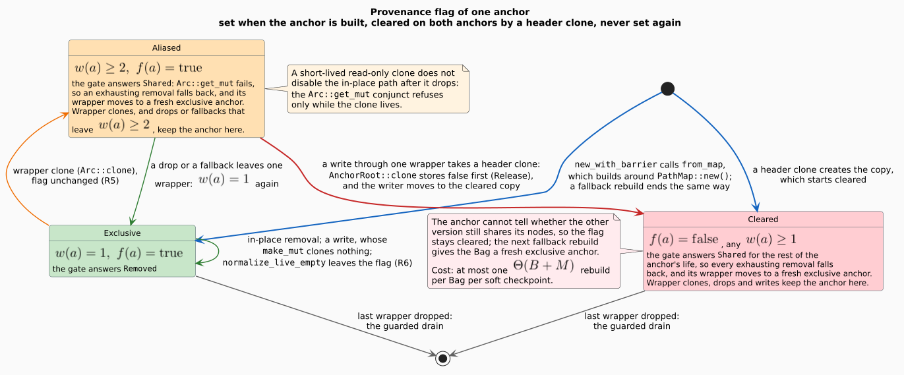

**The algorithm.** The Bag part is the private `Bag::remove_exhausted` in
[`bag.rs`](../../../rspace++/src/rspace/bag.rs), called by `remove_many` and `try_remove_many` when a
removal exhausts its endpoint; the guard part is `GuardedPathMap::remove_exclusive_endpoint` in
[`guarded_pathmap.rs`](../../../rspace++/src/rspace/guarded_pathmap.rs), which returns
`ExclusiveRemoval::Removed` or `ExclusiveRemoval::Shared`. As elsewhere in this report, the
algorithm is in Knuth's literate style [[Knuth 1984](#ref-knuth1984)]: each named chunk, written
`⟨name⟩`, is defined once after the sign $`\equiv`$ and then used by its name, and the variable `bag`
is the Bag being changed. The figure after the walk-through draws the whole flow.

**Algorithm 5.60.7 (EXCLUSIVE-SINGLE-KEY-REMOVAL).** *Remove all $`c`$ copies of endpoint $`k`$
from a Bag: in place on an exclusive anchor, by the unchanged rebuild otherwise.*

```pseudocode
⟨Remove all c copies of endpoint k from bag⟩ ≡              ── remove_many, try_remove_many
    ⟨Step 0: preflight⟩
    case bag.entries.remove_exclusive_endpoint(k) of
        Removed ⇒ ⟨Step 7: update the Bag's metrics⟩
        Shared  ⇒ ⟨Fallback: rebuild bag without k⟩

⟨Step 0: preflight⟩ ≡                                       ── the only step that can fail
    c ← bag.entries.get(k)        or return Err(InsufficientMultiplicity)
    next ← c − amount             or return Err(InsufficientMultiplicity)
    if next > 0 then write next at k; return Ok(next)       ── not exhausting
    ── bag is unmodified up to here; no later step returns an error

remove_exclusive_endpoint(k) ≡                              ── GuardedPathMap
    ⟨Step 1: the gate⟩
    ⟨Step 2: the fail-stop boundary around steps 3 to 6⟩
    return Removed

⟨Step 1: the gate⟩ ≡
    exclusive ← case Arc::get_mut(anchor) of
                    Some(a) ⇒ a.exclusive.get_mut()         ── no atomic load
                    None    ⇒ false                         ── another wrapper lives
    if ¬exclusive then return Shared                        ── nothing was touched

⟨Step 2: the fail-stop boundary around steps 3 to 6⟩ ≡
    outcome ← catch_unwind(⟨Steps 3 to 6: prune k in place⟩)
    if outcome is a panic then abort the process            ── ruling R1

⟨Steps 3 to 6: prune k in place⟩ ≡
    with_write_cursor(cursor ⇒                              ── step 3
        cursor.move_to_existing_value(k)                    ── step 4
        removed ← cursor.remove_val_and_prune()             ── step 5
        assert removed)
    ── with_write_cursor ends with normalize_live_empty        step 6

⟨Step 5: remove_val_and_prune at k⟩ ≡                       ── NativePathCursor
    if k is the root or k has a child then
        take k's value; value_count ← value_count − 1; dispose the value
    else
        remove_leaf_with_floor(k, floor = 0)

remove_leaf_with_floor(k, floor) ≡                          ── one logical edge per iteration
    carried ← the real value at k
    loop
        ascend one byte to the parent q
        stop_here ← depth(q) = floor ∨ q holds a real value ∨ q has more than one child
        if q holds no real value then write a synthetic barrier at q
        descend back to the child
        remove the child's carried payload and its edge:
            a real value: counted out of value_count, taken with pruning, disposed
            a barrier:    discarded, then prune_ascend
        ── the value or barrier at q stops the pruning after exactly one logical edge
        if stop_here then
            retire the barrier at q, if this iteration wrote one; stop
        carried ← the barrier at q                          ── q is now a childless leaf

⟨Step 7: update the Bag's metrics⟩ ≡
    bag.distinct_len ← bag.distinct_len − 1
    bag.exact_cardinality ← bag.exact_cardinality − c

⟨Fallback: rebuild bag without k⟩ ≡                         ── unchanged: 5.60.2
    removal ← the Bag {k ↦ c}
    bag ← bag.subtract(removal)                             ── a fresh anchor, flag set
```

*Step 0* is the existing preflight. `try_remove_many` refuses a request larger than the count, and
`remove_many` clamps it; both reach `remove_exhausted` only when the request takes the whole count,
so the endpoint exists and holds $`c`$. *Step 1* is the gate above: when it answers `Shared`, the
guard has not touched the anchor, and the Bag takes the fallback. *Step 2* wraps everything that
mutates the trie in `catch_unwind` and aborts the process on a panic, the same fail-stop rule that
`AnchorRoot::drop` already applies to the final teardown; the failure-atomicity paragraph below
gives the reason. *Step 3* opens the guard's root-origin, counted write cursor. Its `Arc::make_mut`
clones nothing, because the gate proved $`w(a) = 1`$. *Step 4* positions the cursor at $`k`$, which
step 0 proved holds a value. *Step 5* is the live removal path that guarded mutation already uses,
`NativePathCursor::remove_val_and_prune`. At the root, or at an endpoint with children, it takes
the value and removes no edge. At a leaf it runs the barrier loop of `remove_leaf_with_floor` with
floor 0. The loop decides at each parent $`q`$ whether $`q`$ stops the run *before* writing anything
there, writes a synthetic barrier at a value-free $`q`$ so that the pruning below cannot climb past
it, removes the child's payload and exactly one edge, and stops at the floor, at a real value or at
a fork, where it retires its last barrier. The removed real value is counted out of
`value_count` exactly once and goes straight to the disposal policy; a barrier is never counted and
never reaches it. `remove_val_and_prune` returns `false` only when $`k`$ holds no value, which step
0 excludes, so the assertion cannot fire on a correct preflight. *Step 6* replaces a map that the
removal emptied with `PathMap::new()`, because PathMap 0.3.4 may leave a private empty sentinel
that cannot be reopened for mutation. *Step 7* lowers the Bag's two metrics; the subtractions cannot
underflow, because step 0 saw the endpoint with count $`c`$. The *fallback* is the
`subtract` rebuild of before, unchanged.

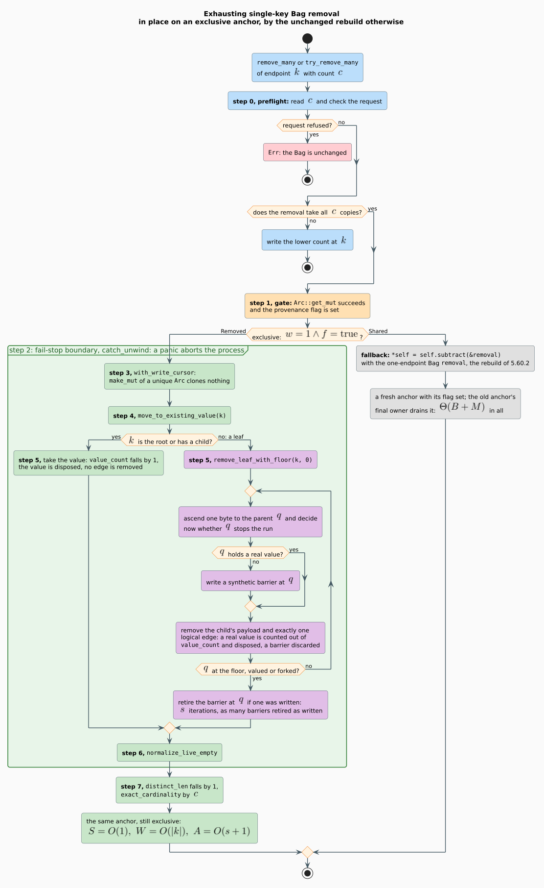

**Contract.** The table compares what the two outcomes of the gate leave behind, for a Bag of
$`M`$ endpoints and $`B`$ logical bytes from which endpoint $`k`$ with count $`c`$ is removed.

| Quantity | In place (`Removed`) | Fallback (`Shared`) |
|---|---|---|
| resident endpoints and multiplicities | every endpoint except $`k`$, unchanged | the same |
| `distinct_len`, `exact_cardinality` | lowered by 1 and by $`c`$ | recounted by the rebuild, to the same values |
| `value_count` of the guard | lowered by exactly 1 by the counted cursor | the fresh anchor's exact count |
| real values disposed during the removal | exactly one, the multiplicity of $`k`$ | none; the old anchor's final owner disposes its original values |
| synthetic barriers | as many retired as written, at most one per pruned edge, none left behind | none |
| nodes or values cloned | none | every retained endpoint once ([5.60.2](#5602-streaming-structural-rebuild)) |
| anchor | the same anchor, still exclusive | a fresh anchor with its flag set |
| work | $`O(\lvert k \rvert)`$ | $`O(B + M)`$, then the old anchor's drain at its final drop |

**Example.** A Bag holds endpoint $`[1, 2, 3]`$ with count 2 and endpoint $`[1, 4]`$ with count 1,
on an exclusive anchor. An exhausting removal of $`[1, 2, 3]`$ runs as follows.

```text
 before                        iteration 1: q = [1, 2]            iteration 2: q = [1]

      root                          root                               root
       │ 1                           │ 1                                │ 1
      [1] ──4── [1,4]=1             [1] ──4── [1,4]=1                 [1] ──4── [1,4]=1
       │ 2                           │ 2
     [1,2]                        [1,2]=β
       │ 3
   [1,2,3]=2
```

Legend: a node is written as its path in brackets, an edge is labelled with the byte it consumes,
`=n` is a real multiplicity and `=β` a synthetic barrier. Iteration 1 ascends to $`[1, 2]`$, which
is not at the floor, holds no value and has one child, so it does not stop the run; it writes a
barrier there, takes and disposes the real value 2 at $`[1, 2, 3]`$ and prunes byte 3, leaving
$`[1, 2]`$ as a childless leaf that carries the barrier. Iteration 2 ascends to $`[1]`$, which has
two children and therefore stops the run; it writes a barrier at $`[1]`$, discards the carried
barrier at $`[1, 2]`$, prunes byte 2 and retires the barrier at $`[1]`$. Two barriers were written
and two retired, one real value was disposed, $`s = 2`$ edges were removed, and the Bag's metrics
fall from 2 and 3 to 1 and 1.

**Why the bounds hold.** Write $`S`$ for the native stack, $`W`$ for the work and $`A`$ for the
allocations of one in-place removal.

- *Stack.* Steps 3 to 6 are loops over heap-backed zipper state. Each pruning step detaches one
  logical edge below a parent that holds a value or a barrier, so a detached node is childless and
  its destructor nests nothing; the formal model states this step as
  `prune_segment_is_one_logical_edge` and `prune_segment_queues_no_par_job` in
  [`PathMapReversePruneTeardown.v`](../../../formal/rocq/stack_safe_pda/theories/PathMapReversePruneTeardown.v).
  The one real value goes to the disposal policy, which must be stack-safe by the guard's contract.
- *Work.* The preflight lookup and the cursor's descent read the $`\lvert k \rvert`$ bytes of the
  key, and the barrier loop runs once per pruned edge, $`s \le \lvert k \rvert`$ times, with a
  constant number of zipper calls each.
- *Allocations.* Each iteration writes at most one synthetic barrier, which can split one compressed
  key; apart from that, only the cursor allocates, a constant.

```math
S = O(1), \qquad W = O(\lvert k \rvert + s) = O(\lvert k \rvert), \qquad A = O(s + 1).
```

None of the three depends on $`M`$, whereas the fallback's rebuild and drain cost
$`\Theta(B + M)`$. The in-place path pays allocations for its barriers, in proportion to $`s`$,
because bug 6441 kept the live removal path's barriers when it removed those of the final teardown
([5.60.6](#5606-barrier-free-phase-b-of-the-final-teardown)). The barrier-free cut of 5.60.6 is
not reused here: its premises P1 to P7 assume a value-free trie that no other owner can observe,
and a live Bag is neither.

**Failure atomicity.** Step 0 is the only step that returns an error, and it returns before any
mutation, so `try_remove_many` leaves the Bag unchanged on every `Err`. Steps 1 to 7 return no
error. A panic inside steps 3 to 6 could stop the barrier loop with a synthetic barrier still
written at a value-free parent. If that panic unwound into the caller, the Bag would be observable
with an endpoint that it never held, and `value_count` would disagree with the trie. Step 2
therefore aborts the process (ruling R1), so no execution ever observes a stray barrier. The rule
follows the existing fail-stop boundary of `AnchorRoot::drop` in the same module, which aborts
rather than resume an unwind over a half-drained trie. The fallback assigns `*self` only after
`subtract` has built and checked its complete candidate, the publish-once rule of
[5.60.2](#5602-streaming-structural-rebuild), so a panic there leaves the old Bag intact.

**Callers.** One private function changes the behaviour of every exhausting single-key removal.

| Caller | Route | On an exclusive anchor |
|---|---|---|
| `Bag::remove_many`, `Bag::remove` (one copy) and `Bag::set_count(k, None)`, when they exhaust the endpoint | `remove_exhausted` | in place |
| `Bag::try_remove_many` that exhausts the endpoint | `remove_exhausted` | in place |
| `BagDelta::record_change`, cancelling a pending addition for `RSpaceDataStore::remove_path` and for the pending loop of `RSpaceDataStore::apply_delta` | `try_remove_many` | in place; the dominant caller in J-259's profile |
| ParBag `remove_bytes` and `try_remove_bytes` | `remove_many`, `try_remove_many` | in place |
| `RSpaceDataIndex::remove_path` | its channel Bag always has a second wrapper | always the fallback |
| `Bag::subtract`, `Bag::apply_parts`, `Bag::remove_prefix` | unchanged | the rebuild, as before |

**Why the flag is kept.** PathMap 0.3.4 would be correct without it. Its write zipper calls
`make_mut` on every node it descends through, the root included, so a destructive prune never
mutates a node that another version shares, and production already runs `remove_val_and_prune` on a
copy-on-write clone in `subtract_encoded_keys` (`models/src/rust/rhoapi_ext.rs`). The flag is kept
for four reasons:

1. On an exclusive anchor no node and no value is cloned, so CBR-075's statement that removed values
   are never cloned stays true for every value type `V`, not only for cheap multiplicities.
2. Correctness does not depend on PathMap's copy-on-write internals, which the guard does not control
   and which have changed between releases: removal correctness defect PMU-008, reproduced on
   PathMap 0.2.2, is fixed only in 0.3.4 (the
   [upstream register](../pathmap/pathmap-engineering-journal-2026-08-23.md#upstream-pathmap-integration-request-register)).
3. It is the premise `exclusive_terminal_footprint` of
   [`PathMapReversePruneTeardown.v`](../../../formal/rocq/stack_safe_pda/theories/PathMapReversePruneTeardown.v).
4. It answers the reason that SS-C33 gave for rebuilding, kept in the comment of
   `Bag::remove_prefix`: destructive pruning may traverse compressed physical nodes that immutable
   versions share. An exclusive anchor has no such version.

The price is conservatism after a header clone. A soft checkpoint snapshots the pending deltas
through the hot store's `pending_deltas`, which clones their Bags' wrappers; the next write through
either version takes a header clone and clears both flags, and the next exhausting removal then
rebuilds once and gets a fresh exclusive anchor. That is at most one $`\Theta(B + M)`$ rebuild per
Bag per soft checkpoint or journal capture, not one per COMM: `BagDelta::record_change` never clones
its Bag.

**Formal evidence.** Two Rocq leaves precede the implementation; their commits, gate logs and
counts follow.

- Leaf `bag-exclusive-removal-provenance-model` (commit `81db4de5a`, gate log `14493-gate-20261114T142145Z.log`,
  counts 252 and 341 closed-context reports with 1 and 7 kernel checks in Rocq sections A and B) extends
  [`PathMapPhysicalOwnership.v`](../../../formal/rocq/stack_safe_pda/theories/PathMapPhysicalOwnership.v)
  with a provenance world that pairs each physical anchor with a provenance bit. Its steps are
  construction, wrapper clone and drop, header clone (both bits cleared, nodes shared), write
  through one wrapper, exclusive partial release and rebuild. `provenance_run_preserves_invariant`
  shows that every run keeps the invariant, and `exclusive_gate_implies_physical_isolation` shows
  that an anchor that passes the gate, with its bit set and one wrapper, is physically disjoint from
  every other live anchor. `exclusive_partial_release_preserves_external_images` shows that a
  release by such an anchor leaves every other anchor's image unchanged.
  `exclusive_provenance_gate_is_nonvacuous` evaluates the gate on concrete runs: it is open for a
  fresh anchor, after a wrapper drop, after a rebuild and after an in-place removal, and closed
  while a wrapper clone lives and on both anchors of a header clone, which share their nodes. The
  mutants `kill_clone_that_clears_only_the_fresh_bit`, `kill_wrapper_only_removal_gate` and
  `kill_root_only_sharing_oracle` in `PathMapPhysicalOwnershipMutants.v` refute a clone that clears
  only the copy's bit, a gate that tests only wrapper uniqueness, and a bit computed by a sharing
  oracle that looks only at the root.
- Leaf `bag-exclusive-removal-live-prune-model` (commit `4d7532fe6`, gate log `14494-gate-20261114T143241Z.log`, counts
  262 and 355 closed-context reports with 1 and 7 kernel checks in Rocq sections A and B) extends `PathMapReversePruneTeardown.v` with a live removal run made of
  `prune_segment` steps above a floor. Its theorems state that each step removes one logical edge,
  that the run stops at the floor, at a real value or at a fork, that it retires as many barriers as
  it writes and disposes exactly one real value, that it queues no `Par` job, and that it preserves
  every external image under `exclusive_terminal_footprint`; `exclusive_provenance_licenses_live_removal`
  composes the run with the provenance theorem above. Its mutants omit a barrier, ignore the floor,
  leave a barrier written, and run on an overlapping footprint.

The guarded-ownership model is unchanged (ruling R4). Its invariant `GuardInvStructuralRemovalDisjoint`,
proved by `structural_removal_uses_an_ownership_disjoint_rebuild` in
[`TwoLevelRSpaceGuardedOwnership.v`](../../../formal/rocq/stack_safe_pda/theories/TwoLevelRSpaceGuardedOwnership.v),
states that a rebuilt candidate region is disjoint from its source region, so it covers the fallback
only; the in-place path builds no candidate and is covered by the two leaves above. The scope note
of [TLRS-PROP-07](../pathmap/two-level-rspace-authority-invariant-catalog-2026-09-02.md#tlrs-prop-07--copy-on-write-and-guarded-lifecycle)
records the same division. Neither model is a refinement proof of the Rust functions.

**Test evidence.** The tests ran on exports of the committed trees; the table gives their commits,
gate logs and counts.

| Leaf | Commit | Tests | What they establish | Gate log | Counts |
|---|---|---|---|---|---|
| `bag-exclusive-removal-in-place` | `3f7eac8a0` | `exclusive_endpoint_removal_requires_a_unique_wrapper` and `header_clones_clear_exclusivity_on_both_versions` in `guarded_pathmap.rs`; `exhausting_single_key_removal_allocates_independently_of_bag_size` in `rspace++/tests/bag_allocation_spec.rs` | the flag lifecycle of the table above; for 16 and for 4,096 resident endpoints, the allocation calls and bytes of an exhausting removal are equal for each of five removal APIs (red at the parent) | `14499-gate-20261114T144017Z.log` | 161 passed and 6 ignored with 0 failed in both debug and release |
| `bag-exclusive-removal-guard-tests` | `d21e74df5` | `exclusive_removal_matches_a_rebuilt_map_for_every_topology`, `gateway_decisions_follow_the_provenance_model`, `exclusive_removal_clones_no_value_and_header_clones_stay_shared`, `concurrent_header_clones_clear_exclusivity_on_every_version`, `exclusive_deep_key_removal_runs_on_a_256k_stack` in `rspace++/tests/guarded_pathmap/exclusive_endpoint_removal.rs` | the provenance invariant against a reference model; the live-prune invariants (oracle equality, exact `value_count`, ACT bytes equal to a rebuilt map's, one disposed value and no barrier at the disposer); no clone during an exclusive removal; a 65,536-byte key on a 256 KiB stack in three shapes | `14495-gate-20261114T164459Z.log` | 50 passed and 5 ignored with 0 failed in both debug and release |
| `bag-exclusive-removal-alias-matrix` | `677adde86` | `exhausting_removal_keeps_every_alias_coherent_across_removal_apis`, `exhausting_removal_is_coherent_for_every_mixed_construction`, `a_fallback_rebuild_restores_in_place_exhausting_removal`, `exhausting_removal_of_a_deep_key_is_stack_safe`, `exhausting_removals_match_an_independent_btreemap_oracle` in `rspace++/tests/bag/cow_root_publication.rs` | five removal APIs times five ownership cases: the anchor is retained in place, replaced by the fallback, and never changed for an alias; a rebuild restores exclusivity; a deep key on a small stack; agreement with a `BTreeMap` oracle | `14496-gate-20261114T165254Z.log` | 15 passed and 0 ignored with 0 failed in both debug and release |

**RhoSpec evidence (prediction P4).** Bug 14492 predicted that with an in-place removal whose cost
does not grow with $`M`$, `system_vault_spec`, `tree_hash_map_spec` and `pos_spec` finish alone in
release inside their timeouts of 60 s, 60 s and 400 s with unchanged outcomes, and that the same
runs time out at the parent of the in-place commit. Leaf `bag-exclusive-removal-rhospec-suites`
tested it at commit `677adde86`, which also holds the in-place outer delta of leaf
`rspace-outer-delta-in-place`, at the parent of that leaf's commit, which holds the in-place removal
alone, and at the parent of the in-place commit; logs `14497-pre-landing-system_vault_spec-20261114T170223Z.log`, `14497-pre-landing-tree_hash_map_spec-20261114T170223Z.log`, `14497-pre-landing-pos_spec-20261114T170223Z.log`, `14497-pre-attribution-system_vault_spec-20261114T171143Z.log`, `14497-pre-attribution-tree_hash_map_spec-20261114T171143Z.log`, `14497-pre-attribution-pos_spec-20261114T171143Z.log`, `14497-pre-red-system_vault_spec-20261114T171810Z.log`, `14497-pre-red-tree_hash_map_spec-20261114T171810Z.log` and `14497-pre-red-pos_spec-20261114T171810Z.log`; result refuted for `tree_hash_map_spec`, which still timed out at its 60 s limit with the in-place removal alone (at `b504c0116`, 93.40 s) while `system_vault_spec` (66.08 s) and `pos_spec` (122.01 s) passed; all three timed out at the parent of the in-place commit (`4d7532fe6`: 170.78 s, 159.28 s and 567.91 s) and passed with the in-place outer delta as well (`677adde86`: 39.88 s, 44.69 s and 62.81 s). The cost that
`tree_hash_map_spec` still paid with the in-place removal alone is a second term quadratic in the
evaluation: every nonempty RSpace delta drained the whole outer channel map, until leaf
`rspace-outer-delta-in-place` applied deltas in place.

The change is confined to how an exhausting removal reaches the same Bag. Both paths publish the
endpoints and multiplicities that `Bag::subtract` defines (the `BTreeMap` oracle above), and only
the time, the allocations and the anchor's identity differ. No Rholang value, datum identity,
multiplicity, candidate order, matcher result, binding, protobuf/bincode/EPM1/RMP2 byte, hash,
COMM schedule, compute/storage charge, PathMap algebra, accepted program or parallel execution
order changes; the continuation note of CBR-075 in the
[consensus-change register](../../consensus/consensus-change-register.md) records the
classification.

### 5.61 Current accepted-match publication certificate [SS-C34]

SS-C34 adds the missing formal boundary between the certified candidate-search/preparation
models and a current publication record. Formal verification precedes any runtime wiring. The
Rocq unit `formal/rocq/stack_safe_pda/theories/TwoLevelRSpaceCurrentPublication.v` models one
`CurrentAcceptedProposal` whose requested channel vector and selected ordinal values are exact,
then binds `CurrentPreparedPublication` to the observed authority, the selected-candidate vector,
the typed `PreparationReady` result, the strict-subtraction/no-deletion Bag delta, and exact datum
and continuation successors. Refusal is represented as an atomic non-publication phase rather than
as a partially applied state.

The certificate is intentionally a proof boundary, not a claim that the durable backend is already
activated beneath production RSpace. It consumes the existing PathMap-native authorities and does
not reconstruct a `Vec<Par>`, sort trie entries, or introduce a second semantic representation.
The exact selected-candidate equality added in commit `ecce8a8a5` closes the remaining gap in which
PREPARE could be shown well formed without proving that it consumed the same candidate vector that
the accepted PDA selected; `129289adc` introduced the certificate and `9be709237`, `3a54fdf39`,
and `65ba2b370` provide the typed recovery, preparation, and negative-control dependencies.

Capped `coqc` and `coqchk` both pass for the registered unit with no `Admitted`, `admit`, `Abort`,
or axiom-based shortcut. The formal result proves exactness of the current publication inputs, not
filesystem durability, runtime integration, compaction, migration, or LMDB parity; those remain
separate gates in pgmcp (6361/6362, 5684, and 5688/6189). No Rholang value, PathMap topology,
protobuf/bincode byte, hash, COMM schedule, or accounting rule changes in this certificate.

### 5.62 Exact current-publication authority closure [SS-C35]

SS-C35 records the follow-up closure of the current-publication certificate boundary in
commit `417b2980c` (`formal(rspace): close exact current publication authority`). The model now
requires selector acceptance to identify the exact checked PREPARE input, observed pool,
catalogs, fresh arrival, exclusions, and selected vector; derives datum successors through the
partition-refining `PreparedRSpaceDelta`; and validates continuation successors through the exact
capability and boundary APIs. Data, continuations, cache invalidation, and generation counters
are published as one typed state transition, with the phase sequence
`Proposed → StatePublished → CommObserved`.

The refusal branch is closed as well: refusal requires the absence of every valid publication
certificate and preserves state, COMM visibility, and logical/datum/durable publication counts.
This is a formal-only strengthening of the authority boundary. It introduces no native recursive
traversal, runtime stack growth, PathMap representation change, byte/hash/COMM/accounting change,
or filesystem-durability claim. Therefore the existing stack-safety conclusion remains valid while
the previously open publication-authority correspondence is no longer left implicit.

Verification evidence: capped `coqc` and `coqchk` for
`formal/rocq/stack_safe_pda/theories/TwoLevelRSpaceCurrentPublication.v` completed successfully;
seven capstones closed under the global context, the module check succeeded, and no `Admitted`,
`admit`, `Abort`, or axiom shortcut was used. Runtime integration, durable persistence,
compaction, migration, and LMDB parity remain separate campaign gates.

### 5.63 Fixed-delta trusted commit scaling [SS-C36]

SS-C36 records the preregistered measurement of what one trusted commit costs as the current state
and the retained history grow (pgmcp experiment 446, task 7929). A trusted commit seals a mutation,
binds it under an exact trusted policy, prepares it and publishes it with no physical recovery and
no cold admission, so its work should depend on the keys that it changes, not on the $`N`$ keys of
the current state or the $`H`$ retained states. SS-C36 is a scaling measurement and makes **no stack
claim**: it measures time, allocations, I/O, resident memory and metadata bytes, not native stack
depth, and it converts no traversal.

The cost audit, the fixture, the oracles, the harness and the gates are defined in the invariant
catalog's [fixed-delta trusted commit scaling section](../pathmap/generation-checkpoint-invariant-catalog-2026-08-28.md#fixed-delta-trusted-commit-scaling-2026-10-29).
Every value below is **MEASURED (q)**, quoted from the committed
[measurement record](measurements/rspace-fixed-delta-scaling-2026-11-03.md) and its [analysis](measurements/rspace-fixed-delta-scaling-2026-11-03-analysis.json),
[process summary](measurements/rspace-fixed-delta-scaling-2026-11-03-process-summary.tsv), [verify records](measurements/rspace-fixed-delta-scaling-2026-11-03-verify.tsv) and
[artifact manifest](measurements/rspace-fixed-delta-scaling-2026-11-03-manifest.json). The raw populations are the pgmcp artifacts that Appendix B
lists.

The decision population, `decision-20261101T101751Z`, was collected at commit `941ff07d` on one
pinned CPU and ended on 2026-11-03. It has 21 cells, each with two verify runs and 31 decision time
processes. Axis U grows the current state ($`N = 2^{10}`$ to $`2^{18}`$ keys at $`H = 2^{10}`$),
axis R grows the retained history ($`H = 2^{8}`$ to $`2^{16}`$ states at $`N = 2^{12}`$), axes D and
L grow the replaced delta and the deleted group, and axis E measures physical eviction. Each
exponent is the stratified log-log slope, written as the estimate with its 95% interval in brackets.

Result 483 of experiment 446, decided on 2026-11-08, accepts its one hypothesis, H1: the larger
upper 95% bound of the two thread CPU exponents is 0.2086, against the threshold 0.25. The task's
preregistered rule also requires a qualified decision population, G1 to G9 and every control
detected. The population is qualified and all four negative controls were detected, but gate G4
fails on allocated bytes, so the rule is not met: the analysis reports `qualified` as `true` and
`accepted` as `false`.

| Gate | Verdict | Measured |
|---|---|---|
| H1, thread CPU | pass | U 0.1964 [0.1881, 0.2086]; R 0.1363 [0.1333, 0.1395]; bound 0.25 |
| G1, exact work | pass | 2 verify runs per cell, 0 problems |
| G2, determinism | pass | the verify runs agree on all 27 compared fields; 0 time-chain mismatches |
| G3, wall time | pass | U 0.1586 [0.1508, 0.1699]; R 0.1098 [0.1059, 0.1138]; bound 0.25 |
| G4, allocation count | pass | U 0.1091 [0.1050, 0.1130]; R 0.0529 [0.0479, 0.0576]; bound 0.25 |
| G4, allocated bytes | **fail** | U 0.4130 [0.4086, 0.4174]; R 0.3186 [0.3137, 0.3234]; bound 0.25 |
| G5, I/O | pass | largest upper bound over `syscr`, `syscw`, `rchar` and `wchar`, across both verify runs: 0.0575; bound 0.25 |
| G6, resident memory | pass | largest stratum's median minus the smallest's. U: $`-315{,}392`$ B, upper 97.5% bound $`-151{,}552`$ B. R: 700,416 B, upper 97.5% bound 757,760 B. Bound 1 MiB; no swap and no out-of-memory kill |
| G7, metadata | pass | every V2 commit wrote at most 518,500 bytes with $`2 + \mathit{meta\_exp} \le 103`$; the median V2 step is 1,538 to 4,088 bytes, the V1 manifest is 10.1 to 2,387 times larger, and it exceeds the median V2 step from 26 to 72 entries on |
| G8, axes D and L | pass | D 0.6527 [0.6493, 0.6564]; L 0.2772 [0.2746, 0.2801]; bound 1.25 |
| G9, eviction | pass | the trusted effects hold; reclaim minus timed thread CPU is 181.1, 571.2 and 7,827.3 microseconds at $`2^{10}`$, $`2^{14}`$ and $`2^{18}`$ keys; no threshold applies |
| G10, controls | all detected | NC-SCAN CPU U 0.845 [0.841, 0.849], R 0.597 [0.572, 0.613]; NC-CLONE CPU U 0.835 [0.826, 0.852], R 0.653 [0.648, 0.658]; NC-ORDER G1 fails at every cell, CPU U 0.971 [0.968, 0.974]; NC-V1 CPU R 0.666 [0.662, 0.671] |

$`c^*`$, the smallest charge per key or per state that would lift H1's bound above 0.25, is
1.4142 ns per key on U and 16 ns per state on R.

The pilot forecast the G4 miss (pgmcp artifact 1178, observation O2; interval [0.380, 0.390] on U).
Hypothesis H-O2 attributes the bytes to copy-on-write copies of the widening 256-way level-1 nodes
of the reachability ledger's PathMap, about $`72 \min(\ell / 256, 256)`$ bytes per copied node for
a ledger of $`\ell`$ digests. The model matched the pilot's measured bind bytes to within 15%. The
section 5.9 diagnostics, run on the pilot's fixtures, confirm the mechanism on axis U: heaptrack
attributes 93.2%, 97.9% and 99.41% of the bind bytes at $`2^{10}`$, $`2^{14}`$ and $`2^{18}`$ keys
to `run_ledger_trial`, and its bind totals equal the verify run's counter exactly (pgmcp artifacts
1277 and 1281). The refined width model's predictions, registered before the largest trace was
read, hold. Heaptrack ran on axis U only, so axis R has the model's prediction and no attribution.
The heaptrack, strace and uProf outputs are artifact 1303, and the strace and uProf outcome is
artifact 1304. Allocation counts stay logarithmic and thread CPU and wall time pass, so this is a
cost in copied bytes per touched node, not extra allocations and not a correctness failure. The
defect is bug item `rspace-ledger-trial-cow-allocation-growth` (pgmcp item 13988), which holds the
consensus-change assessment.

The measurement does not claim the following.

- It holds for one host and one core.
- The binary is the release library test binary, which still contains the `cfg(test)` hooks and a
  toggled counting allocator, not a production build.
- The keys are data-only: each is a datum on its own channel.
- The history shares the current roots: each historical state differs from the current one only by
  its legacy root.
- fsync was measured on one filesystem, ext4.
- It makes no power-loss claim and no concurrency claim.
- It is not the LMDB verdict (task 5693). It measures no semantic eviction, because no eviction
  policy exists under keep-all retention, and axis E reclaims only physical files. It activates
  nothing (task 7931).
- $`c^*`$ bounds only what the timing gate excludes by itself: an extra cost per key or per state
  below $`c^*`$ would pass H1.

Two pre-existing gaps are noted and not fixed here: the register of section 0 has no SS-C34 or
SS-C35 rows, and the table of contents has no entries for 5.59 to 5.62.

---

## 6. Discussion

### 6.1 Why the explicit-worklist shape, and why it is *smaller* than what it replaces

Every conversion in §5 is the same transformation: make the continuation a **first-class value** and drive it with a loop [[Reynolds 1972](#ref-reynolds1972); [Ager et al. 2003](#ref-ager2003)]. The choice among the family's variants was made per traversal, and the discriminating question each time was *what does the resumption actually need to remember?*

| traversal shape | driver shape | why |
|---|---|---|
| pre-order into a contiguous buffer (encoder) | **op stack only, no value stack** | the output *is* the accumulator, so nothing needs parking — cf. [[Cheney 1970](#ref-cheney1970)] |
| bottom-up reassembly (decoder, substitution, sorter) | **work stack + value stack(s)** | a parent cannot be constructed until its children exist |
| post-order fold with *interleaved* checks (expression evaluator) | **work stack + value stack + an `Extract` continuation** | error **position** is observable, so per-operand checks must fire between siblings (§5.2.1) |
| a `Par` spine with a left-biased search (`into_source_process`) | **work stack, push RIGHT before LEFT** | reproduce the `.or_else` order exactly |
| a discard (ingress, teardown) | **worklist, no reconstruction at all** (`dismantle`) | nothing reads the value; only the frees are reordered |

★ **The counter-intuitive empirical result is that the heap cost per level is far *below* the stack cost it replaces** — $`5.1\times`$ for the encoder and $`42.3\times`$ for the decoder (§5.3.4). The explanation is §5.1.1's `gdb` attribution: a compiler-laid-out frame for a 40-arm `match` reserves slots for **every** arm's live locals and does not overlap mutually exclusive arms at `-O0`, whereas a work item is a hand-designed 32-byte `enum`. Trampolining is usually presented as trading space for safety; here it bought both, and the reason is that the thing it replaced was *fat*, not that the thing it introduced is *thin*.

### 6.2 Why the SCC is the unit of conversion

Three independent instances say the same thing.

* **Substitution**: converting a subset would have left the cycle intact.
* **Lowering** (§5.6.1): the reproducer's cycle passes through **twelve `core::iter` adapter monomorphisations**; the 18 direct self-call sites are *not* the component, and converting them would have left the reproducer exactly as it was.
* **The sorter** (§5.1.4): converting `sort_match` alone would have left `compare_score` $`\Theta(d)`$ **and the gate would still have passed**, because a linear chain sorts as a one-element vector on which `sort_by` performs zero comparisons.

$`\Rightarrow`$ **Scope by Tarjan, not by intuition**, and — §5.1.4 again — remember that a Tarjan run over the *schema* cannot see a recursive Rust type that is not a schema message.

### 6.3 Neutrality is the hard part, not the driver

Every one of these traversals is on a consensus-visible path. The drivers were the easy half; the expensive half was proving that nothing observable moved.

The obligations differ by traversal and were derived per traversal rather than assumed:

* **Substitution** is cost-neutral **by construction**: `substitute_and_charge` charges `encoded_len()` of the **result**, once, *outside* the recursion, and the SCC contains **zero** `reserve_*`/`Cost::` calls — asserted mechanically over all 97 corpus cases, not left as prose.
* **The sorter** takes no metering handle, which makes the *cost* obligation vacuous and therefore makes the **result** obligation the whole obligation: `cost_accounting/sig.rs` signs `sort_match(&par).term.encode_to_vec()`, so **a one-element reordering is a fork**. `sort_by` is kept and `sort_unstable_by` refused, because the comparator returns `Equal` for distinct terms with equal scores and an unstable sort would be free to reorder them.
* **The codecs** owe *byte identity* on the write side and *language identity* — including the `Err` half — on the read side.
* **The async driver** owes COMM order, checked by a differential on the ordered `(BillableKind, weight)` trace, not on a final state.

★ **`encoded_len` is the one member for which neutrality cannot be inferred from control flow**, because **its return value *is* the charge**. At `64a5d2bc`, before the generated `prost::Message` family landed, that left `subst_and_charge` at 146 B/level after a $`19.5\times`$ improvement. The final schema-generated implementation delegates `encoded_len` to the memoized bottom-up protobuf PDA and is checked against both the recursive oracle and emitted byte length. The live `subst_and_charge` ladder is therefore **0 B/level**; 146 is an intermediate historical measurement, not a residual.

### 6.4 ★ The write/read asymmetry — one section, because it is one class

The campaign kept re-discovering one shape:

> A `Par` is **written by an unbounded encoder** and later **read by a bounded decoder**, with the two ends on different paths, different processes, or different times.

**Both halves matter**, and that is not pedantry: the **bincode** wire is iterative and depth-unlimited in *both* directions, measured flat from depth 4 to 4,096, and is therefore **not in the class** — which is why the cold store does not appear in the registry at all.

Four independent instances (**DERIVED**, `rholang/tests/par_read_ceiling_site_registry.rs:1-11`):

| # | where | shape |
|---|---|---|
| **#120** | the audit's §7.3 | a term can be built, reduced and serialised but **not read back** |
| **#129** | `output_value` | play accepts a depth-34 payload; replay refuses it |
| **#130** | the trie's value slot | `decode_trie_path` is not total on `encode_trie_path`'s image |
| **#4** | `EPathMap`'s own prost wire, tag 8 | a map encodes at entry depth 34 and refuses to decode |

**#129 was downgraded by measurement, and that is a result.** The claim under test was *"a proposer-controlled consensus divergence"*, resting on a fixture that **spliced** a depth-34 `Par` into a recorded log — and that fixture's own header said splicing proves the decode asymmetry and *not* reachability. **Nobody had measured the write side.** Driving all seven reachable non-deterministic operations through real deploys on a real runtime (**MEASURED (q)**, `80f5e5d3`):

```text
rho:ai:gpt4 / dalle3 / textToAudio    depth 0
rho:ollama:chat / generate            depth 0
rho:ollama:models                     depth 1   ← the deepest
rho:io:grpcTell                       depth 0
rho:chroma:…:query (compiled out)     depth 2   recorded, not driven
```

Read ceiling 33; **tightest margin 31 levels**. $`\Rightarrow`$ **#129 is LATENT, not live.**

★ **And the defect that *is* real is not the one in the title.** The previous guard was a *sentence* — "all eight of those operations' return constructions were read" — with a hand-listed denominator. Add a ninth operation and the sentence stays grammatical, the fixture stays green, and the block-killing behaviour is live with no compile error anywhere. The denominator is now `non_deterministic_ops()` itself, read from production at run time.

**A second axis nobody had enumerated (`0e0f9719`).** Everything above concerns **depth**. `EMinus { Par p1 = 1; }` is proto3, so the field is optional **on the wire** and `prost` returns `None` for an absent one **without error**. An absent required child is therefore not something `Par::decode` *refuses*; it is something `Par::decode` **returns**. **Ten bytes** — `[2a 08 52 06 12 04 2a 02 10 04]` — are accepted by `Par::decode` and fault four independent consumers: `has_locally_free.rs` (94 sites), `spatial_matcher.rs` (55), `par_map_type_mapper.rs` (1), and the FFI (foreign function interface) rows. The disposition is settled once: an absent required child is an **internal invariant violation**, not a decidable negative, so the sites assert (`.expect`) and the fix belongs at the boundary admitting foreign bytes — because `spatial_match` returns `Option<()>`, whose inhabitants are *matched* and *did not match*, and answering `None` would make a malformed term indistinguishable from a well-formed non-matching one.

⚠ **Reachability of that axis came out split**, and is reported split: the first fault is the normaliser's own path, not the matcher; on the consensus path it is **LATENT for a structural reason** (on replay the tuple space is trace-driven, so the only pattern a spliced value ever meets is one that already matched a well-formed value at play time — five deploy-writable receive shapes all replay clean); and through the FFI it is **worse than a thread panic**, because the implicit non-unwinding shim **aborts**, so `catch_unwind` cannot intercept and the whole process dies. Severity is bounded only by there being **no in-tree caller**: a live public ABI (application binary interface) with no live consumer.

### 6.5 How the asymmetry was closed

Three options existed, and the campaign took the only one that changes no accepted-input set:

1. **Cap the writer** — rejected: a construction bound is consensus-visible.
2. **Uncap the reader** by raising `RECURSION_LIMIT` — rejected: prost's constant is private, and
   widening the accepted byte-string set is equally consensus-visible; worse, the recursion limit
   was also the sole guard on the attacker-controlled group-skip recursion (§8.6's closure table),
   so removing it first would have *introduced* a `SIGSEGV`.
3. **Convert the prost paths**, as the cold store was converted. **Taken and completed**: the
   generated `prost::Message` family (SS-A8) made the writer explicit-PDA, the group skipper was
   made iterative *before* the cap ceased to govern, and the generated decode PDAs read without a
   recursion ceiling — measured at depth 4,096 on a 256 KiB stack. All four historical instances in
   §6.4's table are closed: #120/#129 by the ceiling-free generated reader, #130/#4 by EPM1's
   direct trie image (PathMap report §5.2), which retired the per-key decode entirely.

What the deploy-path inventory still asserts is the build-vs-read headroom ratio; its one
transcribed constant (283, measured 274) is a recorded threat (§7.5), not a live bound — the read
ceiling it was ratioed against no longer exists.

---

## 7. Threats to validity

### 7.1 The observable is a proxy

`B/level` is the slope of *minimum surviving stack*, bisected to 4,096 B. It is **not** a direct measurement of frame size, and it aggregates every frame in the cycle. Two specific consequences:

* A traversal with $`B < 4096/\text{span}`$ is indistinguishable from $`B = 0`$ by this instrument. The gate's zero-slope ceiling over a 4 $`\rightarrow`$ 4,096 span is **4 B/level in integer arithmetic**, with the sloped control ~40 $`\times`$ above it — so the margin is real but finite.
* The estimator is affine-by-assumption. §5.6.3 exhibits a subject that is **flat then linear**, with a knee at depth ~256 whose mechanism is *not established*. Any subject measured only below its knee would be mis-classified, which is why the gate's ladders end at 4,096 and its width ladders at 65,536.

### 7.2 Measurement environment

* ⚠★ **The measured tree is HEAD *plus uncommitted concurrent work*, not clean HEAD.** `rholang/tests/stack_depth_gate.rs` — the instrument behind every `B/level` figure in [§5](#5-results) — carried **uncommitted modifications by a concurrent agent** at measurement time ($`+76`$ inserted, $`14`$ deleted; file mtime 11:47, i.e. before this session began; **this report modified no source file**). The binaries measured were built from that working tree. Three things bound the risk, and they are stated rather than assumed: the diff touches **zero** lines of `CONVERTED_DEPTH`, `TRIPWIRE_DEPTH` or any `assert_slope_below` call (checked by `git diff | grep -c`); it is predominantly `rustfmt`-shaped reflow plus an S0 doc block; and **the S0 run reproduced the independently recorded baseline table byte-exactly in all ten rows** ([§5.3.1](#531-the-baseline-what-had-never-been-measured)), which a perturbed instrument would be unlikely to do. $`\Rightarrow`$ The figures are treated as sound, and **a re-run at clean HEAD is the honest way to confirm it** — named here rather than glossed.
* **One machine, one microarchitecture.** All figures are Zen 3, `target-cpu=native`. Frame layouts are compiler- and target-specific; §5.5.2's finding that the *same* function is emitted at 48 B in one binary and 64 B in another (a $`1.5\times`$ spread **from register allocation alone**) is direct evidence that these constants do not transfer between builds, let alone between targets.
* ⚠ **Not at maximum frequency, and not on a quiet machine.** §4.2: core 8 at **77.2 %** of maximum boost, load average ~13 on 32 cores, concurrent agent workloads throughout. The **relative** timings of §5.4.1 are protected by within-repetition interleaving and by the non-overlap check; the **absolute** nanosecond figures are not, and should not be quoted as throughput characteristics of the hardware.
* **The settle was 302 s of *quieter*, not of *quiet*.** The $`\geq 300`$ s discipline was met arithmetically; the machine was never idle.
* ⚠ **`perf` used a software event.** See §4.4. Symbol attribution is unaffected; sampling fidelity is.
* **Heap figures are architecture-independent but allocator-dependent.** massif and DHAT observe the actual allocator; a different global allocator would move the block counts of §5.3.4 (though not the op-stack arithmetic, which is $`16{,}384 \times 32`$ regardless).

### 7.3 Workload representativeness

The throughput verdict of §5.4.1 is weighted by a **measured** distribution — 1,773 datums from five interpreter suites, 95.43 % at depth 2 — and that is far better than a uniform sample. But it is five *test* suites, not a production node, and it measures only `ListParWithRandom::stable_hash_bytes`'s datum leg. ⚠ A production workload with a different depth profile would move the verdict, and **per-shape magnitudes (depth 1…1,024, wide, map shapes) were never re-measured under the paired design** — only the blocked instrument produced them, so no per-shape re-weighting table is quotable.

The deploy ceilings of §5.5 are measured on **synthetic maximally-nested** source. That is the right shape for a *ceiling*, and the wrong shape for an average.

### 7.4 Enumeration completeness

The traversal inventory is **derived by three methods** — Tarjan over the schema, a call-graph search over 4,503 functions with an explicit trait-dispatch pass, and measurement as the discriminator of last resort — and each has a blind spot that was hit at least once:

* Tarjan over `RhoTypes.proto` **cannot see a recursive Rust type that is not a proto message**; it missed `score_tree::Tree<T>` and its five traversals (§5.1.4).
* A `#[derive]` scan **cannot see hand-written impls**; `PartialEq` and `Hash` are stripped from prost's output and written by hand, and a hand-picked list of four **already missed `Hash` once** (§5.3.1). The generated registry therefore declares itself a **lower bound**.
* A call-graph search cannot see rustc's **implicit `Drop` glue**, which has no `impl` anywhere.

$`\Rightarrow`$ **The list of $`\Theta(d)`$ traversals in this system should be read as a lower bound, not a census.** The read-ceiling registry (§5.7.8) exists for exactly this reason: it is a **scan**, so a fifth site cannot be added without someone deciding what it is.

### 7.5 DERIVED-but-not-MEASURED claims

Named, as required:

1. **Consensus neutrality of the ingress repair** (§5.5.3(a)) rests on three *read* arguments — signature over source, storage of source, re-normalisation by the proposer. Individually sufficient, jointly strong, **not executed** as an end-to-end differential.
2. **`protobuf_encoder`'s dormancy** (§5.3.5) is a mechanical `grep` over `src/` trees at one commit; it is DERIVED, and a future wiring would silently invalidate the "no stack-safety regression" reading.
3. **`RECURSION_LIMIT = 100`** is read from `prost-0.13.5/src/lib.rs:30`. The workspace `Cargo.lock` lists prost 0.12.6, 0.13.5 **and** 0.14.3; the *effective* version for `models` was not separately confirmed for this report, though the derived $`D_{\max}`$ values (33/32/31) **were** measured end-to-end by the gate and agree with the formula.
4. **The 87-member lowering component** (§5.6.1) is a Tarjan result from a script, not re-run for this report.
5. **The claim that no `codegen-backend = "cranelift"` is configured** is a grep over three file classes; a workspace-external `~/.cargo/config.toml` override was **not** checked.
6. **The attribution of the `env_get_deploy` movement** to the four intervening commits is explicitly *not* asserted (§5.9, #5).
7. ⚠ **`stack_depth_gate.rs`'s `BUILD_DEPTH_INVENTORY` carries a transcribed 283** where the measurement reads 274 — a 9-level drift inside a check whose resolution is 33 levels, so the check passes identically on both values. The gate file is out of this refactor's scope; the threat is that a transcribed figure beside a derivable one drifts silently (§5.7.1's class).
8. ⚠ **The clone-oracle gap is an instrument artefact bound, not a disagreement**: the re-emitted derive oracle read 7,021 B/level release where the historical monolithic impl read 3,254 — a 2.16× spread from inlining shape alone (§0). Neither is a live figure (the driver reads 0); the threat is that *semantic* oracles do not reproduce *frame layouts*, so oracle-vs-history deltas must never be read as regressions.

### 7.5a ⚠★ A measurement's provenance includes its BUILD OVERLAY — and this repo's overlay is deliberately untracked

**DERIVED**, `Cargo.toml:59-69`. This repository carries a `[patch]` block marked **`HELD LOCAL — DO NOT COMMIT`** pointing the `rholang-rs` parser crates at an **unpublished** local worktree commit — the one carrying `Proc::SignedTerm` / `TokenStack` / `Bind::Signed` that the `cost_accounting` normalizers require — and `Cargo.lock` is held out of git with `git update-index --skip-worktree`.

$`\Rightarrow`$ ★★ **An archived HEAD does not compile, by design.** `git archive` strips the overlay, and a sibling agent concluded *"HEAD is broken"* from exactly that. Anyone pinning a baseline for comparison must:

1. copy the held-local `Cargo.toml` into the export;
2. ⚠ note that its `path =` dependencies are **relative**, so the export must sit as a **sibling** of the target worktree or the paths must be rewritten absolute; and
3. **verify the baseline builds before attributing any figure to it.**

⚠ In `mettail-rust` the mirror hazard is worse in one respect: the build pin lives in a **harness-wipeable scratchpad** and can vanish on its own, intermittently breaking every build with no local change to explain it.

$`\Rightarrow`$ **A B/level figure is a property of (source, toolchain, profile, *overlay*).** This report's figures were taken with the overlay in place; a re-run that strips it will not reproduce them, and will fail to build rather than disagree.

**Experiments 306–309 provenance (2026-08-23).** The source base is
`c54a2354c99bd504ff42e20793ddd13972f6f49c`; the frozen control is
`0c27a7c878e1c8382197cd2c53f1493ca3270c39`. Experiment 309's release treatment binary has
SHA-256 `b5109de3bb0c79b8297745e08d7f973b8f8fa7582a4ef1ac6e581bf90c8dac76`; the control binary is
`3df98025a0cdb1c60e6fcf12a45340da447d8821919fb455de6895b1b6920e42`. The compiler is
`rustc 1.95.0-nightly (6efa357bf 2026-02-08)`, LLVM 22.1.0, targeting
`x86_64-unknown-linux-gnu`; Cargo is `1.95.0-nightly (fe2f314ae 2026-01-30)`. The host runs Linux
7.1.9 on x86-64. Immediately before the run, no Cargo or rustc process was live and physical cores
0–15 sampled approximately 95–99% idle; cores 16–23 were excluded because another process occupied
them. The experiment was pinned to CPU 1 inside an 8 GiB, zero-swap user scope. The complete raw
source hashes, overlay identity, paired analyses, pgmcp run digests, and headless Heaptrack capture
hash are the durable JSON/TSV records linked in §5.33 and Appendix B; nothing was inferred from a
later rebuild.

### 7.5b ★★ When a premise looks refuted, suspect the instrument ONCE before suspecting the claim

Three of this session's apparent refutations turned out to be instrument problems, not findings:

| apparent refutation | what it actually was |
|---|---|
| *"the subjects do not exist"* — the probe rejected all eleven names | **zsh did not word-split `$ SUBJ`**; every name arrived as one argument. The exact hazard `e72dcae8` records ("a zsh `set --` that does not word-split"), reproduced by me one session after reading it. |
| *"the generated tree is missing `ast_enums.rs`"* — the build failed outright | a **concurrent agent was regenerating** `target/generated/` at that moment. One retry, one minute later, succeeded unchanged. |
| *"`models` does not compile"* — E0425 in `sorter/sort_drive.rs` | a **concurrent agent's mid-edit** in the sibling worktree. Also fixed by retrying. |

★ And the general form of the lesson is already in the report twice — [§5.6.3](#563--a-retracted-claim--the-parser-is-not-depth-independent-1339c1e2-then-6275b0e2)'s parser read *"0 B/level"* because the ladder never cleared its own intercept, and [§5.7.3](#573-the-harness-prerequisite-that-was-totally-vacuous)'s generator quantified over **two values** for every input. Both looked like results.

$`\Rightarrow`$ **The rule adopted: a premise that looks refuted buys the instrument exactly one audit before the claim is doubted.** Cheap to apply, and it would have saved three false conclusions in this session alone. ⚠ It is *one* audit, not unlimited — the opposite failure, explaining away a real result as instrument error, is how [§5.5.2](#552--a-withdrawn-claim-reported-as-a-result)'s 84.3 B/level survived as long as it did.

### 7.6 The instrument shares the codebase it measures

The gate's fixtures build and tear down terms using `par_children::dismantle` — production code that the campaign itself introduced. A defect in `dismantle` would corrupt both the subject and the measurement. This is mitigated by the synthetic controls (§4.6, §5.7.4), which are self-contained and independent of `par_children`, and by the differential oracles, which are compiler-generated. It is not eliminated.

---

## 8. Residuals and future work

### 8.1 The prost network format — the historical ceiling and its closure

**Historical baseline** (**MEASURED (q)**, 2026-07-29): the prost **encoder** measured **302
B/level** release (**1,937** debug) — $`D_{\max} \approx 6{,}900`$ on a 2 MiB worker — and the
prost **decoder** **4,096 B/level** release, the most expensive traversal in the family, though
capped first by `RECURSION_LIMIT` at term depth 33/32/31 per envelope. The schema decomposes as
**57 `::prost::Message` derives and 5 `::prost::Oneof` derives, 37 messages in the one recursive
component** (**DERIVED**, re-counted from the generated `rhoapi.rs`).

**Final state**: both sides are the schema-**generated** explicit-PDA `prost::Message` family
(SS-A8, §5.12) — writer and reader flat, the read ceiling removed, and the group-skip recursion
made iterative *before* the cap ceased to govern (§8.6.2). The historical figures above are the
before-values of that conversion.

### 8.2 The derived `Drop` — the refuted direct route, and the route taken

The direct repair — hand-writing `impl Drop for Par` with an iterative body — was **refuted by
measurement rather than preference** (**MEASURED (q)**, `44535d75`): adding the impl produced
**353 diagnostics across 61 unique source lines in `models` alone** (38 struct-literal /
functional-record-update, 23 partial move, 0 destructure — the design's premise had counted
destructuring, of which there are zero), with the count a floor because cargo aborted before
checking the dependent crates. The impl was reverted and verified reverted. The refutation stands
as design evidence for why teardown went through the **generator** instead: SS-A8 emits the `Drop`
machinery with the rest of the trait family, and `par_drop` / `normalize_drop` are converted
register subjects at the anchor (144 and 144 B/level historical release slopes $`\rightarrow`$ **0**).

### 8.3 `<Par as Clone>::clone` — closed

The full history — call-site elimination as the interim strategy, the figures it retired (735 /
729 / 2,852 / 3,254), and the maintenance economics that deferred impl conversion — is §5.10.1.
Stage F-4 (`0eac9c3a`) generated the impl over `drive_with` and SS-A8 generalised it; the live
figure is **0** in both profiles, and the once-planned call-graph caller scan is moot — there is no
sloped impl left for a caller to reach.

### 8.4 The one heap measurement that remains unobtainable

§5.14 closed the heap axis for the four core conversions (matched-control Massif: 6,341.25 /
1,440.00 / 3,640.42 / 128.00 B/level). What remains is §5.9 #9: the **before/after allocation
churn** of the two early de-copying fixes (SS-A1, SS-D2), which a profile of the final
implementation alone cannot reconstruct — the pre-conversion tree no longer exists.

### 8.5 The `mettail-rust` measured-slope registry — zero measured slopes and closed wider SCC census

At the report anchor, `render` measured **3,665 / 911** and `lower_formula` measured
**4,094 / 978** B/level (debug / release), each with its own gate subject and named owner.

**Living disposition (2026-08-03).** `render` is no longer ceilinged: `mettail-rust` commits
`19ac6f21` and `f2a7711f` replace recursive observation decoding, rendering, Peano-index
formatting, and temporary-value teardown with explicit PDA traversal, then change the gate from a
growth budget to a zero-slope assertion. The isolated main-thread probe has the same common
reliable bound at depth 512 and 4,096 in each profile (approximately 58 KiB debug, 28 KiB
release). The older combined subject was also corrected to exclude the independently sloped AST
teardown; otherwise it measured the maximum of two unrelated traversals.

The subsequent closure audit found two observation paths that the original `render` subject did
not exercise: guest presentation recursed through a child callback, and
`RuntimeObservationValue`'s trait family recursed independently of the renderer. Commits
`c99bd722`, `9ee2f85f`, and `3f35226b` replace both with explicit PDAs and add a separate
main-thread zero-slope gate. The combined `Clone` / `Drop` / equality / ordering / hash /
`Display` / `Debug` subject reads the same reliable **24 KiB** bound at depth 512 and 4,096 in
both profiles. Bounded differentials against a test-only copy of the former derives preserve the
observable images, including alternate `Debug`; the conversion therefore changes traversal
space, not value semantics.

`lower_formula` is now closed as well. Its one-pass PDA is committed at `mettail-rust` `3316adaf`;
`ed46fbc9` imports the exact production `languages/src/rholang/formula.rs` adapter into a minimal
generated-AST carrier and compares it with the former recursive equations over a bounded corpus
covering every constructor, the three separation spellings, and multiple targets, then exercises
a 32,768-level witness. `4fb9c30f` adds the main-thread `RLIMIT_STACK` gate and the
`FormulaPdaEquivalence` Rocq theorem. Commit `c21b0efa` removes the former validation boundary by
extracting the representation-independent production machine to `runtime/src/formula_pda.rs`.
Both the executable minimal-carrier adapter and the real generated-`Proc` adapter call this same
machine; the latter passes metadata type-checking with its actual generated representation. Fresh
debug and release bisections place both depth-512 and depth-4,096 endpoints between **20 and 24
KiB**, one 4 KiB instrument bucket and therefore zero slope within resolution. The full runtime
suite passes, including the differential and 32,768-level witness. The suffix-parametric Rocq proof
covers every static/host reduction plus arbitrary-arity separation with no axioms or admissions;
the focused proof suite peaks at **207.2 MiB with zero swap** under the 4 GiB envelope.

★ **Validation boundary eliminated.** Executing and proving the small shared production machine
no longer requires LLVM code generation of a monolithic full-language test binary. The exact
generated-language adapter is executed against the minimal carrier and type-checked against the
real generated `Proc`, so no formula-PDA obligation is deferred to higher-memory CI. No
`RUST_MIN_STACK`, `stacker`, traversal-depth limit, or raised RSS cap is part of the repair.

**Integration closure extension (2026-08-03).** The remaining mettail integration tripwires have
now been promoted rather than merely documented. A freshly generated test binary against
f1r3node `26876b65` measures `par_drop` at 100 / 100 KiB, `par_hash` at 88 / 84 KiB,
`par_hashmap` at 84 / 84 KiB, and `parse_depth` at 476 / 472 KiB (depth 4 / 4,096). All four
satisfy the same zero-slope assertion as the converted register; the per-profile ceiling helper
and the redundant hash-subtraction assertion have been removed. The three `Par` gates peak at
35,628 KiB RSS (resident set size), and the parser gate peaks at 80,472 KiB, both with zero swap.
The complete non-ignored integration gate passes **12 / 12** in 5 minutes 20 seconds under a
4 GiB hard cgroup limit, peaking at **2,172,168 KiB RSS** with zero swap. That aggregate peak is
reported separately because the exhaustive run includes the 65,536-sibling lowering ladder and
16,384-sibling parser ladder; it is not the working set of a focused depth probe.

Compile-time memory is recorded separately from runtime traversal memory. A clean, single-job
`cargo test --no-run` for this generated-language binary completed in 2 minutes 54 seconds at a
maximum RSS of **5,847,016 KiB**, with zero swap, inside a 10 GiB high / 12 GiB hard cgroup
envelope. A 4 GiB attempt became reclaim-bound and was stopped rather than allowed to thrash.
The 5.58 GiB compile peak is the current optimization baseline for generated-code volume; it is
not a runtime requirement, a larger thread stack, or part of the stack-safety mechanism.

**Scope correction (2026-08-06; historical checkpoint).** At that date, “zero” in this subsection
meant zero live slopes among the registered and instrumented subjects above. It did not yet imply
that an ownership-lifecycle scan or a whole-workspace function-call SCC scan had no remaining work.
SS-G8 closes the source-derived
lifecycle population at 84 recursive types in 80 components, and SS-G9 closes the operational
`AnyAlgebra::{is_satisfiable,witness}` cycle. At that checkpoint, §5.18.6 recorded the still-open
non-term-family SCC census and mutation-calibration obligations. The subsequent §5.18 checkpoints
converted or dispositioned them before the broader recursion programme was closed.

SS-G24 subsequently closes the complete production recursion family in
`macros/src/gen/runtime/dovetail_report.rs`; file-scoped pgmcp analysis reports zero direct and zero
mutual findings there. This advances, but does not silently redefine, the wider whole-workspace
closure obligation that was still live at that checkpoint.

SS-G25 subsequently closes the Dovetail positional set-automaton evaluator SCC. Its exact recursive
oracle is test-only, and fresh whole-project analysis falls from seven to six mutual clusters without
a residual in `dovetail/src/set_automaton.rs`. At that checkpoint, the remaining direct findings and
SCCs stayed live until each was either converted or shown to be a source-graph ambiguity or
non-production oracle and moved out of production source scope.

`mettail-rust@da638fe3` then resolves one such source-graph ambiguity across 12 already-converted
lifecycle files: their explicit field releases now spell `std::mem::drop`, so they cannot bind to the
enclosing method named `drop`. Existing recursive-oracle and 20,000-level lifecycle gates pass,
including optional SMT and the persistent `ReductionTrace`; fresh analysis falls from **100/6** to
**86/5** direct/mutual findings with no residual in the changed files. This changes no executed
callee and is not allocated a new fix-register row.

`mettail-rust@d1ce352b` then removes the `apply_quantifier` / `apply_bounded_repeat` SCC. This cycle
was not depth-proportional: bounded repetition re-entered only the primitive `Star` or `Optional`
arm, so its recursion depth was at most one. The repair factors those primitive Thompson
constructors and calls them directly. A test-only copy of the former equations compares exact NFA
fragment identifiers, state allocation, and transition ordering across seven quantifier shapes; the
regex selection passes **65/65**. Fresh analysis falls from **86/5** to **86/4** direct/mutual
findings. Because native-stack complexity was already $`O(1)`$, this source-SCC cleanup is recorded
here but is not allocated a stack-safety fix-register row.

`mettail-rust@2c2cbb95` next removes the `type_to_automaton` / `complement_automaton` SCC. This cycle
was likewise bounded to one re-entry: complementing an empty automaton asked the already-iterative
set-type lowering PDA to construct `Top`, whose arm never called complement. Both sites now share one
non-recursive universal-tree-automaton constructor. A test-only copy of the former
`Negation(Bottom)` path compares exact states, transition count and order, final states, and ranked
alphabet. The type-system selection passes **62/62**, and the existing SetType gate passes lifecycle
and automaton lowering at **20,000** levels on a **256 KiB** thread. Fresh analysis falls from
**86/4** to **86/3** direct/mutual findings. Native-stack complexity was already $`O(1)`$, so this
source-SCC cleanup is not allocated a stack-safety fix-register row.

**Living closure (2026-08-12).** The later SS-G checkpoints catalogued in §0 and §5.18 convert the
remaining genuine production components and disposition conservative source-graph aliases and
test-only recursive oracles. The fresh classic runs recorded in §0 find zero direct recursion and
zero mutual-recursion clusters in both repositories. The default-profile semantic refresh adds no
contradicting production witness after receiver-aware source inspection. Thus the wider SCC census,
lifecycle calibration, and every measured slope in this registry are closed; historical counts above
remain checkpoint evidence rather than present-tense backlog.

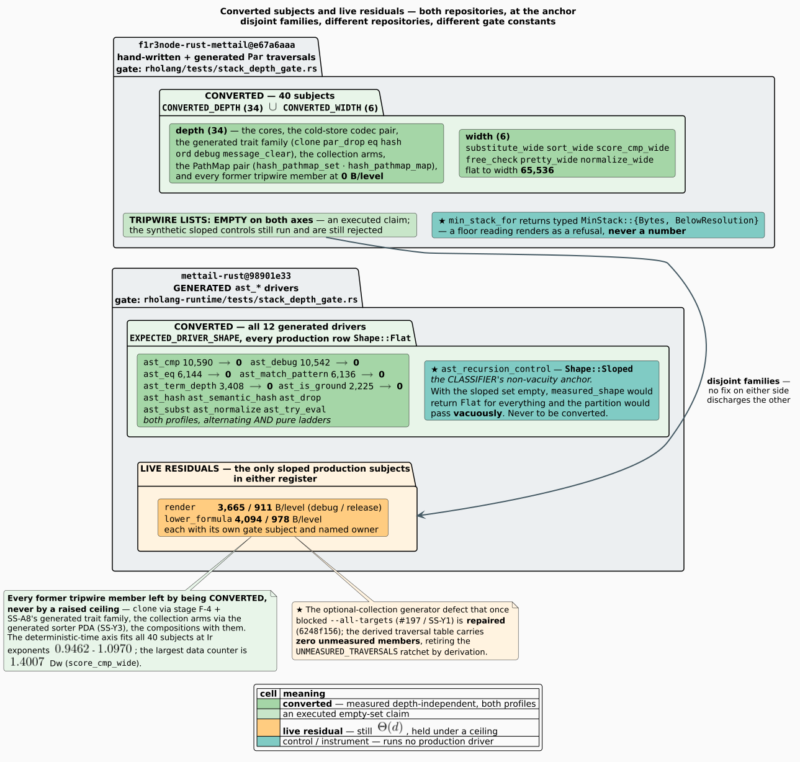

**Figure 10** — *`figures/converted-vs-tripwire-cross-repo.puml`*. Historical anchor snapshot:
f1r3node's 40 converted subjects with empty tripwire lists, and mettail-rust's converted drivers
beside the two slopes then still live. The living disposition above closes both residual rows
without rewriting the anchor image.

---

## 8.6 The issue-keyed residuals, at their final dispositions

The campaign tracked its open items under issue numbers; every one is dispositioned at the anchor.
The table is the index; the two subsections after it retain the results whose content this report
still relies on.

| # | subject | final disposition at the anchor | where reported |
|---|---|---|---|
| **#162 / #189** | the eleven generated `ast_*` drivers | ✅ **CONVERTED**, 0 B/level both profiles; root cause repaired at the classifier | [§8.6.1](#861--162189--the-eleven-generated-drivers-converted-and-the-root-cause-that-unifies-154-with-162) |
| **#197** | the optional-collection generator defect inside #162's own commit (E0624/E0606) | ✅ **REPAIRED** (`6248f156`, SS-Y1): the generated carrier is classified once; `--all-targets` unblocked | §0, SS-Y1 row |
| **#43** | f1r3node's hand-written/generated `Par` traversals, including the matcher SCC | ✅ **45 converted (37 depth + 8 width), zero tripwires** | §5.12, §5.14, §5.16 |
| **#124** | the three `spliced_event_bytes` event-hash legs | ✅ **CLOSED** — the legs route through the flat cold encoder and the spliced dispatch died with its store (SS-Y6) | [PathMap §5.8](../pathmap/pathmap-report-2026-08-03.md#58-the-dissolved-intern-store) |
| **#189** residual | `try_eval` category coverage | ✅ **CLOSED** — SS-G5's presence-flag repair plus the derived traversal table with zero unmeasured members (the `UNMEASURED_TRAVERSALS` ratchet retired by derivation) | §5.6.5 |
| **#119 / #120** | the prost depth-33 read ceiling | ✅ **REMOVED** by the generated decode PDA — with the group-skip recursion made iterative first (§8.6.2) | §5.12, §8.6.2 |
| **#174** | the historical 10,491 / 950 B/level figures | ✅ **withdrawn, attributed, mechanism converted** — generated Hash flat; Ir exponents 1.0059 / 1.0100 / 0.9918 / 1.0175 for `hash` / `hash_nested_set` / `hash_pathmap_set` / `hash_pathmap_map` | §5.6.6, §5.14 |
| **#157** | the deploy-inventory's transcribed 283 | ⚠ **recorded as a threat** — the drift (9 levels) is below the check's 33-level resolution; the gate file is out of this refactor's scope | §7.5 item 7 |
| **#121** | `eval_stable_par` ⇄ `eval_stable_expr` | ✅ **CONVERTED** (the classifier PDA); found by bisection while present in no audit and no tripwire list — the enumeration-by-inspection lesson §7.4 rests on; price table in the [PathMap report §5.5](../pathmap/pathmap-report-2026-08-03.md#55-pathmap-native-operations) | §7.4, PathMap §5.5 |
| **instrument** | the 12,288 B floor; the wrong-shape budget ratio | ✅ method absorbed into §4.7 (the floor and its typed refusal); the historical $`k \leq 12288/3254`$ constraint was a ratio of two artefacts, while $`k = 3`$ survives on independent grounds (modal datum 3; 96.11 % coverage; zero gate growth for $`k \leq 4`$) | §4.7 |

---

### 8.6.1 ★★ #162/#189 — the eleven generated drivers converted, and the root cause that unifies #154 with #162

**MEASURED (q)**, `mettail-rust` #162 (`fab6de24`, `6e4abbd8`, `a21b0bf9`, `dc104aa3`, `4ee48db9`) and #189 (`844364d2`). **Read from source** at `mettail-rust@7fad51db`, `rholang-runtime/tests/stack_depth_gate.rs`, `EXPECTED_DRIVER_SHAPE`: every one of the eleven carries `Shape::Flat`.

| driver | $`B_0`$ (debug) | $`B_1`$ | note |
|---|---:|---:|---|
| `ast_cmp` | 10,590 | **0** | |
| `ast_debug` | 10,542 | **0** | |
| `ast_eq` | 6,144 | **0** | |
| `ast_match_pattern` | 6,136 | **0** | free via `cmp` — one repair, two subjects |
| `ast_term_depth` | 3,408 | **0** | |
| `ast_is_ground` | 2,225 | **0** | see the proof below |
| `ast_hash`, `ast_semantic_hash`, `ast_drop`, `ast_subst`, `ast_normalize` | — | **0** | |

★★ **THE ROOT CAUSE, and it is the pedagogical centre of this whole report.** `VariantKind::CollectionLiteral` was introduced (`5bdd0a24`, an *identity* refactor) precisely so that consumers would **declare** whether a variant is a leaf or a container. **Every sloped driver was one that still shared `Literal`'s arm** — that is, one **treating a container OF SUB-TERMS as an OPAQUE LEAF**. The leaf arm reaches children by host recursion, which is correct for a `Literal` (it has none) and is a $`\Theta(d)`$ defect for a `Vec<Proc>`.

$`\Rightarrow`$ **#154 and #162 are ONE defect seen from two angles**, and this is why neither could be fully fixed without the other:

* **#154** met it as a **correctness** leak — a binder inside a collection literal leaked its run-varying `unique_id` into a *consensus-visible* fingerprint (`6e4abbd8`);
* **#162** met it as a **stack-safety** slope — the same arm, the same containers, $`\Theta(d)`$ native stack.

⚠ The interaction is recorded in the commits themselves rather than inferred: `dc104aa3`'s subject is *"the #154 fix traded a leak for a slope; both are now held"* (**DERIVED**, commit body). A repair aimed at one axis moved the other, in both directions, which is the signature of a shared cause.


*Figure 11: the arm divergence that was the root. Source: [`figures/collection-literal-arm-divergence.puml`](figures/collection-literal-arm-divergence.puml). **Diagram type: a dispatch-divergence diagram (annotated decision tree)**, chosen because the defect is not a wrong computation but a wrong **arm selection** — one classifier, two consumers, and the consumers disagreed about which arm a container belongs to. A decision tree is the only shape that shows an arm being *taken* rather than a value being computed.*

#### Lesson 1 — per-element pushes were NOT sufficient, and the task enum is why

★★ **A work-stack driver can only replace recursion for work its task enum can represent.** `CmpTask` and `HashTask` held only *descents*: "compare these two pointers". Neither could express *"resume this comparison once the child has answered"*, which is exactly the state a container needs when its elements must be compared in order and the first inequality decides the result. So "push the elements" was **not expressible** until the enum itself grew a resumption variant.

$`\Rightarrow`$ That is why those two emitters carry roughly **130** and **60** lines of the author meeting the same wall (**DERIVED**, `fab6de24` diff extent on `iterative_cmp.rs` and the hash emitter). **The task enum is the real interface of a converted driver, not the push site** — and a conversion plan that budgets only for "add a push" will under-budget by the size of the enum extension.

#### Lesson 2 — `ast_is_ground`'s before-figure would have been a production `SIGSEGV`

**DERIVED** from the recorded ladder: `ast_is_ground` at **2,225 B/level** reaches

```math
2{,}225 \times 4{,}096 \;=\; 9{,}113{,}600\ \text{B} \;\approx\; 8.69\ \text{MiB}
```

at depth 4,096, which **exceeds the 8 MiB default main-thread stack** (`ulimit -s` 8,192 KiB $`=`$ 8,388,608 B). $`\Rightarrow`$ It would not have degraded; it would have **`SIGSEGV`**'d — signal 11 on the guard page, surfacing as `SIGABRT`/134, uncatchable, taking the node process (see the glossary entry for **`SIGSEGV` vs `SIGABRT`**).

★ **The conversion carried a proof, and the proof is why it was cheap.** Let $`\mathrm{desc}(n)`$ be the descendants of node $`n`$ and $`\mathrm{base}(m)`$ the ground-ness of $`m`$'s own payload. Then

```math
g(n) \;=\; \bigwedge_{m \,\in\, \mathrm{desc}(n)} \mathrm{base}(m)
```

This is a **conjunction over a set**, and three properties follow immediately, each of which removes a piece of machinery a general driver would need:

| property of $`\bigwedge`$ over a set | machinery it removes |
|---|---|
| **associative** | no *result stack* — partial results need no nesting structure |
| **commutative** $`\Rightarrow`$ order-agnostic | no `dist`, and no need to preserve child order |
| **idempotent**, with identity $`\top`$ | no *combine* step — a single accumulator suffices |

$`\Rightarrow`$ The driver is an accumulator over a flat worklist, is `OrderAgnostic`, and therefore **every container shape converts uniformly** — `Vec`, `Option<Vec>`, keyed maps alike. Contrast `cmp`, where the operation is *lexicographic* and hence **neither** commutative nor idempotent, which is precisely why `cmp` needed the resumption variant of Lesson 1 and `is_ground` did not.

#### The conversion algorithm, in literate form

Presented in Knuth's literate style: the prose *is* the specification, and each fragment is named and refined.

**Algorithm 5 (CONVERT-TRAVERSAL).** *Turning a derived recursive traversal into a work-stack driver, with the driver's shape DERIVED from the algebra of its combining operation rather than chosen by taste.*

```pseudocode
⟨Convert one derived traversal to a work-stack driver⟩ ≡
    ⟨Classify every variant: leaf, or container-of-sub-terms⟩
    ⟨Choose the driver shape from the combining operation's algebra⟩
    ⟨Extend the task enum until every unit of work is representable⟩
    ⟨Emit the driver: one pop, one dispatch, zero self-calls⟩
    ⟨Prove flatness against a control that is NOT flat⟩

⟨Classify every variant: leaf, or container-of-sub-terms⟩ ≡
    for each variant v of the modelled type:
        kind(v) ← CollectionLiteral   if v holds a collection of sub-terms
                  Literal             if v holds no sub-terms at all
                  Structural          otherwise
    ── THE DEFECT LIVED HERE: a CollectionLiteral falling through to
    ── Literal's arm is the whole of #154 and #162.  The classifier must be
    ── consulted, never re-derived at the use site.

⟨Choose the driver shape from the combining operation's algebra⟩ ≡
    let ⊕ be the operation the traversal folds with
    if ⊕ is associative ∧ commutative ∧ idempotent then
        shape ← ACCUMULATOR          ── is_ground: no result stack, no combine
    else if ⊕ is associative only then
        shape ← OBLIGATION + VALUE STACK   ── cold-store decoder: 18 value stacks
    else
        shape ← RESUMABLE TASKS      ── cmp/hash: lexicographic, needs Lesson 1
    ── The algebra of ⊕ DETERMINES the machinery.  This is the step that makes
    ── the conversion derivable rather than inventive.

⟨Extend the task enum until every unit of work is representable⟩ ≡
    repeat
        w ← a unit of work the driver must perform
        if w is not expressible as a task variant then
            add the variant                ── Lesson 1: this is the real cost
    until every w is expressible
    ── A push site cannot be written before the enum can spell what it pushes.

⟨Emit the driver: one pop, one dispatch, zero self-calls⟩ ≡
    push(root)
    while stack is not empty:
        t ← pop()
        dispatch on t:
            leaf         ⇒ fold its payload into the accumulator
            container    ⇒ for each element e: push(task(e))    ── NOT recurse(e)
            resumption   ⇒ combine the child answers already available
    ── INVARIANT: the driver contains no call to itself.  This is mechanically
    ── checkable and is what `EXPECTED_DRIVER_SHAPE` adjudicates.

⟨Prove flatness against a control that is NOT flat⟩ ≡
    assert slope(subject) = 0                    over the ladder d_lo → d_hi
    assert slope(control) > 0                    ── ANTI-VACUITY, and it is the
                                                 ── only leg that makes the first
                                                 ── assertion mean anything
    ── §8.6.1b: with all eleven converted, the sloped set went EMPTY, and an
    ── empty sloped set makes the classifier itself vacuous.
```

#### 8.6.1b ★ The conversion emptied the sloped set, which was itself a hazard

⚠ **When #162 converted the tenth driver, the sloped set became EMPTY** — and an empty sloped set means `measured_shape` could return `Flat` for *every* subject even if the classifier were broken, so the whole partition would pass **vacuously**. The prior calibration anchors were `ast_drop` at 94 B/level and then `ast_term_depth` at 207; **both were converted, so the calibration lost its anchor** (**read from source**, `mettail-rust@7fad51db`, `rholang-runtime/tests/stack_depth_gate.rs`, the comment block above `ast_recursion_control`).

★ The repair is a **deliberately unconvertible control**: `ast_recursion_control`, a host-recursive walk of the same `CastList`/`ListLit` ladder, owned by `stack_depth_probe.rs`, carrying `Shape::Sloped` and **never to be converted**. It measures nothing about the generated drivers; it proves the **classifier can still tell the two shapes apart**. $`\Rightarrow`$ *Censusing the classifier, not the artefact* — a census over generated output is blind to what the generator declined to generate.

---

### 8.6.2 The group-skip trap — why the read cap had to outlive the reader

Design evidence retained because the ordering constraint it proves is permanent. prost's
`skip_field` — the path taken for **unknown** fields, which an attacker chooses freely — recurses
on nested groups:

```text
    _ => skip_field(inner_wire_type, inner_tag, buf, ctx.enter_recursion())?,
```

*(**VERBATIM** from `prost-0.14.4/src/encoding.rs`, the `StartGroup` arm of `skip_field`; tagged
`text` deliberately — a bare `match` arm is not standalone Rust and the snippet checker correctly
refuses it. It compiles in its own crate, where it is quoted from.)*

The recursion limit was therefore not merely a cap on legitimate depth; it was **the sole guard on
an attacker-controlled recursion in the skip path**. Removing the limit without first making
group-skip iterative would not have lifted a restriction — it would have **introduced** a
`SIGSEGV` on messages the node does not even understand. The closure sequence honoured the
constraint: the iterative unknown-group skipper landed (`cc616c3c`) **before** the generated
decode PDA made the cap cease to govern. ★ The asymmetry in cost is the lesson: making the known
fields iterative is a large schema-driven change; the `StartGroup` arm is one function — so the
guard must be replaced *before* the cap is touched, never after.


---

## 9. Conclusions

1. **The class change is real and mechanically enforced over the complete audited `Par` traversal
   registry.** The Phase-7 anchor carried forty subjects; the living register carries **45 production
   subjects — 37 depth and 8 width** after the matcher SCC conversion. Both production tripwire sets
   are empty and still execute non-vacuous synthetic controls, and the strengthened hand-written census
   has zero `Unmeasured` dispositions, including `node/src`.

2. **The two headline availability defects are closed.** A term that could be *built* and not *destroyed* (8.8 kB of source aborting a node) and a pre-consensus ingress teardown reachable from unauthenticated gRPC (43.5 kB of source aborting a node) are both $`0`$ B/level with no ceiling below the search bound.

3. **The trampolined codecs are faster on the production-weighted mix, and the magnitude is a
   bracket.** The transformation deletes bincode's *sizing* traversal — the more expensive of its
   two, per the CPU profile — and the paired instrument reads 1.073×–1.092× with the honest
   magnitude statement the bracket 1.07×–1.19× (§5.4.1; on the sibling `term_ops` workload the
   machine is *slower*, 0.954×–0.962×, reported beside the win). The reused-buffer form allocates
   **770× fewer blocks**; the cost is 3.25× more heap **writes** and 2× peak heap on the shallow
   shape — relocations of previously uncounted native-stack traffic, all deterministic DHAT
   figures. No stack-safety conclusion depends on any timing: every B/level slope and every
   $`D_{\max}`$ ceiling is obtained by stack-size bisection, not by a clock.

4. **The `tokio` work is two fixes, not one**, and the report says which is which: inline `.await` nesting was a **native-stack** $`\Theta(d)`$ chain that had been *fed* by `stacker` rather than removed, and the awaited-parent chain was a **heap** $`\Theta(N)`$ chain of parked futures. Detaching both removed the `stacker` dependency entirely and cut the reference contract's work by $`\approx 3.2\times`$ in the one clock that is invariant to machine contention.

5. **The production network codec is closed without a traversal-depth budget.** Generated
   `prost::Message` encode/length/merge/clear and `Oneof` implementations use explicit machines;
   nested unknown groups use an iterative tag stack; and EPathMap field 9 carries EPM1 directly.
   The byte-moving transition is CBR-044 and remains an activation/version decision, but the
   implementation no longer delegates attacker-controlled depth to prost's recursive reader.

6. **The instrument produced more findings than the fixes did.** A totally vacuous generator quantifying over two values; four false zeros from probes that measured nothing; a headline test whose result came from one call in a fixture; a control calibrated in the wrong profile; a slope estimate biased to zero by its own intercept; a check that counted lines instead of testing its claim. ★ **Every number in §5 is worth exactly as much as the anti-vacuity leg standing behind it**, and where such a leg does not exist — §5.9's ten entries — the report says *not measured* rather than guessing.

7. **The requested f1r3node stack-safety scope is complete at the audited heads, and the scope is
   explicit.** Every production recursion component over the `Par` term family is either converted
   and measured or classified as a bounded non-term cycle; recursive specifications survive only as
   bounded test/oracle twins. SS-Y1, SS-Y2, and SS-Y3 remain in the register but are marked repaired,
   not deleted. `contains_par` and its memo are gone with the intern store, and the EPathMap
   carrier stays a trie on every surface — the representation, wire-format, and performance
   results are the [PathMap report](../pathmap/pathmap-report-2026-08-03.md)'s conclusions. This
   conclusion does not claim that every recursive function in third-party crates or
   every grammar-analysis routine over a statically bounded declaration graph has been rewritten;
   neither is a deploy-controlled traversal-depth exposure.

   The later SS-Y15 release-policy finding sharpens “complete” to include usable heap/time shape:
   admitted resident `Send` children and stable environment bindings no longer rebuild all shorter
   protobuf/PathMap suffixes. Both exact deploy subjects now reach depth 131,072 on the unchanged
   2 MiB worker, and the exact 4,495-test release workspace passes without stack tuning.

---

## References

Abbreviations used in the entries below:

| abbreviation | expansion |
|---|---|
| ACM | Association for Computing Machinery |
| SIGPLAN | ACM Special Interest Group on Programming Languages |
| SIGACT | ACM Special Interest Group on Algorithms and Computation Theory |
| PPDP | Principles and Practice of Declarative Programming |
| POPL | Principles of Programming Languages |
| PLDI | Programming Language Design and Implementation |
| ICFP | International Conference on Functional Programming |


###### ref-ager2003

**[Ager et al. 2003]** Ager, M. S., Biernacki, D., Danvy, O., & Midtgaard, J. (2003). *A functional correspondence between evaluators and abstract machines.* In Proceedings of the 5th ACM SIGPLAN International Conference on Principles and Practice of Declarative Programming (PPDP '03), 8–19. [doi:10.1145/888251.888254](https://doi.org/10.1145/888251.888254)

###### ref-cheney1970

**[Cheney 1970]** Cheney, C. J. (1970). *A nonrecursive list compacting algorithm.* Communications of the ACM, 13(11), 677–678. [doi:10.1145/362790.362798](https://doi.org/10.1145/362790.362798)

###### ref-danvy2001

**[Danvy & Nielsen 2001]** Danvy, O., & Nielsen, L. R. (2001). *Defunctionalization at work.* In Proceedings of the 3rd ACM SIGPLAN International Conference on Principles and Practice of Declarative Programming (PPDP '01), 162–174. [doi:10.1145/773184.773202](https://doi.org/10.1145/773184.773202)

###### ref-debruijn1972

**[de Bruijn 1972]** de Bruijn, N. G. (1972). *Lambda calculus notation with nameless dummies, a tool for automatic formula manipulation, with application to the Church–Rosser theorem.* Indagationes Mathematicae, 75(5), 381–392. [doi:10.1016/1385-7258(72)90034-0](https://doi.org/10.1016/1385-7258(72)90034-0)

###### ref-felleisen1987

**[Felleisen & Friedman 1987]** Felleisen, M., & Friedman, D. P. (1987). *A calculus for assignments in higher-order languages.* In Proceedings of the 14th ACM SIGACT-SIGPLAN Symposium on Principles of Programming Languages (POPL '87), 314–325. [doi:10.1145/41625.41654](https://doi.org/10.1145/41625.41654)

###### ref-ganz1999

**[Ganz et al. 1999]** Ganz, S. E., Friedman, D. P., & Wand, M. (1999). *Trampolined style.* In Proceedings of the Fourth ACM SIGPLAN International Conference on Functional Programming (ICFP '99), 18–27. [doi:10.1145/317636.317779](https://doi.org/10.1145/317636.317779)

###### ref-knuth1984

**[Knuth 1984]** Knuth, D. E. (1984). *Literate Programming.* The Computer Journal, 27(2), 97–111. [doi:10.1093/comjnl/27.2.97](https://doi.org/10.1093/comjnl/27.2.97)

###### ref-landin1964

**[Landin 1964]** Landin, P. J. (1964). *The mechanical evaluation of expressions.* The Computer Journal, 6(4), 308–320. [doi:10.1093/comjnl/6.4.308](https://doi.org/10.1093/comjnl/6.4.308)

###### ref-meredith2005

**[Meredith & Radestock 2005]** Meredith, L. G., & Radestock, M. (2005). *A reflective higher-order calculus.* Electronic Notes in Theoretical Computer Science, 141(5), 49–67. [doi:10.1016/j.entcs.2005.05.016](https://doi.org/10.1016/j.entcs.2005.05.016)

###### ref-milner1992

**[Milner, Parrow & Walker 1992]** Milner, R., Parrow, J., & Walker, D. (1992). *A calculus of mobile processes, I.* Information and Computation, 100(1), 1–40. [doi:10.1016/0890-5401(92)90008-4](https://doi.org/10.1016/0890-5401%2892%2990008-4)

###### ref-nethercote2007

**[Nethercote & Seward 2007]** Nethercote, N., & Seward, J. (2007). *Valgrind: a framework for heavyweight dynamic binary instrumentation.* In Proceedings of the 28th ACM SIGPLAN Conference on Programming Language Design and Implementation (PLDI '07), 89–100. [doi:10.1145/1250734.1250746](https://doi.org/10.1145/1250734.1250746)

###### ref-reynolds1972

**[Reynolds 1972]** Reynolds, J. C. (1972). *Definitional interpreters for higher-order programming languages.* In Proceedings of the ACM Annual Conference, 717–740. Reprinted in Higher-Order and Symbolic Computation, 11(4), 363–397 (1998). [doi:10.1023/A:1010027404223](https://doi.org/10.1023/A:1010027404223)

###### ref-schorr1967

**[Schorr & Waite 1967]** Schorr, H., & Waite, W. M. (1967). *An efficient machine-independent procedure for garbage collection in various list structures.* Communications of the ACM, 10(8), 501–506. [doi:10.1145/363534.363554](https://doi.org/10.1145/363534.363554)

###### ref-tarjan1972

**[Tarjan 1972]** Tarjan, R. (1972). *Depth-first search and linear graph algorithms.* SIAM Journal on Computing, 1(2), 146–160. [doi:10.1137/0201010](https://doi.org/10.1137/0201010)

###### ref-georges2007

**[Georges et al. 2007]** Georges, A., Buytaert, D., & Eeckhout, L. (2007). *Statistically rigorous Java performance evaluation.* In Proceedings of the 22nd ACM SIGPLAN Conference on Object-Oriented Programming Systems, Languages and Applications (OOPSLA '07), 57–76. [doi:10.1145/1297027.1297033](https://doi.org/10.1145/1297027.1297033) — the design discipline §5.4.1's retraction failed to follow: an interval must be reported with the method that produced it, because a between-run spread over blocked arms estimates a different quantity from a within-run one.

###### ref-mytkowicz2009

**[Mytkowicz et al. 2009]** Mytkowicz, T., Diwan, A., Hauswirth, M., & Sweeney, P. F. (2009). *Producing wrong data without doing anything obviously wrong!* In Proceedings of the 14th International Conference on Architectural Support for Programming Languages and Operating Systems (ASPLOS '09), 265–276. [doi:10.1145/1508244.1508275](https://doi.org/10.1145/1508244.1508275) — ★ the class §5.4.1's defect belongs to: measurement bias that **reverses a conclusion** while every visible part of the method looks correct. The title is the finding.

###### ref-student1908

**[Student 1908]** "Student" (Gosset, W. S.) (1908). *The probable error of a mean.* Biometrika, 6(1), 1–25. [doi:10.2307/2331554](https://doi.org/10.2307/2331554) — the **paired** $`t`$-test, which is the valid statistic for a two-arm throughput comparison, because pairing cancels the window term $`\delta(w_i)`$ *before* the test sees the data rather than attempting to model it afterwards.

###### ref-welch1947

**[Welch 1947]** Welch, B. L. (1947). *The generalization of "Student's" problem when several different population variances are involved.* Biometrika, 34(1–2), 28–35. [doi:10.1093/biomet/34.1-2.28](https://doi.org/10.1093/biomet/34.1-2.28) — ⚠ the **unpaired** test whose three statistics §5.4.1 retracts. Sound for its own assumptions; those assumptions are violated by blocked arms, because its denominator is built from the within-arm variances and therefore omits $`\sigma_\delta`$ entirely.

★ **Every DOI above was resolved against the Crossref API on 2026-07-29** and its title, container and year confirmed to match the citation as written. Command in Appendix A.8.

---

## Appendix A — reproduction commands

All commands are run from the repository root, `/home/dylon/Workspace/f1r3fly.io/f1r3node-rust-mettail`.

**A.0 — build (⚠ *without* `-D warnings`; see §4.3).**

```bash
systemd-run --user --scope -p MemoryMax=28G --quiet \
  cargo build --release -p models --benches --tests
systemd-run --user --scope -p MemoryMax=28G --quiet \
  cargo build --release -p rholang --test stack_depth_gate --test deploy_depth_ceiling
```

**A.1 — the whole gate, release.**

```bash
GATE=$(find target/release/deps -maxdepth 1 -name 'stack_depth_gate-*' \
        -type f -executable -printf '%T@ %p\n' | sort -rn | head -1 | cut -d' ' -f2)
systemd-run --user --scope -p MemoryMax=28G --quiet \
  taskset -c 16-23 env RUST_MIN_STACK=8388608 "$GATE" \
  --test-threads=4 --nocapture 2>&1 | tee /tmp/sd_gate_release.log
```

**A.2 — the S0 four-quadrant baseline** (an `#[ignore]`d test in the same binary).

```bash
taskset -c 16-23 env RUST_MIN_STACK=8388608 "$GATE" \
  four_quadrant_s0_baseline --ignored --nocapture --test-threads=1 \
  2>&1 | tee /tmp/sd_s0_release.log
```

**A.3 — the end-to-end deploy ceiling.**

```bash
DDC=$(find target/release/deps -maxdepth 1 -name 'deploy_depth_ceiling-*' \
       -type f -executable -printf '%T@ %p\n' | sort -rn | head -1 | cut -d' ' -f2)
systemd-run --user --scope -p MemoryMax=28G --quiet taskset -c 24-27 "$DDC" \
  the_deploy_depth_ceiling_at_a_production_worker_stack \
  --nocapture --test-threads=1 2>&1 | tee /tmp/sd_deploy_ceiling.log
```

**A.4 — massif heap profiles**, one arm per process, in parallel on distinct cores.

```bash
BIN=target/release/deps/bincode_encoder_massif-*        # the built bench binary
for i in 0 1 2 3 4; do
  arm=$(echo "derived machine reused deep decode" | cut -d' ' -f$((i+1)))
  MASSIF_ARM=$arm taskset -c $((4+i)) valgrind --tool=massif --time-unit=B \
    --detailed-freq=1 --max-snapshots=200 \
    --massif-out-file=/tmp/sd_massif/massif.$arm.out $BIN &
done; wait
for a in derived machine reused deep decode; do
  ms_print /tmp/sd_massif/massif.$a.out > /tmp/sd_massif/ms.$a.txt
done
```

**A.5 — DHAT allocation counts**, same arms.

```bash
for i in 0 1 2 3 4; do
  arm=$(echo "derived machine reused deep decode" | cut -d' ' -f$((i+1)))
  MASSIF_ARM=$arm taskset -c $((10+i)) valgrind --tool=dhat \
    --dhat-out-file=/tmp/sd_dhat/dhat.$arm.json $BIN \
    2>/tmp/sd_dhat/summary.$arm.txt &
done; wait
grep -E 'Total:|At t-gmax:|At t-end:|Reads:|Writes:' /tmp/sd_dhat/summary.*.txt
```

**A.6 — the throughput bench**, three whole-bench runs pinned to one core.

```bash
BENCH=target/release/deps/bincode_encoder_bench-*
for run in 1 2 3; do
  echo "### RUN $run ($(date -Is), load $(cut -d' ' -f1 /proc/loadavg))"
  systemd-run --user --scope -p MemoryMax=28G --quiet taskset -c 8 "$BENCH"
done 2>&1 | tee /tmp/sd_wire_bench.log
```

**A.7 — the CPU profile** (⚠ software event; see §4.4).

```bash
taskset -c 12 perf record -e cpu-clock -F 9999 --call-graph dwarf,16384 \
  -o /tmp/sd_perf/perf.bench.data -- "$BENCH" > /tmp/sd_perf/bench_under_perf.txt 2>&1
perf report -i /tmp/sd_perf/perf.bench.data --no-children \
  --percent-limit 0.8 --stdio > /tmp/sd_perf/report.flat.txt
```

**A.8 — DOI verification.**

```bash
for d in 10.1093/comjnl/6.4.308 10.1023/A:1010027404223 10.1145/888251.888254 \
         10.1145/363534.363554 10.1145/362790.362798 10.1145/317636.317779 \
         10.1137/0201010 10.1093/biomet/34.1-2.28 10.1093/comjnl/27.2.97 \
         10.1145/1250734.1250746 10.1145/773184.773202 \
         "10.1016/0890-5401(92)90008-4" 10.1016/j.entcs.2005.05.016 \
         "10.1016/1385-7258(72)90034-0" 10.1145/41625.41654; do
  curl -s -A 'doi-check/1.0' "https://api.crossref.org/works/$d" \
    | python3 -c "import sys,json; m=json.load(sys.stdin)['message']; \
        print(m['title'][0], '|', m['container-title'][0])"
done
```

**A.9 — rendering the figures**, and checking that they are not empty.

```bash
cd docs/design/stack-safety/figures
for f in *.puml; do plantuml -tsvg "$f"; done
for f in *.svg; do
  printf "%-40s bytes=%-8s latexImgs=%-3s leaked=%s\n" "$f" "$(stat -c%s "$f")" \
    "$(grep -o 'data:image/svg+xml;base64' "$f" | wc -l)" "$(grep -c 'latex&gt;' "$f")"
done
```

**A.10 — canonical-protobuf width experiment 309 and headless heap profile.** The committed TSV and
JSON carry experiments 306–309; this is the selected matcher's exact execution shape.

```bash
systemd-run --user --scope -p MemoryMax=8G -p MemorySwapMax=0 -p AllowedCPUs=1 \
  /tmp/f1r3node-exp309-abba.zsh

systemd-run --user --scope -p MemoryMax=8G -p MemorySwapMax=0 -p AllowedCPUs=1 \
  heaptrack --record-only -o /tmp/heaptrack-exp309-treatment-set.zst \
  target/release/deps/stack_depth_gate-debfe204a00783ff \
  matcher_wide_epathmap_set --exact --nocapture --test-threads=1
heaptrack_print /tmp/heaptrack-exp309-treatment-set.zst.zst \
  > /tmp/heaptrack-exp309-treatment-set-report.txt
```

**A.11 — SS-Y15 resident-Send/reducer-Join release acceptance.** Exact subject-specific commands,
binary hashes, Heaptrack invocation, and artifact checksums are retained in the linked measurement
record. The workspace command is deliberately free of `RUST_MIN_STACK`.

```bash
systemd-run --user --scope \
  -p MemoryHigh=20G -p MemoryMax=24G -p MemorySwapMax=0 \
  env RUST_BACKTRACE=1 cargo nextest run --release --no-fail-fast --workspace \
  > /tmp/campaign-4131-full-release-nextest-1afd4791e.log 2>&1
```

**A.12 — SS-Y16 semantic-group masks.** The committed measurement record contains the complete
Criterion, Cachegrind, Massif, headless Heaptrack, and headless AMD uProf commands and artifact
hashes. The focused equivalence command is:

```bash
systemd-run --user --scope \
  -p MemoryHigh=8G -p MemoryMax=12G -p MemorySwapMax=0 \
  env RUST_BACKTRACE=1 cargo test --release -p rholang \
  interpreter::matcher::spatial_matcher_pda_equivalence -- --test-threads=1
```

Heaptrack reproduction must remain report-only:

```bash
heaptrack --record-only -o /tmp/candidate-group-mask.zst PROGRAM ARGUMENTS
heaptrack_print /tmp/candidate-group-mask.zst.zst
```

The final lifecycle gate at `8035ba826` is:

```bash
systemd-run --user --scope \
  -p MemoryHigh=20G -p MemoryMax=24G -p MemorySwapMax=0 \
  env RUST_BACKTRACE=1 cargo nextest run --release --no-fail-fast --workspace \
  > /tmp/campaign-4131-full-release-nextest-8035ba826.log 2>&1
```

It passes 4,502/4,502 tests with 53 skipped in 139.111 seconds. The log SHA-256 is
`cc4cf12ae290fce055b73ddcc1e2041788242fe2cb0af7d2f92fc4bae56122c4`.

**A.13 — SS-C36 fixed-delta trusted commit scaling.** The
[measurement record](measurements/rspace-fixed-delta-scaling-2026-11-03.md) holds the protocol and, in its section 9, the program that derives the
committed summaries from the pgmcp archives. Recomputing the analysis from a restored population
needs no new run:

```bash
python3 scripts/bench/rspace-fixed-delta-scaling.py --analyze-only --check --output POPULATION_DIRECTORY
```

A fresh collection needs a checkout of commit `941ff07d`, its release test binary (`BINARY` is the
executable that `cargo` prints) and the prescribed capped scope:

```bash
cargo test --locked --release -p rspace_plus_plus --lib --no-run
mkdir -p target/perf/tmp
systemd-run --user --scope --quiet --expand-environment=no -p MemoryMax=16G -p MemorySwapMax=0 \
  env SCALE_CAPPED=1 TMPDIR="$PWD/target/perf/tmp" \
  python3 -I scripts/bench/rspace-fixed-delta-scaling.py --binary BINARY --output POPULATION_DIRECTORY \
    --cpu 2 --child-timeout 7200
```

The decision population used this scope, this environment and these driver options. Its lane script,
`run-populations-c3.sh` in pgmcp artifact 1633, ran them from a frozen export of that commit and set
`GIT_DIR` to a pinned repository only so that the driver could read the commit that it records. The
driver refuses decision data unless `SCALE_CAPPED` is 1 and the measured CPU's governor reads
`performance`, and before each child it waits for an idle snapshot of that CPU and stops the
collection if none arrives.

---

## Appendix B — raw data locations

**Durable (committed) data of record:**

| file | contents |
|---|---|
| [`measurements/accepted-match-transaction-profiles-2026-08-24.md`](measurements/accepted-match-transaction-profiles-2026-08-24.md) | SS-Y18's frozen split-call control, ten-cell Criterion and percentile matrix, exact lock/root/allocation counters, RSS, report-only Heaptrack, `perf stat`, headless uProf, negative cells, commands, and evidence hashes (§5.38) |
| [`measurements/phase7-cachegrind-fits-2026-08-03.tsv`](measurements/phase7-cachegrind-fits-2026-08-03.tsv) | per-subject Ir/Dr/Dw exponents and verdicts for all 40 converted subjects (§5.14.3) |
| [`measurements/phase7-massif-2026-08-03.tsv`](measurements/phase7-massif-2026-08-03.tsv) | matched-control heap peaks at depths 256/1,024 and B/level for the four core conversions (§5.14.2) |
| [`measurements/phase7-depth-histograms-2026-08-03.tsv`](measurements/phase7-depth-histograms-2026-08-03.tsv) | subject/root-kind depth histograms (§5.15.1) |
| [`measurements/phase7-depth-corpora-2026-08-03.tsv`](measurements/phase7-depth-corpora-2026-08-03.tsv) | corpus denominators for the histograms (§5.15.1) |
| [`measurements/protobuf-region-width-experiments-306-309-2026-08-23.tsv`](measurements/protobuf-region-width-experiments-306-309-2026-08-23.tsv) | all 630 warmup/retained ABBA observations for the printer and EPathMap width treatments, including both rejected matcher candidates (§5.33) |
| [`measurements/protobuf-region-width-experiments-306-309-analysis-2026-08-23.json`](measurements/protobuf-region-width-experiments-306-309-analysis-2026-08-23.json) | locked protocol, source/binary hashes, confidence bounds, pgmcp identifiers/digests, causal profile counters, and equivalence/resource gates for experiments 306–309 (§5.33) |
| [`measurements/rmp2-par-bag-digest-cache-2026-08-23.tsv`](measurements/rmp2-par-bag-digest-cache-2026-08-23.tsv) | SS-A20's complete 75-cell, six-lane wall/allocation matrix, including the preserved 30-pair tiny-cell negative (§5.34) |
| [`measurements/rmp2-par-bag-digest-cache-tiny-replication-2026-08-23.tsv`](measurements/rmp2-par-bag-digest-cache-tiny-replication-2026-08-23.tsv) | SS-A20's 300-pair powered replication of the preregistered cold-regression sentinel (§5.34) |
| [`measurements/rmp2-par-bag-digest-cache-resource-profiles-2026-08-23.md`](measurements/rmp2-par-bag-digest-cache-resource-profiles-2026-08-23.md) | matched-null Cachegrind and headless Heaptrack instruction, data-access, allocation, retained-heap, command, and scope record (§5.34) |
| [`measurements/rspace-candidate-suffix-checkpoint-v1-2026-08-23.tsv`](measurements/rspace-candidate-suffix-checkpoint-v1-2026-08-23.tsv) | SS-Y14's rejected checkpoint-per-atom paired matrix (§5.34) |
| [`measurements/rspace-candidate-suffix-checkpoint-v2-2026-08-23.tsv`](measurements/rspace-candidate-suffix-checkpoint-v2-2026-08-23.tsv) | SS-A21's selected deterministic-run hybrid paired matrix over exact, repeated-capture, wildcard, remainder, and nested queries (§5.34) |
| [`measurements/rspace-candidate-suffix-checkpoint-v2-heaptrack-2026-08-23.md`](measurements/rspace-candidate-suffix-checkpoint-v2-heaptrack-2026-08-23.md) | SS-A21's headless allocation-mechanism attribution (§5.34) |
| [`measurements/rspace-candidate-suffix-checkpoint-v2-callgrind-2026-08-23.md`](measurements/rspace-candidate-suffix-checkpoint-v2-callgrind-2026-08-23.md) | SS-A21's deterministic instruction ladder and exact result digests (§5.34) |
| [`measurements/rspace-candidate-continuation-arena-2026-08-31.tsv`](measurements/rspace-candidate-continuation-arena-2026-08-31.tsv) | SS-A21 v3's raw 3,000-observation paired moving-arena matrix (§5.34) |
| [`measurements/rspace-candidate-continuation-arena-summary-2026-08-31.tsv`](measurements/rspace-candidate-continuation-arena-summary-2026-08-31.tsv) | SS-A21 v3's derived cell estimates, confidence bounds, tests, and scaling slopes (§5.34) |
| [`measurements/rspace-candidate-continuation-arena-2026-08-31.json`](measurements/rspace-candidate-continuation-arena-2026-08-31.json) | SS-A21 v3's machine-readable statistical analysis and artifact hashes (§5.34) |
| [`measurements/rspace-candidate-continuation-arena-2026-08-31.md`](measurements/rspace-candidate-continuation-arena-2026-08-31.md) | SS-A21 v3's experimental protocol, semantics, headless allocation attribution, limitations, and decision (§5.34) |
| [`measurements/rspace-channel-prefix-publication-2026-08-31.tsv`](measurements/rspace-channel-prefix-publication-2026-08-31.tsv) | SS-C32's 50 raw causal observations for prefix-local publication and frozen whole-store cloning (§5.59) |
| [`measurements/rspace-channel-prefix-publication-2026-08-31.md`](measurements/rspace-channel-prefix-publication-2026-08-31.md) | SS-C32's protocol, exact medians/slopes, headless AMD uProf and Heaptrack attribution, hashes, and limitations (§5.59) |
| [`measurements/resident-send-reducer-join-2026-08-23.md`](measurements/resident-send-reducer-join-2026-08-23.md) | SS-Y15's generated-region and proof-preserving Join ladders, headless allocation attribution, exact 131,072-depth gate, full release result, commands, hashes, and threats (§5.35) |
| [`measurements/spatial-matcher-candidate-group-mask-2026-08-23.md`](measurements/spatial-matcher-candidate-group-mask-2026-08-23.md) | SS-Y16/experiment 312 protocol, group-mask and retention-pressure algorithm, exact timing table, report-only Heaptrack, paired Cachegrind/Massif, headless uProf, equivalence gates, rejected protocols, hashes, and threats (§5.36) |
| [`measurements/spatial-matcher-candidate-group-mask-2026-08-23.tsv`](measurements/spatial-matcher-candidate-group-mask-2026-08-23.tsv) | all 1,326 normalized Criterion observations: 13 fixtures × 2 arms × 51 retained samples, with aggregate elapsed nanoseconds and iteration counts (§5.36) |
| [`measurements/spatial-matcher-heap-2026-08-04.tsv`](measurements/spatial-matcher-heap-2026-08-04.tsv) | matched matcher/control allocator, peak-heap, profiler-RSS, unprofiled-RSS, and runtime rows before `714d618c`, after it, and after the final singleton refinement `6f1412ee` (§5.16.4) |
| [`measurements/e8b-native-pathmap-par-e6a-2026-08-04.tsv`](measurements/e8b-native-pathmap-par-e6a-2026-08-04.tsv) | the 51 submitted samples per arm, treatment phase splits, finalized digests, and locked E-8b decision metadata (§5.17.3) |
| [`measurements/epathmap-canonical-worklist-2026-08-08.tsv`](measurements/epathmap-canonical-worklist-2026-08-08.tsv) | the SS-C12 quadratic predecessor, reproducible linear ladder, depth-20,000 worklist, malformed-gate allocator lifetime, and formal-equivalence aggregate (§5.19) |
| [`measurements/semantic-scc-pathmap-streaming-2026-08-09.tsv`](measurements/semantic-scc-pathmap-streaming-2026-08-09.tsv) | SS-G43/SS-C13 capped Ascent, constructor/corpus, EPathMap zipper-streaming, f1r3node visitor, and Rocq validation rows (§5.20) |
| [`measurements/generated-parser-prefix-closure-2026-08-09.tsv`](measurements/generated-parser-prefix-closure-2026-08-09.tsv) | SS-G44 predecessor/successor deep-parser runtime, RSS, heap, and AMD uProf hotspot rows (§5.21) |
| [`measurements/canonical-gll-boundary-summary-2026-08-09.tsv`](measurements/canonical-gll-boundary-summary-2026-08-09.tsv) | SS-G45 exact 1,000-binder predecessor/successor counters, runtime, RSS, complete gates, formal proof, and AMD uProf rows (§5.22) |
| [`measurements/relational-ac-edge-reuse-2026-08-10.tsv`](measurements/relational-ac-edge-reuse-2026-08-10.tsv) | D-E4/SS-A10 nominal and sparse-relation production counters, zero-variance decision rule, focused/full capped gates, and Rocq closure (§5.16.6) |
| [`measurements/slotted-state-indexed-channels-2026-08-10.tsv`](measurements/slotted-state-indexed-channels-2026-08-10.tsv) | D-E5/SS-G46 state quotient, indexed-channel ladder, 20,000-level small-stack gate, runtime accounting distinction, complete regressions, formal closure, and profiler row (§5.23) |
| `mettail-rust/docs/benchmarks/data/sa-vs-naive/2026-08-10-post-d-e5-r3-r2/` | SS-G47/experiment-174 authenticated SA-versus-persistent-R3 samples, corrected derived decision, exact resource protocol, and production-promotion evidence (§5.24) |
| [`measurements/flt-retained-candidate-matcher-2026-08-11.tsv`](measurements/flt-retained-candidate-matcher-2026-08-11.tsv) | SS-G49 paired retained-versus-spatial timings, shared-state counts, bounded-stack differential, capped resource envelopes, and formal gates (§5.26) |
| [`measurements/rspace-retained-pathmap-prefilter-2026-08-15.tsv`](measurements/rspace-retained-pathmap-prefilter-2026-08-15.tsv) | SS-A11 produce-driven control/PathMap COMM timings for 16, 256, and 4,096 persistent waiting receives under diverse/shared prefixes (§5.16.5) |
| [`measurements/pathmap-bag-microbench-2026-08-16.tsv`](measurements/pathmap-bag-microbench-2026-08-16.tsv) | standalone `HashMultiSet`/PathMap Bag construction, exact lookup, COW update, logical-multiplicity, allocation-shape, and bounded-resource observations (§5.16.5) |
| [`measurements/rspace-bag-single-root-commit-2026-08-16.tsv`](measurements/rspace-bag-single-root-commit-2026-08-16.tsv) | experiment 218's redundant-two-root/single-root Bag publication samples, statistics, resource bound, and sealed pgmcp digests (§5.16.5) |
| [`measurements/rspace-bag-delta-cursor-2026-08-16.tsv`](measurements/rspace-bag-delta-cursor-2026-08-16.tsv) | experiment 219's root-replay/moving-write-zipper samples, adaptive selection, resource bound, and sealed pgmcp digests (§5.16.5) |
| [`measurements/rspace-query-product-trieref-2026-08-16.tsv`](measurements/rspace-query-product-trieref-2026-08-16.tsv) | experiment 220's paired-read-zipper/borrowed-`TrieRef` query-product samples, exact-vector oracle, rejected treatment, resource bound, hashes, and sealed pgmcp digests (§5.16.5) |
| [`measurements/rspace-retained-bag-product-2026-08-16.tsv`](measurements/rspace-retained-bag-product-2026-08-16.tsv) | experiments 224/225's rejected datum-first traversals, experiments 226/229's accepted singleton/single-depth schedule, exact-final-source means/statistics, release/package/formal gates, resource protocol, and sealed pgmcp digests (§5.16.5) |
| [`measurements/rspace-retained-query-arena-2026-08-16.tsv`](measurements/rspace-retained-query-arena-2026-08-16.tsv) | experiment 241's owned-query control and rejected hash-consed query-arena treatment, exact per-cell means, resource protocol, stack/allocation gates, and sealed pgmcp digests (§5.16.5) |
| [`measurements/epathmap-ac-byte-native-2026-08-16.tsv`](measurements/epathmap-ac-byte-native-2026-08-16.tsv) | experiment 233's decoded-key control, byte-native exact-mask treatment, final moving-zipper treatment, per-cell statistics, protocol deviation, and capped equivalence gates (§5.16.7) |
| [`measurements/rspace-ac-connective-domain-algebra-2026-08-17.tsv`](measurements/rspace-ac-connective-domain-algebra-2026-08-17.tsv) | experiment 248's universal-domain control and PathMap join/meet treatment, six per-cell estimates, primary decision statistics, guardrails, resource protocol, and sealed pgmcp digests (§5.16.6.5) |
| [`measurements/rspace-ac-candidate-mask-consuming-algebra-2026-08-17.tsv`](measurements/rspace-ac-candidate-mask-consuming-algebra-2026-08-17.tsv) | experiment 249's immutable whole-map control and rejected consuming-zipper treatment, five per-cell estimates, resource protocol, sealed pgmcp digests, and selected production disposition (§5.16.6.6) |
| [`measurements/epathmap-member-prefix-restrict-2026-08-17.tsv`](measurements/epathmap-member-prefix-restrict-2026-08-17.tsv) | experiment 250's decoded-key control and selected byte-native member-prefix mask builder, all 360 paired raw timings, per-cell statistics, resource protocol, sealed pgmcp run identifiers, and selected production disposition (§5.16.7.5) |
| [`measurements/epathmap-map-join-zipper-graft-2026-08-17.tsv`](measurements/epathmap-map-join-zipper-graft-2026-08-17.tsv) | experiment 252's reconstructed map-union control and selected synchronized zipper/graft treatment, all 300 paired raw timings, exact semantics, root-identity probe correction, resources, sealed run identifiers, and production disposition (§5.16.7.7) |
| [`measurements/epathmap-map-join-clone-family-2026-08-17.tsv`](measurements/epathmap-map-join-clone-family-2026-08-17.tsv) | experiment 253's exact-zipper control and selected mutation-invalidated clone-family identity, all 180 paired raw timings, mutation-detachment matrix, independent-equality guard, resources, sealed run identifiers, and production disposition (§5.16.7.8) |
| [`measurements/epathmap-restrict-prefix-frontier-2026-08-17.tsv`](measurements/epathmap-restrict-prefix-frontier-2026-08-17.tsv) | experiment 254's focused-zipper/native-restrict frontier, all 540 paired raw timings across nine cells, exact topology/value guards, resources, sealed run identifiers, and selected singleton/bulk dispatch (§5.16.7.9) |
| [`measurements/epathmap-map-meet-zipper-2026-08-17.tsv`](measurements/epathmap-map-meet-zipper-2026-08-17.tsv) | experiment 255's topology-reconstruction/synchronized-zipper map intersection, all 540 paired raw timings across nine cells, exact EntryTrie/error and value-free-topology guards, resources, finalized run digests, warnings, and selected production disposition (§5.16.7.10) |
| [`measurements/epathmap-set-subtract-into-2026-08-17.tsv`](measurements/epathmap-set-subtract-into-2026-08-17.tsv) | experiment 256's whole-map/destructive-root set subtraction, all 480 paired raw timings across eight cells, exact EntryTrie/EPM1 and operand non-mutation guards, resources, finalized run digests, robust rejection, and retained production disposition (§5.16.7.11) |
| [`measurements/parbag-exact-membership-2026-08-17.tsv`](measurements/parbag-exact-membership-2026-08-17.tsv) | experiment 257's legacy repeated-vector/typed `ParBag` exact-membership comparison, all 1,312 raw observations across eight cardinality/topology cells, crossover diagnostics, resource envelope, log digest, and accepted primary decision (§5.16.5.10) |
| [`measurements/parbag-prepared-key-membership-2026-08-17.tsv`](measurements/parbag-prepared-key-membership-2026-08-17.tsv) | experiment 258's dynamic-RPB2/prepared-key comparison, all 1,312 raw observations and eight summaries, accepted aggregate decision, failed every-cell 0.50 auxiliary target, resource envelope, log digest, and finalized run digests (§5.27) |
| [`measurements/encoded-connective-branching-2026-08-20.tsv`](measurements/encoded-connective-branching-2026-08-20.tsv) | SS-A15/experiment 302's decoded control and exact canonical-byte treatment, Criterion populations, allocation ladders, and AMD uProf attribution (§5.30) |
| [`measurements/spatial-matcher-freemap-journal-2026-08-21.tsv`](measurements/spatial-matcher-freemap-journal-2026-08-21.tsv) | SS-A16's journal controls, intermediate and final exact-FreeVar treatments, deep-target capture, Heaptrack allocation/RSS, Callgrind instruction, Massif peak, and AMD uProf hotspot evidence (§5.31) |
| [`measurements/accounting-demand-byte-region-2026-08-21.tsv`](measurements/accounting-demand-byte-region-2026-08-21.tsv) | SS-A17/SS-Y11 exploratory Criterion populations, allocation slope, corrected headless Heaptrack, locked paired decision summary, Callgrind instruction slopes, Massif peak attribution, and AMD uProf hotspots (§5.32) |
| [`measurements/accounting-demand-experiment-303-paired-2026-08-21.tsv`](measurements/accounting-demand-experiment-303-paired-2026-08-21.tsv) | experiment 303's exact 3-warm-up plus 30-retained-pair AB/BA raw observations, per-arm witnesses, callback states, CPU identities, and pinned revisions (§5.32) |
| [`measurements/accounting-demand-experiment-303-analysis-2026-08-21.json`](measurements/accounting-demand-experiment-303-analysis-2026-08-21.json) | protocol-validated locked timing summaries, Welch test, Cohen effect, order diagnostics, and 200,000-replicate paired bootstrap decision (§5.32) |
| [`measurements/parbag-certified-protobuf-egress-2026-08-26.md`](measurements/parbag-certified-protobuf-egress-2026-08-26.md) | SS-C18's protocol, system provenance, powered decision, report-only Heaptrack, hardware counters, formal mutants, artifact hashes, and residual boundary (§5.45) |
| [`measurements/parbag-certified-protobuf-egress-2026-08-26.tsv`](measurements/parbag-certified-protobuf-egress-2026-08-26.tsv) | SS-C18's complete 101-pair balanced raw matrix with exact allocation, traversal, census, transcript, and memo counters (§5.45) |
| [`measurements/parbag-certified-protobuf-egress-analysis-2026-08-26.json`](measurements/parbag-certified-protobuf-egress-analysis-2026-08-26.json) | SS-C18's locked 100,000-resample paired analysis, confidence intervals, corrected tests, and resource invariants (§5.45) |
| [`measurements/parbag-certified-protobuf-egress-summary-2026-08-26.tsv`](measurements/parbag-certified-protobuf-egress-summary-2026-08-26.tsv) | SS-C18's five-cell decision table (§5.45) |
| [`measurements/rspace-fixed-delta-scaling-2026-11-03.md`](measurements/rspace-fixed-delta-scaling-2026-11-03.md) | SS-C36's measurement record: terms, provenance, every column and key, the derivation program and the verification of the committed summaries (§5.63) |
| [`measurements/rspace-fixed-delta-scaling-2026-11-03-process-summary.tsv`](measurements/rspace-fixed-delta-scaling-2026-11-03-process-summary.tsv) | SS-C36's 714 time-process summaries of the decision population: 3 warm-up and 31 decision processes in each of 21 cells (§5.63) |
| [`measurements/rspace-fixed-delta-scaling-2026-11-03-verify.tsv`](measurements/rspace-fixed-delta-scaling-2026-11-03-verify.tsv) | SS-C36's 1,470 verify records of the decision population's two verify runs (§5.63) |
| [`measurements/rspace-fixed-delta-scaling-2026-11-03-analysis.json`](measurements/rspace-fixed-delta-scaling-2026-11-03-analysis.json) | SS-C36's analysis: qualification, H1 and the gates G1 to G10, and the descriptive statistics with $`c^*`$ (§5.63) |
| [`measurements/rspace-fixed-delta-scaling-2026-11-03-manifest.json`](measurements/rspace-fixed-delta-scaling-2026-11-03-manifest.json) | SS-C36's manifest: the sha256 of every archived file and of each pgmcp artifact that holds it (§5.63) |
| pgmcp artifacts 1616 to 1636 | SS-C36's raw populations: the decision population (1616 to 1624), the four control populations (1625, 1626, 1630, 1631), three interrupted NC-ORDER attempts (1627 to 1629), the lane records and scripts (1632, 1633), the pilot addendum (1634) and the top-level archive manifest with its generator (1635, 1636) (§5.63) |
| pgmcp artifacts 1159 to 1172, 1180 to 1257 and 1303 | SS-C36's pilots, control pilots and their builds (1159 to 1172, 1180 to 1256), the control-pilot archive manifest (1257) and the heaptrack, strace and uProf diagnostics (1303); artifacts 1173, 1178, 1276, 1277, 1281 and 1304 record the feasibility amendments, the control-pilot addendum, the section 5.9 predictions, the refined width model, the heaptrack outcome and the strace and uProf outcome (§5.63) |
| [`../pathmap/measurements/epm1-fixed-scale-2026-08-03.tsv`](../pathmap/measurements/epm1-fixed-scale-2026-08-03.tsv) | the EPM1 fixed-scale benchmark (PathMap report §5.4) |

**Volatile (`/tmp`) run logs** — these do not survive a reboot; the regeneration commands of
Appendix A are the durable evidence:

| file | contents |
|---|---|
| `/tmp/sd_gate_release.log` | the full release gate run of 2026-07-29 — every converted subject's two ladder ends, every tripwire slope, the read-ceiling envelopes, the synthetic controls |
| `/tmp/sd_s0_release.log` | the S0 four-quadrant baseline CSV, release |
| `/tmp/sd_deploy_ceiling.log` | the end-to-end deploy bisection (`plain_deploy` 6,831; `env_get_deploy` 274) |
| `/tmp/sd_massif/massif.{derived,machine,reused,deep,decode}.out` | raw massif output, `--time-unit=B` |
| `/tmp/sd_massif/ms.*.txt` | `ms_print` renderings, including the peak snapshot allocation trees |
| `/tmp/sd_dhat/summary.*.txt` | DHAT totals: bytes, blocks, `t-gmax`, `t-end`, reads, writes |
| `/tmp/sd_dhat/dhat.*.json` | full DHAT program-point data |
| `/tmp/sd_wire_bench.log` | three whole-bench runs, all cells, with per-run load and environment blocks |
| `/tmp/sd_perf/perf.bench.data` | the perf recording (466 MB, 29,436 samples) |
| `/tmp/sd_perf/report.flat.txt` | the flat profile at `--percent-limit 0.8` |
| `/tmp/sd_perf/all_symbols.txt` | the full 204-symbol profile used for the bucket aggregation of §5.4.2 |

⚠ **These are `/tmp` paths and will not survive a reboot.** The *derivable* figures — everything in §5 tagged **(f)** — are reproducible from Appendix A in minutes; the perf recording is the only artefact that is expensive to regenerate.

---

## Appendix C — historical July inventory snapshot

> **Superseded as a completeness index.** At the original July report anchor this appendix contained
> **20 code fixes**, **18 instrument commits**, and **1 rejected candidate**. It is retained as the
> chronological snapshot behind the early sections, but it is not extended with later PathMap,
> generated-PDA, matcher, proof, or resource-closure commits. The stable-ID register in [§0](#0-the-fix-register--the-scannable-index)
> is the living and authoritative inventory. Treating this appendix as current would silently omit
> SS-A8…SS-A10, SS-C5…SS-C14, SS-E2…SS-E4, and the repaired `SS-Y…` rows.

### C.1 Historical code fixes

| # | commit | repo | what it converted / removed | key figure |
|---|---|---|---|---|
| A1 | `f0894109` | f1r3node | leg-1 de-clone of the substitution SCC | release $`-`$ 25.4 %; **class unchanged** |
| A2 | `f11ffb54` | f1r3node | substitution SCC $`\rightarrow`$ explicit worklist, `EnvView` delta | 195,728 $`\rightarrow`$ **0** (debug) |
| A3 | `6ce7c5b9` | f1r3node | score tree: comparator, sibling walk, `Clone`, `Drop`, `PartialEq` | 1,329 / 201 / 1,578 / 370 / 719 $`\rightarrow`$ **0** |
| A4 | (in `6ce7c5b9`/`f11ffb54`) | f1r3node | `ParSortMatcher` — `sort`, `sort_wide` | 78,592 $`\rightarrow`$ **0** (debug) |
| A5 | `a3fd6fe4` | f1r3node | `rho-pure-eval`'s `eval_with` SCC $`\rightarrow`$ worklist | 21,584 / 3,359 $`\rightarrow`$ **0 / 0** |
| A6 | `6675fc06`, `50756ec2` | f1r3node | `PrettyPrinter` $`\rightarrow`$ explicit pushdown driver, including owned canonical sets/maps | flat generic, width, nested-set, and nested-map axes |
| A7 | (Stage G) | f1r3node | `normalize_ann_proc`'s 26-function SCC $`\rightarrow`$ `norm_drive` | 43,542 / 7,261 $`\rightarrow`$ **0 / 0** |
| B1 | `a929a2d6` | f1r3node | 6-member expression-evaluator SCC $`\rightarrow`$ `eval_drive` | overflow $`\approx`$ 1.5k $`\rightarrow`$ **OK at 50,000** |
| B2 | `29856679`, `55b97f84`, `a0a50473` | f1r3node | `DriveState`/`LiveGuard`/`spawn_detached`; 5 join sites detached | 300 s $`\rightarrow`$ **93.7 s CPU** |
| B3 | `9843e4b6` | f1r3node | `StackGrowingFuture` + `stacker` **deleted** | dependency removed |
| C1 | `9a5521a2` | f1r3node | cold-store **decoder** (`bincode_decoder`) | 28,362 / 12,894 $`\rightarrow`$ **0 / 0** |
| C2 | `c28f4cf6` + `a169cc61` | f1r3node | cold-store **encoder** (`bincode_encoder`), single walk | ~224 $`\rightarrow`$ **0** (release control) |
| C3 | `7c74260d` | f1r3node | the schema-code generator: one walk, four outputs | enabling infrastructure |
| C4 | `56fb1fd0` | f1r3node | prost encoder: $`\Theta(d^2) \rightarrow \Theta(n)`$ work | ⚠ stack unchanged; **dormant** |
| D1 | `d2591fa1` | f1r3node | per-branch `Par` deep clone at the task-spawn boundary | the binding worker-side member |
| D2 | `94dc983f` | f1r3node | ownership to the substitution; **15** deep copies, incl. an $`O(n^2)`$ | — |
| D3 | `9082d12c` | f1r3node | `inj_attempt`'s read-back clone $`\rightarrow`$ by-move | 2,852 $`\rightarrow`$ **0**; 729 $`\rightarrow`$ **$`\geq 1{,}048{,}576`$** |
| D4 | `a09f1de2` + `3b265eb7` | f1r3node | ingress `validate_deploy_term` | 96.0 $`\rightarrow`$ **0**; 21,781 $`\rightarrow`$ **none** |
| D5 | `64a5d2bc` (subject) | f1r3node | metered wrappers take term by value | 2,852 $`\rightarrow`$ **146**; 286 $`\rightarrow`$ **6,831** |
| F1 | `3c0c3585` | mettail-rust | the 87-member lowering component $`\rightarrow`$ one worklist | 15,132 / 2,157 $`\rightarrow`$ **1 / 0** |

### C.2 Instrument commits

`f0894109` (the gate) · `550b967a` (harness prerequisites, child-slot table, iterative dismantle) · `9ab6b0eb` (release-profile run, child no-op) · `4822520c` (clone-free probe builders) · `e72dcae8` (end-to-end deploy bisection harnesses) · `291bc217` (`drop` $`\rightarrow`$ `par_drop`, reachability, register becomes derived) · `dd0ba13f` (checkers get subjects they must reject) · `0a7be7f4` (destructor-control span recalibration) · `857c62fe` (wall clock $`\rightarrow`$ CPU time) · `ee1dfdad` (ingress becomes a converted claim; 84.3 withdrawn) · `6a1d7c62` (read ceiling joins the gate) · `44535d75` (S0 baseline) · `5dc1aad7` (trampoline-twin structural check) · `80f5e5d3` (#129 measured $`\rightarrow`$ latent; the site registry) · `0e0f9719` (the absent-child axis) · `53b8a85f` (architecture repro) · and in mettail-rust: `1339c1e2`/`6275b0e2`/`d72740e6`/`21c51d10`/`73c774a3`.

### C.3 Rejected

`cf35ab53` — exhaustive `PartialEq`/`Hash`. See §5.8.

---

## Appendix E — documentation-guideline conformance

Conformance to the 26 pgmcp documentation guidelines is **executed, not asserted**, with the
manual doc-guideline gate (`mettail-rust`'s `docs/languages/validate.sh`, 17 mechanised checks,
accepting this file as a positional extra page):

```bash
DOCLINT_DOI=off ../mettail-rust/docs/languages/validate.sh \
  docs/design/pathmap/pathmap-engineering-journal-2026-08-23.md \
  docs/design/stack-safety/stack-safety-report-2026-07-29.md \
  docs/design/stack-safety/measurements/accepted-match-transaction-profiles-2026-08-24.md \
  docs/design/stack-safety/measurements/spatial-matcher-candidate-group-mask-2026-08-23.md \
  docs/design/rspace/pathmap-bag-rspace-integration.md \
  docs/consensus/consensus-change-register.md
```

The run of record for this revision (2026-08-25), SHA-256
`434cfa838a7870c4129ab584fecbe49f8a4f552402b05bb1c2a59076d77a8928`, passes **16 of 17**
mechanised checks over the stack-safety and consensus living reports, the PathMap journal, the
RSpace integration report, and the SS-Y16/SS-Y18 measurement records, with the
network-dependent DOI-resolution check explicitly skipped (`DOCLINT_DOI=off`); the four
editorially-judged guidelines are dispositioned in §E.3. This is a timestamped measurement, not a
standing property — re-run the command after any edit, and do not count the skip as a pass.

### E.1 The colour mapping, so it can be checked

One colour per concept, used identically in every figure of this report and of the
[PathMap companion](../pathmap/pathmap-report-2026-08-03.md):

| colour | hex | concept |
|---|---|---|
| red | `#C62828` / `#FFCDD2` / `#EF9A9A` | **native stack** — fixed size, guard-page terminated, exhaustion is a signal |
| blue | `#1565C0` / `#BBDEFB` / `#64B5F6` | **heap** — growable, allocator-backed, exhaustion is an `Err` |
| green | `#2E7D32` / `#A5D6A7` / `#66BB6A` | **converted** — measured depth-independent |
| amber | `#EF6C00` / `#FFCC80` / `#FFE082` | **tripwire** — still $`\Theta(d)`$, held under a ceiling |
| purple | `#6A1B9A` / `#E1BEE7` | **wire bytes** |
| teal | `#00695C` / `#80CBC4` | **the gate / the measuring instrument** |
| slate | `#455A64` / `#ECEFF1` | structural relations and the term itself |

The mapping is intended to be read as *red is the resource you cannot grow, blue is the one you can* — which is the report's whole thesis in two colours.

### E.2 The rendered assets — method

Every `.puml` is rendered with the system `plantuml -tsvg` and every `.svg` checked for
**non-emptiness** and for **typeset LaTeX** — verified by counting `<image …>` elements (the
typeset-LaTeX images) and searching every SVG for an escaped `<latex>` tag, because a `.puml` with
real content beside a zero-byte or literal-leaking `.svg` is a failure this project has shipped
once already. Command in Appendix A.9. Two tooling facts recorded so they are not "repaired" back:
activity-diagram `legend` blocks do not typeset LaTeX in this PlantUML build (mathematics lives in
the notes; the affected sources say so in a header comment), and doubled backslashes in `<latex>`
spans throw `InvocationTargetException` while still emitting a non-empty SVG — which is why the
typeset-image count, not the byte size, is the check.

### E.3 The four editorially-judged guidelines

`validate.sh` names four guidelines as reviewed by hand. Their disposition for this revision:

* **`coverage-doc-types`** — theoretical (§2, §3), design/architectural (§5's architecture
  subsections, §6), engineering (§4, Appendix A), security (§1.1, §5.5.3, §6.4, §8.6.2), and
  usage (Appendices A–B) material are all present. **PASS.**
* **`diagrams-best-types`** — each figure states its diagram type and why that type in its
  caption (structure pair for the central transformation, component diagram for the wire formats,
  categorised inventory for the ladder, activity diagrams for the instrument floor and deploy
  path, timing lanes for the paired design, decision tree for the arm divergence, package diagram
  for the cross-repository status). **PASS.**
* **`diagrams-best-actors`** — actors are resources, codecs, decisions, repositories, and
  instruments rather than files or functions, because the claims are about resources and
  boundaries. **PASS.**
* **`pedagogy-intuition-rationale`** — every conversion carries a *why this shape rather than the
  alternatives* passage, §6.1 tabulates the choice rule, and §8.6.1's literate algorithm makes the
  driver shape derivable from the combining operation's algebra. **PASS.**

### E.4 The per-slug audit at this revision

All 26 slugs, current status (the mechanised rows are the validate.sh run of record; the
editorial rows are §E.3):

| category | slugs | status | discharged by |
|---|---|:---:|---|
| Placement | `doc-placement`, `doc-naming-structure` | ✅ | subject-matter directory with sibling `figures/`+`measurements/`; kebab-case figure names; stable `SS-*` indices |
| Coverage | `coverage-doc-types`, `coverage-semantics`, `coverage-syntax` | ✅ | §E.3; the driver invariants and the algebra-to-shape rule of §8.6.1; verbatim-quoted syntax where load-bearing (§8.6.2) |
| Pedagogy | `pedagogy-presentation`, `pedagogy-define-terms`, `pedagogy-intuition-rationale`, `pedagogy-logical-flow` | ✅ | examples + diagrams + display math + literate algorithms throughout; §2.4 glossary defines every term before use; §E.3; ToC to subsection depth |
| Diagrams | all nine `diagrams-*` slugs | ✅ | PlantUML only, `<latex>` labels, §E.1 palette, per-caption type rationale, end-to-end flows incl. the branch-not-taken and the repetition frame |
| Math notation | `math-mathjax`, `math-delimiters`, `math-backticks` | ✅ | inline = backtick span wrapped in dollar signs; display = `math`-fenced blocks; no bare operators (mechanised) |
| Citations | `citations-exist`, `citations-doi-links`, `citations-doi-valid` | ✅ | every reference used where cited; all DOIs linked and resolved (mechanised, `DOCLINT_DOI=on`) |
| Algorithms/code | `algorithms-literate-pseudocode`, `code-snippets-valid` | ✅ | Algorithms in Knuth form in `pseudocode` fences; the one verbatim non-standalone snippet tagged `text` with its provenance |

#### E.6a The `math-delimiters` hazard, described rather than shown

★★ **This subsection deliberately contains no example of the wrong form**, because the wrong form is contagious: an illustration of it renders as literal text, and three prior attempts on this campaign instantiated the hazard *inside its own remedy*. The rule, stated in words:

* **Inline math** is a **code span** whose content is the LaTeX, with a **dollar sign immediately outside each backtick** — dollar, backtick, LaTeX, backtick, dollar. The *backtick-first* spelling (backtick, dollar, LaTeX, dollar, backtick) is an **inert code span**: it renders as visible literal text with no error anywhere, which is why it survived 180 occurrences in this document's first draft undetected.
* **Display math** is a **fenced block whose info-string is the word `math`** — not a dollar-delimited paragraph.
* **Never** the bare dollar-delimited forms, inline or display: GitHub's CommonMark pass strips backslash escapes — underscore, brace, semicolon, comma, hash — *before* MathJax parses them, corrupting the expression either loudly or silently.
* A **literal dollar sign** in prose goes in an ordinary code span.
* **Never let an ASCII letter abut the opening delimiter**; separate them with a space or restructure the sentence.

★★ **This subsection's first draft instantiated the hazard it describes — twice.** Naming the count of bad operators while putting the operator itself inside an ordinary code span produced an **inert code span**, which is one of the two silent failure forms described above; the gate flagged it at two lines, and two further occurrences were bare prose. ⚠ The lesson is not carelessness but **contagion**: a sentence *about* a delimiter hazard reaches for the symbol, and reaching for the symbol is the hazard. The repair is to **name the operator in words** — “right-double-arrow” — and never to typeset it outside a math span. This is the fourth occasion in this campaign on which the hazard appeared inside its own remedy, and the first on which the remedy was written to *describe* rather than to *show*.

$`\Rightarrow`$ The mechanised checks `math-delimiters` and `math-github-renderable` (§E.1 rows 3–4) exist precisely because the failure is **silent**, and they are the reason this document's 180 inert spans were caught before publication rather than after.

---

## Appendix F — the per-fix template (fill this in; do not invent a shape)

★ **Copy this block verbatim** when a stack-safety fix lands. Every heading is mandatory; a heading with nothing under it is answered with **`NOT MEASURED — <reason>`** or **`n/a — <reason>`**, never deleted. A section that disappears is indistinguishable from a section nobody thought about, which is the failure mode [§5.3.1](#531-the-baseline-what-had-never-been-measured) is about.

Add the row to [§0](#0-the-fix-register--the-scannable-index) **in the same commit**. Allocate the next free identifier in the family (`SS-A…` core traversals, `SS-B…` evaluator/async, `SS-C…` codecs, `SS-D…` deploy path, `SS-E…` instrument, `SS-F…`/`SS-G…` `mettail-rust`, `SS-X…` rejected, **`SS-Y…` allocated for a live, unrepaired defect and retained after repair**). **Identifiers are never reused, even after a fix is superseded.**

★★ **`SS-Y…` — the family for bad news, and the rules that keep it honest.** It was added by the 2026-07-30 revision because the register could record a fix, a partial fix, or a rejected candidate, but **not a live defect introduced by a fix already in the register** — so `SS-Y1` (#197, a defect inside `SS-G4`'s own commit) had nowhere to go and would have been recorded only in prose, or not at all.

1. An `SS-Y` row is **never** `class change: yes`.
2. It is discharged **only by a commit that repairs it**, never by deletion; when repaired, the row stays and gains the repairing commit, exactly as a superseded figure is annotated rather than overwritten.
3. It **must** name the target that fails and the diagnostic code, so the claim is falsifiable by anyone with the tree.
4. ⚠ **If a fix's own commit introduces a defect, both rows are mandatory** — the `SS-*` row for the fix *and* the `SS-Y` row for the defect — and each cross-references the other. A register that shows only the fix is the failure mode [§8.6](#86-the-issue-keyed-residuals-at-their-final-dispositions) exists to prevent.

```text
### 5.N  <FAMILY> — <one-line name of the traversal>            [SS-??]

#### 5.N.1 The defect
  what recursed  ·  why it was unbounded  ·  file:line
  what a user input that reached it looked like (bytes of source, a term shape)
  DERIVED / MEASURED tag on every clause

#### 5.N.2 The architecture of the repair, and why THIS shape
  which shape:  explicit-continuation driver | trampoline | worklist | arena |
                representation change | call-site deletion
  ★ the alternatives, and why each was rejected      <- the part a maintainer needs
  what the work item carries, and why not more
  invariant that keeps the stacks in step

#### 5.N.3 How the fix was made
  the transformation, before/after, each snippet marked VERBATIM or ELIDED

#### 5.N.4 Results
  | metric                  | before | after | provenance |
  | B/level, release        |        |       | (q)/(f) + log path |
  | B/level, debug          |        |       |                    |
  | max depth, 2 MiB worker |        |       |                    |
  | wall clock              |        |       | n>=3, sd, overlap  |
  | heap: peak / blocks     |        |       | massif + DHAT      |   <- ser/de only
  | where the allocations moved                                   |

#### 5.N.5 What it cost
  throughput  ·  allocation  ·  complexity  ·  intercept
  ★ a stack-safety fix that is SLOWER is still correct — state the number

#### 5.N.6 What is still recursive
  the honest residual, with its own B/level and its owner

#### 5.N.7 Anti-vacuity
  which control the checker must REJECT, and the log line showing it did
```

**Two rules that are not negotiable, because both have already been broken in this campaign:**

1. **A number without a subject is not a number.** Every figure names *which traversal, which ladder, which profile*. [§5.10](#510--the-generated-trait-implementations-and-the-clone-question) exists because two task summaries reported `2,852` and `clone` without saying which was which.
2. **A traversal enters [§0](#0-the-fix-register--the-scannable-index) as a class change only by being converted**, never by having a ceiling lowered — the same admission rule the gate enforces on `CONVERTED_DEPTH`. `SS-D5` is the worked example: a $`19.5\times`$ improvement that is still, correctly, *not* a class change.

---

## 2026-09-03 verification addendum — formal gate closure and resource bounds

The campaign proof gate was re-executed after the formal sources gained additional
causal witnesses. Four report-count assertions in
`scripts/check-stack-safe-pda-proofs.sh` were stale; they were corrected in commit
`cc55ab4d4` to match the current Rocq artifacts:

| formal unit | closed-context reports | gate result |
|---|---:|---|
| `TwoLevelRSpaceContinuationAuthorityMutants.v` | 16 | passed |
| `TwoLevelRSpaceMatchPreparation.v` | 24 | passed |
| `TwoLevelRSpaceMatchTransaction.v` | 15 | passed |
| `TwoLevelRSpaceMatchTransactionMutants.v` | 11 | passed |

The concrete EPM1 ACT proof pair has a larger checked term environment than the
ordinary stack-safe PDA units. Its two invocations now use an explicit bounded
`MemoryHigh=3G`, `MemoryMax=4G`, zero-swap scope; all other proof invocations retain
the tighter default cap. The isolated EPM1 proof compiled successfully under that
bound. The complete gate then reported:

```text
stack-safe-pda: Rocq, Verus, Z3, TLC, and mCRL2 verification passed
```

TLC invariant violations visible in the captured log belong to intentionally faulty
mutant models and are the expected causal witnesses; no production model failure was
reported. The captured run was `/tmp/stack-safe-pda-proofs-final.log` on the host
where the gate executed. This addendum records measured verification state only; it
does not close the separate persistent-DAG, LMDB migration, or consensus-epoch
obligations.

---

## 2026-09-14 verification addendum — selector-produced reservation feasibility

Task 6587 strengthens the existing recursive-oracle/generated-PDA model:
successful selection now proves reservation replay feasible, and constructs
the acceptance witness without a caller-supplied feasibility premise. Direct
laws cover capacity minus exclusions, Fresh exhaustion, persistent eligibility
and count-based rollback. The maintained proof gate now expects 25 closed
reports for `TwoLevelRSpaceMatchTransaction.v` and 20 for its mutant module;
the earlier September 3 counts above remain historical observations.

The shared native selection loop passes a 768-case bounded matrix and 128
generated cases against an independent multiset assignment oracle. The full
release RSpace library passes 710 tests with one existing ignore; all 18
guarded-matching integration tests pass, including the existing 20,000-bind
256 KiB stack check. Five affected formal modules pass independent kernel
checking after the unchanged catalog prerequisite was rebuilt. Journal J-159
records the invariant mapping, exact log hashes and limits of each claim.

This is proof/test qualification, not a new traversal conversion, timing
measurement or memory-slope result. Rust uses a 6 GiB/four-CPU systemd cap and
formal workers 2 GiB/one CPU, with swap disabled. Production algorithms and
consensus-visible behavior are unchanged. Persistence lifecycle acceptance,
trusted task verification and the qualified LMDB comparison remain open.

## 2026-09-14 verification addendum — selected-demand cancellation guards

Tasks 6590/8498 bind commit liveness to actual supplied counts and preserve
selected demand when an identical arrival cancels a normalized removal.
The preparation model now passes 50 closed-context reports, its controls 29,
and independent kernel checking succeeds. The native counterexample first
failed against the unguarded implementation; the repaired focused suite
passes 12/12, including 216 ordinary and 150 cancellation matrix cases plus
generated finite-addition traces over root/prefix/descendant endpoints.

This closes a coverage gap, not a newly demonstrated stack overflow: the
earlier 735-test release pass did not include arrival cancellation. The new
guard retains only affected exact endpoints in a Bag, traversed with a
borrowed zipper. Uncancelled changes perform no extra guard count lookups.
No input-shaped native recursion, depth cap, stack enlargement or PathMap
dependency change is introduced. No new timing, allocation, RSS-slope or
end-to-end performance improvement is inferred from these correctness tests.

Formal checks preceded runtime implementation. Rust validation uses
`MemoryHigh=4G`, `MemoryMax=6G`, four CPU equivalents and zero swap; the formal
proof runs use a 2 GiB cap. Journal [J-161](../pathmap/pathmap-engineering-journal-2026-08-23.md#j-161--2026-09-14-cancellation-must-preserve-selected-datum-liveness)
records the proof/property mapping, failing control and artifact hashes.
After the requested pause, the broader release run remains 740 tests with one
existing skip and the maintained gate remains 94 executions. The feature
qualification now passes all four semantic and instrumentation tests. Its
measurement session is thread-local, and deterministic controls cover an
unmeasured audit thread plus concurrent measured fixtures without changing
production locking or stack behavior. Task acceptance and persistence
qualification remain open.
The complete `rspace_plus_plus` release nextest then passed 1,189 tests with
one existing skip under the same bounded resource policy.

## Appendix G — the maintenance contract

1. **A stack-safety fix lands $`\rightarrow`$ a §0 row and an Appendix F body land in the same commit**, with
   before/after values, the instrument named, and every table's columns defined at the table.
2. **Identifiers are never reused**; a superseded figure is annotated with what superseded it, and
   an `SS-Y` defect row is discharged only by a repairing commit, never by deletion.
3. **PathMap-scoped fixes** (`SS-C5`-class, `SS-Y6`-class) take their body in the
   [PathMap report](../pathmap/pathmap-report-2026-08-03.md) and a pointer row here.
4. **Conformance is re-executed, not assumed**: the Appendix E command after any edit; the figure
   render check of A.9 after any `.puml` change. No mechanised gate parses this document, by
   owner ruling (2026-08-03) — the contract above is the maintenance mechanism.

---

## Appendix H — external citation map

Code comments in both repositories cite this document; the section numbers below are load-bearing
and must survive future edits (or the citing comment must be updated in the same change):

| citing site | cites | status |
|---|---|---|
| `models/tests/trie_escape_arm_stack.rs:18` | §8.1 (the historical 302 B/level prost-encoder figure) | ✅ §8.1 retains the number and the section number |
| `models/benches/bincode_encoder_bench.rs:46` | §5.4.1 (the wall-clock verdict) | ✅ §5.4.1 retained; ⚠ the comment's tense predates the bracket presentation — the figure it names is now reported as a bracket, not an interval |
| `models/src/rust/canonical_path.rs:623` | this document by path | ✅ path unchanged |
| `casper/tests/genesis/contracts/*` (three files) | the consensus register by path (filing instructions) | ✅ unaffected by this report |
| `mettail-rust/rholang-runtime/tests/stack_depth_gate.rs:313` | this document by path | ✅ path unchanged |
| `mettail-rust/macros/src/gen/term_ops/semantic_hash.rs:1131,1209` | the consensus register by path | ✅ unaffected by this report |

---

*This is a final-results report against the anchor named in the header. The living obligations are
Appendix G's four lines; the historical evidence this revision compressed remains in git history
and in the three cited audit ledgers.*

## Appendix J — bounded ACT/LMDB persistence comparison (2026-09-05)

The first matched persistence experiment is recorded here as a measurement, not as a production
performance claim.  The benchmark uses identical shared-prefix byte keys and 128-byte payloads.
The ACT arm writes PathMap's `ArenaCompactTree` plus a fixed-width payload sidecar; the LMDB arm
uses the production batched key/value API.  The run used Criterion's short 10-sample configuration
under `systemd-run` with `MemoryMax=2G`, `MemorySwapMax=0`, `CPUQuota=400%`, and `TasksMax=64`.

| entries | ACT dump + payload write | LMDB batched put | ACT warm exact lookup | LMDB batched get | ACT bytes | LMDB bytes |
|---:|---:|---:|---:|---:|---:|---:|
| 256 | 2.87 M/s | 1.10 M/s | 2.07 M/s | 3.07 M/s | 33,386 | 86,016 |
| 4,096 | 7.09 M/s | 1.95 M/s | 1.72 M/s | 2.86 M/s | 540,825 | 884,736 |
| 16,384 | 7.02 M/s | 1.97 M/s | 1.46 M/s | 2.56 M/s | 2,164,585 | 3,436,544 |

The result supports two bounded hypotheses: ACT's prefix-compressed bulk image is smaller (about
1.6–2.6× in this fixture) and faster to emit, while the current direct ACT lookup path is slower
than LMDB's batched read path.  The lookup result is therefore not a universal verdict: it includes
ACT trie descent plus sidecar slicing, whereas LMDB performs its own batched cursor traversal.
Workloads with incremental WAL updates, concurrent readers, crash recovery, and RSpace's three
semantic namespaces still require separate measurements before selecting a production backend.
The reproducible harness is `rspace++/benches/rspace_act_lmdb.rs` (commits `53b5ef356` and
`0c1d01ceb`).

The [experiment 327 transcript extract](measurements/rspace-act-lmdb-experiment-327-transcript-2026-09-29.json)
preserves the original pgmcp observational protocol, 18 submitted scalar values,
two run UUIDs, and artifact contents/IDs 409–412 with source-line hashes. The
transcript event timestamps reflect later context replay, not the benchmark run.
The historical snapshot remained `measuring` without a decision or sealed digest;
the disk-byte values had a unit-mismatch warning against the primary throughput
unit. These are pgmcp-submitted fixture summaries, not Criterion's ten per-cell
replicates. The underlying raw replicates and observed compiler/Cargo versions
remain unavailable, so this appendix does not establish full historical
reproducibility or a production persistence verdict.

## Appendix I — checkpoint coordination boundary (2026-09-03)

The RSpace checkpoint path now uses an asynchronous read/write operation gate. Ordinary mutation
operations acquire shared permits, so disjoint produces and consumes remain concurrent. Checkpoint,
reset, soft-checkpoint, and revert acquire an exclusive permit before authority capture and retain it
through the transition. This removes the previously open race in which a mutation could enter between
root capture and checkpoint publication; it introduces no recursion, depth cap, stack workaround, or
PathMap projection.

Evidence is commit `c8aeb790e`. A bounded `cargo check -p rspace_plus_plus` succeeded, and the four
architecture regression tests passed under a 3 GiB memory cap, zero swap, and 128-task limit. The full
lossless semantic write-set and durable publication work is deliberately not claimed by this addendum.

Journal refinement, 2026-09-06: focused hot-store journal tests pass 9/9 in debug and release;
the release transaction-sealing gate passes 17/17 after corrections to canonical join-path
alignment, single-occurrence removal deltas, and missing-count evidence handling. Ten added
journal lemmas close in the existing publication theory. Checks ran through `systemd-run`,
with a 2 GiB cap for Rocq and an 8 GiB cap for Rust, and zero allowed swap. These are resource
ceilings, not measured peak RSS. This adds correctness evidence, without a speedup or memory-slope
claim. The [invariant catalog](../pathmap/generation-checkpoint-invariant-catalog-2026-08-28.md#hot-store-journal-refinement-2026-09-06)
records the proof boundary and remaining owner/publication composition obligations.

Borrowed-authority refinement, 2026-09-06: the existing physical recovery and semantic
admission bodies now accept a retained writer lease by reference. Focused debug tests pass
17/17 and the broader release durable suite passes 70/70. The initial broader run passed
68/70 and hit the 1,024-descriptor soft limit in case-local fixtures using process-lifetime
scratch locks. Scoped test directories remove that accumulation; the unchanged coverage and
a separate 1,100-case lifetime test pass without raising the limit. These checks used an
8 GiB systemd memory cap and no swap, with corrected release scratch on disk. They are
correctness/resource-lifetime evidence, not a new stack-depth, RSS-slope, allocation or timing
measurement. The [JO-03 refinement](../pathmap/generation-checkpoint-invariant-catalog-2026-08-28.md#borrowed-recovery-and-admission-refinement-2026-09-06)
distinguishes executed primitive properties from the unfinished checkpoint-owner integration.

Exact-inventory refinement, 2026-09-06: the existing explicit-worklist overlay traversal
now supplies one current/retained inventory for both retention sealing and publication.
The reproduced 1,021-versus-789-byte successor overcount is corrected without changing its
oracle. The full persistence module passes 312/312 in debug and release, including 256
generated histories from both empty and populated three-namespace states, resource refusal,
foreign/stale authority, sequence and policy controls. Four inventory lemmas bring the
existing Rocq theory to 31 closed capstones; the corrected exhaustive matrix binds 89 IDs.
Rust checks used an 8 GiB systemd cap and four workers, Rocq 2 GiB, both with swap disabled
and test scratch on disk. These are correctness and budget-enforcement results, not measured
RSS, allocation slopes, stack-depth experiments or persistence benchmarks. The duplicate
publication-time inventory walk is removed, but the remaining full successor admission and
flat historical-retention encoding are still task 7755 obligations. No delta-scaling or
LMDB comparison claim is made. See [J-056](../pathmap/pathmap-engineering-journal-2026-08-23.md#j-056--2026-09-06-one-exact-inventory-through-sealing-and-publication).

Broad-gate qualification, 2026-09-06: the subsequent complete RSpace library release
run reports 600 passed, one failed and one ignored. A valid four-operation dangling-path
construction panics inside PathMap 0.2.2 before ACT encoding/admission. The minimized
case and proptest seed are preserved; production EPathMap/guarded topology calls are
affected. This is an open correctness gate, not a measured stack/RSS slope or a reported
memory-cap failure. The 312-test persistence gate remains a narrower passing result.
The upstream request, source explanation and unadopted public-API candidate are recorded
in [J-057 and PMU-006](../pathmap/pathmap-engineering-journal-2026-08-23.md#j-057--2026-09-06-preserve-the-broad-gate-and-reconcile-recovery-plans).

Incremental publication refinement, 2026-09-06: the full persistence module passes
317/317 in debug (6.97 s) and release (3.24 s). The borrowed publisher preserves the
outer owner's writer lease/registry/pin across 16 phase failures, every proper torn
catalog prefix and four injected unwinds. Short-pack and stale/foreign-authority tests
require zero unauthorized file mutation; successful retry matches the uninterrupted
control's complete catalog, pack and index bytes. Two checked prefix-preservation
lemmas bring the existing theory to 33 closed assumption reports and the central
matrix to 91 IDs. These are correctness and ownership-lifetime results, not new
stack-depth, allocation, RSS-slope or persistence performance measurements. Rust used
an 8 GiB systemd cap and four workers; Rocq used 2 GiB, both with swap disabled and
test scratch on disk. Runtime owner cancellation and exact acknowledgement remain
unimplemented boundaries of task 6626; the broader PathMap failure is not waived.
See [J-058](../pathmap/pathmap-engineering-journal-2026-08-23.md#j-058--2026-09-06-exact-incremental-publication-recovery-and-retry).

Borrowed preparation and terminal capture, 2026-09-06: the full persistence module
passes 319/319 in final debug (6.73 s) and release (3.76 s) gates. The publisher
retains its expected successor from the actual streamed PREPARE identity and checked
index layout before COMMIT, without a second serialization or payload hash pass.
Crossed-source/lease, exact catalog/pack/index, callback-unwind and cold-retry tests
refine authority ownership; they do not measure stack growth, allocation counts or
RSS slopes. Runs used an 8 GiB systemd maximum, four build/test workers, zero swap
and disk-backed scratch. The fifteen-invariant owner model and runtime component
tests still do not close owner acknowledgement, repeated-history ABA or the broader
PathMap correctness gate. See [J-059 and J-060](../pathmap/pathmap-engineering-journal-2026-08-23.md#j-060--2026-09-06-borrowed-preparation-and-a-single-pass-successor-witness).

Identity-bound journal acknowledgement, 2026-09-06: the combined HotStore/persistence
gate passes 387/387 in debug (8.19 s) and release (3.48 s), with 233 other library tests
outside the selection. Captures retain copy-on-write journal roots and native touched-key
counts; acknowledgement clears/rebases all five domains under one write boundary. Normal
mutations increment a local `u64` without a new allocation, and rollover creates a fresh
identity instead of limiting lifetime. The idempotence marker does not retain cleared
journal tries. Three version-history capstones bring the existing theory to 36 closed
reports; separate Rocq kernel checking passes and the exhaustive matrix binds 94 IDs.
Runs use 8 GiB Rust/2 GiB Rocq systemd maxima, zero swap and disk-backed scratch. These
are correctness and ownership-lifetime results, not measurements of stack depth, RSS
slopes, allocations or throughput. Synthetic catalog fixtures do not prove the unfinished
publication-owner composition; the broader PathMap correctness gate remains open. See
[J-061](../pathmap/pathmap-engineering-journal-2026-08-23.md#j-061--2026-09-06-bind-journal-acknowledgement-to-identity-not-equal-bytes).

Publication-owner composition, 2026-09-06: the combined HotStore/persistence gate
passes 403/403 in debug (9.92 s) and release (4.63 s), with 233 other library tests
excluded. Sixteen real-file owner tests cover exact recovery, all-five-journal
acknowledgement, constructor provenance, invalidated-base refusal, pin handoff,
unwind/cancellation, no-op/retry and pre-acknowledgement cold restart. The owner
property explicitly generates 64 histories of up to eight steps. Three readiness
capstones bring the existing theory to 39 closed reports; kernel checking and the
97-ID central derivation matrix pass. The owner retains CoW journal roots and one
expected terminal; constant-time base/registry and acknowledgement-marker checks
do not enumerate RSpace or serialize the WAL again. These are mechanism and
correctness results, not allocation, RSS-slope, native-stack or throughput
measurements. Rust/Rocq systemd maxima remain 8/2 GiB with zero swap. Default
backend activation, complete lifecycle gates and the LMDB comparison remain open.
See [J-062](../pathmap/pathmap-engineering-journal-2026-08-23.md#j-062--2026-09-06-retain-the-journal-owner-through-exact-durable-resolution).

Incremental reachability foundation, 2026-09-06: 35 new Rocq lemmas establish
pending-edge conservation, cursor execution preservation, exact acyclic terminal
reachability, quiescent-count uniqueness and completed add-before-remove agreement.
All 74 old/new assumption reports are closed and independent kernel checking passes.
Nine test-only model checks and the exhaustive 111-ID manifest pass 10/10 in debug
(0.07 s) and release (0.01 s), with 635 other library tests excluded. The generated
property uses 256 small DAG histories and checks every microstep against the phase
equations, with an independent cold graph traversal at drainage. These are not
production cold-admission differentials. The first test command selected zero tests;
only the corrected, explicitly ten-test gates count as evidence.

The model uses explicit events and suspended child cursors; it introduces no runtime
fuel or user-term depth limit. Completed-run correctness does not yet establish
termination of all schedules, a changed-edge complexity theorem, production checked
counters or any reduction in RSS, allocations, native-stack growth or latency.
Those obligations, resource-certificate separation and the production successor
constructor remain part of task 7755. Rust/Rocq maxima were 8/2 GiB with zero swap,
not measured peaks; no benchmark was run. No production backend, persisted format,
consensus encoding or metering behavior changed. See
[J-064](../pathmap/pathmap-engineering-journal-2026-08-23.md#j-064--2026-09-06-prove-cursor-ledger-reachability-before-successor-construction).

Incremental cursor work/termination, 2026-09-06: twenty additional Rocq lemmas
discharge the abstract termination and changed-frontier work obligations identified
in the preceding J-064 entry. Every actual cursor step decreases a ghost potential
by exactly one; progress plus well-foundedness yields drainage without runtime
fuel. With initially empty frames, the exact step count is initial root events,
twice the outgoing edge occurrences of sign-changing vertices, and one frame
disposal per sign-changing vertex. Suspended initial frames require their residual
costs too. Drainage requires zero pending work, not zero unused expansion credit.
Termination does not replace the acyclic-admission requirement for exact rooted
support. All 94 assumption reports are closed, and independent kernel checking
passes under a 2 GiB hard ceiling with zero swap. All fifteen extracted model
tests and the exhaustive 118-ID traceability check pass **16/16** in debug
(0.09 s) and release (0.02 s), with 635 other library tests excluded. The original
256-case DAG property now checks exact potential loss after every microstep;
independent event/transfer/disposal counters cover resumed suffixes as well as
fresh phases. Six new controls include cycles, unused terminal credit, unchanged
graph extensions and incorrect costs. Rust runs use an 8 GiB hard ceiling, zero
swap and four workers; those ceilings are not measured peaks. No production
runtime, native-stack, allocation, RSS-slope, I/O or throughput improvement is
inferred from this abstract operation count.
Checked production counters, scratch/final resource separation, object/provenance
validation, concrete PathMap/CoW costs and successor integration remain task 7755
obligations. See
[J-065](../pathmap/pathmap-engineering-journal-2026-08-23.md#j-065--2026-09-06-prove-exact-cursor-work-and-termination-without-runtime-fuel).

Scoped-authority qualification, 2026-09-07: formal-first checkpoint `64395f681`
extracts twenty database-layout/isolation invariants; 36 caller and 43 control
checks are closed and kernel checking passes. Repair `52551503f` honors exact
history/root/cold mappings instead of collapsing UUID scopes onto the default
databases. Two new tests fail on the old adapter; the repaired release state and
migration gate passes **55/55**, including ten scope tests and two 32-case
property families. No PathMap projection, recursive traversal or depth workaround
is added. This is a storage-contract regression repair, not a measured speedup.

The concurrent archived-genesis/workload gate then passes 10 tests and fails one
negative control because actual COMM rejection uses a pre-existing diagnostic
wrapper. Checkpoint `9308e7685` adds strictly anchored test-only recognition and
two passing helper tests. The complete fresh-process concurrent rerun then passes
**13 tests, 0 failures and 1 explicit capture ignored** in 541.57 seconds,
including all seven workloads and the causal runtime controls (artifact 500).
This is local replay qualification, not independent CI or whole-campaign closure. All Rust
runs use a 6 GiB hard cap, 4 GiB high threshold, zero swap, four jobs and four-core
quota. One live scope observation reports 3,260,026,880 bytes peak at that instant,
not a final peak or per-operation memory measurement. Proof runs use a 2 GiB hard
cap and zero swap. pgmcp artifact 498 preserves the failed gate; the complete
source/proof/test correspondence and limitations are in
[J-078](../pathmap/pathmap-engineering-journal-2026-08-23.md#j-078--2026-09-07-repair-physical-database-scope-isolation)
and the [scope invariant catalog](../pathmap/generation-checkpoint-invariant-catalog-2026-08-28.md#resolved-lmdb-scope-isolation-2026-09-07).

The separate full-library release gate at `9308e7685` reports **666 passed,
1 failed and 1 ignored** in 3.92 seconds. Its only failure reproduces the existing
PMU-006 dangling-path `create_path` panic before ACT emission; it does not measure
a stack overflow or memory-cap failure. Existing tasks 6023/6038 remain open and
artifact 499 preserves the result. The adapter repair does not make the entire
library green or discharge that independent PathMap obligation.
