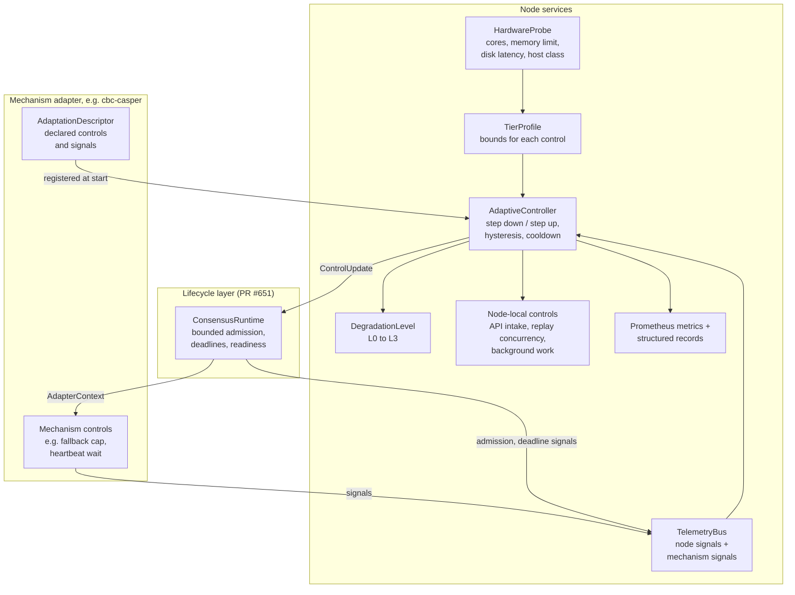
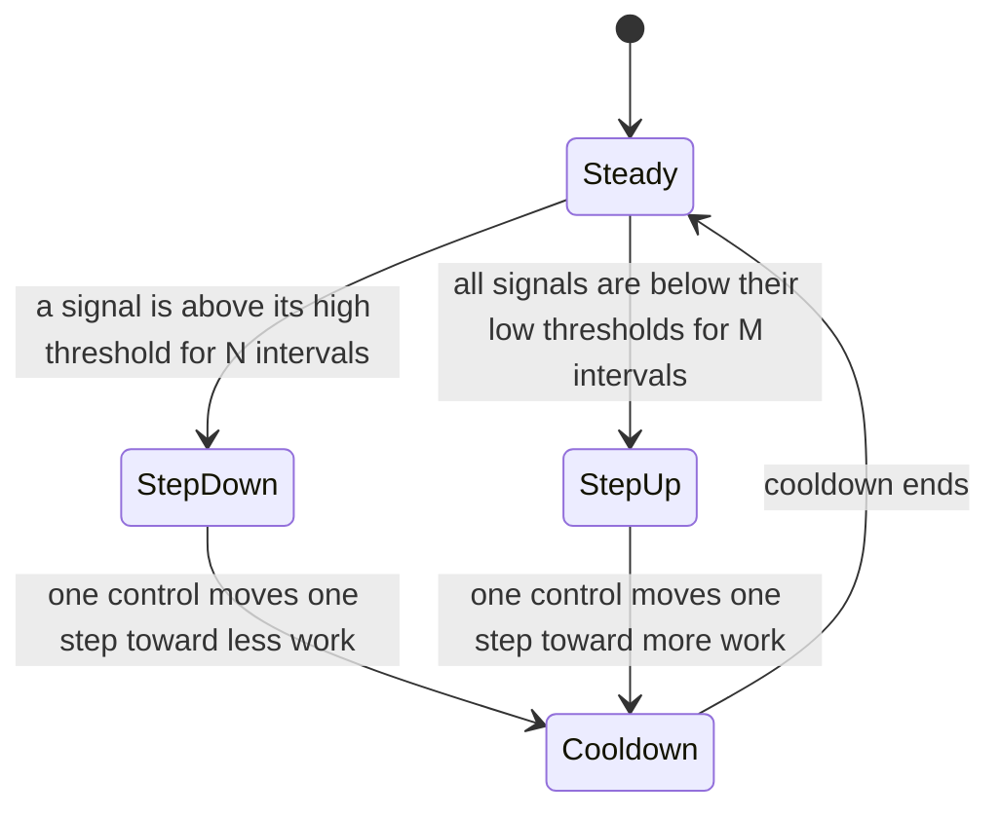

# Adaptive Execution Design

- **Status:** initial draft for maintainer review (TASK-027-1, EPIC-027). Created on 2026-10-13.
- **Story:** [US-012](../UserStories.md) Shards that adapt to the hardware of each node
- **Branch:** `perf/issue-24-adaptive-execution`
- **Closes:** issue #24, "perf: block replay pipeline bottleneck limits sustained deploy throughput"
- **Depends on:** the replication boundary of EPIC-025 (design PR #627, decision D7) and the lifecycle runtime of PR #651
- **Evidence source:** EPIC-021 and the issue #24 comments from 2026-08-27 to 2026-10-10
- **Vocabulary:** [docs/Glossary.md](../Glossary.md). The new terms in section 18 go into the glossary when this design is approved.

---

## 1. Purpose

Validators in one shard run on different hardware. Today the node uses fixed constants for its work limits. The constants suit one host class and fail on slower hosts.

This design adds three parts to the node:

1. A **hardware probe** that measures the host at startup and selects an initial **tier profile**.
2. A **closed-loop controller** that reads continuous telemetry and changes node-local work limits inside the bounds of the tier profile.
3. **Degradation levels** that remove optional work and limit intake before the node misses deadlines, runs out of memory, or stops.

The design is consensus-neutral. The controller is a node service on the lifecycle layer of the replication boundary. Each replication mechanism declares the controls and the signals that it supports. CBC Casper is the first mechanism to do this.

The implementation on this branch closes issue #24 for the CBC Casper mechanism.

---

## 2. Decisions

| ID | Decision | Date |
|---|---|---|
| A1 | The design is consensus-neutral. The controller is part of the node, on top of `ConsensusRuntime`. A mechanism declares its controls and signals through the adapter contract. The controller never calls mechanism internals. | 2026-10-13 |
| A2 | The controller changes node-local behavior only. No control changes the validity of a block, a commit, or any value that other validators check. The hardware tier never enters replicated state. | 2026-10-13 |
| A3 | A startup probe selects the initial tier profile. A runtime controller then steps each control down or up with hysteresis, from live telemetry. | 2026-10-13 |
| A4 | Telemetry stays local. The node exports Prometheus metrics and structured records tagged with the tier and the protocol identifier. Soak and test net runs collect these records. Central opt-in aggregation is Backlog item BACKLOG-FI-004. | 2026-10-13 |
| A5 | The close-out gate depends on the replication mechanism. Each mechanism supplies a soak profile. The `cbc-casper` profile closes issue #24. | 2026-10-13 |
| A6 | EPIC-027 owns the close-out of issue #24. EPIC-021 keeps its measurement and fix history. Its open tasks are inputs to EPIC-027. | 2026-10-13 |
| A7 | The design is written now against decision D7. The implementation starts after PR #651 merges into `dev`. | 2026-10-13 |

---

## 3. Evidence from issue #24

The issue #24 history gives five facts that this design must use.

| Fact | Source | Effect on the design |
|---|---|---|
| In the high phase, non-leader validators use a fixed fallback cap of 8 deploys per block. The cap rises to 16 or 32 only after the oldest fresh deploy waits 120 s or 300 s. The test fails at 45 s. | Issue #24 comment 6094239136 | A fixed escalation table cannot follow the real arrival rate. The cap must follow measured backlog and capacity. |
| All three high-phase failures in soak 37996403003 ran on Docker. Docker shards had about twice the left-out deploys and twice the selection age of subprocess shards. | Comment 6094531369 | The same code behaves differently on different hosts. A tier profile and a closed loop are necessary. |
| The sustained-phase failures have a different cause. The deploys enter blocks in 2 to 2.6 s and then wait for finalization. | Comment 6094531369 | An admission controller alone does not close issue #24. The delay from inclusion to finality needs its own signal and its own control (section 10.3). |
| PR #473 removed an earlier "adaptive deploy cap". | Issue #24 description | That cap was a fixed table. This design uses a closed loop with bounds, hysteresis, and telemetry for each step (section 7). |
| The checkpoint fsync is about 1 percent of the cost. Replay runtime spawn takes 3.8 ms in the soak. | Comments 6016872961 and 6043103631 | The controller must not assume that disk or spawn cost is the bottleneck. It acts only on measured signals. |

PR #695 already makes the non-leader fresh-admission cap follow the local backlog. This design keeps that change and puts its bounds under the controller (section 10.1).

---

## 4. Principles

| Principle | Rule in this design |
|---|---|
| Hardware isolation | Hardware-specific values are in tier profiles and in the probe. Consensus logic and execution logic do not read hardware values. |
| Dynamic scaling | The node selects limits from measured capacity: CPU cores, the memory limit of the cgroup, disk latency, and the observed replay time. |
| Graceful degradation | When the node is near a limit, it removes optional work first and limits intake second. It does not run out of memory or miss a watchdog deadline. |
| Closed loop | Each step down or up follows a measured signal over several intervals. A step never follows one sample. |
| Measure, do not guess | Each tier has baseline targets. A soak profile checks the targets for each mechanism. |

---

## 5. Architecture

The adaptive layer is a node service. It sits next to `ConsensusRuntime` in the lifecycle layer of decision D7. It does not sit inside an adapter.



| Part | Layer | Owner |
|---|---|---|
| `HardwareProbe`, `TierProfile` | Node | This design |
| `TelemetryBus`, `AdaptiveController`, `DegradationLevel` | Node | This design |
| Node-local controls | Node | This design |
| Delivery of control updates to the adapter | Lifecycle | `ConsensusRuntime` and `AdapterContext` of PR #651, extended |
| `AdaptationDescriptor`, mechanism controls and signals | Adapter | Each mechanism. CBC Casper first. |

The controller never reads mechanism state directly. It reads signals from the `TelemetryBus`. It sends control updates through `ConsensusRuntime`. This keeps the controller neutral, as decision D7 requires.

---

## 6. Core types

The names below are proposals. They change to match the names of PR #651 when that PR merges.

```rust
pub enum Tier { Constrained, Standard, Ample }

pub struct HardwareProfile {
    pub cpu_cores: u16,
    pub memory_limit_bytes: u64,
    pub disk_p99_write_micros: u32,
    pub host_class: HostClass,
}

pub struct ControlId(&'static str);

pub struct ControlSpec {
    pub id: ControlId,
    pub floor: u32,
    pub ceiling: u32,
    pub step: u32,
    pub direction: Direction,
}

pub struct SignalSpec {
    pub id: SignalId,
    pub unit: Unit,
    pub high_threshold: f64,
    pub low_threshold: f64,
}

pub struct AdaptationDescriptor {
    pub protocol: ProtocolId,
    pub controls: Vec<ControlSpec>,
    pub signals: Vec<SignalSpec>,
    pub degradation_order: Vec<ControlId>,
}

pub struct ControlUpdate {
    pub id: ControlId,
    pub value: u32,
    pub level: DegradationLevel,
    pub reason: SignalId,
}
```

- `HostClass` records the container or process context, for example `docker` or `subprocess`. The soak evidence shows that this class changes the result.
- A `TierProfile` gives the floor and the ceiling of each control for one tier. A mechanism supplies default profiles. An operator can narrow them in the configuration, but cannot widen them.
- `Direction` states whether a higher value means more work or less work.

---

## 7. Controller

The controller runs on a fixed interval, for example 1 s. On each interval it reads the signal windows and then decides one action.



Rules:

1. The controller moves one control by one step in each action.
2. Step down needs N consecutive intervals above the high threshold. Step up needs M consecutive intervals below the low threshold. M is larger than N, so the controller reduces work faster than it adds work.
3. A cooldown follows each action. This prevents oscillation.
4. Each control stays between the floor and the ceiling of the active tier profile.
5. The controller writes each action as a structured record with the signal, the old value, the new value, and the level.
6. If telemetry stops, the controller keeps the last values and reports the gap. It does not step up without data.

N, M, the interval, and the cooldown are tier profile values. Soak data sets their first values (open question Q2).

---

## 8. Degradation levels

The levels go from normal operation to the protection of liveness. The node changes level when the controller reaches the floor of every control in the current level.

| Level | Name | Action |
|---|---|---|
| L0 | Normal | All work runs inside the tier profile bounds. |
| L1 | Shed optional work | Stop or slow work that does not affect correctness: block report replays, observer catch-up, cache warming, prefetch, and optional metrics collection. |
| L2 | Limit intake | Reduce API intake and the mechanism admission controls. A full intake queue rejects new deploys with a typed, retryable overload error. It does not queue without a limit. |
| L3 | Protect liveness | Keep only the duties that the mechanism marks as required for liveness and safety. Reject new deploys with the overload error. Report the level on the status API. |

Rules:

- No level drops a duty that the mechanism marks as required. For CBC Casper, the required duties are block validation, finalization, and the proposals that the mechanism needs for liveness.
- A deploy that the node accepted is never dropped without a recorded rejection.
- The node returns to a lower level with the same hysteresis rules as section 7.

---

## 9. Telemetry

### 9.1 Signals

| Signal | Kind | Source |
|---|---|---|
| CPU use and run-queue delay | Node | Probe and runtime sampler |
| Memory pressure against the cgroup limit | Node | Runtime sampler |
| Disk write latency | Node | Storage layer |
| Tokio scheduler delay | Node | Runtime sampler |
| API intake queue depth and age | Node | API layer |
| Command admission wait and deadline misses | Lifecycle | `ConsensusRuntime` |
| Mechanism signals | Mechanism | Declared in the `AdaptationDescriptor` |

### 9.2 Export

- Prometheus metrics use the prefix `adaptive_`. Each metric has the labels `tier`, `host_class`, and `protocol`.
- The controller writes structured records for each action and each level change. Soak and test net runs collect these records in their artifacts.
- The records contain no keys, addresses, deploy contents, or host names.
- Central opt-in aggregation is out of scope. BACKLOG-FI-004 records it (decision A4).

---

## 10. CBC Casper binding

The `cbc-casper` adapter supplies the first `AdaptationDescriptor`. The binding replaces fixed constants in `casper/src/rust/blocks/proposer/block_creator.rs` with controlled values. It does not change validation.

### 10.1 Controls

| Control | Today | Under the controller |
|---|---|---|
| Non-leader fallback ordinary deploy cap | `NON_LEADER_FALLBACK_ORDINARY_DEPLOY_CAP` = 8, with 4, 16, and 32 as fixed steps | Floor and ceiling from the tier profile. The PR #695 backlog rule stays, and its bound comes from the profile. |
| Fresh-deploy escalation delays | 120 s and 300 s | Derived from the measured selection age against the deadline of the active soak profile, or removed if the closed loop replaces them |
| Heartbeat wait before a proposal | Fixed by configuration | Bounded control. Shorter when deploys wait, longer when the node is idle. |
| Merge and replay concurrency | Fixed | Bounded control, from the CPU signals |

The deploy cap is a proposer choice. Other validators do not check it. So a change of the cap does not change block validity (decision A2). The design adds a CbC claim for this property (TASK-027-4).

### 10.2 Signals

| Signal | Meaning |
|---|---|
| Deploy age at selection | Time from submission to selection. This separated failing iterations with AUC 0.94 in soak 37996403003. |
| Left-out ordinary candidates | `block-creator.ordinary-deploys.deferred` |
| Last finalized block lag | Blocks between the tip and the last finalized block |
| Block replay time | Time to validate a peer block |
| Inclusion to finality time | Time from the first block that includes a deploy to its finalization |

### 10.3 The sustained phase

In the sustained-phase failures, deploys wait after inclusion. Admission controls do not reduce this wait. TASK-021-13 attribution must find the stage first. Then the binding adds a control or a fix for that stage. This design does not choose that fix (open question Q1).

---

## 11. Determinism and safety

The controller must not create disagreement between validators. These invariants apply:

| ID | Invariant |
|---|---|
| I1 | No control changes the result of block validation or commit validation. |
| I2 | Two validators with different tiers or different control values reach the same finalized state from the same blocks. |
| I3 | No control value, tier, or level is written into a block, a deploy, or replicated state. |
| I4 | An accepted deploy is either included, rejected with a recorded reason, or expired under the existing lifespan rule. The controller never drops it without a record. |
| I5 | The controller cannot remove a duty that the mechanism marks as required for safety or liveness. |

I1, I2, and I3 make the design consensus-neutral. The binding for each mechanism must show these invariants for its own controls.

---

## 12. Configuration

```hocon
adaptive {
  enabled = true
  tier = "auto"            # "auto", "constrained", "standard", or "ample"
  interval = 1 second
  telemetry-records = true
  overrides {
    # An operator can narrow a bound, but cannot widen it.
    # "cbc-casper.fallback-ordinary-cap" { ceiling = 16 }
  }
}
```

- With `enabled = false`, each control keeps the default value of the tier profile. This gives the current behavior for comparison runs.
- `tier = "auto"` uses the probe result. A named tier skips the probe and records the choice.

---

## 13. Verification and soak profiles

### 13.1 Soak profile for each mechanism

Each mechanism supplies a soak profile with its workload, its deadlines, and its pass gate. This follows the modular soak decision of EPIC-014 (2026-10-11).

The `cbc-casper` profile closes issue #24 with these gates:

1. At most 5 `test_load` failures in 100 sessions. This is the existing EPIC-021 gate.
2. The gate holds separately for the Docker host class and the subprocess host class.
3. The gate holds on a constrained tier run with cgroup CPU and memory limits.
4. No run shows an out-of-memory stop, a watchdog stop, or a guardian stop.
5. The controller records show at least one step down and one step up in the high phase. This proves that the loop acts.

Other mechanisms add their profiles when their adapters land.

### 13.2 Test levels

| Level | Method |
|---|---|
| Unit | The controller as a pure function of signal windows and a tier profile. No mocks inside the node. Time is the only boundary. |
| Integration | A node under cgroup CPU and memory limits in CI. The test checks the degradation level and the absence of out-of-memory stops. |
| Soak | The `cbc-casper` profile on both host classes |
| Benchmark | A baseline for each tier: deploys per second, inclusion p95, and finalization p95. A regression check runs for each release. |

---

## 14. Migration order

| Step | Task | Change | Condition |
|---|---|---|---|
| 1 | TASK-027-1 | This design | Maintainer approval |
| 2 | TASK-027-2 | Telemetry signals and records, with no control changes | PR #651 merged into `dev` |
| 3 | TASK-027-3 | Hardware probe and tier profiles | Step 2 |
| 4 | TASK-027-4 | Controller and degradation levels, and the CbC claim for I1 to I5 | Step 3 |
| 5 | TASK-027-5 | `cbc-casper` binding of the admission controls | Step 4 |
| 6 | TASK-027-6 | Sustained-phase fix from the TASK-021-13 attribution | TASK-021-13 result |
| 7 | TASK-027-7 | Constrained tier CI and the `cbc-casper` soak profile | Step 5 |
| 8 | TASK-027-8 | Close-out soak and the issue #24 report | Steps 6 and 7 |

Step 2 changes no behavior. Its records give the baseline that sets the thresholds of step 4.

---

## 15. Non-goals

- Changes to consensus parameters or block validity rules.
- Shard-wide coordination of tiers between validators.
- Central collection of telemetry.
- GPU or accelerator tiers.
- Changes to the Rholang cost model or to phlo prices.

---

## 16. Risks

| Risk | Control |
|---|---|
| The controller oscillates. | Hysteresis, cooldown, one step for each action, and M larger than N |
| A wrong probe result selects a tier that is too high. | The closed loop steps down from measured signals. The operator can name the tier. |
| A control changes block validity by accident. | Invariants I1 to I3, the CbC claim, and a mixed-tier test |
| The sustained-phase cause is outside node control. | Open question Q1. The close-out depends on TASK-021-13. |
| The names of PR #651 change before merge. | Decision A7. The implementation starts after the merge. |

---

## 17. Open questions

| ID | Question |
|---|---|
| Q1 | Which stage causes the sustained-phase wait from inclusion to finality? TASK-021-13 must answer this before TASK-027-6. |
| Q2 | Which values of N, M, the interval, and the cooldown fit each tier? Step 2 telemetry sets the first values. |
| Q3 | Does the heartbeat wait belong to the controller, or does a separate fix remove the empty-block cost (issue #24 item 4)? |
| Q4 | The replication boundary design leaves deploy pool ownership open (its question Q8). If the node owns the pool, API intake and admission are one control. If the adapter owns the pool, they are two controls. |
| Q5 | Is a mixed-tier shard test in CI possible on the current runners, or does it need the test net of EPIC-014? |

---

## 18. Terms

| Term | Meaning |
|---|---|
| Hardware probe | The startup measurement of the host capacity |
| Tier profile | The floor and the ceiling of each control for one hardware tier |
| Adaptive controller | The node service that moves controls from measured signals |
| Degradation level | One of the levels L0 to L3 in section 8 |
| Adaptation descriptor | The list of controls and signals that a mechanism declares |
| Soak profile | The workload, the deadlines, and the pass gate that a mechanism supplies for its soak |
