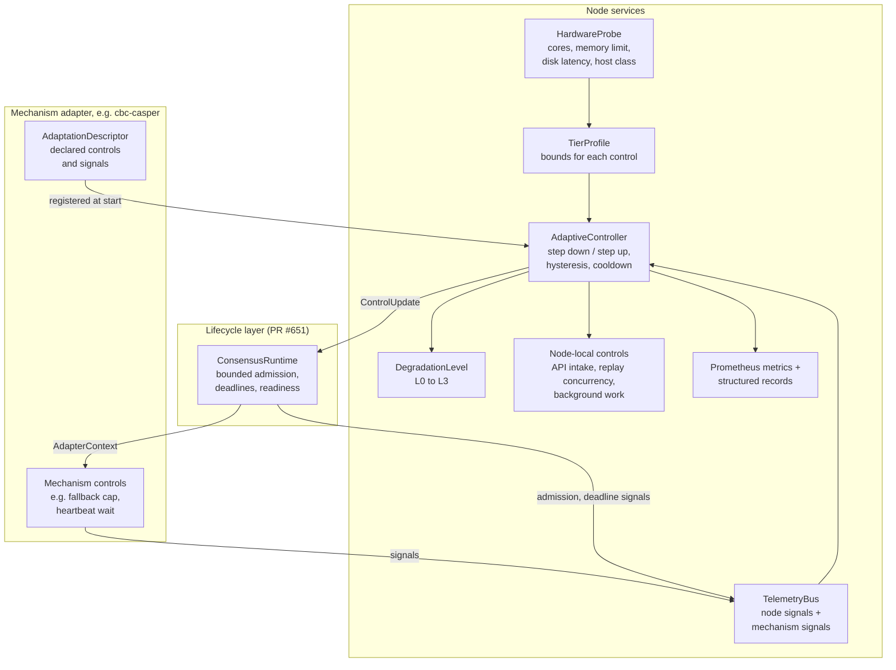
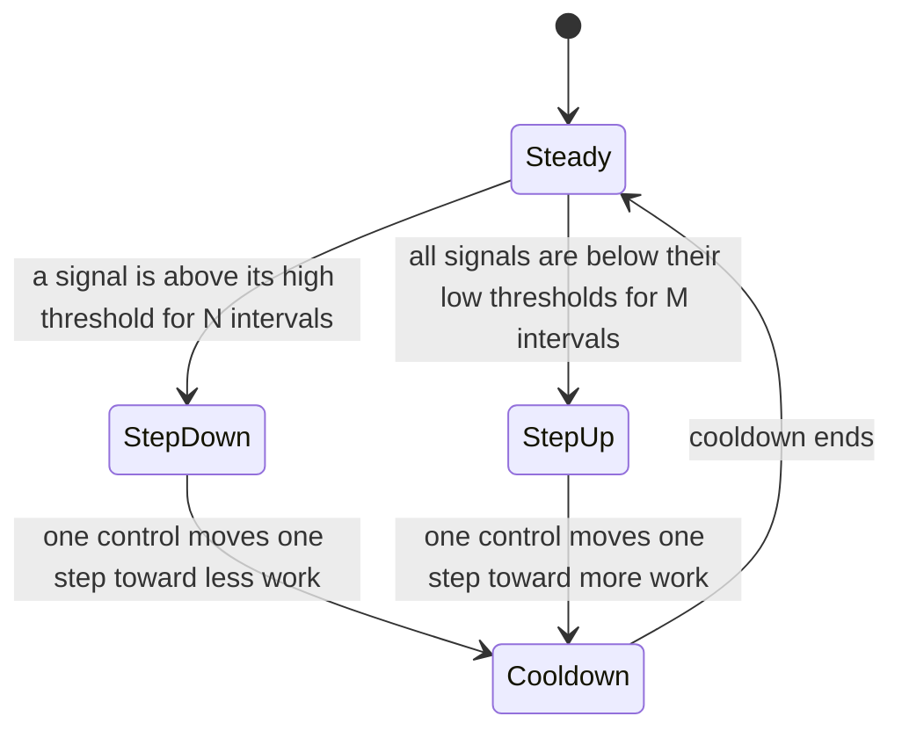

# Adaptive Execution Design

- **Status:** initial draft for maintainer review (TASK-027-1, EPIC-027). Created on 2026-10-13.
- **Current version:** this copy is the draft of 2026-10-13, which PR #719 brought to `dev`. The current draft is on draft PR #714 (branch `perf/issue-24-adaptive-execution`). It adds the stall-loop revision 2 mapping (section 10.4.1), the node role floor and the issue #691 evidence, the `testnet-path` evidence, and open question Q10. Read PR #714 for the decisions that wait for ratification. The test net path decision is in issue #764.
- **Story:** [US-012](../UserStories.md) Shards that adapt to the hardware of each node
- **Branch:** `perf/issue-24-adaptive-execution`
- **Closes:** issue #24, "perf: block replay pipeline bottleneck limits sustained deploy throughput". Open question Q8 asks whether the close-out waits for this design.
- **Depends on:** the replication boundary of EPIC-025 (design PR #627, decision D7) and the lifecycle runtime of PR #651
- **Mechanisms:** F1r3fly CbC Casper (`cbc-casper`) first. The RGB peer clique (`peer-clique`), Casanova (`casanova`), and Cordial Miners (`cordial-miners`) have provisions in section 11.
- **Evidence source:** EPIC-021 and the issue #24 comments from 2026-08-27 to 2026-10-16
- **Related design:** [Breaking the Validator Stall Loop](https://github.com/F1R3FLY-io/publications/blob/0b3255fc8/cost-accounting/stall-loop-design.pdf), revision 2 (2026-10-17), and its [finalizer response to section 5.10.1](https://github.com/F1R3FLY-io/publications/blob/0b3255fc8/cost-accounting/stall-loop-design-5-10-1-response.pdf) (2026-10-16). Section 10.4 gives their effect on this design.
- **Vocabulary:** [docs/Glossary.md](../Glossary.md). The new terms in section 20 go into the glossary when this design is approved.

---

## 1. Purpose

Validators in one shard run on different hardware. Today the node uses fixed constants for its work limits. The constants suit one host class and fail on slower hosts.

This design adds three parts to the node:

1. A **hardware probe** that measures the host at startup and selects an initial **tier profile**.
2. A **closed-loop controller** that reads continuous telemetry and changes node-local work limits inside the bounds of the tier profile.
3. **Degradation levels** that remove optional work and limit intake before the node misses deadlines, runs out of memory, or stops.

The design is consensus-neutral. The controller is a node service on the lifecycle layer of the replication boundary. Each replication mechanism declares the controls and the signals that it supports. F1r3fly CbC Casper is the first mechanism to do this. Section 11 gives the provisions for the RGB peer clique, Casanova, and Cordial Miners.

In the name F1r3fly CbC Casper, CbC qualifies the protocol. Used alone in this document, CbC names the verification process, for example a CbC claim.

The implementation on this branch closes issue #24 for the F1r3fly CbC Casper mechanism (`cbc-casper`).

---

## 2. Decisions

| ID | Decision | Date |
|---|---|---|
| A1 | The design is consensus-neutral. The controller is part of the node, on top of `ConsensusRuntime`. A mechanism declares its controls and signals through the adapter contract. The controller never calls the internals of F1r3fly CbC Casper, the RGB peer clique, Casanova, or Cordial Miners. | 2026-10-13 |
| A2 | The controller changes node-local behavior only. No control changes the validity of a block, a commit, or any value that other validators check. The hardware tier never enters replicated state. | 2026-10-13 |
| A3 | A startup probe selects the initial tier profile. A runtime controller then steps each control down or up with hysteresis, from live telemetry. | 2026-10-13 |
| A4 | Telemetry stays local. The node exports Prometheus metrics and structured records tagged with the tier and the protocol identifier. Soak and test net runs collect these records. Central opt-in aggregation is Backlog item BACKLOG-FI-004. | 2026-10-13 |
| A5 | The close-out gate depends on the replication mechanism. Each mechanism supplies a soak profile. The `cbc-casper` profile closes issue #24. | 2026-10-13 |
| A6 | EPIC-027 owns the close-out of issue #24. EPIC-021 keeps its measurement and fix history. Its open tasks are inputs to EPIC-027. | 2026-10-13 |
| A7 | The design is written now against decision D7. The implementation starts after PR #651 merges into `dev`. | 2026-10-13 |
| A8 | The design adopts two node-local practices from Ethereum. They are published hardware targets for each tier (section 14.3) and a probe warning when the host is below a target (section 6). Neither practice enforces a minimum or enters replicated state. Section 16 gives the comparison. | 2026-10-13 |

### 2.1 Ratification

The architects ratify these parts of the design before TASK-027-2 starts:

1. Decisions A1 to A8.
2. Invariants I1 to I6 (section 12).
3. The degradation levels and their order (section 8).
4. The F1r3fly CbC Casper controls and signals (sections 10.1 and 10.2).

The open questions of section 19 do not block ratification. Each question names the task that it blocks and gives a recommended answer. The architects can accept a recommendation, or they can leave the question open until that task starts.

---

## 3. Evidence from issue #24

The issue #24 history gives seven facts that this design must use.

| Fact | Source | Effect on the design |
|---|---|---|
| In the high phase, non-leader validators used a fixed fallback cap of 8 deploys per block. The cap rose to 16 or 32 only after a wait of 120 s or 300 s, but the test fails at 45 s. PR #695 made the cap follow the local backlog, and the high-phase inclusion p95 fell below 10 s (soak 38300649650). | Issue #24 comments 6094239136 and 6148770562 | A fixed escalation table cannot follow the real arrival rate. The cap must follow measured backlog and capacity. |
| All three high-phase failures in soak 37996403003 ran on Docker. Docker shards had about twice the left-out deploys and twice the selection age of subprocess shards. After PR #695, Docker had 0 failures in 43 iterations. | Comments 6094531369 and 6148770562 | The same code behaved differently on different hosts. PR #695 removed the selection cause for the high phase, but not every high-phase failure (next row). |
| **Interim evidence (soak 39089710676, running):** a Docker iteration failed in the high phase at 17:29Z, with 13 deploys not finalized within 45 s and normal inclusion (p95 11.6 s). The PR #695 backlog rule fired about once for each validator, but finality slowed to 7.9 blocks per minute. About half of the high phases are slow (22 of 37 on Docker with the failing phase, 21 of 38 on subprocess). Slow phases built more empty heartbeat blocks while deploys waited (4.7 of 7.3 in the failing phase). | Job log of run 39089710676 | After PR #695, a second high-phase failure mode remains on both host classes, and TASK-021-13 (Q1) covers it. |
| The sustained-phase failures have a different cause. The deploys enter blocks in 2 to 2.6 s and then wait for finalization. | Comment 6094531369 | An admission controller alone does not close issue #24. The delay from inclusion to finality needs its own signal and its own control (section 10.3). |
| `F1R3FLY-io/f1r3node` PR #473, in the earlier repository, removed an "adaptive deploy cap". | Issue #24 description | That cap was a fixed table. This design uses a closed loop with bounds, hysteresis, and telemetry for each step (section 7). |
| On Docker, the checkpoint fsync is about 1 percent of the cost, and the replay runtime spawn takes 3.8 ms. On the subprocess provider, the replay checkpoint takes 483 ms against 64 ms on Docker, with jemalloc on both. | Comments 6016872961, 6043103631, and 6171089126 | The controller must not assume that disk or spawn cost is the bottleneck. Storage cost depends on the host class, so the probe measures disk latency (section 6). The controller acts only on measured signals. |
| Without jemalloc, the subprocess provider failed 28 of 42 iterations (67%) in soak 38300649650. Its storage stages were 3 to 23 times slower than on Docker. | Comment 6148770562 | The allocator is part of the host class (section 14.3). A configuration defect can look like a slow hardware tier. |
| With jemalloc on the subprocess provider (`fd3d97a84`), soak 38501465484 failed 1 of 52 iterations (1.9%): 0 of 26 on Docker and 1 of 26 on subprocess. The failure is in the sustained phase, and the soak ran 8 hours only. | Comment 6171089126 | Without a controller, the measured rate is inside the gate of section 14.1, but 26 sessions on each provider cannot prove the gate. Open question Q8 follows from this fact. |

PR #695 already makes the non-leader fresh-admission cap follow the local backlog. This design keeps that change and puts its bounds under the controller (section 10.1).

Issue #691 gives evidence for the merge and replay concurrency control of section 10.1, on nodes that are not validators.

| Fact | Source | Effect on the design |
|---|---|---|
| A height holds about one block for each active validator. A validator replays the blocks of the other validators only, because it creates its own block without a replay. A non-validator replays all of them. With 3 validators and the fixed width `MAX_PARALLEL_BLOCKS` = 2, a non-validator needs two rounds for each height. | Issue #691 description | The floor of the control depends on the role of the node and on the number of active validators (section 6). |
| With width 2, the read-only observer stayed at 86 to 91 percent of the validator DAG, and the gap grew by about 270 blocks per hour. With width 3, it stayed at 99.7 to 100 percent for 8 hours, with no memory growth and about 5 percent more CPU. | Issue #691 description and its comment of 2026-10-12 | A fixed width does not scale with the validator count. At 4 validators, width 3 is short again. |
| With width 2 and fast heartbeat settings, the observer buffer reached 16,384 entries, and the observer and the bootstrap node stopped on out-of-memory 31 and 34 times. | Issue #691 description | A non-validator that falls behind also fills its buffer. Catch-up on such a node is a required duty, not optional work (section 8). |
| Three nodes on one 4-OCPU VM compete for CPU. In a local run with 4 validators, width 3 slowed block creation from 4.4 s to 7.6 s. | Issue #691 comment of 2026-10-13 | The ceiling comes from the CPU share of the node, which the probe reads from the cgroup limit. |

Other `testnet-path` issues give evidence for the admission bound, the pool cost, the committee size, and a wedged pipeline.

| Fact | Source | Effect on the design |
|---|---|---|
| In 8 hours, a node admitted 36.6 deploys per second and executed about 1.5 per second. About 96 percent of the admitted deploys expired without execution. Block creation clamps its cap, but admission has no bound. | Issue #710 | The L2 intake bound comes from the measured inclusion rate, not from the validity window. At the defaults, the A3 pool cap of 8,192 deploys is about 90 minutes of backlog at that rate, so TASK-021-21 measures the cap against it. |
| Block creation reads and decodes the whole deploy pool four times for each block. At 15,100 pending deploys, the reads take 3.8 s of 5.82 s. A signature check on each read is 97 percent of the decode cost. | Issues #711 and #729 | The pool size is a cost input of block creation. Section 10.2 adds the pool size and the read time for each proposal. |
| The floor derivation cost grows faster than the committee size. At about 19 validators, the validation of one block took 1.5 s instead of 0.1 s, and finality lost agreement. PR #674 removed one cause. | Issue #477 | The committee size is an input to the tier ceiling and to the published tier targets (section 14.3). |
| Both processing slots stayed held after the merge step for 75 minutes, with an idle CPU and no validation. The node then dropped every block at the in-flight limit of 512. | Issue #744 | A held slot with an idle CPU is a wedge, not overload. The controller reports a wedge and does not step down (section 10.2). |

The soaks of 2026-10-15 and 2026-10-16 stopped on a workflow defect before the first iteration ([issue #24 comment 6217970582](https://github.com/F1R3FLY-io/f1r3node-rust/issues/24#issuecomment-6217970582)). Hotfix PR #741 repairs that defect. Weekend soak 38995239992 then stopped at 16.7 h of 57.5 h on the disk floor of the soak runner, a harness defect that PR #759 repairs.

**Step 0 baseline (TASK-021-16), interim.** Weekend soak [39089710676](https://github.com/F1R3FLY-io/f1r3node-rust/actions/runs/39089710676) runs on `master` `532e5c696`, with PR #758, PR #759, and PR #760 and the node I/O sampler. Its window ends on 2026-10-19 at 14:30Z. The table gives the checkpoints that exist. The final row and the stage metrics follow when the run ends.

| Checkpoint | Elapsed | Sessions (Docker / subprocess) | Failures (Docker / subprocess) | Failure rate | Protection breach |
|---|---|---|---|---|---|
| Segment 1, 2026-10-18 14:38Z | 34,281 s (9.5 h) | 52 (26 / 26) | 1 (0 / 1) | 1.9 percent | None |
| Job log, 2026-10-18 18:35Z (segment 2 running) | About 13.5 h | 73 | 2 (1 / 1) | 2.7 percent | None |

The interim rate is inside gate 1 of section 14.1 (at most 5 failures in 100 sessions on each provider), and it agrees with soak 38501465484 (1 of 52). At this pace, the window gives about 150 sessions on each provider, more than the gate needs. The subprocess failure (14:11Z) is in the sustained phase, with 2 deploys not finalized within 45 s. The Docker failure (17:35Z) is in the high phase, with 13 deploys not finalized. In both, the deploys entered blocks and then waited for finality (section 10.3). The stage metrics of each phase come from the raw artifact at the end of the run.

---

## 4. Principles

| Principle | Rule in this design |
|---|---|
| Hardware isolation | Hardware-specific values are in tier profiles and in the probe. Consensus logic and execution logic do not read hardware values. |
| Dynamic scaling | The node selects limits from measured capacity: CPU cores, the memory limit of the cgroup, disk latency, and the observed replay time. |
| Graceful degradation | When the node is near a limit, it removes optional work first and limits intake second. It does not run out of memory or miss a watchdog deadline. |
| Closed loop | Each step down or up follows a measured signal over several intervals. A step never follows one sample. |
| Measure, do not guess | Each tier has baseline targets. A soak profile checks the targets for each mechanism. |

---

## 5. Architecture

The adaptive layer is a node service. It sits next to `ConsensusRuntime` in the lifecycle layer of decision D7. It does not sit inside an adapter.



| Part | Layer | Owner |
|---|---|---|
| `HardwareProbe`, `TierProfile` | Node | This design |
| `TelemetryBus`, `AdaptiveController`, `DegradationLevel` | Node | This design |
| Node-local controls | Node | This design |
| Delivery of control updates to the adapter | Lifecycle | `ConsensusRuntime` and `AdapterContext` of PR #651, extended |
| `AdaptationDescriptor`, mechanism controls and signals | Adapter | Each mechanism. F1r3fly CbC Casper first, then the RGB peer clique, Casanova, and Cordial Miners (section 11). |

The controller never reads mechanism state directly. It reads signals from the `TelemetryBus`. It sends control updates through `ConsensusRuntime`. This keeps the controller neutral, as decision D7 requires.

### 5.1 The lifecycle boundary of PR #651 (reviewed 2026-10-18)

The [review of PR #651 at `be3f23cc7`](https://github.com/F1R3FLY-io/f1r3node-rust/pull/651#issuecomment-6253755401) compared its boundary with this design. These facts change the implementation steps of section 15, not the decisions of section 2.

| Fact at `be3f23cc7` | Effect on this design |
|---|---|
| `AdapterContext` holds `commands`, `packets`, `control`, and `cleanup`. It has no channel for control updates. | TASK-027-4 adds that channel. The "extended" entry of the table above is new work, not an existing interface. |
| `ProtocolDescriptor` holds `id`, `version`, and `capabilities`. `ConsensusStatus` adds the phase and the last error. | The `protocol` label of section 9.2 comes from `ProtocolDescriptor.id`. A mechanism written in Rholang also needs its implementation kind and code hash (PR #743, release-process Section 5.11, proposed). |
| `ChainManifest` holds the protocol, its version, the schema version, the network, the shard, and the genesis identity. The protocol identifier and version are literals in three places. | The manifest is where the shard tuple of PR #743 would live, for example the execution version. One source for the version keeps the tier records of section 9.2 correct. |
| The execution port of PR #627 section 9 is not part of this boundary. Execution stays inside the CbC Casper adapter. | The merge and replay concurrency control of section 10.1 reaches the execution code through the adapter, not through the host. |
| The runtime bounds its queues by count only: 128 commands and 256 packets, each with a payload of up to 16 MiB. | The memory pressure signal of section 9.1 must count queued payload bytes. Level L2 can lower these bounds as node-local controls. |
| A command has a deadline, and the runtime skips an expired command. A packet has no deadline. | The deadline-miss signal of section 9.1 covers commands only. Packet age needs its own signal. |

---

## 6. Core types

The names below are proposals. They change to match the names of PR #651 when that PR merges.

```rust
pub enum Tier { Constrained, Standard, Ample }

pub struct HardwareProfile {
    pub cpu_cores: u16,
    pub memory_limit_bytes: u64,
    pub disk_p99_write_micros: u32,
    pub host_class: HostClass,
}

pub struct ControlId(&'static str);

pub enum NodeRole { Validator, NonValidator }

pub enum FloorRule {
    Fixed(u32),
    BlocksPerHeight { validator_offset: u32 },
}

pub struct ControlSpec {
    pub id: ControlId,
    pub floor: FloorRule,
    pub ceiling: u32,
    pub step: u32,
    pub direction: Direction,
}

pub struct SignalSpec {
    pub id: SignalId,
    pub unit: Unit,
    pub high_threshold: f64,
    pub low_threshold: f64,
}

pub struct AdaptationDescriptor {
    pub protocol: ProtocolId,
    pub controls: Vec<ControlSpec>,
    pub signals: Vec<SignalSpec>,
    pub required_duties: Vec<DutySpec>,
    pub degradation_order: Vec<ControlId>,
}

pub struct DutySpec {
    pub id: DutyId,
    pub deadline: Option<Duration>,
}

pub struct ControlUpdate {
    pub id: ControlId,
    pub value: u32,
    pub level: DegradationLevel,
    pub reason: SignalId,
}
```

- `HostClass` records the container or process context, for example `docker` or `subprocess`. The soak evidence shows that this class changes the result.
- A `TierProfile` gives the floor and the ceiling of each control for one tier. A mechanism supplies default profiles. An operator can narrow them in the configuration, but cannot widen them.
- `NodeRole` records whether the node is a bonded validator. A read-only observer and a bootstrap node are non-validators. The node reads its role from the bonds at the last finalized block, and it reads the role again when the bonds change.
- `FloorRule` gives the floor of a control. `Fixed` is a constant. `BlocksPerHeight` is the number of active validators, minus `validator_offset` on a validator node. The `cbc-casper` binding uses an offset of 1, because a validator does not replay its own block (section 10.1).
- A role floor can be above the ceiling of the tier profile. Then the control stays at the ceiling, and the probe warning of this section names the control and the missing capacity.
- `Direction` states whether a higher value means more work or less work.
- The least-work bound of a control is its floor when a higher value means more work. It is the ceiling when a higher value means less work. Section 8 uses this bound.
- The probe compares the `HardwareProfile` with the published targets of section 14.3. With a named tier, the probe uses the targets of that tier. With `tier = "auto"`, it uses the `Constrained` targets.
- If the host is below the targets, the node writes a warning record and sets the gauge `adaptive_probe_below_target` to 1. The record names each value that is below its target.
- The node starts normally after the warning. The warning enforces nothing. This follows the informational model of EIP-7870 (section 16).

---

## 7. Controller

The controller runs on a fixed interval, for example 1 s. On each interval it reads the signal windows and then decides one action.



Rules:

1. The controller moves one control by one step in each action.
2. Step down needs N consecutive intervals above the high threshold. Step up needs M consecutive intervals below the low threshold. M is larger than N, so the controller reduces work faster than it adds work.
3. A cooldown follows each action. This prevents oscillation.
4. Each control stays between the floor and the ceiling of the active tier profile.
5. The controller writes each action as a structured record with the signal, the old value, the new value, and the level.
6. If telemetry stops, the controller keeps the last values and reports the gap. It does not step up without data.

N, M, the interval, and the cooldown are tier profile values. Soak data sets their first values (open question Q2).

---

## 8. Degradation levels

The levels go from normal operation to the protection of liveness. The node changes level when every control in the current level is at its least-work bound (section 6).

| Level | Name | Action |
|---|---|---|
| L0 | Normal | All work runs inside the tier profile bounds. |
| L1 | Shed optional work | Stop or slow work that does not affect correctness: block report replays, cache warming, prefetch, and optional metrics collection. A client read replays a block report inline today, so L1 can shed these replays only after issue #650 moves them off the read path. |
| L2 | Limit intake | Reduce API intake and the mechanism admission controls. A full intake queue rejects new deploys with a typed, retryable overload error. It does not queue without a limit. The same error covers a full deploy pool (stall-loop A3), a queue that the inclusion rate cannot clear (issue #710), and an unbonded node (issue #427). |
| L3 | Protect liveness | Keep only the duties that the mechanism marks as required for liveness and safety. Reject new deploys with the overload error. Report the level on the status API. |

Rules:

- No level drops a duty that the mechanism marks as required. Section 11.1 lists the required duties of each mechanism.
- On a non-validator node, catch-up with the network is a required duty. A read-only observer or a bootstrap node exists to follow the shard. No level slows its block validation, and no level sets a control below its role floor (section 6). Issue #691 shows the result of a short pipeline on such a node: a growing lag, a full buffer, and out-of-memory stops.
- No level delays a required duty past the protocol deadline that the mechanism declares for it (invariant I6).
- A deploy that the node accepted is never dropped without a recorded rejection.
- The node returns to a lower level with the same hysteresis rules as section 7.

---

## 9. Telemetry

### 9.1 Signals

| Signal | Kind | Source |
|---|---|---|
| CPU use and run-queue delay | Node | Probe and runtime sampler |
| Memory pressure against the cgroup limit | Node | Runtime sampler |
| Disk write latency | Node | Storage layer |
| Tokio scheduler delay | Node | Runtime sampler |
| API intake queue depth and age | Node | API layer |
| Command admission wait and deadline misses | Lifecycle | `ConsensusRuntime` |
| Mechanism signals | Mechanism | Declared in the `AdaptationDescriptor` |
| Finalizer cursor yields, resumes, invalidations, and freezes, and commit refusals and A-LIN violations | Mechanism | `finalizer.cursor.*` and `finalizer.commit.*` of stall-loop A1c (section 10.4) |

### 9.2 Export

- Prometheus metrics use the prefix `adaptive_`. Each metric has the labels `tier`, `host_class`, and `protocol`.
- The controller writes structured records for each action and each level change. Soak and test net runs collect these records in their artifacts.
- The records contain no keys, addresses, deploy contents, or host names.
- Central opt-in aggregation is out of scope. BACKLOG-FI-004 records it (decision A4).

---

## 10. F1r3fly CbC Casper binding

The `cbc-casper` adapter supplies the first `AdaptationDescriptor`. The binding replaces fixed constants in `casper/src/rust/blocks/proposer/block_creator.rs` with controlled values. It does not change validation.

### 10.1 Controls

| Control | Today | Under the controller |
|---|---|---|
| Non-leader fallback ordinary deploy cap | `NON_LEADER_FALLBACK_ORDINARY_DEPLOY_CAP` = 8, with 4, 16, and 32 as fixed steps | Floor and ceiling from the tier profile. The PR #695 backlog rule stays, and its bound comes from the profile. |
| Fresh-deploy escalation delays | 120 s and 300 s | Derived from the measured selection age against the deadline of the active soak profile, or removed if the closed loop replaces them |
| Heartbeat wait before a proposal | Fixed by configuration | Bounded control. Shorter when deploys wait, longer when the node is idle. |
| Merge and replay concurrency | `MAX_PARALLEL_BLOCKS` = 2 in `block_processor.rs`, with `REPLAY_LOCK_PERMITS` = width + 2 (issue #691) | First a startup value: the role floor (section 6), limited by `derive_max_concurrent` of the cgroup CPU share, with a minimum of 3. The replay lock takes its permits from the same value. Later a bounded control from the CPU and pipeline signals of section 10.2. |
| Proposal coalescing and heartbeat debounce | None on `dev`, where each deploy queues its own proposal with `autopropose` (stall-loop A2). The A2 branch coalesces deploy-triggered proposals, without heartbeat debounce. The soak shard runs without `autopropose`, so all its proposals and empty blocks come from the heartbeat (section 3). | First the fixed rule of the A2 branch (TASK-021-20). Later a bounded control, with the measured TASK-021-20 values as tier bounds. |
| Floor-distance pacing and pool admission cap | None on `dev`. The 256-block floor cap refuses the merge (stall-loop A3). The A3 branch stops user deploys above a floor distance of 128 and refuses deploys above 64 times `max-user-deploys-per-block`. | First these fixed values, after a measurement against the TASK-021-16 baseline (TASK-021-21). Later bounded controls, with the measured values as tier bounds. |
| Work off the async runtime | Replay, merge, and checkpoint run on tokio workers (stall-loop A6). The A6 commit wraps them in `block_in_place`. | Not a control. `block_in_place` has no pool size to bound. The controller reads the tokio scheduler delay as a signal only. |

The deploy cap is a proposer choice. Other validators do not check it. So a change of the cap does not change block validity (decision A2). The design adds a CbC claim for this property (TASK-027-4).

The play budget (`deploy-play-budget`) is a candidate control. The proposer checks it between deploys, so it is a proposer choice and does not change validity. A budget that stops one deploy during its play changes the recorded result. Such a budget is a validity rule and never a control (issue #541).

The A9 rejection search cap (`casper.rejection-search-cap-from-height`) changes the merge result from an activation height. Other validators must apply the same cap, so the cap is a validity rule. It is never a controller control (decision A2).

### 10.2 Signals

| Signal | Meaning |
|---|---|
| Deploy age at selection | Time from submission to selection. This separated failing iterations with AUC 0.94 in soak 37996403003. |
| Left-out ordinary candidates | `block-creator.ordinary-deploys.deferred` |
| Last finalized block lag | Blocks between the tip and the last finalized block |
| Block replay time | Time to validate a peer block. On a v6 shard, the executed-root lag replaces it (section 10.4). |
| Inclusion to finality time | Time from the first block that includes a deploy to its finalization |
| Block pipeline load | `block_processing_active`, the processing queue depth, and `casper_buffer_approx_nodes` (issue #691) |
| Block validation time | `block_validation_time`, the time to validate one received block |
| Deploy pool cost | The pending pool size, and the read and decode time of the pool for each proposal (issues #711 and #729) |
| Floor derivation time | The time of the floor derivation and the clique oracle for each validated block (issue #477) |
| Oldest processing slot | The age of the oldest in-flight processing slot and its validation stage (issue #744). A slot held past a threshold while the CPU is idle is a wedge, not overload. The controller does not step down on a wedge. It writes a wedge record and reports it on the status API. |
| Own carriers past the depth horizon | Own blocks whose deploys play again because the block left the parent-depth horizon (issue #541) |
| Floor-pacing engagements | `block-creator.floor-pacing-engaged` of stall-loop A3. It counts proposals that carry no user deploys because the floor distance is above the threshold. |
| Finalizer progress | The `finalizer.cursor.*` and `finalizer.commit.*` counters of stall-loop A1c (section 9.1) |

### 10.3 The sustained phase

In the sustained-phase failures, deploys wait after inclusion. Interim evidence of soak 39089710676 (section 3) shows the same wait in one high-phase failure, after PR #695. Admission controls do not reduce this wait. TASK-021-13 attribution must find the stage first. Then the binding adds a control or a fix for that stage. This design does not choose that fix (open question Q1).

### 10.4 Relation to the stall-loop design

The design [Breaking the Validator Stall Loop](https://github.com/F1R3FLY-io/publications/blob/0b3255fc8/cost-accounting/stall-loop-design.pdf) traces stalls under load to one feedback loop on the finality lag. Revision 1 is dated 2026-10-16. Revision 2 (2026-10-17) changes the plan of this section, and section 10.4.1 gives the changes. The design proposes two tracks:

- **Track A** (A1 to A9) fixes the loop on `dev` without cost accounting.
- **Track B** lands cost-accounted order-then-execute for v6 shards, in about ten months.

The design is a code reading, without profiling. Decisions of 2026-10-16 for issue #24:

| Topic | Decision |
|---|---|
| Ownership of Track A | Issue #24 owns Track A. EPIC-021 holds the tasks (TASK-021-16 to TASK-021-24). |
| Order of the work | Each Track A item is measured first (TASK-021-17). The measured rank sets the order. Section 10.4.1 replaces this decision. Soaks so far measured finalizer runs at 6 to 15 ms with no timeouts, and merger buckets at about 45 ms for each merge. |
| Overlapping knobs (A2, A3, A6) | Fixed, measured thresholds land first. This design later puts them under the controller, with those values as tier bounds (section 10.1). |
| Files of the cost-accounting merge | Issue #24 fixes avoid the 38 files that Track B step B1 expects to conflict where possible. A fix inside one of them carries a note for the cost-accounting lane. |
| Cost-accounting scope in `dev` | Not decided on 2026-10-16. Revision 2 proposes the scope of section 10.4.1. TASK-021-16 records a baseline before it lands, and TASK-021-23 repeats the soak after it lands. |

The [plan update of 2026-10-17](https://github.com/F1R3FLY-io/f1r3node-rust/issues/24#issuecomment-6220936428) uses weekend soak 38995239992 on master `ecb16dbca`. That soak had 0 `test_load` failures in 91 sessions (46 Docker, 45 subprocess). It stopped at 16.7 h of 57.5 h on a defect in the soak harness. The update changes three steps:

| Step | Change |
|---|---|
| 0 (TASK-021-16) | Two prerequisites: PR #759 on `master`, and an I/O sampler that traces a node of the iteration's own shard. The gate is unchanged. |
| 3 (TASK-021-13) | The scope depends on the step 0 soak. If that soak meets the gate, the task records that no cause remains (Q8). |
| 4 and 5 (TASK-021-19) | A1 moves from step 4 to step 5. Finalizer runs averaged 20 to 25 ms in the sustained phase, with 0 timeouts in 91 sessions. |

#### 10.4.1 Revision 2 and the Track A branches

Revision 2 changes the plan above in three ways.

1. **A1 has a new design.** The [response to section 5.10.1](https://github.com/F1R3FLY-io/publications/blob/0b3255fc8/cost-accounting/stall-loop-design-5-10-1-response.pdf) (2026-10-16) shows that the revision 1 rule is neither safe nor live. A run that adopts "the highest candidate proven so far" can finalize conflicting blocks, regress settled state, or commit after a race between the check and the write. Revision 2 replaces A1 with A1a, A1b, and A1c.
2. **Track A has code before the measurement.** The rank of TASK-021-17 no longer sets the order of the work. Each item is measured after it lands, against the TASK-021-16 baseline.
3. **The cost-accounting scope has a proposal.** Order-then-execute applies to v6 shards only. Legacy shards keep the `dev` pipeline byte-identical, within 3 percent of its cost. Track B step B1 brings the cost-accounting core into `dev` without the scheduler.

Revision 2 records its decisions for the Casper Working Group and names no approvers. This design therefore treats them as provisional.

The branches have no pull requests yet. Each branch is 42 to 49 commits behind `dev` and does not contain the PR #751 metrics of TASK-021-17.

| Branch (tip) | Items | Base | Notes for issue #24 |
|---|---|---|---|
| `fix/finality-stall-track-a` (`d1c3a970f`) | A1a shared oracle cache with at most 3 reruns of a timed-out run, A2 coalescing, and A3 pacing and pool cap | `dev` | Fixed values: floor distance 128, pool cap 64 times `max-user-deploys-per-block`, HTTP 503 with `Retry-After` |
| `fix/finalizer-forward-progress` (`8b1b10f2a`) | A1b timeout on the derivation only, and A1c resumable cursor and atomic `commit_lfb` | The branch above | Two new LMDB stores and an optional `commit-epoch` on `BlockFinalised` events |
| `fix/stall-track-a-rest` (`16c57af9c`) | A4 to A9 | The branch above | Its A7 commit duplicates PR #752 and conflicts with `dev`. A4 skips the signature check for a cached encoding and covers issue #711, but PR #730 solves issue #729 in another way. A9 changes the merge result from an activation height and is off by default. |
| `feature/cost-accounted-ote` (`e7469fd47`) | v6 tranche 1 behind `casper.v6-order-then-execute`, default off | `dev` | Outside the scope of this design (section 17). It conflicts with `fix/stall-track-a-rest` in three files. |

On legacy multi-parent shards, A-LIN does not hold. The A1c integration run logged commits that contain the previous last finalized block only through a secondary parent. A1c therefore logs and counts an A-LIN violation on a legacy shard, and halts on a v6 shard.

The Track A branches change files that `.gitattributes` tags `cbc=mandatory`, for example `block_creator.rs`, `finalization_runner.rs`, and `conflict_set_merger.rs`. They add no CbC claims. A claim or a recorded waiver for each tagged file is a condition for the merge.

v6 shards are outside the scope of this design (section 17). On a v6 shard, structural validity checks the sum of the phlo limits of a block against a per-block demand cap. A future v6 descriptor must therefore keep each admission ceiling at or below that protocol cap. Its replay signal becomes the lag of the executed root behind the last finalized block. Open question Q9 records this.

---

## 11. Provisions for the other mechanisms

The replication boundary design (PR #627, section 4) has four mechanisms in scope. This design must work for all four. Only F1r3fly CbC Casper has an implementation today. The other three mechanisms get their bindings when their adapters land.

### 11.1 Mechanism table

The controls and signals for the RGB peer clique, Casanova, and Cordial Miners are candidates. The owner of each adapter confirms or changes them in the adaptation descriptor of that adapter.

| Mechanism | Identifier | State | Candidate controls | Candidate signals | Required duties |
|---|---|---|---|---|---|
| F1r3fly CbC Casper | `cbc-casper` | Implemented, adapter in PR #651 | Section 10.1 | Section 10.2 | Block validation, finalization, and the proposals that liveness needs |
| RGB peer clique | `peer-clique` | Seal media `alpha`, clique `coming_soon` (RGB SoW2 workstream WS5) | Transactions admitted for each height, client-side validation concurrency, anchor poll interval | Time to commit a height, quorum certificate latency, anchor confirmation lag | Votes and certificate signatures for each height inside the protocol timeout, and anchoring to Bitcoin layer 1 and Lightning |
| Casanova | `casanova` | `coming_soon` | Deploys admitted for each block, conflict-set evaluation concurrency | Round length, latency of the FTM-observed set, backlog of conflict votes | Votes on conflicting transactions, and participation in each round |
| Cordial Miners | `cordial-miners` | `coming_soon`, adapter in issue #625 | Deploys admitted for each block, blocklace sync concurrency | Wave length, delay of the τ order, delay of the super-ratification of the wave leader | Participation in each wave, and the blocks that ratify the leader |

### 11.2 Rules for each binding

1. The binding declares its controls, signals, and required duties in an `AdaptationDescriptor` (section 6).
2. The binding declares the protocol deadline of each required duty. Examples are the height timeout of the peer clique and the wave timeout of Cordial Miners.
3. The binding shows invariants I1 to I6 (section 12) for its own controls.
4. The binding supplies its default tier profiles and its soak profile (section 14.1).
5. The binding adds no mechanism-specific code to the controller. If a mechanism needs a new kind of control, the controller gets a neutral control kind, and every mechanism can use it.

### 11.3 Differences that the design must allow

| Difference | Mechanisms | Effect on the design |
|---|---|---|
| No DAG and one transaction for each commit | RGB peer clique | Admission is per height, not per block. No control can use a DAG signal such as the last finalized block lag. |
| Leader or wave timeouts | RGB peer clique, Cordial Miners | A slow node can miss a timeout and lose its turn. Invariant I6 protects required duties from all degradation levels. |
| No leader, with votes on conflicts | Casanova | Admission limits can be on conflicting transactions. Vote work is a required duty. |
| External anchoring | RGB peer clique | Anchor polling is a control. A missed anchor deadline is a signal. |
| Proposer choice of deploys | F1r3fly CbC Casper, Casanova, Cordial Miners | For F1r3fly CbC Casper, other validators do not check the admission cap, so the cap is local. The Casanova and Cordial Miners bindings must confirm the same property. |

---

## 12. Determinism and safety

The controller must not create disagreement between validators. These invariants apply:

| ID | Invariant |
|---|---|
| I1 | No control changes the result of block validation or commit validation. |
| I2 | Two validators with different tiers or different control values reach the same finalized state from the same blocks. |
| I3 | No control value, tier, or level is written into a block, a deploy, or replicated state. |
| I4 | An accepted deploy is either included, rejected with a recorded reason, or expired under the existing lifespan rule with a recorded terminal state. The controller never drops it without a record. Today the expiry pass removes a deploy without a record, so its status reads Pending (issue #710). |
| I5 | The controller cannot remove a duty that the mechanism marks as required for safety or liveness. |
| I6 | No control or degradation level delays a required duty past the protocol deadline that the mechanism declares for it. |

I1, I2, and I3 make the design consensus-neutral. I6 matters most for mechanisms with leader, height, or wave timeouts. The binding for each mechanism must show these invariants for its own controls.

---

## 13. Configuration

```hocon
adaptive {
  enabled = true
  tier = "auto"            # "auto", "constrained", "standard", or "ample"
  interval = 1 second
  telemetry-records = true
  overrides {
    # An operator can narrow a bound, but cannot widen it.
    # "cbc-casper.fallback-ordinary-cap" { ceiling = 16 }
  }
}
```

- With `enabled = false`, each control keeps the default value of the tier profile. This gives the current behavior for comparison runs.
- `tier = "auto"` selects the tier profile from the probe result. A named tier selects that profile, and the node records the choice.
- The probe runs in both cases, because the probe warning of section 6 needs the measured `HardwareProfile`.

---

## 14. Verification and soak profiles

### 14.1 Soak profile for each mechanism

Each mechanism supplies a soak profile with its workload, its deadlines, and its pass gate. This follows the modular soak decision of EPIC-014 (2026-10-11).

The `cbc-casper` profile closes issue #24 with these gates:

1. At most 5 `test_load` failures in 100 sessions. This is the existing EPIC-021 gate.
2. The gate holds separately for the Docker host class and the subprocess host class.
3. The gate holds on a constrained tier run with cgroup CPU and memory limits.
4. No run shows an out-of-memory stop, a watchdog stop, or a guardian stop.
5. On the constrained tier run of gate 3, the controller records show at least one step down and one step up in the high phase. This proves that the loop acts. A run on a larger tier can pass without a controller action. PR #695 removed the selection cause of high-phase failures. The interim evidence of soak 39089710676 (section 3) shows a remaining finality-pace failure in the high phase. A larger tier therefore does not by itself keep the high phase inside its deadline.

The other mechanisms supply their profiles with their adapters:

| Mechanism | Soak profile | Gate shape |
|---|---|---|
| F1r3fly CbC Casper | `cbc-casper`, this epic | The gates above |
| RGB peer clique | `peer-clique`, with its adapter | Commit latency for each height and anchor lag, on each host class and on the constrained tier |
| Casanova | `casanova`, with its adapter | Round length and conflict-vote latency, on each host class and on the constrained tier |
| Cordial Miners | `cordial-miners`, with the issue #625 adapter | Wave length and leader ratification delay, on each host class and on the constrained tier |

Each profile also checks gate 4 (no out-of-memory, watchdog, or guardian stop) and gate 5 (the loop acts). The `stub` mechanism of TASK-025-8 runs the controller tests without a real mechanism.

### 14.2 Test levels

| Level | Method |
|---|---|
| Unit | The controller as a pure function of signal windows and a tier profile. No mocks inside the node. Time is the only boundary. |
| Integration | A node under cgroup CPU and memory limits in CI. The test checks the degradation level and the absence of out-of-memory stops. A read-only observer under the same limits keeps its processing queue and its buffer bounded at the block rate of the validators (issue #691). |
| Soak | The `cbc-casper` profile on both host classes |
| Benchmark | A baseline for each tier: deploys per second, inclusion p95, and finalization p95. A regression check runs for each release. |

### 14.3 Published tier targets

The project publishes a hardware target for each tier in the operator documentation. Operators use the targets to select hardware before they join a shard. This follows the Ethereum practice of EIP-7870 (section 16).

| Rule | Detail |
|---|---|
| Content | Each target gives the CPU cores, the memory limit, the disk write latency at p99, and the host class. The fields match `HardwareProfile` (section 6). |
| Source | The tier baselines of section 14.2 and the `cbc-casper` soak results on each host class set the values. No value comes from an estimate. |
| Status | The targets are recommendations. The node does not refuse to start below a target. The probe warning of section 6 is the only effect. |
| Updates | A release updates the targets when a baseline changes. The document records the release and the soak run that set each value. |
| Mechanisms | Each mechanism publishes its own targets with its soak profile. The `cbc-casper` targets come first. |
| Committee size | Each `cbc-casper` target names the number of active validators that it supports. The validation cost of one block grows with the committee size (issue #477), and a non-validator replays one block for each validator (issue #691). |

The allocator is part of the host class. Soak 38300649650 showed that the same binary is 3 to 23 times slower in the storage stages without jemalloc ([issue #24 comment](https://github.com/F1R3FLY-io/f1r3node-rust/issues/24#issuecomment-6148770562)).

---

## 15. Migration order

| Step | Task | Change | Condition |
|---|---|---|---|
| 1 | TASK-027-1 | This design | Architect ratification (section 2.1) |
| 1a | TASK-021-24 | Soak of the Track A branches against the TASK-021-16 baseline (section 10.4.1) | The Track A branches merged with `dev`, including the PR #751 metrics |
| 2 | TASK-027-2 | Telemetry signals and records, with no control changes. It reuses the Track A metrics of TASK-021-17 and the A1c finalizer counters. | PR #651 merged into `dev` |
| 3 | TASK-027-3 | Hardware probe, tier profiles, and the probe warning | Step 2 |
| 4 | TASK-027-4 | Controller and degradation levels, and the CbC claim for I1 to I6 | Step 3 |
| 5 | TASK-027-5 | F1r3fly CbC Casper (`cbc-casper`) binding of the admission controls | Step 4 |
| 6 | TASK-027-6 | Sustained-phase fix from the TASK-021-13 attribution | TASK-021-13 result |
| 7 | TASK-027-7 | Constrained tier CI, the `cbc-casper` soak profile, and the first published tier targets | Step 5 |
| 8 | TASK-027-8 | Close-out soak and the issue #24 report | Steps 6 and 7 |
| 9 | TASK-027-9 | Adaptation descriptors, tier profiles, and soak profiles for the RGB peer clique, Casanova, and Cordial Miners | The adapter of each mechanism. This step does not block the close-out of issue #24. |

Step 2 changes no behavior. Its records give the baseline that sets the thresholds of step 4.

---

## 16. Comparison with Ethereum

Ethereum also runs validators on hardware of different performance. This section compares its approach with this design for the F1r3fly CbC Casper mechanism only.

### 16.1 Differences

Ethereum handles a slow node in the protocol and in its rewards. A slow node misses deadlines and earns less, and the network continues without it. This design handles a slow node inside the node. The node reduces its own work so that it misses fewer deadlines. Decision A2 keeps the design out of the protocol and out of the rewards.

| Topic | Ethereum | F1r3fly CbC Casper today | With this design |
|---|---|---|---|
| Pace of the chain | Fixed 12 s slots on the wall clock [E1] | Event-driven heartbeat proposals, with `check-interval = 5 seconds` and `self-propose-cooldown = 3 seconds` [F2]. No slots. | No change between validators. The controller changes only the local proposal wait (section 10.1). |
| Deadline for a vote | An attester votes when the block arrives, or at `ATTESTATION_DUE_BPS = 3333` (about one third of the slot) at the latest [E1] | No deadline. A validator builds on the blocks that it has validated. | No protocol deadline. Invariant I6 protects the local deadlines that the mechanism declares. |
| Late blocks | Only a block that arrives before the attestation deadline of its slot is timely, and `PROPOSER_SCORE_BOOST = 40` favors it. The optional honest reorg rule can orphan a late, weak head [E2]. | Fork choice weighs latest messages by bond, with no time term | No change, because a time term in fork choice changes validity (decision A2) |
| Effect of one slow node | Small, because the protocol needs two thirds of the stake, spread over a very large validator set | Large in a small shard, where each of a few validators carries a large part of the weight that finality needs | Smaller, because the slow node sheds optional work and limits intake (section 8) |
| Cost to the operator | Lost rewards for late or missed duties | None. `PoS.rhox` pays epoch rewards in proportion to bond among active validators, with no participation term [F1]. Slashing covers invalid blocks and equivocation only. | None (open question Q7) |
| Hardware guidance | EIP-7870 is an informational recommendation [E3]. For a full node, it gives 4 TB of NVMe storage, about 50,000 read and 15,000 write IOPS, and 32 GB of RAM. | None | Published tier targets (section 14.3) and a probe warning (section 6), with no enforcement |

### 16.2 Advantages of this design

1. **Prevention before failure.** The controller reduces work before the node misses a deadline or runs out of memory. Ethereum lets the node miss the deadline and then removes rewards.
2. **No timing risk to safety.** No control changes validity (invariants I1 to I3). Ethereum ties fork choice to local clocks, so proposer boost and reorg rules need careful tuning and permit timing games.
3. **Fit for small shards.** A shard with few validators cannot ignore a slow member. Keeping each member responsive matters more than a penalty for lateness.
4. **Diagnosis of local causes.** Telemetry for each host class found an allocator difference (section 14.3). A penalty does not show the cause of slowness.
5. **One controller for all mechanisms.** The adaptation descriptor (section 11) applies the same controller to each mechanism. The Ethereum rules belong to one protocol.

### 16.3 Disadvantages of this design

1. **No bound on the pace of the shard.** Ethereum slots keep a regular pace whatever one node does. F1r3fly CbC Casper finality still waits for the slow members of the shard (open question Q1).
2. **No incentive for adequate hardware.** Ethereum rewards make timely hardware profitable. F1r3fly rewards do not change with timeliness (open question Q7).
3. **Targets after the fact.** The tier targets come from soak baselines. Until TASK-027-7, an operator has no published target.
4. **More moving parts.** A closed loop has thresholds, cooldowns, and a risk of oscillation (section 18). Fixed deadlines are simpler to analyze.
5. **Cost moves to users.** At levels L2 and L3, the node rejects deploys with a retryable error. In Ethereum, the validator pays for its own lateness.

### 16.4 What this design adopts

| Ethereum practice | Decision |
|---|---|
| Published hardware recommendations (EIP-7870) | Adopted as the published tier targets of section 14.3 (decision A8) |
| Recommendations that are not enforced | Adopted as the probe warning of section 6 (decision A8) |
| Fixed deadlines for duties | Already present as `DutySpec.deadline` and invariant I6 |
| Rewards for timely participation | Not decided. Recorded as open question Q7. |
| Wall-clock slots, proposer boost, and honest reorg | Not adopted. They change fork choice and validity (decision A2). |

### 16.5 Sources

| ID | Source |
|---|---|
| E1 | Ethereum consensus specifications, [phase0 honest validator](https://github.com/ethereum/consensus-specs/blob/master/specs/phase0/validator.md): `ATTESTATION_DUE_BPS = 3333`, `AGGREGATE_DUE_BPS = 6667` |
| E2 | Ethereum consensus specifications, [phase0 fork choice](https://github.com/ethereum/consensus-specs/blob/master/specs/phase0/fork-choice.md): `PROPOSER_SCORE_BOOST = 40`, `REORG_HEAD_WEIGHT_THRESHOLD = 20`, `REORG_PARENT_WEIGHT_THRESHOLD = 160`, and the optional `get_proposer_head` |
| E3 | [EIP-7870: Hardware and Bandwidth Recommendations](https://eips.ethereum.org/EIPS/eip-7870), category Informational, status Living |
| F1 | [`casper/src/main/resources/PoS.rhox`](../../casper/src/main/resources/PoS.rhox), contract `getCurrentEpochRewards` |
| F2 | [`node/src/main/resources/defaults.conf`](../../node/src/main/resources/defaults.conf), block `heartbeat` |

The Ethereum values were checked on 2026-10-13 against the `master` branch of the consensus specifications.

---

## 17. Non-goals

- Changes to consensus parameters or block validity rules.
- v6 shards with cost-accounted order-then-execute (section 10.4, open question Q9).
- Shard-wide coordination of tiers between validators.
- Central collection of telemetry.
- GPU or accelerator tiers.
- Changes to the Rholang cost model or to phlo prices.

---

## 18. Risks

| Risk | Control |
|---|---|
| The controller oscillates. | Hysteresis, cooldown, one step for each action, and M larger than N |
| A wrong probe result selects a tier that is too high. | The closed loop steps down from measured signals. The operator can name the tier. |
| A control changes block validity by accident. | Invariants I1 to I3, the CbC claim, and a mixed-tier test |
| The sustained-phase cause is outside node control. | Open question Q1. The close-out depends on TASK-021-13. |
| The names of PR #651 change before merge. | Decision A7. The implementation starts after the merge. |

---

## 19. Open questions

No question blocks ratification (section 2.1). The Blocks column names the first task that needs the answer.

| ID | Question | Blocks | Recommended answer |
|---|---|---|---|
| Q1 | Which stage causes the sustained-phase wait from inclusion to finality? TASK-021-13 must answer this before TASK-027-6. | TASK-027-6 and the close-out | Keep it open. The TASK-021-13 attribution answers it with soak evidence. |
| Q2 | Which values of N, M, the interval, and the cooldown fit each tier? Step 2 telemetry sets the first values. | The first tier profile values in TASK-027-3 | Keep the values open until the step 2 telemetry exists. Ratify only the rule that M is larger than N. |
| Q3 | Does the heartbeat wait belong to the controller, or does a separate fix remove the empty-block cost (issue #24 item 4)? | The heartbeat control in TASK-027-5 | Keep the heartbeat wait as a bounded control (section 10.1). Track the empty-block cost as a separate fix under issue #24 item 4. |
| Q4 | Who owns the deploy pool, which the replication boundary design leaves open (its question Q8)? The owner decides whether API intake and admission are one control or two. | TASK-027-5 | Use two controls. They work for both owners, and the binding moves them together when the node owns the pool. |
| Q5 | Is a mixed-tier shard test in CI possible on the current runners, or does it need the test net of EPIC-014? | The mixed-tier test of TASK-027-4 | Run the CI test in one process with the multi-node harness of `casper/tests/multi_node`. Give each node different control values. Run a full mixed-tier shard on the EPIC-014 test net. |
| Q6 | Who owns the adaptation descriptors and soak profiles of the RGB peer clique, Casanova, and Cordial Miners? EPIC-014 gives each mechanism its own test net and design record. | TASK-027-9 | The owner of each adapter owns its descriptor and its soak profile. EPIC-027 owns the controller and the `cbc-casper` binding. |
| Q7 | Should F1r3fly CbC Casper reward timely participation? `PoS.rhox` pays epoch rewards in proportion to bond only, but Ethereum makes timely work profitable through rewards (section 16). A timeliness reward changes replicated state, so it needs its own design and a CbC claim (decision A2). | No EPIC-027 task | Leave it open, and start a separate design if the shard needs a timeliness incentive. |
| Q8 | Does the close-out of issue #24 wait for this design? Decisions A5 and A6 give it to EPIC-027, but soak 38501465484 measured 1.9% without a controller (section 3). | TASK-027-8 | Keep A5 and A6 for ratification, and decide Q8 after the TASK-021-16 soak and, if Track A lands, the TASK-021-24 soak (section 10.4.1). If that soak meets gates 1 and 2 of section 14.1 and TASK-021-13 resolves Q1, close issue #24 under EPIC-021 and keep EPIC-027 for US-012 (section 10.4 gives the step 3 rule for a soak with no sustained-phase failures). |
| Q9 | Does a v6 shard get its own adaptation descriptor? Under cost-accounted order-then-execute, the per-block demand cap is a validity rule, and replay leaves the consensus path (section 10.4). | A v6 binding, outside EPIC-027 | Decide with the cost-accounting scope in `dev`, which revision 2 proposes (section 10.4.1). A v6 descriptor keeps each admission ceiling at or below the protocol demand cap. |
| Q10 | Is block intake from senders without authorization (issue #678) or from an earlier chain with the same network identifier (issue #13) an overload input of the controller? | TASK-027-4 | No. The validity and handshake fixes of PR #731 and PR #709 remove that intake first, and the controller reads the remaining load. PR #731 must still set the limits for each peer with an unknown authorization. |

---

## 20. Terms

| Term | Meaning |
|---|---|
| Hardware probe | The startup measurement of the host capacity |
| Tier profile | The floor and the ceiling of each control for one hardware tier |
| Adaptive controller | The node service that moves controls from measured signals |
| Degradation level | One of the levels L0 to L3 in section 8 |
| Adaptation descriptor | The list of controls and signals that a mechanism declares |
| Soak profile | The workload, the deadlines, and the pass gate that a mechanism supplies for its soak |
| Required duty | Work that a mechanism needs for safety or liveness. No degradation level removes it or delays it past its deadline. |
