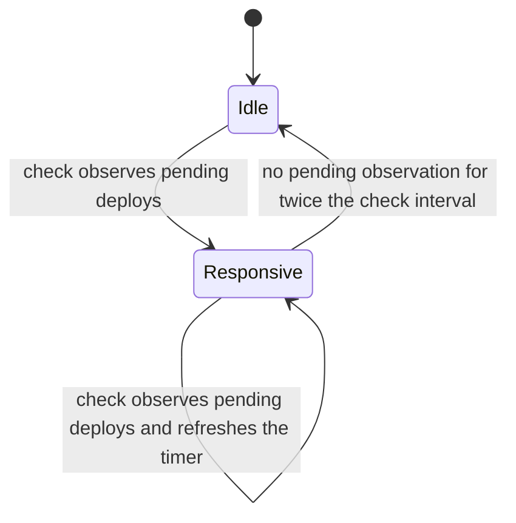

# Deploy Heartbeat Wake Design

- **Status:** implemented. F1 and F2 are at `ed9b3c996`, and H1 is at `ab84edf83`. H1 waits for the comparison run of section 5.1 and for maintainer acceptance of the claim. Created on 2026-10-18.
- **Branch:** `fix/issue-24-deploy-heartbeat-wake`
- **Issue:** issue #24, high-phase and sustained-phase `test_load` failures after PR #695
- **Tasks:** TASK-021-13 (the wait after inclusion), TASK-021-17 (metrics for each phase), TASK-021-26 (H1 implementation and verification)
- **Evidence:** soak 39089710676 (interim), the [issue #24 interim note](https://github.com/F1R3FLY-io/f1r3node-rust/issues/24#issuecomment-6254220778), and the phase summary of PR #767
- **Related design:** [adaptive-execution.md](adaptive-execution.md), decision A3 (fixed, measured thresholds first, with hysteresis)

---

## 1. Purpose

A validator with the default configuration does not react to a new deploy. The deploy waits for the next heartbeat check. A check that runs just before the deploys arrive builds an empty block, and that block starts the self-propose cooldown. The deploys then wait for a later check.

This design adds three changes to the heartbeat:

1. **F1:** a deploy wakes the heartbeat when no other path proposes for it.
2. **F2:** the heartbeat checks again when the cooldown ends, if deploys wait.
3. **H1:** a deploy-responsive mode with hysteresis, in which an empty heartbeat block does not delay the next deploy block.

The changes keep the self-propose cooldown as the bound on proposals (PR #308). They do not change block validity, fork choice, or finality.

---

## 2. Evidence

### 2.1 Soak data

The phase summary of PR #767 reads `ISSUE24_METRICS` for each phase and validator. In the high phases of soak 39089710676:

| Mean for each validator and phase | Fast (96) | Slow (126) | Failing (3) |
|---|---|---|---|
| Blocks created | 7.6 | 6.7 | 7.3 |
| Heartbeat proposals | 7.6 | 6.7 | 7.7 |
| Empty blocks built | 3.0 | 3.6 | 4.7 |
| Deploy selection age | 1.8 s | 3.2 s | 3.1 s |

- Every high-phase block came from a heartbeat proposal.
- Slow phases built more empty blocks while deploys waited.
- The slow pattern changes from phase to phase. It does not stay with a shard session.
- At the end of each high and sustained submission, the tip-LFB lag was 3 to 6 blocks. It never came near the lane thresholds (12 and 20), so the lag caps did not switch.

### 2.2 Code facts on `dev` (`5ff390e15`)

| Fact | Location |
|---|---|
| The deploy API triggers a proposal only with `autopropose`. The default is `autopropose = false`. | `node/src/main/resources/defaults.conf` line 15, `node/src/rust/runtime/setup.rs` (`propose_f_for_api`) |
| A deploy wakes the heartbeat only when `deploy_heartbeat_wake_enabled` is true. The launcher sets it to `false`, and no configuration key changes it. | `casper/src/rust/engine/multi_parent_casper/block_admission.rs` (`add_deploy`), `casper/src/rust/engine/casper_launch.rs` |
| The original reason for the opt-in wake was "Deploy API already triggers propose asynchronously". That reason is true only with `autopropose`. | Extraction commit `c36613aa2` |
| The heartbeat loop waits for the check interval (5 s) or a wake from an accepted peer block. Nothing wakes it when the cooldown ends. | `node/src/rust/instances/heartbeat_proposer.rs`, the `tokio::select!` in the loop |
| `decide_lanes` reads `has_pending_deploys` at one point in time. Without pending deploys, the frontier-follow lane builds an empty block. | `heartbeat_proposer.rs`, `decide_lanes` |
| An empty heartbeat block starts the 3 s cooldown, which gates the pending-deploy lane. | `heartbeat_proposer.rs`, `self_proposed_too_recently` |

### 2.3 Limit of the evidence

The mechanism explains about 1.4 s of extra selection delay and the extra empty blocks. The failing phase missed the 45 s limit by more than that, with finalization p50 27.7 s and the LFB at 7.9 blocks per minute. The changes can reduce the share of slow phases. A comparison run must show whether they remove the failures.

---

## 3. Design

### 3.1 F1: deploy wake without autopropose

The launcher sets `deploy_heartbeat_wake_enabled` to `true` when it has no propose function, which is the case without `autopropose`. With `autopropose`, the deploy API proposes, and the wake stays off. This keeps the original rule against duplicate proposals.

A wake does not bypass any lane rule. The heartbeat runs its normal check earlier.

### 3.2 F2: check again when the cooldown ends

The heartbeat check returns one more value: the time until the cooldown ends, when the pending-deploy lane is blocked only by the cooldown. The loop then waits for the shorter of the check interval and that time.

### 3.3 H1: deploy-responsive mode

The mode remembers pending work observed at heartbeat checks. Deploy wakes and peer-block wakes share one signal, so a wake does not identify an arrival.

| Rule | Value |
|---|---|
| Enter and refresh | A check observes pending deploys. |
| Exit | No check observes pending deploys for `2 * check_interval`. Pending work at expiry refreshes the timer. |
| Effect | The pending-deploy lane can bypass the cooldown after an empty own block. Other proposal constraints still apply. |
| Exemption credit | One issued exempt request per rolling configured cooldown. Every result consumes credit, including failure, busy, cancellation, and no selected deploys. |
| Re-entry | Mode exit and re-entry do not reset credit. |
| Successful-block bound | At most two successful routine heartbeat blocks per rolling cooldown. At most one is empty. |
| Empty classification | No processed user deploy exists. Failed user deploys count as user deploys. System-only and rejection-only blocks are empty. |
| Constants | The exit multiplier is two. The exemption limit is one. No configuration key is added. |

The routine bound covers pending-deploy, pending-backstop, and frontier-follow publications. Stale recovery, convergence, manual proposals, direct autopropose, and synchronous proposer recovery retain their separate authority and pacing.

Three seconds is the configured example, not a second cooldown constant.

The heartbeat measures the cooldown from two times: the header age of its latest own block, and its last routine publication on a monotonic clock. It uses the shorter age. So a request that waits in the queue cannot make two routine publications closer than the cooldown.

A zero check interval does not make a busy loop, because the loop sleeps for at least 10 ms. A zero cooldown grants no exemption. The test `zero_intervals_do_not_grant_an_exemption` covers both cases.

An exempt request carries the expected empty own-block hash and a nonempty requirement through the queue and retries. The proposer rejects a changed predecessor before execution.

The block hash binds the body that the heartbeat already classified. The proposer also rejects an actually empty created block before publication effects.

An exemption cannot gain empty-recovery authority past the height constraint. A due stale-recovery or convergence lane takes priority over an exemption.

The cooldown after a successful user block remains enforced. Newly observed own blocks conservatively restore the publication clock if a result was lost.

The [pending amplification claim](../claims/heartbeat-proposal-amplification-bound.md) defines the rolling windows and verification obligations. Its scope is one live heartbeat task, not durable credit across process restarts.

### 3.4 Alternative not chosen: hold the empty block

The heartbeat could hold an empty frontier-follow block briefly to include later deploys. That alternative delays witness blocks that finality needs.

H1 does not hold an empty block for batching. The cooldown from the last routine publication can still delay a routine proposal, so that the configured bound stays true.

### 3.5 Metrics

| Metric | Kind | Meaning |
|---|---|---|
| `heartbeat.deploy-wake` | Counter | Wakes from F1 |
| `heartbeat.cooldown-recheck` | Counter | Checks from F2 |
| `heartbeat.responsive-mode.entered` and `.exited` | Counters | Mode changes |
| `heartbeat.responsive-mode.cooldown-exempt` | Counter | Deploy blocks that H1 let through after an empty block |

`scripts/bench/extend-issue24-metrics.sh` adds them, so the phase summary can show them.

---

## 4. Tests

| Change | Test |
|---|---|
| F1 | Without a propose function, `add_deploy` wakes the heartbeat. With a propose function, it does not. |
| F2 | A lane decision that is blocked only by the cooldown returns the time until the cooldown ends. A decision blocked by a lag cap returns none. |
| H1 state | `heartbeat_responsive_tests.rs` covers observed-pending hysteresis, expiry, re-entry, consumed credit, rolling windows, queue delay, and recovery priority. |
| H1 execution | `h1_proposer_spec.rs` checks actual nonempty publication, failed-user and system-only classification, stale predecessors, and the height constraint. |
| No regression | The existing `lane_decision_rows` tests pass without change outside the mode. |

---

## 5. Measurement

1. Run the unit tests and the integration preflight.
2. Compare H1 against the F1/F2 baseline `ed9b3c996` with the same profile and environment.
3. Retain the step 0 baseline from TASK-021-16 as a separate comparison.
4. Compare slow-phase share, empty-block rate, selection age, finalization p95, and block rate with `scripts/bench/summarize-issue24-phases.sh`.
5. Apply the acceptance thresholds in section 5.1.
6. If H1 increases block rate and slows finalization, retain F1/F2 without H1.

Cloud dispatch and soak qualification require separate authorization.

### 5.1 Acceptance thresholds

**Decision of 2026-10-19 (maintainer).** H1 is accepted only if all three conditions are true. "F1/F2" is the run of `ed9b3c996`, and "H1" is the run of `ab84edf83` or a later H1 commit.

| Metric | Source in `scripts/bench/summarize-issue24-phases.sh` | Condition |
|---|---|---|
| Slow share | `compare --phase high`: the slow and failing phases divided by all phases. A phase is slow when its inclusion p95 is above 9 s (the default `--slow-inclusion-p95`). A phase is failing when it has unfinalized deploys. | H1 is lower than F1/F2. |
| Finalization p95 | `records`: the mean of `finalization_p95` over the `high` phases | H1 is not higher than F1/F2. |
| Block rate | `compare --phase high`: the mean of "Blocks created" over all validators and phases | H1 is at most 1.3 times F1/F2. |

Both runs use the same profile, provider, and number of `high` phases. A run needs at least 20 `high` phases for each build.

---

## 6. Open questions

| ID | Question |
|---|---|
| Q1 | Does a soak shard with `autopropose` show the same slow pattern? If not, F1 alone can be enough. |
| Q2 | Must the exit window and the exemption bound be configuration keys now, or constants until EPIC-027 owns them? **Decision of 2026-10-18 (maintainer): constants.** Both derive from the configured `check-interval` and `self-propose-cooldown`. |
| Q3 | Does H1 need a CbC claim? **Decision of 2026-10-18 (maintainer): yes.** H1 conflicts with the gate rule of `docs/claims/heartbeat-proposal-amplification-bound.md` ("A routine-lane cooldown bypass refutes this claim"). The claim revision is registered as pending before the H1 code. F1 and F2 land first, because they do not bypass the cooldown. |
