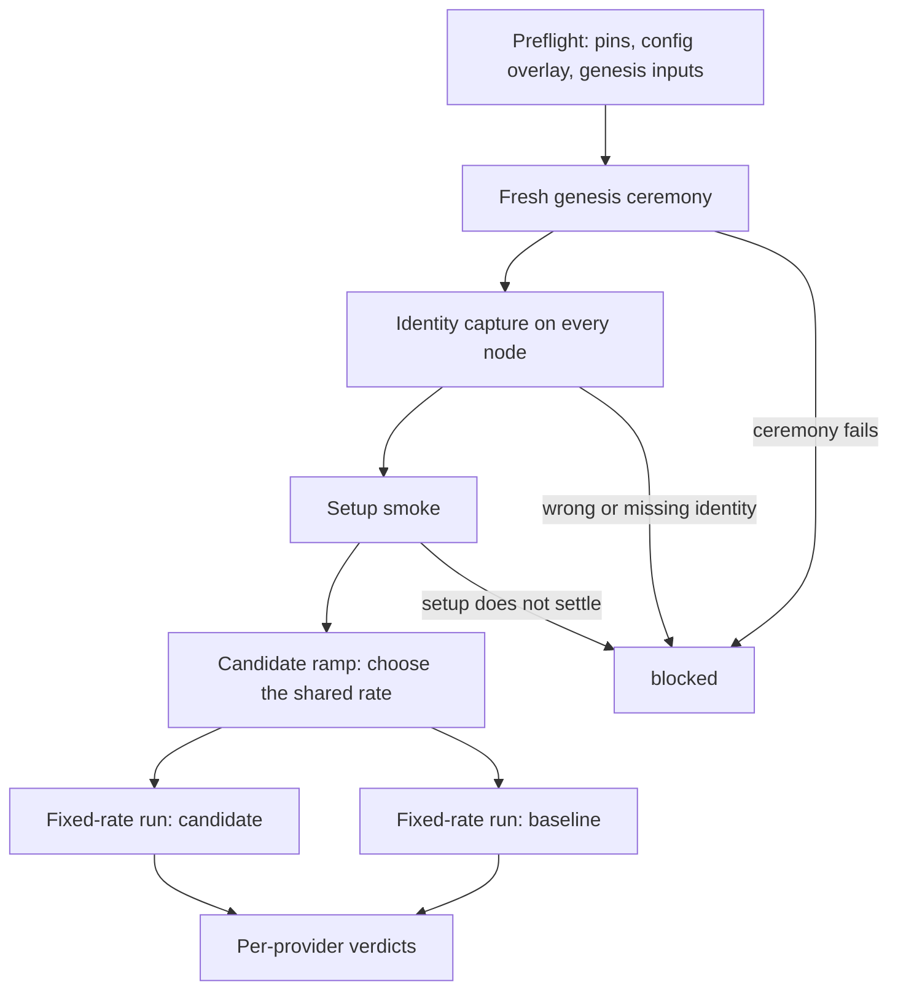

# Protocol 7 Replay-Pressure Soak

## Objective

Compare the Protocol 7 accounting path with the regular release train under the same replay-pressure workload.
Qualify the Protocol 7 candidate for liveness and A-LIN under that load.
Report the work that each shard completed, so that a latency difference can be checked against the work done.

The paired run measures a difference between two pinned builds.
It does not replace the issue #24 gate on `dev`.
It does not replace the 60-hour soak that gates a `ca-release` tag.
Those gates keep their current criteria.
See [issue #24](https://github.com/F1R3FLY-io/f1r3node-rust/issues/24), [issue #764](https://github.com/F1R3FLY-io/f1r3node-rust/issues/764), and [soak gates](../ci.md#soak-gates).

## Status

This design is a draft until the maintainers ratify it.
The branch `ca/feature-protocol-7-replay-pressure-soak` targets `ca-canary`.
It merges after [PR #1118](https://github.com/F1R3FLY-io/f1r3node-rust/pull/1118).
Before the merge, the maintainer back-merges and runs `ca-sync`.

## Roles and pins

| Role | Revision | Configuration |
| --- | --- | --- |
| Accounting candidate | The `ca-canary` commit that contains PR #1118, pinned at the run | Fresh genesis, `protocol-version = 7` through a candidate-only overlay |
| Regular-train baseline | `master` `395423897` | The stock suite configuration |
| Integration suite | system-integration `54f89b68` | The same revision for both roles |

The run records these values for each role:

- The node commit, and the digests of the node and deploy-queue binaries or images.
- The effective configuration file and its digest.
- The genesis hash that the nodes adopt.
- The provider, the host, and the resource envelope.

A version string is not an identity.
A build from a source archive reports a version string that does not name its commit.
The binary digest is the identity.

## Run stages

### Preflight

The stock suite configuration selects Protocol 1.
The candidate run therefore uses a candidate-only overlay of `conf/rust.conf` that sets `protocol-version = 7`.
The run keeps the overlay and its digest with the evidence.
The baseline uses the stock configuration.

The run uses fresh data directories and a separate test shard.
The ceremony master and the genesis validators use the same configuration, bonds, and funded wallets.

### Identity capture

The run waits for HTTP 200 from `GET /api/ready` on each node.
Then it saves the `GET /api/status` response of each node.
On the candidate, every node must report `casperProtocolVersion = 7` and `accountingAuthorityVersion = 8`.
A null, missing, or different value blocks the candidate.
The `f1r3fly.v6` log line that names the Protocol 7 executor is supporting evidence only.

### Setup smoke

The setup smoke runs the workload setup without a measured phase.
It passes only when these conditions are all true:

- Every setup deploy reaches a terminal outcome.
- The LFB advances on every node.
- The required telemetry series have samples on every required node.

The ramp and the paired runs start only after the smoke passes.
A failed smoke stays in the evidence as a non-passing candidate result.

### Ramp and fixed rate

A short ramp on the candidate chooses the comparison rate.
The shared rate is the highest step that both shards sustain without pressure.
Before the paired runs, the plan pins these values:

- The rate, the workload mix, and its parameters.
- The seed, the sender setup, and the retry rule.
- The phase durations and the total duration.
- The validator topology: four validators, one boot node, and one readonly node.

Both roles use the same values within one provider pair.

## Workload

The workload is the capacity harness `test_capacity_ramp` at the pinned suite, with `CAPACITY_WORKLOAD=mix` and `CAPACITY_RESUBMIT=1`.
Execution-heavy `call` deploys create the replay load.
`CAPACITY_CONTRACTS` sets the number of contracts.

The default mix does not include `payload`.
`CAPACITY_PAYLOAD_BYTES` has no effect unless the mix includes `payload`.
At the default size of 262,144 bytes, a `payload` deploy declares 27,214,400 phlo.
That is more than the default Protocol 7 demand cap of 5,845,811 phlo.

Each workload kind must stay within the limits of both shards.
The preflight compares each declared phlo limit with the live `maxPhloLimit` of both shards.
It compares each price with both `minPhloPrice` values.
The run keeps the effective policy and limits with the evidence.

## Observations

| Group | Fields |
| --- | --- |
| Work completed | Accepted, finalized, refused, abandoned, and expired counts for each phase. Per-deploy outcomes. Unsettled work. |
| Retries | Refusal attempts and resubmissions, separate from final deploy outcomes |
| Finalization | Finalization p95 in seconds for each phase, with sample count and interval |
| Liveness | LFB height for each node over time, stalls and their durations, drain and convergence results |
| Replay and execution work | The stage metrics that `scripts/bench/extend-issue24-metrics.sh` adds |
| A-LIN | `v6.linearizer.alin-holds` and `finalizer.commit.alin-violations` on the candidate |

A missing sample is unknown.
It never becomes zero latency, zero work, or a passing value.
This follows `MissingIsUnknown` in the [harness claim](../claims/casper-soak-harness.md).

### A-LIN

The qualification target is zero increases in both counters over the measured window while the LFB advances.
The run keeps the samples and deltas for each counter on each required node.
Each sample records the node identity, the sample count, and the timestamp.
Restarts and counter resets stay visible.

The counters increase only when their event occurs.
A clean node can therefore omit both series.
The preflight must show actual samples for each required series.
If a clean node omits a series, the profile needs a supported way to expose an explicit zero before it can qualify.
On the baseline, the A-LIN verdict is not applicable.

## Verdicts

The profile reports Docker and subprocess pairs separately.
It uses these outcomes:

| Outcome | Condition |
| --- | --- |
| `blocked` | A wrong or unavailable startup identity, a failed genesis ceremony, or a failed setup smoke |
| `incomplete` | A launched run without a required observation |
| `non-passing` | An observed product failure, an A-LIN event, or a candidate liveness failure |
| `comparison` | Both roles have valid evidence. A baseline failure under the common workload is a comparison result. |
| `qualified` | The candidate passes the setup smoke, the identity checks, and the A-LIN target with full coverage |

A Protocol 6 diagnostic cannot give a Protocol 7 verdict.
A local subprocess run gives evidence for the subprocess provider only.

## Implementation

The profile follows the structure of the existing campaign profiles in `scripts/casper-soak/src/profiles/`.
It adds these files:

- `scripts/casper-soak/src/profiles/replay_pressure.rs` with `identity`, `prepare`, `generate`, `collect`, and `classify`.
- A run adapter that supplies the candidate configuration overlay and the binary paths to the pinned suite.
- Tests for the identity, coverage, and verdict rules.
- A new profile claim under `docs/claims/`.

The new claim is under the existing harness contract.
The [harness claim](../claims/casper-soak-harness.md) supplies the identity, evidence completeness, and verdict rules.
The [version and phlo claim](../claims/casper-soak-version-phlo.md) and the [merge and accounting claim](../claims/casper-soak-merge-accounting.md) supply related interface contracts.
The profile source is CbC-mandatory, like the other profile sources.
See [CbC verification tiers](../cbc-verification-tiers.md).

## CI and release routing

The profile needs no change under `.github/` or `.mergify.yml`.
If it needs a new workflow input or dispatch argument, that change goes to `dev` first, as a separate pull request.
Then it goes through promotion and `ca-sync`.
See [CI parity](../ci.md#ci-parity).

A `ca-item` soak can qualify the profile before promotion.
The 60-hour soak on the exact `ca-release` head still gates the tag.

## Results of the first runs

These runs were local subprocess runs.
They do not qualify any build.

| Run | Build | Result |
| --- | --- | --- |
| Protocol 6 diagnostic | `ca-canary` `7a684d9fd` | `blocked`: the four-validator Protocol 6 genesis ceremony does not complete on this base |
| Pre-merge Protocol 7 candidate | PR #1118 head `964d6df3a` | `blocked`: identity passed on the captured nodes, but workload setup did not settle |

The candidate result is reported on [PR #1118](https://github.com/F1R3FLY-io/f1r3node-rust/pull/1118#issuecomment-7230998214).
The paired comparison waits for a candidate that passes the setup smoke.

## Open decisions for ratification

1. Confirm the baseline, `master` `395423897`, or re-pin it at the run.
2. Confirm the shared-rate rule: the highest step that both shards sustain without pressure.
3. Select the supported way to expose explicit zero A-LIN samples on a clean node.
4. Select the run duration and the phase durations for the paired runs.
5. Select whether the Docker pair runs on the same host as the subprocess pair.
6. Create the story and epic entries in the task tracker for this profile.
