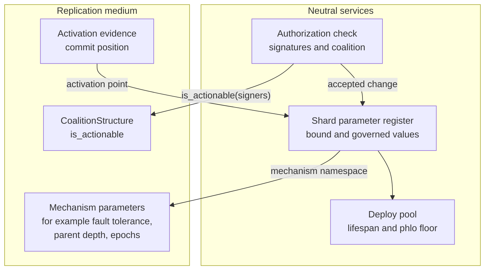

# Shard Parameter Governance Design

- **Status:** design draft for review. This document proposes approaches. It ratifies no decision. Section 13 states the review path.
- **Opened:** 2026-11-20, from the maintainer standup of that day. The participants were `metaweta`, `spreston8`, and `jeffrey-l-turner`.
- **Story:** [US-011](../UserStories.md) Pluggable state machine replication per shard
- **Epic:** EPIC-025, task TASK-025-9 in [ToDos](../ToDos.md)
- **Extends:** [Replication Boundary Design](replication-boundary.md), section 17
- **Vocabulary:** [docs/Glossary.md](../Glossary.md) for the neutral terms and the [Casper glossary](../casper/GLOSSARY.md) for the CBC Casper terms
- **Follow-up:** a separate branch corrects the Casper protocol versioning on `ca-canary` and `ca-release`. Section 10 states the conflict that it must resolve.

---

## 1. Purpose

A shard has parameters that every validator must apply in the same way. If two validators use different values, their validity verdicts fork. Today a shard cannot change these values while it runs. A change needs a new genesis, so a test net loses its history at each change.

This document has four goals:

1. Record which parameters and which configuration settings are critical to validation, and where each value comes from today (section 5).
2. Put each class of parameter on the correct side of the replication boundary (section 6).
3. Describe the approaches for an authorized change of a parameter on a running shard (sections 7 and 8).
4. State the rule that tells when a validator becomes accountable for a change (section 9).

The standup found that this work does not block the test net launch. It blocks the production launch. A production shard must run continuously, and a new genesis for each change is not acceptable there.

---

## 2. Scope and non-goals

**In scope.**

- Parameters that a validity rule, the finalized floor, or the proof-of-stake contract reads.
- Configuration settings that are node-local today but that every validator must set to the same value.
- The authorization, activation, and visibility of a parameter change.

**Not in scope.**

- A change of the [replication medium](../Glossary.md#replication-medium) of a running shard. Decision D2 of the boundary design keeps the [shard replication binding](../Glossary.md#shard-replication-binding) fixed for the life of the shard.
- A change of the Casper protocol version. The versioning follow-up owns it (section 10).
- Token economics, rewards, and fees, other than the minimum phlo price as a validity input.
- An implementation. No code changes before the review in section 13.

---

## 3. Terms

The [glossary](../Glossary.md) defines each term. This list gives the short meaning.

| Term | Short meaning |
| --- | --- |
| [Shard parameter](../Glossary.md#shard-parameter) | A value that all validators of one shard must apply in the same way |
| [Validation-critical setting](../Glossary.md#validation-critical-setting) | A parameter or setting that a validity rule, the finality decision, or a system contract reads |
| [Parameter class](../Glossary.md#parameter-class) | Bound, governed, aligned, or node-local (section 5.1) |
| [Parameter alignment](../Glossary.md#parameter-alignment) | The property that all validators of a shard apply the same value of each validation-critical setting |
| [Parameter change](../Glossary.md#parameter-change) | An authorized replacement of the value of a governed parameter on a running shard |
| [Governance authorization](../Glossary.md#governance-authorization) | The evidence that an actionable coalition of the shard approved one parameter change |
| [Off-chain governance](../Glossary.md#off-chain-governance) | Validators agree outside the shard and apply a change through a coordinated restart |
| [On-chain governance](../Glossary.md#on-chain-governance) | The shard itself checks the authorization and applies the change |
| [Coordinated restart](../Glossary.md#coordinated-restart) | All validators stop at an agreed point and start again with the new values |
| [Activation point](../Glossary.md#activation-point) | The point in the order of a shard at which a change starts to apply |
| [Visibility rule](../Glossary.md#visibility-rule) | A validator is accountable for a change only after the authorization is in the causal past of its own message |

---

## 4. Current state

These facts come from `dev` at `5c604ba25`.

1. **Adoption at startup.** All three paths that construct a running Casper instance call `hash_set_casper` in `casper/src/rust/casper.rs`. That function reads two getters of the proof-of-stake contract on the post-state of the approved block: `getFaultToleranceThresholdPpm` and `getConsensusParameters`. It always replaces the local values with the on-chain values.
   - A missing or out-of-range value stops the node.
   - The Rocq lemma `FtProvenance.reconcile_agrees_on_onchain` states the result: `reconcile(local, onchain) = onchain`.
2. **The adopted values are fixed.** `casper/src/main/resources/PoS.rhox` puts the values into the contract at genesis as macro parameters. The contract has no method that changes them. Its comment says "Immutable until an on-chain parameter-upgrade mechanism exists."
3. **Two node-local settings are validity inputs.** `Validate::parents` in `casper/src/rust/validate.rs` returns `InvalidParents` when a block has more parents than the local `max-number-of-parents`. The same function skips the progress check when `disable_validator_progress_check` is set, and `casper_launch.rs` sets that flag in standalone mode. Neither value comes from the chain.
4. **The shard name is a node-local copy of a genesis value.** Genesis writes the shard name into the contract. Validation compares the `shard_id` of each block with the local `shard-name` setting.
5. **The protocol version comes from the approved block.** Block intake compares the block version with the version of the approved block (`intake_worker.rs`). The compiled constant `CASPER_PROTOCOL_VERSION` is `1`.
6. **A multi-signature contract exists, but it does not govern parameters.** `MultiSigSystemVault.rho` checks an M-of-N quorum in Rholang. Genesis creates the cooperative vault from `pos-multi-sig-public-keys` and `pos-multi-sig-quorum` (two of three keys by default). The keys are not the validator keys, and the proof-of-stake contract has no control of that vault.
7. **The protocol document has an error.** Sections 1 and 10 of the [Consensus Protocol](../casper/CONSENSUS_PROTOCOL.md) said that the synchrony constraint threshold is an on-chain genesis value. The contract has no such parameter. The threshold is a node-local proposer setting. This branch corrects the document.

---

## 5. Register of validation-critical settings

### 5.1 Parameter classes

| Class | Meaning | Change today | Proposed target |
| --- | --- | --- | --- |
| **Bound** | Part of the identity of the shard | Never. A new value is a new shard | Unchanged. Never governed |
| **Governed** | On-chain value that the node adopts | New genesis | Change through an authorized [parameter change](../Glossary.md#parameter-change) |
| **Aligned** | Node-local value that a validity rule reads | Every operator edits the configuration at the same time | Move to the governed class, or remove from validity |
| **Node-local** | Local policy that no validity rule reads | Each operator, at any time | Unchanged |

### 5.2 Register

The class column is a proposal. The review in section 13 confirms each row.

| Setting | Source today | Read by | Proposed class | Boundary side |
| --- | --- | --- | --- | --- |
| Replication medium (`consensus.protocol`) | Data-directory manifest (PR #651) | Node startup | Bound | Neutral |
| Shard name and parent shard identifier | Genesis, plus a local copy | Block validation, approved-block check at join | Bound | Neutral |
| Chain identifier (genesis block hash) | Block DAG storage | Block validation | Bound | Neutral |
| Native token name, symbol, and decimals | `TokenMetadata` contract at genesis | Startup check, status API | Bound | Neutral |
| Protocol version | Approved block header | Block intake | Bound until the versioning follow-up decides (section 10) | Mechanism |
| Minimum phlo price | `getConsensusParameters` | Deploy validity | Governed | Neutral (execution) |
| Deploy lifespan | `getConsensusParameters` | Expiry and repeat-deploy validity | Governed | Neutral (deploy pool) |
| Fault-tolerance threshold (ppm) | `getFaultToleranceThresholdPpm` | Finalized floor, finality decision | Governed | Mechanism |
| Maximum parent depth | `getConsensusParameters` | Parent-spread validity, citability horizon, history and mergeable-channel GC horizon | Governed | Mechanism (`DagMedium`) |
| Epoch length | `getConsensusParameters` | Slash authorization, neglect | Governed | Mechanism |
| Quarantine length | Proof-of-stake contract at genesis | Withdrawal rules in the contract | Governed | Mechanism |
| Bond minimum and bond maximum | Proof-of-stake contract at genesis | Bond method in the contract | Governed | Mechanism |
| Number of active validators | Proof-of-stake contract at genesis | Validator rotation in the contract | Governed | Mechanism |
| Cooperative multi-signature keys and quorum | `MultiSigSystemVault` at genesis | Vault transfers | Governed, if the review keeps this vault | Neutral (execution) |
| Maximum number of parents | Local configuration | Block validation (`InvalidParents`) | Aligned, proposed to become governed | Mechanism (`DagMedium`) |
| Progress-check skip | Standalone run mode | Block validation | Aligned. Proposed: allowed only in a single-validator shard | Mechanism |
| Finalization rate | Local configuration | Finalization runner cadence | Node-local. The review must confirm that no validated value depends on it | Mechanism |
| Heartbeat check interval | Local configuration | Proposer timing, derived deploy budget, citability-window checks | Node-local. It sizes a governed value, so it is a governance input | Mechanism |
| Synchrony constraint threshold and recovery settings | Local configuration | Proposer gate only | Node-local | Mechanism |
| Height constraint threshold | Local configuration | Proposer gate only | Node-local | Mechanism |
| Maximum user deploys per block, deploy admission limits, deploy play budget | Local configuration | Proposer packaging and admission | Node-local | Neutral (deploy pool) |
| Garbage collection and pruning switches, intervals, and the GC depth buffer | Local configuration | Local storage | Node-local. The GC horizon uses the governed `max-parent-depth` and `deploy-lifespan` values | Neutral |

The aligned rows are the alignment gap. Two validators with different values for one of them can reach different verdicts for the same block. The proposal is that no aligned setting remains when a production shard starts.

---

## 6. Placement at the replication boundary

The boundary design splits the node into neutral services and one replication medium. Shard parameters follow the same split.



Proposals:

- **P1. Two namespaces.** The register holds neutral parameters and one namespace for the bound mechanism. A neutral service reads only neutral values. The medium reads its namespace. The register stores both, so that one change process serves both.
- **P2. The medium supplies the coalition rule.** A change is authorized when its signers form an [actionable coalition](../Glossary.md#actionable-coalition) of the shard. `CoalitionStructure::is_actionable` (boundary design section 16) answers that question for every medium. For CBC Casper, the rule is the stake rule of the clique oracle.
- **P3. The medium supplies the activation evidence.** Each medium has its own commit order. The medium states the activation point as a commit position, and the register applies the change from that position (section 8).
- **P4. A read method on the medium.** `ReplicationMedium` gets a read method for the parameter view that applies at a commit. The proposed shape is below. Like the other methods, it returns a copy.

```rust
pub struct ShardParameterView {
    pub at: CommitId,
    pub neutral: ParameterSet,
    pub mechanism: ParameterSet,
    pub pending: Vec<PendingChange>,   // authorized changes before their activation point
}

pub trait ReplicationMedium {
    // existing methods (boundary design section 7)
    fn parameters(&self, at: &CommitId) -> ShardParameterView;
}
```

- **P5. The bound class stays out of governance.** No authorization can change a bound value. A change of the medium, the shard identity, or the token metadata makes a new shard. This keeps decision D2.

### 6.1 Isolation of neutral and mechanism values

Today the code does not separate the two namespaces. The proof-of-stake contract stores the neutral values (deploy lifespan and minimum phlo price) beside the Casper values. `getConsensusParameters` returns them in one tuple. `hash_set_casper` adopts all of them into `CasperShardConf`. A second medium has no source for a neutral value. These proposals separate them:

- **P6. Neutral storage.** A neutral system contract, or one registry entry, stores the bound and governed neutral values. The proof-of-stake contract keeps only the values of the CBC Casper namespace.
- **P7. Neutral adoption.** A neutral node service adopts the neutral values and gives them to the deploy pool and the APIs. The CBC Casper adapter adopts only its own namespace. No neutral service reads `CasperShardConf`.
- **P8. A migration step without a behavior change.** The boundary design lists the mixed storage and adoption as a CBC Casper leak, with its own migration task. An existing shard keeps its genesis values. The neutral service reads them from the new store, or from the proof-of-stake contract on a shard that started before the move.
- **P9. A stub check.** The test-only stub medium has an empty mechanism namespace. It must get the neutral values and pass the deploy validity tests.
- **P10. Neutral authorization.** Option B (section 7.2) keeps the authorization check neutral. Option C (section 7.3) puts the check in a contract for each medium. If the review selects option C, the neutral values need their own contract check, and that check calls the coalition rule of the bound medium.

---

## 7. Authorization options

The standup named three options. Each option needs a rule that states which signers are sufficient. Proposal P2 makes that rule the actionable coalition of the medium.

### 7.1 Option A: off-chain governance with a coordinated restart

The validators agree outside the shard, for example on a message board where they record their votes. When enough stake agrees, every operator stops the node at an agreed block, changes the value, and starts again from that block.

- **Benefit.** No new protocol code. It works today for a test net that one organization controls.
- **Cost.** Every operator must act at the same point. A validator that restarts late or with the wrong value forks from the shard. The chain holds no record of the authorization.
- **Fit.** It is the fallback for the test net. It is not sufficient for a production shard with independent operators.

The `genesis-block-number` setting exists for a new genesis on an existing network. It does not carry state, so it is not an off-chain change of one parameter.

### 7.2 Option B: on-chain governance, signatures checked by the node

A change deploy carries the signatures of the approving validators. The node checks the signatures in Rust before Rholang runs, in the same way that it checks a deployer signature and makes the deployer identifier. The node then gives the contract an unforgeable authorization token. The contract changes the parameter only when it receives that token.

- **Benefit.** The cryptography stays in the node, where the deploy signature checks already are. The contract does not parse signatures. One aggregated threshold signature can replace a list of signatures. The experimental FROST path (`frost-secp256k1`) is a candidate.
- **Cost.** It adds a new system-deploy kind or a new deploy field, and a new authorization path in the node. The coalition check must use the membership at an agreed commit.
- **Fit.** It suits a neutral design, because the node calls `is_actionable` on the medium and the contract stays simple.

### 7.3 Option C: on-chain governance, signatures checked in Rholang

The change deploy carries the signatures as data. A governance contract checks each signature through a Rholang crypto channel, `rho:crypto:ed25519Verify` or `rho:crypto:secp256k1Verify`. It adds the stake of the valid signers. It changes the parameter only when the sum passes the coalition threshold.

- **Benefit.** The rule is contract code, so a later contract upgrade can change it. `MultiSigSystemVault.rho` already does an M-of-N check in this style.
- **Cost.** Every validator replays the signature checks in Rholang, at a cost in phlo. The contract must read the bonds and the threshold at the same commit as the check. Each medium needs its own contract logic for its coalition rule, which makes the neutral part smaller.
- **Fit.** It is the shortest path for CBC Casper alone. It is less neutral than option B, because the check is in a contract for one medium (proposal P10).

### 7.4 Comparison

| Criterion | A: off-chain | B: node checks | C: Rholang checks |
| --- | --- | --- | --- |
| Record of authorization on the chain | No | Yes | Yes |
| Operator action at the change | Every operator | None | None |
| New node code | None | Authorization path | Crypto channels exist |
| New contract code | None | Parameter setter that takes a token | Full check and setter |
| Medium neutrality | Not applicable | High: uses `is_actionable` | Low: one contract per coalition rule |
| Cost per change | Downtime | One node check per validator | Rholang signature checks per validator |
| Production fit | No | Yes | Yes, for CBC Casper first |

No option is selected. The review in section 13 selects one.

---

## 8. Activation

An authorized change must start to apply at the same point for every validator. Two approaches fit a multi-parent DAG.

- **Activation from state.** The parameter is a value in the RSpace state. A block is judged with the values in its own pre-state. A validator that has not seen the change builds on a pre-state with the old value. Other validators judge that block with the old value. Thus validity stays a function of the causal past.

  This approach has two costs. The node must read the values for each block, not once at startup. Also, a merge must not combine two different values of one parameter, so a change channel must not be mergeable.
- **Activation at a finalized point.** The change applies from the first block whose finalized floor contains the authorizing commit plus a fixed delay `d`. All validators agree on finalized commits, so they agree on the activation point. A validator has at least `d` blocks to see the change before it applies. The node can keep one value per finalized interval.

Both approaches remove the need to restart. Activation from state has no delay. Activation at a finalized point gives operators time to see and check the change. The review selects one, or a combination: authorization in state, activation at a finalized point.

---

## 9. Visibility and accountability

The standup stated this rule. A validator is accountable for a change only if it built on the block with the authorized change, or on a descendant of that block. A validator that has not seen the block must not be slashed for using the old value. Delayed messages are normal in an asynchronous network.

The proposed [visibility rule](../Glossary.md#visibility-rule):

- **V1.** A message is judged with the parameter values that apply in its own causal past. For CBC Casper, the causal past is the justifications of the block.
- **V2.** A slash or neglect verdict that depends on a parameter uses the value of the judged message. It does not use the value of the judging validator.
- **V3.** If the causal past of a message does not contain the authorization, the old value applies to the message. This is true when other validators already apply the new value.

Activation from state (section 8) gives V1 to V3 directly. Activation at a finalized point gives them only when the delay `d` is longer than the citability window. A block cannot cite a parent outside that window. Slashing ledger entry [D-09](../casper/design/decision-ledger/09-slashing-authorization.md) defines slash authorization from canonical evidence. V2 keeps that evidence independent of local values.

---

## 10. Conflicts to resolve in the versioning follow-up

- **D-01 and fresh genesis.** Ledger entry [D-01](../casper/design/decision-ledger/01-protocol-version-authority.md) says that protocol 7 activates only through a fresh genesis after FIP approval. That rule applies to a protocol version, not to a parameter value. But the parameter-change path can itself need protocol 7. Then the first production shard must start with protocol 7, or the rule must allow an activation without a fresh genesis. The versioning follow-up decides this.
- **Version constant and ledger.** The compiled constant is `1`, and the ledger names protocol 7. The follow-up aligns the numbers on `ca-canary` and `ca-release`.
- **Cost accounting.** The accounting authority version is independent of the protocol version (D-01). A governed minimum phlo price must keep that independence.

### 10.1 Resolution on `ca/shard-parameter-gov-casper-v7` (2026-11-20)

This branch applies D-01 on `ca-canary`. It changes no ratified rule.

- **Protocol 7 is the cost-accounted protocol.** On `ca-canary`, the cost-accounting code named this protocol 6 (`PROTOCOL_V6 = 6`). The branch renames the constant to `PROTOCOL_V7 = 7`. The finality check (`ALinPolicy`) then halts on protocol 7 and raises an alarm on other versions.
- **A new genesis uses protocol 7 by default.** `CASPER_PROTOCOL_VERSION` and the `protocol-version` default change from 1 to 7. A shard that started with protocol 1 keeps protocol 1.
- **The fresh-genesis rule stays.** Protocol 7 starts only through a fresh genesis, so the D-01 rule and this design agree. A parameter change replaces a value inside one protocol version, so it needs no fresh genesis. But the change path itself is a validity rule. If the production genesis does not include the selected path, the path needs a later protocol version and one more fresh genesis.
- **Accounting authority version 8.** The constant `ACCOUNTING_AUTHORITY_VERSION = 8` belongs to the accounting module. It is independent of the protocol version. The status API reports it as `accountingAuthorityVersion` beside `casperProtocolVersion`.
- **`ca-release`.** The change reaches `ca-release` through the normal promotion from `ca-canary`.

---

## 11. Verification plan

| Property | Proposed evidence |
| --- | --- |
| A node never applies a local value where a governed value exists | Extend the adoption tests to every governed row, and add a test that changes a local value and expects the same verdict |
| No aligned setting remains at production launch | A configuration test fails when a validity rule reads a node-local value |
| Only an actionable coalition can authorize a change | Property tests over `is_actionable` with random signer sets, including equivocating signers |
| Neutral services get neutral values without CBC Casper (P6, P7) | The stub medium with an empty mechanism namespace passes the deploy validity tests (P9) |
| Validators agree on the activation point | A model in TLA+ with delayed messages and a change in flight, which checks one value per commit |
| V1 to V3 hold | A slashing model case with a validator that has not seen the change |
| A bound value cannot change | A negative test: an authorized change of a bound value is rejected |

The change path changes validity rules. It therefore becomes Correct-by-Construction scope when code starts. The claim text follows the selected option.

---

## 12. Open questions

1. Which authorization option (A, B, or C) does a production shard use? Does the test net use option A until then?
2. Which activation approach (section 8) applies, and what is the delay `d`?
3. Which membership decides the coalition of a change: the bonds at the authorizing commit, or the bonds at the activation point?
4. Does the cooperative multi-signature vault stay a separate governed object, or does validator governance replace it?
5. Does the maximum number of parents become governed, or does the validity rule stop reading it?
6. Is the progress-check skip allowed only in a single-validator shard?
7. Can a parameter change take effect before the protocol version that adds it (section 10)?
8. Does a governed value need limits that even an authorized change cannot pass, for example a fault-tolerance threshold between 0 and 1?
9. Does the neutral store (P6) use a new system contract or a registry entry? How does a shard that started before the move find its neutral values?

---

## 13. Review path

1. `metaweta` and `spreston8` review the terms, the register, and the options in the pull request of this branch.
2. The maintainers select the options and answer section 12 in a later review. The selection is recorded as a decision in this document, in the format of the boundary design decisions.
3. Code and specification changes start only after that record exists.
