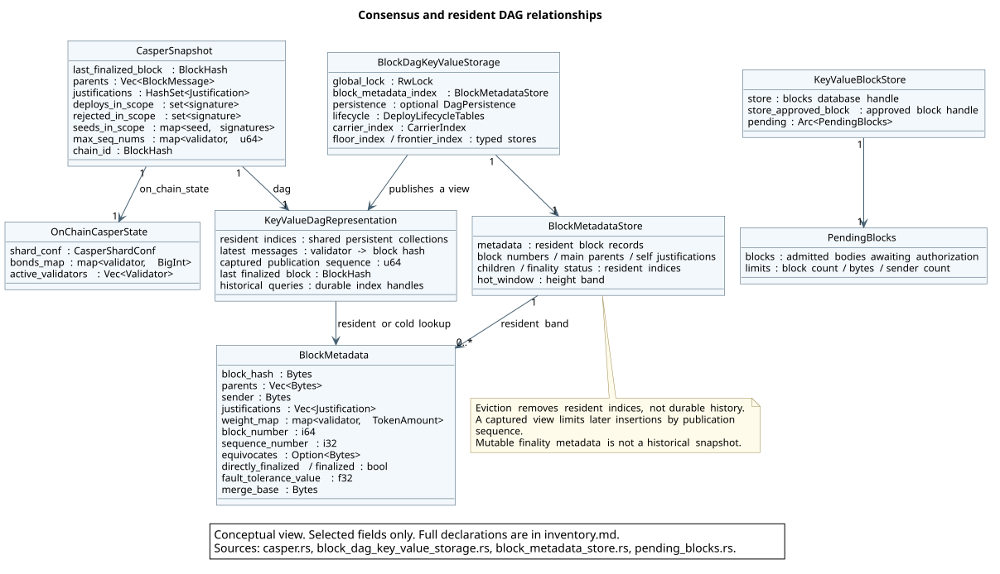
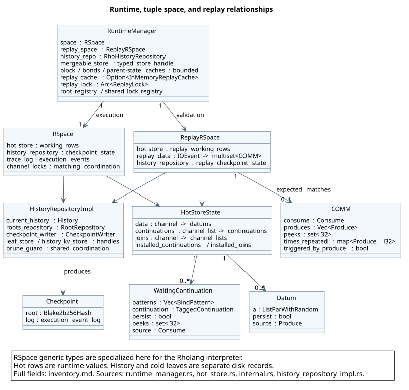
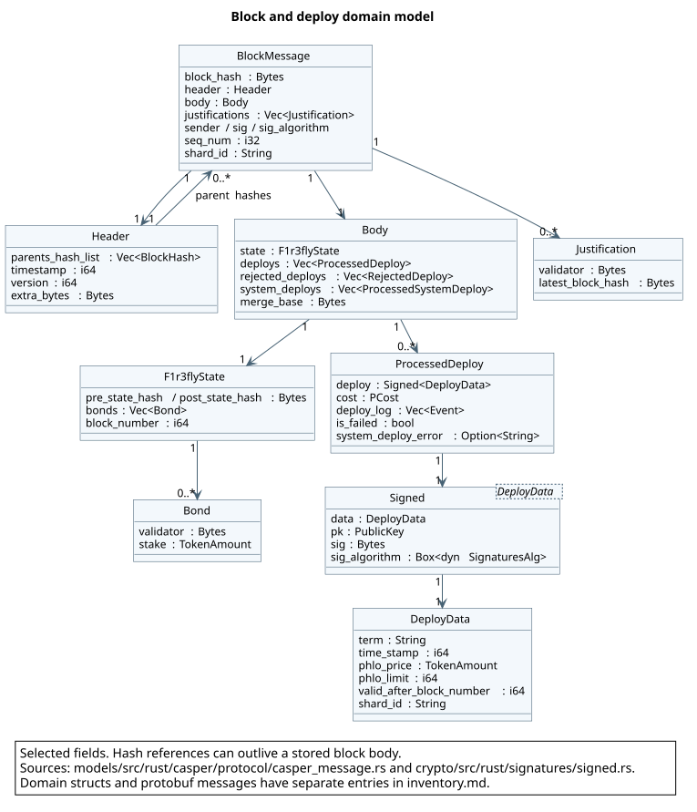

# In-Memory Data

The focused diagrams show relationships across components.
The generated catalog contains the full declared fields and variants within the [documented scope](../README.md#scope).

## Focused Views

| Diagram | Rendered view | Editable source |
| --- | --- | --- |
| Consensus and resident DAG | [SVG](consensus.svg) | [PlantUML](consensus.puml) |
| Execution and replay | [SVG](execution.svg) | [PlantUML](execution.puml) |
| Block and deploy model | [SVG](block-model.svg) | [PlantUML](block-model.puml) |

## Complete Catalog

Use the [type inventory](inventory.md) to find a type by name or source file.
Each row links to a rendered diagram and its PlantUML source.
Each `catalog-*.md` page embeds that diagram and lists resolved cross-page references.
It also gives cardinality and size assessments for every entity and field.
See [sizing rules and limits](sizing.md) and the [machine-readable assessments](sizing.json).

| Source tree | Data covered |
| --- | --- |
| `block-storage` | Resident DAG indices, metadata, pending blocks, deploy stores, lifecycle, carrier indices, diagnostic captures |
| `casper` | Engine states, ingest queues, proposal and validation state, finality, merge state, caches, recovery, synchronization |
| `comm` | Peer identity, routing, connections, TLS transport, bounded buffers, streamed packets, discovery messages |
| `crypto` | Hash values, keys, signatures, signed values, algorithm-specific state |
| `deploy-queue` | Intake records, scheduler state, per-deployer state, health, HTTP and gRPC models |
| `models` | Blocks, deploys, event logs, Rholang values, AST nodes, API and wire messages |
| `node` | Runtime wiring, configuration, API request and response models, diagnostics, proposal scheduling |
| `rholang` | Runtime state, reduction, matching, environments, cost accounting, filesystem handles, locks, WAL, snapshots |
| `rspace++` | Hot-store rows, matching candidates, replay events, checkpoints, trie nodes, history and merge actions |
| `shared` | Store handles, atomic transactions, bounded reads, events, collections, token amounts, metrics state |
| `graphz` | DAG visualization models |
| `rho-pure-eval` | Standalone evaluator models |
| `scripts/file-read-service` | Runtime file-service requests, responses, and configuration |

For persisted forms, see the [storage diagrams](../storage/README.md).
Some types appear in both views because the node decodes a stored record into a runtime value.

## Source Anchors

- [Consensus snapshot](../../../casper/src/rust/casper.rs)
- [Resident DAG representation](../../../block-storage/src/rust/dag/block_dag_key_value_storage.rs)
- [Runtime manager](../../../casper/src/rust/util/rholang/runtime_manager.rs)
- [Hot-store state](../../../rspace++/src/rspace/hot_store.rs)
- [Tuple-space records](../../../rspace++/src/rspace/internal.rs)
- [Block domain model](../../../models/src/rust/casper/protocol/casper_message.rs)
- [Rholang value grammar](../../../models/src/main/protobuf/RhoTypes.proto)
