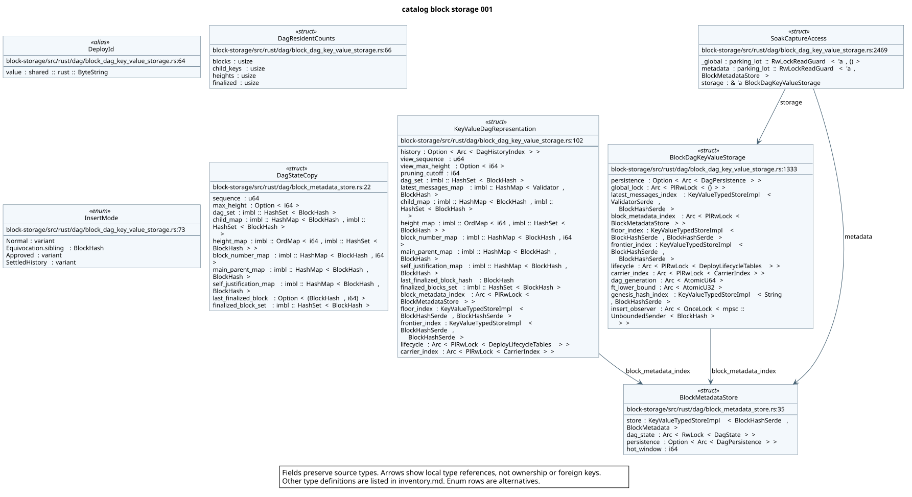

# catalog block storage 001

[Inventory](inventory.md) | [PlantUML](catalog-block-storage-001.puml)

## Cross-Page References

- `BlockDagKeyValueStorage: carrier_index -> CarrierIndex [catalog-block-storage-002.svg]`
- `BlockDagKeyValueStorage: floor_index -> BlockHashSerde [catalog-models-027.svg]`
- `BlockDagKeyValueStorage: floor_index -> KeyValueTypedStoreImpl [catalog-shared-007.svg]`
- `BlockDagKeyValueStorage: frontier_index -> BlockHashSerde [catalog-models-027.svg]`
- `BlockDagKeyValueStorage: frontier_index -> KeyValueTypedStoreImpl [catalog-shared-007.svg]`
- `BlockDagKeyValueStorage: genesis_hash_index -> BlockHashSerde [catalog-models-027.svg]`
- `BlockDagKeyValueStorage: genesis_hash_index -> KeyValueTypedStoreImpl [catalog-shared-007.svg]`
- `BlockDagKeyValueStorage: insert_observer -> BlockHash [catalog-models-027.svg]`
- `BlockDagKeyValueStorage: latest_messages_index -> BlockHashSerde [catalog-models-027.svg]`
- `BlockDagKeyValueStorage: latest_messages_index -> KeyValueTypedStoreImpl [catalog-shared-007.svg]`
- `BlockDagKeyValueStorage: latest_messages_index -> ValidatorSerde [catalog-models-040.svg]`
- `BlockDagKeyValueStorage: lifecycle -> DeployLifecycleTables [catalog-block-storage-004.svg]`
- `BlockDagKeyValueStorage: persistence -> DagPersistence [catalog-block-storage-004.svg]`
- `BlockMetadataStore: dag_state -> DagState [catalog-block-storage-002.svg]`
- `BlockMetadataStore: persistence -> DagPersistence [catalog-block-storage-004.svg]`
- `BlockMetadataStore: store -> BlockHashSerde [catalog-models-027.svg]`
- `BlockMetadataStore: store -> BlockMetadata [catalog-models-027.svg]`
- `BlockMetadataStore: store -> KeyValueTypedStoreImpl [catalog-shared-007.svg]`
- `DagStateCopy: block_number_map -> BlockHash [catalog-models-027.svg]`
- `DagStateCopy: child_map -> BlockHash [catalog-models-027.svg]`
- `DagStateCopy: dag_set -> BlockHash [catalog-models-027.svg]`
- `DagStateCopy: finalized_block_set -> BlockHash [catalog-models-027.svg]`
- `DagStateCopy: height_map -> BlockHash [catalog-models-027.svg]`
- `DagStateCopy: last_finalized_block -> BlockHash [catalog-models-027.svg]`
- `DagStateCopy: main_parent_map -> BlockHash [catalog-models-027.svg]`
- `DagStateCopy: self_justification_map -> BlockHash [catalog-models-027.svg]`
- `InsertMode: Equivocation.sibling -> BlockHash [catalog-models-027.svg]`
- `KeyValueDagRepresentation: block_number_map -> BlockHash [catalog-models-027.svg]`
- `KeyValueDagRepresentation: carrier_index -> CarrierIndex [catalog-block-storage-002.svg]`
- `KeyValueDagRepresentation: child_map -> BlockHash [catalog-models-027.svg]`
- `KeyValueDagRepresentation: dag_set -> BlockHash [catalog-models-027.svg]`
- `KeyValueDagRepresentation: finalized_blocks_set -> BlockHash [catalog-models-027.svg]`
- `KeyValueDagRepresentation: floor_index -> BlockHashSerde [catalog-models-027.svg]`
- `KeyValueDagRepresentation: floor_index -> KeyValueTypedStoreImpl [catalog-shared-007.svg]`
- `KeyValueDagRepresentation: frontier_index -> BlockHashSerde [catalog-models-027.svg]`
- `KeyValueDagRepresentation: frontier_index -> KeyValueTypedStoreImpl [catalog-shared-007.svg]`
- `KeyValueDagRepresentation: height_map -> BlockHash [catalog-models-027.svg]`
- `KeyValueDagRepresentation: history -> DagHistoryIndex [catalog-block-storage-003.svg]`
- `KeyValueDagRepresentation: last_finalized_block_hash -> BlockHash [catalog-models-027.svg]`
- `KeyValueDagRepresentation: latest_messages_map -> BlockHash [catalog-models-027.svg]`
- `KeyValueDagRepresentation: lifecycle -> DeployLifecycleTables [catalog-block-storage-004.svg]`
- `KeyValueDagRepresentation: main_parent_map -> BlockHash [catalog-models-027.svg]`
- `KeyValueDagRepresentation: self_justification_map -> BlockHash [catalog-models-027.svg]`
