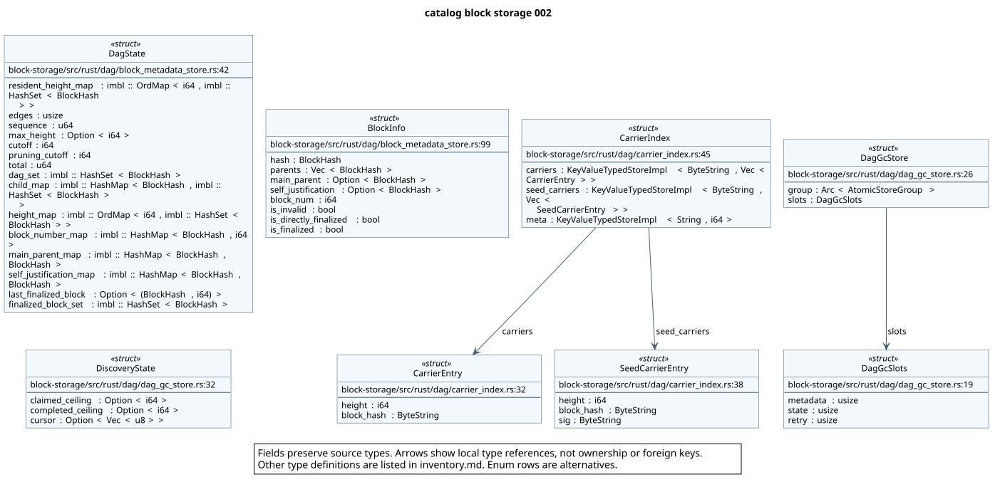

# catalog block storage 002

[Inventory](inventory.md) | [PlantUML](catalog-block-storage-002.puml)

## Cardinality and Size

[Method, units, limits, and runtime evidence](sizing.md). These are declaration-level assessments, not measured live counts.

### DagState

Cardinality: 0..n live values. Current count and owner-level limits are not derivable from this declaration.

Size: Sum of field inline layouts plus compiler padding, then uniquely owned allocations. repr and custom implementations can change layout.

| Field or variant | Cardinality | Inline bytes or layout | Additional storage or wire encoding |
| --- | --- | --- | --- |
| `resident_height_map` | 1 value | Compiler layout required | Follow the referenced declaration or external implementation. No allocation bound established. |
| `edges` | 1 scalar | 8 B | None |
| `sequence` | 1 scalar | 8 B | None |
| `max_height` | 0..1 present payload | Option layout includes any tag or niche optimization. Do not assume I(T) + 1 | None when absent. Present payload: 1 scalar. None |
| `cutoff` | 1 scalar | 8 B | None |
| `pruning_cutoff` | 1 scalar | 8 B | None |
| `total` | 1 scalar | 8 B | None |
| `dag_set` | 0..n distinct elements | Container and hasher implementation required | Element storage, owned allocations, spare capacity and index overhead. No type-level count cap |
| `child_map` | 0..n key/value pairs | Container and hasher implementation required | n keys and n values, their owned allocations, spare capacity, buckets or tree nodes, and control bytes. No type-level count cap |
| `height_map` | 1 value | Compiler layout required | Follow the referenced declaration or external implementation. No allocation bound established. |
| `block_number_map` | 0..n key/value pairs | Container and hasher implementation required | n keys and n values, their owned allocations, spare capacity, buckets or tree nodes, and control bytes. No type-level count cap |
| `main_parent_map` | 0..n key/value pairs | Container and hasher implementation required | n keys and n values, their owned allocations, spare capacity, buckets or tree nodes, and control bytes. No type-level count cap |
| `self_justification_map` | 0..n key/value pairs | Container and hasher implementation required | n keys and n values, their owned allocations, spare capacity, buckets or tree nodes, and control bytes. No type-level count cap |
| `last_finalized_block` | 0..1 present payload | Option layout includes any tag or niche optimization. Do not assume I(T) + 1 | None when absent. Present payload: 2 component values. Sum of component-owned allocations |
| `finalized_block_set` | 0..n distinct elements | Container and hasher implementation required | Element storage, owned allocations, spare capacity and index overhead. No type-level count cap |

### BlockInfo

Cardinality: 0..n live values. Current count and owner-level limits are not derivable from this declaration.

Size: Sum of field inline layouts plus compiler padding, then uniquely owned allocations. repr and custom implementations can change layout.

| Field or variant | Cardinality | Inline bytes or layout | Additional storage or wire encoding |
| --- | --- | --- | --- |
| `hash` | 1 value | Compiler layout required | Follow the referenced declaration or external implementation. No allocation bound established. |
| `parents` | 0..n elements | 24 B. Vec header on the generator target | capacity * I(element), plus live element-owned allocations. Zero-sized elements need no backing allocation. Element: Follow the referenced declaration or external implementation. No allocation bound established. |
| `main_parent` | 0..1 present payload | Option layout includes any tag or niche optimization. Do not assume I(T) + 1 | None when absent. Present payload: 1 value. Follow the referenced declaration or external implementation. No allocation bound established. |
| `self_justification` | 0..1 present payload | Option layout includes any tag or niche optimization. Do not assume I(T) + 1 | None when absent. Present payload: 1 value. Follow the referenced declaration or external implementation. No allocation bound established. |
| `block_num` | 1 scalar | 8 B | None |
| `is_invalid` | 1 scalar | 1 B | None |
| `is_directly_finalized` | 1 scalar | 1 B | None |
| `is_finalized` | 1 scalar | 1 B | None |

### CarrierEntry

Cardinality: 0..n live values. Current count and owner-level limits are not derivable from this declaration.

Size: Sum of field inline layouts plus compiler padding, then uniquely owned allocations. repr and custom implementations can change layout.

| Field or variant | Cardinality | Inline bytes or layout | Additional storage or wire encoding |
| --- | --- | --- | --- |
| `height` | 1 scalar | 8 B | None |
| `block_hash` | 1 value | Compiler layout required | Follow the referenced declaration or external implementation. No allocation bound established. |

### SeedCarrierEntry

Cardinality: 0..n live values. Current count and owner-level limits are not derivable from this declaration.

Size: Sum of field inline layouts plus compiler padding, then uniquely owned allocations. repr and custom implementations can change layout.

| Field or variant | Cardinality | Inline bytes or layout | Additional storage or wire encoding |
| --- | --- | --- | --- |
| `height` | 1 scalar | 8 B | None |
| `block_hash` | 1 value | Compiler layout required | Follow the referenced declaration or external implementation. No allocation bound established. |
| `sig` | 1 value | Compiler layout required | Follow the referenced declaration or external implementation. No allocation bound established. |

### CarrierIndex

Cardinality: 0..n live values. Current count and owner-level limits are not derivable from this declaration.

Size: Sum of field inline layouts plus compiler padding, then uniquely owned allocations. repr and custom implementations can change layout.

| Field or variant | Cardinality | Inline bytes or layout | Additional storage or wire encoding |
| --- | --- | --- | --- |
| `carriers` | 1 value | Compiler layout required | Follow the referenced declaration or external implementation. No allocation bound established. |
| `seed_carriers` | 1 value | Compiler layout required | Follow the referenced declaration or external implementation. No allocation bound established. |
| `meta` | 1 value | Compiler layout required | Follow the referenced declaration or external implementation. No allocation bound established. |

### DagGcSlots

Cardinality: 0..n live values. Current count and owner-level limits are not derivable from this declaration.

Size: Sum of field inline layouts plus compiler padding, then uniquely owned allocations. repr and custom implementations can change layout.

| Field or variant | Cardinality | Inline bytes or layout | Additional storage or wire encoding |
| --- | --- | --- | --- |
| `metadata` | 1 scalar | 8 B | None |
| `state` | 1 scalar | 8 B | None |
| `retry` | 1 scalar | 8 B | None |

### DagGcStore

Cardinality: 0..n live values. Current count and owner-level limits are not derivable from this declaration.

Size: Sum of field inline layouts plus compiler padding, then uniquely owned allocations. repr and custom implementations can change layout.

| Field or variant | Cardinality | Inline bytes or layout | Additional storage or wire encoding |
| --- | --- | --- | --- |
| `group` | 1 shared strong reference | Pointer or fat pointer, depending on target type | One shared allocation holds the target, counters and alignment. Count it once across all handles |
| `slots` | 1 value | Compiler layout required | Follow the referenced declaration or external implementation. No allocation bound established. |

### DiscoveryState

Cardinality: 0..n live values. Current count and owner-level limits are not derivable from this declaration.

Size: Sum of field inline layouts plus compiler padding, then uniquely owned allocations. repr and custom implementations can change layout.

| Field or variant | Cardinality | Inline bytes or layout | Additional storage or wire encoding |
| --- | --- | --- | --- |
| `claimed_ceiling` | 0..1 present payload | Option layout includes any tag or niche optimization. Do not assume I(T) + 1 | None when absent. Present payload: 1 scalar. None |
| `completed_ceiling` | 0..1 present payload | Option layout includes any tag or niche optimization. Do not assume I(T) + 1 | None when absent. Present payload: 1 scalar. None |
| `cursor` | 0..1 present payload | Option layout includes any tag or niche optimization. Do not assume I(T) + 1 | None when absent. Present payload: 0..n elements. capacity * I(element), plus live element-owned allocations. Zero-sized elements need no backing allocation. Element: None |

## Cross-Page References

- `BlockInfo: hash -> BlockHash [catalog-models-027.svg]`
- `BlockInfo: main_parent -> BlockHash [catalog-models-027.svg]`
- `BlockInfo: parents -> BlockHash [catalog-models-027.svg]`
- `BlockInfo: self_justification -> BlockHash [catalog-models-027.svg]`
- `CarrierIndex: carriers -> KeyValueTypedStoreImpl [catalog-shared-007.svg]`
- `CarrierIndex: meta -> KeyValueTypedStoreImpl [catalog-shared-007.svg]`
- `CarrierIndex: seed_carriers -> KeyValueTypedStoreImpl [catalog-shared-007.svg]`
- `DagGcStore: group -> AtomicStoreGroup [catalog-shared-006.svg]`
- `DagState: block_number_map -> BlockHash [catalog-models-027.svg]`
- `DagState: child_map -> BlockHash [catalog-models-027.svg]`
- `DagState: dag_set -> BlockHash [catalog-models-027.svg]`
- `DagState: finalized_block_set -> BlockHash [catalog-models-027.svg]`
- `DagState: height_map -> BlockHash [catalog-models-027.svg]`
- `DagState: last_finalized_block -> BlockHash [catalog-models-027.svg]`
- `DagState: main_parent_map -> BlockHash [catalog-models-027.svg]`
- `DagState: resident_height_map -> BlockHash [catalog-models-027.svg]`
- `DagState: self_justification_map -> BlockHash [catalog-models-027.svg]`
