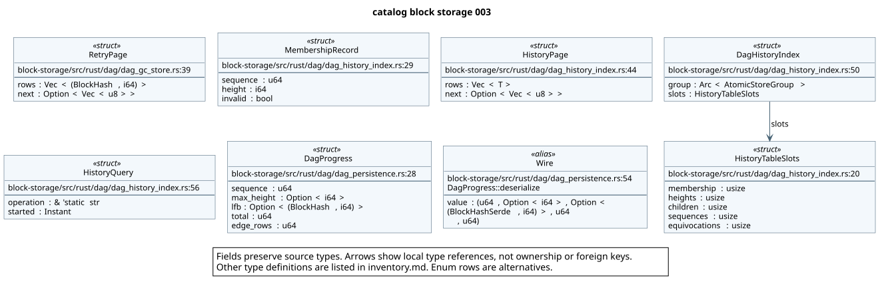

# catalog block storage 003

[Inventory](inventory.md) | [PlantUML](catalog-block-storage-003.puml)

## Cardinality and Size

[Method, units, limits, and runtime evidence](sizing.md). These are declaration-level assessments, not measured live counts.

### RetryPage

Cardinality: 0..n live values. Current count and owner-level limits are not derivable from this declaration.

Size: Sum of field inline layouts plus compiler padding, then uniquely owned allocations. repr and custom implementations can change layout.

| Field or variant | Cardinality | Inline bytes or layout | Additional storage or wire encoding |
| --- | --- | --- | --- |
| `rows` | 0..n elements | 24 B. Vec header on the generator target | capacity * I(element), plus live element-owned allocations. Zero-sized elements need no backing allocation. Element: Sum of component-owned allocations |
| `next` | 0..1 present payload | Option layout includes any tag or niche optimization. Do not assume I(T) + 1 | None when absent. Present payload: 0..n elements. capacity * I(element), plus live element-owned allocations. Zero-sized elements need no backing allocation. Element: None |

### HistoryTableSlots

Cardinality: 0..n live values. Current count and owner-level limits are not derivable from this declaration.

Size: Sum of field inline layouts plus compiler padding, then uniquely owned allocations. repr and custom implementations can change layout.

| Field or variant | Cardinality | Inline bytes or layout | Additional storage or wire encoding |
| --- | --- | --- | --- |
| `membership` | 1 scalar | 8 B | None |
| `heights` | 1 scalar | 8 B | None |
| `children` | 1 scalar | 8 B | None |
| `sequences` | 1 scalar | 8 B | None |
| `equivocations` | 1 scalar | 8 B | None |

### MembershipRecord

Cardinality: 0..n live values. Current count and owner-level limits are not derivable from this declaration.

Size: Sum of field inline layouts plus compiler padding, then uniquely owned allocations. repr and custom implementations can change layout.

| Field or variant | Cardinality | Inline bytes or layout | Additional storage or wire encoding |
| --- | --- | --- | --- |
| `sequence` | 1 scalar | 8 B | None |
| `height` | 1 scalar | 8 B | None |
| `invalid` | 1 scalar | 1 B | None |

### HistoryPage

Cardinality: 0..n live values. Current count and owner-level limits are not derivable from this declaration.

Size: Sum of field inline layouts plus compiler padding, then uniquely owned allocations. repr and custom implementations can change layout.

| Field or variant | Cardinality | Inline bytes or layout | Additional storage or wire encoding |
| --- | --- | --- | --- |
| `rows` | 0..n elements | 24 B. Vec header on the generator target | capacity * I(element), plus live element-owned allocations. Zero-sized elements need no backing allocation. Element: Follow the referenced declaration or external implementation. No allocation bound established. |
| `next` | 0..1 present payload | Option layout includes any tag or niche optimization. Do not assume I(T) + 1 | None when absent. Present payload: 0..n elements. capacity * I(element), plus live element-owned allocations. Zero-sized elements need no backing allocation. Element: None |

### DagHistoryIndex

Cardinality: 0..n live values. Current count and owner-level limits are not derivable from this declaration.

Size: Sum of field inline layouts plus compiler padding, then uniquely owned allocations. repr and custom implementations can change layout.

| Field or variant | Cardinality | Inline bytes or layout | Additional storage or wire encoding |
| --- | --- | --- | --- |
| `group` | 1 shared strong reference | Pointer or fat pointer, depending on target type | One shared allocation holds the target, counters and alignment. Count it once across all handles |
| `slots` | 1 value | Compiler layout required | Follow the referenced declaration or external implementation. No allocation bound established. |

### HistoryQuery

Cardinality: 0..n live values. Current count and owner-level limits are not derivable from this declaration.

Size: Sum of field inline layouts plus compiler padding, then uniquely owned allocations. repr and custom implementations can change layout.

| Field or variant | Cardinality | Inline bytes or layout | Additional storage or wire encoding |
| --- | --- | --- | --- |
| `operation` | 1 borrowed reference | Pointer or fat pointer. Referent layout required | No owned allocation. Referent: 1 value |
| `started` | 1 value | Compiler layout required | Follow the referenced declaration or external implementation. No allocation bound established. |

### DagProgress

Cardinality: 0..n live values. Current count and owner-level limits are not derivable from this declaration.

Size: Sum of field inline layouts plus compiler padding, then uniquely owned allocations. repr and custom implementations can change layout.

| Field or variant | Cardinality | Inline bytes or layout | Additional storage or wire encoding |
| --- | --- | --- | --- |
| `sequence` | 1 scalar | 8 B | None |
| `max_height` | 0..1 present payload | Option layout includes any tag or niche optimization. Do not assume I(T) + 1 | None when absent. Present payload: 1 scalar. None |
| `lfb` | 0..1 present payload | Option layout includes any tag or niche optimization. Do not assume I(T) + 1 | None when absent. Present payload: 2 component values. Sum of component-owned allocations |
| `total` | 1 scalar | 8 B | None |
| `edge_rows` | 1 scalar | 8 B | None |

### Wire

Cardinality: Alias, not a separate allocation. Count values of the target type.

Size: Same layout and allocations as target. Do not add alias bytes again.

| Field or variant | Cardinality | Inline bytes or layout | Additional storage or wire encoding |
| --- | --- | --- | --- |
| `value` | 5 component values | Sum of component inline sizes plus compiler padding | Sum of component-owned allocations |

## Cross-Page References

- `DagHistoryIndex: group -> AtomicStoreGroup [catalog-shared-006.svg]`
- `DagProgress: lfb -> BlockHash [catalog-models-027.svg]`
- `RetryPage: rows -> BlockHash [catalog-models-027.svg]`
- `Wire: value -> BlockHashSerde [catalog-models-027.svg]`
