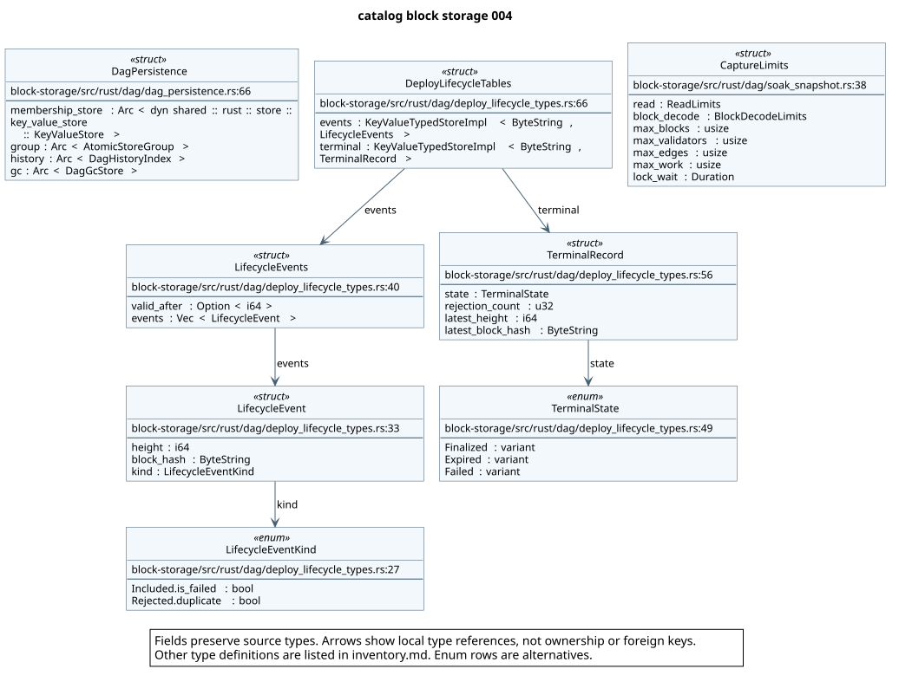

# catalog block storage 004

[Inventory](inventory.md) | [PlantUML](catalog-block-storage-004.puml)

## Cardinality and Size

[Method, units, limits, and runtime evidence](sizing.md). These are declaration-level assessments, not measured live counts.

### DagPersistence

Cardinality: 0..n live values. Current count and owner-level limits are not derivable from this declaration.

Size: Sum of field inline layouts plus compiler padding, then uniquely owned allocations. repr and custom implementations can change layout.

| Field or variant | Cardinality | Inline bytes or layout | Additional storage or wire encoding |
| --- | --- | --- | --- |
| `membership_store` | 1 shared strong reference | Pointer or fat pointer, depending on target type | One shared allocation holds the target, counters and alignment. Count it once across all handles |
| `group` | 1 shared strong reference | Pointer or fat pointer, depending on target type | One shared allocation holds the target, counters and alignment. Count it once across all handles |
| `history` | 1 shared strong reference | Pointer or fat pointer, depending on target type | One shared allocation holds the target, counters and alignment. Count it once across all handles |
| `gc` | 1 shared strong reference | Pointer or fat pointer, depending on target type | One shared allocation holds the target, counters and alignment. Count it once across all handles |

### LifecycleEventKind

Cardinality: 0..n live values. Current count and owner-level limits are not derivable from this declaration.

Size: Compiler enum layout plus allocations of the active variant only. Do not sum alternative variants.

| Field or variant | Cardinality | Inline bytes or layout | Additional storage or wire encoding |
| --- | --- | --- | --- |
| `Included.is_failed` | 1 scalar when this variant is active | 1 B | None |
| `Rejected.duplicate` | 1 scalar when this variant is active | 1 B | None |

### LifecycleEvent

Cardinality: 0..n live values. Current count and owner-level limits are not derivable from this declaration.

Size: Sum of field inline layouts plus compiler padding, then uniquely owned allocations. repr and custom implementations can change layout.

| Field or variant | Cardinality | Inline bytes or layout | Additional storage or wire encoding |
| --- | --- | --- | --- |
| `height` | 1 scalar | 8 B | None |
| `block_hash` | 1 value | Compiler layout required | Follow the referenced declaration or external implementation. No allocation bound established. |
| `kind` | 1 value | Compiler layout required | Follow the referenced declaration or external implementation. No allocation bound established. |

### LifecycleEvents

Cardinality: 0..n live values. Current count and owner-level limits are not derivable from this declaration.

Size: Sum of field inline layouts plus compiler padding, then uniquely owned allocations. repr and custom implementations can change layout.

| Field or variant | Cardinality | Inline bytes or layout | Additional storage or wire encoding |
| --- | --- | --- | --- |
| `valid_after` | 0..1 present payload | Option layout includes any tag or niche optimization. Do not assume I(T) + 1 | None when absent. Present payload: 1 scalar. None |
| `events` | 0..n elements | 24 B. Vec header on the generator target | capacity * I(element), plus live element-owned allocations. Zero-sized elements need no backing allocation. Element: Follow the referenced declaration or external implementation. No allocation bound established. |

### TerminalState

Cardinality: 0..n live values. Current count and owner-level limits are not derivable from this declaration.

Size: Compiler enum layout plus allocations of the active variant only. Do not sum alternative variants.

| Field or variant | Cardinality | Inline bytes or layout | Additional storage or wire encoding |
| --- | --- | --- | --- |
| `Finalized` | 1 mutually exclusive alternative | No payload. Enum discriminant layout required | None for this unit variant |
| `Expired` | 1 mutually exclusive alternative | No payload. Enum discriminant layout required | None for this unit variant |
| `Failed` | 1 mutually exclusive alternative | No payload. Enum discriminant layout required | None for this unit variant |

### TerminalRecord

Cardinality: 0..n live values. Current count and owner-level limits are not derivable from this declaration.

Size: Sum of field inline layouts plus compiler padding, then uniquely owned allocations. repr and custom implementations can change layout.

| Field or variant | Cardinality | Inline bytes or layout | Additional storage or wire encoding |
| --- | --- | --- | --- |
| `state` | 1 value | Compiler layout required | Follow the referenced declaration or external implementation. No allocation bound established. |
| `rejection_count` | 1 scalar | 4 B | None |
| `latest_height` | 1 scalar | 8 B | None |
| `latest_block_hash` | 1 value | Compiler layout required | Follow the referenced declaration or external implementation. No allocation bound established. |

### DeployLifecycleTables

Cardinality: 0..n live values. Current count and owner-level limits are not derivable from this declaration.

Size: Sum of field inline layouts plus compiler padding, then uniquely owned allocations. repr and custom implementations can change layout.

| Field or variant | Cardinality | Inline bytes or layout | Additional storage or wire encoding |
| --- | --- | --- | --- |
| `events` | 1 value | Compiler layout required | Follow the referenced declaration or external implementation. No allocation bound established. |
| `terminal` | 1 value | Compiler layout required | Follow the referenced declaration or external implementation. No allocation bound established. |

### CaptureLimits

Cardinality: 0..n live values. Current count and owner-level limits are not derivable from this declaration.

Size: Sum of field inline layouts plus compiler padding, then uniquely owned allocations. repr and custom implementations can change layout.

| Field or variant | Cardinality | Inline bytes or layout | Additional storage or wire encoding |
| --- | --- | --- | --- |
| `read` | 1 value | Compiler layout required | Follow the referenced declaration or external implementation. No allocation bound established. |
| `block_decode` | 1 value | Compiler layout required | Follow the referenced declaration or external implementation. No allocation bound established. |
| `max_blocks` | 1 scalar | 8 B | None |
| `max_validators` | 1 scalar | 8 B | None |
| `max_edges` | 1 scalar | 8 B | None |
| `max_work` | 1 scalar | 8 B | None |
| `lock_wait` | 1 value | Compiler layout required | Follow the referenced declaration or external implementation. No allocation bound established. |

## Cross-Page References

- `CaptureLimits: block_decode -> BlockDecodeLimits [catalog-block-storage-008.svg]`
- `CaptureLimits: read -> ReadLimits [catalog-shared-008.svg]`
- `DagPersistence: gc -> DagGcStore [catalog-block-storage-002.svg]`
- `DagPersistence: group -> AtomicStoreGroup [catalog-shared-006.svg]`
- `DagPersistence: history -> DagHistoryIndex [catalog-block-storage-003.svg]`
- `DeployLifecycleTables: events -> KeyValueTypedStoreImpl [catalog-shared-007.svg]`
- `DeployLifecycleTables: terminal -> KeyValueTypedStoreImpl [catalog-shared-007.svg]`
