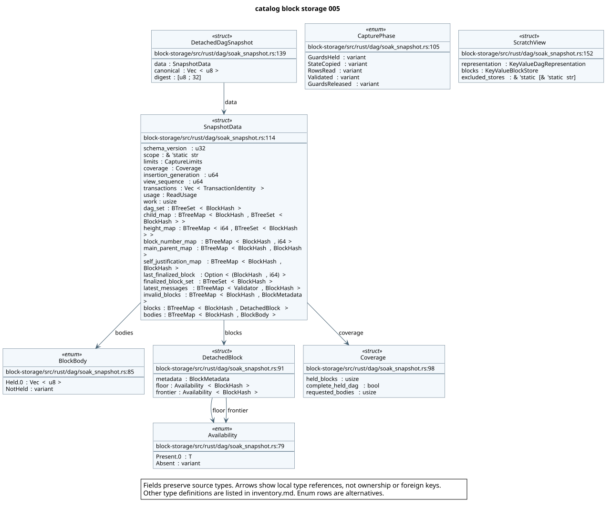

# catalog block storage 005

[Inventory](inventory.md) | [PlantUML](catalog-block-storage-005.puml)

## Cross-Page References

- `DetachedBlock: floor -> BlockHash [catalog-models-027.svg]`
- `DetachedBlock: frontier -> BlockHash [catalog-models-027.svg]`
- `DetachedBlock: metadata -> BlockMetadata [catalog-models-027.svg]`
- `ScratchView: blocks -> KeyValueBlockStore [catalog-block-storage-008.svg]`
- `ScratchView: representation -> KeyValueDagRepresentation [catalog-block-storage-001.svg]`
- `SnapshotData: block_number_map -> BlockHash [catalog-models-027.svg]`
- `SnapshotData: blocks -> BlockHash [catalog-models-027.svg]`
- `SnapshotData: bodies -> BlockHash [catalog-models-027.svg]`
- `SnapshotData: child_map -> BlockHash [catalog-models-027.svg]`
- `SnapshotData: dag_set -> BlockHash [catalog-models-027.svg]`
- `SnapshotData: finalized_block_set -> BlockHash [catalog-models-027.svg]`
- `SnapshotData: height_map -> BlockHash [catalog-models-027.svg]`
- `SnapshotData: invalid_blocks -> BlockHash [catalog-models-027.svg]`
- `SnapshotData: invalid_blocks -> BlockMetadata [catalog-models-027.svg]`
- `SnapshotData: last_finalized_block -> BlockHash [catalog-models-027.svg]`
- `SnapshotData: latest_messages -> BlockHash [catalog-models-027.svg]`
- `SnapshotData: limits -> CaptureLimits [catalog-block-storage-004.svg]`
- `SnapshotData: main_parent_map -> BlockHash [catalog-models-027.svg]`
- `SnapshotData: self_justification_map -> BlockHash [catalog-models-027.svg]`
- `SnapshotData: transactions -> TransactionIdentity [catalog-shared-008.svg]`
- `SnapshotData: usage -> ReadUsage [catalog-shared-009.svg]`
