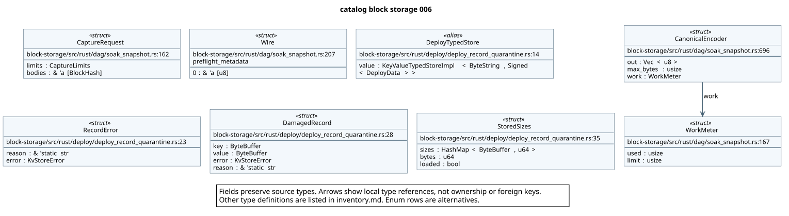

# catalog block storage 006

[Inventory](inventory.md) | [PlantUML](catalog-block-storage-006.puml)

## Cardinality and Size

[Method, units, limits, and runtime evidence](sizing.md). These are declaration-level assessments, not measured live counts.

### CaptureRequest

Cardinality: 0..n live values. Current count and owner-level limits are not derivable from this declaration.

Size: Sum of field inline layouts plus compiler padding, then uniquely owned allocations. repr and custom implementations can change layout.

| Field or variant | Cardinality | Inline bytes or layout | Additional storage or wire encoding |
| --- | --- | --- | --- |
| `limits` | 1 value | Compiler layout required | Follow the referenced declaration or external implementation. No allocation bound established. |
| `bodies` | 1 borrowed reference | Pointer or fat pointer. Referent layout required | No owned allocation. Referent: 0..n elements |

### WorkMeter

Cardinality: 0..n live values. Current count and owner-level limits are not derivable from this declaration.

Size: Sum of field inline layouts plus compiler padding, then uniquely owned allocations. repr and custom implementations can change layout.

| Field or variant | Cardinality | Inline bytes or layout | Additional storage or wire encoding |
| --- | --- | --- | --- |
| `used` | 1 scalar | 8 B | None |
| `limit` | 1 scalar | 8 B | None |

### Wire

Cardinality: 0..n live values. Current count and owner-level limits are not derivable from this declaration.

Size: Sum of field inline layouts plus compiler padding, then uniquely owned allocations. repr and custom implementations can change layout.

| Field or variant | Cardinality | Inline bytes or layout | Additional storage or wire encoding |
| --- | --- | --- | --- |
| `0` | 1 borrowed reference | Pointer or fat pointer. Referent layout required | No owned allocation. Referent: 0..n elements |

### CanonicalEncoder

Cardinality: 0..n live values. Current count and owner-level limits are not derivable from this declaration.

Size: Sum of field inline layouts plus compiler padding, then uniquely owned allocations. repr and custom implementations can change layout.

| Field or variant | Cardinality | Inline bytes or layout | Additional storage or wire encoding |
| --- | --- | --- | --- |
| `out` | 0..n elements | 24 B. Vec header on the generator target | capacity * I(element), plus live element-owned allocations. Zero-sized elements need no backing allocation. Element: None |
| `max_bytes` | 1 scalar | 8 B | None |
| `work` | 1 value | Compiler layout required | Follow the referenced declaration or external implementation. No allocation bound established. |

### DeployTypedStore

Cardinality: Alias, not a separate allocation. Count values of the target type.

Size: Same layout and allocations as target. Do not add alias bytes again.

| Field or variant | Cardinality | Inline bytes or layout | Additional storage or wire encoding |
| --- | --- | --- | --- |
| `value` | 1 value | Compiler layout required | Follow the referenced declaration or external implementation. No allocation bound established. |

### RecordError

Cardinality: 0..n live values. Current count and owner-level limits are not derivable from this declaration.

Size: Sum of field inline layouts plus compiler padding, then uniquely owned allocations. repr and custom implementations can change layout.

| Field or variant | Cardinality | Inline bytes or layout | Additional storage or wire encoding |
| --- | --- | --- | --- |
| `reason` | 1 borrowed reference | Pointer or fat pointer. Referent layout required | No owned allocation. Referent: 1 value |
| `error` | 1 value | Compiler layout required | Follow the referenced declaration or external implementation. No allocation bound established. |

### DamagedRecord

Cardinality: 0..n live values. Current count and owner-level limits are not derivable from this declaration.

Size: Sum of field inline layouts plus compiler padding, then uniquely owned allocations. repr and custom implementations can change layout.

| Field or variant | Cardinality | Inline bytes or layout | Additional storage or wire encoding |
| --- | --- | --- | --- |
| `key` | 1 value | Compiler layout required | Follow the referenced declaration or external implementation. No allocation bound established. |
| `value` | 1 value | Compiler layout required | Follow the referenced declaration or external implementation. No allocation bound established. |
| `error` | 1 value | Compiler layout required | Follow the referenced declaration or external implementation. No allocation bound established. |
| `reason` | 1 borrowed reference | Pointer or fat pointer. Referent layout required | No owned allocation. Referent: 1 value |

### StoredSizes

Cardinality: 0..n live values. Current count and owner-level limits are not derivable from this declaration.

Size: Sum of field inline layouts plus compiler padding, then uniquely owned allocations. repr and custom implementations can change layout.

| Field or variant | Cardinality | Inline bytes or layout | Additional storage or wire encoding |
| --- | --- | --- | --- |
| `sizes` | 0..n key/value pairs | Container and hasher implementation required | n keys and n values, their owned allocations, spare capacity, buckets or tree nodes, and control bytes. No type-level count cap |
| `bytes` | 1 scalar | 8 B | None |
| `loaded` | 1 scalar | 1 B | None |

## Cross-Page References

- `CaptureRequest: bodies -> BlockHash [catalog-models-027.svg]`
- `CaptureRequest: limits -> CaptureLimits [catalog-block-storage-004.svg]`
- `DamagedRecord: error -> KvStoreError [catalog-shared-007.svg]`
- `DamagedRecord: key -> ByteBuffer [catalog-shared-002.svg]`
- `DamagedRecord: value -> ByteBuffer [catalog-shared-002.svg]`
- `DeployTypedStore: value -> KeyValueTypedStoreImpl [catalog-shared-007.svg]`
- `DeployTypedStore: value -> Signed [catalog-crypto-003.svg]`
- `RecordError: error -> KvStoreError [catalog-shared-007.svg]`
- `StoredSizes: sizes -> ByteBuffer [catalog-shared-002.svg]`
