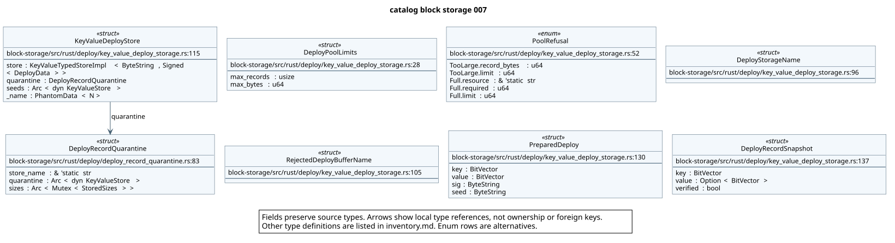

# catalog block storage 007

[Inventory](inventory.md) | [PlantUML](catalog-block-storage-007.puml)

## Cardinality and Size

[Method, units, limits, and runtime evidence](sizing.md). These are declaration-level assessments, not measured live counts.

### DeployRecordQuarantine

Cardinality: 0..n live values. Current count and owner-level limits are not derivable from this declaration.

Size: Sum of field inline layouts plus compiler padding, then uniquely owned allocations. repr and custom implementations can change layout.

| Field or variant | Cardinality | Inline bytes or layout | Additional storage or wire encoding |
| --- | --- | --- | --- |
| `store_name` | 1 borrowed reference | Pointer or fat pointer. Referent layout required | No owned allocation. Referent: 1 value |
| `quarantine` | 1 shared strong reference | Pointer or fat pointer, depending on target type | One shared allocation holds the target, counters and alignment. Count it once across all handles |
| `sizes` | 1 shared strong reference | Pointer or fat pointer, depending on target type | One shared allocation holds the target, counters and alignment. Count it once across all handles |

### DeployPoolLimits

Cardinality: 0..n live values. Current count and owner-level limits are not derivable from this declaration.

Size: Sum of field inline layouts plus compiler padding, then uniquely owned allocations. repr and custom implementations can change layout.

| Field or variant | Cardinality | Inline bytes or layout | Additional storage or wire encoding |
| --- | --- | --- | --- |
| `max_records` | 1 scalar | 8 B | None |
| `max_bytes` | 1 scalar | 8 B | None |

### PoolRefusal

Cardinality: 0..n live values. Current count and owner-level limits are not derivable from this declaration.

Size: Compiler enum layout plus allocations of the active variant only. Do not sum alternative variants.

| Field or variant | Cardinality | Inline bytes or layout | Additional storage or wire encoding |
| --- | --- | --- | --- |
| `TooLarge.record_bytes` | 1 scalar when this variant is active | 8 B | None |
| `TooLarge.limit` | 1 scalar when this variant is active | 8 B | None |
| `Full.resource` | 1 borrowed reference when this variant is active | Pointer or fat pointer. Referent layout required | No owned allocation. Referent: 1 value |
| `Full.required` | 1 scalar when this variant is active | 8 B | None |
| `Full.limit` | 1 scalar when this variant is active | 8 B | None |

### DeployStorageName

Cardinality: 0..n live values. Current count and owner-level limits are not derivable from this declaration.

Size: Sum of field inline layouts plus compiler padding, then uniquely owned allocations. repr and custom implementations can change layout.

| Field or variant | Cardinality | Inline bytes or layout | Additional storage or wire encoding |
| --- | --- | --- | --- |
| No declared fields | 0 field payloads | Compiler layout required | No field-owned allocations |

### RejectedDeployBufferName

Cardinality: 0..n live values. Current count and owner-level limits are not derivable from this declaration.

Size: Sum of field inline layouts plus compiler padding, then uniquely owned allocations. repr and custom implementations can change layout.

| Field or variant | Cardinality | Inline bytes or layout | Additional storage or wire encoding |
| --- | --- | --- | --- |
| No declared fields | 0 field payloads | Compiler layout required | No field-owned allocations |

### KeyValueDeployStore

Cardinality: 0..n live values. Current count and owner-level limits are not derivable from this declaration.

Size: Sum of field inline layouts plus compiler padding, then uniquely owned allocations. repr and custom implementations can change layout.

| Field or variant | Cardinality | Inline bytes or layout | Additional storage or wire encoding |
| --- | --- | --- | --- |
| `store` | 1 value | Compiler layout required | Follow the referenced declaration or external implementation. No allocation bound established. |
| `quarantine` | 1 value | Compiler layout required | Follow the referenced declaration or external implementation. No allocation bound established. |
| `seeds` | 1 shared strong reference | Pointer or fat pointer, depending on target type | One shared allocation holds the target, counters and alignment. Count it once across all handles |
| `_name` | 0 runtime payloads | 0 B | None |

### PreparedDeploy

Cardinality: 0..n live values. Current count and owner-level limits are not derivable from this declaration.

Size: Sum of field inline layouts plus compiler padding, then uniquely owned allocations. repr and custom implementations can change layout.

| Field or variant | Cardinality | Inline bytes or layout | Additional storage or wire encoding |
| --- | --- | --- | --- |
| `key` | 1 value | Compiler layout required | Follow the referenced declaration or external implementation. No allocation bound established. |
| `value` | 1 value | Compiler layout required | Follow the referenced declaration or external implementation. No allocation bound established. |
| `sig` | 1 value | Compiler layout required | Follow the referenced declaration or external implementation. No allocation bound established. |
| `seed` | 1 value | Compiler layout required | Follow the referenced declaration or external implementation. No allocation bound established. |

### DeployRecordSnapshot

Cardinality: 0..n live values. Current count and owner-level limits are not derivable from this declaration.

Size: Sum of field inline layouts plus compiler padding, then uniquely owned allocations. repr and custom implementations can change layout.

| Field or variant | Cardinality | Inline bytes or layout | Additional storage or wire encoding |
| --- | --- | --- | --- |
| `key` | 1 value | Compiler layout required | Follow the referenced declaration or external implementation. No allocation bound established. |
| `value` | 0..1 present payload | Option layout includes any tag or niche optimization. Do not assume I(T) + 1 | None when absent. Present payload: 1 value. Follow the referenced declaration or external implementation. No allocation bound established. |
| `verified` | 1 scalar | 1 B | None |

## Cross-Page References

- `DeployRecordQuarantine: sizes -> StoredSizes [catalog-block-storage-006.svg]`
- `DeployRecordSnapshot: key -> BitVector [catalog-shared-003.svg]`
- `DeployRecordSnapshot: value -> BitVector [catalog-shared-003.svg]`
- `KeyValueDeployStore: store -> KeyValueTypedStoreImpl [catalog-shared-007.svg]`
- `KeyValueDeployStore: store -> Signed [catalog-crypto-003.svg]`
- `PreparedDeploy: key -> BitVector [catalog-shared-003.svg]`
- `PreparedDeploy: value -> BitVector [catalog-shared-003.svg]`
