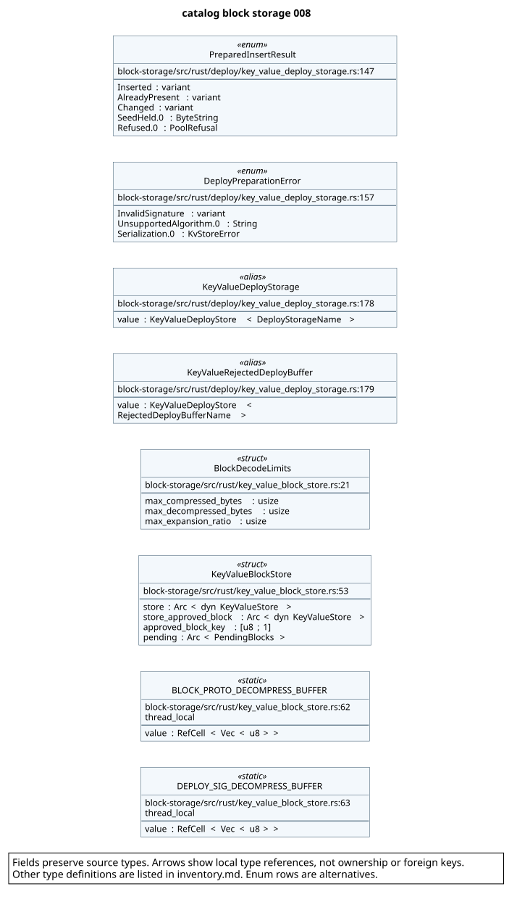

# catalog block storage 008

[Inventory](inventory.md) | [PlantUML](catalog-block-storage-008.puml)

## Cross-Page References

- `DeployPreparationError: Serialization.0 -> KvStoreError [catalog-shared-007.svg]`
- `KeyValueBlockStore: pending -> PendingBlocks [catalog-block-storage-010.svg]`
- `KeyValueDeployStorage: value -> DeployStorageName [catalog-block-storage-007.svg]`
- `KeyValueDeployStorage: value -> KeyValueDeployStore [catalog-block-storage-007.svg]`
- `KeyValueRejectedDeployBuffer: value -> KeyValueDeployStore [catalog-block-storage-007.svg]`
- `KeyValueRejectedDeployBuffer: value -> RejectedDeployBufferName [catalog-block-storage-007.svg]`
- `PreparedInsertResult: Refused.0 -> PoolRefusal [catalog-block-storage-007.svg]`
