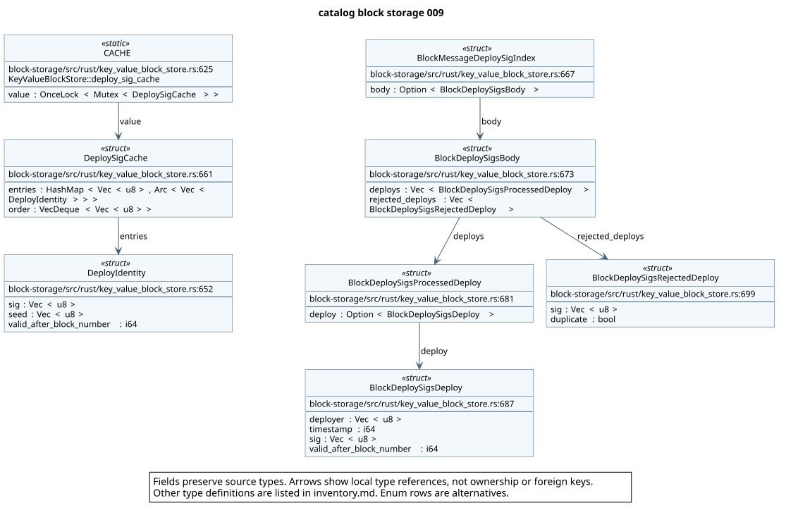

# catalog block storage 009

[Inventory](inventory.md) | [PlantUML](catalog-block-storage-009.puml)

## Cardinality and Size

[Method, units, limits, and runtime evidence](sizing.md). These are declaration-level assessments, not measured live counts.

### CACHE

Cardinality: One slot per linked process instance. Lazy payload can be uninitialized.

Size: Declared slot or lazy wrapper layout plus initialized owned allocations.

| Field or variant | Cardinality | Inline bytes or layout | Additional storage or wire encoding |
| --- | --- | --- | --- |
| `value` | 1 wrapper slot | Wrapper implementation and payload layout required | Payload allocations and any lock/waiter allocations. Once and lazy payloads can be uninitialized |

### DeployIdentity

Cardinality: 0..n live values. Current count and owner-level limits are not derivable from this declaration.

Size: Sum of field inline layouts plus compiler padding, then uniquely owned allocations. repr and custom implementations can change layout.

| Field or variant | Cardinality | Inline bytes or layout | Additional storage or wire encoding |
| --- | --- | --- | --- |
| `sig` | 0..n elements | 24 B. Vec header on the generator target | capacity * I(element), plus live element-owned allocations. Zero-sized elements need no backing allocation. Element: None |
| `seed` | 0..n elements | 24 B. Vec header on the generator target | capacity * I(element), plus live element-owned allocations. Zero-sized elements need no backing allocation. Element: None |
| `valid_after_block_number` | 1 scalar | 8 B | None |

### DeploySigCache

Cardinality: 0..n live values. Current count and owner-level limits are not derivable from this declaration.

Size: Sum of field inline layouts plus compiler padding, then uniquely owned allocations. repr and custom implementations can change layout.

| Field or variant | Cardinality | Inline bytes or layout | Additional storage or wire encoding |
| --- | --- | --- | --- |
| `entries` | 0..n key/value pairs | Container and hasher implementation required | n keys and n values, their owned allocations, spare capacity, buckets or tree nodes, and control bytes. No type-level count cap |
| `order` | 0..n elements | Container implementation required | Element storage, owned allocations, spare capacity or per-node links. No type-level count cap |

### BlockMessageDeploySigIndex

Cardinality: 0..n live values. Current count and owner-level limits are not derivable from this declaration.

Size: Sum of field inline layouts plus compiler padding, then uniquely owned allocations. repr and custom implementations can change layout.

| Field or variant | Cardinality | Inline bytes or layout | Additional storage or wire encoding |
| --- | --- | --- | --- |
| `body` | 0..1 present payload | Option layout includes any tag or niche optimization. Do not assume I(T) + 1 | None when absent. Present payload: 1 value. Follow the referenced declaration or external implementation. No allocation bound established. |

### BlockDeploySigsBody

Cardinality: 0..n live values. Current count and owner-level limits are not derivable from this declaration.

Size: Sum of field inline layouts plus compiler padding, then uniquely owned allocations. repr and custom implementations can change layout.

| Field or variant | Cardinality | Inline bytes or layout | Additional storage or wire encoding |
| --- | --- | --- | --- |
| `deploys` | 0..n elements | 24 B. Vec header on the generator target | capacity * I(element), plus live element-owned allocations. Zero-sized elements need no backing allocation. Element: Follow the referenced declaration or external implementation. No allocation bound established. |
| `rejected_deploys` | 0..n elements | 24 B. Vec header on the generator target | capacity * I(element), plus live element-owned allocations. Zero-sized elements need no backing allocation. Element: Follow the referenced declaration or external implementation. No allocation bound established. |

### BlockDeploySigsProcessedDeploy

Cardinality: 0..n live values. Current count and owner-level limits are not derivable from this declaration.

Size: Sum of field inline layouts plus compiler padding, then uniquely owned allocations. repr and custom implementations can change layout.

| Field or variant | Cardinality | Inline bytes or layout | Additional storage or wire encoding |
| --- | --- | --- | --- |
| `deploy` | 0..1 present payload | Option layout includes any tag or niche optimization. Do not assume I(T) + 1 | None when absent. Present payload: 1 value. Follow the referenced declaration or external implementation. No allocation bound established. |

### BlockDeploySigsDeploy

Cardinality: 0..n live values. Current count and owner-level limits are not derivable from this declaration.

Size: Sum of field inline layouts plus compiler padding, then uniquely owned allocations. repr and custom implementations can change layout.

| Field or variant | Cardinality | Inline bytes or layout | Additional storage or wire encoding |
| --- | --- | --- | --- |
| `deployer` | 0..n elements | 24 B. Vec header on the generator target | capacity * I(element), plus live element-owned allocations. Zero-sized elements need no backing allocation. Element: None |
| `timestamp` | 1 scalar | 8 B | None |
| `sig` | 0..n elements | 24 B. Vec header on the generator target | capacity * I(element), plus live element-owned allocations. Zero-sized elements need no backing allocation. Element: None |
| `valid_after_block_number` | 1 scalar | 8 B | None |

### BlockDeploySigsRejectedDeploy

Cardinality: 0..n live values. Current count and owner-level limits are not derivable from this declaration.

Size: Sum of field inline layouts plus compiler padding, then uniquely owned allocations. repr and custom implementations can change layout.

| Field or variant | Cardinality | Inline bytes or layout | Additional storage or wire encoding |
| --- | --- | --- | --- |
| `sig` | 0..n elements | 24 B. Vec header on the generator target | capacity * I(element), plus live element-owned allocations. Zero-sized elements need no backing allocation. Element: None |
| `duplicate` | 1 scalar | 1 B | None |

## Cross-Page References

No resolved cross-page references.
