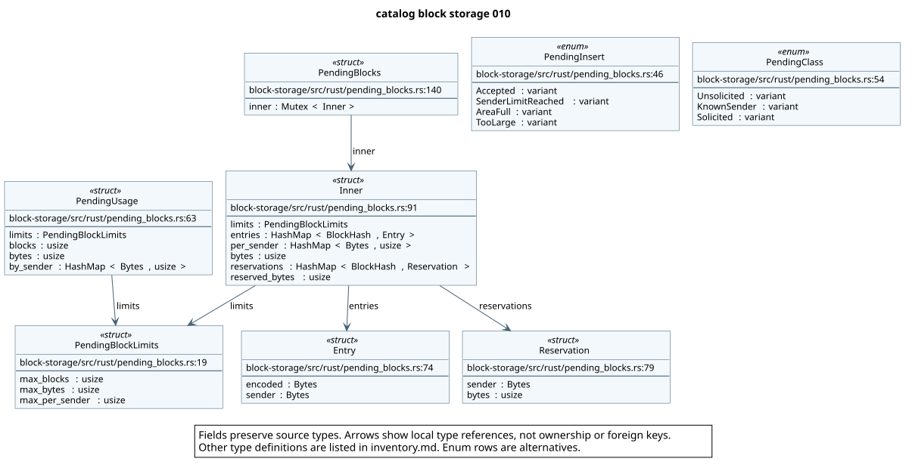

# catalog block storage 010

[Inventory](inventory.md) | [PlantUML](catalog-block-storage-010.puml)

## Cardinality and Size

[Method, units, limits, and runtime evidence](sizing.md). These are declaration-level assessments, not measured live counts.

### PendingBlockLimits

Cardinality: 0..n live values. Current count and owner-level limits are not derivable from this declaration.

Size: Sum of field inline layouts plus compiler padding, then uniquely owned allocations. repr and custom implementations can change layout.

| Field or variant | Cardinality | Inline bytes or layout | Additional storage or wire encoding |
| --- | --- | --- | --- |
| `max_blocks` | 1 scalar | 8 B | None |
| `max_bytes` | 1 scalar | 8 B | None |
| `max_per_sender` | 1 scalar | 8 B | None |

### PendingInsert

Cardinality: 0..n live values. Current count and owner-level limits are not derivable from this declaration.

Size: Compiler enum layout plus allocations of the active variant only. Do not sum alternative variants.

| Field or variant | Cardinality | Inline bytes or layout | Additional storage or wire encoding |
| --- | --- | --- | --- |
| `Accepted` | 1 mutually exclusive alternative | No payload. Enum discriminant layout required | None for this unit variant |
| `SenderLimitReached` | 1 mutually exclusive alternative | No payload. Enum discriminant layout required | None for this unit variant |
| `AreaFull` | 1 mutually exclusive alternative | No payload. Enum discriminant layout required | None for this unit variant |
| `TooLarge` | 1 mutually exclusive alternative | No payload. Enum discriminant layout required | None for this unit variant |

### PendingClass

Cardinality: 0..n live values. Current count and owner-level limits are not derivable from this declaration.

Size: Compiler enum layout plus allocations of the active variant only. Do not sum alternative variants.

| Field or variant | Cardinality | Inline bytes or layout | Additional storage or wire encoding |
| --- | --- | --- | --- |
| `Unsolicited` | 1 mutually exclusive alternative | No payload. Enum discriminant layout required | None for this unit variant |
| `KnownSender` | 1 mutually exclusive alternative | No payload. Enum discriminant layout required | None for this unit variant |
| `Solicited` | 1 mutually exclusive alternative | No payload. Enum discriminant layout required | None for this unit variant |

### PendingUsage

Cardinality: 0..n live values. Current count and owner-level limits are not derivable from this declaration.

Size: Sum of field inline layouts plus compiler padding, then uniquely owned allocations. repr and custom implementations can change layout.

| Field or variant | Cardinality | Inline bytes or layout | Additional storage or wire encoding |
| --- | --- | --- | --- |
| `limits` | 1 value | Compiler layout required | Follow the referenced declaration or external implementation. No allocation bound established. |
| `blocks` | 1 scalar | 8 B | None |
| `bytes` | 1 scalar | 8 B | None |
| `by_sender` | 0..n key/value pairs | Container and hasher implementation required | n keys and n values, their owned allocations, spare capacity, buckets or tree nodes, and control bytes. No type-level count cap |

### Entry

Cardinality: 0..n live values. Current count and owner-level limits are not derivable from this declaration.

Size: Sum of field inline layouts plus compiler padding, then uniquely owned allocations. repr and custom implementations can change layout.

| Field or variant | Cardinality | Inline bytes or layout | Additional storage or wire encoding |
| --- | --- | --- | --- |
| `encoded` | 1 value | Compiler layout required | Follow the referenced declaration or external implementation. No allocation bound established. |
| `sender` | 1 value | Compiler layout required | Follow the referenced declaration or external implementation. No allocation bound established. |

### Reservation

Cardinality: 0..n live values. Current count and owner-level limits are not derivable from this declaration.

Size: Sum of field inline layouts plus compiler padding, then uniquely owned allocations. repr and custom implementations can change layout.

| Field or variant | Cardinality | Inline bytes or layout | Additional storage or wire encoding |
| --- | --- | --- | --- |
| `sender` | 1 value | Compiler layout required | Follow the referenced declaration or external implementation. No allocation bound established. |
| `bytes` | 1 scalar | 8 B | None |

### Inner

Cardinality: 0..n live values. Current count and owner-level limits are not derivable from this declaration.

Size: Sum of field inline layouts plus compiler padding, then uniquely owned allocations. repr and custom implementations can change layout.

| Field or variant | Cardinality | Inline bytes or layout | Additional storage or wire encoding |
| --- | --- | --- | --- |
| `limits` | 1 value | Compiler layout required | Follow the referenced declaration or external implementation. No allocation bound established. |
| `entries` | 0..n key/value pairs | Container and hasher implementation required | n keys and n values, their owned allocations, spare capacity, buckets or tree nodes, and control bytes. No type-level count cap |
| `per_sender` | 0..n key/value pairs | Container and hasher implementation required | n keys and n values, their owned allocations, spare capacity, buckets or tree nodes, and control bytes. No type-level count cap |
| `bytes` | 1 scalar | 8 B | None |
| `reservations` | 0..n key/value pairs | Container and hasher implementation required | n keys and n values, their owned allocations, spare capacity, buckets or tree nodes, and control bytes. No type-level count cap |
| `reserved_bytes` | 1 scalar | 8 B | None |

### PendingBlocks

Cardinality: 0..n live values. Current count and owner-level limits are not derivable from this declaration.

Size: Sum of field inline layouts plus compiler padding, then uniquely owned allocations. repr and custom implementations can change layout.

| Field or variant | Cardinality | Inline bytes or layout | Additional storage or wire encoding |
| --- | --- | --- | --- |
| `inner` | 1 wrapper slot | Wrapper implementation and payload layout required | Payload allocations and any lock/waiter allocations. Once and lazy payloads can be uninitialized |

## Cross-Page References

- `Inner: entries -> BlockHash [catalog-models-027.svg]`
- `Inner: reservations -> BlockHash [catalog-models-027.svg]`
