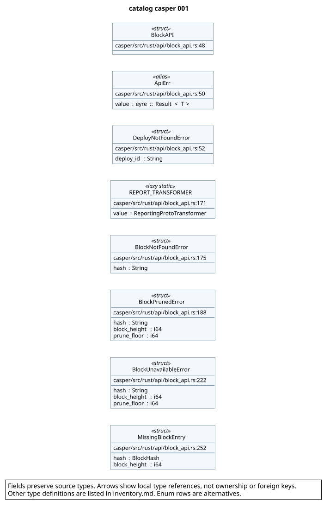

# catalog casper 001

[Inventory](inventory.md) | [PlantUML](catalog-casper-001.puml)

## Cross-Page References

- `MissingBlockEntry: hash -> BlockHash [catalog-models-027.svg]`
- `REPORT_TRANSFORMER: value -> ReportingProtoTransformer [catalog-casper-040.svg]`
