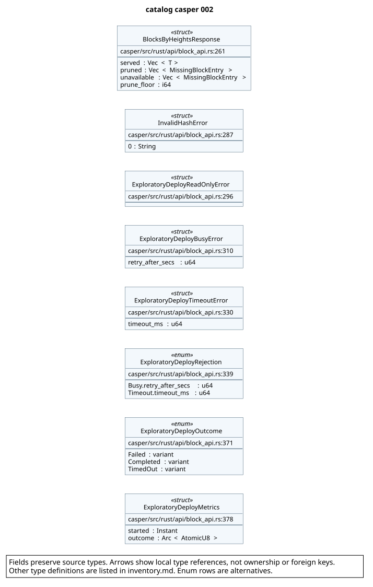

# catalog casper 002

[Inventory](inventory.md) | [PlantUML](catalog-casper-002.puml)

## Cross-Page References

- `BlocksByHeightsResponse: pruned -> MissingBlockEntry [catalog-casper-001.svg]`
- `BlocksByHeightsResponse: unavailable -> MissingBlockEntry [catalog-casper-001.svg]`
