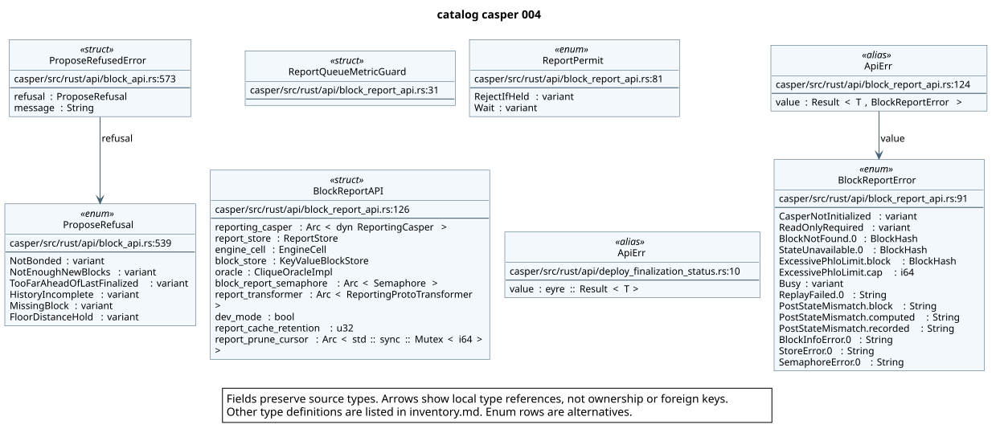

# catalog casper 004

[Inventory](inventory.md) | [PlantUML](catalog-casper-004.puml)

## Cross-Page References

- `BlockReportAPI: block_store -> KeyValueBlockStore [catalog-block-storage-008.svg]`
- `BlockReportAPI: engine_cell -> EngineCell [catalog-casper-021.svg]`
- `BlockReportAPI: oracle -> CliqueOracleImpl [catalog-casper-043.svg]`
- `BlockReportAPI: report_store -> ReportStore [catalog-casper-039.svg]`
- `BlockReportAPI: report_transformer -> ReportingProtoTransformer [catalog-casper-040.svg]`
- `BlockReportError: BlockNotFound.0 -> BlockHash [catalog-models-027.svg]`
- `BlockReportError: ExcessivePhloLimit.block -> BlockHash [catalog-models-027.svg]`
- `BlockReportError: StateUnavailable.0 -> BlockHash [catalog-models-027.svg]`
