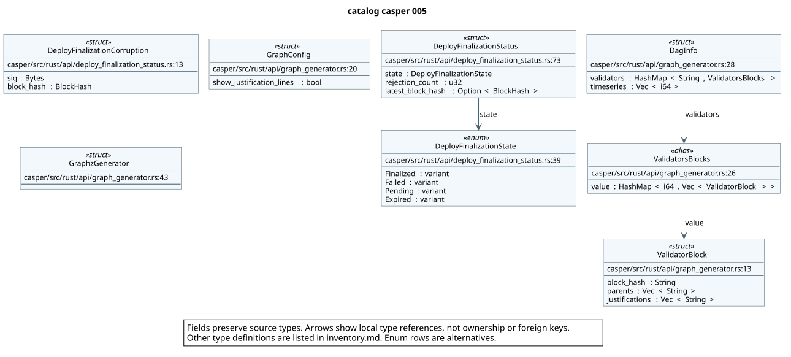

# catalog casper 005

[Inventory](inventory.md) | [PlantUML](catalog-casper-005.puml)

## Cross-Page References

- `DeployFinalizationCorruption: block_hash -> BlockHash [catalog-models-027.svg]`
- `DeployFinalizationStatus: latest_block_hash -> BlockHash [catalog-models-027.svg]`
