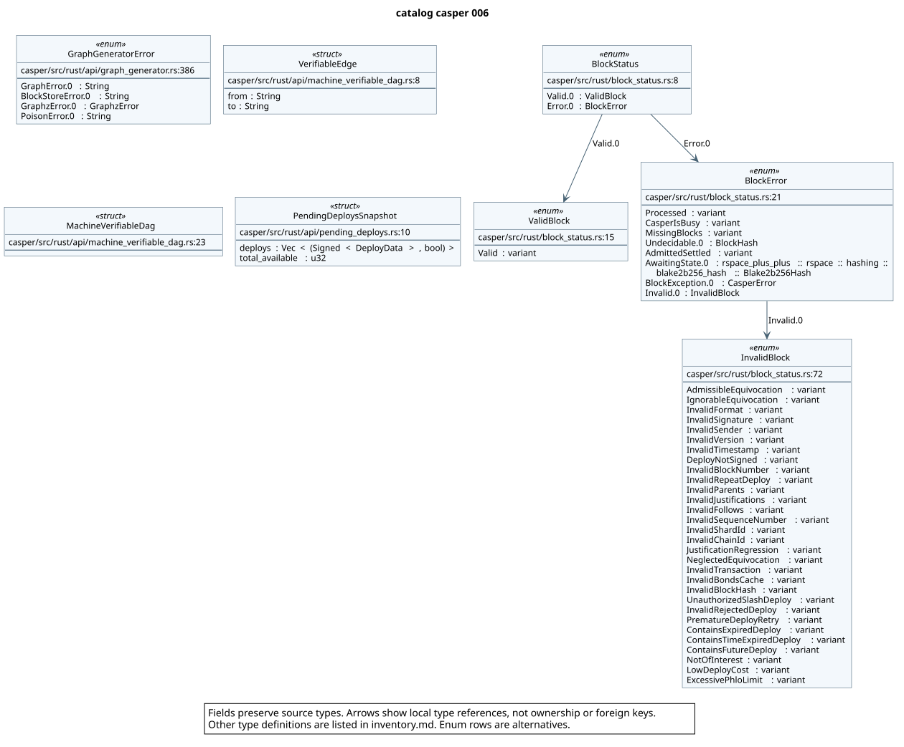

# catalog casper 006

[Inventory](inventory.md) | [PlantUML](catalog-casper-006.puml)

## Cardinality and Size

[Method, units, limits, and runtime evidence](sizing.md). These are declaration-level assessments, not measured live counts.

### GraphGeneratorError

Cardinality: 0..n live values. Current count and owner-level limits are not derivable from this declaration.

Size: Compiler enum layout plus allocations of the active variant only. Do not sum alternative variants.

| Field or variant | Cardinality | Inline bytes or layout | Additional storage or wire encoding |
| --- | --- | --- | --- |
| `GraphError.0` | 0..n UTF-8 bytes when this variant is active | 24 B. String header on the generator target | capacity() bytes, excluding allocator overhead. UTF-8 byte length is not character count |
| `BlockStoreError.0` | 0..n UTF-8 bytes when this variant is active | 24 B. String header on the generator target | capacity() bytes, excluding allocator overhead. UTF-8 byte length is not character count |
| `GraphzError.0` | 1 value when this variant is active | Compiler layout required | Follow the referenced declaration or external implementation. No allocation bound established. |
| `PoisonError.0` | 0..n UTF-8 bytes when this variant is active | 24 B. String header on the generator target | capacity() bytes, excluding allocator overhead. UTF-8 byte length is not character count |

### VerifiableEdge

Cardinality: 0..n live values. Current count and owner-level limits are not derivable from this declaration.

Size: Sum of field inline layouts plus compiler padding, then uniquely owned allocations. repr and custom implementations can change layout.

| Field or variant | Cardinality | Inline bytes or layout | Additional storage or wire encoding |
| --- | --- | --- | --- |
| `from` | 0..n UTF-8 bytes | 24 B. String header on the generator target | capacity() bytes, excluding allocator overhead. UTF-8 byte length is not character count |
| `to` | 0..n UTF-8 bytes | 24 B. String header on the generator target | capacity() bytes, excluding allocator overhead. UTF-8 byte length is not character count |

### MachineVerifiableDag

Cardinality: 0..n live values. Current count and owner-level limits are not derivable from this declaration.

Size: Sum of field inline layouts plus compiler padding, then uniquely owned allocations. repr and custom implementations can change layout.

| Field or variant | Cardinality | Inline bytes or layout | Additional storage or wire encoding |
| --- | --- | --- | --- |
| No declared fields | 0 field payloads | Compiler layout required | No field-owned allocations |

### PendingDeploysSnapshot

Cardinality: 0..n live values. Current count and owner-level limits are not derivable from this declaration.

Size: Sum of field inline layouts plus compiler padding, then uniquely owned allocations. repr and custom implementations can change layout.

| Field or variant | Cardinality | Inline bytes or layout | Additional storage or wire encoding |
| --- | --- | --- | --- |
| `deploys` | 0..n elements | 24 B. Vec header on the generator target | capacity * I(element), plus live element-owned allocations. Zero-sized elements need no backing allocation. Element: Sum of component-owned allocations |
| `total_available` | 1 scalar | 4 B | None |

### BlockStatus

Cardinality: 0..n live values. Current count and owner-level limits are not derivable from this declaration.

Size: Compiler enum layout plus allocations of the active variant only. Do not sum alternative variants.

| Field or variant | Cardinality | Inline bytes or layout | Additional storage or wire encoding |
| --- | --- | --- | --- |
| `Valid.0` | 1 value when this variant is active | Compiler layout required | Follow the referenced declaration or external implementation. No allocation bound established. |
| `Error.0` | 1 value when this variant is active | Compiler layout required | Follow the referenced declaration or external implementation. No allocation bound established. |

### ValidBlock

Cardinality: 0..n live values. Current count and owner-level limits are not derivable from this declaration.

Size: Compiler enum layout plus allocations of the active variant only. Do not sum alternative variants.

| Field or variant | Cardinality | Inline bytes or layout | Additional storage or wire encoding |
| --- | --- | --- | --- |
| `Valid` | 1 mutually exclusive alternative | No payload. Enum discriminant layout required | None for this unit variant |

### BlockError

Cardinality: 0..n live values. Current count and owner-level limits are not derivable from this declaration.

Size: Compiler enum layout plus allocations of the active variant only. Do not sum alternative variants.

| Field or variant | Cardinality | Inline bytes or layout | Additional storage or wire encoding |
| --- | --- | --- | --- |
| `Processed` | 1 mutually exclusive alternative | No payload. Enum discriminant layout required | None for this unit variant |
| `CasperIsBusy` | 1 mutually exclusive alternative | No payload. Enum discriminant layout required | None for this unit variant |
| `MissingBlocks` | 1 mutually exclusive alternative | No payload. Enum discriminant layout required | None for this unit variant |
| `Undecidable.0` | 1 value when this variant is active | Compiler layout required | Follow the referenced declaration or external implementation. No allocation bound established. |
| `AdmittedSettled` | 1 mutually exclusive alternative | No payload. Enum discriminant layout required | None for this unit variant |
| `AwaitingState.0` | 1 value when this variant is active | Compiler layout required | Follow the referenced declaration or external implementation. No allocation bound established. |
| `BlockException.0` | 1 value when this variant is active | Compiler layout required | Follow the referenced declaration or external implementation. No allocation bound established. |
| `Invalid.0` | 1 value when this variant is active | Compiler layout required | Follow the referenced declaration or external implementation. No allocation bound established. |

### InvalidBlock

Cardinality: 0..n live values. Current count and owner-level limits are not derivable from this declaration.

Size: Compiler enum layout plus allocations of the active variant only. Do not sum alternative variants.

| Field or variant | Cardinality | Inline bytes or layout | Additional storage or wire encoding |
| --- | --- | --- | --- |
| `AdmissibleEquivocation` | 1 mutually exclusive alternative | No payload. Enum discriminant layout required | None for this unit variant |
| `IgnorableEquivocation` | 1 mutually exclusive alternative | No payload. Enum discriminant layout required | None for this unit variant |
| `InvalidFormat` | 1 mutually exclusive alternative | No payload. Enum discriminant layout required | None for this unit variant |
| `InvalidSignature` | 1 mutually exclusive alternative | No payload. Enum discriminant layout required | None for this unit variant |
| `InvalidSender` | 1 mutually exclusive alternative | No payload. Enum discriminant layout required | None for this unit variant |
| `InvalidVersion` | 1 mutually exclusive alternative | No payload. Enum discriminant layout required | None for this unit variant |
| `InvalidTimestamp` | 1 mutually exclusive alternative | No payload. Enum discriminant layout required | None for this unit variant |
| `DeployNotSigned` | 1 mutually exclusive alternative | No payload. Enum discriminant layout required | None for this unit variant |
| `InvalidBlockNumber` | 1 mutually exclusive alternative | No payload. Enum discriminant layout required | None for this unit variant |
| `InvalidRepeatDeploy` | 1 mutually exclusive alternative | No payload. Enum discriminant layout required | None for this unit variant |
| `InvalidParents` | 1 mutually exclusive alternative | No payload. Enum discriminant layout required | None for this unit variant |
| `InvalidJustifications` | 1 mutually exclusive alternative | No payload. Enum discriminant layout required | None for this unit variant |
| `InvalidFollows` | 1 mutually exclusive alternative | No payload. Enum discriminant layout required | None for this unit variant |
| `InvalidSequenceNumber` | 1 mutually exclusive alternative | No payload. Enum discriminant layout required | None for this unit variant |
| `InvalidShardId` | 1 mutually exclusive alternative | No payload. Enum discriminant layout required | None for this unit variant |
| `InvalidChainId` | 1 mutually exclusive alternative | No payload. Enum discriminant layout required | None for this unit variant |
| `JustificationRegression` | 1 mutually exclusive alternative | No payload. Enum discriminant layout required | None for this unit variant |
| `NeglectedEquivocation` | 1 mutually exclusive alternative | No payload. Enum discriminant layout required | None for this unit variant |
| `InvalidTransaction` | 1 mutually exclusive alternative | No payload. Enum discriminant layout required | None for this unit variant |
| `InvalidBondsCache` | 1 mutually exclusive alternative | No payload. Enum discriminant layout required | None for this unit variant |
| `InvalidBlockHash` | 1 mutually exclusive alternative | No payload. Enum discriminant layout required | None for this unit variant |
| `UnauthorizedSlashDeploy` | 1 mutually exclusive alternative | No payload. Enum discriminant layout required | None for this unit variant |
| `InvalidRejectedDeploy` | 1 mutually exclusive alternative | No payload. Enum discriminant layout required | None for this unit variant |
| `PrematureDeployRetry` | 1 mutually exclusive alternative | No payload. Enum discriminant layout required | None for this unit variant |
| `ContainsExpiredDeploy` | 1 mutually exclusive alternative | No payload. Enum discriminant layout required | None for this unit variant |
| `ContainsTimeExpiredDeploy` | 1 mutually exclusive alternative | No payload. Enum discriminant layout required | None for this unit variant |
| `ContainsFutureDeploy` | 1 mutually exclusive alternative | No payload. Enum discriminant layout required | None for this unit variant |
| `NotOfInterest` | 1 mutually exclusive alternative | No payload. Enum discriminant layout required | None for this unit variant |
| `LowDeployCost` | 1 mutually exclusive alternative | No payload. Enum discriminant layout required | None for this unit variant |
| `ExcessivePhloLimit` | 1 mutually exclusive alternative | No payload. Enum discriminant layout required | None for this unit variant |

## Cross-Page References

- `BlockError: AwaitingState.0 -> Blake2b256Hash [catalog-rspacepp-002.svg]`
- `BlockError: BlockException.0 -> CasperError [catalog-casper-030.svg]`
- `BlockError: Undecidable.0 -> BlockHash [catalog-models-027.svg]`
- `GraphGeneratorError: GraphzError.0 -> GraphzError [catalog-graphz-002.svg]`
- `PendingDeploysSnapshot: deploys -> Signed [catalog-crypto-003.svg]`
