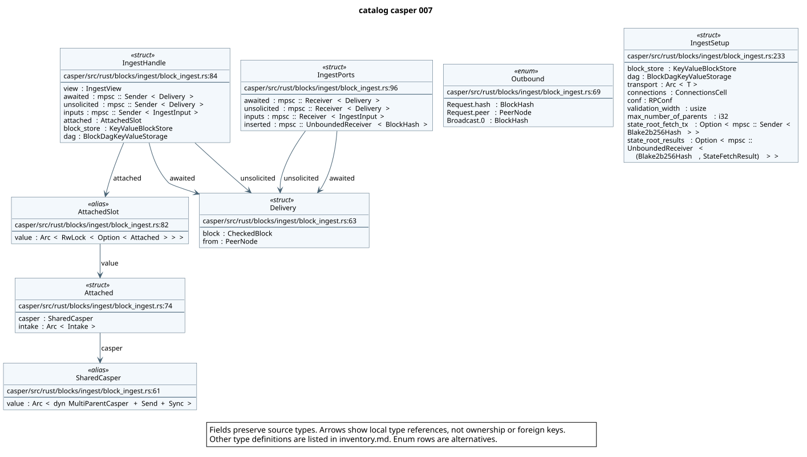

# catalog casper 007

[Inventory](inventory.md) | [PlantUML](catalog-casper-007.puml)

## Cross-Page References

- `Attached: intake -> Intake [catalog-casper-013.svg]`
- `Delivery: block -> CheckedBlock [catalog-casper-008.svg]`
- `Delivery: from -> PeerNode [catalog-comm-003.svg]`
- `IngestHandle: block_store -> KeyValueBlockStore [catalog-block-storage-008.svg]`
- `IngestHandle: dag -> BlockDagKeyValueStorage [catalog-block-storage-001.svg]`
- `IngestHandle: inputs -> IngestInput [catalog-casper-012.svg]`
- `IngestHandle: view -> IngestView [catalog-casper-012.svg]`
- `IngestPorts: inputs -> IngestInput [catalog-casper-012.svg]`
- `IngestPorts: inserted -> BlockHash [catalog-models-027.svg]`
- `IngestSetup: block_store -> KeyValueBlockStore [catalog-block-storage-008.svg]`
- `IngestSetup: conf -> RPConf [catalog-comm-004.svg]`
- `IngestSetup: connections -> ConnectionsCell [catalog-comm-004.svg]`
- `IngestSetup: dag -> BlockDagKeyValueStorage [catalog-block-storage-001.svg]`
- `IngestSetup: state_root_fetch_tx -> Blake2b256Hash [catalog-rspacepp-002.svg]`
- `IngestSetup: state_root_results -> Blake2b256Hash [catalog-rspacepp-002.svg]`
- `IngestSetup: state_root_results -> StateFetchResult [catalog-casper-012.svg]`
- `Outbound: Broadcast.0 -> BlockHash [catalog-models-027.svg]`
- `Outbound: Request.hash -> BlockHash [catalog-models-027.svg]`
- `Outbound: Request.peer -> PeerNode [catalog-comm-003.svg]`
