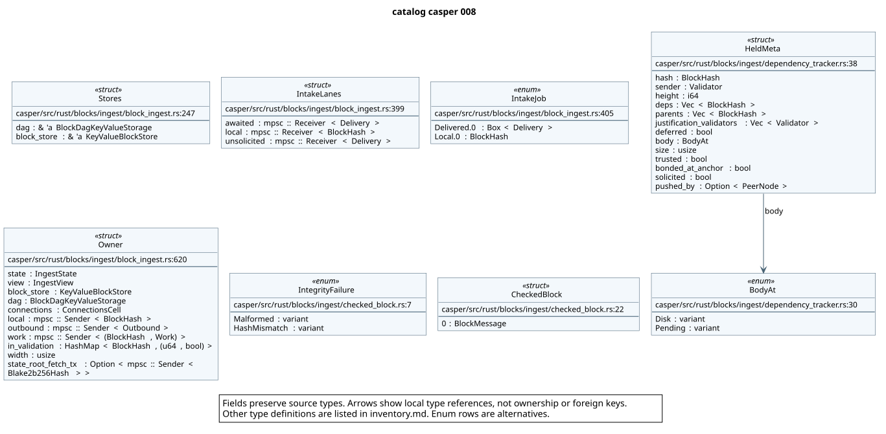

# catalog casper 008

[Inventory](inventory.md) | [PlantUML](catalog-casper-008.puml)

## Cross-Page References

- `CheckedBlock: 0 -> BlockMessage [catalog-models-031.svg]`
- `HeldMeta: deps -> BlockHash [catalog-models-027.svg]`
- `HeldMeta: hash -> BlockHash [catalog-models-027.svg]`
- `HeldMeta: parents -> BlockHash [catalog-models-027.svg]`
- `HeldMeta: pushed_by -> PeerNode [catalog-comm-003.svg]`
- `IntakeJob: Delivered.0 -> Delivery [catalog-casper-007.svg]`
- `IntakeJob: Local.0 -> BlockHash [catalog-models-027.svg]`
- `IntakeLanes: awaited -> Delivery [catalog-casper-007.svg]`
- `IntakeLanes: local -> BlockHash [catalog-models-027.svg]`
- `IntakeLanes: unsolicited -> Delivery [catalog-casper-007.svg]`
- `Owner: block_store -> KeyValueBlockStore [catalog-block-storage-008.svg]`
- `Owner: connections -> ConnectionsCell [catalog-comm-004.svg]`
- `Owner: dag -> BlockDagKeyValueStorage [catalog-block-storage-001.svg]`
- `Owner: in_validation -> BlockHash [catalog-models-027.svg]`
- `Owner: local -> BlockHash [catalog-models-027.svg]`
- `Owner: outbound -> Outbound [catalog-casper-007.svg]`
- `Owner: state -> IngestState [catalog-casper-012.svg]`
- `Owner: state_root_fetch_tx -> Blake2b256Hash [catalog-rspacepp-002.svg]`
- `Owner: view -> IngestView [catalog-casper-012.svg]`
- `Owner: work -> BlockHash [catalog-models-027.svg]`
- `Owner: work -> Work [catalog-casper-009.svg]`
- `Stores: block_store -> KeyValueBlockStore [catalog-block-storage-008.svg]`
- `Stores: dag -> BlockDagKeyValueStorage [catalog-block-storage-001.svg]`
