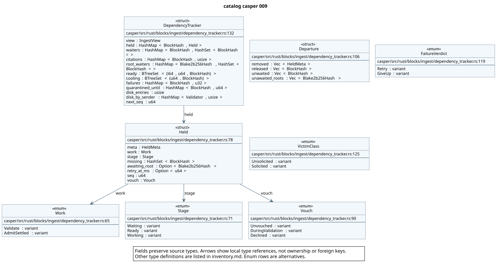

# catalog casper 009

[Inventory](inventory.md) | [PlantUML](catalog-casper-009.puml)

## Cardinality and Size

[Method, units, limits, and runtime evidence](sizing.md). These are declaration-level assessments, not measured live counts.

### Work

Cardinality: 0..n live values. Current count and owner-level limits are not derivable from this declaration.

Size: Compiler enum layout plus allocations of the active variant only. Do not sum alternative variants.

| Field or variant | Cardinality | Inline bytes or layout | Additional storage or wire encoding |
| --- | --- | --- | --- |
| `Validate` | 1 mutually exclusive alternative | No payload. Enum discriminant layout required | None for this unit variant |
| `AdmitSettled` | 1 mutually exclusive alternative | No payload. Enum discriminant layout required | None for this unit variant |

### Stage

Cardinality: 0..n live values. Current count and owner-level limits are not derivable from this declaration.

Size: Compiler enum layout plus allocations of the active variant only. Do not sum alternative variants.

| Field or variant | Cardinality | Inline bytes or layout | Additional storage or wire encoding |
| --- | --- | --- | --- |
| `Waiting` | 1 mutually exclusive alternative | No payload. Enum discriminant layout required | None for this unit variant |
| `Ready` | 1 mutually exclusive alternative | No payload. Enum discriminant layout required | None for this unit variant |
| `Working` | 1 mutually exclusive alternative | No payload. Enum discriminant layout required | None for this unit variant |

### Held

Cardinality: 0..n live values. Current count and owner-level limits are not derivable from this declaration.

Size: Sum of field inline layouts plus compiler padding, then uniquely owned allocations. repr and custom implementations can change layout.

| Field or variant | Cardinality | Inline bytes or layout | Additional storage or wire encoding |
| --- | --- | --- | --- |
| `meta` | 1 value | Compiler layout required | Follow the referenced declaration or external implementation. No allocation bound established. |
| `work` | 1 value | Compiler layout required | Follow the referenced declaration or external implementation. No allocation bound established. |
| `stage` | 1 value | Compiler layout required | Follow the referenced declaration or external implementation. No allocation bound established. |
| `missing` | 0..n distinct elements | Container and hasher implementation required | Element storage, owned allocations, spare capacity and index overhead. No type-level count cap |
| `awaiting_root` | 0..1 present payload | Option layout includes any tag or niche optimization. Do not assume I(T) + 1 | None when absent. Present payload: 1 value. Follow the referenced declaration or external implementation. No allocation bound established. |
| `retry_at_ms` | 0..1 present payload | Option layout includes any tag or niche optimization. Do not assume I(T) + 1 | None when absent. Present payload: 1 scalar. None |
| `seq` | 1 scalar | 8 B | None |
| `vouch` | 1 value | Compiler layout required | Follow the referenced declaration or external implementation. No allocation bound established. |

### Vouch

Cardinality: 0..n live values. Current count and owner-level limits are not derivable from this declaration.

Size: Compiler enum layout plus allocations of the active variant only. Do not sum alternative variants.

| Field or variant | Cardinality | Inline bytes or layout | Additional storage or wire encoding |
| --- | --- | --- | --- |
| `Unvouched` | 1 mutually exclusive alternative | No payload. Enum discriminant layout required | None for this unit variant |
| `DuringValidation` | 1 mutually exclusive alternative | No payload. Enum discriminant layout required | None for this unit variant |
| `Declined` | 1 mutually exclusive alternative | No payload. Enum discriminant layout required | None for this unit variant |

### Departure

Cardinality: 0..n live values. Current count and owner-level limits are not derivable from this declaration.

Size: Sum of field inline layouts plus compiler padding, then uniquely owned allocations. repr and custom implementations can change layout.

| Field or variant | Cardinality | Inline bytes or layout | Additional storage or wire encoding |
| --- | --- | --- | --- |
| `removed` | 0..n elements | 24 B. Vec header on the generator target | capacity * I(element), plus live element-owned allocations. Zero-sized elements need no backing allocation. Element: Follow the referenced declaration or external implementation. No allocation bound established. |
| `released` | 0..n elements | 24 B. Vec header on the generator target | capacity * I(element), plus live element-owned allocations. Zero-sized elements need no backing allocation. Element: Follow the referenced declaration or external implementation. No allocation bound established. |
| `unwaited` | 0..n elements | 24 B. Vec header on the generator target | capacity * I(element), plus live element-owned allocations. Zero-sized elements need no backing allocation. Element: Follow the referenced declaration or external implementation. No allocation bound established. |
| `unawaited_roots` | 0..n elements | 24 B. Vec header on the generator target | capacity * I(element), plus live element-owned allocations. Zero-sized elements need no backing allocation. Element: Follow the referenced declaration or external implementation. No allocation bound established. |

### FailureVerdict

Cardinality: 0..n live values. Current count and owner-level limits are not derivable from this declaration.

Size: Compiler enum layout plus allocations of the active variant only. Do not sum alternative variants.

| Field or variant | Cardinality | Inline bytes or layout | Additional storage or wire encoding |
| --- | --- | --- | --- |
| `Retry` | 1 mutually exclusive alternative | No payload. Enum discriminant layout required | None for this unit variant |
| `GiveUp` | 1 mutually exclusive alternative | No payload. Enum discriminant layout required | None for this unit variant |

### VictimClass

Cardinality: 0..n live values. Current count and owner-level limits are not derivable from this declaration.

Size: Compiler enum layout plus allocations of the active variant only. Do not sum alternative variants.

| Field or variant | Cardinality | Inline bytes or layout | Additional storage or wire encoding |
| --- | --- | --- | --- |
| `Unsolicited` | 1 mutually exclusive alternative | No payload. Enum discriminant layout required | None for this unit variant |
| `Solicited` | 1 mutually exclusive alternative | No payload. Enum discriminant layout required | None for this unit variant |

### DependencyTracker

Cardinality: 0..n live values. Current count and owner-level limits are not derivable from this declaration.

Size: Sum of field inline layouts plus compiler padding, then uniquely owned allocations. repr and custom implementations can change layout.

| Field or variant | Cardinality | Inline bytes or layout | Additional storage or wire encoding |
| --- | --- | --- | --- |
| `view` | 1 value | Compiler layout required | Follow the referenced declaration or external implementation. No allocation bound established. |
| `held` | 0..n key/value pairs | Container and hasher implementation required | n keys and n values, their owned allocations, spare capacity, buckets or tree nodes, and control bytes. No type-level count cap |
| `waiters` | 0..n key/value pairs | Container and hasher implementation required | n keys and n values, their owned allocations, spare capacity, buckets or tree nodes, and control bytes. No type-level count cap |
| `citations` | 0..n key/value pairs | Container and hasher implementation required | n keys and n values, their owned allocations, spare capacity, buckets or tree nodes, and control bytes. No type-level count cap |
| `root_waiters` | 0..n key/value pairs | Container and hasher implementation required | n keys and n values, their owned allocations, spare capacity, buckets or tree nodes, and control bytes. No type-level count cap |
| `ready` | 0..n distinct elements | Container and hasher implementation required | Element storage, owned allocations, spare capacity and index overhead. No type-level count cap |
| `cooling` | 0..n distinct elements | Container and hasher implementation required | Element storage, owned allocations, spare capacity and index overhead. No type-level count cap |
| `failures` | 0..n key/value pairs | Container and hasher implementation required | n keys and n values, their owned allocations, spare capacity, buckets or tree nodes, and control bytes. No type-level count cap |
| `quarantined_until` | 0..n key/value pairs | Container and hasher implementation required | n keys and n values, their owned allocations, spare capacity, buckets or tree nodes, and control bytes. No type-level count cap |
| `disk_entries` | 1 scalar | 8 B | None |
| `disk_by_sender` | 0..n key/value pairs | Container and hasher implementation required | n keys and n values, their owned allocations, spare capacity, buckets or tree nodes, and control bytes. No type-level count cap |
| `next_seq` | 1 scalar | 8 B | None |

## Cross-Page References

- `Departure: released -> BlockHash [catalog-models-027.svg]`
- `Departure: removed -> HeldMeta [catalog-casper-008.svg]`
- `Departure: unawaited_roots -> Blake2b256Hash [catalog-rspacepp-002.svg]`
- `Departure: unwaited -> BlockHash [catalog-models-027.svg]`
- `DependencyTracker: citations -> BlockHash [catalog-models-027.svg]`
- `DependencyTracker: cooling -> BlockHash [catalog-models-027.svg]`
- `DependencyTracker: failures -> BlockHash [catalog-models-027.svg]`
- `DependencyTracker: held -> BlockHash [catalog-models-027.svg]`
- `DependencyTracker: quarantined_until -> BlockHash [catalog-models-027.svg]`
- `DependencyTracker: ready -> BlockHash [catalog-models-027.svg]`
- `DependencyTracker: root_waiters -> Blake2b256Hash [catalog-rspacepp-002.svg]`
- `DependencyTracker: root_waiters -> BlockHash [catalog-models-027.svg]`
- `DependencyTracker: view -> IngestView [catalog-casper-012.svg]`
- `DependencyTracker: waiters -> BlockHash [catalog-models-027.svg]`
- `Held: awaiting_root -> Blake2b256Hash [catalog-rspacepp-002.svg]`
- `Held: meta -> HeldMeta [catalog-casper-008.svg]`
- `Held: missing -> BlockHash [catalog-models-027.svg]`
