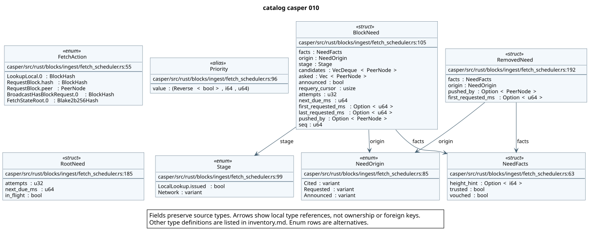

# catalog casper 010

[Inventory](inventory.md) | [PlantUML](catalog-casper-010.puml)

## Cross-Page References

- `BlockNeed: asked -> PeerNode [catalog-comm-003.svg]`
- `BlockNeed: candidates -> PeerNode [catalog-comm-003.svg]`
- `BlockNeed: pushed_by -> PeerNode [catalog-comm-003.svg]`
- `FetchAction: BroadcastHasBlockRequest.0 -> BlockHash [catalog-models-027.svg]`
- `FetchAction: FetchStateRoot.0 -> Blake2b256Hash [catalog-rspacepp-002.svg]`
- `FetchAction: LookupLocal.0 -> BlockHash [catalog-models-027.svg]`
- `FetchAction: RequestBlock.hash -> BlockHash [catalog-models-027.svg]`
- `FetchAction: RequestBlock.peer -> PeerNode [catalog-comm-003.svg]`
- `RemovedNeed: pushed_by -> PeerNode [catalog-comm-003.svg]`
