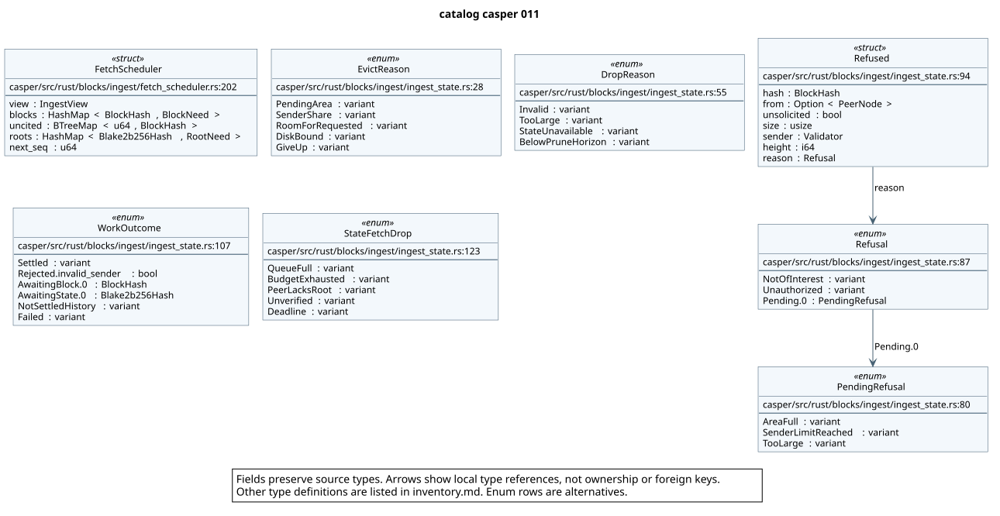

# catalog casper 011

[Inventory](inventory.md) | [PlantUML](catalog-casper-011.puml)

## Cardinality and Size

[Method, units, limits, and runtime evidence](sizing.md). These are declaration-level assessments, not measured live counts.

### FetchScheduler

Cardinality: 0..n live values. Current count and owner-level limits are not derivable from this declaration.

Size: Sum of field inline layouts plus compiler padding, then uniquely owned allocations. repr and custom implementations can change layout.

| Field or variant | Cardinality | Inline bytes or layout | Additional storage or wire encoding |
| --- | --- | --- | --- |
| `view` | 1 value | Compiler layout required | Follow the referenced declaration or external implementation. No allocation bound established. |
| `blocks` | 0..n key/value pairs | Container and hasher implementation required | n keys and n values, their owned allocations, spare capacity, buckets or tree nodes, and control bytes. No type-level count cap |
| `uncited` | 0..n key/value pairs | Container and hasher implementation required | n keys and n values, their owned allocations, spare capacity, buckets or tree nodes, and control bytes. No type-level count cap |
| `roots` | 0..n key/value pairs | Container and hasher implementation required | n keys and n values, their owned allocations, spare capacity, buckets or tree nodes, and control bytes. No type-level count cap |
| `next_seq` | 1 scalar | 8 B | None |

### EvictReason

Cardinality: 0..n live values. Current count and owner-level limits are not derivable from this declaration.

Size: Compiler enum layout plus allocations of the active variant only. Do not sum alternative variants.

| Field or variant | Cardinality | Inline bytes or layout | Additional storage or wire encoding |
| --- | --- | --- | --- |
| `PendingArea` | 1 mutually exclusive alternative | No payload. Enum discriminant layout required | None for this unit variant |
| `SenderShare` | 1 mutually exclusive alternative | No payload. Enum discriminant layout required | None for this unit variant |
| `RoomForRequested` | 1 mutually exclusive alternative | No payload. Enum discriminant layout required | None for this unit variant |
| `DiskBound` | 1 mutually exclusive alternative | No payload. Enum discriminant layout required | None for this unit variant |
| `GiveUp` | 1 mutually exclusive alternative | No payload. Enum discriminant layout required | None for this unit variant |

### DropReason

Cardinality: 0..n live values. Current count and owner-level limits are not derivable from this declaration.

Size: Compiler enum layout plus allocations of the active variant only. Do not sum alternative variants.

| Field or variant | Cardinality | Inline bytes or layout | Additional storage or wire encoding |
| --- | --- | --- | --- |
| `Invalid` | 1 mutually exclusive alternative | No payload. Enum discriminant layout required | None for this unit variant |
| `TooLarge` | 1 mutually exclusive alternative | No payload. Enum discriminant layout required | None for this unit variant |
| `StateUnavailable` | 1 mutually exclusive alternative | No payload. Enum discriminant layout required | None for this unit variant |
| `BelowPruneHorizon` | 1 mutually exclusive alternative | No payload. Enum discriminant layout required | None for this unit variant |

### PendingRefusal

Cardinality: 0..n live values. Current count and owner-level limits are not derivable from this declaration.

Size: Compiler enum layout plus allocations of the active variant only. Do not sum alternative variants.

| Field or variant | Cardinality | Inline bytes or layout | Additional storage or wire encoding |
| --- | --- | --- | --- |
| `AreaFull` | 1 mutually exclusive alternative | No payload. Enum discriminant layout required | None for this unit variant |
| `SenderLimitReached` | 1 mutually exclusive alternative | No payload. Enum discriminant layout required | None for this unit variant |
| `TooLarge` | 1 mutually exclusive alternative | No payload. Enum discriminant layout required | None for this unit variant |

### Refusal

Cardinality: 0..n live values. Current count and owner-level limits are not derivable from this declaration.

Size: Compiler enum layout plus allocations of the active variant only. Do not sum alternative variants.

| Field or variant | Cardinality | Inline bytes or layout | Additional storage or wire encoding |
| --- | --- | --- | --- |
| `NotOfInterest` | 1 mutually exclusive alternative | No payload. Enum discriminant layout required | None for this unit variant |
| `Unauthorized` | 1 mutually exclusive alternative | No payload. Enum discriminant layout required | None for this unit variant |
| `Pending.0` | 1 value when this variant is active | Compiler layout required | Follow the referenced declaration or external implementation. No allocation bound established. |

### Refused

Cardinality: 0..n live values. Current count and owner-level limits are not derivable from this declaration.

Size: Sum of field inline layouts plus compiler padding, then uniquely owned allocations. repr and custom implementations can change layout.

| Field or variant | Cardinality | Inline bytes or layout | Additional storage or wire encoding |
| --- | --- | --- | --- |
| `hash` | 1 value | Compiler layout required | Follow the referenced declaration or external implementation. No allocation bound established. |
| `from` | 0..1 present payload | Option layout includes any tag or niche optimization. Do not assume I(T) + 1 | None when absent. Present payload: 1 value. Follow the referenced declaration or external implementation. No allocation bound established. |
| `unsolicited` | 1 scalar | 1 B | None |
| `size` | 1 scalar | 8 B | None |
| `sender` | 1 value | Compiler layout required | Follow the referenced declaration or external implementation. No allocation bound established. |
| `height` | 1 scalar | 8 B | None |
| `reason` | 1 value | Compiler layout required | Follow the referenced declaration or external implementation. No allocation bound established. |

### WorkOutcome

Cardinality: 0..n live values. Current count and owner-level limits are not derivable from this declaration.

Size: Compiler enum layout plus allocations of the active variant only. Do not sum alternative variants.

| Field or variant | Cardinality | Inline bytes or layout | Additional storage or wire encoding |
| --- | --- | --- | --- |
| `Settled` | 1 mutually exclusive alternative | No payload. Enum discriminant layout required | None for this unit variant |
| `Rejected.invalid_sender` | 1 scalar when this variant is active | 1 B | None |
| `AwaitingBlock.0` | 1 value when this variant is active | Compiler layout required | Follow the referenced declaration or external implementation. No allocation bound established. |
| `AwaitingState.0` | 1 value when this variant is active | Compiler layout required | Follow the referenced declaration or external implementation. No allocation bound established. |
| `NotSettledHistory` | 1 mutually exclusive alternative | No payload. Enum discriminant layout required | None for this unit variant |
| `Failed` | 1 mutually exclusive alternative | No payload. Enum discriminant layout required | None for this unit variant |

### StateFetchDrop

Cardinality: 0..n live values. Current count and owner-level limits are not derivable from this declaration.

Size: Compiler enum layout plus allocations of the active variant only. Do not sum alternative variants.

| Field or variant | Cardinality | Inline bytes or layout | Additional storage or wire encoding |
| --- | --- | --- | --- |
| `QueueFull` | 1 mutually exclusive alternative | No payload. Enum discriminant layout required | None for this unit variant |
| `BudgetExhausted` | 1 mutually exclusive alternative | No payload. Enum discriminant layout required | None for this unit variant |
| `PeerLacksRoot` | 1 mutually exclusive alternative | No payload. Enum discriminant layout required | None for this unit variant |
| `Unverified` | 1 mutually exclusive alternative | No payload. Enum discriminant layout required | None for this unit variant |
| `Deadline` | 1 mutually exclusive alternative | No payload. Enum discriminant layout required | None for this unit variant |

## Cross-Page References

- `FetchScheduler: blocks -> BlockHash [catalog-models-027.svg]`
- `FetchScheduler: blocks -> BlockNeed [catalog-casper-010.svg]`
- `FetchScheduler: roots -> Blake2b256Hash [catalog-rspacepp-002.svg]`
- `FetchScheduler: roots -> RootNeed [catalog-casper-010.svg]`
- `FetchScheduler: uncited -> BlockHash [catalog-models-027.svg]`
- `FetchScheduler: view -> IngestView [catalog-casper-012.svg]`
- `Refused: from -> PeerNode [catalog-comm-003.svg]`
- `Refused: hash -> BlockHash [catalog-models-027.svg]`
- `WorkOutcome: AwaitingBlock.0 -> BlockHash [catalog-models-027.svg]`
- `WorkOutcome: AwaitingState.0 -> Blake2b256Hash [catalog-rspacepp-002.svg]`
