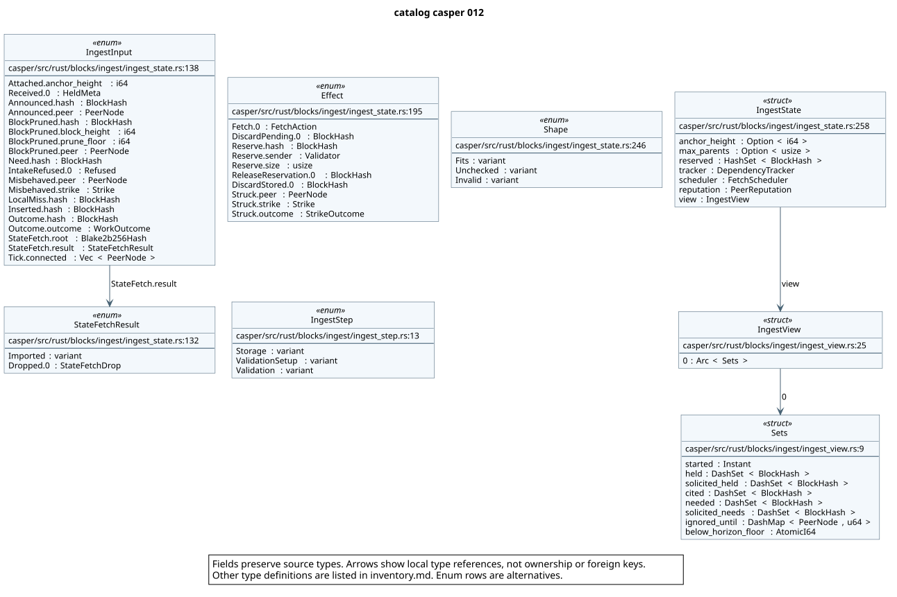

# catalog casper 012

[Inventory](inventory.md) | [PlantUML](catalog-casper-012.puml)

## Cardinality and Size

[Method, units, limits, and runtime evidence](sizing.md). These are declaration-level assessments, not measured live counts.

### StateFetchResult

Cardinality: 0..n live values. Current count and owner-level limits are not derivable from this declaration.

Size: Compiler enum layout plus allocations of the active variant only. Do not sum alternative variants.

| Field or variant | Cardinality | Inline bytes or layout | Additional storage or wire encoding |
| --- | --- | --- | --- |
| `Imported` | 1 mutually exclusive alternative | No payload. Enum discriminant layout required | None for this unit variant |
| `Dropped.0` | 1 value when this variant is active | Compiler layout required | Follow the referenced declaration or external implementation. No allocation bound established. |

### IngestInput

Cardinality: 0..n live values. Current count and owner-level limits are not derivable from this declaration.

Size: Compiler enum layout plus allocations of the active variant only. Do not sum alternative variants.

| Field or variant | Cardinality | Inline bytes or layout | Additional storage or wire encoding |
| --- | --- | --- | --- |
| `Attached.anchor_height` | 1 scalar when this variant is active | 8 B | None |
| `Received.0` | 1 value when this variant is active | Compiler layout required | Follow the referenced declaration or external implementation. No allocation bound established. |
| `Announced.hash` | 1 value when this variant is active | Compiler layout required | Follow the referenced declaration or external implementation. No allocation bound established. |
| `Announced.peer` | 1 value when this variant is active | Compiler layout required | Follow the referenced declaration or external implementation. No allocation bound established. |
| `BlockPruned.hash` | 1 value when this variant is active | Compiler layout required | Follow the referenced declaration or external implementation. No allocation bound established. |
| `BlockPruned.block_height` | 1 scalar when this variant is active | 8 B | None |
| `BlockPruned.prune_floor` | 1 scalar when this variant is active | 8 B | None |
| `BlockPruned.peer` | 1 value when this variant is active | Compiler layout required | Follow the referenced declaration or external implementation. No allocation bound established. |
| `Need.hash` | 1 value when this variant is active | Compiler layout required | Follow the referenced declaration or external implementation. No allocation bound established. |
| `IntakeRefused.0` | 1 value when this variant is active | Compiler layout required | Follow the referenced declaration or external implementation. No allocation bound established. |
| `Misbehaved.peer` | 1 value when this variant is active | Compiler layout required | Follow the referenced declaration or external implementation. No allocation bound established. |
| `Misbehaved.strike` | 1 value when this variant is active | Compiler layout required | Follow the referenced declaration or external implementation. No allocation bound established. |
| `LocalMiss.hash` | 1 value when this variant is active | Compiler layout required | Follow the referenced declaration or external implementation. No allocation bound established. |
| `Inserted.hash` | 1 value when this variant is active | Compiler layout required | Follow the referenced declaration or external implementation. No allocation bound established. |
| `Outcome.hash` | 1 value when this variant is active | Compiler layout required | Follow the referenced declaration or external implementation. No allocation bound established. |
| `Outcome.outcome` | 1 value when this variant is active | Compiler layout required | Follow the referenced declaration or external implementation. No allocation bound established. |
| `StateFetch.root` | 1 value when this variant is active | Compiler layout required | Follow the referenced declaration or external implementation. No allocation bound established. |
| `StateFetch.result` | 1 value when this variant is active | Compiler layout required | Follow the referenced declaration or external implementation. No allocation bound established. |
| `Tick.connected` | 0..n elements when this variant is active | 24 B. Vec header on the generator target | capacity * I(element), plus live element-owned allocations. Zero-sized elements need no backing allocation. Element: Follow the referenced declaration or external implementation. No allocation bound established. |

### Effect

Cardinality: 0..n live values. Current count and owner-level limits are not derivable from this declaration.

Size: Compiler enum layout plus allocations of the active variant only. Do not sum alternative variants.

| Field or variant | Cardinality | Inline bytes or layout | Additional storage or wire encoding |
| --- | --- | --- | --- |
| `Fetch.0` | 1 value when this variant is active | Compiler layout required | Follow the referenced declaration or external implementation. No allocation bound established. |
| `DiscardPending.0` | 1 value when this variant is active | Compiler layout required | Follow the referenced declaration or external implementation. No allocation bound established. |
| `Reserve.hash` | 1 value when this variant is active | Compiler layout required | Follow the referenced declaration or external implementation. No allocation bound established. |
| `Reserve.sender` | 1 value when this variant is active | Compiler layout required | Follow the referenced declaration or external implementation. No allocation bound established. |
| `Reserve.size` | 1 scalar when this variant is active | 8 B | None |
| `ReleaseReservation.0` | 1 value when this variant is active | Compiler layout required | Follow the referenced declaration or external implementation. No allocation bound established. |
| `DiscardStored.0` | 1 value when this variant is active | Compiler layout required | Follow the referenced declaration or external implementation. No allocation bound established. |
| `Struck.peer` | 1 value when this variant is active | Compiler layout required | Follow the referenced declaration or external implementation. No allocation bound established. |
| `Struck.strike` | 1 value when this variant is active | Compiler layout required | Follow the referenced declaration or external implementation. No allocation bound established. |
| `Struck.outcome` | 1 value when this variant is active | Compiler layout required | Follow the referenced declaration or external implementation. No allocation bound established. |

### Shape

Cardinality: 0..n live values. Current count and owner-level limits are not derivable from this declaration.

Size: Compiler enum layout plus allocations of the active variant only. Do not sum alternative variants.

| Field or variant | Cardinality | Inline bytes or layout | Additional storage or wire encoding |
| --- | --- | --- | --- |
| `Fits` | 1 mutually exclusive alternative | No payload. Enum discriminant layout required | None for this unit variant |
| `Unchecked` | 1 mutually exclusive alternative | No payload. Enum discriminant layout required | None for this unit variant |
| `Invalid` | 1 mutually exclusive alternative | No payload. Enum discriminant layout required | None for this unit variant |

### IngestState

Cardinality: 0..n live values. Current count and owner-level limits are not derivable from this declaration.

Size: Sum of field inline layouts plus compiler padding, then uniquely owned allocations. repr and custom implementations can change layout.

| Field or variant | Cardinality | Inline bytes or layout | Additional storage or wire encoding |
| --- | --- | --- | --- |
| `anchor_height` | 0..1 present payload | Option layout includes any tag or niche optimization. Do not assume I(T) + 1 | None when absent. Present payload: 1 scalar. None |
| `max_parents` | 0..1 present payload | Option layout includes any tag or niche optimization. Do not assume I(T) + 1 | None when absent. Present payload: 1 scalar. None |
| `reserved` | 0..n distinct elements | Container and hasher implementation required | Element storage, owned allocations, spare capacity and index overhead. No type-level count cap |
| `tracker` | 1 value | Compiler layout required | Follow the referenced declaration or external implementation. No allocation bound established. |
| `scheduler` | 1 value | Compiler layout required | Follow the referenced declaration or external implementation. No allocation bound established. |
| `reputation` | 1 value | Compiler layout required | Follow the referenced declaration or external implementation. No allocation bound established. |
| `view` | 1 value | Compiler layout required | Follow the referenced declaration or external implementation. No allocation bound established. |

### IngestStep

Cardinality: 0..n live values. Current count and owner-level limits are not derivable from this declaration.

Size: Compiler enum layout plus allocations of the active variant only. Do not sum alternative variants.

| Field or variant | Cardinality | Inline bytes or layout | Additional storage or wire encoding |
| --- | --- | --- | --- |
| `Storage` | 1 mutually exclusive alternative | No payload. Enum discriminant layout required | None for this unit variant |
| `ValidationSetup` | 1 mutually exclusive alternative | No payload. Enum discriminant layout required | None for this unit variant |
| `Validation` | 1 mutually exclusive alternative | No payload. Enum discriminant layout required | None for this unit variant |

### Sets

Cardinality: 0..n live values. Current count and owner-level limits are not derivable from this declaration.

Size: Sum of field inline layouts plus compiler padding, then uniquely owned allocations. repr and custom implementations can change layout.

| Field or variant | Cardinality | Inline bytes or layout | Additional storage or wire encoding |
| --- | --- | --- | --- |
| `started` | 1 value | Compiler layout required | Follow the referenced declaration or external implementation. No allocation bound established. |
| `held` | 1 value | Compiler layout required | Follow the referenced declaration or external implementation. No allocation bound established. |
| `solicited_held` | 1 value | Compiler layout required | Follow the referenced declaration or external implementation. No allocation bound established. |
| `cited` | 1 value | Compiler layout required | Follow the referenced declaration or external implementation. No allocation bound established. |
| `needed` | 1 value | Compiler layout required | Follow the referenced declaration or external implementation. No allocation bound established. |
| `solicited_needs` | 1 value | Compiler layout required | Follow the referenced declaration or external implementation. No allocation bound established. |
| `ignored_until` | 0..n key/value pairs | Container and hasher implementation required | n keys and n values, their owned allocations, spare capacity, buckets or tree nodes, and control bytes. No type-level count cap |
| `below_horizon_floor` | 1 value | Compiler layout required | Follow the referenced declaration or external implementation. No allocation bound established. |

### IngestView

Cardinality: 0..n live values. Current count and owner-level limits are not derivable from this declaration.

Size: Sum of field inline layouts plus compiler padding, then uniquely owned allocations. repr and custom implementations can change layout.

| Field or variant | Cardinality | Inline bytes or layout | Additional storage or wire encoding |
| --- | --- | --- | --- |
| `0` | 1 shared strong reference | Pointer or fat pointer, depending on target type | One shared allocation holds the target, counters and alignment. Count it once across all handles |

## Cross-Page References

- `Effect: DiscardPending.0 -> BlockHash [catalog-models-027.svg]`
- `Effect: DiscardStored.0 -> BlockHash [catalog-models-027.svg]`
- `Effect: Fetch.0 -> FetchAction [catalog-casper-010.svg]`
- `Effect: ReleaseReservation.0 -> BlockHash [catalog-models-027.svg]`
- `Effect: Reserve.hash -> BlockHash [catalog-models-027.svg]`
- `Effect: Struck.outcome -> StrikeOutcome [catalog-casper-013.svg]`
- `Effect: Struck.peer -> PeerNode [catalog-comm-003.svg]`
- `Effect: Struck.strike -> Strike [catalog-casper-013.svg]`
- `IngestInput: Announced.hash -> BlockHash [catalog-models-027.svg]`
- `IngestInput: Announced.peer -> PeerNode [catalog-comm-003.svg]`
- `IngestInput: BlockPruned.hash -> BlockHash [catalog-models-027.svg]`
- `IngestInput: BlockPruned.peer -> PeerNode [catalog-comm-003.svg]`
- `IngestInput: Inserted.hash -> BlockHash [catalog-models-027.svg]`
- `IngestInput: IntakeRefused.0 -> Refused [catalog-casper-011.svg]`
- `IngestInput: LocalMiss.hash -> BlockHash [catalog-models-027.svg]`
- `IngestInput: Misbehaved.peer -> PeerNode [catalog-comm-003.svg]`
- `IngestInput: Misbehaved.strike -> Strike [catalog-casper-013.svg]`
- `IngestInput: Need.hash -> BlockHash [catalog-models-027.svg]`
- `IngestInput: Outcome.hash -> BlockHash [catalog-models-027.svg]`
- `IngestInput: Outcome.outcome -> WorkOutcome [catalog-casper-011.svg]`
- `IngestInput: Received.0 -> HeldMeta [catalog-casper-008.svg]`
- `IngestInput: StateFetch.root -> Blake2b256Hash [catalog-rspacepp-002.svg]`
- `IngestInput: Tick.connected -> PeerNode [catalog-comm-003.svg]`
- `IngestState: reputation -> PeerReputation [catalog-casper-013.svg]`
- `IngestState: reserved -> BlockHash [catalog-models-027.svg]`
- `IngestState: scheduler -> FetchScheduler [catalog-casper-011.svg]`
- `IngestState: tracker -> DependencyTracker [catalog-casper-009.svg]`
- `Sets: cited -> BlockHash [catalog-models-027.svg]`
- `Sets: held -> BlockHash [catalog-models-027.svg]`
- `Sets: ignored_until -> PeerNode [catalog-comm-003.svg]`
- `Sets: needed -> BlockHash [catalog-models-027.svg]`
- `Sets: solicited_held -> BlockHash [catalog-models-027.svg]`
- `Sets: solicited_needs -> BlockHash [catalog-models-027.svg]`
- `StateFetchResult: Dropped.0 -> StateFetchDrop [catalog-casper-011.svg]`
