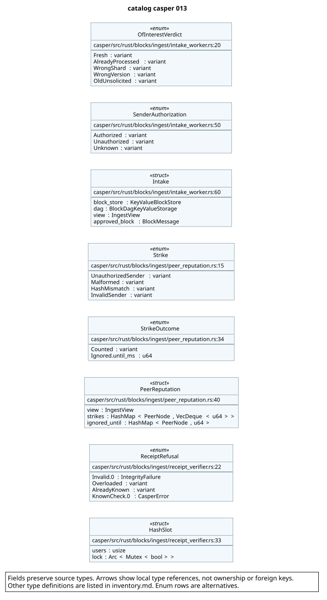

# catalog casper 013

[Inventory](inventory.md) | [PlantUML](catalog-casper-013.puml)

## Cross-Page References

- `Intake: approved_block -> BlockMessage [catalog-models-031.svg]`
- `Intake: block_store -> KeyValueBlockStore [catalog-block-storage-008.svg]`
- `Intake: dag -> BlockDagKeyValueStorage [catalog-block-storage-001.svg]`
- `Intake: view -> IngestView [catalog-casper-012.svg]`
- `PeerReputation: ignored_until -> PeerNode [catalog-comm-003.svg]`
- `PeerReputation: strikes -> PeerNode [catalog-comm-003.svg]`
- `PeerReputation: view -> IngestView [catalog-casper-012.svg]`
- `ReceiptRefusal: Invalid.0 -> IntegrityFailure [catalog-casper-008.svg]`
- `ReceiptRefusal: KnownCheck.0 -> CasperError [catalog-casper-030.svg]`
